# Arapça 3.Sınıf Ders Kitabı

<!-- sayfa 0 -->


# اَلْإِبْتِدَائِيَّةُ

## اَللُّغَةُ الْعَرَبِيَّةُ

### اَلصَّفُّ
### 3

#### كِتَابُ الطَّالِبِ

تَأْلِيف
Mehmet ERDEM


DEVLET KİTAPLARI

<!-- sayfa 1 -->

Millî Eğitim Bakanlığı Yayınları No.......................................................................... : 10745
Ders Kitapları Dizisi No .......................................................................................... : 2495

Her hakkı saklıdır ve Millî Eğitim Bakanlığına aittir. Kitabın metin, soru ve şekilleri
kısmen de olsa hiçbir surette alınıp yayımlanamaz.

تَحْرِير
Prof. Dr. Murat ÖZCAN
Prof. Dr. Yasin Murat DEMİR

تَصْمِيم
Meral HUNUMA

تَصْمِيمُ الْوَسَائِطِ الْمُتَعَدِّدَةِ
Adil ÇAVUŞ
Hatice ÖZDEMİR
Mehmet Emin YİĞİT
Özden ÇELEN
Yunus ŞİRİN
Zehra HİRA

خَبِيرُ تَطْوِيرِ الْبَرْنَامَجِ
Ayşegül ÖZDİL

خَبِيرُ الْقِيَاسِ وَالتَّقْوِيمِ
Şafak Cansu CİRİT

خَبِيرُ التَّوْجِيهِ وَالْإِرْشَادِ
Sıdıka KAMAN
Yavuz GÜL

ISBN: 978-975-11-9732-0

Millî Eğitim Bakanlığı Talim ve Terbiye Kurulu Başkanlığının 18.05.2026 tarih ve 160509405 sayılı yazısı ile eğitim aracı olarak kabul edilmiştir. Kurulca bu kitabın kabul edilmiş olması ders

<!-- sayfa 2 -->

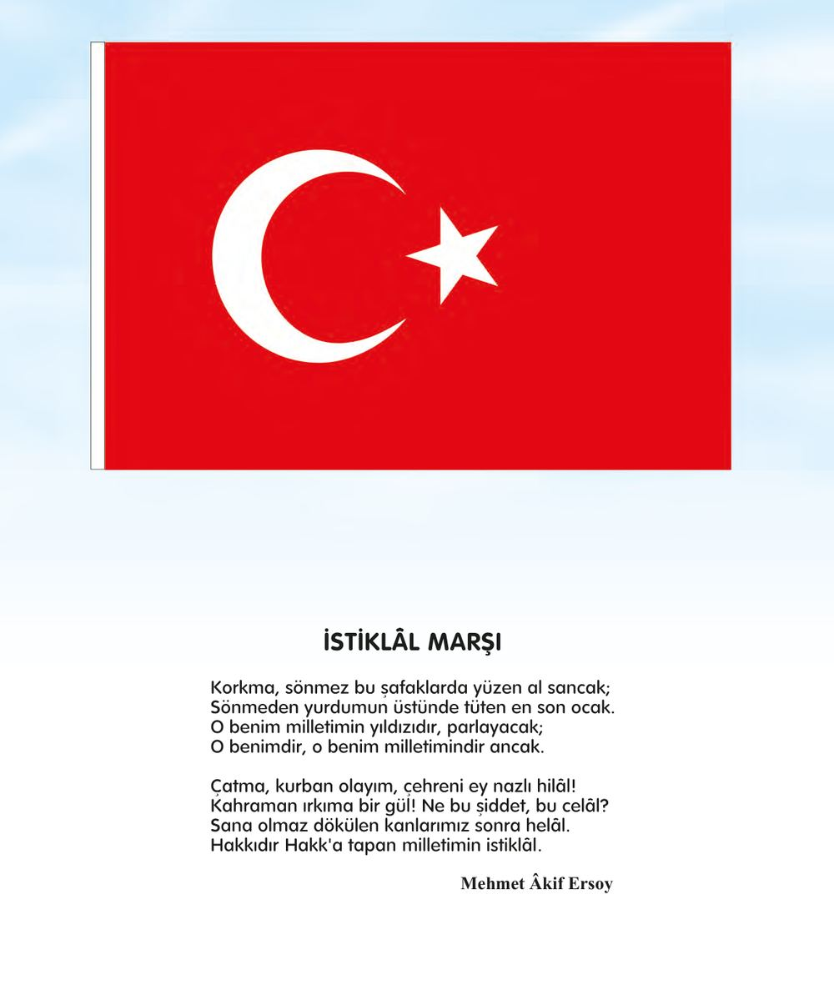

# İSTİKLÂL MARŞI

Korkma, sönmez bu şafaklarda yüzen al sancak;
Sönmeden yurdumun üstünde tüten en son ocak.
O benim milletimin yıldızıdır, parlayacak;
O benimdir, o benim milletimindir ancak.

Catma, kurban olayım, çehreni ey nazlı hilâl!
Kahraman ırkıma bir gül! Ne bu şiddet, bu celâl?
Sana olmaz dökülen kanlarımız sonra helâl.
Hakkıdır Hakk'a tapan milletimin istiklâl.

Mehmet Âkif Ersoy

<!-- sayfa 3 -->

ANDIMIZ

Türküm, doğruyum, çalışkanım.

İlkem küçüklerimi korumak, büyüklerimi saymak; yurdumu, milletimi özümden çok sevmektir.
Ülküm yükselmek, ileri gitmektir.

Ey Büyük Atatürk!

Açtığın yolda, gösterdiğin hedefe durmadan yürüyeceğime ant içerim.

Varlığım Türk varlığına armağan olsun.

Ne mutlu Türküm diyene!

<!-- sayfa 4 -->


MUSTAFA KEMAL ATATÜRK

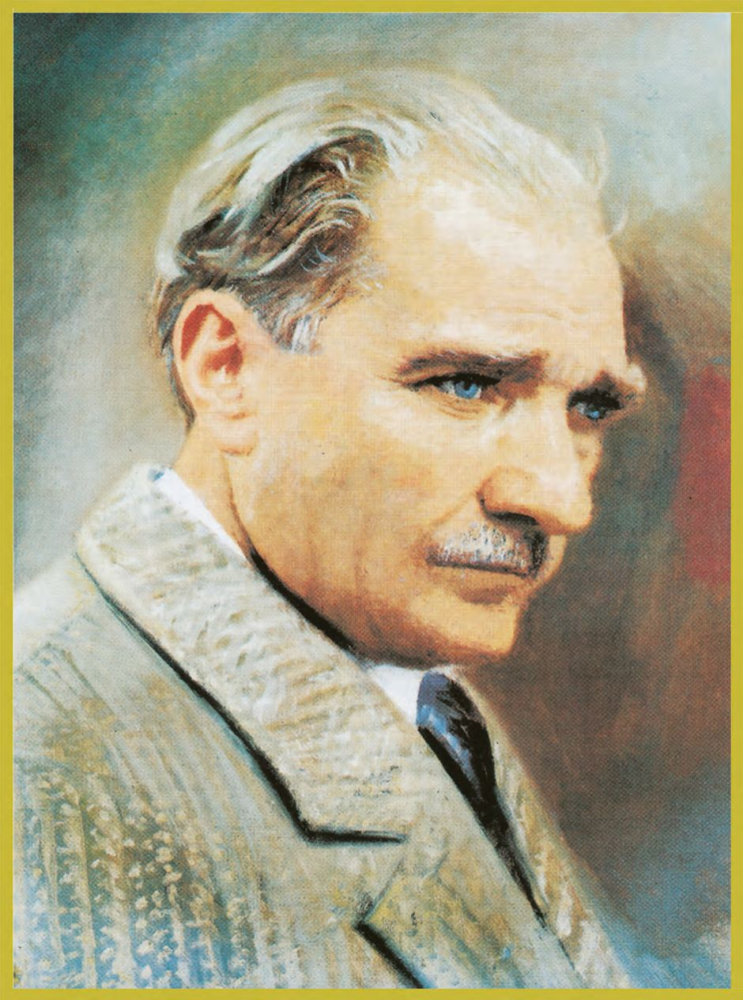
<!-- yer tutucu bulunamadı: sayfa sonuna eklendi -->

<!-- sayfa 5 -->

Verdiğiniz metin katmanı boş olduğu için (`<<< >>>` arası boş) dönüştürülecek bir içerik bulunmamaktadır. Lütfen metin katmanını içeren içeriği paylaşın, böylece talimatlarınıza uygun şekilde Markdown formatına çevirebilirim.

<!-- sayfa 6 -->

# الْمُحْتَوَيَاتُ

١ 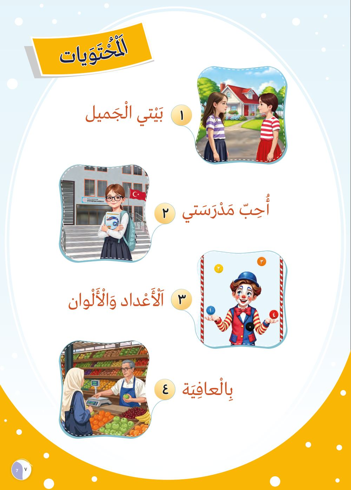 بَيْتِي الْجَمِيلُ

٢  أُحِبُّ مَدْرَسَتِي

٣  الْأَعْدَادُ وَالْأَلْوَانُ

٤  بِالْعَافِيَةِ

<!-- sayfa 7 -->

| | | |
| :--- | :--- | :--- |
| ٩ | تَوْضِيحُ الْكِتَابِ | |
| ١٠ | الْوَحْدَةُ ١: بَيْتِي الْجَمِيلُ | 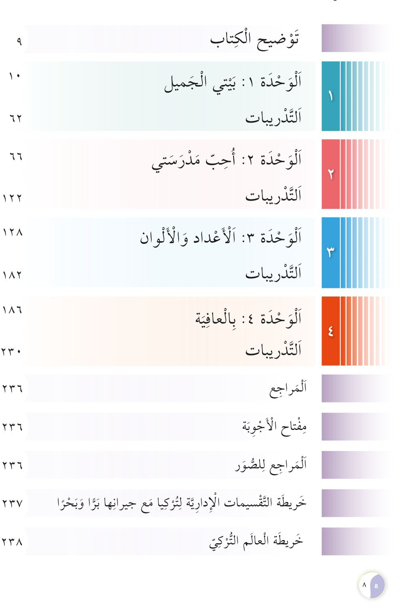 |
| ٦٢ | التَّدْرِيبَاتُ | |
| ٦٦ | الْوَحْدَةُ ٢: أُحِبُّ مَدْرَسَتِي |  |
| ١٢٢ | التَّدْرِيبَاتُ | |
| ١٢٨ | الْوَحْدَةُ ٣: الْأَعْدَادُ وَالْأَلْوَانُ |  |
| ١٨٢ | التَّدْرِيبَاتُ | |
| ١٨٦ | الْوَحْدَةُ ٤: بِالْعَافِيَةِ |  |
| ٢٣٠ | التَّدْرِيبَاتُ | |
| ٢٣٦ | الْمَرَاجِعُ | |
| ٢٣٦ | مِفْتَاحُ الْأَجْوِبَةِ | |
| ٢٣٦ | الْمَرَاجِعُ لِلصُّوَرِ | |
| ٢٣٧ | خَرِيطَةُ التَّقْسِيمَاتِ الْإِدَارِيَّةِ لِتُرْكِيَا مَعَ جِيرَانِهَا بَرًّا وَبَحْرًا | |
| ٢٣٨ | خَرِيطَةُ الْعَالَمِ التُّرْكِيِّ | |

<!-- sayfa 8 -->

# سَنَتَنَاوَلُ فِي هَذِهِ الْوَحْدَةِ:
* أَسْمَاءُ الْبَيْتِ
* بَعْضُ الْأَدَوَاتِ الْمَنْزِلِيَّةِ
* بَعْضُ الْحُرُوفِ وَالْأَصْوَاتِ
* الْفَهَامِيمُ
  * بَيْتٌ، غُرْفَةٌ ...
  * السَّاعَةُ، الْغَسَّالَةُ ...
  * أَيْنَ ...؟
  * أَشْتَرِي / أَشْتَرِي
* التَّقْوِيمُ الْمَبْدَئِيُّ
  * هَلْ تَعْرِفُ أَقْسَامَ الْبَيْتِ وَأَدَوَاتِهِ؟
  * هَلْ تَقْرَأُ الْكَلِمَاتِ بِالسُّكُونِ وَالشَّدَّةِ؟

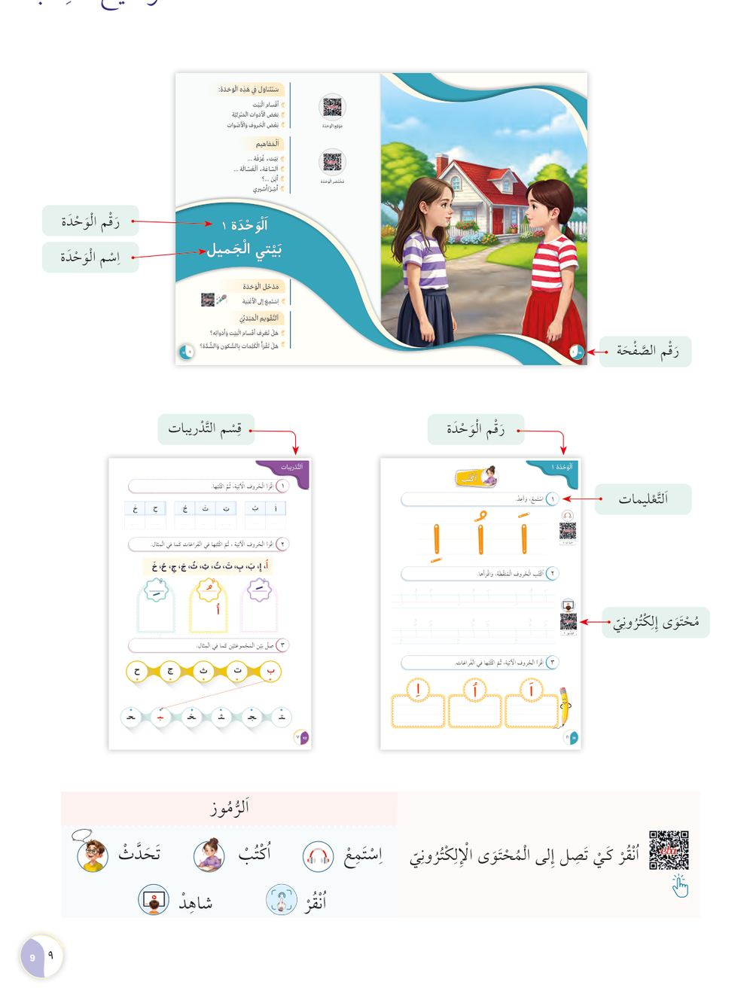
مَوْقِعُ الْوَحْدَةِ


مُخْتَصَرُ الْوَحْدَةِ

رَقْمُ الْوَحْدَةِ
١

اِسْمُ الْوَحْدَةِ
بَيْتِي الْجَمِيلُ

مَدْخَلُ الْوَحْدَةِ
* اِسْتَمِعْ إِلَى الْأُنْغُنْيَةِ
* الْفَهَامِيمُ الْمُتَنَوِّعَةُ
* هَلْ تَعْرِفُ أَقْسَامَ الْبَيْتِ وَأَدَوَاتِهِ؟
* هَلْ تَقْرَأُ الْكَلِمَاتِ بِالسُّكُونِ وَالشَّدَّةِ؟

رَقْمُ الصَّفْحَةِ
١٠

---

# الْوَحْدَةُ ١
## اِتَّبِعِ التَّعْلِيمَاتِ

١. اِسْمَعْ، وَانْطِقْ.


٢. اكْتُبِ الْحُرُوفَ الْمُنَقَّطَةَ، وَاقْرَأْهَا.


٣. اِقْرَأِ الْحُرُوفَ الْآتِيَةَ، ثُمَّ اكْتُبْهَا فِي الْفَرَاغَاتِ كَمَا فِي الْمِثَالِ.


رَقْمُ الصَّفْحَةِ
١١

---

# الْتَّدْرِيبَاتُ

١. اِقْرَأِ الْحُرُوفَ الْآتِيَةَ، ثُمَّ اكْتُبْهَا.


٢. اِقْرَأِ الْحُرُوفَ الْآتِيَةَ، ثُمَّ اكْتُبْهَا فِي الْفَرَاغَاتِ كَمَا فِي الْمِثَالِ.
أَ، إِ، بَ، بِ، تَ، تُ، ثِ، ثُ، جَ، جِ، حُ، خَ


٣. صِلْ بَيْنَ الْمَجْمُوعَتَيْنِ كَمَا فِي الْمِثَالِ.


رَقْمُ الصَّفْحَةِ
٦٢

---

# الْرُّمُوزُ
* اِسْتَمِعْ 
* أَكْتُبُ 
* تَحَدَّثُ 
* شَاهِدُ 
* اِنْطِقْ 

اِنْقُرْ كَيْ تَصِلَ إِلَى الْمُحْتَوَى الْإِلِكْتُرُونِيِّ


<!-- sayfa 9 -->

```

(Not: Sağlanan görsel bir matematik ders kitabı sayfası değil, iki kız çocuğunun bir evin önünde durduğu bir illüstrasyondur. Metin katmanı boş olduğu için çevrilecek bir içerik bulunmamaktadır.)


<!-- yer tutucu bulunamadı: sayfa sonuna eklendi -->

<!-- sayfa 10 -->

# اَلْوَحْدَةُ ١
# بَيْتِي الْجَمِيلُ

في هَذِهِ الْوَحْدَةِ نَتَنَاوَلُ:
» أَقْسَامَ الْبَيْتِ
» بَعْضَ الْأَدَوَاتِ الْمَنْزِلِيَّةِ
» بَعْضَ الْحُرُوفِ وَالْأَصْوَاتِ

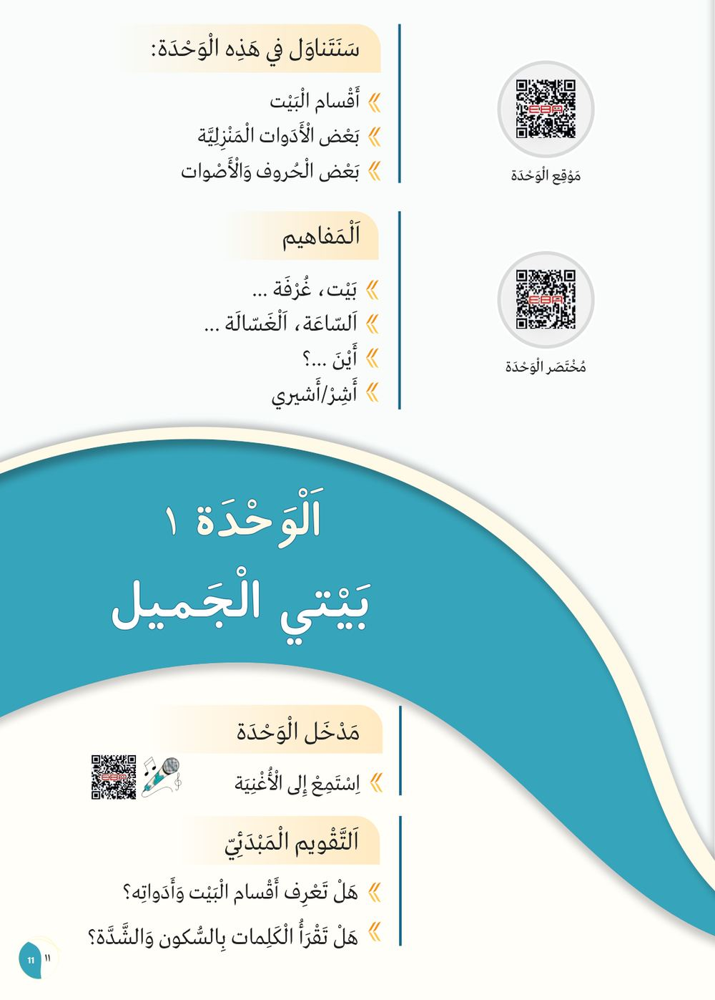
مَوْقِعُ الْوَحْدَةِ


مُخْتَصَرُ الْوَحْدَةِ

## اَلْمَفَاهِيمُ
» بَيْتٌ، غُرْفَةٌ ...
» السَّاعَةُ، الْغَسَّالَةُ ...
» أَيْنَ ...؟
» أَشُزُّ/أُشِيرِي

## مَدْخَلُ الْوَحْدَةِ
 » اِسْتَمِعْ إِلَى الْأَغْنِيَةِ

## التَّقْوِيمُ الْمَبْدَئِيُّ
» هَلْ تَعْرِفُ أَقْسَامَ الْبَيْتِ وَأَدَوَاتِهِ؟

<!-- sayfa 11 -->

# اسْمَعْ

١. أُنْظُرْ إِلَى الصُّوَرِ، وَلَاحِظْ مُحْتَوَاهَا.

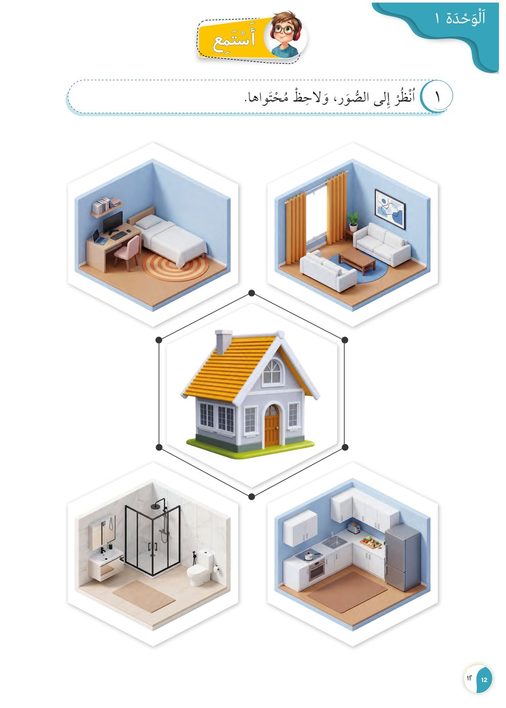

<!-- sayfa 12 -->

# ٢ . إِسْتَمِعْ إِلَى الْحِوَارِ، وَتَأَمَّلْ مَعْنَاهُ مُسْتَعِينًا بِالصُّوَرِ.

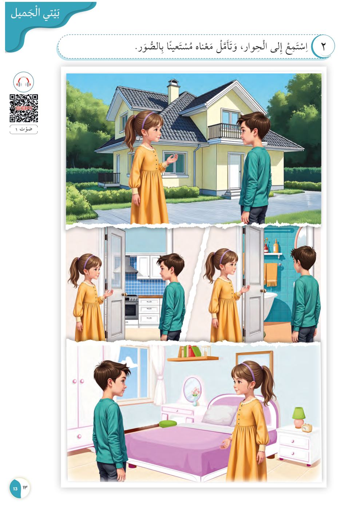

<!-- sayfa 13 -->

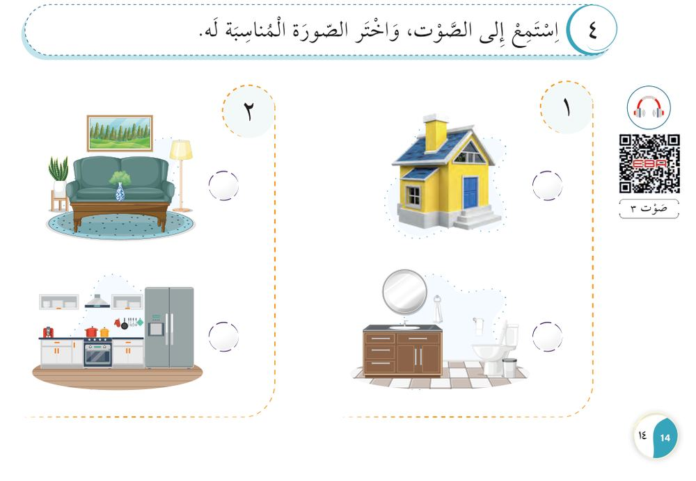 ٣ اسْتَمِعْ إِلَى الْكَلِمَاتِ، وَأَعِدْهَا، ثُمَّ تَأَمَّلْ مَعَانِيَهَا مُسْتَعِينًا بِالصُّوَرِ.

صَوْت ٢

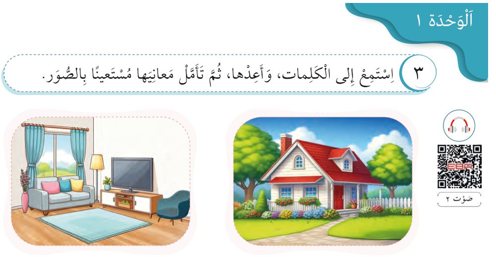 ٤ اسْتَمِعْ إِلَى الصَّوْتِ، وَاخْتَرْ الصُّورَةَ الْمُنَاسِبَةَ لَهُ.

صَوْت ٣

١
٢

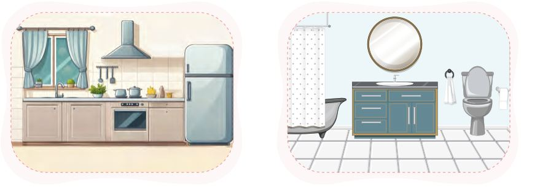
<!-- yer tutucu bulunamadı: sayfa sonuna eklendi -->

<!-- sayfa 14 -->

# ٥ اُنْظُرْ إِلَى الصُّورَةِ، وَاخْتَرْ الصَّوْتَ الْمُنَاسِبَ لَهَا.

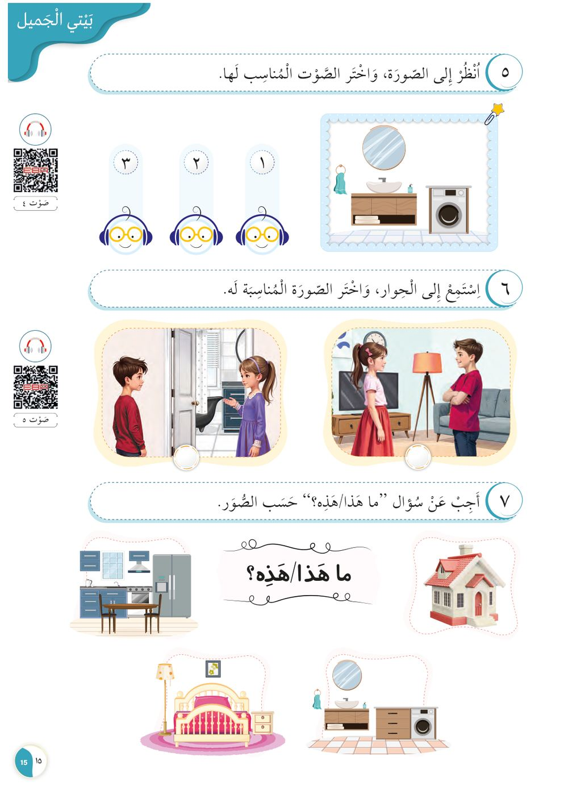

١
٢
٣

صَوْت ٤

# ٦ اِسْتَمِعْ إِلَى الْحِوَارِ، وَاخْتَرْ الصُّورَةَ الْمُنَاسِبَةَ لَهُ.

صَوْت ٥

# ٧ أَجِبْ عَنْ سُؤَالِ "مَا هَذَا/هَذِهِ؟" حَسَبَ الصُّوَرِ.


مَا هَذَا/هَذِهِ؟

<!-- sayfa 15 -->

# أكتب

١. إِسْتَمِعْ، وَأَعِدْ.

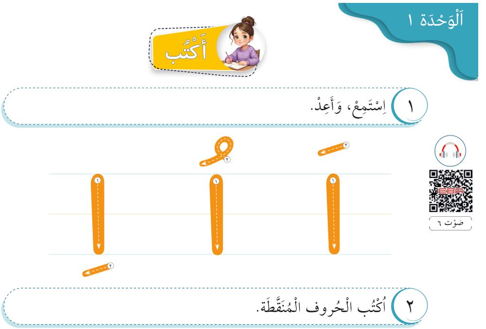

٢. أُكْتُبِ الْحُرُوفَ الْمُنَقَّطَةَ.


٣. أُكْتُبِ الْحُرُوفَ الْآتِيَةَ فِي الْفَرَاغَاتِ.

أَ
أُ
إِ

<!-- sayfa 16 -->

# ٤ .إِسْتَمِعْ، وَضَعْ دَائِرَةً حَوْلَ الْحُرُوفِ الْمَسْمُوعَةِ.

| | | | |
| :---: | :---: | :---: | :---: |
| 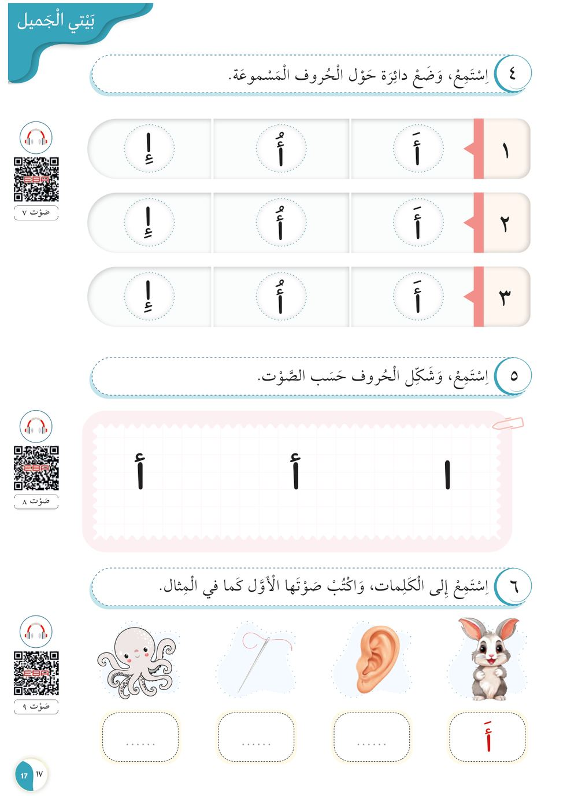 | أُ | أَ | اَ | ١ |
|  | أُ | أَ | اَ | ٢ |
|  | أُ | أَ | اَ | ٣ |

# ٥ .إِسْتَمِعْ، وَشَكِّلِ الْحُرُوفَ حَسَبَ الصَّوْتِ.

| | | |
| :---: | :---: | :---: |
| أُ | أُ | اِ |

# ٦ .إِسْتَمِعْ إِلَى الْكَلِمَاتِ، وَاكْتُبْ صَوْتَهَا الْأَوَّلَ كَمَا فِي الْمِثَالِ.

| | | | |
| :---: | :---: | :---: | :---: |
|  |  |  |  |
| | | | اَ |

<!-- sayfa 17 -->

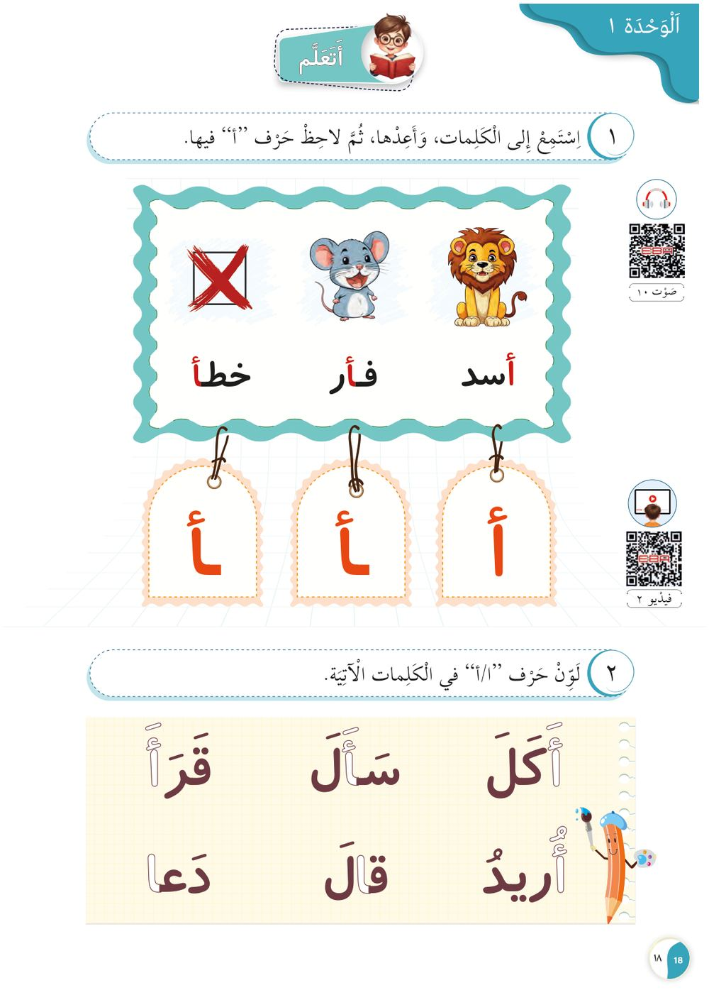

# أَتَعَلَّمُ

1. اِسْتَمِعْ إِلَى الْكَلِمَاتِ، وَأَعِدْهَا، ثُمَّ لَاحِظْ حَرْفَ "أَ" فِيهَا.


أَسَدٌ
فَأْرٌ
خَطَأٌ


أَ
ـأَ
ـأَ

صَوْت ١٠
فِيدْيُو ٢

2. لَوِّنْ حَرْفَ "أَ / إِ" فِي الْكَلِمَاتِ الْآتِيَةِ.


أَكَلَ      سَأَلَ      قَرَأَ
أُرِيدُ      قَالَ      دَعَا

<!-- sayfa 18 -->

# ٣ إِخْتَرْ الْكِتَابَةَ الصَّحِيحَةَ لِحَرْفِ "أ / ا" فِي الْكَلِمَاتِ.

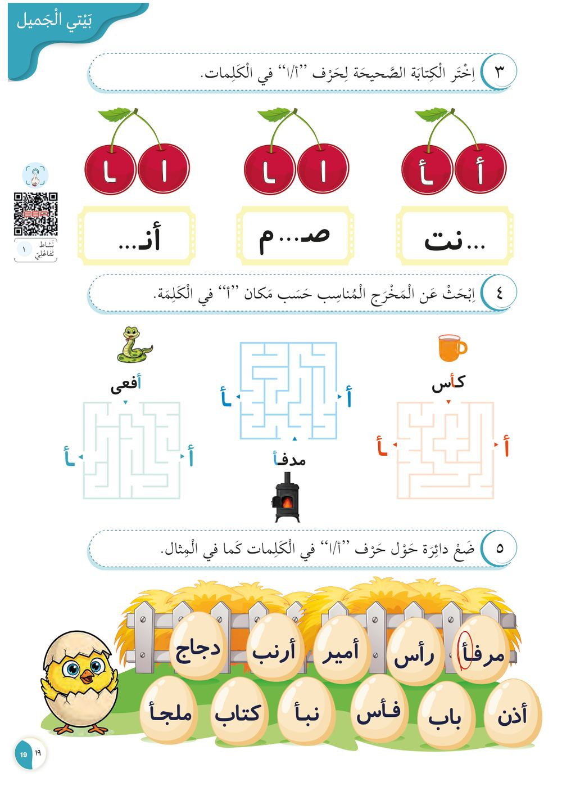

| أ / ا | ا | ا |
| :---: | :---: | :---: |
|  |  |  |
| أ / ا | ا | ا |
| ...نت | ص...م | أ... |

# ٤ ابْحَثْ عَنِ الْمَخْرَجِ الْمُنَاسِبِ حَسَبَ مَكَانِ "أ" فِي الْكَلِمَةِ.


أفعى


مدفأ


كَأْس


# ٥ ضَعْ دَائِرَةً حَوْلَ حَرْفِ "أ / ا" فِي الْكَلِمَاتِ كَمَا فِي الْمِثَالِ.


| مرفأ | رأس | أمير | أرنب | دجاج |
| :---: | :---: | :---: | :---: | :---: |
| | | | | |
| أذن | فأس | نبأ | كتاب | ملجأ |

<!-- sayfa 19 -->

# أَكْتُبُ

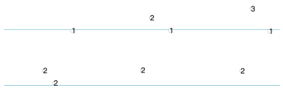
١. اِسْتَمِعْ، وَأَعِدْ.

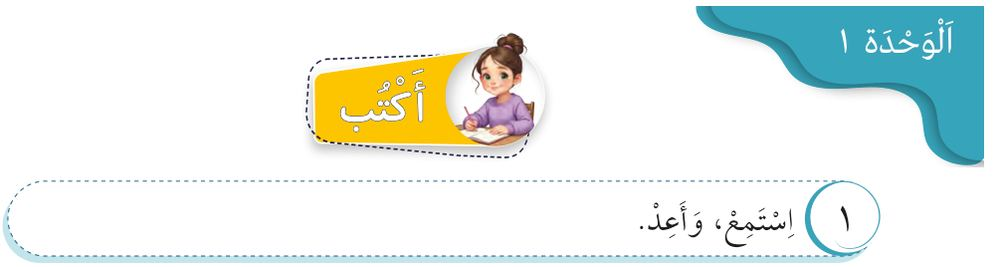
بُ
بِ
بَ

صَوْت ١١ 


٢. أَكْتُبُ الْحُرُوفَ الْمُنَقَّطَةَ.


بُ بِ بَ بُ بِ بَ بُ بِ بَ

فِيدْيُو ٣ 
بُ بِ بَ بُ بِ بَ بُ بِ بَ


٣. أَكْتُبُ الْحُرُوفَ الْآتِيَةَ فِي الْفَرَاغَاتِ.

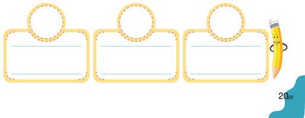
بَ
بُ
بِ

<!-- sayfa 20 -->

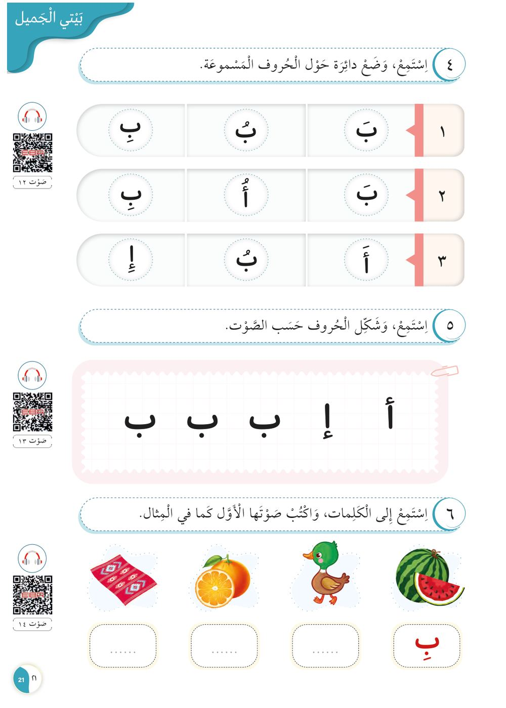
٤. إِسْتَمِعْ، وَضَعْ دَائِرَةً حَوْلَ الْحُرُوفِ الْمَسْمُوعَةِ.

| | | | |
| :---: | :---: | :---: | :---: |
| جُ | بَ | بَ | ١ |
| جُ | أَ | بَ | ٢ |
| اِ | بَ | أَ | ٣ |


٥. إِسْتَمِعْ، وَشَكِّلِ الْحُرُوفَ حَسَبَ الصَّوْتِ.

أ  إِ  ب  ب  ب  ب


٦. إِسْتَمِعْ إِلَى الْكَلِمَاتِ، وَاكْتُبْ صَوْتَهَا الْأَوَّلَ كَمَا فِي الْمِثَالِ.

(Görseldeki nesneler: Halı, Portakal, Ördek, Karpuz)

<!-- sayfa 21 -->

# أَتَعَلَّمُ

1. اسْتَمِعْ إِلَى الْكَلِمَاتِ، وَأَعِدْهَا، ثُمَّ لَاحِظْ حَرْفَ "ب" فِيهَا.

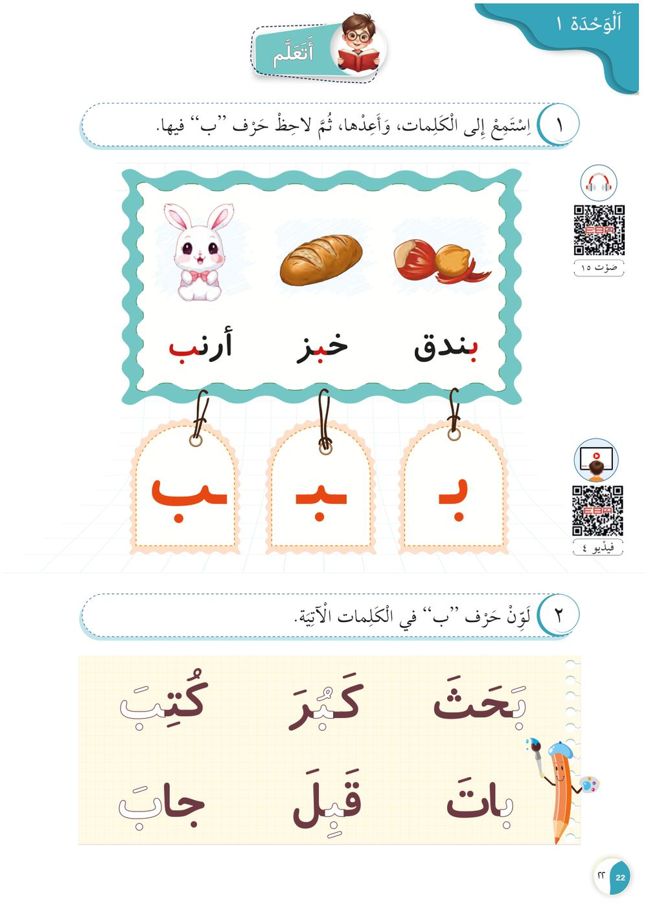

بُنْدُقٌ      خُبْزٌ      أَرْنَبٌ

ب      ـبـ      بـ

صَوْت ١٥
فِيدْيُو ٤

2. لَوِّنْ حَرْفَ "ب" فِي الْكَلِمَاتِ الْآتِيَةِ.

بَحَثَ      كَبُرَ      كُتِبَ
بَاتَ      قَبْلَ      جَابَ

<!-- sayfa 22 -->

# ٣ إِخْتَرْ الْكِتَابَةَ الصَّحِيحَةَ لِحَرْفِ "ب" فِي الْكَلِمَاتِ.

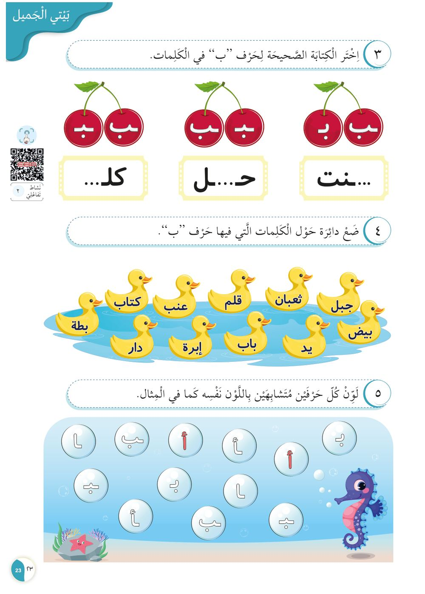

...نت
ح...ل
كل...

# ٤ ضَعْ دَائِرَةً حَوْلَ الْكَلِمَاتِ الَّتِي فِيهَا حَرْفُ "ب".

بَطَّة
كِتَاب
عِنَب
قَلَم
ثُعْبَان
جَبَل
بَيْض
يَد
بَاب
إِبْرَة
دَار

# ٥ لَوِّنْ كُلَّ حَرْفَيْنِ مُتَشَابِهَيْنِ بِاللَّوْنِ نَفْسِهِ كَمَا فِي الْمِثَالِ.

ل ب أ ل پ أ ل پ ل أ ب پ

<!-- sayfa 23 -->

# اسْمَعْ

1. 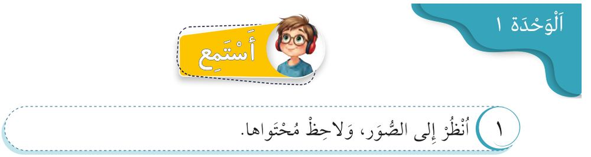 أُنْظُرْ إِلَى الصُّوَرِ، وَلَاحِظْ مُحْتَوَاهَا.

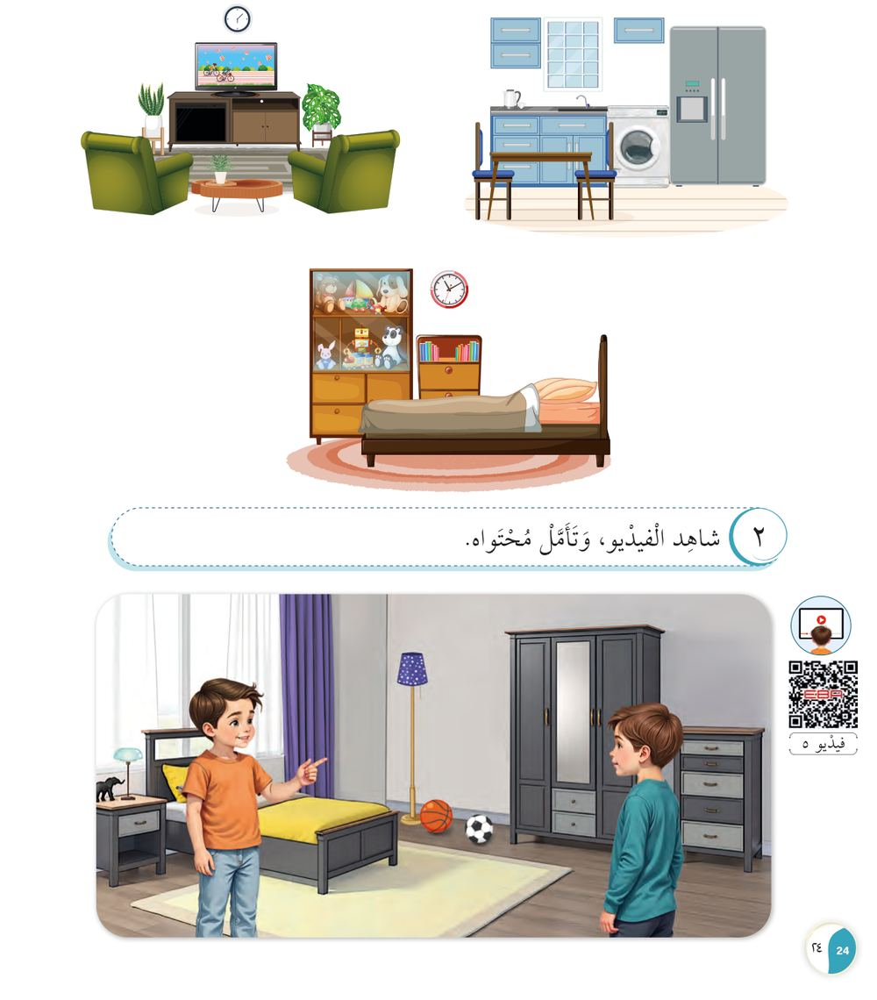

2. شَاهِدِ الْفِيدْيُو، وَتَأَمَّلْ مُحْتَوَاهُ.


فِيدْيُو

<!-- sayfa 24 -->

# ٣ اسْتَمِعْ إِلَى الْكَلِمَاتِ، وَأَعِدْهَا، ثُمَّ تَأَمَّلْ مَعَانِيَهَا مُسْتَعِينًا بِالصُّوَرِ.

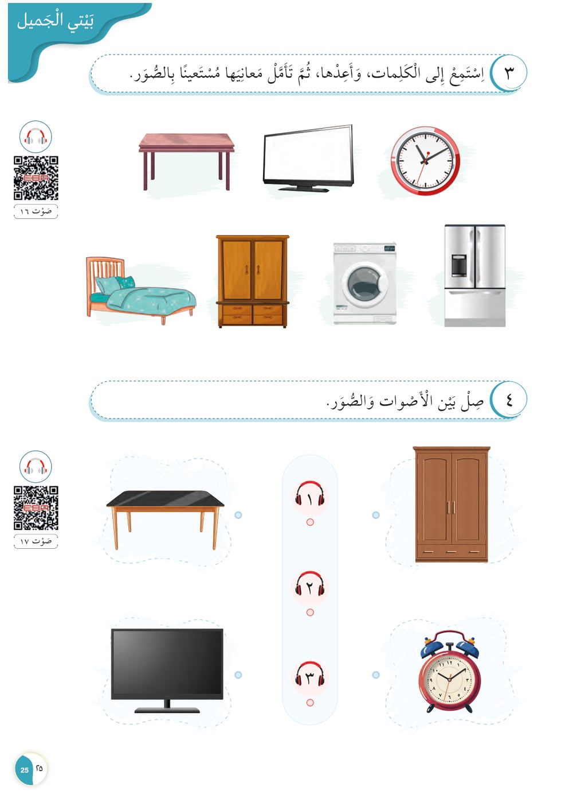

صَوْت ١٦

# ٤ صِلْ بَيْنَ الْأَصْوَاتِ وَالصُّوَرِ.


صَوْت ١٧

<!-- sayfa 25 -->

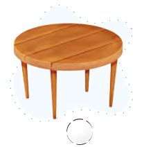 ٥. اِسْتَمِعْ إِلَى الصَّوْتِ، وَحَدِّدِ الْأَشْيَاءَ الْمَذْكُورَةَ فِيهِ كَمَا فِي الْمِثَالِ.

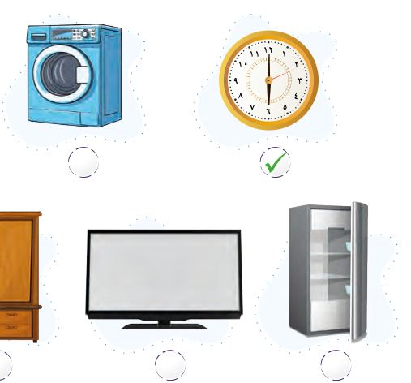


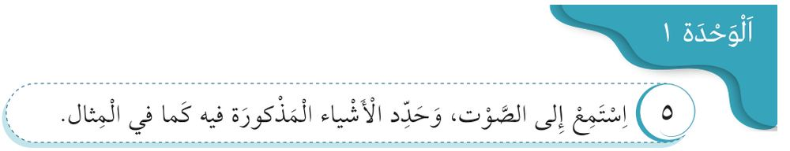 صَوْت ١٨

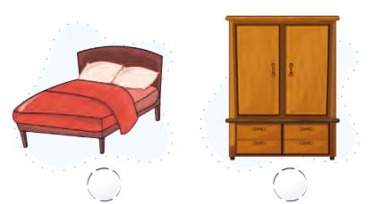 ٦. اِسْتَمِعْ إِلَى الْجُمْلَةِ، وَاخْتَرْ الصُّورَةَ الْمُنَاسِبَةَ لَهَا.

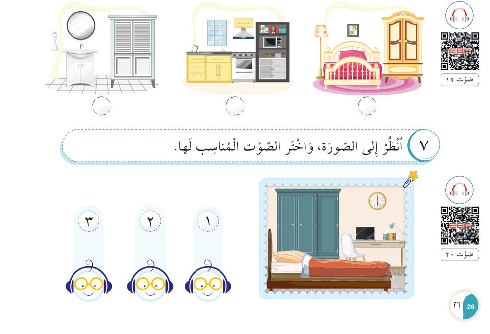 صَوْت ١٩

 ٧. اُنْظُرْ إِلَى الصُّورَةِ، وَاخْتَرْ الصَّوْتَ الْمُنَاسِبَ لَهَا.

 صَوْت ٢٠

<!-- sayfa 26 -->

# ٨ .أُنْظُرْ إِلَى الصُّورَةِ، وَاخْتَرْ الصَّوْتَ الْمُنَاسِبَ لَهَا.

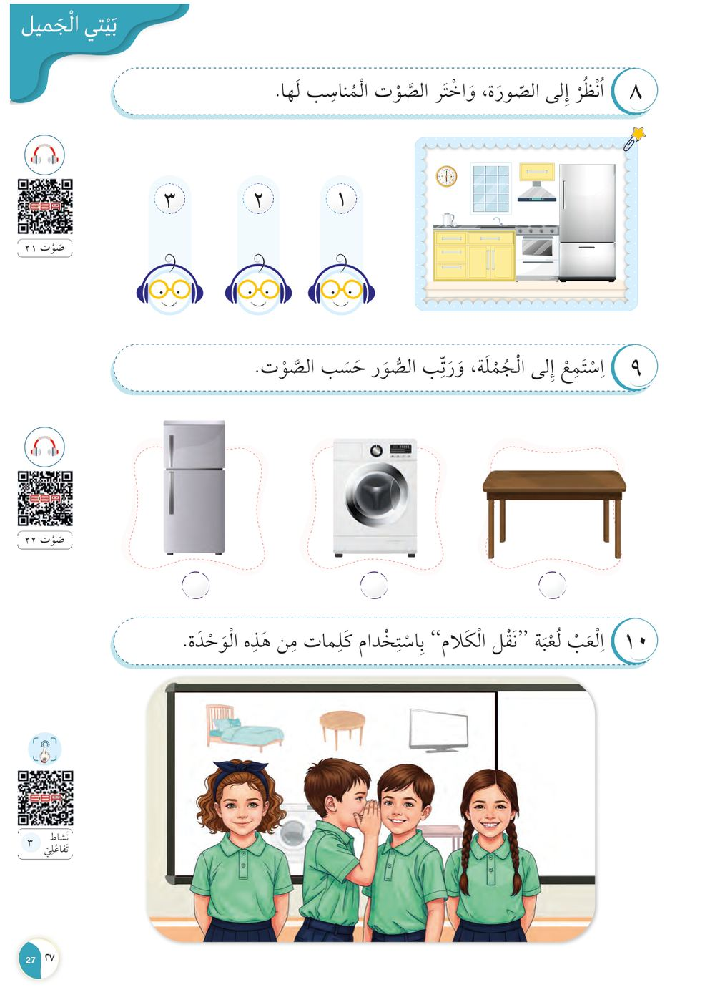

صَوْت ٢١

# ٩ .اِسْتَمِعْ إِلَى الْجُمْلَةِ، وَرَتِّبِ الصُّوَرَ حَسَبَ الصَّوْتِ.

صَوْت ٢٢

# ١٠ .الْعَبْ لُعْبَةَ "نَقْلِ الْكَلَامِ" بِاسْتِخْدَامِ كَلِمَاتٍ مِنْ هَذِهِ الْوَحْدَةِ.


نَشَاطٌ تَفَاعُلِيٌّ ٣

<!-- sayfa 27 -->

# أَكْتُبُ

١. اِسْتَمِعْ، وَأَعِدْ.

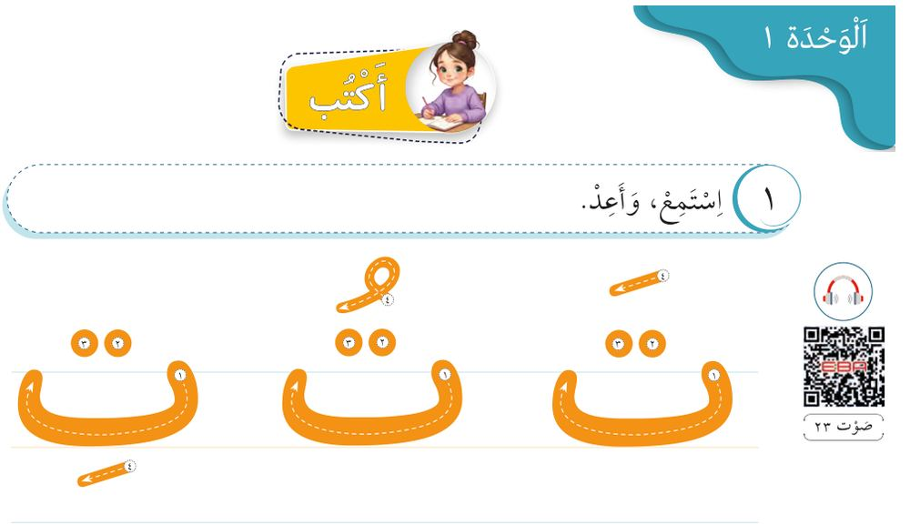


٢. أَكْتُبُ الْحُرُوفَ الْمُنَقَّطَةَ.


٣. أَكْتُبُ الْحُرُوفَ الْآتِيَةَ فِي الْفَرَاغَاتِ.

<!-- sayfa 28 -->

# ٤
إِسْتَمِعْ، وَضَعْ دَائِرَةً حَوْلَ الْحُرُوفِ الْمَسْمُوعَةِ.

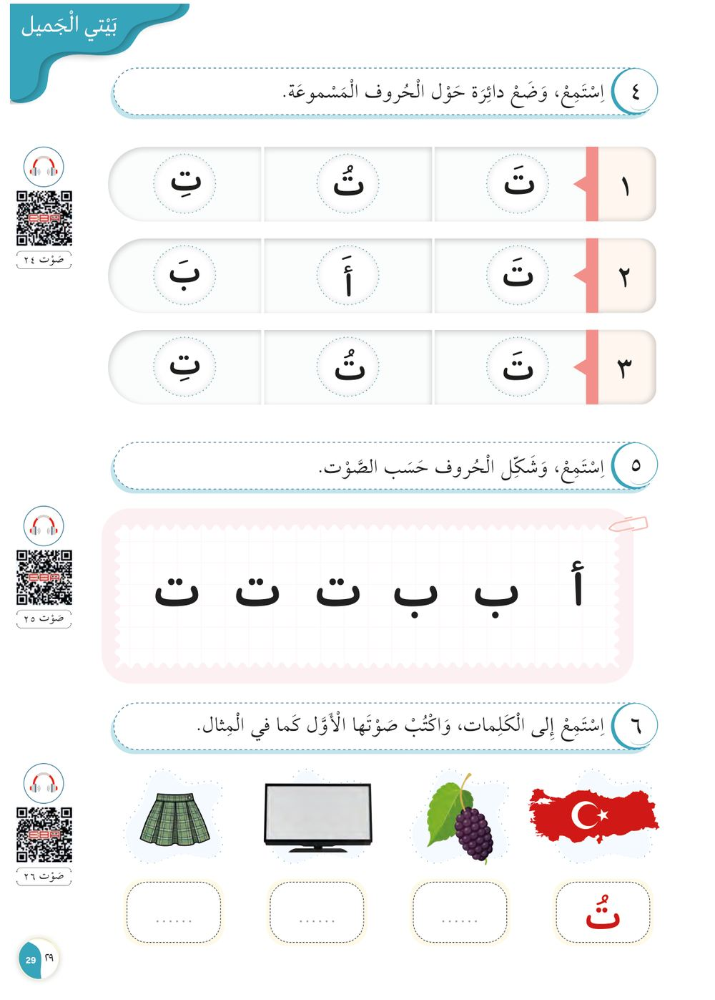
| | | | |
| :---: | :---: | :---: | :---: |
| تِ | تُ | تَ | ١ |
| بَ | أ | تَ | ٢ |
| تِ | تُ | تَ | ٣ |

# ٥
إِسْتَمِعْ، وَشَكِّلِ الْحُرُوفَ حَسَبَ الصَّوْتِ.


أ  ب  ب  ت  ت  ت  ت

# ٦
إِسْتَمِعْ إِلَى الْكَلِمَاتِ، وَاكْتُبْ صَوْتَهَا الْأَوَّلَ كَمَا فِي الْمِثَالِ.


(Resimler: Etek, Televizyon, Üzüm, Türkiye Bayrağı)

<!-- sayfa 29 -->

# أَتَعَلَّمُ

1. اِسْتَمِعْ إِلَى الْكَلِمَاتِ، وَأَعِدْهَا، ثُمَّ لَاحِظْ حَرْفَ "ت" فِيهَا.

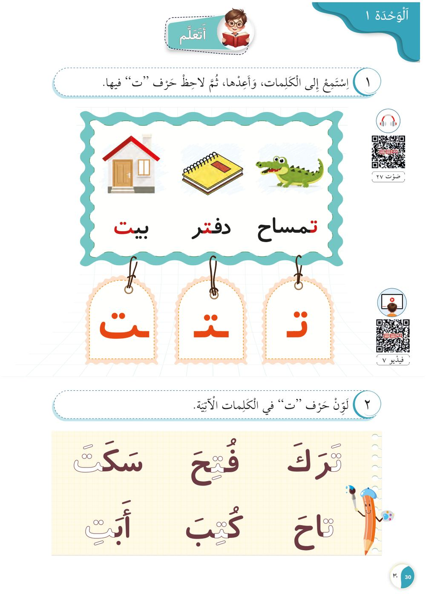

تمساح $\quad$ دفتر $\quad$ بيت

ت $\quad$ ـتـ $\quad$ تـ

صَوْت ٢٧
فِيدْيُو ٧

2. لَوِّنْ حَرْفَ "ت" فِي الْكَلِمَاتِ الْآتِيَةِ.

تَرَكَ $\quad$ فُتِحَ $\quad$ سَكَتَ
تَابَ $\quad$ كُتِبَ $\quad$ تَاخَ

<!-- sayfa 30 -->

# ٣ ضَعِ الشَّكْلَ الصَّحِيحَ لِحَرْفِ "ت" فِي الْفَرَاغِ كَمَا فِي الْمِثَالِ.

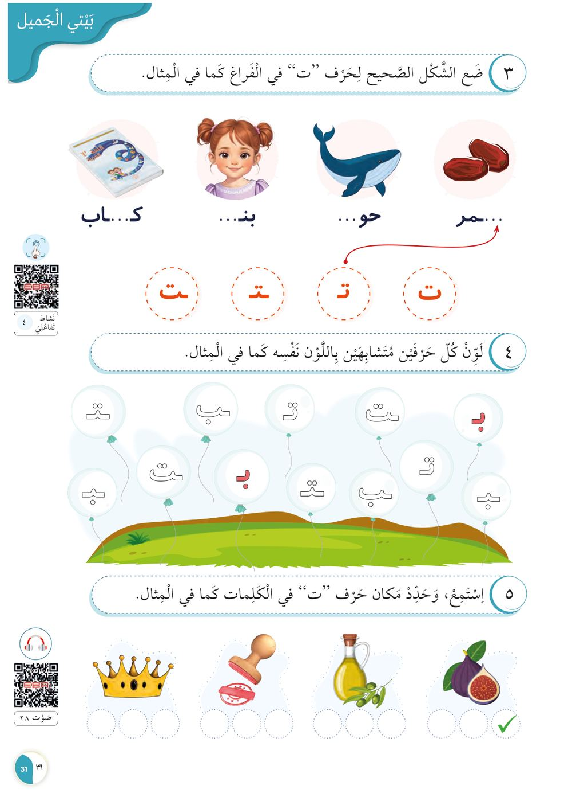

كـ...ـاب
بنت...
حو...
...مر

تـ
تـ
ـتـ
ـت

# ٤ لَوِّنْ كُلَّ حَرْفَيْنِ مُتَشَابِهَيْنِ بِاللَّوْنِ نَفْسِهِ كَمَا فِي الْمِثَالِ.

بـ
تـ
لـ
تـ
بـ
تـ
بـ
تـ
بـ
لـ
بـ
تـ

# ٥ اسْتَمِعْ، وَحَدِّدْ مَكَانَ حَرْفِ "ت" فِي الْكَلِمَاتِ كَمَا فِي الْمِثَالِ.


تـ
تـ
ـتـ
ـتـ
بـ
بـ
ـبـ
ـبـ
تـ
تـ
ـتـ
ـتـ
بـ
بـ
ـبـ
ـبـ

<!-- sayfa 31 -->

# أَكْتُبُ

1. اِسْتَمِعْ، وَأَعِدْ.

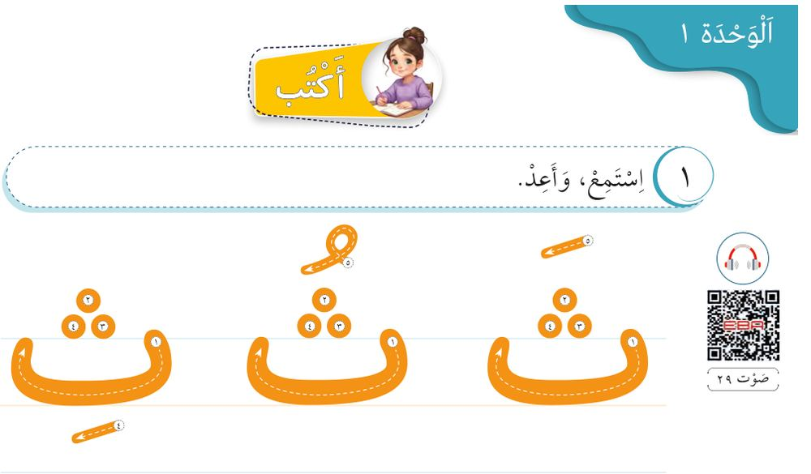


2. أَكْتُبُ الْحُرُوفَ الْمُنَقَّطَةَ.


3. أَكْتُبُ الْحُرُوفَ الْآتِيَةَ فِي الْفَرَاغَاتِ.

<!-- sayfa 32 -->

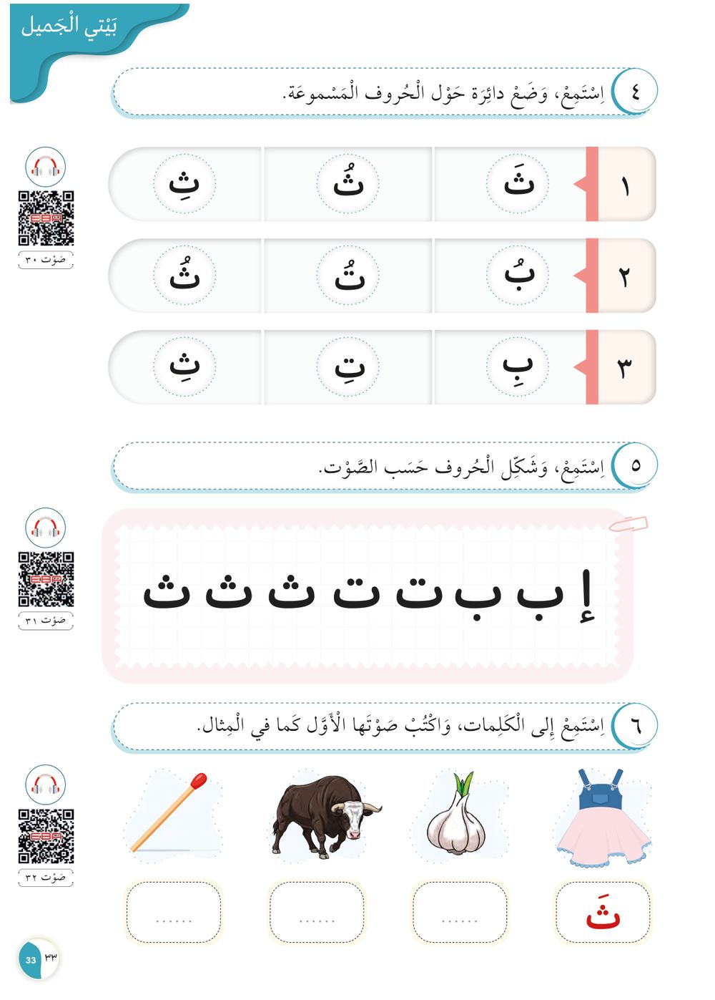
٤ .إِسْتَمِعْ، وَضَعْ دَائِرَةً حَوْلَ الْحُرُوفِ الْمَسْمُوعَةِ.

| | | | |
| :---: | :---: | :---: | :---: |
| ثَ | ثُ | تَ | ١ |
| ثُ | تُ | بَ | ٢ |
| ثَ | تَ | بَ | ٣ |


٥ .إِسْتَمِعْ، وَشَكِّلِ الْحُرُوفَ حَسَبَ الصَّوْتِ.

إِ بَ تْ ثُ ثَ ثُ ثَ


٦ .إِسْتَمِعْ إِلَى الْكَلِمَاتِ، وَاكْتُبْ صَوْتَهَا الْأَوَّلَ كَمَا فِي الْمِثَالِ.


<!-- sayfa 33 -->

# أَتَعَلَّمُ

1. اِسْتَمِعْ إِلَى الْكَلِمَاتِ، وَأَعِدْهَا، ثُمَّ لَاحِظْ حَرْفَ "ث" فِيهَا.

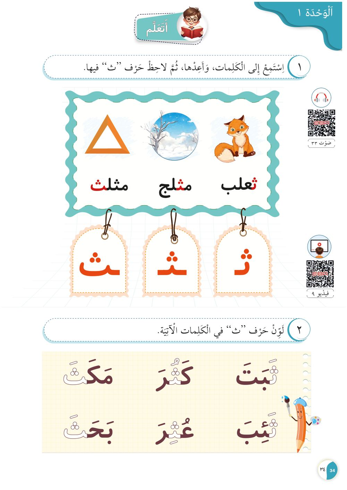

ثَعْلَبٌ  مُثَلَّجٌ  مُثَلَّثٌ

ثـ    ـثـ    ث

صَوْت ٣٣
فِيدْيُو ٩

2. لَوِّنْ حَرْفَ "ث" فِي الْكَلِمَاتِ الْآتِيَةِ.


بَتَّ    كَثَّرَ    مَكَّثَ
بَثَّ    غُثَّ    عَبَّثَ

<!-- sayfa 34 -->

# ٣ حَدِّدِ الْحَرْفَ الْمُخْتَلِفَ فِي كُلِّ مَجْمُوعَةٍ.

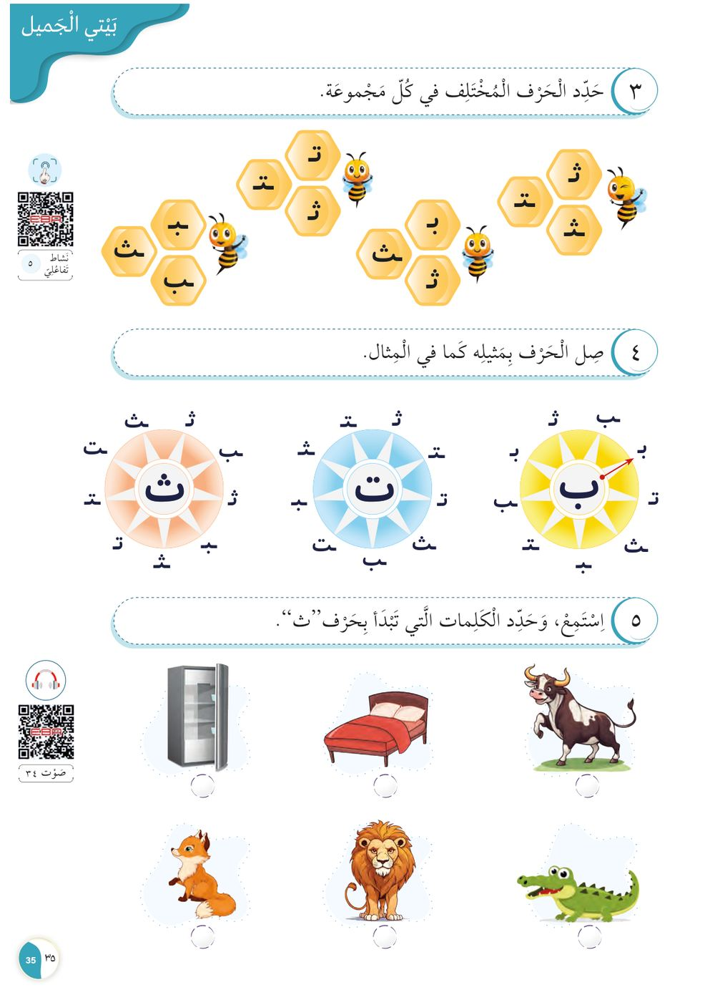

# ٤ صِلِ الْحَرْفَ بِمَثِيلِهِ كَمَا فِي الْمِثَالِ.


# ٥ اسْتَمِعْ، وَحَدِّدِ الْكَلِمَاتِ الَّتِي تَبْدَأُ بِحَرْفِ "ث".


<!-- sayfa 35 -->

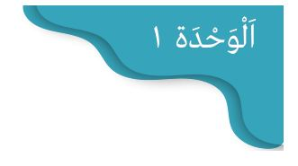
تَنْمِيَةُ الْمَهَارَاتِ اللُّغَوِيَّةِ

# هَلْ هَذَا/هَذِهِ...؟

1. اِسْتَمِعْ إِلَى الْجُمَلِ، وَتَأَمَّلْ مَعَانِيَهَا مُسْتَعِينًا بِالصُّوَرِ.


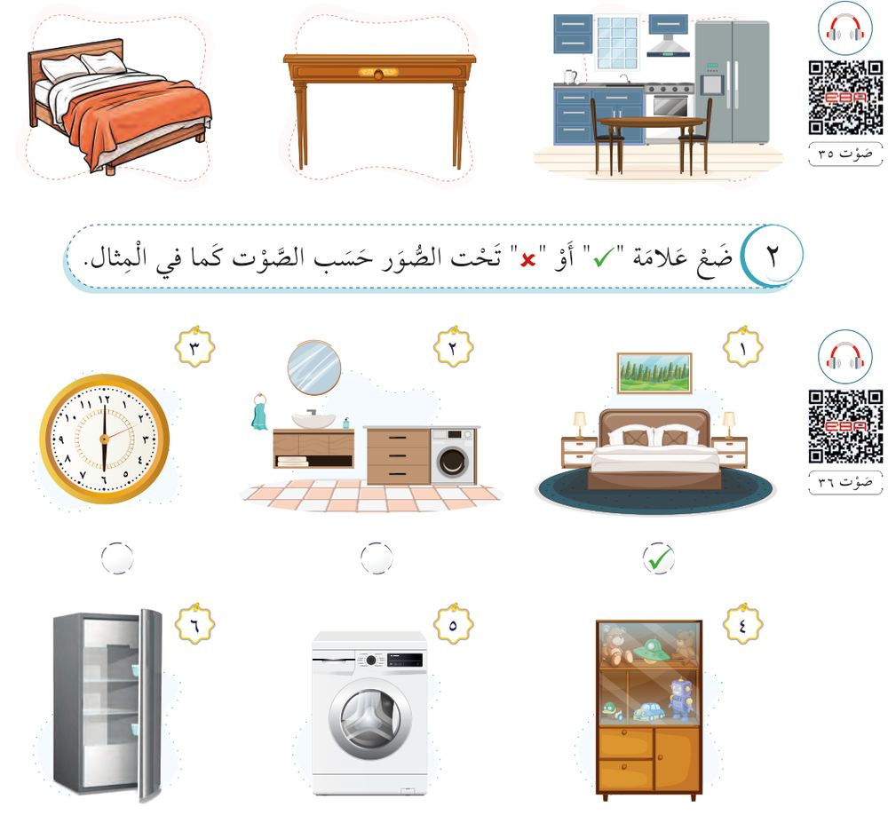


2. ضَعْ عَلَامَةَ "✓" أَوْ "✗" تَحْتَ الصُّوَرِ حَسَبَ الصَّوْتِ كَمَا فِي الْمِثَالِ.


1. 
   ✓

2. 
   ◯

3. 
   ◯

4. 
   ◯

5. 
   ◯

6. 
   ◯

<!-- sayfa 36 -->

# أَيْنَ...؟

٣. اِسْتَمِعْ إِلَى الْحِوَارَاتِ، وَتَأَمَّلْ مَعَانِيَهَا مُسْتَعِينًا بِالصُّوَرِ.

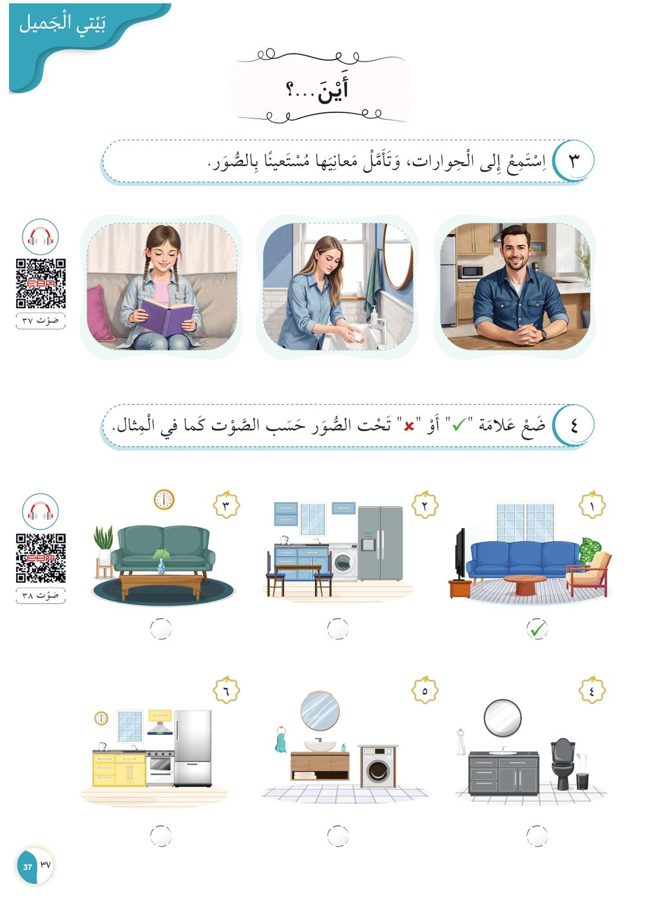


٤. ضَعْ عَلَامَةَ "✓" أَوْ "✗" تَحْتَ الصُّوَرِ حَسَبَ الصَّوْتِ كَمَا فِي الْأَمْثَالِ.

١

✓

٢


٣


٤


٥


٦


<!-- sayfa 37 -->

# أَشِرْ/ أَشِيرِي

1. اِسْتَمِعْ إِلَى الْجُمْلَةِ، وَأَعِدْهَا، ثُمَّ تَأَمَّلْ مَعْنَاهَا مُسْتَعِينًا بِالصُّورَةِ.

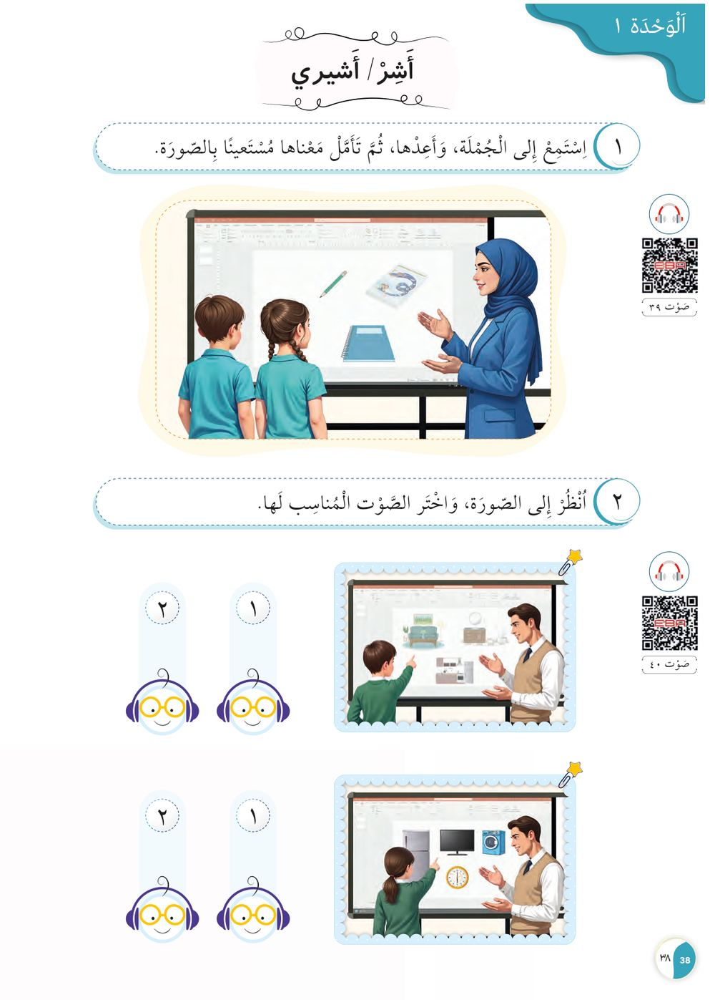

2. أَنْظُرْ إِلَى الصُّورَةِ، وَاخْتَرِ الصَّوْتَ الْمُنَاسِبَ لَهَا.


<!-- sayfa 38 -->

# ٣ اسْتَمِعْ إِلَى الصَّوْتِ، وَاخْتَرْ الصُّورَةَ الْمُنَاسِبَةَ لَهُ.

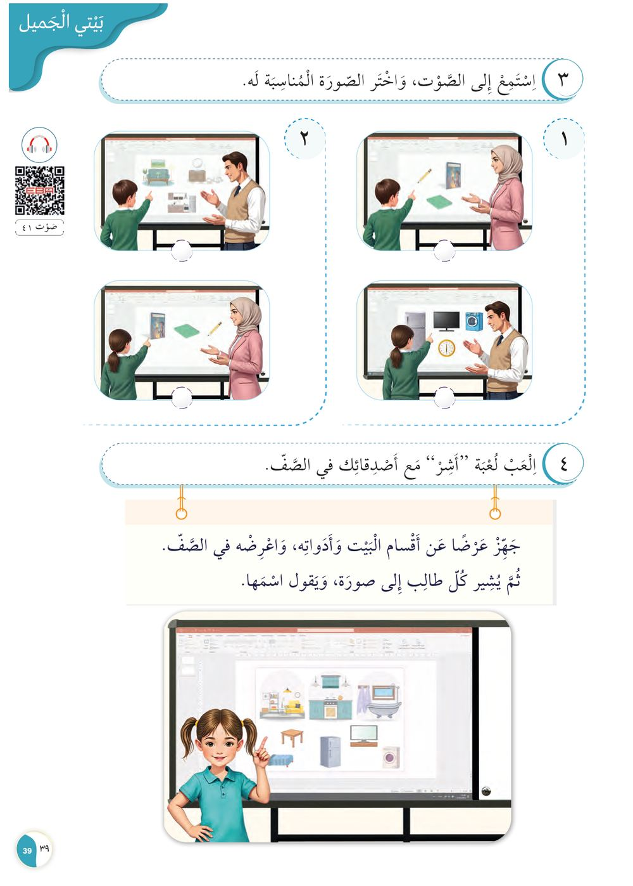

١


٢


٤ الْعَبْ لُعْبَةَ "أَشِرْ" مَعَ أَصْدِقَائِكَ فِي الصَّفِّ.


جَهِّزْ عَرْضًا عَنْ أَقْسَامِ الْبَيْتِ وَأَدَوَاتِهِ، وَاعْرِضْهُ فِي الصَّفِّ. ثُمَّ يُشِيرُ كُلُّ طَالِبٍ إِلَى صُورَةٍ، وَيَقُولُ اسْمَهَا.

<!-- sayfa 39 -->

# أكتب

١. اسْتَمِعْ، وَأَعِدْ.

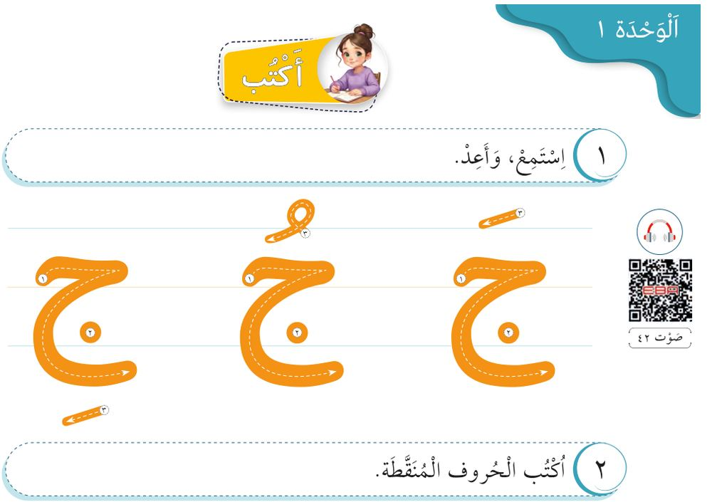


صَوْت ٤٢

٢. اُكْتُبِ الْحُرُوفَ الْمُنَقَّطَةَ.


فِيدْيُو ١٠

٣. اُكْتُبِ الْحُرُوفَ الْآتِيَةَ فِي الْفَرَاغَاتِ.

<!-- sayfa 40 -->

# ٤ .إِسْتَمِعْ، وَضَعْ دَائِرَةً حَوْلَ الْحُرُوفِ الْمَسْمُوعَةِ.

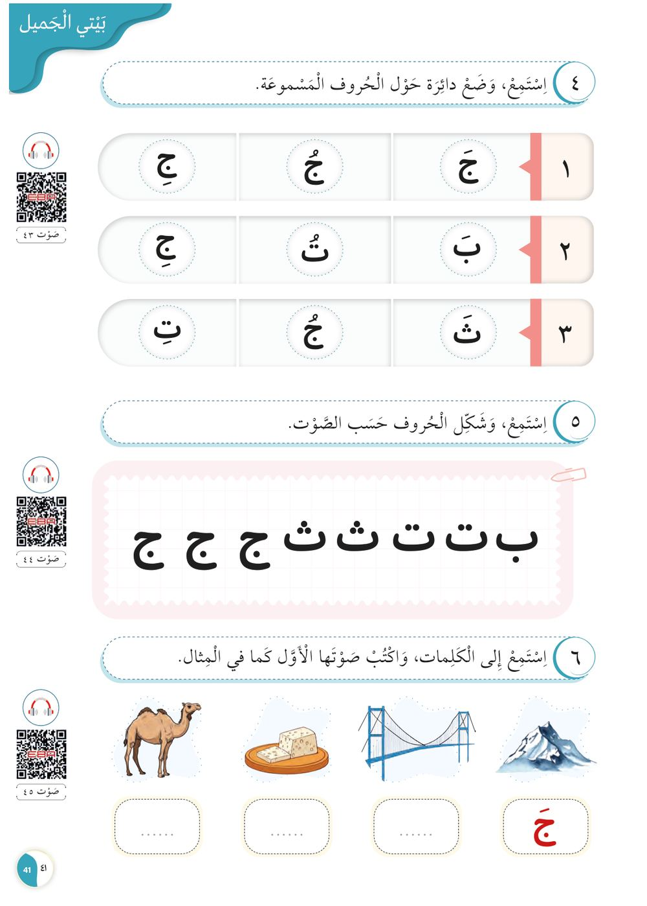

| | | | |
| :---: | :---: | :---: | :---: |
| جِ | جُ | جَ | ١ |
| جِ | تُ | بَ | ٢ |
| تَ | جُ | ثَ | ٣ |

# ٥ .إِسْتَمِعْ، وَشَكِّلِ الْحُرُوفَ حَسَبَ الصَّوْتِ.


ب ت ت ث ث ج ج ج

# ٦ .إِسْتَمِعْ إِلَى الْكَلِمَاتِ، وَاكْتُبْ صَوْتَهَا الْأَوَّلَ كَمَا فِي الْمِثَالِ.


<!-- sayfa 41 -->

# أَتَعَلَّمُ

١. اِسْتَمِعْ إِلَى الْكَلِمَاتِ، وَأَعِدْهَا، ثُمَّ لَاحِظْ حَرْفَ "ج" فِيهَا.

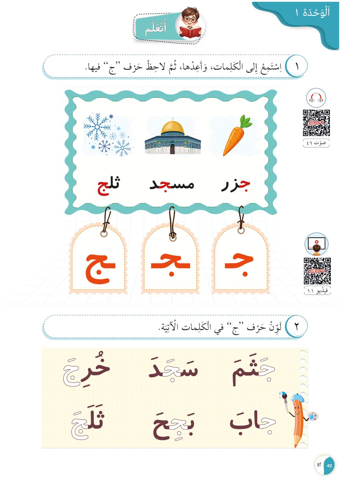

صَوْت ٤٦
فِيدْيُو ١١

٢. لَوِّنْ حَرْفَ "ج" فِي الْكَلِمَاتِ الْآتِيَةِ.

جَثَمَ     سَجَدَ     خَرَجَ
جَابَ     بَحَّ     ثَلْجَ

<!-- sayfa 42 -->

# ٣ ضَعِ الشَّكْلَ الصَّحِيحَ لِحَرْفِ "ج" فِي الْفَرَاغِ.

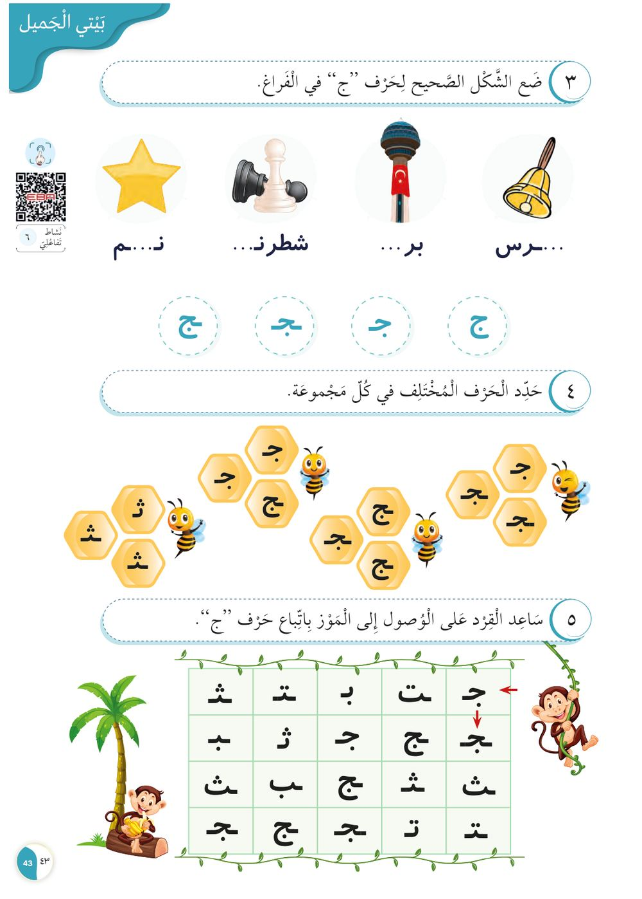

...رس ج
بر... ج
شطرن... ج
ن...م ج

# ٤ حَدِّدِ الْحَرْفَ الْمُخْتَلِفَ فِي كُلِّ مَجْمُوعَةٍ.

ج ج ج ج
ث ث ج
ج ج ج

# ٥ سَاعِدِ الْقِرْدَ عَلَى الْوُصُولِ إِلَى الْمَوْزِ بِاتِّبَاعِ حَرْفِ "ج".

| | | | | |
| :---: | :---: | :---: | :---: | :---: |
| ث | ت | ب | ت | ج |
| ج | ث | ج | ج | ج |
| ث | ب | ج | ث | ث |

<!-- sayfa 43 -->

# أَكْتُبُ

١. اِسْتَمِعْ، وَأَعِدْ.


حَ  حُ  حِ

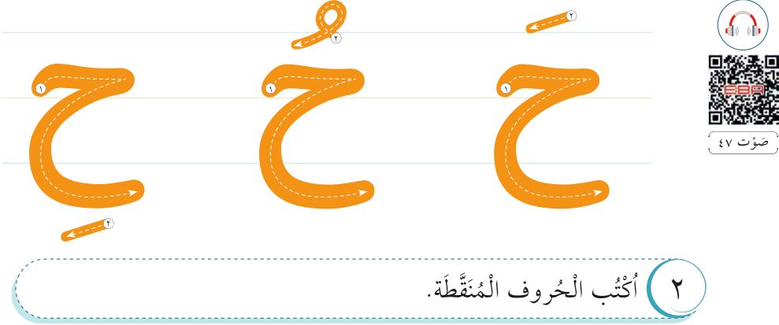
حَ  حُ  حِ  حَ  حُ  حِ
حَ  حُ  حِ  حَ  حُ  حِ


حَ  حُ  حِ  حَ  حُ  حِ
حَ  حُ  حِ  حَ  حُ  حِ

٢. اُكْتُبِ الْحُرُوفَ الْمُنْطَقَةَ.


حَ  حُ  حِ  حَ  حُ  حِ
حَ  حُ  حِ  حَ  حُ  حِ

٣. اُكْتُبِ الْحُرُوفَ الْآتِيَةَ فِي الْفَرَاغَاتِ.


حَ
حُ
حِ

<!-- sayfa 44 -->

# ٤
إِسْتَمِعْ، وَضَعْ دَائِرَةً حَوْلَ الْحُرُوفِ الْمَسْمُوعَةِ.


| | | | |
| :---: | :---: | :---: | :---: |
| حَ | حُ | حِ | ١ |
| حَ | جُ | جِ | ٢ |
| حِ | جِ | تَ | ٣ |

# ٥
إِسْتَمِعْ، وَشَكِّلِ الْحُرُوفَ حَسَبَ الصَّوْتِ.


أ ب ت ث ج ح ح ح ح

# ٦
إِسْتَمِعْ إِلَى الْكَلِمَاتِ، وَاكْتُبْ صَوْتَهَا الْأَوَّلَ كَمَا فِي الْمِثَالِ.


| | | | |
| :---: | :---: | :---: | :---: |
| ![atletik ayakkabı] | ![çukur] | ![süt] | ![at] |
| [ ] | [ ] | [ ] | [ ح ] |

صَوْت ٤٨
صَوْت ٤٩
صَوْت ٥٠

<!-- sayfa 45 -->

# أَتَعَلَّمُ

1. اِسْتَمِعْ إِلَى الْكَلِمَاتِ، وَأَعِدْهَا، ثُمَّ لَاحِظْ حَرْفَ "ح" فِيهَا.


صَوْت ٥١
فِيدْيُو ١٣

2. لَوِّنْ حَرْفَ "ح" فِي الْكَلِمَاتِ الْآتِيَةِ.

حَمَلَ      سَحَبَ      فَتَحَ
حَاجَ      بَحَثَ      بَاحَ

<!-- sayfa 46 -->

# ٣ لَوِّنْ حَرْفَ "ح".


# ٤ أَرْسُمُ الْأَشْكَالَ الْمُنَاسِبَةَ حَوْلَ الْحُرُوفِ كَمَا فِي الْمِثَالِ.

ب  ت  ث  ج  ح


# ٥ اِسْتَمِعْ، وَحَدِّدْ مَكَانَ حَرْفِ "ح" فِي الْكَلِمَاتِ كَمَا فِي الْمِثَالِ.


<!-- sayfa 47 -->

# أَكْتُبُ

1. اِسْتَمِعْ، وَأَعِدْ.


صَوْت ٥٣

2. اُكْتُبِ الْحُرُوفَ الْمُنَقَّطَةَ.


فِيدْيُو ١٤

3. اُكْتُبِ الْحُرُوفَ الْآتِيَةَ فِي الْفَرَاغَاتِ.

<!-- sayfa 48 -->

# ٤ .إِسْتَمِعْ، وَضَعْ دَائِرَةً حَوْلَ الْحُرُوفِ الْمَسْمُوعَةِ.


| | | | |
| :---: | :---: | :---: | :---: |
| خِ | خُ | خَ | ١ |
| خَ | حِ | حَ | ٢ |
| حِ | جِ | خِ | ٣ |

# ٥ .إِسْتَمِعْ، وَشَكِّلِ الْحُرُوفَ حَسَبَ الصَّوْتِ.


ب ت ث ج ح خ خ خ

# ٦ .إِسْتَمِعْ إِلَى الْكَلِمَاتِ، وَاكْتُبْ صَوْتَهَا الْأَوَّلَ كَمَا فِي الْأَمْثَالِ.


(Görseldeki nesneler: hortum, kuzu, salatalık, kadın)

<!-- sayfa 49 -->

# أَتَعَلَّمُ

1. اِسْتَمِعْ إِلَى الْكَلِمَاتِ، وَأَعِدْهَا، ثُمَّ لَاحِظْ حَرْفَ "خ" فِيهَا.


خبز
نخلة
بطّيخ

خ
ـخـ
خـ

صَوْت ٥٧
فِيدْيُو ١٥

2. لَوِّنْ حَرْفَ "خ" فِي الْكَلِمَاتِ الْآتِيَةِ.

خَبَأَ
بَخِلَ
طَبَخَ
حَبَثَ
تَحَنَّ
نَفَخَ

<!-- sayfa 50 -->

# ٣ لَوِّنْ كُلَّ حَرْفَيْنِ مُتَشَابِهَيْنِ بِاللَّوْنِ نَفْسِهِ كَمَا فِي الْمِثَالِ.


# ٤ صِلْ بَيْنَ الْمَجْمُوعَتَيْنِ كَمَا فِي الْمِثَالِ.


# ٥ لَوِّنِ الْحُرُوفَ بِالْأَلْوَانِ الْمُنَاسِبَةِ كَمَا فِي الْمِثَالِ.


نشاط تفاعلي ٨

<!-- sayfa 51 -->

# أَتَحَدَّثُ

1. إِسْتَمِعْ إِلَى الْجُمَلِ، وَأَعِدْهَا، ثُمَّ تَأَمَّلْ مَعَانِيَهَا مُسْتَعِينًا بِالصُّوَرِ.


صَوْت ٥٨

2. إِسْتَمِعْ إِلَى الْحِوَارِ، وَأَعِدْهُ مَعَ صَدِيقِكَ.


صَوْت ٥٩

<!-- sayfa 52 -->

# ٣
إِسْتَمِعْ إِلَى الْحِوَارِ، وَأَعِدْهُ مَعَ صَدِيقِكَ.


صَوْت ٦٠

# ٤
إِسْتَمِعْ إِلَى الْحِوَارِ، وَأَعِدْهُ مَعَ صَدِيقِكَ.


صَوْت ٦١

<!-- sayfa 53 -->

# ٥
إِسْتَمِعْ إِلَى الْحِوَارِ، ثُمَّ تُبَادِلْهُ مَعَ صَدِيقِكَ.


صَوْت ٦٢

# ٦
إِسْتَمِعْ إِلَى الْحِوَارِ، ثُمَّ تُبَادِلْهُ مَعَ صَدِيقِكَ.


صَوْت ٦٣

<!-- sayfa 54 -->

# ٧ اِلْعَبْ لُعْبَةَ "الْكُرَةِ النَّاطِقَةِ" مَعَ أَصْدِقَائِكَ.


يَرْمِي الْمُعَلِّمُ كُرَةً إِلَى أَحَدِ الطُّلَّابِ قَائِلًا لَهُ: "أَيْنَ...؟"، وَيُشِيرُ الطَّالِبُ إِلَى الْأَشْيَاءِ الْمَطْلُوبَةِ، وَيَقُولُ اسْمَهَا، ثُمَّ يَرْمِي الْكُرَةَ إِلَى طَالِبٍ آخَرَ.

# ٨ جَهِّزْ مُلْصَقًا عَنْ أَقْسَامِ بَيْتِكَ، وَاعْرِضْهُ فِي الصَّفِّ.


<!-- sayfa 55 -->

# ٩ اسْتَمِعْ، وَأَكْمِلِ الْحِوَارَ مُسْتَعِينًا بِالصُّورَةِ.


صَوْت ٦٤

# ١٠ جَهِّزْ عَرْضًا عَنِ الْأَشْيَاءِ فِي غُرْفَتِكَ، وَاعْرِضْهُ لِأَصْدِقَائِكَ.


نَشَاطٌ تَفَاعُلِيٌّ ٩

<!-- sayfa 56 -->

# ١١ الْعَبْ لُعْبَةَ "الْمُكَعَّبَ" مَعَ أَصْدِقَائِكَ.

* جَهِّزْ مُكَعَّبًا كَمَا فِي الْمِثَالِ.
* إِرْسِمِ الْمُكَعَّبَ.
* قُلْ جُمْلَةً عَنِ الصُّورَةِ الْعُلْيَا كَمَا فِي الْمِثَالِ.


هَذَا حَمَّامٌ، وَالدُّولَابُ فِي الْحَمَّامِ.

# ١٢ اسْتَمِعْ إِلَى الصَّوْتِ، وَحَدِّدِ الصُّوَرَ الْمَذْكُورَةَ كَمَا فِي الْمِثَالِ.


صَوْت ٦٥

<!-- sayfa 57 -->

١ اسْتَمِعْ، وَأَعِدْ.

# السُّكُونُ

صَوْت ٦٦


أَبْ
تُبْ
بِتْ

٢ اقْرَأِ الْكَلِمَاتِ، وَتَأَمَّلْ.


أَتْ
بَخْ
بِتْ
تَحْتَ
أَثْبَتَتْ

<!-- sayfa 58 -->

# ٣ صِلْ بَيْنَ الْحُرُوفِ وَالْكَلِمَاتِ كَمَا فِي الْمِثَالِ.


بَثَّ
بَخَّ
أَجِبْ
اِبْحَثْ
بَثَّ
اِبْحَثْ
أَجِبْ
بَتَّ
بَخَّ

# ٤ ضَعْ عَلَامَةَ "✓" لِلْكِتَابَةِ الصَّحِيحَةِ.

١
$$تُ + بَ + تُ$$
○ تُبَتُّ ○ تَبْتُ ○ تُبْتُ

٢
$$خَ + بَ + ثُ$$
○ خَبَثُ ○ خَبَثَّ ○ خَبَثْتُ

٣
$$أُ + خْ + ثُ$$

<!-- sayfa 59 -->


١) اِسْتَمِعْ، وَأَعِدْ.

# الشَّدَّةُ

أَ
بَ
بَ

أَبَّ


٢) تَأَمَّلْ كِتَابَةَ الْكَلِمَاتِ الْآتِيَةِ.


بَثَّ $\rightarrow$ ثَ $\rightarrow$ بَثَّ
تَبَّ $\rightarrow$ بَ $\rightarrow$ تَبَّ
حَجَّ $\rightarrow$ جَ $\rightarrow$ حَجَّ


<!-- yer tutucu bulunamadı: sayfa sonuna eklendi -->

<!-- sayfa 60 -->

# ٣ ضَعْ دَائِرَةً حَوْلَ الْكَلِمَاتِ الَّتِي تَحْتَوِي عَلَى "الشَّدَّةِ".


| | | |
| :---: | :---: | :---: |
| تَأَثَّثَ | ثُبُتَ | تَحَبَّبَ |
| تَأَتَّأَ | ثُبِّتَ | بَتَّتَ |
| ابْحَثْ | بَخَّ | أَتَّحَ |

# ٤ ضَعْ عَلَامَةَ "✓" لِلْكِتَابَةِ الصَّحِيحَةِ.


$1$ $\text{ب} + \text{ثّ} + \text{ثَ}$
$\bigcirc \text{بَثَّثُ}$ $\quad$ $\bigcirc \text{بَثُّ}$ $\quad$ $\bigcirc \text{بَثَّثَ}$


$2$ $\text{أ} + \text{ج} + \text{ب} + \text{بُ}$
$\bigcirc \text{أُحِبُّ}$ $\quad$ $\bigcirc \text{أَحِبُّ}$ $\quad$ $\bigcirc \text{أَحِبُّ}$


$3$ <!-- KONTROL: Marker'da karşılığı yok, uydurma olabilir --> $\text{ث} + \text{ب} + \text{ب} + \text{تَ}$

<!-- sayfa 61 -->

# ١. اُكْتُبِ الْحُرُوفَ الْآتِيَةَ فِي الْفَرَاغَاتِ.

| أَ | بٌ |
|---|---|
| ... | ... |

| تَ | ثُ | جُ |
|---|---|---|
| ... | ... | ... |

| خَ | حِ | خَ |
|---|---|---|
| ... | ... | ... |

# ٢. اُكْتُبِ الْحُرُوفَ الْآتِيَةَ فِي الْفَرَاغَاتِ حَسَبَ حَرَكَاتِهَا كَمَا فِي الْمِثَالِ.

أُ، إِ، بَ، بِ، تُ، تِ، ثُ، ثِ، جَ، جِ، حُ، خَ


# ٣. صِلْ بَيْنَ الْمَجْمُوعَتَيْنِ كَمَا فِي الْمِثَالِ.


| بَ | تَ | ثُ | جَ | حَ |
|---|---|---|---|---|
| ثَ | جِ | خَ | ثِ | حِ |

<!-- sayfa 62 -->

# ٤
انطِقِ الْكَلِمَاتِ الْآتِيَةِ.


ثُبِتَ، بَحَثَ، بَتَّ، بَجَّ
تَأْتَا، ابْحَثْ، ثَبَتَّ، اتَّجَأَ

# ٥
ضَعْ دَائِرَةً حَوْلَ الْحُرُوفِ الْمُكَوِّنَةِ لِلْكَلِمَاتِ.

جحا
باحث
حجاب

ح ا ب ت
ج ح
ث خ أ

ح ا ب ت
ج ح
ث خ أ

ح ا ب ت
ج ح
ث خ أ

# ٦
اسْتَمِعْ، وَشَكِّلِ الْكَلِمَاتِ حَسَبَ الصَّوْتِ.


أبت، بحث، بحت، بخ،
بخ، أبت، تأجج، أحبب

صَوْت ٦٨

<!-- sayfa 63 -->

# ٧ .اِسْتَمِعْ إِلَى الْجُمَلِ، وَرَتِّبِ الصُّوَرَ حَسَبَ الصَّوْتِ.


# ٨ .اِسْتَمِعْ إِلَى الْجُمْلَةِ، وَاخْتَرْ الصُّورَةَ الْمُنَاسِبَةَ لَهَا.

١


٢


<!-- sayfa 64 -->

# ٩ كَوِّنْ مَعَ صَدِيقِكَ حِوَارًا عَنِ الصُّوَرِ الْآتِيَةِ.


# ١٠ قُلْ جُمَلًا عَنِ الصُّوَرِ كَمَا فِي الْمِثَالِ.


نُصُوصُ الِاسْتِمَاعِ

<!-- sayfa 65 -->

```text
(Görüntüde herhangi bir matematik ders kitabı sayfası veya metin bulunmamaktadır. Görüntü, bir kız çocuğunun okul önünde kitap tutarken tasvir edildiği bir illüstrasyondur.)
```


<!-- yer tutucu bulunamadı: sayfa sonuna eklendi -->

<!-- sayfa 66 -->

سَنَتَنَاوَلُ فِي هَذِهِ الْوَحْدَةِ:
» الْمَدْرَسَةَ وَأَقْسَامَهَا
» بَعْضَ الْأَدَوَاتِ الْمَدْرَسِيَّةِ
» بَعْضَ الْحُرُوفِ وَالْأَصْوَاتِ


مَوْقِعُ الْوَحْدَةِ

الْمَفَاهِيمُ
» مَدْرَسَة، مَكْتَبَة ...
» صَدِيقِي، مُدِير ...
» تَعَالَ/تَعَالِي


مُخْتَصَرُ الْوَحْدَةِ

# الْوَحْدَةُ ٢
# أُحِبُّ مَدْرَسَتِي

مَدْخَلُ الْوَحْدَةِ
» اسْتَمِعْ إِلَى الْأُغْنِيَةِ


التَّقْوِيمُ الْمَبْدَئِيُّ
» هَلْ تَعْرِفُ أَقْسَامَ الْمَدْرَسَةِ وَالْأَدَوَاتِ فِيهَا؟

<!-- sayfa 67 -->

# ١. أُنْظُرْ إِلَى الصُّوَرِ، وَلَاحِظْ مُحْتَوَاهَا.


<!-- sayfa 68 -->

# ٢. اِسْتَمِعْ إِلَى الْحِوَارِ، وَتَأَمَّلْ مَعْنَاهُ مُسْتَعِينًا بِالصُّوَرِ.


صَوْتُ ٧١

<!-- sayfa 69 -->

# ٣

اِسْتَمِعْ إِلَى الْجُمَلِ، وَأَعِدْهَا، ثُمَّ تَأَمَّلْ مَعَانِيَهَا مُسْتَعِينًا بِالصُّوَرِ.


(QR Code / Audio Icon)
صَوْت ٧٢

---

# ٤

اِسْتَمِعْ إِلَى الْجُمْلَةِ، وَاخْتَرْ الصُّورَةَ الْمُنَاسِبَةَ لَهَا.


(QR Code / Audio Icon)
صَوْت ٧٣


١

٢

<!-- sayfa 70 -->

# ٥

انْظُرْ إِلَى الصُّورَةِ، وَاخْتَرْ الصَّوْتَ الْمُنَاسِبَ لَهَا.

١
٢
٣

صَوْت ٧٤

# ٦
اسْتَمِعْ إِلَى الْحِوَارِ، وَاخْتَرْ الصُّورَةَ الْمُنَاسِبَةَ لَهُ.

صَوْت ٧٥

# ٧
أَجِبْ عَنْ سُؤَالِ "مَا هَذَا/هَذِهِ؟" حَسَبَ الصُّوَرِ.

مَا هَذَا/هَذِهِ؟

<!-- sayfa 71 -->

# أكتب

١. اسْتَمِعْ، وَأَعِدْ.


٢. اُكْتُبِ الْحُرُوفَ الْمُنَقَّطَةَ.


٣. اُكْتُبِ الْحُرُوفَ الْآتِيَةَ فِي الْفَرَاغَاتِ.

دَ
دُ
ذُ


<!-- yer tutucu bulunamadı: sayfa sonuna eklendi -->

<!-- sayfa 72 -->

# ٤ . إِسْتَمِعْ، وَاكْتُبِ الصَّوْتَ الَّذِي لَا تَسْمَعُهُ فِي كُلِّ مَجْمُوعَةٍ.


صَوْت ٧٧


# ٥ . إِسْتَمِعْ، وَشَكِّلِ الْحُرُوفَ حَسَبَ الصَّوْتِ.

صَوْت ٧٨
ت ث ج ح خ د د د

# ٦ . إِسْتَمِعْ إِلَى الْكَلِمَاتِ، وَاكْتُبْ صَوْتَهَا الْأَوَّلَ كَمَا فِي الْمِثَالِ.

صَوْت ٧٩


<!-- sayfa 73 -->

# أَتَعَلَّمُ

1. اسْتَمِعْ إِلَى الْكَلِمَاتِ، وَأَعِدْهَا، ثُمَّ لَاحِظْ حَرْفَ "د" فِيهَا.


دُبٌّ      بَدْرٌ      مَهْدٌ

د      ـد      د

صَوْتٌ ٨٠

فِيدْيُو ١٧

2. لَوِّنْ حَرْفَ "د" فِي الْكَلِمَاتِ الْآتِيَةِ.

دَبَجَ      بَدَأَ      جَدٌّ
دَبَدَبَ      أَخَتْ      جَحَدَ

<!-- sayfa 74 -->

# ٣ إِخْتَرْ الْكِتَابَةَ الصَّحِيحَةَ لِحَرْفِ "د" فِي الْكَلِمَاتِ.


د د
...يك

د د
م...فع

د د
فه...

# ٤ ابْحَثْ عَنِ الْمَخْرَجِ الْمُنَاسِبِ حَسَبَ مَكَانِ "د" فِي الْكَلِمَةِ.

د  د
دراجة

د  د
منديل

د  د
أسد

# ٥ ضَعْ دَائِرَةً حَوْلَ حَرْفِ "د" فِي الْكَلِمَاتِ كَمَا فِي الْمِثَالِ.

جهد
قرد
ذباب
دار
رأس
قفس

مدير
كلب
قدير
دور

<!-- sayfa 75 -->

# أكتب

١. اِسْتَمِعْ، وَأَعِدْ.


٢. أُكْتُبِ الْحُرُوفَ الْمُنَقَّطَةَ.


٣. أُكْتُبِ الْحُرُوفَ الْآتِيَةَ فِي الْفَرَاغَاتِ.

ذُ
ذُ
ذُ

<!-- sayfa 76 -->

# ٤ . إِسْتَمِعْ إِلَى الْحُرُوفِ، ثُمَّ اكْتُبِ الْحَرْفَ الَّذِي لَا يُنْطَقُ كَمَا فِي الْمِثَالِ.


١ . ذَ  ذُ  ذِ  جَ
.................................................
ذُ

٢ . دَ  ذِ  بِ
.................................................

٣ . خُ  رِ  جَ
.................................................

٤ . أَ  خُ  ذَ
.................................................

# ٥ . إِسْتَمِعْ، وَشَكِّلِ الْحُرُوفَ حَسَبَ الصَّوْتِ.


خ  ج  ز  ر  د  ذ  ذ  ذ

# ٦ . إِسْتَمِعْ إِلَى الْكَلِمَاتِ، وَاكْتُبْ صَوْتَهَا الْأَوَّلَ كَمَا فِي الْمِثَالِ.


(Görseldeki nesneler: Balina, Mısır, Altın kesesi, Dağ)

[ ]  [ ]  [ ]  [ ]

<!-- sayfa 77 -->

# أَتَعَلَّمُ

1. اسْتَمِعْ إِلَى الْكَلِمَاتِ، وَأَعِدْهَا، ثُمَّ لَاحِظْ حَرْفَ "ذ" فِيهَا.


ذِئْبٌ
نَافِذَةٌ
قُنْفُذٌ

ذ
ـذ
ـذ

2. لَوِّنْ حَرْفَ "ذ" فِي الْكَلِمَاتِ الْآتِيَةِ.

ذِئْبٌ
حَذَرٌ
خُذْ
جَذَبَ
رَجُحَ
أَخَذَ

<!-- sayfa 78 -->

# ٣ إِخْتَرْ الْكِتَابَةَ الصَّحِيحَةَ لِحَرْفِ "ذ" فِي الْكَلِمَاتِ.


ذ ذ ذ
...كر
ذ ذ ذ
مـ...يع
ذ ذ ذ
لذي...

# ٤ ضَعْ دَائِرَةً حَوْلَ الْكَلِمَةِ الَّتِي فِيهَا حَرْفُ "ذ".

أَذَان
ذُعْر
ذَبْح
نَوَافِذ
طَرِيق
قَمَر
طَالِب
حَذَر
ذَقْن
بُذُور

# ٥ لَوِّنْ كُلَّ حَرْفَيْنِ مُتَشَابِهَيْنِ بِاللَّوْنِ نَفْسِهِ كَمَا فِي الْمِثَالِ.

د
ذ
د
ـذـ
ذ
ـذـ
ـخـ ـخـ
ـحـ ـحـ
ـحـ ـحـ
ـخـ ـخـ
ـذـذ
د

<!-- sayfa 79 -->

# اسْمَعْ

1. أُنْظُرْ إِلَى الصُّوَرِ، وَلَاحِظْ مُحْتَوَاهَا.


2. شَاهِدِ الْفِيدْيُو، وَتَأَمَّلْ مُحْتَوَاهُ.


فِيدْيُو ٢٠

<!-- sayfa 80 -->

# ٣ .اِسْتَمِعْ إِلَى الْجُمَلِ، وَأَعِدْهَا، ثُمَّ تَأَمَّلْ مَعَانِيَهَا مُسْتَعِينًا بِالصُّوَرِ.


صَوْت ٨٦


# ٤ .صِلْ بَيْنَ الْأَصْوَاتِ وَالصُّوَرِ.


صَوْت ٨٧

<!-- sayfa 81 -->

# ٥

أَرْسُمْ وَجْهًا ضَاحِكًا ( 😊 ) تَحْتَ الصُّوَرِ الْمَذْكُورَةِ فِي الصَّوْتِ.


# ٦
اِسْتَمِعْ إِلَى الْجُمْلَةِ، وَاخْتَرْ الصُّورَةَ الْمُنَاسِبَةَ لَهَا.

# ٧
اُنْظُرْ إِلَى الصُّورَةِ، وَاخْتَرْ الصَّوْتَ الْمُنَاسِبَ لَهَا.


<!-- yer tutucu bulunamadı: sayfa sonuna eklendi -->

<!-- sayfa 82 -->

# ٨ .أُنْظُرْ إِلَى الصُّورَةِ، وَاخْتَرْ الصَّوْتَ الْمُنَاسِبَ لَهَا.


١
٢
٣

صَوْت ٩١

# ٩ .إِخْتَرْ الصُّورَةَ الَّتِي لَا تُذْكَرُ فِي الْحِوَارِ.


صَوْت ٩٢

# ١٠ .الْعَبْ لُعْبَةَ "أَيْنَ...؟" بِاسْتِخْدَامِ حِوَارَاتٍ كَمَا فِي الْمِثَالِ.


- أَيْنَ صَدِيقَتُكَ؟
- هِيَ فِي الْمَكْتَبَةِ.

<!-- sayfa 83 -->

# أكتب

1. اسْتَمِعْ، وَأَعِدْ.


2. أُكْتُبِ الْحُرُوفَ الْمُنَقَّطَةَ.


3. أُكْتُبِ الْحُرُوفَ الْآتِيَةَ فِي الْفَرَاغَاتِ.


رَ
رُ
رِ

رَ
رُ
رِ

رَ
رُ
رِ

<!-- sayfa 84 -->

# ٤. اِسْتَمِعْ، وَضَعْ دَائِرَةً حَوْلَ الْحُرُوفِ الْمَسْمُوعَةِ.

| | | | |
| :--- | :---: | :---: | :---: |
| ١ | رَ | رُ | رِ |


| | | | |
| :--- | :---: | :---: | :---: |
| ٢ | دُ | ذِ | رَ |


| | | | |
| :--- | :---: | :---: | :---: |
| ٣ | دَ | رَ | جَ |


# ٥. اِسْتَمِعْ، وَشَكِّلِ الْحُرُوفَ حَسَبَ الصَّوْتِ.

ث ح د د ذ ر ر ر


# ٦. اِسْتَمِعْ إِلَى الْكَلِمَاتِ، وَاكْتُبْ صَوْتَهَا الْأَوَّلَ كَمَا فِي الْمِثَالِ.


(Resim: Bebek) [ ]
(Resim: Nar) [ ]
(Resim: Zarf - مرحبا، يا صديقي العزيز) [ ]
(Resim: Türk Bayrağı) [ ]

<!-- sayfa 85 -->

# أَتَعَلَّمُ

1. اسْتَمِعْ إِلَى الْكَلِمَاتِ، وَأَعِدْهَا، ثُمَّ لَاحِظْ حَرْفَ "ر" فِيهَا.


ريشة
كرة
دفتر

ر
ـر
ـر

صَوْت ٩٧
فِيدْيُو ٢٢

2. لَوِّنْ حَرْفَ "ر" فِي الْكَلِمَاتِ الْآتِيَةِ.

رَجَمَ
حَرَثَ
حَجَرَ
رَحِبَ
أَخْرَثَ
تَبَحَّرَ

<!-- sayfa 86 -->

# ٣ ضَعِ الشَّكْلَ الصَّحِيحَ لِحَرْفِ "ر" فِي الْفَرَاغِ كَمَا فِي الْمِثَالِ.

 مهـ...ج
 مهـ...
 شجـ...
 ...جل

ر ر ر ر

# ٤ لَوِّنْ كُلَّ حَرْفَيْنِ مُتَشَابِهَيْنِ بِاللَّوْنِ نَفْسِهِ.


# ٥ اسْتَمِعْ، وَحَدِّدْ مَكَانَ حَرْفِ "ر" فِي الْكَلِمَاتِ كَمَا فِي الْمِثَالِ.


صَوْت ٩٨
نَشَاطٌ تَفَاعُلِيٌّ ١٢

<!-- sayfa 87 -->

# أكتب

1. اسْتَمِعْ، وَأَعِدْ.


صَوْت ٩٩

2. أُكْتُبِ الْحُرُوفَ الْمُنَقَّطَةَ.


فِيدْيُو ٢٣

3. أُكْتُبِ الْحُرُوفَ الْآتِيَةَ فِي الْفَرَاغَاتِ.

<!-- sayfa 88 -->

# ٤ . اسْتَمِعْ، وَاكْتُبِ الصَّوْتَ الَّذِي لَا تَسْمَعُهُ فِي كُلِّ مَجْمُوعَةٍ.


١
زَ
زُ
مُ
.......

٢
ذَ
ذُ
دَ
.......

٣
دُ
رُ
زُ
.......

# ٥ . اسْتَمِعْ، وَشَكِّلِ الْحُرُوفَ حَسَبَ الصَّوْتِ.

د ذ ذ ر ر ز ز ز

# ٦ . اسْتَمِعْ إِلَى الْكَلِمَاتِ، وَاكْتُبْ صَوْتَهَا الْأَوَّلَ كَمَا فِي الْمِثَالِ.


زَ
.......

.......

.......

.......

<!-- sayfa 89 -->

# أَتَعَلَّمُ

1. اِسْتَمِعْ إِلَى الْكَلِمَاتِ، وَأَعِدْهَا، ثُمَّ لَاحِظْ حَرْفَ "ز" فِيهَا.


زَرَافَة
غَزَال
مَاعِز

ز
ـز
ـز

صَوْت ١٠٣
فِيدْيُو ٢٤

2. لَوِّنْ حَرْفَ "ز" فِي الْكَلِمَاتِ الْآتِيَةِ.

زِبْدٌ
بَزْرٌ
خُبْزٌ
جَزَرٌ
جَزَرٌ
حَجَرٌ

<!-- sayfa 90 -->

# ٣ حَدِّدِ الْحَرْفَ الْمُخْتَلِفَ فِي كُلِّ مَجْمُوعَةٍ.


# ٤ صِلِ الْحَرْفَ بِمَثِيلِهِ.


# ٥ اسْتَمِعْ، وَحَدِّدِ الْكَلِمَاتِ الَّتِي بِهَا حَرْفُ "ز".


<!-- sayfa 91 -->

اسْمَعْ

: ١. أُنْظُرْ إِلَى الصُّوَرِ، وَلَاحِظْ مُحْتَوَاهَا.


<!-- sayfa 92 -->

# ٢. اِسْتَمِعْ إِلَى الْجُمَلِ، وَتَأَمَّلْ مَعَانِيَهَا مُسْتَعِينًا بِالصُّوَرِ.


صَوْت ١٠٥

<!-- sayfa 93 -->

# ٣
 إِسْتَمِعْ إِلَى الْكَلِمَاتِ، وَأَعِدْهَا، ثُمَّ تَأَمَّلْ مَعَانِيَهَا مُسْتَعِينًا بِالصُّوَرِ.


# ٤
 إِسْتَمِعْ إِلَى الصَّوْتِ، وَاخْتَرْ الصُّورَةَ الْمُنَاسِبَةَ لَهُ.

 ١
 ٢


صَوْت ١٠٦


صَوْت ١٠٧


<!-- sayfa 94 -->

# ٥ أَنْظُرْ إِلَى الصُّورَةِ، وَاخْتَرْ الصَّوْتَ الْمُنَاسِبَ لَهَا.


١
٢
٣

صَوْت ١٠٨

# ٦ اسْتَمِعْ إِلَى الْحِوَارِ، وَاخْتَرْ الصُّورَةَ الْمُنَاسِبَةَ لَهُ.

صَوْت ١٠٩

# ٧ أَجِبْ عَنْ سُؤَالِ "هَلْ فِي الصَّفِّ ...؟" حَسَبَ الصُّورَةِ.


هَلْ ...؟

تَفَاعُلِيٌّ نَشَاط ١٤

<!-- sayfa 95 -->

# أَكْتُبُ

1. اسْتَمِعْ، وَأَعِدْ.


سَ / شُ / سِ


صَوْت ١١٠


2. اُكْتُبِ الْحُرُوفَ الْمُنَقَّطَةَ.


سَ / شُ / سِ
سَ / شُ / سِ
سَ / شُ / سِ
سَ / شُ / سِ

فِيدْيُو ٢٥


3. اُكْتُبِ الْحُرُوفَ الْآتِيَةَ فِي الْفَرَاغَاتِ.

سُ
شُ
سِ

<!-- sayfa 96 -->

# ٤ . إِسْتَمِعْ إِلَى الْحُرُوفِ، ثُمَّ اكْتُبِ الْحَرْفَ الَّذِي لَا يُنْطَقُ.


١ . سَ سُ سِ
..................................................

٢ . ثَ زَ سَ
..................................................

٣ . سُ ذُ دُ
..................................................

٤ . سِ رِ تِ
..................................................

# ٥ . إِسْتَمِعْ، وَشَكِّلِ الْحُرُوفَ حَسَبَ الصَّوْتِ.


ث ذ ذ ز ز سسس

# ٦ . إِسْتَمِعْ إِلَى الْكَلِمَاتِ، وَاكْتُبْ صَوْتَهَا الْأَوَّلَ كَمَا فِي الْمِثَالِ.


(Balık resmi) (Olta resmi) (Araba resmi) (Buğday resmi)
[ سَ ] [      ] [      ] [      ]

<!-- sayfa 97 -->

# أَتَعَلَّمُ

1. اسْتَمِعْ إِلَى الْكَلِمَاتِ، وَأَعِدْهَا، ثُمَّ لَاحِظْ حَرْفَ "س" فِيهَا.


صَوْت ١١٤
فِيدْيُو ٢٦

2. لَوِّنْ حَرْفَ "س" فِي الْكَلِمَاتِ الْآتِيَةِ.

سَحَبَ    خَسِبَ    جَلَسَ
سَحَرَ    خَسِرَ    اخْتَبَسَ

<!-- sayfa 98 -->

# ٣ ضَعِ الشَّكْلَ الصَّحِيحَ لِحَرْفِ "س" فِي الْفَرَاغِ.


...لِحَفَاة
قَد...
مَجْل...
ن...ر

س
ـسـ
ـس
سـ

# ٤ حَدِّدِ الْحَرْفَ الْمُخْتَلِفَ فِي كُلِّ مَجْمُوعَةٍ.


# ٥ حَلِّلِ الْكَلِمَاتِ الْآتِيَةَ إِلَى حُرُوفٍ كَمَا فِي الْمِثَالِ.

سَحَاب
جِسْر
حَارِس
جَسَد
ج س د

<!-- sayfa 99 -->

# أكتُب

١. اِسْتَمِعْ، وَأَعِدْ.


صَوْت ١١٥

٢. أَكْتُبُ الْحُرُوفَ الْمُنَقَّطَةَ.


فِيدْيُو ٢٧

٣. أَكْتُبُ الْحُرُوفَ الْآتِيَةَ فِي الْفَرَاغَاتِ.


<!-- sayfa 100 -->

# ٤ . إِسْتَمِعْ، وَضَعْ دَائِرَةً حَوْلَ الْحُرُوفِ الْمَسْمُوعَةِ.


| | | | |
| :--- | :---: | :---: | :---: |
| ١ | شَ | شُ | شِ |
| ٢ | شُ | شُ | شَ |
| ٣ | حَ | خِ | جُ |

# ٥ . إِسْتَمِعْ، وَشَكِّلِ الْحُرُوفَ حَسَبَ الصَّوْتِ.


ب د ز س س ش ش ش

# ٦ . إِسْتَمِعْ إِلَى الْكَلِمَاتِ، وَاكْتُبْ صَوْتَهَا الْأَوَّلَ كَمَا فِي الْمِثَالِ.


(Resimler: Pencere, Terlik, Çay, Kaplan)

<!-- sayfa 101 -->

# أَتَعَلَّمُ

1. اِسْتَمِعْ إِلَى الْكَلِمَاتِ، وَأَعِدْهَا، ثُمَّ لَاحِظْ حَرْفَ "ش" فِيهَا.


صَوْت ١١٩
فِيدْيُو ٢٨

2. لَوِّنْ حَرْفَ "ش" فِي الْكَلِمَاتِ الْآتِيَةِ.

شَجَرَةٌ     بُشْرَى     حَبَسَ
شَرِبَ     خَسِرَ     خَبَشَ

<!-- sayfa 102 -->

# ٣ صِلْ حَرْفَ "ش" بِالْكَلِمَاتِ الَّتِي تَحْتَوِي عَلَيْهِ كَمَا فِي الْمِثَالِ.


(ش) $\rightarrow$ بشر

(جسم) $\rightarrow$ حشر
(خفاش) $\rightarrow$ شرب
(سرير) $\rightarrow$ فرشاة
(لبس) $\rightarrow$ (boş)

# ٤ ضَعْ دَائِرَةً حَوْلَ الْحُرُوفِ الْمُمَاثِلِ كَمَا فِي الْمِثَالِ.


ب $\rightarrow$ ت (daire içinde)

ث $\rightarrow$ ش
س $\rightarrow$ ـشـ
م $\rightarrow$ س
ش $\rightarrow$ ـشـ
ت $\rightarrow$ س

ج $\rightarrow$ ح
ح $\rightarrow$ ح
خ $\rightarrow$ خ

د $\rightarrow$ ر
ر $\rightarrow$ د
ذ $\rightarrow$ ر
ذ $\rightarrow$ ذ

ت $\rightarrow$ ث
ث $\rightarrow$ ش
ش $\rightarrow$ ز
ز $\rightarrow$ ر
ر $\rightarrow$ ذ

# ٥ اسْتَمِعْ، وَحَدِّدْ مَكَانَ حَرْفِ "ش" فِي الْكَلِمَاتِ كَمَا فِي الْمِثَالِ.


(Koyun resmi), (Makas resmi), (Alev resmi), (Çatal resmi)

نشاط تفاعلي ١٦
صوت ١٢٠

<!-- sayfa 103 -->


# تَعَالَ/تَعَالِي

1. اِسْتَمِعْ إِلَى الْجُمْلَةِ، وَأَعِدْهَا، ثُمَّ تَأَمَّلْ مَعْنَاهَا مُسْتَعِينًا بِالصُّورَةِ.


صَوْت ١٢١


2. اِسْتَمِعْ إِلَى الْجُمْلَةِ، وَتَأَمَّلْ مَعْنَاهَا مُسْتَعِينًا بِالصُّورَةِ.

صَوْت ١٢٢

<!-- sayfa 104 -->

# ٣ إِخْتَرْ الصَّوْتَ الْمُنَاسِبَ لِلصُّورَةِ.


١
٢

صَوْت ١٢٣

# ٤ إِخْتَرْ الصُّورَةَ الْمُنَاسِبَةَ لِلصَّوْتِ.


صَوْت ١٢٤

# ٥ اسْتَمِعْ، وَقُلْ جُمْلَةً لِصَدِيقِكَ مُسْتَخْدِمًا "تَعَالَ وَأَشِرْ" كَمَا فِي الصَّوْتِ.


صَوْت ١٢٥

<!-- sayfa 105 -->

# أَكْتُبُ


1. اِسْتَمِعْ، وَأَعِدْ.


صَ ، صُ ، صِ


صَوْت ١٢٦


2. أُكْتُبِ الْحُرُوفَ الْمُنَقَّطَةَ.


صَ صَ صَ صَ صَ صَ صَ صَ
صِ صِ صِ صِ صِ صِ صِ صِ


صُ صُ صُ صُ صُ صُ صُ صُ

فِيدْيُو ٢٩


3. أُكْتُبِ الْحُرُوفَ الْآتِيَةَ فِي الْفَرَاغَاتِ.

صَ
صُ
صِ

<!-- sayfa 106 -->

# ٤
اسْتَمِعْ، وَاكْتُبِ الصَّوْتَ الَّذِي لَا تَسْمَعُهُ فِي كُلِّ مَجْمُوعَةٍ.


١
صُ
صَ
صِ
صُ

٢
سَ
ثَ
ضَ

٣
شَ
ضُ
رُ

# ٥
اسْتَمِعْ، وَشَكِّلِ الْحُرُوفَ حَسَبَ الصَّوْتِ.


ذ ر ز س ش ص ص ص

# ٦
اسْتَمِعْ إِلَى الْكَلِمَاتِ، وَاكْتُبْ صَوْتَهَا الْأَوَّلَ كَمَا فِي الْمِثَالِ.


<!-- sayfa 107 -->

# أَتَعَلَّمُ

1. اِسْتَمِعْ إِلَى الْكَلِمَاتِ، وَأَعِدْهَا، ثُمَّ لَاحِظْ حَرْفَ "ص" فِيهَا.


صندوق
بصل
قميص

صـ
ـصـ
ص

2. لَوِّنْ حَرْفَ "ص" فِي الْكَلِمَاتِ الْآتِيَةِ.

صَبَرَ
بَصَرٌ
شَخْصٌ
صَحِبَ
حَصَدَ
شَخْصٌ

<!-- sayfa 108 -->

# ٣ ضَعِ الشَّكْلَ الصَّحِيحَ لِحَرْفِ "ص" فِي الْفَرَاغِ.

 ...بَار
 مَق...
 غَوَّا...
 ع...فُور

ص  ص  ص  ص

# ٤ حَدِّدِ الْحَرْفَ الْمُخْتَلِفَ فِي كُلِّ مَجْمُوعَةٍ.

د
ر
ر
ذ
ز
ذ
ص
ص
ص
د
ص
ص
ص

# ٥ حَلِّلِ الْكَلِمَاتِ الْآتِيَةَ إِلَى حُرُوفٍ.

صوص
صَبَاح
صُرْصَار

نشاط تفاعلي ١٧

<!-- sayfa 109 -->

# أكتب

١. اسْتَمِعْ، وَأَعِدْ.


صَ  ضُ  ضِ

صَوْت ١٣١


٢. أَكْتُبُ الْحُرُوفَ الْمُنَقَّطَةَ.


فِيدْيُو ٣١


٣. أَكْتُبُ الْحُرُوفَ الْآتِيَةَ فِي الْفَرَاغَاتِ.

ضَ  ضُ  ضِ

<!-- sayfa 110 -->

# ٤ .اِسْتَمِعْ إِلَى الْحُرُوفِ، ثُمَّ اكْتُبِ الْحَرْفَ الَّذِي لَا يُنْطَقُ.


١. ضَ  ضُ  ضِ  ---  ........................................
٢. دَ  تَ  ضِ  ---  ........................................

٣. ذُ  دُ  ضُ  ---  ........................................
٤. ضَ  زَ  ذَ  ---  ........................................

# ٥ .اِسْتَمِعْ، وَشَكِّلِ الْحُرُوفَ حَسَبَ الصَّوْتِ.


ر ز س ش ص ض ض ض

# ٦ .اِسْتَمِعْ إِلَى الْكَلِمَاتِ، وَاكْتُبْ صَوْتَهَا الْأَوَّلَ كَمَا فِي الْمِثَالِ.


<!-- sayfa 111 -->

# أَتَعَلَّمُ

1. اسْتَمِعْ إِلَى الْكَلِمَاتِ، وَأَعِدْهَا، ثُمَّ لَاحِظْ حَرْفَ "ض" فِيهَا.


ضِفْدَعٌ
أَخْضَرُ
بَيْضٌ

ض
ـضـ
ضـ

صَوْت ١٣٥
فِيدْيُو ٣٢

2. لَوِّنْ حَرْفَ "ض" فِي الْكَلِمَاتِ الْآتِيَةِ.

ضَرَبَ
خَضِرَ
قَبَضَ
إِخْضَرَّ
أَبْيَضَ
ضَجَرَ

<!-- sayfa 112 -->

# ٣
لَوِّنِ الْحُرُوفَ بِالْأَلْوَانِ الْمُنَاسِبَةِ كَمَا فِي الْمِثَالِ.


ش
س
ص
ض

شـ
سـ
صـ
ضـ

ـشـ
ـسـ
ـصـ
ـضـ

شـش
سـس
صـص
ضـض

ـشـش
ـسـس
ـصـص
ـضـض

نشاط تفاعلي ١٨

# ٤
اِسْتَمِعْ، وَحَدِّدِ الْكَلِمَاتِ الَّتِي بِهَا حَرْفُ "ض".


صَوْت ١٣٦


# ٥
اِسْتَمِعْ، وَحَدِّدْ مَكَانَ حَرْفِ "ض" فِي الْكَلِمَاتِ كَمَا فِي الْمِثَالِ.


صَوْت ١٣٧

<!-- sayfa 113 -->

# أَتَحَدَّثُ

1.  اِسْتَمِعْ إِلَى الْجُمَلِ، وَأَعِدْهَا، ثُمَّ تَأَمَّلْ مَعَانِيَهَا مُسْتَعِينًا بِالصُّوَرِ.


صَوْت ١٣٨


2. اِسْتَمِعْ إِلَى الْحِوَارِ، وَأَعِدْهُ مَعَ صَدِيقِكَ.

صَوْت ١٣٩


<!-- sayfa 114 -->

# ٣
اسْتَمِعْ إِلَى الْحِوَارِ، وَأَعِدْهُ مَعَ صَدِيقِكَ.


صَوْت ١٤٠

# ٤
اسْتَمِعْ إِلَى الْحِوَارِ، وَأَعِدْهُ مَعَ صَدِيقِكَ.


صَوْت ١٤١

<!-- sayfa 115 -->

# ٥
اِسْتَمِعْ إِلَى الْحِوَارِ، ثُمَّ تُبَادِلْهُ مَعَ صَدِيقِكَ.

صَوْت ١٤٢

# ٦
اِسْتَمِعْ إِلَى الْجُمَلِ، وَكُوِّنْ أَمْثَالَهَا.

صَوْت ١٤٣

<!-- sayfa 116 -->

# ٧ اِلْعَبْ لُعْبَةَ "الْأَخْذِ وَالْقَوْلِ" مَعَ أَصْدِقَائِكَ.


ضَعْ مَجْمُوعَةً مِنَ الصُّوَرِ لِكَلِمَاتِ الْوَحْدَةِ فِي صُنْدُوقٍ. اطْلُبْ مِنْ أَصْدِقَائِكَ أَخْذَ صُورَةٍ وَقَوْلَ اسْمِهَا بِصَوْتٍ عَالٍ.

# ٨ جَهِّزْ فِيدْيُو يُعَرِّفُ مَدْرَسَتَكَ وَأَصْدِقَاءَكَ، وَقَدِّمْهُ فِي الصَّفِّ.


<!-- sayfa 117 -->

# ٩

إِسْتَمِعْ، وَأَكْمِلِ الْحِوَارَ مُسْتَعِينًا بِالصُّوَرِ.

صَوْت ١٤٤

# ١٠
اُنْظُرْ حَوْلَكَ، وَأَشِرْ إِلَى الْأَشْيَاءِ الَّتِي فِي صَفِّكَ، وَقُلْ أَسْمَاءَهَا.

نَشَاطٌ تَفَاعُلِيٌّ ١٩


<!-- sayfa 118 -->

# ١١ الْعَبْ لُعْبَةَ "الْبَحْث عَنِ الْكَثْر" مَعَ أَصْدِقَائِكَ.

جَهِّزْ صُوَرًا لِكَلِمَاتِ الْوَحْدَةِ، وَخَرِيطَةً عَلَيْهَا رُمُوزٌ لِكُلِّ صُورَةٍ، ثُمَّ أَخْفِ الصُّوَرَ فِي أَمَاكِنَ مُخْتَلِفَةٍ فِي الصَّفِّ. وَاطْلُبْ مِنْ أَصْدِقَائِكَ الْعُثُورَ عَلَى الْكَثْرِ (الصُّورَةِ) بِاتِّبَاعِ الْخَرِيطَةِ وَقَوْلِ جُمْلَةٍ عَنْهَا.


# ١٢ اسْتَمِعْ، وَحَدِّدِ الصُّوَرَ الَّتِي تَسْمَعُ أَسْمَاءَهَا كَمَا فِي الْمِثَالِ.


صَوْت ١٤٥

<!-- sayfa 119 -->

# الصَّوَائِت الطَّوِيلَة


١. اسْتَمِعْ، وَأَعِدْ، ثُمَّ لَاحِظْ نُطْقَ الْحُرُوفِ.


با  بو  بي


٢. اسْتَمِعْ، وَأَعِدْ، ثُمَّ لَاحِظْ نُطْقَ الْكَلِمَاتِ.


ا  خَابَ  بَاتَ  صَادَ  سَازَ


و  أَتُوبُ  أَزُورُ  تَدُورُ  أَجُودُ


ي  أَبِي  أَخِي  بَيْتِي  أَجِيبِي

<!-- sayfa 120 -->

# ٣
ضَعْ دَائِرَةً حَوْلَ الْكَلِمَاتِ الَّتِي تَحْتَوِي عَلَى "الصَّوَائِتِ الطَّوِيلَةِ".


| | | |
| :---: | :---: | :---: |
| رُوحِي | أَعِيدِي | إِجْتَثَّ |
| أَجِبْ | صُورَتِي | أَصَابَ |
| أَشِيرِي | تَحُوضُ | إِبْحَثْ |

# ٤
حَدِّدِ الصَّوَائِتِ الطَّوِيلَةَ فِي الْكَلِمَاتِ الْآتِيَةِ كَمَا فِي الْمِثَالِ.


| | | |
| :---: | :---: | :---: |
| رَاحِ | سُرُورِي | صُورَتِي |
| تَبِيدُ | تَوَجَّدُ | جَدَّتِي |
| تَخُوضُ | دَجَاجَتِي | بَابِي |

<!-- sayfa 121 -->

# ١. اسْتَمِعْ، وَاخْتَرِ الْحَرْفَ الْمَسْمُوعَ فِي كُلِّ مَجْمُوعَةٍ.


ثَ (١) سَ | تِ (٢) دِ | خُ (٣) حُ
سَ (٤) صَ | ضُ (٥) دُ | ذِ (٦) زِ


# ٢. اسْتَمِعْ، وَشَكِّلِ الْكَلِمَاتِ حَسَبَ الصَّوْتِ.


أَجْوَدُ سَتَرَ حَاجٍ حَاجِبٌ
أُصِيبَ تَصِيدُ أَثْوَبُ أَخْضَرُ

# ٣. صِلْ بَيْنَ الْمَجْمُوعَتَيْنِ كَمَا فِي الْمِثَالِ.


س $\rightarrow$ سـ
ش $\rightarrow$ شـ
ص $\rightarrow$ صـ
ض $\rightarrow$ ضـ
ث $\rightarrow$ ثـ

<!-- sayfa 122 -->

٤
اُكْتُبِ الْكَلِمَاتِ الْآتِيَةَ فِي الْفَرَاغَاتِ.

أَرَادَ
أَرْضٌ
دَرَجَ
أَدَّبَ

٥
ضَعْ دَائِرَةً حَوْلَ الْحُرُوفِ الَّتِي تَتَكَوَّنُ مِنْهَا الْكَلِمَةُ.

 ضِرْسٌ
 شِبْشِبٌ
 حَاسُوبٌ

ص س ب خ ر
ث ض د
ش ج ب ت ش
ب خ س

ص ا ح و
ب س ت أ

٦
أَرْسُمُ الْأَشْكَالَ الْمُنَاسِبَةَ حَوْلَ الْكَلِمَاتِ.

 و
 ي
 ل
 ه
 ع

أَجِبْ
جَرَّدَ
أُرِيدُ
صَارَ
أَتُوبُ
أُخْرِجِي
أَشْرُ
تَابَ
أَرُوحُ
حَجَّ

<!-- sayfa 123 -->

# ٧ .إِسْتَمِعْ، وَتَابِعِ الصُّوَرَ حَسَبَ الصَّوْتِ، ثُمَّ لَوِّنِ النُّجُومَ الْمَوْصُولَ.


صَوْت ١٥٠

<!-- sayfa 124 -->

# ٨ اسْتَمِعْ إِلَى الْأُغْنِيَةِ، وَحَدِّدِ الصُّوَرَ الَّتِي تَسْمَعُ أَسْمَاءَهَا.


# ٩ قُلْ جُمَلًا عَنِ الصُّوَرِ الْآتِيَةِ.


<!-- sayfa 125 -->

# ١٠
اتَّجِهْ نَحْوَ الْمَخْرَجِ بِاتِّبَاعِ أَشْكَالِ الْحُرُوفِ فِي وَسَطِ الْكَلِمَةِ.


# ١١
ضَعْ عَلَامَةَ "✓" أَوْ "✗" تَحْتَ الصُّوَرِ حَسَبَ الصَّوْتِ.

١ 
٢ 
٣ 
٤ 
٥ 
٦ 

صَوْت ١٥٢


<!-- sayfa 126 -->

# التَّقْيِيمُ الذَّاتِيُّ لِلْفَصْلِ الدِّرَاسِيِّ الْأَوَّلِ


## الِاسْتِمَاعُ وَالْمُحَادَثَةُ

| مَعَايِيرُ التَّقْيِيمِ | دَائِمًا | غَالِبًا | أَحْيَانًا |
| :--- | :---: | :---: | :---: |
| أَسْأَلُ عَنِ الْمَدْرَسَةِ وَمَا فِيهَا. | .. | .. | .. |
| أَسْتَطِيعُ التَّعْرِيفَ عَنْ أَدَوَاتٍ دِرَاسِيَّةٍ. | .. | .. | .. |
| أَعْرِفُ عِبَارَاتٍ عَنِ الْبَيْتِ وَمَا فِيهِ. | .. | .. | .. |
| أُمَيِّزُ وَأُكَرِّرُ الْكَلِمَاتِ الَّتِي أَسْمَعُهَا. | .. | .. | .. |
| أَقُولُ جُمَلًا عَنْ بَيْتِي وَمَدْرَسَتِي. | .. | .. | .. |

## النُّطْقُ وَالْكِتَابَةُ

| مَعَايِيرُ التَّقْيِيمِ | دَائِمًا | غَالِبًا | أَحْيَانًا |
| :--- | :---: | :---: | :---: |
| أَعْرِفُ الْحُرُوفَ الْعَرَبِيَّةَ وَأَصْوَاتَهَا. | .. | .. | .. |
| أَكْتُبُ حُرُوفَ الْعَرَبِيَّةِ. | .. | .. | .. |
| أَعْرِفُ أَشْكَالَ الْحُرُوفِ فِي الْكَلِمَةِ. | .. | .. | .. |
| أُمَيِّزُ الْحُرُوفَ الْمُتَشَابِهَةَ فِي الْكِتَابَةِ. | .. | .. | .. |


نُصُوصُ الِاسْتِمَاعِ

<!-- sayfa 127 -->


<!-- yer tutucu bulunamadı: sayfa sonuna eklendi -->

<!-- sayfa 128 -->

سَنَتَنَاوَلُ فِي هَذِهِ الْوَحْدَةِ:
» الْأَعْدَادُ
» الْأَلْوَانُ
» بَعْضُ الْحُرُوفِ وَالْأَصْوَاتِ


مَوْقِعُ الْوَحْدَةِ

الْمَفَاهِيمُ
» صِفْرٌ، وَاحِدٌ، إِثْنَانِ ...
» أَبْيَضُ، أَسْوَدُ، أَحْمَرُ ...
» مَا هَذَا اللَّوْنُ؟


مُخْتَصَرُ الْوَحْدَةِ

# الْوَحْدَةُ ٣
# الْأَعْدَادُ وَالْأَلْوَانُ

مَدْخَلُ الْوَحْدَةِ
» اسْتَمِعْ إِلَى الْأَغْنِيَةِ


التَّقْوِيمُ الْمَبْدَئِيُّ
» هَلْ تَعْرِفُ الْأَعْدَادَ وَالْأَلْوَانَ فِي اللُّغَةِ الْعَرَبِيَّةِ؟

<!-- sayfa 129 -->

 ١. إِسْتَمِعْ إِلَى الْأَعْدَادِ، وَأَعِدْهَا.

٠
صِفْر

١
وَاحِد

٢
إِثْنَانِ

٣
ثَلَاثَةٌ

٤
أَرْبَعَةٌ

٥
خَمْسَةٌ

٦
سِتَّةٌ

٧
سَبْعَةٌ

٨
ثَمَانِيَةٌ

٩
تِسْعَةٌ

١٠
عَشَرَةٌ

صَوْت ١٥٣

<!-- sayfa 130 -->

# ٢  إِسْتَمِعْ إِلَى الْأَعْدَادِ، وَلَوِّنْهَا، ثُمَّ اكْتُبِ الْأَرْقَامَ الْمُنَقَّطَةَ.


٠  ٠  ٠  ٠  ٠

١  ١  ١  ١  ١

٢  ٢  ٢  ٢  ٢

٣  ٣  ٣  ٣  ٣

٤  ٤  ٤  ٤  ٤

٥  ٥  ٥  ٥  ٥

صَوْت ١٥٤

<!-- sayfa 131 -->

 3. صِلْ بَيْنَ الْأَصْوَاتِ وَالصُّوَرِ كَمَا فِي الْمِثَالِ.


أ

ب

ت

ث

ج


 4. اُكْتُبْ عَدَدَ الْأَوْرَاقِ فِي كُلِّ صُورَةٍ كَمَا فِي الْمِثَالِ.

<!-- sayfa 132 -->

# ٥
اِخْتَرِ الْأَعْدَادَ الصَّحِيحَةَ حَسَبَ الصَّوْتِ.


أ
أَرْبَعَة
خَمْسَة

ب
صِفْر
إِثْنَان

ت
وَاحِد
ثَلَاثَة

ث
إِثْنَان
أَرْبَعَة

# ٦
صِلْ بَيْنَ الْمَجْمُوعَتَيْنِ، ثُمَّ اذْكُرِ الْأَعْدَادَ.


<!-- sayfa 133 -->

# ٧
إِسْتَمِعْ إِلَى الْأَعْدَادِ، وَلَوِّنْهَا، ثُمَّ اكْتُبِ الْأَرْقَامَ الْمُنَقَّطَةَ.


صَوْت ١٥٧

<!-- sayfa 134 -->

# ٨ اسْتَمِعْ، وَلَوِّنِ الْأَعْدَادَ الْمَذْكُورَةَ.


$٨$ $؟$  $؟$ $٧$
$٩$ $؟$  $؟$ $٦$
$٨$ $؟$  $؟$ $٦$
$١٠$ $؟$  $؟$ $٧$
$٩$ $؟$  $؟$ $٨$
$١٠$ $؟$  $؟$ $٩$

# ٩ صِلْ بَيْنَ الْأَعْدَادِ وَالصُّوَرِ.

 عَسْشَرَة
 أَرْبَعَة
 سِتَّة
 ثَمَانِيَة

<!-- sayfa 135 -->


١٠ | إِخْتَرِ الْعَدَدَ الْمَسْمُوعَ فِي كُلِّ مَجْمُوعَةٍ.

أ

تِسْعَة | سِتَّة | عَشَرَة

ب

سَبْعَة | أَرْبَعَة | ثَمَانِيَة

صَوْت ١٥٩


١١ | اِسْتَمِعْ، وَأَعِدْ، ثُمَّ ضَعْ عَلَامَةَ "✓" تَحْتَ الْعَدَدِ الْمَذْكُورِ.

٠ | ١
٣ | ٢
٤ | ٥
٥ | ٦
٧ | ٨
٩ | ٨

صَوْت ١٦٠

<!-- sayfa 136 -->

# ١٢ لَوِّنِ الْأَرْقَامَ الْمُنَاسِبَةَ لِلصُّوَرِ كَمَا فِي الْمِثَالِ.


(4 flags)
$\begin{array}{|c|c|c|} \hline ٧ & ٤ & ٣ \\ \hline \end{array}$ <!-- KONTROL: Marker'da karşılığı yok, uydurma olabilir -->

(2 stars)
$\begin{array}{|c|c|c|} \hline ٦ & ٣ & ٢ \\ \hline \end{array}$ <!-- KONTROL: Marker'da karşılığı yok, uydurma olabilir -->

(8 soccer balls)
$\begin{array}{|c|c|c|} \hline ٨ & ٥ & ٤ \\ \hline \end{array}$ <!-- KONTROL: Marker'da karşılığı yok, uydurma olabilir -->

(6 pencils)
$\begin{array}{|c|c|c|} \hline ١٠ & ٨ & ٦ \\ \hline \end{array}$ <!-- KONTROL: Marker'da karşılığı yok, uydurma olabilir -->

# ١٣ أُكْتُبِ الْأَعْدَادَ النَّاقِصَةَ فِي الْفَرَاغَاتِ.


(Snail spiral with numbers and dots)
$\dots$
$\dots$
$٥$
$\dots$
$\dots$
$٨$
$\dots$
$٢$
$\dots$

<!-- sayfa 137 -->

# أَكْتُبُ

1. اِسْتَمِعْ، وَأَعِدْ.


2. اُكْتُبِ الْحُرُوفَ الْمُنَقَّطَةَ.


3. اُكْتُبِ الْحُرُوفَ الْآتِيَةَ فِي الْفَرَاغَاتِ.


<!-- sayfa 138 -->

# ٤ .إِسْتَمِعْ، وَاكْتُبِ الْحُرُوفَ كَمَا فِي الْمِثَالِ.


١

٢

٣

٤

٥

٦

صَوْت ١٦٢

# ٥ .إِسْتَمِعْ، وَشَكِّلِ الْكَلِمَاتِ حَسَبَ الصَّوْتِ.

طارد بطر طرد سطر

صَوْت ١٦٣

# ٦ .إِسْتَمِعْ، وَاكْتُبْ حَرْفَ "ط" مَضْبُوطًا بِالشَّكْلِ كَمَا فِي الْمِثَالِ.

صَوْت ١٦٤

<!-- sayfa 139 -->

# أَتَعَلَّمُ

1. اِسْتَمِعْ إِلَى الْكَلِمَاتِ، وَأَعِدْهَا، ثُمَّ لَاحِظْ حَرْفَ "ط" فِيهَا.


صَوْت ١٦٥
فِيدْيُو ٣٤

طَبَّاخٌ
مَطْبَخٌ
شَرِيطٌ

ط
ـطـ
طـ

2. لَوِّنْ حَرْفَ "ط" فِي الْكَلِمَاتِ الْآتِيَةِ.

طَبَخَ
خَطَبَ
شَرِطَ
طَارَ
بَطَشَ
بَسَطَ

<!-- sayfa 140 -->

# ٣ صِلْ حَرْفَ "ط" بِالْكَلِمَاتِ الَّتِي تَحْتَوِي عَلَيْهِ.


رابط
دولاب
سطور
طباشير
بطيخ
طبيب
تلفاز
نشاط

# ٤ ضَعْ دَائِرَةً حَوْلَ الْحُرُوفِ الَّتِي تَتَكَوَّنُ مِنْهَا الْكَلِمَةُ.


(ز / ذ / ط)
(ص / ا / ر)
طراز

(ذ / ا / ز)
(ح / ج / ط)
طازج

(ط / ا / ض)
(ص / ض / ت)
(ب)
ضابط

# ٥ اسْتَمِعْ، وَحَدِّدْ مَكَانَ حَرْفِ "ط" فِي الْكَلِمَاتِ كَمَا فِي الْمِثَالِ.


<!-- sayfa 141 -->

# أَكْتُبُ

1. اِسْتَمِعْ، وَأَعِدْ.

ظَ  ظُ  ظِ


2. أُكْتُبِ الْحُرُوفَ الْمُنَقَّطَةَ.

طَ طُ طِ طَ طُ طِ طَ طُ طِ


طَ طُ طِ طَ طُ طِ طَ طُ طِ


3. أُكْتُبِ الْحُرُوفَ الْآتِيَةَ فِي الْفَرَاغَاتِ.

ظَ  ظُ  ظِ

<!-- sayfa 142 -->

# ٤
اسْتَمِعْ، وَاكْتُبِ الْحَرْفَ الْمَسْمُوعَ فِي كُلِّ مَجْمُوعَةٍ.


صَ
سُ
ضُ
ظُ
زِ
ظِ
ذَ
ظَ

صَوْت ١٦٨

# ٥
اسْتَمِعْ، وَشَكِّلِ الْحُرُوفَ حَسَبَ الصَّوْتِ.


د ذ ز ض ط ظ ظ ظَ

صَوْت ١٦٩

# ٦
اسْتَمِعْ، وَاكْتُبْ حَرْفَ "ظ" مَضْبُوطًا بِالشَّكْلِ كَمَا فِي الْمِثَالِ.


ظَ

صَوْت ١٧٠

<!-- sayfa 143 -->

# أَتَعَلَّمُ

1. اِسْتَمِعْ إِلَى الْكَلِمَاتِ، وَأَعِدْهَا، ثُمَّ لَاحِظْ حَرْفَ "ظ" فِيهَا.


ظَفَرٌ
مِظَلَّةٌ
حَافِظٌ

ظ
ـظـ
ـظ

صَوْت ١٧١
فِيدْيُو ٣٦

2. لَوِّنْ حَرْفَ "ظ" فِي الْكَلِمَاتِ الْآتِيَةِ.

طَرَفٌ
خَطَرٌ
بَطٌ
طَابَ
أَظْلَمَ
حَفِظَ

<!-- sayfa 144 -->

# ٣ صِلْ حَرْفَ "ظ" بِالْكَلِمَاتِ الَّتِي تَحْتَوِي عَلَيْهِ.


طلاب
ظلم
عظم
ظن
ظلال
ظمأ
غرفة
ظفر

# ٤ ضَعْ دَائِرَةً حَوْلَ الْحَرْفِ الْمُمَاثِلِ كَمَا فِي الْمِثَالِ.

| س | ض | ت |
| :---: | :---: | :---: |
| ص | ط | ش |
| ط | خ | ش |

| ظ | ض | ز |
| :---: | :---: | :---: |
| ط | خ | ر |
| ص | ظ | ذ |

| ط | ض | |
| :---: | :---: | :---: |
| ط | خ | |
| ض | ظ | |

# ٥ اسْتَمِعْ، وَحَدِّدْ مَكَانَ حَرْفِ "ظ" فِي الْكَلِمَاتِ كَمَا فِي الْمِثَالِ.


<!-- sayfa 145 -->

# ١ اسْمَعْ

١. اسْتَمِعْ إِلَى الْأَلْوَانِ، وَأَعِدْهَا.


أَسْوَدُ
أَبْيَضُ
أَخْضَرُ
أَزْرَقُ
بُنِّيٌّ
أَصْفَرُ
أَحْمَرُ
وَرْدِيٌّ
بُرْتُقَالِيٌّ


الْأَلْوَانُ

صَوْت ١٧٣

<!-- sayfa 146 -->

# ٢
إِخْتَرِ اللَّوْنَ الْمُنَاسِبَ لِلصَّوْتِ.


# ٣
لَوِّنِ الْكَلِمَاتِ بِالْأَلْوَانِ الْخَاصَّةِ بِهَا كَمَا فِي الْمِثَالِ.

أَبْيَضُ          أَصْفَرُ          أَحْمَرُ
أَزْرَقُ          وَرْدِيٌّ          بَنَفْسَجِيٌّ
أَخْضَرُ          بُرْتُقَالِيٌّ          أَسْوَدُ

<!-- sayfa 147 -->

# ٤
اسْتَمِعْ، وَاخْتَرِ الصَّوْتَ الْمُنَاسِبَ لِلصُّورَةِ.


أ)
١ ٢ ٣


ب)
١ ٢ ٣


ت)
١ ٢ ٣

ث)
١ ٢ ٣

# ٥
لَوِّنِ الْأَشْكَالَ الْآتِيَةَ كَمَا فِي الْمِثَالِ.

| ⭐ | ⬠ | □ | △ | ▭ | ○ |
| :---: | :---: | :---: | :---: | :---: | :---: |
| بُرْتُقَالِيٌّ | أَخْضَرُ | بُيْضِيٌّ | وَرْدِيٌّ | أَزْرَقُ | أَصْفَرُ |

<!-- sayfa 148 -->

# ٦
اِلْعَبْ لُعْبَةَ "ارْفَعْ بِطَاقَتَكَ" مَعَ أَصْدِقَائِكَ.


جَهِّزْ بِطَاقَاتِ أَلْوَانٍ. أَعْطِ كُلَّ صَدِيقٍ بِطَاقَةً. ثُمَّ اسْتَمِعُوا إِلَى الْأَغْنِيَةِ مَعًا. وَلْيَرْفَعْ كُلُّ طَالِبٍ بِطَاقَتَهُ عِنْدَمَا يَسْمَعُ اللَّوْنَ الْمَوْجُودَ عَلَيْهَا.

# ٧
لَوِّنِ الْمَفَاتِيحَ حَسَبَ الْقُفُولِ الْمُنَاسِبَةِ كَمَا فِي الْمِثَالِ.

| | | | | | | |
| :---: | :---: | :---: | :---: | :---: | :---: | :---: |
|  |  |  |  |  |  |  |
| خَمْسَة | أَرْبَعَة | ثَلَاثَة | اِثْنَان | وَاحِد | صِفْر | |


<!-- sayfa 149 -->

# أَكْتُبُ

1. اِسْتَمِعْ، وَأَعِدْ.


2. أُكْتُبِ الْحُرُوفَ الْمُنَقَّطَةَ.


3. أُكْتُبِ الْحُرُوفَ الْآتِيَةَ فِي الْفَرَاغَاتِ.


<!-- sayfa 150 -->

# ٤ إِسْتَمِعْ إِلَى الْحُرُوفِ، وَاكْتُبْهَا.


١

٢

٣

٤

٥

٦

صَوْت ١٧٨

# ٥ إِسْتَمِعْ، وَشَكِّلِ الْكَلِمَاتِ حَسَبَ الصَّوْتِ.

راجع بعد تعذب خضع

صَوْت ١٧٩

# ٦ إِسْتَمِعْ، وَاكْتُبْ حَرْفَ "ع" مَضْبُوطًا بِالشَّكْلِ كَمَا فِي الْأَمْثَالِ.


صَوْت ١٨٠

ع
(boş kutu)
(boş kutu)
(boş kutu)
(boş kutu)

<!-- sayfa 151 -->

# أَتَعَلَّمُ

1. اِسْتَمِعْ إِلَى الْكَلِمَاتِ، وَأَعِدْهَا، ثُمَّ لَاحِظْ حَرْفَ "ع" فِيهَا.


عِينٌ
ثُعْبَانٌ
رَضِيعٌ

عـ
ـعـ
عَ

صَوْت ١٨١
فِيدْيُو ٣٨

2. لَوِّنْ حَرْفَ "ع" فِي الْكَلِمَاتِ الْآتِيَةِ.

عَطَشٌ
أُعِيدُ
جَاعَ
عَجِبَ
أَغْرَبَ
بَيْعُ

<!-- sayfa 152 -->

# ٣ صِلْ حَرْفَ "ع" بِالْكَلِمَاتِ الَّتِي تَحْتَوِي عَلَيْهِ.


عقرب --- بيت --- عجل
عذب --- لعبة
عزيز --- باب
عجلة

# ٤ ضَعْ دَائِرَةً حَوْلَ الْحُرُوفِ الَّتِي تَتَكَوَّنُ مِنْهَا الْكَلِمَةُ.

عباد (ح ، ع ، ب ، د ، ا ، ر)
جذع (د ، ذ ، ج ، خ ، ز ، ع)
شعاب (ش ، ا ، ث ، ص ، ع ، ب)

# ٥ اسْتَمِعْ، وَحَدِّدْ مَكَانَ حَرْفِ "ع" فِي الْكَلِمَاتِ كَمَا فِي الْمِثَالِ.


(maske resmi) (tilki resmi) (üzüm resmi) (mum resmi)

<!-- sayfa 153 -->

# أَكْتُبُ

1. اِسْتَمِعْ، وَأَعِدْ.


2. أُكْتُبِ الْحُرُوفَ الْمُنَقَّطَةَ.


3. أُكْتُبِ الْحُرُوفَ الْآتِيَةَ فِي الْفَرَاغَاتِ.

غَ
عُ
غِ

<!-- sayfa 154 -->

# ٤
اسْتَمِعْ، وَاكْتُبِ الْحَرْفَ الْمَسْمُوعَ فِي كُلِّ مَجْمُوعَةٍ.


صَوْت ١٨٤
عَ - عِ - عُ - غَ - غِ - غُ - غُ - غُ - غُ - غُ - غُ - غُ - غُ - غُ - غُ - غُ - غُ - غُ - غُ - غُ - غُ - غُ - غُ - غُ - غُ - غُ - غُ - غُ - غُ - غُ - غُ - غُ - غُ - غُ - غُ - غُ - غُ - غُ - غُ - غُ - غُ - غُ - غُ - غُ - غُ - غُ - غُ - غُ - غُ - غُ - غُ - غُ - غُ - غُ - غُ - غُ - غُ - غُ - غُ - غُ - غُ - غُ - غُ - غُ - غُ - غُ - غُ - غُ - غُ - غُ - غُ - غُ - غُ - غُ - غُ - غُ - غُ - غُ - غُ - غُ - غُ - غُ - غُ - غُ - غُ - غُ - غُ - غُ - غُ - غُ - غُ - غُ - غُ - غُ - غُ - غُ - غُ - غُ - غُ - غُ - غُ - غُ - غُ - غُ - غُ - غُ - غُ - غُ - غُ - غُ - غُ - غُ - غُ - غُ - غُ - غُ - غُ - غُ - غُ - غُ - غُ - غُ - غُ - غُ - غُ - غُ - غُ - غُ - غُ - غُ - غُ - غُ - غُ - غُ - غُ - غُ - غُ - غُ - غُ - غُ - غُ - غُ - غُ - غُ - غُ - غُ - غُ - غُ - غُ - غُ - غُ - غُ - غُ - غُ - غُ - غُ - غُ - غُ - غُ - غُ - غُ - غُ - غُ - غُ - غُ - غُ - غُ - غُ - غُ - غُ - غُ - غُ - غُ - غُ - غُ - غُ - غُ - غُ - غُ - غُ - غُ - غُ - غُ - غُ - غُ - غُ - غُ - غُ - غُ - غُ - غُ - غُ - غُ - غُ - غُ - غُ - غُ - غُ - غُ - غُ - غُ - غُ - غُ - غُ - غُ - غُ - غُ - غُ - غُ - غُ - غُ - غُ - غُ - غُ - غُ - غُ - غُ - غُ - غُ - غُ - غُ - غُ - غُ - غُ - غُ - غُ - غُ - غُ - غُ - غُ - غُ - غُ - غُ - غُ - غُ - غُ - غُ - غُ - غُ - غُ - غُ - غُ - غُ - غُ - غُ - غُ - غُ - غُ - غُ - غُ - غُ - غُ - غُ - غُ - غُ - غُ - غُ - غُ - غُ - غُ - غُ - غُ - غُ - غُ - غُ - غُ - غُ - غُ - غُ - غُ - غُ - غُ - غُ - غُ - غُ - غُ - غُ - غُ - غُ - غ

<!-- sayfa 155 -->

# أَتَعَلَّمُ

1.  اسْتَمِعْ إِلَى الْكَلِمَاتِ، وَأَعِدْهَا، ثُمَّ لَاحِظْ حَرْفَ "غ" فِيهَا.


غِرَابٌ
مَغَارَةٌ
صَبْغٌ


غ
غـ
ـغ

صَوْت ١٨٧
فِيدْيُو ٤٠

2.  لَوِّنْ حَرْفَ "غ" فِي الْكَلِمَاتِ الْآتِيَةِ.

غَاصَ
سَعَبَ
صَاغَ
غَضِبَ
رَغِبَ
سَاغَ

<!-- sayfa 156 -->

# ٣ صِلْ حَرْفَ "غ" بِالْكَلِمَاتِ الَّتِي تَحْتَوِي عَلَيْهِ.


بلوغ
غزة
خزانة
بغداد
حمام
مغزل
طاغ
غفور

# ٤ لَوِّنْ كُلَّ حَرْفَيْنِ مُتَشَابِهَيْنِ بِاللَّوْنِ نَفْسِهِ.


# ٥ اسْتَمِعْ، وَحَدِّدْ مَكَانَ حَرْفِ "غ" فِي الْكَلِمَاتِ كَمَا فِي الْمِثَالِ.


<!-- sayfa 157 -->

تنمية المهارات اللغوية

# مَا هَذَا اللَّوْنُ؟

1. اِسْتَمِعْ إِلَى الْحِوَارِ، ثُمَّ تَأَمَّلْ مَعْنَاهُ مُسْتَعِينًا بِالصُّورَةِ.


2. ضَعْ عَلَامَةَ "✓" أَوْ "✗" لِلصُّوَرِ حَسَبَ الصَّوْتِ.

  
   

صَوْت ١٨٩
صَوْت ١٩٠


<!-- yer tutucu bulunamadı: sayfa sonuna eklendi -->

<!-- sayfa 158 -->

# ٣
إِسْتَمِعْ إِلَى النَّصِّ، وَحَدِّدِ الْأَشْيَاءَ الْمَذْكُورَةَ فِيهِ كَمَا فِي الْمِثَالِ.


# ٤
إِخْتَرِ اللَّوْنَ الْمُنَاسِبَ لِلْكَلِمَةِ كَمَا فِي الْمِثَالِ.

| أَخْضَرُ | أَصْفَرُ | وَرْدِيٌّ |
| :---: | :---: | :---: |
|  |  |  |

| أَحْمَرُ | أَبْيَضُ | أَزْرَقُ |
| :---: | :---: | :---: |
|  |  |  |

<!-- sayfa 159 -->

# أَكْتُبُ

1. اِسْتَمِعْ، وَأَعِدْ.

فَـ ، فُـ ، فَـ


2. اُكْتُبِ الْحُرُوفَ الْمُنَقَّطَةَ.

فِـ ، فُـ ، فَـ


فَـ ، فُـ ، فِـ


3. اُكْتُبِ الْحُرُوفَ الْآتِيَةَ فِي الْفَرَاغَاتِ.


فَـ
فُـ
فِـ

<!-- sayfa 160 -->

# ٤
إِسْتَمِعْ إِلَى الْحُرُوفِ، وَاكْتُبْهَا.


١

٢

٣

٤

٥

٦

صَوْت ١٩٣

# ٥
إِسْتَمِعْ، وَشَكِّلِ الْكَلِمَاتِ حَسَبَ الصَّوْتِ.

خَف     حافِظ     فَتَحَتْ

صَوْت ١٩٤

# ٦
إِسْتَمِعْ، وَاكْتُبْ حَرْفَ "ف" مَضْبُوطاً بِالشَّكْلِ كَمَا فِي الْأَمْثَالِ.


صَوْت ١٩٥

<!-- sayfa 161 -->

# أَتَعَلَّمُ

1. اِسْتَمِعْ إِلَى الْكَلِمَاتِ، وَأَعِدْهَا، ثُمَّ لَاحِظْ حَرْفَ "ف" فِيهَا.


فِنْجَانٌ      مِفْتَاحٌ      مِعْطَفٌ

فَ      ـفـ      فـ

صَوْت ١٩٦
فِيدْيُو ٤٢

2. لَوِّنْ حَرْفَ "ف" فِي الْكَلِمَاتِ الْآتِيَةِ.


فِرْشٌ      حَفِظَ      خَسِفَ

فَرِحَ      عَفَا      عُرِفَ

<!-- sayfa 162 -->

# ٣ صِلْ حَرْفَ "ف" بِالْكَلِمَاتِ الَّتِي تَحْتَوِي عَلَيْهِ.


أفق
فتح
صفّ
صفر
عشرة
فجر
ثلاثة
ظرف

# ٤ صِلِ الْحَرْفَ بِمَثِيلِهِ.

ع
ح
ط
ء
ف
غ
ع
غ
د
ء
غ
ف
ع
ف
غ
ف
ع
خ
غ
ظ
ف
غ
ف
ع
غ

# ٥ حَلِّلِ الْكَلِمَاتِ الْآتِيَةَ إِلَى حُرُوفٍ.

ظرف
ظفر
فِرَاش
فَارِس

<!-- sayfa 163 -->

# أَكْتُبُ

١. اِسْتَمِعْ، وَأَعِدْ.


٢. أُكْتُبِ الْحُرُوفَ الْمُنَقَّطَةَ.


٣. أُكْتُبِ الْحُرُوفَ الْآتِيَةَ فِي الْفَرَاغَاتِ.

قِ
قُ
قَ

<!-- sayfa 164 -->

# ٤ .اسْتَمِعْ، وَاكْتُبِ الْحَرْفَ الْمَسْمُوعَ فِي كُلِّ مَجْمُوعَةٍ.


صَوْت ١٩٨

(خِ) (قِ)
(غِ) (قِ)
(فُ) (قُ)
(قِ) (قِ)

# ٥ .اسْتَمِعْ، وَشَكِّلِ الْكَلِمَاتِ حَسَبَ الصَّوْتِ.


صَوْت ١٩٩

فَقَدَ  تَقِفُ  أَسْبِقُ  اقْتَدِرَ

# ٦ .اسْتَمِعْ، وَاكْتُبْ حَرْفَ "ق" مَضْبُوطًا بِالشَّكْلِ كَمَا فِي الْأَمْثَالِ.


صَوْت ٢٠٠

(Resim: Çiftlik) (Resim: Tartı) (Resim: Akrep) (Resim: Para)
[......] [......] [......] [قِ...]

<!-- sayfa 165 -->

# أَتَعَلَّمُ

1. اسْتَمِعْ إِلَى الْكَلِمَاتِ، وَأَعِدْهَا، ثُمَّ لَاحِظْ حَرْفَ "ق" فِيهَا.


| قِدْرٌ | مَقْعَدٌ | نَفَقٌ |
| :---: | :---: | :---: |
| ق | ـقـ | قـ |

صَوْت ٢٠١
فِيدْيُو ٤٤

2. لَوِّنْ حَرْفَ "ق" فِي الْكَلِمَاتِ الْآتِيَةِ.

| غَسَقٌ | عُقْبٌ | قِدْرٌ |
| :---: | :---: | :---: |
| صَدَقَ | أَقْفَزُ | قَذَفَ |

<!-- sayfa 166 -->

# ٣ صِلْ حَرْفَ "ق" بِالْكَلِمَاتِ الَّتِي تَحْتَوِي عَلَيْهِ.


| | | | |
| :---: | :---: | :---: | :---: |
| قشر | سبع | أرق | ستّ |
| فقير | | | قبض |
| صقر | | ق | | طرق |

# ٤ ضَعْ دَائِرَةً حَوْلَ الْحُرُوفِ الَّتِي تَتَكَوَّنُ مِنْهَا الْكَلِمَةُ.


| | | |
| :---: | :---: | :---: |
|  |  |  |
| (د، ا، ص، ق، ب، ف) | (ب، ط، ق، ف، ظ، ا) | (ت، ع، ق، ا، ف، ب) |
| **صادق** | **طابق** | **عقاب** |

# ٥ اسْتَمِعْ، وَحَدِّدْ مَكَانَ حَرْفِ "ق" فِي الْكَلِمَاتِ كَمَا فِي الْمِثَالِ.


<!-- sayfa 167 -->

# أَتَحَدَّثُ

1.  إِسْتَمِعْ إِلَى الْحِوَارِ، وَأَعِدْهُ، ثُمَّ تَأَمَّلْ مَعْنَاهُ مُسْتَعِينًا بِالصُّورَةِ.

صَوْت ٢٠٣

2.  إِسْتَمِعْ إِلَى الْحِوَارِ، وَأَعِدْهُ مَعَ صَدِيقِكَ.

صَوْت ٢٠٤

<!-- sayfa 168 -->

# ٣
اسْتَمِعْ إِلَى الْحِوَارِ، وَأَعِدْهُ مَعَ صَدِيقِكَ.


# ٤
اسْتَمِعْ إِلَى الْحِوَارِ، وَأَعِدْهُ مَعَ صَدِيقِكَ.


<!-- sayfa 169 -->

# ٥

اُنْظُرْ إِلَى الصُّوَرِ، وَقُلْ عَدَدَ الْحَيَوَانَاتِ فِي كُلِّ مَجْمُوعَةٍ.

# ٦
اِلْعَبْ لُعْبَةَ "الْمُكَعَّبِ الْمُلَوَّنِ" مَعَ أَصْدِقَائِكَ.


* جَهِّزْ مُكَعَّبًا كَمَا فِي الْمِثَالِ.
* اِرْمِ الْمُكَعَّبَ.
* قُلِ اللَّوْنَ وَالْعَدَدَ فِي الْأَعْلَى كَمَا فِي الْمِثَالِ.

الَّوْنُ: أَحْمَرُ، وَالْعَدَدُ: سِتَّةٌ.

<!-- sayfa 170 -->

# ٧
الْعَبْ لُعْبَةَ "عَجَلَةُ الْأَلْوَانِ" مَعَ أَصْدِقَائِكَ.


* جَهِّزْ عَجَلَةً لِلْأَلْوَانِ كَمَا فِي الْمِثَالِ.
* قُمْ بِتَدْوِيرِ الْعَجَلَةِ.
* قُلِ اسْمَ اللَّوْنِ، وَأَشِرْ إِلَى شَيْءٍ مَوْجُودٍ فِي الصَّفِّ بِاللَّوْنِ نَفْسِهِ.

# ٨
الْعَبْ لُعْبَةَ "عَدُّ الْأَلْوَانِ" مَعَ أَصْدِقَائِكَ.

يَقُولُ الْمُعَلِّمُ لِكُلِّ طَالِبٍ لَوْنًا، ثُمَّ يَعُدُّ الطَّالِبُ مُشِيرًا إِلَى الْأَشْيَاءِ الْمَوْجُودَةِ بِاللَّوْنِ نَفْسِهِ فِي الصَّفِّ.


واحد

<!-- sayfa 171 -->

# التَّنْوِينُ

1  اسْتَمِعْ، وَأَعِدْ.


صَوْت ٢٠٧

2 انْطِقِ الْكَلِمَاتِ الْآتِيَةَ، وَلَاحِظْ.

| أَبًا | أَبٌ | أَبٍ |
| :---: | :---: | :---: |

| أَخْتًا | أُخْتٌ | أُخْتٍ |
| :---: | :---: | :---: |

| صَفًّا | صَفٌّ | صَفٍّ |
| :---: | :---: | :---: |

<!-- sayfa 172 -->

# ٣
إِخْتَرِ الْحَرْفَ الصَّحِيحَ حَسَبَ الصَّوْتِ.


...با...
بٌٍبٍ

...شاكِـ...
ـٌرٍـٍر

...رَبيـ...
ـٌع
ـًعًا

...خَريـ...
ـٍف
ـًفًاٌ

# ٤
إِخْتَرِ الْكَلِمَاتِ الَّتِي فِيهَا التَّنْوِينُ كَمَا فِي الْمِثَالِ.

دَرْجٌ
طَبَخَ
ظَرْفٌ
دَعَا
مَسَاءً

صَدِيقٌ
رَفِيقًا
رُوحٌ
خَرَجْتُ

دَرَجَ
طَبَّاخٌ
قَرَأَتْ
صَبَاحًا
حَجٍّ

# ٥
ارْسُمِ الأَشْكَالَ الْمُنَاسِبَةَ حَوْلَ الْكَلِمَاتِ.

$\triangle$
$\text{\underline{م}}$
$\equiv$

أَخٌ
صَبْرٌ
حَاسُوبًا
فَأْرٌ

أَرْضٌ
ضَابِطًا
خَبَّازٌ
فَرَسًا

دَفْتَرٌ
عَبْدٌ
فَرِحًا

<!-- sayfa 173 -->

# أكتب

1. اِسْتَمِعْ، وَأَعِدْ.


2. أُكْتُبِ الْحُرُوفَ الْمُنَقَّطَةَ.


3. أُكْتُبِ الْحُرُوفَ الْآتِيَةَ فِي الْفَرَاغَاتِ.


<!-- sayfa 174 -->

# ٤
إِسْتَمِعْ إِلَى الْحُرُوفِ، وَاكْتُبْهَا.


١
٢
٣
٤
٥
٦

# ٥
إِسْتَمِعْ، وَشَكِّلِ الْكَلِمَاتِ حَسَبَ الصَّوْتِ.

كشف تكتب أسرتك

# ٦
إِسْتَمِعْ، وَاكْتُبْ حَرْفَ "كَ" مَضْبُوطًا بِالشَّكْلِ كَمَا فِي الْأَمْثَالِ.


<!-- sayfa 175 -->

# أَتَعَلَّمُ

1. اسْتَمِعْ إِلَى الْكَلِمَاتِ، وَأَعِدْهَا، ثُمَّ لَاحِظْ حَرْفَ "كَ" فِيهَا.


كِتَابٌ
سَمَكَةٌ
دِيكٌ

كـ
ـكـ
ـكَ

صَوْت ٢١٣
فِيدْيُو ٤٦

2. لَوِّنْ حَرْفَ "كَ" فِي الْكَلِمَاتِ الْآتِيَةِ.

كَتَبَ
ذَكَرَ
فَكَّ
كَبُرَ
فَكَّرَ
تُدْرِكُ

<!-- sayfa 176 -->

# ٣ ضَعْ دَائِرَةً حَوْلَ حَرْفِ "ك" فِي الْكَلِمَاتِ كَمَا فِي الْمِثَالِ.


كلب
شكر
كرة
تلك
كأس
أريكة
شباك
كرة
تكتب
تبارك
أكلت

# ٤ سَاعِدِ النَّحْلَةَ عَلَى وُصُولِهَا إِلَى الْعَسَلِ بِاتِّبَاعِ الصَّوَائِتِ الطَّوِيلَةِ.


| ص | ظ | ف | س | رو | با |
|---|---|---|---|---|---|
| ض | غ | ط | ش | سي | |
| كا | ق | عو | ضا | | |
| قو | في | ظي | | | |
| | ع | | | | |
| | | | | | |

# ٥ اِسْتَمِعْ، وَاخْتَرِ الصَّوْتَ الطَّوِيلَ الْمُنَاسِبَ لِلْكَلِمَةِ.

...خُ
...سُّ
را...نُّ
...شَفُ

<!-- sayfa 177 -->

# أكتب

1. اِسْتَمِعْ، وَأَعِدْ.


2. أُكْتُبِ الْحُرُوفَ الْمُنَقَّطَةَ.


3. أُكْتُبِ الْحُرُوفَ الْآتِيَةَ فِي الْفَرَاغَاتِ.


<!-- sayfa 178 -->

# ٤
اسْتَمِعْ، وَاكْتُبِ الْحَرْفَ الْمَسْمُوعَ فِي كُلِّ مَجْمُوعَةٍ.


# ٥
اسْتَمِعْ، وَشَكِّلِ الْكَلِمَاتِ حَسَبَ الصَّوْتِ.


قلب شكل تلفظ حمل

# ٦
اسْتَمِعْ، وَاكْتُبْ حَرْفَ "ل" مَضْبُوطًا بِالشَّكْلِ كَمَا فِي الْمِثَالِ.


<!-- sayfa 179 -->

# أَتَعَلَّمُ

1. اِسْتَمِعْ إِلَى الْكَلِمَاتِ، وَأَعِدْهَا، ثُمَّ لَاحِظْ حَرْفَ "ل" فِيهَا.


لسان
ثعلب
قفل

لـ
ـلـ
ل

صَوْت ٢١٩
فِيدْيُو ٤٨

2. لَوِّنْ حَرْفَ "ل" فِي الْكَلِمَاتِ الْآتِيَةِ.


لَفْظٌ
مِلْحٌ
رِجْلٌ
لِبَاسٌ
ثَلَاثٌ
بَصَلٌ

<!-- sayfa 180 -->

# ٣ .ضَعْ دَائِرَةً حَوْلَ حَذْفِ "ل" فِي الْكَلِمَاتِ كَمَا فِي الْمِثَالِ.

بَخِلَ
جَلَسَ
لَعِبَ
دَاخِلَ
بِلَادَ

جَلَدَ
أَغْلَقَ
عَالِجَ
بَلَحَ
جِبَالُ

# ٤ .اسْتَمِعْ، وَصِلْ بَيْنَ الْأَصْوَاتِ وَالْحُرُوفِ لِتَكُونَ كَلِمَاتٍ كَمَا فِي الْمِثَالِ.

رَضِيَ
أَرَدَ
دَفَتَ
ضَابٍ
قَنْدِيلٍ

رُ
عُ
بُ
لِّ
طُ

# ٥ .اسْتَمِعْ، وَاخْتَرِ الصَّوْتَ الْمُنَاسِبَ لِلْكَلِمَةِ.


...عَب


حَـ...ـب


طَا...ب


قُ...ب

<!-- sayfa 181 -->

# ١ 
أَكْمِلِ الْكَلِمَاتِ بِالْحُرُوفِ الصَّحِيحَةِ حَسَبَ الصَّوْتِ.

| جَبَـ... | بِـ...ـيخُ | حَـ...ـلُّ | كَـ...ـرٌ |
| :---: | :---: | :---: | :---: |
| لُـ لُّ | طِـ طِّ | بَـ بْ | ثِـ ثِي |


# ٢ 
اِسْتَمِعْ، وَشَكِّلِ الْجُمَلَ حَسَبَ الصَّوْتِ.


* دَخَلْتُ غُرْفَتِي.
* قَرَأْتُ كِتَابًا.
* أَكَلْتُ تُفَّاحًا.


# ٣ 
اِسْتَمِعْ، وَرَتِّبِ الْكَلِمَاتِ الْآتِيَةِ لِتَكُونَ جُمَلًا كَمَا فِي الْمِثَالِ.

| ١ | ٣ | ٢ |
| :---: | :---: | :---: |
| أَخَذْتُ | كَتَبَ | ثَلَاثَةَ |

| | | |
| :---: | :---: | :---: |
| لَاعِبٌ | رَكَضَ | سَرِيعٌ |

| | | |
| :---: | :---: | :---: |
| فَقِيرًا | طِفْلًا | سَاعَدَ |


<!-- sayfa 182 -->

# ٤
اُكْتُبِ الْكَلِمَاتِ الْآتِيَةَ فِي الْفَرَاغَاتِ.

| بَارَكَ | أَدَبَ | رَزَّاقٌ | ذِرَاعٌ |
| :---: | :---: | :---: | :---: |
| [ ] | [ ] | [ ] | [ ] |

# ٥
اِخْتَرِ الْحَرْفَ الصَّحِيحَ حَسَبَ الصَّوْتِ.

 ...فُدْعُ
| ض | د |

 ...مَاءُ
| ظ | ز |

 ...فَّاحُ
| ط | تُ |

# ٦
اِخْتَرِ الْكِتَابَةَ الصَّحِيحَةَ لِلْكَلِمَاتِ.

$ص + غ + ي + ر$
- صغي ر ○
- صغير ○
- صغ ير ○

$ك + ب + ا + ر$
- كبار ○
- كبلر ○
- ك بار ○

$ر + س + و + ل$
- رس ول ○
- رسول ○
- رسول ○

$أ + خ + ت + ي$
- أختي ○
- أختي ○
- لختي ○

<!-- sayfa 183 -->

# ٧
أَحْسِبْ أَوْزَانَ الْجِرَارِ، ثُمَّ اكْتُبِ الْإِجَابَةَ عَلَيْهَا كَمَا فِي الْمِثَالِ.


# ٨
إِخْتَرِ اللَّوْنَ الصَّحِيحَ حَسَبَ الصُّورَةِ كَمَا فِي الْمِثَالِ.

*
 ما هَذَا اللَّوْنُ؟
(أَزْرَق / أَحْمَر / أَخْضَر)

١
 ما هَذَا اللَّوْنُ؟
(وَرْدِيّ / أَسْوَد / أَزْرَق)

٢
 ما هَذَا اللَّوْنُ؟
(بُرْتُقَالِيّ / أَصْفَر / أَخْضَر)

٣
 ما هَذَا اللَّوْنُ؟
(أَبْيَض / بُنِّي / أَصْفَر)

<!-- sayfa 184 -->

# ٩ عُدَّ الصُّوَرَ الَّتِي بِاللَّوْنِ نَفْسِهِ، ثُمَّ اكْتُبْ أَعْدَادَهَا كَمَا فِي الْمِثَالِ.


| | | |
| :--- | :--- | :--- |
| ٢ بُنِّيٌّ | بُرْتُقَالِيٌّ | وَرْدِيٌّ |
| أَحْمَرُ | أَسْوَدُ | أَخْضَرُ |
| أَصْفَرُ | أَزْرَقُ | أَبْيَضُ |

نُصُوصُ الِاسْتِمَاعِ

<!-- sayfa 185 -->


<!-- yer tutucu bulunamadı: sayfa sonuna eklendi -->

<!-- sayfa 186 -->

سَنَتَنَاوَلُ فِي هَذِهِ الْوَحْدَةِ:
» الْمَأْكُولَات
» الْمَشْرُوبَات
» بَعْضَ الْحُرُوفِ وَالْأَصْوَاتِ


مَوْقِعُ الْوَحْدَةِ

الْمَفَاهِيمُ
» الْمَأْكُولَاتُ وَالْمَشْرُوبَاتُ
» الْخُضَرُ وَالْفَوَاكِهُ
» أَشْرَبُ، آكُلُ...


مُخْتَصَرُ الْوَحْدَةِ

# الْوَحْدَةُ ٤
# بِالْعَافِيَةِ

مَدْخَلُ الْوَحْدَةِ
» اسْتَمِعْ إِلَى الْأُغْنِيَةِ


التَّقْوِيمُ الْمَبْدَئِيُّ
» مَاذَا تَعْرِفُ عَنِ الْمَأْكُولَاتِ وَالْمَشْرُوبَاتِ؟

<!-- sayfa 187 -->


١ شَاهِدِ الْفِيدْيُو، وَلَاحِظْ مُحْتَوَاهُ.


فِيدْيُو ٤٩

<!-- sayfa 188 -->

# ٢. إِسْتَمِعْ إِلَى الْكَلِمَاتِ، وَأَعِدْهَا، ثُمَّ تَأَمَّلْ مَعَانِيَهَا مُسْتَعِينًا بِالصُّوَرِ.


 عَسَلٌ
 زَيْتُونٌ
 بَيْضٌ
 جُبْنٌ
 خُبْزٌ
 سَلَطَةٌ
 كُفْتَةٌ
 
 حَسَاءٌ
 شَايٌ
 مَاءٌ
 عَصِيرٌ
 حَلِيبٌ

في الْفُطُورِ

في الْعَشَاءِ

<!-- sayfa 189 -->

# ٣

اِسْتَمِعْ إِلَى الْجُمَلِ، وَأَعِدْهَا، ثُمَّ تَأَمَّلْ مَعَانِيَهَا مُسْتَعِينًا بِالصُّوَرِ.

 ١
 ٢
 ٣
 ٤


# ٤

اِسْتَمِعْ إِلَى الْكَلِمَاتِ، وَاخْتَرْ الصُّوَرَ الْمُنَاسِبَةَ لَهَا.


 ١


 ٢


 ٣


<!-- sayfa 190 -->

# ٥
ضَعِ الصُّوَرَ فِي السَّلَّةِ الْمُنَاسِبَةِ كَمَا فِي الْمِثَالَيْنِ.


# ٦
صِلِ الصُّوَرَ بِالْوَجْبَةِ الْمُنَاسِبَةِ كَمَا فِي الْمِثَالَيْنِ.


<!-- sayfa 191 -->

# ٧
أُنْظُرْ إِلَى الصُّورَةِ، وَاخْتَرِ الصَّوْتَ الْمُنَاسِبَ لَهَا.


١
٢
٣

صَوْت ٢٢٩

# ٨
أُنْظُرْ إِلَى الصُّورَةِ، وَاخْتَرِ الصَّوْتَ الْمُنَاسِبَ لَهَا.


١
٢
٣

صَوْت ٢٣٠

# ٩
اِسْتَمِعْ إِلَى الصَّوْتِ، وَاخْتَرِ الصُّورَةَ الْمُنَاسِبَةَ لَهُ.


صَوْت ٢٣١

<!-- sayfa 192 -->

# ١٠ إِسْتَمِعْ، وَتَقَدَّمْ حَسَبَ الْأَصْوَاتِ.


# ١١ أَجِبْ عَنْ سُؤَالِ "مَا هَذَا/هَذِهِ؟" حَسَبَ الصُّورَةِ.


<!-- sayfa 193 -->

# أكتب

١. اسْتَمِعْ، وَأَعِدْ.

مَـ ، مُـ ، مِـ
وُ

٢. أُكْتُبِ الْحُرُوفَ الْمُنَقَّطَةَ.


٣. أُكْتُبِ الْحُرُوفَ الْآتِيَةَ فِي الْفَرَاغَاتِ.

مَ
مُ
مِ

<!-- sayfa 194 -->

# ٤ اسْتَمِعْ، وَاكْتُبِ الْحُرُوفَ.


١
٢
٣
٤
٥
٦

# ٥ اسْتَمِعْ، وَشَكِّلِ الْكَلِمَاتِ حَسَبَ الصَّوْتِ.


سماعة ممتاز مجلس

# ٦ اسْتَمِعْ، وَاكْتُبْ حَرْفَ "م" مَضْبُوطًا بِالشَّكْلِ كَمَا فِي الْأَمْثَالِ.


......
......
......
......

<!-- sayfa 195 -->

# أَتَعَلَّمُ

1. اسْتَمِعْ إِلَى الْكَلِمَاتِ، وَأَعِدْهَا، ثُمَّ لَاحِظْ حَرْفَ "م" فِيهَا.


ماعز
تمساح
غنم

مـ
ـمـ
م

صَوْت ٢٣٧
فِيدْيُو ٥١

2. لَوِّنْ حَرْفَ "م" فِي الْكَلِمَاتِ الْآتِيَةِ.

مَطَرٌ
شَمْعَةٌ
لَحْمٌ
مِفْتَاحٌ
سَمَاءٌ
أُمٌّ

<!-- sayfa 196 -->

# ٣ صِلْ حَرْفَ "م" بِالْكَلِمَاتِ الَّتِي تَحْتَوِي عَلَيْهِ.


قميص
ثوم
مقَصّ
كرز
أشرب
جمل
ملعب
موز

# ٤ ضَعْ دَائِرَةً حَوْلَ الْحُرُوفِ الَّتِي تَتَكَوَّنُ مِنْهَا الْكَلِمَةُ.


(ج ش س و)
(١)
جاموس

(خ ط ب ح م ظ)
(٢)
مطبخ

(ي ل ح م ع ا)
(٣)
(٤)
عليم

# ٥ اسْتَمِعْ، وَحَدِّدْ مَكَانَ حَرْفِ "م" فِي الْكَلِمَاتِ.


صَوْت ٢٣٨
نشاط تفاعلي ٣٠

<!-- sayfa 197 -->

# أكتب

1. اسْتَمِعْ، وَأَعِدْ.


2. أُكْتُبِ الْحُرُوفَ الْمُنَقَّطَةَ.


3. أُكْتُبِ الْحُرُوفَ الْآتِيَةَ فِي الْفَرَاغَاتِ.

نَ
نُ
نِ

<!-- sayfa 198 -->

# ٤
إِسْتَمِعْ، وَاكْتُبِ الْحَرْفَ الْمَسْمُوعَ فِي كُلِّ مَجْمُوعَةٍ.


# ٥
إِسْتَمِعْ، وَشَكِّلِ الْكَلِمَاتِ حَسَبَ الصَّوْتِ.

جبن بندق نبات فنان

# ٦
إِسْتَمِعْ، وَاكْتُبْ حَرْفَ "ن" مَضْبُوطًا بِالشَّكْلِ.


......
......
......
......

<!-- sayfa 199 -->

# أَتَعَلَّمُ

1. اسْتَمِعْ إِلَى الْكَلِمَاتِ، وَأَعِدْهَا، ثُمَّ لَاحِظْ حَرْفَ "ن" فِيهَا.


نَحْلَةٌ
سِنْجَابٌ
جُبْنٌ

ن
نـ
نـ

صَوْت ٢٤٣
فِيدْيُو ٥٣

2. لَوِّنْ حَرْفَ "ن" فِي الْكَلِمَاتِ الْآتِيَةِ.


نُجُومٌ
مِنْقَلَةٌ
دُخَانٌ
نَقُودٌ
فَنَّانٌ
سِنٌّ

<!-- sayfa 200 -->

# ٣ صِلْ حَرْفَ "ن" بِالْكَلِمَاتِ الَّتِي تَحْتَوِي عَلَيْهِ.


نَسْر
بَصَل
نِيرَان
نَمْلَة
مِيزَان
مُنِير
مَدْفُون
حَلِيب

# ٤ حَلِّلِ الْكَلِمَاتِ الْآتِيَةَ إِلَى حُرُوفٍ كَمَا فِي الْمِثَالِ.

نَرْجِسٌ
أَسْنَانٌ
صُنْدُوقٌ

# ٥ اسْتَمِعْ، وَحَدِّدْ مَكَانَ حَرْفِ "ن" فِي الْكَلِمَاتِ.

<!-- sayfa 201 -->

# اسْمَعْ

 شَاهِدِ الْفِيدْيُو، وَتَأَمَّلْ مُحْتَوَاهُ مُسْتَعِينًا بِالصُّوَرِ.

فِيدْيُو ٥٤

<!-- sayfa 202 -->

# ٢. إِسْتَمِعْ إِلَى الْكَلِمَاتِ، وَأَعِدْهَا، ثُمَّ تَأَمَّلْ مَعَانِيَهَا مُسْتَعِينًا بِالصُّوَرِ.


بَطَاطَا
خِيَار
جَزَر
بَصَل
فُلْفُل
طَمَايِم


الْخُضَرُ وَالْفَوَاكِهُ

مِشْمِش
مَوْز
كَرَز
لَيْمُون

<!-- sayfa 203 -->

 ٣
اسْتَمِعْ إِلَى الْجُمَلِ، وَأَعِدْهَا، ثُمَّ تَأَمَّلْ مَعَانِيَهَا مُسْتَعِينًا بِالصُّوَرِ.


 ٤
اسْتَمِعْ إِلَى الْكَلِمَاتِ، وَاخْتَرْ الصُّوَرَ الْمُنَاسِبَةَ لَهَا.

   
  
  

<!-- sayfa 204 -->

# ٥
ضَعِ الصُّوَرَ فِي السَّلَّةِ الْمُنَاسِبَةِ كَمَا فِي الْمِثَالَيْنِ.


# ٦
اِلْعَبْ لُعْبَةَ "ارْفَعْ بِطَاقَتَكَ" مَعَ أَصْدِقَائِكَ.

جَهِّزْ بِطَاقَاتِ الْخُضَرِ وَالْفَوَاكِهِ. أَعْطِ لِكُلِّ طَالِبٍ بِطَاقَةً. ثُمَّ اسْتَمِعُوا إِلَى الْأُغْنِيَةِ. وَلْيَرْفَعْ كُلُّ طَالِبٍ بِطَاقَتَهُ عِنْدَمَا يَسْمَعُ اسْمَ الشَّيْءِ الْمَوْجُودِ عَلَيْهَا.


صَوْت ٢٤٨

<!-- sayfa 205 -->


٧ .أُنْظُرْ إِلَى الصُّورَةِ، وَاخْتَرْ الصَّوْتَ الْمُنَاسِبَ لَهَا.

١  ٢  ٣

صَوْت ٢٤٩


٨ .أُنْظُرْ إِلَى الصُّورَةِ، وَاخْتَرْ الصَّوْتَ الْمُنَاسِبَ لَهَا.

١  ٢  ٣

صَوْت ٢٥٠


٩ .اِسْتَمِعْ إِلَى الصَّوْتِ، وَاخْتَرْ الصُّورَةَ الْمُنَاسِبَةَ لَهُ.

صَوْت ٢٥١

<!-- sayfa 206 -->

# ١٠ تَقَدَّمْ حَسَبَ الصَّوْتِ، وَاذْهَبْ إِلَى الْمُخْرَجِ.


# ١١ أَجِبْ عَنْ سُؤَالِ "مَا هَذَا/هَذِهِ؟" حَسَبَ الصُّورَةِ.


ما هَذَا/هَذِهِ؟

<!-- sayfa 207 -->

# أكتب


1. اسْتَمِعْ، وَأَعِدْ. 


2. أُكْتُبِ الْحُرُوفَ الْمُنَقَّطَةَ. 


3. أُكْتُبِ الْحُرُوفَ الْآتِيَةَ فِي الْفَرَاغَاتِ. 


<!-- sayfa 208 -->

٤ أَكْمِلِ الْكَلِمَاتِ بِالْحَرْفِ الصَّحِيحِ حَسَبَ الصَّوْتِ.


صَوْت ٢٥٤

بَـ...ـجّ
+ هـ
ٌ هـ

فَـ...ـمَ
ٌ هـ
+ هـ

...وَاءُ
هـ
هـ
ٌ هـ

...مِشْ
ها
هَـ
هـ

وَجْـ...
ها
هَـ
هـ

فَوَاكِـ...
هـ
هـ
ٌ هـ

٥ اِسْتَمِعْ، وَشَكِّلِ الْكَلِمَاتِ حَسَبَ الصَّوْتِ.


صَوْت ٢٥٥

شهاب متشابه هجرة

٦ اِسْتَمِعْ، وَاكْتُبْ حَرْفَ "هـ" مَضْبُوطًا بِالشَّكْلِ.


صَوْت ٢٥٦

......
......
......
......

<!-- sayfa 209 -->

# أَتَعَلَّمُ

1. اِسْتَمِعْ إِلَى الْكَلِمَاتِ، وَأَعِدْهَا، ثُمَّ لَاحِظْ حَرْفَ "هـ" فِيهَا.


هاتف
قهوة
منبّه

هـ
ـهـ
ـهٌ

صَوْت ٢٥٧
فِيدْيُو ٥٦

2. لَوِّنْ حَرْفَ "هـ" فِي الْكَلِمَاتِ الْآتِيَةِ.

هِدَايَةٌ
شِهَابٌ
تَشَابُهٌ
هِلَالٌ
فُهُودٌ
تَوَّجَهُ

<!-- sayfa 210 -->

# ٣ ضَعْ دَائِرَةً حَوْلَ حَرْفِ "هـ" فِي الْكَلِمَاتِ كَمَا فِي الْمِثَالِ.

هجم
جهل
شبه
بحر
ذهن

حجارة
كره
مهاجر
فقيه
فقرة

# ٤ اِخْتَرِ الْحَرْفَ الصَّحِيحَ حَسَبَ الصَّوْتِ.

 ...هَرَمٌ
هَـ
هَا

 ...سَا...رٌ
هَا
جَـ
هِـ

 ...لَالٌ
هَـ
هَا
خِـ

# ٥ ضَعِ الشَّكْلَ الصَّحِيحَ لِلْحَرْفِ "هـ" فِي الْفَرَاغِ.

...ضبة
هـ
هـ
هـ
هـ

شا...
هـ
هـ
هـ
هـ

وجـ...
هـ
هـ
هـ
هـ

ن...ر
هـ
هـ
هـ
هـ

<!-- sayfa 211 -->

# أَكْتُبُ

١ اسْتَمِعْ، وَأَعِدْ.


٢ أُكْتُبِ الْحُرُوفَ الْمُنَقَّطَةَ.


٣ أُكْتُبِ الْحُرُوفَ الْآتِيَةَ فِي الْفَرَاغَاتِ.


<!-- sayfa 212 -->

# ٤ اسْتَمِعْ، وَاكْتُبِ الْحَرْفَ الْمَسْمُوعَ فِي كُلِّ مَجْمُوعَةٍ.


صَوْت ٢٦٠

و م
ب ن
و و
ف و

# ٥ اسْتَمِعْ، وَشَكِّلِ الْكَلِمَاتِ حَسَبَ الصَّوْتِ.


صَوْت ٢٦١

مكواة وجدان توجيه

# ٦ اسْتَمِعْ، وَاكْتُبْ حَرْفَ " و " مَضْبُوطًا بِالشَّكْلِ.


صَوْت ٢٦٢

...... ...... ...... ......

<!-- sayfa 213 -->

# أَتَعَلَّمُ

1. اِسْتَمِعْ إِلَى الْكَلِمَاتِ، وَأَعِدْهَا، ثُمَّ لَاحِظْ حَرْفَ "و" فِيهَا.


وسادة      شوكة      دلو
و          و          و

صَوْت ٢٦٣
فِيدْيُو ٥٨

2. لَوِّنْ حَرْفَ "و" فِي الْكَلِمَاتِ الْآتِيَةِ.

وَصَالٌ      تَلَوَّتْ      عَدُوٌّ
وَرْدٌ      أَوْجَدَ      شَاوٍ

<!-- sayfa 214 -->

# ٣ اسْتَمِعْ، وَصِلْ بَيْنَ الْأَصْوَاتِ وَالْحُرُوفِ لِتَكُونَ كَلِمَاتٍ كَمَا فِي الْمِثَالِ.


أَ...لٌ
...جُودُ
...بَذَّ...
...ادٍ
...طَ...يْلٌ

وُ
وُ
وُ
وُ
وُ
وُ

# ٤ اخْتَرِ الْحَرْفَ الصَّحِيحَ حَسَبَ الصَّوْتِ.


...زُدُّ
وَ  |  فَ


...وُزُّ
جَ  |  لَ


...وَرُ
سُ  |  دُ  |  صُ


...حُلُّ
وُ  |  قُ


...سَيْلَةٌ
و \ | فَ


...مَوْقِ
دُ  |  فَ

# ٥ اسْتَمِعْ، وَحَدِّدْ مَكَانَ حَرْفِ "و" فِي الْكَلِمَاتِ.

<!-- sayfa 215 -->

تَنْمِيَةُ الْمَهَارَاتِ اللُّغَوِيَّةِ

# هَلْ هَذَا/هَذِهِ...؟

1. اِسْتَمِعْ إِلَى الْحِوَارِ، ثُمَّ تَأَمَّلْ مَعْنَاهُ مُسْتَعِينًا بِالصُّورَةِ.


صَوْت ٢٦٧

2. اِسْتَمِعْ إِلَى الْحِوَارِ، وَاخْتَرِ الصُّورَةَ الْمُنَاسِبَةَ لَهُ.


صَوْت ٢٦٨

<!-- sayfa 216 -->

# مَا هَذَا/هَذِهِ؟

١. اِسْتَمِعْ إِلَى الْحِوَارِ، ثُمَّ تَأَمَّلْ مَعْنَاهُ مُسْتَعِينًا بِالصُّورَةِ.


٢. اِسْتَمِعْ إِلَى الْحِوَارِ، وَاخْتَرِ الصُّورَةَ الْمُنَاسِبَةَ لَهُ.


<!-- sayfa 217 -->

# أُرِيدُ... مِنْ فَضْلِكَ.


1. اِسْتَمِعْ إِلَى الْحِوَارِ، ثُمَّ تَأَمَّلْ مَعْنَاهُ مُسْتَعِينًا بِالصُّورَةِ.


2. اِسْتَمِعْ إِلَى الْحِوَارِ، وَاخْتَرِ الصُّورَةَ الْمُنَاسِبَةَ لَهُ.


<!-- sayfa 218 -->

# ٣
أَنْظُرْ إِلَى الصُّورَةِ، وَاخْتَرِ الصَّوْتَ الْمُنَاسِبَ لَهَا.


١  ٢  ٣

صَوْت ٢٧٣

# ٤
ضَعْ عَلَامَةَ "✓" أَوْ "✗" بِجَانِبِ الصُّورِ حَسَبَ الصَّوْتِ.

١ 
٢ 
٣ 
٤ 

صَوْت ٢٧٤

# ٥
اِسْتَمِعْ إِلَى الْجُمَلِ، وَاخْتَرِ الصُّوَرَ الْمُنَاسِبَةَ لَهَا.

١   
٢   
٣  
٤  

صَوْت ٢٧٥

<!-- sayfa 219 -->

# أكتب

1. اِسْتَمِعْ، وَأَعِدْ.


2. أُكْتُبِ الْحُرُوفَ الْمُنَقَّطَةَ.


3. أُكْتُبِ الْحُرُوفَ الْآتِيَةَ فِي الْفَرَاغَاتِ.

<!-- sayfa 220 -->

# ٤ أَكْمِلِ الْكَلِمَاتِ بِالْحَرْفِ الصَّحِيحِ حَسَبَ الصَّوْتِ.

 صَوْت ٢٧٧

جَ...ش
  ◌ِ  ◌ُ

...بُش
  يَا  يَـ

زَرِّ...ة
  يَّ  يِ  ئِ

...صُبْح
  يَ  يُ

...رَضِ
  يَا  يَـ

ذَكِ...
  يُ  يِّ  يٌ

# ٥ اِسْتَمِعْ، وَشَكِّلِ الْكَلِمَاتِ حَسَبَ الصَّوْتِ.

 صَوْت ٢٧٨

أمنية   يجري   جزئي

# ٦ اِسْتَمِعْ، وَاكْتُبْ حَرْفَ "ي" مَضْبُوطًا بِالشَّكْلِ.

 صَوْت ٢٧٩

<!-- sayfa 221 -->

# أَتَعَلَّمُ


١. اِسْتَمِعْ إِلَى الْكَلِمَاتِ، وَأَعِدْهَا، ثُمَّ لَاحِظْ حَرْفَ "ي" فِيهَا.

صَوْت ٢٨٠

يُوسُفِيٍّ
لَيْمُونٍ
ظَبْيٍ

يـ
ـيـ
ي

فِيدْيُو ٦٠


٢. لَوِّنْ حَرْفَ "ي" فِي الْكَلِمَاتِ الْآتِيَةِ.

يَمِينٌ
ثِيَابٌ
مَرْضَى
يَخْضَرُّ
طُيُورٌ
خَشِيَ

<!-- sayfa 222 -->

# ٣ اسْتَمِعْ، وَصِلْ بَيْنَ الْأَصْوَاتِ وَالْحُرُوفِ لِتَكُونَ كَلِمَاتٍ.


صَوْت ٢٨١

صَـ...ـفُ  •  يـِ
...رُكُبُ  •  يـُ
...نَقِـ  •  يـَ
...سَاقُ  •  يـَا
...سَارُ  •  يـِـرْ

# ٤ ضَعْ دَائِرَةً حَوْلَ الْحُرُوفِ الَّتِي تَتَكَوَّنُ مِنْهَا الْكَلِمَةُ.

نشاط تفاعلي ٣٥

ط يور
١
ط  ر
ت  و
ف  ي

عظيم
٢
ض  ي
ع  م
ح  ظ

ياقوت
٣
ق  ا
ت  و
ل  ي

# ٥ حَلِّلِ الْكَلِمَاتِ الْآتِيَةَ إِلَى حُرُوفٍ.

طَيْرٌ
شَاي
رَبِيعٌ
يَابِسٌ

<!-- sayfa 223 -->

# أَتَحَدَّثُ

1.  اسْتَمِعْ إِلَى الْحِوَارِ، وَأَعِدْهُ، ثُمَّ تَأَمَّلْ مَعْنَاهُ مُسْتَعِينًا بِالصُّورَةِ.

صَوْت ٢٨٢

2.  اسْتَمِعْ إِلَى الْحِوَارِ، وَأَعِدْهُ مَعَ صَدِيقِكَ.

صَوْت ٢٨٣

<!-- sayfa 224 -->

# ٣
إِسْتَمِعْ إِلَى الْحِوَارِ، وَأَعِدْهُ مَعَ صَدِيقِكَ.


صَوْت ٢٨٤

# ٤
إِسْتَمِعْ إِلَى الْحِوَارِ، وَأَعِدْهُ مَعَ صَدِيقِكَ.


صَوْت ٢٨٥

<!-- sayfa 225 -->

 ٥ .اِسْتَمِعْ إِلَى الْحِوَارِ، ثُمَّ تَبَادَلْهُ مَعَ صَدِيقِكَ.


<!-- sayfa 226 -->

# ٧
اِلْعَبْ لُعْبَةَ "مَتَى تَتَنَاوَلُ؟" مَعَ أَصْدِقَائِكَ.


جَهِّزْ صُوَرًا لِكَلِمَاتِ الْوَحْدَةِ، وَضَعْهَا فِي صُنْدُوقٍ، وَلِيَخْتَرْ كُلُّ طَالِبٍ صُورَةً، وَلِيَذْكُرِ اسْمَهَا. ثُمَّ لِيَقُلْ جُمْلَةً عَنْهَا كَمَا فِي الْمِثَالَيْنِ.

* أَشْرَبُ الشَّايَ فِي الْفَطُورِ.
* آكُلُ الْكَفْتَةَ فِي الْعَشَاءِ.

# ٨
اِلْعَبْ لُعْبَةَ "قِرَاءَةُ الْحَظِّ" مَعَ أَصْدِقَائِكَ فِي الصَّفِّ.

تَجْهِيزُ وَرَقَةِ اللُّعْبَةِ


أَذْكُرُ أَسْمَاءَ الْمَأْكُولَاتِ وَأَلْوَانَهَا.


مِثَال:
* هَذَا بُرْتُقَالٌ، وَلَوْنُهُ بُرْتُقَالِيٌّ.

<!-- sayfa 227 -->

# ٩

جَهِّزْ عَرْضًا عَنِ الْمَأْكُولَاتِ وَالْمَشْرُوبَاتِ، ثُمَّ قَدِّمْهُ فِي الصَّفِّ.

# ١٠

اِلْعَبْ لُعْبَةَ "نَقْلِ الْكَلَامِ" بِاسْتِخْدَامِ كَلِمَاتٍ مِنْ هَذِهِ الْوَحْدَةِ.

نشاط تفاعلي ٣٦

<!-- sayfa 228 -->

# ١١ اذْكُرْ أَسْمَاءَ الْخُضَرِ اللازِمَةِ لِتَحْضِيرِ الْحِسَاءِ.


# ١٢ إِخْتَرْ الْفَوَاكِهَ اللازِمَةَ لِتَحْضِيرِ الْعَصِيرِ، ثُمَّ اذْكُرْ أَسْمَاءَهَا.


<!-- sayfa 229 -->

# ١
صِلْ بَيْنَ الْمَجْمُوعَتَيْنِ لِتَكُونَ كَلِمَاتٍ كَمَا فِي الْأَمْثَالِ.


بُرْزُ...    مِش...    لَيْ...    زِي...    طما...

مِش    قَالَ    تُون    طِم    مُون    يَار

# ٢
اِسْتَمِعْ، وَأَكْمِلِ الْكَلِمَاتِ بِالْحَرْفِ الصَّحِيحِ مِمَّا بَيْنَ قَوْسَيْنِ.


...رَرِير (سَـ / سُـ / سِـ / سْـ) 

نا...ذَة (فَـ / فُـ / فِـ / فْـ) 

فُ...قُل (لَـ / لُـ / لِـ / لْـ) 

جُ...ن (بَـ / بُـ / بِـ / بْـ) 

# ٣
اِسْتَمِعْ، وَرَتِّبِ الْكَلِمَاتِ الْآتِيَةَ لِتَكُونَ جُمَلًا.


أُرِيدُ    فِي الْفُطُورِ    الشَّايَ

أَشْرَبُ    الْحَلِيبَ    صَبَاحًا

مَسَاءً    الْكُبَابَ    آكُلُ

<!-- sayfa 230 -->

# ٤
اُكْتُبِ الْكَلِمَاتِ الْآتِيَةَ فِي الْفَرَاغَاتِ.

| مَوْزٌ | حَسَاءٌ | عَصِيرٌ | خِيَارٌ |
| :---: | :---: | :---: | :---: |
| [ ] | [ ] | [ ] | [ ] |

# ٥
اِسْتَمِعْ، وَاخْتَرِ الْكَلِمَةَ الْمُنَاسِبَةَ لِلصَّوْتِ.


| ١ | ٢ | ٣ | ٤ |
| :---: | :---: | :---: | :---: |
| سَأَلَ | رَوْحٌ | قَوْمِي | دِينٌ |
| سَالَ | رُوحٌ | قَوْمِي | دَيِّنٌ |

# ٦
صِلْ بَيْنَ الْحُرُوفِ لِتَكُونَ كَلِمَةً كَمَا فِي الْأَمْثَالِ.

| خُبْزٌ | $\text{خ} + \text{ب} + \text{ز}$ | $\text{ج} + \text{ز} + \text{ر} \rightarrow \dots\dots$ |
| :---: | :---: | :---: |
| $\text{ع} + \text{س} + \text{ل}$ | $\text{ب} + \text{ص} + \text{ل} \rightarrow \dots\dots$ | $\dots\dots$ |
| $\text{كَ} + \text{ز} + \text{ز}$ | $\text{ش} + \text{ا} + \text{ي} \rightarrow \dots\dots$ | $\dots\dots$ |

<!-- sayfa 231 -->

# ٧

اسْتَمِعْ إِلَى الصَّوْتِ، وَحَدِّدِ الصُّوَرَ الَّتِي تَسْمَعُهَا كَمَا فِي الْمِثَالِ.

صَوْت ٢٩١


# ٨
اسْتَمِعْ إِلَى الْحِوَارِ، وَرَتِّبِ الصُّوَرَ حَسَبَ الصَّوْتِ.

صَوْت ٢٩٢


<!-- sayfa 232 -->

# ٩
صِلْ بَيْنَ الْأَصْوَاتِ وَالصُّوَرِ.


أَحْمَد
لَيْلَى
أَلِيف
جَان


# ١٠
صِلْ بَيْنَ الْكَلِمَاتِ وَالصُّوَرِ.

كَبَاب ★ ★
بَصَل ★ ★
جَزَر ★ ★
شَاي ★ ★
مِشْمِش ★ ★
خُبْز ★ ★


<!-- sayfa 233 -->

# ١١ حُلَّ اللُّغْزَ كَمَا فِي الْأَمْثَالِ.


<!-- sayfa 234 -->

# التَّقْيِيمُ الذَّاتِيُّ لِلْفَصْلِ الدِّرَاسِيِّ الثَّانِي


## الْإِسْتِمَاعُ وَالْمُحَادَثَةُ

| أحيَانًا | غَالِبًا | دَائِمًا | مَعَايِيرُ التَّقْيِيمِ |
| :---: | :---: | :---: | :--- |
| .. | .. | .. | أَسْأَلُ عَنْ أَلْوَانِ الْأَشْيَاءِ. |
| .. | .. | .. | أَسْتَطِيعُ أَنْ أَعُدَّ مِنْ صِفْرٍ إِلَى عَشَرَةٍ. |
| .. | .. | .. | أَعْرِفُ أَسْمَاءَ الْمَأْكُولَاتِ وَالْمَشْرُوبَاتِ. |
| .. | .. | .. | أُمَيِّزُ وَأُكَرِّرُ الْكَلِمَاتِ الَّتِي أَسْمَعُهَا. |
| .. | .. | .. | أَقُولُ جُمَلًا عَنِ الْمَأْكُولَاتِ وَالْمَشْرُوبَاتِ. |


## النُّطْقُ وَالْكِتَابَةُ

| أحيَانًا | غَالِبًا | دَائِمًا | مَعَايِيرُ التَّقْيِيمِ |
| :---: | :---: | :---: | :--- |
| .. | .. | .. | أَعْرِفُ الْحُرُوفَ الْعَرَبِيَّةَ وَأَصْوَاتَهَا. |
| .. | .. | .. | أَكْتُبُ الْحُرُوفَ الْعَرَبِيَّةَ. |
| .. | .. | .. | أَعْرِفُ أَشْكَالَ الْحُرُوفِ فِي الْكَلِمَةِ. |
| .. | .. | .. | أُمَيِّزُ الْحُرُوفَ الْمُتَشَابِهَةَ فِي الْكِتَابَةِ. |


نُصُوصُ الِاسْتِمَاعِ

<!-- sayfa 235 -->

# الْمَرَاجِعُ

* İlkokul Arapça Dersi (2-4. Sınıflar) Öğretim Programı, Millî Eğitim Bakanlığı Talim ve Terbiye Kurulunun 30.07.2025 tarihli ve 31 sayılı kararı.

## مِفْتَاحُ الْأَجْوِبَةِ


## الْمَرَاجِعُ لِلصُّوَرِ


<!-- yer tutucu bulunamadı: sayfa sonuna eklendi -->

<!-- sayfa 236 -->

50°D 45°D 40°D 35°D 30°D 25°D
40°K 35°K

ROMANYA
Sofya
Bükreş
UKRAYNA
RUSYA FEDERASYONU
HAZAR DENİZİ
GÜRCİSTAN
Tiflis
ERMENİSTAN
Erivan
AZERBAYCAN
NAHÇIVAN Ö.C. (AZERBAYCAN)
İRAN
IRAK
Bağdat
SÜRİYE
Şam
LÜBNAN
Beyrut
KUZEY KIBRIS TÜRK CUMHURİYETİ
GÜNEY KIBRIS RUM YÖNETİMİ
Lefkoşa
AKDENİZ
FİLİSTİN
Tel Aviv
İSRAİL
Batı Şeria
Gazze Şeridi
Kudüs
MISIR
Nil N.
Süveyş K.
LİBYA

YUNANİSTAN
Atina
EGE DENİZİ

KARADENİZ

[Harita içeriği: Türkiye'nin illeri, sınır komşuları, denizleri ve akarsuları]

Adana
Adıyaman
Afyonkarahisar
Ağrı
Amasya
Ankara
Antalya
Artvin
Aydın
Balıkesir
Bilecik
Bingöl
Bitlis
Bolu
Burdur
Bursa
Çanakkale
Çankırı
Çorum
Denizli
Diyarbakır
Edirne
Elâzığ
Erzincan
Erzurum
Eskişehir
Gaziantep
Giresun
Gümüşhane
Hakkâri
Hatay
Isparta
Mersin
İstanbul
İzmir
Kars
Kastamonu
Kayseri
Kırklareli
Kırşehir
Kocaeli
Konya
Kütahya
Malatya
Manisa
Kahramanmaraş
Mardin
Muğla
Muş
Nevşehir
Niğde
Ordu
Rize
Sakarya
Samsun
Siirt
Sinop
Sivas
Tekirdağ
Tokat
Trabzon
Tunceli
Şanlıurfa
Uşak
Van
Yozgat
Zonguldak
Aksaray
Bayburt
Karaman
Kırıkkale
Batman
Şırnak
Bartın
Ardahan
Iğdır
Yalova
Karabük
Kilis
Osmaniye
Düzce

Kızılırmak N.
Aras N.
Fırat N.
Dicle N.
Meriç N.
Tuna N.
Asi N.
Çoruh N.
Yeşilırmak N.
Gediz N.
Sakarya N.
Büyük Menderes N.
Bakırçay N.
Küçük Menderes N.
Seyhan N.
Göksu N.
Ceyhan N.

Van Gölü
Tuz Gölü
Urumiye Gölü


TÜRKİYE'NİN MÜLKİ İDARE BÖLÜMLERİ İLE KARA VE DENİZ KOMŞULARI HARİTASI

BAŞKENT ● Ankara
İL MERKEZİ ●
GÖL ●
ÜLKE SINIRI —
ÖZERK BÖLGE SINIRI —
AKARSU —

0 100 200 300 400 km

Harita Genel Müdürlüğü tarafından üretilmiştir.

<!-- sayfa 237 -->


<!-- yer tutucu bulunamadı: sayfa sonuna eklendi -->
