# Arapça 4.Sınıf Ders Kitabı

<!-- sayfa 0 -->

# الإِبْتِدَائِيَّة

# اللُّغَةُ الْعَرَبِيَّةُ

## الصَّفُّ
# 4

## كِتَابُ الطَّالِبِ

### تَأْلِيف

Dr. Hümeyra Nazlı TAN

Enis KAYA

Gülten Melek ÇELİK

Leman YERLİ

Ömer DAĞHAN

Selahattin DEMİRCİ

DEVLET KİTAPLARI

<!-- sayfa 1 -->

Milli Eğitim Bakanlığı Yayınları No .............................................................................8657
Ders Kitapları Dizisi No .............................................................................................2549

Her hakkı saklıdır ve Milli Eğitim Bakanlığına aittir. Kitabın metin, soru ve şekilleri kısmen de olsa hiçbir surette alınıp yayımlanamaz.

تَحْرِير
Prof. Dr. Erdinç DOĞRU

تَصْمِيم
Barış CAN
Sami ÇELİK
Serdar DEMİRCAN

خَبِيرُ تَطْوِيرِ الْبَرْنَامَجِ
Hasan TOPAL

خَبِيرُ الْقِيَاسِ وَالتَّقْوِيمِ
İman DEMİRCİ

خَبِيرُ التَّوْجِيهِ وَالْإِرْشَادِ
Esra DEMİR

ISBN 978-975-11-6691-3

Milli Eğitim Bakanlığı, Talim ve Terbiye Kurulu Başkanlığının 01.03.2023 gün ve 71331557 sayılı yazısı ile eğitim aracı olarak kabul edilmiştir. Kurulca bu kitabın kabul edilmiş olması

<!-- sayfa 2 -->

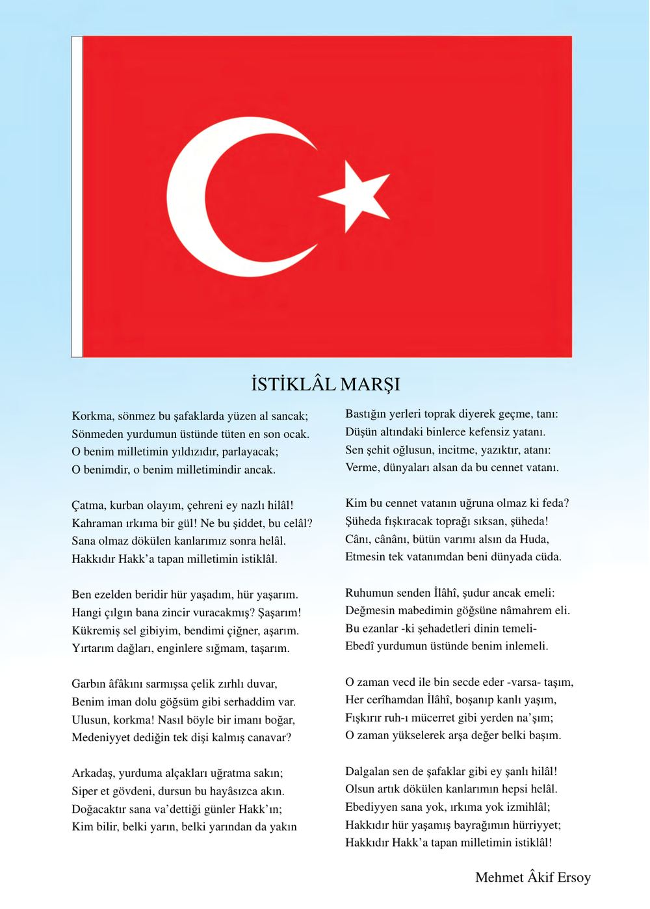

# İSTİKLÂL MARŞI

Korkma, sönmez bu şafaklarda yüzen al sancak;
Sönmeden yurdumun üstünde tüten en son ocak.
O benim milletimin yıldızıdır, parlayacak;
O benimdir, o benim milletimindir ancak.

Çatma, kurban olayım, çehreni ey nazlı hilâl!
Kahraman ırkıma bir gül! Ne bu şiddet, bu celâl?
Sana olmaz dökülen kanlarımız sonra helâl.
Hakkıdır Hakk’a tapan milletimin istiklâl.

Ben ezelden beridir hür yaşadım, hür yaşarım.
Hangi çılgın bana zincir vuracakmış? Şaşarım!
Kükremiş sel gibiyim, bendimi çiğner, aşarım.
Yırtarım dağları, enginlere sığmam, taşarım.

Garbın âfâkını sarmışsa çelik zırhlı duvar,
Benim iman dolu göğsüm gibi serhaddim var.
Ulusun, korkma! Nasıl böyle bir imanı boğar,
Medeniyyet dediğin tek dişi kalmış canavar?

Arkadaş, yurduma alçakları uğratma sakın;
Siper et gövdeni, dursun bu hayâsızca akın.
Doğacaktır sana va’dettiği günler Hakk’ın;
Kim bilir belki yarın belki yarından da yakın

Bastığın yerleri toprak diyerek geçme, tanı:
Düşün altındaki binlerce kefensiz yatanı.
Sen şehit oğlusun, incitme, yazıktır, atanı:
Verme, dünyaları alsan da bu cennet vatanı.

Kim bu cennet vatanın uğruna olmaz ki feda?
Şüheda fışkıracak toprağı sıksan, şüheda!
Cânı, cânânı, bütün varımı alsın da Huda,
Etmesin tek vatanımdan beni dünyada cüda.

Ruhumun senden İlâhî, şudur ancak emeli:
Değmesin mabedimin göğsüne nâmahrem eli.
Bu ezanlar -ki şehadetleri dinin temeli-
Ebedî yurdumun üstünde benim inlemeli.

O zaman vecd ile bin secde eder -varsa- taşım,
Her cerîhamdan İlâhî, boşanıp kanlı yaşım,
Fışkırır ruh-ı mücerret gibi yerden na’şım;
O zaman yükselerek arşa değer belki başım.

Dalgalan sen de şafaklar gibi ey şanlı hilâl!
Olsun artık dökülen kanlarımın hepsi helâl.
Ebediyyen sana yok, ırkıma yok izmihlâl;
Hakkıdır hür yaşamış bayrağımın hürriyyet!

<!-- sayfa 3 -->

GENÇLİĞE HİTABE

Ey Türk gençliği! Birinci vazifen, Türk istiklâlini, Türk Cumhuriyetini, ilelebet muhafaza ve müdafaa etmektir.

Mevcudiyetinin ve istikbalinin yegâne temeli budur. Bu temel, senin en kıymetli hazinendir. İstikbalde dahi, seni bu hazineden mahrum etmek isteyecek dâhilî ve hâricî bedhahların olacaktır. Bir gün, istiklâl ve cumhuriyeti müdafaa mecburiyetine düşersen, vazifeye atılmak için, içinde bulunacağın vaziyetin imkân ve şeraitini düşünmeyeceksin! Bu imkân ve şerait, çok namüsait bir mahiyette tezahür edebilir. İstiklâl ve cumhuriyetine kastedecek düşmanlar, bütün dünyada emsali görülmemiş bir galibiyetin mümessili olabilirler. Cebren ve hile ile aziz vatanın bütün kaleleri zapt edilmiş, bütün tersanelerine girilmiş, bütün orduları dağıtılmış ve memleketin her köşesi bilfiil işgal edilmiş olabilir. Bütün bu şeraitten daha elîm ve daha vahim olmak üzere, memleketin dâhilinde iktidara sahip olanlar gaflet ve dalâlet ve hattâ hıyanet içinde bulunabilirler. Hattâ bu iktidar sahipleri şahsî menfaatlerini, müstevlîlerin siyasî emelleriyle tevhit edebilirler. Millet, fakr u zaruret içinde harap ve bîtap düşmüş olabilir.

Ey Türk istikbalinin evlâdı! İşte, bu ahval ve şerait içinde dahi vazifen, Türk istiklâl ve cumhuriyetini kurtarmaktır. Muhtaç olduğun kudret, damarlarındaki asil kanda mevcuttur.

Mustafa Kemal Atatürk

<!-- sayfa 4 -->

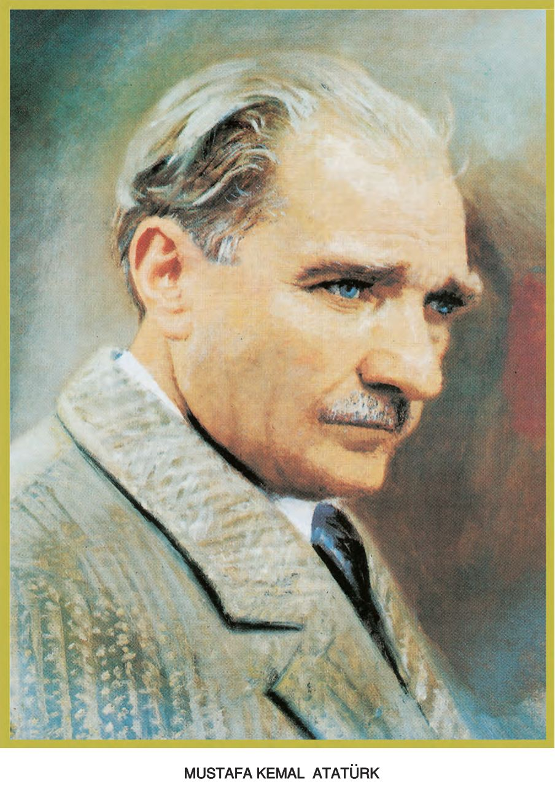

MUSTAFA KEMAL ATATÜRK

<!-- sayfa 5 -->

Verdiğiniz metin katmanı boş olduğu için (`<<< >>>` arası boş) dönüştürülecek bir içerik bulunmamaktadır. Lütfen metin katmanını içeren içeriği paylaşın, böylece kurallara uygun şekilde Markdown formatına çevirebilirim.

<!-- sayfa 6 -->

| | | |
| :--- | :--- | :--- |
| ٩ | الوحدة ١ | التَّحِيَّةُ وَالوَدَاعُ |
| ٣٠ | الوحدة ٢ | التَّعْرِيفُ بِالنَّفْسِ |
| ٤٩ | الوحدة ٣ | الهِوَايَاتُ |
| ٧٣ | الوحدة ٤ | المَلَابِسُ |
| ٩٧ | الوحدة ٥ | الأَعْدَادُ |
| ١١٩ | الوحدة ٦ | نَبِيِّي |
| ١٣٥ | الوحدة ٧ | وَسَائِلُ النَّقْلِ |
| ١٥٣ | الوحدة ٨ | وَطَنِي |
| ١٧٦ | | الأُغْنِيَةُ |
| ١٧٩ | | القَصُّ وَاللَّصْقُ |
| ١٩١ | | القَامُوسُ |
| ١٩٤ | | المَرَاجِعُ |
| ١٩٤ | | مِفْتَاحُ الأَجْوِبَةِ |
| ١٩٤ | | المَرَاجِعُ لِلصُّوَرِ |
| ١٩٥ | | خَرِيطَةُ التَّقْسِيمَاتِ الإِدَارِيَّةِ لِتُرْكِيَا مَعَ جِيرَانِهَا بَرًّا وَبَحْرًا |

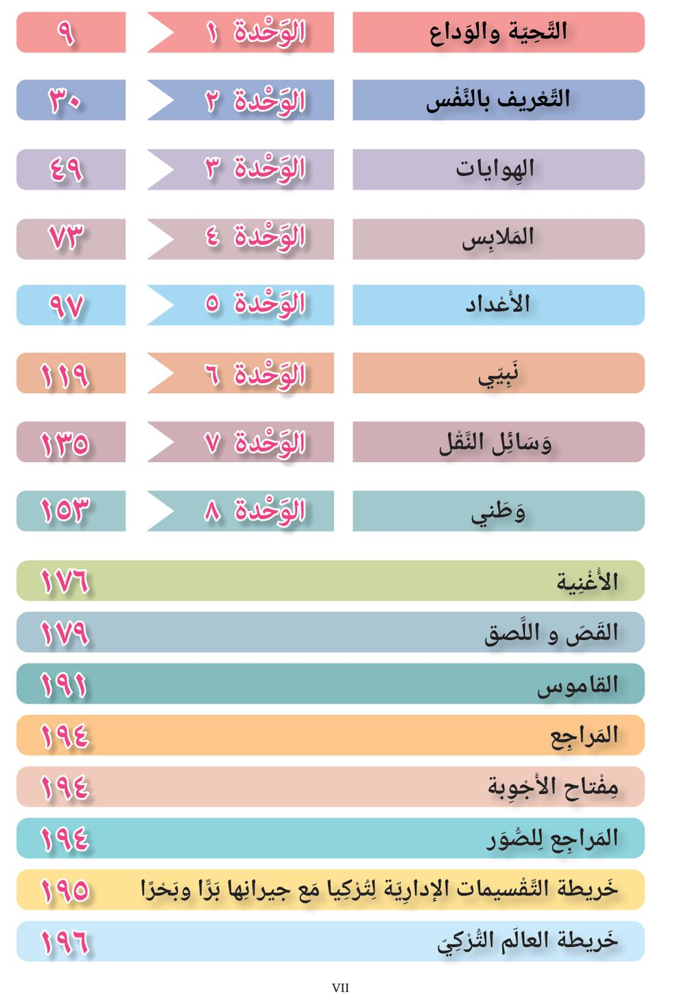
<!-- yer tutucu bulunamadı: sayfa sonuna eklendi -->

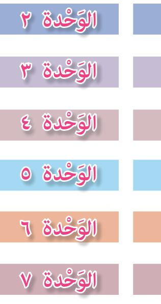
<!-- yer tutucu bulunamadı: sayfa sonuna eklendi -->

<!-- sayfa 7 -->

# Tema Sunusu Karekodu
# Tema Karekodu
# Ders Numarası ve Konu Başlığı
# Alıştırma Yönergesi

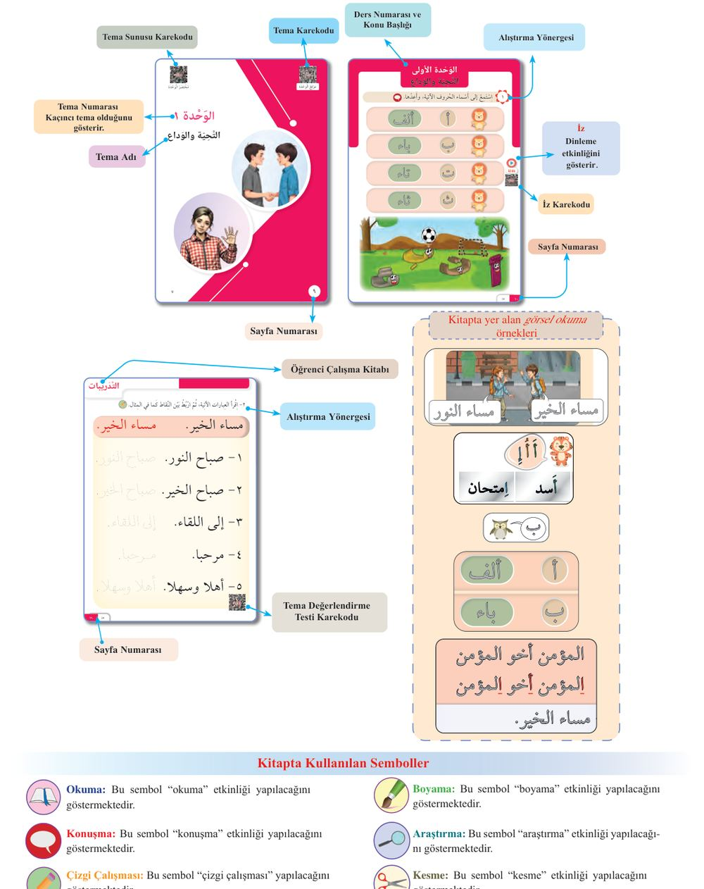

**الْوَحْدَةُ الْأُولَى**
**التَّحِيَّةُ وَالْوَدَاعُ**

* **Tema Numarası:** Kaçıncı tema olduğunu gösterir.
* **Tema Adı**

**İZ: Dinleme etkinliğini gösterir.**
**İZ Karekodu**
**Sayfa Numarası**

---

# Öğrenci Çalışma Kitabı
# Alıştırma Yönergesi

**التَّدْرِيبَاتُ**

2. اِقْرَأِ الْعِبَارَاتِ الْآتِيَةَ، ثُمَّ ارْبُطْ بَيْنَ النِّقَاطِ كَمَا فِي الْمِثَالِ.

1. صَبَاحُ النُّورِ. $\rightarrow$ مَسَاءُ الْخَيْرِ.
2. صَبَاحُ الْخَيْرِ. $\rightarrow$ صَبَاحُ النُّورِ.
3. إِلَى اللِّقَاءِ. $\rightarrow$ صَبَاحُ الْخَيْرِ.
4. مَرْحَبًا. $\rightarrow$ إِلَى اللِّقَاءِ.
5. أَهْلًا وَسَهْلًا. $\rightarrow$ مَرْحَبًا.

**Tema Değerlendirme Testi Karekodu**
**Sayfa Numarası**

---

# Kitapta yer alan görsel okuma örnekleri

**مَسَاءُ النُّورِ** | **مَسَاءُ الْخَيْرِ**

**أ** | **أَلِفٌ**
**ب** | **بَاءٌ**

**الْمُؤْمِنُ أَخُو الْمُؤْمِنِ**
**الْمُؤْمِنُ أَخُو الْمُؤْمِنِ**
**مَسَاءُ الْخَيْرِ**

---

# Kitapta Kullanılan Semboller

* **Okuma:** Bu sembol “okuma” etkinliği yapılacağını göstermektedir.
* **Konuşma:** Bu sembol “konuşma” etkinliği yapılacağını göstermektedir.
* **Boyama:** Bu sembol “boyama” etkinliği yapılacağını göstermektedir.
* **Araştırma:** Bu sembol “araştırma” etkinliği yapılacağını göstermektedir.

<!-- sayfa 8 -->

مَوْقِعُ الْوَحْدَةِ
مُخْتَصَرُ الْوَحْدَةِ

# الْوَحْدَةُ ١
## التَّحِيَّةُ وَالْوَدَاعُ

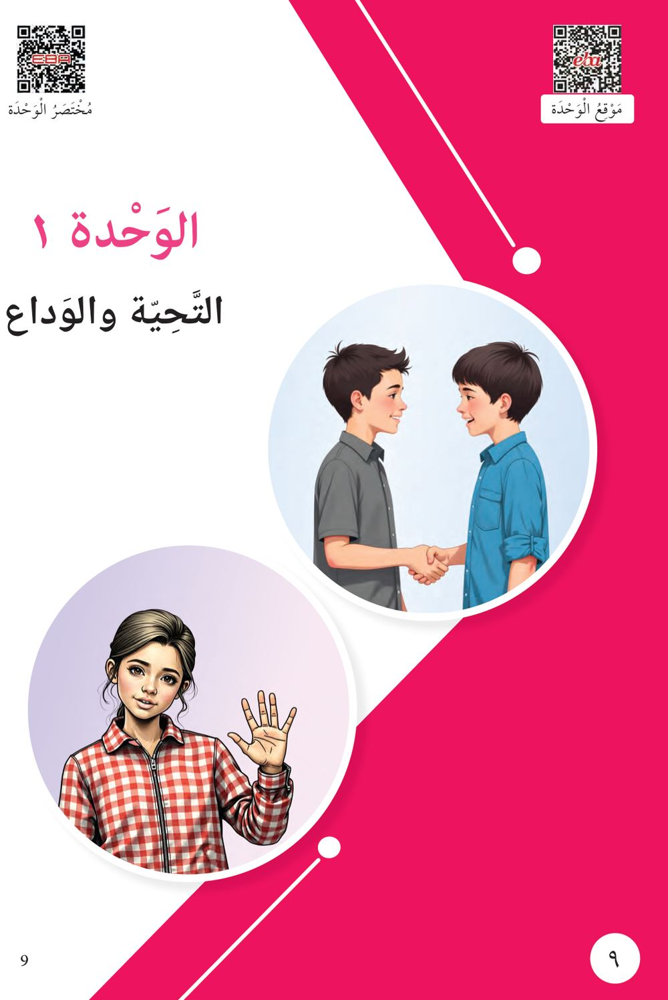

<!-- sayfa 9 -->

# التَّحِيَّةُ وَالْوَدَاعُ

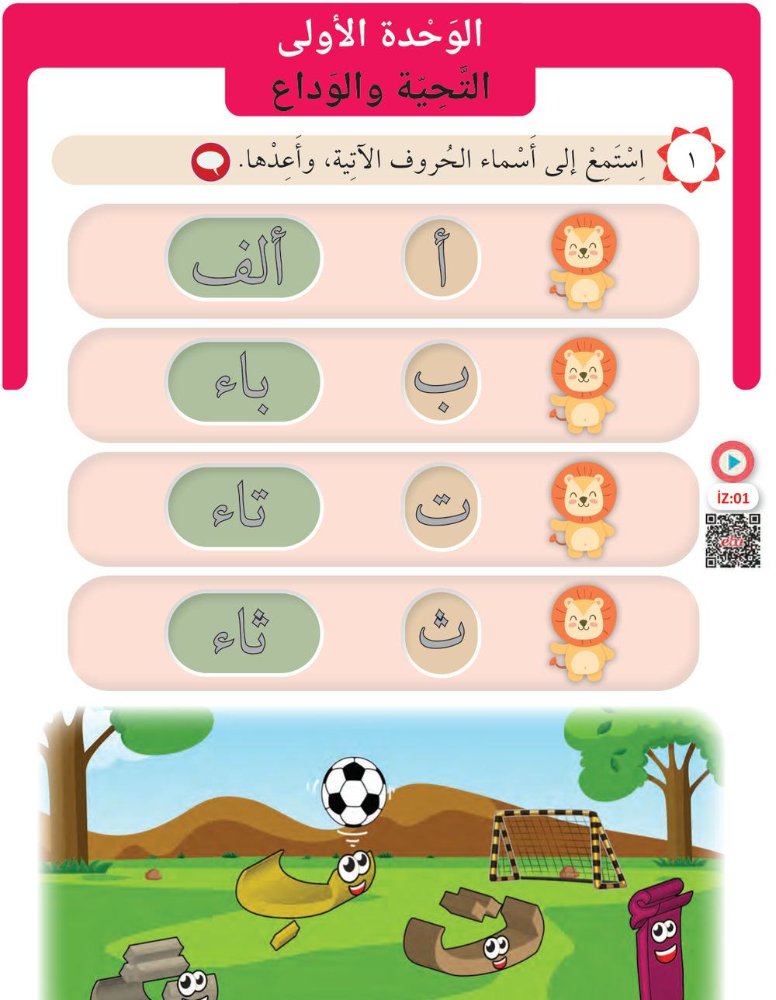 اسْتَمِعْ إِلَى أَسْمَاءِ الْحُرُوفِ الْآتِيَةِ، وَأَعِدْهَا.

| | | |
| :--- | :--- | :--- |
| أَلِفٌ | أ | ![Aslan resmi] |
| بَاءٌ | ب | ![Aslan resmi] |
| تَاءٌ | ت | ![Aslan resmi] |
| ثَاءٌ | ث | ![Aslan resmi] |

iz:01

<!-- sayfa 10 -->

# ٢

أَرْبِطْ بَيْنَ النِّقاطِ كَما فِي الْأَمْثِلَةِ. ✏️

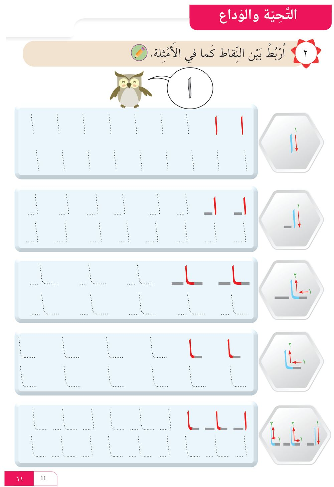

| | | | | | | | | | |
|---|---|---|---|---|---|---|---|---|---|
| . | . | . | . | . | . | . | | | |
| . | . | . | . | . | . | . | | | |

<!-- sayfa 11 -->

# ٣
أُرْبِطُ بَيْنَ النِّقَاطِ كَمَا فِي الْأَمْثِلَةِ. ✏️

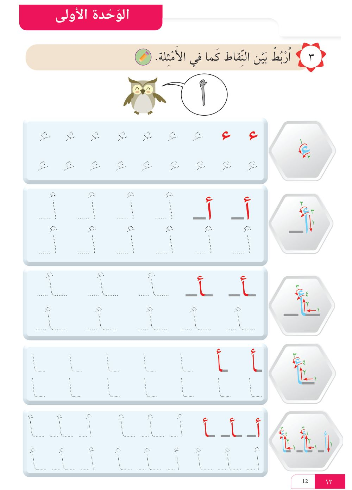

| | | | | | | | ع | ع |
|---|---|---|---|---|---|---|---|---|
| ع | ع | ع | ع | ع | ع | ع | ع | ع |

| | | | | أـ | أـ |
|---|---|---|---|---|---|
| أـ | أـ | أـ | أـ | أـ | أـ |

| | | | | ـأ | ـأ |
|---|---|---|---|---|---|
| ـأ | ـأ | ـأ | ـأ | ـأ | ـأ |

| | | | | ؤ | ؤ |
|---|---|---|---|---|---|
| ؤ | ؤ | ؤ | ؤ | ؤ | ؤ |

<!-- sayfa 12 -->

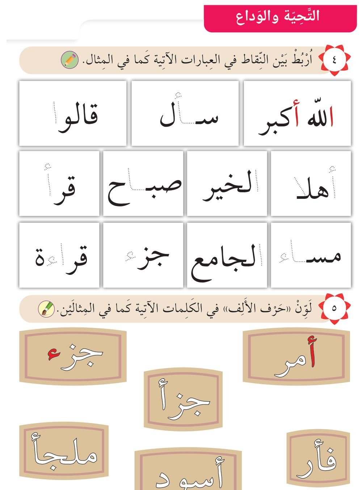 ٤ | أَرْبِطْ بَيْنَ النُّقاطِ فِي العِباراتِ الآتِيَةِ كَما فِي المِثالِ. ✏️

| | | |
| :---: | :---: | :---: |
| اللهُ أَكْبَرُ | سَأَلَ | قالُوا |
| أَهْلًا | الخَيْرِ | صَباحٌ |
| قَرَأَ | قِراءةٌ | الجامِعُ |
| مَساءٌ | جُزْءٌ | |

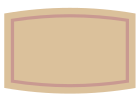 ٥ | لَوِّنْ «حَذْفُ الأَلِفِ» فِي الكَلِماتِ الآتِيَةِ كَما فِي المِثالَيْنِ. ✏️

| | | |
| :---: | :---: | :---: |
| أَمَرَ | جُزْءٌ | جَزْءًا |
| فَأرَ | | مَلْجَأً |

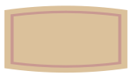
<!-- yer tutucu bulunamadı: sayfa sonuna eklendi -->

<!-- sayfa 13 -->

# ٦
اسْتَمِعْ إِلَى نُطْقِ "حَرْفِ الْأَلِفِ" بِالصَّوَائِتِ الْقَصِيرَةِ فِي الْكَلِمَاتِ الْآتِيَةِ، ثُمَّ لَاحِظْهُ.
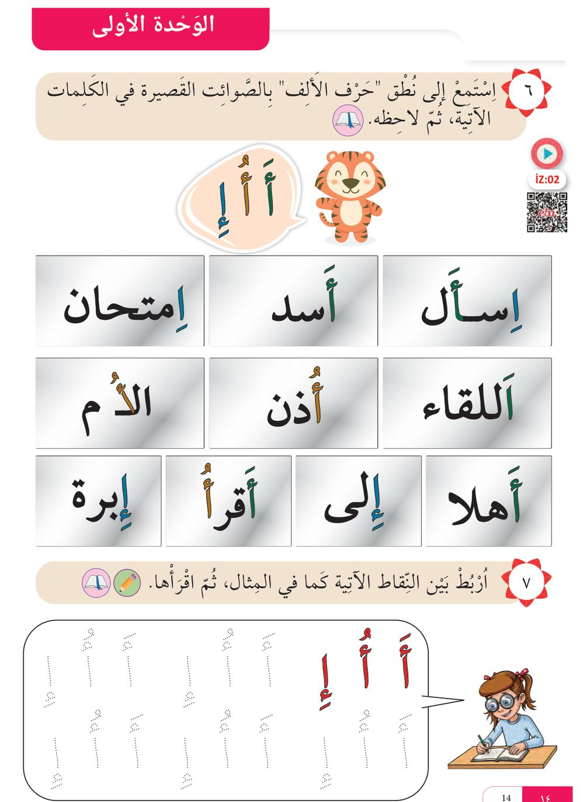

أَ / أُ / إِ

| إِسْأَلْ | أَسَدٌ | اِمْتِحَانٌ |
| :---: | :---: | :---: |
| اَللِّقَاءُ | أُذُنٌ | اَلْأُمُّ |
| أَهْلًا | إِلَى | اِقْرَأْ |
| إِبْرَةٌ | | |

# ٧
أَرْبِطْ بَيْنَ التَّلْقَاطِ الْآتِيَةِ كَمَا فِي الْمِثَالِ، ثُمَّ اقْرَأْهَا.

أَ / أُ / إِ
إِ / أُ / أَ
أَ / إِ / أُ
أُ / أَ / إِ

<!-- sayfa 14 -->

# ٨ أَرْبِطُ بَيْنَ النِّقاطِ كَمَا فِي الْأَمْثِلَةِ. ✏️

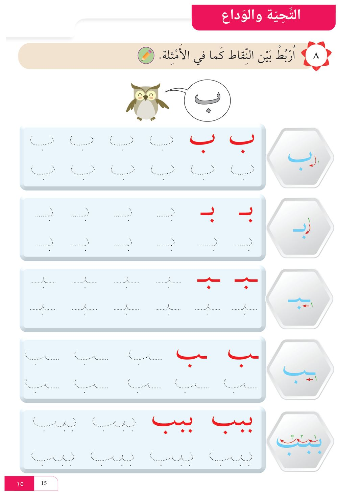

ب  ب  ب  ب  ب  ب
ب  ب  ب  ب  ب  ب

ب  ب  ب  ب  ب  ب
ب  ب  ب  ب  ب  ب

ب  ب  ب  ب  ب  ب
ب  ب  ب  ب  ب  ب

بـ  بـ  بـ  بـ  بــ  بــ
بـ  بـ  بـ  بـ  بـ  بـ

ـب  ـب  ـب  ـب  ـب
ـب  ـب  ـب  ـب  ــب ـب

ــبــ  ــبــ   ـبـ   ـبـ   ـبـ   ـبـ
ـبـ   ـبـ   ـبـ   ـبـ   ـبـ   ـبـ

ببب  ببب  ببب  ببب
ببب  ببب  ببب  ببب

<!-- sayfa 15 -->

# ٩ ✏️ أَرْبِطْ بَيْنَ النِّقَاطِ فِي الْكَلِمَاتِ الْآتِيَةِ كَمَا فِي الْمِثَالِ.

| | | |
| :---: | :---: | :---: |
| بـطـة | كـتـاب | بـرتـقـال |
| بـاب | خـبـز | د بـ |
| سـبـيـل | بـصـل | ثـعـبـان |

# ١٠ ✏️ لَوِّنْ «حَرْفَ الْبَاءِ» فِي الْكَلِمَاتِ الْآتِيَةِ كَمَا فِي الْأَمْثِلَةِ.

| | | |
| :---: | :---: | :---: |
| حـبـل | أ رنـب | بـلـبـل |
| بـحـر | مـكـتـب | بـنـت |
| سـبـب | مـكـتـبـة | بـسـت |

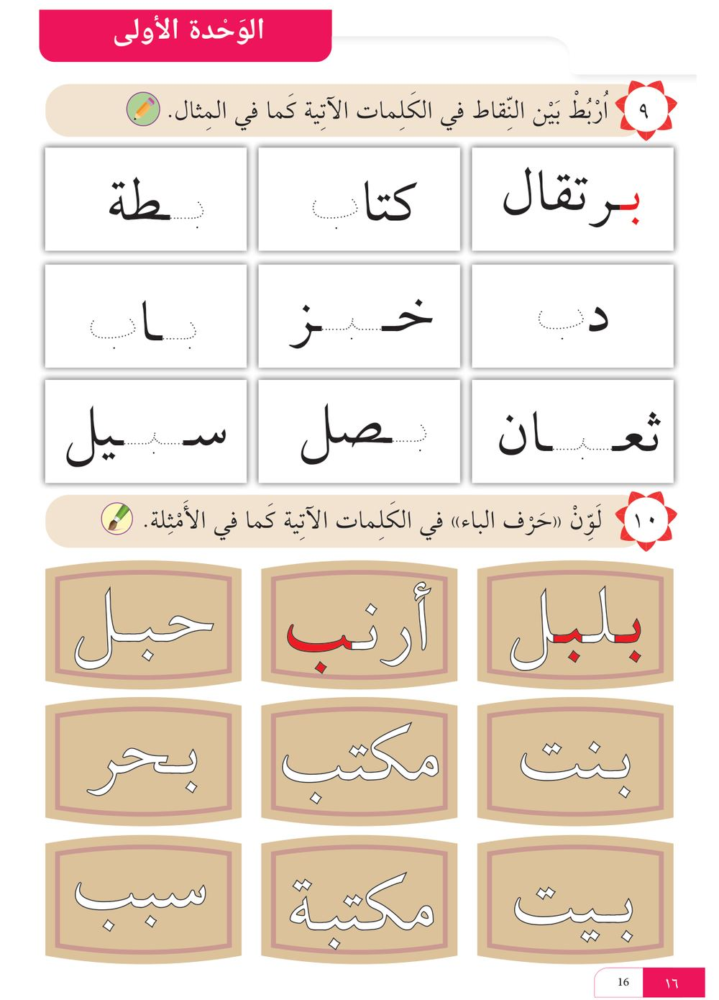
<!-- yer tutucu bulunamadı: sayfa sonuna eklendi -->

<!-- sayfa 16 -->

# ١١
اسْتَمِعْ إِلَى نُطْقِ "حَرْفِ البَاءِ" بِالصَّوَائتِ القَصيرةِ فِي الكَلِمَاتِ الآتِيَةِ، ثُمَّ لَاحِظْهُ.
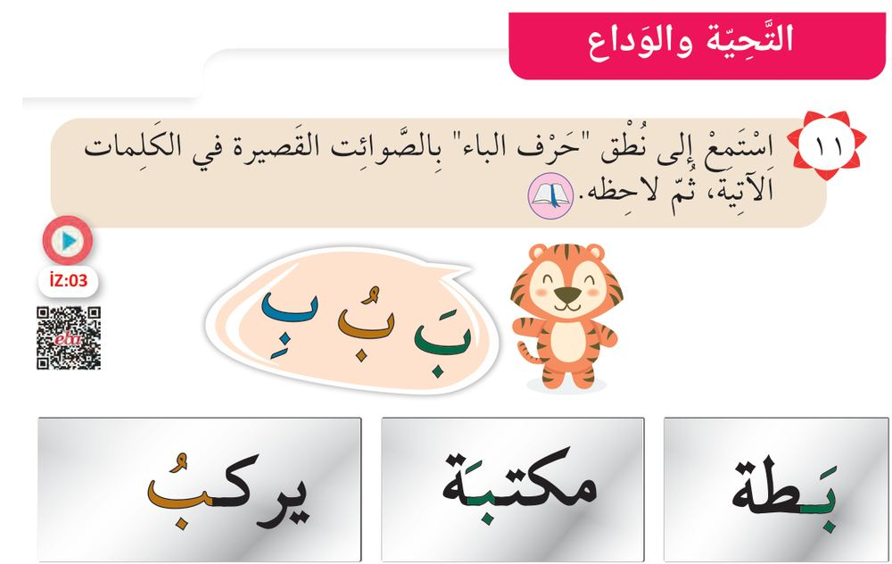

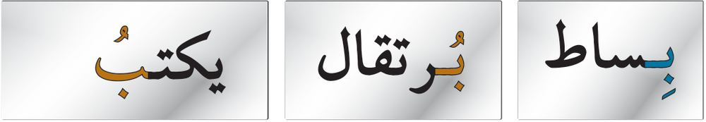

| | | |
| :---: | :---: | :---: |
| بَطَّةٌ | مَكْتَبَةٌ | يَرْكَبُ |
| بِسَاطٌ | بُرْتُقَالٌ | يَكْتُبُ |

# ١٢
أَرْبِطْ بَيْنَ النِّقَاطِ الآتِيَةِ كَمَا فِي المِثَالِ، ثُمَّ اقْرَأْهَا.
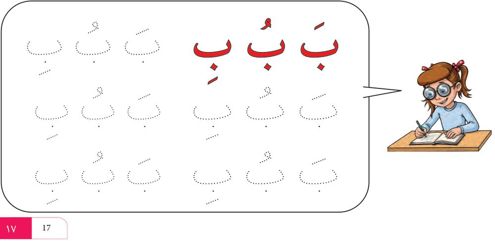

<!-- sayfa 17 -->

# ١٣ أَرْبِطْ بَيْنَ النِّقاطِ كَما في الأَمْثِلَةِ. ✏️

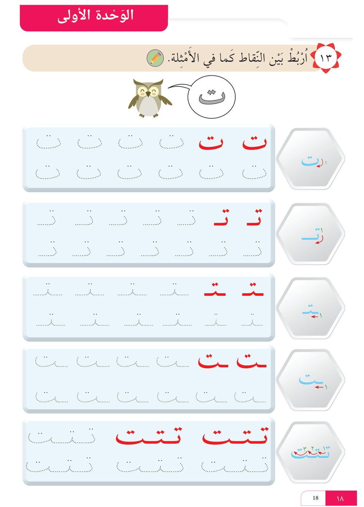

| | | | | | | | |
| :---: | :---: | :---: | :---: | :---: | :---: | :---: | :---: |
| ت | ت | ت | ت | ت | ت | ت | ت |
| ت | ت | ت | ت | ت | ت | ت | ت |
| ت | ت | ت | ت | ت | ت | ت | ت |

| | | | | | | | |
| :---: | :---: | :---: | :---: | :---: | :---: | :---: | :---: |
| تـ | تـ | تـ | تـ | تـ | تـ | تـ | تـ |
| تـ | تـ | تـ | تـ | تـ | تـ | تـ | تـ |
| تـ | تـ | تـ | تـ | تـ | تـ | تـ | تـ |

| | | | | | | | |
| :---: | :---: | :---: | :---: | :---: | :---: | :---: | :---: |
| تتت | تتت | تتت | تتت | تتت | تتت | تتت | تتت |
| تتت | تتت | تتت | تتت | تتت | تتت | تتت | تتت |
| تتت | تتت | تتت | تتت | تتت | تتت | تتت | تتت |

<!-- sayfa 18 -->

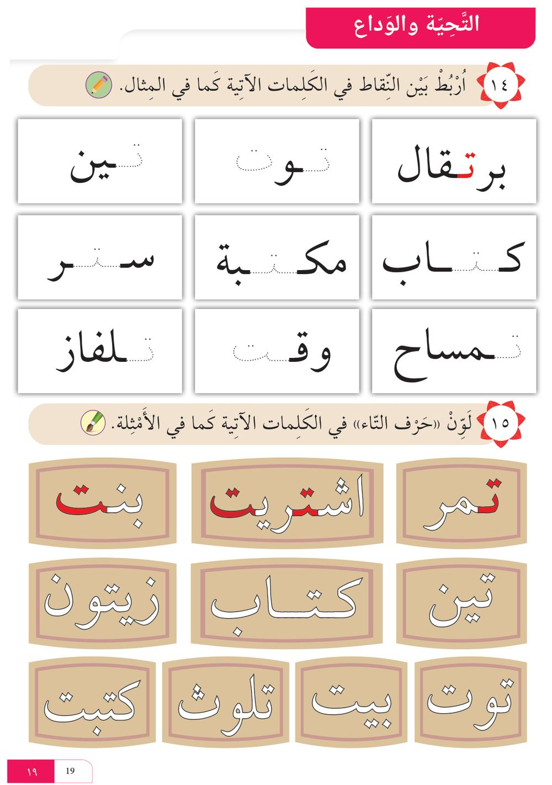
# ١٤ ✏️ أَرْبُطُ بَيْنَ النُّقاطِ فِي الْكَلِماتِ الْآتِيَةِ كَما فِي الْمِثالِ.

| | | |
| :---: | :---: | :---: |
| تـيـن | تـوت | برتـقـال |
| سـتـر | مـكـتـبـة | كـتـاب |
| تـلـفـاز | وقـت | تـمـسـاح |

# ١٥ ✏️ لَوِّنْ «حَرْفَ التَّاءِ» فِي الْكَلِماتِ الْآتِيَةِ كَما فِي الْأَمْثِلَةِ.

| | | |
| :---: | :---: | :---: |
| بـنـت | اشـتـريـت | تـمـر |
| زيـتـون | كـتـاب | تـيـن |
| كـتـب | تـلـوث | بـيـت | تـوت |

<!-- sayfa 19 -->

# ١٦
اسْتَمِعْ إِلَى نُطْقِ "حَرْفِ التَّاءِ" بِالصَّوَائِتِ القَصِيرَةِ فِي الكَلِمَاتِ الآتِيَةِ، ثُمَّ لَاحِظْهُ.
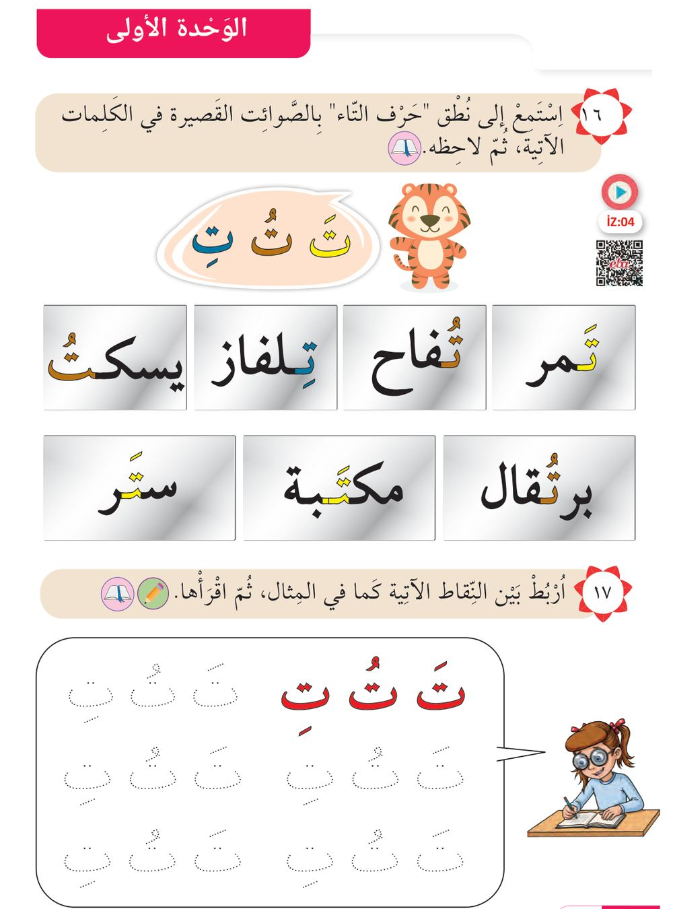

تَ تُ ثِ تُ تِ تَ تُ

| تَمْرٌ | تُفَّاحٌ | تِلْفَازٌ | يَسْكُتُ |
| :---: | :---: | :---: | :---: |

| بُرْتُقَالٌ | مَكْتَبَةٌ | سَتَرَ |

# ١٧
أَرْبِطْ بَيْنَ التَّلْقَاطِ الآتِيَةِ كَمَا فِي المِثَالِ، ثُمَّ اقْرَأْهَا.

تَ تُ ثِ تُ تِ تَ تُ
تَ تُ ثِ تُ تِ تَ تُ
تَ تُ ثِ تُ تِ تَ تُ
تَ تُ ثِ تُ تِ تَ تُ
تَ تُ ثِ تُ تِ تَ تُ
تَ تُ ثِ تُ تِ تَ تُ

<!-- sayfa 20 -->

# ١٨ أَرْبُطُ بَيْنَ النِّقَاطِ كَمَا فِي الْأَمْثِلَةِ.

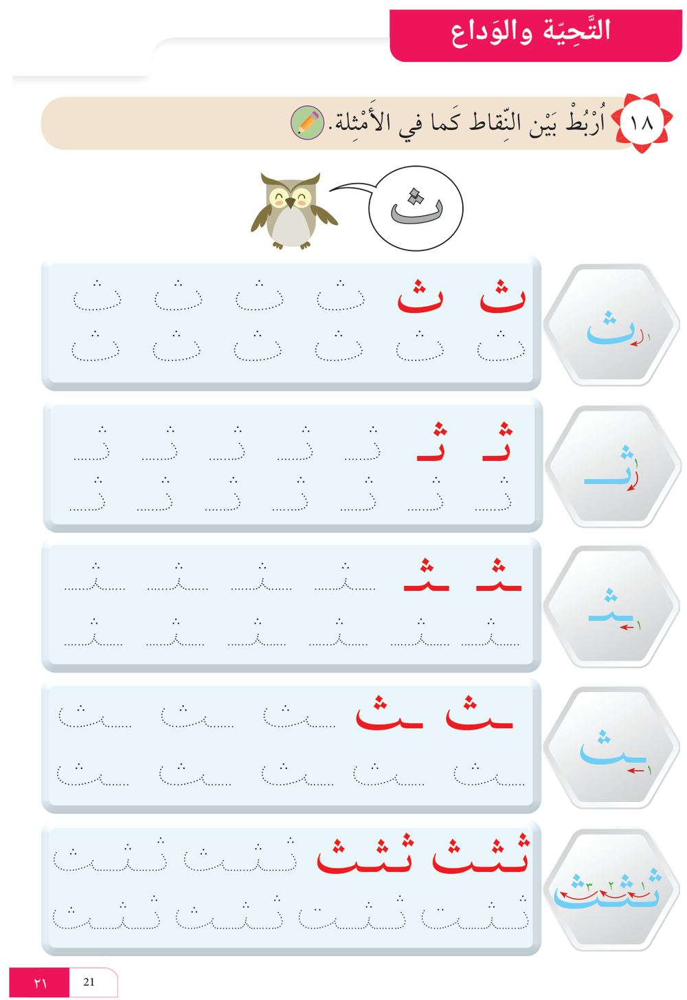

ث ث ث ث ث ث
ث ث ث ث ث ث
ث ث ث ث ث ث

ثُ ثُ ثُ ثُ ثُ ثُ
ثُ ثُ ثُ ثُ ثُ ثُ

ثِ ثِ ثِ ثِ ثِ ثِ
ثِ ثِ ثِ ثِ ثِ ثِ

ثَ ثَ ثَ ثَ ثَ ثَ
ثَ ثَ ثَ ثَ ثَ ثَ

ثَّ ثَّ ثَّ ثَّ ثَّ ثَّ
ثَّ ثَّ ثَّ ثَّ ثَّ ثَّ

<!-- sayfa 21 -->

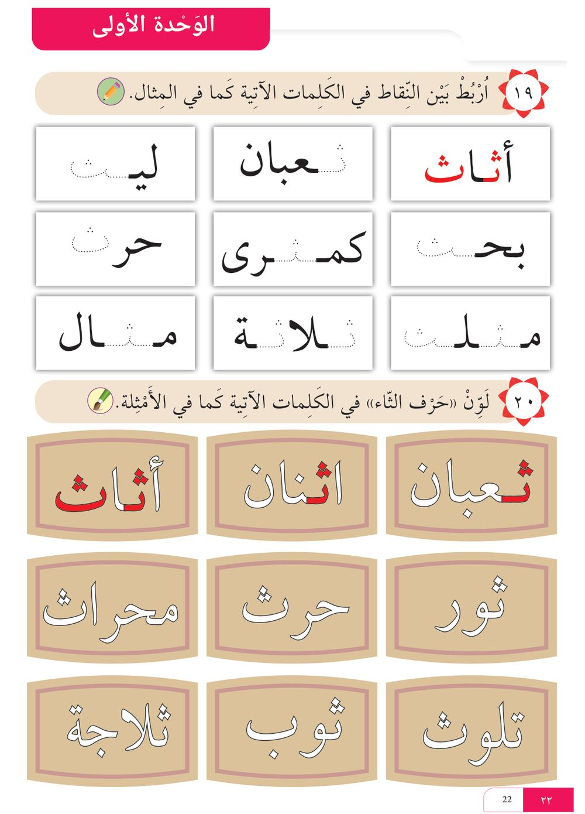
۱۹ ✏️ أَرْبُطُ بَيْنَ النُّقاطِ فِي الْكَلِماتِ الْآتِيَةِ كَما فِي الْمِثالِ.

| | | |
| :---: | :---: | :---: |
| لـيـث | ثـعـبـان | أثـاث |
| بحـث | كـمـثـرى | حـرث |
| مـثـل | ثـلاثـة | مـثـال |

۲۰ ✏️ لَوِّنْ «حَرْفَ الثَّاءِ» فِي الْكَلِماتِ الْآتِيَةِ كَما فِي الْأَمْثِلَةِ.

| | | |
| :---: | :---: | :---: |
| أثـاث | اثـنـان | ثـعـبـان |
| مـحـراث | حـرث | ثـور |
| ثـلاجة | ثـوب | تـلـوث |

<!-- sayfa 22 -->

# ٢١
اِسْتَمِعْ إِلَى نُطْقِ "حَرْفِ الثَّاءِ" بِالصَّوَائِتِ الْقَصِيرَةِ فِي الْكَلِمَاتِ الْآتِيَةِ، ثُمَّ لَاحِظْهُ.
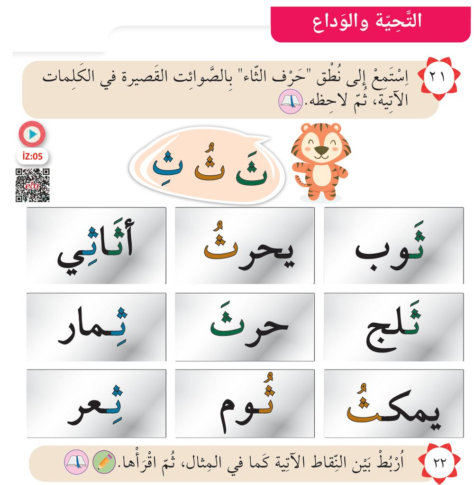

ثَ ثُ ثِ
ثَ ثُ ثِ
ثَ ثُ ثِ

ثَوْبٌ
يَحْرُثُ
أَثَاثِي
ثَلْجٌ
حَرَثَ
ثِمَارٌ
يُمْكِنُ
ثَوْمٌ
ثَعْرٌ

# ٢٢
أَرْبِطْ بَيْنَ النُّقَاطِ الْآتِيَةِ كَمَا فِي الْمِثَالِ، ثُمَّ اقْرَأْهَا.
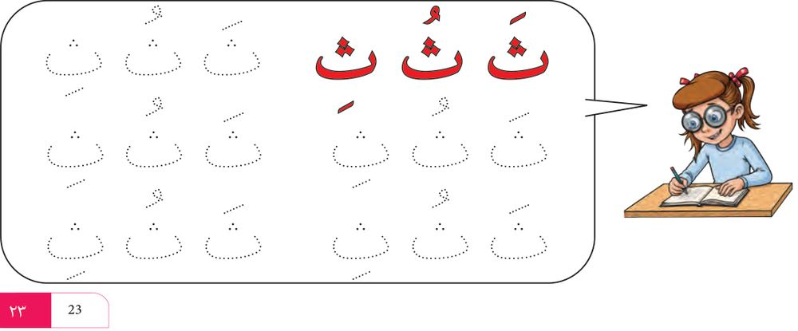

ثَ ثُ ثِ
ثَ ثُ ثِ
ثَ ثُ ثِ
ثَ ثُ ثِ
ثَ ثُ ثِ
ثَ ثُ ثِ

<!-- sayfa 23 -->

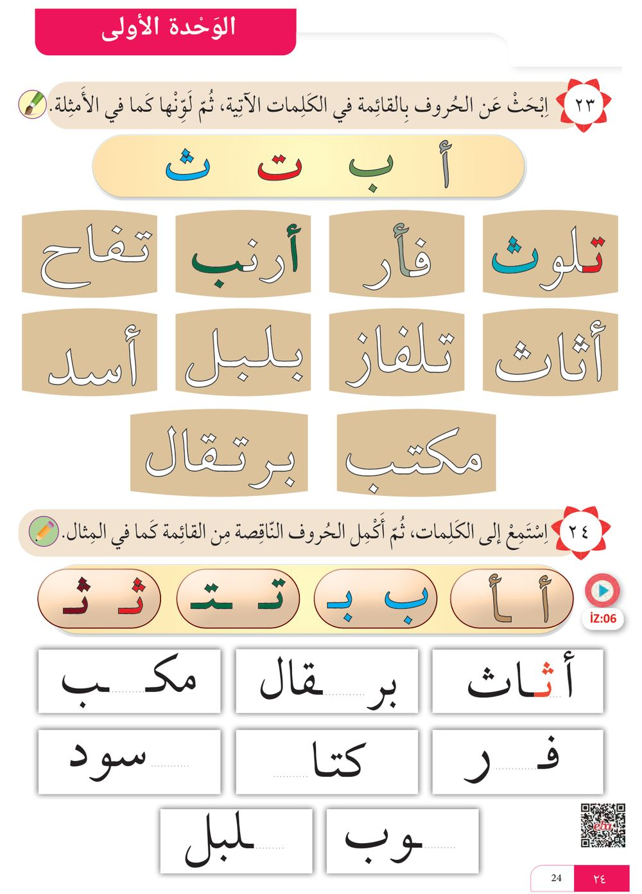
إِبْحَثْ عَنِ الْحُرُوفِ بِالْقَائِمَةِ فِي الْكَلِمَاتِ الْآتِيَةِ، ثُمَّ لَوِّنْهَا كَمَا فِي الْأَمْثِلَةِ. ٢٣

أ  ب  ت  ت  ث

تَلَوُّث
فَأْر
أَرْنَب
تُفَّاح
أَثَاث
تِلْفَاز
بَلْبَل
أَسَد
مَكْتَب
بُرْتُقَال

اِسْتَمِعْ إِلَى الْكَلِمَاتِ، ثُمَّ أَكْمِلِ الْحُرُوفَ النَّاقِصَةَ مِنَ الْقَائِمَةِ كَمَا فِي الْمِثَالِ. ٢٤

أ  أ
ب  ب
ت  ت
ث  ث

أثاث
بر........قال
مك........ب
ف........ر
........كتـا
........سود

<!-- sayfa 24 -->

اِسْتَمِعْ إِلَى الْكَلِمَاتِ، وَضَعِ الْحَرَكَاتِ الْمُنَاسِبَةَ لِلْحُرُوفِ "أ، ب، ت، ث"، ثُمَّ لَوِّنْهَا كَمَا فِي الْمِثَالِ. ✏️

أَرْنَبٌ | أَ | أُ | إِ | أِ

بُرْتُقَالٌ | بَ | بُ | بِ | بْ

تِلْفَازٌ | تَ | تُ | تِ | تْ

ثَوْبٌ | ثَ | ثُ | ثِ | ثْ

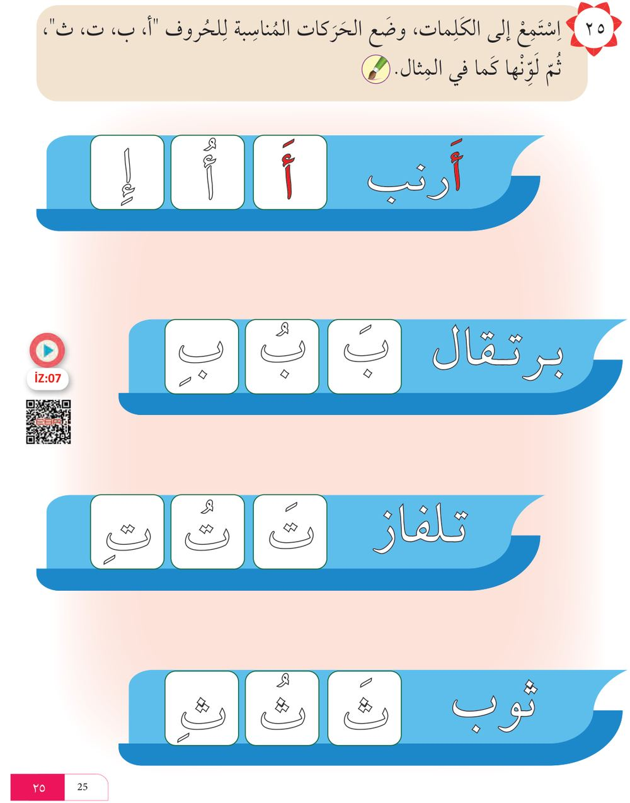
<!-- yer tutucu bulunamadı: sayfa sonuna eklendi -->

<!-- sayfa 25 -->

٢٦

اِسْتَمِعْ إِلَى الْعِبَارَاتِ، وَأَعِدْهَا، ثُمَّ أَجْرِ حِوَارًا مَعَ أَصْدِقَائِكَ فِي الصَّفِّ.

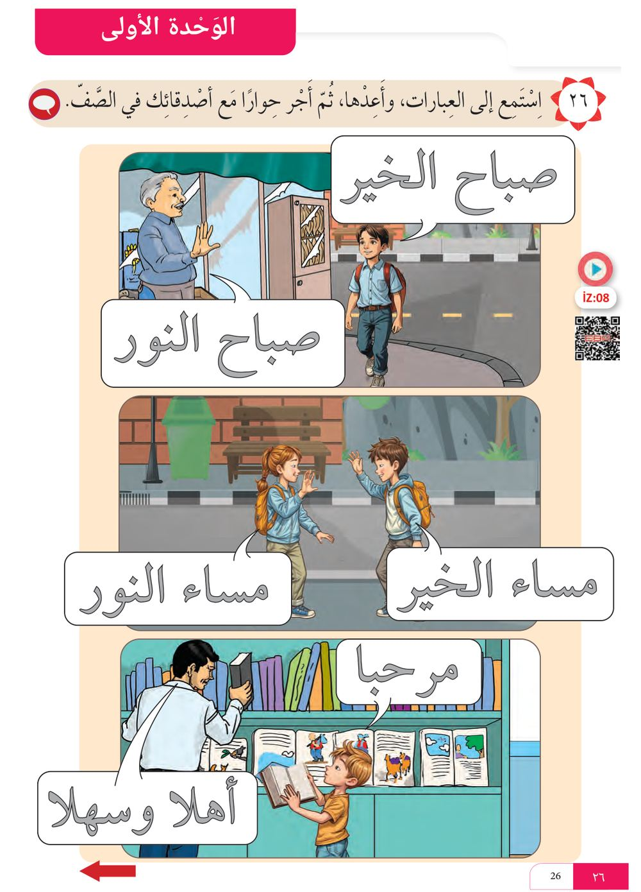

صباح الخير
صباح النور

مساء الخير
مساء النور

مرحبا
أهلاً وسهلاً

İZ:08

<!-- sayfa 26 -->

صباح الخير
يا علي!

صباح النور
يا فاطمة!

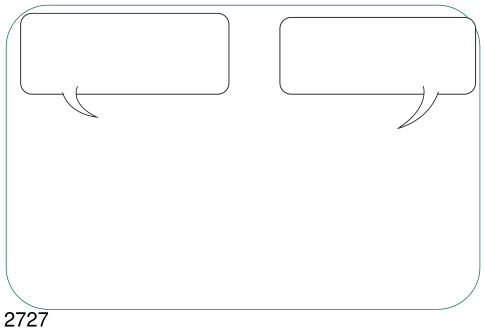

في أمان الله.

إلى اللقاء.

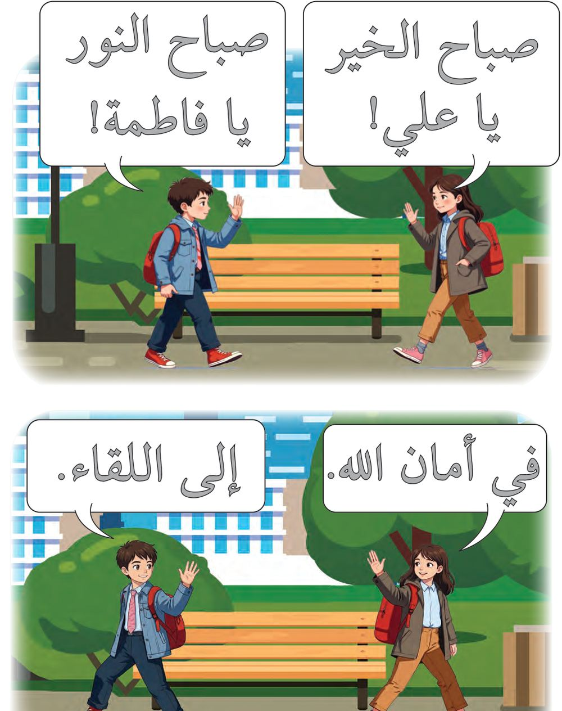

<!-- sayfa 27 -->

# تَدْرِيبَات

١- اُكْتُبِ الْحُرُوفَ النَّاقِصَةَ فِي الْكَلِمَاتِ الْآتِيَةِ كَمَا فِي الْمِثَالِ. ✏️

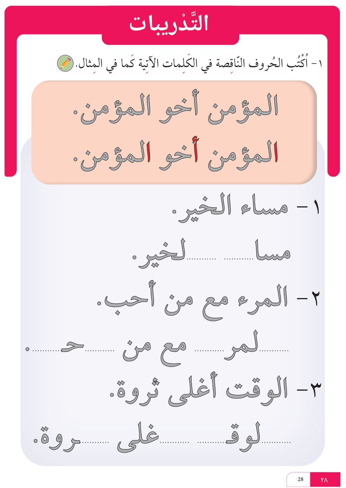
المُؤْمِنُ أَخُو المُؤْمِنِ.
المُؤْمِنُ أَخُو المُؤْمِنِ.

١- مَسَاءُ الْخَيْرِ.
مسا......... لخير.

٢- المَرْءُ مَعَ مَنْ أَحَبَّ.
لمر......... مع من ......... حـ

٣- الوَقْتُ أَغْلَى ثَرْوَةٍ.
لوق......... غلى......... ثروة.

<!-- sayfa 28 -->

٢- إِقْرَأِ الْعِبَارَاتِ الْآتِيَةَ، ثُمَّ ارْبُطْ بَيْنَ النُّقَاطِ كَمَا فِي الْمِثَالِ. ✏️

| مساء الخير. | مساء الخير. |
| :--- | :--- |
| ١- صباح النور. | صباح النور. |
| ٢- صباح الخير. | صباح الخير. |
| ٣- إلى اللقاء. | إلى اللقاء. |
| ٤- مرحبا. | مرحبا. |
| ٥- أهلا وسهلا. | أهلا وسهلا. |

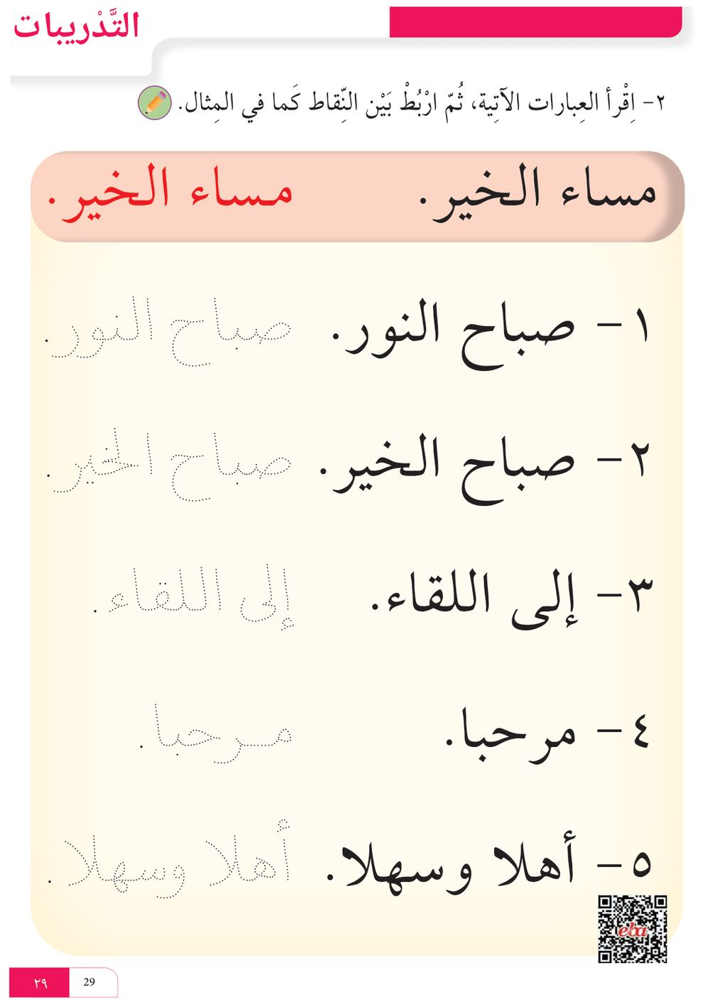
<!-- yer tutucu bulunamadı: sayfa sonuna eklendi -->

<!-- sayfa 29 -->

مَوْقِعُ الْوَحْدَةِ

الْوَحْدَةُ ٢
التَّعْرِيفُ بِالنَّفْسِ

مُخْتَصَرُ الْوَحْدَةِ

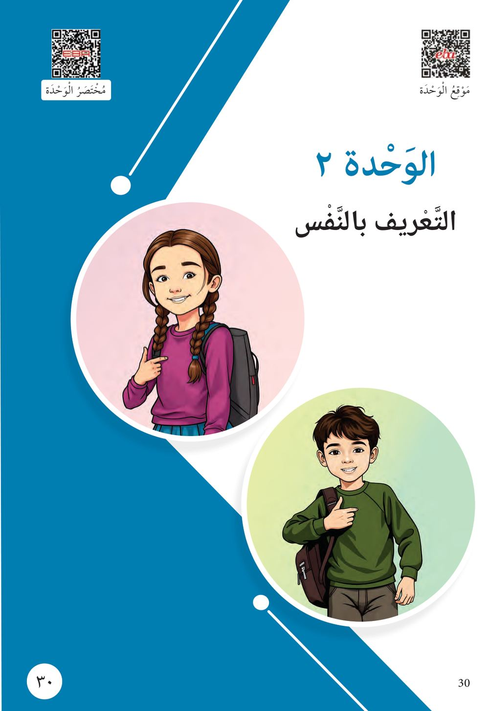

<!-- sayfa 30 -->

# التَّعْرِيفُ بِالنَّفْسِ

١. اِسْتَمِعْ إِلَى أَسْمَاءِ الْحُرُوفِ الْآتِيَةِ، وَأَعِدْهَا.

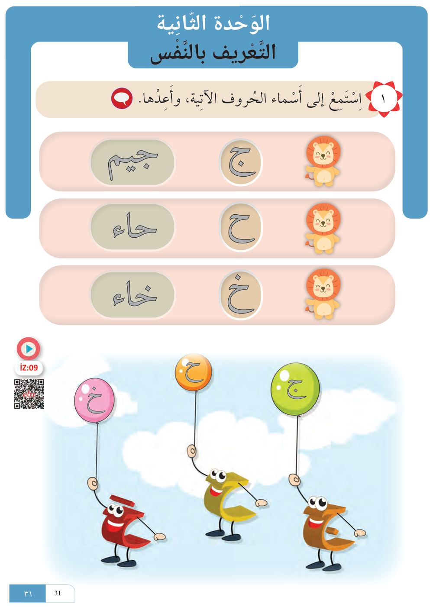

| | | |
| :---: | :---: | :---: |
| جِيم | ح | ![Aslan figürü] |
| حَاء | ح | ![Aslan figürü] |
| خَاء | خ | ![Aslan figürü] |

<!-- sayfa 31 -->

# ٢. أَرْبِطْ بَيْنَ النِّقاطِ كَمَا فِي الْأَمْثِلَةِ. ✏️

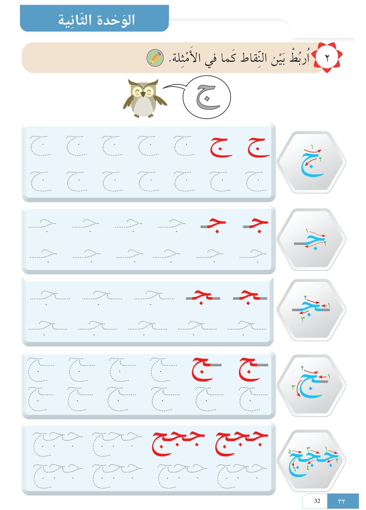

ح ح
ج ج ج ج ج ج ج
ج ج ج ج ج ج ج
ججج ججج ججج ججج

جـ جـ ـجـ ـجـ ـجـ ـجـ
ـجـ ـجـ ـجـ ـجـ ـجـ ـجـ

جـ جـ ـجـ ـجـ ـجـ ـجـ
ـجـ ـجـ ـجـ ـجـ ـجـ ـجـ

ح ح
ج ج ج ج ج ج ج
ج ج ج ج ج ج ج
ججج ججج ججج ججج

ججج ججج ججج ججج

<!-- sayfa 32 -->

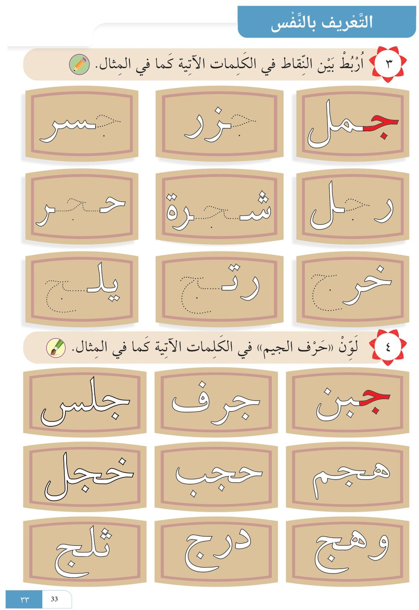 3. أَرْبُطْ بَيْنَ النِّقاطِ فِي الْكَلِماتِ الْآتِيَةِ كَمَا فِي الْمِثَالِ. ✏️

| | | |
| :---: | :---: | :---: |
| جـ...ـسر | جـ...ـزر | جـمـل |
| حـ...ـجر | شـ...ـجرة | ر...ـجل |
| يـ...ـلج | ر...ـتـج | خـ...ـرج |

 4. لَوِّنْ «حَرْفَ الْجِيمِ» فِي الْكَلِماتِ الْآتِيَةِ كَمَا فِي الْمِثَالِ. ✏️

| | | |
| :---: | :---: | :---: |
| جـلـس | جـرف | جـبـن |
| هـجـم | حـجـب | خـجـل |
| ثـلـج | درج | وهـج |

<!-- sayfa 33 -->

# ٥
اِسْتَمِعْ إِلَى نُطْقِ "حَرْفِ الجِيمِ" بِالصَّوَائِتِ القَصِيرَةِ فِي الكَلِمَاتِ الآتِيَةِ، ثُمَّ لَاحِظْهُ.
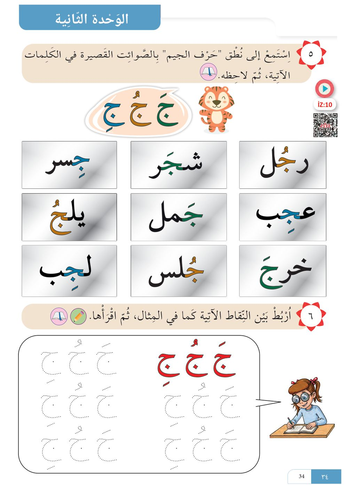

| رَجُلٌ | شَجَرٌ | جِسْرٌ |
| :---: | :---: | :---: |
| عَجَبٌ | جَمَلٌ | يَلِجُ |
| خَرَجَ | جَلَسَ | لَجِبَ |

# ٦
أُرْبُطْ بَيْنَ النِّقاطِ الآتِيَةِ كَمَا فِي المِثَالِ، ثُمَّ اقْرَأْهَا.

| جَ جُ جِ | جَ جُ جِ | جَ جُ جِ |
| :---: | :---: | :---: |
| جَ جُ جِ | جَ جُ جِ | جَ جُ جِ |
| جَ جُ جِ | جَ جُ جِ | جَ جُ جِ |

| جَ | جُ | جِ |
| :---: | :---: | :---: |

<!-- sayfa 34 -->

# ٧ . أَرْبُطُ بَيْنَ النِّقاطِ كَما فِي الْأَمْثِلَةِ. ✏️

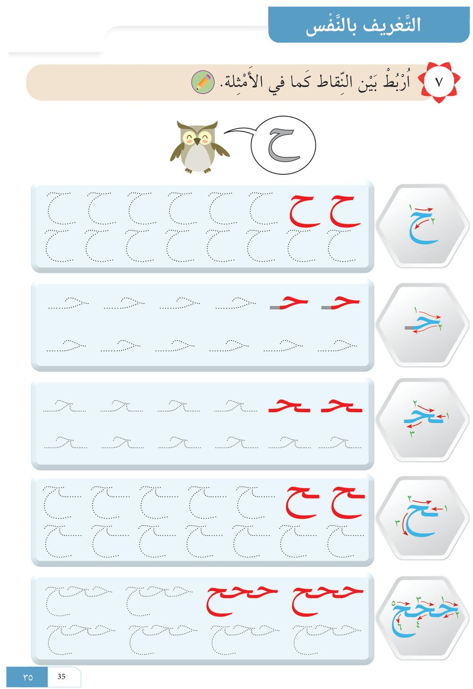

ح ح
ح ح
ح ح
ح ح
ح ح
ح ح
ح ح

ح ح
ح ح
ح ح
ح ح
ح ح
ح ح
ح ح

ح ح
ح ح
ح ح
ح ح
ح ح
ح ح
ح ح

ح ح
ح ح
ح ح
ح ح
ح ح
ح ح
ح ح

ح ح
ح ح
ح ح
ح ح
ح ح
ح ح
ح ح

<!-- sayfa 35 -->

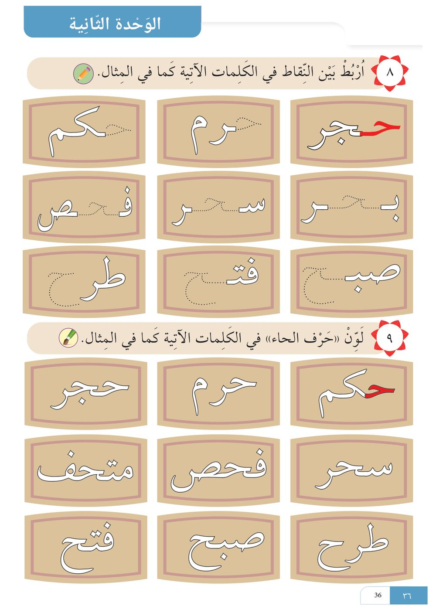
# ٨ . أَرْبُطْ بَيْنَ النِّقاطِ فِي الْكَلِماتِ الْآتِيَةِ كَما فِي الْمِثالِ. ✏️

| | | |
| :---: | :---: | :---: |
| حـكـم | حـرم | حـجـر |
| فـحـص | سـحـر | بـحـر |
| طـرح | فـتـح | صـبـح |

# ٩ . لَوِّنْ «حَرْفَ الْحاءِ» فِي الْكَلِماتِ الْآتِيَةِ كَما فِي الْمِثالِ. ✏️

| | | |
| :---: | :---: | :---: |
| حـجـر | حـرم | حـكـم |
| سـحـر | فـحـص | مـتـحـف |
| فـتـح | صـبـح | طـرح |

<!-- sayfa 36 -->

# ١٠
اِسْتَمِعْ إِلَى نُطْقِ "حَرْفِ الْحَاءِ" بِالصَّوْتَاتِ الْقَصِيرَةِ فِي الْكَلِمَاتِ الْآتِيَةِ، ثُمَّ لَاحِظْهُ.

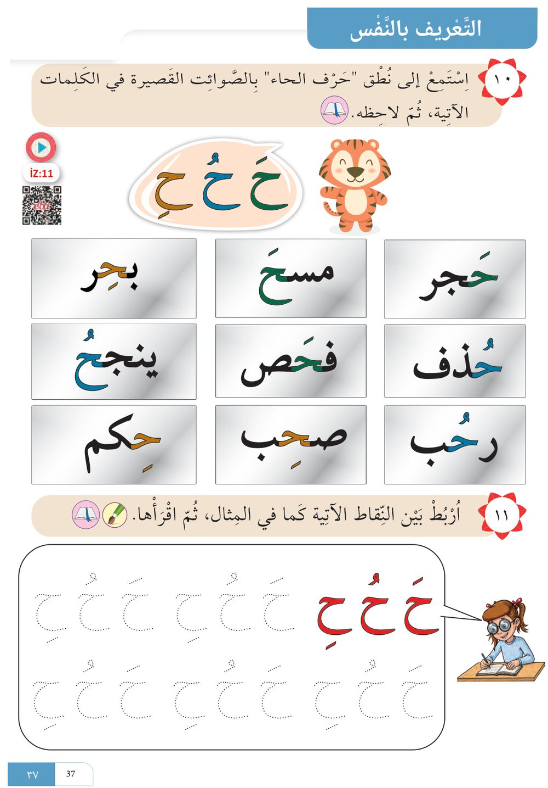

حَ حُ حِ

| خَجَرَ | مَسَحَ | بَحْرٌ |
| :---: | :---: | :---: |
| حُذِفَ | فَحَصَ | يَنْجَحُ |
| رَحِبَ | صَحِبَ | حَكَمَ |

# ١١
أَرْبِطْ بَيْنَ النِّقَاطِ الْآتِيَةِ كَمَا فِي الْمِثَالِ، ثُمَّ اقْرَأْهَا.

حَ حُ حِ حَ حُ حِ حَ حُ حِ
حَ حُ حِ حَ حُ حِ حَ حُ حِ

<!-- sayfa 37 -->

# ١٢ ✏️ أُرْبُطْ بَيْنَ النِّقاطِ كَما فِي الْأَمْثِلَةِ.

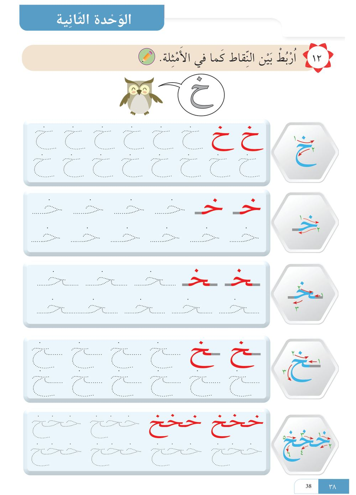

خ

خ خ خ خ خ خ خ خ
خ خ خ خ خ خ خ خ

خــ
خــ خــ ــخـ ــخـ ــخـ ــخـ 
ــخـ ــخـ ــخـ ــخـ ــخـ ــخـ

ــخــ
ــخــ ــخــ ـخـ ـخـ ـخـ
ـخـ ـخـ ـخـ ـخـ ـخـ ـخـ

ـــخ
ــخ ــخ ـخ ـخ ـخ ـخ 
ـخ ـخ ـخ ـخ ـخ ـخ

خخخ
خخخ  خخخ خخخ خخخ
خخخ خخخ خخخ خخخ

<!-- sayfa 38 -->

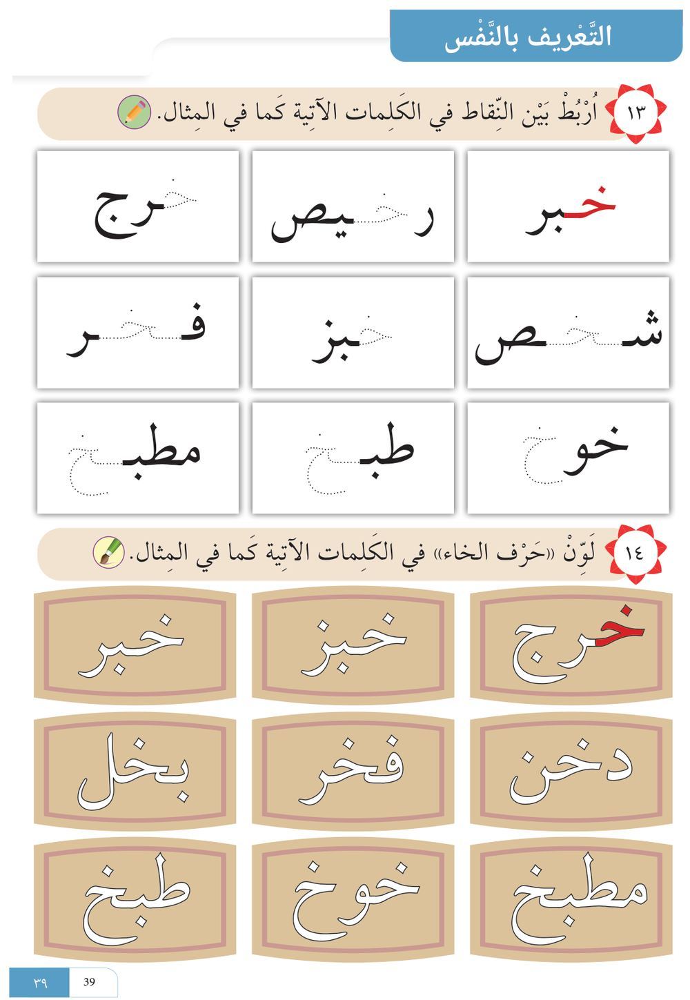 ١٣ اِرْبُطْ بَيْنَ النُّقاطِ فِي الْكَلِماتِ الْآتِيَةِ كَما فِي الْمِثالِ. ✏️

| | | |
| :---: | :---: | :---: |
| خَبَر | رَخِيص | خَرَجَ |
| شَخَصَ | خُبْز | فَخَرَ |
| خَوْخ | طَبَخَ | مَطْبَخ |

 ١٤ لَوِّنْ «حَرْفَ الْخاءِ» فِي الْكَلِماتِ الْآتِيَةِ كَما فِي الْمِثالِ. ✏️

| | | |
| :---: | :---: | :---: |
| خَبَر | خُبْز | خَرَجَ |
| دَخَنَ | فَخَرَ | بَخِلَ |
| مَطْبَخ | خَوْخ | طَبَخَ |

<!-- sayfa 39 -->

# ١٥
اسْتَمِعْ إِلَى نُطْقِ "حَرْفِ الْخَاءِ" بِالصَّوَائِتِ الْقَصِيرَةِ فِي الْكَلِمَاتِ الْآتِيَةِ، ثُمَّ لَاحِظْهُ.

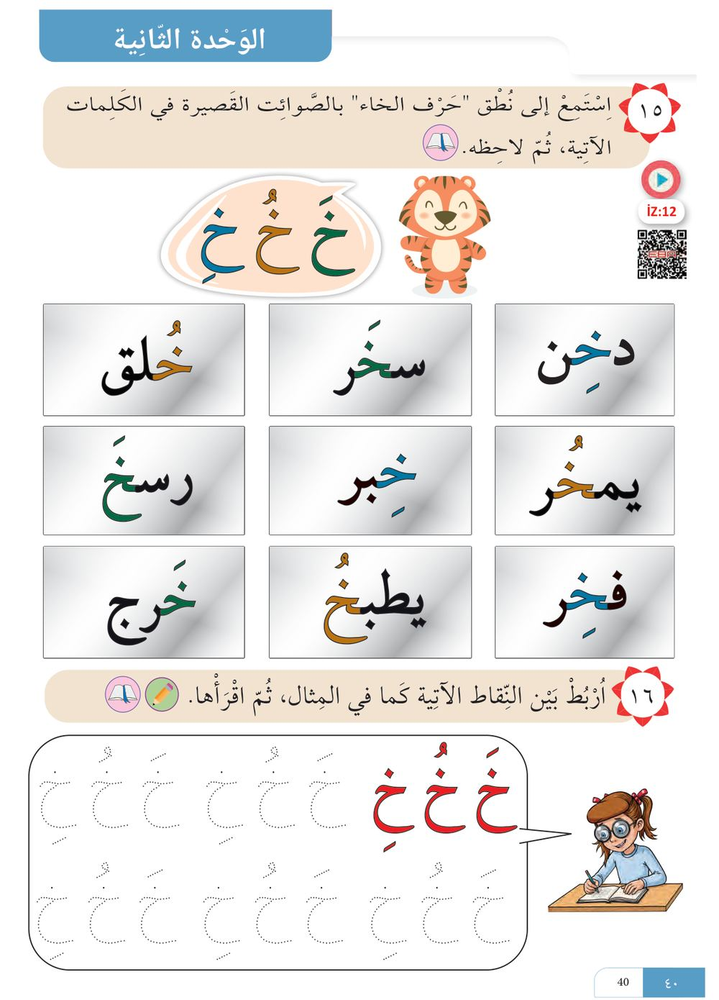

خَ خُ خِ

| دَخَنَ | سَخَرَ | خَلَقَ |
| :---: | :---: | :---: |
| يَمْخُرُ | خَبَرَ | رَسَخَ |
| فَخَرَ | يَطْبُخُ | خَرَجَ |

# ١٦
أَرْبُطْ بَيْنَ النِّقاطِ الْآتِيَةِ كَمَا فِي الْمِثَالِ، ثُمَّ اقْرَأْهَا.

خَ خُ خِ
خَ خُ خِ
خَ خُ خِ
خَ خُ خِ
خَ خُ خِ
خَ خُ خِ
خَ خُ خِ

<!-- sayfa 40 -->

١٧ ✏️ . اِبْحَثْ عَنِ الْحُرُوفِ بِالْقَائِمَةِ فِي الْكَلِمَاتِ الْآتِيَةِ، ثُمَّ لَوِّنْهَا كَمَا فِي الْمِثَالِ.

# ج ح ح خ

| جَمَلٌ | عَجَبٌ | يَخْرُجُ |
| :---: | :---: | :---: |
| حَجَرٌ | صَحِبَ | يَنْجَحُ |
| خَبَرَ | فَخِرَ | يَطْبُخُ |

١٨ ✏️ . اِسْتَمِعْ إِلَى الْكَلِمَاتِ، ثُمَّ أَكْمِلِ الْحُرُوفَ النَّاقِصَةَ مِنَ الْقَائِمَةِ الْآتِيَةِ كَمَا فِي الْمِثَالِ.

| ج ج ج | ح ح ح | خ خ خ |

خَرَجَ
شـ ............... ر
سـ ...............
فـ ............... ص
مـس ...............
ذَفـ ...............

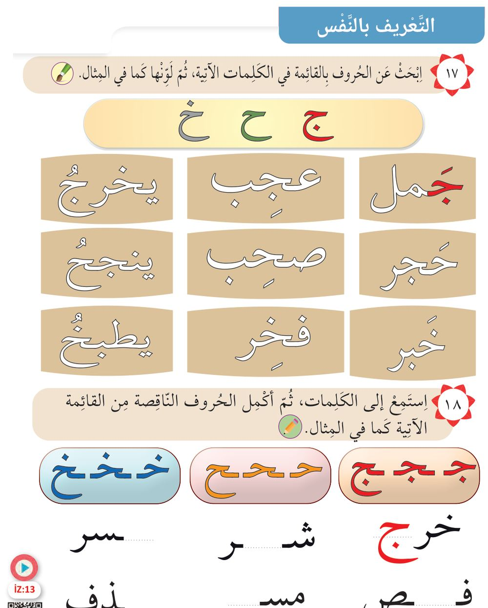

<!-- sayfa 41 -->

# ١٩
إِسْتَمِعْ إِلَى الْكَلِمَاتِ الْآتِيَةِ، وَضَعِ الْحَرَكَةَ الْمُنَاسِبَةَ لِلْحُرُوفِ "ج، ح، خ"، ثُمَّ لَوِّنْهَا كَمَا فِي الْمِثَالِ ✏️ 🎨

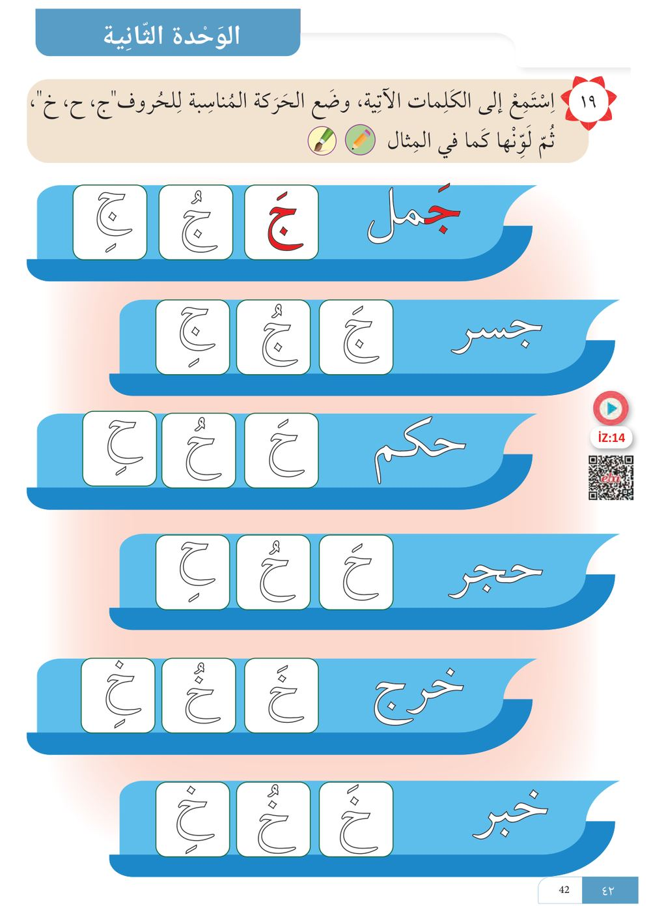

جَمَلٌ  جَ  حَ  حِ
جِسْرٌ  جِ  حِ  حُ
حُكْمٌ  خُ  حُ  جُ
حَجَرٌ  خَ  حَ  جَ
خَرَجَ  خَ  حَ  جَ
خَبَرٌ  خَ  حَ  جَ

<!-- sayfa 42 -->

# ٢٠ اسْتَمِعْ إِلَى الْعِبَارَاتِ الْآتِيَةِ، وَأَعِدْهَا.

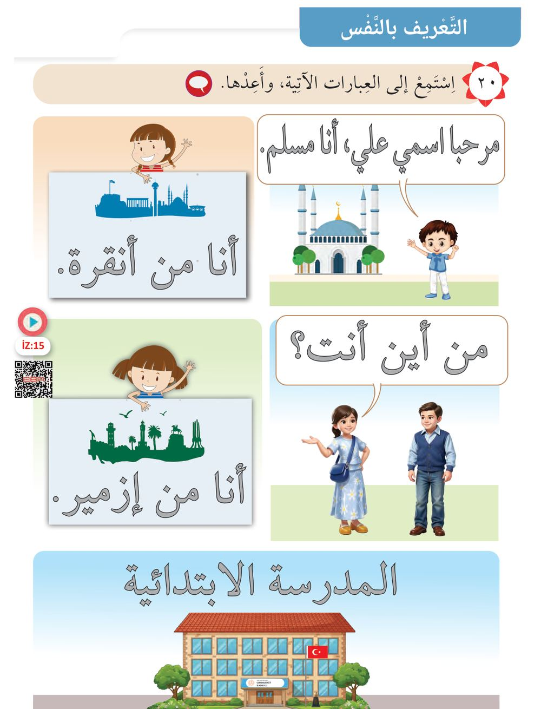

مَرْحَبًا اسْمِي عَلِي، أَنَا مُسْلِمٌ.

أَنَا مِنْ أَنْقَرَةَ.

مِنْ أَيْنَ أَنْتَ؟

أَنَا مِنْ إِزْمِيرَ.

المَدْرَسَةُ الِابْتِدَائِيَّةُ

<!-- sayfa 43 -->

# ٢١
إِسْتَمِعْ إِلَى السُّؤَالَيْنِ وَجَوَابِهِمَا، ثُمَّ أَعِدْهُمَا.

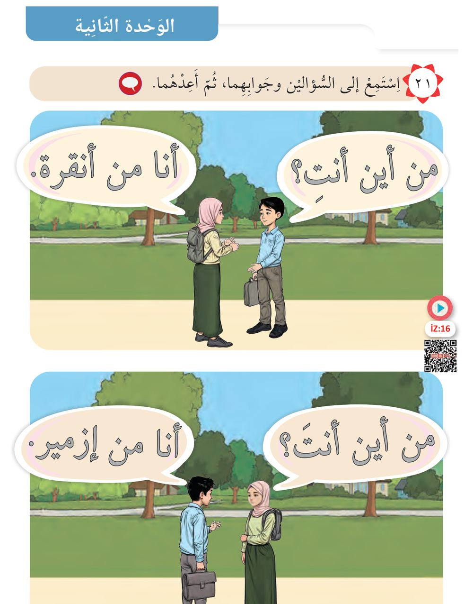

مَنْ أَيْنَ أَنْتَ؟
أَنَا مِنْ أَنْقَرَةَ.

مَنْ أَيْنَ أَنْتِ؟
أَنَا مِنْ إِزْمِيرَ.

<!-- sayfa 44 -->

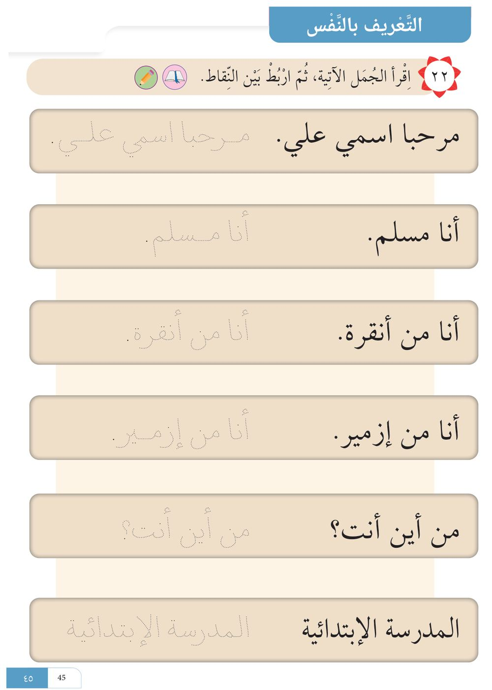 اقْرَأِ الْجُمَلَ الْآتِيَةَ، ثُمَّ ارْبِطْ بَيْنَ النِّقَاطِ. 22

مَرْحَبًا اسْمِي عَلِي.  مَرْحَبًا اسْمِي عَلِي.

أَنَا مُسْلِمٌ.  أَنَا مُسْلِمٌ.

أَنَا مِنْ أَنْقَرَةَ.  أَنَا مِنْ أَنْقَرَةَ.

أَنَا مِنْ إِزْمِيرَ.  أَنَا مِنْ إِزْمِيرَ.

مِنْ أَيْنَ أَنْتَ؟  مِنْ أَيْنَ أَنْتَ؟

الْمَدْرَسَةُ الِابْتِدَائِيَّةُ

<!-- sayfa 45 -->

# ٢٣
إِسْتَمِعْ إِلَي الْعِبَارَاتِ الْآتِيَةِ، وَأَعِدْهَا، ثُمَّ أَجْرِ حِوَارًا مَعَ أَصْدِقَائِكَ فِي الصَّفِّ.

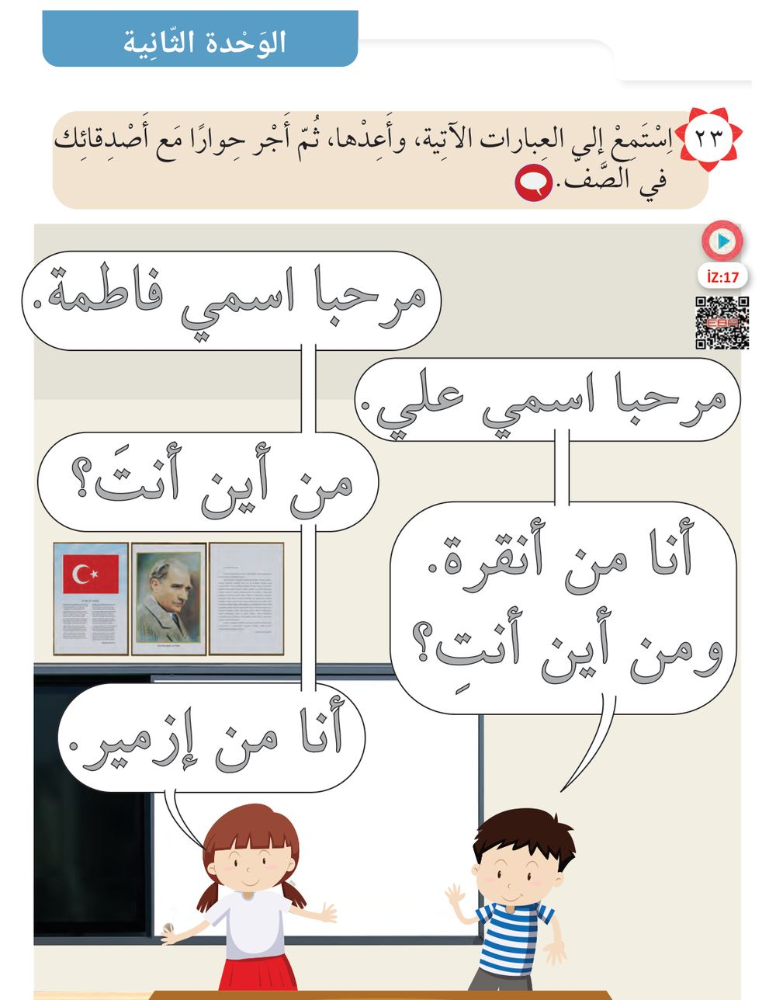

مَرْحَبًا اسْمِي فَاطِمَةُ.
مَنْ أَيْنَ أَنْتَ؟
أَنَا مِنْ إِزْمِير.

مَرْحَبًا اسْمِي عَلِيٌّ.
أَنَا مِنْ أَنْقَرَةَ. وَمَنْ أَيْنَ أَنْتِ؟

<!-- sayfa 46 -->

# التَّدْرِيبَاتُ

١- أَرْبِطْ بَيْنَ النِّقَاطِ كَمَا فِي الْمِثَالِ. 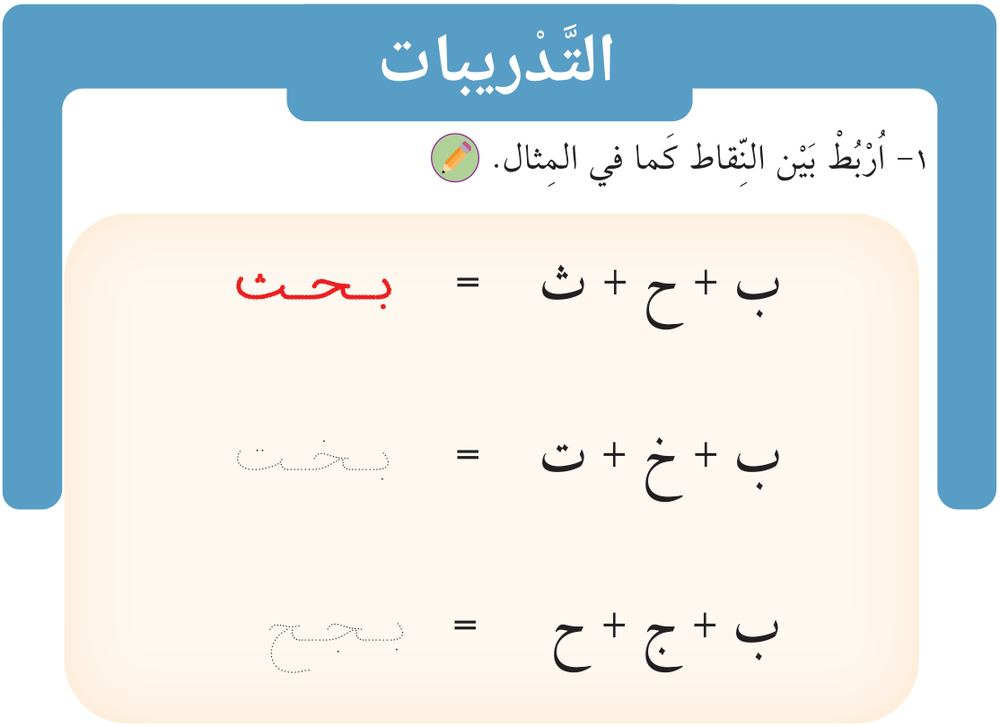

$$ \text{بَحَثَ} = \text{ب} + \text{ح} + \text{ث} $$
$$ \text{بَخَتَ} = \text{ب} + \text{خ} + \text{ت} $$
$$ \text{بَجَحَ} = \text{ب} + \text{ج} + \text{ح} $$

٢- اقْرَأِ الْكَلِمَاتِ الْآتِيَةَ، ثُمَّ ارْبِطْ بَيْنَ النِّقَاطِ.

| | |
|---|---|
| اسْمِي | اسمي |
| مَدْرَسَةٌ | مدرسة |
| مِنْ | من |
| | |

<!-- sayfa 47 -->

٣- صِلْ بَيْنَ الْحُرُوفِ وَالْكَلِمَاتِ كَمَا فِي الْمِثَالِ.

٤- اخْتَرْ أَشْكَالَ الْحُرُوفِ الصَّحِيحَةَ، وَضَعْ عَلَامَةَ صَحٍّ ($\checkmark$) فِي الْفَرَاغَاتِ كَمَا فِي الْمِثَالِ.

| مرحبا | ...بر | ...خر | بـ...ر |
| :---: | :---: | :---: | :---: |
| $\dots$ ح $\checkmark$ | $\dots$ خ $\bigcirc$ | $\dots$ ج $\bigcirc$ | $\dots$ ح $\bigcirc$ |
| $\dots$ ح $\bigcirc$ | $\dots$ خ $\bigcirc$ | $\dots$ ج $\bigcirc$ | $\dots$ ح $\bigcirc$ |
| $\dots$ ح $\bigcirc$ | $\dots$ ج $\bigcirc$ | $\dots$ ج $\bigcirc$ | $\dots$ ح $\bigcirc$ |

<!-- sayfa 48 -->

مَوْقِعُ الْوَحْدَةِ

مُخْتَصَرُ الْوَحْدَةِ

# الْوَحْدَةُ ٣
## الْهِوَايَات

<!-- sayfa 49 -->

# الْهِوَايَاتُ

اِسْتَمِعْ إِلَى أَسْمَاءِ الْحُرُوفِ الْآتِيَةِ، وَأَعِدْهَا.

| | | |
| :--- | :---: | :--- |
| دَال | د | ![aslan resmi] |
| ذَال | ذ | ![aslan resmi] |
| رَاء | ر | ![aslan resmi] |
| زَاي | ز | ![aslan resmi] |

<!-- sayfa 50 -->

# ٢

أُرْبُطْ بَيْنَ النِّقاطِ كَما فِي الْأَمْثِلَةِ. ✏️

د

| | | | | | | | د | د |
|---|---|---|---|---|---|---|---|---|
| د | د | د | د | د | د | د | د | د |
| د | د | د | د | د | د | د | د | د |

| | | | | | | دـ | دـ |
|---|---|---|---|---|---|---|---|
| دـ | دـ | دـ | دـ | دـ | دـ | دـ | دـ |
| دـ | دـ | دـ | دـ | دـ | دـ | دـ | دـ |

| | | | | دـ | دـ |
|---|---|---|---|---|---|
| ـد | ـد | ـد | ـد | ـد | ـد |
| ـد | ـد | ـد | ـد | ـد | ـد |

| | | | | | د | د |
|---|---|---|---|---|---|---|
| ـد | ـد | ـد | ـد | ـد | ـد | ـد |
| ـد | ـد | ـد | ـد | ـد | ـد | ـد |

| | | | | دـ | دـ | د |
|---|---|---|---|---|---|---|
| ـد | ـد | ـد | ـد | ـد | ـد | ـد |
| ـد | ـد | ـد | ـد | ـد | ـد | ـد |

<!-- sayfa 51 -->

 أَرْبُطْ بَيْنَ النُّقاطِ فِي الْكَلِماتِ الْآتِيَةِ كَما فِي الْمِثالِ. 3

ديك
دجاجة
يـد
دلو

حديقة
أسـد
بنـدق

 لَوِّنْ «حَرْفَ الدَّالِ» فِي الْكَلِماتِ الْآتِيَةِ كَما فِي الْمِثالِ. 4

بعيد
بارد
دار
أسود

دب
قدم
بدلة
دبس

غداء
واحد
عبد

<!-- sayfa 52 -->

# ٥
اِسْتَمِعْ إِلَى نُطْقِ "حَرْفِ الدَّال" بِالصَّوَائتِ القَصِيرَةِ فِي الكَلِمَاتِ الآتِيَةِ، ثُمَّ لَاحِظْهُ.

دَ دُ دِ

| دَجَاجَةٌ | قَدَمٌ | دَفْتَرٌ |
| :---: | :---: | :---: |
| دُلْفِينٌ | دُبٌّ | بُنْدُقٌ |
| مَنْدِيلٌ | دِيكٌ | حَدِيقَةٌ |

# ٦
أَرْبُطْ بَيْنَ النُّقَاطِ الآتِيَةِ كَمَا فِي المِثَالِ، ثُمَّ اقْرَأْهَا.

دَ دُ دِ     دَ دُ دِ     دَ دُ دِ
دِ دَ دُ     دِ دَ دُ     دِ دَ دُ
دَ دُ دِ     دَ دُ دِ     دَ دُ دِ

<!-- sayfa 53 -->

# ٧
أُرْبُطْ بَيْنَ النِّقاطِ كَما فِي الْأَمْثِلَةِ. ✏️

ذ ذ ذ ذ ذ ذ ذ ذ ذ
ذ ذ ذ ذ ذ ذ ذ ذ ذ

ذ _ ذ _ ذ _ ذ _ ذ _ ذ _ ذ _ ذ _ ذ _ ذ _ ذ _ ذ _ ذ _ ذ _ ذ _ ذ _ ذ _ ذ _ ذ _ ذ _ ذ _ ذ _ ذ _ ذ _ ذ _ ذ _ ذ _ ذ _ ذ _ ذ _ ذ _ ذ _ ذ _ ذ _ ذ _ ذ _ ذ _ ذ _ ذ _ ذ _ ذ _ ذ _ ذ _ ذ _ ذ _ ذ _ ذ _ ذ _ ذ _ ذ _ ذ _ ذ _ ذ _ ذ _ ذ _ ذ _ ذ _ ذ _ ذ _ ذ _ ذ _ ذ _ ذ _ ذ _ ذ _ ذ _ ذ _ ذ _ ذ _ ذ _ ذ _ ذ _ ذ _ ذ _ ذ _ ذ _ ذ _ ذ _ ذ _ ذ _ ذ _ ذ _ ذ _ ذ _ ذ _ ذ _ ذ _ ذ _ ذ _ ذ _ ذ _ ذ _ ذ _ ذ _ ذ _ ذ _ ذ _ ذ _ ذ _ ذ _ ذ _ ذ _ ذ _ ذ _ ذ _ ذ _ ذ _ ذ _ ذ _ ذ _ ذ _ ذ _ ذ _ ذ _ ذ _ ذ _ ذ _ ذ _ ذ _ ذ _ ذ _ ذ _ ذ _ ذ _ ذ _ ذ _ ذ _ ذ _ ذ _ ذ _ ذ _ ذ _ ذ _ ذ _ ذ _ ذ _ ذ _ ذ _ ذ _ ذ _ ذ _ ذ _ ذ _ ذ _ ذ _ ذ _ ذ _ ذ _ ذ _ ذ _ ذ _ ذ _ ذ _ ذ _ ذ _ ذ _ ذ _ ذ _ ذ _ ذ _ ذ _ ذ _ ذ _ ذ _ ذ _ ذ _ ذ _ ذ _ ذ _ ذ _ ذ _ ذ _ ذ _ ذ _ ذ _ ذ _ ذ _ ذ _ ذ _ ذ _ ذ _ ذ _ ذ _ ذ _ ذ _ ذ _ ذ _ ذ _ ذ _ ذ _ ذ _ ذ _ ذ _ ذ _ ذ _ ذ _ ذ _ ذ _ ذ _ ذ _ ذ _ ذ _ ذ _ ذ _ ذ _ ذ _ ذ _ ذ _ ذ _ ذ _ ذ _ ذ _ ذ _ ذ _ ذ _ ذ _ ذ _ ذ _ ذ _ ذ _ ذ _ ذ _ ذ _ ذ _ ذ _ ذ _ ذ _ ذ _ ذ _ ذ _ ذ _ ذ _ ذ _ ذ _ ذ _ ذ _ ذ _ ذ _ ذ _ ذ _ ذ _ ذ _ ذ _ ذ _ ذ _ ذ _ ذ _ ذ _ ذ _ ذ _ ذ _ ذ _ ذ _ ذ _ ذ _ ذ _ ذ _ ذ _ ذ _ ذ _ ذ _ ذ _ ذ _ ذ _ ذ _ ذ _ ذ _ ذ _ ذ _ ذ _ ذ _ ذ _ ذ _ ذ _ ذ _ ذ _ ذ _ ذ _ ذ _ ذ _ ذ _ ذ _ ذ _ ذ _ ذ _ ذ _ ذ _ ذ _ ذ _ ذ _ ذ _ ذ _ ذ _ ذ _ ذ _ ذ _ ذ _ ذ _ ذ _ ذ _ ذ _ ذ _ ذ _ ذ _ ذ _ ذ _ ذ _ ذ _ ذ _ ذ _ ذ _ ذ _ ذ _ ذ _ ذ _ ذ _ ذ _ ذ _ ذ _ ذ _ ذ _ ذ _ ذ _ ذ _ ذ _ ذ _ ذ _ ذ _ ذ _ ذ _ ذ _ ذ _ ذ _ ذ _ ذ _ ذ _ ذ _ ذ _ ذ _ ذ _ ذ _ ذ _ ذ _ ذ _ ذ _ ذ

<!-- sayfa 54 -->

# ٨ ✏️ أَرْبُطْ بَيْنَ النِّقاطِ فِي الْكَلِماتِ الْآتِيَةِ كَما فِي الْمِثالِ.

| | | |
| :---: | :---: | :---: |
| ذِئْبٌ | ذَهَبَ | ذُرَّةٌ |
| حِذَاءٌ | باذِنْجانٍ | أُذُنٌ |
| تَلَامِيذُ | تِلْمِيذٌ | قُنْفُذٌ |

# ٩ ✏️ لَوِّنْ «حَرْفَ الذَّالِ» فِي الْكَلِماتِ الْآتِيَةِ كَما فِي الْمِثالِ.

| | | | |
| :---: | :---: | :---: | :---: |
| مُذيعٌ | هٰذا | مِئْذَنَةٌ | لَذيذٌ |
| ذُبابَةٌ | تَذْكِرَةٌ | أُذُنٌ | جِذْعٌ |
| ذُرْوَةٌ | نَذيرٌ | جُذورٌ | هٰذِهِ |

<!-- sayfa 55 -->

# ١٠
اِسْتَمِعْ إِلَى نُطْقِ "حَرْفِ الذَّال" بِالصَّوَائتِ القَصِيرَةِ فِي الكَلِمَاتِ الآتِيَةِ، ثُمَّ لَاحِظْهُ. 

ذَ ذُ ذِ

| ذَهَبَ | حِذَاء | ذَكِي |
| :---: | :---: | :---: |
| ذُرَة | أُذُن | ذُكْر |
| ذُئْب | ذِرَاع | بِذِنْجَان |

# ١١
اِرْبُطْ بَيْنَ النِّقَاطِ الآتِيَةِ كَمَا فِي المِثَالِ، ثُمَّ اقْرَأْهَا.

ذَ ذُ ذِ
ذِ ذُ ذَ
ذَ ذُ ذِ
ذِ ذُ ذَ
ذِ ذُ ذَ
ذِ ذُ ذَ

<!-- sayfa 56 -->

# ١٢ أُرْبِطُ بَيْنَ النِّقاطِ كَما فِي الْأَمْثِلَةِ. ✏️

ر

| | | | | | | | |
| :---: | :---: | :---: | :---: | :---: | :---: | :---: | :---: |
| ر | ر | | | | | | |
| ◌ | ◌ | ◌ | ◌ | ◌ | ◌ | ◌ | ◌ |
| ◌ | ◌ | ◌ | ◌ | ◌ | ◌ | ◌ | ◌ |
|  | | | | | | | |

| | | | | | | | |
| :---: | :---: | :---: | :---: | :---: | :---: | :---: | :---: |
| ـر | ـر | | | | | | |
| ◌ | ◌ | ◌ | ◌ | ◌ | ◌ | ◌ | ◌ |
| ◌ | ◌ | ◌ | ◌ | ◌ | ◌ | ◌ | ◌ |
|  | | | | | | | |

| | | | | | | | |
| :---: | :---: | :---: | :---: | :---: | :---: | :---: | :---: |
| ـر | ـر | | | | | | |
| ◌ | ◌ | ◌ | ◌ | ◌ | ◌ | ◌ | ◌ |
| ◌ | ◌ | ◌ | ◌ | ◌ | ◌ | ◌ | ◌ |
|  | | | | | | | |

| | | | | | | | |
| :---: | :---: | :---: | :---: | :---: | :---: | :---: | :---: |
| ـر | ـر | | | | | | |
| ◌ | ◌ | ◌ | ◌ | ◌ | ◌ | ◌ | ◌ |
| ◌ | ◌ | ◌ | ◌ | ◌ | ◌ | ◌ | ◌ |
|  | | | | | | | |

| | | | | | | | |
| :---: | :---: | :---: | :---: | :---: | :---: | :---: | :---: |
| رـ | رـ | رـ | رـ | رـ | رـ | رـ | رـ |
| ◌ | ◌ | ◌ | ◌ | ◌ | ◌ | ◌ | ◌ |
| ◌ | ◌ | ◌ | ◌ | ◌ | ◌ | ◌ | ◌ |
|  | | | | | | | |

<!-- sayfa 57 -->

 ١٣ . أُرْبُطْ بَيْنَ النِّقاطِ فِي الْكَلِماتِ الْآتِيَةِ كَما فِي الْمِثالِ.

| | | |
| :---: | :---: | :---: |
| رَأْس | رُمَّان | بَحْر |
| أَرْنَب | بُرْتُقَال | كُرَة |
| أَصْفَر | فَأْر | أَحْمَر |

 ١٤ . لَوِّنْ «حَرْفَ الرَّاءِ» فِي الْكَلِماتِ الْآتِيَةِ كَما فِي الْمِثالِ.

| | | |
| :---: | :---: | :---: |
| نَظَّارَة | حِمَار | وَرَق |
| رِيشَة | فُرْن | صِفْر |
| فَطُور | رَقْم | كُرْسِي |

<!-- sayfa 58 -->

# ١٥
اِسْتَمِعْ إِلَى نُطْقِ "حَرْفِ الرَّاءِ" بِالصَّوَائتِ القَصِيرَةِ فِي الكَلِمَاتِ الآتِيَةِ، ثُمَّ لَاحِظْهُ.

رَ رُ رِ

| كَرَزٌ | كُرَةٌ | رَأْسٌ |
| :---: | :---: | :---: |
| رُوَيْدَاءُ | رُمَيْسَاءُ | رُمَّانٌ |
| رِيشَةٌ | رِجْلٌ | رِسَالَةٌ |

# ١٦
أَرْبِطْ بَيْنَ النُّقَاطِ الآتِيَةِ كَمَا فِي المِثَالِ، ثُمَّ اقْرَأْهَا.

| رَ رُ رِ | رَ رُ رِ | رَ رُ رِ |
| :---: | :---: | :---: |
| رَ رُ رِ | رَ رُ رِ | رَ رُ رِ |
| رَ رُ رِ | رَ رُ رِ | رَ رُ رِ |

<!-- sayfa 59 -->

# ١٧ أَرْبُطْ بَيْنَ النِّقاطِ كَمَا فِي الْأَمْثِلَةِ. ✏️

ز
ز ز ز ز ز ز ز
ز ز ز ز ز ز ز

زــ زــ زــ زــ زــ زــ زــ
زــ زــ زــ زــ زــ زــ زــ

زَــ زَــ زَــ زَــ زَــ زَــ زَــ
زَــ زَــ زَــ زَــ زَــ زَــ زَــ

زِــ زِــ زِــ زِــ زِــ زِــ زِــ
زِــ زِــ زِــ زِــ زِــ زِــ زِــ

زُــ زُــ زُــ زُــ زُــ زُــ زُــ
زُــ زُــ زُــ زُــ زُــ زُــ زُــ

ز - ز - ز - ز - ز - ز - ز
ز - ز - ز - ز - ز - ز - ز

<!-- sayfa 60 -->

١٨. أُرْبُطْ بَيْنَ النِّقاطِ فِي الْكَلِماتِ الْآتِيَةِ كَمَا فِي الْمِثَالِ. ✏️

| | | |
| :---: | :---: | :---: |
| لوز | زبدة | زحل |
| غزال | جزر | زيتون |
| زينب | ماعز | جزمة |

١٩. لَوِّنْ «حَرْفَ الزَّايِ» فِي الْكَلِماتِ الْآتِيَةِ كَمَا فِي الْمِثَالِ. ✏️

| | | |
| :---: | :---: | :---: |
| زرافة | خبز | زكاة |
| نزل | منزل | موز |
| زبدة | زجاجة | قفاز |

<!-- sayfa 61 -->

# ٢٠
اِسْتَمِعْ إِلَى نُطْقِ "حَرْفِ الزَّاي" بِالصَّوَائتِ القَصِيرَةِ فِي الكَلِمَاتِ الآتِيَةِ، ثُمَّ لَاحِظْهُ.

| زَ | زُ | زِ |
| :---: | :---: | :---: |

| زَيْت | زَيْتُون | زَهْرَاء |
| :---: | :---: | :---: |
| مَنْزِل | زِلْزَال | جَزِيرَة |
| زُرَافَة | زُجَاجَة | زُبْدَة |

# ٢١
أَرْبُطْ بَيْنَ النِّقَاطِ الآتِيَةِ كَمَا فِي المِثَالِ، ثُمَّ اقْرَأْهَا.

زَ زُ زِ  زَ زُ زِ  زَ زُ زِ
زَ زُ زِ  زَ زُ زِ  زَ زُ زِ
زَ زُ زِ  زَ زُ زِ  زَ زُ زِ

<!-- sayfa 62 -->

# ٢٢
إِبْحَثْ عَنِ الْحُرُوفِ بِالْقَائِمَةِ فِي الْكَلِمَاتِ الْآتِيَةِ، ثُمَّ لَوِّنْهَا كَمَا فِي الْمِثَالِ.

د   ذ   ر   ز

| ظرف | ذرة | لذيذ |
| :---: | :---: | :---: |
| دلو | قنفذ | مدرسة |
| دار | وردي | جريدة |

# ٢٣
اِسْتَمِعْ إِلَى الْكَلِمَاتِ، ثُمَّ أَكْمِلِ الْحُرُوفَ النَّاقِصَةَ مِنَ الْقَائِمَةِ كَمَا فِي الْمِثَالِ.

ذ   ر   ز   ر   ذ   ذ   د

حذاء
هـ.........ه
و.........دي

.........راجة
أ.........ن
جـ.........يدة

<!-- yer tutucu bulunamadı: sayfa sonuna eklendi -->

<!-- sayfa 63 -->

إِسْتَمِعْ إِلَى الْكَلِمَاتِ الْآتِيَةِ، وَضَعِ الْحَرَكَاتِ الْمُنَاسِبَةَ لِحُرُوفِ "الدَّالِ، وَالذَّالِ، وَالرَّاءِ، وَالزَّايِ"، ثُمَّ لَوِّنْهَا كَمَا فِي الْمِثَالِ.

ذِرَاعٌ
دِ / ذُ / ذَ

رُمَّانٌ
رِ / رُ / رَ

دَوَاءٌ
دَ / دُ / دِ

مَدْرَسَةٌ
رِ / رُ / رَ

زُبْدَةٌ
زِ / زُ / زَ

ذَهَبَ
ذِ / ذُ / ذَ

<!-- sayfa 64 -->

# إِسْتَمِعْ إِلَى الْعِبَارَاتِ الْآتِيَةِ، وَأَعِدْهَا. ٢٥

قراءة الكتب

استماع إلى الموسيقى

ركوب الدراجة

رسم

سياحة

شطرنج

<!-- sayfa 65 -->

٢٦ 💬 اِسْتَمِعْ إِلَى السُّؤَالَيْنِ وَجَوَابَيْهِمَا، ثُمَّ أَعِدْهُمَا.

ما هِوَايَتُكَ؟
هوايتي السِّبَاحَةُ.

ما هِوَايَتُكَ؟
هوايتي الرَّسْمُ.

٢٧ 💬 اِسْتَمِعْ إِلَى الْعِبَارَاتِ، وَأَعِدْهَا، ثُمَّ قَدِّمْهَا فِي الصَّفِّ كَمَا فِي الْمِثَالِ.

هوايتي الشَّطْرَنْجُ.
هوايتي الرَّسْمُ.

<!-- sayfa 66 -->

# إِخْتَرِ الصُّورَةَ الْمُنَاسِبَةَ لِلْعِبَارَاتِ الْآتِيَةِ، وَضَعْ عَلَامَةَ صَحٍّ ($\checkmark$) تَحْتَ الصُّورَةِ الصَّحِيحَةِ كَمَا فِي الْمِثَالِ.

استماع إلى الموسيقى $\Leftarrow$

$\bigcirc$

١ - قراءة الكتب

$\bigcirc$
$\bigcirc$

٢ - الرسم

$\bigcirc$
$\bigcirc$

٤ - الشطرنج

$\bigcirc$
$\bigcirc$

٣ - ركوب الدراجة

$\bigcirc$
$\bigcirc$

٥ - السباحة

<!-- sayfa 67 -->

# ٢٩
اِسْتَمِعْ إِلَى الْعِبَارَاتِ الْآتِيَةِ، وَأَعِدْهَا، ثُمَّ أَجْرِ حِوَارًا مَعَ أَصْدِقَائِكَ فِي الصَّفِّ.

أَنَا أُحِبُّ قِرَاءَةَ الْكُتُبِ.

أَنَا لَا أُحِبُّ مُشَاهَدَةَ التِّلْفَازِ.

أُحِبُّ الرَّسْمَ.

لَا أُحِبُّ الْأَلْعَابَ الْحَاسُوبِيَّةَ.

İZ:28

<!-- sayfa 68 -->

# ٣٠
إِسْتَمِعْ إِلَى الْجُمَلِ، وَأَعِدْهَا، ثُمَّ تَأَمَّلْ مَعَانِيَهَا مُسْتَعِينًا بِالصُّوَرِ.

|  |  |
| :---: | :---: |
|  | أُحِبُّ |
|  | أُحِبُّ |
|  | أُحِبُّ |
|  | أُحِبُّ |
|  | لَا أُحِبُّ |
|  | لَا أُحِبُّ |
|  | لَا أُحِبُّ |
|  | لَا أُحِبُّ |

<!-- sayfa 69 -->

# ٣١
اِسْتَمِعْ إِلَى الْجُمْلَتَيْنِ، وَأَعِدْهُمَا، ثُمَّ ارْبُطْ بَيْنَ النِّقَاطِ.

أُحِبُّ الرِّيَاضَةَ.
أُحِبُّ الرِّيَاضَةَ.

أُحِبُّ تَرْبِيَةَ الْحَيَوَانَاتِ.
أُحِبُّ تَرْبِيَةَ الْحَيَوَانَاتِ.

İZ:30

<!-- sayfa 70 -->

# التَّدْرِيبَاتُ

١- قُصَّ الْعِبَارَاتِ الصَّحِيحَةَ لِلصُّوَرِ الْآتِيَةِ مِنْ خَلْفِ الْكِتَابِ (ص. ١٨١)، ثُمَّ أَلْصِقْهَا فِي الْأَمَاكِنِ الْمُنَاسِبَةِ. ✏️

هوايتي

هوايتي

هوايتي

هوايتي

<!-- sayfa 71 -->

٢- تابع الطُّرُقَ، وجِد الهواية الصَّحيحةَ، ثُمَّ قُصَّ الصُّورة المناسبةَ مِنْ خَلْفِ الكِتَابِ (ص. ١٨١٠)، وأَلْصِقْهَا في المَكَان المناسب. ✏️

هوايتي
هوايتي
هوايتي

قراءة الكتب
الشطرنج
الرسم
السباحة

<!-- sayfa 72 -->

مَوْقِعُ الْوَحْدَةِ
مُخْتَصَرُ الْوَحْدَةِ

# الْوَحْدَةُ ٤
## الْمَلَابِس

<!-- sayfa 73 -->

# المَلَابِس

اسْتَمِعْ إِلَى أَسْمَاءِ الْحُرُوفِ الْآتِيَةِ، وَأَعِدْهَا.

| | | |
| :---: | :---: | :---: |
| سِين | س |  |
| شِين | ش |  |
| صَاد | ص |  |
| ضَاد | ض |  |

iZ:31

<!-- sayfa 74 -->

# ٢
أُرْبُطْ بَيْنَ النِّقاطِ كَما في الْأَمْثِلَةِ. ✏️

س
س س
س س س س س
س س س س س

سـ سـ
سـ سـ سـ سـ
سـ سـ سـ سـ

ســـــــ ســـــــ
ســـــــ ســـــــ

سـسـ سـسـ
سـسـ سـسـ سـسـ
سـسـ سـسـ سـسـ

سسس سسس سسس
سسس سسس سسس

<!-- sayfa 75 -->

أُرْبُطْ بَيْنَ النِّقاطِ فِي الْكَلِمَاتِ الْآتِيَةِ كَمَا فِي الْمِثَالِ. ✏️ 3

| | | |
| :---: | :---: | :---: |
| سـرير | حـاسـوب | أُسـرة |
| مـلابـس | سـاعـة | سـيارة |
| أسـد | تمـساح | سـبورة |

لَوِّنْ «حَرْفَ السِّينِ» فِي الْكَلِمَاتِ الْآتِيَةِ كَمَا فِي الْمِثَالِ. 🖍️ 4

| | | |
| :---: | :---: | :---: |
| فَرَس | مَسْرَح | سَبْع |
| مِسْطَرَة | مَسْجِد | أُسْبُوع |
| سَمَّاعَة | أَغُسْطُس | سَفَر |

<!-- sayfa 76 -->

# ٥
اِسْتَمِعْ إِلَى نُطْقِ "حَرْفِ السِّينِ" بِالصَّوَائِتِ الْقَصِيرَةِ فِي الْكَلِمَاتِ الْآتِيَةِ، ثُمَّ لَاحِظْهُ. 

İZ:32

سَ سُ سِ

| سَمَكٌ | سَلَطَةٌ | سَفِينَةٌ |
| :---: | :---: | :---: |
| سُلَّمٌ | سُلْطَانٌ | سُجُودٌ |
| سِتَّةٌ | سِنْجَابٌ | سِبَاحَةٌ |

# ٦
أُرْبُطْ بَيْنَ النِّقَاطِ الْآتِيَةِ كَمَا فِي الْمِثَالِ، ثُمَّ اقْرَأْهَا. 

سَ سُ سِ
سَ سُ سِ
سَ سُ سِ

<!-- sayfa 77 -->

# ٧ أُرْبِطُ بَيْنَ النِّقاطِ كَما فِي الْأَمْثِلَةِ. ✏️

ش ش ش ش ش ش
ش ش ش ش ش ش
ش ش ش ش ش ش
ش ش ش ش ش ش

ـش ـش ـش ـش ـش ـش
ـش ـش ـش ـش ـش ـش

ـشـ ـشـ ـشـ ـشـ ـشـ ـشـ
ـشـ ـشـ ـشـ ـشـ ـشـ ـشـ

ششش ششش ششش ششش
ششش ششش ششش ششش

<!-- sayfa 78 -->

# ٨ اُرْبُطْ بَيْنَ النُّقاطِ فِي الْكَلِماتِ الْآتِيَةِ كَما فِي الْمِثالِ. ✏️

| | | |
| :---: | :---: | :---: |
| وَحْشِي | شَاة | عَشَرَة |
| فَرْش | شَاب | شَاشَة |
| شَعْر | وِشَاح | مِشْط |

# ٩ لَوِّنْ «حَرْفَ الشِّين» فِي الْكَلِماتِ الْآتِيَةِ كَما فِي الْمِثالِ. ✏️

| | | |
| :---: | :---: | :---: |
| إِشَارَة | مُشْمِس | شُرْطِي |
| شَوْكَة | وِشَاح | عَشَاء |
| شَمْس | مُسْتَشْفَى | مُشْتَرِي |

<!-- sayfa 79 -->

اسْتَمِعْ إِلَى نُطْقِ "حَرْفِ الشِّينِ" بِالصَّوَائِتِ الْقَصِيرَةِ فِي الْكَلِمَاتِ الْآتِيَةِ، ثُمَّ لَاحِظْهُ.

| شَ | شُ | شِ |
| :---: | :---: | :---: |

| شَجَرَةٌ | شُبَّاطٌ | شِتَاءٌ |
| :---: | :---: | :---: |
| شَرْقٌ | شُبَّاكٌ | شِمَالٌ |
| شَمْسٌ | شُرْفَةٌ | شِرَاءٌ |

اُرْبُطْ بَيْنَ النِّقَاطِ الْآتِيَةِ كَمَا فِي الْمِثَالِ، ثُمَّ اقْرَأْهَا. 

| شَ | شُ | شِ | شْ |
| :---: | :---: | :---: | :---: |
| شَ | شُ | شِ | شْ |
| شَ | شُ | شِ | شْ |

<!-- sayfa 80 -->

# ١٢ أُرْبِطُ بَيْنَ النِّقاطِ كَما فِي الْأَمْثِلَةِ.

ص ص ص ص ص ص
ص ص ص ص ص ص

ــص ــص ـص  ـص ـص 
ــص  ــص  ــص  ــص ـص

ــصـ  ــصـ  ــصـ  ــصـ ـصـ
ـصـ ـصـ ـصـ ـصـ ـصـ

صــ صــ صـ صـ صـ صـ صـ 
صـ صـ صـ صـ صـ صـ صـ 

صصص صصص صصص
صصص صصص صصص

<!-- sayfa 81 -->

 13. أَرْبِطْ بَيْنَ النُّقاطِ فِي الْكَلِماتِ الْآتِيَةِ كَما فِي الْمِثالِ. ✏️

| | | |
| :---: | :---: | :---: |
| حـــــصـــــان | نـــــصـــــف | صـــــباح |
| عـــــصـــــر | صـــــفراء | صـــــابون |
| مـقـــــص | صـــــمغ | صـــــحراء |

 14. لَوِّنْ «حَرْفَ الصَّادِ» فِي الْكَلِماتِ الْآتِيَةِ كَما فِي الْمِثالِ. 🖍️

| | | |
| :---: | :---: | :---: |
| صحيح | بصل | عصور |
| مصباح | صقر | قميص |
| صغير | قصير | صيد |

<!-- sayfa 82 -->

# ١٥
اِسْتَمِعْ إِلَى نُطْقِ "حَرْفِ الصَّادِ" بِالصَّوَائِتِ القَصِيرَةِ فِي الكَلِمَاتِ الآتِيَةِ، ثُمَّ لَاحِظْهُ.

صَ ضُ صِ

| صَفَ | صَيْفَ | صَلَاةَ |
| :---: | :---: | :---: |
| صُوصَ | صُورَ | صُنْدُوقَ |
| صِنَاعِيَّةَ | صِحَّةَ | صِفْرَ |

# ١٦
أَرْبُطْ بَيْنَ النِّقَاطِ الآتِيَةِ كَمَا فِي المِثَالِ، ثُمَّ اقْرَأْهَا.

صَ ضُ صِ صَ ضُ صِ
صِ ضُ صَ صِ ضُ صَ
صَ ضُ صِ صَ ضُ صِ
صِ ضُ صَ صِ ضُ صَ

<!-- sayfa 83 -->

# ١٧ أَرْبِطْ بَيْنَ النِّقاطِ كَمَا فِي الْأَمْثِلَةِ.

ض ض ض ض ض ض
ض ض ض ض ض ض

ضـ ضـ ضـ ضـ ضـ ضـ
ضـ ضـ ضـ ضـ ضـ ضـ

ـضـ ـضـ ـضـ ـضـ ـضـ
ـضـ ـضـ ـضـ ـضـ ـضـ

ـض ـض ـض ـض ـض
ـض ـض ـض ـض ـض

ض ض ض ض ض ض
ض ض ض ض ض ض

ضضض ضضض ضضض
ضضض ضضض ضضض

<!-- sayfa 84 -->

# ١٨ ✏️ أَرْبُطُ بَيْنَ النِّقاطِ فِي الْكَلِماتِ الآتِيَةِ كَما فِي الْمِثالِ.

| | | |
| :--- | :--- | :--- |
| رِيَاضَة | مَرِيض | تَفْضُل |
| أَرْض | مَنْضَدَة | ضَيِّق |
| ضِلّ | رَمَضَان | حَوْض |

# ١٩ ✏️ لَوِّنْ «حَرْفَ الضَّادِ» فِي الْكَلِماتِ الآتِيَةِ كَما فِي الْمِثالِ.

| | | |
| :--- | :--- | :--- |
| ضَوْضَاء | أَخْضَر | حَامِض |
| مَفَضَّلَة | مِرْحَاض | أَبْيَض |
| ضَمِير | غَضْبَان | مُمَرِّضَة |

<!-- sayfa 85 -->

٢٠ اسْتَمِعْ إِلَى نُطْقِ "حَرْفِ الضَّادِ" بِالصَّوَائتِ القَصِيرَةِ فِي الكَلِمَاتِ الآتِيَةِ، ثُمَّ لَاحِظْهُ.

ضَ ضُ ضِ

| ضَعِيفٌ | ضُيُوفٌ | ضِرْسٌ |
| :---: | :---: | :---: |
| غَاضِبٌ | ضِفْدَعٌ | وُضُوءٌ |
| أَخْضَرُ | ضَرَبَ | ضَبَابٌ |

٢١ أَرْبُطُ بَيْنَ النِّقاطِ الآتِيَةِ كَمَا فِي المِثَالِ، ثُمَّ اقْرَأْهَا.

ضَ ضُ ضِ
ضَ ضُ ضِ
ضَ ضُ ضِ

<!-- sayfa 86 -->

# ٢٢
إِبْحَثْ عَنِ الْحُرُوفِ الْمَوْجُودَةِ بِالْقَائِمَةِ فِي الْكَلِمَاتِ الْآتِيَةِ، ثُمَّ لَوِّنْهَا كَمَا فِي الْمِثَالِ. ✏️

س  ش  ص  ض

| | | |
| :--- | :--- | :--- |
| ساعة | ضياء | دردشة |
| صحيفة | شعل | عسل |
| شوال | تفضل | صديق |

# ٢٣
إِسْتَمِعْ إِلَى الْكَلِمَاتِ، ثُمَّ أَكْمِلِ الْحُرُوفَ النَّاقِصَةَ مِنَ الْقَائِمَةِ الْآتِيَةِ كَمَا فِي الْمِثَالِ. ✏️

| ص | ش | ض | س | ض | ص | ش | ض | س |
| :---: | :---: | :---: | :---: | :---: | :---: | :---: | :---: | :---: |

| | | |
| :--- | :--- | :--- |
| صعب | أ......ود | مـــــر |
| ......قة | ......ابط | ريا......يات |

<!-- sayfa 87 -->

# ٢٤

اِسْتَمِعْ إِلَى الْكَلِمَاتِ الْآتِيَةِ، وَضَعِ الْحَرَكَاتِ الْمُنَاسِبَةَ لِحُرُوفِ "السّين، والشّين، والصّاد، والضّاد"، ثُمَّ لَوِّنْهَا كَمَا فِي الْمِثَالِ.

ضَمَان $\boxed{\text{ضَ}}$ $\boxed{\text{ضُ}}$ $\boxed{\text{ضِ}}$

ستارة $\boxed{\text{سَ}}$ $\boxed{\text{سُ}}$ $\boxed{\text{سِ}}$

شعر $\boxed{\text{شَ}}$ $\boxed{\text{شُ}}$ $\boxed{\text{شِ}}$

سجود $\boxed{\text{سَ}}$ $\boxed{\text{سُ}}$ $\boxed{\text{سِ}}$

صغير $\boxed{\text{صَ}}$ $\boxed{\text{صُ}}$ $\boxed{\text{صِ}}$

صلاة $\boxed{\text{صَ}}$ $\boxed{\text{صُ}}$ $\boxed{\text{صِ}}$

<!-- sayfa 88 -->

# ٢٥
إِسْتَمِعْ إِلَى الْكَلِمَاتِ الْآتِيَةِ، وَأَعِدْهَا.

قُبَّعَة
مُعْطَف
قَمِيص
جَوْرَب
تَنُّورَة
شِبْشِب
فُسْتَان
بُلُوزَة
حِذَاء

iz:38

<!-- sayfa 89 -->

# ٢٦ صِلْ بَيْنَ الكَلِمَةِ، وَالصُّورَةِ كَمَا فِي المِثَالِ، ثُمَّ اكْتُبْهَا فِي دَفْتَرِكَ.

<!-- sayfa 90 -->

# ٢٧ إِخْتَرِ الصُّورَةَ الْمُنَاسِبَةَ لِلْجُمَلِ الْآتِيَةِ، وَضَعْ عَلَامَةَ صَحٍّ ($\checkmark$) تَحْتَ الصُّورَةِ الصَّحِيحَةِ كَمَا فِي الْمِثَالِ.

هَذَا قَمِيصٌ.

١ - هَذِهِ تَنُّورَةٌ.

٢ - هَذَا حِذَاءٌ.

٣ - هَذِهِ قُبَّعَةٌ.

٤ - هَذَا فُسْتَانٌ.

٥ - ...

<!-- sayfa 91 -->

# ٢٨ اسْتَمِعْ إِلَى الْجُمَلِ، وَأَعِدْهَا، ثُمَّ أَجْرِ حِوَارًا مَعَ أَصْدِقَائِكَ فِي الصَّفِّ.

هل هذا جورب؟
نعم، هذا جورب.

هل هذا قميص؟
لا، هذا معطف.

<!-- sayfa 92 -->

# أَرْبِطْ بَيْنَ النِّقاطِ في أَجْوِبَةِ الْأَسْئِلَةِ كَمَا فِي الْمِثَالَيْنِ. ✏️ 29

هل هذا معطف؟ 🧥 نعم، هذا معطف.

هل هذه بلوزة؟ 👗 لا، هذه تنورة.

1- هل هذا جورب؟ 🧦 نعم، هذا جورب.

2- هل هذا ثوب؟ 👞 لا، هذا حذاء.

3- هل هذه قبعة؟ 🧢 نعم، هذه قبعة.

4- هل هذا شبشب؟ 👕 لا، هذا قميص.

<!-- yer tutucu bulunamadı: sayfa sonuna eklendi -->

<!-- yer tutucu bulunamadı: sayfa sonuna eklendi -->

<!-- yer tutucu bulunamadı: sayfa sonuna eklendi -->

<!-- yer tutucu bulunamadı: sayfa sonuna eklendi -->

<!-- yer tutucu bulunamadı: sayfa sonuna eklendi -->

<!-- sayfa 93 -->

# ٣٠
إِسْتَمِعْ إِلَى الْجُمَلِ، وَأَعِدْهَا، ثُمَّ ارْبُطْ بَيْنَ النِّقاطِ.

مَعْطَفِي أَحْمَرُ.
مَعْطَفِي أَحْمَرُ.

قَمِيصِي جَمِيلٌ.
قَمِيصِي جَمِيلٌ.

مَلَابِسِي جَمِيلَةٌ.
مَلَابِسِي جَمِيلَةٌ.

İZ:40

<!-- sayfa 94 -->

# التَّدْرِيبَاتُ

١- قُصَّ الْجُزْءَ الْمُنَاسِبَ مِنْ خَلْفِ الْكِتَابِ (ص. ١٨٣)، ثُمَّ أَلْصِقْهُ فِي الْمَكَانِ الْمُنَاسِبِ. ✂️

<!-- sayfa 95 -->

٢- تابع الطُّرُقَ، وجِدِ المَلابِسَ الصَّحيحةَ، ثُمَّ قُصَّ الجُزْءَ المُنَاسِبَ من خَلْفِ الكِتَابِ (ص.١٨٣)، وَأَلْصِقْهُ في المَكَانِ المُنَاسِبِ.

قميص
شبشب
معطف
جورب
ثوب
حذاء

<!-- sayfa 96 -->

مَوْقِعُ الْوَحْدَةِ
مُخْتَصَرُ الْوَحْدَةِ

# الْوَحْدَةُ ٥
## الْأَعْدَادُ

<!-- sayfa 97 -->

# الأَعْدَاد

إِسْتَمِعْ إِلَى أَسْمَاءِ الْحُرُوفِ الْآتِيَةِ، وَأَعِدْهَا.

| | | |
| :---: | :---: | :---: |
| طَاء | ط | 🦁 |
| ظَاء | ظ | 🦁 |
| عَيْن | ع | 🦁 |
| غَيْن | غ | 🦁 |

<!-- sayfa 98 -->

# ٢. أَرْبِطْ بَيْنَ النِّقاطِ كَمَا فِي الْأَمْثِلَةِ. ✏️

ط

ط ط
ط ط ط ط ط ط ط ط
ط ط ط ط ط ط ط ط

ط ط
ط ط ط ط ط ط ط ط

ط ط
ط ط ط ط ط ط ط ط

ط ط
ط ط ط ط ط ط ط ط

ط ط ط ط
ط ط ط ط

<!-- sayfa 99 -->

 3. أَرْبُطْ بَيْنَ النِّقاطِ فِي الْكَلِماتِ الْآتِيَةِ كَما فِي الْمِثالِ. ✏️

| | | |
| :---: | :---: | :---: |
| طـــريق | طـــيار | طـــفل |
| بـــطـــة | مـــطـــبـــخ | قـــطـــاة |
| ضـــابـــط | قـــرط | مـــشـــط |

 4. لَوِّنْ «حَرْفَ الطَّاءِ» فِي الْكَلِماتِ الْآتِيَةِ كَما فِي الْأَمْثِلَةِ. ✏️

| | | |
| :---: | :---: | :---: |
| طَمَاطِم | بِسَاط | مُعَطَّف |
| طَرِيق | خَطَر | طَبِيب |
| قِطَار | قُرْط | بَطَاطَا |

<!-- sayfa 100 -->

# ٥
اسْتَمِعْ إِلَى نُطْقِ "حَرْفِ الطَّاءِ" بِالصَّوَائِتِ الْقَصِيرَةِ فِي الْكَلِمَاتِ الْآتِيَةِ، ثُمَّ لَاحِظْهُ.

طَ طُ طِ

| طَرِيقٌ | خَطِبَ | طِفْلٌ |
| :---: | :---: | :---: |
| طَلَبَ | طُرُقٌ | طَمَاطِمُ |
| قَطَفَ | طُلَّابٌ | طَبَّ |

# ٦
أَرْبُطْ بَيْنَ النِّقَاطِ الْآتِيَةِ كَمَا فِي الْمِثَالِ، ثُمَّ اقْرَأْهَا.

طَ طُ طِ طَ طُ طِ طَ طُ طِ
طَ طُ طِ طَ طُ طِ طَ طُ طِ
طَ طُ طِ طَ طُ طِ طَ طُ طِ
طَ طُ طِ طَ طُ طِ طَ طُ طِ

<!-- sayfa 101 -->

# ٧ ✏️ أُرْبِطُ بَيْنَ النِّقاطِ كَما في الأَمْثِلَةِ.

ظ ظ ظ ظ ظ ظ ظ ظ
ظ ظ ظ ظ ظ ظ ظ ظ

ظــ ظــ ظــ ظــ ظــ ظــ ظــ
ظــ ظــ ظــ ظــ ظــ ظــ ظــ

ــظــ ــظــ ــظــ ــظــ ــظــ ــظــ ــظــ
ــظــ ــظــ ــظــ ــظــ ــظــ ــظــ ــظــ

ظظظ ظظظ ظظظ ظظظ
ظظظ ظظظ ظظظ ظظظ

<!-- sayfa 102 -->

# 8 ✏️ أَرْبُطْ بَيْنَ النِّقاطِ فِي الكَلِماتِ الآتِيَةِ كَما فِي المِثالِ.

| | | |
| :---: | :---: | :---: |
| ظِل | ظَفَر | ظَرْف |
| مِظَلَّة | نَظَر | عَظْم |
| مُحافِظ | مُسْتَيْقِظ | حافِظ |

# 9 ✏️ لَوِّنْ «حَرْفَ الظَّاءِ» فِي الكَلِماتِ الآتِيَةِ كَما فِي المِثالِ.

| | | |
| :---: | :---: | :---: |
| وَعَظَ | حَظِيظٌ | ظَهْرٌ |
| ظَبْيٌ | مُعْظَمٌ | لَحَظَ |
| نَظَرَ | ظَفَرٌ | وَظِيفٌ |

<!-- yer tutucu bulunamadı: sayfa sonuna eklendi -->

<!-- yer tutucu bulunamadı: sayfa sonuna eklendi -->

<!-- yer tutucu bulunamadı: sayfa sonuna eklendi -->

<!-- sayfa 103 -->

# ١٠
اِسْتَمِعْ إِلَى نُطْقِ "حَرْفِ الظَّاءِ" بِالصَّوَائِتِ الْقَصِيرَةِ فِي الْكَلِمَاتِ الْآتِيَةِ، ثُمَّ لَاحِظْهُ.

ظَ ظُ ظِ

| | | |
| :---: | :---: | :---: |
| ظَفَرَ | ظُرُوفٌ | ظِلٌّ |
| ظُلْمٌ | ظِلَالٌ | ظَرِيفٌ |
| ظِهْرٌ | ظَرْفٌ | ظِئْرٌ |

# ١١
أَرْبِطْ بَيْنَ النِّقَاطِ الْآتِيَةِ كَمَا فِي الْمِثَالِ، ثُمَّ اقْرَأْهَا.

ظَ ظُ ظِ  ظَ ظُ ظِ  ظَ ظُ ظِ
ظَ ظُ ظ   ظَ ظُ ظ   ظَ ظُ ظ

<!-- sayfa 104 -->

# ١٢ أُرْبُطْ بَيْنَ النِّقاط كَمَا فِي الْأَمْثِلَةِ. ✏️

ع

| | | | | | | | ع ع |  |
|---|---|---|---|---|---|---|---|---|---|
| ع | ع | ع | ع | ع | ع | ع | ع | | |
| ع | ع | ع | ع | ع | ع | ع | ع | | |

| | | | | | ع ع |  |
|---|---|---|---|---|---|---|---|
| ع | ع | ع | ع | ع | ع | | |
| ع | ع | ع | ع | ع | ع | | |

| | | | | ع ع |  |
|---|---|---|---|---|---|---|
| ع | ع | ع | ع | ع | | |
| ع | ع | ع | ع | ع | | |

| | | | | ع ح |  |
|---|---|---|---|---|---|---|
| ع | ع | ع | ع | ع | ع | ع | | |
| ع | ع | ع | ع | ع | ع | ع | | |

| | | | ع ع ع | ع ع ع |  |
|---|---|---|---|---|---|---|
| ع | ع | ع | ع | ع | | |
| ع | ع | ع | ع | ع | | |

<!-- sayfa 105 -->

 ✏️ أُرْبُطْ بَيْنَ النِّقاطِ فِي الْكَلِماتِ الْآتِيَةِ كَمَا فِي الْمِثَالِ. ⑬

| | | |
| :---: | :---: | :---: |
| عـشر | عـرب | عـلم |
| أربـع | تـعب | مـعلم |
| تابـع | لـعبة | تسـع |

 ✏️ لَوِّنْ «حَذْف الْعَيْن» فِي الْكَلِماتِ الْآتِيَةِ كَمَا فِي الْمِثَالِ. ⑭

| | | |
| :---: | :---: | :---: |
| ولع | قلعة | عـرض |
| أربع | مطعم | عقل |
| ودع | عصب | كعك |

<!-- sayfa 106 -->

# ١٥
إِسْتَمِعْ إِلَى نُطْقِ "حَرْفِ الْعَيْنِ" بِالصَّوَائِتِ الْقَصِيرَةِ فِي الْكَلِمَاتِ الْآتِيَةِ، ثُمَّ لَاحِظْهُ. 📖

عَ عُ عِ

عَجُوزٌ | عُيُونٌ | عَصِيرٌ
--- | --- | ---
عِطْرٌ | عِنَبٌ | عَقْدٌ
عُصْفُورٌ | عَسَلٌ | عُلُومٌ

# ١٦
أَرْبُطْ بَيْنَ النِّقَاطِ الْآتِيَةِ كَمَا فِي الْمِثَالِ، ثُمَّ اقْرَأْهَا. 📖

عَ عُ عِ
عَ عُ عِ
عَ عُ عِ
عَ عُ عِ
عَ عُ عِ
عَ عُ عِ
عَ عُ عِ
عَ عُ عِ
عَ عُ عِ
عَ عُ عِ
عَ عُ عِ
عَ عُ عِ
عَ عُ عِ
عَ عُ عِ
عَ عُ عِ
عَ عُ عِ
عَ عُ عِ
عَ عُ عِ
عَ عُ عِ
عَ عُ عِ
عَ عُ عِ
عَ عُ عِ
عَ عُ عِ
عَ عُ عِ
عَ عُ عِ
عَ عُ عِ
عَ عُ عِ
عَ عُ عِ
عَ عُ عِ
عَ عُ عِ
عَ عُ عِ
عَ عُ عِ
عَ عُ عِ
عَ عُ عِ
عَ عُ عِ
عَ عُ عِ
عَ عُ عِ
عَ عُ عِ
عَ عُ عِ
عَ عُ عِ
عَ عُ عِ
عَ عُ عِ
عَ عُ عِ
عَ عُ عِ
عَ عُ عِ
عَ عُ عِ
عَ عُ عِ
عَ عُ عِ
عَ عُ عِ
عَ عُ عِ
عَ عُ عِ
عَ عُ عِ
عَ عُ عِ
عَ عُ عِ
عَ عُ عِ
عَ عُ عِ
عَ عُ عِ
عَ عُ عِ
عَ عُ عِ
عَ عُ عِ
عَ عُ عِ
عَ عُ عِ
عَ عُ عِ
عَ عُ عِ
عَ عُ عِ
عَ عُ عِ
عَ عُ عِ
عَ عُ عِ
عَ عُ عِ
عَ عُ عِ
عَ عُ عِ
عَ عُ عِ
عَ عُ عِ
عَ عُ عِ
عَ عُ عِ
عَ عُ عِ
عَ عُ عِ
عَ عُ عِ
عَ عُ عِ
عَ عُ عِ
عَ عُ عِ
عَ عُ عِ
عَ عُ عِ
عَ عُ عِ
عَ عُ عِ
عَ عُ عِ
عَ عُ عِ
عَ عُ عِ
عَ عُ عِ
عَ عُ عِ
عَ عُ عِ
عَ عُ عِ
عَ عُ عِ
عَ عُ عِ
عَ عُ عِ
عَ عُ عِ
عَ عُ عِ
عَ عُ عِ
عَ عُ عِ
عَ عُ عِ
عَ عُ عِ
عَ عُ عِ
عَ عُ عِ
عَ عُ عِ
عَ عُ عِ
عَ عُ عِ
عَ عُ عِ
عَ عُ عِ
عَ عُ عِ
عَ عُ عِ
عَ عُ عِ
عَ عُ عِ
عَ عُ عِ
عَ عُ عِ
عَ عُ عِ
عَ عُ عِ
عَ عُ عِ
عَ عُ عِ
عَ عُ عِ
عَ عُ عِ
عَ عُ عِ
عَ عُ عِ
عَ عُ عِ
عَ عُ عِ
عَ عُ عِ
عَ عُ عِ
عَ عُ عِ
عَ عُ عِ
عَ ع

<!-- sayfa 107 -->

# ١٧ .أَرْبِطْ بَيْنَ النِّقاط كَما في الْأَمْثِلَةِ. ✏️

غ  غ  غ  غ  غ  غ  غ  غ
غ  غ  غ  غ  غ  غ  غ  غ 
غــ  غــ  غـ  غـ  غـ  غـ  غـ  غـ 
غـ غـ غـ غـ غـ غـ غـ غـ
ــغ  ــغ  ـغ  ـغ  ـغ  ـغ  ـغ  ـغ 
ـغ  ـغ  ـغ  ـغ  ـغ  ـغ  ـغ  ـغ
غغغ    غغغ  غغغ  غغغ  غغغ    
غغغ غغغغغ غغغغغ

<!-- sayfa 108 -->

 🖌️ .أَرْبُطْ بَيْنَ النُّقاطِ فِي الْكَلِماتِ الْآتِيَةِ كَما فِي الْمِثالِ. 18

| | | |
| :---: | :---: | :---: |
| غَلَطَ | غُصْنٌ | غُرابٌ |
| لَغَمَ | رَغِبَ | صَغَرَ |
| صَمَغَ | مَضَغَ | نابِغٌ |

 🖌️ .لَوِّنْ «حَرْفَ الْغَيْنِ» فِي الْكَلِماتِ الْآتِيَةِ كَما فِي الْمِثالِ. 19

| | | |
| :---: | :---: | :---: |
| غَنِيَ | أُغْنِيَةٌ | غُرْفَةٌ |
| لَغَطَ | لُغَةٌ | ثُغْرَةٌ |
| غَمّازَةٌ | رَغِمَ | غَرِيبٌ |

<!-- sayfa 109 -->

# ٢٠
إِسْتَمِعْ إِلَى صَوَائِتِ "حَرْفِ الغَيْنِ" وَالْكَلِمَاتِ الْآتِيَةِ ثُمَّ لَاحِظْ فِي الْكَلِمَاتِ صَوَائِتَ حَرْفِ الغَيْنِ.

غَ غُ غِ

| | | |
| :---: | :---: | :---: |
| غَرَسَ | غُرُفٌ | غِذَاءٌ |
| شَغَفَ | غُصْنٌ | غَيْمٌ |
| غَزَالٌ | صَغِيٍ | غُيُومٌ |

# ٢١
أَرْبِطْ بَيْنَ النِّقاطِ الْآتِيَةِ كَمَا فِي الْمِثَالِ، ثُمَّ اقْرَأْهَا.

غَ غُ غِ غُ غَ
غَ غُ غِ
غُ غَ غِ
غُ غَ غَ
غَ غُ غَ
غَ غُ غَ

<!-- sayfa 110 -->

# ٢٢
اِسْتَمِعْ إِلَى الْكَلِمَاتِ الْآتِيَةِ، وَضَعِ الْحَرَكَةَ الْمُنَاسِبَةَ لِحُرُوفِ "الْعَيْنِ، وَالْغَيْنِ، وَالطَّاءِ، وَالظَّاءِ"، ثُمَّ لَوِّنْهَا كَمَا فِي الْمِثَالِ.
✏️ 🎨

| | | | | |
| :--- | :--- | :--- | :--- | :--- |
| مُعَلِّمٌ | عَ $\text{\small \color{red} \textcircled{\tiny \checkmark}}$ <!-- KONTROL: Marker'da karşılığı yok, uydurma olabilir --> | عُ $\text{\small \color{red} \textcircled{\tiny \text{♡}}}$ <!-- KONTROL: Marker'da karşılığı yok, uydurma olabilir --> | غُ $\text{\small \color{red} \textcircled{\tiny \text{♡}}}$ <!-- KONTROL: Marker'da karşılığı yok, uydurma olabilir --> | غِ $\text{\small \color{red} \textcircled{\tiny \text{♡}}}$ <!-- KONTROL: Marker'da karşılığı yok, uydurma olabilir --> |
| طَرِيقٌ | طَ $\text{\small \color{red} \textcircled{\tiny \text{♡}}}$ <!-- KONTROL: Marker'da karşılığı yok, uydurma olabilir --> | طُ $\text{\small \color{red} \textcircled{\tiny \text{♡}}}$ <!-- KONTROL: Marker'da karşılığı yok, uydurma olabilir --> | طِ $\text{\small \color{red} \textcircled{\tiny \text{♡}}}$ <!-- KONTROL: Marker'da karşılığı yok, uydurma olabilir --> | طَ $\text{\small \color{red} \textcircled{\tiny \text{♡}}}$ <!-- KONTROL: Marker'da karşılığı yok, uydurma olabilir --> |
| غُيُومٌ | غُ $\text{\small \color{red} \textcircled{\tiny \text{♡}}}$ <!-- KONTROL: Marker'da karşılığı yok, uydurma olabilir --> | غِ $\text{\small \color{red} \textcircled{\tiny \text{♡}}}$ <!-- KONTROL: Marker'da karşılığı yok, uydurma olabilir --> | غَ $\text{\small \color{red} \textcircled{\tiny \text{♡}}}$ <!-- KONTROL: Marker'da karşılığı yok, uydurma olabilir --> | غُ $\text{\small \color{red} \textcircled{\tiny \text{♡}}}$ <!-- KONTROL: Marker'da karşılığı yok, uydurma olabilir --> |
| مِظَلَّةٌ | ظَ $\text{\small \color{red} \textcircled{\tiny \text{♡}}}$ <!-- KONTROL: Marker'da karşılığı yok, uydurma olabilir --> | ظُ $\text{\small \color{red} \textcircled{\tiny \text{♡}}}$ <!-- KONTROL: Marker'da karşılığı yok, uydurma olabilir --> | ظِ $\text{\small \color{red} \textcircled{\tiny \text{♡}}}$ <!-- KONTROL: Marker'da karşılığı yok, uydurma olabilir --> | ظَ $\text{\small \color{red} \textcircled{\tiny \text{♡}}}$ <!-- KONTROL: Marker'da karşılığı yok, uydurma olabilir --> |
| عِلْمٌ | عِ $\text{\small \color{red} \textcircled{\tiny \text{♡}}}$ <!-- KONTROL: Marker'da karşılığı yok, uydurma olabilir --> | عُ $\text{\small \color{red} \textcircled{\tiny \text{♡}}}$ <!-- KONTROL: Marker'da karşılığı yok, uydurma olabilir --> | عَا $\text{\small \color{red} \textcircled{\tiny \text{♡}}}$ <!-- KONTROL: Marker'da karşılığı yok, uydurma olabilir --> | عِ $\text{\small \color{red} \textcircled{\tiny \text{♡}}}$ <!-- KONTROL: Marker'da karşılığı yok, uydurma olabilir --> |

iz:46

# ٢٣
اِسْتَمِعْ إِلَى الْكَلِمَاتِ، ثُمَّ أَكْمِلِ الْحُرُوفَ النَّاقِصَةَ مِنَ الْقَائِمَةِ الْآتِيَةِ كَمَا فِي الْمِثَالِ.
✏️

| ط ، ظ ، ع ، غ |
| :---: |

iz:47

| | | | |
| :---: | :---: | :---: | :---: |
| ظَرْفٌ | مَوْقِـ....... | .......لِمٌ | لَـ.......ةٌ |
| ....... | ....... | ....... | ....... |
| ....... | ....... | ....... | ....... |

<!-- sayfa 111 -->

استمع إلى الأرقام، وأعدها. ٢٤

| | | |
| :---: | :---: | :---: |
| ٣   ثلاثة | ٢   اثنان | ١   واحد |
| ٦   ستة | ٥   خمسة | ٤   أربعة |
| ٩   تسعة | ٨   ثمانية | ٧   سبعة |
| ١٢   اثنا عشر | ١١   أحد عشر | ١٠   عشرة |

<!-- sayfa 112 -->

# اسْتَمِعْ إِلَى الْعِبَارَاتِ الْآتِيَةِ، وَأَعِدْهَا. ٢٥

معلمان اثنان

علم واحد

خمس كرات

ثلاثة كتب

نحن اثنا عشر طفلاً

نحن أحد عشر طفلاً

<!-- sayfa 113 -->

# ٢٦
اسْتَمِعْ إِلَى الْعِبَارَاتِ، وَأَعِدْهَا، ثُمَّ أَجْرِ حِوَارًا مَعَ أَصْدِقَائِكَ.

السلام عليكم!
وعليكم السلام يا جدي!
كم عدد التفاح في الشجرة؟
أحد عشر تفاحًا.
وكم عدد التفاح على الأرض؟
تفاح واحد.

<!-- sayfa 114 -->

# ٢٧ جَهِّزْ قَائِمَةَ الْأَعْدَادِ، ثُمَّ أَجْرِ حِوَارًا عَنْهَا فِي الصَّفِّ.

هَذَا وَاحِدٌ.

# ٢٨ اسْتَمِعْ إِلَى الْأَعْدَادِ، وَأَعِدْهَا، ثُمَّ أَكْمِلِ الْفَرَاغَاتِ.

$١٢$ $\square$ $١٠$ $٩$ $\square$ $٧$ $\square$ $٥$ $٤$ $\square$ $\square$ $٢$ $١$

İZ:51

<!-- sayfa 115 -->

# ٢٩
قُصَّ الرَّقْمَ الصَّحيحَ مِنْ خَلْفِ الكِتَابِ (ص. ١٨٥)، ثُمَّ أَلْصِقْهُ فِي المَكَانِ المُنَاسِبِ.

# ٣٠
قُلِ الرَّقْمَ المَوْجُودَ بِيَدِ المُعَلِّمَةِ بَعْدَ إِمْسَاكِ الكُرَةِ.

هَيَّا نَلْعَبُ!
١  |  ٥  |  ١٢

<!-- sayfa 116 -->

# التَّدْرِيبَاتُ

١- ابْحَثْ عَنِ الْأَعْدَادِ الْمَخْفِيَّةِ فِي الصُّورَةِ الْآتِيَةِ.

٢- عَيِّنِ الْحُرُوفَ (الطَّاء، وَالظَّاء، وَالْعَيْن، وَالْغَيْن) فِي الْكَلِمَاتِ الْآتِيَةِ، ثُمَّ لَوِّنْهَا كَمَا فِي الْمِثَالِ. 🖍️

زِرَاعَةٌ
بُوظَةٌ
ط
ظ
ع
غ
بِطِّيخٌ
مَغْلِيٌّ

<!-- sayfa 117 -->

٣- اخْتَر كِتابَة الحُروف الصَّحيحة في الكَلِمات الآتِيَة، وضَعْ عَلامَة صَحّ ($\checkmark$) كَما في المِثال. ✏️

| طَبِيب | دَمَا... | مَحْفَـ...ة | كـ...ك |
| :---: | :---: | :---: | :---: |
| ط... $\checkmark$ | غ... | ظ... | ع... |
| ط... | غ... | ظ... | ع... |
| ط... | غ... | ظ... | ع... |

٤- اقْرَأ العِبارات الآتِيَة، وأَعِدْها، ثُمَّ ارْبُطْ بَيْنَ النِّقاطِ . ✂️ ✏️ 👄

مَرْحَبًا يَا طَيَّار .

مَرْحَبًا بِكَ يَا ظَفَر .

هَذِهِ طَائِرَتِي الصَّغِيرَة .

<!-- sayfa 118 -->

مَوْقِعُ الْوَحْدَةِ
مُخْتَصَرُ الْوَحْدَةِ

# الْوَحْدَةُ ٦
## نَبِيِّي

<!-- sayfa 119 -->

# نَبِيِّي

: ١ اسْتَمِعْ إِلَى أَسْمَاءِ الْحُرُوفِ الْآتِيَةِ، وَأَعِدْهَا.

| | | |
| :---: | :---: | :---: |
| فَاء | ف | 🦁 |
| قَاف | ق | 🦁 |
| كَاف | ك | 🦁 |

İZ:52

<!-- sayfa 120 -->

<!-- yer tutucu bulunamadı: sayfa sonuna eklendi -->

<!-- sayfa 121 -->

# ٣ ✏️ أُرْبِطُ بَيْنَ النِّقاطِ كَما في الْأَمْثِلَةِ.

| | |
| :--- | :--- |
| ق ق | ق ق ق ق ق ق ق ق |
| ق ق ق ق ق ق ق ق | ق ق ق ق ق ق ق ق |
|  | |

| | |
| :--- | :--- |
| قَ ق | ق ق ق ق ق ق ق ق |
| ق ق ق ق ق ق ق ق | ق ق ق ق ق ق ق ق |
|  | |

| | |
| :--- | :--- |
| قـ ق | ق ق ق ق ق ق ق ق |
| ق ق ق ق ق ق ق ق | ق ق ق ق ق ق ق ق |
|  | |

| | |
| :--- | :--- |
| ق ق | ق ق ق ق ق ق ق ق |
| ق ق ق ق ق ق ق ق | ق ق ق ق ق ق ق ق |
|  | |

| | |
| :--- | :--- |
| ققق ققق | ققق ققق ققق ققق ققق |
| ققق ققق ققق ققق ققق | ققق ققق ققق ققق ققق |
|  | |

<!-- sayfa 122 -->

# ٤
أُرْبُطْ بَيْنَ النِّقاطِ كَما فِي الْأَمْثِلَةِ. ✏️

| | | | | | | | ك | ك |
|---|---|---|---|---|---|---|---|---|
| ك | ك | ك | ك | ك | ك | ك | ك | ك |
| ك | ك | ك | ك | ك | ك | ك | ك | ك |

| | | | | | | ك | ك |
|---|---|---|---|---|---|---|---|
| ك | ك | ك | ك | ك | ك | ك | ك |
| ك | ك | ك | ك | ك | ك | ك | ك |

| | | | | ك | ك |
|---|---|---|---|---|---|
| ك | ك | ك | ك | ك | ك |
| ك | ك | ك | ك | ك | ك |

| | | | كك | كك | كك |
|---|---|---|---|---|---|
| كك | كك | كك | كك | كك | كك |

<!-- sayfa 123 -->

لَوِّنْ حُرُوفَ "الفاء، والقاف، والكاف" فِي الْكَلِمَاتِ كَمَا فِي الْمِثَالِ. ✏️ ٥

| | | |
| :---: | :---: | :---: |
| فَتَحَ | نَفْس | هَاتِف |
| قَلَم | لَقَحَ | خَلَقَ |
| كُرَة | رَكِبَ | مَلَك |

<!-- sayfa 124 -->

 ٦ .إِسْتَمِعْ إِلَى نُطْقِ حُرُوفِ "الفاء، والقاف، والكاف"، ثُمَّ اقْرَأْهَا 

| فِ | فُ | فَ |
| :---: | :---: | :---: |

| قِ | قُ | قَ |
| :---: | :---: | :---: |

| كِ | كُ | كَ |
| :---: | :---: | :---: |

<!-- sayfa 125 -->

# ٧
إِسْتَمِعْ إِلَى الْكَلِمَاتِ الْآتِيَةِ، وَأَعِدْهَا، ثُمَّ اكْتُبْهَا فِي دَفْتَرِكَ.

فَ هـ م $\leftarrow$ فَهِـمَ
حَ فِ ظ $\leftarrow$ حَفِظَ
أَ زَفَ $\leftarrow$ أَزَفَ

قَ ف ص $\leftarrow$ قَفَصَ
ي قِ ف $\leftarrow$ يَقِفُ
فَ سَ قَ $\leftarrow$ فَسَقَ

<!-- sayfa 126 -->

# كُتِبَ < لَ ت ب < كُتِبَ
# أَكَلَ < أ كِ ل < أَكَلَ
# ضَحِكَ < ض ح كَ < ضَحِكَ

اسْتَمِعْ إِلَى الكَلِمَاتِ، ثُمَّ أَكْمِلِ الحُرُوفَ النَّاقِصَةَ مِنَ القَائِمَةِ الآتِيَةِ كَمَا فِي المِثَالِ.   

فَـ فـ فَ
قَـ قَـ قَ
كَـ كَـ كَ

فَهِمَ
.......فَصَ
.......تَبَ

حَـ.......ظَ
يَـ.......فَ
أَ.......لَ

<!-- yer tutucu bulunamadı: sayfa sonuna eklendi -->

<!-- sayfa 127 -->

# ٩
إِسْتَمِعْ إِلَى الْجُمَلِ الْآتِيَةِ، وَأَعِدْهَا، ثُمَّ لَوِّنْهَا. ✏️ 💬

هُوَ رَسُولُ اللهِ.
هُوَ إِنْسَانٌ أَمِينٌ.
هُوَ إِنْسَانٌ صَادِقٌ.
أَنَا أُحِبُّ رَسُولَ اللهِ.

<!-- sayfa 128 -->

  ١٠
إِسْتَمِعْ إِلَى الْكَلِمَاتِ الْآتِيَةِ، وَأَعِدْهَا، ثُمَّ لَوِّنْهَا مُسْتَعِينًا بِالصُّوَرِ.

| | | | |
| :---: | :---: | :---: | :---: |
|  |  |  |  |
| جَدَّةٌ | جَدٌّ | أَبٌ | أُمٌّ |
| | | | |
|  |  |  |  |
| خَالٌ | خَالَةٌ | عَمَّةٌ | عَمٌّ |
| | | | |
|  |  |  |  |
| ابْنٌ | بِنْتٌ | أَخٌ | أُخْتٌ |

  

<!-- sayfa 129 -->

# ١١ اسْتَمِعْ إِلَى الْجُمَلِ الْآتِيَةِ، وَأَعِدْهَا.

نبي الإسلام هو محمد (ص).
أمه آمنة.
أبوه عبد الله.
اسم جده عبد المطلب.
اسم جدته فاطمة.
أبو طالب هو عمه.
فاطمة هي بنت الرسول.

<!-- sayfa 130 -->

# ١٢

قُصَّ الصُّوَرَ الصَّحيحَةَ لِلْكَلِماتِ الآتِيَةِ مِنْ خَلْفِ الكِتابِ (ص. ١٨٥)، وَأَلْصِقْهَا فِي الأَمَاكِنِ المُنَاسِبَةِ، ثُمَّ أَرْبُطْ بَيْنَ النِّقاطِ كَما فِي المِثالِ.

جدة
جد
أب
أم
أخت
بنت
ابن
أخ

<!-- sayfa 131 -->

# ١٣ ✏️ صِلْ بَيْنَ النُّقاطِ فِي الْعِباراتِ الآتِيَةِ كَما فِي الْمِثالِ.

نَبِيُّ الْإِسْلَامِ
هُوَ مُحَمَّدٌ (ص).
أَنَا أُحِبُّ رَسُولَ اللهِ.

# ١٤ 💬 جَهِّزْ شَجَرَةَ عائِلَةِ رَسُولِ اللهِ، ثُمَّ قَدِّمْهَا فِي الصَّفِّ.

هذه فاطمة هي بنت الرسول.
فاطمة

<!-- sayfa 132 -->

# التَّدْرِيبَاتُ

١- صِدِ الْكَلِمَاتِ الْمُتَقَاطِعَةَ مُسْتَعِينًا بِالْقَائِمَةِ كَمَا فِي الْمِثَالِ. ✏️

| أَب | الله | أُم |
| :---: | :---: | :---: |
| ابن | رسول | بنت | أخت |

| أ | لا | ا | ب | ن | ت |
| :---: | :---: | :---: | :---: | :---: | :---: |
| م | ا | ل | ل | ه | ذ |
| ك | ن | ر | ن | ب | ي |
| أ | س | س | أ | ب | ض |
| خ | ا | و | ا | ب | ن |
| ت | ن | ل | م | ا | ك |

<!-- sayfa 133 -->

٢- أُكْتُبِ الْعِبَارَاتِ الْآتِيَةَ تَحْتَ الصُّوَرِ الْمُنَاسِبَةِ كَمَا فِي الْمِثَالِ. ✏️

أخت
جدة
أب
أخ
رسول الله
جد

<!-- sayfa 134 -->

مَوْقِعُ الْوَحْدَةِ
مُخْتَصَرُ الْوَحْدَةِ

# الْوَحْدَةُ ٧
## وَسَائِلُ النَّقْلِ

<!-- sayfa 135 -->

# وَسَائِلُ النَّقْلِ

 اسْتَمِعْ إِلَى أَسْمَاءِ الْحُرُوفِ الْآتِيَةِ، وَأَعِدْهَا.

| | | |
| :--- | :---: | :---: |
| لَام | ل |  |
| مِيم | م |  |
| نُون | ن |  |

İZ:59

<!-- sayfa 136 -->

# ٢ أُرْبِطُ بَيْنَ النِّقاطِ كَما فِي الْأَمْثِلَةِ. ✏️

ل ل ل ل ل ل ل ل
ل ل ل ل ل ل ل ل

لـ لـ لـ لـ لـ لـ لـ
لـ لـ لـ لـ لـ لـ لـ

لـ لـ لـ لـ لـ لـ
لـ لـ لـ لـ لـ لـ

لـل لـل لـل لـل لـل
لـل لـل لـل لـل لـل

لل لـل لـل لـل لـل
لل لـل لـل لـل لـل

<!-- sayfa 137 -->

# ٣
ارْبُطْ بَيْنَ النِّقاطِ كَما في الْأَمْثِلَةِ. ✏️

| | |
| :--- | :--- |
| م م م م م م م م م م م م م م |  |
| م م م م م م م م م م م م م م | |
| | |
| مـ مـ مـ مـ مـ مـ مـ مـ مـ مـ مـ مـ مـ |  |
| مـ مـ مـ مـ مـ مـ مـ مـ مـ مـ مـ مـ مـ | |
| | |
| ـــم ـــم ـــم ـــم ـــم ـــم ـــم |  |
| ـم ـم ـم ـم ـم ـم ـم | |
| | |
| مـمـم مـمـم مـمـم مـمـم مـمـم |  |
| ممم ممم ممم ممم ممم ممم | |
| ـــمـــ ـمـ ـمـ ـمـ ـــمـــ | |
| ـمـ ـمـ ـمـ ـمـ ـمـ | |
| ـــمـــ | |

<!-- sayfa 138 -->

# ٤
أُرْبُطُ بَيْنَ النِّقاطِ كَما فِي الْأَمْثِلَةِ. ✏️

ن ن
ن ن ن ن ن ن ن ن ن
ن ن ن ن ن ن ن ن ن

نـــ نـــ نـ نـ نـ نـ نـ نـ
نـــ نـــ نـ نـ نـ نـ نـ نـ

نـ نـ نـ نـ نـ نـ نـ نـ
نـ نـ نـ نـ نـ نـ نـ نـ

ـــنـــ ـنـ ـنـ ـنـ ـنـ ـــنـــ
ـــنـــ ـنـ ـنـ ـنـ ـنـ ـــنـــ

ن ـن ـن ـن ـن ـن ـــن ـــن
ـن ـن ـن ـن ـن ـن

ن ـ ن ـ ن ـ ن ـ ن ـ ن
ـن ـن ـن ـن ـن ـن

نـنـن نـنـن نـنـن نـنـن
نـنـن نـنـن نـنـن نـنـن

نـن نـن نـن نـن نـن نـن
نـن نـن نـن نـن نـن نـن

<!-- sayfa 139 -->

لَوِّنْ حُرُوفَ "اللَّام، والمِيم، والنُّون" فِي الكَلِمَاتِ كَمَا فِي المِثَالِ. ✏️

| | | |
| :---: | :---: | :---: |
| طفل | ثعلب | لمس |
| حلم | حمل | مفتاح |
| سكن | عنب | نخل |

<!-- sayfa 140 -->

# ٦ 
إِسْتَمِعْ إِلَى نُطْقِ حُرُوفِ "اللَّام، والميم، والنُّون" بِالصَّوَائتِ الْقَصِيرَةِ، ثُمَّ اقْرَأْهَا.  

| | | |
| :---: | :---: | :---: |
| لَ | لُ | لِ |
| | | |
| مَ | مُ | مِ |
| | | |
| نَ | نُ | نِ |

<!-- sayfa 141 -->

# ٧
 اسْتَمِعْ إِلَى الْكَلِمَاتِ، وَأَعِدْهَا، ثُمَّ اكْتُبْهَا فِي دَفْتَرِكَ.

لُحْمٌ
ل ح م $\leftarrow$ لُحْمٌ

طَلَبَ
ط لَ ب $\leftarrow$ طَلَبَ

أَكَلَ
أ كَ ل $\leftarrow$ أَكَلَ

مُلْكٌ
مُ ل ك $\leftarrow$ مُلْكٌ

عَمِلَ
ع مِ ل $\leftarrow$ عَمِلَ

خَتَمَ
خ تَ م $\leftarrow$ خَتَمَ

<!-- sayfa 142 -->

نُ ز ل $\rightarrow$ نُزُل
أ نِ س $\rightarrow$ أَنِس
ث م نَ $\rightarrow$ ثَمَنَ

 إِسْتَمِعْ إِلَى الكَلِمَاتِ، ثُمَّ أَكْمِلِ الحُرُوفَ النَّاقِصَةَ مِنَ القَائِمَةِ كَمَا فِي المِثَالِ. ٨

لــ ـلــ ـل  لــ ـلــ ـل  لــ ـلــ ـل

لَحْم ...........
.......ـلَك ...........
.......نُزُل ...........

ط....... ـب ...........
عـ.......ـل ...........
أ.......س ...........

<!-- sayfa 143 -->

# ٩
: إِسْتَمِعْ إِلَى الْعِبَارَاتِ الْآتِيَةِ، وَأَعِدْهَا، ثُمَّ لَوِّنْهَا مُسْتَعِينًا بِالصُّوَرِ.

| | | |
| :---: | :---: | :---: |
| ![دراجة] | ![طائرة] | ![سيارة] |
| دَرَّاجَةٌ | طَائِرَةٌ | سَيَّارَةٌ |
| | | |
| ![قبطان] | ![سائق] | ![قطار] | ![باخرة] |
| قُبْطَانٌ | سَائِقٌ | قِطَارٌ | بَاخِرَةٌ |
| | | |
| ![طيار] | ![حزام الأمان] | ![حافلة] |
| طَيَّارٌ | حِزَامُ الْأَمَانِ | حَافِلَةٌ |

<!-- sayfa 144 -->

# ١٠
اِسْتَمِعْ إِلَى الْجُمَلِ الْآتِيَةِ، وَتَأَمَّلْ مَعَانِيَهَا مُسْتَعِينًا بِالصُّوَرِ، ثُمَّ لَوِّنِ الْكَلِمَاتِ الَّتِي تَحْتَهَا خَطٌّ. 🖍️🎨

أَبِي طَيَّارٌ وَيَقُودُ الطَّائِرَةَ.

هَذَا قِطَارٌ.
خَالِي سَائِقُ الْقِطَارِ.

İZ64:

<!-- sayfa 145 -->

هذه حافلة، أساعد وأحترم الكبار وأعطف على الصغار فيها.

هذه سيارة. أربط حزام الأمان فيها.

<!-- sayfa 146 -->

# ١١

قُصَّ الصُّوَرَ الصَّحيحَةَ لِلْكَلِماتِ الآتِيَةِ مِنْ خَلْفِ الْكِتابِ (ص. ١٨٧)، وَأَلْصِقْهَا فِي الأَماكِنِ الْمُناسِبَةِ، ثُمَّ ارْبُطْ بَيْنَ النِّقاطِ كَما فِي الْمِثالِ.

| | | |
| :---: | :---: | :---: |
|  |  |  |
| سَيّارَة | طائِرَة | حافِلَة |

| | |
| :---: | :---: |
|  |  |
| طَيّار | باخِرَة |

| | |
| :---: | :---: |
|  |  |
| قِطار | طائِلان |

<!-- sayfa 147 -->

# ١٢ ✂️ الْعَبْ لُعْبَةَ الْمُكَعَّبِ حَسَبَ التَّعْلِيمَاتِ الْآتِيَةِ.

* قُصَّ هَذَا الشَّكْلَ مِنْ خَلْفِ الْكِتَابِ (ص. ١٨٩).

* أَلْصِقْ أَطْرَافَهُ كَيْ يُصْبِحَ مُكَعَّبًا.

<!-- sayfa 148 -->

* اِرْمِ الْمُكَعَّبَ.

* قُلِ اسْمَ وَسَائِلِ النَّقْلِ الَّتِي تَرَاهَا.

<!-- sayfa 149 -->

# ١٣
إِسْتَمِعْ إِلَى الْعِبَارَاتِ، وَأَعِدْهَا، ثُمَّ ارْبُطْ بَيْنَ النُّقَاطِ كَمَا فِي الْمِثَالِ.

هَذِهِ دَرَّاجَةٌ.
هَذَا طَيَّارٌ.

هَذَا قِطَارٌ.
هَذِهِ حَافِلَةٌ.

هَذِهِ طَائِرَةٌ.

İZ:65

<!-- sayfa 150 -->

 ١٤ اسْتَمِعْ إِلَى الْأَغْنِيَةِ، وَأَعِدْهَا (ص. ١٧٧).

İZ:66

 ١٥ جَهِّزْ صُوَرًا لِوَسَائِلِ النَّقْلِ عَلَى الْكَارْتُونِ، ثُمَّ قَدِّمْهَا فِي الصَّفِّ.

هذه حافلة.

<!-- sayfa 151 -->

# التَّدريبات

١- صِلْ بَيْنَ النِّقاطِ في الجُمَلِ الآتِيَةِ كَما في المِثالِ. 

عمي قبطان وهو يقود الباخرة.
أنا أساعد الكبار في القطار.
أنا أربط حزام الأمان. 

٢- صِلْ بَيْنَ الصُّورَةِ وَالكَلِمَةِ، ثُمَّ لَوِّنِ الكَلِمَاتِ كَما في المِثالِ. 

| | | |
| :--- | :---: | :--- |
| قبطان |  | قطار |
| طائرة | | سائق |
| حافلة | | دراجة |

<!-- sayfa 152 -->

مَوْقِعُ الْوَحْدَةِ
مُخْتَصَرُ الْوَحْدَةِ

# الْوَحْدَةُ ٨
## وَطَنِي

<!-- sayfa 153 -->

# وَطَنِي

: إِسْتَمِعْ إِلَى أَسْمَاءِ الْحُرُوفِ الْآتِيَةِ، وَأَعِدْهَا.

- هَاء هَاء ه
- وَاو وَاو و
- يَاء يَاء ي

IZ:67

<!-- sayfa 154 -->

# ٢ ✏️ أُرْبُطْ بَيْنَ النِّقاطِ كَما فِي الْأَمْثِلَةِ.

هـ

| | | | | | | هـ | هـ |  |
|---|---|---|---|---|---|---|---|---|
| ◌ | ◌ | ◌ | ◌ | ◌ | ◌ | ◌ | ◌ | |

| | | | | | | هـ | هـ |  |
|---|---|---|---|---|---|---|---|---|
| ◌ | ◌ | ◌ | ◌ | ◌ | ◌ | ◌ | ◌ | |

| | | | | | هـ | هـ |  |
|---|---|---|---|---|---|---|---|---|
| ◌ | ◌ | ◌ | ◌ | ◌ | ◌ | ◌ | | |

| | | | | | | ـه | ـه |  |
|---|---|---|---|---|---|---|---|---|
| ◌ | ◌ | ◌ | ◌ | ◌ | ◌ | ◌ | ◌ | |

| | | | | | هه | هه | هه |  |
|---|---|---|---|---|---|---|---|---|
| ◌ | ◌ | ◌ | ◌ | ◌ | ◌ | ◌ | ◌ | |

<!-- sayfa 155 -->

 أَرْبِطْ بَيْنَ النِّقاطِ فِي الْكَلِماتِ الْآتِيَةِ كَمَا فِي الْمِثَالِ. ✏️

| | | |
| :---: | :---: | :---: |
| هَرَمٌ | هِيَ | هَذِهِ |
| شَهْدٌ | نَهْرٌ | سَهْلٌ |
| فَقِهَ | انْتَبَهَ | اسْمُهُ |

 لَوِّنْ «حَرْفَ الْهاءِ» فِي الْكَلِماتِ الْآتِيَةِ كَمَا فِي الْمِثَالِ. ✏️

| | | |
| :---: | :---: | :---: |
| هَاتِفٌ | اللَّهُ | وَجْهٌ |
| أَهْلٌ | هِوَايَةٌ | فَاكِهَةٌ |
| هَرَمٌ | هَلَالٌ | اسْمُهُ |

<!-- sayfa 156 -->

# ٥
إِسْتَمِعْ إِلَى نُطْقِ "حَرْفِ الْهَاءِ" بِالصَّوْتَاتِ الْقَصِيرَةِ فِي الْكَلِمَاتِ الْآتِيَةِ، ثُمَّ لَاحِظْهُ. 📖

هَـ هُـ هِـ

| هِـدْيَةٌ | هُنَا | هِوَايَةٌ |
| :---: | :---: | :---: |
| ذَهَبَ | هُدْهُدٌ | هِرَّةٌ |
| مَعْهَدٌ | اسْمُهُ | هِلَالٌ |

# ٦
أَرْبُطْ بَيْنَ النِّقَاطِ الْآتِيَةِ كَمَا فِي الْمِثَالِ، ثُمَّ اقْرَأْهَا. 📖

هَـ هُـ هِـ
هَـ هُـ هِـ
هَـ هُـ هِـ

ـهَـ ـهُـ ـهِـ
ـهَـ ـهُـ ـهِـ
ـهَـ ـهُـ ـهِـ

هَــ هُــ هِــ
هَــ هُــ هِــ
هَــ هُــ هِــ

<!-- sayfa 157 -->

<!-- yer tutucu bulunamadı: sayfa sonuna eklendi -->

<!-- sayfa 158 -->

 ٨. أَرْبُطْ بَيْنَ النِّقاطِ فِي الْكَلِماتِ الآتِيَةِ كَمَا فِي الْمِثالِ. ✏️

| | | |
| :---: | :---: | :---: |
| وَرق | الورد | ولد |
| أَلْوان | وَزير | قَهْوَة |
| وَجه | عَضْو | أَسْوَد |

 ٩. لَوِّنْ «حَرْفَ الْواوِ» فِي الْكَلِماتِ الآتِيَةِ كَمَا فِي الْمِثالِ. ✏️

| | | |
| :---: | :---: | :---: |
| وَاجِب | قَهْوَة | لَوْحَة |
| وَادي | وَاحِد | ذُرْوَة |
| جَوْز | ... | مَوْز |

<!-- sayfa 159 -->

# ١٠ اسْتَمِعْ إِلَى نُطْقِ "حَرْفِ الْوَاوِ" بِالصَّوَائِتِ الْقَصِيرَةِ فِي الْكَلِمَاتِ الْآتِيَةِ.

و وَُ وِ

| وَرُودٌ | وَجْبَةٌ | وِشَاحٌ |
| :---: | :---: | :---: |
| وَظِيفَةٌ | وِسَادَةٌ | وُصُولٌ |
| طَوِيلٌ | وَلَدٌ | وَطَنٌ |

# ١١ أَرْبِطْ بَيْنَ النِّقَاطِ الْآتِيَةِ كَمَا فِي الْمِثَالِ، ثُمَّ اقْرَأْهَا.

و وَُ وِ
و وَُ وِ وَُ وِ
و وَُ وِ وَُ وِ وَُ وِ
و وَُ وِ وَُ وِ وَُ وِ
و وَُ وِ وَُ وِ وَُ وِ

<!-- sayfa 160 -->

# ١٢
أُرْبُطْ بَيْنَ النِّقاطِ كَما فِي الْأَمْثِلَةِ. ✏️

يِ
يِ يِ يِ يِ يِ يِ يِ
يِ يِ يِ يِ يِ يِ يِ

<!-- sayfa 161 -->

 ١٣ أُرْبُطْ بَيْنَ النِّقاطِ في الكَلِماتِ الآتِيَةِ كَما في المِثالِ. ✏️

| | | |
| :---: | :---: | :---: |
| دِيـنِـي | بـطـيـخ | عـيـد |
| عـلـمِـي | يـمـامـة | أبـيـض |

 ١٤ لَوِّنْ «حَرْفَ الياءِ» في الكَلِماتِ الآتِيَةِ كَما في المِثالِ. 🖍️

| | | |
| :---: | :---: | :---: |
| يُوسُف | أَبْيَض | اليَمَن |
| نَسِيَ | مُسْتَيْقِظ | قِيَام |
| شَاي | يَوْم | خِيَار |

<!-- sayfa 162 -->

# ١٥
اسْتَمِعْ إِلَى نُطْقِ "حَرْفِ الْيَاءِ" بِالصَّوَائتِ الْقَصِيرَةِ فِي الْكَلِمَاتِ الْآتِيَةِ.

يَـ / يُـ / يَـ

مَصَايِفُ
نَسِيَ
يُصْلِحُ

يُنَايِرُ
يُسَاهِمُ
نِيَّةٌ

أَبْيَضُ
يَدٌ
يُمَارِسُ

# ١٦
أَرْبُطْ بَيْنَ النُّقَاطِ الْآتِيَةِ كَمَا فِي الْمِثَالِ، ثُمَّ اقْرَأْهَا.

يَـ / يُـ / يَـ / يَـ / يَـ / يَـ / يَـ / يَـ / يَـ / يَـ / يَـ / يَـ / يَـ / يَـ / يَـ / يَـ / يَـ / يَـ / يَـ / يَـ / يَـ / يَـ / يَـ / يَـ / يَـ / يَـ / يَـ / يَـ / يَـ / يَـ / يَـ / يَـ / يَـ / يَـ / يَـ / يَـ / يَـ / يَـ / يَـ / يَـ / يَـ / يَـ / يَـ / يَـ / يَـ / يَـ / يَـ / يَـ / يَـ / يَـ / يَـ / يَـ / يَـ / يَـ / يَـ / يَـ / يَـ / يَـ / يَـ / يَـ / يَـ / يَـ / يَـ / يَـ / يَـ / يَـ / يَـ / يَـ / يَـ / يَـ / يَـ / يَـ / يَـ / يَـ / يَـ / يَـ / يَـ / يَـ / يَـ / يَـ / يَـ / يَـ / يَـ / يَـ / يَـ / يَـ / يَـ / يَـ / يَـ / يَـ / يَـ / يَـ / يَـ / يَـ / يَـ / يَـ / يَـ / يَـ / يَـ / يَـ / يَـ / يَـ / يَـ / يَـ / يَـ / يَـ / يَـ / يَـ / يَـ / يَـ / يَـ / يَـ / يَـ / يَـ / يَـ / يَـ / يَـ / يَـ / يَـ / يَـ / يَـ / يَـ / يَـ / يَـ / يَـ / يَـ / يَـ / يَـ / يَـ / يَـ / يَـ / يَـ / يَـ / يَـ / يَـ / يَـ / يَـ / يَـ / يَـ / يَـ / يَـ / يَـ / يَـ / يَـ / يَـ / يَـ / يَـ / يَـ / يَـ / يَـ / يَـ / يَـ / يَـ / يَـ / يَـ / يَـ / يَـ / يَـ / يَـ / يَـ / يَـ / يَـ / يَـ / يَـ / يَـ / يَـ / يَـ / يَـ / يَـ / يَـ / يَـ / يَـ / يَـ / يَـ / يَـ / يَـ / يَـ / يَـ / يَـ / يَـ / يَـ / يَـ / يَـ / يَـ / يَـ / يَـ / يَـ / يَـ / يَـ / يَـ / يَـ / يَـ / يَـ / يَـ / يَـ / يَـ / يَـ /

<!-- sayfa 163 -->

# ١٧ 🔍 ابْحَثْ عَنِ الْحُرُوفِ بِالْقَائِمَةِ فِي الْكَلِمَاتِ الْآتِيَةِ، ثُمَّ لَوِّنْهَا كَمَا فِي الْمِثَالِ.

| هـ | و | ي |
| :---: | :---: | :---: |
| هَذَا | هِيَ | هَذِهِ | هِلَال |
| وِشَاح | وِقَايَة | وِزَارَة | وِسَادَة |
| نَسِيَ | قِيَام | يَوْم | يَد |

# ١٨ 👂 اسْتَمِعْ إِلَى الْكَلِمَاتِ، ثُمَّ أَكْمِلِ الْحُرُوفَ النَّاقِصَةَ مِنَ الْقَائِمَةِ الْآتِيَةِ كَمَا فِي الْمِثَالِ. ✏️

| هـ هـ هـ | و و و | ي ي ي |
| :---: | :---: | :---: |
| هَرَم | .....رَة | .....دِيَة |
| .....رَق | .....سَادَة | .....رَدِي |

<!-- sayfa 164 -->

إِسْتَمِعْ إِلَى الْكَلِمَاتِ الْآتِيَةِ، وَضَعِ الْحَرَكَاتِ الْمُنَاسِبَةِ لِحُرُوفِ "هَاء، وَاو، يَاء"، ثُمَّ لَوِّنْهَا كَمَا فِي الْمِثَالِ. ✏️

هَدَفٌ
هَـ / هُـ / هِـ

هُوِيَّةٌ
هُـ / هَـ / هِـ

وَطَنٌ
وَ / وُ / وِ

وِسَادَةٌ
وِ / وَ / وُ

يَكْتُبُ
يَ / يُ / يِ

<!-- sayfa 165 -->

# ٢٠
اسْتَمِعْ إِلَى الْعِبَارَاتِ الْآتِيَةِ، وَأَعِدْهَا.

هَذَا عَلَمِي.

الصَّدَاقَةُ كَنْزٌ.

أَنَا أُحِبُّ عَلَمِي.

حُبُّ الْوَطَنِ مِنَ الْإِيمَانِ.

إِسْطَنْبُولُ مَدِينَةٌ جَمِيلَةٌ.

أَنْقَرَةُ عَاصِمَةُ تُرْكِيَا.

<!-- sayfa 166 -->

# ٢١
اسْتَمِعْ إِلَى الْعِبَارَاتِ الْآتِيَةِ، وَأَعِدْهَا، ثُمَّ أَجْرِ حِوَارًا مَعَ أَصْدِقَائِكَ.

مَا هَذِهِ؟
هَذِهِ خَرِيطَةُ تُرْكِيَا.

سِينُوب
أَغْرِي
أَنْقَرَةُ
أَضْنَةُ
إِزْمِير

هَذَا وَطَنِي.
أَنَا أُحِبُّ وَطَنِي.

İZ:74

<!-- sayfa 167 -->

٢٢ .اِسْتَمِعْ إِلَى الْعِباراتِ، وَأَعِدْها، ثُمَّ أَشِرْ إِلَيْها فِي الْخَريطةِ مَعَ أَصْدِقائِكَ.

هذه بحار تركيا.

البحر الأسود

بحر مرمرة

بحر إيجة

البحر الأبيض المتوسط

أنا أحب البحر.

<!-- sayfa 168 -->

# ٢٣
إِسْتَمِعْ إِلَى الْعِبَارَاتِ، وَأَعِدْهَا.

٢٣ من نيسان / أبريل

عيد الطفل والسيادة الوطنية

١٩ من أيار / مايو
ذكرى أتاتورك وعيد الشباب والرياضة

٣٠ من آب / أغسطس
عيد النصر

٢٩ من أكتوبر / تشرين الأول
عيد الجمهورية

<!-- sayfa 169 -->

 عيد الفطر
 عيد الأضحى
 أحب عيد الفطر.
 أحب عيد الأضحى.

<!-- sayfa 170 -->

# ٢٤ ✏️ صِلْ بَيْنَ الْجُمْلَةِ وَالصُّورَةِ كَمَا فِي الْمِثَالِ.

هَذِهِ خَرِيطَةُ تُرْكِيَا.

أَنَا أُحِبُّ عِلَمِي.

عِيدُ الْأَضْحَى

أَنْقَرَةُ عَاصِمَةُ تُرْكِيَا.

إِسْطَنْبُولُ مَدِينَةٌ جَمِيلَةٌ.

<!-- sayfa 171 -->

# 25 ✏️ أُكْتُبِ الْجُمَلَ الْآتِيَةَ كَمَا فِي الْمِثَالِ.

أَنَا أُحِبُّ وَطَنِي.
أَنَا أُحِبُّ وَطَنِي.................................................

هَذَا وَطَنِي.
..................................................

هَذَا عِلْمِي.
..................................................

# 26 💬 اسْتَمِعْ إِلَى الْآيَةِ الْكَرِيمَةِ وَأَعِدْهَا ثُمَّ تَأَمَّلْ مَعْنَاهَا.

﴿ إِنَّمَا الْمُؤْمِنُونَ إِخْوَةٌ... ﴾ سُورَةُ الْحُجُرَاتِ، ١٠
IZ:77

<!-- sayfa 172 -->

# التَّدْرِيبَاتُ

١- أَرْبُطُ بَيْنَ النُّقَاطِ فِي الْكَلِمَاتِ الْآتِيَةِ كَمَا فِي الْمِثَالِ. 

| | | | |
| :---: | :---: | :---: | :---: |
| تِلْفَاز | بِرْتُقَال | أَرْنَب |
| خُبْز | حَجَر | جَمَل | ثَوْب |
| زَيْتُون | رَكِبَ | ذُرَة | دَلْو |
| ضِيَاء | صَدِيق | شُعْل | سَاعَة |
| غُيُوم | عِلْم | ظَرْف | طَيَّار |
| لَمْس | كِتَاب | قَلَم | فَتْح |
| وِشَاح | هَذِهِ | نَخْل | مِفْتَاح |
| | | يَمِين | |

<!-- sayfa 173 -->

٢- صِلْ بَيْنَ الْحُرُوفِ لِتَكُونَ كَلِمَةً كَمَا فِي الْمِثَالِ. 

....................... = أ + س + د = أَسَد
....................... = ث + م + ر = 
....................... = ج + ر + خ = 
....................... = ب + ك + ر = 
....................... = ش + ك + ر = 
....................... = ج + م + ع = 
....................... = س + ر + د = 
....................... = ز + ي + ت = 
....................... = ص + ر + ح = 
....................... = ب + ح + س = 
....................... = ح + ك + م = 
....................... = ذ + هـ + ب = 
....................... = ب + ح + س = 
....................... = ت + ر + ك = 
....................... = ش + ك + ر =

<!-- sayfa 174 -->

....................... = $\text{ط} + \text{ر} + \text{ح}$ $\quad$ ....................... = $\text{ض} + \text{ر} + \text{ب}$

....................... = $\text{ع} + \text{ل} + \text{م}$ $\quad$ ....................... = $\text{ظ} + \text{ه} + \text{ر}$

....................... = $\text{ف} + \text{خ} + \text{ر}$ $\quad$ ....................... = $\text{غ} + \text{ل} + \text{ب}$

....................... = $\text{ك} + \text{ر} + \text{م}$ $\quad$ ....................... = $\text{ق} + \text{ر} + \text{أ}$

....................... = $\text{ن} + \text{ص} + \text{ر}$ $\quad$ ....................... = $\text{ل} + \text{م} + \text{ع}$

....................... = $\text{و} + \text{ه} + \text{ب}$ $\quad$ ....................... = $\text{ه} + \text{م} + \text{س}$

<!-- yer tutucu bulunamadı: sayfa sonuna eklendi -->

<!-- sayfa 175 -->

# الأُغْنِيَة

<!-- sayfa 176 -->

(ص. ١٥١)

# وَسَائِلُ النَّقْلِ

نَرْكَبُ فِي القِطَارِ سَوِيًّا
نَقْضِي مَعًا أَحْلَى الأَوْقَاتِ
أَمَّا أَنَا مَعَ بَابَا أَرْكَبُ
بِالسَّيَّارَةِ وَبِهَا أَذْهَبُ
لِلْمَدْرَسَةِ أَوْ فِي رِحْلَةٍ
مَعَ عَائِلَتِي فِيهَا أَذْهَبُ
أَمَّا أَنَا فَأُحِبُّ المَرْكَبَ
أَرْتَاحُ بِهِ لَا لَا أَتْعَبُ
يَجْرِي فَوْقَ المَاءِ سَرِيعًا
مِثْلَ الكُرَةِ بِأَرْضِ المَلْعَبِ
وَأَنَا بِالطَّائِرَةِ سَأَصْعَدُ
حِينَ أَزُورُ البَلَدَ الأَبْعَدَ
سَرِيعَةٌ جِدًّا وَمُرِيحَةٌ
وَكَأَنَّ الغَيْمَ غَدَا مَقْعَدَ
وَسَائِلُ النَّقْلِ الحَدِيثَةُ
لَنَا تُقَرِّبُ البَعِيدَةَ
مُهِمَّةٌ جِدًّا مُفِيدَةٌ
فَبِهَا الكُلُّ غَدًا سَعِيدًا
تُوت تُوت هَيَّا
تُوت تُوت تُوت

<!-- yer tutucu bulunamadı: sayfa sonuna eklendi -->

<!-- sayfa 177 -->

<!-- yer tutucu bulunamadı: sayfa sonuna eklendi -->

<!-- sayfa 178 -->

# اللَّصْق وَ القَصّ

<!-- sayfa 179 -->

Verdiğiniz metin katmanı boş olduğu için (`<<< >>>` arası boş) dönüştürülecek bir içerik bulunmamaktadır. Lütfen işlenmesini istediğiniz metni veya görseli paylaşın.

<!-- sayfa 180 -->

(ص. ۷۱)

(ص. ۷۲)

<!-- sayfa 181 -->

Verdiğiniz metin katmanı boş olduğu için (`<<< >>>` arası boş) dönüştürülecek herhangi bir içerik bulunmamaktadır. Lütfen metin katmanını içeren içeriği paylaşın, böylece talimatlarınıza uygun şekilde Markdown formatına çevirebilirim.

<!-- sayfa 182 -->

(ص. ٩٥)

(ص. ٩٦)

<!-- sayfa 183 -->

Verdiğiniz metin katmanı boş olduğu için (`<<< >>>` arası boş) dönüştürülecek bir içerik bulunmamaktadır. Lütfen metin katmanını içeren içeriği paylaşın, böylece talimatlarınıza uygun şekilde Markdown formatına çevirebilirim.

<!-- sayfa 184 -->

(ص. ۱۱۶)

(ص. ۱۳۱)

<!-- sayfa 185 -->

Verdiğiniz metin katmanı boş olduğu için (`<<< >>>` arası boş) dönüştürülecek bir içerik bulunmamaktadır. Lütfen metin katmanını içeren içeriği paylaşın, böylece kurallarınıza uygun şekilde Markdown formatına çevirebilirim.

<!-- sayfa 186 -->

(ص. ١٤٧)

<!-- sayfa 187 -->

Verdiğiniz metin katmanı boş olduğu için (`<<< >>>` arası boş) dönüştürülecek herhangi bir içerik bulunmamaktadır. Lütfen metin katmanını içeren içeriği paylaşın, böylece talimatlarınıza uygun şekilde Markdown formatına çevirebilirim.

<!-- sayfa 188 -->

(ص. ١٤٨)

<!-- sayfa 189 -->

Verdiğiniz metin katmanı boş olduğu için (`<<< >>>` arası boş) dönüştürülecek bir içerik bulunmamaktadır. Lütfen işlenmesini istediğiniz metni veya görseli paylaşın.

<!-- sayfa 190 -->

# قاموس

| | | | |
| :--- | :--- | :--- | :--- |
|  | ابن |  | بنت |
|  | أخ |  | تنورة |
|  | أخت |  | جد |
|  | استماع إلى الموسيقى |  | جدة |
|  | أنا أحب قراءة الكتب. |  | جورب |
|  | أنا لا أحب مشاهدة التلفاز. |  | حذاء |

<!-- sayfa 191 -->

| | |
|---|---|
|  | شطرنج |
|  | صباح الخير صباح النور |
|  | طيار |
|  | علم واحد |
|  | عم |
|  | عمة |
|  | خال |
|  | خالة |
|  | رسم |
|  | سباحة |
|  | سيارة |
|  | شبشب |

<!-- sayfa 192 -->

| | |
|---|---|
|  | فستان |
|  | قميصي جميل. |
|  | مرحبا أهلا وسهلا |
|  | في أمان الله. إلى اللقاء. |
|  | مساء الخير مساء النور |
|  | قبطان |
|  | معطف |
|  | قبعة |
|  | معطفي أحمر. |
|  | قراءة الكتب |
|  | ملابسي جميلة. |
|  | قميص |

<!-- sayfa 193 -->

• İlköğretim Arapça Dersi (2, 3, 4, 5, 6, 7 ve 8. Sınıflar) Öğretim Programı, Talim ve Terbiye Kurulu’nun 30/11/2016 tarih ve 82 sayılı kararı.

مِفْتَاحُ الْأَجْوِبَةِ
Cevap Anahtarı

الْمَرَاجِعُ لِلصُّوَرِ
Görsel Kaynakça

<!-- sayfa 194 -->

: Türkiye'nin mülki idare bölümleri, kara ve deniz komşularını gösteren harita.

# TÜRKİYE'NİN MÜLKİ İDARE BÖLÜMLERİ İLE KARA VE DENİZ KOMŞULARI HARİTASI

**İller:**
Adana, Adıyaman, Afyonkarahisar, Ağrı, Amasya, Ankara, Antalya, Artvin, Aydın, Balıkesir, Bilecik, Bingöl, Bitlis, Bolu, Burdur, Bursa, Çanakkale, Çankırı, Çorum, Denizli, Diyarbakır, Edirne, Elâzığ, Erzincan, Erzurum, Eskişehir, Gaziantep, Giresun, Gümüşhane, Hakkâri, Hatay, Isparta, Mersin, İstanbul, İzmir, Kars, Kastamonu, Kayseri, Kırklareli, Kırşehir, Kocaeli, Konya, Kütahya, Malatya, Manisa, Kahramanmaraş, Mardin, Muğla, Muş, Nevşehir, Niğde, Ordu, Rize, Sakarya, Samsun, Siirt, Sinop, Sivas, Tekirdağ, Tokat, Trabzon, Tunceli, Şanlıurfa, Uşak, Van, Yozgat, Zonguldak, Aksaray, Ardahan, Artvin, Bartın, Batman, Bayburt, Bilecik, Bingöl, Bitlis, Bolu, Burdur, Bursa, Çanakkale, Çankırı, Çorum, Denizli, Diyarbakır, Edirne, Elâzığ, Erzincan, Erzurum, Eskişehir, Gaziantep, Giresun, Gümüşhane, Hakkâri, Hatay, Isparta, Mersin, İstanbul, İzmir, Kars, Kastamonu, Kayseri, Kırklareli, Kırşehir, Kocaeli, Konya, Kütahya, Malatya, Manisa, Kahramanmaraş, Mardin, Muğla, Muş, Nevşehir, Niğde, Ordu, Rize, Sakarya, Samsun, Siirt, Sinop, Sivas, Tekirdağ, Tokat, Trabzon, Tunceli, Şanlıurfa, Uşak, Van, Yozgat, Zonguldak, Aksaray, Batman, Bayburt, Bilecik, Bingöl, Bitlis, Bolu, Burdur, Bursa, Çanakkale, Çankırı, Çorum, Denizli, Diyarbakır, Edirne, Elâzığ, Erzincan, Erzurum, Eskişehir, Gaziantep, Giresun, Gümüşhane, Hakkâri, Hatay, Isparta, Mersin, İstanbul, İzmir

<!-- sayfa 195 -->

# TÜRK DÜNYASI HARİTASI

**TÜRK DÜNYASI HARİTASI**

*   **Bağımsız Türk Devletleri** (Koyu Turuncu)
*   **Türk Cumhuriyetleri, Türk Bölgeleri** (Turuncu)
*   **Türk Toplulukları** (Sarı)

**Ölçek:**
0 250 500 1.000 1.500 2.000 km

---

### TÜRK CUMHURİYETLERİ, TÜRK BÖLGELERİ
1. GAGAVUZ YERİ
2. KARAÇAY-ÇERKESYA
3. KABARDİN-BALKARYA C.
4. DAĞISTAN C.
5. ÇUVAŞİSTAN C.
6. TATARİSTAN C.
7. BAŞKURT C.
8. KARAKALPAKİSTAN C.
9. ALTAY C.
10. HAKASYA C.

### TÜRK TOPLULUKLARI
a. Kosova Türkleri
b. Yunanistan Türkleri
c. Bulgaristan Türkleri
ç. Romanya Türkleri
d. Suriye Türkmenleri
e. Irak Türkmenleri
f. İran Türkleri
g. Afganistan Türkmenleri
ğ. Pakistan Türkmenleri
h. Hindistan Türkmenleri
ı. Çin H. C. Türkleri
i. Moğolistan Türkleri
j. Rusya Federasyonu Türkleri

---

### ÜLKE KISALTMALARI
ARN: ARNAVUTLUK
BEL: BELÇİKA
BH: BOSNA-HERSEK
GKRY: GÜNEY KIBRIS RUM YÖNETİMİ
HRV: HIRVATİSTAN
İSV: İSVİÇRE
KMKD: KUZEY MAKEDONYA
KKTC: KUZEY KIBRIS TÜRK CUMHURİYETİ
KRD: KARADAĞ
KSV: KOSOVA
LİH: LİHHTENŞTAYN
SRB: SIRBİSTAN

---

**Coğrafi İsimler ve Şehirler (Harita Üzerinden Seçilmiş Örnekler):**

**Denizler ve Okyanuslar:**
*   Bering Denizi
*   Ohotsk Denizi
*   Japon Denizi
*   Doğu Çin Denizi
*   Güney Çin Denizi
*   Umman Denizi
*   Hint Okyanusu
*   Kızıldeniz
*   Akdeniz
*   Ege Denizi
*   Adriyatik Denizi
*   Tiren Denizi
*   Baltık Denizi
*   Kuzey Denizi
*   Norveç Denizi
*   Barents Denizi

**Nehirler ve Göller:**
*   Volga N.
*   Don N.
*   Ural N.
*   Obi N.
*   Yenisey N.
*   Lena N.
*   Amur N.
*   Nil N.
*   Dicle N.
*   Fırat N.
*   İndus N.
*   Ganj N.
*   Baykal G.
*   Aral G.
*   Hazar Denizi

**Ülkeler ve Bölgeler:**
*   RUSYA FEDERASYONU
*   TÜRKİYE
*   AZERBAYCAN
*   TÜRKMENİSTAN
*   ÖZBEKİSTAN
*   KAZAKİSTAN
*   KIRGIZİSTAN
*   TACİKİSTAN
*   AFGANİSTAN
*   PAKİSTAN
*   HİNDİSTAN
*   ÇİN HALK CUMHURİYETİ
*   SİNCAN UYGUR ÖZERK BÖLGESİ
*   MOĞOLİSTAN
*   SAHA (YAKUT) C.
*   TUVA C.
*   ... (ve diğerleri)

**Şehirler:**
*   Ankara, İstanbul, İzmir
*   Moskova, St. Petersburg
*   Bakü, Taşkent, Aşkabat, Bişkek, Duşanbe
*   Tahran, Bağdat, Şam, Kahire
*   Pekin, Ulanbator, Yeni Delhi
*   Londra, Paris, Berlin, Roma, Atina
