# Beden Eğitimi Ve Spor Dersi Öğretmen Kılavuz Kitabı (1-4.Sınıf)

<!-- sayfa 0 -->

T.C. MİLLÎ EĞİTİM BAKANLIĞI | İLKOKUL | ÖĞRETMEN KILAVUZ KİTABI

# BEDEN EĞİTİMİ VE OYUN DERSİ

## (1, 2, 3 VE 4. SINIFLAR)

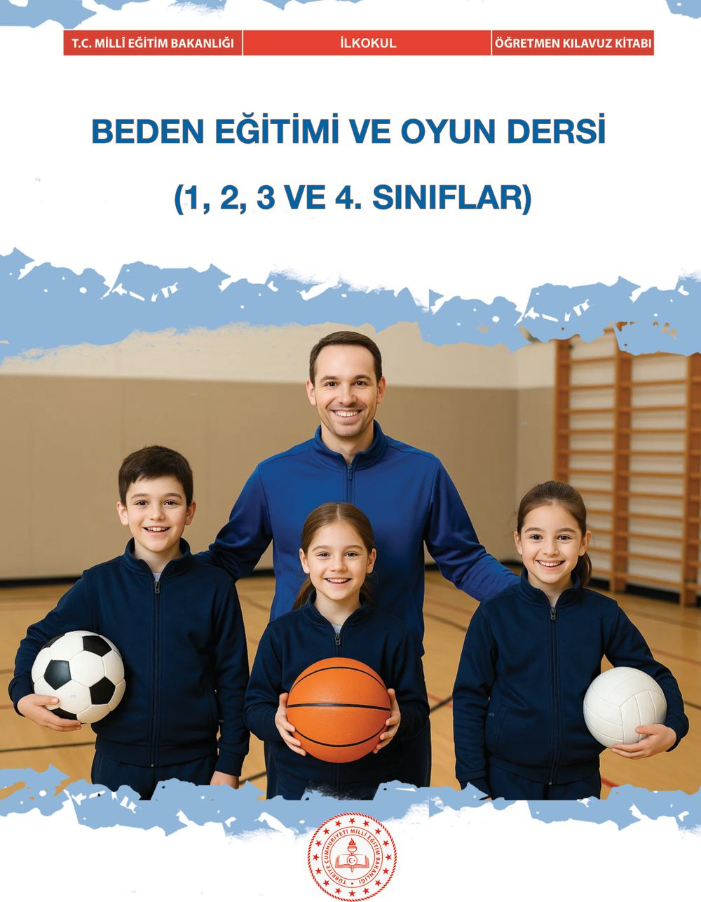

<!-- sayfa 1 -->

# BEDEN EĞİTİMİ VE OYUN DERSİ

## (1, 2, 3 VE 4. SINIFLAR)

## ÖĞRETMEN KILAVUZ KİTABI

**Yazarlar**

Ayşe Nur HANEDAR CÖMERT
Bayram UÇAR
Ferhat IŞGIN
Funda BOZKURT
Meliha Duygun KOCAOĞLU
Miraç Tunahan BİRSEN
Nalan KURU
Sevinç ÖKCÜN
Sinem DOĞU ERCAN

DEVLET KİTAPLARI

<!-- sayfa 2 -->

MİLLÎ EĞİTİM BAKANLIĞI YAYINLARI NO ...................................................................10514
DERS KİTAPLARI DİZİSİ NO .......................................................................................... 2354

Her hakkı saklıdır ve Millî Eğitim Bakanlığına aittir. Kitabın metin, soru ve şekilleri kısmen de olsa hiçbir surette alınıp yayımlanamaz.

**Editör**
Prof. Dr. Cenk TEMEL
Doç. Dr. Deniz HÜNÜK
Doç. Dr. Hidayet Suha YÜKSEL
Doç. Dr. Irmak HÜRMERİÇ ALTUNSÖZ
Dr. Öğr. Üyesi Damla GÜLER

**Dil Uzmanı**
Sibel METİN

**Görsel Tasarımcı**
Arife ŞENEL
Cevher GÖZMEN
Dilek ASLAN
Faruk AKYÜZ
Fatih GÜNGÖR
Gerçek ÇIĞŞAR

**Çoklu Ortam tasarımcısı**
Arzum ACAR

**Program Geliştirme Uzmanı**
Doç. Dr. Ömer NAYCİ

**Ölçme ve Değerlendirme Uzmanı**
Dr. Fatma Nur AYDIN

**Rehberlik Uzmanı**
Kâmil TOPÇU

ISBN 978-975-11-9395-7

Millî Eğitim Bakanlığı Talim ve Terbiye Kurulu Başkanlığının 21.11.2025 tarih ve 146962958 sayılı yazısı ile eğitim aracı olarak kabul edilmiştir Kurulca bu kitabın kabul edilmiş olması ders kitabından

<!-- sayfa 3 -->

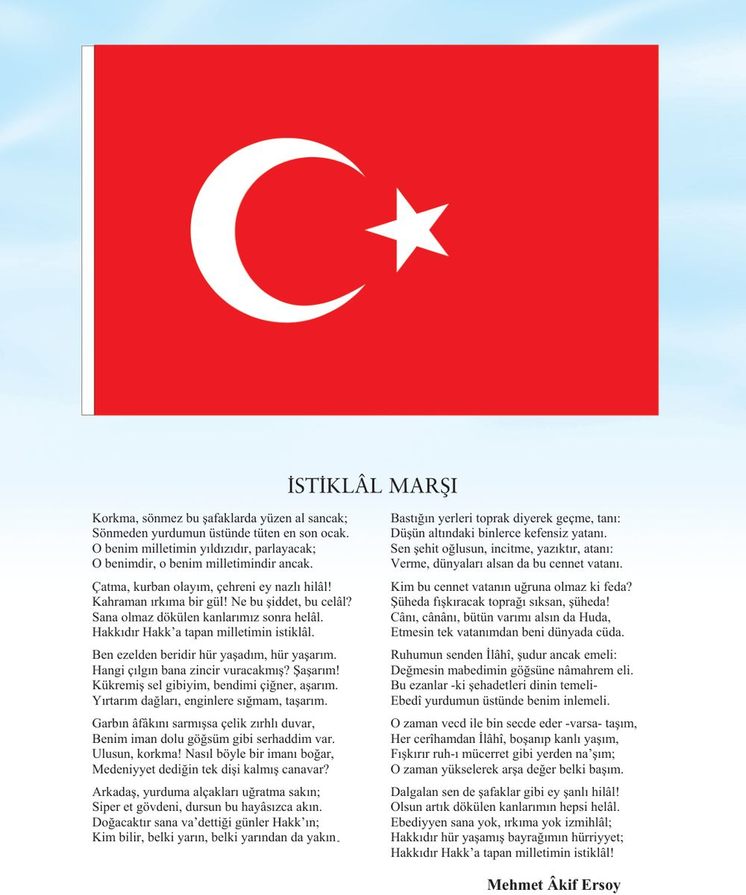

# İSTİKLÂL MARŞI

Korkma, sönmez bu şafaklarda yüzen al sancak;
Sönmeden yurdumun üstünde tüten en son ocak.
O benim milletimin yıldızıdır, parlayacak;
O benimdir, o benim milletimindir ancak.

Çatma, kurban olayım, çehreni ey nazlı hilâl!
Kahraman ırkıma bir gül! Ne bu şiddet, bu celâl?
Sana olmaz dökülen kanlarımız sonra helâl.
Hakkıdır Hakk’a tapan milletimin istiklâl.

Ben ezelden beridir hür yaşadım, hür yaşarım.
Hangi çılgın bana zincir vuracakmış? Şaşarım!
Kükremiş sel gibiyim, bendimi çiğner, aşarım.
Yırtarım dağları, enginlere sığmam, taşarım.

Garbın âfâkını sarmışsa çelik zırhlı duvar,
Benim iman dolu göğsüm gibi serhaddim var.
Ulusun, korkma! Nasıl böyle bir imanı boğar,
Medeniyet dediğin tek dişi kalmış canavar?

Arkadaş, yurduma alçaklar uğratma sakın;
Siper et gövdeni, dursun bu hayâsızca akın.
Doğacaktır sana va’dettiği günler Hakk’ın;
Kim bilir, belki yarın, belki yarından da yakın

Bastığın yerleri toprak diyerek geçme, tanı:
Düşün altındaki binlerce kefensiz yatanı.
Sen şehit oğlusun, incitme, yazıktır, atanı:
Verme, dünyaları alsan da bu cennet vatanı.

Kim bu cennet vatanın uğruna olmaz ki feda?
Şüheda fışkıracak toprağı söksen, şüheda!
Cânı, cânânı, bütün varımı alsın da Huda,
Etmesin tek vatanımdan beni dünyada cüda.

Ruhumun senden ilâhî, hudut ancak emeli:
Değmesin mabedimin göğsüne nâmahrem eli.
Bu ezanlar -ki şehadetleri dinin temeli-
Ebedî yurdumun üstünde benim inlemeli.

O zaman vecd ile bin secde eder -varsa- taşım,
Her cerîhamdan ilâhî, boşanıp kanlı yaşım,
Fışkırır ruh-ı mücerret gibi yerden na’şım;
O zaman yükselerek arşa değer belki başım.

Dalgalan sen de şafaklar gibi ey kanlı hilâl!
Olsun artık dökülen kanlarımın hepsi helâl.
Ebediyyen sana yok, ırkıma yok izmihlâl;
Hakkıdır hür yaşamış bayrağımın hürriyet;
Hakkıdır Hakk’a tapan milletimin istiklâl!

Mehmet Âkif Ersoy

<!-- sayfa 4 -->

GENÇLİĞE HİTABE

Ey Türk gençliği! Birinci vazifen, Türk istiklâlini, Türk Cumhuriyetini, ilelebet muhafaza ve müdafaa etmektir.

Mevcudiyetinin ve istikbalinin yegâne temeli budur. Bu temel, senin en kıymetli hazinendir. İstikbalde dahi, seni bu hazineden mahrum etmek isteyecek dâhilî ve hâricî bedhahların olacaktır. Bir gün, istiklâl ve cumhuriyeti müdafaa mecburiyetine düşersen, vazifeye atılmak için, içinde bulunacağın vaziyetin imkân ve şeraitini düşünmeyeceksin! Bu imkân ve şerait, çok namüsait bir mahiyette tezahür edebilir. İstiklâl ve cumhuriyetine kastedecek düşmanlar, bütün dünyada emsali görülmemiş bir galibiyetin mümessili olabilirler. Cebren ve hile ile aziz vatanın bütün kaleleri zapt edilmiş, bütün tersanelerine girilmiş, bütün orduları dağıtılmış ve memleketin her köşesi bilfiil işgal edilmiş olabilir. Bütün bu şeraitten daha elîm ve daha vahim olmak üzere, memleketin dâhilinde iktidara sahip olanlar gaflet ve dalâlet ve hattâ hıyanet içinde bulunabilirler. Hattâ bu iktidar sahipleri şahsî menfaatlerini, müstevlîlerin siyasi emelleriyle tevhit edebilirler. Millet, fakr u zaruret içinde harap ve bîtap düşmüş olabilir.

Ey Türk istikbalinin evlâdı! İşte, bu ahval ve şerait içinde dahi vazifen, Türk istiklâl ve cumhuriyetini kurtarmaktır. Muhtaç olduğun kudret, damarlarındaki asil kanda mevcuttur.

Mustafa Kemal Atatürk

<!-- sayfa 5 -->

MUSTAFA KEMAL ATATÜRK

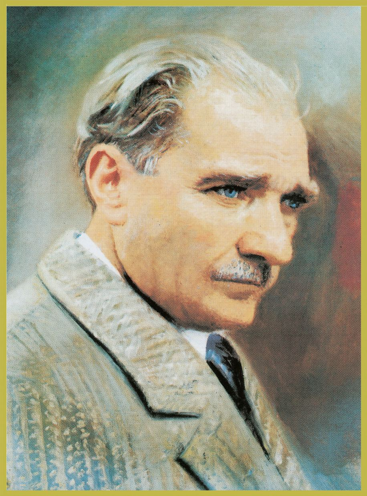
<!-- yer tutucu bulunamadı: sayfa sonuna eklendi -->

<!-- sayfa 6 -->

Verdiğiniz metin katmanı boş olduğu için (`<<< >>>` arası boş) dönüştürülecek bir içerik bulunmamaktadır. Lütfen metin katmanını içeren içeriği paylaşın, böylece kurallara uygun şekilde Markdown formatına çevirebilirim.

<!-- sayfa 7 -->

# İÇİNDEKİLER

**KİTABIN TANITIMI** ............................................................................................................ 9

**GİRİŞ** ................................................................................................................................... 11
1. BEDEN EĞİTİMİ, OYUN VE SPOR ALAN BECERİLERİ (BEOSAB) .......................................... 11
2. BEDEN EĞİTİMİ VE OYUN DERSİ TEMALARI ......................................................................... 12
3. PROGRAMLAR ARASI BİLEŞENLER (SOSYAL-DUYGUSAL ÖĞRENME BECERİLERİ, OKURYAZARLIK BECERİLERİ, DEĞERLER) ........................................................................... 13
4. DİSİPLİNLER ARASI VE BECERİLER ARASI İLİŞKİLER .......................................................... 14
5. ÖĞRETMEN KILAVUZ KİTABI UYGULAMA KRİTERLERİ ........................................................ 14 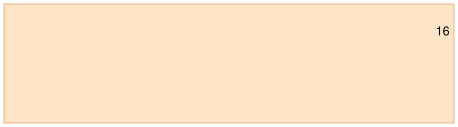

**BEDEN EĞİTİMİ VE OYUN DERSİ 1. SINIF TEMALARI** ...................................................... 16
1. TEMA: HAREKET EDİYORUM ................................................................................................... 17
2. TEMA: OYUNU KURALINA GÖRE OYNUYORUM .................................................................... 44
3. TEMA: RİTİMLE HAREKET EDİYORUM .................................................................................... 64
4. TEMA: FİZİKSEL AKTİVİTEYE KATILIYORUM, SAĞLIKLI BÜYÜYORUM ................................ 81 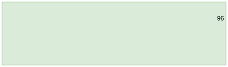

**BEDEN EĞİTİMİ VE OYUN DERSİ 2. SINIF TEMALARI** ...................................................... 96
1. TEMA: HAREKETİMİ GELİŞTİRİYORUM .................................................................................. 97
2. TEMA: OYUNUN KURALLARINI UYGULUYORUM ................................................................. 115
3. TEMA: RİTİMLE HAREKET EDİYORUM .................................................................................. 133
4. TEMA: SAĞLIĞIM İÇİN FİZİKSEL AKTİVİTEYE KATILIYORUM ............................................. 149 

**BEDEN EĞİTİMİ VE OYUN DERSİ 3. SINIF TEMALARI** ..................................................... 182
1. TEMA: İŞ BİRLİKLİ OYUNLARLA HAREKET EDİYORUM ...................................................... 183
2. TEMA: OYUNUN KURALLARINI YENİDEN OLUŞTURUYORUM ........................................... 201
3. TEMA: FARKLI RİTİMLERLE HAREKET EDİYORUM ............................................................. 213
4. TEMA: SAĞLIĞIM İÇİN FİZİKSEL AKTİVİTEYE KATILIYORUM ............................................. 228
5. TEMA: HAREKET EDEREK ÇEVREMİ KEŞFEDİYORUM ...................................................... 250
6. TEMA: KÜLTÜREL BİRİKİMLERİMİZ VE GELENEKSEL OYUNLAR ...................................... 265

<!-- yer tutucu bulunamadı: sayfa sonuna eklendi -->

<!-- sayfa 8 -->

# BEDEN EĞİTİMİ VE OYUN DERSİ 4. SINIF TEMALARI .......................................... 279

1. TEMA: HAREKET EDİYORUM VE KOORDİNASYONUMU GELİŞTİRİYORUM ..................... 280
2. TEMA: DÜNYA ÇOCUK OYUNLARINI OYNUYORUM ............................................................ 294
3. TEMA: YARATICI RİTMİK ADIMLAR SERGİLİYORUM ............................................................ 308
4. TEMA: FİZİKSEL AKTİVİTEYE KATILIYORUM VE SAĞLIKLI BESLENİYORUM .................... 324
5. TEMA: HAREKET EDEREK DOĞAYI KEŞFEDİYORUM ......................................................... 346

6. TEMA: HAREKET ENGEL TANIMAZ ........................................................................................ 362

SÖZLÜK ........................................................................................................................................ 374

KAYNAKÇA ................................................................................................................................... 377
GÖRSEL VE GENEL AĞ KAYNAKÇASI ....................................................................................... 378
TÜRKİYE’NİN MÜLKİ İDARE BÖLÜMLERİ İLE KARA VE DENİZ KOMŞULARI HARİTASI ........ 379
TÜRK DÜNYASI HARİTASI .......................................................................................................... 380

<!-- sayfa 9 -->

# KITABIN TANITIMI

Bu kitap, 1-4. sınıflara yönelik toplam 20 temadan oluşmaktadır. Her temanın başında, sınıf düzeyi, tema numarası ve adı gibi bilgileri içeren bir kapak sayfası yer alır. Kapak sayfasının ardından, temaya ait öğrenme çıktıları, bileşenler, bilgi ve yaşantı örnekleri ile etkinlik örnekleri sunulmaktadır. Etkinlik örneklerinin ardından; bu etkinliklerin çeşitlendirme yolları, öğrenci yansımaları, öğrenme kanıtları ve farklılaştırma uygulamaları yer alır. Temanın sonunda ise etkinlikleri destekleyici eğitim materyalleri ile ölçme ve değerlendirme araçlarına ilişkin örnekler bulunmaktadır.

| | |
| :--- | :--- |
| Ders adı ve Sınıf seviyesi | |
| Tema numarası | |
| Tema adı | |
| İlgili tema alanının karekodu | |

---

| | |
| :--- | :--- |
| | 1. TEMA: HAREKET EDİYORUM |
| | 17 |
| | DERS SAATI |
| | 85 |
| | ALAN BECERİLERİ |
| | BEOSAB1. Hareketi Sergileme, BEOSAB2. Hareket Kavramlarını Uygulama, BEOSAB10. Güvenli Ortam Oluşturma |
| | KAVRAMSAL BECERİLER |
| | KB1. Temel Beceriler |
| | EĞİLİMLER |
| | E1.1. Merak, E2.5. Oyunseverlik, E3.2. Odaklanma, E3.8. Soru Sorma |
| | PROGRAMLAR ARASI BİLEŞENLER |
| | Sosyal-Duygusal Öğrenme Becerileri |
| | SDB1.1. Kendini Tanıma (Öz Farkındalık), SDB2.1. İletişim, SDB2.2. İş Birliği, SDB3.3. Sorumlu Karar Verme |
| | Değerler |
| | D4. Dostluk, D6. Dürüstlük, D14. Saygı, D16. Sorumluluk |
| | Okuryazarlık Becerileri |
| | OB4. Görsel Okuryazarlık |
| | DİSİPLİNLER ARASI İLİŞKİLER |
| | Hayat Bilgisi, Görsel Sanatlar |
| | BECERİLER ARASI İLİŞKİLER |
| | KB2.18. Tartışma, TAB3. Konuşma, SBAB5.2. Grup Dinamiğini Sağlama |
| | ÖĞRENME ÇIKTILARI VE SÜREÇ BİLEŞENLERİ |
| | BEO.1.1.1. Oyunlarda hareket kavramlarını uygulayabilme |
| | a) Beden farkındalığı, alan farkındalığı, efor ve hareket ilişkileri kavramlarını ayırt eder. |
| | b) Hareket ile beden farkındalığı, alan farkındalığı, efor ve hareket ilişkileri kavramları arasında bağ kurar. |
| | c) Beden farkındalığı, alan farkındalığı, efor ve hareket ilişkileri temel kavramlarına uygun hareket eder. |
| | BEO.1.1.2. Oyunlar sırasında güvenli ortam oluşturabilme |
| | a) Oyunlar sırasında ortaya çıkabilecek riskleri tanımlar. |
| | b) Oyunlar sırasında ortaya çıkabilecek risklere ilişkin önleyici tedbirler alır. |
| | BEO.1.1.3. Temel hareket becerilerini açıklayabilme |
| | BEO.1.1.4. Temel hareket becerilerini sergileyebilme |
| | a) Yer değiştirme, nesne kontrolü ve denge becerilerini algılar. |
| | b) Yer değiştirme, nesne kontrolü ve denge becerilerinin basamaklarını gösterir. |
| | c) Yer değiştirme, nesne kontrolü ve denge becerilerini farklı durumlarda uygular. |
| | İÇERİK ÇERÇEVESİ |
| | Hareket Kavramları |
| | Güvenli Ortam |
| | Temel Hareket Becerileri |
| | Genellemeler/ Anahtar Kavramlar/ Sembol ve Gösterimler |
| | ağırlık aktarımı, denge, efor, farkındalık, güvenlik, hareket, nesne kontrolü, oyun, oyunlarda risk, yer değiştirme |

---

| | |
| :--- | :--- |
| İlgili temanın amacı çerçevesinde temanın tanıtıldığı, verilmesi gereken önemli bilgilerin verildiği ve tema özelinde dikkat edilmesi gereken hususların belirtildiği bölüm | |
| | 1.SINIF |
| | 1. TEMAYA BAŞLARKEN |
| | Bu temada öğrencilerin beden farkındalığı, alan farkındalığı, efor ve hareket ilişkilerini çeşitli oyunlar ve fiziksel aktiviteler yoluyla öğrenmeleri amaçlanmaktadır. Ayrıca öğrencilerden oyunlar ve fiziksel etkinlikler sırasında güvenli bir ortam oluşturma becerilerini geliştirmeleri, bulundukları alandaki riskleri tespit edebilme ve bu risklere karşı uygun önlemleri alabilme yetilerini kazanmaları beklenmektedir. Bununla birlikte öğrencilerin temel hareket becerileri olan yer değiştirme, nesne kontrolü ve denge becerilerini ayırt edebilmeleri, bu becerileri basamaklarıyla sergileyebilmeleri ve farklı oyunlarda doğru bir şekilde uygulayabilmeleri amaçlanmaktadır. Tema içeriğinde yer alan hareket kavramları Şekil 1’de açıklanmıştır. |
| | 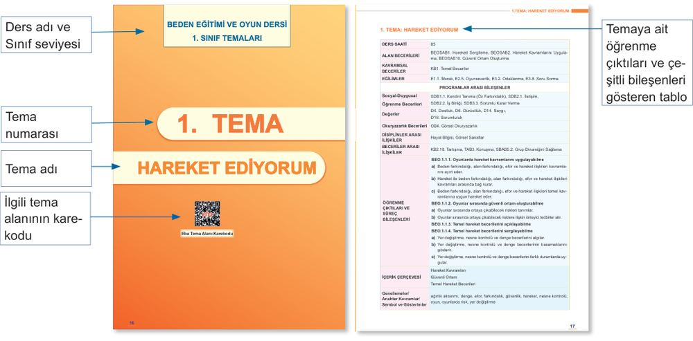 |
| | Temada yer alan etkinliklerdeki güvenli ortam oluşturabilme çıktısına ilişkin risk durumları günlük yaşamla ilişkili olmalıdır. Bu riskler öğretmen tarafından kontrol edilmeli ve tehlike yaratmayacak şekilde düzenlenmelidir. Ayrıca risk örnekleri öğrencilerin gelişim düzeylerine uygun olmalıdır. Tema içeriğinde yer alan temel hareket becerileri yer değiştirme, nesne kontrolü ve denge becerileridir. Bu beceriler Şekil 2’de açıklanmıştır. |

---

| | |
| :--- | :--- |
| | 1.TEMA: HAREKET EDİYORUM |
| | 19 |
| | 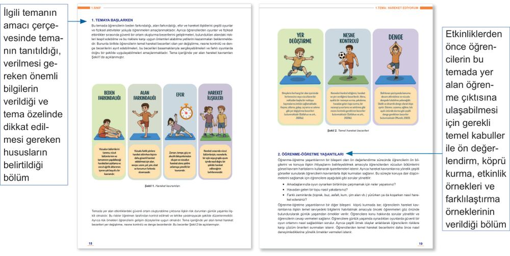 |
| | Şekil 2. Temel hareket becerileri |
| | 2. ÖĞRENME-ÖĞRETME YAŞANTILARI |
| | Öğrenme-öğretme yaşantılarının bir bileşeni olan ön değerlendirme sürecinde öğrencilerin ön bilgilerini ve konuya ilişkin ihtiyaçlarını belirleyebilmek amacıyla öğrencilerden vücudun bölümlerini görsel kavram haritalarını kullanarak işaretlemeleri istenir. Ayrıca hareket kavramlarına yönelik çeşitli görseller sunularak öğrencilerin kavramlarla ilişki kurmaları sağlanır. Bu süreçte konuya dair düşünmelerini sağlamak için öğrencilere aşağıdaki gibi sorular yöneltilir: |
| | ● Arkadaşlarınızla oyun oynarken birbirinize çarpmamak için neler yaparsınız? |
| | ● Havadan gelen bir topu nasıl yakalarsınız? |
| | ● Farklı zeminlerde (toprak, buz, asfalt, kum, çim alan vb.) yürürken ya da koşarken nasıl hareket edersiniz? |
| | Öğrenme-öğretme yaşantılarının bir diğer bileşeni köprü kurmada ise; öğrencilerin hareket kavramlarına ilişkin temel seviyedeki bilgilerini hatırlatmak amacıyla önceki öğrenmeleri göz önünde bulundurularak günlük yaşamdan örnekler verilir. Öğrencilere konu hakkında sorular yöneltilir ve öğrencilerin cevap vermeleri sağlanır. Öğrencilere günlük yaşamda oynadıkları oyunlarda güvenli bir oyun ortamını nasıl sağladıkları sorulur. Ayrıca çeşitli örnek olaylar anlatılarak öğrencilerin risklere karşı çözüm önerileri sunmaları istenir. Öğrencilerden temel hareket becerilerini daha önce nasıl deneyimlediklerine yönelik örnekler vermeleri istenir. |

---

| | |
| :--- | :--- |
| | 1.SINIF |
| | 18 |
| |  |
| | Şekil 1. Hareket kavramları |
| | Etkinliklerden önce öğrencilerin bu temada yer alan öğrenme çıktısına ulaşabilmesi için gerekli temel kabuller ile ön değerlendirme, köprü kurma, etkinlik örnekleri ve farklılaştırma örneklerinin verildiği bölüm |

<!-- sayfa 10 -->

# 1. SINIF

## 2.1. Etkinlik Örnekleri

### ETKİNLİK 1 Hareket Kavramlarını Öğreniyorum

**Amaç:** Öğrencilerin hareket kavramlarından beden farkındalığı, alan farkındalığı, efor ve hareket ilişkilerini çeşitli oyun ve fiziksel aktivitelerle uygulayabilmeleridir.

**Eğilimler**
E1.1. Merak, E2.5. Oyunseverlik, E3.2. Odaklanma

**Sosyal-Duygusal Öğrenme Becerileri**
SDB1.1. Kendini Tanıma (Öz Farkındalık), SDB2.1. İletişim, SDB2.2. İş Birliği

**Değerler**
D4. Dostluk, D6. Dürüstlük, D14. Saygı

**Okuryazarlık Becerileri**
OB4. Görsel Okuryazarlık

**Kavramsal Beceriler**
**Beceriler Arası İlişkiler**
TAB3. Konuşma

**Öğrenme Çıktısı ve Süreç Bileşenleri**
BEO.1.1.1. Oyunlarda hareket kavramlarını uygulayabilme
a) Beden farkındalığı, alan farkındalığı, efor ve hareket ilişkileri kavramlarını ayırt eder.
b) Hareket ile beden farkındalığı, alan farkındalığı, efor ve hareket kavramları arasında bağ kurar.
c) Beden farkındalığı, alan farkındalığı, efor ve hareket ilişkileri temel kavramlarına uygun hareket eder.

**Kullanılan Öğretim Teknolojileri, Araç Gereçler ve Kaynaklar**
hareket kavramlarını içeren posterler ve kartlar, kişisel alan ve genel alan kavramlarını gösteren çizimler ve yön şemaları
Oyun 1: renkli kutular, çizgi çizebilmek için bant, tahta, minder, antrenman engeli, sepet, top ve balon
Oyun 2: 3 farklı renkten oluşan $20 \times 20$ <!-- KONTROL: Marker'da karşılığı yok, uydurma olabilir --> ölçülerinde kartondan yapılmış küp, siyah bant, boya veya tebeşir, düdük ve skor tabelası

Öğrencilerin dağınık düzende yerleşmesi sağlanır. Günlük yaşamdan hareket kavramıyla ilgili çeşitli örnekler (Ek 1) verilerek öğrencilerin konuya ilgi duymaları ve konuyu merak etmeleri sağlanır (E1.1). Burada belirtilen beden farkındalığının vurgulandığı örneklerden sonra öğrencilerin sınıf mevcuduna uygun olacak şekilde ortalama altı kişilik gruplara ayrılması sağlanır. Her grup için büyük bir “vücut posteri” veya yere çizilmiş büyük bir “vücut şeması” hazırlanır. Her şema altı bölüme ayrılır: baş, gövde, sağ kol, sol kol, sağ bacak, sol bacak. Öğrencilerden bu posterin/şemanın etrafında daire oluşturmaları istenir. Öğrencilerin postere/şemaya koşabilecek uzaklıkta yerleşmeleri sağlanır. Her öğrenci için bir sıra belirlenir. Vücudun bir bölümü (örneğin sağ kol) yüksek sesle söylenir. İlk sıradaki öğrencilerden söylenen bölgeye doğru serbest bir şekilde koşması (sıçrayarak, hızlı, yavaş, düz koşu vb.) ve o bölgeye yerleşmesi istenir. Gruplardaki tüm öğrenciler için aynı adımlar uygulanır. Böylelikle grup üyeleri tarafından vücudun bölümlerinin tamamlanması sağlanır. Öğrencilerin vücut bölümlerini tamamlarken birbirlerine çarpmamaya ve kendi bölgesinde kalmaya dikkat etmeleri sağlanarak alan farkındalığı vurgulanır. Ayrıca istenilen bölgeye koşarken kollarını sallayarak gitmesi istenir. Ardından tüm öğrencilerin başlangıçtaki yerlerine geçmesi istenir. Her bir öğrencinin farklı bölgelere yerleşebilmesi için uygulama 2-3 kez tekrarlanabilir. Alan farkındalığı, efor ve hareket ilişkilerinin vur...

20

---

# 1. SINIF

## Çeşitleştirme

Oyunlarda oynanacak koşu türleri, spor dalları, oyunlar, toplar, binalar, parklar ve tenis topları gibi farklılaştırılabilir. Kullanılan fiziksel aktiviteler çok çeşitli olabilir. Oyunları çeşitlendirmek için; oyunları farklılaştırmak, oyunları çeşitlendirmek, oyunları farklılaştırmak, oyunları çeşitlendirmek, oyunları farklılaştırmak, oyunları çeşitlendirmek, oyunları farklılaştırmak, oyunları çeşitlendirmek, oyunları farklılaştırmak, oyunları çeşitlendirmek, oyunları farklılaştırmak, oyunları çeşitlendirmek, oyunları farklılaştırmak, oyunları çeşitlendirmek, oyunları farklılaştırmak, oyunları çeşitlendirmek, oyunları farklılaştırmak, oyunları çeşitlendirmek, oyunları farklılaştırmak, oyunları çeşitlendirmek, oyunları farklılaştırmak, oyunları çeşitlendirmek, oyunları farklılaştırmak, oyunları çeşitlendirmek,

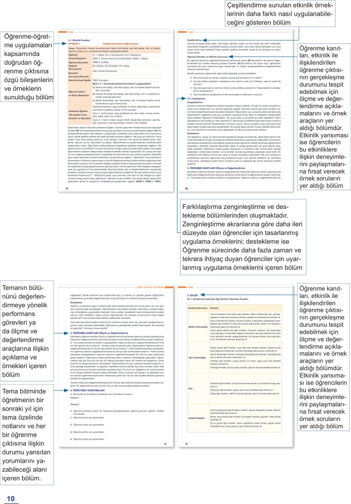
<!-- yer tutucu bulunamadı: sayfa sonuna eklendi -->

<!-- sayfa 11 -->

# GİRİŞ

Beden eğitimi ve oyun dersi ile öğrencilerin hareket becerilerini sergilemeleri, hareket kavramlarını uygulamaları, oyunlarda taktik ve strateji geliştirmeleri, fiziksel aktiviteye düzenli katılmaları, ritmik hareket edebilme becerilerini geliştirmeleri, fiziksel uygunluk sağlayabilmeleri, eşle/grupla hareket edebilmeleri, adil oyun anlayışına uygun davranmaları, takım/grup liderliği sergilemeleri ve güvenli ortam oluşturmaları amaçlanmaktadır. “Beden Eğitimi, Oyun ve Spor Alan Becerileri” (BEOSAB) olarak tanımlanan bu becerilerle kavramsal, sosyal-duygusal ve okuryazarlık becerileri birleştirilerek çocukların sahip oldukları değerleri öğrenme ortamına yansıtmaları ve hareket yoluyla yeni değerler kazanmaları; sağlıklı yaşam tarzının önemini kavrayarak düzenli fiziksel aktivite alışkanlığı edinmeleri; tüm bu bilgi, beceri ve tutumları hem diğer derslere hem de günlük yaşamlarına aktarabilmeleri hedeflenmektedir. Bu program fiziksel, bilişsel ve sosyal-duygusal gelişim alanlarını göz önünde bulundurarak çok yönlü bir eğitim anlayışını benimsemektedir. Bu bağlamda Beden Eğitimi ve Oyun Dersi Öğretmen Kılavuz Kitabı; programın hedefleri ve yapısı doğrultusunda öğretmenlere rehberlik etmek, tüm bu bileşenleri öğrenme çıktıları ile ilişkilendirilen öğrenme-öğretme yaşantılarında somut örneklere dönüştürmek ve destekleyici materyalleri sunmak amacıyla hazırlanmıştır.

## 1. BEDEN EĞİTİMİ, OYUN VE SPOR ALAN BECERİLERİ (BEOSAB)

Beden eğitimi ve spor; bireylerin fiziksel yetkinliklerini geliştirmelerini, sağlıklı bir yaşam sürdürmelerini, sosyal ve bireysel beceriler kazanmalarını sağlayan bir alan olarak bireylerin yaşamında ve eğitim ortamlarında büyük bir öneme sahiptir. Hareket, yaşamın önemli bir parçasıdır ve birey, kazanması gereken birçok niteliğe hareket sayesinde sahip olur. Hareket etmek; birçok hareketi yapabilmek için bedenin gereken yetkinliği kazanmasını sağlarken aynı zamanda fiziksel uygunluk (sağlığa/performansa ilişkin), takım çalışması, problem çözme, stratejik düşünme, karar verme gibi birçok becerinin gelişmesine de katkıda bulunur. Beden eğitimi, oyun ve spor alan becerileri; bireylerin hareket becerilerini geliştirmelerine, hareket kavramlarını öğrenmelerine, sporun etik değerlerini içselleştirmelerine, güvenli bir ortamda hareket etmelerine ve fiziksel aktiviteye katılımlarını artırmaya odaklanmaktadır. Bu beceriler aşağıda kısaca tanımlanmaktadır.

**BEOSAB1. Hareketi Sergileme Becerisi:** Bireyin fiziksel aktivitelerde kaba, ince, spora hazırlayıcı ve spora özgü hareket becerilerini anlaması; bu becerileri aşamalı olarak geliştirmesi ve farklı durumlara uyum sağlayarak hareketleri uygulaması sürecini ifade eder. Bu beceri, bireyin hareketleri doğru ve uygun şekilde gerçekleştirme kapasitesini geliştirmesine olanak tanır.

**BEOSAB2. Hareket Kavramlarını Uygulama Becerisi:** Bireyin beden farkındalığı, alan farkındalığı, efor (çaba) ve hareket ilişkileri gibi temel kavramlar ile hareket becerileri arasında ilişki kurarak hareketleri uygulamasını içerir. Bu beceri, bireyin fiziksel aktivitelerde bilinçli ve etkili bir şekilde hareket etmesini sağlar.

**BEOSAB3. Taktik ve Strateji Geliştirme Becerisi:** Fiziksel aktivite, oyun vb. sportif etkinlikler sırasında karşılaşılan durumları/problemleri belirlemek, bu durumlara/problemlere yönelik çözüm yolları geliştirmek ve uygulamak için kullanılan bir beceridir. Bu beceri; bireyin stratejik düşünme ve planlama yeteneğini geliştirir, hareketlerini daha etkili ve bilinçli bir şekilde gerçekleştirmesini sağlar.

**BEOSAB4. Fiziksel Aktiviteye Katılma Becerisi:** Bireyin fiziksel aktivitelerin gerekliliğini fark etmesini, bu aktiviteler için uygun planlar geliştirmesini ve belirlenen hedeflere ulaşmak için bu planları uygulamasını içerir. Bu beceri, bireyin yaşam boyu fiziksel aktivite alışkanlığı kazanmasına ve sağlıklı bir yaşam tarzı benimsemesine katkı sağlar.

**BEOSAB5. Ritmik Hareket Etme Becerisi:** Bireyin hareket veya müzikle ilişkilendirilen ritmi algılamasını bu ritme uygun hareketler yapmasını ve ritmik becerilerini etkili bir şekilde sergilemesini

<!-- sayfa 12 -->

içerir. Bu beceri; bireyin koordinasyonunu, estetik duygusunu ve müzikle uyumlu hareket yetkinliğini geliştirmesine katkı sağlar.

**BEOSAB6. Fiziksel Uygunluk Sağlama Becerisi:** Bireyin sağlık (kalp-damar sistemi dayanıklılığı, kas kuvveti, kas dayanıklılığı, esneklik, vücut kompozisyonu vb.) ve performansla (kuvvet, çeviklik, dayanıklılık, hız vb.) ilişkili uygunluk bileşenlerini açıklamasını, bu bileşenleri fiziksel aktivitelerde uygulamasını ve fiziksel uygunluk düzeyini geliştirmeye yönelik çalışmalar yapmasını ifade eder. Bu beceri, bireyin sağlıklı bir yaşam sürdürmesine ve fiziksel performansını artırmasına olanak tanır.

**BEOSAB7. Eşle/Grupla Hareket Etme Becerisi:** Bireyin takım çalışması veya grup etkinlikleri sırasında rolleri tanımlamasını, belirlenen rolleri yerine getirmesini ve diğer bireylerle uyumlu hareket etmesini içerir. Bu beceri, bireyin sosyal etkileşim becerilerini ve takım uyumunu geliştirerek uyum içinde hareket etmesini sağlar.

**BEOSAB8. Adil Oyun Anlayışına Uygun Davranma Becerisi:** Spor ve fiziksel aktivitelerde dürüstlük, saygı, eşitlik, sportmenlik gibi temel etik değerleri benimsemeyi ifade eder. Bireyin kurallara uymasını, rakiplerine ve takım arkadaşlarına karşı saygılı davranmasını, aynı zamanda iş birliği içinde hareket etmesini içerir. Adil oyun anlayışına uygun davranma becerisi; bireyin spor katılımını olumlu bir deneyime dönüştürürken teknik becerilerini geliştirme, sosyal etkileşimde bulunma ve kişisel sorumluluk bilincini artırma fırsatları sunar. Bu beceri, bireyin etik değerlere bağlılığını, sorumluluk bilincini ve sportmenlik davranışlarını geliştirmesine katkıda bulunur.

**BEOSAB9. Takım/Grup Liderliği Sergileme Becerisi:** Takım/grup liderliği; beden eğitimi, spor, fiziksel aktivite veya hareket temelli grup etkinlikleri sırasında bireyin liderlik özelliklerini tanımasını ve bu özellikleri etkin bir şekilde uygulayarak grubu yönlendirme, motive etme ve organize etme kapasitesini ifade eder. Takım/grup liderliği becerisi; bireyin sorumluluk almasını, karar verme süreçlerine katılmasını ve etkili iletişim becerilerini geliştirmesini sağlar. Bu beceri, bireyin grup dinamiklerinin anlamasına ve grup hedeflerine ulaşmasına katkıda bulunur.

**BEOSAB10. Güvenli Ortam Oluşturma Becerisi:** Güvenli ortam oluşturma; bireyin fiziksel aktivite, oyun veya spor etkinlikleri sırasında kendisinin ve çevresindekilerin sağlığını tehdit edebilecek davranışlardan uzak durmasını ve bu tür durumlara karşı önleyici tedbirler almasını içerir. Bu beceri; bireyin riskleri tanıma, güvenli bir çevre sağlama ve sağlığı koruma bilinci geliştirmesini amaçlar. Güvenli ortam oluşturma becerisi kapsamında bireyin sakatlık riski, bilinçsiz fiziksel aktivite veya zararlı içeriklerden uzak durması sağlanır. Bu süreç, bireyin hem kendi güvenliğini hem de çevresindekilerin sağlığını korumasına olanak tanır ve toplumsal sağlık bilincini destekler.

## 2. BEDEN EĞİTİMİ VE OYUN DERSİ TEMALARI

Beden eğitimi ve oyun dersi temalarının içerik çerçevesi oluşturulurken hareket eğitimi temel alınmış, çocukların gelişimsel özellikleri ve ihtiyaçları gözetilmiş, hareket yetkinliği ve yaşam boyu fiziksel aktivite alışkanlığının kazandırılması hedeflenmiş; tüm yapı, TYMM ortak metninde yer alan beceriler çerçevesinde ve bütüncül bir uyum içinde hazırlanmıştır. Her tema kapsamında ele alınacak konulara içerik çerçevesi bölümünde yer verilmiş; programda verilmesi amaçlanan içerikler, ilgili öğrenme çıktılarıyla ilişkilendirilmiş ve öğrenme-öğretme uygulamaları aracılığıyla somutlaştırılmıştır. Beden eğitimi ve oyun dersinin tema içerikleri her sınıf düzeyinde hareket, oyun, ritim, kültür, sağlık ve fiziksel aktivite ana boyutları ile ele alınmış; içerikler zenginleştirilerek ve farklılaştırılarak oluşturulmuştur. Hareketle ilişkili temalarda yer değiştirme, nesne kontrolü, denge becerileri, birleştirilmiş hareket becerileri, beden farkındalığı, alan farkındalığı, efor ve hareket ilişkileri odak noktasıdır ve bu becerilerin erken yaşlarda geliştirilmesi önem taşımaktadır. Oyunla ilişkili temalarda ise öğrencilerin oyun kuralları, oyunlarda taktik ve strateji geliştirme, iş birliği ve problem çözme gibi becerileri

<!-- sayfa 13 -->

ilgili temel kavramları ve basit ritimle hareket edebilmeyi öğretmeyi içermektedir. Sağlık ve fiziksel aktiviteyle ilişkili temalar, hareketi sağlıkla ilişkilendirerek bireye yaşam boyu aktif olma konusunda farkındalık kazandırmayı amaçlamaktadır. Kültür teması altında kültürel birikimlerimiz ve değerlerimiz yer almaktadır. Kapsayıcılık, beslenme, çevre ve doğa farkındalığı gibi konulara da temalarda yer verilmektedir. Bu temalarının sınıflara göre dağılımı Tablo 1’de sunulmuştur.

**Tablo 1. Beden Eğitimi ve Oyun Dersi Temaları**

| 1. SINIF | 2. SINIF | 3. SINIF | 4. SINIF |
| :--- | :--- | :--- | :--- |
| BEO.1.1. Hareket Ediyorum | BEO.2.1. Hareketimi Geliştiriyorum | BEO.3.1. İş Birlikli Oyunlarla Hareket Ediyorum | BEO.4.1. Hareket Ediyorum ve Koordinasyonumu Geliştiriyorum |
| BEO.1.2. Oyunu Kuralına Göre Oynuyorum | BEO.2.2. Oyunun Kurallarını Uyguluyorum | BEO.3.2. Oyunun Kurallarını Yeniden Oluşturuyorum | BEO.4.2. Dünya Çocuk Oyunlarını Oynuyorum |
| BEO.1.3. Ritimle Hareket Ediyorum | BEO.2.3. Ritimle Hareket Ediyorum | BEO.3.3. Farklı Ritimlerle Hareket Ediyorum | BEO.4.3. Yaratıcı Ritmik Adımlar Sergiliyorum |
| BEO.1.4. Fiziksel Aktiviteye Katılıyorum ve Sağlıklı Büyüyorum | BEO.2.4. Sağlığım İçin Fiziksel Aktiviteye Katılıyorum | BEO.3.4. Sağlığım için Fiziksel Aktiviteye Katılıyorum | BEO.4.4. Fiziksel Aktiviteye Katılıyorum ve Sağlıklı Besleniyorum |
| | | BEO.3.5. Hareket Ederek Çevremi Keşfediyorum | BEO.4. 5. Hareket Ederek Doğayı Keşfediyorum |
| | | BEO.3.6. Kültürel Birikimlerimiz ve Geleneksel Oyunlar | BEO.4.6. Hareket Engel Tanımaz |

# 3. PROGRAMLAR ARASI BİLEŞENLER (SOSYAL-DUYGUSAL ÖĞRENME BECERİLERİ, OKURYAZARLIK BECERİLERİ, DEĞERLER)

Beden eğitimi ve oyun dersindeki etkinlikler, TYMM ortak metninde belirtilen programlar arası bileşenlerle bir bütün olarak, incelenip planlanmalıdır. BEOSAB’a ulaşmak için sosyal-duygusal öğrenme becerileri, erdem-değer-eylem çerçevesi ve okuryazarlık becerileri göz önüne alınarak etkili öğrenme süreçleri geliştirilmelidir. Örneğin öğrencilerin fiziksel aktiviteye düzenli katılım süreçlerinin motivasyon, öz güven, yeterlik ve etkileşim gibi çeşitli yönleri göz önünde bulundurulduğunda beden eğitimi ve oyun dersi öğretim sürecinin sosyal-duygusal öğrenme becerilerinden kendini tanıma, öz düzenleme ve uyum becerileri gibi beceriler olmadan başarılı bir şekilde gerçekleşmeyeceği dikkate alınmalıdır.

Erdem-Değer-Eylem Çerçevesi, beden eğitimi ve oyun dersinin amaçlarına ulaşabilmesi için öğrenme-öğretme uygulamalarında dersin temaları ile tutarlı bir biçimde ele alınması gereken bir diğer i

<!-- sayfa 14 -->

açıdan yaşadığı topluma uyumu ile doğrudan ilişkilidir. Olumlu kişilik özelliklerinin sosyal ve fiziksel çevreyle ilişkilerde ortaya çıkmasını sağlayan değerler; insan, toplum ve çevre açısından önemli bir yapıdır. Örneğin adalet, dostluk, dürüstlük, estetik, sağlıklı yaşam, saygı ve sorumluluk gibi değerler beden eğitimi ve oyun derslerinde eyleme geçirilmeli ve öğrenme-öğretme süreçlerinde ortaya konulmalıdır. Erdem-Değer-Eylem Çerçevesi, Beden Eğitimi ve Oyun Dersi Öğretim Programı’nın hedeflediği beceriler ve içerik çerçevesi ile uyumlu bir şekilde ve bu sürecin doğal bir bileşeni olarak değerlendirilmelidir.

Modelde tanımlanan okuryazarlık becerileri ise öğrencilerin çok yönlü gelişiminin önemli bir parçasıdır. Bilgi, kültür ve sürdürülebilirlik okuryazarlığı; dijital, görsel okuryazarlık becerilerinin farkındalık, işlevsellik ve eylemsellik düzeyleri beden eğitimi ve oyun dersinin temel amaçlara ulaşabilmesinin tamamlayıcı bir unsuru olarak ele alınmalı ve süreç bileşenleri öğrenme-öğretme sürecinde gerçekleştirilen etkinliklerle birleştirilmelidir.

## 4. DİSİPLİNLER ARASI VE BECERİLER ARASI İLİŞKİLER

Beden eğitimi ve oyun dersinde edinilen bilgi ve becerileri öğrenciler hayat bilgisi, müzik ve fen bilimleri gibi diğer disiplinlerle ilişkilendirebilir. Öğrenme-öğretme yaşantılarında öğrencilerin beden eğitimi ve oyun dersinde edindikleri bilgileri farklı disiplinlerle ilişkilendirerek bilginin farklı durumlardaki kullanımını deneyimlemeleri sağlanmalıdır. Örneğin hayat bilgisi dersindeki “Sağlığım ve Güvenliğim”, fen bilimleri dersindeki “Hareketi Keşfediyorum”, Türkçe dersindeki “Doğa ve İnsan” temalarındaki çıktılar ile beden eğitimi ve oyun dersi temaları birbirleriyle ilişkilendirilebilir.

Beceriler arası ilişkiler ise öğrenme çıktılarıyla doğrudan bağlantılı olmasa da öğretim programının temalarının hedeflerine ulaşmak için gerekli olan alan becerilerini ve kavramsal becerileri ifade etmektedir. Öğrenme ve öğretme süreçlerinin disiplinler arası ve beceriler arası ilişkileri etkin bir şekilde kullanacak biçimde planlanması, programın bütüncül yaklaşımının etkili olabilmesi için önem taşımaktadır. Bu bağlamda kavramsal becerilerden üst düzey düşünme becerileri ile bütünleşik ve temel becerilerin etkinliklerde işletilmesi ve alan becerileriyle bağlantılarının kurulması önem taşımaktadır.

## 5. ÖĞRETMEN KILAVUZ KİTABI UYGULAMA KRİTERLERİ

Öğretmen kılavuz kitabı, Türkiye Yüzyılı Maarif Modeli Beden Eğitimi ve Oyun Dersi Öğretim Programı doğrultusunda sınıf öğretmenlerine etkinlik tasarlama süreçlerinde rehberlik etmesi amacıyla hazırlanmıştır.

* Kılavuz kitapta yer alan etkinlikler, Türkiye Yüzyılı Maarif Modeli’nin öngördüğü bütüncül eğitim anlayışı doğrultusunda BEOSAB, kavramsal beceriler, eğilimler, değerler, okuryazarlık ve sosyal-duygusal öğrenme becerilerini kapsayacak şekilde hazırlanmıştır. Öğrenme-öğretme yaşantılarında bütüncül anlayışın hayat bulmasına dikkat edilmelidir.
* Etkinliklerde bireysel, sosyal ve çevresel farklılıklar göz önünde bulundurularak tüm öğrencilerin katılımını destekleyecek şekilde çeşitlendirme ve uyarlamalar yapılması önem taşımaktadır.
* Etkinlikler farklı sınıf seviyelerine göre tasarlanırken önceki düzeylerdeki öğrenmeler dikkate alınmalı; eksikliklerin giderilmesi için diğer branş ve sınıf öğretmenleriyle iş birliği yapılmalıdır.
* Etkinlikler, öğrencilerin fiziksel aktiviteye katılımlarını teşvik ederken çeşitli temel hareket becerilerini deneyimleyebilecekleri çok yönlü gelişim fırsatları sunularak yapılandırılmalıdır. Buna ek olarak etkinlikler; eğlenceli, öz güveni destekleyen, sosyal etkileşimi teşvik eden ve bireysel farklılıkları dikkate alan öğrenme ortamlarında uygulanmalıdır.
* Öğretmenlerden kendi sınıflarına uygun etkinlikler hazırlarken öğrencilerin aktif katılımını sağ-

<!-- sayfa 15 -->

(spor eğitimi, taktiksel oyun, bireysel ve sosyal sorumluluk, akran öğretimi, iş birlikli öğretim modeli vb.) ve uygun öğretim stillerini (komut, alıştırma, eşli çalışma, kendini denetleme, katılım, yönlendirilmiş buluş, problem çözme, öğrencinin tasarımı, öğrencinin başlatması, kendi kendine öğrenme vb.) seçmeleri beklenmektedir.

* Etkinliklerde ısınma, soğuma ve esnetme hareketleri çocukların gelişim özellikleri göz önünde bulundurularak uygulanmalı ve hareketler etkinlik özelinde seçilmelidir. 
* Kılavuz kitapta beden eğitimi ve oyun dersi 1-4. sınıflar düzeyinde yer alan tüm öğrenme çıktıları için örnek etkinlikler hazırlanmıştır. Kitapta yer alan etkinlikler, öğretim programının öğrenme çıktılarını desteklemek ve somutlaştırmak amacıyla hazırlanmış örnek uygulamalardır. Hem öğretim sürecinin esnek ve dinamik doğası hem de beden eğitimi ve oyun dersinin konu çeşitliliği gereği öğretmenler bu etkinlikleri kendi sınıf düzeylerine, öğrenci ihtiyaçlarına ve yerel koşullara göre çeşitlendirme ve uyarlama özgürlüğüne sahiptir. Bu doğrultuda öğretmenler mevcut etkinlikleri zenginleştirebilir, sadeleştirebilir ya da öğrenme çıktısını karşılayacak yeni etkinlikler tasarlayabilirler. 
* Ekler kısmında verilen örnek ölçme araçlarında puan aralıkları öğrencilerin durumlarını daha net tespit edebilmek amaçlı verilmiş olup herhangi bir şekilde not verme amacı taşımamaktadır.

<!-- sayfa 16 -->

# BEDEN EĞİTİMİ VE OYUN DERSİ
## 1. SINIF TEMALARI

# 1. TEMA
# HAREKET EDİYORUM

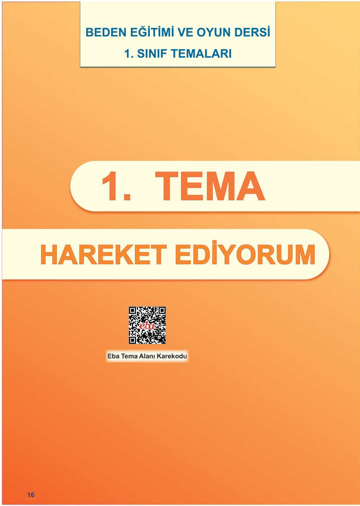
Eba Tema Alanı Karekodu

<!-- sayfa 17 -->

# 1. TEMA: HAREKET EDİYORUM

| | |
| :--- | :--- |
| **DERS SAATİ** | 85 |
| **ALAN BECERİLERİ** | BEOSAB1. Hareketi Sergileme, BEOSAB2. Hareket Kavramlarını Uygulama, BEOSAB10. Güvenli Ortam Oluşturma |
| **KAVRAMSAL BECERİLER** | KB1. Temel Beceriler |
| **EĞİLİMLER** | E1.1. Merak, E2.5. Oyunseverlik, E3.2. Odaklanma, E3.8. Soru Sorma |
| **PROGRAMLAR ARASI BİLEŞENLER** | |
| **Sosyal-Duygusal Öğrenme Becerileri** | SDB1.1. Kendini Tanıma (Öz Farkındalık), SDB2.1. İletişim, SDB2.2. İş Birliği, SDB3.3. Sorumlu Karar Verme |
| **Değerler** |  D4. Dostluk, D6. Dürüstlük, D14. Saygı, D16. Sorumluluk |
| **Okuryazarlık Becerileri** | OB4. Görsel Okuryazarlık |
| **DİSİPLİNLER ARASI İLİŞKİLER** | Hayat Bilgisi, Görsel Sanatlar |
| **BECERİLER ARASI İLİŞKİLER** | KB2.18. Tartışma, TAB3. Konuşma, SBAB5.2. Grup Dinamiğini Sağlama |
| **ÖĞRENME ÇIKTILARI VE SÜREÇ BİLEŞENLERİ** | **BEO.1.1.1. Oyunlarda hareket kavramlarını uygulayabilme** a) Beden farkındalığı, alan farkındalığı, efor ve hareket ilişkileri kavramlarını ayırt eder. b) Hareket ile beden farkındalığı, alan farkındalığı, efor ve hareket ilişkileri kavramları arasında bağ kurar. c) Beden farkındalığı, alan farkındalığı, efor ve hareket ilişkileri temel kavramlarına uygun hareket eder. **BEO.1.1.2. Oyunlar sırasında güvenli ortam oluşturabilme** a) Oyunlar sırasında ortaya çıkabilecek riskleri tanımlar. b) Oyunlar sırasında ortaya çıkabilecek risklere ilişkin önleyici tedbirler alır. **BEO.1.1.3. Temel hareket becerilerini açıklayabilme** **BEO.1.1.4. Temel hareket becerilerini sergileyebilme** a) Yer değiştirme, nesne kontrolü ve denge becerilerini algılar. b) Yer değiştirme, nesne kontrolü ve denge becerilerinin basamaklarını gösterir. c) Yer değiştirme, nesne kontrolü ve denge becerilerini farklı durumlarda uygular. |
| **İÇERİK ÇERÇEVESİ** | Hareket Kavramları Güvenli Ortam Temel Hareket Becerileri |
| **Genellemeler/ Anahtar Kavramlar/ Sembol ve Gösterimler** | ağırlık aktarımı, denge, efor, farkındalık, güvenlik, hareket, nesne kontrolü, oyun, oyunlarda risk, yer değiştirme |

<!-- sayfa 18 -->

# 1. TEMAYA BAŞLARKEN

Bu temada öğrencilerin beden farkındalığı, alan farkındalığı, efor ve hareket ilişkilerini çeşitli oyunlar ve fiziksel aktiviteler yoluyla öğrenmeleri amaçlanmaktadır. Ayrıca öğrencilerden oyunlar ve fiziksel etkinlikler sırasında güvenli bir ortam oluşturma becerilerini geliştirmeleri, bulundukları alandaki riskleri tespit edebilme ve bu risklere karşı uygun önlemleri alabilme yetilerini kazanmaları beklenmektedir. Bununla birlikte öğrencilerin temel hareket becerileri olan yer değiştirme, nesne kontrolü ve denge becerilerini ayırt edebilmeleri, bu becerileri basamaklarıyla sergileyebilmeleri ve farklı oyunlarda doğru bir şekilde uygulayabilmeleri amaçlanmaktadır. Tema içeriğinde yer alan hareket kavramları Şekil 1’de açıklanmıştır.

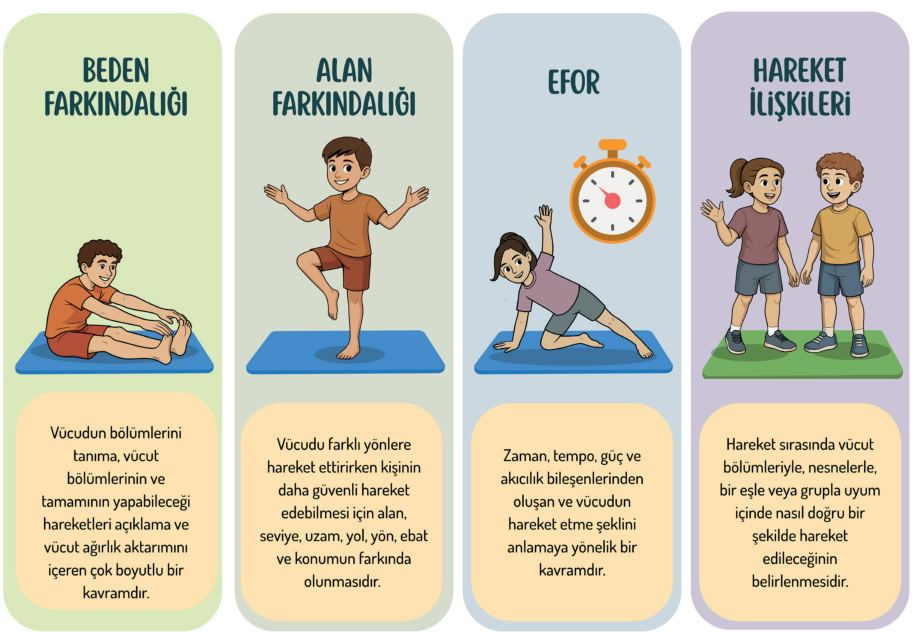

**Şekil 1.** Hareket kavramları

Temada yer alan etkinliklerdeki güvenli ortam oluşturabilme çıktısına ilişkin risk durumları günlük yaşamla ilişkili olmalıdır. Bu riskler öğretmen tarafından kontrol edilmeli ve tehlike yaratmayacak şekilde düzenlenmelidir. Ayrıca risk örnekleri öğrencilerin gelişim düzeylerine uygun olmalıdır. Tema içeriğinde yer alan temel hareket becerileri yer değiştirme, nesne kontrolü ve denge becerileridir. Bu beceriler Şekil 2’de açıklanmıştır.

<!-- sayfa 19 -->

**Şekil 2.** Temel hareket becerileri

## 2. ÖĞRENME-ÖĞRETME YAŞANTILARI

Öğrenme-öğretme yaşantılarının bir bileşeni olan ön değerlendirme sürecinde öğrencilerin ön bilgilerini ve konuya ilişkin ihtiyaçlarını belirleyebilmek amacıyla öğrencilerden vücudun bölümlerini görsel kavram haritalarını kullanarak işaretlemeleri istenir. Ayrıca hareket kavramlarına yönelik çeşitli görseller sunularak öğrencilerin kavramlarla ilişki kurmaları sağlanır. Bu süreçte konuya dair düşünmelerini sağlamak için öğrencilere aşağıdaki gibi sorular yöneltilir:

* Arkadaşlarınızla oyun oynarken birbirinize çarpmamak için neler yaparsınız?
* Havadan gelen bir topu nasıl yakalarsınız?
* Farklı zeminlerde (toprak, buz, asfalt, kum, çim alan vb.) yürürken ya da koşarken nasıl hareket edersiniz?

Öğrenme-öğretme yaşantılarının bir diğer bileşeni köprü kurmada ise; öğrencilerin hareket kavramlarına ilişkin temel seviyedeki bilgilerini hatırlatmak amacıyla önceki öğrenmeleri göz önünde bulundurularak günlük yaşamdan örnekler verilir. Öğrencilere konu hakkında sorular yöneltilir ve öğrencilerin cevap vermeleri sağlanır. Öğrencilere günlük yaşamda oynadıkları oyunlarda güvenli bir oyun ortamını nasıl sağladıkları sorulur. Ayrıca çeşitli örnek olaylar anlatılarak öğrencilerin risklere karşı çözüm önerileri sunmaları istenir. Öğrencilerden temel hareket becerilerini daha önce nasıl deneyimlediklerine yönelik örnekler vermeleri istenir.

<!-- sayfa 20 -->

### 2.1. Etkinlik Örnekleri

**ETKİNLİK 1** &nbsp;&nbsp;&nbsp;&nbsp;&nbsp;&nbsp;&nbsp;&nbsp;&nbsp;&nbsp;&nbsp;&nbsp;&nbsp;&nbsp;&nbsp;&nbsp;&nbsp;&nbsp;&nbsp;&nbsp;&nbsp;&nbsp;&nbsp;&nbsp;&nbsp;&nbsp;&nbsp;&nbsp;&nbsp;&nbsp;&nbsp;&nbsp;&nbsp;&nbsp;&nbsp;&nbsp;&nbsp;&nbsp;&nbsp;&nbsp;&nbsp;&nbsp;&nbsp;&nbsp;&nbsp;&nbsp;&nbsp;&nbsp;&nbsp;&nbsp;&nbsp;&nbsp;&nbsp;&nbsp;&nbsp;&nbsp;&nbsp;&nbsp;&nbsp;&nbsp;&nbsp;&nbsp;&nbsp;&nbsp;&nbsp;&nbsp;&nbsp;&nbsp;&nbsp;&nbsp;&nbsp;&nbsp;&nbsp;&nbsp;&nbsp;&nbsp;&nbsp;&nbsp;&nbsp;&nbsp;&nbsp;&nbsp;&nbsp;&nbsp;&nbsp;&nbsp;&nbsp;&nbsp;&nbsp;&nbsp;&nbsp;&nbsp;&nbsp;&nbsp;&nbsp;&nbsp;&nbsp;&nbsp;&nbsp;&nbsp;&nbsp;&nbsp;&nbsp;&nbsp;&nbsp;&nbsp;&nbsp;&nbsp;&nbsp;&nbsp;&nbsp;&nbsp;&nbsp;&nbsp;&nbsp;&nbsp;&nbsp;&nbsp;&nbsp;&nbsp;&nbsp;&nbsp;&nbsp;&nbsp;&nbsp;&nbsp;&nbsp;&nbsp;&nbsp;&nbsp;&nbsp;&nbsp;&nbsp;&nbsp;&nbsp;&nbsp;&nbsp;&nbsp;&nbsp;&nbsp;&nbsp;&nbsp;&nbsp;&nbsp;&nbsp;&nbsp;&nbsp;&nbsp;&nbsp;&nbsp;&nbsp;&nbsp;&nbsp;&nbsp;&nbsp;&nbsp;&nbsp;&nbsp;&nbsp;&nbsp;&nbsp;&nbsp;&nbsp;&nbsp;&nbsp;&nbsp;&nbsp;&nbsp;&nbsp;&nbsp;&nbsp;&nbsp;&nbsp;&nbsp;&nbsp;&nbsp;&nbsp;&nbsp;&nbsp;&nbsp;&nbsp;&nbsp;&nbsp;&nbsp;&nbsp;&nbsp;&nbsp;&nbsp;&nbsp;&nbsp;&nbsp;&nbsp;&nbsp;&nbsp;&nbsp;&nbsp;&nbsp;&nbsp;&nbsp;&nbsp;&nbsp;&nbsp;&nbsp;&nbsp;&nbsp;&nbsp;&nbsp;&nbsp;&nbsp;&nbsp;&nbsp;&nbsp;&nbsp;&nbsp;&nbsp;&nbsp;&nbsp;&nbsp;&nbsp;&nbsp;&nbsp;&nbsp;&nbsp;&nbsp;&nbsp;&nbsp;&nbsp;&nbsp;&nbsp;&nbsp;&nbsp;&nbsp;&nbsp;&nbsp;&nbsp;&nbsp;&nbsp;&nbsp;&nbsp;&nbsp;&nbsp

<!-- yer tutucu bulunamadı: sayfa sonuna eklendi -->

<!-- sayfa 21 -->

Daha sonra öğrencilerden hareket kavramlarına ilişkin örnekler vermeleri ve hareketleri uygulamaları istenir. Bu esnada öğrencilerin birbirlerinin sözünü kesmeden birbirlerini dikkatle dinlemeleri sağlanır (**D14.1, E3.2**). Ayrıca öğrencilerin birbirlerine nazik davranmaları ve birbirlerinin düşüncelerini anlamaya çalışmaları da desteklenir (**D4.2**). Hareket kavramlarına ilişkin posterler ve görsel kartlar gibi materyaller kullanılarak öğrencilerin hareket kavramlarını ayırt etmeleri sağlanır (**OB4**).

**Oyun 1: Renkli Hareket Kutuları**

Öğrenciler üç gruba ayrılır. Oyun alanında başlama ve bitiş çizgisi belirlenir. Grupların başlangıç çizgisinin arkasında sıraya girmesi sağlanır. Grupların karşısına, bitiş çizgisine eşit mesafelerde olacak şekilde kırmızı, mavi ve yeşil kutular yerleştirilir. Oyunun birinci bölümünde kırmızı kutuya gidecek öğrencilerin karşıya farklı hızlarda koşması istenir. Mavi kutuya gidecek iki öğrenciden karşıya doğru çizilen bir çizgi üzerinde el ele tutuşarak yürümesi istenir. Bu hareketle öğrencilerden yürürken denge kurmaları beklenir (**SDB2.2**). Yeşil kutuya gidecek öğrencilerden yere konulan minderin üzerinde yuvarlanıp, minderden sonra konulan küçük engellerden atlayarak karşıya koşmaları istenir. Tüm öğrencilerin hareketleri tamamlamasının ardından gruplardan yer değiştirmeleri ve farklı renkli kutuların karşısına geçmeleri istenir. Bu şekilde devam edilerek tüm öğrencilerin yukarıda belirtilen hareketleri sergilemesine imkân sağlanır. Oyunun ikinci bölümünde renk kutuları için farklı hareketler belirlenir. Kırmızı kutunun karşısındaki öğrencilerden tek ayak üstünde dengeli bir şekilde sıçrayarak ilerlemeleri istenir. Mavi kutunun karşısındaki öğrencilerden top veya balon alarak, top veya balonu düşürmeden taşımaları istenir. Yeşil kutu karşısındaki öğrencilerin bitişe konulan bu yeşil kutuya top veya başlangıçta belirlenen nesneyi atmaları istenir. Hareketi tamamlayan öğrencilerin sıranın arkasına geçmesi gerektiği belirtilir. Oyun esnasında verilen komut ile hedefe ilerleyen öğrencilerin kişisel alan ve genel alana dikkat ederek, birbirlerine çarpmadan hareket etmeleri istenir. Belirlenen tüm hareketler yapıldıktan sonra vücutlarının hangi bölümlerini kullandıklarına, vücut ağırlık aktarımını nasıl gerçekleştirdiklerine, dengeyi nasıl sağladıklarına yönelik çeşitli sorularla hareket kavramlarına vurgu yapılarak öğrencilerin bu kavramlar arasında ilişki kurmasına yardımcı olunur. Öğrencilerin hem kendi grubundaki hem de diğer gruptaki arkadaşlarına oyun sırasında nazik davranmaları ve yardımcı olmaları desteklenir (**D4.1, D6.1**) (Şekil 3).

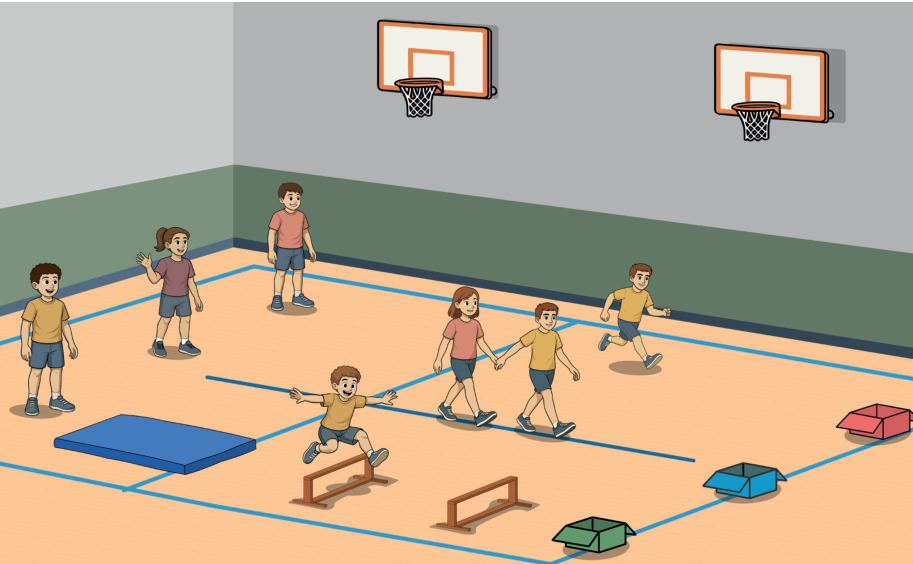

<!-- sayfa 22 -->

# Oyun 2: Kazandıran Renkler

Oyuna başlamadan önce öğrencilere daha önce kartondan yapılmış küp şeklinde bir oyuncak görüp görmedikleri ve kartondan yapılmış küp şeklindeki oyuncakların kullanıldığı herhangi bir oyun bilip bilmedikleri sorularak oynatılacak oyuna dikkat çekilir. Öğrencilere “Sizce kartondan yapılmış küp şeklindeki oyuncakların her yüzü aynı mıdır?”, “Kartondan yapılmış küp şeklindeki oyuncaklarla hiç oyun oynadınız mı?” gibi sorular sorulur (E1.1). Etkinlik süresince yapacakları hareketleri fark etmeleri için yürüyüş, tek ayakla ve çift ayakla sıçramanın farklarını söylemeleri ve bunları oyun başlamadan önce arkadaşlarıyla paylaşmaları istenir (SDB1.1, TAB3). Üç farklı renkte kartondan yapılmış küp şeklinde bir oyuncak hazırlanır. Oyuncağın karşılıklı yüzlerinin aynı renkte olması sağlanır. Oyuncağın renkleri ile bu renklerin hangi hareket için kullanılacağı görseller eşliğinde anlatılır, çeşitli fotoğraflar gösterilerek öğrencilerin oyuncakları incelemelerine müsaade edilir. Bu hareketler sırasında vücudun hangi bölgelerinin çalıştığı gösterilerek beden farkındalığını anlamalarına ve yorumlamalarına yardımcı olunur (OB4). Daha sonra öğrenciler iki kişiden oluşan takımlara ayrılır. Her takım için bir oyuncu, bir de oyuncağı atan kişi seçilir. Oyuncağı atan öğrenci, takım arkadaşının yönlendirilmesinden sorumludur (SDB1.1, SDB2.1, SDB2.2). Takımdaki öğrencilerden biri oyuncağı attığında gelen renge göre diğer öğrencinin hareket etmesi sağlanır. Hareketi gerçekleştirirken öğrencinin dikkatli olması, arkadaşını dinlemesi, takım arkadaşı ile oyunun ilerleyişine dair fikir alışverişinde bulunması ve alana uygun hareket etmesi sağlanır (SDB2.1, SDB2.2). Yarışacak olan her öğrencinin önüne yirmi kare (karolar, tebeşirle çizilmiş veya siyah bantla oluşturulmuş kareler vb.) çizilir. Öğretmenin düdüğü ile oyuncak, görevli öğrenciler tarafından yere atılır. Mavi yüz gelirse çift ayakla sıçrayarak iki kare ilerlenir. Turuncu yüz gelirse üç kare tek ayak üzerinde sekerek ilerlenir. Sarı yüz gelirse geriye adım alınarak bir kare geri gidilir. Eğer başlangıç atışında sarı gelirse hareket edilmez ve diğer atış beklenir. Oyun sırasında sıçrarken oyuncu dengesini kaybeder ve elini yere değdirirse bir kare geri gitmesi ve karton küpü atan takım arkadaşı ile yer değiştirmesi istenir. Öğrenciler etkinlik sırasında gerek kendi takım arkadaşı gerekse rakipleri ile iletişimlerinde nezaketli olmaları, kimsenin sözünü kesmemeleri, söz sırasının kendilerine gelmesini beklemeleri, karşıdakilerin fikirlerine saygılı olmaları ve onları anlamaya çalışmaları yönünde yönlendirilir (D14.1, D4.2). Her turun sonunda öğrencilere “En çok hangi hareket sizi zorladı?”, “Dengeli sıçrayabilmek için hareketin başlangıcında vücudunuzu hangi pozisyona getirdiniz?” gibi sorular yöneltilerek oyuna odaklanmalarına ve beden farkındalığı kazanmalarına yardımcı olunur (E3.2). Yirmi karelik yolun sonuna gelen takım, oyunu tamamlar. Öğrenciler bu ve benzeri oyunları farklı hava koşullarında, farklı yerlerde (mahallede, oyun alanlarında, park vb.), arkadaşlarıyla çeşitlendirerek oynamaları konusunda motive edilir (E2.5). Her öğrenci kendi takımının bir parçası olarak arkadaşlarına destek olduğu için öğrencilerden birlikte sorumluluk alma duygusu geliştirmeleri ve takım arkadaşlarıyla samimiyetlerini artırmaları beklenir (D4.1, D6.1). Oyun sonunda nasıl hissettiklerini, nerelerde zorlandıklarını ve eğlendikleri anları paylaşmaları için öğrencilere söz hakkı verilir (SDB1.1, TAB3).

## Çeşitlendirme

Öğrenci sayısına göre grup sayısı artırılabilir veya azaltılabilir. Oyunlarda belirlenen hareketler çeşitlendirilebilir. Birinci oyunda renk kutuları için farklı hareketler belirlenebilir. Bunlar; farklı hızlarda yürüme, sıçrayarak ilerleme, engellerin aralarından koşma, top sektirerek ilerleme ve benzeri hareketler olabilir. Farklı atış mesafeleri ayarlanabilir. Kullanılan malzemelerde çeşitlilik (çeşitli boyutlarda sepetler, çeşitli büyüklükte toplar ve farklı kalınlıkta denge tahtaları vb.) sağlanabilir. İkinci oyunda yer alan kartondan yapılmış küp şeklindeki oyuncağa yeşil renk eklenebilir ve yeşil renk geldiğinde iki kare atlama ve oyuncağı tekrar atma hakkı verilebilir. Oyunda yer alan kare sayıları artırılabilir veya azaltılabilir. Oyun, süre ile oynanan bir versiyona dönüştürülebilir. Farklı renklerde, farklı zorlukta yeni görevler istenebilir. Etkinlik alanı için bahçe veya kapalı spor salonu gibi yerler seçilebilir. Etkinlik, farklı oyunlarla çeşitlendirilebilir.

<!-- sayfa 23 -->

# Öğrenme Kanıtları ve Etkinlik Yansıması

Bu öğrenme çıktısının değerlendirilmesinde gözlem formu (**Ek 2**) kullanılır. Bu ölçme aracı, öğrencilerin hareket kavramlarını çeşitli oyun ve fiziksel aktivitelerde uygulayabilme durumlarını değerlendirmek amacıyla hazırlanmıştır.

Etkinlik yansıması kapsamında öğrencilere aşağıdaki sorular yöneltilebilir:

* Etkinlikte yaptığınız hareketlerde vücudunuzun hangi bölümlerini kullandınız?
* Hareket ederken sadece kendi kişisel alanınızda mı kaldınız? Arkadaşlarınızla çarpışmadan oynayabildiniz mi? Bunu nasıl başarabildiğinizi düşünüyorsunuz? Bizimle paylaşır mısınız?
* Arkadaşlarınızla birlikte hareket ederken nelere dikkat ettiniz?
* Günlük yaşamda bu hareket kavramlarından hangilerini kullanıyorsunuz?


**ETKİNLİK 2** &nbsp;&nbsp;&nbsp;&nbsp;&nbsp;&nbsp;&nbsp;&nbsp;&nbsp;&nbsp;&nbsp;&nbsp;&nbsp;&nbsp;&nbsp;&nbsp;&nbsp;&nbsp;&nbsp;&nbsp;&nbsp;&nbsp;&nbsp;&nbsp;&nbsp;&nbsp;&nbsp;&nbsp;&nbsp;&nbsp;&nbsp;&nbsp;&nbsp;&nbsp;&nbsp;&nbsp;&nbsp;&nbsp;&nbsp;&nbsp;&nbsp;&nbsp;&nbsp;&nbsp;&nbsp;&nbsp;&nbsp;&nbsp;&nbsp;&nbsp;&nbsp;&nbsp;&nbsp;&nbsp;&nbsp;&nbsp;&nbsp;&nbsp;&nbsp;&nbsp;&nbsp;&nbsp;&nbsp;&nbsp;&nbsp; **Risk Var mı? Kontrol Et ve Oyna**

| | |
| :--- | :--- |
| **Amaç:** | Öğrencilerin oyun ve fiziksel aktivitelerde güvenli ortam oluşturabilmeleri ve hareket ettikleri alanda riskleri tespit ederek önlem alabilmeleridir. |
| **Eğilimler** | - |
| **Sosyal-Duygusal Öğrenme Becerileri** | SDB2.2. İş Birliği, SDB3.3. Sorumlu Karar Verme |
| **Değerler** | D16. Sorumluluk |
| **Beceriler Arası İlişkiler** | - |
| **Öğrenme Çıktısı ve Süreç Bileşenleri** | **BEO.1.1.2. Oyunlar sırasında güvenli ortam oluşturabilme**   a) Oyunlar sırasında ortaya çıkabilecek riskleri tanımlar.   b) Oyunlar sırasında ortaya çıkabilecek risklere ilişkin önleyici tedbirler alır. |
| **Kullanılan Öğretim Teknolojileri, Araç Gereçler ve Kaynaklar** | çeşitli nesneler, uyarı levhaları, koni, bant, minder, dizlik ve dirseklik gibi koruyucular   Oyun Parkuru 1: hulahop ve slalom çubukları   Oyun Parkuru 2: koni, engel, denge tahtası/çizgisi, sepet ve küçük kum torbası |

Öğrencilerin çember oluşturarak oyun alanına yerleşmesi sağlanır. Öğrencilere günlük yaşamda oyun oynarken güvenli ortamı nasıl sağladıkları sorulur. Daha sonra oyunlar sırasında güvenli bir ortamın nasıl oluşacağına yönelik “Sizce oyun alanında güvenli bir ortam nasıl olmalı?”, “Bir oyun alanında nelere dikkat edilmeli?” şeklinde sorular yöneltilir ve öğrencilerden fikirlerini paylaşmaları istenir. Soru cevap bölümü “koş ve söyle” oyunu şeklinde gerçekleştirilir. Her bir sorunun ardından cevap vermek isteyen öğrencinin oluşturulan çemberin etrafında bir tur koşması, kendi yerine geldiğinde cevabını vermesi istenir. Daha sonra zemin, kullanılan materyal, kıyafet ve ayakkabı tercihine vurgu yapılarak risk durumlarına ilişkin örnek olaylar (**Ek 3**) öğrencilere anlatılır. Öğrencilerden bu olaylardaki risklere çözüm önerileri sunmaları istenir. Etkinlik alanının çeşitli bölgelerini gözlemlemek için farklı risk durumları oluşturulur. İlk bölümde zemin hafif ıslatılır veya kayganlaştırılır. İkinci bölümde yüksek nesnelerle engebeli bir zemin oluşturulur. Üçüncü bölümde oyun alanı farklı nesneler yerleştirilerek daraltılır. Dördüncü bölümde koşu için dizilen koniler iki farklı çizgi üzerinde birbirlerine yakın mesafede yerleştirilir. Ayrıca bu bölümlere çeşitli güvenlik uyarıları yerleştirilir. Öğrencilerin dört gruba ayrılması ve bu bölümlerde oluşturulan risk örneklerini gözlemleyerek riskleri tanımlaması istenir (SDB2.2). Ardından kendi bölümündeki riskleri grupça belirlemeleri ve ortamı güvenli hâle

<!-- sayfa 24 -->

getirmeleri istenir. Birinci bölümdeki öğrencilerden ıslak veya kaygan alanı geçici olarak kullanılma-
ması için işaretlemeleri ve uyarı levhaları koymaları istenir. İkinci bölümdeki öğrencilerden düşme, 
takılma ve yaralanma risklerine karşı engebeleri güvenli hâle getirmeleri (platformları minderlerle 
desteklemek vb.) ve güvensiz bölgeleri sınırlamak için koni ve bant gibi malzemelerle işaretlemeleri 
istenir. Ayrıca öğrencilerin bu zeminde kontrollü yürümek ve koşmak için birbirleriyle yardımlaşmaları 
sağlanır. Üçüncü bölümdeki öğrencilerden alandaki nesneleri daha az yoğunlukta olacak şekilde 
yerleştirip düzenlemeleri, gereksiz ve tehlike oluşturabilecek nesneleri etkinlik alanından çıkarmaları, 
güvenli alanları işaretlerle belirlemeleri istenir. Dördüncü bölümdeki öğrencilerden koniler arasında-
ki mesafeyi genişleterek birbirlerine çarpma riskini ortadan kaldırmaları istenir. Böylelikle dengeli 
şekilde koşabilmeleri, kişisel ve genel alanlara dikkat edebilmeleri sağlanır. Ortamın güvenliğinin 
sağlanmasının ardından öğrenciler için mini oyun parkurları hazırlanır. Etkinlikte öğrencilerin rekabet 
sağlamalarına değil hareket becerilerini geliştirmelerine ve tekrar ederek öğrenme fırsatı bulmalarına 
imkân sağlanır. 

**Oyun Parkuru 1: Alanına Dikkat, Hedefe İsabet**

Öğrencilerin oyun alanında karışık bir şekilde dizilmeleri sağlanır. Oyun alanına karışık şekilde ko-
niler ve ortaya slalom çubukları yerleştirilir. Öğrenci sayısına uygun olacak şekilde koni ve slalom 
çubuklarının sayısı artırılabilir. Yaklaşık 25-30 adet hulahop, oyun alanının kenarlarına yerleştirilir. 
Başlama komutuyla hulahop alan öğrencilerin konilerin aralarından karışık bir şekilde, konileri devir-
meden ve çarpmadan koşarak geçmeleri, ardından hulahopu istedikleri bir slalom çubuğuna atmaları 
istenir. Tüm hulahoplar atıldıktan sonra tekrar başlangıçtaki yerlerine konulur. Öğrencilere başlama 
komutu tekrar verilerek aynı şekilde oyuna devam edilir. Öğrencilerin kişisel ve genel alana dikkat 
etmeleri gerektiği vurgulanır. Ayrıca tüm öğrencilerin katılımı, iş birliği ve birbirlerine destek olmaları 
teşvik edilir (**D16.1**) (**Şekil 4**).

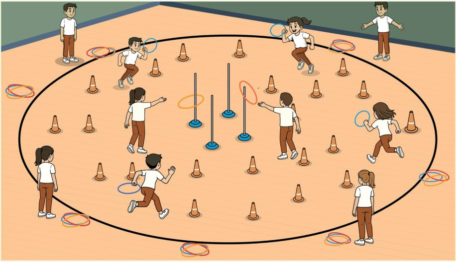

*Şekil 4. Alanına dikkat, hedefe isabet oyun parkuru*

**Oyun Parkuru 2: Dört Adımda Denge ve Dikkat**

Parkur için başlangıç çizgisi belirlenir.Öğrencilere yaralanmaların yaşanmaması için uygun olan 
ısınma hareketleri yaptırılır. Tüm öğrencilerin parkurun başlangıç çizgisinin gerisinde sıraya girmesi 
sağlanır Birinci bölümde düz bir hizada aralarında mesafe olacak şekilde dört koni yerleştirilir Öğ-

<!-- sayfa 25 -->

kısa engel yerleştirilir. Öğrencilerden bu engellerin üzerinden atlamaları istenir. Üçüncü bölümde bir denge tahtası/çizgisi yerleştirilir. Öğrencilerden dengelerini koruyarak yürümeleri istenir. Dördüncü bölümde yere öğrenci sayısı kadar küçük kum torbaları ya da benzer nesneler yerleştirilir. Bu nesnelerin yaklaşık 2 metre ilerisine sepet gibi bir hedef yerleştirilir. Öğrencilerden önceden yerleştirilen küçük kum torbaları ya da benzeri nesnelerden sadece birini yerden alarak hedefe atmaları istenir. Parkuru tamamlayan öğrencilerin başlangıç çizgisindeki yerlerine giderek sıraya tekrar girmeleri, parkura devam eden öğrencilerin kişisel ve genel alanlarına dikkat etmeleri ve birbirlerine çarpmadan ilerlemeleri sağlanır. Parkur oyunu tamamlandıktan sonra yaralanmaların yaşanmaması için uygun olan soğuma hareketleri öğrencilere yaptırılır. Öğrencilerden hem kendi güvenliğinin hem de arkadaşlarının güvenliğinin sağlanması için nelere dikkat edilmesi gerektiğini düşünerek örneklerle açıklamaları istenir (SDB3.3).

**Çeşitlendirme**
Farklı noktalara daha az ya da daha fazla sayıda koni yerleştirilebilir. Etkinlikteki risk durumları çeşitlendirilebilir. Etkinlik alanını daraltmak veya farklı yüzeylerde (çimen, kum, spor salonu zemini vb.) uygulamalar yapmak gibi çeşitli ortamlar kullanılarak farklılaşma sağlanabilir. Gruplar daha küçük tutulabilir. Her grup yalnızca bir risk bölgesinden sorumlu olabilir. Etkinlik farklı oyunlarla çeşitlendirilebilir.

**Öğrenme Kanıtları ve Etkinlik Yansıması**
Bu öğrenme çıktısının değerlendirilmesinde gözlem formu (**Ek 4**) kullanılır. Bu ölçme aracı, öğrencilerin oyun ve fiziksel aktivitelerde güvenli ortam oluşturabilme ve hareket ettikleri alanda riskleri tespit ederek önlem alabilme durumlarını değerlendirmek amacıyla hazırlanmıştır.

Etkinlik yansıması kapsamında öğrencilere aşağıdaki sorular yöneltilebilir:

* Oyun oynarken hangi tehlikeleri fark ettiniz?
* Bu tehlikeleri ortadan kaldırmak için ne yaptınız?
* Arkadaşlarınızın güvenliği için nelere dikkat ettiniz?
* Etkinlikte karşınıza çıkan güvenlik önlemleri sizce ne işe yarar? Düşündüklerinizi arkadaşlarınızla paylaşınız.

| | |
| :--- | :--- |
| **ETKİNLİK 3** | **Hareketleri Tanıyorum ve Anlatıyorum** |
| **Amaç:** | Öğrencilerin temel hareket becerilerinden yer değiştirme, nesne kontrolü ve denge becerilerini açıklayabilmeleridir. |
| **Eğilimler** | E3.8. Soru Sorma |
| **Sosyal-Duygusal Öğrenme Becerileri** | SDB2.1. İletişim |
| **Değerler** | D14. Saygı |
| **Okuryazarlık Becerileri** | OB4. Görsel Okuryazarlık |
| **Kavramsal Beceriler** | - |
| **Beceriler Arası İlişkiler** | KB2.18. Tartışma |
| **Öğrenme Çıktısı ve Süreç Bileşenleri** | **BEO.1.1.3. Temel hareket becerilerini açıklayabilme** |
| **Kullanılan Öğretim Teknolojileri, Araç Gereçler ve Kaynaklar** | hareket becerileriyle ilgili görsel kartlar Oyun 1: koni, minder, top, sepet ya da koni gibi hedef, büyük çember ve alçak kutu |

<!-- yer tutucu bulunamadı: sayfa sonuna eklendi -->

<!-- sayfa 26 -->

Öğrencilerin çember şeklinde bir düzen oluşturmaları istenir. Temel hareket becerilerinden yer değiştirme, nesne kontrolü ve denge becerileri öğrencilere açıklanır. Öğrencilere “Havadan gelen bir nesneyi nasıl tutarsınız?”, “Topraklı veya buzlu bir zeminde nasıl koşarsınız?” şeklinde sorular yöneltilerek önceki öğrenmeleriyle kavramlar arasında ilişki kurmaları sağlanır. Ardından bu becerilerle ilgili günlük yaşam deneyimlerine yönelik örnekler vermeleri ve birbirlerine sorular sormaları istenir (E3.8, KB2.18, SDB2.1). Örnek vermek, soru sormak ya da bu soruları cevaplamak isteyen öğrencilerin oluşturulan çemberin ortasına istediği şekilde sıçrayarak ya da koşarak ilerlemeleri, çemberin ortasına gelince konuşmaları ve tekrar aynı yerlerine geçmeleri istenir. Ayrıca farklı görüş ve deneyimlerin olabileceğini fark etmeleri ve birbirlerinin düşüncelerine nazikçe tepki vermeleri sağlanır (D14.1). Önceden hazırlanan temel hareket becerilerinin yer aldığı görsel kartlar öğrencilere dağıtılır ve öğrencilerden bu kartları incelemeleri istenir (OB4).

**Oyun 1: Hareket Adaları**

Oyun alanı üçe bölünerek yer değiştirme, nesne kontrolü ve denge adı verilen üç farklı macera adası oluşturulur. Öğrencilerin gruplara ayrılması sağlanır. Her adaya bir grup yerleştirilir. Öğrencilere adalarda üç farklı hareket yapmaları gerektiği belirtilir ve yapacakları hareketler gösterilir.

Yer değiştirme adasındaki hareketler şunlardır:

1. Konilerle belirlenmiş veya bantla çizilmiş düz bir çizgi üzerinde karşıya doğru adım alıp sekme ve bitişe ilerleme.
2. Yerdeki minderler üzerinde sağa ve sola doğru yuvarlanma.
3. Başlangıç noktası olan bir merkez belirlenmesinin ardından merkezden öne doğru ve sonra tekrar merkeze, ardından sağa ve tekrar merkeze, daha sonra sola ve tekrar merkeze, en son geriye ve tekrar merkeze olacak şekilde sıçrama.

Nesne kontrolü adasındaki hareketler şunlardır:

1. Öğrencilerin ikişerli veya üçerli eşleşmelerinin ardından, eşlerden birinin topu diğerine, istenilen doğrultuda ve uygun mesafede atması ve karşısındakinin de topu tutması.
2. Belirlenen hedeflere doğru topa ayakla vurma ve hedefe isabet ettirmeye çalışma.
3. Topu ayaklarıyla karşıya doğru sürme.

Denge adasındaki hareketler şunlardır:

1. Büyük bir çemberi iki öğrencinin yanlardan tutması, bir öğrencinin de eğilerek çemberin içinden geçmesi.
2. Bir çizgi üzerinde ileriye doğru koşma ve bitiş noktasına geldiğinde durma.
3. Alçak bir kutu yerleştirip kutunun üzerinde atlama ve yere konma.

Tüm öğrencilerin farklı adalarda deneyim kazanmaları sağlandıktan sonra etkinlik sonlandırılır (**Şekil 5**).

<!-- sayfa 27 -->

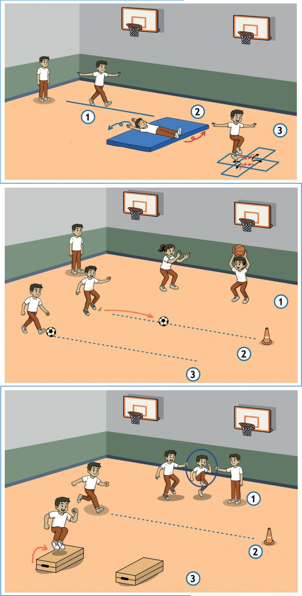

<!-- sayfa 28 -->

**Oyun 2: Hareket Kartları**

Öğrencilerin bahçe veya oyun alanında daire şeklinde çizilmiş bir alan çevresinde toplanmaları sağlanır. Daha önceden en az sınıf mevcudu kadar hazırlanan hareket görselleri bir kutu içerisine konulur. Her öğrencinin sırayla bir kart çekmesi, kartta çıkan hareketi canlandırma ile göstermesi, canlandırdığı hareketin hangi temel hareket becerisi (yer değiştirme, nesne kontrolü, denge) kategorisine girdiğini belirlemesi istenir. Daha sonra kırmızı kutunun içine yer değiştirme ile ilgili kartları (koşma, atlama, sıçrama, galop ve kayma, yuvarlanma, tırmanma vb.), mavi kutuya nesne kontrolü ile ilgili kartları (atma, yakalama, top sektirme, yuvarlama, durdurma, raketle vurma vb.) ve sarı kutuya denge hareketleri ile ilgili kartları (eğilme, esnetme, dönme, ağırlık aktarma, denge, itme, çekme vb.) koyması istenir. Bu şekilde sınıfın tamamının eğlenerek canlandırmalar eşliğinde oyuna katılımı sağlanır.

**Çeşitlendirme**

Öğrencilerin eşli/grup hâlinde yanıtlar bulmaları veya sorulara kendi başlarına yanıt bulmaları istenebilir. Öğrencilere canlandırma yaptırmak yerine görsel kartlar inceletilip açıklama yaptırılabilir. Canlandırma hazır yönergeler içeren kartlar yardımıyla yapılabilir. Görsel desteği olmayan sözlü yönergelerle çalışmalar yaptırılabilir. Etkinlik farklı oyunlarla çeşitlendirilebilir.

**Öğrenme Kanıtları ve Etkinlik Yansıması**

Bu öğrenme çıktısının değerlendirmesinde kontrol listesi (**Ek 5**) kullanılır. Bu ölçme aracı, öğrencilerin temel hareket becerilerini açıklayabilme durumlarını değerlendirmek amacıyla hazırlanmıştır.

Etkinlik yansıması kapsamında öğrencilere aşağıdaki sorular yöneltilebilir:

* Hareketleri yaparken zorlandığınız bir an oldu mu? Olduysa nerelerde zorlandınız? Düşündüklerinizi arkadaşlarınızla paylaşınız.
* Top atarken arkadaşlarınızla birlikte uyum içinde nasıl hareket ettiniz?
* Etkinlikteki en eğlenceli bölüm hangisiydi? Açıklayabilir misiniz?
* Etkinlikte uyguladığınız hareketlere ilişkin ne tür örnekler aklınıza geliyor? Düşündüğünüz örnekleri arkadaşlarınızla paylaşınız.

<!-- sayfa 29 -->

**ETKİNLİK 4** | **Hareketin 3 Gücü: Yer Değiştirme, Nesne Kontrolü, Denge**

| | |
| :--- | :--- |
| **Amaç:** | Öğrencilerin temel hareket becerilerinden yer değiştirme, nesne kontrolü ve denge becerilerini ayırt edebilmeleri; hareketlerin basamaklarını gösterebilmeleri, çeşitli oyun ve fiziksel aktivitelerde bu becerileri sergileyebilmeleridir. |
| **Eğilimler** | E2.5. Oyunseverlik |
| **Sosyal-Duygusal Öğrenme Becerileri** | SDB2.2. İş Birliği |
| **Değerler** | - |
| **Okuryazarlık Becerileri** | - |
| **Kavramsal Beceriler** | - |
| **Beceriler Arası İlişkiler** | SBAB5.2. Grup Dinamiğini Sağlama |
| **Öğrenme Çıktısı ve Süreç Bileşenleri** | **BEO.1.1.4. Temel hareket becerilerini sergileyebilme**   a) Yer değiştirme, nesne kontrolü ve denge becerilerini algılar.   b) Yer değiştirme, nesne kontrolü ve denge becerilerinin basamaklarını gösterir.   c) Yer değiştirme, nesne kontrolü ve denge becerilerini farklı durumlarda uygular. |
| **Kullanılan Öğretim Teknolojileri, Araç Gereçler ve Kaynaklar** | temel hareket beceri ile ilgili görsel kartlar   İstasyon Serisi 1: yastık, ip, hulahop, top ve silindir cisim   İstasyon Serisi 2: top ve koni   Oyun 1: çember, top, kutu, kum torbası ve hulahop   Oyun 2: renkli kartonlar ve top.   Oyun 3: kırmızı ve mavi kart, denge tahtası/çizgisi, basketbol topu, koni ve engel |

Öğrencilerden temel hareket becerileri ile ilgili önceden hazırlanan görsel kartları incelemeleri istenir. Hareket becerilerinin hangi kategorilere (yer değiştirme, nesne kontrolü, denge) girdiği hatırlatılır. Her öğrencinin bu kartlardaki bir hareketi seçmesi istenir. Seçtikleri hareketi sırayla uygulamaları ve hareketini bitirdikten sonra uygulama yapan öğrenciyi motive etmek için alkışlamaları istenir. Daha sonra öğrencilere temel hareket becerileri ve kategorileri ile ilgili sorular yöneltilir. Örneğin “Topa bir raketle vurarak topu karşıya yollama durumu hangi temel hareket becerisi kategorisine girer?” sorusu sorulur. Öğrencilerin kendi aralarında tartışarak doğru cevaba ulaşmaları ve bu hareketlerin önemi hakkında fikir alışverişi yapmaları istenir. Ardından çeşitli temel hareket becerileri belirlenerek öğrencilerden bu becerileri uygulamaları istenir. Temel hareket becerilerini içeren çeşitli istasyonlar oluşturulur ve öğrencilerin istasyonlara katılımı sağlanır.

**İstasyon Serisi 1: Alkışlı İstasyon**

Öğrencilerin sınıf mevcuduna uygun şekilde gruplara ayrılmaları sağlanır. Birinci istasyonda çizilen bir çizgide başlarının üzerinde bir kitap taşımaları istenir. İkinci istasyonda ip atlamaları istenir. Üçüncü istasyonda yere çizilen veya yerleştirilen bir hulahop etrafında dönmeleri istenir. Dördüncü istasyonda silindir şeklinde bir cismi karşıya doğru yuvarlamaları istenir. Beşinci istasyonda topu on beş kez yerde sektirmeleri istenir. Grupların sırayla istasyonlardaki hareketleri uygulaması istenir. Gruplardaki öğrencilerden arkadaşlarını izlemeleri, onları desteklemeleri, arkadaşlarına yardım etmeleri, onları cesaretlendirmeleri ve istasyonları tamamlayan arkadaşlarını alkışlamaları istenir.

<!-- yer tutucu bulunamadı: sayfa sonuna eklendi -->

<!-- sayfa 30 -->

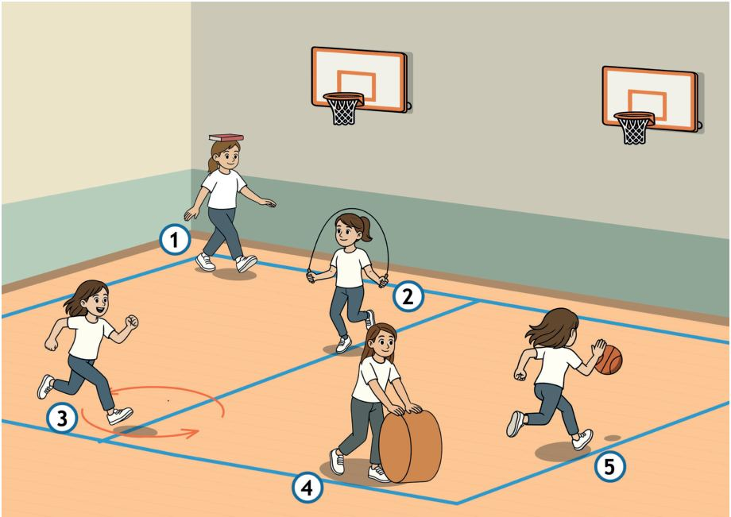

**Şekil 6. Alkışlı istasyon**

### İstasyon Serisi 2: Birlikte Hareket

Etkinlik alanı ikiye bölünür. Birinci istasyonda ortaya koniler yerleştirilir ve öğrenciler karşılıklı eşleştirilir. Eşlerden birine top verilir ve eşlerin konileri devirmeden karşı tarafa topu sektirerek atması istenir. Karşılıklı olarak bu şekilde etkinlik devam eder. İkinci istasyonda öğrencilerin üçerli olarak gruplara ayrılması istenir. Bir başlangıç noktası ve bitiş noktası belirlenerek başlangıçtan bitişe kadar bir çizgi çizilir. El ele tutuşan üç öğrenciden ellerini bırakmadan, bitiş noktasına doğru dengelerini koruyarak arka arkaya olacak şekilde ilerlemeleri istenir ($SDB2.2, SBAB5.2$). Tüm öğrencilerin istasyonlara aktif katılımı sağlanır. İstasyonların ardından öğrencilerin oyunlar için hazır olmaları sağlanır.

### Oyun 1: Hareketli Sayılar

Öğrencilerin geniş bir çember oluşturarak durması sağlanır. Tam ortaya bir hulahop yerleştirilir ve on tane farklı hareket belirlenir. Bu hareketler:

**1 numara:** Tek ayak üstünde sıçrayarak ilerleme  
**2 numara:** Geriye doğru yavaşça yürüme  
**3 numara:** Yan adımlarla yengeç şeklinde yürüme  
**4 numara:** Top sektirerek ilerleme  
**5 numara:** Belirli noktalarda komut ile durup yeni bir komut ile tekrar ilerleme  
**6 numara:** Kollar yukarıda dengeli yürüme  
**7 numara:** İki ayakla sıçrayarak ilerleme  
**8 numara:** Hafif bir kutuyu iterek ilerleme  
**9 numara:** Ele sığacak büyüklükteki kum torbasını ortadaki hulahopa atma

<!-- sayfa 31 -->

rencilerin sırayla o sayıya ait hareketi sergileyerek ortadaki hulahopa doğru gitmesi, ardından tekrar yerine dönmesi istenir. Katılımı düşük olan öğrenciler cesaretlendirilir ve olumlu pekiştireçlerle tüm öğrenciler oyuna katılmaya teşvik edilir. Öğrencilerin oyunda başarıdan çok sürece ve katılıma odaklanarak performans kaygısı yaşamadan oyundan keyif almaları sağlanır (E2.5). Oyun sırasında söylenen numaralar sergilenirken, hareket kavramları hatırlatılarak öğrencilerin temel hareket becerileri ve hareket kavramları arasında bağ kurmaları sağlanır.

## Oyun 2: Renkli Hareket Yolu

Oyuna başlamadan önce yerde bir çizgi belirlenir ve öğrencilerin bu çizginin arkasında sıraya dizilmeleri istenir. Çizginin ilerisine altı farklı renkte karton U şeklini oluşturacak şekilde yerleştirilir. Kartonlardaki görevler şu şekildedir:

1. Üç kez durduğu yerde sıçrama
2. Tek ayak üstünde 5 saniye bekleme
3. Kollarını iki yana açarak 10 saniye dengede durmaya çalışma
4. Renk kartonunda yer alan topu havaya atıp düşürmeden tutmaya çalışma
5. Kendi etrafında bir tam tur dönme
6. Üç kez yere çömelme ve yerde kalma

İlk sıradaki öğrenciden verilen komutla ilk renge geçmesi ve o renge özgü hareketi uygulaması istenir. Tekrar komut verilerek öğrencilerin bir renkten diğerine sırayla zıplayarak geçmeleri ve geçtikleri kartondaki hareketi uygulamaları istenir. Öğrencilerin bu şekilde art arda ilerlemeleri sağlanır. Tüm renkleri tamamlayanların yerlerine tekrar geçmesi istenir. Öğrencilerin birbirlerine yardımcı olmaları ve aktif katılımları desteklenerek eğlenmeleri sağlanır (E2.5) (Şekil 7).

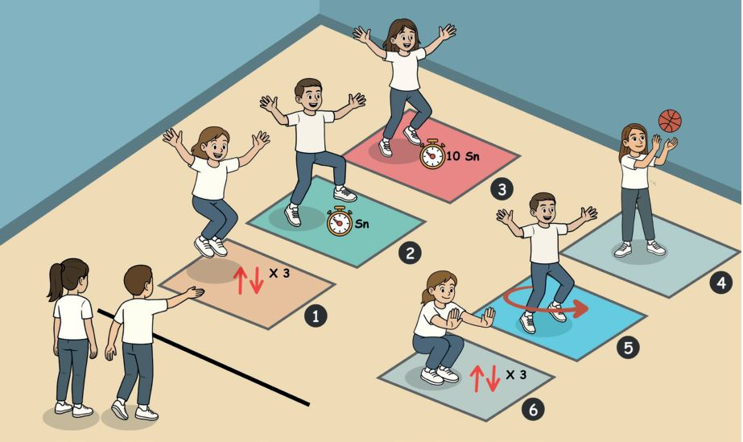

<!-- sayfa 32 -->

**Parkur 1: Renk Belirlesin, Sen Yap**

Oyunun başında öğrencilerin başlangıç için belirlenen çizginin gerisinde beklemesi istenir. Parkurda yapılacak olan hareketlerin yanlarına sepet ve kartlar konur. Düdük komutu ile ilk öğrencinin parkurun başında bulunan sepet içinden bir kart çekmesi istenir. Kart mavi renk gelirse öğrencilerin yapacakları hareketi bir, kırmızı gelirse iki defa yaparak ilerlemeleri istenir. İlk bölümde öğrencinin kartı çekmesi ve denge tahtası/çizgisi üzerinde yürümesi (kartın rengine göre bir veya iki kere) beklenir. Bir sonraki bölümde hareketin kaç defa yapılacağını belirlemek için sepetten tekrar kart çekilmesi ve yerde hulahop içinde yan yana bulunan koni ve topun yanına geçilmesi sağlanır. Top, koninin geniş kısmına konulur; düşürmeden 10 metre kadar bir mesafeye taşınır ve geri getirilerek hulahopun içine konulur. Son bölümde yine kart çekimi yapan öğrenciler, üzerinden atlayacakları 30 cm kadar yükseklikte bir engele ve ardından eğilerek geçilecek bir engel olan bölüme yönlendirilir. Tüm öğrencilerin art arda, ara vermeden parkuru uygulaması sağlanır. Bu şekilde parkur sona erer. Öğrencilerin birbirlerine yardımcı olmaları ve tamamının aktif katılımı desteklenerek eğlenmeleri sağlanır (E2.5).

İstasyon serisi, oyun ve parkurların bitiminden sonra her öğrenciden öğrendikleri hareket becerilerinden üçünü seçip kendi hareket serisini oluşturması istenir. Tüm öğrencilerin oluşturdukları serileri sırayla sergilemeleri istenir.

**Çeşitlendirme**

İstasyonlarda uygulanan hareketlerin mesafeleri kısaltılabilir veya uzatılabilir. Hareket serilerinin eşli veya üçlü gruplar hâlinde yapılması istenebilir. Bazı öğrencilerin gruba liderlik yapması sağlanabilir. Oyunlardaki malzemelerin sayısı artırılabilir veya azaltılabilir, boyutları büyütülebilir veya küçültülebilir. İkinci oyun için renkli kartonlardaki hareketler değiştirilebilir. Öğrencilerin renkli kartonlarda durma süreleri artırılabilir veya azaltılabilir. Etkinlik farklı oyunlarla çeşitlendirilebilir.

**Öğrenme Kanıtları ve Etkinlik Yansıması**

Bu öğrenme çıktısının değerlendirilmesinde performans görevi (**Ek 6**) kullanılır. Performans görevinin değerlendirilmesi için analitik dereceli puanlama anahtarı (**Ek 7**) kullanılır. Bu ölçme araçları, öğrencilerin temel hareket becerilerini ne ölçüde sergileyebildiklerini değerlendirmek amacıyla hazırlanmıştır.

Etkinlik yansıması kapsamında öğrencilere aşağıdaki sorular yöneltilebilir:

* Bugün yaptığınız hareketleri seçerken neye dikkat ettiniz?
* Hangi hareketleri yaparken zorlandığınızı anlatır mısınız?
* Hareketleri yaparken nasıl hissettiniz?
* En çok hangi hareket serisini beğendiniz? Düşündüklerinizi sebepleriyle birlikte arkadaşlarınızla paylaşınız.
* Bu becerileri günlük yaşamınızda nerelerde kullanabilirsiniz?

**2.2. Farklılaştırma**

**Zenginleştirme**

Öğrencilerden “günlük yaşamımda hareket” konulu temel hareket becerilerinin yer aldığı kısa bir hikâye yazmaları istenebilir. Hikâyede beden farkındalığı, alan farkındalığı, efor veya hareket ilişkileri gibi kavramlara yer vermeleri beklenebilir. Hazırladıkları hikâyeleri sınıf arkadaşlarına sözlü olarak sunmaları istenebilir. Öğrencilere temel hareket becerilerini anlatan dört parçalık bir resimli yapboz (koşma, zıplama, yuvarlanma, fırlatma) hazırlama görevi verilebilir.

Öğrencilerden okul bahçesinde veya spor salonunda oyun oynanabilecek güvenli yerleri harita üzeri-

<!-- sayfa 33 -->

sağlanabilir. Derste kullanılan oyun malzemeleri (top, ip, hulahop vb.) gözden geçirilir. Öğrencilerin malzemelerin güvenliğini değerlendirmesi ve güvenli kullanım önerilerini söylemesi istenebilir.

**Destekleme**

Zıplama, yuvarlanma, galop, tırmanma gibi temel hareket becerileri için her bir adımı ayrı ayrı gösteren resimli kartlar hazırlanabilir. Öğrencilerden önce karttaki hareketi incelemeleri, ardından öğretmen rehberliğinde uygulamaları istenebilir. Kas ve eklem hareketlerini basit animasyonlarla anlatan kısa bir video izletilebilir. İzleme sonrası öğrencilerden “Bu videoda vücudumuzun hangi bölgesi hareket etti?” gibi sorularla öğrendiklerini açıklamaları istenebilir.

Oyun alanında bilinçli olarak bırakılmış risk unsurlarını (yerde duran top, çok yakın yerleştirilmiş engel vb.) içeren görseller gösterilebilir. Öğrenciler bu görsellerdeki riskleri tespit ederek “Bu durumda ne yapılmalı?” sorusuna cevap verebilir.

### 3. ÖĞRENME KANITLARI (Ölçme ve Değerlendirme)

Etkinliklerin öğrenme kanıtları (ölçme ve değerlendirme) bölümünde öğrenme çıktıları doğrultusunda öğrencilerin değerlendirilmesi amacıyla hazırlanan örnek ölçme ve değerlendirme araçları belirtilmiştir. “Oyunlarda hareket kavramlarını uygulayabilme” öğrenme çıktısının değerlendirilmesinde Ek 2’de yer alan gözlem formu kullanılır. “Oyunlar sırasında güvenli ortam oluşturabilme” öğrenme çıktısının değerlendirilmesinde Ek 4’te yer alan gözlem formu kullanılır. “Temel hareket becerilerini açıklayabilme” öğrenme çıktısının değerlendirilmesinde Ek 5’te yer alan kontrol listesi kullanılır. “Temel hareket becerilerini sergileyebilme” öğrenme çıktısının değerlendirilmesinde Ek 6’da yer alan performans görevi kullanılır. Öğrencilere verilen performans görevi velilerinin rehberliğinde yaptırılabilir. Öğrencilerden beş gün boyunca her gün bir hareket yapmaları istenir. Bu hareket yer değiştirme, nesne kontrolü ve denge becerilerini içermektedir. Öğrencilerden her gün yapılacak hareketi küçük bir çizimle günlüğe kaydetmeleri ve yaptıkları hareketleri sesli bir şekilde kayıt altına almaları istenir. Beş gün boyunca boyunca farklı hareketler seçmeleri istenir. En az bir yer değiştirme, bir nesne kontrolü ve bir denge hareketi olmasına dikkat edilmelidir. Görev sonunda ses kayıtları ve günlüklere çizilen resimler öğretmene teslim edilir. Performans görevi Ek 7’de yer alan analitik dereceli puanlama anahtarı ile değerlendirilir.

Temanın bütününün değerlendirilmesinde Ek 8’de yer alan bütüncül dereceli puanlama anahtarı kullanılır. Bu değerlendirme aracı için Ek 9’da yer alan puan kaydetme tablosu kullanılır.

### 4. ÖĞRETMEN YANSITMALARI

* Bir sonraki yıl bu temanın planlaması için yorumlarınızı yazınız.

**Yorum 1:**

**Yorum 2:**

* Öğrenme Çıktılarına Göre Öz Yansıtma (planlama/hazırlık, öğrenme çevresi, öğretim, mesleki sorumluluk)

1. Öğrenme çıktısı için yansıtmalar:

2. Öğrenme çıktısı için yansıtmalar:

3. Öğrenme çıktısı için yansıtmalar:

<!-- sayfa 34 -->

# 5. EKLER

Ek 1. Hareket Kavramlarıyla İlgili Günlük Yaşamdan Örnekler

| Hareket Kavramları | Örnekler |
| :--- | :--- |
| **Beden Farkındalığı** | Vücut bölümlerini tanımakla ilgili örnekler: ellerini kullanarak yazı yazmak, ayaklarını kullanarak merdiven çıkmak, bacaklarını kullanarak diz çökmek vb. Vücut bölümleriyle birlikte vücudun tamamı kullanılarak yapabilecek hareketlerle ilgili örnekler: bir topu tek ya da iki elle tutmak, kollarını ve ayaklarını kullanarak ağaca tırmanmak vb. Vücut ağırlık aktarımıyla ilgili örnekler: merdiven çıkarken her basamakta vücut ağırlığını bir bacaktan diğerine aktarmak, tek ayak üstünde dururken vücut ağırlığını yerdeki ayağa aktarmak, bir nesneyi iterken vücut ağırlığını el ve omuzlardan nesneye aktarmak vb. |
| **Alan Farkındalığı** | Kişisel alanla ilgili örnekler: oyun alanında hareket ederken sadece kendi bulunduğu yeri kullanmak, kendine belirlediği alanda oyun oynamak vb. Genel alanla ilgili örnekler: bahçede arkadaşlarıyla koşmak, arkadaşlarıyla top oynarken tüm alanı kullanmak v.b. Yönlerle ilgili örnekler: yavaş çıkmak ve inmek, sağa veya sola dönerek kapıdan çıkmak vb. Yolla ilgili örnekler: düz bir yolda yürümek, eğik bir rampada bisiklet sürmek vb. |
| **Efor** | Zamanla ilgili örnekler: bir topu kısa sürede atmak, uzun süreli bir koşu yapmak vb. Tempoyla ilgili örnekler: yavaş veya hızlı bir şekilde dans etmek vb. Güçle ilgili örnekler: hafif bir nesneyi taşımak, ağır bir nesneyi kaldırmak vb. |
| **Hareket İlişkileri** | Vücut parçalarıyla ilgili örnekler: kollarını açarak dengede durmak, kollarını dairesel şekilde çevirmek vb. Nesne veya bireyle ilgili örnekler: bir engelin altından geçmek, halka içinde zıplamak vb. Eş ve grupla ilgili örnekler: liderin yaptıklarını tekrar etmek, eşiyle verilen hareketleri aynı anda yapmak, grup hâlinde koşmak vb. |

<!-- sayfa 35 -->

# Ek 2. Gözlem Formu

**Etkinlik Adı:** Hareket Kavramlarını Öğreniyorum

**Öğrencinin**
**Adı Soyadı:**
**Sınıfı :**
**Numarası :**

Bu ölçme aracı, “Oyunlarda hareket kavramlarını uygulayabilme” öğrenme çıktısındaki etkinliğin değerlendirilmesi için hazırlanmıştır. Etkinlik süresince belirtilen kriterlere göre yaptığınız gözlemler için uygun olduğunu düşündüğünüz seçeneği işaretleyiniz.

| Ölçütler | Çok İyi (4) | İyi (3) | Geliştirilmeli (2) | Yetersiz (1) |
| :--- | :--- | :--- | :--- | :--- |
| **Beden Farkındalığı** | Vücut bölümlerini uygun ve etkili şekilde kullanarak hareket eder. | Vücut bölümlerini çoğunlukla doğru kullanır, küçük hatalar yapar. | Bazı vücut bölümlerini karıştırır, rehberliğe ihtiyaç duyar. | Vücut bölümlerini tanımakta ve kullanmakta zorlanır. |
| **Alan Farkındalığı** | Kişisel ve genel alana dikkate alarak hareket eder. | Kişisel alan ve genel alana genellikle dikkat eder, ara sıra ihmal eder. | Alan kullanımında zorlanır, desteğe ihtiyaç duyar. | Alan farkındalığı yoktur, çarpışma ve karmaşa yaşar. |
| **Efor** | Hız, süre ve güç gibi efor unsurlarını uygun şekilde uygular. | Genelde doğru uygular, bazı kavramları karıştırır. | Efor unsurlarını anlamakta zorlanır, yardıma ihtiyaç duyar. | Efor unsurlarını ayırt edemez ve uygulayamaz. |
| **Hareket İlişkileri** | Nesne ve bireylerle iş birliği içinde hareket eder. | Genelde uyumludur, bazı durumlarda desteğe ihtiyaç duyar. | Uyum sağlamakta güçlük çeker, rehberliğe ihtiyaç duyar. | Nesne/birey ile ilişkili hareketleri gerçekleştiremez. |

**Değerlendirme Sistemi**

Bu ölçme aracından en az 4 puan, en fazla 16 puan alınabilmektedir. Öğrencinin puanı, alınan puanın yüzdelik karşılığı hesaplanarak bulunur. Bunun için alınan puan, öğrencinin alabileceği en yüksek puana bölünür ve çıkan sonuç 100 ile çarpılır. Ondalık gösterim elde edilmesi halinde sonuç tam kısmına (birler basamağına) yuvarlanır. Örneğin, öğrenci bu ölçme aracından 5 aldığında puanı şu şekilde hesaplanır: $(\frac{5}{16}) \cdot 100 = 31{,}25$ <!-- KONTROL: Marker'da karşılığı yok, uydurma olabilir -->. Bu sonuç yuvarlandığında öğrenci 31 puan almış olacaktır.

**Performans Düzeyleri:**
25–43: Yetersiz
44–62: Geliştirmeli
63–81: İyi
82–100: Çok iyi

<!-- sayfa 36 -->

# Ek 3. Risk durumlarına ilişkin örnek olaylar

### 1. Çakıllı Zemin Üzerinde İp Atlama
Öğrenciler ip atlamak için okul bahçesine çıkarılır. Ancak oyunun yapılacağı alanın zemininde çakıllar vardır. Öğrencilerden biri ip atlarken dengesini kaybederek yere düşer. Dizinden hafif şekilde yaralanan öğrenci, oyuna devam edemez. Zeminin oyun öncesi kontrol edilmediği fark edilir. Bu olaya yönelik öğrencilerle yapılabilecek sorgulamalar şunlardır:

* Bu kazanın yaşanmasına sebep olan durumlar nelerdir?
* Oyun alanı belirlenmeden önce hangi hazırlıklar yapılmalıydı?
* Böyle bir zeminde hangi tür oyunlar daha güvenli olurdu?
* Çakıllı alanlar nasıl güvenli hâle getirilebilir?

### 2. Yağmurlu Hava Sonrası Kaygan Zemin ve Uygun Ayakkabı
Okulun bahçesinde oynanan bir oyunda öğrencilerden biri, yağmurlu havadan sonra çamurlu kalan alanda kayarak düşmüştür. Düşme sırasında elini yere çarpmış ve canı yanmıştır. Bu olay sonrasında öğretmen, bahçedeki zeminin kontrol edilmeden oyun alanı olarak kullanıldığını fark eder. Ayrıca öğrencinin kaygan zemine uygun ayakkabı giymediği, tabanının düz ve kaygan olduğu görülür. Bu olaya yönelik öğrencilerle yapılabilecek sorgulamalar şunlardır:

* Bu kazanın yaşanmasının sebebi ne olabilir?
* Oyun başlamadan önce hangi kontroller yapılmalıydı?
* Hangi tür ayakkabılar bu hava koşullarına daha uygundur?
* Siz böyle bir durumla karşılaşırsanız ne yaparsınız?
* Bu alanda tekrar oyun oynanacaksa ne tür önlemler almalıyız?

### 3. Etkinlikte Uygunsuz Kıyafet Kullanımı
Bir öğrenci, beden eğitimi ve oyun dersine günlük kıyafeti ve boynuna doladığı uzun bir atkısıyla katılır. Engelli parkur sırasında atkısı oyun alanındaki konilerden birine takılır ve düşer. Neyse ki ciddi bir yaralanma olmaz ancak oyun kısa süreliğine durur. Bu olaya yönelik öğrencilerle yapılabilecek sorgulamalar şunlardır:

* Bu kazayı önlemek için öğrenci nasıl bir kıyafet giymeliydi?
* Oyunlarda kıyafet seçiminin önemli olduğunu düşünüyor musunuz?
* Ders öncesi öğretmenin hangi hatırlatmaları yapması faydalı olurdu?

### 4. Topların Toplanmaması ve Takılma Riski
Ders sırasında topla yapılan oyundan sonra öğrenciler, topları toplamadan yeni bir oyuna geçerler. Oyun sırasında bir öğrenci yerdeki topu fark etmez, topun üzerine basar ve dengesini kaybederek düşer. Diğer öğrenciler de dikkatli davranmaları konusunda uyarılır. Bu olaya yönelik öğrencilerle yapılabilecek sorgulamalar şunlardır:

* Oyun alanı etkinlik sonrası nasıl düzenlenmeliydi?
* Materyallerin toplanmasının faydası ne olabilir?
* Benzer durumların yaşanmaması için sizce bir görev paylaşımı yapılmalı mı?

### 5. Aksesuar Kullanımının Riskleri
Bir öğrenci, beden eğitimi ve oyun dersine büyük küpe ve bilekliklerle katılır. Grup oyununda kollarını açarak denge kurmaya çalışırken bilekliğinden biri fırlayarak başka bir öğrencinin koluna çarpar. Küpe de hızlı bir hareket sırasında kulağından çıkar ve yere düşer. Bu olaya yönelik öğrencilerle yapılabilecek sorgulamalar şunlardır:

* Oyunlarda takı ve aksesuar takmanın ne gibi riskleri olabilir?
* Böyle durumların önüne geçmek için öğrencilere neler hatırlatılmalı?
* Bu olaydan sonra oyunlara nasıl bir kural koyardınız?
* Günlük yaşamdaki hangi durumlarda benzer riskler yaşanabilir?

<!-- sayfa 37 -->

# Ek 4. Gözlem Formu

| Etkinlik Adı: Risk Var mı? Kontrol Et ve Oyna |
| :--- |
| **Öğrencinin**   **Adı Soyadı:**   **Sınıfı :**   **Numarası :** |

Bu ölçme aracı, “Oyunlar sırasında güvenli ortam oluşturabilme” öğrenme çıktısındaki etkinliğin değerlendirilmesi için hazırlanmıştır. Etkinlik süresince belirtilen kriterlere göre yaptığınız gözlemler için uygun olduğunu düşündüğünüz seçeneği işaretleyiniz.

| Ölçütler | Çok İyi (4) | İyi (3) | Geliştirilmeli (2) | Yetersiz (1) |
| :--- | :---: | :---: | :---: | :---: |
| Oyundaki riskleri eksiksiz belirleyebildi. | | | | |
| Risklerin neden tehlikeli olduğunu açıklayabildi. | | | | |
| Risklere yönelik çözüm önerileri sundu. | | | | |
| Kendi görev bölgesinde güvenli ortam oluşturma sürecine aktif katıldı. | | | | |
| Kendi görev bölgesini güvenli hâle getirebildi. | | | | |

**Değerlendirme Sistemi**

Bu ölçme aracından en az $5$ puan, en fazla $20$ puan alınabilmektedir. Öğrencinin puanı, alınan puanın yüzdelik karşılığı hesaplanarak bulunur. Bunun için alınan puan, öğrencinin alabileceği en yüksek puana bölünür ve çıkan sonuç $100$ ile çarpılır. Ondalık gösterim elde edilirse sonuç tam kısmına (birler basamağına) yuvarlanır. Örneğin öğrenci bu ölçme aracından $8$ aldığında puanı şu şekilde hesaplanır: $(8:20) \cdot 100 = 40$ <!-- KONTROL: Marker'da karşılığı yok, uydurma olabilir -->. Bu sonuca göre öğrenci $40$ puan almış olacaktır.

**Performans Düzeyleri:**

$25\text{--}43$ <!-- KONTROL: Marker'da karşılığı yok, uydurma olabilir -->: Geliştirilmeli  
$44\text{--}62$ <!-- KONTROL: Marker'da karşılığı yok, uydurma olabilir -->: Orta  
$63\text{--}81$ <!-- KONTROL: Marker'da karşılığı yok, uydurma olabilir -->: İyi  
$82\text{--}100$ <!-- KONTROL: Marker'da karşılığı yok, uydurma olabilir -->: Çok iyi

<!-- sayfa 38 -->

**Ek 5. Kontrol Listesi**

| Etkinlik Adı: Hareketleri Tanıyorum ve Anlatıyorum |
| :--- |
| **Öğrencinin**   **Adı Soyadı:**   **Sınıfı :**   **Numarası :**   Bu ölçme aracı, “Temel hareket becerilerini açıklayabilme” öğrenme çıktısındaki etkinliğin değerlendirilmesi için hazırlanmıştır. Her ölçüt için öğrencinin gösterdiği davranışı dikkatle gözlemleyiniz ve uygun olan seçeneği işaretleyiniz. “Hayır” seçeneğini işaretlediğiniz ölçütlerde öğrencinizin eksikliklerini gidermesine yardımcı olunuz. |

| Ölçütler | Evet | Hayır |
| :--- | :---: | :---: |
| Yer değiştirme becerilerine yönelik özgün örnekler verdi. | | |
| Nesne kontrolü becerilerine yönelik özgün örnekler verdi. | | |
| Denge becerilerine yönelik özgün örnekler verdi. | | |
| Yer değiştirme becerilerini uygun biçimde açıkladı. | | |
| Nesne kontrolü gerektiren becerileri uygun biçimde açıkladı. | | |
| Denge gerektiren becerileri uygun biçimde açıkladı. | | |
| Temel hareket becerilerini günlük yaşamda karşılaştığı durumlarla ilişkilendirerek açıkladı. | | |

<!-- sayfa 39 -->

**Ek 6. Performans Görevi**

| Performans Görevi |
| :--- |
| **Ders:** Beden Eğitimi ve Oyun |
| **Sınıf Düzeyi:** 1 |
| **Öğrenme Çıktısı:** Temel hareket becerilerini sergileyebilme |
| **Etkinlik Adı:** Hareketin 3 Gücü: Yer Değiştirme, Nesne Kontrolü, Denge |
| **Görev Konusu:** Hareket Günlüğü |

Sevgili Öğrenciler,

Beş gün boyunca her gün farklı bir hareket yapmanız, bu hareketleri resim çizerek ve ses kaydı alarak anlatmanız istenmektedir. Hareketlerinizi farklı ortamlarda uygulamanız beklenmektedir. Görev sonunda resimleri ve ses kayıtlarını öğretmeninize sunmanız istenmektedir.

**Göreviniz sırasında dikkat etmeniz gerekenler şunlardır:**

* Ödevinizi beş günlük olarak hazırlayınız.
* Her gün farklı bir hareket seçmeye özen gösteriniz.
* En az bir yer değiştirme, bir nesne kontrolü ve bir denge becerisi gerektiren hareket seçiniz.
* Günlük sade, anlaşılır ve düzenli olmalıdır.
* Ses kayıtlarınızı ve günlük çizimlerinizi birlikte teslim ediniz.
* Performans görevinizi en geç ........................................ tarihine kadar teslim ediniz.

**NOT:** Performans görevinizi velinizin rehberliğinde tamamlayabilirsiniz.

<!-- sayfa 40 -->

# Ek 7. Analitik Dereceli Puanlama Anahtarı

| Performans Görevi Değerlendirme Analitik Dereceli Puanlama Anahtarı |
| :--- |
| **Öğrenme Çıktısı:** Temel hareket becerilerini sergileyebilme |
| **Etkinlik Adı:** Hareketin 3 Gücü: Yer Değiştirme, Nesne Kontrolü, Denge |

| Ölçütler | Çok İyi (4) | İyi (3) | Orta (2) | Geliştirilmeli (1) | Puan |
| :--- | :--- | :--- | :--- | :--- | :--- |
| **Becerileri algılama** | Üç temel beceriyi (yer değiştirme, nesne kontrolü, denge) doğru tanımlamış ve günlükte açık şekilde belirtmiş. | En az iki beceriyi doğru şekilde ayırt etmiş. | Temel hareket becerilerini genel hatlarıyla tanımakta, ancak benzer beceriler arasında ayrım yapmakta zorlanmakta. | Hareketleri beceri olarak tanımlayamamış. | |
| **Basamakları gösterme** | Hareketlerin nasıl yapıldığını açıkça anlatmış ve çizimle göstermiş. | Hareketin yapılış sırasını kısmen açıklamış, bazı adımları tanımlayıcı ifadelerle belirtmiştir. | Hareketleri genel olarak belirtmiş ama detay yok. | Yalnızca adları belirtilmiş, açıklama ve çizim verilmemiş. | |
| **Farklı durumlarda uygulama** | Hareketler farklı günlerde, çeşitli ortamlarda uygulanmış (ev, okul, bahçe vb.). | Hareketler aynı günde, en az iki farklı ortamda uygulanmış. | Hareketlerin çoğu aynı ortamda uygulanmış. | Hareketler ve ortam tamamen aynı seçilmiş. | |
| **Ürün düzeni ve sunumu** | Günlük çok düzenli, özenli ve yaratıcı. | Düzenli, anlaşılır ve dinlenebilir. Bazı yaratıcı ögeler var. | Kısmen dinlenebilir, görseller kısmen anlaşılabilir, bazı bölümler eksik. | Günlük düzensiz, ses ve çizimler anlaşılmıyor. | |
| **Zaman yönetimi ve göreve uyum** | Günlük 5 güne yayılmış, her güne ait hareket düzenli anlatılmış ve çizilmiş. Görev zamanında ve dikkatli tamamlanmış. | Hareketler çoğu gün düzenli yapılmış, görev süresine uyulmuş. | Bazı günler atlanmış ya da aynı gün yazılmış. Görev geç tamamlanmış. | Günlük tutulmamış. Zaman kavramı yansıtılmamış. | |
| | | | | **Toplam Puan** | |

**Değerlendirme Sistemi**

Bu ölçme aracından en az 5 puan, en fazla 20 puan alınabilmektedir. Öğrencinin puanı, alınan puanın yüzdelik karşılığı hesaplanarak bulunur. Bunun için alınan puan, öğrencinin alabileceği en yüksek puana bölünür ve çıkan sonuç 100 ile çarpılır. Ondalık gösterim elde edilirse sonuç tam kısmına (birler basamağına) yuvarlanır. Örneğin öğrenci bu ölçme aracından 7 aldığında puanı şu şekilde hesaplanır: $(\frac{7}{20}) \cdot 100 = 35$ <!-- KONTROL: Marker'da karşılığı yok, uydurma olabilir -->. Bu sonuca göre öğrenci 35 puan almış olacaktır.

**Performans Düzeyleri:**
25–43: Geliştirilmeli
44–62: Orta
63–81: İyi
82–100: Çok iyi

<!-- sayfa 41 -->

# Ek 8. Bütüncül Dereceli Puanlama Anahtarı

Bu ölçme aracı, öğrencilerin temaya yönelik performanslarını genel bir bütünlük içinde değerlendirmek amacıyla hazırlanmıştır. Her bir puan düzeyi, beklenen ölçütlerin ne derece karşılandığını ifade eder. Buna göre her öğrencinin performansı, belirtilen puan düzeylerinden yalnızca biriyle değerlendirilmelidir. Yapılan puanlama Ek 9’da yer alan tabloya kaydedilebilir.

| Sınıf : 1   Tema: 1 | BÜTÜNCÜL DERECELİ PUANLAMA ANAHTARI |
| :--- | :--- |
| | **Öğrenme Çıktıları** |
| **Çok İyi (5)** | ● Oyunlarda hareket kavramlarını eksiksiz ve doğru biçimde uygular.   ● Oyunlar sırasında güvenli ortamı kendi davranışlarıyla destekler, arkadaşlarını da destek olur.   ● Temel hareket becerilerini örnekleriyle açık ve doğru şekilde anlatır.   ● Tüm temel hareket becerilerini doğru, akıcı ve istekli şekilde uygular. |
| **İyi (4)** | ● Oyunlarda hareket kavramlarını genel olarak doğru biçimde uygular.   ● Güvenli oyun alanı oluşturmaya katkı sunar, nadiren öğretmenden destek alır.   ● Temel hareket becerilerini çoğunlukla doğru ve anlaşılır şekilde açıklar.   ● Temel hareket becerilerini doğru şekilde uygular, küçük hatalar görülür. |
| **Geliştirilebilir (3)** | ● Hareket kavramlarını kısmen uygular; bazılarını eksik uygular.   ● Güvenli oyun ortamı oluşturmada için desteğe ihtiyaç duyar.   ● Temel hareket becerilerini anlatırken bazı karışıklıklar veya eksiklikler yaşar.   ● Temel hareket becerilerinde kısmen başarı gösterir, tekrar gerektirir. |
| **Zayıf (2)** | ● Hareket kavramlarını uygulamakta zorlanır; öğretmen desteği gerekir.   ● Oyun sırasında güvenli davranışları her zaman hatırlayamaz, kuralları uygulamakta zaman zaman zorlanır.   ● Temel hareket becerilerini açıklarken ciddi güçlük yaşar.   ● Temel hareket becerilerini sergilerken hatalar yapar, denge veya kontrolü sağlayamaz. |
| **Yetersiz (1)** | ● Hareket kavramlarını uygulayamaz, yönlendirmeyle dahi zorlanır.   ● Oyunlarda güven ortam oluşturmada isteksizdir, hatırlatmalara rağmen değişiklik göstermez.   ● Temel hareket becerileriyle ilgili açıklama yapamaz ya da temel hareket becerilerini yanlış ifade eder.   ● Temel hareket becerilerini sergileyemez, gözlemlenebilir performans yoktur. |

<!-- sayfa 42 -->

**Ek 9. Puan Kaydetme Tablosu**

| Sınıf : |
| :--- |
| **Tarih:** |

| Sıra | Öğrencinin Adı Soyadı | Puan | Açıklama |
| :--- | :--- | :--- | :--- |
| | | | |
| | | | |
| | | | |
| | | | |
| | | | |
| | | | |
| | | | |
| | | | |
| | | | |
| | | | |
| | | | |
| | | | |
| | | | |
| | | | |
| | | | |
| | | | |
| | | | |
| | | | |
| | | | |
| | | | |
| | | | |
| | | | |
| | | | |
| | | | |
| | | | |
| | | | |
| | | | |
| | | | |
| | | | |
| | | | |

<!-- yer tutucu bulunamadı: sayfa sonuna eklendi -->

<!-- sayfa 43 -->

# 2.TEMA

## OYUNU KURALINA GÖRE OYNUYORUM

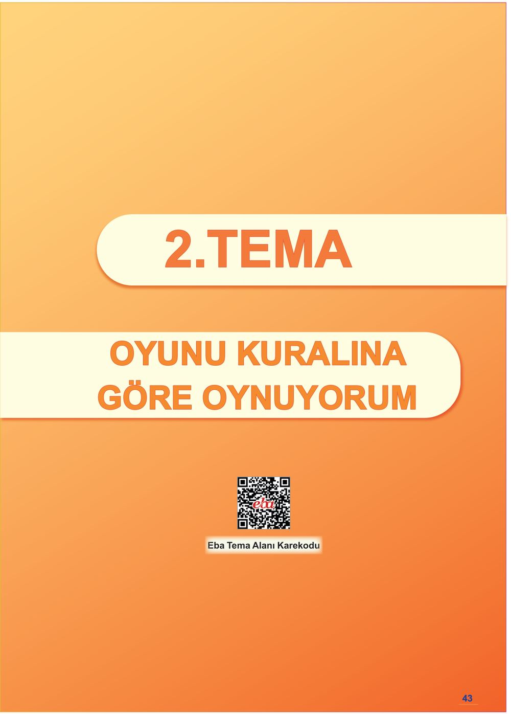 Eba Tema Alanı Karekodu

<!-- sayfa 44 -->

# 2. TEMA: OYUNU KURALINA GÖRE OYNUYORUM

| | |
| :--- | :--- |
| **DERS SAATİ** | 40 |
| **ALAN BECERİLERİ** | BEOSAB1. Hareketi Sergileme, BEOSAB8. Adil Oyun Anlayışına Uygun Davranma |
| **KAVRAMSAL BECERİLER** | KB1. Temel Beceriler |
| **EĞİLİMLER** | E1.1. Merak, E2.1. Empati, E2.5. Oyunseverlik, E3.2. Odaklanma, E3.8. Soru Sorma |
| **PROGRAMLAR ARASI BİLEŞENLER** | |
| **Sosyal-Duygusal Öğrenme Becerileri** | SDB1.1. Kendini Tanıma (Öz Farkındalık), SDB1.2. Kendini Düzenleme (Öz Düzenleme), SDB2.1. İletişim, SDB2.2. İş Birliği, SDB2.3. Sosyal Farkındalık, SDB3.1. Uyum, SDB3.2. Esneklik, SDB3.3. Sorumlu Karar Verme |
| **Değerler** | D1. Adalet, D3. Çalışkanlık, D4. Dostluk, D14. Saygı, D15. Sevgi |
| **Okuryazarlık Becerileri** | OB4. Görsel Okuryazarlık |
| **DİSİPLİNLER ARASI İLİŞKİLER** | Hayat Bilgisi, Görsel Sanatlar |
| **BECERİLER ARASI İLİŞKİLER** | SBAB5.2. Grup Dinamiğini Sağlama, SBAB5.3. Fikir Üretme |
| **ÖĞRENME ÇIKTILARI VE SÜREÇ BİLEŞENLERİ** | **BEO.1.2.1. Oyunlarda temel hareket becerilerini sergileyebilme** a) Oyunlarda yer değiştirme, nesne kontrolü ve denge becerilerini algılar. b) Oyunlarda yer değiştirme, nesne kontrolü ve denge becerilerinin basamaklarını gösterir. c) Oyunlarda yer değiştirme, nesne kontrolü ve denge becerilerini farklı durumlarda uygular. **BEO.1.2.2. Oyun kurallarını uygulayabilme** **BEO.1.2.3. Oyunlarda taktik ve stratejiyi kullanabilme** **BEO.1.2.4. Oyunlarda adil oyun anlayışına uygun davranabilme** a) Adil oyun anlayışını açıklar. b) Oyunlarda adil oyun anlayışına uygun hareket eder. |
| **İÇERİK ÇERÇEVESİ** | Adil Oyun, Temel Hareket Becerileri, Oyun Kuralları, Oyunlarda Taktik ve Strateji |
| **Genellemeler/ Anahtar Kavramlar/ Sembol ve Gösterimler** | adil oyun, hareket, kurallı oyunlar, strateji, taktik |

<!-- sayfa 45 -->

# 1. TEMAYA BAŞLARKEN

Bu temada öğrencilerin temel hareket becerilerini çeşitli oyun ve fiziksel aktivitelerde sergileyebilmeleri, oyunlarda basit taktik ve stratejileri kullanabilmeleri, basit oyun kurallarını uygulayabilmeleri, oyun ve fiziksel aktivitelerde adil oyun anlayışına uygun davranabilmeleri amaçlanmaktadır.

# 2. ÖĞRENME-ÖĞRETME YAŞANTILARI

Öğrenme-öğretme yaşantılarının bir bileşeni olan ön değerlendirme sürecinde öğrencilerin sahip oldukları bilgi ve becerilerin yanında ilgi ve öğrenme ihtiyaçlarının belirlenmesi amaçlanmaktadır. Bu doğrultuda temaya başlamadan önce öğrencilerin temel hareket becerileri, oyun kurallarına uyum, taktik/strateji geliştirme ve adil oyun anlayışına uygun davranışlarına ilişkin düzeylerini belirlemek amacıyla aşağıda yer alan beceri testi, ön değerlendirme aracı olarak kullanılabilir.

**Ön Değerlendirme Beceri Testi:** Öğrenciler sıralı bir şekilde aşağıda yer alan hareket becerilerini yapar.

1. Yer değiştirme becerisi için engelden zıplama
2. Nesne kontrolü becerisi için topu hedefe atma
3. Denge becerisi için düz çizgi üzerinde yürüme

Öğrenciler beceri testini yaparken gözlem yapılır, ardından bu bağlamda şu sorular yöneltilebilir:

* Bu beceri testinde hangi hareket becerilerini yaptınız?
* Topu hedefe atarken hangi hareket becerilerini kullandınız?
* Beceri testinde belirli kurallar var mıydı? Varsa, bu kurallar nelere yardımcı oldu?
* Günlük hayatta oynadığınız oyunlarla bu beceri testinde benzer hareketler var mıydı?
* Bu beceri testi bir oyun olsaydı, arkadaşlarınızla iş birliği içinde oynamak ister miydiniz?

## 2.1. Etkinlik Örnekleri

**ETKİNLİK 1** $\quad$ <!-- KONTROL: Marker'da karşılığı yok, uydurma olabilir --> **Oyunlarda Hareket Becerileri**


| | |
| :--- | :--- |
| **Amaç:** | Öğrencilerin oyunlarda temel hareket becerilerini sergileyebilmeleridir. |
| **Eğilimler** | E2.5. Oyunseverlik, E3.2. Odaklanma |
| **Sosyal-Duygusal Öğrenme Becerileri** | SDB1.2. Kendini Düzenleme (Öz Düzenleme) |
| **Değerler** | D3. Çalışkanlık |
| **Okuryazarlık Becerileri** | OB4. Görsel Okuryazarlık |
| **Kavramsal Beceriler** | - |
| **Beceriler Arası İlişkiler** | - |
| **Öğrenme Çıktısı ve Süreç Bileşenleri** | **BEO.1.2.1. Oyunlarda temel hareket becerilerini sergileyebilme**   a) Oyunlarda yer değiştirme, nesne kontrolü ve denge becerilerini algılar.   b) Oyunlarda yer değiştirme, nesne kontrolü ve denge becerilerinin basamaklarını gösterir.   c) Oyunlarda yer değiştirme, nesne kontrolü ve denge becerilerini farklı durumlarda uygular. |
| **Kullanılan Öğretim Teknolojileri, Araç** | Oyun: tenis topları, renkli hulahoplar, renkli bantlar/şeritler ve koniler |

<!-- sayfa 46 -->

Öğrencilerin derse karşı motivasyonlarını ve isteklerini artırmak amacıyla yer değiştirme, nesne kontrolü ve denge gibi temel hareket becerilerini içeren görsel materyal kullanılarak öğrencilerden bu görsel içerikler hakkında neler düşündüklerini ifade etmeleri istenir (OB4). Ardından tüm öğrencilerin katılımıyla müzik eşliğinde veya çeşitli komutlarla eğlenceli ısınma hareketleri gerçekleştirilir. Isınma hareketleri sıçrama, hafif tempo koşu, esnetme, uygun ağırlıkta top atıp tutma vb. hareketleri içerebilir. Öğrencilere ısınma hareketlerini yaparken hangi hareket becerilerini kullandıkları sorulur. “Gösterilen görsellerde bu hareketlere benzer örnekler var mıydı?” gibi soru yöneltilir ve öğrencilerin fikirlerini paylaşmaları teşvik edilir.

**Oyun: Renkli Hedef Yolculuğu**

Her biri 20 metre uzunluğunda mavi, kırmızı ve sarı renkte üç ayrı şeritli yol oluşturulur. Her şerit için aynı renkte bir tenis topu ve şeridin sonunda, o renge ait hulahop alanı hazırlanır. Dönüş alanı için 5 m aralıklarla dört adet koni koyulur. Ardından öğrenciler mavi, kırmızı ve sarı renk gruplar olacak şekilde ayrılır. Oyunun akışı şu şekildedir: Renkli şeritli yolun başına geçilerek komutla harekete geçilir. Tenis topu tek elle alınarak 20 metrelik yol boyunca yürünür. Yol üzerinde yavaşlama, hızlanma ve yön değiştirme gibi hareket geçişleri yapılır. Yolun sonunda hulahopun tam ortasına top dikkatlice bırakılır (E2.5). Oyun kuralları; tenis topunu tek elde tutmak ve düşürmeden yürümek, yalnızca kendi grubunun rengine ait şeritli yolda ilerlemek, topu hulahopun tam ortasına bırakmak, komut ile başlamak ve dönüş sırasında galop hareketiyle dört koni arasında zikzak çizerek ilerlemek şeklinde açıklanır. Öğrencilere bu şeritli yollarda yapılacak hareketler ve uyulması gereken kurallar gösterilir. Oyun öncesinde öğrencilerin duygularını ve davranışlarını kontrol etmeleri gerektiği vurgulanır. İstek ve motivasyonlarını artıracak amaçlar belirlemeleri sağlanırken, zihinsel hazırlık yapmaları, içsel motivasyonlarını düzenlemeleri ve oyuna odaklanmaları da desteklenir (SDB1.2, E3.2., D3.1). Kısa süreli duruş ile denge sağlanır, ardından dönüş yoluna geçilerek dört koni arasında galop hareketiyle zikzak çizilir ve başlangıç noktasına ulaşılır. Topu bıraktıktan sonra öğrenci, galop hareketiyle koniler arasından zikzak çizerek başlangıç noktasına dönerken yer değiştirme becerisini farklı durumlarda uygular [[ŞEKİL:1]].

<!-- sayfa 47 -->

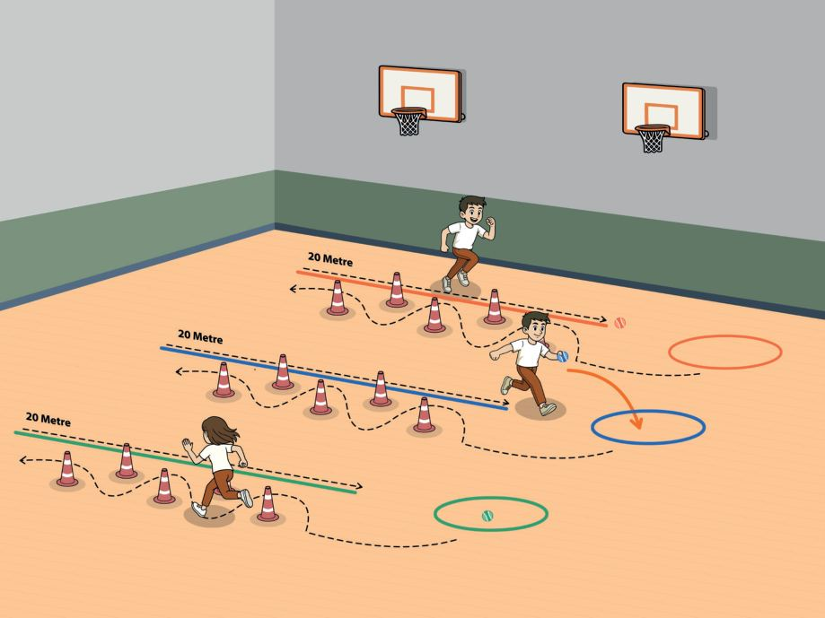

*Şekil 1. Renkli hedef yolculuğu oyunu*

**Çeşitlendirme**
Oyun sırasında farklı renklerde şeritler veya bantlar kullanılabilir. Farklı top türleri kullanılabilir. Oyun mesafesi uzatılabilir veya kısaltılabilir. Gruplarda yer alan öğrenci sayılarında değişiklik yapılabilir. Oyun spor salonu, okul bahçesi veya farklı alanlarda oynanabilir. Kural sayısı ve hareketler azaltılıp artırılabilir. Oyunun belirli bir sürede oynanması istenebilir.

**Öğrenme Kanıtları ve Etkinlik Yansıması**
Bu öğrenme çıktısının değerlendirilmesinde kontrol listesi (**Ek 1**) kullanılır. Bu ölçme aracı, öğrencilerin oyunlarda temel hareket becerilerini ne ölçüde uygulayabildiklerini değerlendirmek amacıyla hazırlanmıştır.

Etkinlik yansıması kapsamında öğrencilere aşağıdaki sorular yöneltilebilir:

* Bu etkinlikte kullandığınız yer değiştirme, nesne kontrolü ve denge becerilerini günlük hayatta nerelerde kullanıyorsunuz?
* Etkinlik sırasında yaptığınız hareketleri başka bir oyunda ya da günlük yaşamda nerede kullanabilirsiniz?
* Yürürken hızınızı değiştirmek zorunda kaldığınız bir an oldu mu? Olduysa, bu durum nasıl gerçekleşti?
* Topu bırakırken nasıl bir pozisyon aldınız? Bunu önceden mi düşündünüz yoksa o anda mı karar verdiniz?

<!-- sayfa 48 -->

# ETKİNLİK 2 Oyun Kuralları

| | |
| :--- | :--- |
| **Amaç:** | Öğrencilerin oyun kurallarını uygulayabilmeleridir. |
| **Eğilimler** | E1.1. Merak, E2.1. Empati |
| **Sosyal-Duygusal Öğrenme Becerileri** | SDB1.1. Kendini Tanıma (Öz Farkındalık), SDB2.1. İletişim, SDB2.3. Sosyal Farkındalık, SDB3.2. Esneklik |
| **Değerler** | D4. Dostluk, D15. Sevgi |
| **Okuryazarlık** | - |
| **Becerileri** | - |
| **Kavramsal Beceriler** | - |
| **Beceriler Arası İlişkiler** | - |
| **Öğrenme Çıktısı ve Süreç Bileşenleri** | BEO.1.2.2. Oyun kurallarını uygulayabilme |
| **Kullanılan Öğretim Teknolojileri, Araç Gereçler ve Kaynaklar** | Oyun: pinpon topu, kâğıt veya kumaş parçası, hulahop, plastik/köpük engel, renkli yelek ve kasa |

Öğrencilerden bir çember oluşturmaları istenir. Daha sonra içinde pinpon topları, yelekler ve kumaş/kâğıt parçaları bulunan renkli bir kutu, çemberin ortasına getirilir. Öğretmen kutuyu göstererek heyecanlı bir ses tonuyla şu soruyu yöneltir: “Bu kutunun içindekilerle birazdan bir oyun oynayacağız. Ama önce tahmin edin bakalım, bu renkli malzemelerle neler yapabiliriz?” (E1.1). Öğrencilerden gelen tahminler alınır ve düşünceler paylaşılır. Ardından çemberin ortasına bir hulahop yerleştirilir. Çemberdeki her öğrenci sırayla eline bir pinpon topu alarak hulahopun içine girer. Daha sonra bir ısınma hareketi söyler, bu ısınma hareketini nereden öğrendiğini paylaşır ve hareketin nasıl yapılacağını arkadaşlarına gösterir. Bununla beraber ısınma hareketini tüm öğrencilerin yapması için komut verip başlatır ve 10 saniye sayar (SDB1.1). Tüm öğrencilerin ısınma hareketleri sırasında aktif olmaları, sırayla bir hareket önerip bunu grupla paylaşmaları ve diğer öğrencilerin bu hareketi birlikte uygulamaları sağlanarak öğrencilerin grup iletişimine etkin biçimde katılmaları desteklenir (SDB2.1, D4.4).

**Oyun: Aklımda Kural, Vücudumda Hareket**

Oyun alanı için başlangıç çizgisi çizilir, 1 metre aralıklarla konulmuş dört adet hulahop, hulahopların ardından $10-15$ <!-- KONTROL: Marker'da karşılığı yok, uydurma olabilir --> cm yüksekliğinde dört adet engel (plastik/köpük engel vb.), engellerin sonunda her takım için ayrı bir kasa yerleştirilir. Her takım için yirmi adet pinpon topu, bir adet kumaş ya da sert kâğıt, takım yelekleri (sarı, mavi, kırmızı, siyah) hazırlanır. Öğrenciler takımlara ayrılır. Her takım kendi rengindeki yeleği giyer. Oyunun kuralları; kumaş parçası veya kağıt parçasının üzerine sadece 4 top yerleştirilmeli ve iki elle tutulmalı, hulahopların tam ortasına basarak ilerlenmeli, engellerin üzerinden geçerken engellere dokunulmamalı, toplar düşürülmeden kasaya bırakılmalı, düşen top tekrar alınmamalı. Oyunun akışı şu şekildedir: Top kutusundan dört top alınır ve bu toplar, kumaş ya da kâğıt parçası üzerine dengeli bir şekilde yerleştirilir. Toplar düşürülmeden ilk olarak dört hulahopun içine basarak ilerlenir. Ardından yerden yüksek şekilde yerleştirilen dört engelin üzerinden adım atarak geçilir. Engellerin sonunda bulunan takım kasasına toplar dikkatlice bırakılır (Şekil 2). Son olarak kumaş ya da kâğıt, sıradaki arkadaşına koşarak teslim edilir ve oyun aynı şekilde devam eder. Bütün takım üyeleri oyunu oynadıktan sonra her takımın kasasındaki toplar sayılır. Sonuçlar

<!-- yer tutucu bulunamadı: sayfa sonuna eklendi -->

<!-- sayfa 49 -->

paylaşımları, arkadaşlarının duygu ve düşüncelerini anlayarak empati kurmaları amacıyla geri bildirim süreci başlatılır; bu süreçte, karşısındakini dikkatle dinleyerek duyguları anlamaları desteklenir (**D15.1., E2.1.,SDB2.3**). Bu doğrultuda öğrencileri düşünmeye teşvik edecek açık uçlu şu sorular yöneltilir: “Oyunda en çok neye dikkat ettiniz?”, “Topları taşırken zorlandınız mı?”, “Takım arkadaşınıza nasıl yardım ettiniz?”, “Oyunun kurallarını sayabilecek olan var mı?”, “Takımınızda yer alan arkadaşınızın bakış açısından oyunu değerlendirecek olsaydınız ona ne söylerdiniz?”, “En çok hangi kuralı uygulamak sizi zorladı?”, ”Aynı oyunu yeni ve farklı kurallar ile oynayacak olsanız bu durum sizi zorlar mıydı?” gibi sorular aracılığıyla öğrencilerin sürece ilişkin geri bildirim almaları ve paylaşımda bulunmaları sağlanır (**SDB3.2**).

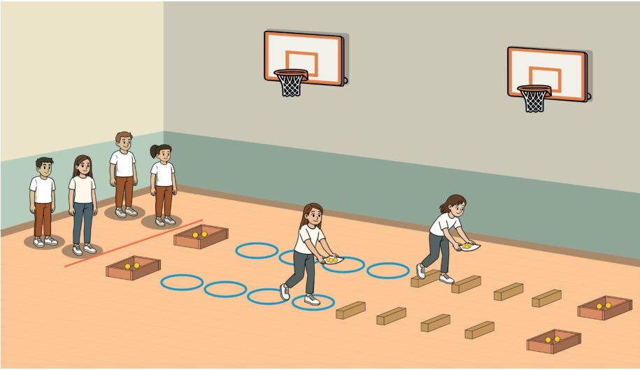

*Şekil 2. Aklımda kural, vücudumda hareket oyunu*

### Açıklama
Güvenlik tedbirleri gereği hulahop boyutu ve engel yüksekliği öğrencilerin boyuna ve güvenliğine uygun seçilmelidir. Öğrencilerin kayıp düşebileceği bir zeminde bu oyun oynanmamalıdır.

### Çeşitlendirme
Oyun sırasında yapılacak hareketlerin sıralaması tersine çevrilebilir; önce engeller, sonra hulahoplar geçilebilir. Kumaş/kâğıt parçası yerine esnekliği daha fazla olan bir materyal kullanılabilir. Hulahoplar arasındaki mesafe artırılabilir, daraltılabilir veya engellerin yüksekliği değiştirilebilir. İletişim ve uyum becerisi için bir kumaş/kâğıt parçasını iki öğrenci birlikte taşıyarak ilerleyebilir. Kural sayısı azaltılıp artırılabilir. Oyun, tempolu yürüyerek veya koşarak yaptırılabilir. Müzik kullanılabilir. Farklı hareket becerileri (sıçrama, ip atlama, galop, kayma vb.) eklenebilir.

### Öğrenme Kanıtları ve Etkinlik Yansıması
Bu öğrenme çıktısının değerlendirilmesinde öz değerlendirme formu (**Ek 2**) kullanılır. Bu ölçme aracı, öğrencilerin oyunun kurallarını ne ölçüde uygulayabildiklerini değerlendirmek amacıyla hazırlanmıştır.

Etkinlik yansıması kapsamında öğrencilere aşağıdaki sorular yöneltilebilir:

* Etkinlikteki kuralları düşündüğünüzde uygulanması en zor olan hangisiydi? Neden zorlandığı-

<!-- sayfa 50 -->

* Etkinlik sırasında sabırlı olma, sıraya uyma, kurallara uyma ve takım arkadaşınıza yardım etme gibi davranışları günlük yaşamınızda nasıl kullanıyorsunuz? Düşüncelerinizi arkadaşlarınızla paylaşınız.
* Günlük yaşamda dikkatli ve dengeli olmanız gereken benzer bir durumu hatırlıyor musunuz? Kısaca anlatır mısınız?
* Etkinlik akışını düşündüğünüzde, zorlayıcı kurallardan biri kaldırılırsa veya değiştirilirse oyun nasıl etkilenirdi?

# ETKİNLİK 3 | Oyunlarda Taktik ve Strateji

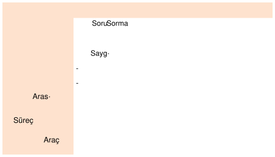

| | |
| :--- | :--- |
| **Amaç:** | Öğrencilerin oyunlarda taktik ve stratejiyi kullanabilmesidir. |
| **Eğilimler** | E3.8. Soru Sorma |
| **Sosyal-Duygusal Öğrenme Becerileri** | SDB1.1. Kendini Tanıma (Öz Farkındalık), SDB2.1. İletişim, SDB2.2. İş Birliği, SDB3.3. Sorumlu Karar Verme |
| **Değerler** | D14. Saygı |
| **Okuryazarlık Becerileri** | - |
| **Kavramsal Beceriler** | - |
| **Beceriler Arası İlişkiler** | SBAB5.2. Grup Dinamiğini Sağlama, SBAB5.3. Fikir Üretme, BEOSAB3. Taktik ve Strateji Geliştirme |
| **Öğrenme Çıktısı ve Süreç Bileşenleri** | **BEO.1.2.3. Oyunlarda taktik ve stratejiyi kullanabilme** |
| **Kullanılan Öğretim Teknolojileri, Araç Gereçler ve Kaynaklar** | Oyun: görev kartları, hulahop |

Öğrencilere şöyle bir durum anlatılır: “Ailenizle birlikte ormanda bir doğa yürüyüşüne çıktınız. Yürüyüş güzergâhında engebeli ve kaygan zeminler, çalılıklar ve çeşitli hayvanlar bulunmaktadır. Aslında bunlar, ormanların doğal özellikleridir. Bu yürüyüşü hem sakatlanmadan hem de doğaya zarar vermeden nasıl tamamlayabilirsiniz? ve “Böyle bir durumda karşılaşabileceğiniz sorunlara yönelik ne tür çözüm yolları üretebilirsiniz?” gibi sorular yöneltilerek düşüncelerini ifade etmeleri sağlanır (**SDB2.1, E3.8**). Bu süreçte öğrencilerin olay ve durumları çok yönlü bir bakış açısıyla değerlendirmeleri, karşılaştıkları zorlu durumlarda geliştirebilecekleri taktik ve stratejileri gerçek yaşamla ilişkilendirerek düşünmeleri teşvik edilmektedir. (**D14.1**).

**Oyun: Takımın Gücü**

Siyah, sarı, turuncu, mavi renkler olmak üzere toplam on iki görev kartı hazırlanır. Bu kartlar okul bahçesinin çeşitli yerlerine gizlenir ve okul bahçesinin ortasına dört adet hulahop alanı oluşturulur. Siyah, sarı, turuncu ve mavi kartların her birinde üç farklı fiziksel aktivite yer alır. Bu aktiviteler, kartların üzerinde görsellerle desteklenerek resimlerle ifade edilir. Öğrenciler dört farklı takıma ayrılır ve her takıma bir renk atanır: siyah, mavi, turuncu ve sarı. Takımların isimleri ve kartları şu şekildedir: Zıplayanlar takımı, kart rengi siyah. Hareket ustaları, kart rengi mavi. Denge kuşları, kart rengi turuncu. Esneklik yıldızları, kart rengi sarı. Oyunun akışı şu şekildedir: Her takım, kendi rengine ait görev kartlarını oyun alanının farklı noktalarına gizlenmiş şekilde arayıp bulur. Buldukları her kart üzerinde yer alan fiziksel aktiviteyi takım olarak sesli bir şekilde dört kez tekrar ederler. Ardından

<!-- sayfa 51 -->

kartı, takımlarına ait belirlenen hulahop alanına bırakırlar. Tüm kartları başarıyla tamamlayan takım, oyunu tamamlamış olur (SBAB5.2) (Şekil 1). Oyunun kuralları şunlardır: Her takım, yalnızca kendi rengine ait kartları toplamalıdır. Kart üzerinde yer alan görev tamamlanmadan kart hulahop alanına bırakılmamalıdır. Görevler, takım üyeleri tarafından birlikte ve eş zamanlı olarak uygulanmalıdır. Her fiziksel aktivite, tüm takım üyeleri tarafından sesli şekilde dört kez tekrar edilmelidir (SDB2.2). Bu sırada öğrencilerin görevleri doğru yapıp yapmadığını ve takım içi etkileşimi gözlemlenir. Tüm öğrencilerin farklı görevleri deneyimleyebilmesi ve her takımın çeşitli fiziksel aktivitelerle etkileşime girmesini sağlamak amacıyla öğrencilerin ait oldukları takımlar değiştirilir ve her öğrenci farklı renkteki kartlarla ilişkilendirilen fiziksel aktiviteleri yapma fırsatı bulur. Bu uygulama sayesinde öğrencilerin çeşitli fiziksel aktiviteleri deneyimlemeleri hedeflenir. Oyun tamamladıktan sonra her takıma şu sorular sorulur: “Kartları bulmak için nasıl bir yol izlediniz?”, “Fiziksel aktiviteleri yaparken zorlandığınız bir an oldu mu?” (SDB1.1). “Kartları bulmaya çalışırken takım arkadaşlarınız ile hareket etmenin size ne gibi faydası oldu?”, “Bir sonraki oyunda kartları bulmak için farklı bir yol denemek isterseniz neyi değiştirirdiniz ve ne tür strateji, taktikler üretirdiniz?” Cevaplar alınır (SDB3.3, SBAB5.3, BEOSAB3).

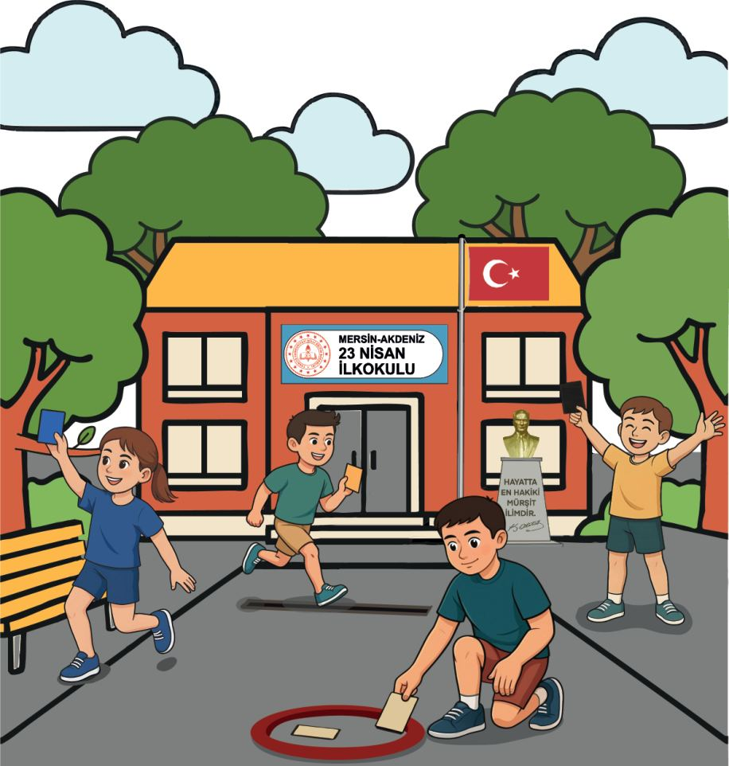

<!-- sayfa 52 -->

# Çeşitlendirme
Kart sayısı ve renkler azaltılıp artırılabilir. Farklı fiziksel becerilere ve yeterliğe sahip öğrenciler alternatif kartlar ve hareketler kullanabilir. Fiziksel aktivitelerin temposu artırılarak dört tekrar yerine altı tekrar yapmaları ya da aktiviteleri belirli bir süre içerisinde yapmaları istenebilir. Müzik kullanılarak öğrencilerin motivasyonları artırılabilir.

## Öğrenme Kanıtları ve Etkinlik Yansıması
Bu öğrenme çıktısının değerlendirilmesinde gözlem formu (**Ek 3**) kullanılır. Bu ölçme aracı, öğrencilerin oyunlarda taktik ve stratejileri ne ölçüde uygulayabildiklerini değerlendirmek amacıyla hazırlanmıştır.

Etkinlik yansıması kapsamında öğrencilere aşağıdaki sorular yöneltilebilir:
* Birlikte hareket etmek size nasıl yardımcı oldu?
* Kartları daha kolay bulmak için bir plan yaptınız mı? Neler düşündünüz?
* Kartları bulurken arkadaşlarınızla birlikte mi çalıştınız? Nasıl yardımlaştınız?
* Başka bir oyunda bu kartları ararken neyi farklı yapardınız?

**ETKİNLİK 4** &nbsp;&nbsp;&nbsp;&nbsp;&nbsp;&nbsp;&nbsp;&nbsp;&nbsp;&nbsp;&nbsp;&nbsp;&nbsp;&nbsp;&nbsp;&nbsp;&nbsp;&nbsp;&nbsp;&nbsp;&nbsp;&nbsp;&nbsp;&nbsp;&nbsp;&nbsp;&nbsp;&nbsp;&nbsp;&nbsp;&nbsp;&nbsp;&nbsp;&nbsp;&nbsp;&nbsp;&nbsp;&nbsp;&nbsp;&nbsp;&nbsp;&nbsp;&nbsp;&nbsp;&nbsp;&nbsp;&nbsp;&nbsp;&nbsp;&nbsp;&nbsp;&nbsp;&nbsp;&nbsp;&nbsp;&nbsp;&nbsp;&nbsp;&nbsp;&nbsp;&nbsp;&nbsp;&nbsp;&nbsp;&nbsp;&nbsp;&nbsp;&nbsp;&nbsp;&nbsp;&nbsp;&nbsp;&nbsp;&nbsp;&nbsp;&nbsp;&nbsp;&nbsp;&nbsp;&nbsp;&nbsp;&nbsp;&nbsp;&nbsp;&nbsp;&nbsp;&nbsp;&nbsp;&nbsp;&nbsp;&nbsp;&nbsp;&nbsp;&nbsp;&nbsp;&nbsp;&nbsp;&nbsp;&nbsp;&nbsp;&nbsp;&nbsp;&nbsp;&nbsp

<!-- sayfa 53 -->

**Oyun: Oyunda Adil Kal**

Öğrenciler, altı kişilik dört takım olacak şekilde “Adil Oyun Takımı 1, 2, 3 ve 4” adlarıyla gruplara ayrılır. Oyunun akışı şu şekildedir: Her takıma bir bayrak verilir ve her Her gruba bir destekleyici öğrenci atanır. Destekleyici öğrenci, oyun sırasında zorlanan takım arkadaşına yardım etmekle sorumludur (**D4.1**). Oyun alanı, dönüşümlü olarak yerleştirilmiş toplam sekiz engelden oluşur: 1, 3, 5 ve 7 numaralı engeller $10\text{--}15\text{ cm}$ <!-- KONTROL: Marker'da karşılığı yok, uydurma olabilir --> yüksekliğindedir ve bu engellerin üzerinden sıçrayarak geçilir. 2, 4, 6 ve 8 numaralı engeller ise $50\text{--}60\text{ cm}$ <!-- KONTROL: Marker'da karşılığı yok, uydurma olabilir --> yüksekliğindedir ve bu engellerin altından geçilerek aşılması gerekir. Sekizinci engelin bitiminde bir adet kasa bulunur; bu kasada küçük boy altı adet yumuşak top yer alır. Bu kasadan $5$ metre ileride ve engellerin yan tarafında ikinci hedef kasa bulunur. Öğrenciler ilk kasadan bir top alır ve topu ikinci kasaya bırakır. Dönüşte galop hareketini yaparak ilerler ve sıradaki arkadaşına bayrağı teslim eder. Oyunun kuralları; her öğrenci sırasını bekleyerek sırayla oyuna katılır, engeller geçilirken engellere dokunulmaz, ilk kasadan yalnızca bir top alınır ve top dikkatli şekilde hedef kasaya bırakılır. Oyun, tüm takım üyeleri görevini tamamlayana kadar devam eder. Oyunun sonunda takımların iş birliği, kurallara uyumu ve destek partnerlerinin rolü değerlendirilir. Kazanmanın değil kurallara uygun ve adil şekilde oynamanın önemli olduğu üzerinde durulur (**D1.2, SBAB5.2**). Oyunun sonunda bütün öğrencilere adil oyun anlayışına yönelik şu sorular yöneltilebilir: “Bu oyunda adil olmak sizin için ne anlama geliyordu?”, “Oyun sırasında destekleyici arkadaşınız size yardım ettiğinde ne hissettiniz?”, “Oyunda hangi anda arkadaşınıza sözlü destek verdiniz?”, “Bir arkadaşınız hiç destek almadığında ne hissedebilir?”, (**E2.1**). “Takım olarak birlikte çalışmak sizin için neden önemliydi?”, “Pankartta yer alan görsel ile oyun sırasında yaptıklarınız arasında nasıl bir ilişki kurdunuz?” gibi açık uçlu sorular sorulur (**SDB3.1**). Öğrenciler, oyun sürecinde değişen ve belirsiz durumlar karşısında hangi takımın kurallara uymakta, birlikte hareket etmekte ve görevini uyum içinde sürdürmekte daha başarılı olduğunu tartışarak değerlendirir. Öğrenci değerlendirmesi sonucunda adil oyun ilkelerine en uygun davranışı sergileyen takıma “yeşil kart” verilir.

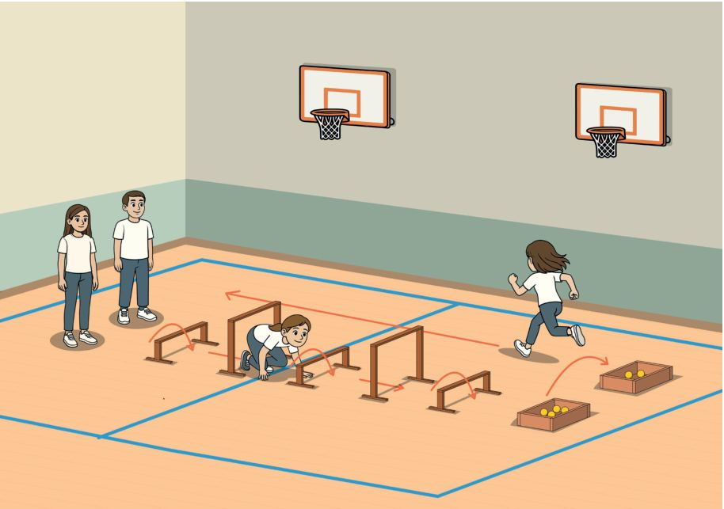

<!-- sayfa 54 -->

**Çeşitlendirme**
Oyunda yumuşak küçük toplar, sesli toplar, balonlar, pinpon ve tenis topları gibi farklı materyaller kullanılabilir. Engellerin yükseklikleri azaltılıp veya artırılabilir. Oyun alanı olarak hafif eğimli, çim veya toprak zemin tercih edilebilir. Engel aralıkları azaltılıp artırılabilir, zikzak ya da döngüsel bir parkur oluşturulabilir.

**Öğrenme Kanıtları ve Etkinlik Yansıması**
Bu öğrenme çıktısının değerlendirilmesinde performans görevi (**Ek 4**) kullanılır. Bu görevin değerlendirilmesi için analitik dereceli puanlama anahtarı (**Ek 5**) kullanılır. Bu ölçme aracı, öğrencilerin oyunlarda adil oyun anlayışına uygun davranışları ne ölçüde sergileyebildiklerini değerlendirmek amacıyla hazırlanmıştır.

Etkinlik yansıması kapsamında öğrencilere aşağıdaki sorular yöneltilebilir:

* Adil olmak sizce ne demek, bugünkü oyunda adil davrandınız mı? Nasıl?
* Oyunda birlikte çalıştığınız arkadaşınız size yardımcı oldu mu? Olduysa, nasıl bir yardımda bulundu?
* Oyunda kazanmak mı sizin için önemli, yoksa birlikte oynamak mı? Düşüncelerinizi arkadaşlarınız ile paylaşınız?
* Oyun kurallarına uyduğunuzu ve adil davrandığınızı düşünüyor musunuz?

### 2.2. Farklılaştırma

**Zenginleştirme**
Oyunların içerisine birleştirilmiş hareket becerileri entegre edilebilir. Örneğin bir yönde dengede yürürken topu hedefe atma, bir nesneyi taşıyarak engeller arasından geçme gibi çoklu beceriler içeren farklı birleştirilmiş hareket becerileri eklenebilir. Öğrencilerin oyun sırasında daha derinlemesine düşünmelerini sağlamak amacıyla, oynadıkları oyunlarda kendi taktik ve stratejilerini geliştirmeleri teşvik edilebilir. Öğretmen rehberliğinde, “Bu oyunu daha iyi oynamak için neler yapabiliriz? Takım arkadaşlarınız ile iş birliği için neler yapmalıyız?” gibi sorular yöneltilerek öğrencilerin karar verme ve problem çözme becerileri desteklenebilir. Oyunların yapısı, mevcut kuralların sayısı artırılarak veya daha detaylı kurallar eklenerek genişletilebilir. Bu sayede öğrencilerden kuralları dikkatle takip etmeleri, oyun içinde yeni durumlara uyum sağlamaları ve daha çok düşünmeleri beklenir.

**Destekleme**
Yer değiştirme, denge ve nesne kontrolü gerektiren hareket becerilerinde, öğrencilerin kendi hızlarında ilerlemelerine olanak tanınarak her hareketin daha fazla uygulanması sağlanabilir. Bu tekrarlar, etkinliklerde sadeleştirilmiş yönergelerle yapılandırılarak öğrencinin hareket becerisini pekiştirmesini kolaylaştırır. Etkinlikler sırasında öğrencilerin taktik ve strateji geliştirmeleri için grup hâlinde çalışmalar yapılabilir. Öğrencilerin küçük gruplar oluşturması ve birbirlerine fikir vererek akran desteği sağlamaları, birlikte karar almaları ve bu kararları oyunda uygulamaya çalışmaları teşvik edilir. Etkinliklerde kural ifadeleri yerine kısa, sade ve somut yönergeler kullanılabilir. Adil oyun anlayışının pekiştirilmesi amacıyla, öğrencilere yaş düzeylerine uygun kısa videolar izletilebilir. Bu videolarda sıraya girme, arkadaşına yardım etme, kurallara uyma ve paylaşma gibi olumlu davranış örnekleri gösterilir.

# 3. ÖĞRENME KANITLARI (Ölçme ve Değerlendirme).
Etkinliklerin öğrenme kanıtları (ölçme ve değerlendirme) bölümünde öğrenme çıktıları doğrultusunda öğrencilerin değerlendirilmesi amacıyla hazırlanan örnek ölçme ve değerlendirme araçları belirtilmiştir. “Oyunlarda temel hareket becerilerini sergileyebilme” öğrenme çıktısının değerlendirilmesin Ek

<!-- sayfa 55 -->

1’de yer alan kontrol listesi kullanılır. “Oyun kurallarını uygulayabilme” öğrenme çıktısının değerlendirilmesinde Ek 2’de yer alan öz değerlendirme formu kullanılır. “Oyunlarda taktik ve stratejiyi kullanabilme” öğrenme çıktısının değerlendirilmesinde Ek 3’te yer alan gözlem formu kullanılır. “Oyunlarda adil oyun anlayışına uygun davranabilme” öğrenme çıktısının değerlendirilmesinde Ek 4’te yer alan performans görevi kullanılır.

Performans görevinin değerlendirilmesinde Ek 5’te yer alan analitik dereceli puanlama anahtarı kullanılır. Temanın bütünün değerlendirilmesinde Ek 6’da yer alan bütüncül dereceli puanlama anahtarı kullanılır. Bu değerlendirme aracı için Ek 7’de yer alan puan kaydetme tablosu kullanılabilir.

## 4. ÖĞRETMEN YANSITMALARI

* Bir sonraki yıl bu temanın planlaması için yorumlarınızı yazınız.

**Yorum 1:**

**Yorum 2:**

* Öğrenme Çıktılarına Göre Öz Yansıtma (planlama/hazırlık, öğrenme çevresi, öğretim, mesleki sorumluluk)

1. Öğrenme çıktısı için yansıtmalar:

2. Öğrenme çıktısı için yansıtmalar:

3. Öğrenme çıktısı için yansıtmalar:

4. Öğrenme çıktısı için yansıtmalar:

<!-- sayfa 56 -->

# 5. EKLER
**Ek 1. Kontrol Listesi**

| Etkinlik Adı: Renkli Hedef Yolculuğu |
| :--- |
| **Öğrencinin**   **Adı Soyadı:**   **Sınıfı :**   **Numarası :**    Öğrencinin oyunlarda temel hareket becerilerini sergileyebilmelerine ilişkin değerlendirme yapabilmek amacıyla aşağıdaki maddeleri okuyunuz ve her maddeye ilişkin tablodaki uygun bölümü işaretleyiniz. Hayır bölümündeki işaretleriniz birden fazlaysa öğrencinizin bu konudaki eksikliklerini gidermesine yardımcı olunuz. |

| Ölçütler | Evet | Hayır |
| :--- | :---: | :---: |
| Oyunlarda yer değiştirme becerilerini algılar. | | |
| Oyunlarda nesne kontrolü becerilerini algılar. | | |
| Oyunlarda denge becerilerini algılar. | | |
| Oyunlarda yer değiştirme becerilerinin basamaklarını gösterir. | | |
| Oyunlarda nesne kontrolü becerilerinin basamaklarını gösterir. | | |
| Oyunlarda denge becerilerinin basamaklarını gösterir. | | |
| Oyunlarda yer değiştirme becerilerini farklı durumlarda uygular. | | |
| Oyunlarda nesne kontrolü becerilerini farklı durumlarda uygular. | | |
| Oyunlarda denge becerilerini farklı durumlarda uygular. | | |

<!-- sayfa 57 -->

# Ek 2. Öz Değerlendirme Formu

| Etkinlik Adı: Aklımda Kural, Vücudumda Hareket |
| :--- |
| **Adı Soyadı:**   **Numarası :**   **Tarih :**    Aşağıda “Aklımda Kural, Vücudumda Hareket” etkinliği ile ilgili cümleler yer alıyor. Öncelikle bunları dikkatlice okuyunuz. Sonra bu etkinlikte yaptıklarını düşünerek her cümle için kendine en uygun seçeneği “ $\checkmark$ <!-- KONTROL: Marker'da karşılığı yok, uydurma olabilir --> ” ile işaretleyiniz. |

| Ölçütler | Evet | Kısmen | Hayır |
| :--- | :---: | :---: | :---: |
| Oyunda yer alan kurallara uygun oynadım. | | | |
| Engel ve hulahoplardan geçerken dikkatliydim. | | | |
| Takım arkadaşlarıma yardımcı oldum. | | | |
| Etkinliğe katıldım ve görevimi yaptım. | | | |
| Arkadaşımı beklerken sabırlıydım. | | | |
| Kumaş/kâğıt üzerindeki topları dikkatli bir şekilde taşıdım. | | | |
| Kurallara uyunca oyun daha eğlenceli oldu. | | | |
| **“Hayır” şeklinde işaretlediğiniz davranışları kazanmaya çalışmanız önerilir.** | | | |

<!-- sayfa 58 -->

# Ek 3. Gözlem Formu

| Etkinlik Adı: Takımın Gücü |
| :--- |
| **Adı Soyadı:** |
| **Sınıfı :** |

Bu form, öğrencilere “Oyunlarda taktik ve stratejiyi kullanabilme” öğrenme çıktısını değerlendirmeniz amacıyla hazırlanmıştır. Öğrencinin belirtilen ölçütlere ilişkin öğrenme düzeyini tablodaki açıklamalardan hareketle puanlayınız.

| Ölçütler | Çok İyi (4) | İyi (3) | Geliştirilmeli (1) | Yetersiz (1) |
| :--- | :--- | :--- | :--- | :--- |
| **Fiziksel Aktivite Kartlarını Anlama** | Hemen anlar ve doğru uygular. | Hemen anlar, ancak uygulamada küçük hatalar yapar. | Anlaması zaman alır, uygulamada rehberliğe ihtiyaç duyar. | Anlamakta ve uygulamakta zorlanır. |
| **Takım İçinde İş Birliği** | Takım arkadaşlarıyla uyumlu çalışır, destek olur. | Takım arkadaşlarıyla genelde uyumlu çalışır, bazen destek olmayı unutur. | Takım arkadaşlarıyla zaman zaman uyum sorunu yaşar, desteğe ihtiyaç duyar. | Takım arkadaşlarıyla iş birliğinde uyum sorunu yaşar, desteğe ihtiyaç duyar. |
| **Sesli Tekrar (Dikkat ve Odaklanma)** | Oyun sırasında yapılacakları sesli ve anlaşılır şekilde tekrar eder. | Oyun sırasında yapılacakları anlaşılır şekilde tekrar eder, ancak zaman zaman destekle ifade eder. | Oyun sırasında yapılacakları kısmen anlaşılır biçimde tekrar eder. | Oyun sırasında yapılacakları sesli ve anlaşılır şekilde ifade edemez. |
| **Taktik ve Strateji Kullanımı** | Oyun sırasında planlı hareket eder. | Oyun sırasında genellikle planlı hareket eder, ancak bazı durumlarda kararsızlık yaşar. | Oyun sırasında kısmen planlı hareket eder. | Oyun sırasında rastgele ve plansız hareket eder. |

**Değerlendirme Sistemi**

Bu ölçme aracından en az 4 puan, en fazla 16 puan alınabilmektedir. Öğrencinin puanı, alınan puanın yüzdelik karşılığı hesaplanarak bulunur. Bunun için alınan puan, öğrencinin alabileceği en yüksek puana bölünür ve çıkan sonuç 100 ile çarpılır. Ondalık gösterim elde edilirse sonuç tam kısmına (birler basamağına) yuvarlanır. Örneğin öğrenci bu ölçme aracından 6 aldığında puanı şu şekilde hesaplanır: $(\frac{6}{16}) \cdot 100 = 37,5$ <!-- KONTROL: Marker'da karşılığı yok, uydurma olabilir -->. Bu sonuç yuvarlandığında öğrenci 38 puan almış olacaktır.

**Performans Düzeyleri**

25–43: Geliştirilmeli  
44–62: Orta  
63–81: İyi

<!-- sayfa 59 -->

**Ek 4. Performans Görevi**

| Performans Görevi |
| :--- |
| **Ders:** Beden Eğitimi ve Oyun |
| **Sınıf Düzeyi:** 1 |
| **Öğrenme Çıktısı:** Oyunlarda Adil Oyun Anlayışına Uygun Davranabilme |
| **Görev Konusu:** Adil Oyun Davranışlarını Gözlemleme, Değerlendirme ve Afiş Tasarımıyla Yansıtma |

Arkadaşlarınızla okul içinde ve dışında oynadığınız oyunlardan birer tanesini gözlemleyiniz. Oyun süresince hem kendi davranışlarınızı hem de diğer arkadaşlarınızın adil oyun kurallarına uyup uymadığını dikkatlice izleyiniz ve gözlemlediğiniz adil oyun anlayışına uygun üç davranış ile adil olmayan üç davranışı not alınız. Ardından, üzerinde “Kazanmak değil saygı önemlidir.” sloganının yer aldığı bir afiş hazırlayarak bu afişi sergileyiniz.

* Okul içinde ve okul dışında oynadığınız iki oyunu seçiniz.
* Oyunlar sırasında adil davranışlara ve adil olmayan davranışlara dikkat ediniz.
* İki oyun içinde adil olan ve olmayan üçer davranışı yazınız.
* “Kazanmak değil saygı önemlidir.” sloganının olduğu bir afiş hazırlayınız.
* Hazırladığınız afişi arkadaşlarınız ile paylaşınız.
* Performans görevinizi en geç ........................................... tarihine kadar tamamlayınız.

<!-- sayfa 60 -->

# Ek 5. Analitik Dereceli Puanlama Anahtarı

| Performans Görevi | | | | | |
| :--- | :--- | :--- | :--- | :--- | :--- |
| **Analitik Dereceli Puanlama Anahtarı** | | | | | |
| **Ölçütler** | **Geliştirmeli (1)** | **Orta (2)** | **İyi (3)** | **Çok İyi (4)** | **Puan** |
| **Görevi Zamanında Teslim Etme** | Görev teslim edilmemiştir. | Görev geç teslim edilmiştir. | Görev kısa bir gecikmeyle teslim edilmiştir. | Görev belirtilen tarihte eksiksiz teslim edilmiştir. | |
| **İki Farklı Oyunun Seçilmesi** | Oyun seçimi yapılmamıştır. | Sadece bir oyun belirtilmiştir. | İki oyun belirtilmiş ama açıklamaları eksiktir. | İki farklı oyun açıkça tanımlanmış ve belirtilmiştir. | |
| **Adil ve Adil Olmayan Davranışları Belirleme** | Davranışlara yer verilmemiştir. | Davranış sayısı eksik ve/veya hatalıdır. | Çoğu davranış doğru yazılmış, birkaç eksik vardır. | Her oyun için 3 adil ve 3 adil olmayan davranış doğru ve açık şekilde yazılmıştır. | |
| **Sloganın Kullanımı** | Slogana hiç yer verilmemiştir. | Slogan eksik veya yanlış yazılmıştır. | Slogan yer almakta fakat görünürlüğü düşüktür. | Slogan doğru ve belirgin bir şekilde kullanılmıştır. | |
| **Afişi Sergileme** | Afiş hiç sergilenmemiştir. | Afiş sergilenmiş ancak içerik açısından uygun değildir. | Afiş amaca uygun ama geç sergilenmiştir. | Afiş amaca uygun ve zamanında sergilenmiştir. | |
| | | | | **Toplam Puan** | |

## Değerlendirme Sistemi

Bu ölçme aracından en az 5 puan, en fazla 20 puan alınabilmektedir. Öğrencinin başarı puanı, alınan puanın yüzdelik karşılığı hesaplanarak bulunur. Bunun için alınan puan, öğrencinin alabileceği en yüksek puana bölünür ve çıkan sonuç 100 ile çarpılır.

*Başarı Puanı = $(\text{Toplam Puan} / 20) \times 100$ <!-- KONTROL: Marker'da karşılığı yok, uydurma olabilir -->

## Performans Düzeyleri

25–43: Geliştirilmeli
44–62: Orta
63–81: İyi
82–100: Çok iyi

<!-- sayfa 61 -->

**Ek 6. Bütüncül Dereceli Puanlama Anahtarı**

Bu ölçme aracı; öğrencilerin temaya yönelik performanslarını genel bir bütünlük içinde değerlendirmek amacıyla hazırlanmıştır. Her bir puan düzeyi, beklenen ölçütlerin ne derece karşılandığını ifade eder. Buna göre öğrencinin performansı, belirtilen puan düzeylerinden yalnızca biriyle değerlendirilmelidir. Yapılan puanlama Ek 7'de yer alan tabloya kaydedilebilir.

| BÜTÜNCÜL DERECELİ PUANLAMA ANAHTARI | |
| :--- | :--- |
| **Düzey** | **Öğrenme Çıktıları** |
| **Çok İyi (4)** | ● Öğrenci oyunlarda temel hareket becerilerini çok iyi bir şekilde sergilemiştir. ● Öğrenci oyunlarda oyun kurallarını çok iyi bir şekilde uygulamıştır. ● Öğrenci oyunlarda taktik ve stratejiyi çok iyi bir şekilde kullanmıştır. ● Öğrenci oyunlarda adil oyun anlayışına uygun çok iyi bir şekilde davranmıştır. |
| **İyi (3)** | ● Öğrenci oyunlarda temel hareket becerilerini iyi bir şekilde sergilemiştir. ● Öğrenci oyunlarda oyun kurallarını iyi bir şekilde uygulamıştır. ● Öğrenci oyunlarda taktik ve stratejiyi iyi bir şekilde kullanmıştır. ● Öğrenci oyunlarda adil oyun anlayışına uygun iyi bir şekilde davranmıştır. |
| **Geliştirilebilir (2)** | ● Öğrenci oyunlarda temel hareket becerilerini eksik bir şekilde sergilemiştir. ● Öğrenci oyunlarda oyun kurallarını eksik bir şekilde uygulamıştır. ● Öğrenci oyunlarda taktik ve stratejiyi eksik bir şekilde kullanmıştır. ● Öğrenci oyunlarda adil oyun anlayışına uygun eksik bir şekilde davranmıştır. |
| **Yetersiz (1)** | ● Öğrenci oyunlarda temel hareket becerilerini zayıf ve yetersiz bir şekilde sergilemiştir. ● Öğrenci oyunlarda oyun kurallarını zayıf ve yetersiz bir şekilde uygulamıştır. ● Öğrenci oyunlarda taktik ve stratejiyi zayıf ve yetersiz bir şekilde kullanmıştır. ● Öğrenci oyunlarda adil oyun anlayışına uygun zayıf ve yetersiz bir şekilde davranmıştır. |

<!-- sayfa 62 -->

**Ek 7. Puan Kaydetme Tablosu**

**Sınıf :**
**Tarih:**

| Öğrencinin Adı Soyadı | Puan | Açıklama |
| :--- | :--- | :--- |
| | | |
| | | |
| | | |
| | | |
| | | |
| | | |
| | | |
| | | |
| | | |
| | | |
| | | |
| | | |
| | | |
| | | |
| | | |
| | | |
| | | |
| | | |
| | | |
| | | |
| | | |
| | | |
| | | |
| | | |
| | | |
| | | |
| | | |
| | | |
| | | |
| | | |

<!-- yer tutucu bulunamadı: sayfa sonuna eklendi -->

<!-- sayfa 63 -->

# 3.TEMA

## RİTİMLE HAREKET EDİYORUM

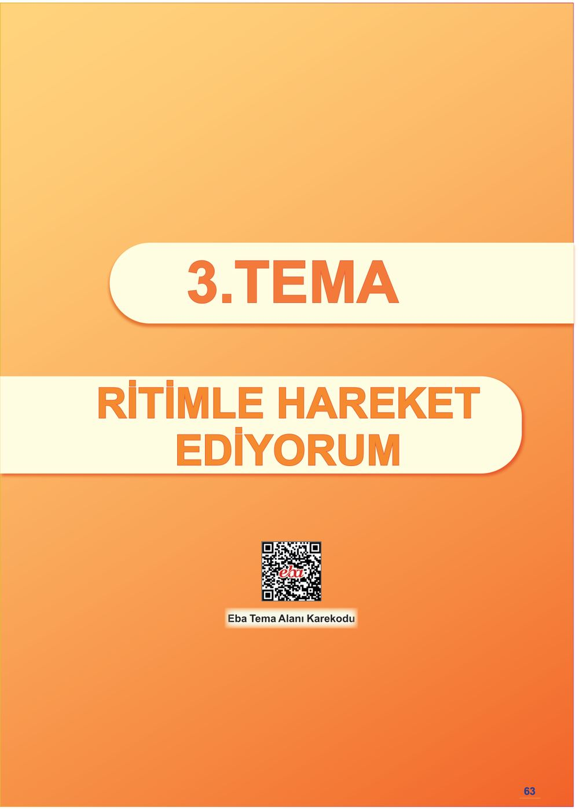 Eba Tema Alanı Karekodu

<!-- sayfa 64 -->

# 3. TEMA: RİTİMLE HAREKET EDİYORUM

| | |
| :--- | :--- |
| **DERS SAATİ** | 17 |
| **ALAN BECERİLERİ** | BEOSAB5. Ritmik Hareket Etme, BEOSAB7. Eşle/Grupla Hareket Etme, BEOSAB9. Takım/Grup Liderliği Sergileme |
| **KAVRAMSAL BECERİLER** | - |
| **EĞİLİMLER** | E1.3. Azim ve Kararlılık, E2.2. Sorumluluk, E2.5. Oyunseverlik, |
| | **PROGRAMLAR ARASI BİLEŞENLER** |
| **Sosyal-Duygusal Öğrenme Becerileri** | SDB1.2. Kendini Düzenleme (Öz Düzenleme), SDB1.3. Kendine Uyarlama (Öz Yansıtma), SDB2.1. İletişim, SDB2.2. İş Birliği, SDB3.2. Esneklik |
| **Değerler** | D3. Çalışkanlık, D16. Sorumluluk |
| **Okuryazarlık Becerileri** | OB4. Görsel Okuryazarlık |
| **DİSİPLİNLER ARASI İLİŞKİLER** | Müzik |
| **BECERİLER ARASI İLİŞKİLER** | SBAB5.2. Grup Dinamiğini Sağlama |
| **ÖĞRENME ÇIKTILARI VE SÜREÇ BİLEŞENLERİ** | **BEO.1.3.1. Ritmik hareket edebilme** a) Temel hareket becerilerini kullanarak verilen ritmi algılar. b) Temel hareket becerilerini kullanarak ritme uygun hareket eder. c) Temel hareket becerilerini kullanarak ritmik hareket becerilerini sergiler. **BEO.1.3.2. Eşle veya grupla hareket edebilme** a) Eşle veya grupla hareket ederken rolleri tanımlar. b) Eşle veya grupla hareket ederken rolleri yerine getirir. c) Eşle veya grupla uyumlu hareket eder. **BEO.1.3.3. Takım veya grup liderliği sergileyebilme** a) Takım veya grup liderliği özelliklerini tanır. b) Takım veya grup liderliği özelliklerini gösterir. |
| **İÇERİK ÇERÇEVESİ** | Ritmik Hareketler Eşle veya Grupla Hareket Takım veya Grup Liderliği |
| **Genellemeler/ Anahtar Kavramlar/** | adımlama, estetik, grup uyumu, liderlik, müzik, ritim, ritmik oyunlar, vuruş |

<!-- sayfa 65 -->

# 1. TEMAYA BAŞLARKEN

Bu temada öğrencilerin ritim kavramını anlayabilmeleri, temel hareket becerilerini ritimle uyumlu bir şekilde uygulayabilmeleri, ritim algılarını geliştirebilmeleri, bireysel veya grup çalışmalarıyla müzik eşliğinde ritmik hareketler sergileyerek koordinasyon ve yaratıcılıklarını geliştirebilmeleri, oyun ve fiziksel aktivitelerde takım ya da grup liderliğini sergileyebilme becerilerini kazanabilmeleri amaçlanmaktadır. Öğrencilerin müzik eşliğinde bireysel veya grup hâlinde gerçekleştirdikleri ritmik hareketlerle hem koordinasyon hem de yaratıcılık becerilerini geliştirmeleri beklenmektedir. Tema kapsamında yürüme, koşma, zıplama ve dönme gibi temel hareket becerileri ritmik etkinlikler yoluyla desteklenmektedir. Etkinlikler, öğrencilerin fiziksel gelişimlerine katkı sağlarken birlikte hareket etme, liderlik üstlenme ve sorumluluk alma gibi sosyal becerilerinin de güçlendirilmesini amaçlamaktadır. Etkinlikler sırasında güvenli bir ortam oluşturmak, uygun müzik ve materyalleri önceden hazırlamak, öğrencilerin rahatça hareket edebilecekleri alanlar sağlamak önemlidir. İlkokul döneminde temel hareket becerilerinin kazandırılması, öğrencilerin ilerleyen yaşlardaki fiziksel uygunluklarının temelini oluşturmaktadır. Yer değiştirme, nesne kontrolü ve denge becerileri bu dönemde ritmik etkinliklerle pekiştirilmektedir. Ritimle yapılan hareketler öğrencilerin beden farkındalığını artırırken alan farkındalığı, efor ve hareket ilişkileri beceri bileşenlerinin gelişimini de desteklemektedir. Öğretmenlerin bu etkinliklerde öğrencilerin bireysel farklılıklarını göz önünde bulundurarak her öğrencinin aktif katılımını sağlamaya özen göstermeleri önemlidir (Gallahue ve Ozmun, 2006).

# 2. ÖĞRENME-ÖĞRETME YAŞANTILARI

Ön değerlendirme süreci, öğrenme-öğretme yaşantılarının temel bileşenlerinden biri olup öğrencilerin mevcut bilgi ve becerilerinin yanı sıra ilgi alanları ve öğrenme ihtiyaçlarının belirlenmesini amaçlamaktadır. Bu değerlendirme, içeriğin farklılaştırılmasına olanak tanıyarak öğretim sürecinin bireysel farklılıklara göre uyarlanmasını sağlar. Bu kapsamda öğrencilerin ritim algıları ve temel hareket becerilerine yönelik hazır bulunuşluk düzeylerini belirlemek amacıyla çeşitli ön değerlendirme etkinlikleri gerçekleştirilir. Sürecin başlangıcında öğrencilere kalp atışı, yağmur sesi ve metronom gibi doğal ve yapay ses örnekleri dinletilir; bu seslerin ritmik özelliklerine odaklanmaları istenir. Böylece öğrencilerin doğal ritimleri fark etmeleri ve ritme karşı duyarlılık geliştirmeleri hedeflenir. Devamında öğrencilere “Bir grup arkadaşınızla dans gösterisi yapacak olsaydınız hangi hareketleri seçerdiniz? Neden?” gibi sorular yöneltilerek ritimle ilişkilendirdikleri hareketleri düşünmeleri ve ifade etmeleri teşvik edilir. Ayrıca sevdikleri bir şarkıya uygun olarak günlük yaşamlarında gerçekleştirdikleri ritmik hareketleri hatırlamaları ve kısa süreliğine sergilemeleri istenir. Eşli veya grup hâlinde yürütülen etkinliklerde ise öğrencilerin ayaklarını yere vurarak saatin ‘tik tak’ sesine uygun şekilde ritmik hareketler yapmaları sağlanır. Bu etkinlikler, öğrencilerin ritim duygusunu algılayabilmelerinin yanı sıra grup içinde koordinasyon ve uyum becerilerinin desteklenmesine de katkı sunar. Bu tür ritim temelli etkinlikler yalnızca eğlenceli birer uygulama olmanın ötesinde öğrencilerin çok boyutlu gelişimine hizmet eder. Pedagojik açıdan ritim, çocukların beden farkındalığını, zamanlama yeteneğini, dikkat düzeyini ve grup içi etkileşimini güçlendirir (Sevim, 2012). Estetik açıdan ise müzikle bütünleşik hareketler yoluyla sanatsal duyarlılık ve bedensel ifade becerileri desteklenir. Dalcroze Eurhythmics yaklaşımı da bu bütüncül bakışı doğrular, çocukların müziği sadece duymakla kalmayıp bedensel hareket aracılığıyla hissetmelerinin öğrenme sürecine önemli katkı sağladığını savunur (Juntunen ve Hyvönen, 2004). Böylece ritim hem bireysel gelişimi hem de iş birliğine dayalı öğrenmeyi teşvik eden güçlü bir eğitim aracına dönüşür.

<!-- sayfa 66 -->

## 2.1. Etkinlik Örnekleri

### ETKİNLİK 1: Ritimlerle Öğreniyorum

| | |
| :--- | :--- |
| **Amaç:** | Öğrencilerin ritmik hareket etme becerisi sergileyebilmeleridir. |
| **Eğilimler** | E2.5. Oyunseverlik |
| **Sosyal-Duygusal Öğrenme Becerileri** | SDB2.1. İletişim, SDB3.2. Esneklik |
| **Değerler** | D3. Çalışkanlık |
| **Okuryazarlık Becerileri** | - |
| **Disiplinler Arası İlişkiler** | Müzik |
| **Beceriler Arası İlişkiler** | |
| **Öğrenme Çıktısı ve Süreç Bileşenleri** | **BEO.1.3.1. Ritmik hareket etme becerisi sergileyebilme**   a) Temel hareket becerilerini kullanarak verilen ritmi algılar.   b) Temel hareket becerilerini kullanarak ritme uygun hareket eder.   c) Temel hareket becerilerini kullanarak ritmik hareket becerilerini sergiler. |
| **Kullanılan Öğretim Teknolojileri, Araç Gereçler ve Kaynaklar** | Etkinlik: top, koni, ritim çubukları   Oyun 1: top ve görev kartları   Oyun 2: tebeşir veya renkli bant   Oyun 3: 16 adet çember |


Öğrencilere “Bir alkış sesi duydunuz ve sesi ritimle takip edeceksiniz. Bunu nasıl yaparsınız?” sorusu yöneltilir. Cevaplar alındıktan sonra öğrencilere alkış ile farklı hız ve tempolarda farklı ritimler verilir, öğrencilerden verilen ritme uygun yürümeleri istenir. Bu ritimleri vücudun farklı bölümleriyle (iki elini dizlerine vurarak, omuzlarına dokunarak, ayaklarını yere vurarak, ellerini göğsüne vurarak vb.) müziğin ritmine uygun şekilde (yavaş, orta ve hızlı tempoda) tekrar etmeleri sağlanır. Öğrencilere “el çırp, dizlere vur, omuzlara dokun” gibi çeşitli komutlar verilerek bu hareketleri birleştirmeleri ve ritmik şekilde uygulamaları sağlanır. Daha sonra öğrencilerden bu hareketleri istedikleri şekilde birleştirerek müziğin ritmine uygun biçimde uygulamaları ve değiştirmeleri beklenir (**SDB2.1, SDB3.2**). Öğretmen top, koni ve ritim çubuklarını getirerek öğrencilere “Sizce bu nesneler konuşsaydı müziği nasıl anlatırdı?” sorusunu yöneltir ve cevapları alır. Öğrencilere farklı ritimlerde müzikler dinletilir ve nesneleri kullanarak müziğin ritmini taklit etmeleri sağlanır. Öğrencilere her nesne için bir ritim verilir. Top verilen öğrencilerden müziğin ritmine uyum sağlayarak, topu yere vurup yakalamaları; koni verilen öğrencilerden müziğin ritmine uyum sağlayarak, ellerindeki konileri yere vurup yukarı kaldırmaları; ritim çubuğu verilen öğrencilerden ellerindeki çubukları önce birbirine daha sonra önlerindeki koninin yan taraflarına aynı anda vurmaları istenir. Hızlı şekillerle verilen müziğin ritmine göre nesneleri kontrol etmeleri ve müzik durduğunda sabit kalmaları istenir. Müzik başladığında öğrencilerden tekrar nesneye ait hareketleri uygulamaları istenir. Müzik kesildiğinde ise hareketin durdurulması beklenir. Öğrenciler ellerindeki nesneleri değiştirir ve her öğrenci tüm nesnelerle hareketleri yapana kadar etkinlik devam eder. Tüm öğrencilerin aynı anda yavaş, orta ve hızlı ritimlerle ellerindeki nesneleri kullanarak, müziğin ritmiyle uyumlu şekilde “ritim şöleni” oluşturup eğlenmeleri ve etkinlikteki

<!-- sayfa 67 -->

**Oyun 1: Toplu Ritim, Hareketli Görev**

Oyunda kullanılacak top ve görev kartları getirilir. Öğrencilerden çember oluşturmaları istenir. Ardından bir top gösterilerek, “Bu topla neler yapabiliriz?” sorusu yöneltilir. Daha sonra, “Futbolda top sürmek, basketbolda top sektirmek ve voleybolda parmak pas gibi hareketlerin ritimle bir bağlantısı olabilir mi?” sorusu sorularak düşünmeleri sağlanır. Öğrencilere “Bu bir görev topu, aramızda dolaşarak bize ritmin yolunu gösterecek ve size yapmanız için görevler verecek.” denir. Oyun için farklı tempolarda müzikler (yavaş, orta ve hızlı tempoda) açılır ve öğrencilerden müziğin ritmine göre topu yanındaki arkadaşına atması istenir (**SDB3.2**). Müzik durduğunda görev topu hangi öğrencinin elindeyse o öğrenci bir görev kartı seçer. Öğrenciden görev kartlarında yer alan temel hareket becerisini ( zıplama, dönme, tek ayak sıçrama, ayakları sağa sola açma, çömelme-kalkma) arkadaşlarına göstermesi ve hareketi tüm sınıfın birlikte yapması istenir (**SDB2.1**). Öğrenci hareketi gösterdikten sonra oyun tekrar başlatılır. Oyun bu şekilde tüm öğrenciler görevini tamamlayana kadar devam eder (**E2.5, D3.4**).

**Oyun 2: Karede Ritim Var**

Oyun alanının zeminine tebeşir ya da renkli bant kullanarak her öğrenci için yan yana bitişik iki kare çizilir (**Şekil 1**). Öğrencilerden bu karelerin başına geçmeleri istenir. Ardından öğrencilerin ritme uygun şekilde hareket etmeyi öğrenmeleri amacıyla farklı tempolarda “adım-adım-çık”, “zıpla-zıpla-çık” gibi komutlar verilir ve kareleri ritme uygun şekilde kullanmaları sağlanır (**SDB2.1**). Etkinliği tamamladıktan sonra öğrencilerden “tek ayak üzerinde zıplama, ayakları öne-arkaya açma (makas), ayakları yanlara açma, dizlerden birini yukarı çekip tek ayak üstünde sekme, ayaklardan birini çizginin dış tarafına koyma” gibi hareketleri ritme uygun şekilde, istedikleri biçimde değiştirerek uygulamaları ve oyun alanının dışına çıkmamaları istenir. Müzik durduğunda öğrencilerin sabit kalmaları, devam ettiğinde ise belirlenen hareketleri ritimle uyumlu bir biçimde gerçekleştirmeleri beklenir (**SDB3.2**). Tüm öğrencilerin aynı anda, müzik eşliğinde eğlenceli bir şekilde bu hareketleri yapması sağlanır (**E2.5, D3.4**).

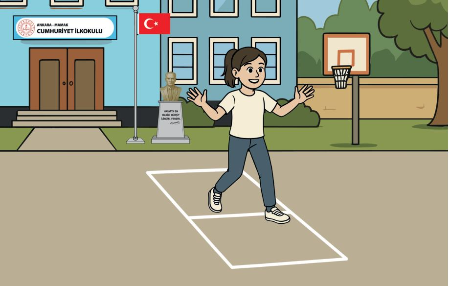

<!-- sayfa 68 -->

# Oyun 3: Adım Adım Ritim

Her bir sıraya dört adet olacak şekilde dört sıra çember dizilir (**Şekil 2**). Dış tarafta kalan çemberlerin önüne iki sıra oluşturulur. Sıra başındaki ilk öğrenciler aynı anda öne doğru bir adım alır, diğer ayağını onun yanına getirir ve sonra iki kez el çırpar. Bu şekilde üç çember ilerlenir. Dördüncü çembere geldiklerinde aynı hareketi birbirlerine dönerek yaparlar. Daha sonra birbirlerine doğru bir adım atarak, diğer adımlarını yanına getirir ve ellerini birbirlerinin eline iki kere vurarak karşılıklı ritim tutarlar. Sonra aynı hareketi yana adım alarak çemberin sonuna gelene kadar devam ettirirler. Eşlerin oyundaki görev ve sorumluluklarını yerine getirmesi sağlanır (**E2.5, D3.4**). Tüm sınıf hareketi yapana kadar oyun devam ettirilir.

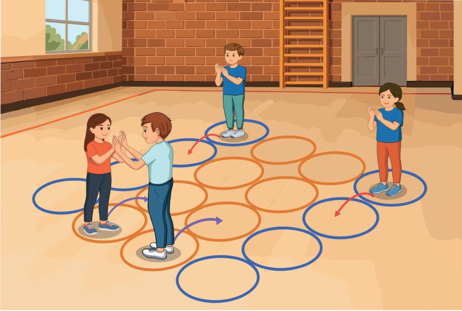

*Şekil 2. Adım adım ritim oyunu*

## Çeşitlendirme

Oyunlarda belirlenen nesnelerin yerine tef, kaşık, marakas ve zil gibi farklı nesneler kullanılabilir. Oyun 1’de kullanılan görev topunun sayısı artırılabilir. Öğrenciler gruplara ayrılabilir. Çemberli oyunda çember sayısı artırılıp azaltılabilir.

## Öğrenme Kanıtları ve Etkinlik Yansıması

Bu öğrenme çıktısının değerlendirilmesinde performans görevi (**Ek 1**) kullanılır. Performans görevinin değerlendirilmesi için analitik dereceli puanlama anahtarı (**Ek 2**) kullanılır. Bu ölçme aracı, öğrencilerin ritmik hareket etme becerisi sergileyebilmelerini değerlendirmek amacıyla hazırlanmıştır.

Etkinlik yansıması kapsamında öğrencilere aşağıdaki sorular yöneltilebilir:

* Ritme uygun hareket edebilmek için neler yaptınız? Başka ne yapabilirdiniz?
* Hareketleri tekrar ederken nelere dikkat ettiniz?
* Hareketleri müzikle yaparken zorlandığınız ya da çok iyi hissettiğiniz anlar oldu mu? Neden?

<!-- sayfa 69 -->

**ETKİNLİK 2**  **Rolümü Biliyorum, Uyumlu Hareket Ediyorum**

| | |
| :--- | :--- |
| **Amaç:** | Öğrencilerin eşle veya grupla hareket edebilmeleridir. |
| **Eğilimler** | E1.3. Azim ve Kararlılık, E2.2. Sorumluluk |
| **Sosyal-Duygusal Öğrenme Becerileri** | SDB1.2. Kendini Düzenleme, SDB1.3. Öz yansıtma, SDB2.2. İş Birliği, SDB3.2. Esneklik |
| **Değerler** | D3. Çalışkanlık, D16. Sorumluluk |
| **Okuryazarlık Becerileri** | - |
| **Disiplinler Arası İlişkiler** | Müzik |
| **Beceriler Arası İlişkiler** | SBAB5.2. Grup Dinamiğini Sağlama |
| **Öğrenme Çıktısı ve Süreç Bileşenleri** | **BEO.1.3.2. Eşle veya grupla hareket edebilme**   a) Eşle veya grupla hareket ederken rolleri tanımlar.   b) Eşle veya grupla hareket ederken rolleri yerine getirir.   c) Eşle veya grupla uyumlu hareket eder. |
| **Kullanılan Öğretim Teknolojileri, Araç Gereçler ve Kaynaklar** | Oyun 1: slalom çubukları veya atlama ipleri   Oyun 2: ritim çubukları |

Öğrencilerden günlük yaşamda duydukları veya kullandıkları bir tekerlemeyi arkadaşlarıyla paylaşmaları istenir. “Bu tekerlemenin ritmik hareketleri nelerdir?”, “Tekerlemeye ritmik bir hareket oluşturmak isteseniz bu hareket nasıl olurdu? Bunu gösterir misiniz?” gibi sorular yöneltilir. “Bugün bir hikâyeyi ritmik hareketlerle canlandıracağız.” diyerek öğrencilerde merak uyandırılır. Öğrencilerin “**Roketimize bindik ve geri sayım başladı.**” (Öğrenciler elleriyle bacaklarına vurarak beşten geriye sayım tutarlar: pat pat pat...), “**Roket havalanıyor!**” (Öğrenciler parmak uçlarında yükselerek ellerini yukarı kaldırır, hızlı tempoda ellerini yukarıya doğru çırparlar.), “**Uzay boşluğunda yavaşça süzülüyoruz.**” (Müzik yavaşlar, öğrenciler ağır çekimde yürür gibi adım atarlar ve kollarıyla dalgalanma hareketi yaparlar.), “**Karşımıza bir uzaylı çıktı!**” (Öğrenciler ellerini başlarının iki yanına koyarak uzaylı gibi hareket ederler, ilginç ritmik adımlamalarla dans ederler.), “**Meteor yağmuru başladı!**” (Öğrenciler ritmik şekilde elleriyle yukarıdan aşağıya çırpma hareketleri yaparlar, sonra yere çömelip elleriyle yere hafif hafif vururlar.), “**Gezegene iniş yapıyoruz.**” (Öğrenciler müziğin temposuna uygun biçimde ritimli diz vuruşlarıyla çömelip yavaşça kalkarlar.) hikâyesini ritim içerecek şekilde grupla oluşturması istenir (**D3.4**). Öğrencilerin uzay yolculuğunu anlatan hikâyeye uygun ritmik hareketleri oluştururken grup arkadaşlarıyla iş birliği içinde çalışmaları, ritimleri tam zamanında doğru şekilde yapmak için dikkatli ve istekli bir şekilde görevlerini yerine getirmeleri beklenir (**D16.3, SDB1.2**). Öğrenciler, ritimleri doğru bir şekilde uygulayabilmek için odaklanarak hareket ederler. Tüm öğrenciler rollerini yerine getirdikten sonra roller değiştirilir ve öğrenciler yeni rollerine uygun hareket-

<!-- yer tutucu bulunamadı: sayfa sonuna eklendi -->

<!-- sayfa 70 -->

rahat hissettiniz?”, “Ritmi yakalayamadığınızda nasıl bir çözüm yolu buldunuz?” ve “Bir sonraki dene-
mede neleri farklı yapmayı düşünüyorsunuz?” gibi sorular yöneltilir (SDB1.3). Daha sonra gruplara 
ayrılan öğrencilerden bu rollerden ritmik bir hareket seçmeleri istenir (SDB1.3, SBAB5.2, SDB1.2). 
Tüm grupların seçilen hareketleri ritmi bozmadan birleştirmesi sağlanır (E1.3, SDB2.2).  

**Oyun 1: Kukla Oynatıcı ve Kuklanın Hikâyesi**

Tüm sınıf ikişerli olur. Eşler karşılıklı geçer ve tüm eşlere ikişer slalom çubuğu verilir. Öğrenciler yüz 
yüze dönerek slalom çubuklarının iki ucundan karşılıklı tutarlar. Öğretmen çubuklarla karşılıklı ya-
yapabilecekleri hareketlere örnekler gösterir: “Kolları yandan yukarı açarak çubukları yukarıda birleştir; 
çubukları aşağıda sağdan sola salla; çubukların birini ileri it, birini geri çek vb.” Öğrencilerden birine 
kukla, diğerine ise kukla oynatıcısı rolü verilir. Kukla oynatıcısından müziğin ritmine uygun olarak 
elindeki çubuklarla kukla rolündeki eşini ritmik hareketlerle yönlendirmesi istenir (D3, SDB2.2). Daha 
sonra roller değiştirilerek oyun tekrar edilir. Öğrencilerden verilen görevleri azim ve kararlılıkla yerine 
getirmeleri beklenir (E1.3).

**Oyun 2: Görev Takımı**

Öğrenciler üçerli gruplara ayrılır. Öğrencilerden biri ritimci, biri dansçı, diğeri de takipçi olur. Ritim-
ci görevini üstlenen öğrenciden elindeki ritim çubuklarıyla ritim oluşturması, dansçı görevini üstle-
nen öğrenciden ritme uygun dört vuruşluk hareket oluşturması, takipçi görevini üstlenen öğrenciden 
dansçının hareketlerini verilen ritme göre uygulayıp uygulamadığını kontrol etmesi istenir. Dansçı, 
bulduğu dört vuruşluk hareketi grup arkadaşlarına öğretir. Grup, oluşturduğu dört vuruşluk hareketi 
eş zamanlı ve uyumlu bir şekilde yaparak tüm sınıf arkadaşlarına sunar (SDB2.2). Etkinlik sonunda 
öğrenciler sunum sırasında yaptıkları hataları fark ederek bu hataları düzeltmek için çaba gösterir 
(D16.3). Öğrencilerden sunumlarını yaptıktan sonra grup içi roller değiştirilerek yeni dört vuruşluk 
hareket bulmaları istenir.

**Çeşitlendirme**

Kukla oyununda atlama ipleri gergin bir şekilde tutularak slalom çubuğu yerine kullanılabilir. Görev 
takımı oyununda grup içi oluşturulmuş olan dört vuruşluk hareketler birleştirilerek grup gösterisi oluş-
turulabilir.

**Öğrenme Kanıtları ve Etkinlik Yansıması**

Bu öğrenme çıktısının değerlendirilmesinde öz değerlendirme formu (Ek 3) kullanılır. Bu ölçme aracı, 
öğrencilerin eşle veya grupla hareket edebilmelerini değerlendirmek amacıyla hazırlanmıştır.

Etkinlik yansıması kapsamında öğrencilere aşağıdaki sorular yöneltilebilir:

* Bugün grubundaki rolün neydi? Bu rolü nasıl tanımlarsınız?
* Rolünüzü yerine getirirken neler yaptınız?
* Arkadaşlarınızla uyum içinde çalışmak için neler yaptınız?
* Hep birlikte aynı ritimde hareket edebilmek için nelere dikkat ettiniz?

<!-- sayfa 71 -->

**ETKİNLİK 3**                                                                    **Adım Adım Liderlik**

| | |
| :--- | :--- |
| **Amaç:** | Öğrencilerin takım veya grup liderliği sergileyebilmeleridir. |
| **Eğilimler** | E2.2. Sorumluluk |
| **Sosyal-Duygusal Öğrenme Becerileri** | SDB2.2. İş Birliği, SDB3.2. Esneklik |
| **Değerler** | D16.3. Çalışkanlık |
| **Okuryazarlık Becerileri** | OB4. Görsel Okuryazarlık |
| **Disiplinler Arası İlişkiler** | Müzik |
| **Beceriler Arası İlişkiler** | |
| **Öğrenme Çıktısı ve Süreç Bileşenleri** | **BEO.1.3.3. Takım veya grup liderliği sergileyebilme**   a) Takım veya grup liderliği özelliklerini tanır.   b) Takım veya grup liderliği özelliklerini gösterir. |
| **Kullanılan Öğretim Teknolojileri, Araç Gereçler ve Kaynaklar** | Oyun: marakas, bardak, ritim çubukları ve zil |


Öğrencilere “Lider olmak, bir grubun başında olmak demektir. Lider; arkadaşlarına ne yapacaklarını söyler, birlikte karar verir, bir sorun olursa çözüm bulur ve herkese yardım eder.” ifadeleriyle kısa bir açıklama yapılır. Öğrencilere orkestra yöneten bir müzik şefinin, sınıfı yöneten bir öğretmenin, sporcularına antrenman yaptıran bir antrenörün ve grup egzersizi yapan bir eğitmenin yer aldığı görsel materyaller gösterilerek öğrencilerin liderlik kavramını anlamaları sağlanır (OB4). Öğrencilere “Takımlar bir problem yaşadığında onları yönlendirecek biri olmazsa ne olur?”, “Bir takımda herkes kendi istediğinin olmasını isterse takım uyumlu çalışabilir mi? Neden?” gibi sorular yöneltilerek öğrencilerin liderliğin önemini fark etmeleri ve “Takımda sorun çıkarsa lider nasıl davranmalı?”, “Sizce iyi bir lider nasıl olmalı?” gibi sorular yöneltilerek liderlerin sahip olması gereken özellikleri tanımaları sağlanır. Öğrenciler gruplara ayrılır ve kendilerine bir ritim lideri belirler. Birinci grup lideri; grup üyelerinden müzikle uyumlu bir şekilde bir adım öne gidip bir adım geriye gelmelerini, ayaklarını iki kez yere vurmalarını ve iki kez el çırpmalarını ister. İkinci grup lideri; grup üyelerinden müzikle uyumlu bir şekilde bir adım sağa ve bir adım sola gitmelerini, elleriyle dizlerine vurmalarını, bir kez çömelip-kalkmalarını ister. Üçüncü grup lideri; grup üyelerinden müzikle uyumlu bir şekilde sağ ayaklarını öne doğru açıp kapatmalarını, sol ayaklarını öne doğru açıp kapatmalarını, bir kez eğilip kalkmalarını, bir kez öne ve bir kez geriye sıçramalarını ister. Dördüncü grup lideri; grup üyelerinden sağ ayaklarını yana doğru açıp kapatmalarını, sol ayaklarını yana doğru açıp kapatmalarını, bir kez tek ayak öne doğru ve bir kez tek ayak ile geriye doğru sekmelerini ister. Gruptaki öğrenciler liderin gösterdiği hareketleri hep birlikte, müzikle uyumlu şekilde, istedikleri süre boyunca ve tekrar sayısınca çalışır (SDB2.2) Lider, herkesin uyumlu bir şekilde hareketleri müziğin ritmine uygun bir tempoda uygulamasını sağlayarak görevlerini zamanında ve eksiksiz yerine getirir (E2.2, D16.3). Gruptaki diğer üyeler sırayla liderlik yaparak sorumlulukları üstlenir (SDB3.2).

<!-- sayfa 72 -->

**Oyun: Ritim Lideri**

Öğrenciler gruplara ayrılır ve bir lider belirler. Gruplara tef, davul, ritim çubuğu ve marakas verilir. Birinci grup liderinden grup üyelerine “Marakas ile ayakta salla-salla-salla-dur ritmine göre olduğun yerde tempo tut, üç adım öne yürüyerek dur, üç adım geriye yürüyerek dur.” hareketlerini müzikle uyumlu bir şekilde göstermesi istenir. İkinci grup liderinden grup üyelerine “Bardaklar ile ayakta vur-vur-vur-dur ritmine göre olduğun yerde tempo tut; çömelerek bardakları üç kere yere vurup kalk ve dur; ayakta üç kere vur ve dur.” hareketlerini müzikle uyumlu bir şekilde göstermesi istenir. Üçüncü grup liderinden grup üyelerine “ Ritim çubukları ile ayakta çıt-çıt-çıt dur ritmine göre olduğun yerde tempo tut, sağa git vur, sola git vur, sağa git vur, sola git vur.” hareketlerini müzik ile uyumlu bir şekilde göstermesi istenir. Dördüncü grup liderinden grup üyelerine “Zil ile ayakta çal-çal-çal-dur ritmine göre olduğun yerde tempo tut, sağa hamle çal-çal, sola hamle çal-çal, ortaya gel çal-çal.” hareketlerini müzik ile uyumlu bir şekilde göstermesi istenir. Her grup için belirlenen ritmik hareketler, kendi grubuna gösterebilmesi için grup liderine öğretilir. Gruplar ancak birlikte liderin gösterdiği hareketleri müzikle uyumlu şekilde eş zamanlı olarak tekrar eder (**SBAB5.2, SDB2.2**). Lider, grubun düzenli ve ritme uygun hareket etmesini sağlayarak görevlerini zamanında ve eksiksiz yerine getirir ve grubun uyumundan sorumlu olduğunu gösterir (**E2.2, D16.3**). Gruptaki diğer üyeler de liderlik görevini sırayla üstlenerek sorumluluklarını yerine getirirler (**SDB3.2**).

**Çeşitlendirme**

Oyun 1 için kullanılan ritim aletleri değiştirilebilir. Grup sayısı artırılabilir ya da azaltılabilir.

**Öğrenme Kanıtları ve Etkinlik Yansıması**

Bu öğrenme çıktısının değerlendirilmesinde gözlem formu (**Ek 4**) kullanılır. Bu ölçme aracı, öğrencilerin takım veya grup liderliği sergileyebilmelerini değerlendirmek amacıyla hazırlanmıştır.

Etkinlik yansıması kapsamında öğrencilere aşağıdaki sorular yöneltilebilir:

* Sizce bir liderin “en iyi özelliği” ne olmalı?
* Grubunda bir sorun olsaydı lider ne yapmalıydı?
* Sizce lider, arkadaşlarına nasıl yol göstermeli?
* Etkinlikte gruptaki herkes farklı bir fikir söylerse lider ne yapmalı?

## 2.2. Farklılaştırma

### Zenginleştirme

Tören, kutlama ve bayram gibi özel günlerde öğrencilere “kaptan” ya da “grup lideri” gibi sorumluluk rolleri verilebilir. Bu tür etkinliklerde öğrencilerden yalnızca temel hareketleri tekrarlamaları değil aynı zamanda daha karmaşık ritim ve hareket kombinasyonları oluşturmaları da beklenebilir. Öğrencilerin belirli bir ritim doğrultusunda kendi koreografilerini tasarlamaları ve bu koreografileri doğaçlama yoluyla yaratıcı şekilde sergilemeleri teşvik edilebilir. Grup çalışmaları kapsamında öğrencilerin liderlik rolü üstlenmeleri hem hareketlerin koordinasyonunu sağlamalarına hem de ekip içi işbirliğini güçlendirmelerine yardımcı olabilir. Ritim duygusunu daha da zenginleştirmek amacıyla öğrencilere basit çalgı aletleri kullandırılarak gruplarına müzikal eşlik yapma imkânı tanınabilir. Farklı kültürlere ait müziklerin ve ritmik geleneklerin keşfedilmesi sağlanabilir.

### Destekleme

Uygulamalar sırasında öğrencilerin bireysel farklılıkları göz önünde bulundurularak daha sade ve temel düzeyde hareketler tercih edilebilir. Karmaşık hareket dizileri yerine daha basit, tekrarlanabilir ve öğrencilerin seviyelerine uygun ritim/hareket etkinlikleri sunulabilir. Grup çalışmalarına geçmeden önce öğrencilerin güven kazanabilmeleri için bireysel ritim ve hareket uygulamalarına yer verilebilir.

<!-- sayfa 73 -->

Bu süreçte öğrencilerin ritim algılarını geliştirmek amacıyla işitsel desteklerden (metronom, davul sesi, alkış ritimleri gibi) ve görsel ipuçlarından (hareket sıralarını gösteren resimler, semboller, basit çizelgeler) yararlanılabilir. Hareketlerin tümünü aynı anda yapmak yerine adım adım öğrenmeye dayalı bir yapı benimsenerek ritim yavaşlatılabilir ve öğrencilerin hareketleri sindirerek öğrenmeleri sağlanabilir. Eşle veya grupla yapılan çalışmalar sırasında ise öğrencilere karmaşık sorumluluklar yerine daha basit ve sınırlı görevler verilerek öğrencilerin tek bir hareket ya da ritim düzeninden sorumlu olmaları sağlanabilir. Öğrencilerin liderlik becerilerini desteklemek için de küçük ölçekli, yönlendirmeli ve öğretmen rehberliğinde verilen görevlerle bu becerileri deneyimlemeleri teşvik edilebilir.

### 3. ÖĞRENME KANITLARI (Ölçme ve Değerlendirme)

Etkinliklerin öğrenme kanıtları (ölçme ve değerlendirme) bölümünde öğrencilerin öğrenme çıktıları doğrultusunda değerlendirilmesi amacıyla hazırlanan örnek ölçme ve değerlendirme araçları belirtilmiştir. “Ritmik hareket etme becerisi sergileyebilme” öğrenme çıktısının değerlendirilmesinde Ek 1’de yer alan performans görevi kullanılacaktır. “Eşle veya grupla hareket edebilme” öğrenme çıktısının değerlendirilmesinde Ek 3’te yer alan öz değerlendirme formu kullanılır. “Takım veya grup liderliği sergileyebilme” öğrenme çıktısının değerlendirilmesinde Ek 4’te yer alan gözlem formu kullanılır. Öğrencilere verilen performans görevi velilerinin rehberliğinde yaptırılabilir.

Temanın bütününün değerlendirilmesinde Ek 5’te yer alan “Liderlik Gösterisi” isimli performans görevi kullanılacaktır. Performans görevi analitik dereceli puanlama anahtarı (**Ek 6**) ile değerlendirilebilir.

### 4. ÖĞRETMEN YANSITMALARI

* Bir sonraki yıl bu temanın planlaması için yorumlarınızı yazınız.

**Yorum 1:**

**Yorum 2:**

* Öğrenme Çıktılarına Göre Öz Yansıtma (planlama/hazırlık, öğrenme çevresi, öğretim, mesleki sorumluluk)

1. Öğrenme çıktısı için yansıtmalar:

2. Öğrenme çıktısı için yansıtmalar:

3. Öğrenme çıktısı için yansıtmalar:

<!-- sayfa 74 -->

# 5. EKLER

Ek 1. Performans Görevi: Ritimle Uyumlu Hareket Gösterisi

Bu performans göreviyle öğrencilerin yer değiştirme, nesne kontrolü ve denge becerilerini verilen ya da seçilen müziğin ritmiyle ne düzeyde uyumlu sergileyebildikleri gözlemlenecektir.

| Performans Görevi Detayları | |
| :--- | :--- |
| **Görevin Adı** | **Ritimle Uyumlu Hareket Gösterisi** |
| **Amaç** | Öğrencilerin müzik ritmine uygun olarak yer değiştirme, nesne kontrolü ve denge becerilerini kullanarak özgün bir ritim gösterisi hazırlamaları. |
| **Araç Gereçler** | makas, ritim çubuğu, top vb. ritmik hareketlerde kullanılabilecek nesneler |
| **Yönerge** | ● Kendi seçtiğin bir müziği dinle ve ritmine uygun olarak hareketlerini planla. ● Makas, ritim çubuğu, top gibi en az bir nesne kullan. ● Yer değiştirme, nesne kontrolü ve denge becerilerini gösteren en az üç farklı hareket belirle. ● 30 saniyelik özgün bir ritim gösterisi hazırla. ● Hazırladığın gösteriyi bir sonraki derste sınıf arkadaşlarına sun. |
| **Değerlendirme Ölçütleri** | ● Ritme Uygunluk ● Hareketin Doğruluğu ● Nesne Kontrolü ● Yaratıcılık |

<!-- sayfa 75 -->

# Ek 2. Analitik Dereceli Puanlama Anahtarı

| Dereceli Puanlama Anahtarı | | | |
| :--- | :--- | :--- | :--- |
| **Ölçütler** | **Çok İyi (3)** | **İyi (2)** | **Geliştirilmeli (1)** |
| **Ritme Uygunluk** | Hareketlerini müzik temposuna tamamen uyumlu, akıcı ve zamanında gerçekleştirir. | Genellikle ritme uygundur, bazı zamanlama hataları görülür. | Zaman zaman ritmi kaçırır, hareketler ritme uymaz. |
| **Hareketin Doğruluğu** | Temel hareket becerilerini (yer değiştirme, denge vb.) eksiksiz ve doğru uygular. | Hareketlerde küçük hatalar görülür ancak genel doğruluk sağlanır. | Çoğu hareket yanlış ya da eksik uygulanır. |
| **Nesne Kontrolü** | Nesneyle yapılan hareketleri (örneğin top atma, vurma vb.) kontrollü, doğru ve istikrarlı biçimde gerçekleştirir. | Genellikle nesne kontrolünde başarılıdır, ancak bazen koordinasyon kaybı yaşanır. | Nesne kontrolünde sık hatalar görülür, tekrar gerektirir. |
| **Yaratıcılık** | Hareketlerine özgünlük katar, farklı ve yaratıcı bir yorum ortaya koyar. | Bazı hareketlerde yaratıcılık gösterir. | Taklit ağırlıklıdır, özgünlük göstermez. |

**Değerlendirme Sistemi**

Bu ölçme aracından en az 4 puan, en fazla 12 puan alınabilmektedir. Öğrencinin puanı, alınan puanın yüzdelik karşılığı hesaplanarak bulunur. Bunun için alınan puan, öğrencinin alabileceği en yüksek puana bölünür ve çıkan sonuç 100 ile çarpılır. Ondalık gösterim elde edilmesi hâlinde sonuç, tam kısmına (birler basamağına) yuvarlanır. Örneğin öğrenci bu ölçme aracından 5 aldığında puanı şu şekilde hesaplanır: $(5 : 12).100 = 41,666$. Bu sonuç yuvarlandığında öğrenci 42 puan almış olacaktır.

**Performans Düzeyleri:**

33-49 : Düşük
50-74 : Orta
75-89 : İyi
90-100: Çok iyi

<!-- sayfa 76 -->

**Ek 3. Uzay Yolculuğu Ritim Etkinliği Öz Değerlendirme Formu**

| **Etkinlik Adı: Uzay Yolculuğu Ritim** |
| :--- |
| **Adı Soyadı:**   **Numarası :**   **Sınıfı :**   **Tarih :**    Bu form “Uzay Yolculuğu Ritim” etkinliğimizde gösterdiğiniz performansı değerlendirmek için hazırlandı. Aşağıdaki cümleleri dikkatlice okuyunuz. Her cümle için kendinize en uygun olan seçeneği “✓“ ile işaretleyiniz. |

| Ölçütler | Evet | Hayır |
| :--- | :---: | :---: |
| Ritme uygun ve zamanında hareket etmeye çalıştım. | | |
| Arkadaşlarımla hareket ettim ve görevimi yaptım. | | |
| Hatalarımı fark ettim ve düzeltmeye çalıştım. | | |
| Müziğin hızına göre hareket ettim. | | |
| Bir dahaki sefere daha iyi olmak için ne yapacağımı düşündüm. | | |

<!-- sayfa 77 -->

# Ek 4. Takım ve Grup Liderliği Davranışları Gözlem Formu

| Adı Soyadı: |
| :--- |
| **Numarası :** |
| **Sınıfı :** |
| **Tarih :** |

| Ölçütler | Her Zaman | Bazen | Hiçbir Zaman |
| :--- | :---: | :---: | :---: |
| Grup içinde fikir paylaşımında bulunur. | | | |
| Aldığı görevi tamamlar. | | | |
| Arkadaşlarını dinler ve arkadaşlarının fikirlerine saygı gösterir. | | | |
| Grupta sorumluluk alır. | | | |
| Problem durumlarında çözüm üretir. | | | |
| Grup içi görev paylaşımında adil davranır. | | | |
| Takım arkadaşlarına destek olur. | | | |
| Grup çalışmasına istekli katılır. | | | |

**Değerlendirme Sistemi**

Bu ölçekten alınabilecek en yüksek puan $24$'tür.

* $8\text{-}13$ <!-- KONTROL: Marker'da karşılığı yok, uydurma olabilir --> puan: Liderlik becerileri için desteklenmeye ihtiyacı var.
* $14\text{-}19$ <!-- KONTROL: Marker'da karşılığı yok, uydurma olabilir --> puan: Liderlik becerileri geliştirilmeye açık.
* $20\text{-}24$ <!-- KONTROL: Marker'da karşılığı yok, uydurma olabilir --> puan: Liderlik becerilerini etkili şekilde sergiliyor.

<!-- sayfa 78 -->

# Ek 5. Performans Görevi: Liderlik Gösterisi

Sizden sınıf arkadaşlarınızla eğlenceli bir ritim gösterisi yapmanız istenmektedir. Aşağıdaki adımları sırasıyla takip ederek kendi grubunuzu kuracak ve küçük bir liderlik görevi üstleneceksiniz.

**Bu görevle:**

* Müzik ritmini algılayıp hareket etmeyi,
* Grup içinde iş birliği yapmayı,
* Lider olarak sorumluluk almayı öğreneceksiniz.

## Performans Görevi Detayları

| | |
| :--- | :--- |
| **Görevin Adı** | Liderlik Gösterisi |
| **Amaç** | Öğrencilerin ritmik hareket becerilerini kullanarak grup içinde uyumlu hareket etme ve liderlik yapma becerilerini geliştirmeleri. |
| **Araç Gereçler** | ritim çubuğu, zil, renkli şeritler, müzik çalar vb. |
| **Yönerge** | 1. 3-4 kişilik gruplar oluşturun. 2. Öğretmeninizin seçtiği müziği dinleyin ve ritmine uygun 3 farklı hareket planlayın. 3. Grubunuzla birlikte bu hareketleri birkaç kez tekrar edin. 4. Her öğrencinin sırayla liderlik yaptığı bir gösteri hazırlayın. 5. Lider olan öğrenci hareketleri anlatacak, sırayı belirleyecek ve arkadaşlarını yönlendirecek. 6. Hazırladığınız gösteriyi sınıf önünde sergileyin. |
| **Değerlendirme Ölçütleri** | ● Ritmi Algılama ve Uygulama ● Görevini Yerine Getirme (Roller) ● Grup Uyumuna Katkı ● Liderlik Gösterisi |

<!-- sayfa 79 -->

# Ek 6. Analitik Dereceli Puanlama Anahtarı (Rubrik)

| Ölçütler | Çok iyi (3) | İyi (2) | Geliştirilmeli (1) |
| :--- | :--- | :--- | :--- |
| Ritmi Algılama ve Uygulama | Ritmi doğru şekilde algılar ve müzikle tamamen uyumlu hareket eder. | Küçük hatalarla birlikte genel uyumu sağlar. | Ritmi takip etmekte zorlanır. |
| Görevini Yerine Getirme (Roller) | Görevini eksiksiz yerine getirir, arkadaşlarına da destek olur. | Görevini yerine getirir, bazen desteğe ihtiyaç duyar. | Görevini tanımakta zorlanır. |
| Grup Uyumuna Katkı | Grup içinde uyumlu, istekli ve destekleyicidir. | Çoğunlukla uyumludur, bazen yardıma ihtiyaç duyar. | Gruba uyum sağlamakta zorlanır. |
| Liderlik Gösterisi | Rehberlik eder, karar verir, grup yönetiminde aktiftir. | Liderlik yapar, ancak yönlendirme becerisi sınırlıdır. | Liderlik görevini yeterince yerine getirmez. |

**Değerlendirme Sistemi:**

Bu ölçme aracından en az 4 puan, en fazla 12 puan alınabilmektedir. Öğrencinin puanı, alınan puanın yüzdelik karşılığı hesaplanarak bulunur. Bunun için alınan puan, öğrencinin alabileceği en yüksek puana bölünür ve çıkan sonuç 100 ile çarpılır. Ondalık gösterim elde edilmesi hâlinde sonuç, tam kısmına (birler basamağına) yuvarlanır. Örneğin öğrenci bu ölçme aracından 5 aldığında puanı şu şekilde hesaplanır: $(5 : 12).100 = 41,666$ <!-- KONTROL: Marker'da karşılığı yok, uydurma olabilir -->. Bu sonuç yuvarlandığında öğrenci 42 puan almış olacaktır.

**Performans Düzeyleri:**

33-49 : Düşük
50-74 : Orta
75-89 : İyi
90-100: Çok iyi

<!-- sayfa 80 -->

# 4. TEMA

## FİZİKSEL AKTİVİTEYE KATILIYORUM, SAĞLIKLI BÜYÜYORUM

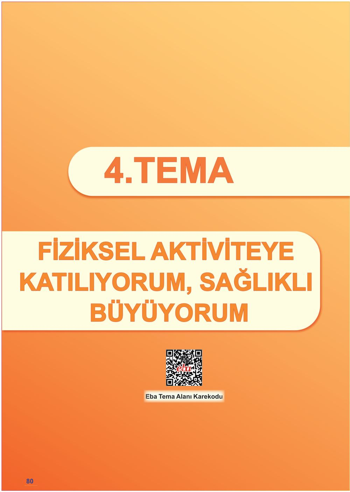 Eba Tema Alanı Karekodu

<!-- sayfa 81 -->

# 4. TEMA: FİZİKSEL AKTİVİTEYE KATILIYORUM, SAĞLIKLI BÜYÜYORUM

| | |
| :--- | :--- |
| **DERS SAATİ** | 30 |
| **ALAN BECERİLERİ** | **BEOSAB4. Fiziksel Aktiviteye Katılma** |
| **KAVRAMSAL BECERİLER** | KB1. Temel Beceriler |
| **EĞİLİMLER** | E2.2. Sorumluluk, E3.8. Soru Sorma |
| | **PROGRAMLAR ARASI BİLEŞENLER** |
| **Sosyal-Duygusal Öğrenme Becerileri** | SDB1.1. Kendini Tanıma (Öz Farkındalık), SDB1.2. Kendini Düzenleme (Öz Düzenleme), SDB2.1. İletişim, SDB2.2. İş Birliği |
| **Değerler** | D3. Çalışkanlık, D13. Sağlıklı Yaşam, D18. Temizlik |
| **Okuryazarlık Becerileri** | - |
| **DİSİPLİNLER ARASI İLİŞKİLER** | Hayat Bilgisi, Görsel Sanatlar |
| **BECERİLER ARASI İLİŞKİLER** | KB2.18. Tartışma |
| **ÖĞRENME ÇIKTILARI VE SÜREÇ BİLEŞENLERİ** | **BEO.1.4.1. Fiziksel aktivite ve sağlık ilişkisini fark edebilme** **BEO.1.4.2. Okul içi fiziksel aktiviteye katılabilme** a) Fiziksel aktivite düzeyini fark eder. b) Fiziksel aktivite düzeyini geliştirmek için plan yapar. c) Fiziksel aktiviteye ilişkin planı uygular. |
| **İÇERİK ÇERÇEVESİ** | Fiziksel Aktivite ve Sağlık İlişkisi Fiziksel Aktiviteye Katılım |
| **Genellemeler/ Anahtar Kavramlar/ Sembol ve Gösterimler** | beslenme, geleneksel çocuk oyunları, hareket, ısınma, soğuma, temizlik, uygun kıyafet, uyku, yeterli sıvı alımı |

<!-- yer tutucu bulunamadı: sayfa sonuna eklendi -->

<!-- sayfa 82 -->

# 1. TEMAYA BAŞLARKEN

Bu temada öğrencilerin hareket ve sağlık arasındaki ilişkiyi kurabilmeleri; okul içi fiziksel aktiviteye katılabilmeleri, fiziksel aktivitelerde temizlik, dengeli beslenme, uygun kıyafet seçimi, ısınma ve soğuma gibi konular hakkında farkındalıklarının artırılabilmesi amaçlanmaktadır. Erken yaşlarda kazandırılan fiziksel aktivite alışkanlıkları, bireylerin yaşam boyu sağlıklı kalmalarını destekleyen temel davranış biçimleri arasında yer almaktadır (Özer, 2006). Bu bağlamda öğrencilere düzenli fiziksel etkinliklerin bedensel, ruhsal ve sosyal sağlık üzerindeki olumlu etkileri çeşitli etkinlikler aracılığıyla aktarılmalıdır. Okul ortamında uygulanan fiziksel aktiviteler, sadece fiziksel gelişimi değil aynı zamanda sosyal uyumu ve disiplinli yaşam alışkanlıklarını da desteklemektedir (Muratlı, 2003). Öğrencilerin etkinliklerde temizlik kurallarına uyması, uygun kıyafet seçimi yapması, ısınma ve soğuma hareketlerine dikkat etmesi, bedenlerini tanıyıp korumaları önemlidir. Ayrıca fiziksel etkinliklerin dengeli beslenme ile desteklenmesi, sağlıklı yaşam becerilerinin gelişimine katkı sağlar. Bu bağlamda, öğretmenler yalnızca beden eğitimi ve oyun derslerini planlamakla kalmayıp, sağlıklı yaşam farkındalıklarını artıracak etkinlikleri de bütüncül bir yaklaşımla ele almalıdır. Temanın içeriğinde yer alan fiziksel aktivite, kas ve eklemlerin kullanımıyla enerji harcamasını sağlayan tüm vücut hareketlerini ifade eder. Sağlığın tanımı ise Dünya Sağlık Örgütü (DSÖ) tarafından “Sadece hastalık ve sakatlığın olmayışı değil, bedence, ruhça ve sosyal yönden tam bir iyilik hâlidir.” şeklinde tanımlanmaktır. Yeterli ve dengeli beslenme ise sağlığı korumak, geliştirmek ve yaşam kalitesini artırmak için vücudun gereksinimi olan enerji ve besin ögelerinin her birinin yeterli miktarda alınmasıdır (Sağlık Bakanlığı, 2020). “Fiziksel Aktiviteye Katılıyorum Sağlıklı Büyüyorum” temasındaki etkinlikler öğretim programında yer alan öğrenme çıktılarını desteklemek amacıyla hazırlanmıştır. Etkinliklerde dikkat edilmesi gereken hususlar şu şekildedir: Etkinlikler öncesi mutlaka ısınma hareketleri yapılmalıdır. Etkinliklerde öğrencilerin sağlık durumu öğretmen tarafından gözlenmelidir. Etkinlik alanı kontrol edilmeli, öğrencilerin hareket edecekleri alan güvenli olmalıdır. Etkinlik sonrasında öğrenciler soğuma ve nefes düzenleme çalışmaları yapmalıdır. Fiziksel aktivite sonrasında öğrencilerin kişisel temizliklerine özen göstermeleri sağlanmalı, terlemeye bağlı durumlar için yedek kıyafet getirmeleri teşvik edilmeli ve kıyafetlerini değiştirmeleri desteklenmelidir. Fiziksel aktivite ortamının temizliği, sıvı alımı, dinlenme ihtiyacı vb. konularda bilgi verilmelidir. Oyun ve fiziksel aktiviteler sırasında uygun beslenmemeye bağlı olarak oluşabilecek sorunlardan yola çıkarak dikkat etmeleri için gerekli açıklamalar yapılmalıdır.

# 2. ÖĞRENME-ÖĞRETME YAŞANTILARI

Öğrenme-öğretme sürecinin bir parçası olan ön değerlendirme bölümünde, öğrencilerin mevcut bilgi ve becerilerinin yanı sıra ilgi alanları ve öğrenme ihtiyaçları da belirlenmeye çalışılır. Bu değerlendirme, öğretim içeriğinin öğrencilerin özelliklerine göre farklılaştırılmasına imkân tanır. Bu temada öğrencilerin fiziksel aktivite ve sağlık kavramları hakkında ön bilgilerini kontrol etmek amacıyla konu hakkında çeşitli görsel kartlar sunulabilir. Fiziksel aktivite ve sağlık kavramları hakkında ve ülkemizde hangi geleneksel çocuk oyunlarının bulunduğuna dair neler bildiklerini ifade etmelerini sağlamak için aşağıdaki sorular sorulabilir:

* Arkadaşlarınızla hangi geleneksel çocuk oyunlarını oynarsınız?
* Fiziksel aktivite denildiğinde aklınıza ilk gelenler nelerdir?
* Sağlıklı beslenmek için neler yapıyorsunuz?

Öğrenme sürecinin bu aşamasında, öğrencilerin mevcut bilgi ve becerileri ile yeni kazanımları arasında bağlantı kurmaları hedeflenir. Öğrencilerden, hareket etmenin faydalarına ilişkin bildiklerini grup içinde paylaşmaları istenir. Fiziksel aktivite sırasında nasıl hissettiklerini hatırlamaları, nefes alışverişleri ve kalp atış hızlarında meydana gelen değişimleri sınıf ortamında tartışmaları sağlanır. Günlük yaşamlarında sağlıklı kalabilmek için nelere dikkat ettiklerini anlatmaları teşvik edilir. Ayrıca,

<!-- sayfa 83 -->

düzenli fiziksel aktivitenin sağlıklı uyku ve beslenme ile nasıl ilişkili olduğu, öğrencilerin verdiği günlük yaşam örnekleri üzerinden tartışılır. Öğrencilerden, sağlıklı besinleri konu alan bir resim çizmeleri istenir.

## 2.1. Etkinlik Örnekleri

### ETKİNLİK 1 | Sağlık İçin Hareket Ediyorum

| | |
| :--- | :--- |
| **Amaç:** | Öğrencilerin fiziksel aktivite ve sağlık ilişkisini fark edebilmeleridir. |
| **Eğilimler** | E2.2. Sorumluluk, E3.8. Soru Sorma |
| **Sosyal-Duygusal Öğrenme Becerileri** | SDB1.1. Kendini Tanıma (Öz Farkındalık), SDB2.1. İletişim |
| **Değerler** | D13. Sağlıklı Yaşam, D18. Temizlik |
| **Okuryazarlık Becerileri** | - |
| **Kavramsal Beceriler** | - |
| **Beceriler Arası İlişkiler** | KB2.18. Tartışma |
| **Öğrenme Çıktısı ve Süreç Bileşenleri** | BEO.1.4.1. Fiziksel aktivite ve sağlık ilişkisini fark edebilme |
| **Kullanılanları, Araç, Gereçler ve Kaynaklar** | Oyun 1: fiziksel aktivite kartları, renkli çanaklar ve toplar. Oyun 2: mendil, yumuşak top, alan belirlemek için tebeşir, bant ve koniler. Nefes alma-verme, kalp atış hızı ile ilgili videolar; fiziksel aktivite örneklerini somutlaştırmak için bilgisayar, etkileşimli tahta vb. görsel içerikler kullanılabilir. |

Öğretmen farklı fiziksel aktivitelerin yer aldığı görsel kartlar ile sarı, mavi, kırmızı renkte antrenman çanaklarıyla gelir. Görsel kartlarda tenis, yürüyüş, yüzme gibi spor dalları ve ev işleri gibi fiziksel aktiviteler yer alır. Öğrencilerle birlikte bir daire oluşturulur. Öğrencilere “Koşunca neden terleriz?”, “Kalbimiz ne zaman hızlı atar?” gibi sorular yöneltilerek merak uyandırılır. Öğrencilerden günlük hayatlarında katıldıkları fiziksel aktiviteleri ve bu aktivitelerin vücutlarına nasıl fayda sağlayacağıyla ilgili fikirlerini paylaşmaları istenir ve fiziksel aktivitenin fiziksel ve ruhsal sağlığa faydaları hakkında video ve görsellerden yararlanılarak bilgi verilir (SDB1.1, SDB2.1). Ardından öğrencilere farklı ısınma ve soğuma hareketleri gösterilerek bu hareketlerin önemi üzerinde durulur. Fiziksel aktivite öncesinde ve sonrasında yapılan bu hareketlerin yaralanmaları önlemek için gerekli olduğu açıklanarak bu hareketleri uygulamaları sağlanır (E2.2).

**Oyun 1: Renkli Hareket**

Oyun öncesinde geniş, güvenli ve düz bir alan hazırlanır. Öğrenciler ikişer kişilik gruplara ayrılır. Etkinlik alanına, grup sayısı kadar sarı, mavi ve kırmızı renkte antrenman çanakları karışık şekilde yerleştirilir (). Renkler, farklı hareket düzeylerini temsil eder: Sarı çanakta hareketsiz beklenilir, mavi çanakta hafif tempoda yürünür, kırmızı çanakta ise belirlenen sayıda çift ayak sıçrama yapılmaktadır...

<!-- sayfa 84 -->

Öğretmen bir renk komutu verir (örneğin “sarı”), öğrenciler bu renkteki çanaklara koşar ve her grup, çanağı ortalarına alacak şekilde karşılıklı biçimde yerleşir. Komuta uygun olarak belirlenen hareket yapılır (Örneğin “sarı” çanakta hareketsiz durulur.). Bu sırada, öğrencilerden bir ellerini göğüs ortasına, diğer ellerini göğüs kemiği altına koyarak kalp atışlarını ve nefeslerini gözlemlemeleri istenir (E2.2). “Kalbimiz nasıl atıyor?”, “Yavaş mı, hızlı mı?” gibi sorularla bedensel farkındalık kazandırılır. Ardından öğretmen “mavi” dediğinde, öğrenciler yürüyerek mavi çanaklara geçer. “Kırmızı” komutu geldiğinde ise kırmızı çanaklara koşarlar ve öğretmenin yönlendirmesiyle belirlenen hareketleri tamamlarlar. Tüm aktivitelerden sonra öğrenciler, kalp atışlarını ve nefes alışlarını tekrar gözlemler. “Kalbimiz daha hızlı atıyor mu?”, “Nefes alışverişimiz hızlandı mı?”, “Günlük yaşamda hangi fiziksel aktiviteleri yapıyorsunuz?” gibi sorular yöneltilir ve öğrenciler birbirleriyle fikir alışverişinde bulunurlar (SDB1.1, SDB2.1).

Öğrencilere fiziksel aktivitenin ne olduğu ve günlük yaşamla ilişkisi hakkında kısa bir bilgilendirme yapılır. Ardından her gruba üçer fiziksel aktivite kartı verilir. Öğrenciler, bu kartlarda yer alan aktiviteleri inceleyip “Günlük hayatta hangilerini yapıyorsunuz?” sorusu yönlendirilir ve fikirlerini paylaşırlar. Daha sonra, kartlardaki fiziksel aktiviteleri düşük, orta ve yüksek yoğunlukta olacak şekilde sınıflandırmaları istenir. Kartlar gruplar arasında değiştirilir, öğrencilerden farklı aktiviteleri yeniden sınıflandırmaları ve grup içinde tartışmaları istenir (SDB2.1, KB2.18).

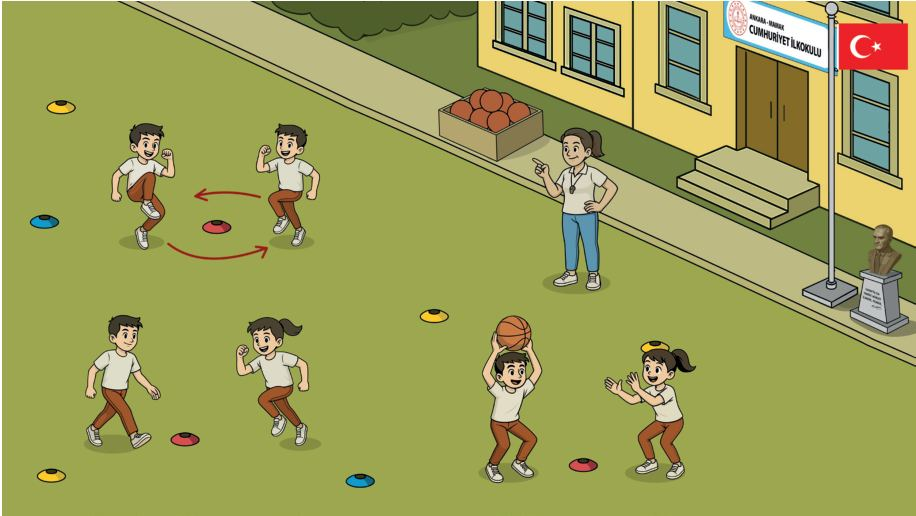

*Şekil 1. Renkli hareket*

### Oyun 2: Sağlık Oyunum

Öğrenciler yarım daire şeklinde oturur. Öğretmen elinde renkli bir mendil ve yumuşak bir topla dolaşır ve renkli mendili göstererek bugün oynanacak oyunun sağlıklı yaşam ile ilgili olduğunu açıklar. Öğrencilere, “Günlük hayatınızda hangi fiziksel aktiviteleri yapıyorsunuz? Sağlıklı olmak için nelere dikkat etmeliyiz?” gibi sorular yöneltilir; öğrenciler düşüncelerini ve deneyimlerini paylaşırlar. Daha sonra, mendil kapmaca oyununun nasıl oynandığı anlatılır; geleneksel oyunlarımız arasında olduğunu ve hem eğlenceli hem de fiziksel aktivite olduğunu vurgular. Sınıf iki eşit gruba ayrılır ve karşılıklı iki sıra oluşturulur. Gruplara numaralar verilir. Oyun alanının ortasına güvenli bir daire çizilir ve yumuşak top bu dairenin içine bırakılır. Öğretmen ortada mendili tutar, yüksek sesle bir numara söyler. O numaralı öğrenciler karşılıklı olarak ortada mendili kapmak için koşar Mendili kapan öğrenci kendi

<!-- sayfa 85 -->

sırasına geri dönerken, diğer öğrenci yerdeki topu mendili kapan öğrenciye doğru atmaya çalışır. Oyun sırasında öğretmen ara ara, “Kalbin nasıl atıyor?”, “Nefes alışverişin değişti mi?”, “Terledin mi?” gibi sorular sorarak öğrencilerin bedenlerindeki değişimleri fark etmelerini sağlar. Oyunun turları arasında kıyafet ve ayakkabı seçimi, sağlıklı beslenme, sıvı alımı, düzenli uyku, fiziksel aktivite ortamının temizliği, kullanılan malzemenin temizliği ve aktivite sonrası kıyafet değişimi gibi konular üzerine öğrencilerin sağlıklı yaşama dair birbirlerine sorular sorması ve kendi aralarında tartışmaları sağlanır (E3.8, D13.1, D13.4, D18.1). Öğrenciler kendi fikirlerini paylaşır, böylece fiziksel aktivite sırasında dikkat edilmesi gerekenler pekiştirilir. Oyun sonunda tüm öğrenciler bir daire oluşturarak toplanır ve sabit kalarak ritmik, yavaş adımlarla yerinde yürüyüş yaparlar. Burundan nefes alıp ağızdan vermeleri istenerek soğuma hareketleri yapmaları sağlanır.

**Açıklama**

Etkinlik öncesinde ısınma hareketleri yapılmalıdır. Soğuma sürecine zaman ayrılmalı ve nefes farkındalığı kazandırılmalıdır. Öğrenciler, oyun alanında birbirlerine çarpmayacak şekilde yönlendirilmelidir. Yeterli alan bırakılarak öğrencilerin güvenliği sağlanmalıdır. Burundan nefes alıp ağızdan vermeleri istenerek soğuma hareketleri yapmaları sağlanır.

**Çeşitlendirme**

Etkinlikte hareket süresi değiştirilebilir, daha fazla sayıda hareket içeren seriler oluşturulabilir, etkinlik alanı değiştirilebilir, grup sayısı artırılıp azaltılabilir ve malzemeler çeşitlendirilerek uygulamada farklılıklar sağlanabilir.

**Öğrenme Kanıtları ve Etkinlik Yansıması**

Bu öğrenme çıktısının değerlendirilmesinde aşağıda yer alan sorular kullanılabilir:

Sağlık için hareket ediyorum etkinliğine ilişkin açık uçlu sorular:

1. Etkinlik sırasında nefes alışverişinizi nasıl kontrol ettiniz?
2. Kalbiniz hangi hareketlerde hızlı, hangi hareketlerde yavaş attı?
3. Isınma hareketlerini neden yaparız?
4. Günlük hayatta yaptığınız fiziksel aktiviteler nelerdir? İki tane örnek yazınız.
5. Fiziksel aktivitelerden düşük-orta-yüksek şiddetteki aktiviteler nelerdir? Birer örnek yazınız.
6. Sağlıklı ve sağlıksız besinler nelerdir? İki tane örnek yazınız.

Öğrencilere kalp atışı ve nefeslerini gözlemlemeleri için kalp ölçeği ve nefes ölçeğinden faydalanabilirsiniz (**Ek 7**).

Etkinlik yansıması kapsamında öğrencilere aşağıdaki sorular yöneltilebilir:

* Bugünkü etkinlikte vücudunuzda neler hissettiniz?
* Etkinlik sırasında en çok hangi hareketi yapmak hoşunuza gitti? Neden?
* Grup olarak çalışmak hoşunuza gitti mi?
* Bugün öğrendiğiniz en önemli şey neydi?

<!-- sayfa 86 -->

**ETKİNLİK 2** | **Fiziksel Aktivite Çarkı**

| | |
| :--- | :--- |
| **Amaç:** | Öğrencilerin okul içi fiziksel aktivitelere katılmalarını sağlayabilmektir. |
| **Eğilimler** | - |
| **Sosyal-Duygusal Öğrenme Becerileri** | SDB1.2. Kendini Düzenleme (Öz Düzenleme), SDB2.1. İletişim, SDB2.2. İş Birliği |
| **Değerler** | D3. Çalışkanlık |
| **Okuryazarlık Becerileri** | - |
| **Kavramsal Beceriler** | - |
| **Beceriler arası ilişki** | - |
| **Öğrenme Çıktısı ve Süreç Bileşenleri** | **BEO.1.4.2. Okul içi fiziksel aktiviteye katılabilme**   a) Fiziksel aktivite düzeyini fark eder.   b) Fiziksel aktivite düzeyini geliştirmek için plan yapar.   c) Fiziksel aktiviteye ilişkin planı uygular. |
| **Kullanılan Öğretim Teknolojileri, Araç Gereçler ve Kaynaklar** | fiziksel aktivite çarkı için karton, fiziksel aktivite çizelgesi, hedef kartları, kalem ve kronometre |


Öğrencilerin yapabileceği aktivitelere uygun olarak kartondan bir çark hazırlanır. Çarkta koşma, ip atlama, adım al-sek, sıçrama ve top atma gibi hareket becerileri yer alır. Öğrenciler, daire şeklinde yere otururlar ve dairenin ortasına, fiziksel aktivitelerin yer aldığı çark yerleştirilir. “Bugün hiç koştu-nuz mu? Kaç kez merdiven çıktınız? Nefes nefese kaldığınız bir aktivite yaptınız mı?” gibi sorular sorulur. Ardından, okulda yaptıkları merdiven çıkma, bahçede oynama, koşma gibi fiziksel aktiviteleri hangi sıklıkla, ne kadar süreyle ve hangi tempoda yaptıklarına dair sorular sorulur. Öğrenciler, fikirle-rini birbirleriyle paylaşırlar (SDB2.1). Öğrenciler sırayla fiziksel aktivite çarkını çevirir. Fiziksel aktivite çarkında okun gösterdiği aktiviteyi 1-2 dakika boyunca sınıfça yaparlar. Her aktiviteden sonra öğ-rencilerin durumları gözlemlenir ve mola verilir. Aktivitelerden sonra, “Kalbiniz hızlı atıyor mu? Nefes alışverişiniz değişti mi? Terlemeye başladınız mı?” gibi sorular sorularak, fiziksel aktivitenin vücutla-rında meydana getirdiği değişiklikleri öğrencilerin fark etmesi sağlanır. Hem kendi hem de arkadaşla-rının bu aktivitelerdeki aktif katılım durumlarıyla ilgili gözlem yapmaları için öğrencilerden eşli olarak da çarkı çevirmeleri istenir (SDB2.2). Öğrenciler, etkinlik sırasında kendilerinde ve arkadaşlarında meydana gelen değişiklikleri (kalp atımlarında artış, nefes alıp vermede artış, vücut ısısında artış, yüzün kızarması vb.) gözlemlerler ve bu değişikliklerle ilgili fikirlerini arkadaşlarıyla paylaşırlar. Oyun ve fiziksel aktiviteleri deneyimledikten sonra hangi aktivitede kendilerini daha rahat ya da zorlanmış hissettiklerini arkadaşlarıyla paylaşmaları sağlanır (SDB2.1). Daha sonra, öğrencilerin kendi fiziksel aktivite hedeflerini belirlemek ve planlarını oluşturmak amacıyla bir fiziksel aktivite hedef tablosu oluşturulur ve öğrencilerden haftalık hedef belirlemeleri istenir. Her öğrenciye bir hedef kartı verilir ve her bir öğrencinin kendi planını yazması sağlanır (SDB1.2) (Örneğin: Haftada 2 kez arkadaşlarımla

<!-- sayfa 87 -->

top oynayacağım, haftada 3 kez ip atlayacağım.) Spor salonunda veya uygun bir alanda oluşturulan hedef tablosuna öğrenciler, hedeflerini birlikte asarlar (**Ek 6**). Öğrencilerin hedefledikleri fiziksel aktivite planlarını azimli bir şekilde uygulamaları beklenir ve öğrenciler desteklenerek takip edilir (**D3.1**).

**Açıklama**
Etkinlik öncesinde ısınma hareketleri yapılarak öğrenciler etkinliğe hazır hâle getirilmelidir. Öğrencilerin nefes alışverişi, kalp atışı ve fiziksel tepkileri gözlemlenmeli; zorlandıkları durumlarda dinlenmeleri sağlanmalıdır.

**Çeşitlendirme**
Etkinlikte yer verilen fiziksel aktiviteler, görsel kartlar kullanılarak ve hareketler seçilerek yapılabilir; hareketlerin zorluk seviyeleri (daha uzun mesafelerde koşmak, ileri doğru sıçramak, hedefe doğru topla atış yaparken mesafeyi artırmak vb.) değiştirilebilir. Etkinliğin süresi, malzemelerin boyutları (örneğin daha büyük top), oyun alanı mesafeleri değiştirilebilir. Etkinliğin yapıldığı alan da değiştirilebilir. Eşli olarak veya takım çalışmalarıyla, öğrencilerin birbirlerini gözlemlemeleri istenebilir. Öğrencilerden kendileri için fiziksel aktivite hedefleri belirlemeleri ve bunları planlayarak kayıt altına almaları istenebilir. Bu bilgilerin düzenli olarak kontrol edilmesi sağlanarak, öğrencilerin bilgileri birbirleriyle paylaşmaları sağlanabilir.

**Öğrenme Kanıtları ve Etkinlik Yansıması**
Bu öğrenme çıktısının değerlendirilmesinde gözlem formu (**Ek 1**) kullanılır. Bu ölçme aracı, öğrencilerin fiziksel aktivitelere katılım sürecinde yönergelere uyma, yaptıkları hareketlerin bedenlerinde oluşturduğu etkileri (nefes alışverişinin hızlanması, terleme, kalp atışının artması vb.) fark etme, kurallara uygun davranma, duygularını ifade etme ve grup içinde iş birliği yapma becerilerini ne ölçüde sergileyebildiklerini değerlendirmek amacıyla hazırlanmıştır.

Etkinlik yansıması kapsamında öğrencilere aşağıdaki sorular yöneltilebilir:

* Fiziksel aktivite çarkından hangi aktiviteler çıktı? Bunları yaparken zorlandın mı?
* Nefes alışverişinin değişmesini fark ettin mi?
* Kalp atış hızının değişmesi neyi ifade eder?
* Haftaya hangi fiziksel aktiviteyi hedef olarak belirledin?

## 2.2. Farklılaştırma

### Zenginleştirme
Öğrencilerden sağlıklı beslenme, düzenli uyku ve fiziksel aktivitenin önemini yansıtan görsel kartlar tasarlamaları istenebilir. Ardından öğrenciler, fiziksel aktivitenin sağlıklı büyüme üzerindeki etkisini araştırmak amacıyla beden eğitimi öğretmenleri, sağlık çalışanları veya alanında uzman bireylerle kısa görüşmeler yaparak edindikleri bilgileri arkadaşlarıyla paylaşırlar. Etkinlik sürecinde, öğrencilerin haftalık olarak izledikleri sağlıklı yaşam temalı videolardan edindikleri bilgileri sınıf arkadaşlarıyla paylaşmaları teşvik edilir ve öğretmen tarafından yönlendirme ve rehberlik sağlanır.

### Destekleme
Sağlık ve fiziksel aktivite kavramlarının daha iyi anlaşılması amacıyla öğrencilerle kavram kartları ve görsel kartların eşleştirildiği bir grup etkinliği düzenlenebilir. Küçük gruplar hâlinde öğrenciler, “düzenli uyku, fiziksel aktivite ve sağlıklı beslenme” gibi kavramları ilgili resim, grafik ya da sembollerle eşleştirir ve seçtikleri eşleştirmeyi sınıfa kısa bir sunumla açıklar. Etkinlik sonrasında, öğrencilere sağlık ve fiziksel aktivite konularını içeren kısa bir animasyon ya da eğitici video izletilebilir. Ardından her grup, izledikleri içerikten yola çıkarak basit bir günlük fiziksel aktivite planı hazırlar ve bunu sınıfla

<!-- sayfa 88 -->

# 3. ÖĞRENME KANITLARI (Ölçme ve Değerlendirme)

Etkinliklerin öğrenme kanıtları (ölçme ve değerlendirme) bölümünde öğrenme çıktıları doğrultusunda öğrencilerin değerlendirilmesi amacıyla hazırlanan örnek ölçme ve değerlendirme araçları belirtilmiştir. “Fiziksel aktivite ve sağlık ilişkisini fark edebilme” öğrenme çıktısının değerlendirilmesinde açık uçlu sorular kullanılır. “Okul içi fiziksel aktiviteye katılabilme” öğrenme çıktısının değerlendirilmesinde gözlem formu (**Ek 1**) kullanılır. “Okul içi fiziksel aktiviteye katılabilme” öğrenme çıktısı için öğrencilerden, kendi fiziksel aktivite planlarına yönelik her bölümünde farklı aktiviteler yer alan bir fiziksel aktivite çarkı tasarlamaları istenerek performans görevi (**Ek 2**) olarak verilir. Çarkın her bölümüne farklı bir fiziksel aktivite yazmaları ve bu aktivitelerin farklı yoğunluklarda (düşük, orta, yüksek) olmasına dikkat etmeleri beklenir. Öğrenciler hafta boyunca çarkı üç kez çevirerek çıkan fiziksel aktiviteyi yapacak ve aktiviteden sonra kalp atışları ile nefes alışverişlerini “yavaş, orta, hızlı” olarak bir çizelgeye kaydetmeleri istenecektir. Ayrıca, hangi gün hangi aktiviteyi yaptıklarını da aynı çizelgeye işaretlemeleri istenecektir. Belirtilen tarihte, oluşturdukları çark ve çizelge öğretmene teslim edilecektir. Bu performans görevi, Ekler bölümünde yer alan örnek “Fiziksel Aktivite Çarkı Performans Değerlendirme Formu” (**Ek 3**) kullanılarak değerlendirilebilir.

Temanın bütününe yönelik bütüncül dereceli puanlama anahtarı ölçme ve değerlendirme aracı ekler kısmında Ek 4'te yer verilmiştir. Bu değerlendirme aracı için Ek 5' te yer alan puan kaydetme tablosu kullanılabilir.

# 4. ÖĞRETMEN YANSITMALARI

* Bir sonraki yıl bu temanın planlaması için yorumlarınızı yazınız.

**Yorum 1:**

**Yorum 2:**

* Öğrenme Çıktılarına Göre Öz Yansıtma (planlama/hazırlık, öğrenme çevresi, öğretim, mesleki sorumluluk)

1. Öğrenme çıktısı için yansıtmalar:

2. Öğrenme çıktısı için yansıtmalar:

<!-- sayfa 89 -->

# 5. EKLER:

Ek 1. “Fiziksel Aktivite Çarkı” Gözlem Formu

| Etkinlik Adı: | |
| :--- | :--- |
| **Öğrencinin Adı Soyadı:** | |
| **Sınıfı :** | |
| **Numarası :** | |
| **Tarih :** | |

| Ölçütler | Evet (3) | Kısmen (2) | Hayır (1) |
| :--- | :---: | :---: | :---: |
| Fiziksel aktivite çarkındaki etkinliklere yönergelere uygun şekilde katılır. | | | |
| Fiziksel aktivite sırasında kalp atışı, nefes alışverişi veya terleme gibi bedensel değişimleri fark eder. | | | |
| Etkinlik sırasında belirlenen kurallara uyar. | | | |
| Etkinlik sırasında duygularını (mutluluk, heyecan, zorlanma vb.) açık ve anlaşılır biçimde sözlü olarak ifade eder. | | | |
| Grup etkinliklerinde görev paylaşımına katkı sağlar. | | | |

**Değerlendirme Sistemi**

Bu ölçme aracından en az 5 puan, en fazla 20 puan alınabilmektedir. Puanlar toplandıktan sonra 5 ile çarpıp toplam puanımıza ulaşırız. Toplamda maksimum 100 puan üzerinden değerlendirme yapılabilir.

| Toplam Puan (5-20) | 100 Üzerinden Puan | Değerlendirme Düzeyi |
| :--- | :--- | :--- |
| $16 - 20$ <!-- KONTROL: Marker'da karşılığı yok, uydurma olabilir --> | $76 - 100$ <!-- KONTROL: Marker'da karşılığı yok, uydurma olabilir --> | Çok İyi |
| $11 - 15$ <!-- KONTROL: Marker'da karşılığı yok, uydurma olabilir --> | $55 - 75$ <!-- KONTROL: Marker'da karşılığı yok, uydurma olabilir --> | İyi |
| $5 - 10$ <!-- KONTROL: Marker'da karşılığı yok, uydurma olabilir --> | $25 - 54$ | Geliştirilmeli |

<!-- sayfa 90 -->

**Ek 2. Performans Görevi**

| Performans Görevi |
| :--- |
| **Ders:** Beden Eğitimi ve Oyun |
| **Sınıf Düzeyi:** 1 |
| **Öğrenme Çıktısı:** Okul içi fiziksel aktiviteye katılabilme |
| **Etkinlik Adı:** Fiziksel Aktivite Çarkı |
| **Görev Konusu:** Fiziksel Aktivite Çarkı Tasarlama |

Sevgili Öğrenciler,

Bu hafta kendi fiziksel aktivite çarkınızı yapacaksınız! Çarkınızı çevirerek çıkan fiziksel aktiviteyi evde veya okulda yapacak ve bir çizelgeye hangi fiziksel aktiviteyi; hangi gün yaptığınızı, vücudunuzda meydana gelen değişiklikleri çizecek veya boyayacaksınız. Bu görevle kendi fiziksel aktivitenizi planlamanız ve kayıt altına almanız amaçlanmaktadır.

Göreviniz sırasında dikkat etmeniz gereken hususlar şunlardır:

* A4 kâğıdı ya da karton üzerine bir çark çiziniz ve çarkı 6–8 parçaya bölünüz. Çarkın ortasına bir ok çiziniz veya yapıştırınız. Her bölüme farklı bir fiziksel aktivite yazınız (örneğin sıçrama, ip atlama, top atma, adım al-sek...) ve farklı yoğunlukta olmasına dikkat ediniz (düşük-orta-yüksek).
* Ödevinizi bir hafta boyunca üç kez çevirip çıkan fiziksel aktiviteyi gerçekleştiriniz.
* Hafta boyunca çarkı çevirerek çıkan fiziksel aktiviteyi yapınız.
* Fiziksel aktiviteden sonra kalp atışı ve nefes alışverişinizi yavaş, orta, hızlı olarak yazınız.
* Hangi gün, hangi aktiviteyi yaptığınızı çizelgeye işaretleyiniz veya çizelgeyi boyayınız.
* Bir hafta sonra çark ve çizelgeyi öğretmeninize getiriniz.
* Performans ödevinizi en geç ............................ tarihine kadar teslim ediniz.

**NOT: Performans görevinizi velinizin rehberliğinde tamamlayabilirsiniz.**

<!-- sayfa 91 -->

**Ek 3. Fiziksel Aktivite Çarkı Performans Görevi Değerlendirme Formu**

Bu form “Fiziksel Aktivite Çarkı” isimli performans görevinin değerlendirilmesinde kullanılacaktır.

| PERFORMANS GÖREVİ DEĞERLENDİRME FORMU |
| :--- |
| **Etkinlik Adı:** |
| **Öğrencinin Adı Soyadı:** |
| **Sınıfı :** |
| **Numarası :** |
| **Tarih :** |

| Ölçütler | Çok İyi (20) | İyi (15) | Orta (10) | Geliştirilmeli (5) |
| :--- | :---: | :---: | :---: | :---: |
| Farklı yoğunlukta aktivitelerin seçimi (düşük-orta-yüksek) | | | | |
| Vücut tepkisi gözlemi (kalp atışı, nefes değişimi) | | | | |
| Çarkın hazırlanması (tasarım, bölümlere ayırma, çeşitlilik) | | | | |
| Hafta boyunca çark kullanımı | | | | |
| Çizelgeyi doldurma ve düzenli takip | | | | |

**Değerlendirme Sistemi**

Bu ölçme aracından en az 25 puan, en fazla 100 puan alınabilmektedir.

**Performans Düzeyleri**

82 – 100 Görev çok iyi şekilde tamamlandı.
63 – 81 Görev iyi şekilde tamamlandı.
44 – 62 Görevde eksikler var, geliştirme önerilir.
25 - 43 Görev büyük ölçüde eksik, tekrar yapılmalı.

<!-- sayfa 92 -->

# Ek 4. Bütüncül Dereceli Puanlama Anahtarı

Bu ölçme aracı, temaya yönelik öğrencilerin performanslarını genel bir bütünlük içinde değerlendirmek amacıyla hazırlanmıştır. Her bir puan düzeyi, beklenen ölçütlerin ne derece karşılandığını ifade eder. Buna göre her öğrencinin performansı, belirtilen puan düzeylerinden yalnızca biriyle değerlendirilmelidir. Yapılan puanlama Ek 5’ te yer alan tabloya kaydedilebilir.

| BÜTÜNCÜL DERECELİ PUANLAMA ANAHTARI | |
| :--- | :--- |
| **Düzey** | **Öğrenme Çıktıları** |
| **Çok İyi (4)** | ● Fiziksel aktivitenin sağlığa katkısını fark etmiş ve doğru bir şekilde ifade etmiştir. ● Fiziksel aktivite düzeyini tanımlayarak uygun plan yapmış ve uygulamıştır. ● Kalp atışı, nefes alışverişi gibi bedensel tepkileri doğru bir şekilde gözlemleyip paylaşmıştır. ● Temizliğe, uygun kıyafet seçimine dikkat ederek düzenli katılım sağlamıştır. |
| **İyi (3)** | ● Fiziksel aktivitenin sağlığa yararlarını genel olarak ifade etmiştir. ● Fiziksel aktivite düzeyini tanımlamış ve plan oluşturmuştur. ● Bedensel değişimleri kısmen gözlemleyip paylaşmıştır. ● Katılım sağlamaya çalışmıştır, genel olarak kurallara uymuştur. |
| **Geliştirilebilir (2)** | ● Fiziksel aktivitenin faydalarını sınırlı şekilde ifade etmiştir. ● Planlama sürecinde yardıma ihtiyaç duymuştur. ● Bedensel tepkileri gözlemlememiş ya da açıklayamamıştır. ● Etkinliklere zaman zaman katılmıştır. |
| **Yetersiz (1)** | ● Fiziksel aktivite ve sağlık ilişkisini ifade edememiştir. ● Plan oluşturmamış ya da uygulamamıştır. ● Bedensel farkındalık göstermemiştir. ● Etkinliklere katılım göstermemiştir veya isteksizdir. |

<!-- sayfa 93 -->

# Ek 5. Puan Kaydetme Tablosu

| Sınıf : |
| :--- |
| **Tarih:** |

| Sıra | Öğrencinin Adı Soyadı | Puan | Açıklama |
| :--- | :--- | :--- | :--- |
| | | | |
| | | | |
| | | | |
| | | | |
| | | | |
| | | | |
| | | | |
| | | | |
| | | | |
| | | | |
| | | | |
| | | | |
| | | | |
| | | | |
| | | | |
| | | | |
| | | | |
| | | | |
| | | | |
| | | | |
| | | | |
| | | | |
| | | | |
| | | | |
| | | | |
| | | | |
| | | | |
| | | | |
| | | | |
| | | | |

<!-- sayfa 94 -->

Ek 6. Fiziksel Aktivite Hedef Tablosu

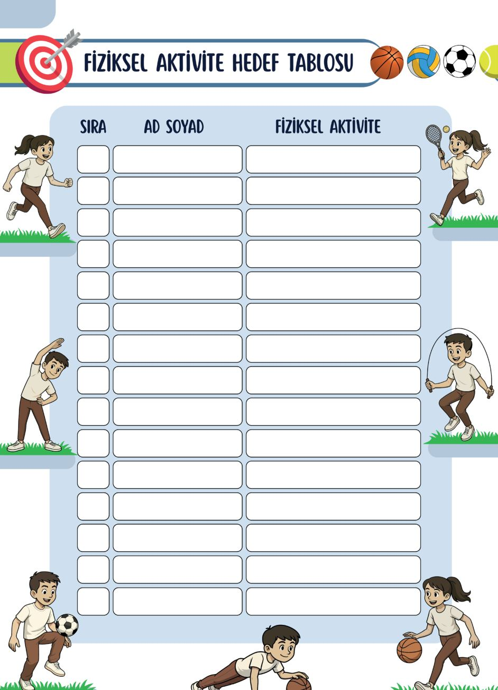

| SIRA | AD SOYAD | FİZİKSEL AKTİVİTE |
| :---: | :--- | :--- |
| | | |
| | | |
| | | |
| | | |
| | | |
| | | |
| | | |
| | | |
| | | |
| | | |
| | | |
| | | |
| | | |
| | | |
| | | |
| | | |

<!-- sayfa 95 -->

Ek 7. Kalp-Nefes Ölçeği

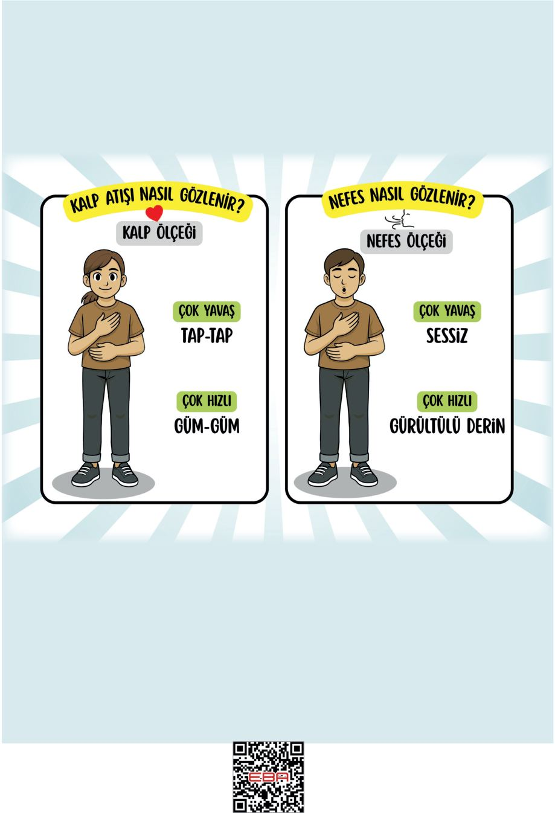

# KALP ATIŞI NASIL GÖZLENİR?
## KALP ÖLÇEĞİ
* ÇOK YAVAŞ: TAP-TAP
* ÇOK HIZLI: GÜM-GÜM

# NEFES NASIL GÖZLENİR?
## NEFES ÖLÇEĞİ
* ÇOK YAVAŞ: SESSİZ
* ÇOK HIZLI: GÜRÜLTÜLÜ DERİN

<!-- sayfa 96 -->

# BEDEN EĞİTİMİ VE OYUN DERSİ 2. SINIF TEMALARI

## 1. TEMA

# HAREKETİMİ GELİŞTİRİYORUM

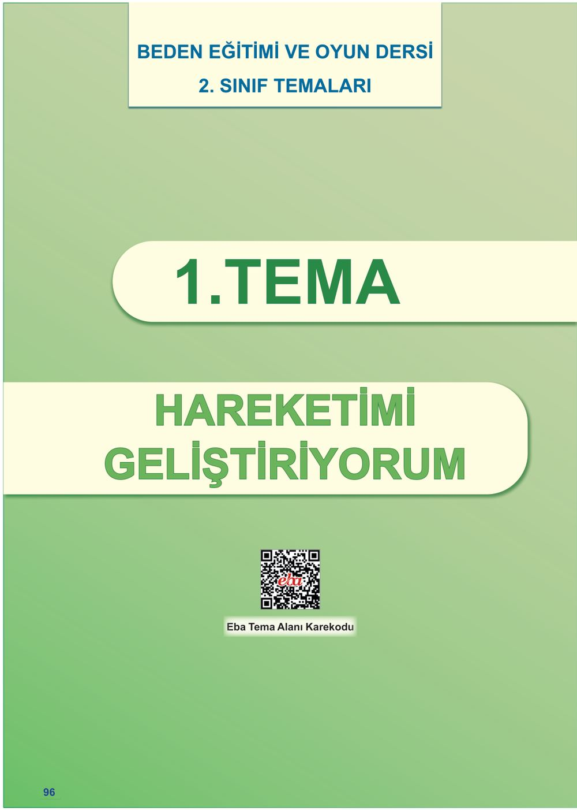
Eba Tema Alanı Karekodu

<!-- sayfa 97 -->

# 1. TEMA: HAREKETİMİ GELİŞTİRİYORUM

| | |
| :--- | :--- |
| **DERS SAATİ** | 65 |
| **ALAN BECERİLERİ** | **BEOSAB1. Hareketi Sergileme, BEOSAB7. Eşle/Grupla Hareket Etme** |
| **KAVRAMSAL BECERİLER** | - |
| **EĞİLİMLER** | E1.1. Merak, E2.1. Empati, E2.2. Sorumluluk, E2.5. Oyunseverlik, E3.2. Odaklanma, E3.3. Yaratıcılık |
| | **PROGRAMLAR ARASI BİLEŞENLER** |
| **Sosyal-Duygusal Öğrenme Becerileri** | SDB1.1. Kendini Tanıma (Öz Farkındalık), SDB1.2. Kendini Düzenleme (Öz Düzenleme), SDB1.3. Kendine Uyarlama (Öz Yansıtma), SDB2.1. İletişim, SDB2.2. İş Birliği, SDB2.3. Sosyal Farkındalık, SDB3.1. Uyum, SDB3.2. Esneklik |
| **Değerler** | D1. Adalet, D3. Çalışkanlık, D12. Sabır, D20. Yardımseverlik |
| **Okuryazarlık Becerileri** | OB4. Görsel Okuryazarlık, OB7. Veri Okuryazarlığı |
| **DİSİPLİNLER ARASI İLİŞKİLER** | Hayat Bilgisi |
| **BECERİLER ARASI İLİŞKİLER** | BEOSAB8. Adil Oyun Anlayışına Uygun Davranma, KB2.3. Özetleme, KB3.3. Eleştirel Düşünme |
| **ÖĞRENME ÇIKTILARI VE SÜREÇ BİLEŞENLERİ** | **BEO.2.1.1. Temel hareket becerilerini sergileyebilme**   a) Yer değiştirme, nesne kontrolü ve denge becerileri arasındaki farkları algılar.   b) Yer değiştirme, nesne kontrolü ve denge becerilerinin basamaklarını gösterir.   c) Yer değiştirme, nesne kontrolü ve denge becerilerini farklı durumlarda uygular.    **BEO.2.1.2. Oyunlarda grupla hareket edebilme**   a) Grupla hareket ederken rolleri tanımlar.   b) Grupla hareket ederken rolleri yerine getirir.   c) Grupla uyumlu hareket eder. |
| **İÇERİK ÇERÇEVESİ** | Temel Hareket Becerileri   Oyunlarda Grupla Hareket |
| **Genellemeler/ Anahtar Kavramlar/** | denge, grup, hareket, nesne kontrolü, oyun, yer değiştirme |

<!-- yer tutucu bulunamadı: sayfa sonuna eklendi -->

<!-- sayfa 98 -->

# 1. TEMAYA BAŞLARKEN

Bu temada öğrencilerin temel hareket becerilerini farklı durum ve ortamlarda sergileyebilmeleri ile oyunlarda grupla hareket edebilme becerilerini geliştirebilmeleri amaçlamaktadır. Temel hareket becerileri Şekil 1'de yer alan yer değiştirme, nesne kontrolü ve denge becerilerinden oluşmaktadır.

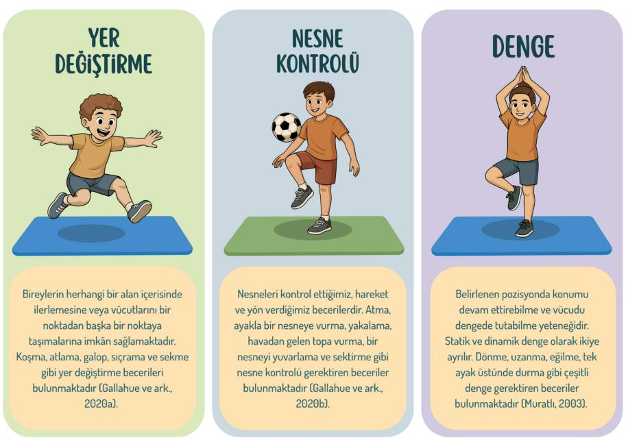

**Şekil 1. Temel hareket becerileri**

Öğrencilerin hareket becerilerini sadece tanımları değil bu becerileri uygulamalı olarak gösterebilmeleri, hareketlerin basamaklarını ayırt edebilmeleri ve günlük yaşamla ilişkilendirerek açıklayabilmeleri amaçlanmaktadır. Ayrıca öğrencilerin grup oyunlarında liderlik, hakemlik, oyuncu gibi rol paylaşımı yapmalarına; iş birliği, sorumluluk alma, uyum içinde hareket etme gibi becerilerinin de gelişimine olanak sağlanacaktır.

# 2. ÖĞRENME-ÖĞRETME YAŞANTILARI

Öğrenme-öğretme yaşantılarının bir bileşeni olan ön değerlendirme sürecinde öğrencileri öğrenme etkinliklerine hazır hâle getirmek amacıyla temel hareket becerilerini içeren çeşitli istasyonlar hazırlanır. Bu istasyonlara öğrencilerin eşli veya grup hâlinde katılmaları sağlanabilir. Ayrıca temel hareket becerilerini sergileyebilecekleri çeşitli oyunlar düzenlenir.

Öğrenme-öğretme yaşantılarının bir diğer bileşeni köprü kurmada ise; öğrencilerin temel hareket becerilerine ilişkin bilgilerini hatırlatmak amacıyla önceki öğrenmeleri göz önünde bulundurularak bu becerileri içeren çeşitli etkinlikler yapmalarına imkân sağlanır. Öğrencilerden bu hareketlerin günlük yaşamda nasıl kullanabileceklerine ilişkin örnek vermeleri istenir.

<!-- sayfa 99 -->

## 2.1. Etkinlik Örnekleri

**ETKİNLİK 1**                                           **Hareketin Peşinde**

| | |
| :--- | :--- |
| **Amaç:** | Öğrencilerin temel hareket becerilerini (yer değiştirme, nesne kontrolü ve denge) farklı durumlarda sergileyebilmeleridir. |
| **Eğilimler** | E1.1. Merak, E3.2. Odaklanma |
| **Sosyal-Duygusal Öğrenme Becerileri** | SDB1.1. Kendini Tanıma (Öz Farkındalık), SDB1.2. Kendini Düzenleme (Öz Düzenleme), SDB1.3. Kendine Uyarlama (Öz Yansıtma), SDB2.1. İletişim, SDB2.2. İş Birliği, SDB3.2. Esneklik |
| **Değerler** | D20. Yardımseverlik |
| **Okuryazarlık Becerileri** | OB4. Görsel Okuryazarlık, OB7. Veri Okuryazarlığı |
| **Kavramsal Beceriler** | - |
| **Beceriler Arası İlişkiler** | KB2.3. Özetleme, KB3.3. Eleştirel Düşünme |
| **Öğrenme Çıktısı ve Süreç Bileşenleri** | **BEO.2.1.1. Temel hareket becerilerini sergileyebilme**   a) Yer değiştirme, nesne kontrolü ve denge becerileri arasındaki farkları algılar.   b) Yer değiştirme, nesne kontrolü ve denge becerilerinin basamaklarını gösterir.   c) Yer değiştirme, nesne kontrolü ve denge becerilerini farklı durumlarda uygular. |
| **Kullanılan Öğretim Teknolojileri, Araç Gereçler ve Kaynaklar** | temel hareket becerilerini içeren görsel kartlar.   İstasyon 1: üzerinden atlamak için engel, koni ve top.   İstasyon 2: minder, sepet ya da kutu, top, tenis ya da badminton raketi, denge tahtası/çizgisi   Parkur 1: denge tahtası/çizgisi, hulahop, slalom çubuğu ve ip   Parkur 2: koni ve top   Oyun 1: düdük   Oyun 2: slalom çubuğu ve hulahop   Oyun 3: hulahop, düdük ve ip |

Öğrencilerden etkinlik alanında belirlenen bir çizginin arkasında beklemeleri istenir. Çizginin ön bölümüne üç tane halka çizilir. Öğrencilere temel hareket becerileriyle ilgili “Günlük yaşamda önceden oynadığınız oyunlarda oyun arkadaşınız zorlandığında ona hangi hareketi yapmasını önerebilirsiniz?”, “Herhangi bir hareket farklı oyunlarda da işe yarayabilir mi?” gibi çeşitli sorular sorulur. Soruları cevaplamak isteyen öğrencilerden çizilen halkalardan birinin içine koşmaları ve soruları kendi düşünceleriyle yorumlamaları istenir (**KB2.3, SDB2.1**). Ardından öğrencilere kendi sorularını oluşturmaları için zaman tanınır ve gönüllü öğrencilerin sorularını sormaları istenir (**OB7**). Soru cevaptan sonra öğrencilere temel hareket becerileriyle ilgili hazırlanan görsel kartlar dağıtılır ve öğrencilerden kartları incelemeleri istenir (**E1.1**). Öğrencilerden bu kartlardaki hareketleri yorumlamaları, benzer veya farklı hareketlerle karşılaştırmaları ve bu hareketlerin hangi oyunlarda ya da durumlarda işe yarayabile-

<!-- sayfa 100 -->

günlük yaşamda kullanıp kullanmadıkları sorulur, öğrencilerden istedikleri hareketleri gönüllü olarak sergilemeleri istenir. Öğrenciler ikişerli eşleşir, seçtikleri hareketi birlikte sergilemelerine olanak sağlanır (SDB2.2). Hazırlanan istasyon ve parkurlarda bu becerileri sergilemeleri sağlanır. İstasyon ve parkur örnekleri aşağıda verilmiştir.

### İstasyon 1: Yer Değiştirme, Nesne Kontrolü ve Denge 1

Öğrencilerin gruplara ayrılması sağlanır. Alan dörde bölünür ve toplam dört istasyon oluşturulur. Birinci istasyonda öğrencilerden önce galop, ardından kayma hareketini yaparak belirlenen düz bir hat üzerinde ilerlemeleri istenir (yer değiştirme becerisi). İkinci istasyonda karşıya bir koni yerleştirilir ve öğrencilerden topa ayaklarıyla vurarak topu koniye isabet ettirmeye çalışmaları istenir (nesne kontrolü becerisi). Üçüncü istasyonda, belirlenen düz bir hat üzerine engeller yerleştirilir. Öğrencilerden engelleri çift ayakla atlamaları istenir (yer değiştirme becerisi). Dördüncü istasyonda öğrencilerin ağırlık aktarımını fark etmeleri için tek ayak üzerinde durmaları, biraz bekleyip ayaklarını indirmeleri ve iki ayaklarıyla oldukları yerde sıçramaları, ardından oldukları yerde kollarını baş hizasına doğru getirip yanlara açarak, iki ayak üstünde bir süre sabit kalmaları ve planör hareketini yapmaları istenir (denge becerisi). Grupların tüm istasyonlarda çalışmalarına imkân sağlanır (**Şekil 2**).

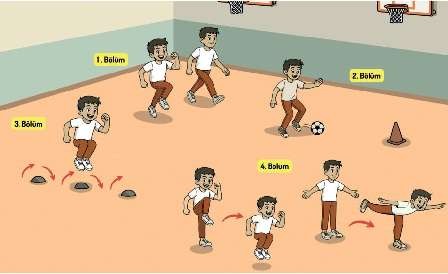

*Şekil 2. Yer değiştirme, nesne kontrolü ve denge 1 istasyonu*

### İstasyon 2: Yer Değiştirme, Nesne Kontrolü ve Denge 2

Öğrencilerin gruplara ayrılması sağlanır. Alan dörde bölünür ve toplam dört istasyon oluşturulur. Birinci istasyonda öğrencilerden yere yerleştiren minderler üzerine uzanmaları, ardından sağa ve sola doğru yuvarlanmaları istenir (yer değiştirme becerisi). İkinci istasyonda karşıya bir sepet veya kutu yerleştirilir. Öğrencilerden topa küçük bir topa tenis ya da badminton raketiyle vurarak topu hedefin içine atmaları istenir (nesne kontrolü becerisi). Üçüncü istasyonda ayaklarıyla top sürerek karşıya doğru ilerlemeleri istenir (nesne kontrolü becerisi). Dördüncü istasyonda bir denge tahtası/çizgisi üzerinde dengelerini koruyarak yürümeleri istenir (denge becerisi) Grupların tüm istasyonlarda ça

<!-- sayfa 101 -->

**Parkur 1: Yer Değiştirme**

Etkinlik alanına parkurun bölümleri yerleştirilir. Parkurun ilk bölümünde öğrencilerden düz bir denge tahtası/çizgisi boyunca kolları yanlarda açık olacak şekilde yürümeleri istenir. İkinci bölümde 5 saniye boyunca kollarını yanlara açıp tek ayak üstünde beklemeleri istenir. Üçüncü bölümde, önlerine dizilmiş olan dört hulahopun her birinin içine çift ayakla atlamaları istenir. Dördüncü bölümde tek ayak üzerinde durup diğer ayaklarını önde ve arkada sallamaları sağlanır. Beşinci bölümde, yan yana konulan iki slalom çubuğuna bağlanan ipin altından geçmeleri istenir. Parkuru biten öğrencilere tekrar sıraya girme imkânı verilir (**Şekil 3**).

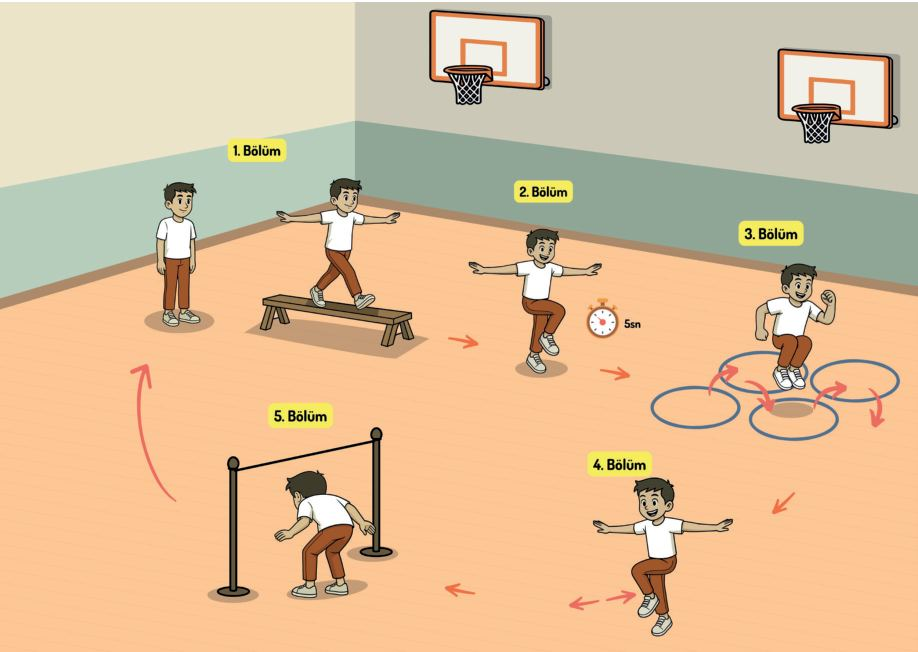

*Şekil 3. Yer değiştirme parkuru*

**Parkur 2: Hareketli Görev Parkuru**

Etkinlik alanına parkurun bölümleri yerleştirilir. İlk bölümde düz bir hat üzerine dört adet koni yerleştirilir. Öğrencilerden bu konilerin aralarından geçerek koşmaları istenir. Koşu sonunda yere işaretlenen noktaların üzerinden çift ayakla atlamaları istenir. Ardından karşıya konulan bir sepetin içine yerdeki topları atmaları istenir. Her öğrencinin eşit top atma hakkı vardır. Top atma bölümünü tamamlayan öğrencilerden düz bir hat üzerinde iki kez dönerek ilerlemeleri istenir. Son bölümde ise düz bir hat üzerinde geri geri yürüyerek ilerlemeleri istenir. Parkuru bitiren öğrencilerin sıraya tekrar girmesi sağlanır.

İstasyon ve parkur uygulamalarından sonra öğrencilere “Hareketi yaparken zorlandığınız bir an olduysa paylaşınız.”, “Hareketleri yaparken hangi duyguları yaşadınız?”, “Hareketleri bir dahaki sefere daha iyi yapmak için neyi farklı yapardınız?” gibi çeşitli sorular yöneltilir (SDB1.1). Öğrencilerin duygu ve düşüncelerini ifade etmeleri, neleri iyi yaptıklarını ve bir sonraki denemelerinde neyi farklı yapabileceklerini fark etmeleri sağlanır (SDB1.2, SDB2.1, SDB1.3). Daha sonra öğrencilerin temel

<!-- sayfa 102 -->

**Oyun 1: Hareket Et ve Dur**
Öğrencilerden oyun alanına dağınık şekilde yerleşmeleri, öğretmenin ilk düdük sesiyle hareketleri yapmaları, ikinci düdük sesi ile sabit kalmaları istenir. Düdük çalmadan önce “Koş!” diye bağırılır ve düdük sesi duyulur. Öğrencilerden oyun alanında farklı yönlere koşmaları istenir. 20 saniye sonra düdük tekrar çalınır ve öğrencilerin oldukları yerde sabit kalmaya çalışmaları istenir. İkinci hareket için “Sıçra!” diye bağırılır ve düdük çalınır. Öğrencilerin oyun alanında farklı yönlere doğru sıçramaları istenir. 20 saniye sonra düdük tekrar çalınır ve öğrencilerden tekrar sabit kalmaları istenir. Üçüncü harekette dönmeleri, dördüncü harekette yürümeleri, beşinci harekette adım alıp sekmeleri, altıncı harekette galop ve yana kayma yapmaları istenir. Hareketlerini sergilemeleri için öğrencilere 20 saniye verilir. Ayrıca kişisel ve genel alanlara dikkat etmeleri istenir. Öğrencilerin altı farklı hareketi en az üç tur tekrarlamaları sağlanır.

**Oyun 2: Fırtına Geliyor**
Oyun alanında bir bölge deniz olarak belirlenir. O alanın dışında kalan bölüm de kara olarak belirlenir. Bir öğrenci balıkçı olarak seçilir. Diğer öğrencilerin balık olması istenir. Balıkların deniz olarak belirlenen bölgede serbestçe dolaşması, koşması, sıçraması vb. istenir. Balıkçı “Fırtına geliyor” diye bağırdığında tüm balıkların karaya kaçması istenir. Bunun için öğrencilere 10 saniye verilir. Balıkçı ise karaya kaçmaya çalışan balıkları karaya ulaşmadan yakalamaya çalışır. Balıkların kaçması ve sürenin bitmesiyle oyun durdurulur. Yakalanan balıklar balıkçı olur. Oyun durduğunda, balıkçı konumuna geçen tüm öğrencilerden oyun alanının dışına yerleştirilen hulahoplardan birini alarak hulahopu oyun alanına uygun mesafede yerleştirilen slalom çubuğuna geçirmeye çalışmaları istenir. Hulahopu slalom çubuğuna geçiren öğrencilerin tekrar balık konumuna geçmeleri sağlanır. Hulahopu slalom çubuğuna geçiremeyen öğrencilerden balıkçı konumunda kalmaları istenir. Tüm öğrenciler hulahopu slalom çubuğuna geçirdiğinde balıkçı tekrar belirlenir. Ardından balıkçının “Fırtına gitti!” diye bağırması ve balıkların tekrar serbestçe dolaşmaya başlaması istenir. Balıkçının birden fazla olması durumunda öğrencilerin sırayla bağırmaları istenir. Oyunun bu şekilde devam etmesi sağlanır.

Çeşitli oyunlar oynandıktan sonra oyunların bazı kuralları değiştirilerek öğrencilerden bu oyunları tekrar oynamaları veya oynanan oyuna yeni bir kural önerisi getirmeleri istenir (SDB3.2). Bu doğrultuda oyunların belirli bölümlerindeki kuralları veya hedefleri değiştirilerek öğrencilerin yeni duruma uyum sağlamaları beklenir. Öğrencilerden bu yeni koşullarda oyunları nasıl oynayacaklarını grup içinde tartışmaları ve kendi fikirlerini sunmaları istenir (E3.2).

**Çeşitlendirme**
Hareketlerin yapılma süresi, sırası, yönü veya temposunda değişiklik yapılarak farklı seviyeler ayarlanabilir. Örneğin sıçrama sayısı azaltılabilir, denge süresi uzatılabilir. Kullanılan malzemenin boyutu, ağırlığı, dokusu gibi özellikleri değiştirilerek etkinliğin zorluk seviyesi değiştirilebilir. Daha kolay kontrol edilebilen büyük toplar, daha hafif raketler veya daha geniş hulahoplar kullanılabilir. Oyun alanının büyüklüğü, yüzey yapısı veya parkur uzunluğu değiştirilerek öğrencilerin daha rahat ya da daha fazla efor sarf edeceği ortamlar oluşturulabilir.

**Öğrenme Kanıtları ve Etkinlik Yansıması**
Bu öğrenme çıktısının değerlendirilmesinde performans görevi (**Ek 1**) kullanılır. Performans görevinin değerlendirilmesi için analitik dereceli puanlama anahtarı (**Ek 2**) kullanılır. Bu ölçme araçları, öğrencilerin temel hareket becerilerini ne ölçüde sergileyebildiklerini değerlendirmek amacıyla hazırlanmıştır.

<!-- sayfa 103 -->

Etkinlik yansıması kapsamında öğrencilere aşağıdaki sorular yöneltilebilir:

* Yer değiştirme, nesne kontrolü ve denge hareketlerinden hangilerini hatırlıyorsunuz?
* Oyun arkadaşınız zorlandığında ona yardımcı olup olmama durumunuzu açıklar mısınız?
* Etkinlikte öğrendiğiniz bir hareketi günlük yaşamda nerelerde kullanabilirsiniz?
* İstasyonlarda en çok hangi hareketleri yapmayı sevdiniz?

# ETKİNLİK 2: Takım Ruhu ile Oyna

**Amaç:** Öğrencilerin grupla uyum içinde hareket etmeleri ve grup içindeki rollerini yerine getirebilmeleridir.

| | |
| :--- | :--- |
| **Eğilimler** | E2.1. Empati, E2.2. Sorumluluk, E2.5. Oyunseverlik, E3.2. Odaklanma, E3.3. Yaratıcılık |
| **Sosyal-Duygusal Öğrenme Becerileri** | SDB1.1. Kendini Tanıma (Öz Farkındalık), SDB1.2. Kendini Düzenleme (Öz Düzenleme), SDB1.3. Kendine Uyarlama (Öz Yansıtma), SDB2.1. İletişim, SDB2.2. İş Birliği, SDB2.3. Sosyal Farkındalık |
| **Değerler** | D1. Adalet, D3. Çalışkanlık, D12. Sabır, D20. Yardımseverlik |
| **Okuryazarlık Becerileri** | - |
| **Kavramsal Beceriler** | - |
| **Beceriler Arası İlişkiler** | BEOSAB8. Adil Oyun Anlayışına Uygun Davranma |
| **Öğrenme Çıktısı ve Süreç Bileşenleri** | **BEO.2.1.2. Oyunlarda grupla hareket edebilme**   a) Grupla hareket ederken rolleri tanımlar.   b) Grupla hareket ederken rolleri yerine getirir.   c) Grupla uyumlu hareket eder. |
| **Kullanılan Öğretim Teknolojileri, Araç Gereçler ve Kaynaklar** | Oyun 1: grup sayısı kadar kadar basketbol veya voleybol topu, denge tahtası/çizgisi, hakem için düdük, her grup için küçük 3 bayrak veya bayrak görseli, tebeşir veya boya    Oyun 2: 2 adet basketbol topu, 2 adet denge tahtası/çizgisi, 10 tane koni, hakem için düdük, 2 farklı renk yelek ve 6 adet hulahop |

Öğrencilerin birbirlerini rahatça görebileceği düzende oyun alanına yerleşmeleri sağlanır (daire, yarım daire vb.). Orta bölüme bir top yerleştirilir. Sınıf listesinden rastgele seçilen öğrencilere oyunla ilgili ‘’Oyun anında stratejileri hızlı bir şekilde kullanabiliyor musunuz? Düşüncelerinizi arkadaşlarınızla paylaşınız.”, “Sizi en çok mutlu eden oyunlar hangileridir?”, “Oyun oynamak sizin için arkadaşlarınızla oynadığınızda mı yoksa yalnız oynadığınızda mı daha keyifli?”, “Oyunda karşılaştığınız olaylar ve durumların benzerleri ile günlük yaşamda karşılaştığınızda oyundan edindiğiniz deneyimleri nasıl kullanabilirsiniz?” gibi sorular sorularak oyunlarda eğlenceye, taktiğe ve günlük yaşama vurgu yapılır (E2.5). Kendisine soru sorulan öğrenciden ortaya geçmesi, sorunun ona hangi duyguları hissettirdiğini söylemesi ve cevabını vermesi istenir (SDB1.1, SDB2.1). Kendisini ifade ettikten sonra yerdeki topu on defa sektirerek yerine döner. Grupla oynanabilecek oyunlar için okul ortamı göz önünde bulundurulur. Oyunlar hakkında öğrencilerin görüşü alınır. Öğrencilerin verdiği cevaplar doğrultusunda hangi oyunların oynanacağına karar verilir. Seçilen oyunlardaki görev ve rollerin (oyuncu, hakem, )

<!-- sayfa 104 -->

görevlerin uygulanması sağlanır. Oyunlardaki her rolün sorumluluğunun yerine getirilmesinin önemi açıklanarak öğrencilere görevlerini yerine getirirken kurallara uygun davranmaları ve sorumluluk bilinci geliştirmeleri gerektiği vurgulanır (D1.2). Bir öğrenci lider olarak seçilir ve oynanacak oyunla ilgili kuralları arkadaşlarına açıklaması istenir. Lider olarak seçilen öğrenciye oyunda karşılaşabileceği zorluklar karşısında sakin kalması ve çözüm odaklı yaklaşması gerektiği anlatılır; örneğin tartışma durumunda sözü diğer arkadaşlarına bırakıp adil bir çözüm üretmesi beklenir (D12.2). Oyunu yöneten, hakemlik yapan ya da oyuncu olarak katılan öğrencilerin tarafsızlıklarını korumaları, adil oyun anlayışına uygun davranışlar sergilemeleri ve aceleci davranmamaları teşvik edilir (BEOSAB8). Öğrencilerin birlikte oynarken bilgilerini, zamanlarını ve çabalarını sadece kazanmak için değil arkadaşlarlarına yardımcı olarak ve oyundan keyif alacakları şekilde kullanmaları gerektiği oyundan önce açıklanır; örneğin, kuralları unutan bir arkadaşına rehberlik eden öğrenci bu anlayışı sergiler (D20.4). Oyunun kuralları gereği yerine getirilmesi gereken görevlerde öğrencilerin üzerine düşen sorumluluğu yapması için motive olması sağlanır. Öğrencilerin bireysel çabanın yanında grubun bir üyesi olarak da katkıda bulunması teşvik edilir (E2.2, E3.2). Öğrencilerin hem bireysel hem de grup içindeki görevlerini eksiksiz yerine getirmeleri için süreci birlikte planlamalarını sağlanır; örneğin, oyuna başlamadan önce herkesin görevini netleştirip sırayla nasıl uygulanacağını birlikte kararlaştırmaları sağlanır (D3.4).

### Oyun 1: Takımını Yönet, Bayrağı Kazan

Hangi oyunun oynayacağıyla ilgili görüşlerden sonra bir öğrencinin oyun önerisi kabul edilir ve bu öğrenci lider seçilir. Oyunu anlatma ve rolleri dağıtma görevi bu öğrenciye verilir. Sınıf iki veya daha fazla takıma ayrılır. Öğretmene ya da bir öğrenciye hakemlik görevi verilir (Genellikle öğretmen hakem olur). Hakem, yanlı karar vermeden oyunu adil bir şekilde yönetmelidir. Lider öğrencinin kendi takımından beş arkadaşını arka arkaya bir kol mesafesinde sıralaması ve en baştaki arkadaşına bir top vermesi istenir. İlk öğrenciden başlayarak liderin söylediği doğrultuda öğrencilerin arkasındaki arkadaşlarına topu sırayla bir üstten bir alttan olacak şekilde vererek topu en arkaya ulaştırmaları istenir. İlk öğrenci topu arkasındaki arkadaşına üstten vermişse bir sonraki öğrenci topu alttan vermelidir. Bu şekilde son öğrenciye kadar topun ulaşması sağlanır. Bu süreçte hakemden oyunun sıralamasını ve kurallarını takip ederek gerektiğinde uyarılarda bulunması istenir. Top son öğrenciye geldiğinde topu alan öğrencinin yerde topu birkaç kez sektirerek ileride denge tahtasının/çizgisinin yanında bekleyen takım arkadaşına topu havadan atması istenir. Topu alan öğrencinin elindeki topu düşürmeden denge tahtasının/çizgisinin üzerinde yürümesi sağlanır. Yürüme bittiğinde topu lider öğrencinin alarak tekrar başlangıç noktasına taşıması ve sırada bekleyen diğer takım arkadaşına vermesi istenir. Bu şekilde bir bayrak elde edilmiş olunur. Öğrencilerden üç bayrak elde edilene kadar oyunun devam ettirilmesi istenir. Bu esnada lider öğrencinin takım arkadaşlarını güdüleme, onlara destek olma ve motive etme gibi rolleri üstlenmesi sağlanır. Bu rolleri yerine getirirken gerekli motivasyonu ayarlamasına destek olunur (SDB1.2). Lider öğrenciden nasıl hamlelerle daha başarılı olacakları konusunda arkadaşlarına fikir vermesi, liderlik görevi deneyimlerini anlatması ve kendini değerlendirmesi istenir (SDB1.3) (Şekil 4).

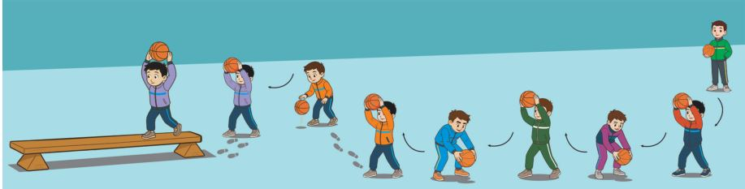

<!-- sayfa 105 -->

# Parkur 1: Görevli Takım Parkuru

Öğrencilerin iki gruba ayrılmaları ve parkur alanının iki eşit kulvara bölünmeleri sağlanır. Her grubun kendi kulvarında sıraya geçmesi istenir. Öğrencilerin parkura sırayla katılmaları sağlanır. İlk öğrenciye yaklaşık 20 metrelik koşu parkurunu tamamlayarak bitiş çizgisine ulaşması gerektiği anlatılır. Bu noktada onu bekleyen takım arkadaşından elindeki topu sektirerek konilerin arasından geçmesi başlangıç çizgisine dönmesi istenir. Başlangıç noktasına ulaştıktan sonra bir öğrencinden topu alması ve yeniden bitiş noktasına yerleştirmesi istenir. Sıradaki öğrencidense koşu alanının hemen yakınında hazırlanan atış çizgisine geçerek yerde duran üç hulahopu, ilerideki konilere geçirmeye çalışması istenir. Ardından öğrencinin denge tahtası/çizgisi üzerinden geçerek parkuru tamamlaması ve sıranın arkasına geçmesi sağlanır. Tüm öğrencilerin bu sırayla parkuru tamamlaması sağlanır. Parkur boyunca öğrencilerden görev paylaşımına uymaları, sıralarını beklemeleri, takım arkadaşlarına destek olmaları ve karşı takıma saygılı davranmaları istenir. Parkurun bitiminde sonucun ne olduğuna bakılmaksızın her çabanın değerli olduğu ve her deneyimden dersler çıkarılabileceği vurgulanarak bunlarla ilgili kısa hikâyelere yer verilir. Şekil 5’te verilen hikâye kartının çıktısı alınarak öğrencilere dağıtılır. Ardından öğrencilere örnek hikâye (Ek 3) anlatılır. Böylece öğrencilerin empati kurabilmeleri sağlanmaya çalışılır. Yapılan hataların emek ve dikkatle telafi edilebileceği de vurgulanır (E2.1, SDB2.3). Parkurda görevler yerine getirilirken öğrencilerin takım arkadaşlarıyla iş birliği hâlinde olmaları ve birlikteliğin önemini kavrayarak dengeli, düzenli ilişkiler kurmaları sağlanır (SDB2.2). Parkur sona erdiğinde öğrencilerden neler hissettiklerini anlatmaları, duygularını ve deneyimlerini paylaşmaları istenir (SDB1.1).

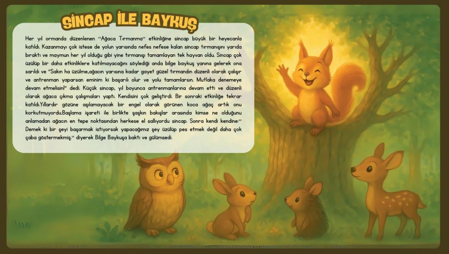

*Şekil 5. Hikâye kartı*

## Çeşitlendirme

Belirlenen mesafe uzatılıp kısaltılabilir, parkura yeni görevler eklenerek etkinliğin zorluk seviyesi artırılabilir veya bazı malzemeler değiştirilebilir. Oyunlar güvenlik önlemleri alınarak açık alanlarda ya da parklarda da oynatılabilir.

<!-- sayfa 106 -->

# Öğrenme Kanıtları ve Etkinlik Yansıması

Bu öğrenme çıktısının değerlendirilmesinde kontrol listesi (**Ek 4**) kullanılır. Bu ölçme aracı, öğrencilerin grupla uyum içinde hareket etme ve grup içindeki rollerini yerine getirebilme durumlarını değerlendirmek amacıyla hazırlanmıştır.

Etkinlik yansıması kapsamında öğrencilere aşağıdaki sorular yöneltilebilir:

* Oyunlarda grupla birlikte oynarken neler hissettiniz?
* Oyunlarda göreviniz neydi? Bu görevin kolay ve zor yanları nelerdi?
* Size verilen görevi tamamlayabilmek için neler yaptınız?
* Farklı bir görev alsaydınız hangi görevi seçmek isterdiniz? Düşüncelerinizi arkadaşlarınızla paylaşınız.

## 2.2. Farklılaştırma

### Zenginleştirme

Öğrencilerden serbest şekilde gruplara ayrılmaları istenebilir. Her grubun bir ismi (Zıplayan Kaplanlar, Dengeli Penguenler vb.) olur.

Ardından gruplara;

* 1 tane yer değiştirme hareketi (örneğin koşu, galop vb.)
* 1 tane nesne kontrolü hareketi (örneğin top sektirme, hedefe top atma vb.)
* 1 tane denge hareketi (örneğin tek ayak üzerinde durma) seçerek üç hareketten oluşan bir mini seri planlamaları söylenebilir.

İsteyen öğrencilerin kendi serilerine yaratıcı bir isim vermesine imkân sağlanabilir. Her grubun sahaya sırayla çıkarak planladıkları hareket serisini uygulaması istenebilir. Diğer grupların ise sergilenen hareket serilerini izlemesi istenebilir. İzledikleri grupların hareket serisi hakkında öğrencilerin olumlu geri bildirim vermeleri sağlanabilir.

### Destekleme

Öğrencilere basamaklandırılmış talimatlar verilebilir. Hareketler tek adım hâlinde açıklanabilir. Örnekler:

* Bir ayağını öne koy.
* Kollarını yana aç.
* Şimdi üçe kadar sayıp zıpla.

Öğrenciler her adımı uyguladıktan sonra diğer adıma geçmeleri için yönlendirilebilir. Gerekirse adımlar görsellerle desteklenebilir. Temel düzeyde aktivite alanı oluşturulabilir. Karmaşık parkurlar yerine;

* Tek bir hulahoptan atlama,
* Düz çizgi üzerinde yürüme,
* Sabit hedefe top yuvarlama gibi daha basit görevler hazırlanabilir.

Akran desteği sağlanabilir. Öğrenciler aynı hareketi daha iyi yapabilen bir arkadaşıyla eşleştirilebilir. Akranların çeşitli yönergelerle birbirlerine rehber olmaları sağlanabilir.

<!-- sayfa 107 -->

# 3. ÖĞRENME KANITLARI (Ölçme ve Değerlendirme)

Etkinliklerin öğrenme kanıtları (ölçme ve değerlendirme) bölümünde öğrencilerin öğrenme çıktıları doğrultusunda değerlendirilmesi amacıyla hazırlanan örnek ölçme ve değerlendirme araçları belirtilmiştir. “Temel hareket becerilerini sergileyebilme” öğrenme çıktısının değerlendirilmesinde Ek 1’de yer alan performans görevi kullanılır. Performans görevi için öğrencilerden dokuz gün boyunca her gün fiziksel bir hareket yapmaları istenir. Bu hareket yer değiştirme, nesne kontrolü ve denge becerilerini içermektedir. Öğrencilerden her gün yapacakları hareketlerin fotoğraflarını çekmeleri istenir. Çekilen fotoğraflardan oluşan, altında hareketlerin adının ve kısa açıklamasının yer aldığı bir hareket albümü hazırlamaları beklenir. Performans görevi, Ek 2’de yer alan analitik dereceli puanlama anahtarı ile değerlendirilir. “Oyunlarda grupla hareket edebilme” öğrenme çıktısının değerlendirilmesinde Ek 4’te yer alan kontrol listesi kullanılır.

Temanın bütünün değerlendirilmesinde Ek 5’te yer alan bütüncül dereceli puanlama anahtarı kullanılır. Bu değerlendirme aracı için Ek 6’da yer alan puan kaydetme tablosu kullanılabilir.

# 4. ÖĞRETMEN YANSITMALARI

* Bir sonraki yıl bu temanın planlaması için yorumlarınızı yazınız.

**Yorum 1:**

**Yorum 2:**

* Öğrenme Çıktılarına Göre Öz Yansıtma (planlama/hazırlık, öğrenme çevresi, öğretim, mesleki sorumluluk)

1. Öğrenme çıktısı için yansıtmalar:

2. Öğrenme çıktısı için yansıtmalar:

<!-- sayfa 108 -->

# 5. EKLER:
## Ek 1. Performans Görevi

| Performans Görevi |
| :--- |
| **Ders:** Beden Eğitimi ve Oyun |
| **Sınıf Düzeyi:** 2 |
| **Öğrenme Çıktısı:** Temel hareket becerilerini sergileyebilme |
| **Etkinlik:** Hareketin Peşinde |
| **Görev Konusu:** Hareket Albümü |

Sevgili Öğrenciler,

Bu görevle amacımız yer değiştirme, nesne kontrolü ve denge hareketlerini daha yakından tanımanız ve kendi günlük yaşamınızda nasıl uygulayabileceğinizi fark etmenizdir. Yaptığınız hareketlerle ilgili fotoğraflardan oluşan ve fotoğrafların altında hareketin adıyla kısa açıklamasının yer aldığı bir hareket albümü hazırlamanız beklenmektedir. Görev sonunda hareket albümünüzü öğretmenize sunmanız istenmektedir.

**Göreviniz sırasında dikkat etmeniz gerekenler şunlardır:**

* Üç gün yer değiştirme (örneğin koşma, sekme, yuvarlanma vb.), üç gün nesne kontrolü (örneğin top atma, fırlatma, yakalama vb.) ve üç gün denge hareketi (örneğin tek ayak üzerinde durma, düz çizgide yürüme, ağırlık aktarımı vb.) olmak üzere toplam dokuz günlük olacak şekilde hazırlayınız.
* Hareketleri yaparken fotoğraflarınızı çektiriniz.
* Tüm fotoğrafların altına hareketin adını ve kısa açıklamasını yazınız.
* Her gün farklı bir hareket yapmaya özen gösteriniz.
* Performans görevinizi en geç ........................................... tarihine kadar teslim ediniz.

<!-- sayfa 109 -->

# Ek 2. Analitik Dereceli Puanlama Anahtarı

| Performans Görevi |
| :--- |
| **Analitik Dereceli Puanlama Anahtarı** |

**Öğrenme Çıktısı:** Temel hareket becerilerini sergileyebilme

**Etkinlik Adı:** Hareketin Peşinde

| Ölçütler | Çok İyi (4) | İyi (3) | Orta (2) | Geliştirmeli (1) | Puan |
| :--- | :--- | :--- | :--- | :--- | :--- |
| **Hareket Türlerini Doğru Kullanma** | Yer değiştirme, nesne kontrolü ve denge hareketlerinden üçer farklı örnek doğru şekilde seçilmiş. | Her bir beceri türünden en az 2 doğru örnek yer alıyor. | Hareket türlerinde karışıklık ya da tekrarlar var. | Hareket türleri eksik veya yanlış seçilmiş. | |
| **Her Güne Ait Fotoğrafın Olması** | Dokuz günün tamamında net ve uygun çekilmiş fotoğraflar var. | 7-8 gün için fotoğraf mevcut. | 5-6 fotoğraf eksik veya net değil. | 1-2 fotoğraf mevcut ya da yok. | |
| **Açıklamaların Anlaşılır ve Tam Olması** | Tüm açıklamalar (hareket adı, kısa açıklaması) açık ve eksiksiz. | Açıklamaların çoğu yer alıyor, bazı küçük eksikler var. | Açıklamalar eksik veya kısa tutulmuş. | Açıklamalar hiç yazılmamış ya da anlaşılmaz. | |
| **Albümün Düzeni ve Özeni** | Albüm düzenli, yaratıcı ve özenli hazırlanmış. | Genelde düzenli, küçük dağınıklıklar var. | Albümde karışıklık ve estetik eksiklikler mevcut. | Albüm dağınık, düzensiz ve özen gösterilmemiş. | |
| | | | | **Toplam Puan** | |

**Değerlendirme Sistemi**

Bu ölçme aracından en az 4 puan, en fazla 16 puan alınabilmektedir. Öğrencinin puanı, alınan puanın yüzdelik karşılığı hesaplanarak bulunur. Bunun için alınan puan, öğrencinin alabileceği en yüksek puana bölünür ve çıkan sonuç 100 ile çarpılır. Ondalık gösterim elde edilirse sonuç tam kısmına (birler basamağına) yuvarlanır. Örneğin öğrenci bu ölçme aracından 7 aldığında puanı şu şekilde hesaplanır: $(7:16) \cdot 100 = 43{,}75$ <!-- KONTROL: Marker'da karşılığı yok, uydurma olabilir -->. Bu sonuç yuvarlandığında öğrenci 44 puan almış olacaktır.

**Performans Düzeyleri**
25–43: Geliştirilmeli
44–62: Orta
63–81: İyi
82–100: Çok iyi

<!-- sayfa 110 -->

**Ek 3. Oyun 1: Taşınan Top Örnek Hikâyeler**

| Örnek Hikâye | **TIRTIL VE SAKA KUŞU**    Küçük tırtılın en büyük hayali uçmakmış. Ancak bunu bir türlü başara- mıyormuş. Bunu başarabilmek için her gün yüksek yerlere çıkıp uçmayı deniyor, her defasında da düşerek canını acıtıyormuş. Bir gün, iki gün derken bu denemeler onu günden güne daha çok üzmeye başlamış. Tam her şeyden vazgeçiyorum dediği anda saka kuşu onu görmüş ve yanına yaklaşarak “Sakın pes etme güzel tırtıl çünkü şu an uçamıyorsan henüz zamanı gelmediği içindir. Bir gün mutlaka başaracaksın.” diyerek oradan uzaklaşmış. Tırtılın yüreğine biraz su serpilmiş ve tırtıl rahatlamış. Aradan birkaç hafta geçtikten sonra tırtıl bir sabah uyanmış. Bir de ne görsün? Rengârenk kanatları çıkmış sırtından. O heyecanla ağacın üzerindeki evinden kendini bırakmış boşluğa ve süzülerek, dans ederek uçmaya başlamış. O günden sonra hiçbir şey için acele etmemiş. Her şeyin bir vaktinin olduğunu artık çok iyi anlamış ve bir ömür mutlu yaşamış. |
| :--- | :--- |

<!-- sayfa 111 -->

# Ek 4. Kontrol Listesi

**Etkinlik Adı:** Takım Ruhu ile Oyna

**Öğrencinin**
**Adı Soyadı:**
**Sınıfı :**
**Numarası :**

Bu ölçme aracı, “Oyunlarda grupla hareket edebilme” öğrenme çıktısındaki etkinliğin değerlendirilmesi için hazırlanmıştır. Her ölçüt için öğrencinin gösterdiği davranışı dikkatle gözlemleyiniz ve uygun olan düzeyi işaretleyiniz. “Hayır” seçeneğini işaretlediğiniz ölçütlerde öğrencinizin eksikliklerini gidermesine yardımcı olunuz.

| Ölçütler | Evet | Hayır |
| :--- | :---: | :---: |
| Oyunda grup içinde yer alan rolleri tanımlar. | | |
| Her rolün oyun için önemli olduğunu açıkça anlatır. | | |
| Oyun sırasında takım arkadaşlarına saygılı ve destekleyici davranır. | | |
| Üstlendiği rol doğrultusunda görevini yerine getirir. | | |
| Rolünü yerine getirirken sorumluluk alır. | | |
| Grup üyeleriyle uyum içinde hareket eder. | | |

<!-- sayfa 112 -->

# Ek 5. Bütüncül Dereceli Puanlama Anahtarı

Bu ölçme aracı, öğrencilerin temaya yönelik performanslarını genel bir bütünlük içinde değerlendirmek amacıyla hazırlanmıştır. Her bir puan düzeyi, beklenen ölçütlerin ne derece karşılandığını ifade eder. Buna göre her öğrencinin performansı, belirtilen puan düzeylerinden yalnızca biriyle değerlendirilmelidir. Yapılan puanlama Ek 6'da yer alan tabloya kaydedilebilir.

| Sınıf : 2   Tema: 1 | BÜTÜNCÜL DERECELİ PUANLAMA ANAHTARI |
| :--- | :--- |
| | **Öğrenme Çıktıları** |
| **Çok iyi (5)** | ● Temel hareket becerilerini eksiksiz, kontrollü ve akıcı şekilde uygular.   ● Oyunlarda grupla uyum içinde çalışır, iş birliği yapar, arkadaşlarını destekler ve grup sorumluluğunu gönüllü üstlenir. |
| **İyi (4)** | ● Temel hareket becerilerini genel olarak doğru uygular, küçük hataları olur.   ● Oyunlarda grupla birlikte hareket eder, zaman zaman desteğe ihtiyaç duyar. |
| **Geliştirilebilir (3)** | ● Temel hareket becerilerini uygularken bazı basamaklarda zorlanır, tekrar ve yönlendirme gerektirir.   ● Oyunlarda grupla hareket etse de rolünü tam olarak yerine getirmekte güçlük yaşar. |
| **Zayıf (2)** | ● Temel hareket becerilerini hatalı uygular, öğretmen desteğiyle hareketi tamamlar.   ● Oyunlarda grupla çalışmakta isteksizdir veya sık sık uyumsuzluk gösterir. |
| **Yetersiz (1)** | ● Temel hareket becerilerini sergileyemez, yönlendirmeye rağmen uygulamada güçlük yaşar.   ● Oyunlarda grupla çalışmayı reddeder veya sürece hiç katılmaz. |

<!-- sayfa 113 -->

# Ek 6. Puan Kaydetme Tablosu

**Sınıf :**
**Tarih:**

| Sıra | Öğrencinin Adı Soyadı | Puan | Açıklama |
| :--- | :--- | :--- | :--- |
| | | | |
| | | | |
| | | | |
| | | | |
| | | | |
| | | | |
| | | | |
| | | | |
| | | | |
| | | | |
| | | | |
| | | | |
| | | | |
| | | | |
| | | | |
| | | | |
| | | | |
| | | | |
| | | | |
| | | | |
| | | | |
| | | | |
| | | | |
| | | | |
| | | | |
| | | | |
| | | | |
| | | | |
| | | | |
| | | | |
| | | | |
| | | | |
| | | | |
| | | | |
| | | | |
| | | | |

<!-- sayfa 114 -->

# 2.TEMA

## OYUNUN KURALLARINI UYGULUYORUM

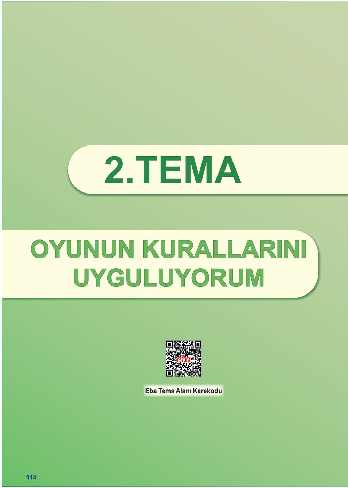 Eba Tema Alanı Karekodu

<!-- sayfa 115 -->

# 2. TEMA: OYUNUN KURALLARINI UYGULUYORUM

| | |
| :--- | :--- |
| **DERS SAATİ** | 30 |
| **ALAN BECERİLERİ** | **BEOSAB2.** Hareket Kavramlarını Uygulama, **BEOSAB3.** Taktik ve Strateji Geliştirme |
| **KAVRAMSAL BECERİLER** | KB1. Temel Beceriler |
| **EĞİLİMLER** | E1.1. Merak, E.2.1. Empati, E.2.5. Oyunseverlik, E3.2. Odaklanma |
| **PROGRAMLAR ARASI BİLEŞENLER** | |
| **Sosyal-Duygusal Öğrenme Becerileri** | SDB1.1. Kendini Tanıma (Öz Farkındalık), SDB1.2. Kendini Düzenleme (Öz Düzenleme), SDB1.3. Kendine Uyarlama (Öz Yansıtma), SDB2.1. İletişim, SDB2.2. İş Birliği, SDB3.1. Uyum, SDB3.2. Esneklik, SDB3.3 Sorumlu Karar Verme |
| **Değerler** | D1. Adalet, D4. Dostluk, D6. Dürüstlük, D11. Özgürlük, D14. Saygı, D16. Sorumluluk, D20. Yardımseverlik |
| **Okuryazarlık Becerileri** | OB1. Bilgi Okuryazarlığı, OB4. Görsel Okuryazarlık, OB5. Kültür Okuryazarlığı |
| **DİSİPLİNLER ARASI İLİŞKİLER** | Görsel Sanatlar |
| **BECERİLER ARASI İLİŞKİLER** | BEOSAB8. Adil Oyuna Uygun Davranma Becerisi KB2.11. Gözleme Dayalı Tahmin Etme |
| **ÖĞRENME ÇIKTILARI VE SÜREÇ BİLEŞENLERİ** | **BEO.2.2.1. Oyunlarda hareket kavramlarını uygulayabilme**   a) Beden farkındalığı, alan farkındalığı, efor ve hareket ilişkileri kavram bileşenlerini ayırt eder.   b) Temel hareket becerileri ile hareket kavramları arasında ilişki kurar.   c) Oyunlarda hareket kavramlarına ve temel hareket becerilerine uygun olarak oyunlarda hareket eder.   **BEO.2.2.2. Oyun kurallarını uygulayabilme**   **BEO.2.2.3. Oyunlarda belirlenen taktik ve stratejiyi geliştirebilme**   a) Oyunlarda taktiksel problemi belirler.   b) Oyunlarda belirlenen problemin çözümüne ilişkin öneri sunar.   c) Oyunlarda taktik ve stratejiyi uygular. |
| **İÇERİK ÇERÇEVESİ** | Oyunlarda Hareket Kavramları   Oyun Kuralları   Oyunlarda Taktik ve Strateji |
| **Genellemeler/ Anahtar Kavramlar/** | alan, denge, efor, hareket ilişkisi, kural, nesne kontrolü, oyun, strateji, |

<!-- yer tutucu bulunamadı: sayfa sonuna eklendi -->

<!-- sayfa 116 -->

# 1. TEMAYA BAŞLARKEN

Bu temada öğrencilerin, oyunlarda hareket kavramlarını uygulayabilmeleri, oyun kurallarını uygulayabilmeleri ve oyunlarda belirlenen taktik ve stratejiyi geliştirebilmeleri amaçlanmaktadır. Yer değiştirme, nesne kontrolü ve denge becerileri öğrencilerin motor gelişiminin temelini oluşturur. Bu beceriler; hareket kavramları olan beden farkındalığı, alan farkındalığı, efor ve hareket ilişkileri ile entegre edilerek etkinlikler içerisinde işlevsel hâle getirilir. Denge becerisi alan farkındalığı ile yapıldığında öğrenci bir alan içinde sabit durma ya da hareket hâlinde dengede kalma becerisini geliştirmektedir. Etkinlikler sırasında taktik ve strateji geliştirmeye yönelik etkinlikler öğrencilerin problem çözme, odaklanma, dostluk kurma, iş birliği yapma ve takım içinde aktif rol alma gibi becerilerini geliştirmeye katkı sağlar. Tema içeriğinde yer alan hareket kavramları Şekil 1’de açıklanmıştır.

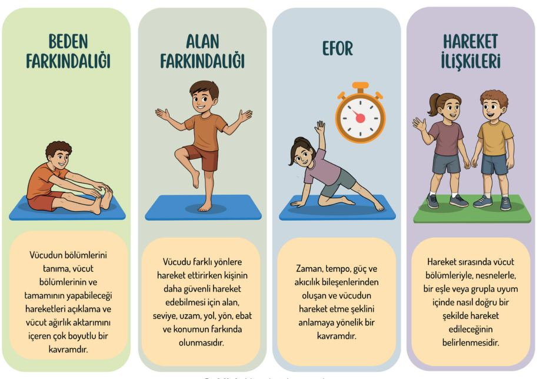

# 2. ÖĞRENME-ÖĞRETME YAŞANTILARI

Öğretmen, okul bahçesine bir kukla getirerek ona sıçrama, dönme, parmak ucunda yürüme, koşma, esnetme, yüksekten atlama ve topa vurma gibi çeşitli hareketler yaptırır. Kuklaya yaptırılan her hareketten sonra öğrencilere “Bu hareket hangi temel hareket becerisine örnek olabilir?”, “Bu hareket, hangi alan farkındalığını göstermektedir? Kişisel alan mı yoksa genel alan mı?”, “Kukla hızlı mı hareket ediyor yoksa yavaş mı? Bedeninin hangi bölümlerini kullanıyor?” gibi sorular yöneltilir. Öğrencilerden kuklanın yaptığı bu hareketleri göstermeleri istenir.

Öğrencilerden daha önce okulda ya da sosyal çevrelerinde oynadıkları bir oyunu ve kurallarını hatırlayıp açıklamaları istenir. Açıklama sürecinde öğrencilere sorular yöneltilebilir: “Bu oyunun kuralları nelerdi?”, “Kuklayla yapılan hareketler ve açıkladığınız oyunda aynı veya benzer hareketler var mı?”, “Açıkladığınız oyunda başarıyı artırmak için nasıl strateji ve teknikler geliştirirdiniz?”, “Oyuncuların birbirleriyle çarpışmadan güvenli ve etkili bir şekilde hareket edebilmesi için oyun alanını nasıl düzenlemiştiniz?” Bu sorularla öğrenciler daha önce oynadıkları oyunlarla hareket kavramları, oyun

<!-- sayfa 117 -->

## 2.1. Etkinlik Örnekleri

**ETKİNLİK 1** | **Hareket Kavramları**

| | |
| :--- | :--- |
| **Amaç:** | Öğrencilerin oyunlarda hareket kavramlarını uygulayabilmeleridir. |
| **Eğilimler** | E1.1. Merak, E2.1. Empati, E2.5. Oyunseverlik |
| **Sosyal-Duygusal Öğrenme Becerileri** | SDB1.1. Kendini Tanıma (Öz Farkındalık), SDB1.2. Kendini Düzenleme (Öz Düzenleme), SDB1.3. Kendine Uyarlama (Öz Yansıtma), SDB2.1. İletişim, SDB2.2. İş Birliği |
| **Değerler** | D11. Özgürlük, D20. Yardımseverlik |
| **Okuryazarlık Becerileri** | OB1. Bilgi Okuryazarlığı, OB4. Görsel Okuryazarlık, OB5. Kültür Okuryazarlığı |
| **Kavramsal Beceriler** | - |
| **Beceriler Arası İlişkiler** | KB2.11. Gözleme Dayalı Tahmin Etme |
| **Öğrenme Çıktısı ve Süreç Bileşenleri** | **BEO.2.2.1 Oyunlarda hareket kavramlarını uygulayabilme**   a) Beden farkındalığı, alan farkındalığı, efor ve hareket ilişkileri kavram bileşenlerini ayırt eder.   b) Temel hareket becerileri ile hareket kavramları arasında ilişki kurar.   c) Oyunlarda hareket kavramlarına ve temel hareket becerilerine uygun olarak oyunlarda hareket eder. |
| **Kullanılan Öğretim Teknolojileri, Araç Gereçler ve Kaynaklar** | renkli balonlar, tenis topları, renkli çanaklar ve sepet/kova |

Dört büyük kart hazırlanır. Bu kartların ön yüzlerinde sırasıyla beden farkındalığı, alan farkındalığı, efor ve hareket ilişkileri kavramlarının tanımları; arka yüzlerinde ise bunların oyunlar sırasında nasıl kullanıldığını gösteren görseller yer alır. Merak uyandırmak için öğrencilerden okul bahçesinde veya spor salonunda bu kartları tutmaları istenir (E1.1). Her öğrenci, sırasıyla kartın ön yüzünde yer alan tanımı yüksek sesle okur ve ardından arka yüzündeki görseli inceler. Bu şekilde öğrenciler hem kav-

<!-- sayfa 118 -->

keşfeder. Tanıtım ve inceleme süreci tamamlandıktan sonra öğretmen, öğrencilerin düşünmelerini teşvik edecek şu soruları yöneltir: “Bu kavramlardan hangilerini oyun oynarken çoğunlukla kullandığınızı düşünüyorsunuz?”, “Kartlardaki görselleri incelediğinizde bu hareketleri nerede veya hangi oyunlarda kullandığınızı fark ettiniz?” (OB4, KB2.11). “Kartın arkasında yer alan görseldeki çocuk siz olsaydınız o hareketi nasıl yapardınız?”, “Görseldeki çocuk, hangi hareket becerilerini kullanıyor olabilir?”, “Bu hareket becerilerine benzer başka örnekler verebilir misiniz?” Öğrencilerin verdiği cevaplarla hem kavramsal farkındalıkları hem de kendi yeterliliklerine ilişkin farkındalıkları belirlenir (OB1, SDB1.1, SDB2.1).

**Oyun: Hareketin İzinde**

Kare şeklinde bir oyun alanı oluşturulur. Alanın dört köşesine dörder adet olmak üzere toplam 16 koni, alanın iç kısmına yine dört adet çanak olacak şekilde toplam 16 çanak yerleştirilir. Çanakların üzerine dört adet tenis topu konur. Ayrıca bir sepet/kovanın içine şişirilmiş bir balon konur. Oyunun akışı şu şekildedir: Öğrenci, oluşturulan küçük alanın tam ortasında durur. Sepetteki balonu havaya atar. Balonu yere düşürmeden, dört köşede yer alan çanakların üzerindeki tenis toplarını teker teker almaya çalışarak sepete koymaya çalışır. Her köşede aynı hareketler uygulanır ancak hareketler farklı bir vücut pozisyonunda gerçekleştirilir: Bir köşede ayakta; diğerlerinde sırasıyla sağ tek ayak üzerinde sekerek, sol tek ayak üzerinde sekerek ve bacakları aç kapa şeklinde hareket edilir . Öğrenciler temel hareket becerilerini çeşitli hareket kavramlarıyla ilişkilendirir ve bedenin farklı kullanım biçimlerini deneyimleme fırsatı bulurlar. Oyunun kuralları şu şekildedir: Oyun alanına sırayla ve öğretmenin yönlendirmesiyle girilir. Her öğrenci, dört köşedeki hareketleri belirlenen vücut pozisyonlarına uygun şekilde sırayla tamamlar. Balonu yere düşürmeden, dört çanak üzerindeki tenis toplarını tek tek alarak sepete koyar. Her köşede aynı anda yalnızca bir öğrenci bulunur, diğer öğrenciler gözlemci olarak oyunu takip eder. Hareketler bireysel olarak uygulanırken öğrenciler arkadaşlarını izler, onlara sözlü olarak destek verir (SDB1.2, SDB2.2). Öğretmen, öğrencilerin bu süreçte zamanlarını ve deneyimlerini arkadaşlarının başarısı için kullandıklarını fark etmelerini sağlayarak iyilik yapmanın sadece maddi değil manevi katkılarla da mümkün olduğunu vurgular; örneğin bir öğrenci, arkadaşına “Başarabilirsin!” diye seslenip arkadaşının oyunu başarıyla tamamlamasına katkı sağlar (D20.2). Öğrenciler bu dört köşeyi dolaşarak belirlenen hareketleri farklı vücut pozisyonlarında yerine getirirler (E2.5).

Oyunun sonunda öğrenciler temel hareket becerilerini çeşitli hareket kavramlarıyla ilişkilendirir ve bedenin farklı kullanım biçimlerini deneyimleme fırsatı bulurlar. Halkanın ortasına oyunda kullanılan çanak yerleştirilir, çanağın üzerine bir tenis topu konur ve öğrencilere şu sorular yöneltilir: “Hangi köşede kendinizi daha rahat hissettiniz? Neden?”, “Bedeninizi hangi hareketleri yaparken daha iyi kullandınız?”, “Tek ayakla yaptığınız harekette zorlandınız mı?”, “Sizce başka bir ülkede veya farklı bir kültürde bu oyuna benzer bir oyun var mıdır? Varsa sizce nasıl oynanıyordur?” (OB5) “Bu hareketleri bir takım veya grup içinde yapmak sizce nasıl olurdu?”, “Dört köşede hangi hareket kavramlarını kullandığınızı söyleyebilir misiniz?” (SDB1.3, E2.1) Söz hakkı alan öğrenciler, belirlenen çanağın üstündeki topu eline alır ve sorulan sorularla ilgili düşüncelerini ifade eder.Öğretmen, öğrencilerin cevaplarını özgürce dile getirmeleri ve kendi kararlarının sorumluluğunu taşımaları gerektiğini hatırlatır; örneğin hangi köşede zorlandığını söyleyen bir öğrenci bu düşüncesinin arkasında durarak bunun nedenini açıklayabilir D11.1).

**Açıklama**

Öğrencilerin oyunu dört farklı köşede, dört farklı vücut pozisyonlarında oynamalarının önemli olduğu unutulmamalıdır.

<!-- sayfa 119 -->

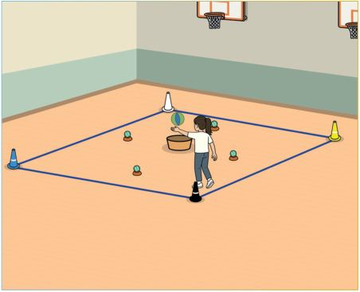

*Şekil 2. Hareketin izinde oyunu*

**Çeşitlendirme**
Her köşedeki hareketlerin zorluk derecesi, örneğin bacak aç-kapa hareketi yerine çömelip kalkma gibi daha fazla denge ve kuvvet gerektiren bir hareketle değiştirilebilir. Her köşeye, hareketi tanıtan bir görsel kart veya işitsel yönerge yerleştirilebilir. Tüm hareketleri belirli bir süre içinde tamamlama hedefi verilebilir. Balon yerine küçük hafif top, çanak yerine hedef halkalar gibi alternatifler kullanılabilir. Alan daraltılarak denge odaklı bir versiyon oluşturulabilir, genişletilerek öğrencinin sarf edeceği efor artırılabilir. İki kişilik takımlar oluşturulabilir; öğrenciler sırayla aynı hareketleri yapabilir, biri hareketi uygularken diğeri gözlemci olabilir ve oyunun bitiminde arkadaşına sözlü geri bildirim verebilir.

**Öğrenme Kanıtları ve Etkinlik Yansıması**
Bu öğrenme çıktısının değerlendirilmesinde performans görevi kullanılır (**Ek 1**). Bu görevin değerlendirilmesi için iki analitik dereceli puanlama anahtarı (**Ek 2**) kullanılır.

Etkinlik yansıması kapsamında öğrencilere aşağıdaki sorular yöneltilebilir:

* Hareket ederken bedeninizin hangi bölümünü daha çok kullandınız?
* Oyun sırasında arkadaşlarınıza çarpmamak için nelere dikkat ettiniz?
* Hangi hareket becerilerini yaparken daha dikkatli olmanız gerekti?
* Tek ayak üstünde sıçrama ve bacakları aç kapa hareket becerileri hangi hareket kavramıyla ve nasıl ilişkili olabilir?

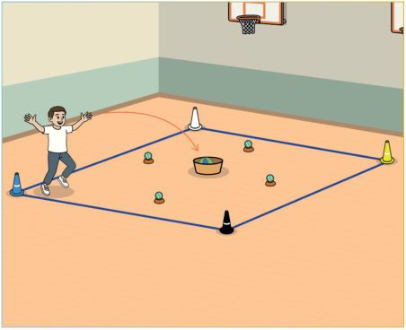
<!-- yer tutucu bulunamadı: sayfa sonuna eklendi -->

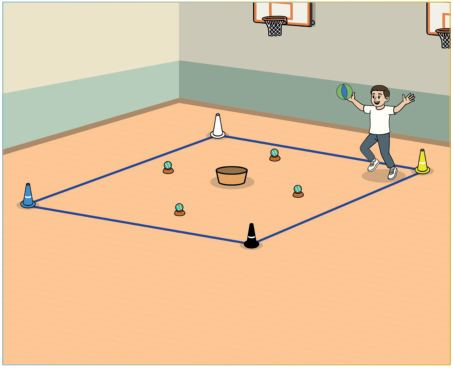
<!-- yer tutucu bulunamadı: sayfa sonuna eklendi -->

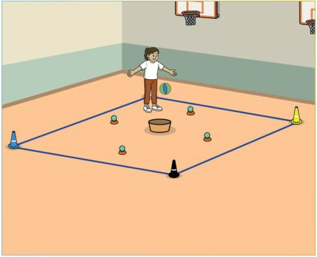
<!-- yer tutucu bulunamadı: sayfa sonuna eklendi -->

<!-- sayfa 120 -->

# ETKİNLİK 2
## Oyun Kuralları

| | |
| :--- | :--- |
| **Amaç:** | Öğrencilerin oyun kurallarını uygulayabilmeleridir. |
| **Eğilimler** | E3.2. Odaklanma |
| **Sosyal-Duygusal Öğrenme Becerileri** | SDB2.1. İletişim, SDB2.2. İş Birliği, SDS2.3. Sosyal Farkındalık, SDB3.1. Uyum, SDB3.2. Esneklik |
| **Değerler** | D1. Adalet, D6. Dürüstlük |
| **Okuryazarlık Becerileri** | - |
| **Kavramsal Beceriler** | KB1. Temel Beceriler |
| **Beceriler Arası İlişkiler** | BEOSAB8. Adil Oyun Anlayışına Uygun Davranma |
| **Öğrenme Çıktısı ve Süreç Bileşenleri** | BEO.2.2.2. Oyun kurallarını uygulayabilme |
| **Kullanılan Öğretim Teknolojileri, Araç Gereçler ve Kaynaklar** | Oyun: renkli toplar, koniler, puan listesi, ip |

Öğrencilere “serbest oyun” yönlendirmesi yapılır; top, hulahop, ip gibi çeşitli materyaller verilir ve öğrencilerden kendi aralarında hiçbir yazılı ya da sözel kural olmaksızın istedikleri şekilde bir oyun oynamaları istenir. Bu süreçte öğrenciler tamamen özgür bir şekilde oyunlarını kurgular ve oynarlar. Ardından okul bahçesinde veya spor salonunda paylaşım ortamı oluşturularak bu deneyim üzerine yapılandırılmış bir tartışma başlatılır. Öğrencilerden oynadıkları oyunda karşılaştıkları zorlukları ve belirsizlikleri sözlü olarak paylaşmaları istenir, bu sayede oyunların ortak ve düzenleyici unsuru olan “kural” kavramı gündeme getirilir (**SDB2.1**). Öğrenciler arkadaşlarının mevcut bir durum hakkında farklı düşünebileceğini ve hissedebileceğini fark eder; bu farkındalık tartışma sürecinde kuralların neden önemli olduğu, kurallara uyulmadığında ne tür sorunlar yaşanabileceği ve adil oyun ilkesinin gerekliliği gibi sorularla derinleştirilerek pekiştirilir (**SDB2.3**). Ardından öğrencilere kurallı bir oyun oynatılacağı ifade edilir ve oyuna geçiş yapılır.

### Oyun: Kurallı Oynuyorum

Oyun alanı oluşturulur ve kurallar öğrencilere aktarılır. Buna göre “Tüm atışlar ayakta yapılır, her başarılı atış iki puan değerinde olup her öğrenci en fazla sekiz puan alabilir. Öğrencilere renkli her noktadan iki atış yapma hakkı verilir ancak ilk atış başarılı olursa ikinci atış hakkı verilmez. Sarı noktadan atışlar sol elle, kırmızı noktadan sağ elle, yeşil noktadan iki elle ve mavi noktadan iki elle yere sektirilerek yapılır. Atışların geçerli sayılabilmesi için topun iki koni arasından geçmesi gerekir. Bu kurallara uygun olarak bahçede sarı, kırmızı, yeşil ve mavi renklerden oluşan dört atış noktası oluşturulur. Her noktanın yanına aynı renkten ikişer tane top yerleştirilir ve konilerle hedef alanları oluşturulur. Öğrenciler her renkten atış yaparak dört aşamadan oluşan oyunu sırayla tamamlar . Öğrenciler, oyunu belirlenen kurallara uygun şekilde gerçekleştirir. Her öğrenci, sırası geldiğinde dikkatli ve sorumlu bir biçimde atışını tamamlayarak bireysel görevini yerine getirir. Atışlarını bitiren öğrenciler, kazandıkları puanları adlarının yazılı olduğu puan listesine eksiksiz ve doğru şekilde yazarak bireysel sorumluluklarını yerine getirirler. Etkinliğin sonunda, tüm öğrenciler puanları birlikte toplar, süreci değerlendirir ve birbirlerini alkışlayarak süreci olumlu ve saygılı bir şekilde tamamlar. Bu etkinlik ile öğrencilerin görev bilinci geliştirilmesi kurallara uyarak sorumluluklarını yerine getirmesi ve sosyal etkileşim be-

<!-- sayfa 121 -->

cerilerinin desteklenmesi amaçlanır (**BEOSAB8, D1.2, D6.2**). Daha sonra kuralların oyun üzerindeki etkisinin daha iyi anlaşılabilmesi için aynı oyunun bazı kuralları değiştirilerek oyunun yeniden oynanacağı belirtilir. Bu kez atışların ayakta değil oturularak yapılacağı ve daha büyük ebatta bir top ile oynanacağı ifade edilir. Belirlenen yeni kurallara göre oyun tekrar oynanır. Bu sırada öğrencilerin değişen kurallara nasıl tepkiler verdikleri ve yeni durumlara nasıl çözümler ürettikleri gözlemlenir (**SDB3.1**). Oyunun sonunda öğrencilere şu sorular yöneltilebilir: “Yeni kurallar oyunu nasıl etkiledi?”, “Zorlandığınız anlarda neler yaptınız?” (**SDB3.2**).

Öğrenciler oyunu kurallarına göre oynamanın önemli olduğunu deneyimleyerek öğrenmiş olurlar; iş birliği, iletişim becerilerini geliştirirler. (**SDB2.2, E3.2**).

*Şekil 3. Kurallı oynuyorum oyunu*

### Çeşitlendirme
Etkinlik sırasında topların boyutları, sertlikleri veya ağırlıkları değiştirilebilir. Atış noktaları ile hedef arasındaki mesafe uzatılabilir. Koniler arasındaki mesafe kısaltılabilir. Oyunun oynanacağı alan değiştirilerek hedeflerin yerleri duvarlarda belirtilebilir. Atışlar yapılırken farklı hareket becerileri eklenebilir.

### Öğrenme Kanıtları ve Etkinlik Yansıması
Bu öğrenme çıktısının değerlendirilmesinde gözlem formu (**Ek 3**) kullanılır. Bu ölçme aracı, öğrencilerin oyun kurallarını ne ölçüde uygulayabildiklerini değerlendirmek amacıyla hazırlanmıştır.

Etkinlik yansıması kapsamında öğrencilere aşağıdaki sorular yöneltilebilir:

* Kuralların oyunu nasıl etkilediğini düşündünüz? Kurallar olmasaydı ne olurdu?
* Oyunun ilk ve ikinci versiyonu arasında sizce ne gibi farklar vardı?
* Oyunun kuralları değişince zorluklar ile karşılaştınız mı?

<!-- sayfa 122 -->

# ETKİNLİK 3
# Oyunlarda Taktik ve Strateji

| | |
| :--- | :--- |
| **Amaç:** | Öğrencilerin oyunlarda belirlenen taktik ve stratejiyi geliştirebilmeleridir. |
| **Eğilimler** | E1.1. Merak, E.2.1. Empati |
| **Sosyal-Duygusal Öğrenme Becerileri** | SDB1.1. Kendini Tanıma (Öz Farkındalık), SDB1.2. Kendini Düzenleme (Öz Düzenleme), SDB2.2. İş Birliği, SDB3.1. Uyum, SDB3.2. Esneklik, SDB3.3. Sorumlu Karar Verme |
| **Değerler** | D1. Adalet, D4. Dostluk, D6. Dürüstlük, D11. Özgürlük, D14. Saygı |
| **Okuryazarlık Becerileri** | - |
| **Kavramsal Beceriler** | - |
| **Beceriler Arası İlişkiler** | BEOSAB8. Adil Oyun Anlayışına Uygun Davranma |
| **Öğrenme Çıktısı ve Süreç Bileşenleri** | **BEO.2.2.3. Oyunlarda belirlenen taktik ve stratejiyi geliştirebilme**   a) Oyunlarda taktiksel problemi belirler.   b) Oyunlarda belirlenen problemin çözümüne ilişkin öneri sunar.   c) Oyunlarda taktik ve stratejiyi uygular. |
| **Kullanılan Öğretim Teknolojileri, Araç Gereçler ve Kaynaklar** | Oyun: top, kartlar, kutu, öğrenci isim listesi |

Öğretmen, her birinde farklı oyun isimlerinin yazılı olduğu kartların bulunduğu bir kutu ile okul bahçesi veya spor salonuna gelir. Öğrencilerde merak uyandırabilmek amacıyla “Bu kutuyu getirmemin nedeni sizce ne olabilir? İçinde ne olduğunu tahmin edebilir misiniz?” benzeri sorular sorar ve öğrencilerden yanıt ister (**E1.1**). Öğrencilerin tahminlerinden sonra öğrencilere kutu içerisinde çeşitli oyunların yazılı olduğu kartların bulunduğunu ve herkesin kutudan birer kart çekerek oynayacağı oyunu belirleyeceğini belirtir. Öğretmen tarafından boş bir kâğıda oyun isimleri yazılır ve isimler çekilen kartlara göre gruplandırılır. Oyunlara göre oluşturulan her bir grubun birer grup temsilcisi seçmesi ve oyunların grup üyeleri tarafından iş birliği içerisinde oynanması gerektiği ifade edilir (**SDB1.2, SDB2.2**).

**Oyun: Strateji Sahası**

Yakantop oyununun amacı ve kuralları grup temsilcisi tarafından şu şekilde okunur: “Bu oyunda amaç, oyuncuları topla vurarak oyun dışı bırakmak ve tüm oyuncuları elemektir. Oyun, eşit iki takım hâlinde oynanır ve sayı arttıkça oyun daha da heyecanlı hâle gelir.” Ardından balık ağı oyununa geçilir. Bu oyunun amacı ve kuralları da grup temsilcisi tarafından şu şekilde okunur: “Oyunun amacı, “balık ağı” rolünde olan oyuncuların diğer oyuncuları (balıkları) yakalamasıdır. Balık ağı olan oyuncular el ele tutuşarak bir zincir oluşturur ve zincir hâlinde hareket ederek balıkları yakalamaya çalışırlar. Zincir bozulursa yapılan yakalama geçersiz sayılır. Yakalanan balık, zincire katılarak ağın bir parçası

<!-- sayfa 123 -->

silcisi “Oyunun amacı, ‘ateş’rolündeki oyuncudan kaçmak ve ‘buz’ olanları kurtarmaktır. Ateş diğer 
oyunculara dokunarak onları ‘buz’hâline getirir. Buz olan oyuncular oldukları yerde sabit durur ve 
hareket edemez. Kurtarıcı (veya serbest oyuncular) buz olanları kurtarabilir. Oyun için geniş, açık 
ve güvenli bir alan belirlenmelidir. Tüm oyuncular dondurulursa ateş kazanır. Eğer süre sonunda hâlâ 
serbest oyuncular var ise oyun ya tekrarlanır ya da serbest oyuncular kazanmış sayılır.” açıklaması-
nı yaptıktan sonra grupların oyunlarını oynamalarına geçilir. Oyunlar bittikten sonra grupların oyun 
esnasında karşılaştıkları taktiksel problemler ipuçları ile belirlenmeye çalışılır (SDB3.3). Belirlenen 
problemlere çözüm önerileri sunmalarının yanında birbirlerinin zayıf ve güçlü yanlarının farkına var-
maları istenir (SDB1.1). Böylelikle öğrencilerin oyunlarda zayıf ve güçlü yönlerine göre pozisyon 
alarak ve problemlere stratejik çözüm önerileri de geliştirerek oyunu daha farklı ve taktiksel anlamda 
başarılı bir şekilde oynayabilmeleri sağlanır (SDB3.1, SDB3.3). Daha sonra gruplardan aynı oyunları 
tekrar oynamaları istenir. Oyunu ilk oynadıklarında yaptıkları hataları ve eksikleri göz önünde bulun-
durarak ikinci kez oynadıklarında eksiklerini tamamlamaları istenir. “İlk oyuna göre neleri düzelttiniz, 
oyuna nasıl çözüm önerileri sundunuz?” gibi sorular sorulur (SDB1.2, SDB3.3). Öğrencilerin oyun 
sırasında üzerlerine düşen görevleri sorumluluk bilinci ile yerine getirmeleri, takım arkadaşlarına 
adaletli davranmaları gerektiği oyunlar aracılığı ile anlatılmaya çalışılır (BEOSAB8., SDB3.2, E2.1, 
D16.3, D20.2). Gerektiğinde oyunlar durdurularak geri bildirimlerle öğrencilerin adalet, dostluk ve 
saygı gibi kavramları kazanmaları sağlanmaya çalışılır (D1.2, D4.1, D6.2, D11.1, D14.1).

**Açıklama**

Bu etkinlik sırasında problemlere stratejik çözümler üretmek amaçlandığı için öğrencilerin geri bildi-
rimlerle çözüm önerileri sunabilmeleri sağlanmalıdır.

**Çeşitlendirme**

Öğrencilerin karşılaştıkları problemlere farklı çözüm önerileri sunabilmeleri amacıyla yakantop, balık 
ağı ve ateş-buz isimli oyunlar dönüşümlü bir şekilde bütün gruplara oynatılarak öğrencilerin her oyun 
için farklı çözüm önerileri üretebilme becerileri kazanabilmeleri ile strateji ve taktik geliştirebilmeleri 
sağlanabilir.   

**Öğrenme Kanıtları ve Etkinlik Yansıması**

Bu öğrenme çıktısının değerlendirilmesinde gözlem formu (Ek 4) kullanılır. Bu ölçme aracı, öğren-
cilerin oyunlarda belirlenen taktik ve stratejileri ne ölçüde geliştirebildiklerini ve uygulayabildiklerini 
değerlendirmek amacıyla hazırlanmıştır.

Etkinlik yansıması kapsamında öğrencilere aşağıdaki sorular yöneltilebilir:

* Bugün oynadığınız oyunu daha önce oynadınız mı? Oynadıysanız bugünkü oyun nasıldı?
* Oyun sırasında zorlandığınız bir an oldu mu? Olduysa ne yaptınız?
* Hangi yol sizi başarıya daha çok yaklaştırdı?
* Oyun oynarken arkadaşlık ya da paylaşma ile ilgili bir duygu hissettiniz mi? Ne hissettiniz?

## 2.2. Farklılaştırma

### Zenginleştirme

Etkinlikler sırasında öğrencilere hakemlik, liderlik, gözlemcilik ve skor tutma gibi çeşitli roller verilerek 
sadece oyuncu değil aynı zamanda süreci yöneten ve oyun kurallarını gözeten bireyler olarak so-
rumluluk üstlenmeleri sağlanabilir. Kişisel ve genel alan farkındalığını geliştirmeye yönelik olarak et-
kinlikler sırasında öğrencilerin parmak ucunda yürüme, geniş adımlarla sıçrama ve çömelerek ilerle-
me gibi hareketler yapmaları sağlanabilir.  Etkinlikler sırasında yapılan hareketler yavaş koşma, hızlı 
koşma ve yön değiştirme gibi farklı hız, yön ve kuvvet düzeylerinde uygulanarak öğrencilerin efor ve

<!-- sayfa 124 -->

durumlarını içeren oyun senaryoları sunulabilir. Bu süreçte stratejik düşünme ve iş birliği becerilerini geliştirmeleri amacıyla zaman, mesafe ve etkinlik gibi ölçütleri dikkate alarak en uygun strateji ve taktikleri ifade etmeleri istenebilir.

**Destekleme**

Öğrencilerin etkinlik kurallarını daha iyi anlamalarını sağlamak amacıyla kurallar sadeleştirilerek yönergelerle ve görsellerle adım adım uygulanabilir hâle getirilebilir. Etkinliklerin süresi uzatılabilir. Etkinlik süresince öğrenciler için bire bir açıklamalar yapılabilir ya da öğrencilere akran desteği sağlanabilir. Beden farkındalığı, alan farkındalığı, efor ve hareket ilişkileri gibi kavram bileşenlerini ayırt etmelerine yardımcı olmak amacıyla öğrencilerin bu hareketleri daha iyi anlamalarını sağlayacak kısa, basit animasyon videoları gösterilebilir. Etkinlikler sırasında öğrenciler, karşılaştıkları sorunları belirlerken ve bunlara uygun taktik ve strateji geliştirirken iş birliği yaparak çözüm üretebilir ve çözümlerini uygulayabilirler.

### 3. ÖĞRENME KANITLARI (Ölçme ve Değerlendirme)

Etkinliklerin öğrenme kanıtları (ölçme ve değerlendirme) bölümünde öğrencilerin öğrenme çıktıları doğrultusunda değerlendirilmesi amacıyla hazırlanan örnek ölçme ve değerlendirme araçları belirtilmiştir. “Oyunlarda temel hareket becerilerini sergileyebilme” öğrenme çıktısının değerlendirilmesinde Ek 1’de yer alan performans görevi kullanılır. Performans görevi, Ek 2’de yer alan analitik dereceli puanlama anahtarı ile değerlendirilir. “Oyun kurallarını uygulayabilme ve “oyunlarda taktik ve stratejiyi kullanabilme” öğrenme çıktılarının değerlendirilmesinde Ek 3’te yer alan gözlem formu kullanılır. “Oyunlarda belirlenen taktik ve stratejiyi geliştirebilme” öğrenme çıktısının değerlendirilmesinde Ek 4’te yer alan gözlem formu kullanılır. Temanın bütünün değerlendirilmesinde Ek 5’de yer alan bütüncül dereceli puanlama anahtarı kullanılır. Bu değerlendirme aracı için Ek 6’da yer alan puan kaydetme tablosu kullanılabilir.

### 4. ÖĞRETMEN YANSITMALARI

* Bir sonraki yıl bu temanın planlaması için yorumlarınızı yazınız.

**Yorum 1:**

**Yorum 2:**

* Öğrenme Çıktılarına Göre Öz Yansıtma (planlama/hazırlık, öğrenme çevresi, öğretim, mesleki sorumluluk)

1. Öğrenme çıktısı için yansıtmalar:

2. Öğrenme çıktısı için yansıtmalar:

3. Öğrenme çıktısı için yansıtmalar:

<!-- sayfa 125 -->

# 5. EKLER:
Ek 1. Performans Görevi

| Performans Görevi |
| :--- |
| **Ders:** Beden Eğitimi ve Oyun |
| **Sınıf Düzeyi:** 2 |
| **Öğrenme Çıktısı:** Oyunlarda hareket kavramlarını uygulayabilme |
| **Etkinlik:** Hareketin İzinde |
| **Görev Konusu:** Hareket Haritası Çizme |

Sevgili Öğrenciler,
Gruplara ayrılarak daha önceden oynadığınız bir oyunu seçiniz. Seçtiğiniz oyunda hangi hareketlerin olduğunu, hareketlerin nerede ve nasıl yapıldığını bir büyük boy karton üzerine çiziniz. Bu çizdiğiniz haritaya “hareket haritası” adını veriniz. Haritanızda oyunun ismini, kurallarını ve amacını belirtiniz. Oyun içinde bedeninizi nasıl kullandığınızı (sıçrama, çömelme, dönme, koşma gibi), bu hareketleri nerede yaptığınızı (köşe, çizgi, çember, çim, toprak zemin vb.), en fazla ve en az efor harcanan hareketleri ve hareketlerin sırasını haritaya ekleyiniz. Haritanızı okuyan bir kişi hangi hareketin önce, hangisinin sonra yapıldığını anlayabilmelidir. Anlatımınızı çizimlerle desteklemeyi unutmayınız. Hareketlerinizi ve oyun alanını anlatırken çizim, sembol veya basit görseller kullanınız; haritanızı görsel açıdan zenginleştiriniz. Görev sonunda görsellerin bulunduğu kartonu arkadaşlarınıza ve öğretmeninize sunmanız istenmektedir.

**Göreviniz sırasında dikkat etmeniz gereken hususlar şunlardır:**

* Görevinizi beş kişilik gruplar hâlinde yapınız.
* Her gün farklı bir hareket seçmeye özen gösteriniz.
* Beden farkındalığı, alan farkındalığı, efor ve hareket ilişkileri kavram bileşenlerine yer veriniz.
* Grup içinde iş birliği yapınız, görevleri paylaşınız.
* Görev sonunda sunum yapınız.
* Performans görevinizi en geç ............................................tarihine kadar teslim ediniz.

<!-- sayfa 126 -->

# Ek 2. Analitik Dereceli Puanlama Anahtarı

| Performans Görevi Analitik Dereceli Puanlama Anahtarı | | | | | |
| :--- | :--- | :--- | :--- | :--- | :--- |
| **Ölçütler** | **Geliştirmeli(1)** | **Orta (2)** | **İyi (3)** | **Mükemmel (4)** | **Puan** |
| **Görevi Zamanında Teslim Etme** | Görev eksik ve zamanında tamamlanmıştır. | Görev az bir eksikle tamamlanmıştır. | Görev eksiksiz ama gecikmeyle tamamlanmıştır. | Görev zamanında ve eksiksiz tamamlanmıştır. | |
| **Grup İçi İş Birliği** | Grup içinde uyum yoktur; görev paylaşımı yapılmamıştır. | Grup üyeleri arasında iş birliği sınırlıdır; bazı üyeler sürece yeterince katılmamıştır. | Grup üyeleri genel olarak iyi bir iş birliği içinde. | Grup üyeleri uyumlu şekilde çalışmış, görev paylaşımı mükemmeldir. | |
| **Oyun Bilgisi ve Yapısı** | Oyun bilgisi ve yapısı yoktur. | Oyun bilgisi ve yapısı eksiktir. | Oyun bilgisi ve yapısı genelde doğru ancak bazı eksiklikler vardır. | Oyun adı, kurallar ve amacı eksiksiz ve açık biçimde yazılmıştır. | |
| **Efor ve Açıklama** | Efor ile ilgili herhangi bir açıklama yapılmamıştır. | Efor ve açıklaması sınırlıdır. | Efor ve açıklaması belirtilmiş, ancak bazı açıklamalar yüzeyseldir. | Efor ve açıklaması net biçimde belirlemiş, açık ve mantıklı şekilde ifade etmiştir. | |
| **Hareket Becerileri ve Alan Gösterimi** | Hareket becerileri ve alanlar hiç belirtilmemiştir. | Hareket becerileri ve alan bilgisi eksik, çizimler belirsizdir. | Çoğu hareket becerisi ve alan gösterilmiştir, bazı kısımlar geliştirilebilir. | Hareket becerileri ve alanlar doğru, açık ve görsel olarak sunulmuştur. | |
| **Alan Farkındalığı ve Açıklama** | Alan farkındalığı ve açıklaması belirtilmemiştir. | Alan farkındalığı sınırlı düzeyde belirtilmiş, açıklamalar belirsiz ve karışıktır. | Alan farkındalığı ve açıklaması genel olarak tanımlanmış ama biraz yüzeysel kalmıştır. | Alan farkındalığı ve oyun alanındaki farklı bölgeler (çizgi, köşe, merkez, açık/kapalı alan vb.) net olarak tanımlanmıştır. | |
| **Beden Farkındalığı ve Açıklama** | Beden farkındalığı ve açıklaması hakkında bilgi verilmiştir. | Beden farkındalığı ve açıklaması sınırlı olarak ifade edilmiştir. | Bedenin farkındalığı ve açıklaması genel olarak açıklanmış, bazı bölümlerde eksikler vardır. | Beden farkındalığı ve oyun içinde vücut bölümlerinin kullanımı net olarak ifade edilmiştir. | |
| | | | | | **Toplam Puan** |

<!-- sayfa 127 -->

# Değerlendirme Sistemi

Bu ölçme aracından en az $7$ puan, en fazla $28$ puan alınabilmektedir. Öğrencinin başarı puanı, alınan puanın yüzdelik karşılığı hesaplanarak bulunur. Bunun için alınan puan, öğrencinin alabileceği en yüksek puana bölünür ve çıkan sonuç $100$ ile çarpılır. Ondalık gösterim elde edilmesi hâlinde sonuç, tam kısmına (birler basamağına) yuvarlanır. Örneğin öğrenci bu ölçme aracından $15$ aldığında puanı şu şekilde hesaplanır: $(\frac{15}{28}) \cdot 100 = 53,571$ <!-- KONTROL: Marker'da karşılığı yok, uydurma olabilir -->. Bu sonuç yuvarlandığında öğrenci $54$ puan almış olacaktır.

$*$Başarı Puanı = $(\frac{\text{Toplam Puan}}{28}) \times 100$ <!-- KONTROL: Marker'da karşılığı yok, uydurma olabilir -->

## Performans Düzeyleri

$25-43$ <!-- KONTROL: Marker'da karşılığı yok, uydurma olabilir -->: Geliştirilmeli  
$44-62$ <!-- KONTROL: Marker'da karşılığı yok, uydurma olabilir -->: Orta  
$63-81$ <!-- KONTROL: Marker'da karşılığı yok, uydurma olabilir -->: İyi  
$82-100$ <!-- KONTROL: Marker'da karşılığı yok, uydurma olabilir -->: Mükemmel

<!-- sayfa 128 -->

**Ek 3. Gözlem Formu**

| Oyunu Kurallı Oynuyorum |
| :--- |
| **Öğrencinin Adı Soyadı:**   **Sınıfı :**   **Numarası :**   **Tarih :** |

Öğrencilerin etkinlikteki performanslarına ilişkin değerlendirme yapmak amacıyla aşağıdaki maddeleri okuyunuz ve her maddeye ilişkin tablodaki uygun hücreyi işaretleyiniz. “Kısmen” ve “Hayır” olarak işaretlediğiniz davranışlara yönelik öğrencilerinizin eksikliklerinin giderilmesine yardımcı olunuz.

| Ölçütler | Evet | Kısmen | Hayır |
| :--- | :---: | :---: | :---: |
| Oyun kurallarının önemini kavradı. | | | |
| Oyunu kurallarına göre oynadı. | | | |
| Atışları başarılı bir şekilde gerçekleştirdi. | | | |
| Takım üyeleri ile iş birliğine dayalı davranışlar sergiledi. | | | |
| Arkadaşları ile uyumu başarılıydı. | | | |
| Özgün düşünme, odaklanma, adalet, dostluk gibi ifadeleri başarılı bir şekilde kavradı. | | | |

<!-- sayfa 129 -->

**Ek 4. Gözlem Formu**

| Strateji Oyuncuları Gözlem Formu |
| :--- |
| **Öğrencinin**   **Adı Soyadı:**   **Sınıfı :**   **Numarası :**    Öğrencilerin etkinlikteki performanslarına ilişkin değerlendirme yapmak amacıyla aşağıdaki maddeleri okuyunuz ve her maddeye ilişkin tablodaki uygun bölümü işaretleyiniz. “Kısmen” ve “Hayır” olarak işaretlediğiniz davranışlara yönelik öğrencilerinizin eksikliklerinin giderilmesine yardımcı olunuz. |

| Ölçütler | Evet | Kısmen | Hayır |
| :--- | :---: | :---: | :---: |
| Kurallara uygun şekilde oynadı. | | | |
| Takım arkadaşlarıyla iş birliği yaptı. | | | |
| Oyunda taktiksel problemi fark etti. | | | |
| Problemlere çözüm önerisi sundu. | | | |
| Oyun tekrarında hatalarını fark edip düzeltti. | | | |
| Sorumluluk bilinciyle hareket etti. | | | |
| Adalet, dostluk, saygı gibi değerleri gösterdi. | | | |

<!-- sayfa 130 -->

**Ek 5. Bütüncül Dereceli Puanlama Anahtarı**

Bu ölçme aracı, öğrencilerin temaya yönelik performanslarını genel bir bütünlük içinde değerlendirmek amacıyla hazırlanmıştır. Her bir puan düzeyi, beklenen ölçütlerin ne derece karşılandığını ifade eder. Buna göre her öğrencinin performansı, belirtilen puan düzeylerinden yalnızca biriyle değerlendirilmelidir. Yapılan puanlama Ek 6'da yer alan tabloya kaydedilebilir.

| Sınıf : 2   Tema: 2 | BÜTÜNCÜL DERECELİ PUANLAMA ANAHTARI |
| :--- | :--- |
| **Puan** | **Öğrenme Çıktıları** |
| **Mükemmel (5)** | ● Oyunlarda hareket kavramlarını mükemmel bir şekilde uygulamıştır.   ● Oyunlarda kuralları mükemmel bir şekilde uygulamıştır.   ● Oyunlarda belirlenen taktik ve stratejiyi mükemmel bir şekilde kullanmıştır. |
| **İyi (4)** | ● Oyunlarda hareket kavramlarını iyi bir şekilde uygulamıştır.   ● Oyunlarda kuralları iyi bir şekilde uygulamıştır.   ● Oyunlarda belirlenen taktik ve stratejiyi iyi bir şekilde kullanmıştır. |
| **Geliştirilebilir (3)** | ● Oyunlarda hareket kavramlarını uygulama süreci sınırlı düzeyde gerçekleşmiş, bazı kavramlar eksik ya da hatalı kullanılmıştır.   ● Oyunlarda kuralları uygulama süreci eksik kalmış, bazı kurallar tam olarak yerine getirilmemiştir.   ● Oyunlarda taktik ve stratejileri sınırlı düzeyde kullanmış, kısmen uygulamıştır. |
| **Zayıf (2)** | ● Oyunlarda hareket kavramlarını eksik bir şekilde sergilemiştir.   ● Oyunlarda kuralları eksik bir şekilde uygulamıştır.   ● Oyunlarda belirlenen taktik ve stratejiyi eksik bir şekilde kullanmıştır. |
| **Yetersiz (1)** | ● Oyunlarda hareket kavramlarını yetersiz bir şekilde sergilemiştir.   ● Oyunlarda kuralları yetersiz bir şekilde uygulamıştır.   ● Oyunlarda taktik ve stratejiyi belirlemede yetersiz kalmıştır. |

<!-- sayfa 131 -->

**Ek 6. Puan Kaydetme Tablosu**

| Sınıf : |
| :--- |
| **Tarih:** |

| Sıra | Öğrencinin Adı Soyadı | Puan | Açıklama |
| :--- | :--- | :--- | :--- |
| | | | |
| | | | |
| | | | |
| | | | |
| | | | |
| | | | |
| | | | |
| | | | |
| | | | |
| | | | |
| | | | |
| | | | |
| | | | |
| | | | |
| | | | |
| | | | |
| | | | |
| | | | |
| | | | |
| | | | |
| | | | |
| | | | |
| | | | |
| | | | |
| | | | |
| | | | |
| | | | |
| | | | |
| | | | |
| | | | |
| | | | |
| | | | |
| | | | |
| | | | |
| | | | |
| | | | |
| | | | |
| | | | |
| | | | |
| | | | |
| | | | |
| | | | |
| | | | |
| | | | |
| | | | |
| | | | |
| | | | |
| | | | |
| | | | |
| | | | |
| | | | |
| | | | |
| | | | |
| | | | |
| | | | |
| | | | |
| | | | |
| | | | |
| | | | |
| | | | |
| | | | |
| | | | |
| | | | |
| | | | |
| | | | |
| | | | |
| | | | |
| | | | |
| | | | |
| | | | |
| | | | |
| | | | |
| | | | |
| | | | |
| | | | |
| | | | |
| | | | |
| | | | |
| | | | |
| | | | |
| | | | |
| | | | |
| | | | |
| | | | |
| | | | |
| | | | |
| | | | |
| | | | |
| | | | |
| | | | |
| | | | |
| | | | |
| | | | |
| | | | |
| | | | |
| | | | |
| | | | |
| | | | |
| | | | |
| | | | |
| | | | |
| | | | |
| | | | |
| | | | |
| | | | |
| | | | |
| | | | |
| | | | |
| | | | |
| | | | |
| | | | |
| | | | |
| | | | |
| | | | |
| | | | |
| | | | |
| | | | |
| | | | |
| | | | |
| | | | |
| | | | |
| | | | |
| | | | |
| | | | |
| | | | |
| | | | |
| | | | |
| | | | |
| | | | |
| | | | |
| | | | |
| | | | |
| | | | |
| | | | |

<!-- sayfa 132 -->

# 3.TEMA

## RİTİMLE HAREKET EDİYORUM

Eba Tema Alanı Karekodu

<!-- sayfa 133 -->

# 3. TEMA: RİTİMLE HAREKET EDİYORUM

| | |
| :--- | :--- |
| DERS SAATİ | 27 |
| ALAN BECERİLERİ | BEOSAB5. Ritmik Hareket Etme, BEOSAB7. Eşle/Grupla Hareket Etme |
| KAVRAMSAL BECERİLER | KB1. Temel Beceriler |
| EĞİLİMLER | E1.1. Merak |
| | **PROGRAMLAR ARASI BİLEŞENLER** |
| Sosyal-Duygusal Öğrenme Becerileri | SDB1.2. Kendini Düzenleme (Öz Düzenleme), SDB2.2. İş Birliği, SDB3.1. Uyum |
| Değerler | D4. Dostluk, D7. Estetik, D16. Sorumluluk |
| Okuryazarlık Becerileri | OB4. Görsel Okuryazarlık |
| DİSİPLİNLER ARASI İLİŞKİLER | Görsel Sanatlar, Müzik |
| BECERİLER ARASI İLİŞKİLER | - |
| ÖĞRENME ÇIKTILARI VE SÜREÇ BİLEŞENLERİ | **BEO.2.3.1. Belirlenen tempodaki müziğe uygun hareket edebilme**   **BEO.2.3.2. Eşle veya grupla ritmik hareket etme becerisini sergileyebilme**   a) Eşle veya grupla temel hareket becerilerini kullanarak verilen ritmi algılar.   b) Eşle veya grupla temel hareket becerilerini kullanarak ritme uygun hareket eder.   c) Eşle veya grupla temel hareket becerilerini kullanarak ritmik hareket becerilerini sergiler. |
| İÇERİK ÇERÇEVESİ | Belirlenen Tempodaki Müziğe Uygun Hareket Etme   Eşle veya Grupla Ritmik Hareket |
| Genellemeler/ Anahtar Kavramlar/ Sembol ve Gösterimler | hareket, müzik, ritim, tempo, uyum |

<!-- yer tutucu bulunamadı: sayfa sonuna eklendi -->

<!-- sayfa 134 -->

# 1. TEMAYA BAŞLARKEN

Bu temada öğrencilerin temel hareket becerileri olan yer değiştirme, nesne kontrolü ve denge becerilerini algılamaları; bu beceriler arasındaki farklılıkları ayırt edebilmeleri ve hareketleri kademeli olarak gösterebilmeleri hedeflenmektedir. Öğrencilerin çeşitli oyun ve fiziksel aktiviteler sırasında bu temel hareket becerilerini ritimle bütünleştirerek uygulayabilmeleri amaçlanmaktadır. Etkinlikler sırasında öğrencilerden verilen ritmi algılayarak eşleriyle bu ritme uygun şekilde hareket etmeleri; böylece hem ritim duygularını geliştirmeleri hem de koordinasyonlarını artırmaları beklenmektedir. Eşle veya grupla yapılan çalışmalarda temel hareket becerilerini ritimle uyumlu ve bütünlük içinde sergileyen öğrenciler fiziksel gelişimlerinin yanı sıra iş birliği, birlikte hareket etme ve sorumluluk alma gibi sosyal becerilerini de pekiştirme fırsatı bulacaklardır. Bu süreçte öğretmenlerin bireysel farklılıkları göz önünde bulundurarak tüm öğrencilerin aktif katılımını sağlayacak bir ortam oluşturmaları, uygun materyal ve müzik seçimiyle güvenli etkinlik alanları hazırlamaları önemlidir. Ritimle desteklenen bu etkinlikler, öğrencilerin beden ve alan farkındalıklarını artırarak hareket becerilerinin gelişimini desteklemekte ve ilerleyen yaşlardaki fiziksel uygunluklarının temelini oluşturmaktadır.

# 2. ÖĞRENME-ÖĞRETME YAŞANTILARI

Öğrencilerin ritim ve temel hareket becerilerini geliştirmeleri amaçlanmaktadır. Öncelikle, öğrencilerle ritim hareketlerinin yapılacağı bir etkinlik düzenlenir. Bu etkinlikte öğrencilere belirli bir sıra ile el çırpma, ayak vurma, parmak şıklatma gibi hareketler yaptırılır. Bu hareketler, öğrencilerin ritmi hissetmelerini ve bedenlerini ritme uygun şekilde kullanmalarını sağlayacak şekilde tasarlanır. Ardından bu becerileri uygulayabilecekleri bir oyun oynatılarak öğrencilerin ritimle uyum içinde hareket etme düzeyleri gözlemlenir. Etkinliklerin devamında öğrencilerin doğadaki ve çevremizdeki ritmik hareket ve sesleri fark etmeleri sağlanır. Güneşin doğuşu ve batışı, dalgaların sahile vurması, mevsimlerin değişimi gibi doğal ritimler örnek olarak verilir. Öğrencilerden bu tür ritmik örnekler vermeleri istenerek ritmin önemli bir öge olduğu vurgulanır ve öğrencilerin günlük yaşamla ilişki kurmaları sağlanır.

## 2.1. Etkinlik Örnekleri

### ETKİNLİK 1
**Doğanın Ritmiyle Hareket**

| | |
| :--- | :--- |
| **Amaç:** | Öğrencilerin belirlenen tempodaki müziğe uygun hareket edebilmeleridir. |
| **Eğilimler** | - |
| **Sosyal-Duygusal Öğrenme Becerileri** | SDB1.2. Kendini Düzenleme (Öz Düzenleme), SDB2.2. İş Birliği |
| **Değerler** | D7. Estetik |
| **Okuryazarlık Becerileri** | OB4. Görsel Okuryazarlık |
| **Öğrenme Çıktısı ve Süreç Bileşenleri** | **BEO.2.3.1. Belirlenen tempodaki müziğe uygun hareket edebilme** |
| **Kullanılan Öğretim Teknolojileri, Araç Gereçler ve Kaynaklar** | Etkinlik: dal, yaprak ve taş Oyun 2: kutu |

<!-- sayfa 135 -->

Öğrencilere doğada her şeyin bir ritmi/sesi (yağmur damlalarının pencereye vuruşu, ağaç yapraklarının rüzgârda sallanma sesi ve hareketi, bir sincabın ağaçta zıplayarak ilerlemesi, köpeğin kuyruğunu sallama hareketi vb.) olduğu söylenir. Öğrencilerden doğada ve çevremizde duyduğumuz, gördüğümüz ritmik hareketlere/seslere örnekler vermeleri istenir. Ardından okul bahçesinde dolaşıp taş, yaprak, dal gibi malzemeler toplamaları istenir. Bir müzik açılır ve öğrencilerden topladıkları malzemelerle müziğe ritim tutmaları istenir. Böylelikle öğrencilerin doğada buldukları malzemelerin hangi sesleri çıkardığını keşfetmeleri sağlanır. Üzerinde “alkışla, zıpla, dize vur, ayak topuk yere vur, ayakucu yere vur, sağ ayak sol dize dokun, sağ ayak yana aç, sol ayak yana aç, çift ayak sıçrayarak aç” vb. komutlar olan görsel etkinlik kartları (**Ek 1**) hazırlanır. Hareketler, kartlara uygun olarak yavaş, orta, hızlı tempolarda uygulatılır. Ardından öğrenciler gruplara ayrılır, öğrencilerden bir kutunun içine atılmış görsel kartlardan rastgele dört tanesini seçmeleri istenir. Görsel kartlardaki hareketlerden (**Şekil 1**) bir seri oluşturmaları beklenir (**OB4, SDB1.2**). Belirlenen dört dörtlük müzik eşliğinde hazırladıkları serileri arkadaşlarıyla iş birliği yaparak uygulamaları sağlanır (**SDB2.2**). Gruplar kartlardaki hareketleri istediği sıralamada ve her harekete bir vuruş denk getirecek şekilde ritim (1. vuruş: Alkış, 2. vuruş: Zıpla, 3. vuruş: Dize vur, 4. vuruş: Ayak topuk yere vur.) oluşturur.

*Şekil 1. Görsel hareket kartı örneği*

### Oyun 1: Ritim Zinciri

Dört dörtlük sözsüz bir müzik açılır. Öğrencilerden daire olmaları istenir. Öğrenciler müziğe uygun bir ritimle önce kendi adını, sonra hareketini söyler. “Elif diyor ki dizine vur.” dediğinde tüm öğrenciler hareketi tekrarlar. Sıradaki öğrenci aynı şekilde önce kendi ismini, sonra hareketini söyler ve öğrenciler onu tekrar eder. Sıra beşinci öğrenciye geldiğinde öğrenci önce kendi ismini söyler, sonra “Hepsini yap.” komutunu verir ve tüm sınıf dört arkadaşının gösterdiği hareketleri sırasıyla ritme uygun şekilde tekrarlar. Öğrencilerden ritme uyum sağlamaları ve kendi yaratıcılıklarını kullanarak estetik bakış açısıyla özgün eserler ortaya koymaları beklenir (**D7.2**). Beşin katlarında öğrenciler kendinden önceki dört öğrencinin hareketini tekrar eder.

### Oyun 2: Toplarla Ritim

Tüm sınıf daire şeklinde oturur. Her öğrenciye bir adet küçük plastik top verilir. Etkinliğe çocuklarla yapılan ısınma hareketleriyle başlanır. Top ellerde yuvarlanır, hafifçe havaya atılıp tutulur ve yere vurulur. Isınmanın ardından öğretmen ritim çalışmasına geçer. Öğretmen belirlenen müziğe uygun olarak topu havaya kaldırıp indirme, belin arkasından döndürme, yere vurma, dizlerin altından geçirme, sağındaki arkadaşının önüne koyarak değiştirme ile topu bir sağ ve bir sol dize vurma gibi çeşitli hareketleri gösterir. Öğrenciler, öğretmeni takip ederek bu hareketleri hep birlikte, ritme uygun ve eş

<!-- sayfa 136 -->

# Öğrenme Kanıtları ve Etkinlik Yansıması

Bu öğrenme çıktısının değerlendirilmesinde ritim dedektifi performans görevi (**Ek 2**) kullanılır. Bu performans görevi için öğretmenin her öğrenci için birer hareket zarı (her yüzünde basit farklı hareketler olan) ve ritim dedektifi rozeti hazırlaması gereklidir. Performans görevi, analitik dereceli puanlama anahtarı (**Ek 3**) ile değerlendirilir. Bu ölçme aracı, öğrencilerin belirlenen tempodaki müziğe uygun hareket edebilmelerini değerlendirmek amacıyla hazırlanmıştır.

Etkinlik yansıması kapsamında öğrencilere aşağıdaki sorular yöneltilebilir:

1. Bugün müzik ile hangi hareketleri yaptınız?
2. Grup arkadaşlarınızla hareket ederken nelere dikkat ettiniz?
3. Doğadan topladığınız malzemelerle nasıl sesler çıkardınız? En çok hangi sesi sevdiniz?
4. Bir daha böyle bir etkinlik yapsanız etkinliğe hangi yeni hareketleri eklemek isterdiniz?
5. Bu etkinlikte öğrendiğiniz en önemli şey neydi?

## ETKİNLİK 2 | Ritmi Yakala, Eşine Uyum Sağla

| | |
| :--- | :--- |
| **Amaç:** | Öğrencilerin eşle veya grupla ritmik hareket etme becerisini sergileyebilmeleridir. |
| **Eğilimler** | E1.1. Merak |
| **Sosyal-Duygusal Öğrenme Becerileri** | SDB2.2. İş Birliği, SDB3.1. Uyum |
| **Değerler** | D4. Dostluk, D16. Sorumluluk |
| **Disiplinler Arası İlişkiler** | Görsel Sanatlar, Müzik |
| **Öğrenme Çıktısı ve Süreç Bileşenleri** | **BEO.2.3.2. Eşle veya grupla ritmik hareket etme becerisini sergileyebilme.**   a) Eşle veya grupla temel hareket becerilerini kullanarak verilen ritmi algılar.   b) Eşle veya grupla temel hareket becerilerini kullanarak ritme uygun hareket eder.   c) Eşle veya grupla temel hareket becerilerini kullanarak ritmik hareket becerilerini sergiler. |
| **Kullanılan Öğretim Teknolojileri, Araç Gereçler ve Kaynaklar** | Etkinlik: ritim çubukları   Oyun 1: bardaklar, görsel kartlar ve müzik |

Öğretmen, ritim çubuklarıyla ritim tutarak sınıfa girer ve bir süre hiç konuşmadan ritim tutmaya devam eder (**E1.1**). Ritim çubuklarıyla verilen önce basit, ardından biraz daha karmaşık ritimlerin öğrenciler tarafından alkışla eş zamanlı olarak tekrarlanması istenir. Öğretmen etkinliğe bir drama ile devam eder. “Hep beraber ormanda yürüyoruz (Ritim çubukları ile ritim tutarak yürürler). Birden bir ses duyduk herkes donsun (tüm öğrenciler sessizce olduğu yerde sabit durur). Olamaz karşımıza bir ayı çıktı hızlıca uzaklaşalım (Ritim çubuklarını birbirine daha hızlı vurarak hızlı ritimde yürürler). Tamam, ayıdan uzaklaştık artık yavaşlayabiliriz (ritim çubuklarını yavaş yavaş birbirine vurarak yavaş tempoda yürürler).” Öğretmen dramayı ve ritimleri kendi istediği şekilde çeşitlendirir. Öğrencilere eş olmaları söylenir ve mümkün olduğu kadar kısa bir müzik seçilir. Eşlerden müziğin söz ve ritmine uygun hareketlerle kendilerine küçük bir koreografi oluşturmaları istenir. Öğrencilere hareket ölçüt

<!-- sayfa 137 -->

(SDB2.2). Her öğrencide bir çizelge bulunur. Eşlerden biri alkışla ritim tutarken diğeri kendi çizelgesindeki hareketleri arkadaşının alkış ritmine uygun şekilde sırayla yapmaya çalışır ve tamamladığında hareketleri kendi çizelgesini işaretler. Daha sonra arkadaşının aynı ölçüt çizelgesini yapması için arkadaşına alkışla ritim tutar. Bu süreçte eşler veya gruptaki öğrenciler, ritme uygun hareket edebilmeleri için birbirlerinin bireysel gelişimini ve hedeflerini destekler (D4.1). Eşler görevlerini zamanında ve eksiksiz yerine getirir (D16.3). Benzer çalışmalar eş ve grup oyunlarıyla (öğrencilerin farklı arkadaşları ile eşleştirilmesi, çalışmaya materyal eklenmesi vb.) sürdürülebilir (SDB3.1).

**Oyun 1: Ritmi Takip Et**

Öğrencilere oynanacak oyunda yere birtakım görseller (Ek 6) konulacağı ve müziğin ritmine uygun bir şekilde yerdeki görselleri takip ederek bardaklarla ritim tutmaları gerektiği söylenir. Spiral desenini gördüklerinde ellerindeki bardaklarla makara hareketi yapacakları (Şekil 3), çift yuvarlak gördüklerinde görselin üstünde yazan sayı kadar iki bardağı aynı anda yere vuracakları, tek yuvarlak gördüklerinde yuvarlağın olduğu taraftaki tek bardağı yere bir kere vuracakları, birbirine bakan bardak resmini gördüklerinde üstünde yazan sayı kadar bardakları birbirine vuracakları (Şekil 3) anlatılır. Görseller seçilen müziğin ritmine uyacak şekilde yere yerleştirilerek şerit oluşturulur (Şekil 2). Tüm eşler dikkatli bir şekilde eş zamanlı olarak, ritme uygun biçimde yerdeki görselleri takip ederek hareketleri doğru sıra ve ritimde yapmaya odaklanır (SDB2.2, SDB3.1, BEOSAB7). Tüm öğrenciler verilen görevi tamamladıktan sonra yer değiştirir. Öğrencilerden ikişerli olmaları istenir. İki öğrenciden görsellerin yanlarına karşılıklı geçmeleri istenir ve müzik başlatılır. Öğrenciler, müziğin ritmine uygun şekilde yerdeki görselleri takip ederek ellerindeki bardaklarla doğru ritmi yakalamaya çalışır (SDB2.2).

*Şekil 2. Ritmi takip et oyunu*

<!-- sayfa 138 -->

**Çeşitlendirme**  
Bardaklar yerine küçük kukalar, ritim çubukları ya da farklı materyaller kullanılabilir. Yere konulacak olan görseller çeşitlendirilebilir. Örneğin “Ellerinizi havaya kaldırın, kendi etrafınızda dönün.” komutunu anlatan görseller oluşturulup eklenebilir.

**Öğrenme Kanıtları ve Etkinlik Yansıması**  
Bu öğrenme çıktısının değerlendirilmesinde akran değerlendirme formu (**Ek 5**) kullanılır. Bu ölçme aracı, öğrencilerin eşle veya grupla ritmik hareket etme becerisini sergileyebilmelerini değerlendirmek amacıyla hazırlanmıştır.

Etkinlik yansıması kapsamında öğrencilere aşağıdaki sorular yöneltilebilir:

* Eşinizle ritme uygun hareket ederken zorlandığınız bir an oldu mu? Olduysa bunu nasıl çözdünüz?
* Eşinizle hareket ederken uyum sağlamak için nelere dikkat ettiniz?
* Etkinlikte ritim tutan mı yoksa hareket eden mi olmayı daha çok sevdiniz? Neden?
* Eşle hareket ederken herkesin uyumlu olması neden önemliydi?

### 2.2. Farklılaştırma

**Zenginleştirme**  
Öğrencilerin yaratıcılıklarını ortaya koyabilecekleri bir öğrenme ortamı sunmak amacıyla onlardan belirli hareketleri seçerek kendi özgün koreografilerini oluşturmaları istenebilir. Hazırlanan koreografilerin belirli gün ve haftalar, millî bayramlar ya da okul içi özel etkinliklerde sergilenmesi sağlanabilir. Koreografi süreci sadece sabit ritimlerde değil farklı tempoları ve duygu durumlarını yansıtan müziklerle de desteklenebilir. Öğrencilerden yavaşlayan ve hızlanan ritimlere uygun şekilde hareketlerini uyarlamaları, çeşitli seriler oluşturarak değişen tempolara esnek biçimde yanıt vermeleri istenebilir. Sınıf içinde dansa özel ilgi duyan veya bu alanda yetenekli öğrenciler varsa bu öğrencilerin liderlik üstlenmeleri teşvik edilebilir.

**Destekleme**  
Öğrencilerin bireysel ihtiyaç ve öğrenme hızlarına göre farklılaştırılmış öğretim süreçleri planlanabilir. Hareket ve ritim becerilerinde zorlanan öğrenciler için daha kısa, tekrar edilen hareket serileri oluşturulabilir. Ritme uygun hareket etmekte zorlanan öğrenciler için akran desteği etkili bir yöntem olabilir. Hareketleri daha iyi kavrayan öğrencilerle eşleştirme yapılarak birlikte çalışma ve yardımlaşma ortamı oluşturulabilir. Bu sürece görsel-işitsel destek materyalleri de eklenebilir. Ayrıca öğrencilerin sadece ayakta değil oturarak da katılabilecekleri ritim çalışmaları (ritmik el çırpma, dizlere vurma vb.) sunularak katılımın çeşitlendirilmesi sağlanabilir.

# 3. ÖĞRENME KANITLARI (Ölçme ve Değerlendirme)
Etkinliklerin öğrenme kanıtları (ölçme ve değerlendirme) bölümünde öğrencilerin öğrenme çıktıları doğrultusunda değerlendirilmesi amacıyla hazırlanan örnek ölçme ve değerlendirme araçları belirtilmiştir. “Belirlenen tempodaki müziğe uygun hareket edebilme” öğrenme çıktısının değerlendirilmesinde Ek 2’de yer alan “Ritim Dedektifleri Performans Görevi” kullanılacaktır. Bu performans görevi için öğretmenin her öğrenci için birer hareket zarı (her yüzünde basit farklı hareketler olan) ve ritim dedektifi rozeti hazırlaması gereklidir. Öğrencilere verilen performans görevi, velilerinin rehberliğinde yaptırılabilir. Öğrenciler velileri ile doğadan üç nesne bularak farklı tempolardaki müziklere ritim tutacak; daha sonra öğretmenlerinden aldıkları hareket zarlarını kullanarak, ritmik bir hareket serisi oluşturacak ve bu ritim gösterilerini sergileyeceklerdir. Performans Ek 3’te yer alan analitik dereceli puanlama anahtarı ile değerlendirilir. “Eşle veya grupla ritmik hareket etme becerisini sergileyebilme”

<!-- sayfa 139 -->

öğrenme çıktısının değerlendirilmesinde Ek 4'te yer alan akran değerlendirme formu kullanılacaktır. Temanın bütünün değerlendirilmesinde Ek 7'de yer alan kontrol listesi kullanılacaktır. Kontrol Listesinde “Hayır” bölümündeki işaretler birden fazlaysa öğrencilerin bu konudaki eksikliklerini gidermesine yardımcı olunuz.

## 4. ÖĞRETMEN YANSITMALARI

* Bir sonraki yıl bu temanın planlaması için yorumlarınızı yazınız.

**Yorum 1:**

**Yorum 2:**

* Öğrenme Çıktılarına Göre Öz Yansıtma (planlama/hazırlık, öğrenme çevresi, öğretim, mesleki sorumluluk)

1. Öğrenme çıktısı için yansıtmalar:

2. Öğrenme çıktısı için yansıtmalar:

<!-- sayfa 140 -->

# 5. EKLER
Ek 1. Görsel Etkinlik Kartları

ZIPLA

ALKIŞ

DİZE VUR

AYAK TOPUK YERE VUR

AYAK UCU YERE VUR

SAĞ AYAK SOL DİZE DOKUN

SAĞ AYAK YANA AÇ

SOL AYAK YANA AÇ

ÇİFT AYAK

<!-- sayfa 141 -->

**Ek 2. Performans Görevi: Ritim Dedektifleri Görevde!**

**Açıklama:** Aşağıdaki aşamaları sırasıyla takip ederek kendinize bir ritim serisi oluşturunuz. Oluşturduğunuz seriyi okul bahçesinde veya spor salonunda arkadaşlarınıza sununuz.

**Süre: 1 Hafta**

| Aşama | Açıklama |
| :--- | :--- |
| Ritim Dedektifi Kimliği Al | Öğretmeninizden ‘Ritim Dedektifi’ rozetlerini alınız. Bu rozet ile göreviniz ritmi bulmak, sesi yakalamak ve harekete dönüştürmektir. |
| Doğada Ritim Avı | Bahçede yürüyüş yapınız. Ritim sesi çıkarabilecek üç doğa nesnesi bulunuz. |
| Müzik Açılıyor: Ritmi Yakala! | Farklı tempolarda müzikler dinleyerek bulduğunuz nesnelerle ritim tutmayı deneyiniz. |
| Hareket Zarını At! Gösterini Hazırla! | Öğretmeninizden hareket zarlarınızı alınız. Zarın her yüzünde farklı bir hareket vardır. Zar atınız ve çıkan hareketlerle ritmik hareket serisi oluşturunuz. |
| Sahne Sırası Sizde! | Sırayla sahne alarak ritim gösterilerinizi okul bahçesinde veya spor salonunda sergileyiniz. |

<!-- sayfa 142 -->

# Ek 3. Analitik Dereceli Puanlama Anahtarı

Aşağıdaki dereceli puanlama anahtarı, öğrencilerin 'Ritim Dedektifleri Görevde' adlı performans görevinde gösterdikleri başarıyı değerlendirmek amacıyla hazırlanmıştır. Her ölçüt için 1 (Geliştirilmeli) ile 3 (Çok İyi) arasında puan verilir.

| Ölçütler | Çok İyi (3) | İyi (2) | Geliştirilmeli (1) |
| :--- | :--- | :--- | :--- |
| **Ritme Uygunluk** | Hareketlerini müzik temposuna tamamen uyumlu, akıcı ve zamanında gerçekleştirir. | Genellikle ritme uygundur, bazı zamanlama hataları görülür. | Zaman zaman ritmi kaçırır, hareketler ritme uymaz. |
| **Hareketin Doğruluğu** | Seçilen hareketleri doğru sırayla ve eksiksiz şekilde uygular. | Hareket sıralamasında küçük hatalar vardır. | Hareketleri doğru sırayla yapamaz, çoğu hareket eksik veya yanlış olur. |
| **Yaratıcılık** | Hareketlerine özgünlük ve hayal gücü katar, dikkat çeker. | Bazı hareketlerde özgünlük vardır. | Hareketler basit ve taklit ağırlıklıdır, yaratıcılık sınırlıdır. |

**Değerlendirme Sistemi:**

Bu ölçme aracından en az 3 puan, en fazla 9 puan alınabilmektedir. Öğrencinin puanı, alınan puanın yüzdelik karşılığı hesaplanarak bulunur. Bunun için alınan puan, öğrencinin alabileceği en yüksek puana bölünür ve çıkan sonuç 100 ile çarpılır. Ondalık gösterim elde edilmesi hâlinde sonuç, tam kısmına (birler basamağına) yuvarlanır. Örneğin öğrenci bu ölçme aracından 5 aldığında puanı şu şekilde hesaplanır: $(4 : 9) \cdot 100 = 44,4444$ <!-- KONTROL: Marker'da karşılığı yok, uydurma olabilir -->. Bu sonuç yuvarlandığında öğrenci 45 puan almış olacaktır.

**Performans Düzeyleri:**

33 – 44: Geliştirilmeli  
45 - 67: İyi  
68 - 100: Çok iyi

<!-- sayfa 143 -->

# Ek 4. “Ritimi Yakala, Eşinle Uyum Sağla” Etkinliği Ölçüt Çizelgesi

Bu ölçme aracı, “Ritmi yakala, eşinle uyum sağla” etkinliğinin değerlendirilmesi için hazırlanmıştır. Her hareketi müzikle ve müziğin ritmine uygun yaptıysanız kutucuğa “$\checkmark$ <!-- KONTROL: Marker'da karşılığı yok, uydurma olabilir -->” işareti, yorulduysanız ya da unuttuysanız “?” işareti koyunuz.

| Hareket | Ritme Uygun Yaptım ($\checkmark$ <!-- KONTROL: Marker'da karşılığı yok, uydurma olabilir -->) | Yoruldum / Atladım (?) |
| :--- | :---: | :---: |
| Alkışlama | ☐ | ☐ |
| Zıplama | ☐ | ☐ |
| Dizine vurma | ☐ | ☐ |
| Yana adım atma | ☐ | ☐ |
| Dönme ($360^\circ$) | ☐ | ☐ |
| Elleri yukarı kaldırma | ☐ | ☐ |

<!-- sayfa 144 -->

**Ek 5. Akran Değerlendirme Formu**

| Akran Değerlendirme Formu |
| :--- |
| Bu form, “Ritmi Yakala, Eşine Uyum Sağla” etkinliğinde arkadaşınızın çalışmasını değerlendirmeniz için hazırlanmıştır. Çalışmasını geliştirmesi için arkadaşınıza dürüst ve nazik bir şekilde önerilerde bulunmanız beklenmektedir. |
| Çalışmayı Yapan Öğrencinin Adı Soyadı: | |
| Değerlendirmeyi Yapan Öğrencinin Adı Soyadı: | |
| **Ölçütler** | **Evet** | **Kısmen** | **Hayır** |
| Eşiyle ya da grubuyla ritme uygun hareket etti. | ☐ | ☐ | ☐ |
| Gösterilen ritmik hareketleri doğru yaptı. | ☐ | ☐ | ☐ |
| Arkadaşlarıyla uyum içinde ve birlikte çalıştı. | ☐ | ☐ | ☐ |
| Hareketlerini müziğin hızına uygun yaptı. | ☐ | ☐ | ☐ |

<!-- sayfa 145 -->

Ek 6. Spiral Oyunu Görsel Kartları

| | 2x | SOL |
| :---: | :---: | :---: |
|  | | |
| SAĞ | 2x | |
| | | |

<!-- sayfa 146 -->

# Ek 7. Tema Değerlendirmesi

| Kontrol Listesi | | | |
| :--- | :---: | :---: | :---: |
| **Öğrencinin** | | | |
| **Adı Soyadı:** | | | |
| **Sınıfı :** | | | |
| **Numarası :** | | | |
| Öğrencilerin etkinlikteki performanslarını değerlendirmek amacıyla aşağıdaki maddeleri okuyunuz ve her maddeye ilişkin tablodaki uygun bölümü işaretleyiniz. “Hayır” bölümündeki işaretleriniz birden fazlaysa öğrencinizin bu konudaki eksikliklerini gidermesine yardımcı olunuz. | | | |
| **Ölçütler** | **Evet (2)** | **Kısmen (1)** | **Hayır (0)** |
| Eşiyle/grubuyla uyumlu hareket eder. | ☐ | ☐ | ☐ |
| Ritmi algılar. | ☐ | ☐ | ☐ |
| Ritme uygun hareket eder. | ☐ | ☐ | ☐ |
| Hareketleri doğru uygular. | ☐ | ☐ | ☐ |
| Grup içinde iş birliği yapar. | ☐ | ☐ | ☐ |
| Toplam Puan Aralığı: $0 - 10$ <!-- KONTROL: Marker'da karşılığı yok, uydurma olabilir --> | | | |
| **Değerlendirme Düzeyleri:** | | | |
| **Puan Aralığı** | **Düzey** | **Açıklama** | |
| $9 - 10$ <!-- KONTROL: Marker'da karşılığı yok, uydurma olabilir --> | Çok İyi | Öğrenci ritmi ve grup uyumunu yüksek düzeyde sergiliyor. | |
| $6 - 8$ <!-- KONTROL: Marker'da karşılığı yok, uydurma olabilir --> | İyi | Temel beceriler genel olarak uygun, daha fazla uygulama ile gelişir. | |
| $3 - 5$ <!-- KONTROL: Marker'da karşılığı yok, uydurma olabilir --> | Gelişmekte | Bireysel katılım yeterli ama ritim/grup uyumu geliştirilmeli. | |
| $0 - 2$ <!-- KONTROL: Marker'da karşılığı yok, uydurma olabilir --> | Yetersiz | Etkinliğe katılımı düşük, rehberliğe ihtiyaç duyuyor. | |

<!-- sayfa 147 -->

# Tema Değerlendirmesine Yönelik Sonuç Kaydetme Tablosu

| Öğrencinin Adı Soyadı | Eşiyle/ Grubuyla Uyumlu Hareket Eder | Ritmi Algılar | Ritme Uygun Hareket Eder | Hareketleri Doğru Uygular | Grup İçinde İş Birliği Yapar | Toplam Puan |
| :--- | :--- | :--- | :--- | :--- | :--- | :--- |
| | | | | | | |
| | | | | | | |
| | | | | | | |
| | | | | | | |
| | | | | | | |
| | | | | | | |
| | | | | | | |
| | | | | | | |
| | | | | | | |
| | | | | | | |
| | | | | | | |
| | | | | | | |
| | | | | | | |
| | | | | | | |
| | | | | | | |
| | | | | | | |
| | | | | | | |
| | | | | | | |
| | | | | | | |
| | | | | | | |
| | | | | | | |
| | | | | | | |
| | | | | | | |
| | | | | | | |
| | | | | | | |
| | | | | | | |
| | | | | | | |
| | | | | | | |
| | | | | | | |
| | | | | | | |

<!-- sayfa 148 -->

# 4.TEMA

## SAĞLIĞIM İÇİN FİZİKSEL AKTİVİTEYE KATILIYORUM

 Eba Tema Alanı Karekodu

<!-- sayfa 149 -->

# 4. TEMA: SAĞLIĞIM İÇİN FİZİKSEL AKTİVİTEYE KATILIYORUM

| | |
| :--- | :--- |
| **DERS SAATİ** | 50 |
| **ALAN BECERİLERİ** | BEOSAB10. Güvenli Ortam Oluşturma |
| **KAVRAMSAL BECERİLER** | KB1. Temel Beceriler, KB2.7. Karşılaştırabilme |
| **EĞİLİMLER** | E1.2. Bağımsızlık, E1.4. Kendine İnanma, E2.4. Güven, E3.4. Gerçeği Arama |
| | **PROGRAMLAR ARASI BİLEŞENLER** |
| **Sosyal-Duygusal Öğrenme Becerileri** | SDB1.1. Kendini Tanıma (Öz Farkındalık), SDB1.2. Kendini Düzenleme (Öz Düzenleme), SDB1.3. Kendine Uyarlama (Öz Yansıtma), SDB2.1. İletişim, SDB2.2. İş Birliği, SDB2.3. Sosyal Farkındalık, SDB3.2. Esneklik, SDB3.3. Sorumlu Karar Verme |
| **Değerler** | D2. Aile Bütünlüğü, D3. Çalışkanlık, D11. Özgürlük, D13. Sağlıklı Yaşam, D16. Sorumluluk, D20. Yardımseverlik |
| **Okuryazarlık Becerileri** | OB1. Bilgi Okuryazarlığı, OB4. Görsel Okuryazarlık, OB7. Veri Okuryazarlığı |
| **DİSİPLİNLER ARASI İLİŞKİLER** | Görsel Sanatlar, Hayat Bilgisi, Resim, Türkçe |
| **BECERİLER ARASI İLİŞKİLER** | KB2.3. Özetleme, KB2.17. Değerlendirme, KB3.1. Karar Verme, BEOSAB4. Fiziksel Aktiviteye Katılma |
| **ÖĞRENME ÇIKTILARI VE SÜREÇ BİLEŞENLERİ** | **BEO.2.4.1. Fiziksel aktivite sırasında vücudunda meydana gelen değişimleri açıklayabilme** **BEO.2.4.2. Kendisinin ve yakın çevresinin fiziksel aktiviteye katılımlarını karşılaştırabilme** a) Kendisinin ve yakın çevresinin fiziksel aktivite katılım durumlarını belirler. b) Kendisinin ve yakın çevresinin fiziksel aktivite katılım durumları arasındaki benzerlikleri listeler. c) Kendisinin ve yakın çevresinin fiziksel aktivite katılım durumları arasındaki farklılıkları listeler. **BEO.2.4.3. Fiziksel aktiviteye katılım hedefleri belirleyebilme** **BEO.2.4.4. Fiziksel aktivite ve sağlık arasındaki ilişkiyi açıklayabilme** **BEO.2.4.5. Oyun ve fiziksel aktiviteler sırasında güvenli ortam oluşturabilme** a) Oyun ve fiziksel aktiviteler sırasında ortaya çıkabilecek riskleri tanımlar. b) Oyun ve fiziksel aktiviteler sırasında ortaya çıkabilecek riskler karşısında önleyici tedbirler alır. |
| **İÇERİK ÇERÇEVESİ** | Fiziksel Aktiviteye Katılım Sırasında Vücutta Meydana Gelen Değişimler Fiziksel Aktiviteye Katılım Fiziksel Aktiviteye Katılım Hedefleri Fiziksel Aktivite ve Sağlık İlişkisi Oyun ve Fiziksel Aktivitelerde Güvenli Ortam |
| **Genellemeler/** | dengeli beslenme düzenli fiziksel aktivite düzenli uyku fiziksel aktivite |

<!-- yer tutucu bulunamadı: sayfa sonuna eklendi -->

<!-- sayfa 150 -->

# 1. TEMAYA BAŞLARKEN

Bu temada öğrencilerin fiziksel aktivite sırasında vücutlarında meydana gelen değişimleri fark etmeleri, kendileriyle çevrelerindekilerin fiziksel aktiviteye katılım düzeylerini karşılaştırmaları, fiziksel aktivite hedefleri belirlemeleri ve fiziksel aktivite ile sağlık arasındaki ilişkiyi açıklayabilmeleri amaçlanmaktadır. Fiziksel aktivite, vücudu harekete geçiren her türlü etkinliği kapsar; sağlık ise bireyin fiziksel, zihinsel ve sosyal yönden tam bir iyilik hâlidir.

Tema süresince öğrenciler, beden farkındalıklarını geliştirerek güvenli hareket etme becerileri kazanır. Sağlıklı hareket alışkanlıklarının önemli bir parçası olan ısınma ve soğuma hareketleri sayesinde etkinliklere bedensel olarak hazırlanır ve kaslarını korumayı öğrenirler. Tema kapsamında yer alan etkinlikler; yer değiştirme, nesne kontrolü ve denge gibi temel hareket becerilerini desteklerken hareketin sağlık üzerindeki olumlu etkilerini kavratmayı hedefler. Ayrıca öğrencilerin sosyal-duygusal becerileri de desteklenir. Kendini tanıma, öz düzenleme, iletişim ve iş birliği gibi becerilerin yanında doğru beslenme, yeterli su tüketimi, hijyen, düzenli uyku ve uygun kıyafet seçimi gibi sağlıklı yaşam alışkanlıklarının yaşam kalitesine katkısı fark ettirilir. Bu tema yalnızca öğrencilerin kendi sağlıklarını değil başkalarının sağlıklarını da önemsemelerine katkı sağlar.

# 2. ÖĞRENME-ÖĞRETME YAŞANTILARI

Ön değerlendirme süreci, öğrencilerin sahip oldukları bilgi ve becerilerle ilgi ve öğrenme ihtiyaçlarının belirlenmesini amaçlar. Bu süreç, öğretmenin içeriği öğrencilerin gelişim düzeyine göre farklılaştırmasına olanak tanır. Etkinliklerin giriş bölümünde öğrencilerin fiziksel aktivite sırasında bedenlerinde meydana gelen değişimlere ilişkin bilgileri ortaya çıkaracak görseller veya sorular kullanılabilir. Örneğin “Bu çocuk neden terliyor?”, “Koşunca kendinizi nasıl hissediyorsunuz?”, “Fiziksel aktivite yaparken nelere dikkat etmeliyiz?” gibi sorularla öğrencilerin farkındalık düzeyleri ölçülür. Ayrıca kıyafet seçimi, ayakkabı kullanımı, oyun alanı düzenlemesi ve ısınma hareketlerine dair ön bilgiler sorgulanarak güvenli davranış farkındalığı geliştirilir.

Köprü kurma sürecinde, öğrencilerin günlük yaşamda katıldıkları fiziksel etkinliklerle ders içerikleri arasında anlamlı bağlar kurmaları amaçlanır. Bu sürecin yapılandırılmasında öğrencilere “Dün ne tür fiziksel aktiviteler yaptınız? Sonrasında kendinizi nasıl hissettiniz?”, “Sıcak havada oyun oynadıktan sonra neden su içme ihtiyacı hissedilir?”, “Gece uykusunun fiziksel gücümüze etkisi nedir?” gibi sorular yöneltilir. Öğrencilerden alınan yanıtlar tahtaya yazılarak kavram haritası oluşturulur. Benzer etkinliklerin sınıf ortamında birlikte canlandırılması sağlanır. Bu uygulamalar sayesinde öğrencilerin önceki bilgileri hatırlamaları sağlanır ve yeni kazanımlara açık hâle gelmeleri desteklenir.

<!-- sayfa 151 -->

# 2.1. Etkinlik Örnekleri

## ETKİNLİK 1 
Vücudumu Dinliyorum

| | |
| :--- | :--- |
| **Amaç:** | Öğrencilerin fiziksel aktivite sırasında vücutlarında oluşan değişimleri açıklayabilmeleridir. |
| **Eğilimler** | E3.4. Gerçeği Arama |
| **Sosyal-Duygusal Öğrenme Becerileri** | SDB1.1. Kendini Tanıma (Öz Farkındalık) SDB1.2. Kendini Düzenleme (Öz Düzenleme), SDB3.3. Sorumlu Karar Verme |
| **Değerler** | D3. Çalışkanlık |
| **Okuryazarlık Becerileri** | OB7. Veri Okuryazarlığı |
| **Kavramsal Beceriler** | - |
| **Beceriler Arası İlişkiler** | KB2.7. Karşılaştırma |
| **Öğrenme Çıktısı ve Süreç Bileşenleri** | **BEO.2.4.1. Fiziksel aktivite sırasında vücudunda meydana gelen değişimleri açıklayabilme** |
| **Kullanılan Öğretim Teknolojileri, Araç Gereçler ve Kaynaklar** | top, atlama ipi ve çember Oyun 1: fiziksel aktivite kartları (**Ek 9**), kalem ve boya kalemleri Oyun 2: hareket kartları (**Ek 10**), koniler, renkli kartonlar veya yer işaretleme bantları, koniler/ yer işaretleme diskleri / tahta kalemleri Oyun 3: koniler, küçük engel çubukları, masa ve masa tenisi topu |

Etkinlik öncesinde öğrencilerin ilgisini çekmek ve ön bilgilerini ortaya çıkarmak amacıyla sınıfa ‘Bugün vücudumuz bize neler söyleyecek?”, “Kalbiniz ne zaman daha hızlı atmaya başlar?”, “Oyunlara başlamadan önce güvenliğiniz için nelere dikkat etmelisiniz?” gibi sorular yöneltilerek öğrencilerin mevcut bilgileri harekete geçirilir (SDB1.1). Öğrencilerden gelen cevaplar dinlenir ve tahtaya anahtar kavramlar (kalp atımı, nefes artışı, terleme, güvenli alan kullanımı gibi) yazılır; kısa bir sınıf tartışması ile ön bilgiler belirlenir.

Bu girişin ardından güvenli bir şekilde hareket etmeleri sağlanarak öğrencilere yaklaşık 5 dakikalık hafif ısınma çalışmaları yaptırılır. Isınma sürecinde “Dondum-Çözüldüm” adlı oyunun uygulanması sağlanır. Oyun öncesinde öğrencilerin rahat hareket edebilecekleri geniş ve güvenli bir alanın belirlenmesine dikkat edilir. Öğrencilerin alana serbest şekilde dağılmaları ve her birinin rahat hareket edebileceği mesafenin korunması sağlanır.

Oyun, “Çözüldüm!” komutuyla başlatılır. Bu komutla öğrencilerin serbest ritimde yürümeleri, sıçramaları, kollarını sallamaları, dizlerini çekmeleri, yere çömelmeleri, kollarını kaldırmaları veya küçük adımlarla koşmaları sağlanır. Belirli aralıklarla verilen “Dondum!” komutuyla öğrencilerden bulundukları pozisyonda tamamen hareketsiz kalmaları istenir. Dondurma komutuna “tek ayak üzerinde don”, “kollar yukarıda don”, “çömelerek don” gibi yönlendirmeler eklenerek çeşitlendirme yapılabilir. Bu çeşitlendirmeler aracılığıyla öğrencilerin denge, koordinasyon ve dikkat becerilerinin gelişimi desteklenir. Komut yeniden “Çözüldüm!” şeklinde verildiğinde öğrencilerin serbest hareketlerine devam etmeleri sağlanır. Bu süreçte öğrencilerin hareket edip durmaları yoluyla kalp atışı ve nefes alışverişlerinde oluşan değişiklikleri fark etmeleri amaçlanır. Isınma çalışmaları tamamlandıktan sonra etkinliğin uygulanacağı alan öğrencilere tanıtılır. Alanın genişliği yeterli ise dört istasyon oluşturulur.

<!-- sayfa 152 -->

sında alanın büyüklüğüne bağlı olarak en fazla 3 metre mesafe bırakılır. Bu mesafeler, öğrencilerin hareket alanlarını tanımlamak ve güvenli alan kullanımını desteklemek amacıyla planlanır.

Parkur şu şekilde hazırlanır:

1. **Çembere Sıçrama:** Yere 4-5 plastik çember yerleştirilir. Öğrenciler iki ayakla sıçrayarak çemberlerin içine sırayla atlar. Çember yerine ip ya da kalem ile sıçrama alanı belirlenebilir.

2. **Dengede Yürüme:** Denge tahtasında ya da denge tahtası yoksa yere düz bir bant yapıştırılarak denge çizgisi oluşturulur. Öğrenciler bu çizgi üzerinde yavaşça yürür.

<!-- sayfa 153 -->

3. Top İtme ve Koşu: Öğrenciler büyük bir yumuşak topu belirlenen çizgiye kadar iter ve sonra çizginin yanından geri koşar.

*Şekil 3. Top itme ve koşu*

4. İp Atlama: Her öğrenci kendi ipini alarak 30 saniye boyunca ritmik şekilde ip atlar.

<!-- sayfa 154 -->

Öğretmen, her öğrenci parkuru tamamlayıp dinlenme bölgesine geçtiği anda gözlem formunu kullanır. Tüm istasyonlar tamamlandıktan sonra öğrencilere öz değerlendirme formu (Ek 1) dağıtılır. Öğrenciler fiziksel aktivite sonrası bedenlerinde hissettikleri değişimlerle ilgili “Kalbim hızlı attı.”, “Terledim.” ve “Nefes nefese kaldım.” gibi ifadeleri kullanarak öz değerlendirme yaparlar (KB2.7, SDB1.2, OB7). Ayrıca okul bahçesi veya spor salonunda daire şeklinde oluşturulan paylaşım alanında öğrenciler bu gözlemlerini sözlü olarak paylaşır. Öğretmen, “Vücudunuz size ne söylüyor olabilir?”, “Sizce bu değişiklikler sağlıklı mıdır?” gibi sorular yönelterek tartışmayı derinleştirir (E3.4, SDB3.3). Tartışma sırasında öğrencilerin birbirlerinin görüşlerine saygı göstermeleri teşvik edilir. Öğrencilerin, fiziksel aktivitenin bedenlerinde oluşturduğu etkileri gözlemledikten sonra bu etkilerin sağlık açısından ne anlama geldiğini tartışmaları ve edindikleri bilgileri eleştirel bir bakış açısıyla değerlendirmeleri sağlanır. Bu süreçte fiziksel aktivitenin her zaman olumlu etkiler yaratıp yaratmadığı, süresi ve yoğunluğu gibi değişkenlerin sağlığa etkisi gibi sorularla öğrencilerin farklı bakış açıları geliştirmeleri desteklenir (D3.3). Etkinlik tamamlandıktan sonra öğrenciler kullandıkları materyalleri kendi yerlerine koyar. Öğrencilerin fiziksel aktivite ile sağlıktaki değişimi ilişkilendirmeleri hedeflenir.

Etkinliği pekiştirmek için üç oyun oynatılır.

### Oyun 1: Nabzını Bul

Öğrenciler küçük gruplara ayrılır. Her grubun önüne, Ek 9’da yer alan “fiziksel aktivite kartları”ndan rastgele bir kart yerleştirilir. Bu kartlarda fiziksel etkinlik türü, süresi ve tekrar sayısı belirtilmiştir (örneğin “20 kez sıçra.”, “30 saniye boyunca ip atla.”, “1 tur koş.” vb.). Etkinlik sırasında bazı gruplara gözlemci rolü verilir. Gözlemci olarak belirlenen öğrencilerden, hareket yapan arkadaşlarını dikkatle izlemeleri ve gözlemledikleri fiziksel tepkileri kısa notlarla kaydetmeleri beklenir. (Örnek: “Ali’nin yüzü kızardı.”, “Zeynep’in nefesi hızlandı.”) Bu uygulama ile öğrencilerin sosyal-duygusal gözlem becerilerinin gelişmesi desteklenir (OB7). Her grubun, önündeki kartta yazılı olan fiziksel etkinliği uygulaması sağlanır. Tüm grup üyeleri etkinliği tamamladığında “Dur!” komutu verilir. Bu komutun ardından öğrencilerin birkaç saniye hareketsiz kalmaları istenir. Bu sırada yöneltilen “Şu anda kalbin nasıl atıyor?” ve “Nefes alışverişiniz değişti mi?” gibi sorular aracılığıyla bedenlerinde meydana gelen değişikliklere odaklanmaları sağlanır (SDB1.1, E3.4). Öğrencilerden gözlemledikleri bedensel değişimleri ifade etmeleri istenir. Bu ifade, küçük çizimler (örneğin kalp, yüz şekli vb.) veya kısa cümlelerle yapılabilir (KB2.17, OB7, SDB1.2). Tüm grupların dönüşümlü olarak hem fiziksel etkinlikleri uygulamaları hem de gözlemci rolünü üstlenmeleri sağlanır.

### Oyun 2: Hareket Postacısı

Oyun başlamadan önce sınıfın dört köşesine veya bahçedeki dört farklı noktaya “posta kutusu” görevi görecek alanlar belirlenir. Bu alanlar konilerle, renkli kartonlarla ya da yer işaretleme bantlarıyla belirgin hâle getirilir. Öğrenciler sınıfın ortasında yarım daire şeklinde ve ayakta duracak şekilde yerleştirilir. Öğrencilerin kendi yerleşimlerini fark ederek sınıfa nasıl konumlandıklarını ve bu düzene nasıl katkı sunduklarını ifade etmeleri sağlanır (SDB1.1). Her öğrenci için hazırlanmış birer hareket kartı bulunur (Ek 10). Bu kartların içine basit talimatlar (“Sıçrayarak kırmızı posta kutusuna git.”, “Eğilerek pembe posta kutusuna ilerle.” gibi) yazılır. Öğrencilerin bu yönergeleri dikkatle takip ederek uygulamaya çalışmaları sağlanır (KB2.17). Öğretmen öğrencileri seçer ve seçtiği her öğrenciye bir hareket kartı verir. Öğrencinin kartta yazan yönergeyi okuması ve anladığı şekilde uygulayarak ilgili posta kutusuna doğru hareket etmesi sağlanır (OB7). Posta kutusu alanına ulaştığında kartı kutunun içine bırakır. Hareketi tamamlayan öğrenci koşarak yerine döner. Sıradaki öğrenciler çağrılır ve süreç aynı şekilde tekrarlanır. Tüm öğrenciler en az iki kez postacı rolünde olacak şekilde oyun döngüsü devam eder. Bekleyen öğrenciler posta kutusuna giden öğrencinin yaptığı hareketi taklit eder. Oyun sırasında öğretmen, hareketlerin doğru ve güvenli şekilde yapılmasını sağlar. Oyunun ardından öğrencilerin yaşadıkları değişimleri sözel olarak açıklamaları için “Hangi harekette kalbiniz daha hızlı

<!-- sayfa 155 -->

cevap vermeleri, fiziksel etkinlik sırasında yaşadıkları bedensel değişimleri fark etmeleri ve bu değişimlerin nedenlerini sorgulayarak edindikleri bilgileri eleştirel bir bakış açısıyla değerlendirmeleri sağlanır (SDB1.1, SDB3.3, D3.3). Etkinliğin sonunda materyaller birlikte toplanır ve öğrencilerin sorumluluk duyguları pekiştirilir.

**Oyun 3: Nefesinle Hedefe**

Oyun, açık ve geniş bir alanda oynanır. Oyun başlamadan önce öğrencilere akciğerlerin görevine dair kısa ve somut bir açıklama yapılır. “Akciğerlerimiz tıpkı bir balon gibi hava ile dolar ve boşalır. Nefes aldığımızda akciğerlerimiz şişer, verdiğimizde içindeki hava dışarı çıkar.” benzetmesiyle kavram somutlaştırılır. Ellerini göğüslerine koyarak öğrencilerin nefes alıp verirken göğüs kafeslerindeki hareketi hissetmeleri istenir (SDB1.1). Bu farkındalık sağlandıktan sonra oyun yönergesi açıklanır.

Parkur uygulaması için başlangıç çizgisi belirlenir. İlk bölümde öğrenciler, yerleştirilen konilerin arasından zikzak çizerek geçer. İkinci bölümde yere yatay şekilde konulan bir engelin üzerinden dikkatlice atlamaları beklenir. Üçüncü bölümde ise yere konan hulahopun içinden geçmeleri sağlanır. Bu üç bölüm tamamlandıktan sonra öğrenciler bir masa başına ulaşır. Masanın üzerine yerleştirilmiş olan pinpon topunu ellerini kullanmadan, yalnızca nefes gücüyle üfleyerek belirlenen hedefe ulaştırmaları istenir. Hedef noktası masa üzerinde ya da hafif eğimli bir yüzeyde bir bardak ya da halka şeklinde oluşturulabilir. Öğrenciler topu hedefe ulaştırdıktan sonra başlangıç noktasına döner. Her öğrenci parkuru sırayla tamamlar. Oyun sırasında öğrencilerden, öz düzenleme becerilerini kullanarak bedenlerini tanımaları ve kontrol etmeye yönelik alışkanlık geliştirmeleri hedeflenmektedir. Nefes alışverişinde hızlanma, kalp atışlarında artış, yüzde kızarma veya ısınma ve ağız kuruluğu gibi belirtiler gözlemlenebilir (E3.4, SDB1.2).

Oyun sonunda öğrencilerle kısa bir değerlendirme süreci yürütülür. Bu süreçte, öğrencilere “Nefesin nasıl değişti?”, “Topu üflerken zorlandın mı?”, “Koşarken kalbin daha hızlı attı mı?” gibi sorular yöneltilerek, oyun sırasında bedenlerinde meydana gelen değişimleri açıklamaları istenir (E3.4, SDB1.1, SDB3.3).

**Çeşitlendirme**

Plastik çemberler yerine ip, tebeşir veya kalem gibi malzemelerle sıçrama alanları belirlenebilir. Etkinlik süreleri kısaltılabilir ya da tekrar sayısı azaltılabilir. Mekân sınırlamaları durumunda iki parkurlu kısa bir versiyon hazırlanabilir. Daha dar alanlarda düşük şiddetli aktiviteler tercih edilirken geniş alanlarda daha dinamik etkinliklere yer verilebilir. Posta kutuları veya istasyonlar arasındaki mesafe kısaltılabilir ya da uzatılabilir. Serbest hareketler yerine yürü, sıçra, koş, sek veya galop yap gibi yönlendirmelerle farklı kas grupları etkinleştirilebilir.

**Öğrenme Kanıtları ve Etkinlik Yansıması**

Bu öğrenme çıktısının değerlendirilmesinde öz değerlendirme formu (Ek 1) kullanılır.
Etkinlik yansıması kapsamında öğrencilere aşağıdaki sorular yöneltilebilir:

* Hareket ettikçe kendinizi nasıl hissettiniz?
* Bu tür etkinlikleri sık yaparsan ne gibi yararlar sağlarsın?
* Etkinlik sırasında vücudunuzda en çok hangi değişikliği fark ettiniz?
* Bir sonraki etkinlikte kendinize nasıl bir hedef koymak istersiniz?

<!-- sayfa 156 -->

**ETKİNLİK 2** | **Hareketin Renkli Dili**

| | |
| :--- | :--- |
| **Amaç:** | Öğrencilerin kendisinin ve yakın çevresinin fiziksel aktiviteye katılımlarını karşılaştırabilmeleridir. |
| **Eğilimler** | E1.4. Kendine İnanma |
| **Sosyal-Duygusal Öğrenme Becerileri** | SDB1.2. Kendini Düzenleme (Öz Düzenleme) SDB2.1. İletişim |
| **Değerler** | D2. Aile Bütünlüğü |
| **Okuryazarlık Becerileri** | OB1. Bilgi Okuryazarlığı, OB7. Veri Okuryazarlığı |
| **Beceriler Arası İlişkiler** | BEOSAB4. Fiziksel Aktiviteye Katılma |
| **Öğrenme Çıktısı ve Süreç Bileşenleri** | **BEO.2.4.2. Kendisinin ve yakın çevresinin fiziksel aktivite katılımlarını karşılaştırabilme**  a) Kendisinin ve yakın çevresinin fiziksel aktivite katılım durumlarını belirler. b) Kendisinin ve yakın çevresinin fiziksel aktivite katılım durumları arasındaki benzerlikleri listeler. c) Kendisinin ve yakın çevresinin fiziksel aktivite katılım durumları arasındaki farklılıkları listeler. |
| **Kullanılan Öğretim Teknolojileri, Araç Gereçler ve Kaynaklar** | renkli kalemler, poster kâğıtları, hareket alanı için yer belirleyici koniler  Oyun 1: renkli post-itler (her öğrenciye 1 adet), kalem, büyük bir pano, karton ya da kâğıt  Oyun 2: 10 adet plastik bardak, oyuncu sayısı kadar top, çember, tebeşir veya zemin bandı ve kalem  Oyun 3: zemine çizgi çekmek için yer tebeşiri veya renkli bant, müzik çalar  Oyun 4: tebeşir, yer işaret bandı, çanak (alternatif olarak şapka, taç ya da baş üstüne konabilecek hafif obje) |

<!-- sayfa 157 -->

Etkinlik, hareketli bir oyunla başlatılır ve öğrencilerin açık bir alanda serbestçe dağılması sağlanır. Etkinlikte öğretmen tarafından kullanılacak farklı renklerde kartlar hazırlanır. Her kart, belirli bir hareketi temsil eder. Kırmızı kart kaldırıldığında öğrencilerden zıplama hareketi yapmaları, sarı kart gösterildiğinde diz çekerek yürümeleri beklenir. Yeşil kart gösterildiğinde koşmaları, mavi kart kaldırıldığında ise geri geri yürümeleri istenir. Kartlar rastgele değiştirilir ve öğrencilerin gösterilen karta uygun hareketi hızlıca gerçekleştirmeleri sağlanır. Hareketler arasındaki geçişlerin hızlı olmasına özen gösterilir. Kart değişimi sırasında alkış veya düdük sesi gibi işitsel uyarıcılardan yararlanılabilir. Oyun tamamlandıktan sonra öğrencilerden bir hafta içinde yapacakları fiziksel etkinlikleri düşünmeleri ve kendilerine küçük bir hedef belirlemeleri istenir (**SDB1.2**). Belirlenen hedefin ardından öğrencilere “Fiziksel Aktivite Formu” (**Ek 2**) dağıtılır ve bu formun nasıl doldurulacağı açıklanır. Öğrencilerin bir hafta boyunca hem günlük fiziksel aktivitelerin kaydını tutmaları sağlanır hem de seçtikleri bir yakınlarının yaptığı aktiviteleri gözlemlemeleri, bu etkinliklerle ilgili bilgileri form üzerine kaydetmeleri beklenir. Kayıt formunda; yapılan fiziksel aktivitenin türü, sıklığı belirlemek için hangi günler yapıldığı, süresi, şiddeti (düşük, orta, yüksek) ve etkinliğe kiminle katıldıkları gibi bilgiler yer alır (**OB1, OB7**). Öğrenciler, hafta boyunca okul içinde arkadaşlarıyla; okul dışında ise aile bireyleri veya yakın çevrelerinden biriyle çeşitli fiziksel etkinlikler gerçekleştirmeye teşvik edilir (**D2.4, BEOSAB4**). Daha sonra öğrencilerin fiziksel aktivite kavramını anlamalarını sağlamak için “Oyun oynarken bedenimizi nasıl hareket ettiriyoruz?”, “Yürümek, koşmak ve top fırlatmak gibi hareketler hangi başlık altında toplanır?”, “Fiziksel aktivite dendiğinde aklınıza hangi hareketler gelir?” gibi sorular sorulur. Yere geniş bir daire çizilir. Öğrencilerden kendilerinin veya aile bireylerinin yaptığı fiziksel aktiviteleri söylemeleri ve bu hareketleri dairenin içinde göstermeleri istenir. Her öğrencinin sırayla bir hareket yaparak grup içinde sunum yapması sağlanır (**E1.4**). Bu etkinlikte öğrenciler kendi duygu ve düşüncelerini ifade eder (**SDB2.1**).

### Oyun 1: Nerede Hareket Var?

Öğrencilere küçük, renkli post-itler dağıtılır. Öğretmenin yönergesiyle öğrenciler hangi fiziksel aktiviteyi nerede yapabileceklerini kısa cümlelerle yazar. Örneğin “Parkta ip atlarım.”, “Bahçede koşarım.” gibi ifadeler oluşturulur. Yazılan post-itler sınıfta hazırlanmış büyük bir “Aktif Alan Haritası” posterine yapıştırılır. Aktif alan haritası için büyük bir kâğıt ya da pano kullanılabilir. Post-itini yapıştıran öğrenci, yazdığı fiziksel aktiviteyi yüksek sesle okur. Okunan aktiviteyi tüm sınıf birlikte canlandırarak uygular. Örneğin “Bahçede koşarım.” ifadesi okunduğunda tüm sınıf koşma hareketi yapar veya “İp atlarım.” ifadesi okunduğunda tüm sınıf ip atlama taklidi yapar. Bu şekilde her öğrenci hem kendi cümlesini paylaşır hem de tüm sınıf birlikte aktif katılım göstererek hareketi uygular (**BEOSAB4**). Hareketli gösterimler sonrasında öğrenciler birbirlerinin yazılarını okur ve hareketlerini gözlemler. Bu süreçte öğrencilerin kendi davranışlarını kontrol etmeleri, sırasını beklemeleri ve yönergelere uymaları sağlanarak öz düzenleme becerileri geliştirilmeye çalışılır (**SDB1.2**). Oyun sonunda öğretmen, öğrencilerle “Hangi alanlarda hangi hareketleri yapabileceğimizi öğrendik?” ve “Yeni öğrendiğimiz alanlar arasında en çok nerede hareket etmek isteriz?” gibi kısa sorular sorarak etkinliği özetler. Böylece öğrencilerin öğrendikleri bilgileri peşiktirmeleri ve fiziksel aktivitenin mekânla ilişkisini fark etmeleri sağlanır. Bu değerlendirme süreciyle öğrencilerin düşüncelerini paylaşırken başkalarını dinlemeleri ve fikirlerin çeşitliliğini fark etmeleri amaçlanır. Böylece başkalarının görüşlerine değer verme ve kendi davranışlarını düzenleme becerilerinin gelişmesine katkı sağlanır (**SDB1.2, SDB2.1**).

### Oyun 2: Hızlı Olan Kazansın

Öğrenciler üç gruba ayrılır. Takımlar “kule takımı”, “çember takımı” ve “gözlemci takımı” olarak adlandırılır. Gözlemci takımı etkinliğe fiziksel olarak katılmaz, bunun yerine arkadaşlarının katılım durumunu izleyerek değerlendirme yapar ve Ek 11 formunu doldurması için gerekli talimatlar verilir (**OB1, OB7**).
Diğer iki takım için (kule ve çember takımları) oyun alanına birer başlangıç çizgisi ve ortada bir çizgi

<!-- sayfa 158 -->

olacak şekilde üç paralel çizgi çizilir. Bu iki takımın kendi başlangıç çizgisi boyunca yan yana sıralanması sağlanır. Oyuna başlayacak grup kule takımıdır. Bu takıma oyuncu sayısı kadar top ve on adet plastik bardak verilir. Çember takımı ise orta çizgi ile kendi başlangıç çizgileri arasına bir adet çember veya hulahop yerleştirir. Başlama işaretiyle oyun başlatılır. Kule takımı oyuncuları, ellerindeki topları yerden sektirerek orta çizgi ile çember takımının çizgisi arasına atarlar. Topları attıktan hemen sonra bardakları toplayarak kule oluşturmak üzere harekete geçerler, böylece öğrencilerden hızlı düşünmeleri ve özgün stratejiler geliştirmeleri beklenir (**SDB1.2**). Bu sırada çember takımı, kendilerine doğru gelen tüm topları yakalayıp çemberin içine yerleştirmeye çalışır (**Şekil 3**). Kule tamamlandığında ve topların tamamı çembere yerleştirildiğinde görevi ilk bitiren takım 1 puan alır. Bu sırada gözlemci takımın oyunu dikkatle izleyerek, arkadaşlarının aktiviteye katılım durumlarını gözlemleyerek formu doldurması sağlanır (**OB7**). Tur sonunda öğrencilerden kendilerini nasıl hissettiklerini bir hareketle göstermeleri istenir. Bu sayede duygu ve düşüncelerini özgün biçimlerde ifade etmeleri sağlanır (**SDB2.1, E1.4**). Ardından roller değiştirilerek oyun yeniden oynatılır.

*Şekil 3. Hızlı olan kazansın oyunu*

## Oyun 3: Ben – O – Biz Oyunu

Zemin üzerine yan yana üç çizgi çizilir. Bu çizgiler sırasıyla “Ben yaparım.”, “Yakınım yapar.” ve “İkimiz de yaparız.” olarak adlandırılır. Öğrenciler geniş alanda serbestçe dağılır. Öğretmen müziği açar ve öğrenciler müzik eşliğinde serbestçe dans eder, zıplar ya da eğlenceli hareketler yapar (**SDB1.2**). Müzik durduğunda sırayla gerçek hayatta hem öğrencilerin hem de yakınlarının yapabileceği türden farklı fiziksel aktiviteler ifade edilir. Örneğin koşmak, pilates yapmak, topla oynamak, bisiklete bin-

<!-- sayfa 159 -->

mek, yüzmek gibi çeşitli hareketler söylenir. Öğrenciler, söylenen fiziksel aktiviteyi kimin yaptığını düşünüyorlarsa o çizgiye doğru ilerler. “Ben yaparım.” çizgisine tek ayakla sekerek, “Yakınım yapar.” çizgisine çift ayakla sıçrayarak veya sekerek, “İkimiz de yaparız.” çizgisine ise kolları ve bacakları açık şekilde yere temas ederek ayı yürüyüşüyle ulaşmaları istenir. İstenirse her turda bu yollar öğretmen tarafından değiştirilerek çeşitlilik sağlanabilir. Etkinliğin başında hareketlerin öğretmen tarafından gösterilmesi ve tüm sınıfın etkinliğe aynı anda katılım göstermesi sağlanır. Çizgiye ulaşan öğrencilerin kısa süreliğine ilgili hareketi canlandırmaları sağlanır. Aynı zamanda öğrencilerin çevresindeki arkadaşlarına bakarak, kimlerin hangi çizgide yer aldığını gözlemlemeleri ve hangi fiziksel aktivitelere kimlerin katıldığını fark edip bilgi toplamaları desteklenir (OB1, OB7). Canlandırma tamamlandıktan sonra müzik tekrar başlatılır ve öğrencilerin alana yeniden serbestçe dağılması sağlanır; müzik durduğunda yeni bir hareket turu başlatılır. Etkinliğin sonunda, öğrencilerin oyun süresince yöneldikleri çizgiler ve yapılan canlandırmalar hatırlatılır. Ardından öğrencilere; fiziksel aktivitelerin genellikle kim tarafından gerçekleştirildiğine ilişkin çıkarımlarını ifade etmeleri amacıyla şu soru yöneltilir: “Fiziksel aktiviteleri genellikle kim yapmaktadır: siz mi, bir yakınınız mı yoksa her ikiniz mi?” Öğrencilerin bu soruya yanıt verirken duygu ve düşüncelerini ifade etmeleri sağlanır, böylece farkındalık kazanmaları ve yapılan karşılaştırmaları pekiştirmeleri desteklenir (E1.4, SDB2.1). Oyun sırasında söylenen fiziksel aktivitelerden aileleriyle yapabileceklerini seçmeleri ve aktiviteleri uygulamaları için sorumluluk verilir, bu yolla aile içinde fiziksel aktiviteye yönlendirme sağlanır (D2.4).

**Oyun 4: Dinle, Nehri Geç**

Yere iki paralel çizgi çizerek bir “nehir alanı” oluşturulur. Öğrenciler çizgilerden birinin arkasında sıralanır. “Ortada bir nehir var. Size bazı cümleler okuyacağım. Eğer söylediğim cümle sizin için doğruysa nehrin karşısına geçeceksiniz, değilse olduğunuz yerde zıplamaya devam edeceksiniz.” şeklinde oyunun kurgusu anlatılarak öğrencilere karşıya nasıl geçecekleri açıklanır. Cümlenin kendi için doğru olduğunu düşünen öğrenciler koşarak ya da aktiviteyi canlandırarak karşıya geçer, doğru olmadığını düşünüyorsa yerinde zıplayarak bekler. Ayrıca bu aktiviteyi ailesinden biriyle yaptıysa başlarının üstüne çanak koyarak ya da ellerini başlarında birleştirerek geçmeleri sağlanır. Öğrencilere verilen bilgiler çerçevesinde hareketi gerçekleştirmesi beklenir (OB7). Oyun süresince öğrencilerin kendi fiziksel aktivite deneyimlerini düşünmeleri ve arkadaşlarının seçimlerini gözlemlemeleri sağlanır (D3.3). Etkinliğin sonunda bu deneyimleri pekiştirmek amacıyla şu sorular yöneltilir: “Oyun sırasında neler fark ettiniz?”, “Sizinle aynı anda hareket eden arkadaşlarınız oldu mu?”, “Bu oyunla kendiniz ya da ailenizle yapabileceğiniz başka fiziksel aktiviteler olduğunu fark ettiniz mi?”, “Bu fiziksel aktivitelerden hangilerini ailenizle yapmak istersiniz?” sorusu da yöneltilerek öğrencilerin hem kendi durumlarını hem de çevrelerini düşünerek duygu ve düşüncelerini paylaşmaları teşvik edilir (SDB2.1, E1.4, D2.4). Böylece öğrencilerin hem kendi hem de çevresindekilerin fiziksel aktivite katılımlarını fark etmeleri, benzerlik ve farklılıkları karşılaştırmaları sağlanır.

**Açıklama**

Etkinlik sürecinde tüm öğrencilerin fiziksel aktivitelerini doğru ve düzenli şekilde kaydetmeleri desteklenmelidir. Öğrencilerin motivasyonlarını artırmak amacıyla aile iş birliği sağlanmalı, velilere etkinliğin amacı ve süreci hakkında önceden kısa bir bilgilendirme yapılmalıdır. Ayrıca öğrencilerin farklı ortamlarda (ev, park, doğa alanı vb.) fiziksel aktivite yapabilmelerine yönelik ortam çeşitliliği teşvik edilmelidir.

**Çeşitlendirme**

Kayıt tutma süresi ihtiyaca göre haftalık veya iki haftalık olarak uyarlanabilir. İsteyen öğrenciler her gün yerine haftada üç gün kayıt yapabilir. Özellikle küçük yaş grupları için çizim destekli ve görsel materyaller içeren formlar hazırlanabilir. Etkinlikler yalnızca okul alanı ile sınırlı kalmayıp evde, park-

<!-- sayfa 160 -->

# Öğrenme Kanıtları ve Etkinlik Yansıması

Bu öğrenme çıktısının değerlendirilmesinde bir hafta boyunca tuttukları fiziksel aktivite formları (**Ek 2**) ve fiziksel aktivite öz değerlendirme formu (**Ek 3**) kullanılır. Bu ölçme araçları öğrencilerin kendilerinin ve yakın çevrelerinin fiziksel aktiviteye katılım durumlarını belirlemelerini, günlük aktivitelerini kaydetmelerini ve yakın çevresiyle birlikte yaptıkları etkinlikleri kayıt altına alarak kendi katılımları ile arkadaşlarının katılımları arasındaki benzerlikleri ve farklılıkları fark etmesini değerlendirmek amacıyla hazırlanmıştır.

Etkinlik yansıması kapsamında öğrencilere aşağıdaki sorular yöneltilebilir:

* Bugün yaptığın fiziksel aktiviteler sırasında bedeninde ne gibi değişiklikler hissettin? (Örneğin “Nabzınız hızlandı mı?”, “ Terlediniz mi?”)
* Hangi fiziksel aktiviteyi yaparken daha çok eğlendiniz? Neden?
* Aileniz veya arkadaşlarınızla yaptığınız bir fiziksel etkinlik sırasında kendinizi nasıl hissettiniz?
* Hareket ettikten sonra kendinizi daha enerjik mi hissettiniz yoksa yoruldunuz mu?
* Bir hafta boyunca en çok hangi hareketleri yapmak sizi mutlu etti?

## ETKİNLİK 3 | Sağlıklı Yaşam İçin Hedef Oluşturuyorum

**Amaç:** Öğrencilerin fiziksel aktiviteye katılım hedeflerini belirleyebilmeleridir.

| | |
| :--- | :--- |
| **Eğilimler** | E1.2. Bağımsızlık |
| **Sosyal-Duygusal Öğrenme Becerileri** | SDB1.1. Kendini Tanıma (Öz Farkındalık), SDB1.2. Kendini Düzenleme (Öz Düzenleme), SDB1.3. Kendine Uyarlama (Öz Yansıtma), SDB2.1. İletişim, SDB2.3. Sosyal Farkındalık |
| **Değerler** | D11. Özgürlük, D16. Sorumluluk |
| **Okuryazarlık Becerileri** | OB7. Veri Okuryazarlığı |
| **Kavramsal Beceriler** | - |
| **Beceriler Arası İlişkiler** | KB3.1. Karar Verme, KB2.3. Özetleme |
| **Öğrenme Çıktısı ve Süreç Bileşenleri** | **BEO.2.4.3. Fiziksel aktiviteye katılım hedefleri belirleyebilme** |
| **Kullanılan Öğretim Teknolojileri, Araç Gereçler ve Kaynaklar** | Oyun 1: duvara yerleştirilen hedef işaretleri için kâğıt bant, balonlar, farklı renklerde veya şekillerde nesneler, müzik çalar veya ritim aracı (isteğe bağlı), hedef kutusu  Oyun 2: balonlar, renkli bant, tebeşir veya ip (ip engeli ve sıçrama noktası için), koniler (hedefi vurma alanı için), nesne toplama görevi için farklı renklerde veya şekillerde küçük nesneler (kumaş, küçük top, taş, kalem, fasulye torbası vb.) |

Öğrencilerin ön bilgilerini açığa çıkarmak amacıyla “Neden hareket etmeliyiz?”, “Fiziksel aktiviteleri nerelerde yapabiliriz?” ve “Hareket ederken nelere dikkat etmeliyiz?” gibi sorular yöneltilir. Öğrenciler sırayla söz alarak fikirlerini özgürce ifade ederler (SDB2.1, D11.1, E1.2). Fiziksel aktivitenin bedensel faydaları (örneğin kas ve eklem kontrolü, denge, esneklik, duruş vb.) ve ruhsal faydaları (mutluluk hissi, benlik saygısı, öz güven vb.) açıklanır ve öğrencilerin daha önce okulda yaptıkları fiziksel aktivitelerden örnekler vermesi istenir. Gönüllü öğrencilere liderlik rolü verilerek öğrencilerin arkadaşlarlarına daha önce öğrendikleri fiziksel aktivite hareketlerini uygulatmaları sağlanır. Öğrenciler hareket sırasında nefes alıp verme düzenlerinde ve kalp atışlarında hissettikleri değişiklikleri ifade

<!-- sayfa 161 -->

# Oyun 1: Görev Gezegenleri

Öğrenciler için farklı temalarda istasyonlar oluşturularak etkinlik planlanır. Her istasyon, belirli bir fiziksel becerinin gelişimini destekleyecek şekilde düzenlenir. “Sıçrama Gezegeni” için duvar yüksekliği uygun, geniş bir alan seçilir. Öğrencilerden farklı yüksekliklerde duvara yerleştirilen işaretlere ulaşmaları istenir. Her öğrencinin en yükseğe sıçrayarak işarete dokunmaya çalışması ve en çok zorlandığı anı paylaşması sağlanır. “Denge Gezegeni” için geniş bir alan belirlenir. Öğrenciler kendilerine ayrılan alanda tek ayak üzerinde durur ve öğretmenin işaretiyle balonu havaya atarak tek ayağını bozmadan, balonu yere düşürmeden sektirmeye çalışır. “Hızlı Işık Gezegeni” için zemine farklı renk ve şekilde nesneler yayılır. Belirlenen renk veya şekli en hızlı şekilde toplama görevi verilerek öğrencilerin hız ve dikkat becerilerini kullanmaları sağlanır. “Dans Gezegeni” için uygun bir alan ayrılır. Öğrencilerin müzik eşliğinde özgürce hareket etmeleri ve kendi danslarını oluşturmaları teşvik edilir. Bu istasyonda yaratıcılık ve ritim duygusunun gelişmesi desteklenir. “Yıldız Toplama Gezegeni” için geniş bir hedef atış alanı hazırlanır. Öğrencilerin sırayla hedefe top atarak isabet ettirdikçe yıldız kazandıkları bir oyun ortamı oluşturulur. “Hedef Gezegeni” istasyonunda ise öğrencilerin, okul dışında yapacakları fiziksel aktiviteleri belirlemeleri ve bu aktiviteleri haftalık ya da günlük periyotlarla gerçekleştirmeleri için bireysel hedefler oluşturmaları sağlanır (SDB1.2, E1.2). Örnek: “Her gün 20 kez ip atlayacağım.” Seçilen fiziksel aktiviteye yönelik bireysel hedeflerin yazılması ve haftalık takibinin yapılması için Ek 4 formu kullanılarak öğrencilerin hedef belirlemesi sağlanır. Ayrıca öğrencilerden, belirledikleri fiziksel aktiviteleri günlük olarak uygulamaları ve bu süreçte yaşadıkları deneyimleri hedef takip çizelgesine not ederek kişisel gelişimlerini desteklemeye yönelik planlama yapmaları istenir (D16.1, SDB1.3). Haftalık hedef takip çizelgesinde; yapılan etkinlik, hissedilen duygular, yaşanan zorluklar ve bedensel değişimlere ilişkin gözlemlerin yazılması sağlanır (OB7). Bu bilgiler, öğrencinin öz yansıtma ve hedef takibi becerisini geliştirmesine yardımcı olacak şekilde düzenlenir.

# Oyun 2: Balonla Engelleri Aş

Öğrencilerin rahatça hareket edebileceği geniş bir alan belirlenerek etkinlik için uygun oyun ortamı hazırlanır. Öğrencilerin farklı fikirler üretmelerini teşvik etmek amacıyla, oyun alanındaki istasyonlar öğrencilerle birlikte hazırlanarak öğrencilerin de aktif olarak katılması sağlanır. Hazırlanan istasyonlar arasında; ip engeli, S şeklinde çizilmiş bir yol, hedef vurma alanı, nesne toplama ve sıçrama noktası gibi farklı fiziksel görev alanları yer alabilir. Öğrencilerin, bu istasyonlar arasından en az iki tanesini seçerek kendilerine özgü bir fiziksel hedef belirlemeleri istenir (KB3.1, SDB1.2, E1.2). Örneğin “Engelden atlayacağım, hedefi vuracağım.” gibi hedef belirlenebilir. Devamında öğrencilerin belirledikleri hedefleri sırayla paylaşmaları sağlanır. Hedefler paylaşıldıktan sonra öğrencilerden kendi seçtikleri görevleri uygulamaları istenir. Uygulama sırasında öğrencilerin birbirlerini dikkatle gözlemlemeleri, farklılıkları ve ortak yönleri tespit etmeleri ve sosyal ipuçlarını fark etmeleri sağlanır. Öğrencilerin başkalarının duygularını, düşüncelerini ve bakış açılarını anlamaları için teşvik edilerek arkadaşlarının farklı seçimlerini saygıyla dinlemeleri için yönlendirilir (SDB2.3).

Her öğrenci sırayla oyun alanına alınır. Başlangıç çizgisi öğretmen tarafından belirlenir ve öğrencilere birer balon verilir. Öğrencilerden, balonlarını havada sektirerek ilerlemeleri ve seçtikleri hedef doğrultusunda istasyonlardaki görevleri tamamlamaları istenir. Bu süreçte verdikleri kararların sorumluluğunu üstlenmeleri beklenir (D16.1). Tüm parkur tamamlandıktan sonra öğrenci balonunu sektirerek başlangıç noktasına geri döner. Parkur sonrası öğrencilerin kendilerine “Hedefime ulaştım mı? Daha sonra neyi farklı yapabilirim?” gibi sorular sorarak öz değerlendirme yapmaları ve bir sonraki hedeflerini gözden geçirerek yeniden yapılandırmaları desteklenir (KB2.3, SDB1.3).

## Açıklama

Etkinlik sırasında öğrencilerin hareket edebilecekleri güvenli bir alan oluşturulmalıdır. Lider öğrencilerin yönlendirmeleri net ve anlaşılır olmalı, gerekirse hatırlatma yapılmalıdır. Günlüklerin paylaşımında öğ-

<!-- sayfa 162 -->

### Çeşitlendirme
İstasyonlarda uygulanan hareketler öğrencilerin seviyelerine ya da fiziksel özelliklerine göre değiştirilebilir. Örneğin işaretler öğrencinin boyuna göre ayarlanabilir. Öğrenciler parkurda kullanacakları istasyonları belirlerken sınıfça fikir alışverişi yapabilir, grup oylaması yapılabilir. Balon yerine top, mendil gibi farklı malzemeler kullanılabilir. Engellerde sert malzemeler yerine sünger, hedeflerde ise daha güvenli araçlar tercih edilebilir. Etkinlikler, bahçe veya spor salonu gibi farklı ortamlara uyarlanabilir. Alanın büyüklüğüne göre istasyon sayısı ve yerleşimi değiştirilebilir. Öğrenciler oyunlara bireysel katılabileceği gibi eşli veya grup hâlinde de katılabilir. Gönüllü öğrenciler liderlik yaparak arkadaşlarına rehberlik edebilir.

### Öğrenme Kanıtları ve Etkinlik Yansıması
Bu öğrenme çıktısının değerlendirilmesinde, öğrencilerin belirledikleri hedeflere göre yaptıkları fiziksel aktiviteleri düzenli olarak kaydettikleri haftalık hedef takip çizelgesi (**Ek 4**) kullanılır. Bu ölçme aracı, öğrencilerin fiziksel aktiviteye katılım hedefleri belirleyip hareket alışkanlığı kazanmalarını desteklemek amacıyla hazırlanmıştır.

Öğrenciler, tema sonunda günlük olarak biriktirdikleri verileri kullanarak hedeflerine ulaşma düzeylerini gerektiğinde öğretmeninin de desteğini alarak bir grafikle ifade eder. Etkinlik yansıması kapsamında öğrencilere aşağıdaki sorular yöneltilebilir:

* Belirlediğiniz fiziksel aktivitelerden hangilerini yapabildiniz?
* Fiziksel aktiviteleri yaparken sizi en çok hangi bölüm zorladı?
* Fiziksel aktivite için hedef belirlemeniz daha çok fiziksel aktivite yapmanıza yardımcı oldu mu?
* Bundan sonra hangi fiziksel aktiviteyi yapmaya devam etmek istersiniz?

 

**ETKİNLİK 4** | **Enerji Dalgası**

| | |
| :--- | :--- |
| **Amaç:** | Öğrencilerin fiziksel aktivite ve sağlık arasındaki ilişkiyi açıklayabilmeleridir. |
| **Eğilimler** | - |
| **Sosyal-Duygusal Öğrenme Becerileri** | SDB1.1. Kendini Tanıma (Öz Farkındalık),   SDB1.3. Kendine Uyarlama (Öz Yansıtma) |
| **Değerler** | D13. Sağlıklı Yaşam |
| **Okuryazarlık Becerileri** | OB4. Görsel Okuryazarlık |
| **Kavramsal Beceriler** | - |
| **Beceriler Arası ilişkiler** | - |
| **Öğrenme Çıktısı ve Süreç Bileşenleri** | BEO.2.4.4. Fiziksel aktivite ve sağlık arasındaki ilişkiyi açıklayabilme |
| **Kullanılan Öğretim Teknolojileri, Araç Gereçler ve Kaynaklar** | taşınabilir renkli nesne    Oyun 1: kırmızı ve yeşil renkli nesneler (top, halka, torba vb.), toplama alanı için çember veya kutu    Oyun 2: soru kartları (**Ek 12**), tema noktası için ayırt edilebilecek işaretler (renkli karton, görsel vb.), tebeşir, koni gibi alan işaretleyiciler |

<!-- sayfa 163 -->

Derse başlarken öğrencilere sağlıklı yaşamın temel unsurlarını anlatan sağlıklı beslenme, düzenli uyku ve fiziksel aktivitenin neler olduğu ve bunların önemi hakkında görsel içerik sunulur. Ardından bu görseller üzerinden öğrencilerle etkileşimli bir sohbet başlatılır. “Sizce bu çocuk neden spor yapıyor?”, “Spor yaptıktan sonra nasıl hissederiz?”, “Bu tabaktaki besinlerden hangileri sağlıklı?”, “Neden su içmeliyiz?” gibi sorularla öğrencilerin konuya dair ön bilgileri ortaya çıkarılır. Öğrencilerin görseldeki bilgileri kendi günlük yaşam deneyimleriyle ilişkilendirerek kendi ifadeleriyle yeniden açıklamaları sağlanır (OB4). Öğrenciler fikirlerini özgürce paylaşırken hem bilgilerini hatırlar hem de konunun önemine dikkatleri çekilir (SDB1.1). Ardından öğrencilerin yaşlarına ve fiziksel özelliklerine uygun olarak tasarlanan “enerji dalgası” oyunu oynatılır. Geniş bir alanda öğrencilerin bir daire oluşturacak şekilde dizilmeleri sağlanır. Oyunun başında öğrencilere “Şimdi Enerji Dalgasını başlatıyoruz” denilerek etkinliğe başlanır. İlk olarak bir öğrenci seçilir. Bu öğrenciye renkli bir nesne verilir ve basit bir hareket söylenir (Örneğin: “Kurbağa gibi zıpla.”). Seçilen öğrencinin bu hareketi uygulaması sağlanır. Hareket tamamlandıktan sonra, elindeki nesneyi sağındaki arkadaşına vermesi ve arkadaşından yeni bir hareket yapmasını istemesi gerektiği söylenir. Yeni hareketi duyan öğrenci, elindeki nesneyi bırakmadan söylenen hareketi uygular ve ardından sıradaki arkadaşına farklı bir hareket söyler. Bu süreç, daire boyunca tüm öğrencilerin katılımıyla devam ettirilir. Oyun süresince yönergelerin dikkatle uygulanması ve öğrencilerin etkinliğe aktif şekilde katılım göstermeleri beklenir; bu süreçte spor ve egzersiz yapmanın fiziksel ve psikolojik iyi oluş üzerindeki olumlu etkileri öğrencilere fark ettirilir (D13.2).

Oyun ikinci turda hızlandırılabilir. Şimdi enerji dalgamızı 30 saniyede tamamlıyoruz, diyerek heyecanı artırılır. İstenirse dalganın yönü değiştirilerek ters yönde de oynanabilir. Üçüncü turda, her öğrenciden hareketi yaparken kısa bir sağlıklı yaşam mesajı eklemesi veya yaptığı hareketten sonra kendini nasıl hissettiğini paylaşması istenir. Ardından öğrencilere günlük yaşamlarında hangi fiziksel aktivitelerden sonra kendilerini daha iyi hissettikleri sorularak, duygu ve düşüncelerini ifade etmeleri beklenir. Yeterli geri bildirim alınamadığında yönlendirici sorularla öğrencilere rehberlik edilir. Bu sayede öğrencilerin, sağlıklı beslenme ve düzenli fiziksel aktivitenin sağlık üzerindeki etkilerini fark etmeleri sağlanır. Öğrenciler, düzenli fiziksel aktivite ve dengeli beslenmenin kendi sağlıkları üzerindeki etkilerini değerlendirerek, bu alışkanlıkların yaşam kalitelerine katkısını fark eder ve açıklar (SDB1.3).

**Oyun 1: Sağlıklı mı, Sağlıksız mı?**

Öğrenciler iki gruba ayrılır ve karşılıklı olacak şekilde yüz yüze dizilmeleri sağlanır. Her öğrencinin tam karşısında bir eşleşme olacak biçimde konumlandırılmasına dikkat edilir. Oyun başlamadan önce, iki grup arasına bir orta çizgi çizilir. Ardından bu orta çizgi üzerine her eşleşme için bir adet mavi ve bir adet kırmızı nesne (top, halka, torba vb.) yerleştirilir. Her grubun arka tarafında birer toplama alanı belirlenir (örneğin bir çember, kutu ya da alan işaretli). Ardından öğrencilere yüksek sesle günlük bir aktivite söylenerek (örneğin arkadaşlarla ip atlamak, tablet başında üç saat geçirmek vb.) oyun başlatılır. Duydukları bu aktivitelerin sağlıklı mı yoksa sağlıksız mı olduğunu değerlendirerek öğrencilerden bir karar vermeleri istenir. Eğer söylenen aktivite sağlıklıysa mavi nesne, sağlıksızsa kırmızı nesne alınması gerektiği söylenir. Öğrencilerin kendi değerlendirmelerine dayalı tepkiler oluşturmaları beklenir (SDB1.3). Doğru nesneyi ilk alan öğrenci hızla arkasına döner ve grubunun toplama alanına nesneyi bırakır. Toplama alanındaki doğru renk nesneler sayılır. En çok doğru nesneyi toplayan grup puan alır. Oyunun bu şekilde tur tur devam etmesi sağlanır. Her turun sonunda nesneler tekrar orta çizgiye yerleştirilir. Bu süreçte öğrencilerin dikkatini toplaması, kurallara uyması ve yönergeleri anlaması beklenir (SDB1.1).

<!-- sayfa 164 -->

# Oyun 2: Cevapla ve Hedefe Koş!

Oyun için okul bahçesi veya geniş bir açık alan belirlenir. Alana üç farklı tema noktası yerleştirilir: fiziksel aktivite noktası, beslenme noktası ve uyku noktası. Her noktada öğrencilerin yönlendirileceği soru kartları bulunur (**Ek 12**). Bu kartlar, öğrencilerin sağlıklı beslenme, düzenli uyku ve fiziksel aktivite konularında düşünmelerini ve bu kavramlar arasındaki ilişkileri fark etmelerini destekleyecek şekilde hazırlanmalıdır. Oyun öncesinde öğretmen tarafından sağlıklı yaşamın temel ilkeleri hakkında kısa bir bilgilendirme yapılır. Bu bilgilendirme; görseller, video içerikler veya kısa sunumlarla desteklenebilir. Öğrencilerin görselleri yorumlamaları ve kavramlarla ilişkilendirmeleri teşvik edilir (**OB4**). Ardından sınıf mevcuduna göre öğrenciler küçük gruplara ayrılır. Gruplar sırayla oyun alanına alınır. Oyunda olmayan öğrenciler, arkadaşlarını gözlemleyerek sürece katılır. Her grup için başlangıç noktası belirlenir. Grup içindeki öğrenciler sırayla istasyonlara yönlendirilir. Her istasyonda bir soru kartı yer alır. Kartta iki cevap seçeneği bulunur ve her cevap, öğrenciyi farklı bir tema noktasına yönlendirir. Öğrenci verdiği cevaba göre hedef noktaya ilerler. Bu sırada kartta belirtilen bir fiziksel hareketi (sekme, sıçrama vb.) yapması beklenir.

Örnek Soru Kartı:

Beslenme Noktası:

Hangi besin vücudumuzu güçlendirir?

A) Cips $\rightarrow$ <!-- KONTROL: Marker'da karşılığı yok, uydurma olabilir --> Uyku Noktasına tek ayakla sekerek git

B) Elma $\rightarrow$ <!-- KONTROL: Marker'da karşılığı yok, uydurma olabilir --> Fiziksel Aktivite Noktasına ileri doğru koşarak git

Bu sayede öğrenciler hem cevaplarına göre yönlenir hem de farklı fiziksel görevleri deneyimler. Oyun boyunca öğrencilerin verdiği kararlar, onların kendilerini değerlendirmelerine, bilgiye dayalı seçimler yapmalarına ve öğrendiklerini davranışa dönüştürmelerine fırsat sunar (**SDB1.3**). Her öğrencinin farklı yollarla üç tema noktasını tamamlaması hedeflenir. Oyun sonunda her öğrencinin tüm istasyonlara en az bir kez ulaşmış olması beklenir.

Oyun sonrasında öğrencilerle kısa bir değerlendirme sohbeti yapılır. Bu süreçte öğrencilerden bir günlerini düşünmeleri, yaptıkları fiziksel aktivitelerde enerji ihtiyaçlarını nasıl karşıladıkları, ne kadar sıvı tükettikleri ve bu aktiviteler sırasında nasıl hissettikleri hakkında düşünmeleri ve paylaşmaları istenir (**SDB1.1**).

Bu etkinlik sayesinde öğrenciler; fiziksel aktivite, sağlıklı beslenme ve düzenli uyku gibi yaşam becerilerini bütünsel olarak tanır, karar verme yoluyla doğru seçimler yapar ve kavramları hareketle ilişkilendirerek pekiştirir. Etkinlik, bu yönüyle öğrencilerin sağlık bilinci kazanmalarına katkı sağlar. Ayrıca öğretmen etkinlik sırasında öğrencilerin yaşlarına ve fiziksel özelliklerine uygun hareketleri tercih etmelerine rehberlik ederek, onların bu tür sosyal ve sportif etkinliklere katılım konusunda bilinçlenmelerini sağlar; örneğin, öğrencilerden zıplama, denge kurma veya top sektirme gibi aktivitelerden kendilerine en uygun olanını seçmeleri beklenir (**D13.2**).

## Çeşitlendirme

Etkinlik, öğrencilerin bireysel farklılıklarına göre çeşitlendirilebilir. Hareketlerin uygulanmasında destek sağlayacak basit materyaller (ip, küçük top, minder vb.) kullanılabilir ya da görsel kartlar yardımıyla öğrencilerin hareketleri daha rahat kavraması sağlanabilir. Mavi, kırmızı nesneler yerine görsel kartlar kullanılabilir. Ayrıca zaman belirtilerek oyun hızlandırılabilir. Mekân açısından geniş alan yerine dar alanlara uyarlanabilir; öğrenciler sırayla veya bireysel olarak etkinliğe katılabilir. Destek ihtiyacı olan öğrenciler, görevleri birlikte yapacakları bir arkadaşla eşleştirilebilir. Liderlik becerisi gelişmiş öğrenciler ise oyun yönlendirme rolü üstlenerek grup içinde sorumluluk alabilir. Oyun “sağlıklı–

<!-- sayfa 165 -->

göre değiştirilebilir. Fiziksel görevler yaş düzeyine ve alandaki ekipmanlara göre değiştirilir: “İpe basmadan geç.”, “Denge tahtasında yürür.” gibi.

**Öğrenme Kanıtları ve Etkinlik Yansıması**

Bu öğrenme çıktısının değerlendirilmesinde performans görevi (**Ek 5**) kullanılır. Bu ölçme aracı, öğrencilerin fiziksel aktivitenin sağlığa katkılarını araştırarak, fiziksel aktivite ile sağlık arasındaki ilişkiyi açıklayabilmelerini desteklemek amacıyla hazırlanmıştır.

Etkinlik yansıması kapsamında öğrencilere aşağıdaki sorular yöneltilebilir:

* Sağlıklı bir yaşam sürmek için neler yapmamız gerekir?
* Dengeli beslenmek, düzenli hareket etmek ve iyi uyumak neden önemlidir?
* Hangi besinleri sağlıklı, hangilerini sağlıksız olarak değerlendirdiniz? Doğru seçim yaptığınızdan nasıl emin oldunuz?
* Düzenli egzersiz yapan, sağlıklı beslenen ve iyi uyuyan bir kişinin günlük hayatı sizce nasıl olur?

---

**ETKİNLİK 5** | **Güvenli Adımlar**

| | |
| :--- | :--- |
| **Amaç:** | Öğrencilerin oyun ve fiziksel aktiviteler sırasında güvenli ortam oluşturabilmeleridir. |
| **Eğilimler** | E2.4. Güven |
| **Sosyal-Duygusal Öğrenme Becerileri** | SDB2.2. İş Birliği SDB3.2. Esneklik SDB3.3. Sorumlu Karar Verme |
| **Değerler** | D16. Sorumluluk,   D20. Yardımseverlik |
| **Okuryazarlık Becerileri** | - |
| **Kavramsal Beceriler** | - |
| **Öğrenme Çıktısı ve Süreç Bileşenleri** | **BEO.2.4.5. Oyun ve fiziksel aktiviteler sırasında güvenli ortam oluşturabilme**   a) Oyun ve fiziksel aktiviteler sırasında ortaya çıkabilecek riskleri tanımlar.   b) Oyun ve fiziksel aktiviteler sırasında ortaya çıkabilecek riskler karşısında önleyici tedbirler alır. |
| **Kullanılan Öğretim Teknolojileri, Araç Gereçler ve Kaynaklar** | renkli kartlar (kırmızı, sarı, mavi), düdük, göz bandı, minder ya da mat, ilk yardım çantası, tebeşir veya yer bantları, rozet   Oyun 1: top ve güvenli alan için çember (Çizgiyle belirlenebilir.) |

<!-- sayfa 166 -->

Öğrencilere “Dersimizde oyun ve fiziksel aktivitelere başlamadan önce güvenliğimiz için nasıl önlemler almamız gerekir?”, “Spor yaparken kıyafet ve ayakkabı tercihimiz nasıl olmalı?”, “Oyun alanındaki duvar, kale direği ve merdiven gibi yerlerde oynarken nelere dikkat etmeliyiz?” gibi sorular yöneltilerek düşünmeleri sağlanır. Öğrencilerden bu sorulara bireysel ya da grup hâlinde cevaplar vererek oyun ve fiziksel aktiviteler sırasında karşılaşabilecekleri riskleri tanımlamaları beklenir. Öğrencilerin önceki deneyimlerinden yararlanarak alınması gereken güvenlik önlemleriyle ilgili bir beyin fırtınası etkinliği gerçekleştirilir. Bahçede sınırları belirlenmiş bir alana “güvenli adımlar parkuru” kurulur. Parkur “ters yön koşusu renk refleks zıplaması, sekerek dönüşlü labirent, görmeden yön bulma, sürün ve canlandır” şeklinde beş istasyondan oluşur. İstasyonlar öğrencilere tanıtılır, öğrencilerin katılımını teşvik etmek için parkuru tamamlayan öğrenciye “güvenli oyuncu” rozeti verileceği söylenir (Ek 7). Her istasyon için 5-10 metre arasında mesafe bırakılır. Öğrenciler için bir başlangıç noktası belirlenir ve bu noktada öğrencilerin yan yana dizilmeleri sağlanır. Etkinlik başlamadan önce her bir istasyon tamamlandığında öğrencilerin bulundukları yerde beklemeleri gerektiği açıklanır. Her istasyonun sonunda öğretmen tarafından bir soru yöneltilir ve gönüllü öğrencilerin cevaplarını arkadaşlarıyla paylaşmaları istenir. Her istasyonda o bölüme özgü sorular yoluyla öğrencilerin karşılaşabilecekleri riskleri tanımlamaları, bu risklere karşı alınabilecek önlemleri düşünmeleri, risklerin sonuçlarını öngörerek kararlar vermeleri teşvik edilir (SDB3.3).

### 1. İstasyon: Ters Yön Koşusu
Öğrenci başlangıç çizgisinden itibaren geriye doğru (ters yön) koşarak belirlenen noktaya ulaşır. Dönüşte ise ileri doğru koşar.

Güvenlik sorusu: “Koşarken başka biriyle çarpışmamak için nelere dikkat etmeliyiz?”

### 2. İstasyon: Renk Refleks Sıçraması
Öğrenciye üç renkli kart (kırmızı, sarı, mavi) gösterilir. Hangi renk gösterilirse ona özel sıçrama biçimi yapılır:

* Kırmızı $\rightarrow$ <!-- KONTROL: Marker'da karşılığı yok, uydurma olabilir --> Çift ayak sıçra
* Sarı $\rightarrow$ <!-- KONTROL: Marker'da karşılığı yok, uydurma olabilir --> Tek ayakla sıçra
* Mavi $\rightarrow$ <!-- KONTROL: Marker'da karşılığı yok, uydurma olabilir --> Olduğun yerde sıçra ve dön

Güvenlik sorusu: “Hızlı tepki verirken arkadaşlarımıza zarar vermemek için nasıl hareket etmeliyiz?”

### 3. İstasyon: Sekerek Dönüşlü Labirent
Zemine tebeşirle ya da bantla oluşturulmuş basit bir labirent çizilir. Öğrenci sadece tek ayağını kullanarak labirentte sekerek ilerler.

Güvenlik sorusu: “Yön değiştirmemiz gereken oyunlarda nelere dikkat etmeliyiz?”

### 4. İstasyon: Görmeden Yön Bulma
Öğrencinin gözleri hafifçe kapatılır ya da bir göz bandı takılır. Öğrenci, öğretmenin ya da bir arkadaşının ses yönlendirmesiyle güvenli bir hat boyunca yavaşça yürür (E2.4).

Güvenlik sorusu: “Görmediğimizde etrafımızdaki tehlikeleri nasıl fark edebiliriz?”

### 5. İstasyon: Sürün ve Canlandır
Öğrenci, minderin üzerinde dizlerinin üzerinde durarak elleriyle destek alır ve sürünerek ilerler. Parkurun sonunda “Arkadaşınız oyun oynarken bileğini burktu. Ne yaparsınız?” sorusuna kısa bir canlandırmayla yanıt verir.

Güvenlik sorusu: “Bir yaralanma durumunda ilk olarak kiminle iletişime geçmeliyiz?”

<!-- sayfa 167 -->

tamamladıktan sonra etkinlik alanına dönülür. Öğrencilerin, parkur sırasında öğrendikleri güvenlik kurallarını grup çalışması yaparak bir kâğıda yazmaları sağlanır (SDB2.2). Bu kurallar “Güvenli Oyun Alanı İçin 5 Kural” başlığıyla sınıf panosuna asılır. Sınıfla güvenli davranışların önemine dair kısa bir tartışma yapılır. “Önlem almasaydık neler olurdu?”, “Güvenli bir ortamda oyun oynarken kendinizi nasıl hissediyorsunuz?” gibi sorularla öğrencilerin konuya ilişkin düşünmeleri sağlanır. Güvenli ortam oluşturmak için önleyici tedbirler alınmadığında ortaya çıkabilecek olası sonuçlara örnekler verilir. Etkinlik sonunda öğrencilerle ilk yardım çantasındaki malzemeler incelenir. “Bunlar ne işe yarar?”, “Hangilerini tanıyorsunuz?” gibi sorularla araçların işlevleri açıklanır. Öğrencilere yaralanma durumlarında yapılması gereken temel ilk yardım kurallarından bahsedilir. Konu ile ilgili kısa bir çizgi film ya da eğitici video izletilir. Ardından öğrenciler gruplara ayrılarak küçük örnek senaryoları canlandırır. Örneğin “Bir öğrenci merdiven kenarında kaydı ve bileğini burktu. Diğer arkadaşları nasıl davranmalı?” gibi ortaya çıkan yeni durumlara yardımlaşma ve iş birliği ile farklı çözümler üretilebilmeleri ve yardıma ihtiyaç duyan insanların duygularını anlamaya çalışması sağlanır (SDB3.2, D20.2).

# Oyun 1: Dikkatli Hareketçiler

Öğrenciler iki gruba ayrılır: “kaçanlar” ve “yakalayanlar”. Grupların karşılıklı olarak ve, aralarında bir orta çizgi olacak şekilde dizilmesi sağlanır. Her oyuncunun karşı gruptan biriyle eşleşmesi ve her eşleşmenin ortasına bir top konulması gerekir. Oyuna başlamadan önce, öğrencilerle birlikte oyun sırasında karşılaşılabilecek riskler tartışılır. Tartışma sırasında topun yüksek atılması, dikkatsizce koşma, arkadaşına çarpma ve düşme gibi durumların risk oluşturabileceği belirtilir. Öğrencilerin bu risklere karşı alınabilecek önlemleri kendilerinin belirlemeleri teşvik edilir. Ardından sınıfça iş birliği yaparak ortak güvenlik kuralları oluşturulur (SDB2.2). Örneğin “Rakibin düştüyse oyunu durdur.” gibi ifade yer alabilir. Öğrencilerden birbirlerinin fikirlerine saygı duyarak özgün düşünceler geliştirmeleri beklenir. Oluşturulan kurallar sözlü olarak paylaşılır. Oyun, kaçan takımdaki öğrencilerden birinin yakalayan takımdaki bir öğrencinin ellerine üç kez dokunmasıyla başlar. Üçüncü dokunuş, kaçışın başlaması için işaret olur. Kaçan oyuncu kendi arkasındaki güvenli alana koşarken yakalayan oyuncu ortadaki topu alır ve kaçan oyuncuyu belirlenen kurallara dikkat ederek vurmaya çalışır (SDB3.2). Bu aşamada oyuncuların kurallara uygun kararlar almaları beklenir. Kaçan oyuncu güvenli alana vurulmadan ulaşırsa kendi takımına puan kazandırır; vurulursa puan, yakalayanlar takımına gider. Her öğrencinin en az bir kez kaçan, bir kez de yakalayan rolünü üstlenerek görevlerini eksiksiz yerine getirmesi sağlanır (D16.3). Oyun boyunca öğrencilerin belirledikleri güvenlik kurallarına uyup uymadıklarını gözlemler. Bu süreçte öğrencilerin karşılıklı güven duygusuyla hareket etmeleri beklenir (E2.4). Oyun sonrası “Bu kurallara ne kadar uyduk?”, “Nerede kurallara dikkat etmedik?” gibi yansıtıcı sorular sorulur. Bu etkinlik ile öğrenciler oyun sırasında ortaya çıkabilecek riskleri fark eder, güvenli bir oyun ortamı oluşturmak için önleyici tedbirler alır ve bu kurallara oyun süresince dikkat ederek çıktıyı davranışa dönüştürür.

## Açıklama

Etkinlikte istasyonlar arası mesafe korunmalı, zemin kaygan ise önlem alınmalıdır. Görmeden yön bulma istasyonunda rehber öğrenci eşliğinde ilerlenmelidir. Sürün ve canlandır istasyonu için baş ve diz yaralanmalarına karşı yumuşak zemin kullanılmalıdır. Refleks oyunlarında çarpışma riskine karşı alan genişliği gözetilmeli, geçişler öğretmen komutuyla düzenlenmelidir. İlk yardım çantası hazır bulundurulmalıdır.

## Çeşitlendirme

Öğrenci sayısına göre grup sayısı artırılabilir veya azaltılabilir. İstasyonlarda belirlenen hareketler çeşitlendirilebilir. Renkli kartlar yerine öğrenciler sesli yönergeyle çalışabilir, minder yoksa yumuşak battaniye kullanılabilir. İstasyon çalışması bahçede yapılamıyorsa küçük alanlar oluşturulabilir. Rehberlik

<!-- sayfa 168 -->

# Öğrenme Kanıtları ve Etkinlik Yansıması

Bu öğrenme çıktısının değerlendirilmesinde, öğrencilerin etkinlikten ne öğrendiklerini, hangi güvenlik önlemlerine dikkat ettiklerini ve benimsedikleri davranışları yansıtmalarını sağlayan açık uçlu sorulardan oluşan bireysel çalışma kâğıdı (**Ek 8**) kullanılır. Bu ölçme aracı, öğrencilerin güvenli fiziksel aktiviteye yönelik farkındalıklarını artırmak ve olumlu davranışları benimsemelerini desteklemek amacıyla hazırlanmıştır.

Etkinliğin sonunda sınıfça “Güvenli Oyun Alanı İçin 5 Kural” afişi hazırlanır. Bu süreçte öğrencilerin fikirleri dikkate alınır ve karar alma becerileri geliştirilir.

Etkinlik yansıması kapsamında öğrencilere aşağıdaki sorular yöneltilebilir:

* Bugün oynadığınız oyunlarda en riskli durum sizce neydi? Bu durumu nasıl önleyebilirsiniz?
* Güvenli bir oyun için hangi kuralları oluşturdunuz? Bu kurallara neden uymalıyız?
* Bir arkadaşınızın güvenliğini sağlamak için oyun sırasında neler yaptınız?
* Eğer kurallara dikkat etmeseydiniz ne gibi kazalar yaşanabilirdi?

## 2.2. Farklılaştırma

### Zenginleştirme

Öğrencilerden oyun ve aktiviteler sırasında bedenlerinde oluşan değişimlerin nedenlerini açıklamaları istenebilir. Hareket sonrası öğrencilerden deneyimlerini yazılı olarak ifade etmeleri, çizelge veya grafik oluşturmaları, kendilerine özgü hedef belirleyip planlama yapmaları beklenebilir. Gözlemci rolü üstlenen öğrencilerden fiziksel değişimlerin yanı sıra arkadaşlarının iş birliği ve dikkat düzeyleri hakkında kısa değerlendirme yapmaları istenebilir. Aile katılımını artırmak adına öğrencilere evde uygulayacakları küçük fiziksel aktivite planları hazırlatılabilir. Liderlik potansiyeli gösteren öğrencilere ısınma oyunlarını yönetme veya yeni hareket önerileri oluşturma sorumluluğu verilebilir.

### Destekleme

Fiziksel aktiviteler sırasında bedendeki değişimlerin anlaşılmasını kolaylaştırmak için resimli posterler, kısa videolar ya da açıklamalı kartlar kullanılabilir. Evde uygulama desteği için basit kontrol listeleri verilebilir, bu listelerle öğrencilerin hedef belirlemeleri ve süreci izlemeleri teşvik edilir. Güvenli ortam farkındalığını artırmak amacıyla öğrencilerle 3–5 maddelik güvenlik kuralları kartları hazırlanabilir. İlk yardım kavramı gerçek malzemelerle gösterim, senaryo canlandırmaları veya resimli kitapçıklar aracılığıyla somutlaştırılabilir. Aktivitelere katılmakta zorlanan öğrenciler, rehber olabilecek bir arkadaşıyla eşleştirilebilir veya daha kısa süreli/daha düşük tempolu etkinliklerle sürece dâhil edilebilir.

# 3. ÖĞRENME KANITLARI (Ölçme ve Değerlendirme)

Etkinliklerin öğrenme kanıtları (ölçme ve değerlendirme) bölümünde öğrenme çıktıları doğrultusunda öğrencilerin değerlendirilmesi amacıyla hazırlanan örnek ölçme ve değerlendirme araçları belirtilmiştir.

Öğrenciler, “Fiziksel aktivite sırasında vücudunda meydana gelen değişimleri açıklayabilme” öğrenme çıktısı kapsamında, etkinlikler süresince bedenlerinde meydana gelen değişimleri öz değerlendirme formu (**Ek 1**) aracılığıyla ifade etmişlerdir. “Kendisinin ve yakın çevresinin fiziksel aktiviteye katılımlarını karşılaştırabilme” öğrenme çıktısında ise öğrenciler, kendi fiziksel aktivite katılımlarını ve çevrelerindekilerin katılım durumlarını fiziksel aktivite formu (**Ek 2**) ile kaydeder, ardından bu veriler fiziksel aktivite öz değerlendirme formu (**Ek 3**) üzerinden karşılaştırılarak değerlendirilir. “Fiziksel aktiviteye katılım hedefleri belirleyebilme” öğrenme çıktısı doğrultusunda, öğrenciler fiziksel aktiviteye yönelik kişisel hedeflerini belirler ve haftalık uygulamaları haftalık hedef takip çizelgesi (**Ek 4**) ile izlenir. “Fiziksel aktivite ve sağlık arasındaki ilişkiyi açıklayabilme” öğrenme çıktısı kapsamında öğrenciler,

<!-- sayfa 169 -->

anlama anahtarı (Ek 6) aracılığıyla çoklu bakış açısıyla değerlendirilir. “Oyun ve fiziksel aktiviteler sırasında güvenli ortam oluşturabilme” öğrenme çıktısının sonunda ise öğrenciler, açık uçlu sorulardan oluşan Çalışma Kâğıdını (Ek 8) bireysel olarak doldurur. Bu çalışma kâğıdı, öğrencilerin etkinlikten ne öğrendiklerini, hangi güvenlik önlemlerine dikkat ettiklerini ve benimsedikleri güvenli davranışları yansıtmalarını amaçlamaktadır.

Performans görevi, Etkinlik 4 kapsamında yapılandırılmıştır. Öğrencilerden, grup çalışması yoluyla bir fiziksel aktivite belirlemeleri istenmiş; seçtikleri etkinliğin sağlığa katkılarını araştırmaları, arkadaşlarına sözel olarak sunmaları ve fiziksel aktivitenin sağlık üzerindeki etkileri hakkında yorum yapmaları beklenmiştir. 

## 4. ÖĞRETMEN YANSITMALARI

* Bir sonraki yıl bu temanın planlaması için yorumlarınızı yazınız.

**Yorum 1:**

**Yorum 2:**

* Öğrenme Çıktılarına Göre Öz Yansıtma (planlama/hazırlık, öğrenme çevresi, öğretim, mesleki sorumluluk)

1. Öğrenme çıktısı için yansıtmalar:

2. Öğrenme çıktısı için yansıtmalar:

3. Öğrenme çıktısı için yansıtmalar:

4. Öğrenme çıktısı için yansıtmalar:

5. Öğrenme çıktısı için yansıtmalar:

<!-- sayfa 170 -->

# 5. EKLER:
## Ek 1. Öz Değerlendirme Formu

| ÖZ DEĞERLENDİRME FORMU |
| :--- |
| **Öğrencinin**   **Adı Soyadı:**   **Numarası :**    Bu form, “Vücudumu Dinliyorum” etkinliğindeki performansınızı değerlendirmek için hazırlanmıştır. Aşağıdaki ifadeleri dikkatlice okuyunuz. Okuduğunuz ifadelere katılıyorsanız “Evet”, katılmıyorsanız- nız “Hayır” seçeneğini “✓” ile işaretleyiniz. |

| Ölçütler | Evet | Hayır |
| :--- | :---: | :---: |
| Parkur sonunda yüzüm kızardı. | | |
| Parkur sonunda terledim. | | |
| Parkur sonunda nefesim hızlandı. | | |
| Parkurun sonunda kalbim çok hızlı atmaya başladı, göğsüm inip kalkıyordu. | | |

<!-- sayfa 171 -->

Ek 2. Fiziksel Aktivite Formu

# FİZİKSEL AKTİVİTE FORMU

Her gün yaptığın fiziksel aktiviteleri bu tabloya yaz.

| | YAPTIĞIM AKTİVİTE | KİMLE YAPTIM? | NE KADAR SÜRE? | ŞİDDETİ (DÜŞÜK-ORTA-YÜKSEK) |
| :--- | :---: | :---: | :---: | :---: |
| PAZARTESİ | | | | |
| SALI | | | | |
| ÇARŞAMBA | | | | |
| PERŞEMBE | | | | |
| CUMA | | | | |
| CUMARTESİ | | | | |
| PAZAR | | | | |

ADI SOYADI: [ ] TARİH: [ ]

<!-- sayfa 172 -->

# Ek 3. Fiziksel Aktivite Öz Değerlendirme Formu

| ÖZ DEĞERLENDİRME FORMU |
| :--- |
| **Etkinlik Adı:** Harekerin Renkli Dili |
| **Öğrencinin**   **Adı Soyadı:**   **Numarası :** |
| Bu form, hafta boyunca yaptığınız fiziksel aktiviteleri değerlendirmeniz için hazırlanmıştır. Her ifadeyi dikkatlice okuyunuz. Doldurduğunuz fiziksel aktivite formunu da dikkate alınız. Okuduğunuz ifadelere katılıyorsanız “Evet”, katılmıyorsanız “Hayır” seçeneğini “✓” ile işaretleyiniz. |

| Ölçütler | Evet | Hayır |
| :--- | :---: | :---: |
| Her gün en az bir fiziksel aktiviteye katıldım. | | |
| Her gün aktivite süresini kaydettim. | | |
| Yaptığım hareketlerin şiddetini belirttim. | | |
| Ailemle veya arkadaşlarımla etkinlik yaptım. | | |
| Ailemin ya da arkadaşlarımın katıldığı aktivitelerle kendi yaptığım aktivitelerimi karşılaştırdım. | | |

<!-- sayfa 173 -->

# Ek 4. Haftalık Hedef Takip Çizelgesi

Bu çizelgeyi haftalık hedeflerinizi belirlemeniz ve bu hedeflere ne kadar ulaştığınızı takip etmek için kullanacaksınız. Her hafta başında ulaşabileceğiniz bir hedef belirleyiniz. Hedeflerinizi belirledikten sonra her günün sonunda o hedefe ulaşıp ulaşmadığınızı kontrol ediniz. Hedefinizi gerçekleştirdiyseniz kutucuğa “✓” işareti koyunuz. Hedeflerinizi yapamadıysanız o alanı boş bırakabilir ya da “–” işareti koyabilirsiniz. Aktiviteyi ne kadar süre yaptığınızı, yaparken nasıl hissettiğinizi ve hangi zorluklakla karşılaştığını yazmayı unutmayınız. Bu hedefler örneğin “Her gün 15 dakika ip atlayacağım.” gibi bir hedefe süre kısmına “15 dk.” yazmalısınız.

| | | | |
| :--- | :--- | :--- | :--- |
| **Öğrencinin Adı Soyadı:**........................................... | **Sınıfı:** ....... / ....... | **Tarih:** ...../...../....... | |
| Yapmayı seçtiğim fiziksel aktivite: ................................................................................................... | | | |
| Kendime koyduğum hedef:................................................................................................................ | | | |

| Gün | Katıldığım Aktivite | Süre (dk.) | Nasıl Hissettim? | Karşılaştığım Zorluklar |
| :--- | :--- | :--- | :--- | :--- |
| Pazartesi | | | | |
| Salı | | | | |
| Çarşamba | | | | |
| Perşembe | | | | |
| Cuma | | | | |
| Cumartesi | | | | |
| Pazar | | | | |

<!-- sayfa 174 -->

**Ek 5. Performans Görevi**

| Performans Görevi |
| :--- |
| **Ders** : Beden Eğitimi ve Oyun |
| **Sınıf Düzeyi** : 2 |
| **Öğrenme Çıktısı** : Fiziksel aktivite ve sağlık arasındaki ilişkiyi açıklayabilme |
| **Etkinlik Adı** : Enerji Dalgası |
| **Görev Konusu** : Fiziksel aktiviteyi ve bu aktivitenin sağlığa katkısını sunma |

Sevgili Öğrenciler,

Bu çalışmada sizden grup olarak bir fiziksel aktivite seçmeniz isteniyor. Seçtiğiniz bu fiziksel aktivitenin sağlığımıza nasıl iyi geldiğini araştıracaksınız. Araştırma yaptıktan sonra bu bilgileri arkadaşlarınıza anlatacaksınız.

Anlatırken şunlara dikkat ediniz:

* Bu fiziksel aktivite neden sağlıklıdır?
* Bu aktiviteleri kimler yapabilir?
* Bu fiziksel aktiviteler ne kadar sıklıkla yapılmalıdır?

Hazırladığınız sunumu sınıf arkadaşlarınızla paylaşacaksınız.

Sunumunuz bittikten sonra, seçtiğiniz aktiviteyi sınıf önünde kısa bir şekilde göstermeniz beklenmektedir.

Öğretmeniniz, sunumunuzu belirli ölçütlere göre değerlendirecek.

Bu görevi grubunuzla uyum içinde ve dikkatli bir şekilde tamamlamanız önemlidir.

**NOT: Performans görevinizi velinizin rehberliğinde tamamlayabilirsiniz.**

<!-- sayfa 175 -->

# Ek 6. Performans Görevi Analitik Dereceli Puanlama Anahtarı

**Öğrenme Çıktısı** : Fiziksel aktivite ve sağlık arasındaki ilişkiyi açıklayabilme

**Performans Görev Konusu**: Fiziksel aktiviteyi ve bu aktivitenin sağlığa katkısını sunma

| Ölçütler | Çok İyi (20) | İyi (15) | Orta (10) | Geliştirilmeli (5) |
| :--- | :--- | :--- | :--- | :--- |
| **Fiziksel Aktivitenin Tanıtımı** | Seçilen aktivite açık, detaylı ve anlaşılır şekilde tanıtılmış. | Seçilen aktivite genel hatlarıyla tanıtılmış. | Aktivite tanıtımı eksik veya karışıktır. | Aktivite açıkça tanıtılmamış ya da yanlış verilmiş. |
| **Sağlığa Katkısının Açıklanması** | Aktivitenin sağlığa katkısı net örneklerle açıklanmış. | Katkılar genel ifadelerle belirtilmiş. | Katkılar sınırlı veya yüzeysel belirtilmiş. | Sağlığa katkıdan hiç söz edilmemiş ya da yanlış bilgi verilmiş. |
| **Yorum Yapma ve Kişisel Farkındalık** | Aktivite ile kendi deneyimini ilişkilendirip anlamlı yorum yapmış. | Yorum yapılmış ancak kişisel bağlantı sınırlı. | Yorum çok kısa veya genel geçer ifadeler içeriyor. | Yorum yapılmamış ya da konuyla ilgisizdir. |
| **Sunum Becerisi (Sözlü Anlatım)** | Konu akıcı, anlaşılır ve kendinden emin bir şekilde sunulmuş. | Konu genel olarak anlaşılır biçimde sunulmuş. | Sunumda kopukluk veya ses tonu problemi var. | Sunum çok kısa, anlaşılmaz ya da eksiktir. |
| **Çalışma Disiplini ve Grup Uyumu** | Grup içinde iş birliği güçlü, görev paylaşımı dengeli. | Grup üyeleri uyumlu ama katkılar eşit değil. | Grup içinde iş birliği zayıf. | Grup çalışmasına uyum gösterilmemiş. |

**Değerlendirme Sistemi**

Bu ölçme aracından en az 25 puan, en fazla 100 puan alınabilmektedir.

**Performans Düzeyleri**

82 – 100: Görev çok iyi şekilde tamamlandı.  
63 – 81: Görev iyi şekilde tamamlandı.  
44 – 62: Görevde eksikler var, geliştirme önerilir.  
25 - 43: Görev büyük ölçüde eksik, tekrar yapılmalı

<!-- sayfa 176 -->

**Ek 7. Güvenli Oyuncu Rozeti**

 
 
 

<!-- sayfa 177 -->

**Ek 8. Güvenli Oyun ve Fiziksel Aktivite Çalışma Kâğıdı**

# ÇALIŞMA KÂĞIDI

**Öğrencinin Adı Soyadı:** .......................................................       **Tarih:** .................................. 

Bu çalışma kâğıdı, ‘Güvenli Adımlar Parkuru’ etkinliği sırasında öğrendiğiniz bilgileri düşünmeniz ve kendi sözlerinizle ifade etmeniz için hazırlanmıştır. Lütfen aşağıdaki soruları dikkatle okuyarak cevaplayınız.

1. Oyunlardan önce ve sonra nelere dikkat etmelisiniz?
2. Fiziksel aktiviteye katılırken çevrenizde tehlikeli olabilecek iki durumu yazınız.
3. Oyun sırasında bir arkadaşınız düştüğünde ne yaparsınız?
4. Güvenli oyun alanı ne demektir? Neden önemlidir?
5. Bugün etkinlikte öğrendiğiniz en önemli güvenlik kuralı neydi?

<!-- sayfa 178 -->

# Ek 9. Fiziksel Aktivite Kartları

Aşağıdaki hedef kartları kesilerek oyun sırasında kullanılabilir. Her bir kart, bir görevi temsil etmektedir.

|  |  |  |  |
| :---: | :---: | :---: | :---: |
| 20 KEZ ZIPLA. | 30 SANİYE BOYUNCA İP ATLA. | BİR TUR KOŞ. | 15 SANİYE DİZLERİNİ GÖĞSÜNE ÇEKEREK YÜRÜ. |

|  |  |  |  |
| :---: | :---: | :---: | :---: |
| 10 KEZ ÇÖMELİP KALK. | 20 SANİYE YERİNDE HIZLI KOŞ. | 15 SANİYE KOLLARINI YUKARI AŞAĞI SALLA. | 20 ADIM TOPUKLARINI KALÇANA VURARAK YÜRÜ. |

|  |  |  |  |
| :---: | :---: | :---: | :---: |
| 20 KEZ PARMAK UCUNDA ZIPLA. | 10 DEFA MEKİK ÇEK. | 20 SANİYE SAĞA SOLA ZIPLA. | 15 SANİYE DİZ ÇEKEREK YERİNDE KOŞ. |

<!-- sayfa 179 -->

# Ek 10. Hareket Postacısı Kart Örnekleri

## Kırmızı Posta Kutusu

1. Sıçrayarak kırmızı posta kutusuna git.
2. Kollarını yana açıp, yürüyerek kırmızı posta kutusuna git.
3. Geri geri yürüyerek kırmızı posta kutusuna ulaş.
4. Dizlerini yukarı çekerek (diz çekme yürüyüşüyle) kırmızı kutuya ilerle.

## Pembe Posta Kutusu

5. Eğilerek pembe posta kutusuna yürü.
6. Parmak uçlarında yürüyerek pembe posta kutusuna git.
7. Kollarını başının üzerine alıp, koşarak pembe kutuya ulaş.
8. Yavaşça yürüyerek ve her adımda “bir, iki” diyerek pembe kutuya git.

## Mavi Posta Kutusu

9. Sağ ayağınla sekerek mavi posta kutusuna git.
10. Ayaklarını yana aç-kapa yaparak (jumping jack yürüyüşüyle) mavi kutuya ilerle.
11. Ellerini beline koyup, öne eğilerek mavi kutuya ulaş.
12. Büyük adımlarla yürüyerek mavi posta kutusuna doğru git.

## Sarı Posta Kutusu

13. Ellerini başının üzerinde birleştirip, sıçrayarak sarı posta kutusuna git.
14. Yavaşça çömelip kalkarak (çömel-kalk yürüyüşüyle) sarı kutuya ulaş.
15. Ellerini sallayarak ve koşarak sarı posta kutusuna git.
16. Her üç adımda bir dur ve kollarını yukarı kaldırarak sarı kutuya ilerle.

<!-- sayfa 180 -->

**Ek 11. Gözlem Formu**

| GÖZLEM FORMU |
| :--- |
| **Öğrencinin Adı Soyadı:** |
| **Tarih :** |
| **Etkinlik Adı:** |
| |
| **Bu form “Hızlı Olan Kazansın” oyununda gözlemci olarak katılan öğrenciler için hazırlanmıştır.** |
| ● Oyun sırasında arkadaşlarını dikkatle izle. |
| ● Hangi hareketleri yaptıklarına, kurallara nasıl uyduklarına ve oyun sırasında nasıl davran- dıklarına odaklan. |
| ● Gözlemlerini oyun sırasında ya da sonrasında formdaki sorulara kendi düşüncene göre yaz. |
| |
| 1. Arkadaşlarınız oyunda hangi hareketleri (zıplama, koşma, eğilme vb.) yaptı? |
| 2. Oyunda sizin ve arkadaşınızın yaptığı hareketlerden hangileri birbirine benziyordu? |
| 3. Siz ve arkadaşınız oyunu aynı şekilde mi oynadınız? Aynı şekilde oynamadıysanız farklı olan neydi? |
| 4. Arkadaşlarınız oyunu oynarken nelere (sıraya uymak, dikkatli atmak, hızlı hareket etmek vb.) dikkat etti? |

<!-- sayfa 181 -->

**Ek 12. Örnek Soru Kartları**

Enerji Dalgası etkinliği Cevapla ve Hedefe Koş oyununda kullanılacak örnek soru yönlendirmeleri:

**Beslenme Noktası**

1. **Hangi besin vücudumuzu güçlendirir?**
   A) Cips $\rightarrow$ <!-- KONTROL: Marker'da karşılığı yok, uydurma olabilir --> Uyku noktasına tek ayakla sekerek git.
   B) Elma $\rightarrow$ <!-- KONTROL: Marker'da karşılığı yok, uydurma olabilir --> Fiziksel aktivite noktasına ileri doğru koşarak git.

2. **Hangisi sağlıklı bir atıştırmalık olur?**
   A) Meyve $\rightarrow$ <!-- KONTROL: Marker'da karşılığı yok, uydurma olabilir --> Fiziksel aktivite noktasına kollar yana açık yavaş yürüyerek git
   B) Şekerleme $\rightarrow$ <!-- KONTROL: Marker'da karşılığı yok, uydurma olabilir --> Uyku noktasına çift ayakla sıçrayarak git.

**Uyku Noktası**

1. **Gece erken yatmak neden önemlidir?**
   A) Sabah dinç uyanmak için $\rightarrow$ <!-- KONTROL: Marker'da karşılığı yok, uydurma olabilir --> Fiziksel aktivite noktasına eller dizde, yavaş yürüyerek git.
   B) Fazla oyun oynamamak için $\rightarrow$ <!-- KONTROL: Marker'da karşılığı yok, uydurma olabilir --> Beslenme noktasına parmak ucunda yürüyerek git.

2. **Günde kaç saat uyumak yeterlidir?**
   A) 2 saat $\rightarrow$ <!-- KONTROL: Marker'da karşılığı yok, uydurma olabilir --> Fiziksel aktivite noktasına çift ayakla sıçrayarak git.
   B) 8-10 saat $\rightarrow$ <!-- KONTROL: Marker'da karşılığı yok, uydurma olabilir --> Beslenme noktasına parmak ucunda yürüyerek git.

**Fiziksel Aktivite Noktası**

1. **Hangi etkinlik fiziksel aktiviteye örnektir?**
   A) Yürümek $\rightarrow$ <!-- KONTROL: Marker'da karşılığı yok, uydurma olabilir --> Beslenme noktasına tek ayakla sekerek git.
   B) TV izlemek $\rightarrow$ <!-- KONTROL: Marker'da karşılığı yok, uydurma olabilir --> noktasına parmak ucunda yürüyerek git.

2. **Spor yaptığımızda kendimizi nasıl hissederiz?**
   A) Mutlu ve enerjik $\rightarrow$ <!-- KONTROL: Marker'da karşılığı yok, uydurma olabilir --> Beslenme noktasına emekleyerek git.
   B) Daha uykulu $\rightarrow$ <!-- KONTROL: Marker'da karşılığı yok, uydurma olabilir --> Uyku noktasına emekleyerek git.

<!-- sayfa 182 -->

BEDEN EĞİTİMİ VE OYUN DERSİ
3. SINIF TEMALARI

# 1.TEMA

## İŞ BİRLİKLİ OYUNLARLA HAREKET EDİYORUM

Eba Tema Alanı Karekodu

<!-- sayfa 183 -->

# 1. TEMA: İŞ BİRLİKLİ OYUNLARLA HAREKET EDİYORUM

| | |
| :--- | :--- |
| **DERS SAATİ** | 32 |
| **ALAN BECERİLERİ** | BEOSAB1. Hareketi Sergileme, BEOSAB3. Taktik ve Strateji Geliştirme, BEOSAB8. Adil Oyun Anlayışına Uygun Davranma |
| **KAVRAMSAL BECERİLER** | - |
| **EĞİLİMLER** | E1.4. Kendine İnanma (Öz Yeterlilik), E2.1. Empati, E2.5. Oyunseverlik, E3.2. Odaklanma, E3.6. Analitiklik |
| **PROGRAMLAR ARASI BİLEŞENLER** | |
| **Sosyal-Duygusal Öğrenme Becerileri** | SDB1.2. Öz Düzenleme, SDB1.3. Öz Yansıtma, SDB2.1. İletişim, Esneklik, SDB3.3. Sorumlu Karar Verme |
| **Değerler** | D3. Çalışkanlık, D4. Dostluk, D6. Dürüstlük |
| **Okuryazarlık Becerileri** | - |
| **DİSİPLİNLER ARASI İLİŞKİLER** | Fen Bilimleri, Hayat Bilgisi |
| **BECERİLER ARASI İLİŞKİLER** | SBAB5.2. Grup Dinamiğini Sağlama, KB2.1. Çelişki Giderme Becerisi, KB3.1. Karar Verme Becerisi |
| **ÖĞRENME ÇIKTILARI VE SÜREÇ BİLEŞENLERİ** | **BEO.3.1.1. İş birlikli oyunlarda adil oyun anlayışına uygun davranabilme** a) İş birlikli oyunlarda adil oyun anlayışını açıklar. b) İş birlikli oyunlarda adil oyun anlayışına uygun hareket eder. **BEO.3.1.2. İş birlikli oyunlarda birleştirilmiş hareket becerilerini sergileyebilme** a) İş birlikli oyunlarda birleştirilmiş hareket becerilerini algılar. b) İş birlikli oyunlarda birleştirilmiş hareket becerilerinin basamaklarını gösterir. c) İş birlikli oyunlarda birleştirilmiş hareket becerilerini farklı oyunlarda uygular. **BEO.3.1.3. İş birlikli oyunlarda taktik ve strateji geliştirebilme** a) İş birlikli oyunlarda taktiksel problemi belirler. b) İş birlikli oyunlarda belirlenen problemin çözümüne ilişkin öneri sunar. c) İş birlikli oyunlarda taktik ve strateji uygular. |
| **İÇERİK ÇERÇEVESİ** | İş Birlikli Oyunlarda Birleştirilmiş Hareket Becerileri İş Birlikli Oyunlarda Taktik ve Strateji İş Birlikli Oyunlarda Adil Oyun |
| **Genellemeler/ Anahtar Kavramlar/ Sembol ve Gösterimler** | adil oyun, hareket becerileri, iletişim, iş birliği, problem çözme, stratejik düşünme, takım farkındalığı |

<!-- yer tutucu bulunamadı: sayfa sonuna eklendi -->

<!-- sayfa 184 -->

# 1. TEMAYA BAŞLARKEN

Bu temada öğrencilerin iş birlikli oyunlarda birleştirilmiş hareket becerilerini sergileyebilmeleri, taktiksel problem çözme ve strateji geliştirme becerileri kazanabilmeleri, adil oyun anlayışına uygun davranabilmeleri amaçlanmaktadır. Birleştirilmiş hareket becerileri, öğrencilerin temel hareket becerilerini (yer değiştirme, nesne kontrolü ve denge) çeşitli kombinasyonlarla birleştirerek daha karmaşık hareketleri içeren beceri çeşididir. Bu hareket becerileri farklı hareket becerilerinin bir araya getirilmesiyle ortaya çıkar; özellikle oyun, etkinlik, istasyon, parkur ve günlük yaşam aktiviteleri gibi durumlarda işlevsellik kazanır. Öğrenciler bu aşamada koşma, atlama, top sektirme, top yuvarlama ve yakalama gibi becerileri bir araya getirerek örneğin “topla koşarak paslaşma” “topu sıçrayarak yakalama” gibi karmaşık hareket becerilerini içeren eylemleri gerçekleştirirler. 

Bu tema kapsamında yer alan oyunlar, iş birlikli yapıda kurgulanmıştır. Oyunlar, öğrencilerin takım çalışması yaparak ortak bir hedefe ulaşmalarını desteklemeyi amaçlamaktadır. Bu süreçte öğrencilerin görev paylaşımı yapmaları, etkili iletişim kurmaları, birbirlerine destek olmaları ve birlikte başarma duygusunu deneyimlemeleri hedeflenmektedir. Etkinlikler sırasında öğrencilerden karşılaştıkları basit problemleri belirlemeleri, bu problemlere yönelik çözüm önerileri geliştirmeleri ve önerilen stratejileri oyun sürecine uyarlamaları beklenmektedir. Bu uygulama yoluyla öğrencilerin eleştirel düşünme, planlama, fikir üretme ve uygulama gibi bilişsel becerilerinin gelişmesi amaçlanmaktadır. Ayrıca tema kapsamında “adil oyun” kavramına da yer verilmektedir. Bu doğrultuda öğrencilerden oyun sırasında kurallara uymaları, arkadaşlarına saygılı davranmaları ve empati becerilerini geliştirebilmeleri beklenmektedir.

# 2. ÖĞRENME-ÖĞRETME YAŞANTILARI

Öğrenme-öğretme yaşantılarının bir bileşeni olan ön değerlendirme sürecinde birleştirilmiş hareket becerilerini içeren iş birlikli oyunlar oynatılmalıdır. Bu oyunlar sırasında öğrencilerden adil oyun anlayışına yönelik gözlem yapmaları istenir. Ayrıca öğrencilerin taktik ve stratejiye ilişkin ön bilgilerini değerlendirmek amacıyla aşağıdakilere benzer sorular sorulur:

* Bir oyunda önceden plan yapmak önemli midir? Düşüncelerinizi açıklayınız.
* Daha önce oynadığınız bir oyunda taktik kullandınız mı? Kullandıysanız ne tür taktikler kullandınız? 
* Bir oyunda takım olarak başarılı olmak için görevleri nasıl paylaşırsınız? 

Öğrenme-öğretme yaşantılarının bir diğer bileşeni olan köprü kurmada; öğrencilere günlük yaşamda hangi durumlarda iş birliğine ihtiyaç duydukları sorularak, günlük yaşamla iş birliği gerektiren oyunlar arasında ilişki kurmaları sağlanır.

<!-- sayfa 185 -->

# 2.1. Etkinlik Örnekleri

## ETKİNLİK 1: İş Birlikli Oyunlarda Adil Oyun

| | |
| :--- | :--- |
| **Amaç:** | Öğrencilerin adil oyun anlayışına uygun davranabilmeleridir. |
| **Eğilimler** | E2.1. Empati |
| **Sosyal-Duygusal Öğrenme Becerileri** | SDB2.1. İletişim, SDB2.2. İş Birliği |
| **Değerler** | D4. Dostluk, D6. Dürüstlük |
| **Kavramsal Beceriler** | - |
| **Beceriler Arası İlişkiler** | - |
| **Öğrenme Çıktısı ve Süreç Bileşenleri** | **BEO.3.1.1. İş birlikli oyunlarda adil oyun anlayışına uygun davranabilme**   a) İş birlikli oyunlarda adil oyun anlayışını açıklar.   b) İş birlikli oyunlarda adil oyun anlayışına uygun hareket eder. |
| **Kullanılan Öğretim Teknolojileri, Araç Gereçler ve Kaynaklar** | Oyun 1: top, kâğıt ve yapıştırıcı   Oyun 2: top ve adil oyun ödülleri |

Öğrencilere adil oyun anlayışı konusunda çeşitli görseller gösterilir. Bu sırada öğrenciler adil oyun hakkında bilgilendirilir. Ardından öğrencilerle oyun alanına geçilir. Öğrencilerin çember şekilde dizilmeleri sağlanır. Öğrencilere “Bir arkadaşınız oyunu kurallara uymadan oynamak isterse ne yaparsınız?”, “Oyunda herkesin hakkını korumak için sizce hangi davranışlar önemlidir? Bu davranışlara örnek verebilir misiniz?”, “Oyun sırasında bir hata yaptığınızda bunu açıkça söylemek mi yoksa hatanın fark edilmesini beklemek mi doğru olur?” “Oyunlarda tarafsız davranmak neden önemlidir” gibi sorular yöneltilir (E2.1, D6.1). Soruları cevaplamak isteyen öğrencilerden çemberin etrafında koşarak bir tur attıktan sonra soruyu cevaplamaları istenir. Daha sonra öğrencilerden adil oyunun önemiyle ilgili çeşitli örnekler vermeleri ve örnekleri açıklamaları istenir (SDB2.1). Oyunlarda takım arkadaşlarına destek olma, başka oyuncuların haklarını ihlal etmeme, sırasını bekleme, kurallara uyma ve arkadaşlarına nazik olma gibi çeşitli davranışlara vurgular yapılır (D4.2). Öğrenciler kazanmaktan ziyade birlikte hareket etmeye ve doğru davranmanın değerli olduğunu fark etmeye teşvik edilir.

### Oyun 1: Adil Oyunu Yakala

Öğrencilerden daire şeklinde sıralanmaları istenir. Kâğıtlara adil oyuna yönelik kelimeler yazılır ve topun üzerine yapıştırılır. Topun farklı bölümlerine (örneğin topun üzerinde altıgenler varsa her altıgene bir kâğıt gelecek şekilde) kelimeler yapıştırılabilir. Daha sonra öğrencilerden herhangi bir sıra olmadan topu birbirlerine atmaları istenir. Her öğrenciden topu tuttuğu anda önüne hangi kelime geldiyse ona yönelik bir davranış söylemesi istenir. Davranışı söyleyen öğrenciden topu bir başka arkadaşına atması istenir. Eğer aynı kelime gelirse kelimeyi farklı bir davranışla örneklendirmesi istenir.

Oyunda kullanılacak örnek kelimeler:
1. Yardımlaşma
2. Dürüstlük
3. Empati
4. Eşitlik
5. Arkadaşlık

<!-- sayfa 186 -->

Kelimelere uygun örnek davranışlar:
1. Yere düşen arkadaşını kaldırmak
2. Oyunda topun dışarıya kendisinden çıktığını arkadaşlarına söylemek
3. Oyunda başarılı olamayan arkadaşını teselli etmek
4. Oyun sırasında tüm arkadaşlarına sıra gelsin diye dikkatli olmak
5. Takım arkadaşlarını cesaretlendirmek
6. Hakemin kararlarına saygı duymak (**Şekil 1**).

*Şekil 1. Adil oyunu yakala oyunu*

## Oyun 2: Yere Düşmeden Pas

Öğrencilerin mevcuda uygun şekilde en az iki gruba ayrılması sağlanır. Ardından öğrencilerden oyun alanına ayakta ve karışık bir şekilde yerleşmeleri istenir. Bir tane top alınır. Topun hangi takımdan başlayacağı kura ile belirlenir. Topu alan takımdan topu yere düşürmeden, diğer takımdaki oyuncularla kapıştırmadan ve art arda aynı kişiye pas atmadan kendi takım oyuncuları arasında elden ele paslaşarak atması istenir (SDB2.2). Topu başka bir takım alırsa o takımın oyuncularının kendi aralarında paslaşmaya başlaması istenir. Takımların pas sayısı on olduğunda oyun durdurulur ve tüm öğrencilerin o takımı alkışlaması sağlanır. Daha sonra topun verileceği takımın belirlenmesi için tekrar kura çekilir ve oyun aynı şekilde devam eder. Oyun sırasında öğrenciler hem kendi takım arkadaşlarına hem de diğer takım oyuncularına nazik olmaya, diğer oyuncuların haklarını ihlal etmemeye ve birbirlerine destek olmaya teşvik edilirler. Adil oyun anlayışına uygun davranan öğrencilere birer adil oyun ödülü (yeşil bir kart, rozet vb.) verilir.

*Bu oyunların hazırlanmasında “Fair Play Eğitimi: Etkinlikler-Oyunlar” kitabından yararlanılmıştır (Sezen Balçıkanlı, 2022).

### Çeşitlendirme

Öğrencilerden adil olmayan bir durumu tespit etmeleri ve bu duruma uygun çözüm önerileri üretmeleri beklenebilir. “Adil olmayan bir durumu adil hâle nasıl getirirsiniz?” gibi problem çözmeye dayalı görev eklenebilir. Takım sayıları ve takımdaki öğrenci sayıları değiştirilebilir. Birinci oyunda adil oyuna

<!-- sayfa 187 -->

# Öğrenme Kanıtları ve Etkinlik Yansıması

Bu öğrenme çıktısının değerlendirilmesinde grup değerlendirme formu **(Ek 1)** kullanılır. Bu ölçme aracı, öğrencilerin adil oyun anlayışına uygun davranabilme durumlarını değerlendirmek amacıyla hazırlanmıştır.

Etkinlik yansıması kapsamında öğrencilere aşağıdaki sorular yöneltilebilir:

* Sizce oyunlarda adil davranmak önemli midir? Düşündüklerinizi sebepleri ile arkadaşlarınızla paylaşınız.
* Doğru ve samimi olmak size nasıl hissettirir? Düşündüklerinizi arkadaşlarınızla paylaşınız.
* Bir sonraki oyunda adil oyun anlayışına uygun davranmaya daha fazla dikkat etmek için neler yapabilirsiniz?
* Oyun sırasında bir arkadaşınıza yardım edip etmediğinizi ve bunun sebeplerini açıklar mısınız?

## ETKİNLİK 2 | Takımınla Hareket Et

| | |
| :--- | :--- |
| **Amaç:** | Öğrencilerin iş birlikli oyunlarda birleştirilmiş hareket becerilerini sergileyebilmeleridir. |
| **Eğilimler** | E2.5. Oyunseverlik |
| **Sosyal-Duygusal Öğrenme Becerileri** | SDB2.2. İş Birliği |
| **Değerler** | D3. Çalışkanlık, D4. Dostluk |
| **Okuryazarlık Becerileri** | - |
| **Kavramsal Beceriler** | - |
| **Beceriler Arası İlişkiler** | SBAB5.2. Grup Dinamiğini Sağlama |
| **Öğrenme Çıktısı ve Süreç Bileşenleri** | **BEO.3.1.2. İş birlikli oyunlarda birleştirilmiş hareket becerilerini sergileyebilme**   a) İş birlikli oyunlarda birleştirilmiş hareket becerilerini algılar.   b) İş birlikli oyunlarda birleştirilmiş hareket becerilerinin basamaklarını gösterir.   c) İş birlikli oyunlarda birleştirilmiş hareket becerilerini farklı oyunlarda uygular. |
| **Kullanılan Öğretim Teknolojileri, Araç Gereçler ve Kaynaklar** | Oyun 1: top ve koni   Oyun 2: hulahop, koni, slalom çubuğu ve ip   Oyun 3: küçük top, kutu, renkli sepet ve engel |

Öğrencilere “Bir oyunda arkadaşlarınızla oynamak mı yoksa tek başınıza oynamak mı daha keyiflidir? Düşüncelerinizi arkadaşlarınızla paylaşınız.” “Hedefe ulaşmak için takım arkadaşlarınızla nasıl bir plan yaparsınız?”, “Oyun sırasında herkesin bir görevi olsaydı siz hangi görevde olmak isterdiniz?”, “Birlikte oynadığınız bir oyunda arkadaşlarınızla uyum içinde çalıştığınızı nasıl anlıyorsunuz?” gibi sorular yöneltilir. Soruları cevaplamak isteyen öğrencilerden düşüncelerini paylaşmaları istenir. Ardından öğrencilerin hazırlanan oyunlara katılımı sağlanır.

<!-- sayfa 188 -->

**Oyun 1: İsabetli Atışlar**

Öğrencilerin sınıf mevcuduna uygun şekilde takımlara ayrılmaları sağlanır. Takımlar için başlangıç çizgisi belirlenir. Başlangıç çizgisinin hemen gerisine her grup için bir top ve karşısına da yan yana olacak şekilde üç koni dizilir. Vurucu; topu eline alır, konilere atıp konileri devirmeye çalışır. Top getirici, hedefe doğru atılan topu başlangıçtaki yerine götürür. Hedef yani koniler devrildiğinde hedef düzenleyici, konileri ilk pozisyonuna gelecek şekilde düzenler. Hakem ise kural ihlali yapan grup üyelerini uyararak uygun hareketleri yapmaları için üyeleri yönlendirmeye ve üyelere yardımcı olmaya çalışır (**D4.1, SDB2.2**). Oyunun her turunda öğrencilerin rolleri değiştirilir. Topu hedefe en çok isabet ettiren takım tüm öğrenciler tarafından alkışlanır.

**Oyun 2: Sıçra, Koş, Eğil, Geç**

Öğrencilerin sınıf mevcuduna uygun şekilde takımlara ayrılmaları sağlanır. Oyun alanı dört bölüme ayrılır. Her bölümde farklı görevler bulunur. Birinci bölümde öğrencilerden oldukları yerde üç kez sıçramaları istenir. İkinci bölümde art arda dizilmiş üç hulahop bulunur. Öğrencilerden hulahopların ortasına tek ayakla sıçrayarak hulahoplardan ilerlemeleri istenir. Üçüncü bölümde konilerle çember şeklinde çemberin etrafında üç tur koşmaları istenir. Dördüncü bölümde aralarında kısa bir mesafe olan iki slalom çubuğu birbirine bir iple bağlanır. Öğrencilerden ipin altından eğilerek geçmeleri istenir. Takım üyelerinin tüm bölümlerdeki görevleri tamamlamaları sağlanır. Oyun sırasında takımlardaki oyunculardan oyuna sırayla çıkmaları ve birbirlerini beklemeleri istenir (**SDB2.2**) (**Şekil 2**).

*Şekil 2. Sıçra, koş, eğil, geç oyunu*

<!-- sayfa 189 -->

# Oyun 3: Topu Taşı, Engeli Aş, Sepete Bulaş

Öğrencilerin sınıf mevcuduna uygun şekilde takımlara ayrılmaları sağlanır. Oyun alanında bir başlangıç çizgisi belirlenir. Başlangıç çizgisinin gerisinde takımın başındaki oyuncunun yanına her takım için tüm öğrencilere eşit sayıda yetecek şekilde küçük topların bulunduğu bir kutu yerleştirilir. Oyun alanının bitiş çizgisine, düz bir hizada engeller yerleştirilir. Engellerden sonra bitiş çizgisine doğru öğrencilerin tek ayak sıçrayarak ilerlemesine imkân sağlayacak mesafe bırakılır. Tüm takımlar için bitiş çizgisinin arkasına ortak üç tane büyük sarı, mavi ve yeşil sepet konulur. Takım oyuncularının başlangıç çizgisinin gerisinde, oyun alanına arkalarını dönmüş şekilde art arda sıraya girmeleri sağlanır. Oyun başlamadan önce takımlardaki üyelerin ortak kararıyla sarı, mavi ya da yeşil sepetlerden istediklerini seçmeleri istenir. En baştaki oyuncudan kutudaki toplardan birini alması ve tüm oyuncuların en arkadakine gelene kadar topu sırayla başlarının üstünden taşımaları istenir. Son oyuncudan topu aldıktan sonra başlangıç çizgisinden koşmaya başlaması ve elinde topla engellerin üzerinden atlayarak geçmesi istenir. Öğrencilerden önceden belirlenmiş düz bir çizgi üzerinde tek ayak sıçrayarak ilerlemeleri söylenir. Bitiş çizgisine varan öğrencilerin başlangıçta belirledikleri renkteki sepete topu atmaları istenir. Sonrasında başlangıç noktasının önünde art arda dizili takım arkadaşlarının en önüne geçmeleri gerektiği belirtilir. Takımın tüm oyuncularının takım içinde iş birliğini sağlayarak aynı aşamaları gayretli bir şekilde uygulamaları gerektiği belirtilir (SBAB5.2, SDB2.2). Ayrıca takım üyelerinin sorumluluklarını yerine getirmesi teşvik edilir (D3.4).

İş birlikli oyunlardan sonra öğrencilere “Oyun sırasında arkadaşlarınıza hangi hareketle yardımcı olabilirsiniz?”, ”Bireysel becerilerinizi takımla uyumlu kullanmanın önemini açıklar mısınız?”, “Takımınızın başarılı olmasında sizin hangi hareketiniz etkili oldu?”, “Oyun içerisinde en az iki farklı hareketi nasıl kullanabilirsiniz? Düşündüklerinizi arkadaşlarınızla paylaşınız.” gibi sorular yöneltilir. Soru bölümünden sonra öğrencilerin aktif olarak katılacakları birleştirilmiş hareket becerilerini sergileyebilecekleri oyunlar düzenlenir (E2.5).

## Çeşitlendirme

Görev sırası değiştirilebilir ya da ters yönde uygulanabilir. Oyunlardaki top, engel gibi malzemelerin sayısı artırılabilir ya da azaltılabilir. Hedef olarak belirlenen sepet benzeri nesnelerin altlarına platform yerleştirilerek nesneler yükseltilebilir. Öğrencilere kendi rollerini seçme ve sırayı organize etme sorumluluğu verilebilir.

## Öğrenme Kanıtları ve Etkinlik Yansıması

Bu öğrenme çıktısının değerlendirmesinde gözlem formu (Ek 2) kullanılır. Bu ölçme aracı, öğrencilerin iş birlikli oyunlarda birleştirilmiş hareket becerilerini sergileyebilme durumlarını değerlendirmek amacıyla hazırlanmıştır.

Etkinlik yansıması kapsamında öğrencilere aşağıdaki sorular yöneltilebilir:

* Bu etkinliklerde takım olarak birlikte çalışmak size nasıl hissettirdi?
* Sizce kendi hareketleriniz, takımınızdaki diğer arkadaşlarınızın başarısını nasıl etkiledi?
* Takım olarak aynı hedefe ulaşmak için iş birliğine nasıl dikkat ettiniz?
* Oyunlarda birden fazla hareketi birleştirdiğiniz, takım olarak yaptığınız görevlerden zorlandığınız oldu mu? Açıklayınız.

<!-- sayfa 190 -->

# ETKİNLİK 3
# Takımca Düşün, Birlikte Uygula

| | |
| :--- | :--- |
| **Amaç:** | Öğrencilerin iş birlikli oyunlarda taktik ve strateji geliştirebilmeleridir. |
| **Eğilimler** | E1.4. Öz Yeterlilik, E2.5. Oyunseverlik, E3.2. Odaklanma, E3.6. Analitiklik |
| **Sosyal-Duygusal Öğrenme Becerileri** | SDB1.3. Öz Yansıtma, SDB2.2. İş Birliği, SDB3.2. Esneklik |
| **Değerler** | - |
| **Okuryazarlık Becerileri** | - |
| **Kavramsal Beceriler** | - |
| **Beceriler Arası İlişkiler** | KB2.1. Çelişki Giderme Becerisi |
| **Öğrenme Çıktısı ve Süreç Bileşenleri** | **BEO.3.1.3. İş birlikli oyunlarda taktik ve strateji geliştirebilme**   a) İş birlikli oyunlarda taktiksel problemi belirler.   b) İş birlikli oyunlarda belirlenen problemin çözümüne ilişkin öneri sunar.   c) İş birlikli oyunlarda taktik ve strateji uygular. |
| **Kullanılan Öğretim Teknolojileri, Araç Gereçler ve Kaynaklar** | Oyun 1: düdük, kutu ve engel   Oyun 2: kutu, taş vb. küçük nesneler, engel |

Oyun başlangıcında öğrencilerin takımlara ayrılmaları sağlanır. Takımlara nesneyi birlikte taşımak, engellerin altından geçmek gibi çeşitli görevler verilir. Her takım için bir gözlemci belirlenir. Öğrencilere gözlemcinin rolü için “Oyun sırasında takımınızın karşılaştığı zorlukları fark etmenizi istiyoruz. Oyun durduğu zaman takım arkadaşlarınızla gözlemcinin sorularını yanıtlayacaksınız ve birlikte tartışacaksınız.” şeklinde bir açıklama yapılır. Oyun devam ederken gözlemcinin belirli bir noktada oyunu durdurması ve “Şu ana kadar takım olarak en zorlandığınız şey neydi?”, “Hangi durumda birbirinizle daha iyi iletişim kurabilirdiniz?”, “Takımınızın uyumunu artırmak için neler yapabilirsiniz?”, “Takımınızın en etkili oyuncusunu hangi ölçütlere göre belirlediniz?” gibi soruları takım arkadaşlarına sorması istenir. Ayrıca gözlemcinin, öğrencilerin duygu düşünce ve davranışlarını incelemesine yönelik “Takım içinde davranışlarınızı düşündüğünüzde neleri farklı yapabilirdiniz?” sorusunu sorması sağlanır (SDB1.3). Ardından öğrencilerden karşılaşabilecekleri taktiksel problemleri (örneğin engelleri aşarken takım olarak uyum sağlayamama) iş birliği içerisinde dikkatli bir şekilde belirlemeleri istenir (E3.2). Taktiksel problemin belirlenmesinin ardından öğrencilerden her oyuna özgü farklı taktiksel çözüm önerilerini sunmaları istenir (SDB3.2, KB2.1). Öğrencilerden belirledikleri taktiksel çözüm önerilerini tüm takımın katılımıyla oyun sırasında uygulamaları beklenir (E2.5). Bu uygulamalar sırasında öğrencilerin kendi kararlarını hayata geçirme konusunda kendilerine güven duymaları desteklenir (E1.4).

**Oyun 1: Engeli Fark Et, Taktikle Geç**

Öğrenci sayısına uygun olacak şekilde takımlar oluşturulur. Her takımın kendi gözlemcisini seçmesi istenir. Başlangıç ve bitiş için bir çizgi belirlenir. Öğrencilerin başlangıç çizgisinin gerisinde arka arkaya sıraya girmesi sağlanır İlk sıradaki oyunculardan düdük sesi ile önlerinde bulunan üç kutunun

<!-- sayfa 191 -->

üzerinden sıçramaları istenir. Kutulardan sonra öğrencilerin boylarına uygun engel/engeller yerleştirilir ve engelin/engellerin altına uzun bir minder konulur. Öğrencilerden engelin altından sürünerek geçmeleri istenir. Ayağa kalktıklarında çift ayak sıçrayarak bitiş çizgisine ilerlemeleri istenir. Hareketleri tamamlayan oyuncuların bitiş çizgisinde tekrar sıraya girmesi sağlanır. Gözlemciler gerekli olduğu zaman takımları için oyunu durdurarak gözlem sorularını arkadaşlarına yöneltir. Ardından taktiksel problemleri (örneğin sürünme engelinde vakit kaybı yaşanması) belirlemeleri beklenir. Problem belirlendikten sonra öğrencilerden taktiksel olarak çözüm önerilerini sunmaları (İlk oyuncudan sonra başlayanlar için teknik açıdan öneriler verilerek rehber olunur. Böylece oyuncular engelin altından geçerken daha hızlı olabilir.) ve oyuna devam ettiklerinde bu çözüm önerilerini uygulamaları istenir **(SDB3.3). (Şekil 3).**

**Şekil 3. Engeli fark et, taktikle geç oyunu**

**Oyun 2: Taşı Topla, Stratejiyle Kazan**

Öğrencilerin takımları oluşturulur. Oyun alanının ortasına bir kutu yerleştirilir. Kutunun içerisine toplam öğrenci sayısının yaklaşık üç katı kadar taş benzeri küçük nesneler konulur. Ortaya konulan kutunun iki yanından yaklaşık 5-6 metre ileriye iki takım için başlangıç çizgisi belirlenir. Takımların başlangıç çizgileri ile ortadaki kutu arasındaki mesafeye göre engeller yerleştirilir. Ayrıca takımların başlangıç noktalarına boş bir kutu yerleştirilir. Takım üyelerinin kendi başlangıç noktalarının gerisinde sıralanması sağlanır. Verilen işaretle takımların ilk sırasındaki öğrencilerin engellerden atlayarak, koşup ortadaki kutudan bir taş almaları ve geri başlangıç noktasına koşarak taşı kendi alanlarındaki kutunun içine atmaları istenir. Taşı kutuya attıktan sonra takımın en arkasında sıraya tekrar girmeleri istenir. Taşı kutuya atayamayan öğrenci olduğunda, takım arkadaşlarının onu alkışlayarak motive etmesi, olumlu bakış açılarını korumaları sağlanır **(SDB1.2)**. Ardından her takımın birlikte karar vererek bir taktiksel problem (örneğin ortaya koşarken diğer takımın oyuncusuyla çarpışma) belirlemeleri beklenir **(SDB2.2)**. Problem belirlendikten sonra taktiksel olarak çözüm önerilerini (Oyuncular başlangıçta kendi koşu hatlarını belirleyebilir.) sunmaları ve oyuna devam ettiklerinde çözüm önerilerini uygulamaları istenir **(Şekil 4)**. Ayrıca oyunun yarışma, kazanma ve kaybetme olarak algılanmaması gerektiğini; birlikte hareket etmelerinin ve hareketleri tamamlamalarının daha değerli olduğunu fark

<!-- sayfa 192 -->

*Şekil 4. Taşı topla, stratejiyle kazan oyunu*

Çözüm önerilerine yönelik uygulanan taktiklerin başarı durumları için takımlardan geri bildirim alınır. Geliştirdikleri taktikleri öğrencilerin farklı oyunlarda kullanabilmelerinin önemi üzerinde durulur.

**Çeşitlendirme**
Örnek bir taktiksel problem verilerek öğrencilerden bu probleme ilişkin örnek çözüm fikirleri sunmaları istenebilir. Öğrencilerden oyunu oynarken, kendi takımlarının karşılaştığı taktiksel problemi kendi başlarına tespit edip bu probleme yönelik en az iki çözüm önerisi geliştirmeleri beklenebilir. Oyunlarda kullanılan malzemelerin sayıları artırılabilir ya da azaltılabilir.

**Öğrenme Kanıtları ve Etkinlik Yansıması**
Bu öğrenme çıktısının değerlendirilmesinde performans görevi (**Ek 3**) kullanılır. Performans görevinin değerlendirilmesi için analitik dereceli puanlama anahtarı (**Ek 4**) kullanılır. Bu ölçme araçları, öğrencilerin taktiksel problem çözme ve strateji geliştirme becerileri kazanıp kazanmadıklarını değerlendirmek amacıyla hazırlanmıştır.

Etkinlik yansıması kapsamında öğrencilere aşağıdaki sorular yöneltilebilir:

* Oyunlar sırasında takımınızın zorlandığı durumlar oldu mu? Olduysa bunlar nelerdi?
* Oyunları daha kolay veya etkili oynayabilmek için takım olarak hangi çözümler ürettiniz?
* Taktikleri uygularken herkes aynı fikirde miydi? Farklı görüşler ortaya çıktıysa nasıl bir yol izlediniz?
* Aynı oyunu tekrar oynama şansınız olsaydı hangi taktikleri değiştirmek isterdiniz?

### 2.2. Farklılaştırma
**Zenginleştirme**
Öğrencilerin küçük gruplara ayrılması sağlanabilir. Her gruba aşağıdaki ölçütlere uygun kendi fiziksel oyunlarını tasarlamaları söylenebilir:

* Oyun yer değiştirme, nesne kontrolü ve denge becerilerinden en az ikisini içermelidir.
* Oyunda takım çalışması ve adil oyun kurallarına uygun roller bulunmalıdır.

Grupların oyunlarını sınıfa tanıtması istenir. Gruplara düşünmeleri için aşağıdaki sorular yöneltilebilir:
* Oyununuzda hangi taktiksel zorluklar olabilir?

<!-- sayfa 193 -->

* Bu problemleri çözmek için hangi stratejileri önerirsiniz?
* Bu stratejilerin başka oyunlarda da işe yarayıp yaramayacağı konusundaki fikirleriniz nelerdir?

Ardından grupların diğer gruplar tarafından tasarlanan oyunları oynaması sağlanabilir. Aynı zamanda gruplardan taktiksel çözümler üretmeleri istenebilir. Bu oyunlarda kullanılan taktiksel çözüm önerilerinin farklı oyunlarda nasıl kullanılabileceği hakkında kısa bir tartışma yapılabilir.

**Destekleme**

Öğrenciler dengeli olacak şekilde eşleştirilebilir. Her çiftin birlikte oynayacağı basit kurallı, iş birlikli bir oyun (bayrak taşıma, hedefe top atma vb.) belirlenebilir. Görev dağılımı yapılırken her öğrenciye oyuna katkı sağlayabileceği bir rol (Biri hızdan sorumlu olurken diğeri yönlendirme yapar, biri bayrağı taşırken diğeri engelleri kontrol eder) verilebilir. Etkinlik öncesi öğretmen, görsel yönergeler (bir parkur şeması, adım adım görev sıralaması vb.) sunabilir. Oyun sırasında öğrenciler sözel ipuçlarıyla yönlendirilebilir.

### 3. ÖĞRENME KANITLARI (Ölçme ve Değerlendirme)

Etkinliklerin öğrenme kanıtları (ölçme ve değerlendirme) bölümünde öğrencilerin öğrenme çıktıları doğrultusunda değerlendirilmesi amacıyla hazırlanan örnek ölçme ve değerlendirme araçları belirtilmiştir. “İş birlikli oyunlarda adil oyun anlayışına uygun davranabilme” öğrenme çıktısının değerlendirilmesinde Ek 1'de yer alan grup değerlendirme formu kullanılır. “İş birlikli oyunlarda birleştirilmiş hareket becerilerini sergileyebilme” öğrenme çıktısının değerlendirilmesinde Ek 2'de yer alan gözlem formu kullanılır. “İş birlikli oyunlarda taktik ve strateji geliştirebilme” öğrenme çıktısının değerlendirilmesinde Ek 3'te yer alan performans görevi kullanılır. Performans görevinde öğrencilerden iş birlikli bir oyun tasarlamaları istenmektedir. Tasarladıkları oyunda karşılaşılabilecek bir taktiksel problem belirlemeleri ve bu probleme takım olarak çözüm sunmaları beklenmektedir. Öğrencilerden tasarladıkları oyunu oynamaları, buldukları çözümleri oyunlarında uygulamaları istenmektedir. Performans görevi, Ek 4'te yer alan analitik dereceli puanlama anahtarı ile değerlendirilir.

Temanın bütünün değerlendirilmesinde Ek 5'te yer alan bütüncül dereceli puanlama anahtarı kullanılır. Bu değerlendirme aracı için Ek 6'da yer alan puan kaydetme tablosu kullanılabilir.

### 4. ÖĞRETMEN YANSITMALARI

* Bir sonraki yıl bu temanın planlaması için yorumlarınızı yazınız.

**Yorum 1:**

**Yorum 2:**

* Öğrenme Çıktılarına Göre Öz Yansıtma (planlama/hazırlık, öğrenme çevresi, öğretim, mesleki sorumluluk)

1. Öğrenme çıktısı için yansıtmalar:

2. Öğrenme çıktısı için yansıtmalar:

3. Öğrenme çıktısı için yansıtmalar:

<!-- sayfa 194 -->

# 5. EKLER
## Ek 1. Grup Değerlendirme Formu

| Grup Değerlendirme Formu |
| :--- |
| **Etkinliğin Adı:** İş Birlikli Oyunlarda Adil Oyun |
| **Öğrencinin Adı Soyadı:** |
| **Grup Üyeleri:** |
| **Tarih:** |
| Bu form, “İş Birlikli Oyunlarda Adil Oyun” isimli etkinlikteki performansınızı değerlendirmek için hazırlanmıştır. Grubunuzun etkinlik sırasındaki durumunu düşünerek aşağıdaki ifadeler için uygun olduğunu düşündüğünüz seçeneği “✓” ile işaretleyiniz. Formun sonundaki açık uçlu soruları yanıtlayınız. |

| Ölçütler | Evet | Kısmen | Hayır |
| :--- | :---: | :---: | :---: |
| Grup üyeleri arkadaşlarını karşı yardımseverdi. | | | |
| Grup üyeleri oyunlarda sıralarının gelmesini bekledi. | | | |
| Grup üyeleri verilen görevleri yerine getirdi. | | | |
| Grup üyeleri diğer grup oyuncularına centilmence davrandı.   Grup üyeleri oyunlarda uyum içinde hareket etti. | | | |

| Grubunuzun güçlü ve zayıf yanları nelerdir? |
| :--- |
| |

| Grubunuz etkinlik sürecinde hangi zorluklarla karşılaştı? |
| :--- |
| |

<!-- sayfa 195 -->

# Ek 2. Gözlem Formu

**Etkinlik Adı:** Takımınla Hareket Et

**Öğrencinin**
**Adı Soyadı:**
**Sınıfı :**
**Numarası :**

Bu ölçme aracı, “İş birlikli oyunlarda birleştirilmiş hareket becerilerini sergileyebilme” öğrenme çıktısındaki etkinliğin değerlendirilmesi için hazırlanmıştır. Etkinlik süresince belirtilen ölçütlere göre yaptığınız gözlemler için uygun olduğunu düşündüğünüz seçeneği işaretleyiniz.

| Ölçütler | Çok İyi (4) | İyi (3) | Geliştirilmeli (2) | Yetersiz (1) |
| :--- | :---: | :---: | :---: | :---: |
| Oyunlarda birleştirilmiş hareket becerilerinin farkına vardı. | | | | |
| Birleştirilmiş hareket becerilerini uygun sırayla yaptı. | | | | |
| Oyunlarda belirlenen hedefe ulaşmak için takım arkadaşlarıyla iş birliği yaptı. | | | | |
| Oyunlarda bireysel hareketleri takımın başarısı için uyarladı. | | | | |
| İş birlikli oyunlarda takımın kararlarına uyum sağladı. | | | | |

**Değerlendirme Sistemi**

Bu ölçme aracından en az 5 puan, en fazla 20 puan alınabilmektedir. Öğrencinin puanı, alınan puanın yüzdelik karşılığı hesaplanarak bulunur. Bunun için alınan puan, öğrencinin alabileceği en yüksek puana bölünür ve çıkan sonuç 100 ile çarpılır. Ondalık gösterim elde edilmesi hâlinde sonuç, tam kısmına (birler basamağına) yuvarlanır. Örneğin öğrenci bu ölçme aracından 7 aldığında puanı şu şekilde hesaplanır: $(\frac{7}{20}) \cdot 100 = 35$ <!-- KONTROL: Marker'da karşılığı yok, uydurma olabilir -->. Bu sonuca göre öğrenci 35 puan almış olacaktır.

**Performans Düzeyleri**

25–43: Yetersiz
44–62: Geliştirmeli
63–81: İyi
82–100: Çok iyi

<!-- sayfa 196 -->

**Ek 3. Performans Görevi**

| Performans Görevi |
| :--- |
| **Ders:** Beden Eğitimi ve Oyun |
| **Sınıf Düzeyi:** 3 |
| **Öğrenme Çıktısı:** İş birlikli oyunlarda taktik ve strateji geliştirebilme |
| **Etkinlik:** Takımca Düşün, Birlikte Uygula |
| **Görev Konusu:** İş Birlikli Oyun Tasarlama |

Sevgili Öğrenciler,

Bu görevdeki amacınız arkadaşlarınızla iş birlikli bir oyun tasarlamanızdır. Tasarladığınız oyunda, karşılaşılabilecek bir taktiksel problem belirlemeniz istenmektedir. Takım arkadaşlarınızla bu taktiksel probleme çözüm olarak taktik veya strateji geliştirmeniz beklenmektedir. Oyununuzu arkadaşlarınızla oynayarak çözümünüzü uygulamanız istenmektedir.

**Göreviniz sırasında dikkat etmeniz gerekenler şunlardır:**

* Taktiksel problemi takımınızla belirleyiniz.
* Çözüm olarak geliştirilen taktik ve stratejileri bir kâğıda yazarak not alınız.
* Oyun bitiminde çözüm olarak geliştirilen taktik ve stratejilerin işe yarayıp yaramadığını tartışınız
* Performans görevinizi en geç ........................................ tarihine kadar teslim ediniz.

<!-- sayfa 197 -->

# Ek 4. Analitik Dereceli Puanlama Anahtarı

| Performans Görevi |
| :--- |
| **Analitik Dereceli Puanlama Anahtarı** |

**Öğrenme Çıktısı:** İş birlikli oyunlarda taktik ve strateji geliştirebilme

**Etkinlik Adı:** Takımca Düşün, Birlikte Uygula

| Ölçütler | Çok İyi (4) | İyi (3) | Orta (2) | Geliştirilmeli (1) | Puan |
| :--- | :--- | :--- | :--- | :--- | :--- |
| **Taktiksel Problem Belirleme** | Belirlenen problem çok net, açık ve oyuna uygun. | Problem açıkça ifade edilmiş. | Problem kısmen açık ya da oyuna uygunlukta eksik. | Problem belirtilmemiş ya da genel kalmış. | |
| **Çözüm Önerisinin Uygunluğu** | Geliştirilen taktik/strateji probleme doğrudan çözüm sunmuş. | Geliştirilen çözüm probleme uygun ve mantıklı. | Çözüm probleme kısmen uygun. | Çözüm önerisi probleme uygun değil ya da belirsiz. | |
| **Uygulama** | Çözüm oyuna başarıyla uygulanmış, etkisi açıkça gözlemlenmiş. | Çözüm uygulanmış, genellikle işe yaramış. | Çözüm kısmen uygulanmış veya etkisi sınırlı. | Çözüm uygulanmamış ya da etkisiz kalmış. | |
| **İş Birliği** | Takım üyeleri arasında etkili iş birliği içerisinde görev dağılımı yapmış. | Takım üyeleri iş birliği içinde ve görev paylaşımı kısmen yapılmış. | İş birliği zaman zaman sağlanmış, görevler net değil. | Takım içinde iş birliği gözlemlenmemiş ya da yetersiz. | |
| | | | | **Toplam Puan** | |

**Değerlendirme Sistemi**

Bu ölçme aracından en az 4 puan, en fazla 16 puan alınabilmektedir. Öğrencinin puanı, alınan puanın yüzdelik karşılığı hesaplanarak bulunur. Bunun için alınan puan, öğrencinin alabileceği en yüksek puana bölünür ve çıkan sonuç 100 ile çarpılır. Ondalık gösterim elde edilmesi hâlinde sonuç, tam kısmına (birler basamağına) yuvarlanır. Örneğin öğrenci bu ölçme aracından 5 aldığında puanı şu şekilde hesaplanır: $(5:16) \cdot 100 = 31,25$ <!-- KONTROL: Marker'da karşılığı yok, uydurma olabilir -->. Bu sonuç yuvarlandığında öğrenci 31 puan almış olacaktır.

**Performans Düzeyleri**

25–43: Geliştirilmeli
44–62: Orta
63–81: İyi
82–100: Çok İyi

<!-- sayfa 198 -->

# Ek 5. Bütüncül Dereceli Puanlama Anahtarı

Bu ölçme aracı, öğrencilerin temaya yönelik performanslarını genel bir bütünlük içinde değerlendirmek amacıyla hazırlanmıştır. Her bir puan düzeyi, beklenen ölçütlerin ne derece karşılandığını ifade eder. Buna göre her öğrencinin performansı, belirtilen puan düzeylerinden yalnızca biriyle değerlendirilmelidir. Yapılan puanlama Ek 6’da yer alan tabloya kaydedilebilir.

| Sınıf : 3 | BÜTÜNCÜL DERECELİ PUANLAMA ANAHTARI |
| :--- | :--- |
| **Tema: 1** | **Öğrenme Çıktıları** |
| **Çok iyi (5)** | ● İş birlikli oyunlarda adil oyun anlayışına uygun davranır. ● Birleştirilmiş hareket becerilerini eksiksiz, akıcı ve doğru biçimde uygular. ● Taktiksel problemi açık biçimde belirler, etkili strateji geliştirir ve uygular. |
| **İyi (4)** | ● Genellikle adil oyun kurallarına uygun davranır, desteğe nadiren ihtiyaç duyar. ● Birleştirilmiş hareket becerilerini doğru biçimde uygular, küçük hatalar görülür. ● Taktiksel problemi tanımlar, çözüm önerisi geliştirir ve uygular. |
| **Geliştirilebilir (3)** | ● Adil davranışlar sergilese de davranışları hatırlatmaya ihtiyaç duyar. ● Birleştirilmiş hareket becerilerinin bazılarını uygular, becerileri yapması için tekrar ve yönlendirme gerekir. ● Taktiksel problemi kısmen tanımlar, strateji geliştirmede zorlanır. |
| **Zayıf (2)** | ● Adil oyun kurallarına uymakta zorlanır, sık sık müdahale etmek gerekir. ● Hareket becerilerinde ciddi hatalar yapar, uygulamada kararsızdır. ● Problemi tanımlayamaz, strateji sürecine sınırlı katılım gösterir. |
| **Yetersiz (1)** | ● Adil oyun kurallarını tanımaz veya uygulamaz. ● Hareket becerilerini sergileyemez, katılımı yetersizdir. ● Taktik ve strateji geliştirme süreçlerine katılmaz, gözlemlenebilir performans yoktur. |

<!-- sayfa 199 -->

# Ek 6. Puan Kaydetme Tablosu

**Sınıf :**
**Tarih:**

| Sıra | Öğrencinin Adı Soyadı | Puan | Açıklama |
| :--- | :--- | :--- | :--- |
| | | | |
| | | | |
| | | | |
| | | | |
| | | | |
| | | | |
| | | | |
| | | | |
| | | | |
| | | | |
| | | | |
| | | | |
| | | | |
| | | | |
| | | | |
| | | | |
| | | | |
| | | | |
| | | | |
| | | | |
| | | | |
| | | | |
| | | | |
| | | | |
| | | | |
| | | | |
| | | | |
| | | | |
| | | | |
| | | | |

<!-- sayfa 200 -->

# 2.TEMA

## OYUNUN KURALLARINI YENİDEN OLUŞTURUYORUM

 Eba Tema Alanı Karekodu

<!-- sayfa 201 -->

# 2. TEMA: OYUNUN KURALLARINI YENİDEN OLUŞTURUYORUM

| | |
| :--- | :--- |
| **DERS SAATİ** | 30 |
| **ALAN BECERİLERİ** | BEOSAB1. Hareketi Sergileme |
| **KAVRAMSAL BECERİLER** | KB1. Temel Beceriler |
| **EĞİLİMLER** | E2.5. Oyunseverlik, E3.2. Odaklanma, E3.3. Yaratıcılık |
| | **PROGRAMLAR ARASI BİLEŞENLER** |
| **Sosyal-Duygusal Öğrenme Becerileri** | SDB1.1. Kendini Tanıma (Öz Farkındalık), SDB1.2. Kendini Düzenleme (Öz Düzenleme), SDB2.2. İş Birliği, SDB3.2. Esneklik, SDB3.3. Sorumlu Karar Verm |
| **Değerler** | D13. Sağlıklı Yaşam, D18. Temizlik |
| **Okuryazarlık Becerileri** | OB4. Görsel Okuryazarlık |
| **DİSİPLİNLER ARASI İLİŞKİLER** | Hayat Bilgisi |
| **BECERİLER ARASI İLİŞKİLER** | KB2.13. Yapılandırma, KB2.16. Muhakeme (Akıl Yürütme) |
| **ÖĞRENME ÇIKTILARI VE SÜREÇ BİLEŞENLERİ** | **BEO.3.2.1. Oyunlarda birleştirilmiş hareket becerilerini sergileyebilme**   a) Oyunlarda birleştirilmiş hareket becerilerini algılar.   b) Oyunlarda birleştirilmiş hareket becerilerinin basamaklarını gösterir.   c) Oyunlarda birleştirilmiş hareket becerilerini farklı durum veya ortamlarda uygular.   **BEO.3.2.2. Oyunun kurallarını yeniden belirleyebilme** |
| **İÇERİK ÇERÇEVESİ** | Oyunlarda Birleştirilmiş Hareket Becerileri   Oyun Kurallarını Yeniden Belirleme |
| **Genellemeler/ Anahtar Kavramlar/ Sembol ve Gösterimler** | birleştirilmiş hareket becerileri, oyun kuralları |

<!-- yer tutucu bulunamadı: sayfa sonuna eklendi -->

<!-- sayfa 202 -->

# 1. TEMAYA BAŞLARKEN

Bu temada öğrencilerin oyunlar sırasında birleştirilmiş hareket becerilerini sergileyebilmeleri ve oyun kurallarını yeniden belirleyebilmeleri amaçlanmaktadır. Birleştirilmiş hareket becerileri, çocukların temel hareket becerilerini (yer değiştirme, nesne kontrolü ve denge) çeşitli kombinasyonlarla birleştirerek uyguladıkları daha karmaşık hareketleri içerir. Bu hareket becerileri farklı hareket becerilerinin bir araya getirilmesiyle ortaya çıkar. Öğrenciler bu aşamada koşma, atlama, top sektirme, top yuvarlama ve yakalama gibi becerileri bir araya getirerek (örneğin topu yakalayıp koşarak pas verme) karmaşık hareket becerilerini içeren eylemleri gerçekleştirebilirler.

# 2. ÖĞRENME-ÖĞRETME YAŞANTILARI

Öğrenciler gruplara ayrılır. Her grup, hareket becerilerini (koşma, top sürme, sıçrama, esnetme vb.) ve oyun kurallarını içeren küçük bir oyun tasarlar. Gruplar tasarladıkları oyunu önce açıklar, sonra uygular. Oyun sırasında bir grup diğer grubu dikkatle izleyerek süreci takip eder. Gruplar oyunları oynarken öğretmen tarafından gözlem yapılır ve “Hangi birleştirilmiş hareket becerilerini kullandılar?”, “Kurallar açık mı?”, “Hareketleri planlayıp uyguluyorlar mı?”, “Birden fazla hareket becerisini birleştirme konusunda öğrenciler hazır mı?” gibi sorulara cevap aranır. Gruplar oyunlarını sergiledikten sonra şu sorular yöneltilir: “Hangi temel hareket becerilerini birleştirdiniz?”, “Oyunun kurallarını nasıl belirlediniz?”, “Kuralları değiştirme ihtiyacı hissettiniz mi? Hissettiyseniz neden?”, “Birleştirdiğiniz hareket becerileri günlük yaşamdaki hangi hareketlere benziyor?” Bu doğrultuda öğrencilerin hazır bulunuluk düzeyleri tespit edilir.

## 2.1. Etkinlik Örnekleri

### ETKİNLİK 1 | Oyunlarda Birleştirilmiş Hareket Becerileri

| | |
| :--- | :--- |
| **Amaç:** | Öğrencilerin oyunlarda birleştirilmiş hareket becerilerini sergileyebilmeleridir. |
| **Eğilimler** | E2.5. Oyunseverlik, E3.3. Yaratıcılık |
| **Sosyal-Duygusal Öğrenme Becerileri** | SDB2.1. İletişim, SDB2.2. İş Birliği |
| **Değerler** | D13. Sağlıklı Yaşam, D18. Temizlik |
| **Okuryazarlık Becerileri** | OB4. Görsel Okuryazarlık |
| **Öğrenme Çıktısı ve Süreç Bileşenleri** | **BEO.3.2.1. Oyunlarda birleştirilmiş hareket becerilerini sergileyebilme**   a) Oyunlarda birleştirilmiş hareket becerilerini algılar.   b) Oyunlarda birleştirilmiş hareket becerilerinin basamaklarını gösterir.   c) Oyunlarda birleştirilmiş hareket becerilerini farklı durum veya ortamlarda uygular. |
| **Kullanılan Öğretim Teknolojileri, Araç Gereçler ve Kaynaklar** | Oyun: tırtıl tüneli, plastik engeller, orta büyüklükte top ve hulahop |

Öğretmen, birleştirilmiş hareket becerilerini içeren bir görselle okul bahçesine veya spor salonuna gelir ve bu görselle ilgili kısa bir hikâye yazar. Hikâyenin bazı bölümleri boş bırakılmıştır ve öğrencilerden bu boşlukları hayal güçlerini kullanarak tamamlamaları istenir: “Bir tırtıl tünelinin.................................................................................................................................................................

<!-- sayfa 203 -->

sunuz, sonra bir arkadaşınızla karşılaşıyorsunuz ve ona..........................................top atıyorsunuz, daha sonra arkadaşınız ile..........................................değiştiriyorsunuz.’’ Ardından öğrencilere şu sorular yöneltilir: “Görsele ilk baktığınızda kafanızda neler canlandı?”, “Bu hikâyede hangi hareket becerilerinin olabileceğini düşündünüz?”, “Hangi hareket becerileri tek başına, hangileri birleştirilmiş şekilde yapılmış olabilir? Bunu nasıl anladınız?”, “Bu hikâyede yer alan birleştirilmiş hareket becerilerini daha önce oynadığınız oyunlarda nasıl kullandınız?” Öğrencilerden bu sorular üzerine düşünerek kendi görüşlerini ifade etmeleri istenir (OB4, SDB2.1, E3.3).

**Oyun: Tırtıl Tüneli**

Oyuna başlamadan önce öğrencilerin oyunlarda uygun kıyafet ve ayakkabı kullanmanın, adil oyun anlayışına uygun davranmanın, oyunlar sırasında güvenli alan oluşturabilmelerinin, okul bahçesi ve spor salonu gibi ortak alanların temizliği üzerinde durulur (**D18**). Kare şeklinde çizilmiş bir oyun alanı oluşturulur (**E2.5**). Oyun alanının dört köşesine bir adet tırtıl tüneli, tırtıl tünellerinden sonra bir engel, engelden sonra içinde eşlerin durabileceği iki hulahop yan yana yerleştirilir. Daha sonra öğrenciler eşli olacak şekilde ayarlanır. Oyunun akışı şu şekildedir: İlk olarak öğrenci tırtıl tünelinden geçer, daha sonra engelin yanına gelerek üç defa sağa ve üç defa sola sıçrama hareketi yapar. Bu aşamadan sonra ilerideki hulahopun içine girerek hulahoptaki topu karşısında duran eşine sağ eliyle atar ve eşi ile yer değiştirir (**SDB2.2, D13**). Oyunun kuralları şu şekildedir: Öğrenciler, tüm tırtıl tünellerinden geçerek hareket eder. Birinci tırtıl tünelinin sonunda ayakta durarak eşine sağ eliyle topu atar. İkinci tırtıl tünelinin sonunda ayakta durarak topu eşine sol eliyle atar. Üçüncü tırtıl tünelinin sonunda eşine oturarak çift elle, baş üzerinden topu atar. Dördüncü tırtıl tünelinin sonunda oturur pozisyonda topu yerden sektirerek atar (**Şekil 1**). Eşler tüm tırtıl tünellerinde yer alan hareketleri tamamlayacak şekilde yer değiştirir. Oyun boyunca öğrenciler yer değiştirme, denge ve nesne kontrolü gibi temel hareket becerilerini birleştirerek hareketleri farklı durum ve ortamlarda kullanma fırsatı bulurlar.

*Şekil 1. Tırtıl tüneli oyunu*

**Çeşitlendirme**

Oyun sırasında zıplama sayısı artırılabilir, top atış yönleri değiştirilebilir ya da her tırtıl tünelinde farklı hareket beceri görevleri eklenerek oyunun zorluk seviyesi kademeli olarak artırılabilir. Toplar; sünger top, plastik top gibi farklı boyut ve ağırlıklarda olabilir. Oyunda kullanılan temel hareket becerileri çeşitlendirilebilir. Oyun farklı zemin ve koşullarda (çim, toprak vb.) uygulanabilir. Oyun alanı daraltılıp

<!-- sayfa 204 -->

# Öğrenme Kanıtları ve Etkinlik Yansıması

Bu öğrenme çıktısının değerlendirilmesinde gözlem formu (**Ek 1**) kullanılır. Bu ölçme aracı, öğrencilerin oyunlarda birleştirilmiş hareket becerilerini ne düzeyde uygulayabildiklerini değerlendirmek amacıyla hazırlanmıştır.

Etkinlik yansıması kapsamında öğrencilere aşağıdaki sorular yöneltilebilir:

* Bu etkinlikte kullandığınız hareketleri günlük yaşamınızda nerelerde ve nasıl kullanıyorsunuz?
* Yaptığınız birleştirilmiş temel hareket becerilerini kullanarak kendi oyununuzu tasarlasaydınız bu oyunu nerede ve kimlerle oynardınız?
* Bu etkinlikte hareketleri oturarak mı yoksa ayakta mı yapmak daha kolaydı? Nedenini açıklayınız.
* Arkadaşlarınızla uyum içinde hareket etmek için nelere dikkat ettiniz?

## ETKİNLİK 2 | Oyunun Yeni Kuralları

| Amaç: Öğrencilerin oyunların kurallarını yeniden belirleyebilmeleridir.. | |
| :--- | :--- |
| **Eğilimler** | E2.5. Oyunseverlik, E3.2. Odaklanma, E3.3. Yaratıcılık |
| **Sosyal-Duygusal Öğrenme Becerileri** | - |
| **Değerler** | - |
| **Okuryazarlık Becerileri** | - |
| **Kavramsal Beceriler** | KB1. Temel Beceriler |
| **Beceriler Arası İlişkiler** | KB2.13. Yapılandırma, KB2.16. Muhakeme (Akıl Yürütme) |
| **Öğrenme Çıktısı ve Süreç Bileşenleri** | BEO.3.2.2. Oyunun kurallarını yeniden belirleyebilme |
| **Kullanılan Öğretim Teknolojileri, Araç Gereçler ve Kaynaklar** | Oyun: koni ve bant |

Öğrencilere “En sevdiğiniz oyun hangisidir?” diye sorulur. Öğrencilerin sevdiği oyunlar ile ilgili biraz konuşulduktan sonra “Sevdiğiniz bir oyunu kurallarını değiştirerek oynasaydınız kurallar nasıl olurdu?” sorusu sorulur ve öğrencilerden sessiz bir şekilde düşünüp görüş bildirmeleri istenir. Bu durum, örnek bir oyun üzerinden ele alınarak somutlaştırılır. Örnek olarak öğrenciler tarafından yaygın olarak bilinen “köşe kapmaca” oyunu tercih edilir (E3.2, E3.3).

**Oyun: Kuralları Baştan Yaz**

Köşe kapmaca oyununda amaç, oyuncuların köşeleri kaparak ebeye yakalanmamaya çalışmalarıdır. Oyun alanı kare ya da dikdörtgen şeklinde düzenlenir, dört köşe belirlenir ve bu köşeler taş, koni veya çizgiyle işaretlenir. Oyun için en az beş oyuncu gereklidir. Dört oyuncu köşelere yerleşir, bir oyuncu da ebe olur. Köşelerde sadece bir oyuncu olmak zorundadır. Daha fazla oyuncu varsa birden fazla oyun alanı oluşturulabilir. Köşelerdeki oyuncular göz teması kurarak ya da bir şekilde köşelerini değiştirirler. Aynı köşeye iki oyuncu geçemez. Ebe, boş kalan köşeye ulaşırsa köşesiz kalan oyuncu ebe olur. Oyun sırayla değil spontane oynanır. Oyunda dikkat ve çeviklik önemlidir. Oyunun kuralları

<!-- sayfa 205 -->

hangi değişiklikler yapılabilir?”, “Oyunu daha eğlenceli ya da zor hâle getirmek için neler eklenebilir?” gibi sorular yöneltir. Öğrenciler önerilerini oyun alanında paylaşır. Ardından uygun görülen öneriler doğrultusunda oyun kuralları değiştirilir: Oyun alanı genişletilir, köşe sayısı ve ebe sayısı artırılır, köşe değişiklikleri habersiz yapılabilir, her köşede birden fazla oyuncu olabilir, üçten fazla ebe olan oyuncu oyun dışı kalır ve oyun bitene kadar oyuna tekrar giremez. Oyun, bu yeni kurallarla yeniden oynanır. Oyunun yeni kurallar ile oynandığı görseli verilmiştir (Şekil 3). Oyun sonunda öğrencilere “Yeni kurallar, oyunda nasıl değişiklikler oluşturdu?”, “Yeni kurallar ile oyun ne kadar eğlenceli hâle geldi?”, “Yeni kurallar, oyunu zorlaştırdı mı yoksa kolaylaştırdı mı?” gibi sorular sorulur ve cevaplar istenir. Soru-cevap yöntemiyle öğrencilerin bir oyunda kuralları yeniden oluşturma deneyimi yaşamaları sağlanırken, aynı zamanda mevcut oyun üzerinde düşünerek nedensel ve mantıksal ilişkileri keşfetmeleri teşvik edilir.(E2.5, KB2.16).

*Şekil 2. Kuralları baştan yaz oyunu 1*          *Şekil 3. Kuralları baştan yaz oyunu 2*

**Açıklama**
Yeni kuralların öğrenciler tarafından uygulanabilir kurallar olmasına dikkat edilmelidir.

**Çeşitlendirme**
Oyun alanı genişletilip daraltılarak oyunun kolaylığı ve zorluğu ayarlanabilir. Oyun ikişer veya üçer kişilik takımlar hâlinde oynatılabilir. Ayrıca öğrencilerin daha önce oynadıkları bazı oyunların kuralları değiştirilip, bu oyunları yeni kurallarla tekrar oynanması sağlanarak öğrencilerin farklı deneyimler kazanmaları sağlanabilir.

**Öğrenme Kanıtları ve Etkinlik Yansıması**
Bu öğrenme çıktısının değerlendirilmesinde performans görevi (**Ek 2**) kullanılır. Performans görevinin değerlendirilmesi için analitik dereceli puanlama anahtarı (**Ek 3**) kullanılır. Bu ölçme aracı, öğrencilerin birleştirilmiş hareket becerilerini ve oyun kurallarını yeniden belirleyebilme düzeylerini değerlendirmek için hazırlanmıştır.

Etkinlik yansıması kapsamında öğrencilere aşağıdaki sorular yöneltilebilir:
* Köşe kapmaca oyunu sizin için eğlenceli miydi? Neden?
* Yeni kurallı oyunun eski kurallı oyuna göre sizin için zorluğu ve kolaylığı nasıldı?
* Oyun oynarken daha çok dikkat etmeniz gereken bir kural var mıydı? Varsa hangisiydi?
* Bu etkinlikte arkadaşlarınızla çalışmak size neler hissettirdi?

## 2.2. Farklılaştırma
### Zenginleştirme
Birleştirilmiş hareket becerileri oyunlarda sergilenirken materyallerin boyutu, ağırlığı ve hareketlerin

<!-- sayfa 206 -->

lenerek öğrencilerin oyunları farklı şekillerde deneyimlemeleri sağlanabilir. Kuralların ihlali durumunda nasıl bir telafi yapılacağına ya da eşitliğin sağlanması için hangi taktiklerin uygulanabileceğine dair fikir üretmeleri istenebilir. Öğrenciler yeniden oluşturdukları kurallar çerçevesinde oyunu yönetmeyi, kuralları arkadaşlarına açıklamayı ve oyun sırasında gerekli değişiklikleri yapmayı deneyimleyerek liderlik ve iletişim becerilerini geliştirebilir.

**Destekleme**

Etkinlikler sırasında öğrencilere kendi hızlarında ilerleyebilecekleri ek süre, görsel ipuçları ve işaretler gibi esneklikler sağlanabilir. Ayrıca becerileri daha fazla tekrar etme fırsatı sunularak öğrencilerin hem motor gelişimleri desteklenebilir hem de öz güvenleri artırılabilir. Etkinlikler sırasında öğrencilerin öğrendikleri hareket becerileriyle arkadaşlarına rehberlik yapmaları sağlanabilir. Bu sayede hem sosyal etkileşimleri güçlenebilir hem de öğrencilerin birbirlerinden öğrenerek iş birliğine dayalı bir öğrenme ortamı geliştirebilmeleri sağlanabilir. Etkinlikler sırasında öğrencilerin motivasyonlarını yüksek tutabilmek için sözlü teşvikler, sembollerle geri bildirim, akran desteği ve küçük ödüller gibi yöntemlerle duygusal destek sağlanabilir. Ayrıca öğrencilerin başarılarını fark etmeleri ve öğrenme süreçlerine olumlu duygularla yaklaşabilmeleri amacıyla oyun sonrasında bireysel veya grupla kısa değerlendirme etkinlikleri yapılabilir.

### 3. ÖĞRENME KANITLARI (Ölçme ve Değerlendirme)

Etkinliklerin öğrenme kanıtları (ölçme ve değerlendirme) bölümünde öğrencilerin öğrenme çıktıları doğrultusunda değerlendirilmesi amacıyla hazırlanan örnek ölçme ve değerlendirme araçları belirtilmiştir. Bu ölçme ve değerlendirme araçları “Ekler” bölümünde yer almaktadır. “Oyunlarda birleştirilmiş hareket becerilerini sergileyebilme” öğrenme çıktısının değerlendirilmesinde Ek 1’de yer alan gözlem formu kullanılır. “Oyunun kurallarını yeniden belirleyebilme” öğrenme çıktısının değerlendirilmesinde Ek 2’de yer alan performans görevi kullanılır. Öğrencilerden bildikleri geleneksel bir çocuk oyununu kurallarında değişiklik yaparak yeniden düzenlemeleri ve bu oyunu okul bahçesinde ya da spor salonunda sunmaları istenmektedir. Performans görevi, Ek 3’te yer alan analitik dereceli puanlama anahtarı ile değerlendirilir.

Temanın bütününün değerlendirilmesinde Ek 4’te yer alan bütüncül dereceli puanlama anahtarı kullanılır. Bu değerlendirme aracı için Ek 5’te yer alan puan kaydetme tablosu kullanılabilir.

### 4. ÖĞRETMEN YANSITMALARI

Bir sonraki yıl bu temanın planlaması için yorumlarınızı yazınız.

**Yorum 1:**

**Yorum 2:**

● Öğrenme Çıktılarına Göre Öz Yansıtma (planlama/hazırlık, öğrenme çevresi, öğretim, mesleki sorumluluk)

1. Öğrenme çıktısı için yansıtmalar:

2. Öğrenme çıktısı için yansıtmalar:

<!-- sayfa 207 -->

# 5. EKLER

Ek 1. Gözlem Formu

| Etkinlik Adı: Tırtıl Tüneli |
| :--- |
| **Öğrencinin Adı Soyadı:**    **Sınıfı :**    **Numarası :**    Bu ölçme aracı, “oyunun kurallarını yeniden belirleyebilme” öğrenme çıktısındaki etkinliğin değerlendirilmesi için hazırlanmıştır. Etkinlik süresince belirtilen ölçütlere göre yaptığınız gözlemler için uygun olduğunu düşündüğünüz seçeneği işaretleyiniz. |

| Ölçütler | Çok İyi (4) | İyi (3) | Orta (2) | Geliştirilmeli (1) |
| :--- | :---: | :---: | :---: | :---: |
| Oyun içindeki hareketleri doğru sırayla yapar. | | | | |
| Oyun içindeki hareket becerilerini farklı durumlarda sergiler. | | | | |
| Oyun içindeki kurallara uygun hareket eder. | | | | |
| Oyun içindeki birleştirilmiş hareket becerilerini doğru anlar. | | | | |
| Oyun içindeki birleştirilmiş hareket becerilerini doğru yapar. | | | | |
| Oyun içindeki hareket becerilerinin basamaklarını gösterir. | | | | |
| Oyun içinde arkadaşlarına karşı saygılı bir tutum sergiler. | | | | |
| Oyun içinde arkadaşlarıyla iş birliği yapar. | | | | |

**Değerlendirme Sistemi**

Bu ölçme aracından en az $8$ puan, en fazla $32$ puan alınabilmektedir. Öğrencinin puanı, alınan puanın yüzdelik karşılığı hesaplanarak bulunur. Bunun için alınan puan, öğrencinin alabileceği en yüksek puana bölünür ve çıkan sonuç $100$ ile çarpılır. Ondalık gösterim elde edilmesi hâlinde sonuç, tam kısmına (birler basamağına) yuvarlanır. Örneğin öğrenci bu ölçme aracından $27$ aldığında puanı şu şekilde hesaplanır: $(27:32) \cdot 100 = 84,375$ <!-- KONTROL: Marker'da karşılığı yok, uydurma olabilir --> Bu sonuç yuvarlandığında öğrenci $84$ puan almış olacaktır.

**Performans Düzeyleri**

$25-43$ <!-- KONTROL: Marker'da karşılığı yok, uydurma olabilir -->: Geliştirilmeli  
$44-62$ <!-- KONTROL: Marker'da karşılığı yok, uydurma olabilir -->: Orta  
$63-81$ <!-- KONTROL: Marker'da karşılığı yok, uydurma olabilir -->: İyi

<!-- sayfa 208 -->

**Ek 2. Performans Görevi**

| Performans Görevi |
| :--- |
| **Ders:** Beden Eğitimi ve Oyun |
| **Sınıf Düzeyi:** 3 |
| **Öğrenme Çıktısı:** Oyunun kurallarını yeniden belirleyebilme |
| **Etkinlik Adı:** Kuralları Baştan Yaz |
| **Görev Konusu:** Bildiğiniz geleneksel bir çocuk oyununu, kurallarında değişiklik yaparak yeniden düzenlemek ve bu oyunu okul bahçesinde ya da spor salonunda sunmak. |

Sevgili Öğrenciler,

Bu performans görevinde sizden, daha önce oynadığınız ya da bildiğiniz geleneksel bir çocuk oyununu seçmeniz istenmektedir.

Göreviniz sırasında dikkat etmeniz gerekenler şunlardır:

* Oyunun adını belirtiniz.
* Oyun alanını tanımlayınız. Oyun okul bahçesinde mi yoksa spor salonunda mı oynanıyor?
* Kurallarını yeniden düzenleyiniz. Hangi kuralları değiştirdiğinizi ve neden değiştirdiğinizi açıklayınız.
* Oyunun nasıl oynandığını arkadaşlarınıza anlatınız ve uygulamalı olarak gösteriniz.
* Oyun sırasında kullanılan temel hareket becerilerini (koşma, sıçrama, yakalama vb.) açıklayınız.
* Performans görevinizi en geç ........................................ tarihine kadar teslim ediniz.

<!-- sayfa 209 -->

# Ek 3. Analitik Dereceli Puanlama Anahtarı

| Performans Görevi Analitik Dereceli Puanlama Anahtarı |
| :--- |
| **Öğrenme Çıktısı :** Oyunun kurallarını yeniden belirleyebilme |
| **Etkinlik Adı:** Kuralları Baştan Yaz |

| Ölçütler | Çok İyi (4) | İyi (3) | Orta (2) | Geliştirilmeli (1) | Puan |
| :--- | :--- | :--- | :--- | :--- | :--- |
| **Oyun Adının ve Yapısının Tanıtımı** | Oyun çok açık tanıtıldı ve yapı net şekilde anlatıldı. | Oyun adı tanıtıldı, yapısı genel olarak anlaşılırdı. | Oyun adı verildi ancak yapı eksikti. | Oyun tanıtılmadı ve yapı belirsizdi. | |
| **Kuralların Yeniden Düzenlenmesi** | Kurallar yaratıcı ve mantıklı şekilde değiştirilmişti. | Kurallarda anlamlı değişiklikler yapılmıştı. | Kurallarda kısmi değişiklik yapılmıştır. | Kurallar değiştirilmeden aktarıldı. | |
| **Oyunun uygulanması** | Oyun açık, net anlaşılır şekilde aktarıldı ve uygulandı. | Oyun genel olarak açık ve anlaşılır bir şekilde aktarıldı, uygulaması da anlaşılırdı. | Oyun kısmen anlaşılırdı ve uygulama yetersizdi. | Oyun ve uygulaması anlaşılır değildi. | |
| **Hareket Becerilerinin Kullanımı** | Hareket becerileri etkili şekilde kullanılmıştı. | Hareket becerileri genel olarak doğru kullanılmıştı. | Hareket becerileri sınırlı şekilde kullanılmıştı. | Hareket becerileri belirgin değildi. | |
| **Oyun Alanını Tanımlama** | Oyun alanı açık, detaylı ve doğru şekilde tanımlanmıştı. | Oyun alanı tanımlanmıştı, ancak bazı detaylar eksikti. | Oyun alanı kısmen tanımlanmıştı ancak açıklamalar yetersizdi. | Oyun alanı tanımlanmamış ya da yanlış bilgi verilmişti. | |
| | | | | **Toplam Puan** | |

**Değerlendirme Sistemi**

Bu ölçme aracından en az 5 puan, en fazla 20 puan alınabilmektedir. Öğrencinin puanı, alınan puanın yüzdelik karşılığı hesaplanarak bulunur. Bunun için alınan puan, öğrencinin alabileceği en yüksek puana bölünür ve çıkan sonuç 100 ile çarpılır. Ondalık gösterim elde edilmesi hâlinde sonuç, tam kısmına (birler basamağına) yuvarlanır. Örneğin öğrenci bu ölçme aracından 5 aldığında puanı şu şekilde hesaplanır: $(5:20) \cdot 100 = 25$ <!-- KONTROL: Marker'da karşılığı yok, uydurma olabilir --> puan almış olacaktır.

**Performans Düzeyleri**

25–43: Geliştirilmeli
44–62: Orta
63–81: İyi
82–100: Çok iyi

<!-- sayfa 210 -->

# Ek 4. Bütüncül Dereceli Puanlama Anahtarı

Bu ölçme aracı, öğrencilerin temaya yönelik performanslarını genel bir bütünlük içinde değerlendirmek amacıyla hazırlanmıştır. Her bir puan düzeyi, beklenen ölçütlerin ne derece karşılandığını ifade eder. Buna göre her öğrencinin performansı, belirtilen puan düzeylerinden yalnızca biriyle değerlendirilmelidir. Yapılan puanlama Ek 5'te yer alan tabloya kaydedilebilir.

| Sınıf : 3   Tema: 2 | BÜTÜNCÜL DERECELİ PUANLAMA ANAHTARI |
| :--- | :--- |
| | **Öğrenme Çıktıları** |
| **Çok iyi (5)** | ● Oyunlarda birleştirilmiş hareket becerilerini eksiksiz olarak sergiler.   ● Oyunun kurallarını uygular; yaratıcı, işlevsel ve açık bir şekilde yeniden düzenler. |
| **İyi (4)** | ● Oyunlarda birleştirilmiş hareket becerilerinin çoğunu doğru biçimde sergiler.   ● Oyunun kurallarını uygular; yeniden düzenler ancak sınırlı yaratıcı öge ekler. |
| **Geliştirilebilir (3)** | ● Oyunlarda birleştirilmiş hareket becerilerinin bazılarını doğru şekilde uygular ancak kısmi eksiklikler görülür.   ● Oyunun kurallarını uygulamakta zorlanır, yeniden düzenlemede zorluk yaşar. |
| **Zayıf (2)** | ● Oyunlarda birleştirilmiş hareket becerilerini sınırlı düzeyde sergiler, uygulama zayıftır.   ● Oyunun kurallarını uygulamakta zorlanır, yeniden düzenlemede yüzeysel şekilde değişmeler ve açıklamalar yapar. |
| **Yetersiz (1)** | ● Oyunlarda birleştirilmiş hareket becerilerini sergileyemez.   ● Oyunun kurallarını anlamakta yetersiz kalır ve uygulayamaz. |

<!-- sayfa 211 -->

# Ek 5. Puan Kaydetme Tablosu

| Sınıf: |
| :--- |
| **Tarih:** |

| Sıra | Öğrencinin Adı Soyadı | Puan | Açıklama |
| :--- | :--- | :--- | :--- |
| | | | |
| | | | |
| | | | |
| | | | |
| | | | |
| | | | |
| | | | |
| | | | |
| | | | |
| | | | |
| | | | |
| | | | |
| | | | |
| | | | |
| | | | |
| | | | |
| | | | |
| | | | |
| | | | |
| | | | |
| | | | |
| | | | |
| | | | |
| | | | |
| | | | |
| | | | |
| | | | |
| | | | |
| | | | |
| | | | |
| | | | |
| | | | |
| | | | |
| | | | |
| | | | |
| | | | |
| | | | |
| | | | |
| | | | |
| | | | |
| | | | |
| | | | |
| | | | |
| | | | |
| | | | |
| | | | |
| | | | |
| | | | |
| | | | |
| | | | |
| | | | |
| | | | |

<!-- sayfa 212 -->

# 3.TEMA

## FARKLI RİTİMLERLE HAREKET EDİYORUM

 Eba Tema Alanı Karekodu

<!-- sayfa 213 -->

# 3. TEMA: FARKLI RİTİMLERLE HAREKET EDİYORUM

| | |
| :--- | :--- |
| **DERS SAATİ** | 25 |
| **ALAN BECERİLERİ** | BEOSAB5. Ritmik Hareket Etme, BEOSAB7. Grupla-Eşle Hareket Etme |
| **KAVRAMSAL BECERİLER** | KB1. Temel Beceriler |
| **EĞİLİMLER** | E1.1. Merak, E1.5. Kendine Güvenme (Öz Güven), E2.5. Oyunseverlik, E3.2. Odaklanma, E3.3. Yaratıcılık |
| **PROGRAMLAR ARASI BİLEŞENLER** | |
| **Sosyal-Duygusal Öğrenme Becerileri** | SDB1.1. Kendini Tanıma (Öz Farkındalık) SDB2.2. İş Birliği, SDB3.1. Uyum |
| **Değerler** | D4. Dostluk, D7. Estetik |
| **Okuryazarlık Becerileri** | - |
| **DİSİPLİNLER ARASI İLİŞKİLER** | Fen Bilimleri, Müzik, Türkçe |
| **BECERİLER ARASI İLİŞKİLER** | - |
| **ÖĞRENME ÇIKTILARI VE SÜREÇ BİLEŞENLERİ** | **BEO.3.3.1. Farklı tempodaki müziğe uygun hareket edebilme**   **BEO.3.3.2. Eşle veya grupla ritmik hareket edebilme**   a) Eşle veya grupla hareket ederek verilen ritmi algılar.   b) Eşle veya grupla ritme uygun hareket eder.   c) Eşle veya grupla uyumlu ritmik hareket becerilerini sergiler. |
| **İÇERİK ÇERÇEVESİ** | Farklı Tempodaki Müziğe Uygun Hareket Etme   Eşle veya Grupla Ritmik Hareket Becerileri |
| **Genellemeler/ Anahtar Kavramlar/ Sembol ve Gösterimler** | halk dansları, kültür, müzik türleri, ritim ve hareket |

<!-- yer tutucu bulunamadı: sayfa sonuna eklendi -->

<!-- sayfa 214 -->

# 1. TEMAYA BAŞLARKEN

Bu temada öğrencilerin farklı tempodaki müziklere uygun hareket edebilme ve eşle/grupla ritmik hareket edebilme becerilerini geliştirebilmeleri amaçlanmaktadır. Öğrenciler, temel hareket becerilerini kullanarak ritmik hareketlere uyum sağlamayı öğrenirken eşle veya grupla koordineli bir şekilde hareket etmeyi deneyimleyeceklerdir. Bu süreç, öğrencilerin beden farkındalıklarını artırmalarını ve hareket becerilerini geliştirmelerini sağlarken grup içinde uyumlu hareket etme becerilerini de geliştirebilmelerini amaçlamaktadır.

# 2. ÖĞRENME-ÖĞRETME YAŞANTILARI

Öğrencilerin belirli tempodaki müziklere uygun olarak ritmi algılayabildikleri ve eşli ya da grup hâlinde ritmik hareket becerilerini sergileyebildikleri kabul edilmektedir. Bu doğrultuda birleştirilmiş hareket becerilerini içeren bir oyun, öğrencilerin hazır bulunuşluk düzeylerini belirlemek amacıyla müzik eşliğinde oynatılır. Bu etkinlik sayesinde öğrencilerin ritim algıları, tempo farkındalıkları ve hareket koordinasyonları gözlemlenir. Oyun sonrasında öğrencilerden yaptıkları hareketlerin isimlerini hatırlamaları ve müzik temposunun nasıl olduğunu (yavaş, orta, hızlı) ifade etmeleri istenir.

Öğrencilerin çevrelerinde gerçekleşen ritmik hareketleri fark edebilmeleri amacıyla onlara çeşitli sorular yöneltilir. Örneğin “Bisiklet sürerken kalp atışınız nasıl olur?”, “Okuldan eve giderken el ve ayaklarınız arasındaki ritmi fark ettiniz mi?” gibi sorularla dikkatlerini günlük yaşamdaki doğal ritimlere çekmeleri sağlanır. Ayrıca öğrencilerden sosyal etkinliklerde yer alan grup dansları, halk oyunları gibi faaliyetlerde gözlemledikleri ritim ve hareket örneklerini paylaşmaları istenir.

## 2.1. Etkinlik Örnekleri

**ETKİNLİK 1** | **Ritim Yolculuğu: Zarlar, Sesler, Adımlar**
--- | ---
**Amaç:** | Öğrencilerin farklı tempodaki müziğe uygun hareket edebilmeleridir.
**Eğilimler** | E2.5. Oyunseverlik
**Sosyal-Duygusal Öğrenme Becerileri** | SDB1.1. Kendini Tanıma (Öz Farkındalık)
**Değerler** | -
**Disiplinler Arası İlişkiler** | Fen Bilimleri, Müzik, Türkçe
**Öğrenme Çıktısı ve Süreç Bileşenleri** | BEO.3.3.1. Farklı tempodaki müziğe uygun hareket edebilme
**Kullanılan Öğretim Teknolojileri, Araç Gereçler ve Kaynaklar** | Etkinlik: kura torbası, hareket zarı ve müzik çalar Oyun 1: kırmızı, sarı ve yeşil etkinlik kartları Oyun 2: top, bardak ve tül Oyun 3: renkli paraşüt

Öğretmen öğrencilerin arasında belli bir tempoda yürümeye başlar. “Yürüyüşümüz bir ritim oluşturur mu?”, “Yürürken ellerinizle ve ayaklarınızla bir ritim tutabilir misiniz?” soruları yöneltilerek öğrencilerin ritim kavramı üzerine düşünmeleri sağlanır. Daha sonra öğrencilerden bu ritmi deneyimlemeleri için önce yalnızca yürüyerek ritim oluşturmaları, ardından yürüyüşlerine alkışla eşlik etmeleri istenir. Öğretmen tarafından hazırlanan klasik müzik, halk müziği ve macera/film müziği hareket zarı (**Ek 1**) öğrencilere tanıtılır (). Klasik müzik zarında yer alan “kollarını yavaşça yana aç, yürü, çift kol

<!-- sayfa 215 -->

müziği zarında yer alan “omuz oynat, ayağını öne değdir ve diz çek, ayağını arkaya değdir ve diz çek, kollar havada parmak şıklat, kollar açıkken etrafında dön, tek diz yere değdir ve kalk” hareketleri müzik eşliğinde sınıfa gösterilir. Macera/film müziği zarında yer alan “eğil, kaç, tırman, saklan, eller havada koş, engellerden geç” hareketleri belirlenen müzik eşliğinde sınıfa gösterilir. Grupların hangi zarı kullanacaklarının kura yöntemiyle belirleneceği söylenir. Öğrencilere klasik müzik, halk müziği ve macera/film müziği kategorilerinin yazılı olduğu kâğıtların bulunduğu kura torbası gösterilir. İlk önce tüm öğrencilerin bütün hareketleri klasik müzik, halk müziği, macera/film müziği eşliğinde birlikte yapmaları sağlanır. Daha sonra sınıf gruplara ayrılır. Her grup, kendilerine verilen hareket türü zarını sırayla atar ve zarın üst yüzeyine gelen dört farklı hareket seçer. Eğer daha önce gelen bir hareket tekrar gelirse aynı hareket iki kez yapılamayacağından zar yeniden atılır. Böylece her grup, tekrar etmeyen dört farklı hareket belirlemiş olur. Öğrenciler belirlenen dört hareketi birleştirerek iş birliği içerisinde eğlenceli, kısa bir koreografi hazırlar (**E2.5**). Tüm gruplar danslarını sınıf arkadaşlarına sergiledikten sonra zarlar değiştirilir. Gruplar tüm türleri deneyimledikten sonra oyun biter. “En çok hangi tempodaki müzikte eğlendiniz?”, “Müzik temposuna uyum sağlamak kolay mıydı, zor muydu?” gibi açık uçlu ya da kısa cevaplı sorular yöneltilebilir (**SDB1.1**).

*Şekil 1. Müzik türleri zarları*

**Oyun 1: Renkli Ritim Köşeleri**

Oyun alanının üç köşesine mavi, pembe ve sarı kartlar yerleştirilir. Mavi kart yavaş tempolu müzik, pembe kart orta tempolu müzik, sarı kart ise hızlı tempolu müzik anlamına gelir. Öğrencilere bu renklerin hangi tempoları temsil ettiği açıklanır. Farklı tempolara sahip klasik müzikler, halk oyunları müzikleri, çocuk şarkıları, popüler müzikler vb. öğretmen tarafından seçilir. Öğrenciler, açılan müzik eşliğinde oyun alanının ortasında serbest bir şekilde müziğin ritmine uygun olarak hareket ederler (yürüme, koşma, galop, kayma, dönme, eğilme, salınım yapma, atlama ve konma vb.). Müzik durduğunda öğrenciler dinledikleri müziğin yavaş mı, orta mı yoksa hızlı mı olduğunu düşünerek bu tempoya uygun rengi temsil eden köşeye giderler. Oyun sürecinde öğrencilerden müziğin temposuna odaklanmaları, doğru köşeye yönelmeleri ve sorumluluklarını yerine getirmeleri beklenir. Herkes köşesine ulaştıktan sonra yeni bir müzik açılır ve oyun bu şekilde sürer.

**Oyun 2: Sesle Hareket, Materyalle Eğlence**

Her öğrenciye bir top, iki bardak ve iki tül parçası verilir. Öğretmen yavaş, orta ve hızlı müzik tempolarına göre bu materyallerle nasıl hareket edeceklerini sırayla göstereceğini belirtir. Yavaş tempolu müzik çaldığında öğrenciler ellerine tül parçalarını alır. Müziğin ritmine uygun olarak tüller yukarıda bir sağa bir sola sallanır Ardından belden öne doğru eğilerek tüller yukarıdan aşağıya; yeniden dik

<!-- sayfa 216 -->

leşerekaşağıdan yukarıya doğru sallanır. Daha sonra tüller sağ elle havaya atılır ve sol elle tutulur, ardından sol elle atılır ve sağ elle tutulur. Bu hareketler tamamlandıktan sonra tüller yere bırakılır ve bardaklar yerden alınır. Orta tempolu müzik başladığında öğrenciler bardakları alarak oldukları yerde marş adımlarıyla yürür. Her sağ adımda bardakları birbirine vurur. Daha sonra çömelme duruşunda bardaklar, ağız kısmı yere bakacak şekilde tutulur. Ritme uygun olarak bir vuruşta bardaklar omuz genişliğinde eller iki yana açık şekilde yere vurulur, sonraki vuruşta ise eller yan yana getirilerek bardaklar yere vurulur. Bu açık-kapalı sıralama ritme uygun biçimde tekrarlanır. Hareketler tamamlandığında bardaklar yere bırakılır ve top yerden alınır.

Hızlı tempolu müzik açıldığında öğrenciler topu çift elle yere sektirerek ritme uygun şekilde hareket eder. Sekiz vuruş boyunca topu sektirdikten sonra top havaya atılır, bir kez alkış yapılır ve top tekrar tutulur. Son olarak top yere bırakılır ve öğrenciler topun etrafında ritme uygun biçimde koşarlar.

Öğretmen tüm tempolara örnek gösterdikten sonra sınıfa “Şimdi sizlere farklı tempolarda farklı müzikler açacağım. Müziğin temposu hızlıysa topu, ortaysa bardakları, yavaşsa tülleri alarak ritme uygun hareket edeceksiniz.” der. Öğretmen kendi istediği sıralamada farklı tempolu müzikler açarak, çocukların ritme uygun materyali seçip hareket etmelerini ister.

**Oyun 3: Ritimli Paraşüt**

Öğretmen, sınıfa büyük ve renkli bir paraşütle gelir (**Şekil 2**). Öğrencilerden paraşütün kenarlarından tutmaları ve paraşütü hep birlikte açmaları istenir. Öğretmen müziği açar. Öğrenciler, verilen müziğin (yavaş, orta ve hızlı) ritmine uygun olarak paraşütü sağa ve sola sallayarak hareket ettirirler. Daha sonra öğrenciler, sağ elleriyle paraşütü yukarı kaldırır ve müziğin ritmine uygun şekilde sola doğru yürürler. Aynı hareket sol elle yapılarak bu kez sağ tarafa doğru gerçekleştirilir. Ardından öğrencilerden paraşütü iki elleriyle yukarı doğru kaldırmaları istenir. Paraşüt havalandığında öğretmenin söylediği renkleri tutan öğrenciler paraşütü bırakıp, paraşütün altından geçerek yer değiştirirler. Yer değiştirme tamamlandıktan sonra öğrenciler, paraşütü yukarı ve aşağı sallayarak dalgalandırır. Bu sırada tüm öğrenciler çömelir ve müziğin ritmine uygun şekilde paraşütü dalgalandırmaya devam ederler. Etkinliğin sonunda paraşütün üzerine küçük toplar bırakılır. Öğrenciler, paraşütü müziğin ritmine uygun şekilde sallayarak topları havaya fırlatmaya çalışırlar.

<!-- sayfa 217 -->

**Çeşitlendirme**
Gruplar klasik müzik, halk müziği ve macera/film müziği zarlarını kullanarak, oluşturdukları koreografileri birleştirip sınıfın tamamı için ortak bir gösteri oluşturabilir. Rock’n roll, popüler müzik, jazz vb. farklı müzik türleri seçilebilir. İkinci oyunda yavaş tempolu müzik için balon, kurdele; orta tempolu müzik için ritim çubuğu, marakas, küçük koniler; hızlı tempolu müzik için hulahop kullanılabilir.

**Öğrenme Kanıtları ve Etkinlik Yansıması**
Bu öğrenme çıktısının değerlendirilmesinde grup değerlendirme formu (**Ek 2**) kullanılır. Bu ölçme aracı, öğrencilerin farklı tempodaki müziğe uygun hareket edebilmelerini değerlendirmek amacıyla hazırlanmıştır.

Etkinlik yansıması kapsamında öğrencilere aşağıdaki sorular yöneltilebilir:
* En çok hangi tempodaki müzikte eğlendiniz? Neden?
* Hangi hareketleri daha iyi yaptığınızı düşünüyorsunuz?
* Müzik temposuna uyum sağlamak sizin için kolay mıydı yoksa zor muydu? Neden?
* Grup olarak birlikte çalışmak size nasıl hissettirdi?

***

**ETKİNLİK 2** | **Ritimle Yönlendir, Takımınla Hareket Et!**

| | |
| :--- | :--- |
| **Amaç:** | Öğrencilerin eşle veya grupla ritmik hareket edebilmeleridir. |
| **Eğilimler** | E1.5. Kendine Güvenme (Öz Güven), E3.2. Odaklanma, E3.3. Yaratıcılık |
| **Sosyal-Duygusal Öğrenme Becerileri** | SDB2.2. İş Birliği, SDB3.1. Uyum |
| **Değerler** | D4. Dostluk, D7. Estetik |
| **Okuryazarlık Becerileri** | - |
| **Disiplinler Arası İlişkiler** | Fen Bilimleri, Müzik, Türkçe |
| **Beceriler Arası İlişkiler** | - |
| **Öğrenme Çıktısı ve Süreç Bileşenleri** | **BEO.3.3.2. Eşle veya grupla ritmik hareket edebilme**   a) Eşle veya grupla hareket ederek verilen ritmi algılar.   b) Eşle veya grupla ritme uygun hareket eder.   c) Eşle veya grupla uyumlu ritmik hareket becerilerini sergiler. |
| **Kullanılan Öğretim Teknolojileri, Araç Gereçler ve Kaynaklar** | Etkinlik: tebeşir, kartlar ve müzik çalar   Oyun 1: hareket kartları |

<!-- sayfa 218 -->

Öğrencilere bir lider eşliğinde yapılan hareket becerilerini (step, zumba, orkestra vb.) içeren bir video izletilir. Öğrencilere müzik şefinin ne anlama geldiği sorulur ve şefin müzik çalan grubu yöneten kişi olduğu vurgulanır. “Öğretmenin sınıfı yönettiği gibi müzik şefi de müzisyenlere ‘Şimdi çal.’, ‘Yavaşla.’ ya da ‘Hızlan.’ gibi işaretler verir.” şeklinde açıklama yapılır. Öğrencilere birer “hareket şefi” olacakları söylenir. Öğrencilerle büyük bir çember oluşturulur. İlk olarak hareket şefi öğretmen olur. “Benim ritme uygun yaptığım hareketleri aynı şekilde yapmaya çalışın.” diyerek müziğin ritmine uygun hareketler yapılır ve öğrencilerin aynı anda bu hareketleri yapması sağlanır. Öğrenciler arasından bir ebe seçilir ve ebe diğer öğrencileri göremeyeceği bir yerde bekletilir. Çember şeklinde bekleyen öğrencilerden bir hareket şefi seçilir. Hareket şefine ebeye kendini belli etmeden grubu yönlendirmesi söylenir. Ebe çemberin ortasına geçer ve hareket şefinin kim olduğunu bulmaya çalışır. Öğrenciler, ebeye fark ettirmeden hareket şefinin verdiği ritimleri ve hareketleri aynı anda yapmaya çalışırken ebe de çemberin ortasında durarak, hareket şefinin kim olduğunu gözlemleyip tahmin etmeye çalışır. Daha sonra yeni ebe seçilir. Oyun bu şekilde birkaç defa oynatılır. Öğrenciler ikişerli eşleştirilir ve bir müzik açılır. Eşlerden birinin müziğin temposuna uygun bir şekilde ritmik olarak öne ve geriye adım, kol açma-kapama, el çırpma, ayak yere vurma, kendi etrafında dönme, kaşıkları birbirine vurma veya mendil sallama vb. hareketleri ritim ile yapması, diğer öğrencinin de hareketleri tekrar etmesi istenir (E3.2). Daha sonra eşler görev değiştirir. Son olarak eşler birlikte ritmik olarak senkronize bir şekilde hareketleri yapar. Bu süreçte öğrencilerin birbirlerini desteklemeleri ve kendilerine güvenmeleri gerektiği üzerinde durulur (SDB2.2, E1.5).

**OYUN 1: Koreografi Avcıları**

Öğrencilere zeybek, halay ve horon danslarına ait kısa videolar izletilir. Öğrencilerden videolarda gördükleri halk danslarına ait hareketleri yapmaları istenir (E3.2). Öğretmen beş temel figür gösterir ve öğrencilerden hareketlerin aynısını yapmasını ister. Öğrenciler müzik eşliğinde serbestçe dolaşır. Öğretmen arada bir seslenir: “Zeybek, kol açma!”, “Halay, diz vuruşu!” gibi. Öğrenciler durur ve seçilen figürü uygular. Ardından sınıf 4-5 kişilik gruplara ayrılır. Her gruba üzerinde farklı halk oyunları figürlerinin olduğu dört görsel kart (Şekil 3) verilir (Zeybek – kol açma, Horon – sıçrama, Halay – omuz sallama vb.). Öğrencilere bu kartlardan en az üç tanesini kullanarak kısa bir halk oyunları koreografisi oluşturmaları gerektiği belirtilir (SDB2.2, E3.3). Müzik seçimi öğretmen tarafından sağlanabilir. Gruplar, figürleri kendi karar verdikleri şekilde birleştirerek estetik bakış açısıyla özgün eserler ortaya koyar (D7.2). Danslarına kendi belirledikleri süre boyunca çalışırlar. Hazırlık sürecinde grup üyeleri birbirlerine saygı göstermeye, birbirlerini dinlemeye ve sırayla konuşmaya teşvik edilir (D4.2). Prova sürecinde grup içinde görev paylaşımı yapılır; örneğin bir öğrenci hareketleri tasarlar, biri ritim sayar, diğeri ise sıralamayı hatırlatır. Her grup sahneye çıkar ve oluşturdukları mini halk oyunları koreografisini sergiler (SDB3.1, E1.5).

<!-- sayfa 219 -->

**Çeşitlendirme**

Hareket şefi oyununda ebe sayısı artırılabilir. Öğrenciler oyunu gruplara ayrılarak oynayabilir. Oyundaki öğrencilere ritim çubukları, marakas, davul, zil gibi nesneler verilebilir.

**Öğrenme Kanıtları ve Etkinlik Yansıması**

Bu öğrenme çıktısının değerlendirilmesinde grup değerlendirme formu (**Ek 3**) kullanılır. Bu ölçme aracı, öğrencilerin eşle veya grupla ritmik hareket edebilmelerini değerlendirmek amacıyla hazırlanmıştır.

Etkinlik yansıması kapsamına öğrencilere aşağıdaki sorular yöneltilebilir:

* Grup olarak uyum içinde hareket edebildiniz mi?
* Grupla ya da eşinizle ritme uyum sağlamak kolay mıydı yoksa zor muydu? Neden?
* Grup içinde birlikte hareket ederken birbirinizle nasıl uyum sağladınız?

### 2.2. Farklılaştırma

**Zenginleştirme**

Öğrencilerden dünyanın farklı bölgelerine ait kültürel dansları ve bu danslarda kullanılan müziklerin özelliklerini araştırmaları istenebilir. Araştırmalarını desteklemek amacıyla video, ses kaydı, fotoğraf ya da kısa sunumlar hazırlamaya teşvik edilebilirler. Araştırma sonrasında öğrencilerden, seçtikleri kültüre ait dansı temel alarak bir dans gösterisi planlamaları ve bunu sınıf ya da okul ortamında sergilemeleri istenebilir. Gösteri sonunda izleyici olan sınıf arkadaşlarının da geri bildirim vermeleri sağlanarak etkinliğe katılım artırılabilir ve öğrencilere çok yönlü öğrenme deneyimi sunulabilir.

**Destekleme**

Öğrencilerden daha yavaş tempodaki müziklere uygun biçimde hareket etmeleri istenebilir. Öğrencilere etkinlik sırasında hareketlerin nasıl yapılacağı görsel materyallerle gösterilebilir. Bu görseller adım sıralarını, vücut pozisyonlarını veya hareket yönlerini açıklayan basit çizimler; simgeler ya da kısa videolar şeklinde sunulabilir. Öğrencilere akran desteği sağlanabilir.

### 3. ÖĞRENME KANITLARI (Ölçme ve Değerlendirme)

Etkinliklerin öğrenme kanıtları (ölçme ve değerlendirme) bölümünde öğrenme çıktıları doğrultusunda öğrencilerin değerlendirilmesi amacıyla hazırlanan örnek ölçme ve değerlendirme araçları belirtilmiştir. “Farklı tempodaki müziğe uygun hareket edebilme” öğrenme çıktısının değerlendirilmesinde Ek 2’de yer alan grup değerlendirme formu kullanılır. “Eşle veya grupla ritmik hareket edebilme” öğrenme çıktısının değerlendirilmesinde Ek 3’te yer alan grup değerlendirme formu kullanılır.

Temanın bütününde yer alan öğrenme çıktılarının değerlendirilmesinde Ek 4’te yer alan grup değerlendirme formu kullanılır. Performans görevinde öğrencilerden müzik eşliğinde eşle veya grupla bir koreografi oluşturmaları istenir. Performans görevi, Ek 5’te yer alan analitik dereceli puanlama anahtarı ile değerlendirilir.

### 4. ÖĞRETMEN YANSITMALARI

* Bir sonraki yıl bu temanın planlaması için yorumlarınızı yazınız.

**Yorum 1:**

**Yorum 2:**

* Öğrenme Çıktılarına Göre Öz Yansıtma (planlama/hazırlık, öğrenme çevresi, öğretim, mesleki sorumluluk)

1. Öğrenme çıktısı için yansıtmalar:
2. Öğrenme çıktısı için yansıtmalar:

<!-- sayfa 220 -->

# 5. EKLER

Ek 1. Klasik Müzik, Halk Müziği, Macera/Film Müziği Hareket Zarları

<!-- sayfa 221 -->

OMUZ
OYNAT

AYAĞINI
ÖNE DEĞDİR
DİZ ÇEK

AYAĞINI
ARKAYA
DEĞDİR
DİZ ÇEK

KOLLAR
HAVADA
PARMAK
ŞIKLAT

KOLLAR AÇIK
ETRAFINDA
DÖN

TEK DİZ
YERE
DEĞDİR
KALK

<!-- sayfa 222 -->

<!-- sayfa 223 -->

**Ek 2. Grup Değerlendirme Formu**

Bu form, “Ritim Yolculuğu: Zarlar, Sesler, Adımlar” etkinliğinde grubunuzun gösterdiği performansın değerlendirilmesi için hazırlanmıştır. Grubunuzun etkinlik sırasındaki durumunu düşünerek aşağıdaki ifadeler için en uygun olduğunu düşündüğünüz seçeneği “$\checkmark$ <!-- KONTROL: Marker'da karşılığı yok, uydurma olabilir -->” ile işaretleyiniz. “Kısmen” ve “Hayır” olarak işaretlediğiniz ifadelere yönelik eksikliklerinizi gidermeye çalışınız.

| Öğrencinin Adı Soyadı: | Tarih: .... / .... / .... |
| :--- | :--- |
| **Grup Üyeleri :** | |

| Ölçütler | Evet | Kısmen | Hayır |
| :--- | :---: | :---: | :---: |
| Grup üyeleri müzik temposuna uyum sağladı. | | | |
| Grup üyelerinin hareketleri doğru ve akıcıydı. | | | |
| Grup üyeleri iş birliği içinde çalıştı. | | | |
| Grup üyeleri etkinlik süresince birbirlerine saygılı davrandı. | | | |
| Grubunuzun güçlü ve zayıf yanları nelerdir? | | | |
| Grubunuz etkinlik sürecinde hangi zorluklarla karşılaştı? | | | |

<!-- sayfa 224 -->

# Ek 3. Grup Değerlendirme Formu

Bu form, “Koreografi Avcıları” etkinliğinde grubunuzun gösterdiği performansın değerlendirilmesi için hazırlanmıştır. Grubunuzun etkinlik sırasındaki durumunu düşünerek aşağıdaki ifadeler için en uygun olduğunu düşündüğünüz seçeneği “✓” ile işaretleyiniz. “Kısmen” ve “Hayır” olarak işaretlediğiniz ifadelere yönelik eksikliklerinizi gidermeye çalışınız.

| Öğrencinin Adı Soyadı: | Tarih: .... / .... / .... |
| :--- | :--- |
| **Grup Üyeleri :** | |

| Ölçütler | Evet | Kısmen | Hayır |
| :--- | :---: | :---: | :---: |
| Verilen ritmi doğru şekilde algıladık. | | | |
| Grup olarak aynı ritimde hareket ettik. | | | |
| Görev paylaşımı yaptık. | | | |
| Herkes üzerine düşen görevi yerine getirdi. | | | |
| Grubunuzun güçlü ve zayıf yönleri nelerdir? | | | |
| Bir sonraki grup çalışmasında neleri farklı yapmayı düşünüyorsunuz? | | | |

<!-- sayfa 225 -->

**Ek 4. Tema Değerlendirmesine Yönelik Performans Görevi**

**Performans Görevi: Ritimli Adımlar**

Aşağıdaki aşamaları sırasıyla takip ederek eşle veya grupla bir seri hazırlayınız ve hazırladığınız seriyi arkadaşlarınıza sununuz.

| Görevin Adı | Ritimli Adımlar |
| :--- | :--- |
| **Amaç** | Farklı tempolarda çalan müziklere uygun şekilde hareket edebilmek ve bu hareketleri eşle ya da küçük grupla uyum içinde gerçekleştirmektir. |
| **Yönerge** | ● Öğretmeninizin çaldığı iki farklı tempodaki (örneğin yavaş ve hızlı) müzikleri dikkatle dinleyiniz. ● Dinlediğiniz müzikler için uygun ritmik hareketler belirleyiniz. ● Eşinizle ya da küçük grubunuzla belirlediğiniz hareketleri senkronize şekilde uygulayınız. ● Hareketlerinizin ritme uygun, estetik ve özgün olmasına özen gösteriniz. ● Her iki müzik için de hareket serinizi tamamladıktan sonra grubunuzla sunum yapınız. |
| **Değerlendirme Ölçütleri** | ● Ritme Uygunluk ● Eş/Grup Uyumu ● Hareketin Estetiği ● Özgünlük/Katılım |

<!-- sayfa 226 -->

# Ek 5. Analitik Dereceli Puanlama Anahtarı

Bu ölçme aracı, “Ritimli Adımlar” performans görevinin değerlendirilmesi için hazırlanmıştır.

| Ölçütler | Çok İyi (3) | İyi (2) | Geliştirilmeli (1) |
| :--- | :--- | :--- | :--- |
| **Ritme Uygunluk** | Müziğin temposuna tamamen uygun, akıcı hareketler sergilemiştir. | Genellikle tempoya uygundur, küçük uyumsuzluklar olmuştur. | Ritim algısı gelişmemiş, müzikle uyumsuz hareket etmiştir. |
| **Eş/Grup Uyumu** | Eşle/grupla tam uyum içinde ritmik hareket etmiştir. | Zaman zaman uyumda aksaklık olmuştur. | Grup/eş ile uyumsuz hareket etmiştir. |
| **Hareketin Estetiği** | Hareketler yaratıcı, akıcı ve görsel olarak etkileyicidir. | Hareketler düzenlidir ancak sınırlı estetik içerir. | Hareketler düzensiz ve alakasızdır. |
| **Özgünlük/Katılım** | Özgün fikirler üretmiş ve etkinliğe aktif katılmıştır. | Katılım iyi düzeyde, özgünlük kısıtlıdır. | Katılım az, özgünlük yoktur. |

**Toplam Puan**

**Değerlendirme Sistemi**

Bu ölçme aracından en az 4 puan, en fazla 12 puan alınabilmektedir. Öğrencinin puanı, alınan puanın yüzdelik karşılığı hesaplanarak bulunur. Bunun için alınan puan, öğrencinin alabileceği en yüksek puana bölünür ve çıkan sonuç 100 ile çarpılır. Ondalık gösterim elde edilmesi hâlinde sonuç, tam kısmına (birler basamağına) yuvarlanır. Örneğin öğrenci bu ölçme aracından 4 aldığında puanı şu şekilde hesaplanır: $(4:12).100 = 33,3333$. Çıkan sonuç yuvarlandığında öğrenci 33 puan almış olacaktır.

**Performans Düzeyleri**

33-42: Geliştirilmeli
43-67: Orta
68-100: Çok İyi

<!-- yer tutucu bulunamadı: sayfa sonuna eklendi -->

<!-- sayfa 227 -->

# 4.TEMA

## SAĞLIĞIM İÇİN FİZİKSEL AKTİVİTEYE KATILIYORUM

 Eba Tema Alanı Karekodu

<!-- sayfa 228 -->

# 4. TEMA: SAĞLIĞIM İÇİN FİZİKSEL AKTİVİTEYE KATILIYORUM

| | |
| :--- | :--- |
| **DERS SAATİ** | 30 |
| **ALAN BECERİLERİ** | - |
| **KAVRAMSAL BECERİLER** | KB1. Temel Beceriler, KB2.8. Sorgulama Becerisi |
| **EĞİLİMLER** | E1.1. Merak, E2.1. Empati, E3.1. Muhakeme, E3.3. Yaratıcılık, E3.8. Soru Sorma, E3.10. Eleştirel Bakma |
| **PROGRAMLAR ARASI BİLEŞENLER** | |
| **Sosyal-Duygusal Öğrenme Becerileri** | SDB1.3. Öz Yansıtma, SDB2.2. İş Birliği |
| **Değerler** | D3. Çalışkanlık, D13. Sağlıklı Yaşam |
| **Okuryazarlık Becerileri** | - |
| **DİSİPLİNLER ARASI İLİŞKİLER** | Fen Bilimleri, Hayat Bilgisi |
| **BECERİLER ARASI İLİŞKİLER** | KB2.6. Bilgi Toplama, KB2.7. Karşılaştırma, KB2.8. Sorgulama, KB2.12. Gözlemleme, BEOSAB6. Fiziksel Uygunluk |
| **ÖĞRENME ÇIKTILARI VE SÜREÇ BİLEŞENLERİ** | **BEO.3.4.1. Fiziksel Aktivite sırasında vücudunda meydana gelen değişimleri sorgulayabilme**  a) Fiziksel aktivite sırasında vücudunda meydana gelen değişimleri tanımlar. b) Fiziksel aktivite sırasında vücudunda meydana gelen değişimler hakkında sorular sorar. c) Fiziksel aktivite sırasında vücudunda meydana gelen değişimler hakkında bilgi toplar. ç) Topladığı bilgilerin doğruluğunu değerlendirir. d) Topladığı bilgiler üzerinde çıkarım yapar. **BEO.3.4.2. Fiziksel hareketsizliğin sonuçlarını açıklayabilme** |
| **İÇERİK ÇERÇEVESİ** | Fiziksel Aktivite Sırasında Vücudunda Meydana Gelen Değişimler Fiziksel Hareketsizliğin Sonuçları |
| **Genellemeler/ Anahtar Kavramlar/ Sembol ve Gösterimler** | efor, fiziksel aktivite, kalp atışı, nabız, vücut ısısı |

<!-- sayfa 229 -->

# 1. TEMAYA BAŞLARKEN

Bu temada öğrencilerin fiziksel aktivite sırasında vücutlarında meydana gelen değişimleri fark etmelerini; bu değişimlere ilişkin gözlem, sorgulama ve çıkarım yapabilme becerilerini geliştirmeleri amaçlanmaktadır. Aynı zamanda fiziksel hareketsizliğin bedensel ve zihinsel sağlık üzerindeki olumsuz etkilerini açıklayabilmeleri ve bu farkındalığı günlük yaşamlarına taşıyabilmeleri amaçlanmaktadır. Tema kapsamında öğrenciler kalp atış hızı, solunum sıklığı, terleme ve vücut sıcaklığı gibi fizyolojik değişimleri çeşitli aktiviteler yoluyla gözlemleyerek bu değişimlerin nedenleri üzerine düşünme fırsatı bulurlar. Ayrıca öğrenciler sabit durma gibi hareketsiz yaşam senaryolarını deneyimler, hareketsizliğin sonuçlarını yaşayarak öğrenirler. Temada ele alınan içerik konuları arasında fiziksel aktivite sırasında meydana gelen fizyolojik tepkiler, bu tepkilerin değerlendirilmesi, hareketsizliğin sonuçlarının anlaşılması, temel hareket becerilerinin desteklenmesi ve sağlıklı yaşam alışkanlıklarının kazandırılması yer almaktadır. Ders süresince öğrencilerin kendi güvenlikleri için uygun kıyafetler giymeleri, etkinlik alanının düzenli ve risklerden arındırılmış olması, fiziksel aktivitelere uygun ısınma ve soğuma egzersizlerinin yapılması önemlidir. Derse hazırlık sürecinde öğretmenlerin öğrenciler için uygun nabız ölçüm yöntemlerini, gözlem formlarını, düşük ve yüksek şiddetli aktivite örneklerini, dijital içerikleri ve destek materyallerini temin etmeleri önerilir. Bu hazırlıklar öğrencilerin etkinliklere aktif ve bilinçli katılımını kolaylaştıracaktır. Alan bilgisi açısından bu tema, özellikle “İlkokul Beden Eğitimi ve Oyun Dersi Öğretim Programı”nda yer alan temel hareket becerileri, beden farkındalığı, alan farkındalığı, efor ve hareket ilişkisi gibi kavramların anlaşılması açısından önemlidir.

# 2. ÖĞRENME-ÖĞRETME YAŞANTILARI

Öğrenme-öğretme yaşantılarının bir bileşeni olan ön değerlendirme bölümünde öğrencilerin mevcut bilgi ve becerilerinin yanı sıra ilgi alanları ve öğrenme ihtiyaçlarının da belirlenmesi amaçlanmaktadır. Bu değerlendirme süreci, öğretmene içeriği öğrencilerin seviyesine göre farklılaştırma imkânı sunar. Bu temada öğrencilerin fiziksel aktiviteye yönelik hazır bulunuşluk düzeylerini anlamak için uygulamalı ve sözel etkinlikler düzenlenmelidir. Öğrencilere basit bir fiziksel etkinlik yaptırılır (yerinde sıçrama ya da 10 saniyelik koşu vb.), ardından şu sorular yöneltilir: “Vücudunuzda ne gibi değişiklikler hissettiniz?”, “Nefes alışverişiniz değişti mi?”, “Vücut ısınız arttı mı?”. Öğrenciler gözlemlerini sözlü olarak paylaşır. Bu süreçte fiziksel hareketsizliğe ilişkin bilgi düzeylerinin belirlenmesi için “Doğru mu? Yanlış mı?” gibi oyunlar oynatılır. Örneğin “Sürekli oturmak sağlığımızı geliştirir.” ifadesi okunduğunda öğrenci bunun yanlış olduğunu düşünüyorsa sola, doğru olduğunu düşünüyorsa sağa adım atması için yönlendirilir. Bu tür etkinliklerle öğrencilerin ön bilgileri gözlemlenir.

Öğrencilerden günlük hayatta yaptıkları fiziksel aktiviteleri hatırlamaları istenir. Örneğin “Parkta koşarken kalp atışınızda bir değişiklik oldu mu?”, “Merdiven çıkarken nefes alışınız değişti mi?” gibi sorularla öğrencilerin kendi bedenlerinde yaşadıkları değişimleri fark etmeleri sağlanır. Ardından bu değişimlerin nedenleri hakkında düşünmeleri istenir. Böylece öğrenciler fiziksel aktivite ile vücutlarındaki fizyolojik tepkiler arasında ilişki kurar. Aynı zamanda öğrencilerden günlük yaşamlarında uzun süre hareketsiz kaldıkları durumları (televizyon izlerken, tabletle oyun oynarken vb.) hatırlamaları istenir. Bu farkındalık üzerinden öğrenciler, hareketsizliğin beden üzerindeki etkileri hakkında düşünmeye yönlendirilir.

<!-- sayfa 230 -->

# 2.1. Etkinlik Örnekleri

## ETKİNLİK 1: Nabız Dedektifleri

| | |
| :--- | :--- |
| **Amaç:** | Öğrencilerin fiziksel aktivite sırasında vücutlarında meydana gelen değişimleri sorgulayabilmeleridir. |
| **Eğilimler** | E1.1. Merak, E3.8. Soru sorma, E3.10. Eleştirel Bakma |
| **Sosyal-Duygusal Öğrenme Becerileri** | SDB1.3. Kendine Uyarlama (Öz Yansıtma) |
| **Değerler** | D3. Çalışkanlık, D13. Sağlıklı Yaşam |
| **Beceriler Arası İlişkileri** | KB2.6. Bilgi Toplama, KB2.8. Sorgulama, BEOSAB6. Fiziksel Uygunluk |
| **Öğrenme Çıktısı ve Süreç Bileşenleri** | **BEO.3.4.1. Fiziksel Aktivite sırasında vücudunda meydana gelen değişimleri sorgulayabilme**   a) Fiziksel aktivite sırasında vücudunda meydana gelen değişimleri tanımlar.   b) Fiziksel aktivite sırasında vücudunda meydana gelen değişimler hakkında sorular sorar.   c) Fiziksel aktivite sırasında vücudunda meydana gelen değişimler hakkında bilgi toplar.   ç) Topladığı bilgilerin doğruluğunu değerlendirir.   d) Topladığı bilgiler üzerinde çıkarım yapar. |
| **Kullanılan Öğretim Teknolojileri, Araç Gereçler ve Kaynaklar** | nabız ölçüm afişleri, düdük, şerit için renkli kâğıt, hulahop, ip ve renkli nesneler    Oyun 1: hulahop (her grup için 1 adet), ip (her hulahopun ucuna bağlamak için), yer bantları ya da tebeşir, renkli nesneler (en az üç farklı renkte, toplanabilir küçük nesneler)    Oyun 2: tebeşir (başlangıç çizgisi ve toplama alanı için), farklı nesneler (fasulye torbaları, küçük toplar vb. hafif nesneler), hedef materyali için isteğe bağlı sepet, kutu veya hulahop |

Öğrencilerin ilgisini çekmek amacıyla “Fiziksel aktivite denince aklınıza ne geliyor?”, “Sizce fiziksel aktivite neden gereklidir?” ve “Hangi tür fiziksel etkinlikleri yapmayı seviyorsunuz?” gibi sorular yöneltilir. Öğrencilerin verdiği yanıtlar doğrultusunda ön bilgileri yoklanır ve öğrencilere geri bildirimler sunulur. Ardından fiziksel aktivitenin vücudumuzda yaratabileceği değişiklikler hakkında kısa bir açıklama yapılır. Nabzın ne olduğu, nasıl ölçüleceği öğrencilere tanıtılır ve önceden hazırlanan “Nabzını Nasıl Ölçersin?” afişleri (**Ek 1, Ek 2**) üzerinden bilgi pekiştirilir.

Öğrenciler, bilek veya boyun bölgesinden nabızlarını hissetmeye çalışarak uygulamalı şekilde ölçüm yapar (**KB2.6**).

Uygulama öncesinde öğrencilere gözlem formları (**Ek 3**) dağıtılır. Öğrenciler 15 saniye boyunca hissettikleri nabız atışlarını sayar, bu sayıyı dört ile çarparak dakikadaki nabız sayılarını hesaplar ve...

<!-- sayfa 231 -->

durumlarını da gözlemleyip bunları forma not etmeleri istenir (KB2.6, SDB1.3). Bu süreçte öğrenciler iş birliği içinde çalışmaya ve ölçümleri dikkatli yapmaya teşvik edilir. Fiziksel aktivite sırasında bedenlerinde meydana gelen değişimleri fark etmeleri amacıyla bahçede geniş bir alan belirlenir ve “nabız dedektifleri” adlı oyuna geçilir. Oyun üç turdan oluşur: 1. turda öğrenciler 10 saniye serbestçe dans eder. 2. turda öğrenciler yaklaşık 20 saniye dağınık şekilde koşar. 3. turda “koş, sıçra, otur” hareketleri uygulanır; öğrenciler yaklaşık bir dakika öğretmenin söylediği hareketleri yapar (D13.2, BEOSAB6). Her turun sonunda tüm öğrenciler kısa bir dinlenme arası vererek nabızlarını yeniden ölçer ve “2. nabız”, “3. nabız”, “4. nabız” olarak gözlem formlarına kaydeder (KB2.6, SDB1.3). Bu uygulama ile öğrencilerin fiziksel aktivitenin vücut üzerindeki etkilerine yönelik farkındalık ve doğal bir merak geliştirmeleri amaçlanır (SDB1.3, E1.1). Oyun sonrasında öğrenciler kendilerine şu soruları sorarak süreci değerlendirmeye yönlendirilir: “Fiziksel aktivite sırasında vücudumda ne gibi değişiklikler oldu?”, “Nabzım neden arttı?”, “Bu durum sağlığım için ne ifade ediyor?” vb. (E3.8, KB2.8, SDB1.3, D3.3). Bu şekilde öğrencilerin bedenlerindeki değişimlerin nedenlerini sorgulamaları ve anlamlandırmaları sağlanır (E3.10).

Etkinliğin devamında öğrenciler üç gruba ayrılır. Her grup farklı fiziksel aktivite türünü deneyimler (Şekil 1):

* Hız grubu: Öğrenciler belirli bir mesafeyi koşarak gider ve döner.
* Güç grubu: Öğrenciler şınav çeker.
* Denge ve esneklik grubu: Öğrenciler “kartal duruşu” yapar (BEOSAB6, D13.2).

Şekil 1. Fiziksel aktivite türleri

<!-- sayfa 232 -->

Her grup kendi hareketini uyguladıktan sonra bedensel değişimleri gözlemler. Gözlemler grup içinde paylaşılır; benzerlikler ve farklılıklar üzerine tartışmalar yapılır (SDB1.3, E3.10, KB2.8). Gerektiğinde gruplar arası paylaşımlara da yer verilir.

Etkinlik sonunda öğretmen rehberliğinde yapılan fiziksel aktivitelerin süresi, türü ve şiddetinin vücut üzerindeki etkileri tartışılır. Öğrencilerin bu değişkenlerin etkilerini değerlendirerek çıkarım yapmaları ve düşüncelerini sözlü olarak ifade etmeleri desteklenir (E3.10, SDB1.3).

**Oyun 1: Vücudunu Dinle Parkuru**

Oyun öncesinde öğrencilere aşağıdaki gibi bir ön bilgilendirme yapılır: “Bugün eğlenceli bir parkur oyunu oynanacaktır. Bu parkurda denge, güç ve hız kullanılacaktır. Ancak yalnızca hareket edilmekle kalınmayacak, bedenin nasıl tepki verdiğine de dikkat edilecektir. Kalbin nasıl attığına; nefesin nasıl değiştiğine; kalbin denge, güç ve hız alanlarından hangisinde daha çok yorulduğuna odaklanılacaktır. Çünkü fiziksel aktiviteler sırasında vücutta çeşitli değişimler meydana gelir ve bu değişimlerin tanınması sağlıklı yaşam için önemlidir.” Oyun için önceden geniş, düz ve güvenli bir açık alan belirlenir; öğrenciler ikişerli eşleştirilir. Her ikiliye bir hulahop ve dayanıklı bir ip verilir, ip hulahopun kenarına sıkıca bağlanır. Parkur boyunca kullanılmak üzere farklı renkte küçük nesneler hazırlanır ve parkurun farklı noktalarına yerleştirilir. Öğrencilerden biri hulahopun içine yerleştirilir. Diğer öğrenci ipin serbest ucunu tutar. Hulahopun içindeki öğrenci parkur boyunca hulahoptan çıkmadan ilerlerken, dıştaki öğrenci ipi kontrollü bir şekilde çekerek eşini yönlendirir. Öğrencilerden, fiziksel özelliklerine ve kapasitelerine uygun bir hızda etkinliğe katılmaları beklenir (D13.2). Her parkur sonunda öğrencilerden yaşadıkları bedensel değişimler üzerine düşünmeleri ve bunu ifade etmeleri beklenir.

Parkur üzerinde üç farklı fiziksel görev alanı bulunur:

1. **Denge Alanı:** Hulahopun içindeki öğrenci yere bantla çizilmiş dar bir çizgi üzerinde, hulahopun dışına çıkmadan dikkatli adımlarla ilerler (Şekil 2). Bu bölümde amaç, dengeyi koruyarak belirlenen çizgi boyunca kontrollü bir şekilde yürüyebilmektir.

<!-- sayfa 233 -->

**2. Güç Noktası:** Bu alanda öğrenci, ayakları hulahopun içinde kalacak şekilde ellerini yere koyar ve yengeç yürüyüşü yaparak ilerler (**Şekil 3**). Eller dışarıda olabilir. Hareket sırasında hulahopun içindeki duruş korunur, vücut ağırlığı kontrollü şekilde dağıtılır.

*Şekil 3. Hulahopla yengeç yürüyüşü*

**3. Hız Alanı:** Bu bölümde hulahopun içindeki öğrenci hulahoptan çıkar. Her iki öğrenci ipi birlikte tutarak koordineli bir şekilde ileri doğru koşar. Bu aşamada öğrencilerden hızlarını artırmaları ve koordineli hareket etmeleri beklenir. Her parkur tamamlandığında hulahopu çeken öğrenci kısa bir ara verir ve arkadaşına aşağıdaki sorulardan birini yöneltir: “Şu an kendini nasıl hissediyorsun?”, “Kalbin daha hızlı mı atıyor?”, “Nefesin değişti mi?” Bu sorular, hareketi yapan öğrencinin kendi bedenine odaklanmasını sağlar ve bedensel farkındalık geliştirilmesine katkı sunar (**E3.8, SDB1.3**). Oyun tamamlandığında öğrencilerin fiziksel aktivite sırasında yaşadıkları değişimleri değerlendirmeleri amacıyla aşağıdaki sorular yöneltilir:

* Hangi aşamada vücudunuz daha çok yoruldu? Neden?
* Dengeyi sağlamak için vücudunuzun hangi kısımlarını kullandınız?
* Hızlı bölümde neden nefesiniz hızlandı?

Bu sorular aracılığıyla öğrencilerden bedenlerinde oluşan değişimleri tanımlamaları, gözlemlerinden edindikleri bilgileri eleştirel bir bakış açısıyla değerlendirmeleri ve bu bilgiler doğrultusunda çıkarımlarda bulunmaları beklenir (**E3.10, D3.3, E3.1**).

**Oyun 2: Hareketin Sesi Kalbin**

Etkinlik öncesinde okul bahçesinde bir başlangıç çizgisi belirlenir ve tebeşirle çizilir. Bu çizginin gerisine, genişçe bir dikdörtgen ya da daire şeklinde bir toplama alanı çizilir. Bu alan, öğrencilerin topladıkları nesneleri hedef alarak fırlatacakları bölgeyi oluşturur. Toplama alanının içine sepet, kutu ya da hulahop gibi bir hedef materyal yerleştirilmesi önerilir.

Başlangıç çizgisi üzerinde öğrencilerin rahatlıkla sıralanabileceği şekilde bir düzen oluşturulur. Öğrencilerden kalp atışlarını daha iyi hissedebilmeleri için ortamın sessizleşmesine dikkat etmeleri istenir. Ellerini kalplerinin üzerine koyarak birkaç saniye hiçbir hareket yapmadan beklemeleri istenir ve kalplerinin atışını hissetmeye çalışmalarına rehberlik edilir. Bu uygulama ile öğrencilerin dinlenme hâlindeki kalp atış hızını fark etmeleri sağlanır (**SDB1.3**).

Ardından öğrencilere etkinliğin amacı ve kuralları açıklanır. Etkinliğin amacı, oyun alanına dağılmış

<!-- sayfa 234 -->

ve oradan toplama alanına basket atışı şeklinde fırlatılmasıdır. Her öğrenci yerdeki nesnelerden bi-
rini alarak başlangıç çizgisine döner ve hedef alana atış yapar. Atış yapan öğrenci, isabet ettirse de 
ettirmese de yeni bir nesne almak üzere tekrar koşar. Bu döngü, tüm nesneler toplanıncaya kadar 
devam eder. Bu süreçte öğrencilerin, yaşlarına ve fiziksel özelliklerine uygun şekilde hem bireysel 
hem de grup hâlinde fiziksel olarak aktif kalmaları sağlanacaktır (D13.2, BEOSAB6).

Etkinlik sırasında öğretmen tarafından güvenlik takibi yapılır. Öğrencilerin birbirleriyle çarpışmama-
ları ve kontrollü hareket etmeleri yönünde sözlü hatırlatmalarda bulunulur. Etkinlik tamamlandığında 
öğrencilerden başlangıç çizgisi hizasında toplanmaları istenir. Bu aşamada ellerin tekrar kalp üzerine 
koyulması sağlanır ve öğrencilerden oyun sonrasındaki kalp atış hızlarını, nefes alışverişlerini ve 
vücutlarında hissettikleri diğer değişimleri gözlemlemeleri beklenir (KB2.6, SDB1.3).

Etkinliğin değerlendirme aşamasında öğrencilerin bedensel değişimlere yönelik gözlemlerini pay-
laşmaları sağlanır. Bu gözlemler üzerinden “Koşunca neden kalbim hızlı atıyor?”, “Neden nefesim 
hızlandı?”, “Neden daha hızlı konuşmakta zorlanıyorum?” gibi sorulara yanıt aramaları ve deneyim-
lerini ifade etmeleri sağlanır (E1.1, E3.8, E3.10, KB2.8).

### Oyun 3: Hızlan, Kalbin Ritmini Bulsun

Etkinlik öncesinde geniş ve güvenli bir açık alan belirlenir. Öğrencilerin alana serbestçe hareket 
edebilecekleri şekilde yerleşmeleri sağlanır. Öğretmen tarafından verilen yönergeler doğrultusunda 
öğrencilerden ilk olarak kedi gibi yavaş ve dikkatli adımlarla yürümeleri ya da emeklemeleri istenir. 
Yaklaşık 30 saniyelik bu hareketin ardından öğrenciler durdurulur. Sürenin kısa tutulması, düşük 
tempolu bir etkinlik sonrasında kalp atış hızında belirgin bir artış oluşmamasını sağlamak amacıyla 
tercih edilmelidir. Bu aşamada öğrencilerin ellerini kalplerinin üzerine koyarak dinlenmeye yakın tem-
podaki kalp atış hızlarını hissetmeleri ve sporun bedensel iyi oluş üzerindeki etkilerini fark etmeleri 
sağlanır (D13.2, BEOSAB6).

İkinci aşamada öğrencilerden tavşan gibi sıçrayarak ilerlemeleri istenir. Daha hızlı ve enerjik bir şe-
kilde yapılan bu hareketin ardından tekrar durmaları ve kalp atış hızlarını kontrol etmeleri sağlanır. 
Bu gözlem sonucunda öğrencilerin önceki aşamaya göre kalp atışlarının hızlandığını fark etmeleri 
hedeflenir (KB2.6).

Son aşamada öğrencilerden ceylan gibi çok hızlı koşmaları istenir. Bu yoğun fiziksel aktivitenin ar-
dından öğrencilerin bir kez daha durmaları ve kalp atışlarını hissetmeleri sağlanır. Bu noktada kalp 
atışlarının en hızlı hâle ulaştığı fark ettirilir. Ardından tekrar “kedi” gibi yavaş bir yürüyüş yaptırılarak 
sakinleşmeleri ve kalp atış hızlarının yavaşladığını gözlemlemeleri sağlanır (KB2.8, SDB1.3).

Etkinlik sonunda öğretmen tarafından yönlendirici sorular kullanarak öğrencilerin deneyimlerini sö-
zel olarak ifade etmeleri desteklenir. Örneğin “Kalbiniz en hızlı ne zaman attı?”, “Hangi harekette 
nefes alışınız değişti?”, “Hangi hayvanın hareketi sizi daha çok yordu?” gibi sorularla öğrencilerin 
fiziksel aktivitenin vücutları üzerindeki etkilerini tanımlamaları, fark etmeleri ve bunlar üzerine çıka-
rımda bulunmaları sağlanır (E3.10, SDB1.3, KB2.8).

### Oyun 4: Tersine Takip

Oyun için geniş ve güvenli bir alan belirlenir. Öğrencilerin rahatça hareket edebilecekleri şekilde ala-
na dağılmaları sağlanır. Öğrencilerin etkinliğe rahat ve güvenli şekilde katılabilmeleri için uygun me-
safe aralıkları oluşturulur. Oyun süresince öğretmen tarafından yüksek sesle çeşitli hareket komut-
ları verilir. Ancak öğrencilerden bu komutların tersini yapmaları beklenir. Örneğin “Sıçrayın!” komutu 
verildiğinde çömelmeleri, “Kollar yukarı!” dendiğinde kollarını aşağıya indirmeleri, “Geriye yürüyün!” 
dendiğinde öne doğru yürümeleri, “Durun!” dendiğinde ise hareket etmeye devam etmeleri istenir. 
Tüm öğrenciler, öğretmenin verdiği komutlara eş zamanlı olarak tepki verir. Komutlar her 20–30 sa-
niyede bir değiştirilir ve tüm öğrencilerin aktif olarak oyuna katılması sağlanır (BEOSAB6).

Belirli aralıklarla “Dur!” komutu verilerek oyuna kısa molalar eklenir. Bu anlarda öğrencilerden hare

<!-- sayfa 235 -->

ketsiz şekilde beklemeleri istenir. Ellerini kalplerinin üzerine koydurarak kalp atışlarını hissetmeleri sağlanır. Yönlendirici sorular sorularak öğrencilerin bedenlerinde meydana gelen değişimleri fark etmeleri, edindikleri bilgileri eleştirel bir bakış açısıyla değerlendirmeleri ve bu bilgiler üzerinden sporun fiziksel ve psikolojik iyi oluş üzerindeki katkılarını yorumlamaları beklenir (**D13.2, D3.3, KB2.6, KB2.8, SDB1.3**). Oyun boyunca öğrencilerin güvenli mesafede kalmaları ve kontrollü şekilde hareket etmeleri sağlanır.

**Açıklama**
Nabız ölçümüne geçilmeden önce uygulamalı öğretimin yapılması sağlanmalıdır. Oyun sırasında süre, geçişler ve güvenlik unsurlarının takibinin sürekli olarak sağlanması gerekmektedir. Öğrenciler arasında destek ve iş birliğinin teşvik edilmesi önemlidir.

**Çeşitlendirme**
Oyun içinde geçen koşu bölümlerine ip, koni gibi engeller eklenebilir ya da öğrencilerin ellerine hafif ağırlıklar verilebilir. Hareketlerin yoğunluğu artırılabilir ya da sadeleştirilebilir. Dar alanlarda daha az yer kaplayan hareketler tercih edilebilirken geniş alanlarda istasyonlar arası mesafe artırılarak daha fazla hareket edilmesi sağlanabilir. Hayvan taklidi oyununda farklı hayvanlar seçilerek oyun çeşitlendirilebilir. Örneğin deniz hayvanları için kollarla yüzme hareketleri; kara hayvanları için sıçrama, sürünme, koşma gibi temel hareketler kullanılabilir.

**Öğrenme Kanıtları ve Etkinlik Yansıması**
Öğrenme çıktısının sonunda öğrenciler, gözlem formlarına (**Ek 3**) kaydettikleri nabız değerleri ve bedensel değişimlerle ilgili verileri kullanarak süreci değerlendirir. Gözlem formu, öğrencilerin fiziksel aktivite sırasında vücutlarında meydana gelen değişimleri sorgulayabilmelerini amaçlar.
Etkinlik yansıması kapsamında öğrencilere aşağıdaki sorular yöneltilir:
* Günlük hayatınızda hangi durumlarda nabzınızın değiştiğini fark ediyorsunuz?
* Bugün öğrendiklerinizi kendi sağlığınızı korumak için nasıl kullanabilirsiniz?
* Nabzınızı ölçmek ve vücudunuzdaki değişimleri gözlemlemek size ne hissettirdi?
* Bu etkinlik size bedeniniz hakkında ne öğretti?

# ETKİNLİK 2 | Hareketsizliğin Farkına Var

| | |
| :--- | :--- |
| **Amaç:** | Öğrencilerin fiziksel hareketsizliğin sonuçlarını açıklayabilmeleridir. |
| **Eğilimler** | E2.1. Empati, E3.3. Yaratıcılık |
| **Sosyal-Duygusal Öğrenme Becerileri** | SDB2.2. İş Birliği |
| **Değerler** | D13. Sağlıklı Yaşam |
| **Beceriler Arası İlişkiler** | KB2.7. Karşılaştırma |
| **Öğrenme Çıktısı ve Süreç Bileşenleri** | BEO.3.4.2. Fiziksel hareketsizliğin sonuçlarını açıklayabilme |
| **Kullanılan Öğretim Teknolojileri, Araç Gereçler ve Kaynaklar** | kutu, kâğıt ve kalem   Oyun 2: şarj istasyonları için ip ve hulahop |

<!-- sayfa 236 -->

Derse gününün büyük bir bölümünü televizyon izleyerek, tabletle oynayarak ya da uzun süre oturarak geçiren bir karakterin kısa hikâyesiyle başlanır. Hikâyede karakterin hareketsizliğe neden olan alışkanlıklarına ve bu durumun sonucunda yaşadığı yorgunluk, isteksizlik ve huzursuzluk gibi etkilerine yer verilir. Ardından öğrencilere hareketsiz yaşamın sağlık üzerindeki olumsuz sonuçları kısaca açıklanır. Sürekli oturmanın kaslarda sertleşme, kilo artışı, esneklik kaybı, enerji azalması ve rahatsızlık hissine neden olabileceği bilgisi paylaşılır.

Bu açıklamanın ardından öğrencilerden bulundukları yerde rahat bir pozisyonda durmaları ve yaklaşık 2 dakika boyunca heykel gibi hareketsiz kalmaları istenir. Bu süreçte bedenlerine odaklanmaları beklenir. Konuşma ve gereksiz hareketlerin dikkati dağıtabileceği belirtilerek öğrencilerin sessiz ve sakin kalmaları yönünde rehberlik edilir. Etkinliğin ilk dakikasından itibaren öğrencilerin bedenlerine odaklanmaları sağlanırken şu tür rehberlik edici sorularla yönlendirme yapılır: “Bacaklarınızda ne hissediyorsunuz?”, “Boynunuz rahat mı?”, “Şu an hareket etmek istiyor musunuz?” Süre sona erdiğinde öğrencilerden içinde bulundukları durumu ve hissettikleri duyguları sözlü olarak paylaşmaları istenir. “Bu şekilde yaşayan biri sizce nasıl hisseder?”, “Siz böyle bir durumda olsaydınız ne hissederdiniz?” gibi sorularla öğrencilerin empati kurmaları desteklenir (E2.1). Ardından “Şimdi heykeller canlanıyor ve 1 dakika boyunca dans ediyor.” yönergesiyle öğrencilerin hareket etmeleri sağlanır. Hareketli bölüm tamamlandığında öğrencilerden hareket sonrasındaki beden farkındalıklarını sözlü olarak ifade etmeleri istenir. Hareketsiz kaldıkları durumla hareket ettikleri zamandaki hislerini karşılaştırmaları desteklenir, böylece iki durum arasındaki farklılıkların ayırt edilmesi sağlanır (KB2.7).

Devamında yakalama oyunu için sınırları belirlenmiş bir alan oluşturulur ve bir köşeye kutu yerleştirilir. Öğrenciler arasından bir ebe seçilir. Ebe hangi hareketle yakalama gerçekleştirecekse (tek ayak, çömelerek, sıçrayarak vb.) diğer öğrenciler de aynı hareketle kaçar. Yakalanan öğrencilerden oyun alanının dışına çıkarak kutunun yanına gitmeleri ve kutuya fiziksel hareketsizliğin sonuçlarını yazmaları istenir. Yazılan ifadeler kutuya atılır. Oyun sonunda kutuya atılan sonuçlar okunur ve benzer ifadelerin gruplandırılması sağlanır. Bu değerlendirme aracılığıyla öğrencilerin gözlemleri üzerinden çıkarımlarda bulunmaları desteklenir. Ardından öğrenciler gruplara ayrılır ve hareketsizlikten kurtulmanın yollarını belirlemek amacıyla beyin fırtınası yapılır (SDB2.2, E3.3). Her grup tarafından önerilen çözüm yolları diğer öğrencilerle paylaşılır. Sunumların ardından sınıfça hangi çözümün daha etkili olduğu birlikte değerlendirilir. Böylece öğrencilerin fikirleri karşılaştırılır ve grup değerlendirme süreci desteklenir. Bu amaçla hazırlanan grup değerlendirme formu (Ek 4) kullanılarak her grubun sürece katılımı, öneri kalitesi ve iş birliği düzeyi değerlendirilir. Öğretmen tarafından bu çözüm yollarından biri seçilir ve sınıfça uygulanır. Örneğin “Ekran karşısında 30 dakikada esnetme yap.” önerisi seçilirse tüm öğrencilerle esnetme hareketleri uygulanır.

### Oyun 1: Buzdan Kurtuluş

Tüm öğrenciler sınırları belirlenmiş, açık bir alanda toplanır ve bir öğrenci ebe olarak görevlendirilir. Oyun başladığında öğrenciler kaçar, ebe ise diğer oyunculara dokunarak onları dondurmaya çalışır. Ebe tarafından dokunulan oyuncular, oldukları yerde bacaklarını omuz genişliğinde açarak hareketsiz şekilde bekler. Oyunculara donmuş arkadaşlarının nasıl hissedebileceklerini hayal etmeleri ve kurtarma sırasında bu duyguyu gözetmeleri gerektiği hatırlatılır (E2.1). Donmuş oyuncular, bacaklarının arasından başka bir oyuncu geçtiğinde ancak kurtarılır ve oyuna devam eder (SDB2.2). Ebe ise hem donmuş oyuncuları izleyerek onların kurtarılmalarını engellemeye çalışır hem de yeni oyuncuları yakalayarak dondurmaya devam eder. Oyuncular, arkadaşlarını kurtarmak için dikkat dağıtıcı stratejiler düşünmeye teşvik edilir ve oyuncuların bu fikirleri uygulamaları desteklenir (E3.3). Oyun tamamlandığında öğrencilerin hem donmuşken hem de kurtarıldıklarında neler hissettikleri paylaşılır, böylece hareketsizlik ve hareket hâlinin bedensel ve duygusal etkileri karşılaştırmalı olarak fark ettirilir (KB2.7). Tüm oyuncular donduğunda oyun sonlandırılır.

<!-- sayfa 237 -->

# Oyun 2: Şarj Ol

Oyun öncesinde geniş, güvenli ve düz bir açık alan hazırlanır. Öğrencilerle farklı noktalar belirlenerek en az üç ayrı “şarj istasyonu” oluşturulur. Her şarj istasyonu, farklı fiziksel hareketler içerecek şekilde öğrencilerin katılımıyla planlanır ve hazırlanır (E3.3). Örnek: Birinci istasyonda yere art arda dizilmiş hulahoplar kullanılarak çift ayakla sıçrama yapılır. İkinci istasyonda öğrenciler, tekli atlama ipiyle belirli bir süre boyunca ritmik şekilde ip atlar. Üçüncü istasyonda ise belirli sayıda çömelip kalkma hareketi gerçekleştirilir. Oyun başlamadan önce öğrenciler kurallar konusunda bilgilendirilir. Sınıftan 2-3 öğrenci “enerji hırsızı” rolünü (ebe) üstlenir. Diğer öğrenciler açık alanda serbestçe hareket eder. Ebe, bir öğrenciye dokunduğunda o öğrencinin enerjisi tükenmiş sayılır. Enerjisi tükenen öğrenciden bulunduğu pozisyonda hareketsiz bir şekilde kalması çömelerek beklemesi istenir. Böylece hareketsizlik durumunun fiziksel etkilerinin doğrudan hissedilmesi sağlanır. Hareketsiz kalan öğrenci, oyuna dönebilmek için bir arkadaşından yardım bekler. Yardım eden öğrenci yalnızca bir kişiye yardım edebilir. Yardım eden öğrenci, hareketsiz kalan arkadaşının elinden tutarak bir şarj istasyonuna doğru yönelir (E2.1, SDB2.2). Ancak bu sırada her iki öğrenci de ebe tarafından yakalanmamak zorundadır. Ebenin dokunması durumunda her ikisi de aynı şekilde hareketsiz hâle gelir ve ikisinin de başka bir arkadaşın yardımıyla şarj istasyonuna götürülmesi gerekir. Seçilen şarj istasyonuna ulaşıldığında enerji kazanmak amacıyla belirlenen hareketin tamamlanması sağlanır. Hareket başarıyla tamamlandıktan sonra her iki öğrenci oyuna döner. Oyun süresince ebe rolleri belirli aralıklarla değiştirilir. Böylece her öğrencinin hem ebe hem de oyuncu rollerinde deneyim kazanması sağlanır. Tüm öğrenciler, belirlenen bir alanda bir araya getirilir. Öğrencilerden fiziksel hareketsizlik ve hareket hâli sırasında yaşadıkları deneyimleri düşünerek kısa bir öz değerlendirme yapmaları istenir (Ek 5). Dileyen öğrenciler duygu ve düşüncelerini sınıfla paylaşır, yazılı ya da görsel olarak ifade eder. Bu sayede öğrencilerin süreçle ilgili bireysel farkındalıkları desteklenir.

Değerlendirme aşamasında öğretmen tarafından şu sorular yöneltilir: “Hareketsiz kaldığınızda vücudunuzda ne gibi değişiklikler hissettiniz?”, “Tekrar harekete geçtiğinizde bedeniniz nasıl tepki verdi?”, “Hareket etmek mi, hareketsiz kalmak mı sizi daha iyi hissettirdi?”, “Uzun süre oturmak ya da hareketsiz kalmak vücudumuza nasıl etkiler yapar? Öğrencilerin bu sorular aracılığıyla fiziksel hareketsizliğin kaslarda sertleşme, enerji düşüklüğü ve hareket isteksizliği gibi etkilerini fark etmeleri; spor ve hareketin bu etkileri ortadan kaldırarak fiziksel ve psikolojik iyi oluşa nasıl katkı sağladığını değerlendirmeleri desteklenir (D13.2, KB2.7).

## Çeşitlendirme

Yakalama oyununda ebenin yaptığı hareketler hayvan yürüyüşleriyle sınırlandırılabilir. Öğrencilerin fiziksel hareketsizliğin sonuçlarını ifade etme biçimi yazı, resim, kısa bir sözlü ifade ya da hareketle anlatım şeklinde çeşitlendirilebilir. Ekipman farklılaştırmasında ise oyun sırasında kullanılacak kutu yerine karton zarflar, renkli kutular, resimli etiketler ya da sınıf panosuna yapıştırılacak post-it kâğıtları tercih edilebilir. Etkinlikler, kapalı veya açık alanlarda gerçekleştirilecek şekilde çeşitlendirilebilir. Alan daraltılarak oyunun süresi kısaltılabilir ya da alan genişletilerek hareket süresi uzatılabilir. Öğrencilerin bireysel, eşli ya da küçük gruplar hâlinde çalışmaları sağlanabilir; bazı bölümler grupça beyin fırtınası yapılarak yürütülebilirken kutuya öneri atma kısmı bireysel olarak sürdürülebilir. Ayrıca öğrenci sayısına göre birden fazla ebe belirlenebilir ya da öğrenciler birkaç gruba ayrılarak eş zamanlı oyun alanları oluşturulabilir.

## Öğrenme Kanıtları ve Etkinlik Yansıması

Bu öğrenme çıktısının değerlendirilmesinde grup değerlendirme formu (Ek 4) ve öz değerlendirme formu (Ek 5) kullanılır. Bu ölçme araçları fiziksel hareketsizliğin sonuçlarını açıklayabilme, hareketsizlikle ilgili doğru bilgileri ayırt etme becerilerini ve grup içindeki iş birliği davranışlarını değerlendir-

<!-- sayfa 238 -->

Etkinlik yansıması kapsamında öğrencilere aşağıdaki sorular yöneltilir:

* Günlük yaşamınızda hareket etmediğiniz zamanlar oluyor mu? Bu zamanlarda nasıl hissediyorsunuz? (Örneğin “Uzun süre oturduğunuzda ya da çok uzun süre hareketsiz kaldığınızda nasıl hissediyorsunuz?)
* Sadece oturmak ya da hiç hareket etmemek vücudunuza nasıl zarar verebilir?
* Bugünkü etkinlikten sonra hareketsizlikle ilgili düşünceleriniz değişti mi?
* Sınıf dışında daha aktif olmak için hangi alışkanlıklarınızı değiştirmeyi düşünüyorsunuz?

## 2.2. Farklılaştırma

**Zenginleştirme**

Öğrencilerden günlük yaşamda hareketsiz kaldıkları durumları belirledikleri bir günlük oluşturmaları istenebilir. Günlükteki veriler üzerinden daha aktif yaşama yönelik bireysel çözüm önerileri geliştirmeleri sağlanabilir. Fiziksel aktivitelerde süre ve yoğunluk artırılarak öğrencilerin dayanıklılıkları test edilebilir. Öğrencilerden gözlemlerine dayanarak grafik hazırlamaları veya afiş tasarlamaları istenebilir. Liderlik becerilerini geliştirmeleri için öğrencilerden oyunları yönetme veya komut verme görevleri üstlenmeleri beklenebilir.

**Destekleme**

Fiziksel aktiviteler sırasında vücutta meydana gelen değişimleri görselleştiren bilgi kartları kullanılabilir. Öğrencilerin düşük şiddetli fiziksel aktivitelere (esnetme, yerinde yürüme vb.) katılımları desteklenebilir. Fiziksel hareketsizliğin sonuçlarını gösteren kısa videolar veya dijital içerikler kullanılarak kavramlar somutlaştırılabilir. Yazılı anlatımda zorlanan öğrenciler gözlemlerini görsel (çizim, simge) yoluyla ifade edebilir. Etkinliklerde grup içi destek sağlanarak öğrenciler rehber arkadaşlarla eşleştirilebilir.

# 3. ÖĞRENME KANITLARI (Ölçme ve Değerlendirme)

Etkinliklerin öğrenme kanıtları (ölçme ve değerlendirme) bölümünde öğrenme çıktıları doğrultusunda öğrencilerin değerlendirilmesi amacıyla hazırlanan örnek ölçme ve değerlendirme araçları belirtilmiştir.

Öğrencilerin fiziksel aktivite sırasında yaşadıkları bedensel değişimleri fark etmelerini desteklemek amacıyla “Fiziksel aktivite sırasında vücudunda meydana gelen değişimleri sorgulayabilme” öğrenme çıktısının değerlendirilmesinde fiziksel aktivite gözlem formu (**Ek 3**) kullanılmıştır. “Fiziksel hareketsizliğin sonuçlarını açıklayabilme” öğrenme çıktısı kapsamında grup çalışmalarındaki iş birliği ve görev paylaşımını değerlendirebilmek amacıyla grup değerlendirme formundan (**Ek 4**) yararlanılmıştır. Öğrencilerin kendi öğrenme süreçlerine ilişkin farkındalık geliştirmelerini desteklemek amacıyla öz değerlendirme formu (**Ek 5**) kullanılmıştır. Temanın genel değerlendirmesinde ise öğrencilerin bilgi, beceri ve tutum düzeylerini bütüncül olarak ölçmek üzere performans değerlendirme ölçeği (**Ek 6**) temel alınmıştır.

Performans görevi kapsamında öğrencilerden çevrelerinde uzun süre hareketsiz kalan bir kişiyi gözlemlemeleri, bu kişinin nasıl hissedebileceğini düşünmeleri ve onu harekete geçmeye teşvik edecek yaratıcı bir fikir geliştirmeleri beklenmektedir. Geliştirilen fikirler doğrultusunda öğrencilerden evdeki basit malzemeleri kullanarak harekete teşvik edici bir materyal tasarlamaları, bu materyali bir kâğıda çizmeleri ve materyalin nasıl kullanılacağını açıklamaları istenmektedir. Sürecin sonunda öğrenciler yaptıkları çalışmaları paylaşır, birbirlerinin fikirlerini inceleyerek benzerlikler ve farklılıklar üzerine konuşur, hareketsizliğe çözüm önerileri üretirler. Performans görevi (**Ek 7**); öğrencilerin gözlem yapma, yaratıcı düşünme, materyal tasarlama, görsel anlatım ve kendini ifade etme becerilerini değerlendirmeye yönelik olarak hazırlanmış analitik dereceli puanlama anahtarı (**Ek 8**) ile çok boyutlu olarak

<!-- sayfa 239 -->

# 4. ÖĞRETMEN YANSITMALARI

* Bir sonraki yıl bu temanın planlaması için yorumlarınızı yazınız.

**Yorum 1:**

**Yorum 2:**

* Öğrenme Çıktılarına Göre Öz Yansıtma (planlama/hazırlık, öğrenme çevresi, öğretim, mesleki sorumluluk)

1. Öğrenme çıktısı için yansıtmalar:

2. Öğrenme çıktısı için yansıtmalar:

<!-- sayfa 240 -->

# 5. EKLER
Ek 1. Nabız Bilekten Nasıl Ölçülür?

# NABZINI NASIL ÖLÇERSİN ?

1. Sağ elini kullanarak sol el bileğinin iç kısmına iki parmağını (işaret ve orta parmak) yerleştir.
2. Parmaklarının altında hafif bir kıpırtı hissedeceksin. Bu, kalbinin attığını gösteren nabızdır.
3. Bir arkadaşın ya da öğretmeninin "Başla!" dediğinde bir dakika boyunca atışları say.

İstersen 15 saniye sayıp 4 ile çarpabilirsin.
Örneğin 15 saniyede 20 atış saydıysan
$$20 \times 4 = 80 \text{ atış/dakika}$$
<!-- KONTROL: Marker'da karşılığı yok, uydurma olabilir -->

Parmağını çok bastırma yoksa nabzı hissedemezsin.

<!-- sayfa 241 -->

Ek 2. Nabız Boyundan Nasıl Ölçülür?

# BOYNUNDAN NABZINI NASIL ÖLÇERSİN?

1. İşaret ve orta parmağını birleştir. Parmaklarını boynunun sağ ya da sol yanına, çenenin hemen altına koy.
2. Parmaklarının altında hafif bir kıpırtı hissedeceksin. Bu, kalbinin attığını gösteren nabızdır.
3. Bir arkadaşın ya da öğretmeninin "Başla!" dediğinde bir dakika boyunca atışları say.

1 dakika boyunca sayabilir ya da 15 saniyede sayıp 4 ile çarpabilirsin.

Örnek: 15 saniyede 18 atış / 18 $\times$ <!-- KONTROL: Marker'da karşılığı yok, uydurma olabilir --> 4 = 72 atış/dakika

# UNUTMA

Başparmağını kullanma, onun da nabzı vardır.
Çok bastırma yoksa nabzı hissedemezsin.
Nabzını ölçerken konuşma ve kıpırdama.

<!-- sayfa 242 -->

# Ek 3. Fiziksel Aktivite Gözlem Formu

Öğrencinin Adı Soyadı: ...........................................                                     Tarih: ...................................

| | Nabız Ölçtüğün sayı | Nefes | | Isı | | Terleme | | |
| :--- | :---: | :---: | :---: | :---: | :---: | :---: | :---: | :---: |
| | | Rahat | Normal | Hızlı | Normal | Orta | Sıcak | Az | Orta | Fazla |
| 1. tur (oyun öncesi) | | | | | | | | | | |
| 2. tur (dans) | | | | | | | | | | |
| 3. tur (koşu) | | | | | | | | | | |
| 4. (sıçra-otur-koş) | | | | | | | | | | |

**Etkinlik sonunda aşağıdaki soruları yanıtlayınız.**

1. En çok hangi turda yoruldum?
........................................................................................................................................................................................

2. En çok hangi turda nabzım arttı?
........................................................................................................................................................................................

3. Etkinlik sırasında vücudumda ne gibi değişiklikler hissettim?
........................................................................................................................................................................................

<!-- sayfa 243 -->

**Ek 4. Grup Değerlendirme Formu**

| Grup Değerlendirme Formu |
| :--- |
| **Etkinliğin Adı:** Hareketsizliğin Farkına Var |
| **Öğrencinin Adı Soyadı:** |
| **Grup Üyeleri:** |
| **Tarih:** |
| Bu form, “Hareketsizliğin Farkına Var” etkinliğinde grubunuzun gösterdiği performansın değerlendirilmesi için hazırlanmıştır. Grubunuzun etkinlik sırasındaki durumunu düşünerek aşağıdaki ifadeler için en uygun olduğunu düşündüğünüz seçeneği “✓” ile işaretleyiniz. “Kısmen” ve “Hayır” olarak işaretlediğiniz ölçütlere yönelik eksikliklerinizi gidermeye çalışınız. |

| Değerlendirme Ölçütleri | Evet | Kısmen | Hayır |
| :--- | :---: | :---: | :---: |
| Grup üyeleri arasında görev paylaşımı yapıldı. | | | |
| Grup üyeleri etkinlik sürecinde sorumluluklarını yerine getirdi. | | | |
| Grup üyeleri hareketsizlikten kurtulmaya yönelik özgün çözüm önerileri sundu. | | | |
| Grup üyeleri etkinlik süresince birbirlerinin fikirlerine saygılı davrandı. | | | |
| Grup üyeleri etkinlik süresince zamanı etkili kullandı. | | | |
| Grubunuzun güçlü ve zayıf yanları nelerdir? | | | |
| Grubunuz etkinlik sürecinde hangi zorluklarla karşılaştı? | | | |

<!-- sayfa 244 -->

**Ek 5. Öz Değerlendirme Formu**

| ÖZ DEĞERLENDİRME FORMU |
| :--- |
| **Etkinliğin Adı:** Hareketsizliğin Farkına Var |
| **Öğrencinin** |
| **Adı Soyadı:** |
| **Sınıfı :** |
| **Numarası :** |
| Bu form, “Hareketsizliğin Farkına Var” etkinliğindeki performansınızı değerlendirmeniz için hazırlandı. Okuduğunuz ifadeler için en uygun olduğunu düşündüğünüz seçeneği “✓” ile işaretleyiniz. “Kısmen” ve “Hayır” olarak işaretlediğiniz ölçütlere yönelik eksikliklerinizi gideriniz. |

| Ölçütler | Evet | Kısmen | Hayır |
| :--- | :---: | :---: | :---: |
| Hareketsiz kaldığımda vücudumda neler olduğunu fark ettim. | | | |
| Hareket ettikten sonra daha iyi hissettim. | | | |
| “Taş heykel” oyunu sırasında yönergelere dikkat ettim. | | | |
| Grup çalışmasına katkı sağladım. | | | |
| Hareketsiz kalmanın zararlarını öğrendim. | | | |

<!-- sayfa 245 -->

# Ek 6. Performans Değerlendirme Ölçeği

Bu ölçme aracı, temanın değerlendirilmesi için hazırlanmıştır. Her ölçüt için öğrencinin gösterdiği davranışı dikkatle gözlemleyiniz ve uygun olan düzeyi işaretleyiniz. Yaptığınız puanlamayı ölçme aracının devamındaki tabloya kaydediniz.

| Ölçütler | Çok İyi (3) | İyi (2) | Geliştirilmeli (1) |
| :--- | :---: | :---: | :---: |
| Fiziksel aktivite sırasında vücudunda meydana gelen değişimleri tanımlar. | | | |
| Fiziksel aktivite sırasında vücudunda meydana gelen değişimler hakkında sorular sorar. | | | |
| Fiziksel aktivite sırasında vücudunda meydana gelen değişimler hakkında bilgi toplar. | | | |
| Topladığı bilgilerin doğruluğunu değerlendirir. | | | |
| Topladığı bilgiler üzerinde çıkarım yapar. | | | |
| Fiziksel hareketsizliğin sonuçlarını açıklar. | | | |

## Değerlendirme Sistemi

Bu ölçme aracından en az $6$ puan, en fazla $18$ puan alınabilmektedir. Öğrencinin puanı, alınan puanın yüzdelik karşılığı hesaplanarak $100$ puan üzerinden değerlendirilir.

| Toplam Puan ($6-18$ <!-- KONTROL: Marker'da karşılığı yok, uydurma olabilir -->) | $100$ Üzerinden Puan | Değerlendirme Düzeyi |
| :--- | :--- | :--- |
| $15 - 18$ <!-- KONTROL: Marker'da karşılığı yok, uydurma olabilir --> | $79 - 100$ <!-- KONTROL: Marker'da karşılığı yok, uydurma olabilir --> | Çok İyi |
| $10 - 14$ <!-- KONTROL: Marker'da karşılığı yok, uydurma olabilir --> | $56 - 78$ <!-- KONTROL: Marker'da karşılığı yok, uydurma olabilir --> | İyi |
| $6 - 9$ <!-- KONTROL: Marker'da karşılığı yok, uydurma olabilir --> | $33 - 55$ | Geliştirilmeli |

<!-- sayfa 246 -->

# Puan Kaydetme Tablosu
Sınıf:

| Öğrencinin Adı Soyadı | a | b | c | ç | d | e | Toplam Puan |
| :--- | :---: | :---: | :---: | :---: | :---: | :---: | :---: |
| | | | | | | | |
| | | | | | | | |
| | | | | | | | |
| | | | | | | | |
| | | | | | | | |
| | | | | | | | |
| | | | | | | | |
| | | | | | | | |
| | | | | | | | |
| | | | | | | | |
| | | | | | | | |
| | | | | | | | |
| | | | | | | | |
| | | | | | | | |
| | | | | | | | |
| | | | | | | | |
| | | | | | | | |
| | | | | | | | |
| | | | | | | | |
| | | | | | | | |
| | | | | | | | |
| | | | | | | | |
| | | | | | | | |
| | | | | | | | |
| | | | | | | | |
| | | | | | | | |
| | | | | | | | |
| | | | | | | | |
| | | | | | | | |
| | | | | | | | |
| | | | | | | | |
| | | | | | | | |
| | | | | | | | |
| | | | | | | | |
| | | | | | | | |
| | | | | | | | |
| | | | | | | | |
| | | | | | | | |
| | | | | | | | |
| | | | | | | | |
| | | | | | | | |
| | | | | | | | |
| | | | | | | | |
| | | | | | | | |
| | | | | | | | |
| | | | | | | | |
| | | | | | | | |
| | | | | | | | |
| | | | | | | | |
| | | | | | | | |

<!-- sayfa 247 -->

**Ek 7. Performans Görevi**

| Performans Görevi |
| :--- |
| **Ders:** Beden Eğitimi ve Oyun |
| **Sınıf Düzeyi:** 3 |
| **Öğrenme Çıktısı :** Fiziksel hareketsizliğin sonuçlarını açıklayabilme |
| **Etkinlik Adı:** Hareketsizliğe Çözüm Bul |
| **Görev Konusu:** Çevrende hareket etmeyen bir kişiyi gözlemleyip onu hareket etmeye teşvik edecek bir materyal tasarlama. |

Sevgili Öğrenciler,

Bu etkinlikte sizden, uzun süre oturan ya da hiç hareket etmeyen bir kişiyi gözlemlemeniz istenmektedir. Daha sonra bu kişiyi harekete geçirecek bir fikir geliştirmeniz ve ona uygun bir materyal tasarlayıp uygulamanız beklenmektedir.

**Görev Aşamaları:**

Çevrenizde uzun süre oturan veya hareketsiz kalan bir kişiyi gözlemleyiniz.

Bu kişinin kendini nasıl hissedebileceğini düşününüz ve yazınız.

Onu harekete geçirmek için ne yapabilirsiniz? Ona hangi oyun, hareket ya da öneriyi sunacağınızı düşününüz.

Bu kişiyi harekete geçirecek materyal hayal ediniz. Bu materyali evdeki malzemelerden ve ailenizden destek alarak yapınız.

**Örnek:**

* Hortumdan hulahop
* Su şişeleriyle hedef oyunu
* Karton kutularla engel parkuru
* Plastik borularla geçiş tüneli

Materyalinizi bir kâğıda çiziniz. Ne işe yaradığını ve nasıl kullanılacağını resimle anlatınız.

Hazırladığınız materyali gözlemlediğiniz kişiye gösteriniz. Materyali birlikte deneyiniz.

Materyali arkadaşlarınıza da gösterebilir, istemeleri hâlinde birlikte deneyebilirsiniz.

**NOT:** Öğretmeniniz, sunumunuzu belirli ölçütlere göre değerlendirecektir.

Bu çalışmayı ailenizden birinin rehberliğinde tamamlayabilirsiniz.

<!-- sayfa 248 -->

# Ek 8. Performans Görevi Analitik Dereceli Puanlama Anahtarı

**Öğrenme Çıktısı:** Fiziksel hareketsizliğin sonuçlarını açıklayabilme

**Performans Görev Konusu:** Çevrenizde hareket etmeyen bir kişiyi gözlemleyip onu hareket etmeye teşvik edecek bir etkinlik materyali tasarlama

| Ölçütler | Çok İyi (20) | İyi (15) | Orta (10) | Geliştirilmeli (5) |
| :--- | :--- | :--- | :--- | :--- |
| **Hareketsiz Kişiyi Tanımlama** | Kimin gözlemlendiği açıkça belirtilmiş, davranışları net ifade edilmiş. | Gözlem belirtilmiş ancak ayrıntı sınırlı. | Yüzeysel gözlem yapılmış. | Gözlem eksik veya belirsiz. |
| **Hissettiği Durumu Açıklama** | Kişinin nasıl hissettiği açık ve anlaşılır şekilde ifade edilmiş. | Hissettiği duruma kısaca değinilmiş. | Duygular genel ve yüzeysel aktarılmış. | Duygulara hiç yer verilmemiş. |
| **Önerinin Uygunluğu** | Öneri yaratıcı, harekete teşvik edici ve uygulanabilir nitelikte hazırlanmış. | Öneri sade ama uygulanabilir. | Öneri sınırlı, açıklama eksik. | Öneri yetersiz veya uygulanamaz. |
| **Materyal Tasarımı** |  Materyal özgün, işlevsel ve belirlenen amaca uygun şekilde hazırlanmış. | Materyal uygun, kullanılabilir ancak detay sınırlı verilmiş. | Materyal tasarımı eksik ya da amaca kısmen uygun. | Materyal yok ya da amaca uygun değil. |
| **Çizim ve Açıklama** | Materyal detaylı çizilmiş, nasıl kullanılacağı açıkça anlatılmış. | Materyal çizilmiş, temel açıklamalar yapılmış. | Çizim eksik ya da anlatım yetersiz. | Çizim yok veya çok karışık, açıklama yapılmamış. |

**Değerlendirme Sistemi**
Bu ölçme aracından en az 25 puan, en fazla 100 puan alınabilmektedir.

**Performans Düzeyleri**
82 – 100 &nbsp;&nbsp;&nbsp;&nbsp;&nbsp;&nbsp; Görev çok iyi şekilde tamamlandı.
63 – 81 &nbsp;&nbsp;&nbsp;&nbsp;&nbsp;&nbsp;&nbsp;&nbsp; Görev iyi şekilde tamamlandı.
44 – 62 &nbsp;&nbsp;&nbsp;&nbsp;&nbsp;&nbsp;&nbsp;&nbsp; Görevde eksikler var, geliştirme önerilir.
25 - 43 &nbsp;&nbsp;&nbsp;&nbsp;&nbsp;&nbsp;&nbsp;&nbsp; Görev büyük ölçüde eksik, tekrar yapılmalı.

<!-- sayfa 249 -->

# 5.TEMA

## HAREKET EDEREK ÇEVREMİ KEŞFEDİYORUM

Eba Tema Alanı Karekodu

<!-- sayfa 250 -->

# 5. TEMA: HAREKET EDEREK ÇEVREMİ KEŞFEDİYORUM

| | |
| :--- | :--- |
| **DERS SAATİ** | 25 |
| **ALAN BECERİLERİ** | BEOSAB4. Fiziksel Aktiviteye Katılma |
| **KAVRAMSAL BECERİLER** | KB1. Temel Beceriler |
| **EĞİLİMLER** | E2.2. Sorumluluk, E2.5. Oyunseverlik, E3.3. Yaratıcılık |
| | **PROGRAMLAR ARASI BİLEŞENLER** |
| **Sosyal-Duygusal Öğrenme Becerileri** | SDB1.1. Kendini Tanıma (Öz Farkındalık), SDB1.2. Kendini Düzenleme (Öz Düzenleme), SDB1.3. Öz Yansıtma, SDB2.1. İletişim |
| **Değerler** | D5. Duyarlılık, D13. Sağlıklı Yaşam |
| **Okuryazarlık Becerileri** | - |
| **DİSİPLİNLER ARASI İLİŞKİLER** | Fen Bilimleri, Hayat Bilgisi, Matematik |
| **BECERİLER ARASI İLİŞKİLER** | KB2.8. Sorgulama, KB2.16. Muhakeme (Akıl Yürütme), |
| **ÖĞRENME ÇIKTILARI VE SÜREÇ BİLEŞENLERİ** | **BEO.3.5.1. Fiziksel aktiviteye katılabileceği farklı çevreleri belirleyebilme**    **BEO.3.5.2. Farklı çevre koşullarında fiziksel aktiviteye katılabilme**   a) Farklı çevre koşullarında fiziksel aktivite ihtiyacını fark eder.   b) Farklı çevre koşullarında fiziksel aktivite ihtiyacına yönelik plan yapar.   c) Farklı çevre koşullarında fiziksel aktiviteye ilişkin hazırladığı planı uygular. |
| **İÇERİK ÇERÇEVESİ** | Fiziksel Aktivite Çevreleri Belirleme   Farklı Çevre Koşullarında Fiziksel Aktivite Katılım |
| **Genellemeler/ Anahtar Kavramlar/ Sembol ve Gösterimler** | çevre farkındalığı, fiziksel aktivite planı |

<!-- sayfa 251 -->

# 1. TEMAYA BAŞLARKEN

Bu temada öğrencilerin fiziksel aktivite yapabilecekleri çevrelere ilişkin farkındalıklarını artırmaları, çevresel koşulların fiziksel aktiviteye etkisini kavramaları ve farklı ortamlarda fiziksel olarak aktif kalma yolları geliştirmeleri amaçlanmaktadır. Öğrencilerin parklar, bahçeler, oyun alanları, spor salonları, doğa alanları gibi fiziksel aktivite yapılabilecek farklı çevreleri tanımaları ve bu ortamlarda gerçekleştirebilecekleri hareket türlerini ayırt etmeleri sağlanacaktır. Ayrıca öğrencilerden çevresel koşulları (hava durumu, zemin yapısı, alan genişliği vb.) dikkate alarak fiziksel aktivite ihtiyaçlarını fark etmeleri ve kendi özelliklerine uygun bir fiziksel aktivite planı oluşturmaları beklenmektedir. Bu amaçla “fiziksel aktivite günlüğü” tutulması, öğrencilerin farklı alanlarda gerçekleştirdikleri fiziksel etkinlikleri izleyebilmeleri ve değerlendirebilmeleri için önemli bir araç olarak kullanılabilecektir.

# 2. ÖĞRENME-ÖĞRETME YAŞANTILARI

Öğrenme-öğretme yaşantılarının bir bileşeni olan ön değerlendirme sürecinde farklı çevreleri (deniz, orman, park, dağ, okul bahçesi, spor salonu vb.) ve bu çevrelerde yapılabilecek fiziksel aktiviteleri (yüzme, tırmanma, koşma, esneme, ip atlama vb.) temsil eden renkli kartlar hazırlanır. Örnek eşleştirmeler:

* Mavi: Deniz – Yüzme
* Yeşil: Orman – Doğa yürüyüşü
* Sarı: Park – Sıçrama oyunları
* Kırmızı: Spor salonu – Esnetme hareketleri
* Turuncu: Okul bahçesi – Top oyunları

Öğrencilerden kartın temsil ettiği çevrede yapılabilecek fiziksel aktiviteleri tahmin etmeleri istenir. Bu fiziksel aktiviteleri günlük hayatta uygulayıp uygulamadıkları sorulur.

Bir diğer bileşen ise köprü kurmadır. Burada öğrencilerden fiziksel aktivite yapabilecekleri çevreleri fark etmeleri ve bu çevreleri seçerken nelere dikkat ettiklerini belirtmeleri istenir. Öğrencilere “Fiziksel aktivite yapmak istediğinizde nereye gitmeyi tercih edersiniz?”, “Bu çevreyi seçerken çevrenin hangi özelliklerine dikkat ediyorsunuz?” gibi sorular sorulur. Daha sonra öğrencilerden örnek vermeleri ve aralarında tartışmaları istenir.

<!-- sayfa 252 -->

# 2.1. ETKİNLİK ÖRNEKLERİ

## ETKİNLİK 1: Oyununu Seç, Köşeni Bul ve Yaratıcılığını Konuştur

| | |
| :--- | :--- |
| **Amaç:** | Öğrencilerin yaşantılarından ve fiziksel çevrelerinden yola çıkarak fiziksel aktiviteye katılabilecekleri farklı çevreleri belirleyebilmeleridir. |
| **Eğilimler** | E3.3. Yaratıcılık |
| **Sosyal-Duygusal Öğrenme Becerileri** | SDB1.1. Kendini Tanıma (Öz Farkındalık) |
| **Değerler** | - |
| **Okuryazarlık Becerileri** | - |
| **Kavramsal Beceriler** | - |
| **Beceriler Arası İlişkiler** | KB2.8. Sorgulama |
| **Öğrenme Çıktısı ve Süreç Bileşenleri** | **BEO.3.5.1. Fiziksel aktiviteye katılabileceği farklı çevreleri belirleyebilme** |
| **Kullanılan Öğretim Teknolojileri, Araç Gereçler ve Kaynaklar** | Oyun 1: 4 farklı renkte (mavi, sarı, yeşil, kırmızı) kutu, küçük not kâğıtları, kalem, düdük, 4 farklı renkte (sarı, mavi, yeşil, kırmızı) küçük bayrak |

Öğrencilere fiziksel aktivite yapabilecekleri çevreler (park, bisiklet yolları, oyun alanları, rekreasyon alanları, okul bahçesi, spor salonu, ev, deniz, dağ vb.) sorulur. Gözlerini kapatmaları istenir, vakit geçirmekten en çok hoşlandıkları çevreyi ve o çevrede oynamayı sevdikleri oyunları düşünmeleri için birkaç dakika zaman verilir. Daha sonra bu çevrelerde ne tür fiziksel aktiviteler yapabileceklerini söylemeleri istenir. Öğrencilerden farklı fiziksel çevrelere ilişkin bir oyun tasarlamaları istenir (**E3.3**). Öğrenciler okul bahçesinin uygun bir bölümüne götürülerek onlardan oyun parkına geldiklerini hayal etmeleri istenir. Bir arkadaşları ile grup oluşturmaları ve oyun parkında oynanacak bir oyunu canlandırmaları gerektiği söylenir. Ardından farklı bir noktaya hep birlikte geçilir ve öğrencilerden bir ormanda olduklarını düşünmeleri, burada ne tür fiziksel aktivite yapabileceklerini canlandırmaları istenir. Fiziksel aktiviteler tamamlandıktan sonra her öğrencinin kendine “Bugünden itibaren hangi çevrelerde fiziksel aktivite yapmak benim için daha uygun olabilir?”, “Bu fiziksel aktivitelerin hangisini yaparken daha çok keyif alacağım?”, “Hangi çevrelerde daha çok fiziksel aktivite yapmaya önem vereceğim?” gibi sorular sorarak fiziksel aktivite yapabilecekleri çevreleri belirleyebilmeleri sağlanır (**KB2.8, SDB1.1**).

**Oyun 1: Dört Farklı Çevrede Dört Oyun**

Öğrencilere “Bulunmaktan en çok keyif aldığınız ortamlar nerelerdir?”, “Arkadaşlarınızla en çok nerede oyun oynamayı seversiniz?” gibi sorular sorulur. Bu adımdan sonra tüm öğrencilerden dört küçük kâğıda ayrı ayrı “dağda veya ormanda oynanacak bir oyun” (saklambaç, ağaca salıncak kurma, birdir-bir vb.), “parkta veya bahçede oynanacak bir oyun” (köşe kapmaca, misket oyunları, istop, salıncakta saymaca, tahterevalli oyunu vb.), “denizde veya havuzda oynanacak bir oyun” (su topu, su savaşı, su tabancası oyunu, deve güreşi, yüzme vb.) ve “mahallede, sokakta ya da sitede oynanacak bir oyun” (seksek, yakantop vb.) yazmaları istenir. Öğrencilerden oyunlarını yazdıktan sonra kâğıtlarını

<!-- sayfa 253 -->

ve havuz oyunları mavi kutuya, park ve bahçe oyunları sarı kutuya, mahalle ve site oyunları ise kırmızı kutuya yerleştirilir. Böylece farklı oyun alanlarına yönelik oyun havuzları oluşturulur. Her kutuya ait bir köşe belirlenir ve kutunun renginde bir bayrakla işaretlenir. Öğrencilerden öğretmenin yanına sırayla gelmeleri istenir. Öğretmen kutulardan rastgele seçtiği bir kâğıdı kendi belirlediği sıra ile bir öğrenciye verir. Öğretmen hangi kutudan seçtiyse öğrenciden o köşeye koşması ve kâğıdı o köşede okuyarak hangi oyun yazıyorsa onu canlandırması istenir. Bu süreçte öğrencilerin kendi yaş ve fiziksel özelliklerine uygun oyunları sergileyerek etkinliğe aktif biçimde katılmaları sağlanır (D13.2). Her canlandırma sonunda tüm öğrencilerden bu oyunun ne olduğunu bilmeleri beklenir. Doğru cevap geldiğinde görevi tamamlamış öğrencinin oyun köşesinden kenara ayrılarak oyunu izlemeye devam etmesi sağlanır. Bu şekilde tüm sınıf aktiviteye katıldığında oyun sona erdirilir (Şekil 1).

*Şekil 1. Dört farklı çevrede dört oyun*

## Çeşitlendirme
Köşe sayısı artırılabilir. Oyun, hava şartları ve ortamın uygunluğuna göre farklı mekânlarda oynanacak şekilde uyarlanabilir ve kartlar çekildikten sonra köşelere gidilirken bir engel parkuru oluşturulabilir.

## Öğrenme Kanıtları ve Etkinlik Yansıması
Bu öğrenme çıktısının değerlendirilmesinde öz değerlendirme formu (Ek 1) kullanılır. Bu ölçme aracı, öğrencilerin fiziksel aktiviteye katılabileceği farklı çevreleri belirleyebilme düzeylerini değerlendirmek amacıyla hazırlanmıştır.

Etkinlik yansıması kapsamında öğrencilere aşağıdaki sorular yöneltilebilir:

* Günlük yaşamınızda fiziksel olarak en çok aktif olduğunuz çevreler nerelerdir? Eğer yeni ve farklı fiziksel aktivite çevreleri ekleyebilme şansınız olsaydı nereleri eklemek isterdiniz?
* Son zamanlarda kaç farklı oyun çevresinde oyun oynadınız? Düşündüklerinizi arkadaşlarınızla paylaşınız.
* Oynadığınız farklı oyun çevrelerinde sizi en çok etkileyen ve bitmesini hiç istemediğiniz bir an oldu mu? Olduysa düşündüklerinizi arkadaşlarınızla paylaşınız.

<!-- sayfa 254 -->

**ETKİNLİK 2** | **Hareketimi Seçiyorum, Fiziksel Aktivite Günlüğümü Oluşturuyorum**

| | |
| :--- | :--- |
| **Amaç:** | Öğrencilerin fiziksel aktivite günlüğünü kullanarak, fiziksel aktivite ihtiyaçlarını belirleyip farklı çevre koşullarındaki fiziksel aktivitelere katılabilmeleridir. |
| **Eğilimler** | E2.2. Sorumluluk, E2.5. Oyunseverlik |
| **Sosyal-Duygusal Öğrenme Becerileri** | SDB1.2. Kendini Düzenleme (Öz Düzenleme), SDB1.3. Öz Yansıtma, SDB2.1. İletişim |
| **Değerler** | D5. Duyarlılık, D13. Sağlıklı Yaşam |
| **Okuryazarlık Becerileri** | - |
| **Kavramsal Beceriler** | - |
| **Beceriler Arası İlişkiler** | - |
| **Öğrenme Çıktısı ve Süreç Bileşenleri** | **BEO.3.5.2. Farklı çevre koşullarında fiziksel aktiviteye katılabilme**   a) Farklı çevre koşullarında fiziksel aktivite ihtiyacını fark eder.   b) Farklı çevre koşullarında fiziksel aktivite ihtiyacına yönelik plan yapar.   c) Farklı çevre koşullarında fiziksel aktiviteye ilişkin hazırladığı planı uygular. |
| **Kullanılan Öğretim Teknolojileri, Araç Gereçler ve Kaynaklar** | fiziksel aktivite günlüğü görsel kartı   Oyun 1: hulahop, top ve ip |

**Oyun 1: Çevreye Uygun Hareket Et**

Oyun alanı yedi bölüme ayrılır. Öğrencilerden oyun alanının dış tarafında beklemeleri istenir. Her bölüm farklı bir çevre koşulunu, ortamı ve fiziksel aktiviteleri temsil eder. Bunlar; park-hulahop çevirme, deniz-yüzme, kapalı salon-top sektirme, okul bahçesi-ip atlama, dağ-tırmanma, orman-doğa yürüyüşü ve karlı alan-kayak yapma olacak şekilde belirlenir. Bu bölümlerin yer aldığı yazılı veya görsel kartlar hazırlanır. Her kartın önünde çevre koşulu ve ortamı, arkasında ise uygun olan fiziksel aktivite yer alır. Başlangıçta öğrencilerden karışık bir şekilde birer kart seçmeleri istenir. Hangi bölüm çıktıysa o bölüme geçerek karttaki fiziksel aktiviteyi uygulamaları veya taklit etmeleri söylenir. Öğrencilere uygulama için belirli bir süre tanınır. Daha sonra tüm öğrencilerin sırayla kart çekmesi sağlanır. Bu esnada öğrencilerin birbirlerinin sırasını bekleyerek birbirlerine nazik davranmaları sağlanır (**D5.1**). Oyunda öğrencilerden art arda kart seçip hareketleri o bölgelerde sergilemeleri istenir. Öğrencilerin farklı bölgelerde yer alabilmeleri için tüm öğrencilerin tekrar tekrar kart çekmelerine imkân tanınır

<!-- sayfa 255 -->

**Şekil 2.** *Çevreye uygun hareket et oyunu*

Oyunun ardından öğrencilerden “koşma, zıplama, ip atlama, top oynama” gibi fiziksel aktivitelerden en çok sevdiklerini seçerek 30 saniye boyunca bu aktiviteleri uygulamaları istenir. Öğrencilerden okul ortamında yapılabilecek fiziksel özelliklerine uygun olacak şekilde belirlenen, sevdikleri fiziksel aktiviteleri seçmeleri, bunları neden sevdiklerini açıklamaları ve ardından bu fiziksel aktivitelere katılmaları istenir (**E2.5, D13.2**). Daha sonra öğrencilere “Çeşitli ortamlarda fiziksel aktivite yapmak size nasıl hissettirir?”, “Yaşadığınız çevrede fiziksel aktivite yapabilmek için hangi fırsatlara sahipsiniz?”, “İlgi ve ihtiyaçlarınıza uygun fiziksel aktiviteler nelerdir?” gibi sorular yöneltilir ve öğrencilerden düşüncelerini paylaşmaları istenir. Böylelikle öğrencilerin kendi fiziksel aktivite ihtiyaçlarının ne olduğunu ve farklı çevre koşullarında yapılabilecek fiziksel aktiviteleri fark etmeleri sağlanır. Ardından her öğrenciye kendi ihtiyaçlarını belirledikten sonra planlayıp uygulayabilecekleri fiziksel aktivite günlüğü taslağı (**Ek 2**) verilir ve her öğrenciden kendi günlüğünü doldurması istenir (**SDB1.2**). Öğrencilerin fiziksel aktivite günlüklerini okul içinde ya da okul dışında uygulamalarına imkân verilir. Fiziksel aktivite günlüğü “adı soyadı, yaş, boy, kilo, yapılan fiziksel aktivitenin türü, fiziksel aktivitenin nerede yapıldığı, fiziksel aktivite süresi, fiziksel aktiviteyle ilgili öğrencilerin neler hissettiği” bölümlerinden oluşur. Tüm öğrencilerin bir hafta boyunca fiziksel aktivite günlüğündeki bu bölümleri düzenli bir şekilde kendi ihtiyaçları doğrultusunda doldurarak kendilerini değerlendirmelerine olanak sağlanır (**SDB1.3, SDB1.2, E2.2**).

### Çeşitlendirme
Fiziksel aktivite planında gün sayısı artırılabilir veya azaltılabilir. Fiziksel aktivite günlüğü görsel içerikli, semboller içeren ya da sadece yazılı formlar şeklinde çeşitlendirilebilir. Oyuna geniş bir alana gerek olmayan, yerinde yapılabilen taklit çalışmaları eklenebilir. Hava koşulları göz önünde bulundurularak iç ve dış mekân seçenekleri oluşturulabilir. Farklı oyunlar oynatılarak etkinlik çeşitlendirilebilir.

### Öğrenme Kanıtları ve Etkinlik Yansıması
Bu öğrenme çıktısının değerlendirilmesinde performans görevi (**Ek 3**) kullanılır. Performans görevinin değerlendirilmesi için analitik dereceli puanlama anahtarı (**Ek 3**) kullanılır.

<!-- sayfa 256 -->

rencilerin fiziksel aktivite günlüğünü kullanmaları ve fiziksel aktivite ihtiyaçlarını belirleyip farklı çevre koşullarındaki fiziksel aktivitelere katılabilme durumlarını değerlendirmek amacıyla hazırlanmıştır.
Etkinlik yansıması kapsamında öğrencilere aşağıdaki sorular yöneltilebilir:

* Hangi çevrede fiziksel aktivite yapmanın size daha uygun olduğunu düşünüyorsunuz? Düşüncelerinizi arkadaşlarınızla paylaşınız.
* Farklı çevre türlerinde yaptığınız fiziksel aktiviteler size ne hissettirdi? Düşüncelerinizi arkadaşlarınızla paylaşınız.
* Fiziksel aktivite günlüğünüzü oluştururken nelere dikkat ettiniz?
* Fiziksel aktivite günlüğünüze hangi hareketleri eklediniz?

## 2.2. FARKLILAŞTIRMA
### Zenginleştirme
Öğrencilere renkli kartonlar ve renkli keçeli kalemler verilebilir. Ardından “Fziksel aktiviteye katılım neden önemlidir?” sorusu yöneltilebilir. Öğrencilerden fiziksel aktiviteye katılımlarını teşvik eden kısa sloganlar üretmeleri istenebilir. “Hareket Et, Sağlıklı Kal!”, “Koş, Zıpla, Güçlen!”. “Çevreni Tanı, Aktif Kal!” gibi ürettikleri sloganlar sınıf panosuna asılabilir. Öğrencilere “Hedefim Hareket!” başlıklı basit bir hedef takip kartı verilip bu karta üç gün boyunca uygulayabilecekleri üç fiziksel aktiviteyi yazmaları, oyunun çevresini ve süresini planlamaları istenebilir.
Örnek hedefler:

* Salı - İp atlama- Okul bahçesi- 15 dakika
* Çarşamba - Koşu- Açık alan- 20 dakika
* Cuma - Dans- Ev- 10 dakika

Örnek Hedef Kartı

| Tarih | Fiziksel Aktivite | Çevre | Süre |
| :--- | :--- | :--- | :--- |
| | | | |
| | | | |
| | | | |

### Destekleme
Öğrencilere fiziksel aktivitelere katılırken destekleyici ekipman sağlanabilir. Örneğin zıplama etkinlikleri için esnek yer minderleri ya da düşük yükseklikteki sıçrama kutuları kullanılabilir. Koşu/engel parkuru gibi çalışmalarda yönlendirici renkli koniler, görsel hedef kartları kullanılabilir. Etkinlikteki top sektirme bölümünde öğrencilere daha büyük ve yumuşak toplar verilerek öğrencilerin top kontrolünü sağlamaları kolaylaştırılabilir. İp atlama bölümünde daha ince ve hafif ipler tercih edilebilir. Aynı zamanda öğrencilere akran desteği sağlanabilir. Etkinlikte her gruba fiziksel aktiviteler için bir “hareket lideri” atanabilir. Hareket liderinden akranına hareketi göstermesi ve birlikte yaparak destek olması istenebilir. Grup arkadaşları, diğerlerini teşvik edici sözler söylemek üzere önceden yönlendirilebilir. Örnek sözler: “Harika gidiyorsun!”, “Biraz daha dene, başaracaksın!”

<!-- sayfa 257 -->

### 3. ÖĞRENME KANITLARI (Ölçme ve Değerlendirme)

Etkinliklerin öğrenme kanıtları (ölçme ve değerlendirme) bölümünde öğrenme çıktıları doğrultusunda öğrencilerin değerlendirilmesi amacıyla hazırlanan örnek ölçme ve değerlendirme araçları belirtilmiştir. “Fiziksel aktiviteye katılabileceği farklı çevreleri belirleyebilme” öğrenme çıktısının değerlendirilmesinde Ek 1’de yer alan öz değerlendirme formu kullanılır. “Farklı çevre koşullarında fiziksel aktiviteye katılabilme” öğrenme çıktısının değerlendirilmesinde Ek 3’te yer alan performans görevi kullanılır. Öğrencilerden etkinlikler sırasında oluşturdukları fiziksel aktivite günlüklerini sınıf arkadaşlarına sunmaları istenmektedir. Bu sunumda fiziksel aktivite alışkanlıklarını, fiziksel aktivite için hangi ortamları tercih ettiklerini ve en çok hangi aktivitelerin onlara iyi geldiğini anlatmaları istenmektedir. Performans görevi Ek 4’te yer alan analitik dereceli puanlama anahtarı ile değerlendirilir.

Temanın bütününün değerlendirilmesinde Ek 5’te yer alan bütüncül dereceli puanlama anahtarı kullanılacaktır. Bu değerlendirme aracı için Ek 6’da yer alan puan kaydetme tablosu kullanılır.

### 4. ÖĞRETMEN YANSITMALARI

* Bir sonraki yıl bu temanın planlaması için yorumlarınızı yazınız.

**Yorum 1:**

**Yorum 2:**

* Öğrenme Çıktılarına Göre Öz Yansıtma (planlama/hazırlık, öğrenme çevresi, öğretim, mesleki sorumluluk)

1. Öğrenme çıktısı için yansıtmalar:

2. Öğrenme çıktısı için yansıtmalar:

<!-- sayfa 258 -->

**Ek 1. Öz Değerlendirme Formu**

| ÖZ DEĞERLENDİRME FORMU |
| :--- |
| **Etkinliğin Adı:** Oyununu Seç, Köşeni Bul ve Yaratıcılığını Konuştur |
| **Öğrencinin** |
| **Adı Soyadı:** |
| **Sınıfı :** |
| **Numarası :** |
| **Tarih :** |
| Bu form, “Oyununu Seç, Köşeni Bul ve Yaratıcılığını Konuştur” etkinliğindeki performansınızı değerlendirmek için hazırlanmıştır. Aşağıdaki listede okuduğunuz ifadelere katılıyorsanız “Evet”, kısmen katılıyorsanız “Kısmen”, katılmıyorsanız “Hayır” seçeneğini “✓” ile işaretleyiniz. Bu formda “Hayır” ve “Kısmen” bölümlerindeki işaretleriniz çoğunluktaysa öğrenme eksikliklerinizi gideriniz. |

| Ölçütler | Evet | Kısmen | Hayır |
| :--- | :---: | :---: | :---: |
| Farklı çevrelerde yapılabilecek fiziksel aktiviteleri söyleyebildim. | | | |
| Kendime en uygun fiziksel çevreleri düşündüm ve nerelerde daha çok hareket edebileceğime karar verdim. | | | |
| Belirlenen çevrelere uygun fiziksel aktiviteleri arkadaşlarımla tartışarak onlara fikir verebildim. | | | |
| Kendi yaşadığım çevrede (ev, okul, mahalle vb.) fiziksel aktivite yapabileceğim alanları artık daha dikkatli gözlemleyebildim. | | | |
| Fiziksel aktivite yapmanın sağlıklı olduğunu fark ettim. | | | |

<!-- sayfa 259 -->

Ek 2. Fiziksel Aktivite Günlüğü Görsel Kartı

# FİZİKSEL AKTİVİTE GÜNLÜĞÜ

Adım Soyadım : [ ]

Yaşım : [ ] Boyum : [ ]

| | YAPTIĞIM FİZİKSEL AKTİVİTE | NEREDE YAPTIM? | NE KADAR SÜRDÜ? | NE HİSSETTİM? |
| :--- | :---: | :---: | :---: | :---: |
| PAZARTESİ | | | | |
| SALI | | | | |
| ÇARŞAMBA | | | | |
| PERŞEMBE | | | | |
| CUMA | | | | |
| CUMARTESİ | | | | |
| PAZAR | | | | |

Her gün yaptığın fiziksel aktiviteleri bu tabloya yaz.

TARİH
[ ]

<!-- sayfa 260 -->

**Ek 3. Performans Görevi**

| Performans Görevi |
| :--- |
| **Ders:** Beden Eğitimi ve Oyun |
| **Sınıf Düzeyi:** 3 |
| **Öğrenme Çıktısı:** Farklı çevre koşullarında fiziksel aktiviteye katılabilme |
| **Etkinlik:** Hareketimi Seçiyorum, Fiziksel Aktivite Günlüğümü Oluşturuyorum |
| **Görev Konusu:** Fiziksel Aktivite Günlüğü Uyguluyorum ve Sunuyorum |

Sevgili Öğrenciler,

Bu görevdeki amacınız bir hafta boyunca uyguladığınız fiziksel aktivitelerin yer aldığı fiziksel aktivite günlüğünüzü tamamlamanız ve sonrasında bu günlüğünüzü sınıf arkadaşlarınıza sunmanızdır. Sunumda sizden fiziksel aktivite alışkanlıklarınızı, fiziksel aktivite için hangi ortamları tercih ettiğinizi ve size en çok hangi fiziksel aktivitelerin iyi geldiğini arkadaşlarınıza anlatmanız istenmektedir.

**Göreviniz sırasında dikkat etmeniz gerekenler şunlardır:**

* Fiziksel aktivite günlüğünüzde aşağıdakilere dikkat etmeniz beklenmektedir:
    1. Her gün farklı bir fiziksel aktivite tercih etmelisiniz.
    2. Fiziksel aktiviteleriniz ile uyguladığınız çevre uyumlu olmalıdır.
    3. Fiziksel aktivite ve uygulama süreleriniz uygun olmalıdır.
    4. Fiziksel aktivite sırasında neler hissettiğinizi açıkça yazmalısınız.
* Sunumunuzda aşağıdaki başlıklara yer vermeniz beklenmektedir:
    1. Hangi fiziksel aktiviteleri yaptınız?
    2. Fiziksel aktivitelerinizi nerelerde yaptınız?
    3. Hangi fiziksel aktiviteleri ve hangi çevre koşullarını daha çok sevdiniz?
    4. Fiziksel aktiviteleriniz sırasında neler hissettiniz?
* Sunumunuzu poster ya da sözlü sunum olarak yapabilirsiniz.
* Sunumunuzu akıcı ve anlaşılır şekilde yapmaya özen gösteriniz
* Performans görevinizi en geç ............................ tarihine kadar teslim ediniz.

<!-- sayfa 261 -->

# Ek 4. Analitik Dereceli Puanlama Anahtarı

| Performans Görevi |
| :--- |
| **Analitik Dereceli Puanlama Anahtarı** |

**Öğrenme Çıktısı:** Farklı çevre koşullarında fiziksel aktiviteye katılabilme

**Etkinlik:** Hareketimi Seçiyorum, Fiziksel Aktivite Günlüğümü Oluşturuyorum

| Ölçütler | Çok İyi (4) | İyi (3) | Orta (2) | Geliştirilmeli (1) | Puan |
| :--- | :--- | :--- | :--- | :--- | :--- |
| Yapılan Fiziksel Aktivite | Tüm günleri doldurmuş ve her gün farklı bir fiziksel aktivite seçmiş. | Çoğu günü doldurmuş, çeşitli fiziksel aktiviteler yapmış. | Bazı günlerde tekrar eden veya eksik fiziksel aktiviteler var. | Çoğu günü boş bırakmış ya da fiziksel aktivite yetersiz. | |
| Fiziksel Aktivitelerin Nerede Yapıldığı | Fiziksel aktiviteleri farklı çevre koşullarında gerçekleştirmiş. | Çoğu fiziksel aktiviteyi farklı çevre koşullarında gerçekleştirmiş, alan seçimi bazı günlerde sınırlı. | Bazı fiziksel aktiviteleri farklı çevre koşullarında gerçekleştirmiş, aktiviteler bazen dar veya riskli alanlarda yapılmış. | Fiziksel aktiviteleri aynı ortamda gerçekleştirmiş, uygunsuz alanlar tercih edilmiş ya da çoğu gün belirsiz. | |
| Fiziksel Aktivitelerin Süresi | Fiziksel aktiviteyi yeterli sürede yapmış, dinlenme ve tekrar süreleri dengeli. | Genellikle fiziksel aktiviteyi uygun sürede yapmış, bazı günlerde süre azalmış ya da dengesiz olmuş. | Fiziksel aktiviteyi bazı günlerde çok kısa ya da çok uzun süre yapmış. | Fiziksel aktivite süresi yetersiz kalmış veya süreyi etkin biçimde kullanmamış. | |
| Fiziksel Aktiviteler Sırasında Ne Hissedildiği | Fiziksel aktiviteyle ilişkili duygular samimi ve açıkça ifade edilmiş. | Genel olarak hislerini belirtmiş, çoğu gün duygu ifadesi yer almış. | Hisler bazı günlerde yüzeysel belirtilmiş ya da tekrar eden ifadeler kullanılmış. | His kısmı çoğunlukla boş bırakılmış ya da sadece tek kelimeyle ifade edilmiş. | |
| Görsel/Sözlü Sunum Kullanımı | Sunum açık, anlaşılır ve etkileyici. | Sunum düzenli, küçük eksiklikler dışında anlaşılır ve yeterli. | Sunumda düzenleme zayıf, açıklamalar yetersiz. | Sunum uygun değil ya da hiç hazırlanmamış. | |
| | | | | **Toplam Puan** | |

**Değerlendirme Sistemi**

Bu ölçme aracından en az 5 puan, en fazla 20 puan alınabilmektedir. Öğrencinin puanı, alınan puanın yüzdelik karşılığı hesaplanarak bulunur. Bunun için alınan puan, öğrencinin alabileceği en yüksek puana bölünür ve çıkan sonuç 100 ile çarpılır. Ondalık gösterim elde edilmesi hâlinde sonuç, tam kısmına (birler basamağına) yuvarlanır. Örneğin öğrenci bu ölçme aracından 7 aldığında puanı şu şekilde hesaplanır: $(\frac{7}{20}) \cdot 100 = 35$ <!-- KONTROL: Marker'da karşılığı yok, uydurma olabilir -->. Bu sonuca göre öğrenci 35 puan almış olacaktır.

**Performans Düzeyleri**

25–43: Geliştirilmeli
44–62: Orta
63–81: İyi

<!-- sayfa 262 -->

# Ek 5. Bütüncül Dereceli Puanlama Anahtarı

Bu ölçme aracı, öğrencilerin temaya yönelik performanslarını genel bir bütünlük içinde değerlendirmek amacıyla hazırlanmıştır. Her bir puan düzeyi, beklenen ölçütlerin ne derece karşılandığını ifade eder. Buna göre her öğrencinin performansı, belirtilen puan düzeylerinden yalnızca biriyle değerlendirilmelidir. Yapılan puanlama Ek 6’da yer alan tabloya kaydedilebilir.

| Sınıf: 3 | BÜTÜNCÜL DERECELİ PUANLAMA ANAHTARI |
| :--- | :--- |
| **Tema: 5** | |
| | **Öğrenme Çıktıları** |
| **Çok iyi (5)** | ● Fiziksel aktiviteye katılabileceği farklı çevreleri doğru ve çeşitli örneklerle ifade eder. ● Farklı çevre koşullarında fiziksel aktivitelere istekli ve uygun biçimde katılır. |
| **İyi (4)** | ● Fiziksel aktiviteye uygun çevreleri çoğunlukla doğru tanımlar, örneklerle açıklar. ● Farklı çevre koşullarında fiziksel aktivitelere katılır, küçük hatalar veya tereddütler görülebilir. |
| **Geliştirilebilir (3)** | ● Fiziksel aktiviteye uygun çevreleri sınırlı düzeyde ifade eder, bazılarını eksik söyler. ● Farklı çevrelerde fiziksel aktiviteye katılmakta zaman zaman kararsızlık yaşar, yönlendirmeye ihtiyaç duyar. |
| **Zayıf (2)** | ● Fiziksel aktivite yapılabilecek çevreleri tanımakta zorlanır veya yanlış ifade eder. ● Farklı çevrelerde fiziksel aktiviteye katılmada isteksizlik veya uyumsuzluk gösterir. |
| **Yetersiz (1)** | ● Fiziksel aktiviteye uygun çevreleri belirleyemez, verilen örnekleri dahi tanıyamaz. ● Farklı çevre koşullarında fiziksel aktiviteye katılmaz, yönlendirme ile dahi isteksiz kalır. |

<!-- sayfa 263 -->

# Ek 6. Puan Kaydetme Tablosu

| Sınıf: |
| :--- |
| **Tarih:** |

| Sıra | Öğrencinin Adı Soyadı | Puan | Açıklama |
| :--- | :--- | :--- | :--- |
| | | | |
| | | | |
| | | | |
| | | | |
| | | | |
| | | | |
| | | | |
| | | | |
| | | | |
| | | | |
| | | | |
| | | | |
| | | | |
| | | | |
| | | | |
| | | | |
| | | | |
| | | | |
| | | | |
| | | | |
| | | | |
| | | | |
| | | | |
| | | | |
| | | | |
| | | | |
| | | | |
| | | | |
| | | | |
| | | | |
| | | | |
| | | | |
| | | | |
| | | | |
| | | | |
| | | | |
| | | | |
| | | | |
| | | | |
| | | | |
| | | | |
| | | | |
| | | | |
| | | | |
| | | | |
| | | | |
| | | | |
| | | | |
| | | | |
| | | | |
| | | | |
| | | | |

<!-- sayfa 264 -->

# 6.TEMA

## KÜLTÜREL BİRİKİMLERİMİZ VE GELENEKSEL OYUNLAR

 Eba Tema Alanı Karekodu

<!-- sayfa 265 -->

# 6. TEMA: KÜLTÜREL BİRİKİMLERİMİZ VE GELENEKSEL OYUNLAR

| | |
| :--- | :--- |
| **DERS SAATİ** | 30 |
| **ALAN BECERİLERİ** | BEOSAB1. Hareketi Sergileme |
| **KAVRAMSAL BECERİLER** | KB1. Temel Beceriler |
| **EĞİLİMLER** | E2.1. Empati, E2.2. Sorumluluk, E2.5. Oyunseverlik, E3.2. Odaklanma, E3.3. Yaratıcılık, E3.7. Sistematiklik |
| **PROGRAMLAR ARASI BİLEŞENLER** | |
| **Sosyal-Duygusal Öğrenme Becerileri** | SDB2.1. İletişim, SDB2.3. Sosyal Farkındalık |
| **Değerler** | D3. Çalışkanlık, D14. Saygı, D16. Sorumluluk, D19. Vatanseverlik |
| **Okuryazarlık Becerileri** | OB2. Dijital Okuryazarlık, OB4. Görsel Okuryazarlık, OB5. Kültür Okuryazarlığı |
| **DİSİPLİNLER ARASI İLİŞKİLER** | Fen Bilimleri, Hayat Bilgisi |
| **BECERİLER ARASI İLİŞKİLER** | KB2.8. Sorgulama, KB2.10. Çıkarım Yapma, KB2.13. Yapılandırma |
| **ÖĞRENME ÇIKTILARI VE SÜREÇ BİLEŞENLERİ** | **BEO.3.6.1 Geleneksel çocuk oyunlarında hareket becerilerini sergileyebilme** a) Geleneksel çocuk oyunlarında yer alan hareket becerilerini algılar. b) Geleneksel çocuk oyunlarında yer alan hareket becerilerinin basamaklarını gösterir. c) Geleneksel çocuk oyunlarında yer alan hareket becerilerini farklı oyunlarda uygular. **BEO.3.6.2. Başarılı Türk sporcuları tanıyabilme** **BEO. 3.6.3. Mustafa Kemal Atatürk’ün ilgilendiği sporları açıklayabilme** |
| **İÇERİK ÇERÇEVESİ** | Geleneksel Çocuk Oyunları Başarılı Türk Sporcular Mustafa Kemal Atatürk'ün İlgilendiği Sporlar |
| **Genellemeler/ Anahtar Kavramlar/ Sembol ve Gösterimler** | hareket becerileri, millî bayramlar, spor kültürü, törenler |

<!-- yer tutucu bulunamadı: sayfa sonuna eklendi -->

<!-- sayfa 266 -->

# 1. TEMAYA BAŞLARKEN

Bu temada öğrencilerin geleneksel çocuk oyunlarına ilişkin hareket becerilerini sergileyebilmeleri, başarılar elde etmiş Türk sporcuları tanıyabilmeleri, Mustafa Kemal Atatürk’ün ilgilendiği sporları ifade edebilmeleri amaçlanmaktadır. Temada farklı bölgelere ait geleneksel çocuk oyunlarının tanıtılması ve uygulanması, birleştirilmiş hareket becerilerinin oyunlar yoluyla geliştirilmesi, Türk spor tarihinden ve günümüzden önemli sporcuların araştırılması, Mustafa Kemal Atatürk’ün spora verdiği önemin vurgulanması ve millî bayramlarda yapılan spor etkinliklerinin ele alınması gibi konulara yer verilmektedir.

# 2. ÖĞRENME-ÖĞRETME YAŞANTILARI

Öğrenme-öğretme sürecinin bir parçası olan ön değerlendirme aşaması, öğrencilerin sahip oldukları bilgi ve becerilerin yanı sıra ilgi ve öğrenme ihtiyaçlarını belirlemeyi amaçlar. Bu değerlendirme, içeriğin farklılaştırılmasına imkân tanıyacaktır. Bu temada öğrencilerden geleneksel çocuk oyunlarına ilişkin ön bilgilerini kontrol etmek amacıyla daha önce oynadıkları geleneksel çocuk oyunlarından örnekler vermeleri istenir. Geleneksel bir çocuk oyunu oynatılır ve oyun sırasında öğrencilerin hareket becerileri gözlemlenir. Mustafa Kemal Atatürk’ün ilgilendiği sporlar ve başarılı Türk sporcularla ilgili aşağıdakilere benzer sorular sorulur:

* Tarihimizde başarılı olmuş Türk sporculara örnek verebilir misiniz?
* Mustafa Kemal Atatürk hangi sporlarla ilgilenmiş olabilir?

Bir diğer önemli bileşen, köprü kurma bölümüdür. Bu bölüm, öğrencilerin mevcut bilgi ve becerileri ile öğrenmeleri gereken yeni bilgiler arasında bir bağ kurmalarını ifade eder. Öğrencilerin önceden kazandıkları deneyim ve bilgileri yeni öğrenme süreçlerine yansıtmalarına imkân tanır. Ayrıca öğrencilerin öğrendikleri bilgileri günlük hayatla ilişkilendirmelerini sağlar. Öğrencilerden aile büyüklerinin oynadığı geleneksel çocuk oyunları ile günümüz çocuk oyunlarını karşılaştırmaları istenir. Öğrencilere televizyonda veya sosyal medyada izledikleri spor müsabakaları hatırlatılarak başarılı Türk sporcuları hakkında bilgi sahibi olup olmadıkları hakkında bilgi edinilir. Daha önce duydukları sporcuları ve başarılarını paylaşmaları istenir. Öğrencilere Mustafa Kemal Atatürk’ün sporla ilgisi ve sporu destekleyen sözleri hatırlatılarak öğrencilerden Mustafa Kemal Atatürk’ün hangi sporlara ilgi duyduğu konusunda tahminlerde bulunmaları istenir.

<!-- sayfa 267 -->

# 2.1. ETKİNLİK ÖRNEKLERİ

## ETKİNLİK 1
### Kültürümü Tanıyorum, Oynuyorum

| | |
| :--- | :--- |
| **Amaç:** | Öğrencilerin geleneksel çocuk oyunlarında hareket becerilerini sergileyebilmeleridir. |
| **Eğilimler** | E2.5. Oyunseverlik, E3.3. Yaratıcılık |
| **Sosyal-Duygusal Öğrenme Becerileri** | SDB2.1. İletişim |
| **Değerler** | D3. Çalışkanlık, D14. Saygı, D16.Sorumluluk |
| **Okuryazarlık Becerileri** | OB4. Görsel Okuryazarlık |
| **Kavramsal Beceriler** | - |
| **Beceriler Arası İlişkiler** | KB2.8. Sorgulama, KB2.10. Çıkarım Yapma, KB2.13. Yapılandırma |
| **Öğrenme Çıktısı ve Süreç Bileşenleri** | **BEO.3.6.1. Geleneksel çocuk oyunlarında hareket becerilerini sergileyebilme**   a) Geleneksel çocuk oyunlarında yer alan hareket becerilerini algılar.   b) Geleneksel çocuk oyunlarında yer alan hareket becerilerinin basamaklarını gösterir.   c) Geleneksel çocuk oyunlarında yer alan hareket becerilerini farklı oyunlarda uygular. |
| **Kullanılan Öğretim Teknolojileri, Araç Gereçler ve Kaynaklar** | Oyun 1: taş/tahta bloklar, top, çizgiler için; tebeşir, bant ve takımlar için yelek |

Öğretmen etkinlik alanına geleneksel çocuk oyunlarında kullanılan mendil, atlama ipi, tebeşir, taş, topaç, çember gibi malzemelerle gelir. Ardından öğrencilere bu malzemelerle hangi oyunların oynanabileceğini sorar. Öğrencilere tombik, dokuztaş, yakantop ve mendil kapmaca gibi geleneksel çocuk oyunlarını tanıtarak bu oyunların nasıl oynandığı hakkında bilgi verir. Oyunların hangi hareket becerilerini (koşma, eğilme, vurma, sıçrama, galop, atma vb.) içerdiği ve nasıl oynandığı gibi konularda sorular yöneltilir; oyunlara dair bilgilendirmeler yapılır. Ayrıca öğrencilerden süre, malzeme ve oyuncu sayısı gibi unsurlar açısından oyunların nasıl farklılık gösterebileceği üzerine düşünmeleri istenir (**KB2.8**). Öğrencilerden düşüncelerini paylaşmaları istenir, ardından yedikule ve seksek oyununun uygulanmasına geçilir.

**Oyun 1: Yedikule**

Oyuncular savunma ve vurucu takım olarak iki takıma ayrılır. Oyun alanının ortasında yedi taşın üst üste dizildiği bir kale oluşturulur. Vurucu takım topu alarak başlangıç çizgisinin gerisinde sıraya geçer, diğer takım ise ebe olarak kalenin çevresine yerleşir. Vurucu takımın oyuncuları kaleyi topla devirmeden önce seksek çizgisine gelir, sekseği tamamlar ve kaleyi topla devirmeye çalışır. Öğrenciler kale devrilene kadar bu görevi sırayla yerine getirir. Taşlar devrildiğinde vurucu takımın amacı, ebe takımın oyuncuları tarafından topla vurulmadan önce taşları yeniden üst üste dizmektir. Savunma (ebe) takımı, taşları üst üste dizdirmemek için topu hızla alarak rakip takım oyuncularına fırlatır; diz altı hizasından vurulan oyuncular oyun dışı kalır. Ancak son oyuncu vurulmadan önce taşlar başarıyla dizilirse vurulan tüm oyuncular oyuna döner ve takım bir puan kazanır. Aksi hâlde tüm oyuncular

<!-- sayfa 268 -->

Oyun bu şekilde birkaç tur devam eder ve en çok puanı toplamak hedeflenir (E2.5). Oyun sırasında saygılı davranmanın önemi üzerinde durulur (D14.1). Oyunun ardından öğrencilere şu sorular yöneltilir: “Oyunda hangi hareket becerilerini (koşma, eğilme, vurma, sıçrama, galop, atma vb.) kullandınız?”, “En zorlandığınız hareket hangisiydi?” Öğrencilerden bu sorulara kendi deneyimlerine dayanarak cevap vermeleri istenir. Bu sayede öğrencilerin çıkarım yapmaları sağlanır (KB2.10).

**Oyun 2: Bizim Oyunumuz**

Öğrenciler gruplara ayrılır ve öğrencilerden geleneksel çocuk oyunları hakkında araştırma yapmaları istenir (D3.4, OB4). Araştırma sürecinde bu oyunlara ilişkin görsel materyaller (resimler, fotoğraflar, dergi veya gazete kupürleri, posterler) toplamaları ve materyalleri derse getirmeleri beklenir (D16.3). Ardından öğrenciler seçtikleri geleneksel oyunlardan ikisini birleştirerek özgün bir oyun tasarlar (E3.3, KB2.13). Bu süreçte öğrenciler grup içinde fikir alışverişinde bulunmaya, birbirlerini dinlemeye ve oyunun kurallarını birlikte belirlemeye teşvik edilir (SDB2.1). Tasarlanan oyunlar etkinlik alanında birlikte oynanır ve öğrencilerin oyunlara aktif katılım göstermeleri sağlanır (E2.5).

**Açıklama**

Oyun sırasında kullanılan taşların düz ve hafif olmasına dikkat edilmelidir. Alternatif olarak tahta parçaları ve yumuşak nesneler tercih edilebilir. Oyun alanı temiz ve güvenli olmalıdır. Öğrenciler yakın mesafeden ve baş bölgesine top atmamaları konusunda bilgilendirilmelidir. Etkinlikten sonra öğrenciler birbirini tebrik etmeleri konusunda teşvik edilmeli, kazanmaktan ziyade birlikte oynamanın ve takım ruhunun önemi vurgulanmalıdır.

**Çeşitlendirme**

Etkinlikte öğrenciler geleneksel çocuk oyunlarına ait görselleri inceleyerek bu oyunları farklı bölgelerdeki kültürel özelliklere göre araştırabilir. Oyunlarda kullanılan hareketlerin sayısı ve türü, malzemelerin sayısı, ağırlığı ve boyutu ile oyun alanı, oyuncu sayısı ve süre gibi unsurlar öğrenci seviyelerine göre değiştirilebilir.

**Öğrenme Kanıtları ve Etkinlik Yansıması**

Bu öğrenme çıktısının değerlendirilmesinde gözlem formu (Ek 1) kullanılır. Bu ölçme aracı, öğrencilerin geleneksel çocuk oyunlarında hareket becerilerini algılayıp uygulayabilme, farklı oyunlarda kullanabilme ve hareket basamaklarını doğru şekilde gösterme düzeylerini değerlendirmek için hazırlanmıştır. Ayrıca bu ölçme aracıyla yönergelere uyma, kurallara uygun davranma, grup içinde iş birliği yapma ve duygularını ifade etme gibi sosyal ve duyuşsal beceriler de gözlemlenir.

Etkinlik yansıması kapsamında öğrencilere aşağıdaki sorular yöneltilebilir:

* Bu oyunda hangi hareketleri yaptınız?
* Taşları devirirken ya da toplarken hangi sırayla hareket ettiniz?
* Bu oyunda kullandığınız hareketleri başka hangi oyunlarda kullanabilirsiniz?
* Takım çalışması yaparken nelere dikkat ettiniz?

<!-- sayfa 269 -->

**ETKİNLİK 2**                                           **Türk Sporunun Kahramanları**

| | |
| :--- | :--- |
| **Amaç:** | Öğrencilerin başarılı Türk sporcularını tanıyabilmeleridir. |
| **Eğilimler** | E2.1. Empati, E2.2. Sorumluluk, E2.5. Oyunseverlik |
| **Sosyal-Duygusal Öğrenme Becerileri** | SDB2.1. İletişim, SDB2.3. Sosyal Farkındalık |
| **Değerler** | D3. Çalışkanlık, D16. Sorumluluk, D19. Vatanseverlik |
| **Okuryazarlık Becerileri** | OB2. Görsel Okuryazarlık |
| **Kavramsal Beceriler** | KB1. Temel Beceriler |
| **Beceriler Arası ilişkiler** | - |
| **Öğrenme Çıktısı ve Süreç Bileşenleri** | BEO.3.6.2. Başarılı Türk sporcuları tanıyabilme |
| **Kullanılan Öğretim Teknolojileri, Araç Gereçler ve Kaynaklar** | cırtcırtlı toplar, hedef tahtası, plastik sopa (hafif nesneler: sünger ya da plastik ağırlık), minder, denge tahtası (ip, düz çizgi), koniler, atlama engeli (ip, sünger, blok, çubuk) |

Derse “Ülkemizi dünyada temsil eden sporcuları tanıyor musunuz?” sorusu ile başlanır. Öğrencilere bildikleri Türk sporcuların isimleri ve hangi branşta yarıştıklarına dair sorular sorulur, öğrencilerin ilgisi çekilir. Ardından etkinlik alanında hazırlanmış istasyonlar hakkında bilgi verilir. Öğrencilerin başarılı Türk sporcularını tanıyıp bu sporcuların branşlarına ait temel hareketleri deneyimlemeleri için istasyonlar kurulur. Etkinlik farklı istasyonlardan oluşur. İlk istasyonda öğrenciler okçuluğu temsil eden cırtcırtlı toplarla hedef tahtasına atış yapar (el-göz koordinasyonunu ve dikkat becerileri). İkinci istasyonda halter branşını temsil edecek şekilde hafif bir nesneyi başlarının üzerine kaldırır ve kısa bir süre sabit tutarlar (kuvvet, denge ve doğru duruş). Üçüncü istasyonda güreşe özgü olarak minder üzerinde dizlerinin üzerinde ilerlerler. Dördüncü istasyonda jimnastik branşına uygun denge tahtasında yürürler (statik ve dinamik denge becerileri, konsantrasyon). Beşinci istasyonda ise atletizm branşına uygun koniler arasında zigzag yaparak koşar ve engellerin üzerinden atlayarak ilerler (çeviklik, hız, yer değiştirme becerisi ve sıçrama gibi temel hareket becerileri). Etkinlik süresince öğrenciler istasyonlar arasında dönüşümlü olarak ilerlerler (E2.5). Etkinlik sırasında branşlarla ilgili başarılı Türk sporcular hakkında kısa bilgiler paylaşılır ve öğrencilerin bu spor dallarına yönelik farkındalıkları (hem ulusal hem de uluslararası arenada birçok “ilk”e ve “en”lere imza atarak ülkemizin spor tarihinde önemli yerler edinmiş sporcularımız) artırılır. Daha sonra öğrencilerden etkinlikte yer alan branşlarda başarılı bir Türk sporcuyu seçmeleri ve güvenilir kaynaklardan araştırma yapmaları istenir (E2.2, D3.2). Araştırmalarının ardından, seçtikleri sporcunun hayatını ve başarılarını onun adını söylemeden anlatmaları istenir (D16.3). Diğer öğrenciler ise bu sporcunun kim olduğunu tahmin etmeye çalışır (SDB2.1). Tahmin edilen sporcular için bir madalya töreni canlandırılır. Bu sırada öğrenciler “Madalya alırken ve İstiklãl Marşımız okunurken neler hissettiniz?” sorusu yöneltilerek duygularını ifade etmeleri için teşvik edilir (SDB2.3, D19.2, E2.1). Öğrenciler tanıttıkları sporcularla ilgili görselleri panoya asarak öğrendiklerini paylaşır ve etkinliği tamamlar (OB4).

<!-- sayfa 270 -->

**Açıklama**

Etkinlik alanı güvenli olmalıdır. İstasyonlar arasında yeterli alan bulunmalı, geçişlerde öğrencilerin güvenlik kurallarına uymaları sağlanmalı ve hareket yönü hakkında bilgilendirme yapılmalıdır. Denge tahtasından düşme riski göz önünde bulundurularak gerekli önlemler alınmalı, engel yüksekliği öğrencilerin boyuna ve güvenliğine uygun seçilmelidir. Etkinlik süresince öğrencilerin istasyonlara birbirlerinin kişisel alanlarına saygı göstererek ve sırayla geçiş yapmaları sağlanmalıdır.

**Çeşitlendirme**

Etkinlik, farklı spor dallarına özgü hareket becerileri eklenerek çeşitlendirilebilir. İstasyon sayısı artırılabilir veya azaltılabilir. Hareket istasyonlarında uygulama süresi değiştirilebilir; kullanılan ekipmanların türü, sayısı, ağırlığı ve boyutu öğrencilerin seviyesine uygun şekilde uyarlanabilir. Öğrencilerden istasyonları eşli ya da grup hâlinde yapmaları istenebilir, öğrencilere farklı görevler verilebilir.

**Öğrenme Kanıtları ve Etkinlik Yansıması**

Bu öğrenme çıktısının değerlendirme sürecinde performans görevi (**Ek 2**) kullanılır. Performans görevinin değerlendirilmesi için analitik dereceli puanlama anahtarı (**Ek 3**) kullanılır. Bu ölçme araçları; öğrencilerin başarılı Türk sporculara ait görsel ve içeriklerden oluşan bir pano hazırlama sürecinde grup çalışmasına katılım, bilginin doğruluğu, görsel düzen ve görev paylaşımı gibi becerilerinin değerlendirilmesi amacıyla hazırlanmıştır.

Etkinlik yansıması kapsamında öğrencilere aşağıdaki sorular yöneltilebilir:

* Türk sporcular arasında sizi en çok etkileyen kimdi? Neden?
* İstasyon çalışmaları sırasında en çok zorlandığınız ya da en çok keyif aldığınız hareket hangisiydi?
* Bugün öğrendiğiniz spor dallarından hangisini denemek isterdiniz? Neden?
* Sizce bir sporcunun ülkemizi yurt dışında temsil etmesi neden önemlidir?
* Grupça hazırladığınız hikâyeyi başkalarıyla paylaşırken nelere dikkat ettiniz?

***

**ETKİNLİK 3** | **Atatürk ve Spor**

| | |
| :--- | :--- |
| **Amaç:** | Öğrencilerin Mustafa Kemal Atatürk 'ün ilgilendiği sporları açıklayabilmeleridir. |
| **Eğilimler** | E3.2. Odaklanma |
| **Sosyal-Duygusal Öğrenme Becerileri** | - |
| **Değerler** | D16. Sorumluluk, D19. Vatanseverlik |
| **Okuryazarlık Becerileri** | OB5. Kültür Okuryazarlığı |
| **Kavramsal Beceriler** | KB1. Temel Beceriler |
| **Beceriler Arası İlişkiler** | - |
| **Öğrenme Çıktısı ve Süreç Bileşenleri** | BEO. 3.6.3. Mustafa Kemal Atatürk'ün ilgilendiği sporları açıklayabilme |
| **Kullanılan Öğretim Teknolojileri, Araç** | bayraklar, koni veya yer işaretleme bandı, hulahop (denge çemberi), minder, engel olarak kullanılacak koni ya da sünger bloklar, alan sınırla- |

<!-- sayfa 271 -->

Etkinlikte öğrencilerden bayrağı sırayla taşımaları ve belirlenen mesafeyi hedef süre içinde koşmaları istenir. Etkinlik alanı düz bir parkur şeklinde düzenlenir, yere başlangıç çizgisi ve dönüş noktası açıkça işaretlenir. Her öğrenci başlangıç çizgisinden çıkar, dönüş noktasına kadar koşar, buradan dönerek sıradaki arkadaşına bayrağı devreder (E3.2). Bu şekilde tüm sınıf koşuyu tamamladığında toplam süre ölçülür ve belirlenen hedef süreyle karşılaştırılır. Etkinlikte amaç, koşuyu belirlenen sürede tamamlamaktır. Öğrencilerin koşu sırasında fiziksel dayanıklılık, hız ve takım olarak iş birliği becerilerini geliştirmeleri sağlanır. Koşu tamamlandıktan sonra 29 Ekim Cumhuriyet Bayramı’nda halk koşularının yaygın olarak düzenlendiğine; 23 Nisan Ulusal Egemenlik ve Çocuk Bayramı’nda çocuklar için spor şenlikleri ve halk dansları gösterilerinin yapıldığına; 19 Mayıs Atatürk’ü Anma, Gençlik ve Spor Bayramı’nda gençlik yürüyüşleri, atletizm yarışmaları, jimnastik gösterileri gibi etkinliklerin yer aldığına değinilir (OB5, D19.2). Mustafa Kemal Atatürk’ün spora verdiği önem ve ilgi duyduğu güreş, yüzme, binicilik, kürek, atletizm, eskrim gibi sporlardan bahsedilir. Ardından öğrenciler farklı istasyonlara ayrılır. Her istasyon, Mustafa Kemal Atatürk’ün ilgilendiği bir sporu temsil eder: güreş, yüzme, binicilik, atletizm, kürek ve eskrim. Öğrenciler, Mustafa Kemal Atatürk’ün ilgilendiği farklı sporu temsil eden kısa parkur alanında sırasıyla görev alır. Güreş istasyonunda öğrenciler “denge alanı” adı verilen bir çemberin içine girer; ayakta kalarak öğretmenin verdiği yön komutlarına göre vücut ağırlıklarını sağa, sola, öne, arkaya kaydırarak ve dengelerini bozmadan durmaya çalışırlar. Yüzme istasyonunda öğrenciler çömelerek ilerlerken kollarıyla su çeker gibi hareket ederler, kollarını geriye doğru sırt üstü yüzer gibi ve daire çizer gibi hareket ettirirler. Ardından kollarını öne doğru dairesel bir şekilde uzatıp yana ve geriye doğru çekmeleri istenir. Binicilik istasyonunda ise öğrenciler belirli aralıklarla yerleştirilen engellerin üzerinden atlayarak ilerler ve parkuru tamamlarlar. Kürek istasyonunda öğrenciler ikili oturarak, sırt sırta yaslanıp birlikte öne eğilme ve doğrulma hareketi yaparlar (Şekil 1). Etkinliğin sonunda her biri, yaptığı sporun ne olduğunu ve Mustafa Kemal Atatürk’le olan ilişkisini kısaca ifade eder. Etkinlik sonunda öğrenciler “Bugün Mustafa Kemal Atatürk’ün ilgilendiği hangi sporları canlandırdınız ve bu sporlarda neler hissettiniz?” sorusu üzerinden düşüncelerini paylaşır (D16.3).

<!-- sayfa 272 -->

**Açıklama**

Etkinlik sırasında öğrencilerin güvenliği ön planda tutulmalıdır. İstasyonlar arası geçişlerde düzen sağlanmalı, engel yüksekliği ise öğrencilerin boyuna ve güvenliğine uygun olarak seçilmelidir.

**Çeşitlendirme**

Bayrak koşusundaki mesafe değiştirilebilir veya koşuya engeller eklenebilir. İstasyonlardaki hareket sayısı ve çeşitliliği değiştirilebilir. Etkinlik, bireysel veya grup olarak yapılabilir. İstasyon sayısı artırı- labilir ya da azaltılabilir. Kullanılan malzemelerin sayısı, ağırlığı, çeşidi ve boyutu öğrencilere uygun şekilde değiştirilebilir.

**Öğrenme Kanıtları ve Etkinlik Yansıması**

Bu öğrenme çıktısının değerlendirilmesinde aşağıda yer alan sorular kullanılabilir:

“Atatürk ve Spor” etkinliğine ilişkin açık uçlu sorular:

* Bugün Atatürk’ün ilgilendiği hangi sporları öğrendiniz? Hangi sporu daha çok beğendiniz?
* Atatürk’ün ilgilendiği sporları yaparken hangi hareket becerilerini kullandınız?
* Güreş, yüzme ve binicilik istasyonlarında hangi hareketleri yaptınız?
* Engellerin üzerinden atlama sırasında dikkat etmeniz gereken şey neydi?
* Millî bayramlarda spor etkinlikleri neden önemlidir?

Etkinlik yansıması kapsamında öğrencilere aşağıdaki sorular yöneltilebilir:

* Mustafa Kemal Atatürk’ün yaptığı sporları canlandırırken kendinizi nasıl hissettiniz?
* Bugünkü etkinlikte en çok ne yapmaktan keyif aldınız?
* Arkadaşlarınla çalışırken neler hissettiniz?
* Bugünkü etkinlik size neler öğretti?

### 2.2. Farklılaştırma

**Zenginleştirme**

Öğrencilerden Türkiye’nin farklı bölgelerinde oynanan geleneksel çocuk oyunlarını araştırmaları ve bu oyunlarda hangi hareket becerilerinin yer aldığını sınıfla paylaşmaları istenebilir. Daha sonra bu oyunlardan esinlenerek kendi kurallarını oluşturdukları özgün bir oyun tasarlamaları ve oyunu arka- daşlarıyla oynamaları sağlanabilir. Mustafa Kemal Atatürk’ün ilgilendiği sporlar hakkında bilgi verile- rek bu sporların geçmişte nasıl yapıldığı ve günümüzde hangi ülkelerde yaygın olduğu, bu oyunlarda hangi malzemelerin kullanıldığı üzerine araştırma yapmaları istenebilir. Öğrencilerden başarılı Türk sporcularını tanımları, sporcuların elde ettikleri dereceleri karşılaştırmaları ve sporcuları başarılarına göre sıralamaları istenebilir.

**Destekleme**

Öğrenciler geleneksel çocuk oyunlarını oynarken oyun kuralları ihtiyaca göre sadeleştirilebilir ve istasyon çalışmalarında zorluk seviyesi öğrencilerin gelişimine uygun şekilde ayarlanabilir. Mustafa Kemal Atatürk’ün ilgilendiği sporları tanıtan büyük resimli görseller kullanılabilir, böylece öğrencilerin ilgisi çekilebilir ve konu daha anlaşılır hâle getirilebilir. Oyunlar ve etkinliklerde öğrencilerin farklı du- yuları da daha fazla kullanılabilir; sesli anlatımlar, görsel materyaller ve hareketli ögelerle öğrenme deneyimleri desteklenebilir.

<!-- sayfa 273 -->

### 3. ÖĞRENME KANITLARI (Ölçme ve Değerlendirme)

Etkinliklerin öğrenme kanıtları (ölçme ve değerlendirme) bölümünde öğrencilerin öğrenme çıktıları doğrultusunda değerlendirilmesi amacıyla hazırlanan örnek ölçme ve değerlendirme araçları belirtilmiştir. “Geleneksel çocuk oyunlarında hareket becerilerini sergileyebilme” öğrenme çıktısının değerlendirilmesinde Ek 1’de yer alan gözlem formu kullanılır. “Başarılı Türk sporcuları tanıyabilme” öğrenme çıktısının değerlendirilmesinde performans görevi (**Ek 2**) verilir. Öğrencilere başarılı Türk sporculara ait görsel ve içeriklerden oluşan bir pano hazırlama şeklinde bir performans görevi verilir. Bu performans görevi grup çalışmasına katılım, bilginin doğruluğu, görsel düzen ve görev paylaşımına dayalı Ek 2’de yer alan analitik dereceli puanlama anahtarı ile değerlendirilebilir. “Mustafa Kemal Atatürk’ün ilgilendiği sporları açıklayabilme” öğrenme çıktısının değerlendirilmesinde açık uçlu sorular kullanılır. Temanın bütününe yönelik bütüncül dereceli puanlama anahtarı ölçme ve değerlendirme aracı ekler kısmında verilmiştir (**Ek 4**). Bu değerlendirme aracı için Ek 5’te yer alan puan kaydetme tablosu formu kullanılabilir.

### 4. ÖĞRETMEN YANSITMALARI

* Bir sonraki yıl bu temanın planlaması için yorumlarınızı yazınız.

**Yorum 1:**

**Yorum 2:**

* Öğrenme Çıktılarına Göre Öz Yansıtma (planlama/hazırlık, öğrenme çevresi, öğretim, mesleki sorumluluk)

1. Öğrenme çıktısı için yansıtmalar:

2. Öğrenme çıktısı için yansıtmalar:

3. Öğrenme çıktısı için yansıtmalar:

<!-- sayfa 274 -->

# 5. EKLER
Ek 1. Gözlem Formu

| Gözlem Formu | |
| :--- | :--- |
| **Etkinlik Adı:** | |
| **Öğrencinin Adı Soyadı:** | |
| **Tarih :** | |

| Değerlendirme Ölçütleri | Evet (10) | Kısmen (7) | Hayır (3) |
| :--- | :---: | :---: | :---: |
| Etkinlik sırasında verilen yönergelere dikkatle uydu. | | | |
| Fiziksel aktiviteleri doğru şekilde uyguladı. | | | |
| Koordinasyon (el-göz, el-ayak) becerilerini etkin şekilde kullandı. | | | |
| Yön değiştirme hareketlerinde başarı gösterdi. | | | |
| Grup içinde takım arkadaşlarına saygı gösterdi. | | | |
| Oyunların kurallarına uydu. | | | |
| Etkinliğe aktif katılım gösterdi. | | | |
| Oyun sonunda düşünce ve duygularını ifade etti. | | | |
| Yeni oyun fikirlerine katkıda bulundu. | | | |
| Farklı hareket becerilerini oyun içinde birleştirerek uygulayabildi. | | | |

**Değerlendirme Sistemi**
Bu ölçme aracından en az 30 puan, en fazla 100 puan alınabilmektedir. Çok İyi (10 Puan): Davranış eksiksiz ve doğru şekilde gerçekleştirilmiştir.
İyi (7 Puan): Davranış kısmen gerçekleştirilmiş ancak davranışta hatalar bulunmaktadır.
Geliştirilmeli (3 Puan): Davranış hiç gerçekleştirilmemiştir.

**Performans Düzeyleri**
30–49 puan: Çok İyi
50–74 puan: İyi
75–100 puan: Geliştirilmeli

<!-- sayfa 275 -->

**Ek 2. Performans Görevi**

| Performans Görevi |
| :--- |
| **Ders:** Beden Eğitimi ve Oyun |
| **Sınıf Düzeyi:** 3 |
| **Öğrenme Çıktısı:** Başarılı Türk sporcuları tanıyabilme |
| **Etkinlik Adı:** Türk Sporunun Kahramanları |
| **Görev Konusu:** Sporun Yıldızları |
| Sevgili Öğrenciler, “Türk Sporunun Kahramanları” etkinliğinde yer alan spor dallarından birini seçerek bu alanda öne çıkan bir Türk sporcuyu araştırınız. Güvenilir kaynaklardan edindiğiniz bilgi ve görsellerle sporcunun başarılarını yansıtan bir pano oluşturunuz. Göreviniz sırasında dikkat etmeniz gerekenler şunlardır: <ul><li>Performans görevinizi grup olarak hazırlayınız.</li><li>Görevleri grup içinde adil şekilde paylaşınız.</li><li>Araştırmalarınızda bilgileri doğru ve güvenilir kaynaklardan edininiz.</li><li>Pano çalışmanızı görsel düzenine ve sunumuna dikkat ederek hazırlayınız.</li><li>Görsel tasarımda özenli olunuz ve başlıkları belirgin, anlaşılır şekilde yazınız.</li><li>Sunumunuzun akıcı ve anlaşılır olmasına dikkat ediniz.</li><li>Performans görevinizi en geç ........................................... tarihine kadar teslim ediniz.</li></ul> |

<!-- sayfa 276 -->

# Ek 3. Analitik Dereceli Puanlama Anahtarı

| Performans Görevi | | | | | |
| :--- | :--- | :--- | :--- | :--- | :--- |
| **Analitik Dereceli Puanlama Anahtarı** | | | | | |
| **Ölçütler** | **Geliştirilmeli (1)** | **Orta (2)** | **İyi (3)** | **Çok İyi (4)** | **Puan** |
| Görevi Zamanında Teslim Etme | Görev teslim edilmemiştir. | Görev geç teslim edilmiştir. | Görev kısa bir gecikmeyle teslim edilmiştir. | Görev belirtilen tarihte eksiksiz teslim edilmiştir. | |
| Grup Çalışmasına Katılım | Katılım düşüktür, grup içinde iş birliği yok denecek kadar azdır. | Bazı üyeler katılım sağlar, zaman zaman uyumsuzluk yaşanır. | Çoğu üye çalışmaya katılır, grup içinde uyum genellikle iyidir. | Tüm grup üyeleri etkin katılım sağlar, birlikte çalışırlar. | |
| Araştırılan Bilginin Doğruluğu | Bilgiler büyük ölçüde eksik veya yanlıştır. | Bazı bilgiler eksik ya da hatalıdır. | Bilgiler genel olarak doğru, az sayıda küçük hata vardır. | Sporcularla ilgili bilgiler tamamen doğru ve günceldir. | |
| Görsel Düzen ve Sunum | Panoda görsel düzen zayıftır, sunum dikkat çekici değildir. | Görsel ve düzen açısından eksikler vardır. Sunum zayıftır. | Düzenlidir ve görseller genel olarak uygun şekilde kullanılmıştır. | Pano düzenli, yaratıcı ve dikkat çekicidir. Görseller uygun kullanılmıştır. | |
| Görev Paylaşımı ve İş Birliği | Görev paylaşımı yapılmamış, iş birliği gözlenmemiştir. | Görev paylaşımı dengesizdir, bazı kişiler aktif değildir. | Görevler çoğunlukla paylaşılmış, iş birliği genellikle sağlanmıştır. | Görevler adil şekilde paylaşılmış, herkes sorumluluğunu yerine getirmiştir. | |
| | | | | **Toplam Puan** | |

## Değerlendirme Sistemi

Bu ölçme aracından en az 5 puan, en fazla 20 puan alınabilmektedir. Öğrencinin başarı puanı, alınan puanın yüzdelik karşılığı hesaplanarak bulunur. Bunun için alınan puan, öğrencinin alabileceği en yüksek puana bölünür ve çıkan sonuç 100 ile çarpılır.

*Başarı Puanı = $(\text{Toplam Puan} / 20) \times 100$ <!-- KONTROL: Marker'da karşılığı yok, uydurma olabilir -->

## Performans Düzeyleri

25–43: Geliştirilmeli  
44–62: Orta  
63–81: İyi  
82–100: Çok iyi

<!-- sayfa 277 -->

# Ek 4. Bütüncül Dereceli Puanlama Anahtarı

Bu ölçme aracı, “Kültürel Birikimlerimiz ve Geleneksel Oyunlar” temasına yönelik öğrencilerin performanslarını genel bir bütünlük içinde değerlendirmek amacıyla hazırlanmıştır. Her bir puan düzeyi, beklenen ölçütlerin ne derece karşılandığını ifade eder. Buna göre her öğrencinin performansı, belirtilen puan düzeylerinden yalnızca biriyle değerlendirilmelidir. Yapılan puanlama Ek 4’te yer alan tabloya kaydedilebilir.

| BÜTÜNCÜL DERECELİ PUANLAMA ANAHTARI | |
| :--- | :--- |
| **Düzey** | **Tanım** |
| **Çok iyi (20)** | ● Öğrenci geleneksel oyunlarda hareket becerilerini doğru ve tam uygular. ● Türk sporcular ve Atatürk’ün ilgilendiği sporlar hakkında bilgi paylaşır. ● Grup içinde etkin iş birliği kurar, yaratıcı fikirler üretir. ● Duygu ve düşüncelerini açıkça ifade eder. |
| **İyi (15)** | ● Öğrenci geleneksel oyunlarda hareket becerilerini doğru bir şekilde uygular ancak zaman zaman kontrollü olamayabilir. ● Türk sporcular ve Atatürk’ün ilgilendiği sporlar hakkında bazı bilgileri paylaşır. ● Grup içinde iş birliği yapar ancak yaratıcı fikirler konusunda bazen desteğe ihtiyaç duyar. ● Duygu ve düşüncelerini açıkça ifade eder. |
| **Orta (10)** | ● Öğrenci geleneksel oyunlarda hareket becerilerini genellikle uygular ancak sıklıkla hatalar yapar. ● Türk sporcular ve Atatürk’ün ilgilendiği sporlar hakkında sınırlı bilgi paylaşır, bazı bilgiler eksik olabilir. ● Grup içinde bazen iş birliği yapar ancak grup çalışmalarında daha fazla katılım gerektirir. ● Duygu ve düşüncelerini ifade eder ancak bazen çekingen kalabilir. |
| **Geliştirilebilir (5)** | ● Öğrenci geleneksel oyunlarda hareket becerilerini yanlış ve yetersiz uygular, kontrolsüzdür. ● Türk sporcular ve Atatürk’ün ilgilendiği sporlar hakkında bilgi sahibi değildir, paylaşımda bulunmaz. ● Grup içinde iş birliği kuramaz, fikir üretmekte zorlanır ve katkı sağlamaz. ● Duygu ve düşüncelerini ifade edemez, kendini anlatmakta güçlük çeker. |

<!-- sayfa 278 -->

# Ek 5. Puan Kaydetme Tablosu

**Sınıf:**
**Tarih:**

| Sıra | Öğrencinin Adı Soyadı | Puan | Açıklama |
| :--- | :--- | :--- | :--- |
| | | | |
| | | | |
| | | | |
| | | | |
| | | | |
| | | | |
| | | | |
| | | | |
| | | | |
| | | | |
| | | | |
| | | | |
| | | | |
| | | | |
| | | | |
| | | | |
| | | | |
| | | | |
| | | | |
| | | | |
| | | | |
| | | | |
| | | | |
| | | | |
| | | | |

<!-- yer tutucu bulunamadı: sayfa sonuna eklendi -->

<!-- sayfa 279 -->

BEDEN EĞİTİMİ VE OYUN DERSİ
4. SINIF TEMALARI

# 1.TEMA

## HAREKET EDİYORUM VE KOORDİNASYONUMU GELİŞTİRİYORUM

Eba Tema Alanı Karekodu

<!-- sayfa 280 -->

# 1. TEMA: HAREKET EDİYORUM VE KOORDİNASYONUMU GELİŞTİRİYORUM

| | |
| :--- | :--- |
| **DERS SAATİ** | 14 |
| **ALAN BECERİLERİ** | BEOSAB1. Hareketi Sergileme, BEOSAB3. Taktik ve Strateji Geliştirme |
| **KAVRAMSAL BECERİLER** | - |
| **EĞİLİMLER** | E1.1. Merak, E2.2. Sorumluluk, E2.5. Oyunseverlik, E3.2. Odaklanma, E3.3. Yaratıcılık |
| **PROGRAMLAR ARASI BİLEŞENLER** | |
| **Sosyal-Duygusal Öğrenme Becerileri** | SDB1.2. Kendini Düzenleme (Öz Düzenleme), SDB1.3. Kendine Uyarlama (Öz Yansıtma), SDB2.1. İletişim, SDB2.2. İş Birliği, SDB3.2. Esneklik, SDB3.3. Sorumlu Karar Verme |
| **Değerler** | D3. Çalışkanlık, D4. Dostluk, D10. Mütevazılık, D14. Saygı |
| **Okuryazarlık Becerileri** | OB4. Görsel Okuryazarlık |
| **DİSİPLİNLER ARASI İLİŞKİLER** | Fen Bilimleri, Sosyal Bilgiler |
| **BECERİLER ARASI İLİŞKİLER** | KB2.11. Gözleme Dayalı Tahmin Etme, BEOSAB1. Hareketi Sergileme, BEOSAB8. Adil Oyun Anlayışına Uygun Davranma |
| **ÖĞRENME ÇIKTILARI VE SÜREÇ BİLEŞENLERİ** | **BEO.4.1.1. Koordinasyon ve denge içeren hareket becerilerini sergileyebilme**   a) Koordinasyon ve denge içeren hareket becerilerini algılar.   b) Koordinasyon ve denge içeren hareket becerilerinin basamaklarını gösterir.   c) Koordinasyon ve denge içeren hareket becerilerini farklı durumlarda uygular.    **BEO.4.1.2. Koordinasyon ve denge geliştirici oyunlarda taktik ve strateji geliştirebilme**   a) Koordinasyon ve denge geliştirici oyunlarda taktiksel problemi belirler.   b) Koordinasyon ve denge geliştirici oyunlarda belirlenen problemin çözümüne ilişkin öneri sunar.   c) Koordinasyon ve dengeyi geliştirici oyunlarda taktik ve strateji uygular. |
| **İÇERİK ÇERÇEVESİ** | Koordinasyon   Denge becerileri   Taktik ve strateji |
| **Genellemeler/ Anahtar Kavramlar/** | birleştirilmiş hareket becerileri, denge, dikkat, iş birliği, koordinasyon, taktik, uyum |

<!-- sayfa 281 -->

# 1. TEMAYA BAŞLARKEN

Bu temada öğrencilerin oyun ve etkinliklerde koordinasyon ve denge içeren hareket becerilerini beden farkındalığı, alan farkındalığı, efor ve hareket ilişkileri ile ilişkilendirerek sergileyebilmeleri; koordinasyon ve denge geliştirici oyunlarda taktik ve strateji geliştirebilmeleri amaçlanmaktadır. Öğrencilerin aynı zamanda denge ve koordinasyonu geliştiren oyunlar yoluyla problem çözme, strateji geliştirme ve iş birliği gibi becerileri kazanmaları da amaçlanmaktadır. Bu doğrultuda öğrencilerin oyunlar sırasında karşılaştıkları taktiksel problemlere ilişkin çözüm üretmeleri, grup çalışmaları içerisinde farklı fikirleri değerlendirmeleri ve oyunlara katkıda bulunmaları beklenmektedir. Öğrencilerden oyunlarda karşılaştıkları problemlere ilişkin ipuçları ve akran değerlendirmeleri ile çözümler üretmeleri istenmektedir.

# 2. ÖĞRENME-ÖĞRETME YAŞANTILARI

Öğrenme-öğretme yaşantılarının bir bileşeni olan ön değerlendirme sürecinde öğrencilere koordinasyon ve dengeyle ilgili sorular sorulur ve öğrencilerden farklı örnekler vermeleri istenir. Öğrencilerin oyun ve etkinliklerde koordinasyon ve denge içeren hareket becerilerini beden farkındalığı, alan farkındalığı, efor ve hareket ilişkileri ile ilişkilendirerek sergileyebilecekleri; koordinasyon ve denge geliştirici oyunlarda taktik ve strateji geliştirebilecekleri türde istasyonlar kurulur ve oyunlar düzenlenir.

Bir diğer bileşen ise köprü kurmadır. Bu doğrultuda “market poşeti taşıma oyunu” oynatılır. Bu oyun da öğrencilere dengelerini bozmadan en fazla eşyayı taşıma görevi verilir. Böylece öğrencilerin efor kontrolü ve denge ilişkisi sağlamalarına imkân sunulur. Öğrencilerin günlük yaşamda koordinasyon ve denge becerilerinin önemini fark etmeleri ve önceki öğrenmelerle yeni öğrenme çıktılarını ilişkilendirmeleri hedeflenir. Önceki oyunlarda kullandıkları basit taktikler (örneğin rakibi şaşırtma) yeni denge oyunlarına uyarlanır. Bu amaçla öğrencilerden koordinasyon ve denge becerilerine ilişkin önceki öğrenmeleri de göz önünde bulundurularak günlük yaşamlarında oynayabilecekleri oyunlar düzenlemeleri istenir.

<!-- sayfa 282 -->

# 2.1. ETKİNLİK ÖRNEKLERİ

## ETKİNLİK 1 Kazandıran Denge

| | |
| :--- | :--- |
| **Amaç:** | Öğrencilerin oyun ve etkinliklerde koordinasyon ve denge içeren hareket becerilerini beden farkındalığı, alan farkındalığı, efor ve hareket ilişkileri ile ilişkilendirerek sergileyebilmeleridir. |
| **Eğilimler** | E1.1. Merak, E2.2. Sorumluluk, E3.2. Odaklanma, E3.3. Yaratıcılık |
| **Sosyal-Duygusal Öğrenme Becerileri** | SDB1.2. Öz Düzenleme SDB2.1. İletişim SDB2.2. İş Birliği, SDB3.2 Esneklik |
| **Değerler** | D4. Dostluk, D14. Saygı |
| **Okuryazarlık Becerileri** | OB4. Görsel Okuryazarlık |
| **Kavramsal Beceriler** | - |
| **Beceriler Arası İlişkiler** | |
| **Öğrenme Çıktısı ve Süreç Bileşenleri** | **BEO.4.1.1. Koordinasyon ve denge içeren hareket becerilerini sergileyebilme**   a) Koordinasyon ve denge içeren hareket becerilerini algılar.   b) Koordinasyon ve denge içeren hareket becerilerinin basamaklarını gösterir.   c) Koordinasyon ve denge içeren hareket becerilerini farklı durumlarda uygular. |
| **Kullanılan Öğretim Teknolojileri, Araç Gereçler ve Kaynaklar** | Oyun 1: çeşitli görseller, düdük, yumuşak top, voleybol topu, içi su dolu bir plastik şişe, denge tahtası/çizgisi, kasa   Parkur 1: engel çubukları, 2 adet minder, 2 adet hulahop, 2 adet denge tahtası/çizgisi ve 2 adet koni |

Öğrencilere koordinasyon ve dengeyle ilgili önceden hazırlanan farklı görseller sunulur. Öğrencilerden görseldeki hareketleri koordinasyon ve denge kavramlarıyla eşleştirerek cevaplamaları istenir. Bu sayede öğrencilerin ön bilgileri kontrol edilir ve sorularla öğrencilerde merak uyandırılır. Seçilen bazı hareketler, sorulara verilen yanıtlar doğrultusunda açıklanır ve görsellerle desteklenir. Ardından öğrencilerden birkaç farklı hareketi birleştirerek yapmaya çalışmaları istenir (OB4, E1.1).

**Oyun 1: Görev Çemberi**

Öğrenciler iki gruba ayrılır ve iki grup da geniş bir çember oluşturur. Bir grubun ortasında öğretmen, diğer grubun ortasında ise öğretmenin belirlediği bir lider öğrenci yer alır. Her grubun oyun alanına bir kasa ve kasanın üzerine su dolu bir şişe yerleştirilir. Kasanın belli bir mesafe gerisine de bir voleybol topu konulur ve atış çizgisi belirlenir. Ayrıca her grup için oyun alanının yanına birer denge tahtası/çizgisi konulur. Hem öğretmenin hem de lider öğrencinin elinde yumuşak bir top (sünger ya da plastik) bulunur. Öğrenciler tek düdük sesiyle kendi gruplarının ortasındaki kişiye (öğretmen ya da lider öğrenci) göre saat yönünde dönmeye başlar, iki düdük sesiyle yön değiştirerek ters yönde döner. Sonraki düdük sesiyle hareket durdurulur. Öğretmen, kendi grubundaki çemberde yer alan bir öğrencinin adını söyler ve bu öğrenciden topu yakalaması ya da topa baş, omuz, göğüs vb. vücut

<!-- sayfa 283 -->

söyler. Bu durumda öğrencinin toptan kaçması beklenir. Farklı bir öğrencinin adı söylendiğinde top atılan öğrenci topa temas eder veya topu yakalamaya çalışırsa o öğrenciden kasadaki su dolu şişeyi belirlenen mesafeden atış çizgisindeki voleybol topu ile vurma görevini yerine getirmesi istenir. Görevlerini tamamlayan öğrencilerden çemberdeki yerlerine dönmeleri istenir. Top atılan ve topa yanlışlıkla temas eden veya topu yakalamaya çalışan başka bir öğrenciye ise denge tahtası/çizgisi üzerinde yürüyerek yerine dönme görevi verilir. Öğrenciler hedefledikleri eylemleri gerçekleştirirken hiçbir zaman olumsuz düşünceye kapılmamaları yönünde motive edilir. Görevi tamamlayan öğrencinin oyuna tekrar dâhil olması sağlanır. Bazen de bu görevlerin tekrar sayısı veya atış şekli değiştirilerek (tek el, çift el, oturarak) yapılması istenir (SDB1.2). Öğretmenin kendi çemberinde yaptıklarını lider öğrencinin de aynı şekilde kendi çemberinde yapması sağlanır. Bu şekilde tüm öğrencilerin adı en az bir defa söylendiğinde oyun tamamlanmış olur.

**Parkur 1: Hız, Yön ve Denge**

Parkurda bir başlangıç çizgisi belirlenir. Başlangıç çizgisinin aşağı yukarı $1$ metre ilerisine yaklaşık $20\text{ cm}$ yüksekliğinde bir engel, o engelin hemen ilerisine de yaklaşık $30\text{ cm}$ yüksekliğinde bir engel daha yerleştirilir. Bu iki engelin üzerinden sıçrayarak geçtikten sonra öğrencilerden karşılarına çıkan daha yüksek bir engelin altından eğilerek geçmeleri istenir. Parkurun devamında öğrencilerden bir minder üzerinde duran hulahopu tek ayak üzerinde dengede durarak yerden almaları ve yaklaşık $2$ metre uzaklıktan koniye geçirmeleri istenir. Dönüşte ise öğrencilerin denge tahtasından/çizgisinden geçerek başlangıç noktasına ulaşmaları ve sıradaki öğrencinin parkura başlaması sağlanır. Parkur boyunca öğrencilere hızlarını ayarlamaları, yön değiştirmeleri ve dengelerini kontrol etmeleri yönünde rehberlik edilir; böylece yeni karşılaştıkları durumlara uyum sağlamaları desteklenir (SDB3.2). Parkurun aynısından en az iki adet hazırlanarak sınıf mevcudu ve alan koşullarına göre grup sayısı belirlenir. Tüm öğrencilerin etkinliğe katılımı tamamlandığında parkur sona erer (**Şekil 1**).

*Şekil 1. Hız, yön ve denge parkuru*

<!-- sayfa 284 -->

Etkinlikler sırasında hareket kavramlarına vurgu yapılır ve hareket becerilerine dikkat çekilir. Öğrencilerin rekabet odaklı olmalarına değil motor becerilerini geliştirmelerine ve tekrar ederek öğrenme fırsatı bulmalarına imkân sağlanır. Bununla beraber ipucu ile düzeltmeler verilerek öğrencilerin hedeflenen becerileri ne seviyede (düşük, orta, yüksek) yapacaklarını; hangi sürede (kısa, orta, uzun) ve hangi tempoyla (hızlı, yavaş) gerçekleştirmelerinin daha doğru olacağını; nasıl bir zeminde (düz, eğimli, dairesel) ilerleyebileceklerini, beden ve alan farkındalığı ile hareketin hangi yöne doğru (yukarı-aşağı, öne-geriye, sağa-sola) uygulanması gerektiğini fark etmeleri sağlanır (**SDB3.2**). Ayrıca konuya odaklanmaları için öğrencilere ‘’Daha iyi bir sonuç alabilmek için hangi noktada daha hızlı, hangi noktada daha dikkatli olunmalıydı?”, “Oyunda en zorlandığınız bölüm hangisi oldu?” gibi sorular yöneltilerek sırayla söz hakkı verilir ve öğrencilerden fikirlerini birbirleriyle paylaşmaları istenir (**SDB1.2, SDB2.1, E3.2**).

Dersin son bölümünde öğrencilere beş farklı materyalin ismi verilerek, öğrencilerden bir sonraki derste gruplarını oluşturup kendi parkurlarını tasarlamaları istenir (**E3.3, SDB2.2, E2.2**). Bu süreçte öğrencilerden arkadaşlarına nazik davranmaları, aynı zamanda yardımlaşmaya önem vermeleri, arkadaşlarıyla ilişkilerinde karşılıklı saygıya önem vermeleri ve kişisel sınırlara dikkat etmeleri beklenir (**D4.2, D14.2**).

### Çeşitlendirme
Dersin işlendiği ortama göre parkura farklı engeller yerleştirilebilir, oyun içerisinde atış yapılan veya koşulan mesafeler uzatılıp kısaltılabilir, engellerin boyu yükseltilip alçaltılabilir, grup sayıları çoğaltılıp azaltılabilir, oyun ve parkurlar okul bahçesi ya da kapalı spor salonunda uygulanabilir. Çalışmalar, görsel desteği olmayan sözlü yönergelerle yaptırılabilir. Etkinlik, farklı oyun ve parkurlarla çeşitlendirilebilir.

### Öğrenme Kanıtları ve Etkinlik Yansıması
Bu öğrenme çıktısının değerlendirmesinde gözlem formu (**Ek 1**) kullanılır. Bu ölçme aracı, öğrencilerin oyun ve etkinliklerde koordinasyon ve denge içeren hareket becerilerini sergileyebilme durumlarını değerlendirmek amacıyla hazırlanmıştır.

Etkinlik yansıması kapsamında öğrencilere aşağıdaki sorular yöneltilebilir:

* Bu etkinlik uygulanırken hangi duyguları hissettiniz?
* Oyunda sizi en çok zorlayan bölüm hangisiydi?
* Oyuna yeni bir bölüm eklemek isterseniz ne eklersiniz?
* Bu oyunu daha başarılı bir şekilde tamamlamak için neler yaparsınız?

<!-- sayfa 285 -->

# ETKİNLİK 2 | Koordinasyon ve Dengemi Gelişiyorum

| | |
| :--- | :--- |
| **Amaç:** | Öğrencilerin koordinasyon ve denge geliştirici oyunlarda taktik ve strateji geliştirebilmeleridir. |
| **Eğilimler** | E2.5. Oyunseverlik, E3.2. Odaklanma, E3.3. Yaratıcılık |
| **Sosyal-Duygusal Öğrenme Becerileri** | SDB1.3. Kendine Uyarlama (Öz Yansıtma), SDB3.2 Esneklik, SDB.3.3. Sorumlu karar verme |
| **Değerler** | D3. Çalışkanlık, D4. Dostluk, D10. Mütevazılık |
| **Okuryazarlık Becerileri** | - |
| **Kavramsal Beceriler** | - |
| **Beceriler Arası İlişkiler** | KB2.11. Gözleme Dayalı Tahmin Etme, BEOSAB1. Hareketi Sergileme, BEOSAB8. Adil Oyun Anlayışına Uygun Davranma |
| **Öğrenme Çıktısı ve Süreç Bileşenleri** | **BEO.4.1.2. Koordinasyon ve denge geliştirici oyunlarda taktik ve strateji geliştirebilme**   a) Koordinasyon ve denge geliştirici oyunlarda taktiksel problemi belirler.   b) Koordinasyon ve denge geliştirici oyunlarda belirlenen problemin çözümüne ilişkin öneri sunar.   c) Koordinasyon ve dengeyi geliştirici oyunlarda taktik ve strateji uygular. |
| **Kullanılan Öğretim Teknolojileri, Araç Gereçler ve Kaynaklar** | Oyun 1: ortadan kesilmiş plastik borular, grup sayısı kadar pinpon topu, düdük, basamak, antrenman çubukları, kutu ve koni |

## Oyun 1: Birlikte Taşı, Birlikte Başar

Koordinasyon ve denge becerilerini geliştirmeye yönelik uyum, ritim, dikkat ve denge gibi bileşenleri içeren borularla pinpon topu taşıma oyunu için öncelikle oyun alanındaki öğrencilerin çember şeklinde toplanmaları ve öğretmeni görebilecekleri bir pozisyonda beklemeleri sağlanır. Öğrencilere daha önce ortadan ikiye yarım daire kestirilmiş olan yaklaşık $50\text{ cm}$’lik borular dağıtılarak oynanacak oyunla ilgili tahminde bulunmaları istenir. Birkaç öğrenciye söz verildikten sonra oyun oynanacak alanda bir kutu içindeki pinpon topları dağıtılır, öğrencilerin tekrar oyun tahmini yapmaları istenerek oyuna odaklanmaları sağlanır ve öğrencilerde merak uyandırılır. Öğrenciler mümkün olduğunca eşit sayılarda gruplara ayrılır. Her gruba bir pinpon topu verilir ve gruplardan topları borularda taşıyarak hedefe ulaştırmaları istenir. Kulvar oluşturulur ve kulvarın içerisine üzerinden geçmeleri gereken basamak, aralarından geçerek ilerlemeleri gereken koniler, üzerinden geçmeleri gereken kutular, son olarak da eğilerek altından geçebilecekleri yükseklikte antrenman çubuklarından kurulmuş bir engel eklenir. Başlamadan önce öğrencilere “Bu hedefe ulaşmak için nasıl bir stratejik çözüm sunulabilir?” gibi sorusuyla ipuçları verilerek problem çözme yöntemlerini betimlemeleri istenir (KB2.11, SDB3.2). Sonrasında öğrencilerin grup arkadaşlarına çözüm önerilerini paylaşmaları için kısa bir süre verilir (SDB3.3). Grupların birlikte hareket etmeleri gerektiğini fark etmeleri sağlanır; engellerin olduğu kısımları geçmek için plan yapma, problem çözme ve strateji geliştirme becerilerini kullanıp çözüme

<!-- sayfa 286 -->

**Şekil 2.** Birlikte taşı, birlikte başar oyunu

Daha sonra oyuna başlamak üzere grupların sıralanması sağlanır ve öğrencilerden pinpon topunu düşürmeden hedefe ulaştırmak üzere boruları birbirine birleştirmeleri istenir. En baştaki öğrenciden elindeki pinpon topu ile beklemesi, öğretmenin düdüğü ile pinpon topunu kendi taşıdığı boruya bırakması ve düşürmeden yanındakinin borusuna ulaştırması istenir. Ardından sıranın başından ayrılarak sıranın sonuna geçmesi ve borusunu birleştirerek topun gelmesini beklemesi istenir. Bu şekilde organize olarak engelleri geçmek suretiyle varış çizgisine ulaşan grup, oyunu tamamlamış olur. Oyun esnasında top düşürülürse grubun başlama çizgisine dönmesi ve oyuna yeniden başlaması sağlanır. Etkinlikte öğrencilerin rekabet sağlamalarına değil hareket becerilerini geliştirmelerine ve tekrar ederek öğrenme fırsatı bulmalarına imkân sağlanır. İlk oyun bu şekilde tamamlandıktan sonra öğrencilerden oyun içerisinde kendi güçlü ve zayıf yanlarını düşünmeleri, bunlara uygun çözüm önerileri geliştirmeleri istenir (**SDB1.3, D10.1**). Geliştirdikleri yeni taktikleri sonraki denemelerde sergilemeleri istenir (**BEOSAB1**). Düzenlenen bu oyunlarda öğrencilerin ortak amaç belirleme, bu amaca ulaşmak için iş bölümü yapma, birbirini destekleme, farklılıklara saygı duyma, birlikte oynarken yaşadıkları duyguları arkadaşlarıyla paylaşma, sorumluluklarını yerine getirme ve tebrik etme davranışlarını geliştirmeleri sağlanır (**BEOSAB8, D4.2, D3.4, E2.5**).

### Çeşitlendirme

Sınıftaki öğrenci sayısına göre grup sayıları artırılıp azaltılabilir, ortama göre oyuna farklı engeller yerleştirilebilir, mesafeler uzatılıp kısaltılabilir, engellerin boyu yükseltilip alçaltılabilir, bu oyunlar okul bahçesi ya da kapalı spor salonunda oynatılabilir.

### Öğrenme Kanıtları ve Etkinlik Yansıması

Bu öğrenme çıktısının değerlendirilmesinde performans görevi (**Ek 2**) kullanılır. Performans görevinin değerlendirilmesi için analitik dereceli puanlama anahtarı (**Ek 3**) kullanılır. Bu ölçme araçları, öğrencilerin koordinasyon ve denge geliştirici oyunlarda taktik ve strateji geliştirebilme durumlarını değerlendirmek amacıyla hazırlanmıştır.

Etkinlik yansıması kapsamında öğrencilere aşağıdaki sorular yöneltilebilir:

* Oyunu en az hata ile bitirebilmek adına taktiksel ve stratejik anlamda nasıl bir yol izlerdiniz? Düşündüklerinizi arkadaşlarınızla paylaşınız.
* Oyunda sizi en çok zorlayan kısım hangisiydi? Bu zorluğu nasıl aştınız?
* Bir arkadaşınız oyunun kurallarını unutursa ya da zorlanırsa ona nasıl destek olursunuz?
* Grup olarak daha hızlı ve dengeli hareket edebilmek için neler yapmalısınız?

## 2.2. Farklılaştırma

### Zenginleştirme

Öğrencilere aynı hareket becerisi farklı zorluk düzeylerinde sunulabilir. Örneğin bir öğrenciye daha küçük bir top verilirken bir diğerine daha büyük ve ağır bir top verilerek denge ve kontrol becerisi

<!-- sayfa 287 -->

farklılaştırılabilir. Denge tahtası/çizgisi yerine şişme minder, trambolin gibi farklı zeminler eklenerek hareketin zorluk seviyesi artırılabilir.

Alan içerisindeki hedef mesafeleri her grup için farklı şekilde ayarlanabilir. Örneğin öğrencilerden daha uzak mesafelere atış yapmaları istenebilir. Süre kısıtlaması getirilerek öğrencilerden aynı hareketi daha kısa sürede tamamlamaları istenebilir. İlgi duydukları bir spor dalı hakkında bir araştırma yapmaları istenebilir. Örneğin basketbolu seven bir öğrencinin bu sporda yer alan denge veya koordinasyona örnek verilebilecek hareketleri detaylarıyla sınıfla paylaşması ve açıklaması istenebilir. Öğrencilerden oyunların kurallarını değiştirerek yeni versiyonlar üretmeleri istenebilir. Örneğin “topu yakalarken tek ayak üzerinde durma” kuralı eklenebilir.

**Destekleme**

Öğrencilere daha geniş yüzeyli veya yere daha yakın denge tahtaları/çizgileri verilerek güvenli ve kontrollü katılım sağlanabilir. Öğretmen, hareketleri model olarak gösterebilir ve fiziksel yardım sağlayabilir (denge tahtasında elinden tutma vb.). Hareketlerin doğru formu resimli kartlarla anlatılabilir. Koordinasyon çalışmaları sırasında öğrencilere hareketleri daha yavaş yapmaları için ek süre tanınabilir. Örneğin top sektirme çalışmasında sayı hedefi yerine süre hedefi (“1 dakika içinde yapabildiğin kadar sektir.” gibi) verilebilir. Hedefe top atma etkinliklerinde hedefin büyüklüğü artırılabilir veya hedefe olan mesafe azaltılabilir. Öğrenciler küçük gruplar hâlinde bir araya getirilebilir ve öğrencilerden birlikte oynanacak oyunlarda hangi stratejiyle hareket edeceklerini planlamaları istenebilir. Bu süreçte akran desteği ile fikir alışverişi yapılması sağlanabilir. Akran desteği uygulanabilir. Beceri seviyesi yüksek bir öğrenci, ihtiyaç duyan arkadaşına rehberlik edebilir. Yönergeler ritmik sayılar eşliğinde verilebilir: “1-2-3, şimdi zıpla!”

### 3. ÖĞRENME KANITLARI (Ölçme ve Değerlendirme)

Etkinliklerin öğrenme kanıtları (ölçme ve değerlendirme) bölümünde öğrencilerin öğrenme çıktıları doğrultusunda değerlendirilmesi amacıyla hazırlanan örnek ölçme ve değerlendirme araçları belirtilmiştir. “Koordinasyon ve denge içeren hareket becerilerini sergileyebilme” öğrenme çıktısının değerlendirilmesinde Ek 1’de yer alan gözlem formu kullanılır. “Koordinasyon ve denge geliştirici oyunlarda taktik ve strateji geliştirebilme” öğrenme çıktısının değerlendirilmesinde Ek 2’de yer alan performans görevi kullanılır. Performans görevi için öğrencilerden daha önce oynadıkları örneklerden yola çıkarak belirlenen malzemeler ile özgün bir parkur tasarlamaları, arkadaşlarını bu parkurda oynatmaları istenir. Performans görevi Ek 3’te yer alan analitik dereceli puanlama anahtarı ile değerlendirilecektir. Temanın bütünün değerlendirilmesinde Ek 4’te yer alan bütüncül dereceli puanlama anahtarı kullanılır. Bu değerlendirme aracı için Ek 5’te yer alan puan kaydetme tablosu kullanılabilir.

### 4. ÖĞRETMEN YANSITMALARI

* Bir sonraki yıl bu temanın planlaması için yorumlarınızı yazınız.

**Yorum 1:**

**Yorum 2:**

* Öğrenme Çıktılarına Göre Öz Yansıtma (planlama/hazırlık, öğrenme çevresi, öğretim, mesleki sorumluluk)

1. Öğrenme çıktısı için yansıtmalar:

<!-- sayfa 288 -->

# 5. EKLER

Ek 1. Gözlem Formu

| Etkinlik Adı: Kazandıran Denge |
| :--- |
| **Öğrencinin Adı Soyadı:** |
| **Sınıfı :** |
| **Numarası :** |
| Bu ölçme aracı, “Koordinasyon ve denge içeren hareket becerilerini sergileyebilme” öğrenme çıktısındaki etkinliğin değerlendirilmesi için hazırlanmıştır. Etkinlik süresince belirtilen ölçütlere göre yaptığınız gözlemler için uygun olduğunu düşündüğünüz seçeneği işaretleyiniz. |

| Ölçütler | Çok İyi (4) | İyi (3) | Geliştirilmeli (2) | Yetersiz (1) |
| :--- | :---: | :---: | :---: | :---: |
| Karşılaştığı taktiksel problemi fark etti. | | | | |
| Belirlenen probleme çözüm önerisi sundu. | | | | |
| El-ayak-göz koordinasyonu gerektiren hareketleri eksiksiz bir şekilde yaptı. | | | | |
| Koordinasyon becerilerini doğru şekilde kullandı. | | | | |
| Denge becerilerini doğru şekilde kullandı. | | | | |
| Oyunlarda uyguladığı taktiğin işe yarayıp yaramadığını değerlendirdi. | | | | |

**Değerlendirme Sistemi**

Bu ölçme aracından en az 6 puan, en fazla 24 puan alınabilmektedir. Öğrencinin puanı, alınan puanın yüzdelik karşılığı hesaplanarak bulunur. Bunun için alınan puan, öğrencinin alabileceği en yüksek puana bölünür ve çıkan sonuç 100 ile çarpılır. Ondalık gösterim elde edilmesi hâlinde sonuç, tam kısmına (birler basamağına) yuvarlanır. Örneğin öğrenci bu ölçme aracından 7 aldığında puanı şu şekilde hesaplanır: $(\frac{7}{24}) \cdot 100 = 29,1616$ <!-- KONTROL: Marker'da karşılığı yok, uydurma olabilir -->. Bu sonuç yuvarlandığında öğrenci 29 puan almış olacaktır.

**Performans Düzeyleri**

24–43: Yetersiz  
44–62: Geliştirilmeli  
63–81: İyi  
82–100: Çok iyi

<!-- sayfa 289 -->

**Ek 2. Performans Görevi**

| Performans Görevi |
| :--- |
| **Ders:** Beden Eğitimi ve Oyun |
| **Sınıf Düzeyi:** 4 |
| **Öğrenme Çıktısı:** Koordinasyon ve denge geliştirici oyunlarda taktik ve strateji geliştirebilme |
| **Etkinlik:** Taktik Geliştirerek Gelişiyorum |
| **Görev Konusu:** Daha önce okulda oynatılan örneklerden yola çıkarak belirlenen malzemeler ile özgün bir parkur tasarımı yaparak arkadaşlarını parkurda oynatmak. |

Sevgili Öğrenciler,

Kişisel gelişiminize en çok katkı sağlayacak unsurlardan birisi de kendi yaptığınız ürünlerin ortaya konulmasıdır. Sizden istenilen, size verilen malzemeleri kullanarak bir parkur oluşturmanız ve okulda arkadaşlarınıza bu parkurda tasarladığınız parkuru oynatmanızdır.

**Göreviniz sırasında dikkat etmeniz gerekenler şunlardır:**

* Performans görevinizi en geç ........................................... tarihine kadar teslim ediniz.
* Performans görevinizi en az üç, en fazla beş engel noktası bulunduracak şekilde tasarlayınız.
* Tasarladığınız parkuru oynatmadan önce görsellerle destekleyerek açıklamalar yapınız.
* Sınıf arkadaşlarınızın anlatılanları kolay bir şekilde anlayabileceği bir dil kullanınız.
* Görev hazırlama sırasında yararlandığınız kişi ve kaynakları görevin sonunda belirtiniz.

<!-- sayfa 290 -->

# Ek 3. Analitik Dereceli Puanlama Anahtarı

| Performans Görevi |
| :--- |
| **Analitik Dereceli Puanlama Anahtarı** |

**Öğrenme Çıktısı:** Koordinasyon ve denge geliştirici oyunlarda taktik ve strateji geliştirebilme

**Etkinlik Adı:** Taktik Geliştirerek Gelişiyorum

| Ölçütler | Çok İyi (4) | İyi (3) | Orta (2) | Geliştirilmeli (1) | Puan |
| :--- | :--- | :--- | :--- | :--- | :--- |
| **Hazırlanan Çalışmanın Yönergeye Uygunluğu** | Yönerge tam karşılanmış, tüm maddeler açıkça yer almış. | Yönergenin büyük bir kısmı karşılanmış, küçük bazı eksik veya sapmalar var. | Bazı maddeler atlanmış, yönergeye kısmen uyum sağlanmış. | Yönerge genellikle göz ardı edilmiş, önemli bölümler eksik kalmış. | |
| **Çalışma İçin Verilen Süreye Uyma** | Tam zamanında teslim edilmiş. | 1 günlük bir gecikme yaşanmış. | 2-3 günlük bir gecikme yaşanmış. | 5 günlük ve 5 günden fazla bir gecikme yaşanmış. | |
| **Hazırlanan Parkurun Sunumu** | Sunum gayet açık, görsel ve açıklama eksiksiz; izleyenler tarafından açıkça anlaşılmış. | Sunum anlaşılır olmuş, 1–2 açıklama daha gerekli. | Sunum kısmen anlaşılır, önemli bazı görseller ve açıklamalar eksik. | Sunum yetersiz kalmış, izleyenler tarafından büyük ölçüde anlaşılamamış. | |
| **Koordinasyon ve denge geliştirici unsurların varlığı** | Çok çeşitli koordinasyon ve denge becerileri yer almış. | Birden fazla koordinasyon ve denge becerisi yer almış. | Temel düzeyde denge ve koordinasyon becerisi yer almış. | Denge ve koordinasyon becerileri yer almamış. | |
| **Oyun tasarımının taktik ve strateji geliştirmeye uygunluğu** | Parkur içerisinde plan yapma, karar verme ve problem çözmeyi etkin biçimde gerektiren unsurlar yer almış. | Parkurun bazı bölümlerinde düşünme, çözüm üretme ve strateji geliştirme fırsatları sunulmuş. | Parkur, büyük ölçüde yönlendirmeye dayanmış ve öğrencilerin düşünerek karar vermesine çok az olanak tanımış. | Plan yapma, problem çözme ya da herhangi bir strateji geliştirme bileşeni bulunmamış. | |
| | | | | **Toplam Puan** | |

**Değerlendirme Sistemi**

Bu ölçme aracından en az 5 puan, en fazla 20 puan alınabilmektedir. Öğrencinin puanı, alınan puanın yüzdelik karşılığı hesaplanarak bulunur. Bunun için alınan puan, öğrencinin alabileceği en yüksek puana bölünür ve çıkan sonuç 100 ile çarpılır. Ondalık gösterim elde edilmesi hâlinde sonuç, tam kısmına (birler basamağına) yuvarlanır. Örneğin öğrenci bu ölçme aracından 8 aldığında puanı şu şekilde hesaplanır: $(8:20).100=40$ Bu sonuca göre öğrenci 25 puan almış olacaktır.

**Performans Düzeyleri**

25–43: Geliştirilmeli  
44–62: Orta

<!-- sayfa 291 -->

# Ek 4. Bütüncül Dereceli Puanlama Anahtarı

Bu ölçme aracı, öğrencilerin temaya yönelik performanslarını genel bir bütünlük içinde değerlendirmek amacıyla hazırlanmıştır. Her bir puan düzeyi, beklenen ölçütlerin ne derece karşılandığını ifade eder. Buna göre her öğrencinin performansı, belirtilen puan düzeylerinden yalnızca biriyle değerlendirilmelidir. Yapılan puanlama Ek 5'te yer alan tabloya kaydedilebilir.

| Sınıf : 4   Tema: 1 | BÜTÜNCÜL DERECELİ PUANLAMA ANAHTARI |
| :--- | :--- |
| | **Öğrenme Çıktıları** |
| **Çok iyi (5)** | ● Koordinasyon ve denge içeren hareket becerilerini doğru, akıcı ve kendinden emin biçimde sergiler.   ● Oyun sırasında karşılaştığı taktiksel problemi açık şekilde tanımlar, etkili strateji geliştirir ve uygular. |
| **İyi (4)** | ● Koordinasyon ve denge gerektiren hareketleri genel olarak doğru biçimde uygular, küçük hatalar gözlemlenir.   ● Problemi belirler, uygun strateji geliştirir ve uygular, bazı eksiklikler olur. |
| **Geliştirilebilir (3)** | ● Hareket becerilerinde dengesizlik veya koordinasyon eksiklikleri görülür, uygulamada zaman zaman tekrar gerekir.   ● Taktiksel problem ve strateji üretiminde desteğe ihtiyaç duyar, süreçte zaman zaman kararsızlık yaşar. |
| **Zayıf (2)** | ● Koordinasyon ve denge gerektiren hareketleri uygulamada ciddi zorluk yaşar, hareketler arasında uyumsuzluk gözlenir.   ● Problemi tanımlamakta ve çözüm üretmekte zorlanır, stratejiyi uygulayamaz. |
| **Yetersiz (1)** | ● Koordinasyon ve denge hareketlerini sergileyemez, öğretmen yönlendirmesiyle dahi uygulamada zorlanır.   ● Taktiksel farkındalık geliştiremez, strateji üretimine katılım göstermez. |

<!-- sayfa 292 -->

# Ek 5. Puan Kaydetme Tablosu

**Sınıf:**
**Tarih:**

| Sıra | Öğrencinin Adı Soyadı | Puan | Açıklama |
| :--- | :--- | :--- | :--- |
| | | | |
| | | | |
| | | | |
| | | | |
| | | | |
| | | | |
| | | | |
| | | | |
| | | | |
| | | | |
| | | | |
| | | | |
| | | | |
| | | | |
| | | | |
| | | | |
| | | | |
| | | | |
| | | | |
| | | | |
| | | | |
| | | | |
| | | | |
| | | | |
| | | | |
| | | | |
| | | | |
| | | | |
| | | | |
| | | | |
| | | | |
| | | | |
| | | | |
| | | | |
| | | | |
| | | | |
| | | | |
| | | | |
| | | | |
| | | | |
| | | | |
| | | | |
| | | | |
| | | | |
| | | | |
| | | | |
| | | | |
| | | | |
| | | | |
| | | | |
| | | | |
| | | | |
| | | | |
| | | | |
| | | | |
| | | | |
| | | | |
| | | | |
| | | | |
| | | | |
| | | | |
| | | | |
| | | | |
| | | | |
| | | | |
| | | | |
| | | | |
| | | | |
| | | | |
| | | | |
| | | | |
| | | | |
| | | | |
| | | | |
| | | | |
| | | | |
| | | | |
| | | | |
| | | | |
| | | | |
| | | | |
| | | | |
| | | | |
| | | | |
| | | | |
| | | | |
| | | | |
| | | | |
| | | | |
| | | | |
| | | | |
| | | | |
| | | | |
| | | | |
| | | | |
| | | | |
| | | | |
| | | | |
| | | | |
| | | | |
| | | | |
| | | | |
| | | | |
| | | | |
| | | | |
| | | | |
| | | | |
| | | | |
| | | | |
| | | | |
| | | | |
| | | | |
| | | | |
| | | | |
| | | | |
| | | | |
| | | | |
| | | | |
| | | | |
| | | | |
| | | | |
| | | | |
| | | | |
| | | | |
| | | | |
| | | | |
| | | | |
| | | | |
| | | | |
| | | | |
| | | | |
| | | | |
| | | | |
| | | | |
| | | | |
| | |

<!-- yer tutucu bulunamadı: sayfa sonuna eklendi -->

<!-- sayfa 293 -->

# 2.TEMA

## DÜNYA ÇOCUK OYUNLARINI OYNUYORUM

Eba Tema Alanı Karekodu

<!-- sayfa 294 -->

# 2. TEMA: DÜNYA ÇOCUK OYUNLARINI OYNUYORUM

| | |
| :--- | :--- |
| **DERS SAATİ** | 12 |
| **ALAN BECERİLERİ** | BEOSAB1. Hareketi Sergileme |
| **KAVRAMSAL BECERİLER** | KB1. Temel Beceriler |
| **EĞİLİMLER** | E1.1. Merak, E1.2. Bağımsızlık, E2.2. Sorumluluk, E2.3. Girişkenlik, E2.5. Oyunseverlik, E3.2. Odaklanma, E3.5. Açık Fikirlilik |
| **PROGRAMLAR ARASI BİLEŞENLER** | |
| **Sosyal-Duygusal Öğrenme Becerileri** | SDB1.1. Öz Farkındalık, SDB1.2. Öz Düzenleme, SDB2.1. İletişim, SDB2.2. İş Birliği, SDB2.3. Sosyal Farkındalık |
| **Değerler** | D3. Çalışkanlık, D4. Dostluk, D14. Saygı, D16. Sorumluluk, D19. Vatanseverlik |
| **Okuryazarlık Becerileri** | OB4. Görsel Okuryazarlık, OB5. Kültür Okuryazarlığı |
| **DİSİPLİNLER ARASI İLİŞKİLER** | Fen Bilimleri, Sosyal Bilgiler |
| **BECERİLER ARASI İLİŞKİLER** | - |
| **ÖĞRENME ÇIKTILARI VE SÜREÇ BİLEŞENLERİ** | **BEO.4.2.1. Farklı kültürlere ait çocuk oyunlarında hareket becerilerini sergileyebilme**  a) Farklı kültürlere ait çocuk oyunlarındaki hareket becerilerini algılar. b) Farklı kültürlere ait çocuk oyunlarındaki hareket becerilerinin basamakları gösterir. c) Farklı kültürlere ait çocuk oyunlarındaki hareket becerilerini farklı durumlarda uygular. **BEO.4.2.2. Mustafa Kemal Atatürk’ün spora verdiği önemi açıklayabilme** |
| **İÇERİK ÇERÇEVESİ** | Farklı Kültürlere Ait Çocuk Oyunları Mustafa Kemal Atatürk’ün Spora Verdiği Önem |
| **Genellemeler/ Anahtar Kavramlar/** | dünya çocuk oyunları, geleneksel çocuk oyunları, ulusal bayramlar |

<!-- sayfa 295 -->

# 1. TEMAYA BAŞLARKEN

Bu temada öğrencilerin farklı kültürlere ait çocuk oyunlarında yer alan hareket becerilerini sergileyebilmeleri ve Mustafa Kemal Atatürk’ün spora verdiği önemi açıklayabilmeleri amaçlanmaktadır. Etkinliklerde öğrencilerden hem kültürümüzde yer alan geleneksel çocuk oyunlarını hem de dünya çocuk oyunlarını tanımaları ve bu yolla kültürel farkındalıklarını artırmaları beklenmektedir. Bu kapsamda öğrencilerin etkinlikler yoluyla birleştirilmiş hareket becerileri geliştirilmeli ve bu beceriler çeşitli etkinliklerle desteklenmelidir. Mustafa Kemal Atatürk’ün çocuklara ve spora verdiği önemin işlendiği etkinliklerde öğrencilerden hem sözlü tartışmalara katılım göstermeleri hem de fiziksel performans sergilemeleri beklenmektedir. Takım çalışmaları içeren etkinlikler, hareket gerektiren oyunlar, ritmik ve hareket temelli uygulamalar yoluyla öğrencilerin fiziksel performans sergilemeleri ve sürece aktif olarak katılmaları desteklenmelidir. Geleneksel çocuk oyunları bir toplumun kültürel değerlerini yansıtan, fiziksel etkinlik temelli yapılarıyla çocukların hareket becerilerini geliştirmelerine katkı sağlayan önemli araçlardır (Yılmaz & Demir, 2022). Bu oyunlar hem kültürel aktarımı destekler hem de bedensel gelişimi teşvik eder. Etkinliklerde yer alan Mustafa Kemal Atatürk’ün sözleri, görseller ve videolar gibi içeriklerin mutlaka hareketle desteklenmesi; görsel-işitsel materyallerin öğrenmeyi pekiştirecek şekilde fiziksel olarak aktif katılım yoluyla etkileşimli hâle getirilmesi büyük önem taşımaktadır.

# 2. ÖĞRENME-ÖĞRETME YAŞANTILARI

Her biri olimpiyat halkalarının beş rengini (mavi, kırmızı, sarı, yeşil, siyah) taşıyan beş adet orta büyüklükte top getirilir. Bu topların ön yüzünde renklerle eşleştirilmiş kıta ismi ve o kıtaya özgü harita görseli yer alır. Arka yüzünde ise o kıtada en çok oynanan iki geleneksel çocuk oyununun isimleri, nasıl oynandığı ve kuralları yer alır. Örnek olarak sarı topun ön yüzünde Asya kıtası harita görseli, arka yüzünde “Kabbadi” (Hindistan) ve “Takraw” (Tayland) geleneksel oyunları yer alır. Okul bahçesinde veya spor salonunda beş bölge oluşturulur ve her bölgeye, getirilen toplardan bir adet yerleştirilir. Öğrenciler beş bölgeye ayrılır ve önce topun ön yüzündeki harita görselini inceler; sonra arka yüzündeki iki geleneksel oyunu, oyunun nasıl oynandığını ve kurallarını incelerler. Her öğrenci beş bölgeye giderek topların üzerindeki harita görsellerini ve geleneksel oyunları inceler. Bu bağlamda öğrencilere şu sorular yöneltilir: “Daha önce başka kıtalarda veya ülkelerde yaşayan çocukların nasıl oyunlar oynadığını hiç merak ettiniz mi?”, “Televizyonda ya da internette farklı ülkelere ait çocuk oyunları hiç gördünüz mü?”, “Başka bir ülkeden bir arkadaşınız oldu mu? Onunla oynadınız mı? Oyunlarımız benziyor muydu?” Öğrenciler düşüncelerini ifade ederler. Bu uygulamanın ardından üzerinde millî bayramlarımızın anlamlarını ve Mustafa Kemal Atatürk’ün spora verdiği önemi anlatan notların bulunduğu bir kutu getirilir. Bu kutunun içinde 29 Ekim Cumhuriyet Bayramı, 23 Nisan Ulusal Egemenlik ve Çocuk Bayramı, 19 Mayıs Atatürk’ü Anma, Gençlik ve Spor Bayramı ile Atatürk’ün sporla ilgili sözlerine dair notlar yer alır. Her öğrenci bu kutudan rastgele bir kart çeker, üzerinde yazan bilgiyi sesli okur ve ardından şu sorulara cevap verir: “Bu bilgi bana ne hissettirdi? Bu bilgi bizim için neden önemli?” Bu iki aşamalı uygulama hem öğrencilerin farklı kültürlerdeki geleneksel çocuk oyunlarını hem de kendi kültürel kimliklerini ve değerlerini fark etmelerini sağlar.

<!-- sayfa 296 -->

## 2.1. Etkinlik Örnekleri

### ETKİNLİK 1 | Oyunun Evrensel Dili

| | |
| :--- | :--- |
| **Amaç:** | Öğrencilerin farklı kültürlere ait çocuk oyunlarında hareket becerilerini sergileyebilmeleridir. |
| **Eğilimler** | E2.2. Sorumluluk, E2.3. Girişkenlik, E2.5. Oyunseverlik, E3.2. Odaklanma, E3.5. Açık Fikirlilik |
| **Sosyal-Duygusal Öğrenme Becerileri** | SDB1.1. Öz Farkındalık, SDB1.2. Öz Düzenleme, SDB2.1. İletişim, SDB2.2. İş Birliği, SDB2.3. Sosyal Farkındalık |
| **Değerler** | D3. Çalışkanlık, D16. Sorumluluk |
| **Okuryazarlık Becerileri** | OB5. Kültür Okuryazarlığı |
| **Kavramsal Beceriler** | - |
| **Beceriler Arası İlişkiler** | - |
| **Öğrenme Çıktısı ve Süreç Bileşenleri** | **BEO.4.2.1. Farklı kültürlere ait çocuk oyunlarında hareket becerilerini sergileyebilme**   a) Farklı kültürlere ait çocuk oyunlarındaki hareket becerilerini algılar.   b) Farklı kültürlere ait çocuk oyunlarındaki hareket becerilerinin basamaklarını gösterir.   c) Farklı kültürlere ait çocuk oyunlarındaki hareket becerilerini farklı durumlarda uygular. |
| **Kullanılan Öğretim Teknolojileri, Araç Gereçler ve Kaynaklar** | Oyun: renkli kartlar, sünger top ve koni |

Öğrencilere farklı ülke ve kültürlerdeki geleneksel çocuk oyunları ile ilgili bir video izletilir. Aynı zamanda öğrencilerin önünde şu soruların yer aldığı renkli kartlar bulunur: “Hangi oyunlar kültürümüzdeki oyunlara benziyor?”, “Hangi hareket becerileri tanıdık geldi?”, “Hangi oyunları ilk defa gördünüz?”, “İzlediğiniz oyunlardan hangisini oynamak isterdiniz? Neden?”, “İzlediğiniz oyunlardan sizi en çok hangisi heyecanlandırdı?”, “Sizi en çok hangisi şaşırttı? Neden?” Öğrenciler, videoyu izlerken kartlardaki sorulara odaklanarak dikkatli bir şekilde gözlem yapar; izleme tamamlandığında ise bu soruları yanıtlayarak hem edindikleri bilgileri fark eder hem de izleme sürecinde yaşadıkları duyguları sözlü olarak ifade ederler (E3.2, OB5, SDB2.1).

**Oyun: Kurtar, Kaç, Değiş**
Büyük bir çember alanı çizilir, çemberin dış kısmında konilerle belirlenmiş dört adet kurtarma bölgesi oluşturulur, iki öğrenci ebe olarak belirlenir. Oyunun akışı boyunca belirli bir süre içinde öğrenciler oyun alanı içindeki iki sünger topa temas etmekten ve top ile vurulmaktan kaçınarak aktif şekilde hareket ederler. Öğrenciler topa temas ettiklerinde en yakın köşeye giderek beklemelidir. Bu sırada oyun alanı içindeki diğer öğrenciler kurtarma bölgelerine gelerek topa temas eden öğrencilere elle t...

<!-- sayfa 297 -->

sıyla yapılabilir. Sünger top, öğrencilerin yalnızca ayak kısımlarına atılır. Ebedışındaki oyuncular için topa dokunmak veya topu tutmak yasaktır. Ayrıca hiçbir oyuncu oyun alanının dışına çıkmamalıdır (**Şekil 1**). Oyun, belirlenen süre içerisinde tamamlanır ve sürenin sonunda görevini doğru ve zamanında yerine getiren ebeler, kontrol bölgesindeki öğrencilerle rollerini değiştirir (**E2.2, E2.5**). Öğrenciler oyunda farklı durumlara göre çeşitli hareket becerilerini uygular (**E2.3, D3.4**). Öğrenci ebe olduğunda hedefe top atma, yer değiştirme, yön belirleme; serbest oyuncu olduğunda vurulmaktan kaçınma ve dikkat kontrolü; kurtarıcı olduğunda stratejik pozisyon alma, zamanlama ve el temasıyla kurtarma; kurtarma bölgesinde bekleyen olduğunda ise oyunu takip etme ve oyuna tekrar hazırlık gibi sorumluluklarını yerine getirir ve bu süreçte özverili davranır (**D16.3, E3.5**). Oyun sonunda öğrencilerin oyun sürecine ilişkin düşüncelerini paylaşmaları, başkalarına karşı anlayış geliştirerek saygı göstermeleri ve oyun içinde kendi öğrenme yollarını fark etmeleri amacıyla şu sorular yöneltilir: “Bugün oynadığınız oyunda kendinizi en çok hangi rolde rahat hissettiniz? (**SDB1.2**)” “Bir arkadaşınızın sizi kurtarması veya sizin onu kurtarmanız size nasıl bir duygu hissettirdi?”, “Farklı ülkelerdeki oyunlarla bugün oynadığınız oyun arasında ne gibi benzerlikler vardı? Bu oyunlar hangi hareket becerilerini geliştirmek için oynanıyor olabilir?”, “Hareketleri oyunda uygularken mi yoksa videoda izlerken mi daha iyi öğrendiğinizi düşünüyorsunuz? Neden? (**SDB2.2, SDB1.1**).

**Şekil 1.** Kurtar, kaç, değiş oyunu

**Çeşitlendirme**
Sünger top yerine renkli, sesli ve farklı büyüklükte toplar kullanılabilir. Ebe rolündekiler için renkli yelek, bileklik ya da kart takılarak rol görünür kılınabilir. Daha dar çember alanı oluşturularak dikkat/tepki süresi artırılabilir. Daha geniş çember alanı oluşturularak dayanıklılık öne çıkarılabilir. Karma yetenek düzeyine göre veya kültürel temsile göre takımlar (Asya Takımı, Anadolu Takımı) oluşturulabilir.

**Öğrenme Kanıtları ve Etkinlik Yansıması**
Bu öğrenme çıktısının değerlendirilmesinde performans görevi (**Ek 1**) kullanılır. Performans görevinin değerlendirilmesi için analitik dereceli puanlama anahtarı (**Ek 2**) kullanılır. Bu ölçme aracı, öğrencilerin farklı kültürlere ait çocuk oyunlarında hareket becerilerini sergileyebilme durumlarını değerlendirmek amacıyla hazırlanmıştır.

<!-- sayfa 298 -->

Etkinlik yansıması kapsamında öğrencilere aşağıdaki sorular yöneltilebilir:

* Farklı kültürlere ait oyunları tanımak size neler kazandırdı?
* Bu oyunu oynarken kullandığınız hareket becerilerini günlük yaşamda hangi durumlarda kullanıyorsunuz? Örnekler verebilir misiniz?
* Farklı kültürlere ve bizim kültürümüze ait oyunların kuralları ve hareket becerileri arasında ne gibi farklar gözlemlediniz?
* Bu oyunu farklı bir ortamda oynayacak olsaydınız neleri değiştirirdiniz?

# ETKİNLİK 2
## Atatürk, Çocuk ve Spor

| | |
| :--- | :--- |
| **Amaç:** | Öğrencilerin Mustafa Kemal Atatürk’ün spora verdiği önemi açıklayabilmeleridir. |
| **Eğilimler** | E1.1. Merak, E1.2. Bağımsızlık, E2.2. Sorumluluk, E3.5. Açık Fikirlilik |
| **Sosyal-Duygusal Öğrenme Becerileri** | SDB2.1. İletişim, SDB2.2. İş Birliği |
| **Değerler** | D4. Dostluk, D14. Saygı, D19. Vatanseverlik |
| **Okuryazarlık Becerileri** | OB4. Görsel Okuryazarlık, OB5. Kültür Okuryazarlığı |
| **Kavramsal Beceriler** | - |
| **Beceriler Arası İlişkiler** | - |
| **Öğrenme Çıktısı ve Süreç Bileşenleri** | **BEO.4.2.2. Mustafa Kemal Atatürk’ün spora verdiği önemi açıklayabilme** |
| **Kullanılan Öğretim Teknolojileri, Araç Gereçler ve Kaynaklar** | resim panosu, renkli kartlar, ip, koni, denge tahtası ve top |

Öğrencilere “Sizce Mustafa Kemal Atatürk çocuklara neden bayram armağan etmiş olabilir?” ve “Mustafa Kemal Atatürk, spora ne kadar önem vermiştir?” soruları sorularak derse başlanır. Daha sonra sınıf iki gruba ayrılır. Birinci grup Mustafa Kemal Atatürk’ün çocuklara verdiği önemi anlatan sözler ve görseller, ikinci grup ise Mustafa Kemal Atatürk’ün spora ve sporcuya verdiği önemi anlatan söz ve görseller bulup sınıfın bir köşesinde sergiler. Gruplar birbirlerine sorumlu oldukları konuyu anlatır. Ardından bir etkinlikle Mustafa Kemal Atatürk’ün spora ve sporcuya verdiği önem pekiştirilir. Etkinlik “Ben sporcunun zeki, çevik ve aynı zamanda ahlaklısını severim.” sözüyle başlar. Ardından öğrenciler, bu sözde vurgulanan özellikleri temsil eden üç farklı istasyondan oluşan parkurda sırayla görev alırlar. İlk istasyon olan “zeki sporcu” alanında zemine serilen renkli kartlar üzerine basarak ilerleyecekleri bir parkur oluşturulur. Öğretmen tarafından öğrencilere cevapları yerdeki renkli kartlarda yazılı küçük matematik işlemleri yöneltilir ve öğrencilerden doğru cevaba karşılık gelen renkten yürüyerek ilerlemeleri istenir. İkinci istasyon olan “çevik sporcu” alanında öğrenciler sırayla ip atlayarak oyuna başlar, ardından denge tahtasından geçer ve koniler arasından koşarak bu bölümü tamamlar. Üçüncü ve son istasyon olan “ahlaklı sporcu” alanında ise öğrenciler belirlenen hedefe bir topu ikili gruplar hâlinde düşürmeden taşır Top iki kişi arasında bir çubukla dengelenebilir ya da

<!-- sayfa 299 -->

eller arasında taşınabilir; burada iş birliği, sorumluluk alma, sabır ve saygı gibi değerler gözlemlenir (**SDB2.2, OB4, E1.1, E2.2, D3.2**). Daha sonra öğretmen tarafından Mustafa Kemal Atatürk’ün çocuk sevgisini anlatan bir anı anlatılır:“Bir gün Mustafa Kemal Atatürk, Ankara’da halkın arasına karışarak gezintiye çıkmıştı. Yolda yürürken küçük bir kız çocuğunun ağladığını gördü. Yanına yaklaşır diz çöktü ve ona şefkatle sordu:
— Küçük hanım, neden ağlıyorsun?
Küçük kız gözyaşları arasında cevap verdi:
— Oyuncağımı kaybettim.
Atatürk hemen çevresindekilere dönerek:
— Bu küçük hanıma yeni bir oyuncak bulun, dedi.
Kısa sürede bir oyuncak bulundu ve küçük kıza verildi. Kız birden gülümsedi. Atatürk ise onun başını okşayarak şöyle dedi:
— Yüzünden gülümseme hiç eksik olmasın. Sen güldükçe bu ülkenin geleceği de aydınlanır.”
Bu anı ile Mustafa Kemal Atatürk’ün sadece büyük bir devlet adamı değil aynı zamanda çocuklara karşı derin bir sevgi ve hassasiyet taşıyan bir insan olduğu öğrencilere aktarılarak Atatürk’ün çocuk sevgisinin öğrenciler tarafından anlaşılması sağlanır. Ardından Mustafa Kemal Atatürk’ün spor ve sporcu ile ilgili bir anısı anlatılır: “Bir gün, Mustafa Kemal Atatürk’e ülkemizin güçlü ve ünlü bir güreşçisi tanıtılır. Güreşçinin fiziksel yapısı oldukça dikkat çekicidir; uzun boylu, geniş omuzlu, kaslı bir gençtir. Atatürk gülümseyerek ona sorar:
— Peki, nedir senin okuduğun kitaplar?
Güreşçi biraz utanarak cevap verir:
— Paşam, ben kitap pek okumam.
Mustafa Kemal Atatürk ciddileşir ama yine de yumuşak bir sesle şöyle der:
— Bak evladım, vücudun çok güçlü olabilir ama bir milletin gerçek gücü hem bilekte hem de beyindedir. Sporcu;zeki, çevik ve ahlaklı olmalıdır. Unutma, asıl güç; bilgiyle birleştiğinde değer kazanır.
Bu sözlerden sonra Mustafa Kemal Atatürk, güreşçiye birkaç kitap hediye eder ve şunları ekler:
— Vücudungibi zihnini de geliştir ki milletimize tam anlamıyla faydalı olabilesin.” Bu anı ile Atatürk’ün sporculardan sadece fiziksel güçleriyle değil zihinleriyle ve karakterleriyle de örnek olmalarını beklediğini açıkça gösterdiği ifade edilir. Öğrencilerden bu iki anı ile ilgili fikir beyan etmeleri istenir. Bu iki anı öğrencilere anlatılmak istenen durum pekiştirilmeye çalışılır (**D19.2, OB5**). Daha sonra bütün sınıfın 23 Nisan Ulusal Egemenlik ve Çocuk Bayramı hakkında araştırma yapması ve bayramın önemini sınıfta tartışması istenir. 23 Nisan Ulusal Egemenlik ve Çocuk Bayramı’nın tüm dünya çocuklarına armağan edilen tek evrensel bayram olmasının önemi hakkında duygu ve düşüncelerini paylaşabilecekleri, birbirlerine saygı duyarak dinleyebilecekleri bir ortam oluşturulur. Böylece çocuklara 23 Nisan Ulusal Egemenlik ve Çocuk Bayramı’nın önemi kavratılmak istenir (**SDB2.1, E1.2, E3.5, D4.2, D14.3**).

### Çeşitlendirme
Okulun bir köşesine Mustafa Kemal Atatürk’ün çocuk sevgisi, spora ve sporcuya verdiği önemi anlatan sözler ve görselleri içeren bir Mustafa Kemal Atatürk köşesi oluşturulup bu konunun önemine vurgu yapılır. Zeki sporcu parkurunda yerdeki kartların sayısı artırılarak oyun öğrenciler için daha

<!-- sayfa 300 -->

Ahlaklı sporcu parkurunda gruplardaki öğrenci sayıları artırılarak kalabalık gruplarda da sorumluluk bilinci geliştirebilmeleri sağlanabilir.

### Etkinlik Yansıması
Bu öğrenme çıktısının değerlendirilmesinde gözlem formu (**Ek 3**) kullanılır. Bu ölçme aracı, öğrencilerin Mustafa Kemal Atatürk’ün spora verdiği önemi açıklayabilme düzeyini değerlendirmek amacıyla hazırlanmıştır.

Etkinlik yansıması kapsamında öğrencilere aşağıdaki sorular yöneltilebilir:

* Atatürk’ün çocuklara bayram armağan etmesinin sizin için anlamı nedir?
* Zeki, çevik, ahlaklı sporcu parkurlarından en çok eğlendiğiniz parkur hangisiydi?
* Gruptaki diğer arkadaşlarınızla çalışırken hangi kısımlarda zorlandınız? Bu zorlukları nasıl aştınız?
* Bu etkinlikten sonra Atatürk’ün düşüncelerini günlük yaşamınızda nasıl uygulayabileceğinizi düşünüyorsunuz?

## 2.2. Farklılaştırma

### Zenginleştirme
Öğrencilerden, oynanan geleneksel ve modern oyunlara ilişkin temel hareket becerilerini geliştirici nitelikte özgün oyunlar tasarlamaları istenebilir. Bu süreçte öğrenciler bireysel ya da grup hâlinde çalışarak iş birliği, problem çözme ve yaratıcı düşünme becerilerini de geliştirebilir. Oyunların uygulanması sırasında öğrencilere hakem, oyun kurucu, gözlemci gibi roller verilerek öğrencilerin liderlik sorumluluk alma, karar verme ve empati kurma gibi sosyal-duygusal beceriler kazanabilmeleri sağlanabilir. Ayrıca oyun ortamlarında adil oyun ilkelerine uygun davranış geliştirmeye teşvik edilebilirler. Öğrencilerin sadece fiziksel değil kültürel farkındalıklarını da artırabilmek amacıyla farklı kültürlere ait geleneksel oyunları araştırmaları, bu oyunların tarihçesini öğrenmeleri ve ilgili kültürle bağlantılı değerleri tanımaları sağlanabilir. Bu bağlamda öğrenciler, öğrendikleri bilgileri arkadaşlarıyla paylaşarak hem araştırma hem sunum becerilerini geliştirebilir. Ayrıca Cumhuriyet’in ilk yıllarında Mustafa Kemal Atatürk’ün spora ve beden eğitimi faaliyetlerine verdiği önem, bu alanda gerçekleştirdiği uygulamalar ve politikalar üzerine araştırmalar yapılabilir. Mustafa Kemal Atatürk’ün birey ve toplumun gelişiminde beden eğitimi ve sporun yeri konusundaki düşüncelerini arkadaşlarıyla paylaşabilirler. Bu öğrenme süreci öğrencilerde hareket becerilerinin gelişmesini kültürel zenginliğin fark edilmesini, sosyal etkileşim becerilerinin artırılmasını, spor ve tarih bilincinin oluşmasını ve yaratıcı düşüncenin desteklenmesini sağlayabilir.

### Destekleme
Öğrencilerin kültürel bağlamda dünya çocuk oyunlarının önemini kavrayabilmeleri amacıyla çeşitli video, görsel veya dijital içeriklerden faydalanılabilir. Bu içeriklerde yer alan oyunların oynanış biçimleri, kökenleri ve hangi ülkelere ait oldukları açık ve anlaşılır bir şekilde sunularak öğrencilerin hem hareket becerileri hem de kültürel farkındalık düzeylerinin gelişmesi sağlanabilir. Oyunlar öğrencilerin bireysel gelişim hızları dikkate alınarak geliştirilebilir ve değiştirilebilir. Bu oyunların kuralları sadeleştirilebilir, oyun süresi kısaltılabilir ya da hareket yoğunluğu öğrencinin fiziksel yeterliliğine göre ayarlanabilir. Böylece öğrenciler, kendi hızlarında öğrenme ve uygulama fırsatı bularak fiziksel gelişimlerini destekleyen güvenli bir ortamda etkinliklere katılabilirler. Ayrıca öğrencilerin Mustafa Kemal

<!-- sayfa 301 -->

Atatürk’ün çocuklara ve spora verdiği önemi daha iyi kavramalarını sağlamak amacıyla Mustafa Kemal Atatürk’ün öğrenme çıktısı ile ilgili sözleri, yaşamından anılar, fotoğraflar ve döneme ait video kayıtları kullanılarak etkili bir sunum yapılabilir. 

### 3. ÖĞRENME KANITLARI (Ölçme ve Değerlendirme)

Etkinliklerin öğrenme kanıtları (ölçme ve değerlendirme) bölümünde öğrencilerin öğrenme çıktıları doğrultusunda değerlendirilmesi amacıyla hazırlanan örnek ölçme ve değerlendirme araçları belirtilmiştir. “Farklı kültürlere ait çocuk oyunlarında hareket becerilerini sergileyebilme” öğrenme çıktısının değerlendirilmesinde Ek 1’de yer alan performans görevi kullanılır. Performans görevi için öğrencilerden farklı kültürlere ait olan geleneksel oyunlardan birini belirleyip, bu oyunlardaki temel hareket becerilerini tanımlayarak sergilemeleri istenmektedir. Performans görevi Ek 2’de yer alan analitik dereceli puanlama anahtarı ile değerlendirilir. “Mustafa Kemal Atatürk’ün spora verdiği önemi açıklayabilme” öğrenme çıktısının değerlendirilmesinde Ek 3’te yer alan gözlem formu kullanılır. Temanın bütününün değerlendirilmesinde Ek 4’te yer alan bütüncül dereceli puanlama anahtarı kullanılır. Bu değerlendirme aracı için Ek 5’te yer alan puan kaydetme tablosu kullanılabilir.

### 4. ÖĞRETMEN YANSITMALARI

* Bir sonraki yıl bu temanın planlaması için yorumlarınızı yazınız.

**Yorum 1:**

**Yorum 2:**

* Öğrenme Çıktılarına Göre Öz Yansıtma (planlama/hazırlık, öğrenme çevresi, öğretim, mesleki sorumluluk)

1. Öğrenme çıktısı için yansıtmalar:

2. Öğrenme çıktısı için yansıtmalar:

3. Öğrenme çıktısı için yansıtmalar:

<!-- sayfa 302 -->

# 5. EKLER
Ek 1. Performans Görevi

| Performans Görevi |
| :--- |
| **Ders:** Beden Eğitimi ve Oyun |
| **Sınıf Düzeyi:** 4 |
| **Öğrenme Çıktısı:** Farklı kültürlere ait çocuk oyunlarında hareket becerilerini sergileyebilme |
| **Etkinlik Adı:** Oyunun Evrensel Dili |
| **Görev Konusu:** Farklı kültürlere ait çocuk oyunlardaki hareket becerilerinin sergilenebilmesini sağlamak. |

Sevgili Öğrenciler,
Bu performans görevinde sizden farklı kültürlere ait olan geleneksel oyunlardan birini belirlemeniz, bu oyunlardaki temel hareket becerilerini tanımlayıp sergilemeniz istenmektedir.
Göreviniz sırasında dikkat etmeniz gereken noktalar şunlardır:

* Oyunun adını belirtiniz.
* Oyunun hangi kültüre ait olduğu hakkında bilgi veriniz.
* Oyunun nerede oynanacağını belirleyiniz.
* Oyunun nasıl oynandığını arkadaşlarınıza anlatınız ve uygulamalı olarak gösteriniz.
* Oyun sırasında koşma, sıçrama, denge, nesne kontrolü gibi temel hareket becerilerinin sergilemeye dikkat ediniz.
* Performans görevinizi en geç ............................................ tarihine kadar teslim ediniz.

<!-- sayfa 303 -->

# Ek 2. Analitik Dereceli Puanlama Anahtarı

| Performans Görevi |
| :--- |
| **Analitik Dereceli Puanlama Anahtarı** |

**Öğrenme Çıktısı:** Farklı kültürlere ait çocuk oyunlarında hareket becerilerini sergileyebilme

**Etkinlik Adı:** Oyunun Evrensel Dili

| Ölçütler | Çok İyi (4) | İyi (3) | Orta (2) | Geliştirilmeli (1) | Puan |
| :--- | :--- | :--- | :--- | :--- | :--- |
| **Oyun Adının ve Yapısının Tanıtımı** | Oyun çok açık bir şekilde tanıtıldı ve yapı net şekilde anlatıldı. | Oyun adı tanıtıldı, yapısı büyük ölçüde anlaşılırdı. | Oyun adı verildi ancak yapı eksikti. | Oyun yeterince tanıtılmadı ve/veya yapı belirsizdi. | |
| **Oyunun Bağlı Olduğu Kültür Tanıtımı** | Oyunun hangi kültüre ait olduğu net bir şekilde açıklandı. | Oyunun bağlı olduğu kültürden büyük ölçüde bahsedildi. | Oyunun bağlı olduğu kültür kısmen tanıtıldı. | Oyunun bağlı olduğu kültürden yeterince bahsedilmedi. | |
| **Oyun Uygulama** | Oyun açık, net anlaşılır şekilde aktarıldı ve uygulandı. | Oyun açık ve anlaşılır bir şekilde aktarıldı, uygulaması da büyük ölçüde anlaşılırdı. | Oyun kısmen anlaşılırdı ve/veya uygulama yetersizdi. | Oyun ve uygulaması yeterince anlaşılır değildi. | |
| **Temel Hareket Becerilerinin Kullanımı** | Temel hareket becerileri etkili şekilde kullanıldı. | Temel hareket becerileri büyük ölçüde kullanıldı. | Temel hareket becerileri kısmen kullanıldı. | Temel hareket becerileri yeterince belirgin değildi. | |
| **Oyun Alanını Tanımlama** | Oyun alanı açık, detaylı ve doğru şekilde tanımlandı. | Oyun alanı büyük ölçüde tanımlandı. | Oyun alanı kısmen tanımlandı. | Oyun alanı yeterince tanımlanmadı. | |
| | | | | **Toplam Puan** | |

**Değerlendirme Sistemi**

Bu ölçme aracından en az 5 puan, en fazla 20 puan alınabilmektedir. Öğrencinin puanı, alınan puanın yüzdelik karşılığı hesaplanarak bulunur. Bunun için alınan puan, öğrencinin alabileceği en yüksek puana bölünür ve çıkan sonuç 100 ile çarpılır. Ondalık gösterim elde edilmesi hâlinde sonuç, tam kısmına (birler basamağına) yuvarlanır. Örneğin öğrenci bu ölçme aracından 5 aldığında puanı şu şekilde hesaplanır: $(\frac{5}{20}) \cdot 100 = 25$ <!-- KONTROL: Marker'da karşılığı yok, uydurma olabilir --> puan almış olacaktır.

**Performans Düzeyleri**

25–43: Geliştirilmeli
44–62: Orta
63–81: İyi

<!-- sayfa 304 -->

# Ek 3. Gözlem Formu

| Atatürk'ün Gözünden Çocuk ve Spor |
| :--- |
| **Öğrencinin Adı Soyadı:** |
| **Sınıfı** : |
| **Numarası** : |

Bu ölçme aracı, “Mustafa Kemal Atatürk’ün spora verdiği önemi açıklayabilme” öğrenme çıktısındaki etkinliğin değerlendirilmesi için hazırlanmıştır. Etkinlik süresince belirtilen ölçütlere göre yaptığınız gözlemler için uygun olduğunu düşündüğünüz seçeneği işaretleyiniz.

| Ölçütler | Çok İyi (4) | İyi (3) | Geliştirilmeli (2) | Yetersiz (1) |
| :--- | :---: | :---: | :---: | :---: |
| 1. Atatürk'ün çocuklara verdiği önemi açıklayabildi. | | | | |
| 2. Atatürk'ün spora ve sporcuya verdiği önemi sözel olarak ve görsellerle ifade edebildi. | | | | |
| 3. Grup çalışmasına katılım sağladı. | | | | |
| 4. Görevinin bilincinde olarak sorumluluklarını yerine getirdi. | | | | |
| 5. Arkadaşları ile iş birliği içerisinde çalıştı. | | | | |

**Değerlendirme Sistemi**

Bu ölçme aracından en az 5 puan, en fazla 20 puan alınabilmektedir. Öğrencinin puanı, alınan puanın yüzdelik karşılığı hesaplanarak bulunur. Bunun için alınan puan, öğrencinin alabileceği en yüksek puana bölünür ve çıkan sonuç 100 ile çarpılır. Ondalık gösterim elde edilmesi hâlinde sonuç, tam kısmına (birler basamağına) yuvarlanır. Örneğin öğrenci bu ölçme aracından 7 puan aldığında puanı şu şekilde hesaplanır: $(7:20) \cdot 100 = 35$ <!-- KONTROL: Marker'da karşılığı yok, uydurma olabilir --> puan almış olacaktır.

**Performans Düzeyleri**

25–43: Yetersiz  
44–62: Geliştirilmeli  
63–81: İyi  
82–100: Çok iyi

<!-- sayfa 305 -->

# Ek 4. Bütüncül Dereceli Puanlama Anahtarı

Bu ölçme aracı, temaya yönelik öğrencilerin performanslarını genel bir bütünlük içinde değerlendirmek amacıyla hazırlanmıştır. Her bir puan düzeyi, beklenen ölçütlerin ne derece karşılandığını ifade eder. Buna göre her öğrencinin performansı, belirtilen puan düzeylerinden yalnızca biriyle değerlendirilmelidir. Yapılan puanlama Ek 5'te yer alan tabloya kaydedilebilir.

| Sınıf : 3   Tema: 2 | BÜTÜNCÜL DERECELİ PUANLAMA ANAHTARI |
| :--- | :--- |
| | **Öğrenme Çıktıları** |
| **Mükemmel**   **(5)** | ● Farklı kültürlere ait çocuk oyunlarında hareket becerilerini eksiksiz bir şekilde sergiler.   ● Mustafa Kemal Atatürk'ün spora verdiği önemi net bir şekilde açıklar. |
| **İyi**   **(4)** | ● Farklı kültürlere ait çocuk oyunlarında hareket becerilerini çoğunlukla doğru sergiler.   ● Mustafa Kemal Atatürk'ün spora verdiği önemi genel anlamda arkadaşlarına aktarır. |
| **Geliştirilebilir**   **(3)** | ● Farklı kültürlere ait çocuk oyunlarında hareket becerilerinin sergilenmesinde eksiklikler görülür.   ● Mustafa Kemal Atatürk'ün spor ile ilgili düşünceleri tam olarak kavranmaz. |
| **Zayıf**   **(2)** | ● Farklı kültürlere ait çocuk oyunlarında hareket becerilerini sergilenmesi büyük ölçüde gerçekleşmez.   ● Mustafa Kemal Atatürk açısından spor kavramı büyük ölçüde algılanmaz. |
| **Yetersiz**   **(1)** | ● Farklı kültürlere ait çocuk oyunlarında hareket becerilerini sergileyemez.   ● Mustafa Kemal Atatürk'ün spora verdiği algılanmaz. |

<!-- sayfa 306 -->

# Ek 5. Puan Kaydetme Tablosu

**Sınıf:**
**Tarih:**

| Sıra | Öğrencinin Adı Soyadı | Puan | Açıklama |
| :--- | :--- | :--- | :--- |
| | | | |
| | | | |
| | | | |
| | | | |
| | | | |
| | | | |
| | | | |
| | | | |
| | | | |
| | | | |
| | | | |
| | | | |
| | | | |
| | | | |
| | | | |
| | | | |
| | | | |
| | | | |
| | | | |
| | | | |
| | | | |
| | | | |
| | | | |
| | | | |
| | | | |
| | | | |
| | | | |
| | | | |
| | | | |
| | | | |
| | | | |
| | | | |
| | | | |
| | | | |
| | | | |
| | | | |
| | | | |
| | | | |
| | | | |
| | | | |
| | | | |
| | | | |
| | | | |
| | | | |
| | | | |
| | | | |
| | | | |
| | | | |
| | | | |
| | | | |
| | | | |
| | | | |
| | | | |
| | | | |
| | | | |
| | | | |
| | | | |
| | | | |
| | | | |
| | | | |
| | | | |
| | | | |
| | | | |
| | | | |
| | | | |
| | | | |
| | | | |
| | | | |
| | | | |
| | | | |
| | | | |
| | | | |
| | | | |
| | | | |
| | | | |
| | | | |
| | | | |
| | | | |
| | | | |
| | | | |
| | | | |
| | | | |
| | | | |
| | | | |
| | | | |
| | | | |
| | | | |
| | | | |
| | | | |
| | | | |
| | | | |
| | | | |
| | | | |
| | | | |
| | | | |
| | | | |
| | | | |
| | | | |
| | | | |
| | | | |
| | | | |
| | | | |
| | | | |
| | | | |
| | | | |
| | | | |
| | | | |
| | | | |
| | | | |
| | | | |
| | | | |
| | | | |
| | | | |
| | | | |
| | | | |
| | | | |
| | | | |
| | | | |
| | | | |
| | | | |
| | | | |
| | | | |
| | | | |
| | | | |
| | | | |
| | | | |
| | | | |
| | | | |
| | | | |
| | | | |
| | | | |
| | | | |
| | | | |
| | | | |
| | | | |
| | |

<!-- yer tutucu bulunamadı: sayfa sonuna eklendi -->

<!-- sayfa 307 -->

# 3.TEMA

## YARATICI RİTMİK ADIMLAR SERGİLİYORUM

Eba Tema Alanı Karekodu

<!-- sayfa 308 -->

# 3. TEMA: YARATICI RİTMİK ADIMLAR SERGİLİYORUM

| | |
| :--- | :--- |
| **DERS SAATİ** | 10 |
| **ALAN BECERİLERİ** | BEOSAB5. Ritmik Hareket Etme, BEOSAB9. Takım/Grup Liderliği Sergileme |
| **KAVRAMSAL BECERİLER** | - |
| **EĞİLİMLER** | E1.3. Azim ve Kararlılık, E2.2. Sorumluluk, E3.3. Yaratıcılık |

| **PROGRAMLAR ARASI BİLEŞENLER** | |
| :--- | :--- |
| **Sosyal-Duygusal Öğrenme Becerileri** | SDB1.2. Kendini Düzenleme (Öz Düzenleme), SDB2.1. İletişim, SDB2.2. İş Birliği, SDB3.2. Esneklik |
| **Değerler** | D3. Çalışkanlık, D7. Estetik |
| **Okuryazarlık Becerileri** | OB4. Görsel Okuryazarlık |
| **DİSİPLİNLER ARASI İLİŞKİLER** | Müzik |
| **BECERİLER ARASI İLİŞKİLER** | KB1. Temel Beceriler, SBAB5.2. Grup Dinamiğini Sağlama |
| **ÖĞRENME ÇIKTILARI VE SÜREÇ BİLEŞENLERİ** | **BEO.4.3.1. Birleştirilmiş hareket becerilerini kullanarak ritmik hareket becerilerini sergileyebilme** a) Birleştirilmiş hareket becerilerini kullanarak harekete ilişkin ritmi algılar. b) Birleştirilmiş hareket becerilerini kullanarak ritme uygun hareket eder. c) Birleştirilmiş hareket becerilerini kullanarak özgün ritmik hareket becerileri sergiler. **BEO.4.3.2. Ritmik aktivitelerde grup liderliği sergileyebilme** a) Ritmik aktivitelerde grup liderliği özelliklerini tanır. b) Ritmik aktivitelerde grup liderliği özelliklerini davranışlarıyla gösterir. |
| **İÇERİK ÇERÇEVESİ** | Ritmik Hareket Becerileri Ritmik Aktivitelerde Grup Liderliği |
| **Genellemeler/ Anahtar Kavramlar/** | dans, estetik, farklı kültürlere ait halk oyunları, grupla koreografi oluşturma, liderlik, yaratıcı ritim |

<!-- sayfa 309 -->

# 1. TEMAYA BAŞLARKEN

Bu temada öğrencilerin birleştirilmiş hareket becerilerini kullanarak ritmik hareket becerilerini sergileyebilmeleri, ritim ve müzikle yaratıcı hareketler geliştirebilmeleri amaçlanmaktadır. Halk oyunları gibi farklı kültürlere ait hareket figürlerini öğrenirken öğrencilerden grup çalışmaları yoluyla koreografi oluşturma süreçlerine katılmaları beklenmektedir. Bu süreçte öğrencilerin grup liderliği, iş birliği, sorumluluk alma ve koordinasyon becerilerini geliştirmeleri desteklenecektir. Aynı zamanda ritim algılarının ve estetik anlayışlarının artması, müzikle uyum içinde hareket etme becerilerinin geliştirilmesi beklenmektedir.

# 2. ÖĞRENME-ÖĞRETME YAŞANTILARI

Öğrenme-öğretme yaşantılarının bir bileşeni olan ön değerlendirme bölümünde öğrencilerin sahip oldukları bilgi ve becerilerinin yanında ilgi ve öğrenme ihtiyaçlarının da belirlenmesi amaçlanmaktadır. Yapılan bu değerlendirme, içeriğin farklılaştırılmasına olanak sağlar. Bu tema kapsamında öğrencilerin ritim algılarını ve bu ritimlere uygun hareket becerileri sergileyebilmelerini anlamak amacıyla bir ön değerlendirme yapılır. Öğrencilere farklı tempolarda hazırlanmış ritim sesleri (metronom, el çırpma, ayak vurma vb.) dinletilir. Öncelikle her öğrenci, duyduğu ritme uygun bir hareket (sıçrama, galop, sallanma vb.) düşünerek bu hareketi okul bahçesinde veya spor salonunda sergiler. Ardından öğrenciler küçük gruplara ayrılır. Her grup, aynı ritme uygun bir hareket serisi oluşturur. Öğrencilere “Bu hareketi neden bu ritme uygun buldunuz?”, “Kendi hareketlerinizi oluştururken bir müzik parçasına uymak kolay mıydı?” ve “Bir grupla birlikte ritmik hareket yapmak zor muydu? Neden?” gibi sorular yöneltilerek ritim algıları ve bu ritimlere uygun hareket becerileri sergileyebilmeleri değerlendirilir.

Öğrenme-öğretme yaşantılarının bir diğer bileşeni ise köprü kurmadır. Öğrencilerden geçmişte deneyimledikleri ve sevdikleri müzikler eşliğinde gerçekleştirdikleri ritmik hareketleri hatırlamaları ve okul bahçesinde veya spor salonunda sergilemeleri istenir. Sonraki aşamada öğrencilere doğa seslerinden oluşan bir ritim (yağmur damlaları veya rüzgâr esintisi) dinletilir. Öğrencilerden önce bireysel olarak bu seslerin ritmine uygun özgün hareketler geliştirmeleri, ardından bu bireysel hareketleri bir araya getirerek küçük gruplar hâlinde ritmik hareket serileri oluşturmaları beklenir. Uygulamanın son bölümünde öğrenciler, daha önce öğrendikleri bir halk oyunu figürünü (örneğin halay adımı) okul bahçesinde veya spor salonunda canlandırır ve bu figürleri özgün ritmik hareketlerle nasıl birleştirebileceklerini tartışırlar. Grup çalışmalarında bir öğrenci, lider olarak hareket serisini yönetmeye teşvik edilir. Bu süreçte öğrencinin liderlik becerileri gözlemlenir. Bu uygulama süreci öğrencilerin ritmi algılamalarını, ritme uygun özgün hareketler geliştirmelerini ve grup liderliği sergilemelerini amaçlamaktadır.

<!-- sayfa 310 -->

## 2.1. Etkinlik Örnekleri

**ETKİNLİK 1** | **Ritimle İlerle, Gözlemle Geliş**

| | |
| :--- | :--- |
| **Amaç:** | Öğrencilerin birleştirilmiş hareket becerilerini kullanarak ritmik hareket becerilerini sergileyebilmeleridir. |
| **Eğilimler** | E1.3. Azim ve Kararlılık, E2.2. Sorumluluk |
| **Alan Becerileri** | BEOSAB5. Ritmik Hareket Etme, BEOSAB9. Takım/Grup Liderliği Sergileme |
| **Kavramsal Beceriler** | - |
| **Sosyal-Duygusal Öğrenme Becerileri** | SDB2.2. İş Birliği, SDB3.2. Esneklik |
| **Değerler** | D7. Estetik |
| **Okuryazarlık Becerileri** | OB4. Görsel Okuryazarlık |
| **Disiplinler arası İlişkiler** | Müzik |
| **Beceriler Arası ilişkiler** | KB1. Temel Beceriler |
| **Öğrenme Çıktısı ve Süreç Bileşenleri** | **BEO.4.3.1. Birleştirilmiş hareket becerilerini kullanarak ritmik hareket becerilerini sergileyebilme** a) Birleştirilmiş hareket becerilerini kullanarak harekete ilişkin ritmi algılar. b) Birleştirilmiş hareket becerilerini kullanarak ritme uygun hareket eder. c) Birleştirilmiş hareket becerilerini kullanarak özgün ritmik hareket becerileri sergiler |
| **Kullanılan Öğretim Teknolojileri, Araç Gereçler ve Kaynaklar** | Etkinlik: tebeşir, top ve hoparlör Oyun 1: görsel kartlar |

Öğrenciler, müzik eşliğinde yaptıkları ritmik hareketleri hatırlayıp sergiler, ardından bu hareketlerin grup içindeki uyumunu tartışıp birbirlerine geri bildirimde bulunur. Bu paylaşımdan sonra öğretmen, yere her iki öğrenci için bir hareket şeridi (**Şekil 1**) çizer ve her şeritte uygulanacak hareketleri açıklar: “1. hareket: elinde topla galop adımı; 2. hareket: yana kayma adımları sırasında topu yere sektirip tutma; 3. hareket: sekme adımlarıyla topu havaya atıp tutma; 4. hareket: topu havaya atıp kendi etrafında dönerek yakalama.” Öğrenciler ikişer kişilik gruplara ayrılır. Her grupta bir öğrenci, başlangıç için elinde bir topla birinci hareketi yapmak üzere şeride geçer. Diğer öğrenciye ise kontrol listesi (**Ek 1**) verilir. Kontrol listesi olan öğrenci, istasyonda hareketleri uygulayan eşinin hareketlerini gözlemlemekle görevlendirilir (**SDB2.2, E2.2**). Öğrenci, müzik eşliğinde şeritteki birinci hareketi tamamlayıp ikinci harekete geçer. İkinci hareketi tamamladığında üçüncü harekete, üçüncü hareketi tamamladığında dördüncü harekete geçer. Öğrenciler, her hareketi dört kez ritmik bir sırada ve kararlı bir şekilde tekrarlayarak seriyi tamamlar (**E1.3**). Tüm öğrenciler şeritlerinde dört hareketi de tamamladıktan

<!-- sayfa 311 -->

daha önce istasyonu tamamlamış olan öğrencilere kontrol kâğıtları verilerek öğrencilerden eşlerini gözlemlemeleri istenir. İstasyonda kullandıkları tüm hareketleri istedikleri sıralamada ve sayıda kullanarak kendilerine bir seri oluşturmaları istenir.

*Şekil 1. Hareket şeritleri*

Öğrencilere zeybek, halay, horon, kafkas ve atabarı gibi halk oyunları figürlerinin olduğu görseller gösterilir. Öğrencilere bu halk oyunlarından hangilerini tanıdıkları sorulur (OB4). Öğrencilerden bu figürlerin diğer halk oyunu türleriyle nasıl birleştirilebileceği üzerine grup içinde tartışma yapmaları istenir. Öğrencilere halk oyunlarının tarihçesi ve temel özellikleri hakkında bilgi verilir. Öğrencilerden aşağıda verilen (zeybek, kafkas atabarı) halk oyunlarının figürlerini hep birlikte uygulamaları istenir.

**Zeybek Dansı**

**1. Ayak Alıştırmaları (Isınma):**

* Dik durun, ayaklar bitişik olsun.
* Önünüze küçük bir taş ya da işaret koyun.
* Sağ bacağı diz hizasına kadar kaldırın, ayak ucunu taşın üstüne hafifçe dokundurun ve ayağı tekrar yerine koyun.

<!-- sayfa 312 -->

* Bu hareketi birkaç kez yerinizde tekrar edin.
* Daha sonra hareketi yürüyerek öne doğru birkaç adım atarak uygulayın.

## 2. Duruş Pozisyonları:

### Kızlar:
* Kolları dirseklerden bükün.
* Eller başın yanında, avuç içleri karşıya baksın.
* Parmaklarınızla “şık şık” hareketi yapın.

### Erkekler:
* Kolları iki yanda yukarı açın.
* Eller başın üstünde, avuç içleri yere baksın.

## 3. Çökme ve Kalkma Hareketi:
* Ayakları omuz genişliğinde açın.
* Kolları yukarıda tutun.
* Parmak uçlarında sola doğru dönün, sol dizi büküp sağ dizi yere dokundurun.
* Kalkarken kolları yukarıdan daire çizerek yanlara açın.
* Aynı hareketi sağa dönerek tekrarlayın.
* Sola–sağa–sola–sağa yönlerinde toplam dört kez yapın.

### Kızlar:
* Dizleri yere koymayın, sadece yere yaklaşarak hareketi tamamlayın.

# Kafkas Dansı

### Erkekler:

#### Ellerin Duruşu:
* Kolları arkada bel hizasında tutun.
* Avuç içleri birbirine baksın.
* Sağ kolu dirsekten bükün, omuz hizasında yana açın.

#### Yürüyüş:
* Başı yukarıda ve dik tutun.
* Göğsü öne çıkarın.
* Parmak uçlarında yavaşça yürüyün, ayaklarınızla kum süpürür gibi ilerleyin.

#### Oturma Hareketi:
* Sol ayağın üstüne hafifçe oturun.
* Sağ bacağı geriye uzatın.
* Kolları önde çaprazlayarak bekleyin.

### Kızlar:

#### Ellerin Duruşu:
* Kolları iki yana açık ve gergin tutun.
* Avuç içleri yere baksın.
* Sol kolu öne bükün, sağ kolu bel hizasında tutun.

<!-- sayfa 313 -->

* Başı yukarıda ve dik tutun.
* Parmak uçlarında zarifçe yürüyün.

**Koreografi:**
1. Önce erkekler sahneye girer.
2. Parmak uçlarında düz şekilde on altı adım yürürler.
3. Durup arkaya dönerek yerlerini değiştirirler.
4. Sonra kızlar sahneye çıkar.
5. Aynı şekilde on altı adım yürürler ve dönüşle yer değiştirirler.
6. Ardından erkekler ve kızlar karşılıklı olarak yer değiştirirler.
7. Dans alanında kare çizerek ilerlerler.
8. Her dönüşte dikkatli ve düzenli yürürler.

### Atabarı Dansı

**Adımlama:**
* Yerinizde durun.
* Sağ ayakla başlayın ve “bir, iki, üç, dört” diye dört adım atın.
* Sonra: Sağ–sol–sağa bas, solu yukarı çek – sola bas, sağı yukarı çek.
* Ritmi: bas–bas–çek–çek.

**El Tutuşları:**

**Tutuş 1:**
* Kollar yanlarda aşağıda olsun.
* Yanınızdaki kişiyle parmaklarınızı geçirerek el ele tutuşun.

**Tutuş 2:**
* Aynı elleri yukarı doğru gergin kaldırın, parmaklar birbirine geçmiş olsun.

**Dizilim ve Hareket:**
* Bir kız bir erkek şeklinde daire oluşturun.
* Yüzünüz dairenin merkezine dönük olsun.
* Ellerinizi tutarak yerinizde adımlamaya başlayın.

**Koreografi:**
* İlk bölümde eller aşağıda (Tutuş 1). Şarkı sözleriyle adımlayın:
“Bahçesi var, bağı var...”
* Sonra kollar yukarı kalksın (Tutuş 2), yerinizde dans edin.
* Tekrar eller aşağı insin (Tutuş 1), ikinci bölümde aynı şekilde devam edin:
“Dağlarında karı var...”
* Şarkı bitince kollar yukarıda kalsın, dans burada sona ersin.

Tüm figürlerin ritmine uyum sağlamak için müzik eşliğinde grup çalışmaları yapılır, öğrencilerden grup içinde değişen hareketlere ve yeni ritimlere uyum sağlamaları istenir (SDB3.2). Gruplara ayrılan öğrencilerden zeybek, kafkas, atabarı halk oyunları figürlerini birleştirerek koreografilerini oluşturmaları istenir (SDB2.2). Örneğin zeybekten bir bölümle başlayıp ardından koreografilerine atabarına ait d

<!-- sayfa 314 -->

belirlemeleri ve bu ritmik hareketlerle öğrendikleri zeybek, atabarı ve kafkas halk oyunları figürlerini birleştirerek estetik bir bakış açısıyla özgün hareket serileri oluşturmaları istenir (SDB2.2). Bu süreçte öğrenciler geleneksel sanatlara ve yerel kültüre yönelik etkinliklere katılmaya teşvik edilir (D7.3). Hazırladıkları hareket serilerini müzik eşliğinde sergilerken estetik duruşa, akıcı geçişlere ve genel uyuma özen göstermeleri beklenir.

**Çeşitlendirme**
Öğrencilerin seviyelerine göre daha hızlı ya da daha yavaş tempolu müzikler tercih edilebilir. Farklı halk oyunları ya da farklı ülkelerin dansları seçilebilir. Dans figürleri sadece ayak adımlarıyla sınırlandırılabilir.

**Öğrenme Kanıtları ve Etkinlik Yansıması**
Öğrenme çıktısının değerlendirilmesinde performans görevi (**Ek 2**) kullanılır. Performans görevinin değerlendirilmesi için analitik dereceli puanlama anahtarı (**Ek 3**) kullanılır. Bu ölçme araçları, öğrencilerin birleştirilmiş hareket becerilerini kullanarak ritmik hareket becerilerini sergileyebilmelerini değerlendirmek amacıyla hazırlanmıştır.

Etkinlik yansıması kapsamına öğrencilere aşağıdaki sorular yöneltilebilir:
1. Farklı hareketleri ritme uygun şekilde birleştirmek sizin için kolay mıydı yoksa zor muydu? Neden?
2. Zeybek, kafkas ve atabarı figürlerinden hangisini uygulamak size daha kolay geldi? Hangi figürlerde zorlandınız?
3. Bugün yaptığınız hareketlerden hangisi tamamen sizin yarattığınız bir hareketti?
4. Kendi hareketinizi oluşturmak mı daha kolaydı, verilen hareketleri yapmak mı? Neden?

# ETKİNLİK 2
## Birlikte Yarat, Birlikte Dans Et

| Amaç: Öğrencilerin ritmik aktivitelerde grup liderliği sergileyebilmeleridir. | |
| :--- | :--- |
| **Eğilimler** | E2.2. Sorumluluk, E3.3. Yaratıcılık |
| **Sosyal-Duygusal Öğrenme Becerileri** | SDB1.2. Kendini Düzenleme (Öz Düzenleme), SDB2.1. İletişim   SDB2.2. İş Birliği |
| **Değerler** | D3. Çalışkanlık |
| **Okuryazarlık Becerileri** | - |
| **Disiplinler Arası İlişkiler** | Müzik |
| **Beceriler Arası İlişkiler** | KB1. Temel Beceriler, SBAB5.2. Grup Dinamiğini Sağlama |
| **Öğrenme Çıktısı ve Süreç Bileşenleri** | **BEO.4.3.2. Ritmik aktivitelerde grup liderliği sergileyebilme**   a) Ritmik aktivitelerde grup liderliği özelliklerini tanır.   b) Ritmik aktivitelerde grup liderliği özelliklerini davranışlarıyla gösterir |
| **Kullanılan Öğretim Teknolojileri, Araç** | Etkinlik: müzik, kostümler için plastik bardaklar, el işi kâğıtları, boncuklar vb. |

<!-- sayfa 315 -->

Öğrencilerin liderlik kavramı ve bir liderde bulunması gereken özellikler hakkında düşüncelerini paylaşmaları sağlanır (SDB2.1). Takım ya da grup liderinden hangi görev ve sorumlulukları üstlenebilecekleri konusunda fikir yürütmeleri istenir. Öğrencilere futbol takımındaki takım kaptanı, sınıf başkanı, orkestra şefi vb. görseller gösterilir. Takım veya grup liderliği kavramı ve özellikleri hakkında öğrencilerle fikir alışverişi yapılır. Öğrencilere bir dans şenliği düzenleneceği bildirilir ve öğrencilerden hazırladıkları dans koreografilerini bu şenlikte sunmaları istenir (KB1, SBAB5.2). Sınıf dörderli dans gruplarına ayrılır ve her öğrencinin hem dans edeceği hem de grup içinde ikinci bir görev üstleneceği belirtilir. Gruptaki her öğrencinin lider (koreograf), hakem, kostümcü veya DJ gibi rollerden birini üstlenmeleri gerektiği açıklanır ve grubun ortak kararıyla rol dağılımı belirlenir (SDB2.2).

Hazırlanacak dans koreografileri, daha önce öğrenilmiş ritmik hareketleri içermelidir. Bu hareketlerden bazıları zorunludur: galop, yana kayma, sekme ve kendi etrafında dönme. Her dans grubunun bu dört hareketten en az ikisini seçmesi ve bunlara kendi yaratıcılıklarıyla oluşturdukları özgün ritmik hareketleri eklemesi ve grupla çalışma becerisi sergilemesi beklenir (D3.4). Koreograflar, grubun dansını planlarken hareketlerin sıralamasını belirler, grup üyelerine rehberlik eder ve tüm öğrencilerin sürece eşit katılım göstermesini sağlarlar (E2.2). Ayrıca koreografi boyunca hareketler arasında akıcı geçişler oluşturarak estetik bir yapı kurulmasına özen gösterirler (E3.3). DJ görevindeki öğrenciler, öğretmenin belirlediği müzikler arasından koreograflarla iş birliği yaparak dansa en uygun müziği seçer ve koreografinin müzikle uyumlu hâle gelmesi için yapılan prova ve deneme süreçlerinde gruba destek verirler (SDB2.2). Kostümcüler ise dansın temasına uygun, basit malzemeler (el işi kâğıtları, plastik bardaklar, boncuklar vb.) kullanarak yaratıcı ve işlevsel kostüm tasarımları yaparlar. Her dans grubunda bir hakem bulunur. Hakemler bir araya gelerek 1'den 5'e kadar puanlama içeren değerlendirme kartlarını hazırlar. Şenlik sırasında dans eden grup dışındaki grupların hakemleri sahnedeki grubu gözlemleyerek puan verir. Dans eden grubun kendi hakemi ise o sırada puanlama yapmaz. Bu süreçte öğrencilerin hareketleri planlama, uygulama ve değerlendirme aşamalarında sorumluluk alarak kendini düzenleme becerisini geliştirmeleri desteklenir (SDB1.2).

## Öğrenme Kanıtları ve Etkinlik Yansıması

Öğrenme çıktısının değerlendirilmesinde kontrol listesi (Ek 4) kullanılır. Bu ölçme araçları öğrencilerin ritmik aktivitelerde grup liderliği sergileyebilmelerini değerlendirmek amacıyla hazırlanmıştır.

Etkinlik yansıması kapsamına öğrencilere aşağıdaki sorular yöneltilebilir:

1. Grup içinde üstlendiğiniz rol neydi? Bu rolü yerine getirirken karşılaştığınız en büyük zorluk neydi?
2. Grubunuzda görev dağılımı yapılırken nasıl bir karar süreci izlediniz?
3. Eklediğiniz özgün hareketler nelerdi? Bu hareketleri nasıl belirlediniz?
4. Ritmik aktivitelerde etkili bir lider olabilmek için hangi özelliklere sahip olmak gerekir?

## 2.2. Farklılaştırma

### Zenginleştirme

Öğrenciler hareketlerine eşlik edecek ritimleri oluşturabilmeleri için çeşitli enstrümanlar kullanmaya teşvik edilebilir. Bu süreçte davul, marakas, zil, ritim çubukları, darbuka, küçük el davulları veya dijital ritim araçları gibi farklı ses kaynaklarından yararlanarak öğrencilerin ritim duygusu geliştirilebilir. Öğrenciler bu enstrümanları bireysel ya da grup hâlinde kullanarak kendi ritim örüntülerini oluşturabilir. Belirli bir ritim yapısı ya da müzik türü (horon, halay, vals, hip hop gibi) verildiğinde öğrencilerden bu yapıya uygun tamamen özgün bir hareket serisi geliştirmeleri istenebilir. Grup çalışmalarıyla bu seriler koreografi hâline getirilebilir ve farklı gruplar birbirlerinin tasarımlarını izleyerek geri bildirim verebilir. Etkinlikler sırasında öğrencilerden ritim ve hareketi belirli temalarla (doğa, mevsimler, hay-

<!-- sayfa 316 -->

**Destekleme**

Birleştirilmiş hareket becerileri serilerinin daha etkili şekilde öğrenilmesi ve uygulanabilmesi için öğrencilere çeşitli görsel destekler sunulabilir. Bu destekler arasında adım adım gösterilen hareket şemaları, pozisyon çizimleri, koreografi sırlarını anlatan grafikler ve öğretici videolar yer alabilir. Ritim algısını geliştirmek ve öğrencilerin müzikle senkronize biçimde hareket etmelerini desteklemek amacıyla işitsel materyallerden de yararlanılabilir. Bu kapsamda metronomlar, basit ve tekrar eden davul ritimleri, alkış örüntüleri veya ritmi açıkça hissettiren yavaş tempolu müzikler kullanılabilir.

### 3. ÖĞRENME KANITLARI (Ölçme ve Değerlendirme)

Etkinliklerin öğrenme kanıtları (ölçme ve değerlendirme) bölümünde öğrencilerin öğrenme çıktıları doğrultusunda değerlendirilmesi amacıyla hazırlanan örnek ölçme ve değerlendirme araçları belirtilmiştir. “Birleştirilmiş hareket becerilerini kullanarak ritmik hareket becerilerini sergileyebilme” öğrenme çıktısının değerlendirilmesinde Ek 2’de yer alan performans görevi kullanılır. Performans görevinde öğrencilerden müzik eşliğinde bir koreografi oluşturmaları istenir. Performans görevi, Ek 3’te yer alan analitik dereceli puanlama anahtarı ile değerlendirilecektir. “Ritmik aktivitelerde grup liderliği sergileyebilme ” öğrenme çıktısının değerlendirilmesinde Ek 4’te yer alan kontrol listesi kullanılır. Temanın bütününün değerlendirilmesinde Ek 5’te yer alan performans görevi kullanılır. Performans görevi Ek 6’da yer alan analitik dereceli puanlama anahtarı ile değerlendirilecektir.

### 4. ÖĞRETMEN YANSITMALARI

Bir sonraki yıl bu temanın planlaması için yorumlarınızı yazınız.

**Yorum 1:**

**Yorum 2:**

● Öğrenme Çıktılarına Göre Öz Yansıtma (planlama/hazırlık, öğrenme çevresi, öğretim, mesleki sorumluluk)

1. Öğrenme çıktısı için yansıtmalar:

2. Öğrenme çıktısı için yansıtmalar:

<!-- sayfa 317 -->

# 5. EKLER

## Ek 1. Kontrol Listesi

Etkinliğe başlamadan önce kontrol listesini okuyunuz. Arkadaşınız şeritlerdeki hareketleri kontrol listesinde yazan ölçütlere göre yapıyorsa “Evet”, yapamıyorsa “Hayır” kutucuğunu işaretleyiniz. Arkadaşınıza yapamadığı hareketlerde yardımcı olabilirsiniz.

| Ritimli Hareket Etkinliği Kontrol Listesi | | |
| :--- | :---: | :---: |
| **Değerlendiren Öğrencinin Adı Soyadı:** | | |
| **Değerlendireceğim Öğrencinin Adı Soyadı:** | | **Tarih:** |
| **1. Hareket – Galop Yaparken Topla İlerleme** | **Evet** | **Hayır** |
| Galop adımını doğru şekilde yaptı. | | |
| Topu elinde dengeli ve kontrollü tuttu. | | |
| Hareketlerini ritme uygun şekilde gerçekleştirdi. | | |
| **2. Hareket – Yana Kayarak Topu Yere Sektirme ve Tutma** | **Evet** | **Hayır** |
| Yana kayma adımlarını doğru şekilde yaptı. | | |
| Topu ritmik olarak yere sektirip tekrar yakaladı. | | |
| Hareket sırasında denge ve kontrolü korudu. | | |
| **3. Hareket – Sekerek Topu Havaya Atma ve Tutma** | **Evet** | **Hayır** |
| Sekme adımını doğru yaptı. | | |
| Topu zamanlamaya uygun şekilde havaya atıp yakaladı. | | |
| Ritmik ve kesintisiz şekilde hareket etti. | | |
| **4. Hareket – Topu Havaya Atarak Dönme ve Tutma** | **Evet** | **Hayır** |
| Topu havaya atarken kendi etrafında döndü. | | |
| Dönüş sonrasında topu başarılı şekilde yakaladı. | | |
| Hareketin ritmine ve estetiğine dikkat etti. | | |

<!-- sayfa 318 -->

**Ek 2. Performans Görevi**

Seçilen bir müzik parçası eşliğinde en az bir yer değiştirme hareketi (yürüme, koşma, sıçrama vb.), bir nesne kontrolü hareketi (topla çalışma, çubukla ritim vb.) ve bir denge hareketini (tek ayak üzerinde durma, dönme vb.) bir araya getirerek ritmik bir koreografi hazırlayınız. Hazırladığınız hareket serisini müziğe uyumlu, yaratıcı ve akıcı şekilde sınıf ortamında sununuz.

**Çalışma Sürecinde Dikkat Edilecekler**

1. Öğretmeninizin seçtiği 1 dakikalık müzik parçasını dikkatle dinleyiniz.
2. Müziğin ritmine uygun olarak hareketlerinizi planlayınız.
3. En az üç farklı temel beceriyi (yürüyüş, zıplama, dönme vb.) kullanarak ritmik bir koreografi oluşturunuz.
4. Hareketlerinizi müzikle uyumlu, yaratıcı, akıcı ve güvenli şekilde sununuz.
5. Değerlendirme, analitik dereceli puanlama anahtarına göre yapılacaktır.

<!-- sayfa 319 -->

# Ek 3. Analitik Dereceli Puanlama Anahtarı

**Öğrenme Çıktısı:** Farklı kültürlere ait çocuk oyunlarında hareket becerilerini sergileyebilme

**Etkinlik Adı:** Oyunun Evrensel Dili

| Ölçütler | Çok İyi (4) | İyi (3) | Orta (2) | Geliştirilmeli (1) |
| :--- | :--- | :--- | :--- | :--- |
| **Ritmi Algılama** | Harekete ilişkin ritmi tam ve doğru şekilde algılar, kesintisiz uygular. | Genellikle doğru algılar, uyum sağlar. | Bazen ritmi kaçırır, uyumu bozulur. | Ritmi algılayamaz, hareketleri uyumsuzdur. |
| **Ritme Uygun Hareket Etme** | Birleştirilmiş hareket becerilerini ritme tamamen uygun şekilde sergiler. | Çoğu hareket ritme uygundur, uyumsuzluk az görülür. | Ritme kısmen uygun hareket eder. | Ritme uygunluk göstermez, kopukluklar sık görülür. |
| **Seçilen Müzik Parçasına Uygun (yer değiştirme, nesne kontrolü ve denge hareketlerinden en az birini içeren) Ritmik Bir Koreografi Oluşturma** | Koreografi, müzikle tamamen uyumlu şekilde; yer değiştirme, nesne kontrolü ve denge hareketlerinin her birini doğru ve akıcı bir biçimde içermektedir. Hareket geçişleri estetik ve düzenlidir. | Koreografi müzikle genel olarak uyumludur. Yer değiştirme, nesne kontrolü ve denge hareketlerinden en az ikisi doğru şekilde uygulanmıştır. Hareket geçişlerinde küçük aksaklıklar olabilir. | Koreografi müzikle kısmen uyumludur. Yer değiştirme, nesne kontrolü ve denge hareketlerinden sadece biri doğru şekilde yer almaktadır. Hareketlerde belirgin kopukluklar görülebilir. | Koreografi müzikle uyumlu değildir. Gerekli hareket türleri eksiktir ya da yanlış uygulanmıştır. Hareketler arasında bütünlük ve akıcılık yoktur. |
| **Özgün Ritmik Hareket** | Özgün, yaratıcı ve akıcı ritmik hareketlerle performans sergiler. | Genellikle yaratıcıdır, hareketler akıcıdır. | Yaratıcılık az, zaman zaman akıcılık bozulur. | Hareketler özgün değildir, dağınık ve kopuktur. |
| **Toplam Puan** | | | | |

**Değerlendirme Sistemi**

Bu ölçme aracından en az 4 puan, en fazla 16 puan alınabilmektedir. Öğrencinin puanı, alınan puanın yüzdelik karşılığı hesaplanarak bulunur. Bunun için alınan puan, öğrencinin alabileceği en yüksek puana bölünür ve çıkan sonuç 100 ile çarpılır. Ondalık gösterim elde edilmesi hâlinde sonuç, tam kısmına (birler basamağına) yuvarlanır. Örneğin öğrenci bu ölçme aracından 7 aldığında puanı şu şekilde hesaplanır: $(7:16).100=43,75$ Bu sonuç yuvarlandığında öğrenci 44 puan almış olacaktır.

**Performans Düzeyleri**

25–43: Geliştirilmeli
44–62: Orta
63–81: İyi

<!-- sayfa 320 -->

**Ek 4. Kontrol Listesi**

| Ritmik Aktivitelerde Grup Liderliği Kontrol Listesi |
| :--- |
| **Öğrencinin Adı Soyadı:** |
| **Sınıfı** : |
| **Numarası** : |
| Bu ölçme aracı, “Ritmik aktivitelerde grup liderliği sergileyebilme” öğrenme çıktısındaki etkinliğin değerlendirilmesi için hazırlanmıştır. Her ölçüt için öğrencinin gösterdiği davranışı dikkatle gözlemleyiniz ve uygun olan düzeyi işaretleyiniz. “Hayır” seçeneğini işaretlediğiniz ölçütlerde öğrencinizin eksikliklerini gidermesine yardımcı olunuz. |

| Ölçütler | Evet | Hayır |
| :--- | :---: | :---: |
| Grup üyeleriyle fikir alışverişi yaptı. | | |
| Grup içinde görev dağılımının yapılmasına katkı sağladı. | | |
| Grup üyelerini dinledi ve fikirlerine saygı gösterdi. | | |
| Zorunlu dans hareketlerini doğru şekilde kullandı. (galop, sekme vb.) | | |
| Özgün hareketler oluşturmada yaratıcı davrandı. | | |
| Hareketler arasında akıcı geçişler sağladı. | | |
| Koreografi sırasında tüm grubun uyumlu çalışmasına katkı sağladı. | | |
| Tüm grup üyelerinin etkinliğe eşit katılım göstermesine katkı sağladı. | | |
| Görevi süresince sorumluluk bilinciyle davrandı. | | |
| Dans sunumu sırasında özgüvenli ve istekliydi. | | |

<!-- sayfa 321 -->

# Ek 5. Performans Görevi

Bu performans görevi, öğrencilerin birleştirilmiş hareket becerilerini kullanarak ritmik hareketleri sergileme ve ritmik aktivitelerde grup liderliği özelliklerini tanıma ve uygulama becerilerini değerlendirmek amacıyla hazırlanmıştır.

| Performans Görevinin Adı | Ritmik Hareketlerle Grup Gösterisi |
| :--- | :--- |
| **İlgili Öğrenme Çıktıları** | BEO.4.3.1. Birleştirilmiş hareket becerilerini kullanarak ritmik hareket becerilerini sergileyebilme BEO.4.3.2. Ritmik aktivitelerde grup liderliği sergileyebilme |
| **Görev** | Öğrenciler, dörder kişilik gruplar oluşturur. Her grup, bir müzik seçerek bu müzikle uyumlu özgün bir dans koreografisi hazırlar. Koreografi, birleştirilmiş hareket becerilerini (galop, sekme, dönme, yan kayma vb.) içermeli ve ritmik hareketlerle bütünleşmelidir. Her grup içinden bir öğrenci lider olarak seçilir. Lider; hareketlerin sıralanmasını planlar, grubu yönlendirir ve herkesin katılımını sağlar. |
| **Süre** | **Hazırlık:** 1 ders saati **Sunum:** 1 ders saati |
| **Gerekli Malzemeler** | müzik çalar, seçilen müzik, kostüm veya aksesuarlar (isteğe bağlı) |
| **Değerlendirme Ölçütleri** | ● Ritmik hareketlerin ritme uygunluğu ● Birleştirilmiş hareket becerilerinin kullanımı ● Özgünlük ve yaratıcılık ● Grup içi iş birliği ● Liderlik davranışlarının sergilenmesi ● Gösterinin bütünlüğü ve sahne düzeni |

<!-- sayfa 322 -->

# Ek 6. Analitik Dereceli Puanlama Anahtarı

Bu dereceli puanlama anahtarı, öğrencilerin ritmik hareket ve grup liderliği performans görevini değerlendirirken kullanılmak üzere hazırlanmıştır. Her ölçüt, 1’den 4’e kadar puanlanabilir şekilde tanımlanmıştır. Bu değerlendirme bir grup çalışmasına yöneliktir. Değerlendirme yapılırken grubun ortak performansı dikkate alınır.

| Analitik Dereceli Puanlama Anahtarı | | | | |
| :--- | :--- | :--- | :--- | :--- |
| **Değerlendirme Ölçütleri** | **Çok İyi (4)** | **İyi (3)** | **Orta (2)** | **Geliştirilmeli (1)** |
| **Ritme Uygunluk** | Hareketler müzik ritmiyle tamamen uyumlu ve akıcı. | Genellikle ritme uygun, küçük aksaklıklar var. | Bazen ritme uygun, sık sık uyumsuzluk görülüyor. | Hareketler ritimle yeterince uyumlu değil. |
| **Birleştirilmiş Hareketlerin Kullanımı** | Tüm hareketler doğru ve etkili biçimde kullanılmış. | Çoğu hareket doğru ve etkili kullanılmış. | Bazı hareketler doğru kullanılmamış. | Hareketlerin çoğu yanlış veya eksik. |
| **Özgünlük ve Yaratıcılık** | Koreografi çok özgün ve yaratıcı. | Koreografi özgün, bazı tekrarlar var.  | Az sayıda özgün hareket içeriyor. | Özgünlük yok, çoğu hareket sıradan. |
| **Grup İçi İş Birliği** | Tüm grup üyeleri uyumlu çalıştı. | Genellikle uyum vardı, küçük anlaşmazlıklar yaşandı. | Bazı üyeler katılmadı ya da iş birliği zayıftı. | Grup içinde yeterince uyum sağlanamadı. |
| **Liderlik Davranışları** | Lider görevini etkili ve adil bir şekilde yaptı. | Lider çoğunlukla görevini yaptı. | Liderlik rolü sınırlıydı. | Liderlik davranışı yeterince gözlenmedi. |
| **Gösterinin Bütünlüğü** | Gösteri düzenli, başlangıç ve bitiş netti. | Gösteri genel olarak düzenliydi. | Gösteride bazı karışıklıklar vardı. | Gösteri düzensizdi, net bir yapı yoktu. |
| **Toplam Puan** | | | | |

## Değerlendirme Sistemi

Bu ölçme aracından en az 6 puan, en fazla 24 puan alınabilmektedir. Öğrencinin puanı, alınan puanın yüzdelik karşılığı hesaplanarak bulunur. Bunun için alınan puan, öğrencinin alabileceği en yüksek puana bölünür ve çıkan sonuç 100 ile çarpılır. Ondalık gösterim elde edilmesi hâlinde sonuç, tam kısmına (birler basamağına) yuvarlanır. Örneğin öğrenci bu ölçme aracından 7 aldığında puanı şu şekilde hesaplanır: $(\frac{7}{24}) \cdot 100 = 25$ <!-- KONTROL: Marker'da karşılığı yok, uydurma olabilir -->

## Performans Düzeyleri

82-100: Çok iyi
64-81: İyi
44-62: Orta

<!-- sayfa 323 -->

# 4.TEMA

## FİZİKSEL AKTİVİTEYE KATILIYORUM VE SAĞLIKLI BESLENİYORUM

 Eba Tema Alanı Karekodu

<!-- sayfa 324 -->

# 4. TEMA: FİZİKSEL AKTİVİTEYE KATILIYORUM VE SAĞLIKLI BESLENİYORUM

| | |
| :--- | :--- |
| **DERS SAATİ** | 14 |
| **ALAN BECERİLERİ** | BEOSAB1. Hareketi Sergileme |
| **KAVRAMSAL BECERİLER** | KB1. Temel Beceriler |
| **EĞİLİMLER** | E1.1. Merak, E2.1. Empati, E2.2. Sorumluluk, E3.2. Odaklanma, E3.5. Açık Fikirlilik |
| **PROGRAMLAR ARASI BİLEŞENLER** | |
| **Sosyal-Duygusal Öğrenme Becerileri** | SDB1.1. Kendini Tanıma (Öz Farkındalık), SDB1.2. Kendini Düzenleme (Öz Düzenleme), SDB2.1. İletişim, SDB2.2. İş Birliği, SB2.3. Sosyal Farkındalık |
| **Değerler** | D3. Çalışkanlık, D13. Sağlıklı Yaşam, D14. Saygı, D15. Sevgi, D16. Sorumluluk |
| **Okuryazarlık Becerileri** | OB1. Bilgi Okuryazarlığı, OB4. Görsel Okuryazarlık |
| **DİSİPLİNLER ARASI İLİŞKİLER** | Fen Bilimleri, Görsel Sanatlar, Matematik |
| **BECERİLER ARASI İLİŞKİLER** | KB2.6. Bilgi Toplama, BEOSAB4. Fiziksel Aktiviteye Katılma |
| **ÖĞRENME ÇIKTILARI VE SÜREÇ BİLEŞENLERİ** | **BEO.4.4.1. Fiziksel aktivite ve beslenme ilişkisini açıklayabilme** **BEO.4.4.2. Fiziksel aktivite ve beslenme ilişkisini destekleyici oyunlarda hareket becerilerini sergileyebilme** a) Oyunlarda hareket becerilerini algılar. b) Oyunlarda hareket becerilerinin basamaklarını gösterir. c) Oyunlarda hareket becerilerini uygular. **BEO.4.4.3. Beslenme programı hazırlayabilme** |
| **İÇERİK ÇERÇEVESİ** | Fiziksel Aktivite ve Beslenme İlişkisi Fiziksel Aktivite ve Beslenmeye İlişkin Oyunlarda Hareket Becerileri Beslenme Programı Hazırlama |
| **Genellemeler/ Anahtar Kavramlar/ Sembol ve Gösterimler** | beslenme, beslenme piramidi, fiziksel aktivite, oyun, sağlık |

<!-- sayfa 325 -->

# 1. TEMAYA BAŞLARKEN

Bu temada öğrencilerin fiziksel aktivite ve beslenme ilişkisini açıklayabilmeleri, fiziksel aktivite ve beslenmeye ilişkin oyunlarda hareket becerilerini sergileyebilmeleri ve beslenme programı hazırlayabilmeleri amaçlanmaktadır. Fiziksel aktivite ve sağlıklı beslenme ilişkisi, öğrencilerin bedensel farkındalık geliştirmeleri ve yaşam boyu sağlıklı alışkanlıklar kazanmaları açısından oldukça önemlidir. Öğrencilerden fiziksel aktivitenin sağlık üzerindeki etkilerini kavramaları, temel hareket becerilerini geliştirmeleri, sağlıklı ve sağlıksız besinleri ayırt edebilmeleri, dengeli beslenmenin önemini fark edebilmeleri ve ilk yardım konusunda temel düzeyde bilgi edinmeleri beklenmektedir.

Temanın içeriğinde fiziksel aktivite, sağlıklı ve dengeli beslenme, fiziksel aktivite ile beslenme arasındaki ilişki, fiziksel aktivite sırasında sıvı tüketimi, temel ilk yardım bilgisi, fiziksel aktivite günlüğü tutma ve beslenme programı oluşturma konuları yer almaktadır. Bu kavramların oyun temelli etkinliklerle pekiştirilmesi öğrencinin hem bilişsel hem fiziksel hem de duyuşsal gelişimine katkı sağlar. Öğrencilerin kalp atış hızlarını, nefes alışverişlerini gözlemlemeleri ve bu farkındalığı beslenme ile ilişkilendirmeleri sağlıklı yaşam becerilerinin temellerini oluşturmaya katkı sağlar. Etkinliklerde kullanılan araç gereçlerin güvenli ve yaşa uygun olması önemlidir. Öğrencilerin kalabalık ve sınırlı alanlarda fiziksel temasa dayalı oyunlar oynarken öğretmen gözetiminde olması gerekir. Nabız ölçümü ve nefes alışverişinin gözlemlenmesi gibi etkinlikler, öğrencilerin fiziksel özellikleri ve sınırlılıkları dikkate alınarak öğretmen rehberliğinde gerçekleştirilmelidir.

# 2. ÖĞRENME-ÖĞRETME YAŞANTILARI

Öğrenme-öğretme sürecinin bir parçası olan ön değerlendirme bölümünde öğrencilerin bilgi ve becerilerinin yanı sıra ilgi alanları ve öğrenme ihtiyaçları da belirlenmeye çalışılır. Bu değerlendirme, öğretim içeriğinin öğrencilerin özelliklerine göre farklılaştırılmasına imkân tanır. Öğrencilere “Günlük hayatınızda yaptığınız hangi etkinlikler fiziksel aktivitedir?”, “Fiziksel aktivitelere örnek verebilecek olan var mı?” gibi sorular sorularak fiziksel aktivite ile ilgili ön bilgileri kontrol edilebilir. Eş veya grupla sergileyebilecekleri istasyon çalışmaları düzenlenerek bu etkinlikte günlük hayattaki fiziksel aktivitelerinden örneklere yer vermeleri istenir. “Koştuğumuzda, sıçradığımızda veya topa vurduğumuzda vücudumuzun hangi bölümleri çalışır?”, “Koştuğumuzda kalbimiz neden hızlı atar? Bu, ne anlama gelir?”, “Oyun oynadığınızda kendimizi nasıl hissederiz?” gibi sorularla fiziksel aktivite sırasında vücutlarında meydana gelen değişiklikleri ifade etmeleri sağlanır. Fiziksel aktivite ve beslenme ilişkisi sorularak öğrencilerden sağlıklı besinlere örnekler vermeleri istenebilir.

Öğrenme sürecinin bu aşamasında öğrencilerin mevcut bilgi ve becerileri ile yeni kazanımları arasında bağlantı kurmaları hedeflenir. Bu bölüm, öğrencilerin daha önceki deneyimlerini ve öğrenmelerini derse yansıtmalarına olanak tanır. Aynı zamanda yeni bilgilerin günlük yaşamla ilişkilendirilmesini sağlayarak öğrenmenin kalıcılığını artırır. Öğrencilerden aileleriyle veya arkadaşlarıyla okul dışında yaptıkları fiziksel aktiviteler ile gün içinde tükettikleri sağlıklı besinleri kayıt altına almaları ve bunları örneklerle paylaşmaları istenir.

<!-- sayfa 326 -->

## 2.1. Etkinlik Örnekleri

**ETKİNLİK 1** &nbsp;&nbsp;&nbsp;&nbsp;&nbsp;&nbsp;&nbsp;&nbsp;&nbsp;&nbsp;&nbsp;&nbsp;&nbsp;&nbsp;&nbsp;&nbsp;&nbsp;&nbsp;&nbsp;&nbsp;&nbsp;&nbsp;&nbsp;&nbsp;&nbsp;&nbsp;&nbsp;&nbsp;&nbsp;&nbsp;&nbsp;&nbsp;&nbsp;&nbsp;&nbsp;&nbsp;&nbsp;&nbsp;&nbsp;&nbsp;&nbsp;&nbsp;&nbsp;&nbsp;&nbsp;&nbsp;&nbsp;&nbsp;&nbsp;&nbsp;&nbsp;&nbsp;&nbsp;&nbsp;&nbsp;&nbsp;&nbsp;&nbsp;&nbsp;&nbsp;&nbsp;&nbsp;&nbsp;&nbsp;&nbsp;&nbsp;&nbsp;&nbsp;&nbsp;&nbsp;&nbsp;&nbsp;&nbsp;&nbsp;&nbsp; **Hareket Et, Sağlıklı Beslen**

| | |
| :--- | :--- |
| **Amaç:** | Öğrencilerin fiziksel aktivite ve beslenme ilişkisini açıklayabilmeleridir. |
| **Eğilimler** | E1.1. Merak, E2.2. Sorumluluk, E3.2. Odaklanma |
| **Sosyal-Duygusal Öğrenme Becerileri** | SDB1.1. Kendini Tanıma (Öz Farkındalık), SDB1.2. Kendini Düzenleme (Öz Düzenleme), SDB2.2. İş Birliği |
| **Değerler** | D3. Çalışkanlık, D13. Sağlıklı Yaşam |
| **Okuryazarlık Becerileri** | OB4. Görsel Okuryazarlık |
| **Disiplinler Arası İlişkiler** | KB1. Temel Beceriler |
| **Beceriler Arası İlişkiler** | - |
| **Öğrenme Çıktısı ve Süreç Bileşenleri** | **BEO.4.4.1. Fiziksel aktivite ve beslenme ilişkisini açıklayabilme** |
| **Kullanılan Öğretim Teknolojileri, Araç Gereçler ve Kaynaklar** | denge tahtası, raket, pinpon topu, hedef için toplar, besin kartları, kayıt çizelgesi ve koniler |

“Günlük hayatta yaptığımız hangi etkinlikler fiziksel aktivitedir?” ve “Koştuğumuzda vücudumuzda neler olur?” gibi sorular sorularak öğrencilerin ön bilgileri yoklanır (SDB1.1). Öğrenciler örnekler verir ve sınıfça tartışmalar yapılır (E1.1). Ardından öğrenciler gruplara ayrılır ve etkinlik alanına dört istasyon kurulur. Bu istasyonlarda sırasıyla denge tahtasında yürüyüş, raketle top sektirerek yürüme, hedefe top atışı ve belirlenen alanda koşu gibi fiziksel aktiviteler yer alır (). Gruplar, istasyonlara başlamadan önce nabızlarını ölçer ve nefes alışveriş sıklıklarını kaydeder (E2.2). İstasyonlardaki fiziksel aktiviteleri tamamlayan her öğrenci, o istasyonda yer alan kutudan bir sağlıklı besin kartı alır. Tüm istasyonlar tamamlandıktan sonra öğrenciler nabız ve nefes alışverişlerini tekrar kontrol eder, ilk değerlerle karşılaştırırlar. Ardından elde ettikleri verileri grup içinde paylaşarak birbirleriyle karşılaştırma yaparlar (E3.2, SDB1.2). “Koşunca neden nefesimiz hızlanır?”, “Kalbimiz neden daha hızlı atar?” gibi sorularla öğrencilerin etkinlikler sırasında neler hissettiklerini fark etmeleri sağlanır (SDB1.1). Öğrenciler, topladıkları besin kartlarını grup içinde inceleyerek bu besinlerin hangi gruba ait olduklarını ve dengeli bir öğün oluşturup oluşturmadıklarını tartışır (SDB2.2, OB4). Bu süreçte “Vücudumuz için sağlıklı ve sağlıksız yiyecekler nelerdir?”, “Dengeli beslenme nedir ve neden önemlidir?” gibi sorular yöneltilerek yeterli ve dengeli beslenmenin sağlığımız üzerindeki önemi hakkında öğrencilerin düşünmeleri sağlanır (D13.1). Öğrencilere hareket etmek, yürümek veya koşmak için vücudun enerjiye ihtiyaç duyduğu bilgisi, yöneltilen sorular aracılığıyla kavratılır: “Vücudumuz bu enerjiyi hangi besinlerden alır?”, “Yemek yediğimizde kendimizi neden enerji dolu hissederiz?” gibi sorularla fiziksel aktivite ile beslenme arasında ilişki kurmaları sağlanır. Etkinliğin sonunda her grup, fiziksel aktivite ve beslenme ilişkisini yansıtan yaratıcı bir slogan geliştirir ve bunu sınıfla paylaşır (D3.3). Hazırlanan çalışmalar birlikte değerlendirilir ve panoya asılarak sergilenebilir.

<!-- sayfa 327 -->

*Şekil 1. Hareket et, sağlıklı beslen istasyonu*

# Açıklama
Fiziksel aktivitenin vücut üzerindeki etkileri, hareket için enerji gerektiği, fiziksel aktiviteler sırasında kalp atışlarıyla nefes alışverişinin değiştiği ve kasların çalıştığı, bunun için besinlerin enerji sağladığı vurgulanır.

## Çeşitlendirme
Etkinlikte yer alan hareketlerin süreleri veya tekrar sayıları artırılabilir ya da azaltılabilir. Fiziksel aktiviteler çeşitlendirilebilir, daha kolay ya da zorlayıcı hareketler eklenebilir. İhtiyaca göre istasyon sayısı artırılıp azaltılabilir, alanın büyüklüğü de duruma göre genişletilip daraltılabilir. Grup sayıları ihtiyaca göre artırılabilir veya azaltılabilir. Kullanılan malzemelerin sayısı artırılabilir ya da azaltılabilir ayrıca ağırlıkları değiştirilebilir. Besin piramidi kullanılarak karbonhidratlar, proteinler, yağlar, vitaminler ve minerallerin vücuda nasıl enerji sağladığına dair bilgi verilebilir.

## Öğrenme Kanıtları ve Etkinlik Yansıması
Bu öğrenme çıktısının değerlendirilmesinde grup değerlendirme formu (Ek 1) kullanılır. Bu ölçme aracı, öğrencilerin fiziksel aktivite sırasında sergiledikleri hareket becerilerini, beslenme bilgilerini kullanma düzeylerini ve grup içindeki iş birliği davranışlarını değerlendirmek amacıyla hazırlanmıştır.

Etkinlik yansıması kapsamında öğrencilere aşağıdaki sorular yöneltilebilir:

* Bugün yaptığınız hareketlerden sonra vücudunuzda nasıl değişiklikler hissettiniz?
* Hangi istasyon sizin için daha kolaydı, hangisi sizi daha çok zorladı?
* Sağlıklı ve dengeli beslenme sizce neden önemlidir?
* Grup arkadaşlarınızla çalışmak size nasıl hissettirdi?

<!-- sayfa 328 -->

**ETKİNLİK 2**  
**Hedef Piramidi**

| | |
| :--- | :--- |
| **Amaç:** | Öğrencilerin fiziksel aktivite ve beslenme ilişkisini destekleyici oyunlarda hareket becerilerini sergileyebilmeleridir. |
| **Eğilimler** | E2.1. Empati, E3.2. Odaklanma, E3.5. Açık Fikirlilik |
| **Sosyal-Duygusal Öğrenme Becerileri** | SDB1.2. Kendini Düzenleme (Öz Düzenleme), SDB2.1. İletişim, SB2.3. Sosyal Farkındalık |
| **Değerler** | D14. Saygı, D15. Sevgi |
| **Okuryazarlık Becerileri** | OB1. Bilgi Okuryazarlığı |
| **Kavramsal Beceriler** | - |
| **Beceriler Arası İlişkiler** | - |
| **Öğrenme Çıktısı ve Süreç Bileşenleri** | **BEO.4.4.2. Fiziksel aktivite ve beslenme ilişkisini destekleyici oyunlarda hareket becerilerini sergileyebilme**   a) Oyunlarda hareket becerilerini algılar.   b) Oyunlarda hareket becerilerinin basamaklarını gösterir.   c) Oyunlarda hareket becerilerini uygular. |
| **Kullanılan Öğretim Teknolojileri, Araç Gereçler ve Kaynaklar** | Oyun 1: besin görselleri, tebeşir, koniler, toplar, çizgi bandı/ip ve hedef görseller   Oyun 2: besin grupları kâğıdı, besin kartları, renkli yelek/şerit (ebe için), alan işaretleri, fiziksel aktivite kartları, ilk yardım çantası ve ilk yardım senaryo kartları |

Öğrencilere “Hareket etmemiz için gerekli olan şeyler nelerdir?”, “Enerji kaynakları nelerdir?”, “Tahıllar, sebzeler, meyveler, süt ve süt ürünleri, et ve baklagiller hakkında neler biliyorsunuz?”, “Süt ve süt ürünlerine örnek verebilecek olan var mı?” gibi sorular yöneltilerek ön bilgileri yoklanır. Öğrencilerin düşüncelerini paylaşmaları desteklenir (E3.2, E3.5). Daha sonra öğretmen, Ek 8’deki besin piramidini sınıfa göstererek temel bilgilendirmeyi yapar.

**Oyun 1: Sağlık Hedefi**

Etkinliğin oyun aşamasına geçilmeden önce öğrenciler gruplara ayrılır. Her grubun önüne aralıklı şekilde konilerle bir parkur kurulur. Öğrenciler konilerin arasından sırayla koşarak ilerler, belirlenen atış çizgisinin gerisine gelir ve yerden aldıkları topla duvara asılı görsellere atış yapar. Her görsel, farklı bir besin grubunu temsil eder. Vurulan görselin kartı alınır ve yere çizilmiş büyük besin piramidinin uygun yerine yerleştirilir (Şekil 2). Görseller karbonhidrat, protein, yağ ve vitamin gruplarına ait sağlıklı besinlerle bazı sağlıksız besinleri de içerir. Amaç, her grubun olabildiğince hızlı şekilde doğru besin kartlarını toplayarak besin piramidini tamamlamasıdır. Oyun sonunda öğrencilere “Hangi hareket becerilerini kullandınız?”, “Hareket becerilerini etkinlikte daha mı hızlı, daha mı yavaş kullandınız?” gibi sorular sorularak öğrencilerin oyunlara ilişkin hareket becerilerini fark etmeleri sağlanır. Oyunda

<!-- sayfa 329 -->

yapılır. Öğrenciler, oyun yönergelerine uygun hareket edip etmediklerini değerlendirir. “Topu hedefe atarken vücudunuzun hangi bölümlerini kullandınız?”, “Hangi hareketler sizin için zorlayıcıydı?” gibi sorularla beden farkındalığı pekiştirilir **(SDB1.2)**. Oyunun sürecinde etkin dinleme, söz hakkı alma ve yardımlaşma gibi sosyal becerilere vurgu yapılır **(E2.1, D14.1, D15.1)**. Öğrencilerin başkalarının duygu ve düşüncelerini anlamaya çalışarak onlara anlayış ve saygı göstermeleri sağlanır **(SDB2.3)**.

*Şekil 2. Sağlık hedefi oyunu*

### Oyun 2: Besin Takımı

Oyunun başında öğrenciler gruplara ayrılır. Her gruba besin piramidinde yer alan besin gruplarını gösteren büyük boy kağıtlar dağıtılır. Bu kâğıtlarda tahıllar, meyve, sebze, protein, süt ve süt ürünlerine ait bölümler yer alır (**Ek 10**). Oyunda kullanılacak besin kartları, bu grupları temsil eden farklı yiyecek görsellerini içerir. Kartlar, oyun alanının ortasına dağınık şekilde yerleştirilir ve gruplardaki öğrenciler sırayla koşarak bu kartları toplamaya çalışır. Grup sayısına uygun sayıda öğrenci “ebe” olarak seçilir. Bu öğrenciler “sağlıksız besinler” rolünü üstlenir, öğrencilere “işaretleyici” görevi verilir. Ebe görevi verilen öğrenciler, kart toplamaya çalışan oyunculara dokunarak onları durdurur. İşaretlenen öğrenciler, oyun alanında uygun bir yere geçerek belirlenen fiziksel aktivitelerden birini (on kez sıçrama, beş kez eğilip kalkma, on saniye dengede durma vb.) tamamlar ve ardından oyuna döner. Oyun süresince öğrenciler kartları toplarken ebeden kaçmak için yer değiştirir, koşar ve aldıkları kartları kendi gruplarındaki ilgili yere yerleştirir. Oyunun sonunda öğrenciler hem hangi besin gruplarını topladıklarını hem de oyun sırasında hangi hareket becerilerini kullandıklarını grupça değerlendirir. Ayrıca sağlıklı beslenme ile fiziksel aktivite arasındaki ilişki üzerine sınıfça bir tartışma yapılır. Oyun başlamadan önce grup içi iletişim kuralları belirlenir; birbirlerini dinlemeleri, farklı fikirlere saygı göstermeleri ve oyunda zorlanan arkadaşlarına yardım etmeleri yönünde öğrencilere açıklamalar yapılır **(SDB2.1)**. Etkinliğin sonunda sağlıklı besinlerin günlük yaşamda kendilerine nasıl enerji sağladığı ve fiziksel aktivitelerin bu enerjiye nasıl katkı sağladığı üzerine kısa bir değerlendirme yapılır.

<!-- sayfa 330 -->

bilecek temel ilk yardım durumları (düşme, burkulma, kanama, baş dönmesi vb.) hakkında kısa ve anlaşılır bilgiler verilir. İlk yardım çantasında bulunan malzemeler tanıtılır ve her birinin ne amaçla kullanıldığı basitçe açıklanır. Ardından öğrenciler gruplara ayrılarak temsilî senaryolar canlandırılır. Örneğin “Bir arkadaşınız düştüğünde ne yapılmalıdır?”, “Burkulma, kanama, baş dönmesi gibi durumlarda nasıl davranılmalıdır?” gibi sorular üzerinden temsilî senaryolar hazırlanır. Öğrenciler ilk yardım adımlarını sırasıyla uygular. Uygulamalar sırasında öğretmen yönlendirmelerde bulunarak öğrencilerin eksiklikleri tamamlanır ve doğru davranışları pekiştirilir. İlk yardım farkındalığını artırmak amacıyla video, fotoğraf ve bilgi kartları gibi eğitici materyaller de sunulabilir.

**Açıklama**

Etkinliğin yapılacağı alan önceden kontrol edilmeli, öğrenciler arasında yeterli mesafe bırakılarak olası çarpışmaların ve yaralanmaların önüne geçilmelidir. Etkinlik sırasında öğrencilerin karşılaşabilecekleri küçük kazalara karşı hazırlıklı olmaları amacıyla temel ilk yardım bilgileri basit ve anlaşılır şekilde aktarılmalıdır.

**Çeşitlendirme**

Etkinlikte slalom koşuları daha kısa veya uzun mesafelerde yapılabilir, farklı hareket becerilerine yer verilebilir. Ayrıca küçük veya büyük toplarla atış yapma, hedef mesafesi ve hedef boyutlarının değiştirilmesi gibi çeşitlendirmeler uygulanabilir. Etkinlik alanı büyütülüp küçültülebilir, grupların sayısı değiştirilebilir. Ayrıca farklı zemin ve ortamlarda oyunlar düzenlenerek etkinlik çeşitlendirilebilir.

Etkinlik için alternatif olarak şu oyun oynanabilir:

Oyun alanın bir ucuna her takım için birer besin grubu matı serilir, diğer uca ise çeşitli besin kartları (örneğin süt, ekmek, elma vb.) karışık şekilde dağıtılır. Öğrenciler eşit sayıda takıma ayrılır ve her takım kendi başlangıç çizgisinde sıraya girer. Öğretmenin komutuyla ilk oyuncular sırayla koşarak kartlardan birini seçer, dönüp kartı doğru besin grubuna (sebze, meyve, tahıl, süt ürünleri, protein) yerleştirir ve ardından sıradaki takım arkadaşına dokunarak onun sırasını başlatır. Eğer kart yanlış gruba yerleştirilmişse takım bu kartı sonradan düzeltir. İsteğe bağlı olarak oyuna zorluk seviyesi eklenebilir; örneğin kart almadan önce diz çekme, yere eğilip kalkma ya da kartı almadan önce beslenmeyle ilgili bir sorunun cevaplanması gibi çeşitlendirilebilir. Oyun, tüm takımlar kartları doğru şekilde yerleştirene veya belirlenen süre sona erene kadar devam eder. Oyun sonunda kartların nasıl yerleştirildiği kontrol edilir ve öğrencilerle hangi kartların hangi gruba ait olduğu, neden sağlıklı oldukları üzerine kısa bir değerlendirme yapılır.

**Öğrenme Kanıtları ve Etkinlik Yansıması**

Bu öğrenme çıktısının değerlendirilmesinde gözlem formu (**Ek 2**) kullanılır. Bu ölçme aracı, öğrencilerin fiziksel aktivite ve beslenme ilişkisini destekleyici oyunlarda hareket becerilerine ilişkin sergiledikleri hareketleri değerlendirmek amacıyla hazırlanmıştır.

Etkinlik yansıması kapsamında öğrencilere aşağıdaki sorular yöneltilebilir:

* Oyunda hangi hareket becerilerini kullandınız?
* Oyunda topu hedefe atarken vücudunuzu nasıl kullandınız?
* Bugün oynadığınız oyunda hangi besin grubuna ait hedefleri vurdunuz?
* Arkadaşlarınızla takım çalışması yaparken neler öğrendiniz?
* Bugün ilk yardım hakkında öğrendiğiniz en önemli bilgi neydi?

<!-- sayfa 331 -->

**ETKİNLİK 3**                                            **Sağlık Macerası**

| | |
| :--- | :--- |
| **Amaç:** | Öğrencilerin beslenme programını hazırlayabilmelerini sağlamaktır. |
| **Eğilimler** | E3.2. Odaklanma |
| **Sosyal-Duygusal Öğrenme Becerileri** | SDB1.2. Kendini Düzenleme (Öz Düzenleme), SDB2.1. İletişim |
| **Değerler** | D13. Sağlıklı Yaşam, D16. Sorumluluk |
| **Okuryazarlık Becerileri** | OB1. Bilgi Okuryazarlığı, OB4. Görsel Okuryazarlık |
| **Kavramsal Beceriler** | KB1. Temel Beceriler |
| **Beceriler Arası İlişkiler** | KB2.6. Bilgi Toplama, BEOSAB4. Fiziksel Aktiviteye Katılma |
| **Öğrenme Çıktısı ve Süreç Bileşenleri** | BEO.4.4.3. Beslenme programı hazırlayabilme |
| **Kullanılan Öğretim Teknolojileri, Araç Gereçler ve Kaynaklar** | Oyun 1: besin haritası, besin görselleri (kartlar) ve sağlık tabağı şablonları Oyun 2: sağlık tabağı şablonları |

Şekil 3. Sağlık macerası

<!-- sayfa 332 -->

**Oyun 1: Sağlık Macerası**

Öğrencilere besinlerin yer aldığı bir harita dağıtılır. Bu haritada etkinlik alanına yerleştirilmiş sağlıklı/sağlıksız besin kartlarının sembollerine yer verilir. Her sembol, bulunması gereken bir besini temsil eder. Ayrıca bu besinlerin özelliklerine, vücuda olan faydalarına ve sağlıklı bir tabak oluşturmaya dair kısa bilgilere de yer verilebilir. Etkinlik alanına gizlenmiş besin kartları, öğrenciler tarafından haritadaki ipuçları takip edilerek bulunur (**OB4, E3.2**). Her besin kartında ilgili besin hakkında kısa bir bilgi ve öğrencilere yönelik bir fiziksel aktivite talimatı yer alır. Örneğin süt kartında proteinlere ait bir bilgi ve bir fiziksel aktivite; elma kartında meyvelere ait bir bilgi yer alır. Her besin kartı bulunduktan sonra, belirtilen fiziksel aktiviteler öğrenciler tarafından yapılır (**SDB1.2**) . Karttaki fiziksel aktiviteleri tamamladıktan sonra belirli noktalarda öğrencilerden kalp atış hızları ve nefes alışverişlerini gözlemlemeleri, vücut ısısındaki değişime dair not almaları istenir. Fiziksel aktivitelerin tamamlanmasının ardından öğrenciler kendi kalp atış hızları, nefes alışverişleri ve vücut ısısına dair bilgileri birbirleriyle paylaşırlar. Aynı fiziksel etkinlikleri gerçekleştirmelerine rağmen öğrencilerin kalp atış hızları, nefes alışverişleri ve terleme durumlarındaki farklılıkları gözlemlemeleri sağlanır. Öğrencilerden bu farklılıkların nedenlerini tartışmaları istenir. Bu süreçte yönlendirici sorular sorularak tartışma desteklenir. Tartışmanın ardından öğrencilerin öğrendikleri bilgilerle “sağlık tabağı” hazırlamalarını istenir. Etkinlikte topladıkları sağlıklı yiyeceklere bu tabakta yer vermeleri istenir (**D13.1**) (**Ek 7**). Öğrencilerden hem bilgi paylaşımı yapmaları hem de sağlıklı beslenmeye dair fikir edinmeleri beklenir (**SDB2.1, OB1**). “Fiziksel aktivite öncesi ve sonrasında ne tüketmeliyiz?” gibi sorularla öğrencilerin düşünmeleri teşvik edilir ve besinlerin sağlıklı/sağlıksız yönleri ayırt etmeleri sağlanır. Öğrencilerden haftalık olarak yaptıkları fiziksel aktiviteleri bir çizelgeye kaydetmeleri istenir (**BEOSAB4**). Çizelgede günlük yapılan aktiviteler (sabah okula yürümek, koşmak, top oynamak, merdiven çıkmak vb.) ve aktivitelerin süresi, kalp atış hızı (normal, orta, hızlı), nefes alışverişi (normal, orta, hızlı) ve tükettikleri sağlıklı bir besine örnek gibi (neler hissettiklerine dair bilgilerin yazabileceği bölümler) alanlar yer alabilir (**Ek 5**). Öğrencilerin kayıt altına aldıkları bilgileri derse getirmeleri ve birbirine sorular sorarak bilgilerini karşılaştırmaları istenebilir (**KB2.6, D16.3**).

**Oyun 2: Sağlık Tabağım**

Öğretmen, öğrencilere boş bir yemek tabağı görseli ile sağlıklı ve sağlıksız besinleri temsil eden çeşitli besin kartlarını içeren materyalleri sunar (**Ek 9**). Etkinliğe başlamadan önce öğrencilerden günlük yaşamlarında gerçekleştirdikleri fiziksel aktivitelere bir örnek belirlemeleri istenir. Boş bir yemek tabağı görseli dağıtılır ve öğrencilerden besin kartlarını seçerek sağlıklı bir yemek tabağı oluşturmaları istenir. Daha sonra öğrenciler, belirledikleri fiziksel aktivitelerden örnekleri birlikte seçip etkinlik alanında uygularlar. Fiziksel aktivitenin ardından öğrenciler kalp atış hızlarını ve nefes alışveriş sıklıklarını gözlemleyip kaydeder. Etkinliğin sonunda öğrenciler hem oluşturdukları sağlıklı yemek tabaklarında yer alan besinleri arkadaşlarıyla paylaşır hem de gözlemledikleri değişimleri karşılaştırarak fiziksel aktivite ile beslenme arasındaki ilişki üzerine sınıfça değerlendirme yaparlar.

**Açıklama**

Öğrencilere etkinlik başlamadan önce güvenli hareket etmeleri konusunda kısa bir bilgilendirme yapılmalıdır. Etkinlikte yer alan kartlar öğrencilerin ulaşabilecekleri yerlere yerleştirilmelidir. Öğrencilerin iş birliği içinde çalışmaları için görev paylaşımı (haritayı takip eden, kartı okuyan, hareketi yapan vb.) önerilebilir. Sağlık tabağı oluşturmaları için farklı besin gruplarından kartlar hazırlanabilir.

**Çeşitlendirme**

Etkinlikte haritalardaki hedeflerin sayısı ve etkinliğin süresi değiştirilebilir. Grup sayıları ve görev paylaşımları değiştirilebilir. Kartlarda yer alan bilgiler ve fiziksel aktivitelerle ilgili çeşitlendirme yapılabilir. Etkinliğe farklı alanlarda (açık/kapalı alan, spor salonu, bahçe vb.) yer verilebilir.

<!-- sayfa 333 -->

# Öğrenme Kanıtları ve Etkinlik Yansıması

Bu öğrenme çıktısının değerlendirilmesinde performans görevi (**Ek 3**) kullanılır. Performans görevinin değerlendirilmesi için analitik dereceli puanlama anahtarı (**Ek 4**) kullanılır. Bu ölçme aracı; öğrencilerin fiziksel aktivitelerini düzenli olarak kayıt altına alma, fiziksel aktivite sonrası vücutlarında meydana gelen değişimleri gözlemleme ve sağlıklı beslenme farkındalığı geliştirme becerilerini değerlendirmek amacıyla hazırlanmıştır.

Etkinlik yansıması kapsamında öğrencilere aşağıdaki sorular yöneltilebilir:

* Haritadaki ipuçlarını takip ederken grup olarak nasıl bir strateji izlediniz?
* Fiziksel aktiviteleri yaparken hangisi daha zor geldi?
* Grup olarak hazırladığınız sağlık tabağında hangi besinlere yer verdiniz?
* Bir sonraki grup çalışmasında neyi farklı yapardınız?

## 2.2 Farklılaştırma

### Zenginleştirme

Öğrencilerden bir hafta boyunca günlük yaptıkları fiziksel aktiviteleri ve tükettikleri sağlıklı besinleri takip ederek “sağlıklı yaşam günlüğü” oluşturmaları istenebilir. Fiziksel aktiviteler sırasında kalp atış hızları ve nefes alışverişleri gibi verileri basit teknolojik araçlarla (akıllı saat, nabız ölçer, telefon uygulamaları vb.) ölçmeleri, bu verileri kaydederek vücutlarında oluşan değişimleri gözlemlemeleri desteklenebilir. Ardından ilgi duydukları bir sporcunun fiziksel aktivite ve beslenme programını araştırmaları; elde ettikleri bilgileri poster, dijital sunum veya sözlü anlatımla sınıfla paylaşmaları beklenebilir. Hazırlanan günlüğe kendi fiziksel aktivite ve beslenme programlarına ilişkin günlük notlar, neler hissettiklerini ifade eden cümleler ve gözlemlerini içeren değerlendirmeler eklenebilir. Etkinliğin sonunda öğrenciler hem kendi verilerini hem de arkadaşlarının günlüklerini inceleyerek karşılaştırmalar yapar, sağlıklı yaşam alışkanlıkları üzerine tartışmalara katılabilir ve öğrendiklerini sınıfla paylaşarak sunum yapabilir.

### Destekleme

Öğrencilere dijital ortamda ve görseller eşliğinde kahvaltı, öğle ve akşam öğünlerini içeren farklı beslenme programları örnek olarak sunulabilir. Bu programlarda yer alan besinler, öğrenciler tarafından görseller üzerinden incelenebilir ve besin gruplarına göre sınıflandırılabilir. Ardından sağlıklı bir öğünde hangi besin gruplarının bulunması gerektiği grup içinde tartışılabilir. Süreç boyunca dijital kartlar, videolar ve besin gruplarını anlatan kısa animasyonlardan yararlanılabilir. Öğrenciler, edindikleri bilgiler doğrultusunda sağlıklı bir öğün planını resimli olarak hazırlayabilir ve bu besinleri neden seçtiklerini açıklayarak arkadaşlarına sunabilirler. Etkinliğin sonunda öğrenciler kendi hazırladıkları planları arkadaşlarının örnek görselleri ile karşılaştırabilirler.

# 3. ÖĞRENME KANITLARI (Ölçme ve Değerlendirme)

Etkinliklerin öğrenme kanıtları (ölçme ve değerlendirme) bölümünde öğrencilerin öğrenme çıktıları doğrultusunda değerlendirilmesi amacıyla hazırlanan örnek ölçme ve değerlendirme araçları belirtilmiştir. “Fiziksel aktivite ve beslenme ilişkisini açıklayabilme” öğrenme çıktısının değerlendirilmesinde Ek 1’de yer alan grup değerlendirme formu kullanılır. “Fiziksel aktivite ve beslenme ilişkisini destekleyici oyunlarda hareket becerilerini sergileyebilme” öğrenme çıktısının değerlendirilmesinde Ek 2’de yer alan gözlem formu kullanılır. “Beslenme programı hazırlayabilme” öğrenme çıktısı için öğrencilere “Fiziksel Aktivite Günlüğüm” isimli performans görevi (**Ek 3**) verilir. Öğrenciler, sağlıklarını korumak amacıyla günlük veya haftalık olarak yaptıkları fiziksel aktiviteleri bir çizelgeye kaydederler. Bu çizelgede günlük aktiviteler (sabah okula yürümek, koşmak, top oynamak, merdiven çıkmak vb.),

<!-- sayfa 334 -->

bu aktivitelerin süresi, kalp atış hızı (normal, orta, hızlı), nefes alışverişi düzeyi (normal, orta, hızlı) ve tükettikleri sağlıklı besin örnekleri yer alabilir. Ayrıca bu etkinlik sırasında hissettiklerine dair kişisel gözlemlerini yazabilecekleri ve sağlıklı besin tercihlerine ait bölümlere de yer verilebilir. Belirtilen tarihte çizelgenin öğretmene teslim edilmesi istenir. Performans görevi örnek olarak gösterilen analitik dereceli puanlama anahtarı (**Ek 4**) ile değerlendirilebilir.

Temanın bütününe yönelik bütüncül dereceli puanlama anahtarı ölçme ve değerlendirme aracı ekler kısmında (**Ek 6**) verilmiştir. Bu değerlendirme aracı için Ek 7'de yer alan puan kaydetme tablosu kullanılabilir.

## 4. ÖĞRETMEN YANSITMALARI

* Bir sonraki yıl bu temanın planlaması için yorumlarınızı yazınız.

**Yorum 1:**

**Yorum 2:**

* Öğrenme Çıktılarına Göre Öz Yansıtma (planlama/hazırlık, öğrenme çevresi, öğretim, mesleki sorumluluk)

1. Öğrenme çıktısı için yansıtmalar:

2. Öğrenme çıktısı için yansıtmalar:

3. Öğrenme çıktısı için yansıtmalar:

<!-- sayfa 335 -->

# 5. EKLER

**Ek 1. Grup Değerlendirme Formu**

Sevgili öğrenciler, bu formda grup çalışması sırasında yerine getirdiğiniz görevlerle ilgili bazı seçenekler yer almaktadır. Her ölçüt için grubunuzun gösterdiği davranışları dikkatle gözlemleyiniz ve aşağıdaki ifadeler için uygun olduğunu düşündüğünüz kutucuğu“✓” ile işaretleyiniz.

| Grup Değerlendirme Formu | | | |
| :--- | :---: | :---: | :---: |
| **Öğrencinin Adı Soyadı:** | | | |
| **Grup Üyeleri** | : | | |
| **Tarih** | : | | |
| **Ölçütler** | **Evet** | **Kısmen** | **Hayır** |
| Grup üyeleri zamanı etkili kullandı. | | | |
| Grup üyeleri arasında görev paylaşımı yapıldı. | | | |
| Grup üyeleri etkinlik sürecinde sorumluluklarını yerine getirdi. | | | |
| Grup üyeleri etkinliği planlarken fikir alışverişinde bulundu. | | | |
| Grup üyeleri sloganlarını açık ve anlaşılır bir şekilde tasarladı. | | | |
| Grubunuzun güçlü ve zayıf yanları nelerdir? | | | |
| Grubunuz etkinlik sürecinde hangi zorluklarla karşılaştı? Bu zorlukları nasıl aştınız? | | | |

<!-- sayfa 336 -->

# Ek 2. Gözlem Formu

| GÖZLEM FORMU |
| :--- |
| **Öğrencinin Adı Soyadı:** |
| **Tarih :** |
| Bu form, öğrencilerin “Hedef Piramidi” etkinliğindeki performanslarının değerlendirilmesi için hazırlanmıştır. Her ölçüt için öğrencinin gösterdiği davranışı dikkatle gözlemleyiniz ve uygun olan düzeyi işaretleyiniz. |

| Ölçütler | Yeterli (10 puan) | Geliştirilmeli (7 puan) | Yetersiz (3 puan) |
| :--- | :---: | :---: | :---: |
| Fiziksel aktivite ve beslenme ilişkisini açıklar. | | | |
| Oyunlar sırasında koordinasyon becerilerini doğru şekilde uygular. | | | |
| Oyunlarda koordinasyon becerilerinin basamaklarını gösterir. | | | |
| Denge hareket becerilerini oyunlarda doğru kullanır. | | | |
| Nesne kontrolü gerektiren hareket becerilerini oyunlarda doğru bir şekilde uygular. | | | |
| Yer değiştirme hareket becerilerini oyunlarda doğru kullanır. | | | |
| Oyunun kurallarına uyar. | | | |
| Oyunlarda kendi nabzı ve nefes alışverişi ile ilgili gözlem yapar. | | | |
| Oyun sırasında grup arkadaşlarına destek olur. | | | |
| Oyunlarda belirlenen hedefe ulaşmak için takım arkadaşlarıyla iş birliği yapar. | | | |

**Değerlendirme Sistemi**

Bu ölçme aracından en az $30$ puan, en fazla $100$ puan alınabilir.

* Yeterli ($10$ Puan): Davranış eksiksiz ve doğru şekilde gerçekleştirilmiştir.
* Geliştirilmeli ($7$ puan): Davranış kısmen gerçekleştirilmiş ancak davranışta hatalar bulunmaktadır.
* Yetersiz ($3$ puan): Davranış hiç gerçekleştirilmemiştir.

**Performans Düzeyleri**

$30–49$ puan: Yetersiz  
$50–74$ puan: Geliştirilmeli  
$75–100$ puan: Yeterli

<!-- sayfa 337 -->

**Ek 3. Performans Görevi**

| Performans Görevi |
| :--- |
| **Ders:** Beden Eğitimi ve Oyun |
| **Sınıf Düzeyi:** 4 |
| **Öğrenme Çıktısı:** Beslenme programı hazırlayabilme |
| **Etkinlik Adı:** Sağlık Macerası |
| **Görev Konusu:** Fiziksel Aktivite Günlüğüm |

Sevgili Öğrenciler,

Bu görevle kendi fiziksel aktivitenizi planlamanız ve kayıt altına almanız amaçlanmaktadır.
Bu amaçla, sizin için hazırlanan “Fiziksel Aktivite Günlüğüm” çizelgesini bir hafta boyunca doldurmalısınız. Bu çizelgede her gün yaptığınız fiziksel aktiviteleri, aktivitelerin süresini, kalp atış hızınızı, nefes alışverişinizi ve tükettiğiniz bir sağlıklı bir besini yazmalısınız. Ayrıca o günkü fiziksel aktivitenizde nasıl hissettiğinizi de kısaca belirtmelisiniz.

Göreviniz sırasında dikkat etmeniz gerekenler şunlardır:

* Her gün yaptığınız en az bir fiziksel aktiviteyi düzenli bir şekilde kaydediniz.
* Her etkinliğin süresi ve etkisini (kalp atış hızı, nefes) değerlendiriniz.
* Fiziksel aktiviteden sonra kalp atışı ve nefes alışverişinizi yazınız.
* Duygusal yansıma (o gün nasıl hissettiğinizi) kısmı doldurunuz.
* Sağlıklı besin tercihinizi yazınız.
* Performans görevinizi en geç ............................................ tarihine kadar teslim ediniz.

<!-- sayfa 338 -->

# Ek 4. Analitik Dereceli Puanlama Anahtarı

| Performans Görevi |
| :--- |
| **Analitik Dereceli Puanlama Anahtarı** |

**Öğrenme Çıktısı:** Beslenme programı hazırlayabilme

**Etkinlik Adı:** Sağlık Macerası

| Ölçütler | Çok İyi (4) | İyi (3) | Orta (2) | Geliştirilmeli (1) | Puan |
| :--- | :--- | :--- | :--- | :--- | :--- |
| **Hafta boyunca kayıt takibi** | Her gün yapılan aktivite eksiksiz kaydedilmiş. | Çoğu gün kayıt yapılmış. | Birkaç gün kayıt yapılmış. | Hiç kayıt yapılmamış. | |
| **Fiziksel aktivite çeşitliliği** | Haftalık süreçte farklı türde fiziksel aktiviteler yapılmış. | Çoğunlukla farklı aktiviteler seçilmiş. | Çoğunlukla aynı tür aktivite seçilmiş. | Aktivite çeşidi yok veya sürekli aynı aktiviteler yapılmış. | |
| **Vücut tepkisi gözlemi (kalp atışı, nefes değişimi)** | Her gün etkinlik sonrası kalp atışı ve nefes gözlemleri yapılmış. | Çoğu etkinlik sonrası kalp atışı ve nefes gözlemleri yapılmış. | Birkaç etkinlik sonrası kalp atışı ve nefes gözlemleri yapılmış. | Hiç gözlem yapılmamış veya eksik yapılmış. | |
| **Sağlıklı besin seçimi ve kaydı** | Her gün sağlıklı besin seçilmiş. | Çoğu gün sağlıklı besin seçilmiş. | Birkaç gün sağlıklı besin seçilmiş. | Sağlıklı seçime yer verilmemiş. | |
| **Duygusal gözlem** | Her gün duygusal gözlem kaydedilmiş. | Çoğu gün duygusal gözlem kaydı yapılmış. | Birkaç gün duygusal gözlem kaydı yapılmış. | Hiç duygusal gözlem kaydı yapılmamış. | |
| | | | | **Toplam Puan** | |

**Değerlendirme Sistemi**

Bu ölçme aracından en az 5 puan, en fazla 20 puan alınabilmektedir. Öğrencinin puanı, alınan puanın yüzdelik karşılığı hesaplanarak bulunur. Bunun için alınan puan, öğrencinin alabileceği en yüksek puana bölünür ve çıkan sonuç 100 ile çarpılır. Ondalık gösterim elde edilmesi hâlinde sonuç, tam kısmına (birler basamağına) yuvarlanır. Örneğin öğrenci bu ölçme aracından 5 aldığında puanı şu şekilde hesaplanır: $(5:20).100 = 25$ puan almış olacaktır.

**Performans Düzeyleri**
25–43: Yetersiz
44–62: Orta
63–81: İyi

<!-- sayfa 339 -->

Ek 5. Fiziksel Aktivite Günlüğü Çizelgesi

| Fiziksel Aktivite Günlüğüm |
| :--- |
| **Öğrencinin Adı Soyadı:** |

| Tarih | Yapılan Aktivite | Süresi | Kalp Atış Hızı (Normal, Orta, Hızlı) | Nefes Alışverişi (Normal, Orta, Hızlı) | Tüketilen Sağlıklı Besin | Bugün Nasıl Hissettim? |
| :--- | :--- | :--- | :--- | :--- | :--- | :--- |
| | | | | | | |
| | | | | | | |
| | | | | | | |
| | | | | | | |
| | | | | | | |
| | | | | | | |
| | | | | | | |
| | | | | | | |

<!-- sayfa 340 -->

# Ek 6. Bütüncül Dereceli Puanlama Anahtarı

Bu ölçme aracı, öğrencilerin “Fiziksel Aktiviteye Katılıyorum ve Sağlıklı Büyüyorum” temasına yönelik performanslarını genel bir bütünlük içinde değerlendirmek amacıyla hazırlanmıştır. Her bir puan düzeyi, beklenen ölçütlerin ne derece karşılandığını ifade eder. Buna göre her öğrencinin performansı, belirtilen puan düzeylerinden yalnızca biriyle değerlendirilmelidir. Yapılan puanlama Ek 7’de yer alan tabloya kaydedilebilir.

| BÜTÜNCÜL DERECELİ PUANLAMA ANAHTARI | |
| :--- | :--- |
| **Düzey** | **Öğrenme Çıktıları** |
| **Çok İyi (20)** | ● Fiziksel aktivite ve beslenme ilişkisini ayrıntılı ve doğru şekilde açıklar. ● Kalp atışı ve nefes değişikliklerini doğru şekilde gözlemler, anlamlı yorumlar yapar. ● Oyunlarda hareket becerilerini doğru, etkin ve istekli uygular. ● Sağlıklı ve sağlıksız besinleri doğru ve ayrıntılı şekilde ayırt eder. ● Grup içinde etkin iletişim kurar, kurallara uyar ve iş birliği sağlar. |
| **İyi (15)** | ● Fiziksel aktivite ve beslenme ilişkisini genel olarak açıklar. ● Kalp atışı ve nefes değişikliklerini gözlemler, basit yorumlar yapar. ● Oyunlarda hareket becerilerini çoğunlukla doğru uygular. ● Sağlıklı ve sağlıksız besinleri genel olarak ayırt eder. ● Grup iletişiminde çoğunlukla aktif ve uyumludur. |
| **Orta (10)** | ● Fiziksel aktivite ve beslenme ilişkisi hakkında temel bilgiler verir. ● Gözlemler yetersiz veya yorumları yüzeyseldir. ● Bazı hareket becerilerini uygular, bazılarını uygularken zorlanır. ● Besinleri ayırt etmekte kısmen başarılıdır. ● Grup içinde zaman zaman iş birliği ve iletişimde zorluk yaşar. |
| **Geliştirilmeli (5)** | ● Fiziksel aktivite ve beslenme ilişkisini açıklamakta zorlanır veya yanlış bilgiler verir. ● Gözlem yapmaz veya yorumlayamaz. ● Hareket becerilerini oyunlarda uygularken zorlanır veya yanlış yapar. ● Besinleri ayırt etmekte başarısızdır. ● Grup içinde iletişim ve iş birliği konusunda yetersizdir. |

<!-- sayfa 341 -->

# Ek 7. Puan Kaydetme Tablosu

| Sınıf: |
| :--- |
| **Tarih:** |

| Sıra | Öğrencinin Adı Soyadı | Puan | Açıklama |
| :--- | :--- | :--- | :--- |
| | | | |
| | | | |
| | | | |
| | | | |
| | | | |
| | | | |
| | | | |
| | | | |
| | | | |
| | | | |
| | | | |
| | | | |
| | | | |
| | | | |
| | | | |
| | | | |
| | | | |
| | | | |
| | | | |
| | | | |
| | | | |
| | | | |
| | | | |
| | | | |
| | | | |
| | | | |
| | | | |
| | | | |
| | | | |
| | | | |
| | | | |
| | | | |
| | | | |
| | | | |
| | | | |
| | | | |
| | | | |
| | | | |
| | | | |
| | | | |
| | | | |
| | | | |
| | | | |
| | | | |
| | | | |
| | | | |
| | | | |
| | | | |
| | | | |
| | | | |
| | | | |
| | | | |
| | | | |
| | | | |
| | | | |
| | | | |
| | | | |
| | | | |
| | | | |
| | | | |
| | | | |
| | | | |
| | | | |
| | | | |
| | | | |
| | | | |
| | | | |
| | | | |
| | | | |
| | | | |
| | | | |
| | | | |
| | | | |
| | | | |
| | | | |
| | | | |
| | | | |
| | | | |
| | | | |
| | | | |
| | | | |
| | | | |
| | | | |
| | | | |
| | | | |
| | | | |
| | | | |
| | | | |
| | | | |
| | | | |
| | | | |
| | | | |
| | | | |
| | | | |
| | | | |
| | | | |
| | | | |
| | | | |
| | | | |
| | | | |
| | | | |
| | | | |
| | | | |
| | | | |
| | | | |
| | | | |
| | | | |
| | | | |
| | | | |
| | | | |
| | | | |
| | | | |
| | | | |
| | | | |
| | | | |
| | | | |
| | | | |
| | | | |
| | | | |
| | | | |
| | | | |
| | | | |
| | | | |
| | | | |
| | | | |
| | | | |
| | | | |
| | | | |
| | | | |
| | | | |
| | | | |
| | | | |
| | | | |
| | | | |
|

<!-- sayfa 342 -->

# Ek 8. Besin Piramidi

: "Ek 8. Besin Piramidi..." metninin yanında/yakınında

Tatlıda limitinizi bilin. Tatlı içeren yiyecekleri (şeker, çikolata, pasta vb.) az tüketin.

Çok hareket edin. Hergün minimum 60 dk. hareket edin. Yürüme, dans, bisiklete binme, patene binme vb. etkinliklerde bulunun.

| TAHILLAR | SEBZELER | MEYVELER | SÜT VE SÜT ÜRÜNLERİ | ET VE BAKLAGİLLER |
| :--- | :--- | :--- | :--- | :--- |
| Tam buğday ekmeği, makarna, pirinç, kuskus ve diğer kepekli tahıllar bu gruba dahildir. | Lezzetli ve farklı renkteki sebzelerden her gün tüketilmelidir. | Meyveler doğal, tatlı ve lezzetli besinlerdir. Her gün mevsimine uygun farklı meyveler yenmeli ve tüketilen meyve suları ise %100 doğal olmalıdır. | Kalsiyumdan zengin besinlerdir. Kalsiyum güçlü kemikler için gereklidir. Süt, yoğurt, peynir vb. besinler her gün tüketilmelidir. | Kırmızı et, şobalat, balık, tavuk, bezelye, fasulye, nohut ve kuruyemiş protein kaynaklarıdır. Et ürünleri haşlanmış ya da ızgara şeklinde yenmeli, kızartmadan kaçınılmalıdır. |
| 6 PORSİYON | 3-5 PORSİYON | 2-4 PORSİYON | 2-3 PORSİYON | 2-3 PORSİYON |

<!-- sayfa 343 -->

Ek 9. Sağlık Tabağı Şablonu

<!-- sayfa 344 -->

Ek 10. Oyun Şablonu

<!-- yer tutucu bulunamadı: sayfa sonuna eklendi -->

<!-- sayfa 345 -->

# 5.TEMA

## HAREKET EDEREK DOĞAYI KEŞFEDİYORUM

Eba Tema Alanı Karekodu

<!-- sayfa 346 -->

# 5. TEMA: HAREKET EDEREK DOĞAYI KEŞFEDİYORUM

| | |
| :--- | :--- |
| **DERS SAATİ** | 10 |
| **ALAN BECERİLERİ** | BEOSAB1. Hareketi Sergileme, BEOSAB2. Hareket Kavramlarını Uygulama, BEOSAB10. Güvenli Ortam Oluşturma |
| **KAVRAMSAL BECERİLER** | - |
| **EĞİLİMLER** | E1.5. Kendine Güvenme (Öz Güven), E2.2. Sorumluluk, E2.5. Oyunseverlik, E3.3. Yaratıcılık, E3.8. Soru Sorma |
| **PROGRAMLAR ARASI BİLEŞENLER** | |
| **Sosyal-Duygusal Öğrenme Becerileri** | SDB1.1. Kendini Tanıma (Öz Farkındalık), SDB1.2. Kendini Düzenleme (Öz Düzenleme), SDB2.1. İletişim, SDB3.1. Uyum, SDB3.2. Esneklik, SDB3.3. Sorumlu Karar Verme |
| **Değerler** | D3. Çalışkanlık, D13. Sağlıklı Yaşam, D16. Sorumluluk, D18. Temizlik |
| **Okuryazarlık Becerileri** | OB1. Bilgi Okuryazarlığı, OB4. Görsel Okuryazarlık, OB8. Sürdürülebilirlik Okuryazarlığı |
| **DİSİPLİNLER ARASI İLİŞKİLER** | Fen Bilimleri, Türkçe |
| **BECERİLER ARASI İLİŞKİLER** | SBAB5.2. Grup Dinamiğini Sağlama |
| **ÖĞRENME ÇIKTILARI VE SÜREÇ BİLEŞENLERİ** | **BEO.4.5.1. Açık alan ve macera etkinliklerinde güvenli ortam oluşturabilme** a) Açık alan ve macera etkinliklerinde ortaya çıkabilecek riskleri tanımlar. b) Açık alan ve macera etkinliklerinde ortaya çıkabilecek risklere ilişkin önleyici tedbirler alır.  **BEO.4.5.2. Açık alan ve macera etkinliklerine ilişkin hareket kavramlarını uygulayabilme** a) Açık alan ve macera etkinliklerine ilişkin hareket kavramlarını ayırt eder. b) Açık alan ve macera etkinliklerine ilişkin hareket becerileri ile hareket kavramları arasında ilişki kurar. c) Açık alan ve macera etkinliklerine ilişkin hareket kavramına uygun hareket eder.  **BEO.4.5.3. Açık alan ve macera etkinliklerine ilişkin hareketi sergileyebilme** a) Açık alan ve macera etkinliklerine ilişkin hareket becerilerini algılar. b) Açık alan ve macera etkinliklerinin hareket becerilerinin basamaklarını gösterir. c) Açık alan ve macera etkinliklerine ilişkin hareket becerilerini uygular. |
| **İÇERİK ÇERÇEVESİ** | Açık Alan ve Macera Etkinliklerinde Güvenli Ortam Açık Alan ve Macera Etkinliklerine İlişkin Hareket Kavramları Açık Alan ve Macera Etkinliklerine İlişkin Hareket Becerileri |

<!-- sayfa 347 -->

# 1. TEMAYA BAŞLARKEN

Bu temada öğrencilerin açık alan ve macera etkinliklerinde güvenli bir ortam oluşturabilmeleri, bu ortamlarda hareket kavramlarını uygulayabilmeleri ve hareket becerilerini sergileyebilmeleri amaçlanmaktadır. Ayrıca açık alan ve macera etkinliklerinde karşılaşılabilecek riskleri tanımlamaları ve bu risklere yönelik önlemler hakkında fikir yürütmeleri beklenmektedir.

Süreç boyunca öğrencilerin yön, hız, ritim ve kuvvet gibi temel hareket kavramlarını tanımaları; bu kavramlarla koşma, tırmanma, denge kurma gibi hareket becerileri arasında ilişki kurmaları hedeflenmektedir. Bununla birlikte açık alan ve macera ortamlarında karşılaştıkları zorluklara çözüm üretmeleri, bedenlerini tanımaları, sınırlarının farkına varmaları ve farklı hareket biçimlerine uyum sağlamaları becerilerini geliştirmeleri beklenmektedir.

# 2. ÖĞRENME-ÖĞRETME YAŞANTILARI

Öğrencilerin hazır bulunuşluk düzeylerini belirlemek amacıyla dersin başında onlara “Açık alan ve macera etkinliği nedir?”, “Daha önce açık alanda yaptığınız hangi fiziksel etkinlikleri hatırlıyorsunuz?” ve “Bu tür etkinliklerin hayatımızdaki önemi nedir?” gibi sorular yöneltilir. Bu sorular sayesinde öğrencilerin açık alan ve macera etkinlikleriyle ilgili bilgi ve deneyimleri değerlendirilir. Öğrencilerin verdikleri cevaplar doğrultusunda doğada yapılan yürüyüş, tırmanma, koşma, bisiklet sürme gibi etkinliklerin fiziksel gelişim, doğayla etkileşim, öz güven kazanımı ve sağlıklı yaşam açısından taşıdığı önem vurgulanır.

Köprü kurma aşamasında öğrencilerle farklı açık alan koşullarında yapılabilecek macera etkinliklerine dair örnekler incelenir. Örneğin okul bahçesinde yön bulma parkuru, ip parkuru geçme ya da grup hâlinde hedefe ulaşma gibi macera temelli etkinlikler üzerinden değerlendirmeler yapılır. Doğası gereği bu etkinliklerin taşıdığı bazı olası riskler (kayma, düşme, yön kaybı, iletişim kopukluğu gibi) hakkında öğrencilerle fikir alışverişi yapılır ve öğrencilerden günlük hayatta doğada karşılaştıkları risklere örnek vermeleri istenir.

<!-- sayfa 348 -->

# 2.1. Etkinlik Örnekler

**ETKİNLİK 1** | **Güvende Kalıyorum**

| | |
| :--- | :--- |
| **Amaç:** | Öğrencilerin açık alan ve macera etkinliklerinde güvenli ortam oluşturabilmeleridir. |
| **Eğilimler** | E3.3. Yaratıcılık |
| **Sosyal-Duygusal Öğrenme Becerileri** | SDB1.2. Kendini Düzenleme (Öz Düzenleme), SDB2.1. İletişim, SDB3.2. Esneklik, SDB3.3. Sorumlu Karar Verme |
| **Değerler** | - |
| **Okuryazarlık Becerileri** | - |
| **Kavramsal Beceriler** | - |
| **Disiplinler Arası İlişkiler** | Fen Bilimleri, Türkçe |
| **Beceriler Arası İlişkiler** | SBAB5.2. Grup Dinamiğini Sağlama |
| **Öğrenme Çıktısı ve Süreç Bileşenleri** | **BEO.4.5.1. Açık alan ve macera etkinliklerinde güvenli ortam oluşturabilme**   a) Açık alan ve macera etkinliklerinde ortaya çıkabilecek riskleri tanımlar.   b) Açık alan ve macera etkinliklerinde ortaya çıkabilecek risklere ilişkin önleyici tedbirler alır. |
| **Kullanılan Öğretim Teknolojileri, Araç Gereçler ve Kaynaklar** | Oyun: görsel kartlar, renkli bant, risk kartları, ip |

Öğrencilere orman, deniz, göl kenarı, sahil vb. yerlerde ne gibi açık alan ve macera etkinlikleri yapılabileceği sorulur. Bu ortamlarda etkinlik yapılırken ne gibi risklerin olabileceği öğrencilerle tartışılır. Orman, kumsal, dağ, park, göl kenarı, dağ, çim saha, okul bahçesi gibi görsellerin bulunduğu görsel kartlar yere ters bir şekilde gelişigüzel dizilir. Her öğrenci sırayla bir kart açar ve öğrencilerden inceledikleri kartlarda bulunan ortamda karşılaşabilecekleri bir riski paylaşmaları istenir (**SDB3.3**). Bu doğrultuda öğrencilere şu sorular yöneltilir; “Bu tür bir ortamda hangi tür açık alan ve macera etkinlikleri yapılabilir?”, “Bu ortamda karşılaşılabilecek hava koşulları neler olabilir ve bu koşullar hangi güvenlik risklerini ortaya çıkarabilir?”, “Bu alanda yürürken ya da koşarken karşılaşabileceğiniz engeller veya dikkat etmeniz gereken unsurlar neler olabilir?” Öğrenciler bu sorulara verdikleri yanıtlar ve olası durumlar üzerine grup tartışmaları yapar (**SDB2.1**).

**Oyun: Risk Avcıları**
Öğrenciler gruplara ayrılır ve her gruba “risk dedektifi” oldukları bilgisi verilir. Okul bahçesinde daha önceden öğretmen tarafından belirlenen çeşitli noktalara renkli işaretler, mini engeller ve bu işaretlerin yanına “risk kartları” yerleştirilir. Kartlarda açık alan ve macera etkinlikleri sırasında karşılaşılabilecek

<!-- sayfa 349 -->

risk kartına ulaşmadan önce renkli bantla çizilmiş çizgi üzerinde yürüme, hulahoptan geçme, ipten yapılmış alçak bir tünelin altından sürünerek geçme, sıçrama (**Şekil 1**) gibi kısa görevleri tamamlayarak ilerler. Belirtilen risk durumlarını kartlara ulaştıklarında grup içinde tartışırlar (**SDB3.3**). Her grup, çözüm önerisini kartın arkasına yazar (**SDB3.2, E3.3**). Etkinliğin sonunda her grup, karşılaştığı risk ve çözüm önerisini sınıfa sunar. Öğretmen, öğrencilerin fark ettikleri tehlikeleri ve sundukları çözümleri dinler; gerektiğinde yönlendirici geri bildirimler verir (**SDB1.2**).

*Şekil 1. Risk avcıları oyunu*

### Çeşitlendirme
Yön bulmalarını sağlayacak bir harita verilerek öğrencilerden işaretli risk noktalarını belirli bir sırayla bulmaları istenebilir. Gruplardaki kişi sayısı artırılıp azaltılabilir. Etkinlik, risk türlerine (bireysel, çevresel vb.) göre kategorize edilebilir. Oyun da risk kartlarına ulaşmadan önce yerleştirilen mini engeller (zigzag çizilmiş bir çizgi üzerinde yürüme, koniler etrafında sekerek ilerleme vb.) değiştirilebilir.

### Öğrenme Kanıtları ve Etkinlik Yansıması
Öğrenme çıktısının değerlendirilmesinde performans görevi (**Ek 1**) kullanılır. Performans görevinin değerlendirilmesi için analitik dereceli puanlama anahtarı (**Ek 2**) kullanılır. Bu ölçme araçları, öğrencilerin açık alan ve macera etkinliklerinde güvenli ortam oluşturabilme değerlendirmek amacıyla hazırlanmıştır.

Etkinlik yansıması kapsamında öğrencilere aşağıdaki sorular yöneltilebilir:

* Açık alan ve macera etkinliklerinde karşılaşılabilen tehlikeler nelerdir?
* Açık alan ve macera etkinliklerine katılırken güvende olmak için nelere dikkat etmelisiniz?
* Bu tür etkinliklerde güvende olmak neden önemlidir?
* Arkadaşınızın güvenli olmayan (riskli) davranışını düzeltmesi için ona neler önerirdiniz?

<!-- sayfa 350 -->

**ETKİNLİK 2**  
**Açık Alan ve Macera Etkinlikleri Hareket Kavramları**

| | |
| :--- | :--- |
| **Amaç:** | Öğrencilerin açık alan ve macera etkinliklerine ilişkin hareket kavramlarını uygulayabilmeleridir. |
| **Eğilimler** | E1.5. Kendine Güvenme (Öz Güven), E2.5. Oyunseverlik, E3.3. Yaratıcılık, E3.8. Soru Sorma |
| **Sosyal-Duygusal Öğrenme Becerileri** | SDB1.1. Kendini Tanıma (Öz Farkındalık), SDB1.2. Kendini Düzenleme (Öz Düzenleme), SDB2.1. İletişim, SDB3.1. Uyum |
| **Değerler** | D16. Sorumluluk |
| **Kavramsal Beceriler** | |
| **Disiplinler Arası İlişkiler** | Fen Bilimleri, Türkçe |
| **Okuryazarlık Becerileri** | SBAB5.2. Grup Dinamiğini Sağlama |
| **Öğrenme Çıktısı ve Süreç Bileşenleri** | **BEO.4.5.2. Açık alan ve macera etkinliklerine ilişkin hareket kavramlarını uygulayabilme**   a) Açık alan ve macera etkinliklerine ilişkin hareket kavramlarını ayırt eder.   b) Açık alan ve macera etkinliklerine ilişkin hareket becerileri ile hareket kavramları arasında ilişki kurar.   c) Açık alan ve macera etkinliklerine ilişkin hareket kavramına uygun hareket eder. |
| **Kullanılan Öğretim Teknolojileri, Araç Gereçler ve Kaynaklar** | Oyun: bant, tebeşir, çember, karton kutu, koni, atlama ipleri, halat, hulahop, çubuklar |

Öğrencilere “Açık alanda ve macera etkinliklerinde karşılaştığımız engeller karşısında ne tür beceriler sergileyebilirsiniz?”, “Bazen bir ağaca tırmanırken, bazen bir patikada yürürken farkında olmadan hangi hareket kavramlarını uyguladığınızı biliyor musunuz?” soruları yöneltilerek öğrencilerde merak uyandırılır (E3.8). Öğrencilere derse başlamadan önce doğa yürüyüşü, kaya tırmanışı, doğada yön bulma, macera parkı gibi farklı açık alan ve macera etkinliklerini gösteren kısa videolar izletilir. Burada hız, yön, kuvvet ve denge gibi hareket kavramlarının nasıl ortaya çıktığı ve uygulandığı vurgulanır. Videolardan sonra her öğrenci, izlediği sahnelerde gözlemlediği hareket kavramlarını (hız, yön, kuvvet, denge, alan farkındalığı vb.) arkadaşlarına aktarır ve bu kavramlarla ilgili örnekleri paylaşır.

<!-- sayfa 351 -->

Parkur, bir yön bulma bölümüyle başlar. Yere çizilmiş oklar sayesinde öğrencilerin bu bölümde doğru yönü takip ederek ilerlemeleri sağlanır. Parkurun ikinci bölümünde öğrencilerin denge becerilerini geliştirmeleri için yere bir şerit çizilir. Bu bölümde öğrencilerden vücutlarının duruşunu, dengesini ve hareketini kontrol ederek düşmeden ilerlemeleri istenir (SDB1.1). Üçüncü bölümde yere kütükleri simgeleyen çemberler yerleştirilir. Öğrenciler kütüklerin (çemberlerin) üzerinden sıçrarken denge becerilerini kullanırlar. Parkurun dördüncü bölümünde öğrencilerden büyük kutuları birleştirerek yapılmış uzun, alçak bir tünelden sürünerek geçmeleri istenir (**Şekil 2**). Parkurun beşinci bölümünde öğrencilerden aralıklı olarak yerleştirilmiş konilerin arasından zikzak çizerek geçmeleri beklenir (SDB3.1). Parkurun son kısmında ise öğrenciler bir hedefe ulaşarak parkuru tamamlamış olurlar (E2.5). Sınıf gruplara ayrılır, gruplardan “Orman Yolu Macerası” isimli bir parkur tasarlamaları istenir ve bu süreçte öğrencilerin görev bilincine sahip olmaları beklenir (SDB2.1, E1.5, D16.3). Gruplardan parkurlarda kendi bölümlerini planlarken farklı nesneler (atlama ipleri, halat, koniler, hulahop, çubuklar vb.) kullanmaları ve oluşturdukları bölümlere bir isim vermeleri istenir (SDB1.2, E3.3).

*Şekil 2. Macera parkuru*

## Çeşitlendirme
Parkurda uygulanan hareketlerin mesafeleri kısaltılabilir veya uzatılabilir. Parkurdaki malzemelerin sayısı artırılabilir veya azaltılabilir, malzemelerin boyutları büyütülebilir veya küçültülebilir.

## Öğrenme Kanıtları ve Etkinlik Yansıması
Öğrenme çıktısının değerlendirilmesinde grup değerlendirme formu (**Ek 3**) kullanılır. Bu ölçme araçları, öğrencilerin açık alan ve macera etkinliklerine ilişkin hareket kavramlarını uygulayabilmelerini değerlendirmek amacıyla hazırlanmıştır.

Etkinlik yansıması kapsamında öğrencilere aşağıdaki sorular yöneltilebilir:
* Öğrendiğiniz hareket kavramları günlük hayatınızda veya diğer oyunlarda işinize nasıl yarayabilir?
* Parkur boyunca hızınızı nasıl kontrol ettiniz?
* Parkurda zorlandığınız bir hareket oldu mu? Bu hareketi zor yapan neydi?

<!-- sayfa 352 -->

**ETKİNLİK 3**                                                                    **Kelime Avcıları**

| | |
| :--- | :--- |
| **Amaç:** | Öğrencilerin açık alan ve macera etkinliklerine ilişkin hareketi sergileyebilmeleridir. |
| **Eğilimler** | E1.5. Kendine Güvenme (Öz Güven), E2.2. Sorumluluk, E2.5. Oyunseverlik, E3.3. Yaratıcılık |
| **Sosyal-Duygusal Öğrenme Becerileri** | SDB1.2. Kendini Düzenleme (Öz Düzenleme), SDB3.1. Uyum |
| **Değerler** | D3. Çalışkanlık, D13. Sağlıklı yaşam, D16. Sorumluluk, D18. Temizlik |
| **Okuryazarlık Becerileri** | OB1. Bilgi Okuryazarlığı, OB4. Görsel Okuryazarlık, OB8. Sürdürülebilirlik Okuryazarlığı |
| **Kavramsal Beceriler** | Fen Bilimleri, Türkçe |
| **Disiplinler Arası İlişkiler** | SBAB5.2. Grup Dinamiğini Sağlama |
| **Öğrenme Çıktısı ve Süreç Bileşenleri** | **BEO.4.5.3. Açık alan ve macera etkinliklerine ilişkin hareketi sergileyebilme** a) Açık alan ve macera etkinliklerine ilişkin hareket becerilerini algılar. b) Açık alan ve macera etkinliklerine ilişkin hareket becerilerinin basamaklarını gösterir. c) Açık alan ve macera etkinliklerine ilişkin hareket becerilerini uygular. |
| **Kullanılan Öğretim Teknolojileri, Araç Gereçler ve Kaynaklar** | kurdeleden hedefler, kroki ve kelime yazılı kartlar |

Öğrenciler küçük gruplara ayrılır. Okulun uygun alanlarına 6-7 adet hedef yerleştirilir. Bu hedefler renkli kurdelelerle belirlenebilir. Her hedef noktasında basit görevlerin yazılı olduğu bir kâğıt bulunur. Görevler; “5 kere sıçra”, “10 kere çömel-kalk”, “bir bilmeceyi çöz” gibi kısa fiziksel veya zihinsel etkinlikler olabilir. Öncelikle okulun basit bir krokisi çizilir. Hedef noktalar numaralandırılır ve kroki üzerinde işaretlenir. Kroki, hedeflerin sıralaması farklı olacak şekilde her grup için farklı hazırlanır ve çoğaltılır. Bu sayede her grup hedeflere farklı bir sırayla ulaşır. Etkinlik başlangıcında tüm gruplar, krokilerini alarak başlangıç noktasına geçerler (**OB1, OB4**). Öğretmen, gruplara 15 dakikalık bir süre verir. Bu süre içinde gruplardan krokiyi kullanarak tüm hedef noktalarını bulmaları ve başlangıç noktasına dönmeleri beklenir. Bu süreçte öğrencilerin görev bilincine sahip olmaları önemlidir (**D16.3**). Öğrenciler süreyi etkin kullanmak ve görevlerini tamamlayabilmek için dikkatlerini toplar, plan yapar ve strateji geliştirir (**SDB1.2**). Her grup, kroki yardımıyla hedeflere ulaşır. Hedefe ulaştıklarında o noktada yazılı olan görevi grupça tamamlarlar (**E2.2**). Ayrıca her hedef noktasındaki görev kâğıdının yanında bir “gizli kelime parçası” da yer alır. Öğrenciler bu kelime parçalarını toplayarak başlangıç noktasına dönerler. Topladıkları kelime parçalarını sınıfça bir araya getirerek bunlardan doğru sırayla anlamlı bir cümle oluşturmaya çalışırlar (**E2.5**). Öğrenciler, hedeflere en hızlı şekilde ulaşmak için stratejilerini gruplarıyla belirlerler. Örneğin hedeflere koşarak gitmek, krokiden sorumlu bir lider belirlemek gibi yöntemler geliştirebilirler (**E3.3, SDB3.1**). Etkinlik, tüm grupların hedefleri bulup görevleri tamamlaması ve topladıkları kelime parçalarıyla anlamlı bir cümle oluşturmalarıyla sona erer. Öğrenciler gayretli olmanın hedeflere ulaşma üzerindeki etkisini fark eder (**D3, E1.5**)

<!-- sayfa 353 -->

**Çeşitlendirme**
Sürpriz hedef noktası konulabilir. Bazı kroki versiyonlarına bir “sürpriz hedef” eklenebilir, oraya gitmeyi seçen grup ek puan kazanabilir. Gruplarda görev paylaşımı (kroki okuyucu, görev hatırlatıcı, zaman kontrolcüsü vb.) yapılabilir.

**Öğrenme Kanıtları ve Etkinlik Yansıması**
Öğrenme çıktısının değerlendirilmesinde öz değerlendirme formu (**Ek 4**) kullanılır. Bu ölçme araçları, öğrencilerin açık alan ve macera etkinliklerine ilişkin hareketi sergileyebilmelerini değerlendirmek amacıyla hazırlanmıştır.

Etkinlik yansıması kapsamında öğrencilere aşağıdaki sorular yöneltilebilir:
* Hedefleri bulurken grubunuzla uyum içinde nasıl çalıştınız?
* Bugünkü etkinlikte en çok zorlandığınız neydi? Neden?
* Krokiyi kullanmak size nasıl yardımcı oldu?
* Sizce bu etkinlik, hangi becerilerinizi geliştirmenize yardımcı oldu?

### 2. 2. Farklılaştırma
**Zenginleştirme**
Öğrencilerden farklı ülkelerde ya da kültürlerde yapılan açık alan ve macera etkinliklerinden (örneğin kum sörfü, buz tırmanışı, demir yol tırmanışı, köpek kızakları vb.) en az iki tanesini araştırmaları ve araştırdıkları bu etkinliklerde hangi hareket becerilerinin (denge, dayanıklılık, kuvvet, çeviklik, yön bulma vb.) kullanıldığını belirlemeleri istenebilir. Daha sonra öğrencilerden bu iki açık alan etkinliğini karşılaştırarak hangi becerilerin ortak olduğunu, hangilerinin farklılaştığını açıklamaları istenebilir. Örneğin bir etkinlikte yön bulma becerisi daha çok önem taşırken diğerinde kuvvet ya da denge becerisi öne çıkabilir. Bu sürecin sonunda öğrenciler, seçtikleri açık alan ve macera etkinliklerinde kullanılan hareket becerilerini hem analiz edebilir hem de bu becerilerin etkinliklere göre nasıl farklılaştığını karşılaştırarak sunum yapabilir. Sunumlar sözlü, kısa yazılı notlar veya poster şeklinde yapılabilir.

**Destekleme**
Öğrencilere açık alan ve macera etkinlikleriyle bu etkinliklerde kullanılan hareket becerileri anlatılırken hareketlerin daha anlaşılır olması için videolar veya resimler gösterilebilir. Bu görseller, öğrencilere bu etkinliklerin nasıl yapıldığını ve hangi hareket becerilerini içerdiğini göstermek amacıyla kullanılabilir. Öğrenciler, hareketleri yaparken parçalar hâlinde çalışabilirler. Örneğin bir oryantiring etkinliği yapılmak istendiğinde harita okuma, doğru yön bulma, engelleri aşma ve dayanıklılık gibi aşamalar ayrı ayrı ele alınabilir. Öğrenciler gruplara ayrıldıklarında birbirlerine destek olabilecek şekilde takım çalışmasına dayalı etkinlikler yapmaya teşvik edilir.

# 3. ÖĞRENME KANITLARI (Ölçme ve Değerlendirme)
Etkinliklerin öğrenme kanıtları (ölçme ve değerlendirme) bölümünde öğrencilerin öğrenme çıktıları doğrultusunda değerlendirilmesi amacıyla hazırlanan örnek ölçme ve değerlendirme araçları belirtilmiştir. “Açık alan ve macera etkinliklerinde güvenli ortam oluşturabilme” öğrenme çıktısının değerlendirilmesinde Ek 1’de yer alan performans görevi kullanılır. Performans görevinde açık alan ve macera etkinliklerinden biri seçilir; bu etkinlik için güvenli bir planlama yapılması ve hazırlanan çalışmanın poster, afiş ya da sunum dosyası hâline getirilip sunulması istenir. Performans görevi, Ek 2’de yer alan analitik dereceli puanlama anahtarı ile değerlendirilecektir. “Açık alan ve macera etkinliklerine ilişkin hareket kavramlarını uygulayabilme” öğrenme çıktısının değerlendirilmesinde Ek 3’te yer alan grup değerlendirme formu kullanılır. “Açık alan ve macera etkinliklerine ilişkin hareketi sergileyebilme” öğrenme çıktısının değerlendirilmesinde Ek 4’te yer alan öz değerlendirme formu kullanılır.

Temanın bütününün değerlendirilmesinde Ek 5’te yer alan performans görevi kullanılır. Performans gö

<!-- sayfa 354 -->

# 4. ÖĞRETMEN YANSITMALARI

* Bir sonraki yıl bu temanın planlaması için yorumlarınızı yazınız.

**Yorum 1:**

**Yorum 2:**

* Öğrenme Çıktılarına Göre Öz Yansıtma (planlama/hazırlık, öğrenme çevresi, öğretim, mesleki sorumluluk)

1. Öğrenme çıktısı için yansıtmalar:

2. Öğrenme çıktısı için yansıtmalar:

3. Öğrenme çıktısı için yansıtmalar:

<!-- sayfa 355 -->

# 5. EKLER
## Ek 1. Performans Görevi

Açık alan ve macera etkinliklerinden birini seçerek bu etkinlik için güvenli bir planlama yapınız. Hazırladığınız çalışmayı aşağıdaki aşamaları sırasıyla takip ederek bir poster, afiş ya da sunum dosyası hâline getiriniz.

| Aşama | Açıklama |
| :--- | :--- |
| 1. Etkinlik Seçimi | Açık alan ve macera etkinliklerinden bir tane seçilir. |
| 2. Riskleri Belirleme | Etkinlikte karşılaşılabilecek riskler tanımlanır. |
| 3. Önleyici Tedbirleri Planlama | Risklere karşı alınabilecek güvenlik önlemleri listelenir. |
| 4. Görsel Sunum Hazırlama | Etkinlik, riskler ve önlemler poster, afiş ya da dijital sunumla anlatılır. |

<!-- sayfa 356 -->

# Ek 2. Analitik Dereceli Puanlama Anahtarı

| Ölçütler | Çok İyi (3) | Orta (2) | Geliştirilmeli (1) |
| :--- | :--- | :--- | :--- |
| **Etkinlik Tanımı** | Etkinlik açık ve mantıklı şekilde tanımlanmıştır. | Etkinlik kısmen tanımlanmıştır. | Etkinlik tanımı eksik veya belirsizdir. |
| **Risk Tanımları** | Potansiyel tüm riskler doğru şekilde belirlenmiştir. | Bazı riskler belirtilmiş, bazıları eksiktir. | Risk tanımlamaları yetersizdir. |
| **Güvenlik Önlemleri** | Risklere uygun etkili önlemler detaylı verilmiştir. | Bazı önlemler uygun, bazıları eksiktir. | Güvenlik önlemleri yetersizdir. |
| **Görsel Sunum** | Sunum etkileyici, açıklayıcı ve düzenlidir. | Sunum açıklayıcıdır ancak görsellik sınırlıdır. | Sunum görsel açıdan eksiktir. |

**Değerlendirme Sistemi**

Bu ölçme aracından en az 4 puan, en fazla 12 puan alınabilmektedir. Öğrencinin puanı, alınan puanın yüzdelik karşılığı hesaplanarak bulunur. Bunun için alınan puan, öğrencinin alabileceği en yüksek puana bölünür ve çıkan sonuç 100 ile çarpılır. Ondalık gösterim elde edilmesi hâlinde sonuç, tam kısmına (birler basamağına) yuvarlanır. Örneğin öğrenci bu ölçme aracından 5 aldığında puanı şu şekilde hesaplanır: $(5:12).100 = 41,666$. Bu sonuç yuvarlandığında öğrenci 42 puan almış olacaktır.

**Performans Düzeyleri**

33-50: Geliştirilmeli
51-67: Orta
68-100: İyi

<!-- sayfa 357 -->

# Ek 3. Grup Değerlendirme Formu

Bu ölçme aracı, “Açık Alan ve Macera Etkinliklerindeki Hareket Kavramları” etkinliğinin değerlendirilmesi için hazırlanmıştır. Her ölçüt için grubunuzun gösterdiği davranışları dikkatle gözlemleyiniz ve uygun olan kutucuğu işaretleyiniz. “Kısmen” ve “Hayır” olarak işaretlediğiniz durumlardaki öğrenme eksikliklerinizi gidermeniz beklenmektedir.

| Grup Değerlendirme Formu | | | |
| :--- | :---: | :---: | :---: |
| **Öğrencinin Adı Soyadı:** | | | |
| **Grup Üyeleri** | : | | |
| **Tarih** | : | | |
| | | | |
| **Ölçütler** | **Evet** | **Kısmen** | **Hayır** |
| Grup, parkur tasarımında belirli bir hareket kavramına uygun hareket seçti. | | | |
| Tasarlanan bölümde uygun materyal ve araç gereçler kullanıldı. | | | |
| Grup üyeleri birlikte uyum içinde çalıştı. | | | |
| Parkurda sınırlar doğru şekilde belirlendi. | | | |
| Hız, denge ve kuvvet kavramlarına uygun hareketler sergilendi. | | | |
| Etkinlik sırasında güvenliğe dikkat edildi. | | | |
| Grup, parkuru eksiksiz şekilde tamamladı. | | | |
| Grubunuzun güçlü ve zayıf yanları nelerdir? | | | |
| Grubunuz etkinlik sürecinde hangi zorluklarla karşılaştı? Bu zorlukları nasıl aştınız? | | | |

<!-- sayfa 358 -->

# Ek 4. Öz Değerlendirme Formu

| Etkinlik Adı: Cümle Avcıları |
| :--- |
| Bu formu “Cümle Avcıları” etkinliğindeki performansınızı değerlendirmek için kullanınız. Her ifadeyi okuyunuz ve size en uygun olan kutucuğu “✓” ile işaretleyiniz. “Kısmen” ve “Hayır” olarak işaretlediğiniz durumlar için öğrenme eksikliklerinizi gidermeye çalışınız. |

| Ölçütler | Evet | Kısmen | Hayır |
| :--- | :---: | :---: | :---: |
| Görevleri dikkatle yaptım. | ☐ | ☐ | ☐ |
| Krokiyi doğru kullanabildim. | ☐ | ☐ | ☐ |
| Görev paylaşımına katıldım ve grubumla birlikte hareket ettim. | ☐ | ☐ | ☐ |
| Hedefleri bulurken grubuma fikir verdim. | ☐ | ☐ | ☐ |
| Görevleri yaparken eğlendim. | ☐ | ☐ | ☐ |
| Gizli kelimeleri toplarken dikkatli davrandım. | ☐ | ☐ | ☐ |
| Etkinlik boyunca saygılı ve sorumlu davrandım. | ☐ | ☐ | ☐ |

<!-- sayfa 359 -->

# Ek 5. Performans Görevi

Açık alan ve macera etkinliklerine güvenli bir parkur tasarlayıp bu parkurda kullanılacak hareket kavramlarını (denge, yön vb.) ve hareket becerilerini tanıtınız.

## Performans Görevi Detayları

| Aşama | Açıklama |
| :--- | :--- |
| Etkinliğin türünü seç | Bir açık alan veya macera parkuru (örneğin bahçede engelli parkur, orman yolu oyunu vb.) hayal et. |
| Etkinliği Açıkla | Etkinliğin ne olduğunu ve ne amaçla yapıldığını kısa bir paragrafla yaz. |
| Hareket Kavramlarını Seç | Parkurda kullanacağın 2–3 hareket kavramını (denge, yön, hız vb.) yaz. |
| Hareket Becerilerini Yaz | Bu kavramlara uygun 3–4 hareket becerisi (ip atlama, çizgi üzerinde yürüme, sağa ve sola dönme vb.) belirle. |
| Aşamaları Açıkla | Hareketleri hangi sırayla yapacağını madde madde yaz (Örneğin “Birinci adımda denge tahtasında yürüyerek ilerle, ikinci adımda halka içine sağ ayağını koy.). |
| Çizim Yap veya Görsel Ekle | Parkurunun basit bir çizimini yap ya da dergilerden resim kesip yapıştır. |

<!-- sayfa 360 -->

# Ek 6. Analitik Dereceli Puanlama Anahtarı

| Ölçütler | Çok İyi (4) | İyi (3) | Orta (2) | Geliştirilebilir (1) |
| :--- | :--- | :--- | :--- | :--- |
| **İçerik** | Hareket kavramları (denge, yön vb.) kapsamlı ve doğru şekilde açıklanmış. Her parkur istasyonu anlamlı şekilde tanımlanmış. | Hareket kavramları yeterli düzeyde belirtilmiş. Parkur istasyonları açıklanmış. | Hareket kavramlarına yer verilmiş ama açıklamalar eksik ya da karışık. | Hareket kavramları yetersiz veya yanlış açıklanmış. |
| **Güvenlik Önlemleri** | Uygun ve etkili önlemleri eksiksiz belirtir. | Genel olarak uygun önlemler belirtir. | Bazı önlemler eksik veya yetersizdir. | Önlemler yetersiz ya da uygunsuzdur. |
| **Kavramlar Arası İlişki** | Kavramlar ile beceriler arasında anlamlı ve tutarlı bir ilişki kurulmuş. | Kavramlar ile beceriler genel olarak uyumlu. | Kavramlar ile beceriler arasında zayıf bir ilişki var. | Kavramlar ile beceriler birbirinden kopuk. |
| **Dağılım ve Sıra** | Parkur adımları mantıklı, sıraya uygun ve net açıklanmış. | Parkur adımları büyük ölçüde doğru sırada verilmiş. | Adımlar sıralı ama anlatımda eksiklikler var. | Adımlar karışık ve takip edilmesi zor. |
| **Görsellik** | Parkur çizimi veya görseller özenli, dikkat çekici ve destekleyici. | Görseller yeterli düzeyde destek sunuyor. | Görsel var ama eksik veya hareket kavramlarıyla ilgisiz. | Görsel kullanılmamış veya çok yetersiz. |
| **Toplam Puan** | | | | |

## Değerlendirme Sistemi

Bu ölçme aracından en az 5 puan, en fazla 20 puan alınabilmektedir. Öğrencinin puanı, alınan puanın yüzdelik karşılığı hesaplanarak bulunur. Bunun için alınan puan, öğrencinin alabileceği en yüksek puana bölünür ve çıkan sonuç 100 ile çarpılır. Ondalık gösterim elde edilmesi hâlinde sonuç, tam kısmına (birler basamağına) yuvarlanır. Örneğin öğrenci bu ölçme aracından 5 aldığında puanı şu şekilde hesaplanır: $(5:20).100 = 25$. Öğrenci 25 puan almış olacaktır.

## Performans Düzeyleri

25-35: Geliştirilmeli  
36-50: Orta  
51-75: İyi  
76-100: Çok İyi

<!-- yer tutucu bulunamadı: sayfa sonuna eklendi -->

<!-- sayfa 361 -->

# 6.TEMA

## HAREKET ENGEL TANIMAZ

 Eba Tema Alanı Karekodu

<!-- sayfa 362 -->

# 6. TEMA: HAREKET ENGEL TANIMAZ

| | |
| :--- | :--- |
| **DERS SAATİ** | 8 |
| **ALAN BECERİLERİ** | BEOSAB1. Hareketi Sergileme |
| **KAVRAMSAL BECERİLER** | KB1. Temel Beceriler |
| **EĞİLİMLER** | E1.3. Azim ve Kararlılık, E1.5. Kendine Güvenme (Öz Güven), E2.1. Empati, E2.2. Sorumluluk, E2.5. Oyunseverlik, E3.2. Odaklanma, E3.3. Yaratıcılık, E3.8. Soru Sorma |
| **PROGRAMLAR ARASI BİLEŞENLER** | |
| **Sosyal-Duygusal Öğrenme Becerileri** | SDB1.2. Kendini Düzenleme (Öz Düzenleme), SDB1.3. Kendine Uyarlama (Öz Yansıtma), SDB2.2. İş Birliği, SDB3.2. Esneklik, SDB3.3. Sorumlu Karar Verme |
| **Değerler** | D3. Çalışkanlık, D4. Dostluk, D5. Duyarlılık, D15. Sevgi, D16. Sorumluluk |
| **Okuryazarlık Becerileri** | - |
| **DİSİPLİNLER ARASI İLİŞKİLER** | Sosyal Bilgiler |
| **BECERİLER ARASI İLİŞKİLER** | - |
| **ÖĞRENME ÇIKTILARI VE SÜREÇ BİLEŞENLERİ** | **BEO.4.6.1. Uyarlanmış fiziksel aktivitelerde birleştirilmiş hareket becerilerini sergileyebilme**    a) Uyarlanmış fiziksel aktivitelerde birleştirilmiş hareket becerilerini algılar.   b) Uyarlanmış fiziksel aktivitelerde birleştirilmiş hareket becerilerinin basamaklarını gösterir.   c) Uyarlanmış fiziksel aktivitelerde birleştirilmiş hareket becerilerini farklı durumlarda/ortamlarda uygular.    **BEO.4.6.2. Fiziksel aktivitelerde kapsayıcılığa uygun çözümler geliştirebilme** |
| **İÇERİK ÇERÇEVESİ** | Uyarlanmış Fiziksel Aktivitelerde Birleştirilmiş Hareket Becerileri, Fiziksel Aktivitelerde Kapsayıcılığa Uygun Çözümler |
| **Genellemeler/ Anahtar Kavramlar/** | bireysel farklılık, empati, farkındalık, iş birliği, kapsayıcılık, saygı, tutum |

<!-- sayfa 363 -->

# 1. TEMAYA BAŞLARKEN

Bu temada öğrencilerin uyarlanmış fiziksel aktivitelerde birleştirilmiş hareket becerilerini sergileyebilmeleri ve fiziksel aktivitelerde kapsayıcılığa uygun çözümler geliştirebilmeleri amaçlanmaktadır. Bu temada ön plana çıkan iki temel boyut bulunmaktadır. Birinci boyut, öğrencilerin uyarlanmış fiziksel aktivitelerin ne olduğunu kavramaları, fiziksel yetersizliği, bireysel farklılığı veya özel gereksinimi olan arkadaşlarını fark ederek onlara yönelik empati, bilgi ve farkındalık kazanmalarıdır. İkinci boyut ise öğrencilerin, kazandıkları empati, bilgi ve farkındalıklarını geliştirebilmeleri için uyarlanmış fiziksel aktivitelere bizzat katılım sağlamalarıdır. Bu amaçla bütünleştirme/kapsayıcılık, uyarlanmış beden eğitimi, uyarlanmış fiziksel aktivite ve yetersizlik türleri gibi kavramların doğru anlaşılması büyük önem taşımaktadır. Bu doğrultuda bahsedilen kavramların tanımları sözlük kısmında yer almaktadır. Etkinliklerin planlanması ve uygulanması sürecinde her bireyin farklı ihtiyaçları olduğu göz önünde bulundurulmalı; bu farklılıkları gözeten, kapsayıcı ve duyarlı yaklaşımlar benimsenmelidir. Gerçekleştirilecek etkinliklerde güvenlik önlemlerine özen gösterilmeli ve kullanılan materyallerin dikkatli seçilmesi gerekmektedir.

# 2. ÖĞRENME-ÖĞRETME YAŞANTILARI

Öğrencilerin uyarlanmış fiziksel aktivite, uyarlanmış beden eğitimi ve spor, kapsayıcılık, bireysel farklılık ve oyunlarda saygı gibi kavramlara ilişkin bilgi düzeylerini belirlemek amacıyla okul bahçesinde veya spor salonunda bir anket uygulanır. Bu anket; öğrencilerin ilgili kavramlara yönelik bilgi düzeylerini, bu kavramlara dair anlayışlarını ve farkındalıklarını belirlemeyi amaçlamaktadır. Ayrıca kavramların tanımı, içeriği ve uygulamalarına ilişkin düşüncelerini ön değerlendirmeye yöneliktir. Anket maddeleri; kavramların adı, tanımı ve bu kavramları temsil eden görsellerle desteklenerek yapılandırılmıştır. “Uyarlanmış Fiziksel Aktivite ve Kapsayıcılık Anketi” ekler kısmında yer almaktadır (**Ek 1**).

Öğrencilerin fiziksel aktiviteye katılım, oyunlarda arkadaşlarının bireysel farklılıklarına yönelik farkındalıkları ve kapsayıcılıkla ilgili düşüncelerini belirlemek amacıyla şu ön değerlendirme soruları yöneltilir: “Fiziksel aktivitelere katılmak sizin için ne ifade ediyor? Sebepleriyle açıklar mısınız?”, “Daha önce özel gereksinimi olan (farklı şekilde hareket eden, duymakta ya da görmekte zorlanan vb.) bir arkadaşınızla oyun oynadınız mı? Oyun sırasında neler yaşandı, neler hissettiniz?”, “Oyunlar ve fiziksel aktiviteler herkesin katılabileceği şekilde düzenlenebilir mi? Bu konuda ne düşünüyorsunuz?”

<!-- sayfa 364 -->

### 2.1. Etkinlik Örnekleri

**ETKİNLİK 1**  
**Uyarlanmış Fiziksel Aktiviteler**

| | |
| :--- | :--- |
| **Amaç:** | Öğrencilerin uyarlanmış fiziksel aktivitelerde birleştirilmiş hareket becerilerini sergileyebilmeleridir. |
| **Eğilimler** | E1.3. Azim ve Kararlılık, E1.5. Kendine Güvenme (Öz Güven), E2.1. Empati, E2.2. Sorumluluk, E2.5. Oyunseverlik, E3.2. Odaklanma, E3.3. Yaratıcılık, E3.8. Soru Sorma |
| **Sosyal-Duygusal Öğrenme Becerileri** | SDB1.2. Kendini Düzenleme (Öz Düzenleme), SDB1.3. Kendine Uyarlama (Öz Yansıtma Becerisi), SDB2.2. İş Birliği, SDB2.3. Sosyal Farkındalık Becerisi, SDB3.2. Esneklik |
| **Değerler** | D3. Çalışkanlık, D5. Duyarlılık, D15. Sevgi, D16. Sorumluluk |
| **Okuryazarlık Becerileri** | - |
| **Kavramsal Beceriler** | - |
| **Beceriler Arası İlişkiler** | - |
| **Öğrenme Çıktısı ve Süreç Bileşenleri** | **BEO.4.6.1. Uyarlanmış fiziksel aktivitelerde birleştirilmiş hareket becerilerini sergileyebilme**   a) Uyarlanmış fiziksel aktivitelerde birleştirilmiş hareket becerilerini algılar.   b) Uyarlanmış fiziksel aktivitelerde birleştirilmiş hareket becerilerinin basamaklarını gösterir.   c) Uyarlanmış fiziksel aktivitelerde birleştirilmiş hareket becerilerini farklı durumlarda/ ortamlarda uygular. |
| **Kullanılan Öğretim Teknolojileri, Araç Gereçler ve Kaynaklar** | İstasyon: koni, tenis topu, raket, sandalye, minyatür kale, lobut, orta büyüklükte top, göz bandı ve mini file |

Her biri farklı uyarlanmış fiziksel aktiviteleri temsil eden kartlar hazırlanır. Hazırlanan bu kartlar, öğrencilere okul bahçesinde veya spor salonunda dağıtılır. Bu kartlarda “gözleri kapalı şekilde top atışı yapan bir kişi, tek kolla vuruş gerçekleştiren bir kişi, tekerlekli sandalyede atış yapan bir kişi, yerde oturarak oyun oynayan bir kişi ve rehber eşliğinde koşan bir kişi” gibi farklı uyarlanmış fiziksel aktiviteler yer alır. Öğrencilerden bu kartlarda yer alan kişilerin yerine kendilerini koymaları istenir ve ardından şu sorular yöneltilebilir: “Bu kartlarda gösterilen kişilerden biri siz olsaydınız nasıl hissederdiniz?”, “Kartlarda yer alan kişiler bir oyuna katılmak isteseydi onların kendilerini rahat ve güvende hissetmesi için neler yapardınız?” gibi sorulara yanıt vermeleri ve aynı zamanda öğrencilerinde sorular sormaları sağlanır (E3.8). Böylece öğrenciler duygularını ifade eder, farklı bireylerin ihtiyaçlarına yönelik empati geliştirir ve aynı zamanda olaylara farklı açılardan bakabilme becerisi kazanırlar (E2.1, D5, E3.3, SDB3.2).

**İstasyon: Farklıyız, Duyarlıyız, Birlikteyiz**  
Uyarlanmış fiziksel aktiviteleri içeren bir istasyon hazırlanır (E2.5). Öğrenciler eşli olarak gruplara ayrılır; öğrencilerin eşleriyle iş birliği içinde hareket etmeleri, istasyonlarda yer alan hareket becerilerini doğru yapmaları ve aktif rol olarak görevlerini yerine getirmeleri sağlanır (SDB2.2, E2.2, D3.4).

<!-- sayfa 365 -->

dedir; 1. istasyonda eşlerden biri gözleri kapalı şekilde lobutlara top atışı yapar; diğeri ise lobutları düzeltir ve ardından eşler yer değiştirirler. 2. istasyonda bir öğrenci sandalyeye oturur ve elinde raket bulunur; diğer eşi ona tenis topunu atar ve öğrenci oturduğu yerden topa vuruş yapar. 3. istasyonda iki öğrenci karşılıklı olarak yere oturur ve aralarına yerleştirilen mini filenin üzerinden karşılıklı olarak top atışı yaparlar. 4. istasyonda bir öğrenci tek ayağını kullanarak karşısındaki minyatür kaleye top atışı yapar (**Şekil 1**). Her öğrenci gayret ve odaklanma becerileri doğrultusunda tüm istasyonlara eşiyle katılarak her görevde motivasyonu yüksek şekilde aktif rol alır (**E3.2, E1.3, SDB1.2**).

**Açıklama**
Tek ayak ile yapılan atışta zemin kaygan olmamalı. Kullanılan materyaller yumuşak, esnek malzemeden olmalı.

*Şekil 1. Farklıyız, duyarlıyız, birlikteyiz istasyonu*

**Çeşitlendirme**
Kaleye tek ayakla yapılan atışlarda topun kaleye ulaşma mesafesi artırılıp azaltılarak zorluk düzeyi ayarlanabilir. Gözler kapalı hâlde yapılan hedef atışlarında hedef sayısı artırılabilir. İstasyonlarda yer alan hareketler için hafif, sesli veya yumuşak toplar; farklı yüksekliklerde file, daha esnek malzemeden yapılmış raketler ve araçlar kullanılabilir. İstasyonlara yönlendirici oklar, renkli hedefler ya da sesli uyarıcılar gibi çevresel ipuçları eklenerek mekânsal farkındalık desteklenebilir.

**Öğrenme Kanıtları ve Etkinlik Yansıması**
Bu öğrenme çıktısının değerlendirilmesinde gözlem formu (**Ek 1**) kullanılır. Bu ölçme aracı, öğrencilerin uyarlanmış fiziksel aktivitelerde birleştirilmiş hareket becerilerini ne düzeyde sergileyebildiklerini değerlendirmek amacıyla hazırlanmıştır.
Etkinlik sonunda öğrenci yansımasına yer verilmelidir. Öğrencilere aşağıdakilere benzer yansıma soruları sorulabilir:

* Bu etkinlikte hangi hareketleri yaparken daha dikkatli olmanız gerekiyordu?
* Eşiniz ile uyum içinde nasıl hareket ettiniz?
* Etkinlikte öğrendiğiniz hareket becerilerini başka nerede kullanabilirsiniz?

<!-- sayfa 366 -->

**ETKİNLİK 2** | **Farklılıklarla Oynuyoruz**

| | |
| :--- | :--- |
| **Amaç:** | Öğrencilerin fiziksel aktivitelerde kapsayıcılığa uygun çözümler geliştirebilmeleridir. |
| **Eğilimler** | E2.1. Empati, E2.2. Sorumluluk, E3.3. Yaratıcılık |
| **Sosyal-Duygusal Öğrenme Becerileri** | SDB1.2. Kendini Düzenleme (Öz Düzenleme), SDB2.2. İş Birliği, SDB3.2. Esneklik, SDB3.3. Sorumlu Karar Verme |
| **Değerler** | D4. Dostluk |
| **Beceriler Arası İlişkiler** | - |
| **Kavramsal Beceriler** | - |
| **Öğrenme Çıktısı ve Süreç Bileşenleri** | **BEO.4.6.2. Fiziksel aktivitelerde kapsayıcılığa uygun çözümler geliştirebilme** |
| **Kullanılan Öğretim Teknolojileri, Araç Gereçler ve Kaynaklar** | Oyun: kırmızı, mavi, yeşil ve sarı renkli görsel kartlar; oyun alanı için koniler |

**Oyun: Oyunu Değiştir, Herkesi Dahil Et**

Öğrenciler okul bahçesinde veya spor salonunda gruplara ayrılır. Her grup bir oyun belirler. Oyunlar belirlendikten sonra gruplardan hangi oyunları seçtiklerini ve oyunun kurallarını ifade etmeleri istenir (**SDB1.2, D4.1**). Her gruba renkli kartlar verilir; bu kartlarda çeşitli bireysel farklılıklar ve görseller yer alır. Kırmızı kartlarda hareket kısıtlılığı olan, koşmakta zorlanan, sadece bir kolunu kullanabilen veya denge problemi yaşayan bireyler; mavi kartlarda duyusal farklılıklar, görme ya da işitme yetersizliği bulunan ve ışığa veya gürültüye duyarlı bireyler; yeşil kartlarda bilişsel ve davranışsal farklılıklar, dikkat dağınıklığı, hafıza güçlüğü yaşayan ve sosyal iletişimde zorlanan bireyler; sarı kartlarda ise duygusal ve psikososyal farklılıklar, öz güven eksikliği olan, grup önünde zorlanan veya oyuna karşı isteksiz bireyler yer alır. Gruplar, seçtikleri oyuna kartlarda belirtilen bireysel farklılıklara sahip bireyleri nasıl dâhil edebileceklerini düşünür ve bu doğrultuda oyunları yeniden düzenler (**SDB3.3, E2.1, E3.3**). Tüm gruplar yeniden düzenledikleri oyunları arkadaşlarıyla paylaşır ve uygulamalı olarak oynarlar (**SDB2.2**). Oyunların ardından öğrenciler, deneyimlerini tartışarak hangi düzenlemelerin daha kapsayıcı olduğunu, karşılaşılan güçlükleri ve çözüm yollarını değerlendirir. Bu yolla empati, işbirliği, yaratıcılık ve adil oyun ilkeleri pekiştirilir. Böylece öğrenciler, problem çözme ve kapsayıcılık doğrultusunda oyun geliştirme sürecine yaratıcı katkı sunar (**SDB3.2, E2.2**).

**Çeşitlendirme**

Oyunlarda kullanılan malzemelerin boyutu değiştirilebilir, toplar daha büyük ve yumuşak olabilir. Uyarlanan ve yeniden yapılandırılan oyunlarda parlak renkli, ses çıkaran veya dokulu materyallerin kullanımı tercih edilebilir. Uyarlanan oyunlarda neler yapılması gerektiğini açıklayan, büyük ebatta görseller kullanılabilir. Uyarlanan oyunlar oynandıktan sonra öğrencilerden bu oyunları görseller ya da çizim yoluyla oyun deneyimlerini ifade etmeleri istenebilir. Kartlarda yer alan bireysel farklılıklar çeşitlendirilebilir.

**Öğrenme Kanıtları ve Etkinlik Yansıması**

Bu öğrenme çıktısının değerlendirilmesinde performans görevi (**Ek 3**) kullanılır. Bu görevin değerlendirilmesi için analitik dereceli puanlama anahtarı (**Ek 4**) kullanılır. Bu ölçme aracı, öğrencilerin fiziksel aktivitelerde kapsayıcılığa uygun çözümler geliştirme becerilerini ne düzeyde sergileyebildiklerini değerlendirmek amacıyla hazırlanmıştır.

Etkinlik sonunda öğrenci yansımasına yer verilmelidir. Öğrencilere aşağıdakilere benzer yansıma soruları sorulabilir:
* Oyununuzu yeniden düzenlerken zorlandığınız bir an oldu mu? Olduysa bunu nasıl çözdünüz?

<!-- sayfa 367 -->

* Seçtiğiniz oyunu kapsayıcı olarak yeniden tasarlamak neden önemliydi?
* Okul dışında ve sosyal yaşamınızda etkinliklerde yer alan farklılıklara sahip arkadaşlarınızla oyun oynarken onlara nasıl destek olursunuz?

## 2.2. Farklılaştırma

### Zenginleştirme
Öğrencilerden fiziksel aktivite veya oyunlarda yer alan hareket becerilerini, kuralları ve uygulamaları dikkate alarak tekerlekli sandalye basketbolu, goalball (golbol) ya da oturarak voleybol gibi paralimpik spor branşlarla ilişkilendirmeleri istenebilir. Bu sayede öğrencilerin “Bu oyun aslında oturarak voleybol ile benzerlik gösteriyor.” gibi çıkarımlarda bulunmaları ve paralimpik spor branşları ile bağlantı kurmaları sağlanabilir. Spor branşlarında yer alan birleştirilmiş hareket beceri örüntülerini analiz etmeleri istenebilir. Bu doğrultuda şu sorular yöneltilebilir: “Oturarak voleybol branşında uygulanan hareketler hangi temel hareket becerilerinin birleşiminden oluşuyor?”, “Sizce tekerlekli sandalye basketbolunda vücudun hangi bölümleri daha aktif kullanılır?”, “Goalball branşında aynı anda hem nesne kontrolü hem de yön değiştirme becerisi bir arada nasıl kullanılır?”

### Destekleme
Uyarlanmış fiziksel aktivitelerde ve oyunlarda yer alan hareket becerilerini içeren kısa videolar, animasyonlar ve görsel yönergelerle tanıtım yapılabilir. Uyarlanmış fiziksel aktivite ve oyunlarda öğrencilere “Şimdi sadece topu yuvarla.”, ardından “Şimdi kırmızı çizgide dur.” gibi yönergelerle adım adım yönlendirmeler yapılabilir. Grup yerine bireysel çalışma alanları sağlanabilir. Uyarlanmış fiziksel aktivitelerde ve oyunlarda esnek zaman tanınabilir. Öğrencilerden küçük gruplar hâlinde basit, anlaşılır ve kapsayıcılığı ön planda tutan oyun fikirleri geliştirmeleri beklenebilir. Bu süreçte karmaşık kurallardan kaçınılır, herkesin katılımını kolaylaştıracak sade ve uygulanabilir oyun yapıları teşvik edilebilir.

## 3. ÖĞRENME KANITLARI (Ölçme ve Değerlendirme)
Etkinliklerin öğrenme kanıtları (ölçme ve değerlendirme) bölümünde öğrencilerin öğrenme çıktıları doğrultusunda değerlendirilmesi amacıyla hazırlanan örnek ölçme ve değerlendirme araçları belirtilmiştir. “Uyarlanmış fiziksel aktivitelerde birleştirilmiş hareket becerilerini sergileyebilme” öğrenme çıktısının değerlendirilmesinde Ek 2’de yer alan gözlem formu kullanılır. “Fiziksel aktivitelerde kapsayıcılığa uygun çözümler geliştirebilme” öğrenme çıktısının değerlendirilmesinde Ek 3’te yer alan performans görevi kullanılır. Performans görevinde öğrencilerden özel gereksinimli bir sporcu belirleyerek sporcunun yaşam öyküsünü, spora başlama sürecini, karşılaştığı zorlukları ve elde ettiği başarıları araştırmaları istenmektedir. Performans görevi, Ek 4’te yer alan analitik dereceli puanlama anahtarı ile değerlendirilecektir.

Temanın bütünün değerlendirilmesinde Ek 5’te yer alan bütüncül dereceli puanlama anahtarı kullanılır. Bu değerlendirme aracı için Ek 6’da yer alan puan kaydetme tablosu kullanılır.

## 4. ÖĞRETMEN YANSITMALARI

* Bir sonraki yıl bu temanın planlaması için yorumlarınızı yazınız.

**Yorum 1:**

**Yorum 2:**

* Öğrenme Çıktılarına Göre Öz Yansıtma (planlama/hazırlık, öğrenme çevresi, öğretim, mesleki sorumluluk)

1. Öğrenme çıktısı için yansıtmalar:
2. Öğrenme çıktısı için yansıtmalar:

<!-- sayfa 368 -->

# 5.EKLER

Ek 1. Uyarlanmış Fiziksel Aktivite ve Kapsayıcılık Anketi

Bu anket; uyarlanmış fiziksel aktivite, kapsayıcılık, bireysel farklılıklar ve oyunlarda saygı gibi konular hakkındaki bilgi ve farkındalık düzeylerinizi belirlemek amacıyla hazırlanmıştır. Maddeleri dikkatlice okuyup uygun olduğunu düşündüğünüz seçeneği “✓” ile işaretleyiniz.

**Uyarlanmış fiziksel aktivite nedir?**

( ) Herkesin aynı hareketi yapmasıdır.
( ) Oyun kurallarının hiç değişmeden uygulanmasıdır.
( ) Farklı ihtiyaçlara göre hareketlerin yeniden yapılandırılmasıdır.
( ) Sadece özel gereksinimli bireylerin yaptığı aktivitelerdir.

**Daha önce uyarlanmış fiziksel aktiviteye katıldınız mı?**

( ) Evet ( ) Hayır

“Beden eğitimi ve oyun derslerine bireysel farklılıkları olan arkadaşlarımızın da katılımını sağlamak için oyunlarda gerekli düzenlemelerin yapılması önemlidir.”
**Bu ifadeye ne kadar katılıyorsunuz?**

( ) Katılıyorum
( ) Kararsızım
( ) Katılmıyorum

**Aşağıdaki davranışlardan hangisi oyunlarda ve fiziksel aktivitelerde saygı göstermeye örnektir?**

( ) Sadece hızlı koşanları oyuna almak
( ) Tüm arkadaşlarınızı oyuna dâhil etmek
( ) Kaybeden takımla oynamamak
( ) Oyunlarda ve uyarlanmış fiziksel aktivitelerde kuralları kendi istediğinize göre değiştirmek

**“Kapsayıcı oyun ve uyarlanmış fiziksel aktivite” denilince aklınıza gelenleri kısaca açıklar mısınız?**

<!-- sayfa 369 -->

# Ek 2. Gözlem Formu

| Etkinlik Adı: Farklıyız, Duyarlıyız, Birlikteyiz |
| :--- |
| **Öğrencinin Adı Soyadı:** |
| **Sınıfı** : |
| **Numarası** : |

Bu ölçme aracı, “Uyarlanmış fiziksel aktivitelerde birleştirilmiş hareket becerilerini sergileyebilme” öğrenme çıktısındaki etkinliğin değerlendirilmesi için hazırlanmıştır. Etkinlik süresince belirtilen ölçütlere göre yaptığınız gözlemler için uygun olduğunu düşündüğünüz seçeneği işaretleyiniz.

| Ölçütler | Çok İyi (4) | İyi (3) | Geliştirmeli (2) | Yetersiz (1) |
| :--- | :---: | :---: | :---: | :---: |
| Uyarlanmış fiziksel aktivitelerde birleştirilmiş hareket becerilerini algılar. | | | | |
| Uyarlanmış fiziksel aktivitelerde birleştirilmiş hareket becerilerinin basamaklarını gösterir. | | | | |
| Uyarlanmış fiziksel aktivitelerde birleştirilmiş hareket becerilerini farklı durumlarda/ortamlarda uygular. | | | | |
| Eşiyle iş birliği yapar ve aktivitelere aktif katılım gösterir. | | | | |
| Etkinlik boyunca odaklanır ve çaba sarf eder. | | | | |

**Değerlendirme Sistemi**

Bu ölçme aracından en az 5 puan, en fazla 20 puan alınabilmektedir. Öğrencinin puanı, alınan puanın yüzdelik karşılığı hesaplanarak bulunur. Bunun için alınan puan, öğrencinin alabileceği en yüksek puana bölünür ve çıkan sonuç 100 ile çarpılır. Örneğin öğrenci bu ölçme aracından 13 aldığında puanı şu şekilde hesaplanır: $(13:20) \cdot 100 = 65,375$ <!-- KONTROL: Marker'da karşılığı yok, uydurma olabilir --> Bu sonuç yuvarlandığında öğrenci 65 puan almış olacaktır.

**Performans Düzeyleri**

25–43: Yetersiz  
44–62: Geliştirmeli  
63–81: İyi  
82–100: Çok iyi

<!-- sayfa 370 -->

**Ek 3. Performans Görevi**

| Performans Görevi |
| :--- |
| **Ders:** Beden Eğitimi ve Oyun |
| **Sınıf Düzeyi:** 4 |
| **Öğrenme Çıktısı:** Fiziksel aktivitelerde kapsayıcılığa uygun çözümler geliştirebilme |
| **Etkinlik Adı:** Farklılıklarla Oynuyoruz |
| **Görev Konusu:** Özel Sporcuların İlham Veren Hikâyeleri |

Sevgili Öğrenciler,

Bu performans görevi kapsamında sizden özel gereksinimli bir sporcuyu belirleyerek onun yaşam öyküsünü, spora başlama sürecini, karşılaştığı zorlukları ve elde ettiği başarıları araştırmanız beklenmektedir. Araştırmanızı güvenilir bilgi kaynakları, röportaj, belgesel, kitap, dergi veya haber bültenlerinden faydalanarak yapabilirsiniz. Elde ettiğiniz bilgiler doğrultusunda, seçtiğiniz sporcunun hayatını ve başarılarını yansıtan bir “motivasyon posteri” hazırlayınız. Posterinizde sporcunun adı ve branşı, ilham verici bir söz ya da kendi ifadesi, başardığı önemli bir olay (madalya ve rekor) yer alabilir. Bu görevle hem özel sporcuların ilham verici hikâyelerini tanımanız hem de empati ve farkındalık becerilerinizi geliştirmenizi amaçlamaktayız. Oluşturduğunuz motivasyon posterini görev sonunda arkadaşlarınıza ve öğretmeninize sunmanız beklenmektedir.

Göreviniz sırasında dikkat etmeniz gerekenler şunlardır; bir önceki madde

* Görevinizi 2-3 kişilik gruplar hâlinde yapınız.
* Herkesin farklı bir sporcu seçmesine dikkat ediniz.
* Grup içinde iş birliği yapınız, görevleri paylaşınız.
* Görev sonunda sunum yapınız.

<!-- sayfa 371 -->

# Ek 4. Analitik Dereceli Puanlama Anahtarı

| Performans Görevi | | | | |
| :--- | :--- | :--- | :--- | :--- |
| **Analitik Dereceli Puanlama Anahtarı** | | | | |
| **Ölçütler** | **Geliştirmeli (1)** | **Orta (2)** | **İyi (3)** | **Çok iyi (4)** | **Puan** |
| **Görsel Tasarım** | Görseller uygunsuz, dağınık ve anlaşılmazdı. | Görseller sınırlı ve görsel–motivasyon posteri dengesi zayıftı. | Görseller yeterli ve konuyla ilişkililiydi. | Görseller estetik, özgün ve posterle uyumlu; düzenli, dikkat çekici. | |
| **Sunum Becerisi** | Sunum yetersizdi, gruplar içeriği ifade etmekte zorlandı. | Sunumda tutukluk veya hazırlık eksikliği gözlendi. | Sunum açık ve anlaşılırdı ve bilgiler iyi aktarıldı. | Grup tarafından poster akıcı ve etkili biçimde sunuldu. | |
| **Araştırma Derinliği ve Kaynakça** | Bilgi eksik ve kaynakça belirtilmemiş. | Bilgiler yüzeysel, kaynak kullanımı zayıftı. | Bilgiler yeterli, kaynaklar sınırlı ama güvenilirdi. | Sporcu hakkında detaylı, doğru ve kaynaklara dayalı bilgi sunulmuş; yaşam öyküsü, spor geçmişi ve başarıları kapsamlı olarak ele alınmış. | |
| **Empati ve Kapsayıcılık Vurgusu** | Empati/kapsayıcılık mesajı yoktu. | Empati/kapsayıcılık mesajı var ancak yüzeysel ve etkisi sınırlıydı. | Empati/kapsayıcılık mesajı var, poster ile büyük ölçüde bağlantılıydı. | Empati/kapsayıcılık vurgusu poster ile tam olarak uyumlu ve etkiliydi. | |
| **Grup İçinde İş Birliği** | Grup çalışması yoktu, görev bireysel ya da dengesiz şekilde yürütüldü. | Bazı üyeler pasif kalmıştı; iş birliği sınırlıydı. | Grup üyeleri iş birliği içinde çalışmıştı, küçük eşitsizlikler olsa da görev başarıyla tamamlandı. | Grup üyeleri eşit, aktif ve uyumlu çalıştı, sorumluluklar paylaşılmıştı ve iş birliği uygundu. | |
| | | | | **Toplam Puan** | |

**Değerlendirme Sistemi**
Bu ölçme aracından en az 5 puan, en fazla 20 puan alınabilmektedir. Öğrencinin başarı puanı, alınan puanın yüzdelik karşılığı hesaplanarak bulunur. Bunun için alınan puan, öğrencinin alabileceği en yüksek puana bölünür ve çıkan sonuç 100 ile çarpılır. Örneğin öğrenci bu ölçme aracından 11 aldığında puanı şu şekilde hesaplanır: $(11/20) \cdot 100 = 55$ <!-- KONTROL: Marker'da karşılığı yok, uydurma olabilir -->

**Performans Düzeyleri**
25–45: Geliştirilmeli
46–65: Orta

<!-- sayfa 372 -->

# Ek 5. Bütüncül Dereceli Puanlama Anahtarı

Bu ölçme aracı, öğrencilerin temaya yönelik performanslarını genel bir bütünlük içinde değerlendirmek amacıyla hazırlanmıştır. Her bir puan düzeyi, beklenen ölçütlerin ne derece karşılandığını ifade eder. Buna göre her öğrencinin performansı, belirtilen puan düzeylerinden yalnızca biriyle değerlendirilmelidir. Yapılan puanlama Ek 5’te yer alan tabloya kaydedilebilir.

| Sınıf : 4 | BÜTÜNCÜL DERECELİ PUANLAMA ANAHTARI |
| :--- | :--- |
| **Tema: 6** | |
| | **Öğrenme Çıktıları** |
| **Çok iyi (5)** | ● Uyarlanmış fiziksel aktivitelerde birleştirilmiş hareket becerilerini tam olarak sergiler. ● Fiziksel aktivitelerde kapsayıcılığa uygun yaratıcı çözümler üretir. |
| **İyi (4)** | ● Uyarlanmış fiziksel aktivitelerde birleştirilmiş hareket becerilerinin çoğunu doğru biçimde sergiler. ● Fiziksel aktivitelerde kapsayıcılığa uygun çözüm önerileri üretir. |
| **Geliştirilebilir (3)** | ● Uyarlanmış fiziksel aktivitelerde birleştirilmiş hareket becerilerinin bazılarını doğru şekilde uygular ancak kısmi eksiklikler görülür. ● Fiziksel aktivitelerde kapsayıcılığa uygun çözüm önerileri üretirken zorlanır. |
| **Zayıf (2)** | ● Uyarlanmış fiziksel aktivitelerde birleştirilmiş hareket becerilerini sınırlı şekilde sergiler. ● Fiziksel aktivitelerde yüzeysel şekilde kapsayıcılığa uygun çözüm önerileri üretir. |
| **Yetersiz (1)** | ● Uyarlanmış fiziksel aktivitelerde birleştirilmiş hareket becerilerini yetersiz bir şekilde sergiler. ● Fiziksel aktivitelerde kapsayıcılığa uygun çözüm önerileri yok denecek kadar azdır. |

<!-- sayfa 373 -->

# Ek 6. Puan Kaydetme Tablosu

**Sınıf:**
**Tarih:**

| Sıra | Öğrencinin Adı Soyadı | Puan | Açıklama |
| :--- | :--- | :--- | :--- |
| | | | |
| | | | |
| | | | |
| | | | |
| | | | |
| | | | |
| | | | |
| | | | |
| | | | |
| | | | |
| | | | |
| | | | |
| | | | |
| | | | |
| | | | |
| | | | |
| | | | |
| | | | |
| | | | |
| | | | |
| | | | |
| | | | |
| | | | |
| | | | |
| | | | |
| | | | |
| | | | |
| | | | |
| | | | |
| | | | |
| | | | |
| | | | |
| | | | |
| | | | |
| | | | |
| | | | |
| | | | |
| | | | |
| | | | |
| | | | |
| | | | |
| | | | |
| | | | |
| | | | |
| | | | |
| | | | |
| | | | |
| | | | |
| | | | |
| | | | |
| | | | |
| | | | |
| | | | |
| | | | |
| | | | |
| | | | |
| | | | |
| | | | |
| | | | |
| | | | |
| | | | |
| | | | |
| | | | |
| | | | |
| | | | |
| | | | |
| | | | |
| | | | |
| | | | |
| | | | |
| | | | |
| | | | |
| | | | |
| | | | |
| | | | |
| | | | |
| | | | |
| | | | |
| | | | |
| | | | |
| | | | |
| | | | |
| | | | |
| | | | |
| | | | |
| | | | |
| | | | |
| | | | |
| | | | |
| | | | |
| | | | |
| | | | |
| | | | |
| | | | |
| | | | |
| | | | |
| | | | |
| | | | |
| | | | |
| | | | |
| | | | |
| | | | |
| | | | |
| | | | |
| | | | |
| | | | |
| | | | |
| | | | |
| | | | |
| | | | |
| | | | |
| | | | |
| | | | |
| | | | |
| | | | |
| | | | |
| | | | |
| | | | |
| | | | |
| | | | |
| | | | |
| | | | |
| | | | |
| | | | |
| | | | |
| | | | |
| | | | |
| | | | |
| | | | |
| | | | |
| | | | |
| | | | |
| | | | |
| | | | |
| | | | |
| | |

<!-- sayfa 374 -->

# SÖZLÜK

## A

**adil oyun:** Yalnızca kurallara uymakla sınırlı olmayan; aynı zamanda saygı, dürüstlük, eşitlik, dayanışma ve sportmenlik gibi etik değerleri içeren hem bireysel hem toplumsal düzeyde sorumlu bir spor anlayışı.

**alan farkındalığı:** Bireyin bedeninin kapladığı yeri fark etmesi, bedenini amaçlı, kontrollü ve başkaları tarafından anlaşılabilir biçimde kullanması ile özel alan ve genel alanı kapsayan kavram.

## B

**beden farkındalığı:** Beden parçaları arasında ayrım yapmayı, bedenin doğasını daha iyi algılamayı, kişinin kendi beden parçalarını ve başkalarının beden parçalarını tanıyarak ardından bu parçaların hangi hareketleri yapabileceğini kazanabilmesi.

**besin piramidi:** Sağlıklı ve dengeli beslenme için besin gruplarının önem sırasını ve tüketilmesi gereken miktarlarını görsel olarak gösteren bir rehber.

**birleştirilmiş hareket becerileri:** Çocuğun temel hareket becerilerini birleştirerek daha karmaşık, özel amaçlı ve çevresel bağlama uygun hareket kalıpları oluşturduğu beceri düzeyi.

**bütünleştirme/kapsayıcılık:** Her öğrencinin bireysel farklılıkları ne olursa olsun, tüm toplum üyelerinin sosyal, kültürel, eğitimsel ve yaşamsal etkinliklerden ve fırsatlardan eşit düzeyde yararlanmasını öngören; içeriği çok boyutlu olarak ele alınması gereken kavram.

## D

**denge:** Bir nesnenin veya bir insanın devrilmeden durma hâli; muvazene, balans.

## F

**fiziksel aktivite:** İskelet kaslarının kasılmasıyla enerji harcamasına yol açan, günlük yaşamın bir parçası olan tüm bedensel hareketler.

**fiziksel aktivite sıklığı:** Belirli bir zaman diliminde (günlük, haftalık vb.) yapılan tekrarların tümü.

**fiziksel aktivite süresi:** Bir kişinin belirli bir fiziksel aktiviteyi gerçekleştirdiği toplam zaman.

**fiziksel aktivite şiddeti:** Yapılan hareketin zorlanma düzeyi ve harcanan enerji miktarına göre düşük, orta ve yüksek olarak sınıflandırılan hareketlerin tümü.

## G

**geleneksel çocuk oyunları:** Bir toplumun kültürel değerlerini yansıtan, fiziksel aktivite gerektiren ve çocukların motor becerilerini geliştirmelerine yardımcı olan oyunlar.

**güç:** Mümkün olan en kısa sürede maksimum efor sarf edebilme.

## H

**hız:** Kısa bir mesafeyi mümkün olan en kısa zamanda alabilme yeteneği.

## I

<!-- sayfa 375 -->

**ısınma hareketleri:** Vücut sıcaklığını artırmak, kasları esnetmek ve kalp atışlarını yavaşça yükseltmek amacıyla yapılan düşük tempolu ve kontrollü hareketler.

Ⓘ

**işlevselleştirme:** Bir nesneyi, bilgiyi veya beceriyi farklı bir amaç veya durumda kullanarak ona yeni bir işlev kazandırmak.

Ⓜ

**millî bayram:** Bir ulusun tarihsel, kültürel veya siyasi açıdan önemli olaylarını anmak ve kutlamak amacıyla devlet tarafından belirlenen özel günler.

Ⓡ

**ritim:** Birbiri ile ilişkili unsurların, uyumlu bir şekilde tekrar edilmesi, herhangi bir eylemin koordinasyon içinde gerçekleştirilmesi.

Ⓢ

**sağlıklı beslenme:** Sağlıklı bir vücut için gerekli olan tüm besin ögelerinin uygun oranlarda ve dengeli bir şekilde alınması.

**soğuma hareketleri:** Fiziksel aktivitenin ardından vücut ısısını düşürmeye, kalp hızını normale döndürmeye ve kasların rahatlamasını sağlamaya yönelik yapılan düşük tempolu hareketler.

**spor kültürü:** Sporun yalnızca fiziksel bir etkinlik değil aynı zamanda toplumun değerleri, gelenekleri, normları ve sosyal yapısıyla ilişkili olarak şekillenen bir kültürel yapı olduğunu ifade eden kavram.

**strateji:** Bir oyunun ya da müsabakanın tamamı boyunca takımı veya grubu başarıya ulaştırmak amacıyla önceden planlanan, genel ve uzun vadeli yönelimler.

Ⓣ

**taktik:** Oyunlarda oyuncunun veya takımlardan herhangi birinin uygulayacağı oyun yöntemi.

**tempo:** Vücut alıştırmalarının belirli süre içinde tekrarlanma hızı.

Ⓤ

**uyarlanmış beden eğitimi ve spor:** Özel eğitime ihtiyacı olan öğrencilerin uzun dönemli gereksinimlerini karşılamak üzere tasarlanmış temel motor beceriler, fiziksel uygunluk, hareket biçimleri ve becerileri, su içi etkinlikler, bireysel ve grup oyunları, pek çok spor dalı ve dans gibi etkinlikleri kapsayacak şekilde beden eğitimi öğretiminde kullanılmak üzere uyarlanarak hazırlanmış özelleştirilmiş program.

**uyarlanmış fiziksel aktivite:** Bireysel farklılıkları kabul eden bir tutumu destekleyen, aktif yaşam tarzlarına ve spora erişimi savunan, yenilikçi ve iş birliğine dayalı hizmet sunumunu, destekleyici uygulamalar ve güçlendirme süreçleri.

Ⓥ

**vuruş:** Bir ölçüyü oluşturan eşit sürelerden her biri; darp.

**vücut ağırlık aktarımı:** Hareket sırasında bedenin ağırlığını bir vücut bölümünden başka bir bölüme bilinçli ve kontrollü bir şekilde geçirme becerisi.

<!-- sayfa 376 -->

Y

**yaratıcı oyun:** Öğrencilerin iki ya da daha fazla geleneksel oyunu birleştirerek yeni bir oyun üretme süreci.

**yetersizlik türleri:** Anatomik, fizyolojik veya psikolojik bozukluklar nedeniyle kişinin günlük aktiviteleri gerçekleştirme yeteneğini ve çevrelerindeki dünyayla etkileşimini kısıtlayan veya zorlaştıran görme, işitme, zihinsel, bedensel, dil ve konuşma gibi yetersizlikler.

<!-- sayfa 377 -->

# KAYNAKÇA

Baykoç, N. (2015). *Özel Eğitim*. Eğiten Yayınevi, Ankara

Çelik, E. (2018). *Toplumsal hafıza ve milli bayramlar*. Akademik Yayınlar.

Çiçek, İ. (2020). Özel eğitimle ilgili temel kavramlar ve tarihsel süreç. R. Karabulut (Ed.), *Özel eğitim*. Eğiten Kitap

Gallahue, D. L., ve Ozmun, J. C. (2016). *Motor gelişim: Bebeklik, çocukluk, ergenlik ve yetişkinlik dönemleri* (C. Aktop, Ed. & Çev.). Nobel Yayıncılık.

Gallahue, D. L., Ozmun, J. C., & Goodway, J. D. (2020). Algısal-motor gelişim ve motor beceri müdahaleleri. D. S. Özer & A. Aktop (Ed.), *Motor gelişimi anlamak: Bebekler, çocuklar, ergenler, yetişkinler* (ss. 266–285). Nobel Yayıncılık.

Gallahue, D. L., Ozmun, J. C. ve Goodway, J. D. (2020). Motor gelişimi anlamak bebekler, çocuklar, ergenler, yetişkinler. D. S. Özer ve A. Aktop (Ed.), *Çocuklarda fiziksel gelişim* içinde. ss.249-265. Nobel.

Gallahue, D. L., & Ozmun, J. C. (2006). *Motor gelişimi: Bebeklik, çocukluk, ergenlik ve yetişkinlik dönemi* (Çev. Ed. C. A. Hünük & S. Yetişen). Bağırgan Yayınevi. (Orijinal eser 6. baskı, *Understanding motor development*, McGraw-Hill)

International Fair Play Committee (2014). *What is Fair Play?*

International Federation of Adapted Physical Activity. *What is APA?* https://ifapa.net/what-is-apa/.

Juntunen, M. L., & Hyvönen, L. (2004). Embodiment in musical knowing: How body movementfacilitates learning within Dalcroze Eurhythmics. *British Journal of Music Education*, 21(2), 199-214.

Korkmaz, M., & Yılmaz, M. (2018). *Sporun toplumsal boyutları: Spor kültürü, sosyal etkileri ve günümüz Türk sporunda kültürel değişim*. Nobel Yayın Dağıtım.

Çiçek, İ. (2020). Özel eğitim ile ilgili temel kavramlar ve tarihsel süreç. R. Karabulut (Ed.). *Özel Eğitim*. Eğiten Kitap.

Meyers, S., & Scharff, B. (2020). *Fiziksel eğitimde oyun ve etkinlikler: Eğitimde yenilikçi yaklaşımlar*. Eğitim Yayınevi.

Milli Eğitim Bakanlığı (MEB) (2025). TYMM Beden eğitimi ve oyun dersi öğretim programı (1, 2, 3 ve 4. Sınıflar). https://mufredat.meb.gov.tr/ProgramDetay.aspx?PID=1944 Erişim Tarihi: Ağustos 2025

Mintzberg, H., Ahlstrand, B., & Lampel, J. (2005). *Strategy Safari: A Guided Tour Through the Wilds of Strategic Management*. Simon and Schuster.

Muratlı, S. (2003). *Çocuk ve ergenler için spor*. Nobel yayınları.

Muratlı, S. (2003). *Okul çağı çocuklarında fiziksel uygunluk ve motor gelişim*. Bağırgan Yayınevi.

Özer, K. (2006). *Fiziksel uygunluk*. Nobel Yayın Dağıtım.

Porter, M. E. (1980). *Competitive Strategy: Techniques for Analyzing Industries and Competitors*. Free Press.

Rink, J. E. (2010). *Teaching Physical Education for Learning*. McGraw-Hill.

Sevim, Y. (2012). *Beden Eğitimi ve Spor Bilimleri*. Gazi Kitabevi.

<!-- sayfa 378 -->

Türk, İ. (2020). *Çocuklar ve fiziksel aktivite: Eğitimde hareketin rolü*. Çocuk Sağlığı Yayınevi.

Uzun, M. (2021). Vücut farkındalığı ve postür egzersizleri. A. Demirgüç (Ed.), *Sağlıkta ve hastalıkta egzersiz* (1. baskı, ss. 89–94). Türkiye Klinikleri.

World Health Organization. (2010). Global recommendations on physical activity for health. https://www.who.int/publications/i/item/9789241599979

World Health Organization (WHO). (2020). *Healthy diet*

Yanardağ, M. ve Yılmaz, İ. (2017). *Özel eğitim ihtiyacı olan öğrenciler için fiziksel eğitim ve spor*. Pegem Akademi.

Yılmaz, H., ve Demir, A. (2022). *Geleneksel çocuk oyunlarının çocuk gelişimine etkileri*. Eğitim Yayıncılık.

(Kaynakça APA 7’ye göre düzenlenmiştir).

# Görsel ve Genel Ağ Kaynakçası

Görsel kaynakçaya ve genel ağ kaynakçasına bu karekodu okutarak erişebilirsiniz.

<!-- sayfa 379 -->

50°D 45°D 40°D 35°D 30°D 25°D
40°K 35°K

HAZAR DENİZİ
RUSYA FEDERASYONU
AZERBAYCAN
ERMENİSTAN
NAHÇIVAN Ö.C. (AZERBAYCAN)
İRAN
İRAK
SURİYE
LÜBNAN
GÜNEY KIBRIS RUM YÖNETİMİ
KUZEY KIBRIS TÜRK CUMHURİYETİ
FİLİSTİN
İSRAİL
MISIR
LİBYA
AKDENİZ
EGE DENİZİ
KARADENİZ
BULGARİSTAN
YUNANİSTAN
ROMANYA
UKRAYNA

: Türkiye'nin mülki idare bölümleri, denizleri ve komşularını gösteren harita.

**Harita Bilgileri ve Yer İsimleri:**

*   **Şehirler/İl Merkezleri:** Adana, Adıyaman, Afyonkarahisar, Ağrı, Amasya, Ankara, Antalya, Artvin, Aydın, Balıkesir, Bilecik, Bingöl, Bitlis, Bolu, Burdur, Bursa, Çanakkale, Çankırı, Çorum, Denizli, Diyarbakır, Edirne, Elâzığ, Erzincan, Erzurum, Eskişehir, Gaziantep, Giresun, Gümüşhane, Hakkâri, Hatay, Isparta, Mersin, İstanbul, İzmir, Kars, Kastamonu, Kayseri, Kırklareli, Kırşehir, Kocaeli, Konya, Kütahya, Malatya, Manisa, Kahramanmaraş, Mardin, Muğla, Muş, Nevşehir, Niğde, Ordu, Rize, Sakarya, Samsun, Siirt, Sinop, Sivas, Tekirdağ, Tokat, Trabzon, Tunceli, Şanlıurfa, Uşak, Van, Yozgat, Zonguldak, Aksaray, Bayburt, Karaman, Kırıkkale, Batman, Şırnak, Bartın, Ardahan, Iğdır, Yalova, Karabük, Kilis, Osmaniye, Düzce.
*   **Başkentler:** Ankara, Sofya, Bükreş, Tiflis, Erivan, Bağdat, Şam, Beyrut, Atina.
*   **Denizler ve Göller:** Karadeniz, Ege Denizi, Akdeniz, Marmara Denizi, Hazar Denizi, Van Gölü, Tuz Gölü, Urumiye Gölü.
*   **Nehirler:** Kızılırmak N., Sakarya N., Yeşilırmak N., Çoruh N., Aras N., Kura N., Fırat N., Dicle N., Seyhan N., Ceyhan N., Asi N., Nil N.
*   **Diğer:** Gökçeada, Bozcaada, Süveyş K., Gazze Şeridi, Batı Şeria, Kudüs, Tel Aviv.

**Lejant:**

# TÜRKİYE'NİN MÜLKİ İDARE BÖLÜMLERİ İLE KARA VE DENİZ KOMŞULARI HARİTASI

*   BAŞKENT (Ankara)
*   İL MERKEZİ
*   GÖL
*   AKARSU
*   ÜLKE SINIRI
*   ÖZERK BÖLGE SINIRI

**Ölçek:**
0 --- 100 --- 200 --- 300 --- 400 km

Harita Genel Müdürlüğü tarafından üretilmiştir.

<!-- sayfa 380 -->

: TÜRK DÜNYASI HARİTASI

**TÜRK DÜNYASI HARİTASI**
* Bağımsız Türk Devletleri
* Türk Cumhuriyetleri, Türk Bölgeleri
* Türk Toplulukları

0 250 500 1.000 1.500 2.000 km

**TÜRK CUMHURİYETLERİ, TÜRK BÖLGELERİ**
1 GAGAVUZ YERİ
2 KARAÇAY-ÇERKESYA
3 KABARDİN-BALKARYA C.
4 DAĞISTAN C.
5 ÇUVAŞİSTAN C.
6 TATARİSTAN C.
7 BAŞKURT C.
8 KARAKALPAKİSTAN C.
9 ALTAY C.
10 HAKASYA C.

**TÜRK TOPLULUKLARI**
a Avrupa'daki Türkler
b Kosova Türkleri
c Yunanistan Türkleri
ç Bulgaristan Türkleri
d Romanya Türkleri
e Suriye Türkmenleri
f Irak Türkmenleri
g İran Türkleri
ğ Afganistan Türkmenleri
h Pakistan Türkmenleri
ı Hindistan Türkmenleri
i Çin H. C. Türkleri
j Moğolistan Türkleri
k Rusya Federasyonu Türkleri
l

**ÜLKE KISALTMALARI**
ARN ARNAVUTLUK
BEL BELÇİKA
BH BOSNA - HERSEK
GKRY GÜNEY KIBRIS RUM YÖNETİMİ
HRV HIRVATİSTAN
İSV İSVİÇRE
KRD KARADAĞ
KKTC KUZEY KIBRIS TÜRK CUMHURİYETİ
KMKD KUZEY MAKEDONYA
KSV KOSOVA
LİH LİHTENŞTAYN
SRB SIRBİSTAN

---

**Harita Üzerindeki Yer İsimleri ve Coğrafi Bilgiler (Metin Katmanından):**

**Göller:**
Baykal G., Aral G., Ladoga G., Balkaş G., Onega G., Van G., Urumiye G., Hulun G., Tuz G.

**Nehirler:**
Tuna N., Amur N., Peçora N., Po N., Ganj N., Nil N., İrtiş N., Dicle N., Sen N., Obi N., Sırderya N., Volga N., Ural N., Yenisey N., Don N.

**Şehirler:**
Şam, Oslo, Kiev, Bakü, Paris, Sofya, Varşova, İslamabad, Kâbil, Pekin, Atina, Berlin, Tahran, Bişkek, Astana, Ankara, Tiflis, Londra, Bağdat, Aşkabat, Duşanbe, Taşkent, Moskova, Stokholm, Amsterdam, Yeni Delhi, Ulanbator, Lefkoşa, Bükreş, Kişinev, Ribinsk, Brj. G., Usa N., Severnaya Dvina N., Madrid, Lizbon, Kahire, Amman, Kuveyt, Doha, Riyad, Abu Dabi, Muskat, Sana, Trablus, Tunus, Cezayir, Hartum, Dakka, Minsk, Dublin.

**Ülkeler ve Bölgeler:**
UKRAYNA, M O Ğ O L İ S T A N, AFGANİSTAN, ÖZBEKİSTAN, K A Z A K İ S T A N, TACİKİSTAN, FİNLANDİYA, Ç İ N H A L K C U M H U R İ Y E T İ, SİNCAN UYGUR ÖZERK BÖLGESİ, KIRGIZİSTAN, JAMMU VE KEŞMİR (İhtilaflı Bölge), İ R A N, IRAK, SURİYE, T Ü R K İ Y E, GÜRCİSTAN, AZERBAYCAN, TÜRKMENİSTAN, MOLDOVA, MACARİSTAN, POLONYA, AVUSTURYA, ALMANYA, BELARUS, İRLANDA, İZLANDA, RUSYA FEDERASYONU, NORVEÇ, İSVEÇ, DANİMARKA, FRANSA, YUNANİSTAN, P A K İ S T A N, H İ N D İ S T A N, BANGLADEŞ, YEMEN, UMMAN, SUUDİ ARABİSTAN, BİRLEŞİK ARAP EMİRLİKLERİ, KATAR, KUVEYT, ÜRDÜN, CEZAYİR, TUNUS, LİBYA, MISIR, SUDAN, FAS, NİJER, ÇAD, İTALYA, İSPANYA, PORTEKİZ.

**Denizler ve Okyanuslar:**
Bering Denizi, Ohotsk Denizi, Doğu Çin Denizi, Güney Çin Denizi, Japon Denizi, Doğu Denizi, Sarı Deniz, Kuzey Denizi, Barents Denizi, Norveç Denizi, Baltık Denizi, Tiren Denizi, Adriyatik Denizi, Azak Denizi, Ege Denizi, Karadeniz, Akdeniz, Kızıldeniz, Umman Denizi, Yemen Denizi, Manş Denizi, Hazar Denizi.

**Koordinatlar:**
50°K, 40°K, 30°K, 20°K, 10°K, 0°, 10°B, 20°B, 30°B, 40°B, 50°B, 60°B, 70°B, 80°B, 90°B, 100°B, 110°B, 120°B, 180°, 170°D, 160°D, 150°D, 140°D, 130°D, 120°D, 110°D, 100°D, 90°D, 80°D, 70°D, 60°D, 50°D, 40°D, 30°D, 20°D, 10°D, 0°.

<!-- sayfa 381 -->

# Bu kitaba sığmayan daha neler var!

Karekodu oku, bu kitapla ilgili EBA içeriklerine ulaş!

eba
www.eba.gov.tr

## Teknoloji Yolculuğumuz

* Mikro Uydu Fırlatma Sistemi
* TÜRK SAT
* KAAN
* İnsansız Hava Aracı
* Yerli ve Millî Otomobil
* TCG Anadolu
* İstanbul Havalimanı
* GÖKMEN
* GÖKBEY
* Sondaj ve Sismik Arama Gemisi
* Yüksek Hızlı Tren
* Turbofan Motoru

**BU DERS KİTABI MİLLÎ EĞİTİM BAKANLIĞINCA ÜCRETSİZ OLARAK VERİLMİŞTİR. PARA İLE SATILAMAZ.**
