# Beden Eğitimi Ve Spor Dersi Öğretmen Kılavuz Kitabı (5-8.Sınıf)

<!-- sayfa 0 -->

T.C. MİLLÎ EĞİTİM BAKANLIĞI | ORTAOKUL VE İMAM HATİP ORTAOKULU | ÖĞRETMEN KILAVUZ KİTABI

# BEDEN EĞİTİMİ VE SPOR DERSİ

## (5, 6, 7 VE 8. SINIFLAR)

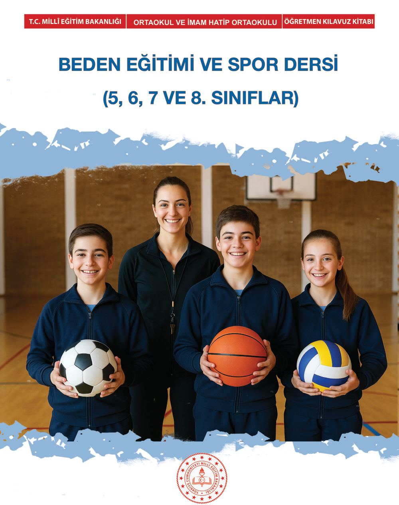

<!-- sayfa 1 -->

# BEDEN EĞİTİMİ VE SPOR DERSİ

## (5, 6, 7 VE 8. SINIFLAR)

# ÖĞRETMEN KILAVUZ KİTABI

**Yazarlar**

Dr. Sunacan İlke BAL
Dr. Hande Buşra EREN
Ali Haydar SERİN
Emre AKSOY
Esma YILMAZ
Murat TİLKİ
Osman Kürşad ÇANGIR
Özkan Sabri CANER

DEVLET KİTAPLARI

<!-- sayfa 2 -->

MİLLÎ EĞİTİM BAKANLIĞI YAYINLARI NO .................................................................. 10515
DERS KİTAPLARI DİZİSİ NO .......................................................................................... 2355

Her hakkı saklıdır ve Millî Eğitim Bakanlığına aittir. Kitabın metin, soru ve şekilleri kısmen de olsa hiçbir surette alınıp yayımlanamaz.

**Editör**
Prof. Dr. Cenk TEMEL
Doç. Dr. Deniz HÜNÜK
Doç. Dr. Hidayet Suha YÜKSEL
Doç. Dr. Irmak HÜRMERİÇ ALTUNSÖZ
Dr. Öğr. Üyesi Damla GÜLER

**Dil Uzmanı**
Sibel METİN

**Görsel Tasarımcı**
Arife ŞENEL
Cevher GÖZMEN
Dilek ASLAN
Engin DEMİRCİOĞLU
Faruk AKYÜZ
Fatih GÜNGÖR
Gerçek ÇIĞŞAR

**Çoklu Ortam Tasarımcısı**
Arzum ACAR

**Program Geliştirme Uzmanı**
Doç. Dr. Ömer NAYCİ

**Ölçme ve Değerlendirme Uzmanı**
Dr. Fatma Nur AYDIN

**Rehberlik Uzmanı**
Kâmil TOPÇU

ISBN 978-975-11-9396-4

Millî Eğitim Bakanlığı Talim ve Terbiye Kurulu Başkanlığının 11.11.2025 tarih ve 146132961 sayılı yazısı ile eğitim aracı olarak kabul edilmiştir Kurulca bu kitabın kabul edilmiş olması ders kitabından

<!-- sayfa 3 -->

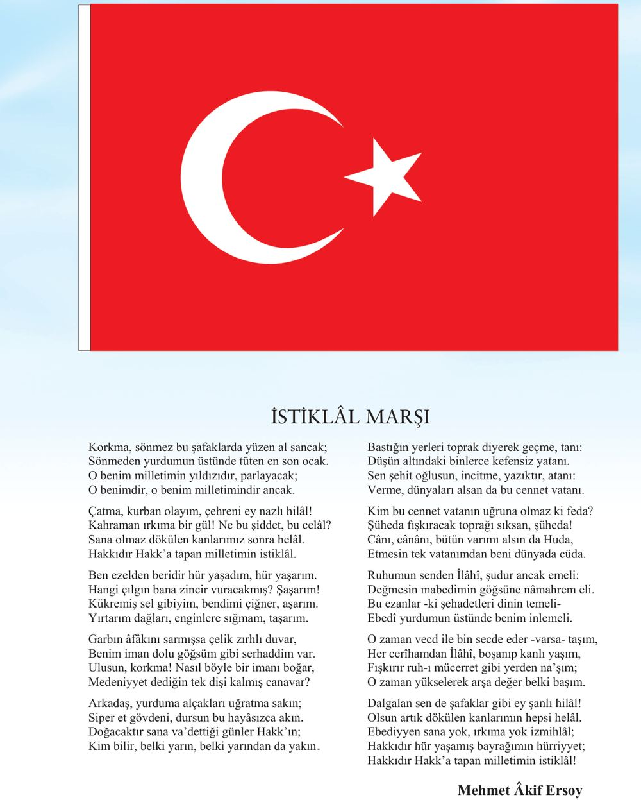

# İSTİKLÂL MARŞI

Korkma, sönmez bu şafaklarda yüzen al sancak;
Sönmeden yurdumun üstünde tüten en son ocak.
O benim milletimin yıldızıdır, parlayacak;
O benimdir, o benim milletimindir ancak.

Çatma, kurban olayım, çehreni ey nazlı hilâl!
Kahraman ırkıma bir gül! Ne bu şiddet, bu celâl?
Sana olmaz dökülen kanlarımız sonra helâl.
Hakkıdır Hakk’a tapan milletimin istiklâl.

Ben ezelden beridir hür yaşadım, hür yaşarım.
Hangi çılgın bana zincir vuracakmış? şaşarım!
Kükremiş sel gibiyim, bendimi çiğner, aşarım.
Yırtarım dağları, enginlere sığmam, taşarım.

Garbın âfâkını sarmışsa çelik zırhlı duvar,
Benim iman dolu göğsüm gibi serhaddim var.
Ulusun, korkma! Nasıl böyle bir imanı boğar,
Medeniyet dediğin tek dişi kalmış canavar?

Arkadaş, yurduma alçakları uğratma sakın;
Siper et gövdeni, dursun bu hayâsızca akın.
Doğacaktır sana va’dettiği günler Hakk’ın;
Kim bilir, belki yarın, belki yarından da yakın

Bastığın yerleri toprak diyerek geçme, tanı:
Dünyanın altındaki binlerce kefensiz yatanı.
Sen şehit oğluşun, incitme, yazıktır, atanı:
Verme, dünyaları alsan da bu cennet vatanı.

Kim bu cennet vatanın uğruna olmaz ki feda?
Şüheda fışkıracak toprağı söksek, şüheda!
Cânı, cânânı, bütün varımı alsın da Huda,
Etmesin tek vatanımdan beni dünyada cüda.

Ruhumun senden ilâhî, şudur ancak emeli:
Değmesin mabedimin göğsüne nâmahrem eli.
Bu ezanlar -ki şehadetleri dinin temeli-
Ebedî yurdumun üstünde benim inlemeli.

O zaman vecd ile bin secde eder -varsa- taşkım,
Her cerîhamdan ilâhî, boşanıp kanlı yaşım,
Fışkırır ruh-ı mücerret gibi yerden na’şım;
O zaman yükselerek arşa değer belki başım.

Dalgalan sen de şafaklar gibi ey şanlı hilâl!
Olsun artık dökülen kanlarımın hepsi helâl.
Ebediyyen sana yok, Türk'e yok izmihlâl;
Hakkıdır hür yaşamış bayrağımın hürriyet;
Hakkıdır Hakk’a tapan milletimin istiklâl!

<!-- sayfa 4 -->

GENÇLİĞE HİTABE

Ey Türk gençliği! Birinci vazifen, Türk istiklâlini, Türk Cumhuriyetini, ilelebet muhafaza ve müdafaa etmektir.

Mevcudiyetinin ve istikbalinin yegâne temeli budur. Bu temel, senin en kıymetli hazinendir. İstikbalde dahi, seni bu hazineden mahrum etmek isteyecek dâhilî ve hâricî bedhahların olacaktır. Bir gün, istiklâl ve cumhuriyeti müdafaa mecburiyetine düşersen, vazifeye atılmak için, içinde bulunacağın vaziyetin imkân ve şeraitini düşünmeyeceksin! Bu imkân ve şerait, çok namüsait bir mahiyette tezahür edebilir. İstiklâl ve cumhuriyetine kastedecek düşmanlar, bütün dünyada emsali görülmemiş bir galibiyetin mümessili olabilirler. Cebren ve hile ile aziz vatanın bütün kaleleri zapt edilmiş, bütün tersanelerine girilmiş, bütün orduları dağıtılmış ve memleketin her köşesi bilfiil işgal edilmiş olabilir. Bütün bu şeraitten daha elîm ve daha vahim olmak üzere, memleketin dâhilinde iktidara sahip olanlar gaflet ve dalâlet ve hattâ hıyanet içinde bulunabilirler. Hattâ bu iktidar sahipleri şahsî menfaatlerini, müstevlîlerin siyasî emelleriyle tevhit edebilirler. Millet, fakr u zaruret içinde harap ve bîtap düşmüş olabilir.

Ey Türk istikbalinin evlâdı! İşte, bu ahval ve şerait içinde dahi vazifen, Türk istiklâl ve cumhuriyetini kurtarmaktır. Muhtaç olduğun kudret, damarlarındaki asil kanda mevcuttur.

Mustafa Kemal Atatürk

<!-- sayfa 5 -->

MUSTAFA KEMAL ATATÜRK

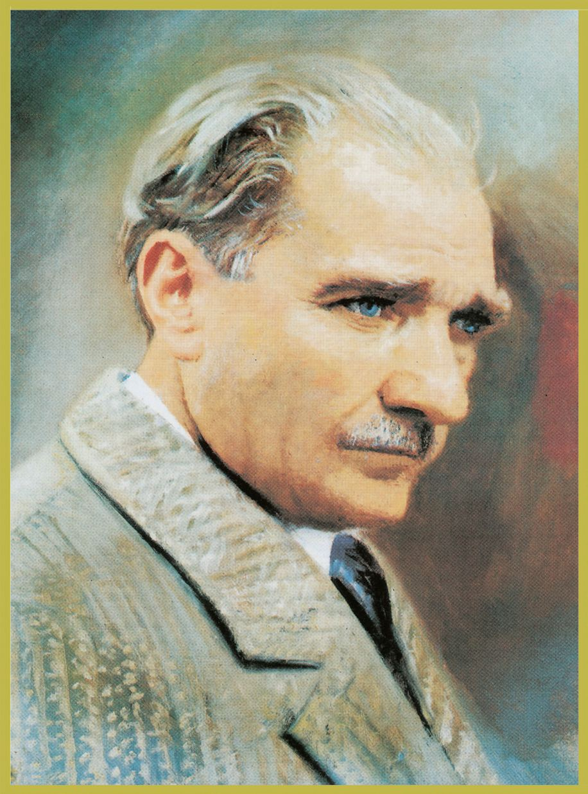
<!-- yer tutucu bulunamadı: sayfa sonuna eklendi -->

<!-- sayfa 6 -->

Verdiğiniz mesajda PDF metin katmanı boş görünüyor (`<<< >>>` arası boş). Lütfen dönüştürülmesini istediğiniz metni veya görseli paylaşın. Metni paylaştığınızda kurallara tam uyarak Markdown formatına çevirebilirim.

<!-- sayfa 7 -->

# İÇİNDEKİLER

**KİTABIN TANITIMI** .......................................................................................................... 9
**GİRİŞ** ............................................................................................................................... 11
1. BEDEN EĞİTİMİ, OYUN VE SPOR ALAN BECERİLERİ (BEOSAB) ............................. 11
2. BEDEN EĞİTİMİ VE SPOR DERSİ TEMALARI ........................................................... 12
3. PROGRAMLAR ARASI BİLEŞENLER (SOSYAL-DUYGUSAL ÖĞRENME BECERİLERİ, OKURYAZARLIK BECERİLERİ, DEĞERLER) ........................................................................ 13
4. DİSİPLİNLER ARASI VE BECERİLER ARASI İLİŞKİLER ............................................ 14
5. ÖĞRETMEN KILAVUZ KİTABI UYGULAMA KRİTERLERİ ............................................ 14 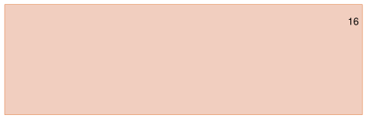

**BEDEN EĞİTİMİ VE SPOR DERSİ 5. SINIF TEMALARI** .......................................... 16
1. TEMA: HAREKET VE ZİNDELİK ................................................................................... 17
2. TEMA: İŞ BİRLİKLİ OYUNLAR ...................................................................................... 47
3. TEMA: HAYALİMDEKİ OYUN ...................................................................................... 66
4. TEMA: HAREKETİN ESTETİĞİ VE RİTMİ .................................................................... 85
5. TEMA: DAHA HIZLI, DAHA YÜKSEĞE, DAHA GÜÇLÜ VE BİRLİKTE...................... 108 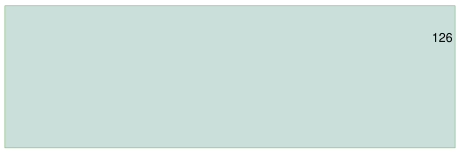

**BEDEN EĞİTİMİ VE SPOR DERSİ 6. SINIF TEMALARI** .......................................... 126
1. TEMA: SAĞLIKLA İLGİLİ FİZİKSEL UYGUNLUK ........................................................ 127
2. TEMA: HEDEF OYUNLARI .......................................................................................... 156
3. TEMA: SPOR ENGEL TANIMAZ .................................................................................. 183
4. TEMA: KÜLTÜREL BİRİKİMLERİMİZ VE OYUN .......................................................... 211
5. TEMA: HÜCUM OYUNLARI ........................................................................................ 232

<!-- sayfa 8 -->

# BEDEN EĞİTİMİ VE SPOR DERSİ 7. SINIF TEMALARI ............................................ 252
1. TEMA: PERFORMANSLA İLGİLİ FİZİKSEL UYGUNLUK ................................................... 253
2. TEMA: FİLE VE DUVAR OYUNLARI ............................................................................... 272
3. TEMA: AÇIK ALAN VE MACERA ETKİNLİKLERİ ............................................................ 295
4. TEMA: KÜLTÜREL BİRİKİMLERİMİZ VE OYUN ............................................................. 320
5. TEMA: HÜCUM OYUNLARI .......................................................................................... 339 

# BEDEN EĞİTİMİ VE SPOR DERSİ 8. SINIF TEMALARI ............................................ 357 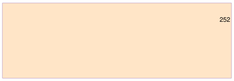
1. TEMA: EGZERSİZE KATILIM .......................................................................................... 358
2. TEMA: SPOR EĞİTİMİ ................................................................................................... 375
3. TEMA: TURNUVAYA KATILIM ....................................................................................... 405
4. TEMA: SPOR ŞENLİĞİ ................................................................................................... 428 

SÖZLÜK .............................................................................................................................. 439
KAYNAKÇA ........................................................................................................................ 443
GÖRSEL VE GENEL AĞ KAYNAKÇASI ............................................................................ 445
TÜRKİYE’NİN MÜLKİ İDARE BÖLÜMLERİ İLE KARA VE DENİZ KOMŞULARI HARİTASI ....... 446
TÜRK DÜNYASI HARİTASI ............................................................................................... 447

<!-- sayfa 9 -->

# KITABIN TANITIMI

Bu kitap, 5-8. sınıflara yönelik toplam 19 temadan oluşmaktadır. Bu temanın başında, sınıf düzeyi, tema numarası ve adı gibi bilgileri içeren bir kapak sayfası yer alır. Kapak sayfasının ardından, temaya ait öğrenme çıktıları, bileşenler, bilgi ve yaşantı örnekleri ile etkinlik örnekleri sunulmaktadır. Etkinlik örneklerinin ardından; etkinliklerin çeşitlendirme yolları, öğrenci yansımaları, öğrenme kanıtları ve farklılaştırma uygulamaları yer alır. Temanın sonunda ise etkinlikleri destekleyici eğitim materyalleri ile ölçme ve değerlendirme araçlarına ilişkin örnekler bulunmaktadır.

| | |
| :--- | :--- |
| Ders adı ve Sınıf seviyesi | BEDEN EĞİTİMİ VE SPOR DERSİ   5. SINIF TEMALARI |
| Tema numarası | 1. TEMA |
| Tema adı | HAREKET VE ZİNDELİK |
| İlgili tema alanının kare- kodu | Eba Tema Alanı Karekodu |

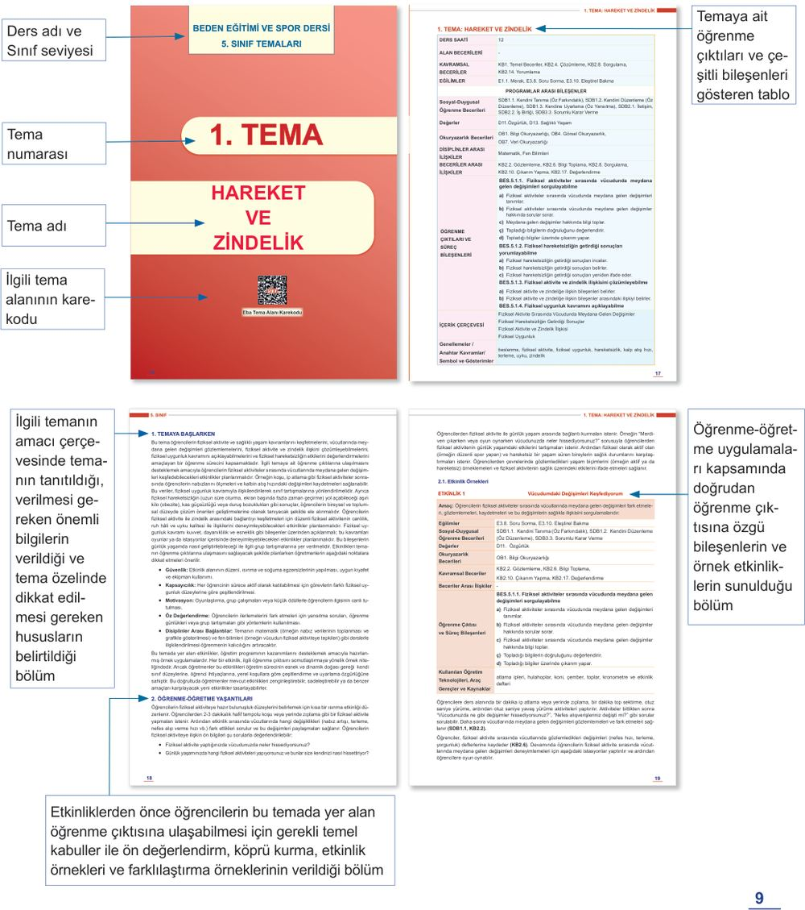

| | |
| :--- | :--- |
| İlgili temanın amacı çerçevesinde tema tanıtıldığı, verilmesi gereken önem belirtildiği ve tema üzerinde dikkat edilmesi gereken hususlar belirtildiği bölüm | 1. TEMAYA BAŞLARKEN   Bu tema öğrencilerin fiziksel aktivite ve sağlıklı yaşam kavramlarını keşfetmelerini, vücutlarında meydana gelen değişimleri gözlemlemelerini, fiziksel aktivite ve zindelik ilişkini çözümleyebilmelerini, fiziksel uygunluk kavramını açıklayabilmelerini ve fiziksel hareketsizliğin etkilerini değerlendirmelerini amaçlayan bir öğrenme sürecini kapsamaktadır. İlgili temaya ait öğrenme çıktılarına ulaşılmasını desteklemek amacıyla öğrencilerin fiziksel aktiviteler sırasında vücutlarında meydana gelen değişimleri keşfedebilecekleri etkinlikler planlanmalıdır. Örneğin koşu, ip atlama gibi fiziksel aktiviteler sonrasında öğrencilerin nabızlarını ölçmeleri ve kalbin atış hızındaki değişimleri kaydetmeleri sağlanabilir. Bu veriler, fiziksel uygunluk kavramıyla ilişkilendirilerek sınıf tartışmalarına yönlendirilmelidir. Ayrıca fiziksel hareketsizliğin (uzun süre oturma, ekran başında f... |
| Öğrenme-çıktı- uygulama/ri kapsamında doğrudan öğrenme çıktısına özgü bölüm | 2. ÖĞRENME-GASTE YANLARI   Öğrenciler, fiziksel aktivite sırasında vücutlarında gözlemledikleri değişimleri (nefes hızı, terleme, yorgunluk) defterlerine kaydeder (KB2.6). Devamında öğrencilerin fiziksel aktivite sırasında vücutlarında meydana gelen değişimleri deneyimlemeleri için aşağıdaki istasyonlar yaptırılır ve ardından öğrencilere oyun oynatılır.   Öğrencilerden fiziksel aktivite ile günlük yaşam arasında bağlantı kurmaları istenir. Örneğin “Merdiven çıkarken veya oyun oynarken vücudunuzda neler hissediyorsunuz?” sorusuyla öğrencilerden fiziksel aktivitenin günlük yaşamdaki etkilerini tartışmaları istenir. Ardından fiziksel olarak aktif olan (örneğin düzenli spor yapan) ve hareketsiz bir yaşam süren bireylerin sağlık durumlarını karşılaştırmaları istenir. Öğrencilerden çevrelerinde gözlemledikleri yaşam biçimlerini (örneğin aktif ya da hareketsiz) örneklemeleri ve fiziksel aktivitenin sağlık üzerindeki etkilerini ifade etmeleri sağlanır.   2.1. Etkinlik Örnekleri   ETKİNLİK 1   Vücudumdaki Değişimleri Keşfediyorum   Amaç: Öğrencilerin fiziksel aktiviteler sırasında vücutlarında meydana gelen değişimleri fark etmeleri, gözlemlemeleri, kaydetmeleri ve bu değişimlerin sağlıkla ilişkisini sorgulamalarıdır.   Eğilimler   E3.8. Soru Sorma, E3.10. Eleştirel Bakma   Sosyal-Duygusal Öğrenme Becerileri   SDB1.1. Kendini Tanıma (Öz Farkındalık), SDB1.2. Kendini Düzenleme (Öz Düzenleme), SDB3.3. Sorumlu Karar Verme   Değerler   D11. Özgürlük   Okuryazarlık Becerileri   OB1. Bilgi Okuryazarlığı   Kavramsal Beceriler   KB2.2. Gözlemleme, KB2.6. Bilgi Toplama, KB2.10. Çıkarım Yapma, KB2.17. Değerlendirme   Beceriler Arası İlişkiler   -   Öğrenme Çıktısı ve Süreç Bileşenleri   BES.5.1.1. Fiziksel aktiviteler sırasında vücudunda meydana gelen değişimleri sorgulayabilme   a) Fiziksel aktiviteler sırasında vücudunda meydana gelen değişimleri tanımlar.   b) Fiziksel aktiviteler sırasında vücudunda meydana gelen değişimler hakkında sorular sorar.   c) Fiziksel aktiviteler sırasında vücudunda meydana gelen değişimler hakkında bilgi toplar.   ç) Topladığı bilgilerin doğruluğunu değerlendirir.   d) Topladığı bilgiler üzerinde çıkarım yapar.   Kullanılan Öğretim Teknolojileri, Araç Gereçler ve Kaynaklar   atlama ipleri, hulahoplar, koni, çember, toplar, kronometre ve etkinlik defteri |

---

### 1. TEMA: HAREKET VE ZİNDELİK
**17**

**DERS SAATİ**
12

**ALAN BECERİLERİ**
-

**KAVRAMSAL BECERİLER**
KB1. Temel Beceriler, KB2.4. Çözümleme, KB2.8. Sorgulama, KB2.14. Yorumlama

**EĞİLİMLER**
E1.1. Merak, E3.8. Soru Sorma, E3.10. Eleştirel Bakma

**PROGRAMLAR ARASI BİLEŞENLER**
**Sosyal-Duygusal Öğrenme Becerileri**
SDB1.1. Kendini Tanıma (Öz Farkındalık), SDB1.2. Kendini Düzenleme (Öz Düzenleme), SDB1.3. Kendine Uyarlama (Öz Yansıtma), SDB2.1. İletişim, SDB2.2. İş Birliği, SDB3.3. Sorumlu Karar Verme

**Değerler**
D11. Özgürlük, D13. Sağlıklı Yaşam

**Okuryazarlık Becerileri**
OB1. Bilgi Okuryazarlığı, OB4. Görsel Okuryazarlık, OB7. Veri Okuryazarlığı

**DİSİPLİNLER ARASI İLİŞKİLER**
Matematik, Fen Bilimleri

**BECERİLER ARASI İLİŞKİLER**
KB2.2. Gözlemleme, KB2.6. Bilgi Toplama, KB2.8. Sorgulama, KB2.10. Çıkarım Yapma, KB2.17. Değerlendirme

**ÖĞRENME ÇIKTILARI VE SÜREÇ BİLEŞENLERİ**
BES.5.1.1. Fiziksel aktiviteler sırasında vücudunda meydana gelen değişimleri sorgulayabilme
a) Fiziksel aktiviteler sırasında vücudunda meydana gelen değişimleri tanımlar.
b) Fiziksel aktiviteler sırasında vücudunda meydana gelen değişimler hakkında sorular sorar.
c) Fiziksel aktiviteler sırasında vücudunda meydana gelen değişimler hakkında bilgi toplar.
ç) Topladığı bilgilerin doğruluğunu değerlendirir.
d) Topladığı bilgiler üzerinde çıkarım yapar.

BES.5.1.2. Fiziksel hareketsizliğin getirdiği sonuçları yorumlayabilme
a) Fiziksel hareketsizliğin getirdiği sonuçları inceler.
b) Fiziksel hareketsizliğin getirdiği sonuçları belirler.
c) Fiziksel hareketsizliğin getirdiği sonuçları yeniden ifade eder.

BES.5.1.3. Fiziksel aktivite ve zindelik ilişkisini çözümleyebilme
a) Fiziksel aktivite ve zindeliğe ilişkin bileşenleri belirler.
b) Fiziksel aktivite ve zindeliğe ilişkin bileşenler arasındaki ilişkiyi belirler.

BES.5.1.4. Fiziksel uygunluk kavramını açıklayabilme

**İÇERİK ÇERÇEVESİ**
Fiziksel Aktivite Sırasında Vücudunda Meydana Gelen Değişimler
Fiziksel Hareketsizliğin Getirdiği Sonuçlar
Fiziksel Aktivite ve Zindelik İlişkisi
Fiziksel Uygunluk

**Genellemeler / Anahtar Kavramlar/ Sembol ve Gösterimler**
beslenme, fiziksel aktivite, fiziksel uygunluk, hareketsizlik, kalp atış hızı, terleme, uyku, zindelik

---

### 1. TEMA: HAREKET VE ZİNDELİK
**18**

**1. TEMAYA BAŞLARKEN**
Bu tema öğrencilerin fiziksel aktivite ve sağlıklı yaşam kavramlarını keşfetmelerini, vücutlarında meydana gelen değişimleri gözlemlemelerini, fiziksel aktivite ve zindelik ilişkini çözümleyebilmelerini, fiziksel uygunluk kavramını açıklayabilmelerini ve fiziksel hareketsizliğin etkilerini değerlendirmelerini amaçlayan bir öğrenme sürecini kapsamaktadır. İlgili temaya ait öğrenme çıktılarına ulaşılmasını desteklemek amacıyla öğrencilerin fiziksel aktiviteler sırasında vücutlarında meydana gelen değişimleri keşfedebilecekleri etkinlikler planlanmalıdır. Örneğin koşu, ip atlama gibi fiziksel aktiviteler sonrasında öğrencilerin nabızlarını ölçmeleri ve kalbin atış hızındaki değişimleri kaydetmeleri sağlanabilir. Bu veriler, fiziksel uygunluk kavramıyla ilişkilendirilerek sınıf tartışmalarına yönlendirilmelidir. Ayrıca fiziksel hareketsizliğin (uzun süre oturma, ekran başında f...

**2. ÖĞRENME-GASTE YANLARI**
Öğrencilere ders alanında bir dakika ip atlama veya yerinde zıplama, bir dakika top sektirme, otuz saniye yürüme, ardından otuz saniye yavaş yürüme aktiviteleri yaptırılır. Aktiviteler bittikten sonra “Vücudunuzda ne gibi değişimler hissediyorsunuz?”, “Nefes alışverişiniz değişti mi?” gibi sorular sorulabilir. Daha sonra vücutlarında meydana gelen değişimleri gözlemlemeleri ve fark etmeleri sağlanır (SDB1.1, KB2.2).

Öğrenciler, fiziksel aktivite sırasında vücutlarında gözlemledikleri değişimleri (nefes hızı, terleme, yorgunluk) defterlerine kaydeder (KB2.6). Devamında öğrencilerin fiziksel aktivite sırasında vücutlarında meydana gelen değişimleri deneyimlemeleri için aşağıdaki istasyonlar yaptırılır ve ardından öğrencilere oyun oynatılır.

Öğrencilerden fiziksel aktivite ile günlük yaşam arasında bağlantı kurmaları istenir. Örneğin “Merdiven çıkarken veya oyun oynarken vücudunuzda neler hissediyorsunuz?” sorusuyla öğrencilerden fiziksel aktivitenin günlük yaşamdaki etkilerini tartışmaları istenir. Ardından fiziksel olarak aktif olan (örneğin düzenli spor yapan) ve hareketsiz bir yaşam süren bireylerin sağlık durumlarını karşılaştırmaları istenir. Öğrencilerden çevrelerinde gözlemledikleri yaşam biçimlerini (örneğin aktif ya da hareketsiz) örneklemeleri ve fiziksel aktivitenin sağlık üzerindeki etkilerini ifade etmeleri sağlanır.

**2.1. Etkinlik Örnekleri**

**ETKİNLİK 1**
**Vücudumdaki Değişimleri Keşfediyorum**
**Amaç:** Öğrencilerin fiziksel aktiviteler sırasında vücutlarında meydana gelen değişimleri fark etmeleri, gözlemlemeleri, kaydetmeleri ve bu değişimlerin sağlıkla ilişkisini sorgulamalarıdır.

**Eğilimler**
E3.8. Soru Sorma, E3.10. Eleştirel Bakma

**Sosyal-Duygusal Öğrenme Becerileri**
SDB1.1. Kendini Tanıma (Öz Farkındalık), SDB1.2. Kendini Düzenleme (Öz Düzenleme), SDB3.3. Sorumlu Karar Verme

**Değerler**
D11. Özgürlük

**Okuryazarlık Becerileri**
OB1. Bilgi Okuryazarlığı

**Kavramsal Beceriler**
KB2.2. Gözlemleme, KB2.6. Bilgi Toplama, KB2.10. Çıkarım Yapma, KB2.17. Değerlendirme

**Beceriler Arası İlişkiler**
-

**Öğrenme Çıktısı ve Süreç Bileşenleri**
BES.5.1.1. Fiziksel aktiviteler sırasında vücudunda meydana gelen değişimleri sorgulayabilme
a) Fiziksel aktiviteler sırasında vücudunda meydana gelen değişimleri tanımlar.
b) Fiziksel aktiviteler sırasında vücudunda meydana gelen değişimler hakkında sorular sorar.
c) Fiziksel aktiviteler sırasında vücudunda meydana gelen değişimler hakkında bilgi toplar.
ç) Topladığı bilgilerin doğruluğunu değerlendirir.
d) Topladığı bilgiler üzerinde çıkarım yapar.

**Kullanılan Öğretim Teknolojileri, Araç Gereçler ve Kaynaklar**
atlama ipleri, hulahoplar, koni, çember, toplar, kronometre ve etkinlik defteri

---

### 1. TEMA: HAREKET VE ZİNDELİK
**19**

Öğrencilerden fiziksel aktivite ile günlük yaşam arasında bağlantı kurmaları istenir. Örneğin “Merdiven çıkarken veya oyun oynarken vücudunuzda neler hissediyorsunuz?” sorusuyla öğrencilerden fiziksel aktivitenin günlük

<!-- sayfa 10 -->

# 5. SINIF

## 28

(SDB2.1) ve eğlenmeye teşvik edilir. Oyun sonunda gruplar kendi kutularındaki kartları kontrol ederek hangi bileşenin zindelikle nasıl ilişkilendirildiğini kısa bir tartışmayla değerlendirir (SDB2.1, SDB3.3, E3.10) ve zindeliğin önemine dair çıkarımlarda bulunur (KB2.10). Tartışmanın sonunda öğretmen, süreci sağlıklı yaşam değerine bağlar ve şu soruyu yöneltir: “Bu bilgiler ışığında sağlıklı bir yaşam için neler yapabilirsiniz?” (D13.1, D13.2). Zindelik ve sağlıklı yaşamla ilgili bir öğrenme günlüğü görevi verilir ve öğrencilerden bu öğrenme günlüklerini (Ek 4) düzenli olarak doldurmaları istenir.

### Çeşitlendirme
“Zindelik hazinesi oyunu” yerine fiziksel aktiviteleri içeren istasyonlar da tercih edilebilir. Her gruba daha az kart (örneğin dört kart yerine iki kart) verilebilir veya sadece iki zindelik bileşeni (uyku ve genel ağda aktivite) üzerine odaklanılabilir. Bilgi kartlarındaki talimatlar basit (on mekik yerine beş mekik) tutulabilir. Görevleri yerine getirmek için zaman sınırı koyulmayabilir. Her grup için daha fazla kart (örneğin dört yerine altı kart) eklenebilir. Tüm kartların belirli bir sürede toplanması için bir zaman sınırı (on dakika gibi) koyulabilir. En hızlı grup ek puan kazanabilir. Doğru kutuya atılan kartlar için puan verilip yanlış kutuya atılan kartlar için puan kırılabilir. Kart kutuya atılmadan önce “Bu bilgi, zindeliğe nasıl katkıda bulunur?” sorusu tartışılır ve cevabı kâğıda yazılarak diğer tura geçilebilir.

### Öğrenme Kanıtları ve Etkinlik Yansıması
Bu öğrenme çıktısının değerlendirilmesinde öğrenme günlüğü görevi formu (Ek 4) kullanılabilir. Etkinlik yansıması kapsamında öğrencilere aşağıdaki sorular yöneltilebilir.

* Oyun sırasında yaptığınız fiziksel görevlerin zindelikle bağlantısı ne olabilir?
* Araştırmanızdan öğrendiğiniz bir sağlıklı yaşam alışkanlığını günlük hayatınıza nasıl uygulayabilirsiniz?
* Fiziksel aktivite eksikliğinin yol açtığı sağlık sorunlarını önlemek için neler yapabilirsiniz?

### ETKİNLİK 4 | Fiziksel Uygunluk Kavramını Öğreniyorum
**Amaç:** Öğrencilerin fiziksel uygunluk bileşenlerini eğlenceli bir oyun yoluyla deneyimleyerek tanımaları ve sağlıklı bir yaşam için fiziksel uygunluğun önemini kavramalarıdır.

| | |
| :--- | :--- |
| **Eğilimler** | E1.1. Merak |
| **Sosyal-Duygusal Öğrenme Becerileri** | SDB1.3. Kendine Uyarlama (Öz Yansıtma) |
| **Değerler** | D13. Sağlıklı Yaşam |
| **Okuryazarlık Becerileri** | - |
| **Kavramsal Beceriler** | KB2.17. Değerlendirme |
| **Beceriler Arası İlişkiler** | - |
| **Öğrenme Çıktısı ve Süreç Bileşenleri** | BES.5.1.4. Fiziksel uygunluk kavramını açıklayabilme |
| **Kullanılan Öğretim Teknolojileri, Araç Gereçler ve Kaynaklar** | koniler, kavram kartları ve müzik çalar (hoparlör) |

---

# 74

## 5. SINIF

### Açıklama
Tasarlanan oyunlar 23 Nisan Ulusal Egemenlik ve Çocuk Bayramı kapsamında okul bahçesi, spor salonu veya etkinlik alanında düzenlenecek bir oyun istasyonu uygulaması yoluyla diğer öğrencilere tanıtılarak oynatılabilir.

### Çeşitlendirme
Değerlendirme süreci, adil oyun davranışını pekiştirmek için öğrencilerin tasarladıkları oyunlara jüri dâhil edilerek gerçekleştirilebilir. Öğrencilerin etkinlik sürecinde sergiledikleri olumlu tutum ve davranışların görünür kılınması amacıyla semboller (Ek 3) yer almaktadır. Bunlardan “takdir rozeti” oyunlarda iş birliği, empati, sorumluluk ve adil oyun ilkelerine uygun davranış gösteren öğrencilere; “adil oyun gülümsemesi” ise özellikle centilmenlik yapan ve kurallara saygı gösteren öğrencilerin ödüllendirilmesinde kullanılır.

### Öğrenme Kanıtları ve Etkinlik Yansıması
Bu öğrenme çıktısının değerlendirilmesinde öz değerlendirme formu (Ek 5) kullanılabilir. Öğrenciler, bu etkinlikte kendi performanslarını adil oyun anlayışı öz değerlendirme formu (Ek 4) ile değerlendirebilir. Etkinlik yansıması kapsamında öğrencilere aşağıdaki sorular yöneltilebilir:

* Adil oyun kurallarına uymak, oyundan aldığınız mutluluğa nasıl katkıda bulunur?
* En adil davrandığınız bir durumu anlatır mısınız?
* Oyun oynarken nelere dikkat etmeniz gerektiğini düşünüyorsunuz? Bu düşüncelere nasıl ulaştınız?

### 2.2. Farklılaştırma

#### Zenginleştirme
Öğrencilerden farklı kültürlere ait geleneksel veya modern oyunları araştırmaları, bu oyunların kurallarını ve amaçlarını öğrenmeleri, oyunlarda kullanılan malzemeleri incelemeleri istenebilir. Bu incelemeler sayesinde öğrenciler kendi tasarlayacakları oyunlarda bu oyunlardan esinlenmeye ve yeni bileşenler geliştirmeye teşvik edilebilir. Tasarım sürecinde öğrencilerden oluşturdukları özgün oyunların yasal haklarını nasıl koruyabileceklerine dair araştırma yapmaları, oyun fikrinin patent ya da telif hakkı gibi yollarla nasıl tescillenebileceğini öğrenmeleri istenebilir. Hazırlanan oyunların yalnızca kendi gruplarında değil farklı öğrenci grupları tarafından da oynanması sağlanabilir. Böylece öğrenciler, akranlarından aldıkları geri bildirimlere göre oyunlarını yeniden gözden geçirme ve geliştirme fırsatı elde edebilir. Ayrıca tasarladıkları oyunlara her öğrencinin katılımını sağlamaları beklenebilir. Örneğin özel gereksinimli olan bir arkadaşının da oyuna katılabilmesi için oyun alanının düzenlenmesi, kuralların esnetilmesi veya farklı iletişim biçimlerinin kullanılması gibi uyarlamalar yapmaları için teşvik edilebilirler. Tasarım sürecinde kullanılacak malzemelere geri dönüştürülebilir kaynaklar (karton kutular, plastik şişeler, eski kumaş parçaları vb.) dâhil edilerek çevre bilinci yüksek ürünler ortaya çıkması sağlanabilir. Oyun tasarımı sürecine “adil oyun” [fair play (feyr pley)] ilkeleri de entegre edilerek öğrencilerin bu kavramı senaryo yazma ya da drama çalışmalarıyla somutlaştırmaları istenebilir.

#### Destekleme
Özel gereksinimli öğrencilerin de oyunlara katılımını artırmak amacıyla topun parlak renkli seçilmesi, materyallerin yumuşak dokulu ya da hafif olması ve dokunsal yönergeler gibi kapsayıcı uyarlamalar önerilebilir. Öğrencilerin özgün oyun tasarımı sürecinde yazılı, görsel ve dijital materyallerden yararlanmaları; farklı oyun kültürlerini tanımalar...

---

# 119

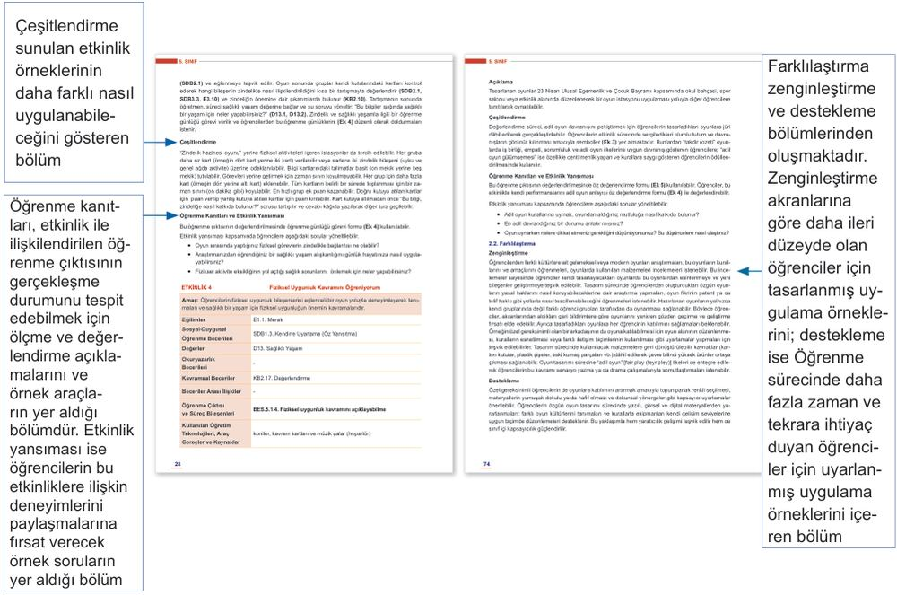

durumlar (kuralların aniden değiştirilmesi, zaman sınırlaması eklenmesi ya da değerlendirme birleştirilmesi vb.), interaktif edebiyatın yetişkinlerle birlikte oynanan grup içi iş birliği temelli oyunları gibi etkinlikler benzetilebilir.

### Destekleme
Hafif hareket içeren, çok az yorulma ile oynanabilecek oyunlar (yerde oturma, uzanma, tepinme, vb.) interaktif edebiyatın yetişkinlerle birlikte oynanan grup içi iş birliği temelli oyunları gibi etkinlikler benzetilebilir. Öğrencilerin grup içinde birbirleriyle etkileşim kurmalarını sağlayacak etkinlikler benzetilebilir. Öğrencilerin grup içinde birbirleriyle etkileşim kurmalarını sağlayacak etkinlikler benzetilebilir. Öğrencilerin grup içinde birbirleriyle etkileşim kurmalarını sağlayacak etkinlikler benzetilebilir. Öğrencilerin grup içinde birbirleriyle etkileşim kurmalarını sağlayacak etkinlikler benzetilebilir. Öğrencilerin grup içinde birbirleriyle etkileşim kurmalarını sağlayacak etkinlikler benzetilebilir. Öğrencilerin grup içinde birbirleriyle etkileşim kurmalarını sağlayacak etkinlikler benzetilebilir. Öğrencilerin grup

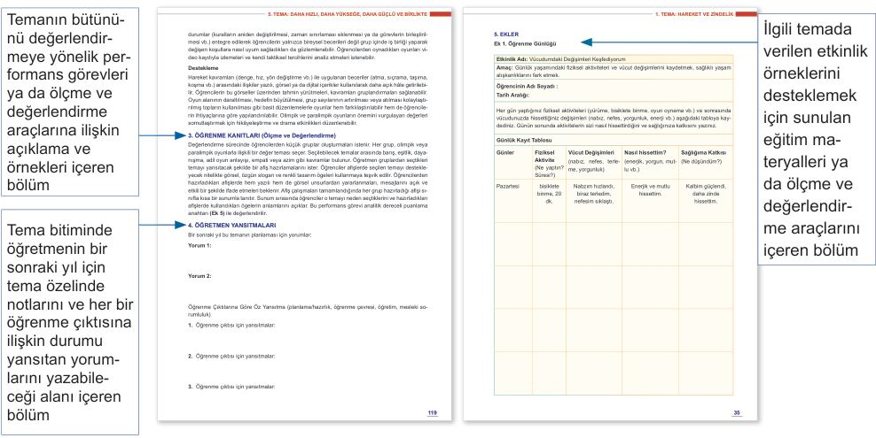
<!-- yer tutucu bulunamadı: sayfa sonuna eklendi -->

<!-- sayfa 11 -->

# GİRİŞ

Beden eğitimi ve spor dersi ile öğrencilerin hareket becerilerini sergilemeleri, hareket kavramlarını uygulamaları, oyunlarda taktik ve strateji geliştirmeleri, düzenli fiziksel aktiviteye katılmaları, ritmik hareket edebilme becerilerini geliştirmeleri, fiziksel uygunluk sağlayabilmeleri, eşle/grupla hareket edebilmeleri, adil oyun anlayışına uygun davranmaları, takım/grup liderliği sergilemeleri ve güvenli ortam oluşturmaları amaçlanmaktadır. “Beden Eğitimi, Oyun ve Spor Alan Becerileri” (BEOSAB) olarak tanımlanan bu beceriler ile kavramsal, sosyal-duygusal ve okuryazarlık becerileri birleştirilerek çocukların sahip oldukları değerleri öğrenme ortamına yansıtmaları ve hareket yoluyla yeni değerler kazanmaları; sağlıklı yaşam tarzının önemini kavrayarak düzenli fiziksel aktivite alışkanlığı edinmeleri ve tüm bu bilgi, beceri ve tutumları hem diğer derslere hem de günlük yaşamlarına aktarabilmeleri hedeflenmektedir. Bu program fiziksel, bilişsel, sosyal-duygusal gelişim alanlarını göz önünde bulundurarak çok yönlü bir eğitim anlayışını benimsemektedir. Bu bağlamda Beden Eğitimi ve Spor Dersi Kılavuz Kitabı; programın hedefleri ve yapısı doğrultusunda öğretmenlere rehberlik etmesi, tüm bu bileşenlerin öğrenme çıktıları ile ilişkilendirilen öğrenme-öğretme yaşantılarında somut örneklere dönüştürülmesi ve destekleyici materyallerin sunulması amacıyla hazırlanmıştır.

## 1. BEDEN EĞİTİMİ, OYUN VE SPOR ALAN BECERİLERİ (BEOSAB)

Beden eğitimi ve spor, bireylerin fiziksel yetkinliklerini geliştirmelerini, sağlıklı bir yaşam sürdürmelerini, sosyal ve bireysel beceriler kazanmalarını sağlayan bir alan olarak insan yaşamında ve eğitim ortamlarında büyük bir öneme sahiptir. Hareket, yaşamın önemli bir parçasıdır ve birey, kazanması gereken birçok niteliğe hareket sayesinde sahip olur. Hareket etmek; birçok hareketi yapabilmek için bedenin gereken yetkinliği kazanmasını sağlarken aynı zamanda fiziksel uygunluk (sağlığa/performansa ilişkin), takım çalışması, problem çözme, stratejik düşünme, karar verme gibi birçok becerinin gelişmesine de katkıda bulunur. Beden eğitimi, oyun ve spor alan becerileri; bireylerin hareket becerilerini geliştirmeye, hareket kavramlarını öğrenmelerine, fiziksel aktiviteye katılımlarını artırmaya, sporun etik değerlerini içselleştirmeye ve güvenli bir ortamda hareket etmelerine odaklanmaktadır. Bu beceriler aşağıda kısaca tanımlanmaktadır.

**BEOSAB1. Hareketi Sergileme Becerisi:** Bireyin fiziksel aktivitelerde kaba, ince, spora hazırlayıcı ve spora özgü hareket becerilerini anlaması; bu becerileri aşamalı olarak geliştirmesi ve farklı durumlara uyum sağlayarak uygulaması sürecini ifade eder. Bu beceri, bireyin hareketleri doğru ve uygun şekilde gerçekleştirme kapasitesini geliştirmesine olanak tanır.

**BEOSAB2. Hareket Kavramlarını Uygulama Becerisi:** Bireyin beden farkındalığı, alan farkındalığı, efor (çaba) ve hareket ilişkileri gibi temel kavramlar ile hareket becerileri arasında ilişki kurarak becerileri uygulamasını içerir. Bu beceri, bireyin fiziksel aktivitelerde bilinçli ve etkili bir şekilde hareket etmesini sağlar.

**BEOSAB3. Taktik ve Strateji Geliştirme Becerisi:** Fiziksel aktivite, oyun vb. sportif etkinlikler sırasında karşılaşılan durumları/problemleri belirlemek, bu durumlara/problemlere yönelik çözüm yolları geliştirmek ve uygulamak için kullanılan bir beceridir. Bu beceri; bireyin stratejik düşünme ve planlama yeteneğini geliştirir, hareketlerini daha etkili ve bilinçli bir şekilde gerçekleştirmesini sağlar.

**BEOSAB4. Fiziksel Aktiviteye Katılma Becerisi:** Bireyin fiziksel aktivitelerin gerekliliğini fark etmesini, bu aktiviteler için uygun planlar geliştirmesini ve belirlenen hedeflere ulaşmak için bu planları uygulamasını içerir. Bu beceri, bireyin yaşam boyu fiziksel aktivite alışkanlığı kazanmasına ve sağlıklı bir yaşam tarzı benimsemesine katkıda bulunur.

**BEOSAB5. Ritmik Hareket Etme Becerisi:** Bireyin hareket veya müzikle ilişkilendirilen ritmi algılamasını bu ritme uygun hareketler yapmasını ve ritmik becerilerini etkili bir şekilde sergilemesini

<!-- sayfa 12 -->

içerir. Bu beceri; bireyin koordinasyonunu, estetik duygusunu ve müzikle uyumlu hareket yetkinliğini geliştirmesine katkıda bulunur.

**BEOSAB6. Fiziksel Uygunluk Sağlama Becerisi:** Bireyin sağlıkla (kalp-damar sistemi dayanıklılığı, kas kuvveti, kas dayanıklılığı, esneklik, vücut kompozisyonu vb.) ve performansla ilişkili (kuvvet, çeviklik, dayanıklılık, hız vb.) uygunluk bileşenlerini açıklamasını, bu bileşenleri fiziksel aktivitelerde uygulamasını ve fiziksel uygunluk düzeyini geliştirmeye yönelik çalışmalar yapmasını ifade eder. Bu beceri, bireyin sağlıklı bir yaşam sürdürmesine ve fiziksel performansını artırmasına olanak tanır.

**BEOSAB7. Eşle/Grupla Hareket Etme Becerisi:** Bireyin takım çalışması veya grup etkinlikleri sırasında rolleri tanımlamasını, belirlenen rolleri yerine getirmesini ve diğer bireylerle uyumlu hareket etmesini içerir. Bu beceri, bireyin sosyal etkileşim becerilerini ve takım uyumunu geliştirerek uyum içinde hareket etmesini sağlar.

**BEOSAB8. Adil Oyun Anlayışına Uygun Davranma Becerisi:** Spor ve fiziksel aktivitelerde dürüstlük, saygı, eşitlik, sportmenlik gibi temel etik değerleri benimsemeyi ifade eder. Bireyin kurallara uymasını, rakiplerine ve takım arkadaşlarına karşı saygılı davranmasını, aynı zamanda iş birliği içinde hareket etmesini içerir. Adil oyun anlayışına uygun davranma becerisi; bireyin spor katılımını olumlu bir deneyime dönüştürürken teknik becerilerini geliştirme, sosyal etkileşimde bulunma ve kişisel sorumluluk bilincini artırma fırsatları sunar. Bu beceri, bireyin etik değerlere bağlılığını, sorumluluk bilincini ve sportmenlik davranışlarını geliştirmesine katkıda bulunur.

**BEOSAB9. Takım/Grup Liderliği Sergileme Becerisi:** Beden eğitimi, spor, fiziksel aktivite veya hareket temelli grup etkinlikleri sırasında bireyin liderlik özelliklerini tanımasını ve bu özellikleri etkin bir şekilde uygulayarak grubu yönlendirme, motive etme ve organize etme kapasitesini ifade eder. Bireyin sorumluluk almasını, karar verme süreçlerine katılmasını ve etkili iletişim becerilerini geliştirmesini sağlar. Bu beceri, grup dinamiklerini anlamaya ve grup hedeflerine ulaşılmasına katkıda bulunur.

**BEOSAB10. Güvenli Ortam Oluşturma Becerisi:** Bireyin fiziksel aktivite, oyun veya spor etkinlikleri sırasında kendisinin ve çevresindekilerin sağlığını tehdit edebilecek davranışlardan uzak durmasını ve bu tür durumlara karşı önleyici tedbirler almasını içerir. Bu beceri; bireyin riskleri tanıma, güvenli bir çevre sağlama ve sağlığı koruma bilincini geliştirmesini amaçlar. Güvenli ortam oluşturma becerisi kapsamında bireyin sakatlık riski, bilinçsiz fiziksel aktivite veya zararlı içeriklerden uzak durması sağlanır. Bu süreç, bireyin hem kendi güvenliğini hem de çevresindekilerin sağlığını korumasına olanak tanır ve toplumsal sağlık bilincini destekler.

## 2. BEDEN EĞİTİMİ VE SPOR DERSİ TEMALARI

Beden eğitimi ve spor dersi temalarının içerik çerçevesi oluşturulurken ilkokulda öğrenilen becerilerin ilişkilendirilmesi esas alınmış, çocukların gelişimsel özellikleri ve ihtiyaçları gözetilmiş, hareket yetkinliği ve yaşam boyu fiziksel aktivite alışkanlığının kazandırılması hedeflenmiş ve tüm yapı, Türkiye TYMM ortak metninde yer alan beceriler çerçevesinde bütüncül bir uyum içinde hazırlanmıştır. Beden Eğitimi ve Spor Dersi Öğretim Programı’nın içerik çerçevesi oluşturulurken sporlara hazırlayıcı oyun türlerinde çeşitlilik sağlanmış, özelleşmiş hareket becerilerinin gelişimi sürdürülmüş, fiziksel uygunluk ve zindelik gelişimi ile ilgili konulara yer verilmiş, kültürel birikimlerimizin yaşatılması hedeflenmiş, yaşam boyu fiziksel aktivite alışkanlığının kazandırılması amacı dikkate alınmış, çocukların ihtiyaçları gözetilmiş ve TYMM beceri çerçevesi ile uyum esas alınmıştır. Oyun temaları içerisinde yer alan kategoriler (iş birlikli, hücum, hedef, file/duvar vb.) farklı oyun kümelerini temsil etmektedir. Bu temalarda öğrencilerden farklı sporlara hazırlayıcı oyun ve etkinlikleri deneyimlemeleri beklenmektedir. Fiziksel uygunluk ve zindelik ile ilgili temalarda öğrencilerin ilkokulda temellendirdiği fiziksel aktivite ve sağlık ilişkisini fiziksel uygunluk ve zindelik bağlamında sürdürmesini sağlayan içeriklere yer verilmiştir Atletizm ve jimnastik ile ilgili temalarda öğrencilerin hem ilkokulda öğrendiği hareket

<!-- sayfa 13 -->

becerilerini ilişkilendirerek pekiştirmesi hem de bu sporların temel becerilerini edinmesi hedeflenmiştir. Kültürel birikimlerimiz ve oyunla ilgili temalarda ise öğrencilerin hem Türk sporunda öncü olan isimleri tanımaları hem de kültürümüzün önemli parçaları olan geleneksel oyunları zenginleştirmeleri ve halk oyunlarını öğrenmeleri hedeflenmiştir. Öğrencilerin 8. sınıfa geldiklerinde ise artık spora özgü becerilere doğrudan başlangıç yapmaları, kendi egzersiz planlamalarını yapabilmeleri ve organizasyonla ilgili görevlerde etkin şekilde yer almaları hedeflenmiştir. Bu temalarının sınıflara göre dağılımı Tablo 1'de sunulmuştur.

**Tablo 1. Beden Eğitimi ve Spor Dersi Sınıflara Göre Temalar**

| 5. SINIF | 6. SINIF | 7. SINIF | 8. SINIF |
| :--- | :--- | :--- | :--- |
| BES.5.1. Hareket ve Zindelik | BES.6.1. Sağlıkla İlgili Fiziksel Uygunluk | BES.7.1. Performansla İlgili Fiziksel Uygunluk | BES.8.1. Egzersize Katılım |
| BES.5.2. İş Birlikli Oyunlar | BES.6.2. Hedef Oyunları | BES.7.2. File ve Duvar Oyunları | BES.8.2. Spor Eğitimi |
| BES.5.3. Hayalimdeki Oyun | BES.6.3. Spor Engel Tanımaz | BES.7.3. Açık Alan ve Macera Etkinlikleri | BES.8.3. Turnuvaya Katılım |
| BES.5.4. Hareketin Estetiği ve Ritmi | BES.6.4. Kültürel Birikimlerimiz ve Oyun | BES.7.4. Kültürel Birikimlerimiz ve Oyun | BES.8.4. Spor Şenliği |
| BES.5.5. Daha Hızlı, Daha Yükseğe, Daha Güçlü ve Birlikte | BES.6.5. Hücum Oyunları | BES.7.5. Hücum Oyunları | |

### 3. PROGRAMLAR ARASI BİLEŞENLER (SOSYAL-DUYGUSAL ÖĞRENME BECERİLERİ, OKURYAZARLIK BECERİLERİ, DEĞERLER)

Beden eğitimi ve spor dersi etkinlikleri TYMM ortak metninde belirtilen programlar arası bileşenlerle bir bütün olarak incelenip planlanmalıdır. Sosyal-duygusal öğrenme becerileri, erdem-değer-eylem çerçevesi ve okuryazarlık becerileri göz önüne alınarak BEOSAB'a ulaşmak için etkili öğrenme süreçleri geliştirilmelidir. Örneğin öğrencilerin düzenli fiziksel aktiviteye katılım süreçlerinin motivasyon, öz güven, yeterlik ve etkileşim gibi çeşitli yönleri göz önünde bulundurulduğunda beden eğitimi ve spor dersi öğretim sürecinin sosyal-duygusal öğrenme becerilerinden kendini tanıma, öz düzenleme ve uyum becerileri gibi beceriler olmadan başarılı bir şekilde gerçekleşmeyeceği dikkate alınmalıdır.

Erdem-Değer-Eylem Çerçevesi, beden eğitimi ve spor dersinin amaçlarına ulaşabilmesi için öğrenme-öğretme uygulamalarında dersin temaları ile tutarlı bir biçimde ele alınması gereken bir diğer önemli bileşendir. Sağlıklı bir kişilik yapısı; bireyin kişisel gelişimi, sosyal açıdan yaşadığı topluma uyumu ve fiziksel çevresiyle etkileşimi ile doğrudan ilişkilidir. Olumlu kişilik özelliklerinin insanın sosyal ve fiziksel çevresiyle ilişkilerinde ortaya çıkmasını sağlayan değerler; insan, toplum ve çevre açısından önemli bir yapıdır Örneğin adalet dostluk dürüstlük estetik sağlıklı yaşam saygı ve

<!-- sayfa 14 -->

sorumluluk gibi değerler beden eğitimi ve spor derslerinde eyleme geçirilmeli ve öğrenme-öğretme süreçlerinde ortaya konulmalıdır. Erdem-Değer-Eylem Çerçevesi, Beden Eğitimi ve Spor Dersi Öğretim Programı’nın hedeflediği beceriler ve içerik çerçevesi ile uyumlu bir şekilde bu sürecin doğal bir bileşeni olarak değerlendirilmelidir.

Modelde tanımlanan okuryazarlık becerileri ise öğrencilerin çok yönlü gelişiminin önemli bir parçasıdır. Bilgi, kültür ve sürdürülebilirlik okuryazarlığı; dijital, görsel okuryazarlık becerilerinin farkındalık, işlevsellik ve eylemsellik düzeyleri beden eğitimi ve spor dersinin temel amaçlara ulaşabilmesinin tamamlayıcı bir unsuru olarak ele alınmalı ve süreç bileşenleri öğrenme-öğretme sürecinde gerçekleştirilen etkinliklerle birleştirilmelidir.

## 4. DİSİPLİNLER ARASI VE BECERİLER ARASI İLİŞKİLER

Beden eğitimi ve spor dersinde edinilen bilgi ve becerileri öğrenciler hayat bilgisi, müzik ve fen bilimleri gibi diğer disiplinlerle ilişkilendirilebilir. Öğrenme-öğretme uygulamalarında öğrencilerin beden eğitimi ve spor dersinde edindikleri bilgileri farklı disiplinlerle ilişkilendirerek bilginin farklı durumlardaki kullanımını deneyimlemeleri sağlanmalıdır.

Beceriler arası ilişkiler ise öğrenme çıktılarıyla doğrudan bağlantılı olmasa da öğretim programının temalarının hedeflerine ulaşmak için gerekli olan alan becerilerini ve kavramsal becerileri ifade etmektedir. Öğrenme ve öğretme süreçlerinin disiplinler arası ve beceriler arası ilişkileri etkin olarak kullanacak şekilde planlanması, programın bütüncül yaklaşımının etkili olabilmesi için önem taşımaktadır. Bu bağlamda kavramsal becerilerden bütünleşik, üst düzey düşünme ve temel becerilerin etkinliklerde işletilmesi ve alan becerileri ile bağlantısının kurulması önem taşımaktadır.

## 5. ÖĞRETMEN KILAVUZ KİTABI UYGULAMA KRİTERLERİ

Bu öğretmen kılavuz kitabı, TYMM Beden Eğitimi ve Spor Dersi Öğretim Programı doğrultusunda beden eğitimi ve spor dersi öğretmenlerine etkinlik tasarlama süreçlerinde rehberlik etmesi amacıyla hazırlanmıştır.

* Kılavuz kitapta yer alan etkinlikler, TYMM’nin öngördüğü bütüncül eğitim anlayışı doğrultusunda BEOSAB, kavramsal beceriler, eğilimler, değerler, okuryazarlık ve sosyal-duygusal öğrenme becerilerini kapsayacak şekilde hazırlanmıştır. Öğrenme-öğretme uygulamalarında bütüncül anlayışın hayat bulmasına dikkat edilmelidir.
* Etkinliklerde bireysel, sosyal ve çevresel farklılıklar göz önünde bulundurularak tüm öğrencilerin katılımını destekleyecek şekilde çeşitlendirme ve uyarlamalar yapılması önem taşımaktadır.
* Farklı sınıf seviyelerine göre etkinlikler tasarlanırken önceki düzeylerdeki öğrenmeler dikkate alınmalı, eksikliklerin giderilmesine yönelik diğer branş ve sınıf öğretmenleriyle iş birliği yapılmalıdır.
* Etkinlikler öğrencilerin fiziksel aktiviteye katılımı teşvik ederken, öğrencilere çeşitli temel hareket becerilerini deneyimleyebilecekleri çok yönlü gelişim fırsatları sunularak yapılandırılmalıdır. Buna ek olarak etkinlikler; eğlenceli, öz güveni destekleyen, sosyal etkileşimi teşvik eden ve bireysel farklılıkları dikkate alan öğrenme ortamlarında uygulanmalıdır.
* Öğretmenlerden kendi sınıflarına uygun etkinlikler hazırlarken öğrencilerin etkinliklere aktif katılımını sağlayan, problem çözme ve iş birliğine dayalı öğrenmeyi teşvik eden model temelli yaklaşımları (spor eğitimi, taktiksel oyun, bireysel ve sosyal sorumluluk, akran öğretimi, iş birlikli öğretim modeli vb.) ve uygun öğretim stillerini (komut, alıştırma, eşli çalışma, kendini denetleme, katılım, yönlendirilmiş buluş, problem çözme, öğrencinin tasarımı, öğrencinin başlatması, kendi kendine öğrenme) seçmesi beklenmektedir.

<!-- sayfa 15 -->

* Etkinliklerde ısınma, soğuma ve esnetme hareketleri çocukların gelişim özellikleri göz önünde bulundurularak uygulanmalı ve etkinlik özelinde seçilmelidir.
* Kılavuz kitapta beden eğitimi ve spor dersi 5-8. sınıflar düzeyinde yer alan tüm öğrenme çıktıları için örnek etkinlikler hazırlanmıştır. Kitapta yer alan etkinlikler, öğretim programının öğrenme çıktılarını desteklemek ve somutlaştırmak amacıyla hazırlanmış örnek uygulamalardır. Hem öğretim sürecinin esnek ve dinamik doğası gereği hem de beden eğitimi ve spor dersinin konu çeşitliliği gereği öğretmenler bu etkinlikleri kendi sınıf düzeylerine, öğrenci ihtiyaçlarına ve yerel koşullara göre çeşitlendirme ve uyarlama özgürlüğüne sahiptir. Bu doğrultuda öğretmenler mevcut etkinlikleri zenginleştirebilir, sadeleştirebilir ya da öğrenme çıktısını karşılayacak yeni etkinlikler tasarlayabilirler.

<!-- sayfa 16 -->

BEDEN EĞİTİMİ VE SPOR DERSİ
5. SINIF TEMALARI

# 1. TEMA

## HAREKET VE ZİNDELİK

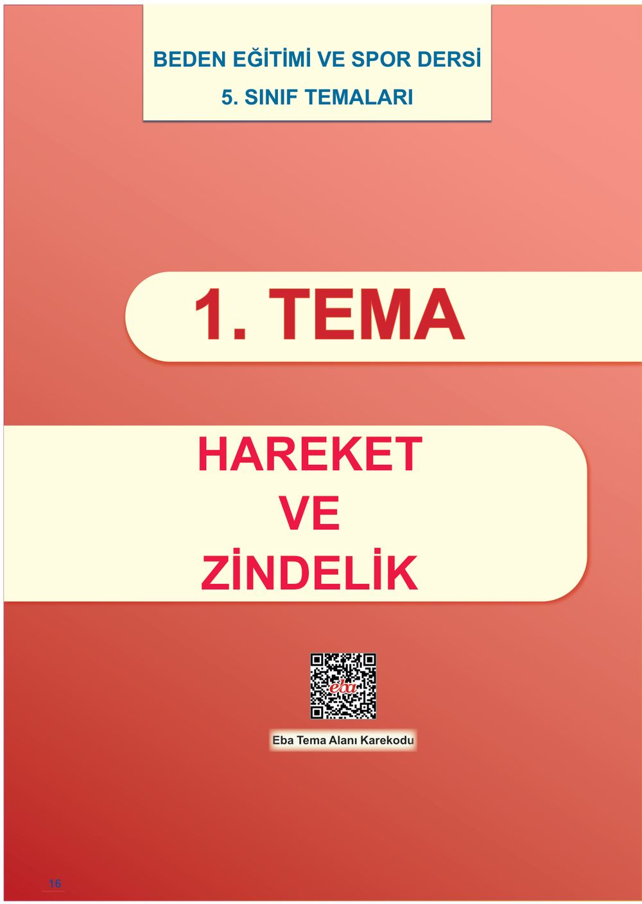
Eba Tema Alanı Karekodu

<!-- sayfa 17 -->

# 1. TEMA: HAREKET VE ZİNDELİK

| | |
| :--- | :--- |
| **DERS SAATİ** | 12 |
| **ALAN BECERİLERİ** | - |
| **KAVRAMSAL BECERİLER** | KB1. Temel Beceriler, KB2.4. Çözümleme, KB2.8. Sorgulama, KB2.14. Yorumlama |
| **EĞİLİMLER** | E1.1. Merak, E3.8. Soru Sorma, E3.10. Eleştirel Bakma |
| | **PROGRAMLAR ARASI BİLEŞENLER** |
| **Sosyal-Duygusal Öğrenme Becerileri** | SDB1.1. Kendini Tanıma (Öz Farkındalık), SDB1.2. Kendini Düzenleme (Öz Düzenleme), SDB1.3. Kendine Uyarlama (Öz Yansıtma), SDB2.1. İletişim, SDB2.2. İş Birliği, SDB3.3. Sorumlu Karar Verme |
| **Değerler** | D11. Özgürlük, D13. Sağlıklı Yaşam |
| **Okuryazarlık Becerileri** | OB1. Bilgi Okuryazarlığı, OB4. Görsel Okuryazarlık, OB7. Veri Okuryazarlığı |
| **DİSİPLİNLER ARASI İLİŞKİLER** | Matematik, Fen Bilimleri |
| **BECERİLER ARASI İLİŞKİLER** | KB2.2. Gözlemleme, KB2.6. Bilgi Toplama, KB2.8. Sorgulama, KB2.10. Çıkarım Yapma, KB2.17. Değerlendirme |
| **ÖĞRENME ÇIKTILARI VE SÜREÇ BİLEŞENLERİ** | **BES.5.1.1. Fiziksel aktiviteler sırasında vücudunda meydana gelen değişimleri sorgulayabilme** a) Fiziksel aktiviteler sırasında vücudunda meydana gelen değişimleri tanımlar. b) Fiziksel aktiviteler sırasında vücudunda meydana gelen değişimler hakkında sorular sorar. c) Meydana gelen değişimler hakkında bilgi toplar. ç) Topladığı bilgilerin doğruluğunu değerlendirir. d) Topladığı bilgiler üzerinde çıkarım yapar. **BES.5.1.2. Fiziksel hareketsizliğin getirdiği sonuçları yorumlayabilme** a) Fiziksel hareketsizliğin getirdiği sonuçları inceler. b) Fiziksel hareketsizliğin getirdiği sonuçları farklı örneklerle açıklar. c) Fiziksel hareketsizliğin getirdiği sonuçları yeniden ifade eder. **BES.5.1.3. Fiziksel aktivite ve zindelik ilişkisini çözümleyebilme** a) Fiziksel aktivite ve zindeliğe ilişkin bileşenleri belirler. b) Fiziksel aktivite ve zindeliğe ilişkin bileşenler arasındaki ilişkiyi belirler. **BES.5.1.4. Fiziksel uygunluk kavramını açıklayabilme** |
| **İÇERİK ÇERÇEVESİ** | Fiziksel Aktivite Sırasında Vücudunda Meydana Gelen Değişimler Fiziksel Hareketsizliğin Getirdiği Sonuçlar Fiziksel Aktivite ve Zindelik İlişkisi Fiziksel Uygunluk |
| **Genellemeler /** | beslenme fiziksel aktivite fiziksel uygunluk hareketsizlik kalp atış hızı |

<!-- sayfa 18 -->

# 1. TEMAYA BAŞLARKEN

Bu tema öğrencilerin fiziksel aktivite ve sağlıklı yaşam kavramlarını keşfetmelerini, vücutlarında meydana gelen değişimleri gözlemlemelerini, fiziksel aktivite ve zindelik ilişkisini çözümleyebilmelerini, fiziksel uygunluk kavramını açıklayabilmelerini ve fiziksel hareketsizliğin etkilerini değerlendirmelerini amaçlayan bir öğrenme sürecini kapsamaktadır. İlgili temaya ait öğrenme çıktılarına ulaşılmasını desteklemek amacıyla öğrencilerin fiziksel aktiviteler sırasında vücutlarında meydana gelen değişimleri keşfedebilecekleri etkinlikler planlanmalıdır. Örneğin koşu, ip atlama gibi fiziksel aktiviteler sonrasında öğrencilerin nabızlarını ölçmeleri ve kalbin atış hızındaki değişimleri kaydetmeleri sağlanabilir. Bu veriler, fiziksel uygunluk kavramıyla ilişkilendirilerek sınıf tartışmalarına yönlendirilmelidir. Ayrıca fiziksel hareketsizliğin (uzun süre oturma, ekran başında fazla zaman geçirme) yol açabileceği aşırı kilo (obezite), kas güçsüzlüğü veya duruş bozuklukları gibi sonuçlar, öğrencilerin bireysel ve toplumsal düzeyde çözüm önerileri geliştirmelerine olanak tanıyacak şekilde ele alınmalıdır. Öğrencilerin fiziksel aktivite ile zindelik arasındaki bağlantıyı keşfetmeleri için düzenli fiziksel aktivitenin canlılık, ruh hâli ve uyku kalitesi ile ilişkilerini deneyimleyebilecekleri etkinlikler planlanmalıdır. Fiziksel uygunluk kavramı kuvvet, dayanıklılık ve esneklik gibi bileşenler üzerinden açıklanmalı; bu kavramları oyunlar ya da istasyonlar içerisinde deneyimleyebilecekleri etkinlikler planlanmalıdır. Bu bileşenlerin günlük yaşamda nasıl geliştirilebileceği ile ilgili grup tartışmalarına yer verilmelidir. Etkinlikleri temanın öğrenme çıktılarına ulaşmasını sağlayacak şekilde planlarken öğretmenlerin aşağıdaki noktalara dikkat etmeleri önerilir.

* **Güvenlik:** Etkinlik alanının düzeni, ısınma ve soğuma egzersizlerinin yapılması, uygun kıyafet ve ekipman kullanımı.
* **Kapsayıcılık:** Her öğrencinin sürece aktif olarak katılabilmesi için görevlerin farklı fiziksel uygunluk düzeylerine göre çeşitlendirilmesi.
* **Motivasyon:** Oyunlaştırma, grup çalışmaları veya küçük ödüllerle öğrencilerin ilgisinin canlı tutulması.
* **Öz Değerlendirme:** Öğrencilerin ilerlemelerini fark etmeleri için yansıtma soruları, öğrenme günlükleri veya grup tartışmaları gibi yöntemlerin kullanılması.
* **Disiplinler Arası Bağlantılar:** Temanın matematik (örneğin nabız verilerinin toplanması ve grafikle gösterilmesi) ve fen bilimleri (örneğin vücudun fiziksel aktiviteye tepkileri) gibi derslerle ilişkilendirilmesi öğrenmenin kalıcılığını artıracaktır.

Bu temada yer alan etkinlikler, öğretim programının kazanımlarını desteklemek amacıyla hazırlanmış örnek uygulamalardır. Her bir etkinlik, ilgili öğrenme çıktısını somutlaştırmaya yönelik örnek niteliğindedir. Ancak öğretmenler bu etkinlikleri öğretim sürecinin esnek ve dinamik doğası gereği kendi sınıf düzeylerine, öğrenci ihtiyaçlarına, yerel koşullara göre çeşitlendirme ve uyarlama özgürlüğüne sahiptir. Bu doğrultuda öğretmenler mevcut etkinlikleri zenginleştirebilir, sadeleştirebilir ya da benzer amaçları karşılayacak yeni etkinlikler tasarlayabilirler.

# 2. ÖĞRENME-ÖĞRETME YAŞANTILARI

Öğrencilerin fiziksel aktiviteye hazır bulunuşluk düzeylerini belirlemek için kısa bir ısınma etkinliği düzenlenir. Öğrencilerden 2-3 dakikalık hafif tempolu koşu veya yerinde zıplama gibi bir fiziksel aktivite yapmaları istenir. Ardından etkinlik sırasında vücutlarında hangi değişiklikleri (nabız artışı, terleme, nefes alıp verme hızı vb.) fark ettikleri sorulur ve bu değişimleri paylaşmaları sağlanır. Öğrencilerin fiziksel aktiviteye ilişkin ön bilgileri şu sorularla değerlendirilebilir:

* Fiziksel aktivite yaptığınızda vücudunuzda neler hissediyorsunuz?
* Günlük yaşamınızda hangi fiziksel aktiviteleri yapıyorsunuz ve bunlar size kendinizi nasıl hissettiriyor?

<!-- sayfa 19 -->

Öğrencilerden fiziksel aktivite ile günlük yaşam arasında bağlantı kurmaları istenir. Örneğin “Merdiven çıkarken veya oyun oynarken vücudunuzda neler hissediyorsunuz?” sorusuyla öğrencilerden fiziksel aktivitenin günlük yaşamdaki etkilerini tartışmaları istenir. Ardından fiziksel olarak aktif olan (örneğin düzenli spor yapan) ve hareketsiz bir yaşam süren bireylerin sağlık durumlarını karşılaştırmaları istenir. Öğrencilerden çevrelerinde gözlemledikleri yaşam biçimlerini (örneğin aktif ya da hareketsiz) örneklemeleri ve fiziksel aktivitenin sağlık üzerindeki etkilerini ifade etmeleri sağlanır.

## 2.1. Etkinlik Örnekleri

### ETKİNLİK 1 
Vücudumdaki Değişimleri Keşfediyorum

| | |
| :--- | :--- |
| **Amaç:** | Öğrencilerin fiziksel aktiviteler sırasında vücutlarında meydana gelen değişimleri fark etmeleri, gözlemlemeleri, kaydetmeleri ve bu değişimlerin sağlıkla ilişkisini sorgulamalarıdır. |
| **Eğilimler** | E3.8. Soru Sorma, E3.10. Eleştirel Bakma |
| **Sosyal-Duygusal Öğrenme Becerileri** | SDB1.1. Kendini Tanıma (Öz Farkındalık), SDB1.2. Kendini Düzenleme (Öz Düzenleme), SDB3.3. Sorumlu Karar Verme |
| **Değerler** | D11. Özgürlük |
| **Okuryazarlık Becerileri** | OB1. Bilgi Okuryazarlığı |
| **Kavramsal Beceriler** | KB2.2. Gözlemleme, KB2.6. Bilgi Toplama, KB2.10. Çıkarım Yapma, KB2.17. Değerlendirme |
| **Beceriler Arası İlişkiler** | - |
| **Öğrenme Çıktısı ve Süreç Bileşenleri** | **BES.5.1.1. Fiziksel aktiviteler sırasında vücudunda meydana gelen değişimleri sorgulayabilme** a) Fiziksel aktiviteler sırasında vücudunda meydana gelen değişimleri tanımlar. b) Fiziksel aktiviteler sırasında vücudunda meydana gelen değişimler hakkında sorular sorar. c) Fiziksel aktiviteler sırasında vücudunda meydana gelen değişimler hakkında bilgi toplar. ç) Topladığı bilgilerin doğruluğunu değerlendirir. d) Topladığı bilgiler üzerinde çıkarım yapar. |
| **Kullanılan Öğretim Teknolojileri, Araç Gereçler ve Kaynaklar** | atlama ipleri, hulahoplar, koni, çember, toplar, kronometre ve etkinlik defteri |

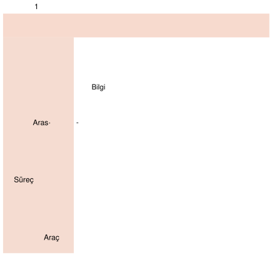

Öğrencilere ders alanında bir dakika ip atlama veya yerinde zıplama, bir dakika top sektirme, otuz saniye yürüme, ardından otuz saniye yavaş yürüme aktiviteleri yaptırılır. Aktiviteler bittikten sonra “Vücudunuzda ne gibi değişimler hissediyorsunuz?”, “Nefes alışverişleriniz değişti mi?” gibi sorular sorulabilir. Daha sonra vücutlarında meydana gelen değişimleri gözlemlemeleri ve fark etmeleri sağlanır (SDB1.1, KB2.2).

Öğrenciler, fiziksel aktivite sırasında vücutlarında gözlemledikleri değişimleri (nefes hızı, terleme, yorgunluk) defterlerine kaydeder (KB2.6). Devamında öğrencilerin fiziksel aktivite sırasında vücutlarında meydana gelen değişimleri deneyimlemeleri için aşağıdaki istasyonlar yaptırılır ve ardından...

<!-- sayfa 20 -->

Öğrenciler istasyon çalışması için 4-6 kişilik gruplara ayrılır. Hulahop çevirme (bir dk.), engel koşusu (küçük engellerin üzerinden atlama), top taşıma (topu bir noktadan başka bir noktaya taşıma), hızlı adım atma (belirlenmiş bir alanda bir dk. hızlı adım atma) olarak dört tane istasyon hazırlanır (**Şekil 1**).

Gruplar, istasyonları 2-3 dk.da tamamlarlar. Öğrencilerden her istasyonda vücutlarında meydana gelen değişimler hakkında sorular sorması istenir (**SDB1.1**). Öğrenciler, istasyonlarda gözlemledikleri değişimlerle ilgili sorular üretir (Örneğin “Hızlı adımla yürürken bacaklarım neden daha çok yoruldu?”). Öğrenciler, bu soruları özgürce cevaplamaya teşvik edilir (**D11.1, E3.8**). Her istasyondan sonra gözlemledikleri değişimlerle ilgili aşağıdaki “Vücut Değişim Takip Formu”na topladıkları bilgileri kaydetmeleri istenir (**KB2.6, KB2.2**). Öğrenciler topladıkları bilgileri sınıf arkadaşlarıyla paylaşmaya teşvik edilir (**SDB1.2, KB2.6, OB1**).

Öğrenciler, bu aktiviteler sırasında topladıkları bilgileri (nabız ölçümü, terleme miktarı gibi) inceleyerek gözlemlerinin doğruluğunu değerlendirir. Böylece fiziksel aktiviteler sırasında vücutlarında meydana gelen değişiklikleri keşfetmeleri sağlanır (**KB2.6, KB2.17**).

Öğrencilerin topladıkları bilgiler tartışmaya açılarak öğrencilere şu sorular sorulur: “Herkesin nabzı aynı istasyonda mı hızlandı?”, “Hangi istasyonda daha çok terlediniz? Bunun sebebi ne olabilir?”, “Hulahop çevirmek mi, engel koşusu mu daha yorucu? Neden?”

Öğrencilere aktivitenin türüne ve zorluk derecesine bağlı olarak nabız, terleme miktarı gibi değişimlerin farklılık gösterebileceği açık bir şekilde anlatılır. Öğrenciler gözlemlerini birbirleriyle karşılaştırır. Öğrencilerinin gözlemlerinin doğruluğu değerlendirilir (**KB2.10, SDB3.3, E3.10**).

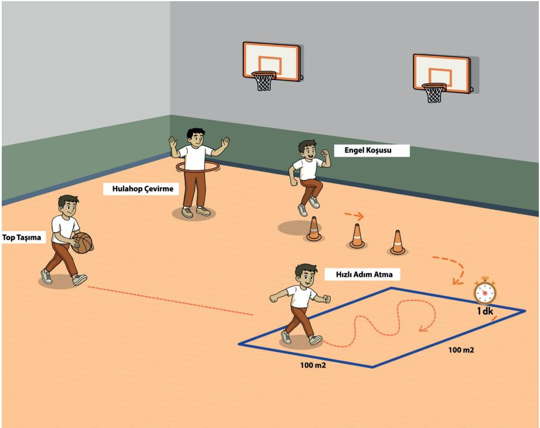

<!-- sayfa 21 -->

# Vücut Değişim Takip Formu

| İstasyon | Nabız (Hızlı/Yavaş/ Normal) | Terleme (Çok/Az/Yok) | Nefes (Hızlı/Yavaş/ Normal) | Yorgunluk (Çok/Az/Yok) | Ek Notlar/ Sorular |
| :--- | :--- | :--- | :--- | :--- | :--- |
| Hulahop Çevirme | | | | | |
| Engel Koşusu | | | | | |
| Top Taşıma | | | | | |
| Hızlı Adım Atma | | | | | |

Dersin bitiminde tüm öğrencilerin katılacağı eğlenceli bir “hareket hazinesi” oyunu oynanır. Her grup için bir “hazine alanı” (örneğin bir çember veya koni ile işaretlenmiş bir bölge) belirlenir. Öğrenciler hazineye ulaşmak için şu görevleri sırayla tamamlar:

* 10 metre koşu
* Çemberin içinden beş kez geçme (hulahop veya yerdeki çember)
* Bir koninin etrafında üç tur dönme
* Hazineyi (topu veya bayrağı) alıp geri koşma

Her öğrenci, görevini tamamlayınca bayrağı bir sonraki takım arkadaşına teslim eder. Oyun sonunda şu sorular sorulur: “Bu oyunda nabzınızı en çok hangi hareket hızlandırdı?”, “Koşarken mi yoksa zıplarken mi daha çok yoruldunuz?”, “Vücudunuzda hangi değişimleri hissettiniz?” Öğrenciler, oyunda gözlemledikleri vücut değişimlerini (nabız, nefes, yorgunluk) etkinlik defterlerine kaydeder (KB2.6).

Öğrencilere bir hafta boyunca günlük yaşamlarında yaptıkları fiziksel aktiviteleri kaydetmeleri için bir görev (Ek 1) verilir. “Her gün yaptığınız fiziksel aktiviteleri (örneğin bisiklete binme, yürüme, oyun oynama) yazın.”, “Aktivite sonrası vücudunuzdaki değişimleri (nabız, nefes, yorgunluk) not edin.” gibi yönergeler paylaşılır. Daha sonra şu sorulara yanıt aranır: “Hangi aktiviteler sizi daha enerjik (hareket isteği, canlılık) yaptı?”, “Bu değişimler sağlığınız için neden önemli?” Günlük tutarken kendilerini nasıl hissettikleri ve fiziksel aktivitelerin sağlıklarına katkısını düşünmeleri istenir. Öğrencilerden günlük tutarken öz yansıtma yaparak kendilerini daha iyi tanımaları beklenir (SDB1.2).

### Çeşitlendirme

İstasyonlar öğrencilerin becerilerine uygun şekilde ve farklı zorluk düzeylerinde düzenlenebilir. Görevler, öğrencilerin eşli olarak veya küçük gruplar hâlinde çalışabilecekleri şekilde tasarlanabilir. Örneğin hulahop çevirme veya top taşıma görevleri eşli yapılabilir. Görevleri daha etkili tamamlamaları için gruplardan stratejiler geliştirmeleri istenebilir. Örneğin engel koşusunda engellerin hangi sırayla geçileceğini planlamaları gerekebilir.

Zihinsel becerileri desteklemek için parkura kısa cevaplı sorular (“Bu istasyonda hangi kaslarınız çalıştı?” gibi) veya hareket sırasını organize etme gibi bölümler eklenebilir. Ayrıca parkurun zor-

<!-- sayfa 22 -->

etkinlik; öğrencilerin fiziksel uygunluğunu, iş birliğini ve stratejik düşünme becerilerini geliştirmelerine de olanak tanır.

### Öğrenme Kanıtları ve Etkinlik Yansıması

Bu öğrenme çıktısının değerlendirilmesinde öğrenme günlüğü formu (**Ek 1**) kullanılabilir. Etkinlik yansıması kapsamında öğrencilere aşağıdaki sorular yöneltilebilir:

* Vücudunuzdaki değişimleri (nabız, nefes, terleme) hangi istasyonda daha çok hissettiniz? Bu değişimlerin o istasyonun hareket türüyle nasıl bir bağlantısı olduğunu düşünüyorsunuz?
* Günlük tutarken hangi fiziksel aktivitenin sizi daha enerjik veya mutlu hissettirdiğini fark ettiniz? Bu hissin sağlığınıza nasıl bir katkısı olabilir?
* İstasyonlarda veya günlük aktivitelerinizde vücudunuzdaki değişimleri gözlemlerken hangi soruyu sormak veya neyi daha fazla öğrenmek istediniz?
* Herkesin nabız, terleme veya yorgunluk gibi değişimleri aynı istasyonda farklı şekilde hissetmesinin sebepleri nelerdir? 

 

**ETKİNLİK 2** | **Harekete Geç, Zinde Kal**

| | |
| :--- | :--- |
| **Amaç:** | Fiziksel hareketsizliğin bedensel, duygusal ve sosyal etkilerini fark etmelerini sağlayarak öğrencilere sağlıklı yaşam için aktif bir yaşam tarzı geliştirmelerine yönelik farkındalık kazandırmaktır. |
| **Eğilimler** | - |
| **Sosyal-Duygusal Öğrenme Becerileri** | SDB1.2. Kendini Düzenleme (Öz Düzenleme), SDB2.1. İletişim, SDB2.2. İş Birliği |
| **Değerler** | D13. Sağlıklı Yaşam |
| **Okuryazarlık Becerileri** | OB4. Görsel Okuryazarlık, OB7. Veri Okuryazarlığı |
| **Kavramsal Beceriler** | KB2.8. Sorgulama |
| **Beceriler Arası İlişkiler** | - |
| **Öğrenme Çıktısı ve Süreç Bileşenleri** | **BES.5.1.2. Fiziksel hareketsizliğin getirdiği sonuçları yorumlayabilme**   a) Fiziksel hareketsizliğin getirdiği sonuçları inceler.   b) Fiziksel hareketsizliğin getirdiği sonuçları farklı örneklerle açıklar.   c) Fiziksel hareketsizliğin getirdiği sonuçları yeniden ifade eder. |
| **Kullanılan Öğretim Teknolojileri, Araç Gereçler ve Kaynaklar** | tablet veya bilgisayar, mobil uygulamalar, kâğıtlar, renkli kalemler, yapıştırıcı, makas, kronometre, çember, koni, grup çalışma föyü ve hareketsizlik günlüğü şablonu |

<!-- sayfa 23 -->

Öğrencilere fiziksel hareketsizliğin sonuçları hakkında düşünmelerini sağlamak için “Hareketsiz bir yaşam, sağlığınızı nasıl etkileyebilir?”, “Uzun süre oturduğunuzda nasıl hissediyorsunuz?” gibi sorular sorulur ve öğrencilerde merak uyandırılır. (KB2.8). Sorulara verilen cevaplar göz önünde bulundurularak hareketsizliğin aşırı kilo (obezite), diyabet ve kalp-damar hastalıkları gibi sağlığa ilişkin etkiler yaratabileceği; bununla beraber öz güven kaybı, stres ve motivasyon eksikliği gibi duygusal etkilere de yol açabileceği vurgulanır. Öğrencilere fiziksel hareketsizliğin etkilerini gösteren kısa bir video izletilebilir (OB4). 

Öğrenciler 4-5 kişilik gruplara ayrılır. Her gruba fiziksel hareketsizliğin etkilerini içeren aşağıdaki metin dağıtılır (OB7).

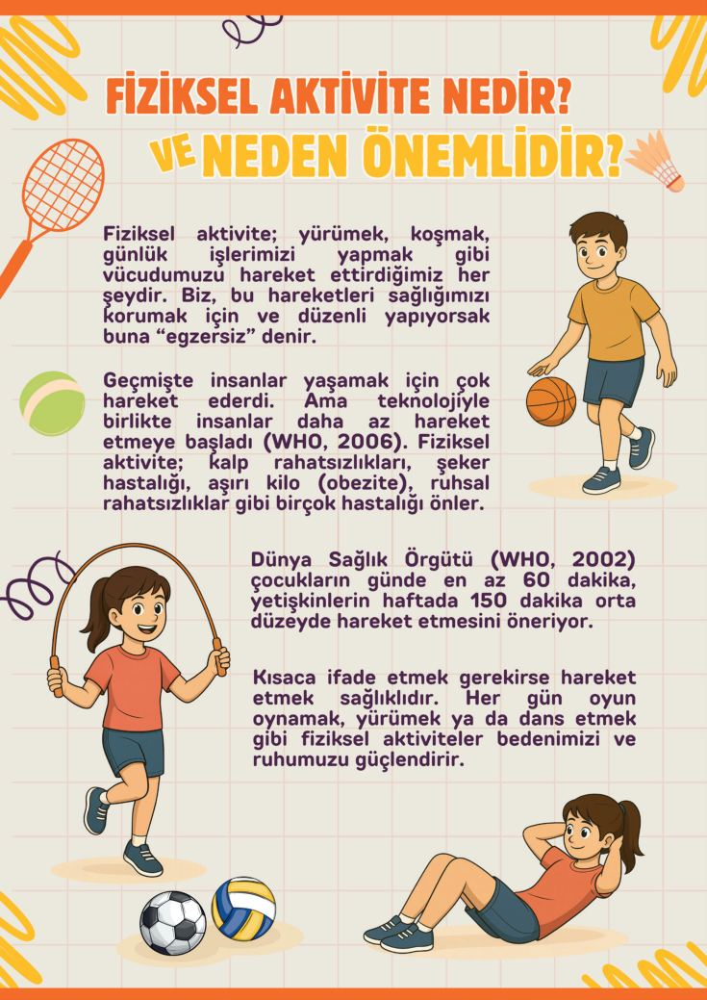

# FİZİKSEL AKTİVİTE NEDİR? VE NEDEN ÖNEMLİDİR?

Fiziksel aktivite; yürümek, koşmak, günlük işlerimizi yapmak gibi vücudumuzu hareket ettirdiğimiz her şeydir. Biz, bu hareketleri sağlığımızı korumak için düzenli yapıyorsak buna “egzersiz” denir.

Geçmişte insanlar yaşamak için çok hareket ederdi. Ama teknolojiyle birlikte insanlar daha az hareket etmeye başladı (WHO, 2006). Fiziksel aktivite; kalp rahatsızlıkları, şeker hastalığı, aşırı kilo (obezite), ruhsal rahatsızlıklar gibi birçok hastalığı önler.

Dünya Sağlık Örgütü (WHO, 2002) çocukların günde en az 60 dakika, yetişkinlerin haftada 150 dakika orta düzeyde hareket etmesini öneriyor.

Kısaca ifade etmek gerekirse hareket etmek sağlıklıdır. Her gün oyun oynamak, yürümek ya da dans etmek gibi fiziksel aktiviteler bedenimizi ve ruhumuzu güçlendirir.

<!-- sayfa 24 -->

Gruplardan kendilerine verilen materyalleri incelemeleri; fiziksel hareketsizliğin fiziksel, duygusal ve sosyal sonuçlarını belirlemeleri istenir (KB2.8). “Bu metne göre hareketsizliğin etkileri neler olabilir?”, “Hareketsizlik, öz güveni nasıl etkileyebilir?” gibi sorularla öğrencilere rehberlik edilir. Öğrencilerden belirledikleri sonuçları grup çalışma föyüne (Ek 2) kaydetmeleri istenir. Öğrencilerden fiziksel hareketsizliğin günlük yaşama etkilerini tartışmaları ve bu etkileri kendi kelimeleriyle yeniden ifade etmeleri ve arkadaşlarıyla paylaşmaları istenir (SDB2.1). Gruplar belirledikleri sonuçları ve yeniden ifade ettikleri fikirleri sunmaya, sunum esnasında eleştirel sorular sormaya teşvik edilir (KB2.8). Örneğin “Bu etkiyi önlemek için neler yapabilir?”, “Bu sonuç bireyleri nasıl etkiler?”

Öğrencilere fiziksel hareketsizliğin bazı olumsuz sonuçları (obezite, kalp-damar rahatsızlıkları vb.) olduğu vurgulanır. Bu sonuçları önlemek için yapılabilecekler hakkında öneriler (düzenli egzersiz, okulda spor etkinlikleri) sunulur.

Öğrencilere “Görsel açıdan dikkat çekici bir tasarım (sloganlar, çarpıcı görseller) oluşturunuz.” görevi verilerek öğrencilerden farkındalık oluşturmayı hedefleyen posterler hazırlamaları istenir (SDB1.2, D13.2 OB4). Posterleri hazırlarken gruplar iş birliği yapmaya ve yaratıcılıklarını kullanmaya teşvik edilir (SDB2.2). Öğrencilerden hazırladıkları posterleri etkinlik alanında sergilemeleri ve her grubun kendi hazırladığı posteri kısaca anlatması istenir (SDB2.1). Öğrencilerden “Bu etkinlik, hareketsizliğin etkileri hakkında size ne öğretti?”, “Kendi yaşamınızda hareketsizliği azaltmak için neler yapabilirsiniz?” gibi sorularla fiziksel hareketsizliğin sonuçlarını ve sağlıklı yaşam için önerilerini de değerlendirmeleri istenir (SDB2.1). Öğrencilerden belirledikleri sonuçları grup çalışma föyüne (Ek 2) kaydetmeleri istenir.

Öğrencilerin fiziksel hareketsizliğin günlük yaşama etkilerini tartışmaları ve bu etkileri kendi kelimeleriyle yeniden ifade etmeleri ve arkadaşlarıyla paylaşmaları istenir (SDB2.1). Gruplar belirledikleri sonuçları ve yeniden ifade ettikleri fikirleri sunmaya ve sunum esnasında eleştirel sorular sormaya teşvik edilir (KB2.8). (Örneğin “Bu etkiyi önlemek için neler yapılabilir?”, “Bu sonuç bireyleri nasıl etkiler?”)

Dersin bitiminde öğrencilere “hareketsizlik canavarından kaçış” oyunu oynatılır. Öğrenciler, bir hareketsizlik canavarının kasabalarını ele geçirdiğini öğrenir. Canavar herkesi hareketsiz bırakarak obezite, stres ve motivasyon eksikliği yaymaktadır. Öğrenciler, hareketsizlik canavarının etkilerinden (obezite, stres, yorgunluk) kurtulmak için bir “Sağlıklı Yaşam Adası”na ulaşmaya çalışır. Etkinlik alanı bir “kaçış yolu” olarak düzenlenir. Üç basit bölge işaretlenir (koniler veya çemberlerle).

1. **Bölge:** Obezite Bataklığı (koniler arasında zikzak koşu, 5 metre)
2. **Bölge:** Stres Bulutu (yerdeki bir çemberin içinde on saniye zıplama)
3. **Bölge:** Yorgunluk Rüzgârı (yerinde beş saniye dans etme)

Öğrenciler 4-5 kişilik gruplara ayrılır. Her grup bir “kurtarma takımı”dır. Her öğrenci, üç bölgeyi sırayla tamamlar ve takım arkadaşına dokunarak sırasını devreder. Gruplardaki öğrenciler parkuru tamamladıklarında “Sağlıklı Yaşam Adası”na ulaşır. Kronometreyle süre tutulur, en hızlı takım alkışlanır. Oyun sonunda sorular sorulur: “Hangi hareket sizi daha enerjik hissettirdi?”, “Bu hareketler hareketsizliğin hangi etkisini önleyebilir?”, “Zıplarken veya dans ederken vücudunuzda ne değişti?” Öğrenciler, gözlemlerini (nefes hızlanması, enerji artışı vb.) etkinlik defterlerine kaydeder (SDB2.1, KB2.8).

Öğrencilerden bir hafta boyunca hareketsiz geçirdikleri zamanları ve bu zamanların kendilerini nasıl etkilediğini kaydedecekleri bir “hareketsizlik günlüğü” (Ek 3) tutmaları istenir (SDB1.2). Bir hafta sonra öğrenciler günlüklerini paylaşır (isteğe bağlı) ve öğrencilerin “Hareketsiz geçirdiğiniz zamanlar sizi nasıl etkiledi?” sorusuyla öz yansıtma yapmaları sağlanır (SDB1.2).

<!-- sayfa 25 -->

# Çeşitlendirme

Etkinlik, öğrencilerin bilgi ve beceri düzeylerine uygun farklı zorluk seviyelerinde düzenlenebilir; öğ- rencilerde tartışma, poster hazırlama ve günlük tutma gibi görevlerin gelişmesi sağlanır.

Görevler, öğrencilerin eşli veya küçük gruplar hâlinde çalışabilecekleri şekilde tasarlanabilir. Örneğin poster hazırlama veya metin analizi eşli yapılabilir. Fiziksel hareketsizliğin etkilerini daha iyi anlama- ları için gruplardan yaratıcı stratejiler geliştirmeleri istenebilir. Örneğin poster için bir slogan bulurken hangi mesajın daha etkili olacağına karar vermeleri gerekebilir.

Zihinsel becerileri desteklemek için etkinliğe kısa cevaplı sorular (“Hareketsizlik, neden kalbi etkiler?” gibi) veya grup sunumunda fikirleri sıralama gibi bölümler eklenebilir.

Etkinliği zorlaştırmak için gruplardan kendi sunumlarına bir öneri listesi eklemeleri veya poster ta- sarımlarına daha fazla görsel detay katmaları istenebilir. Ayrıca öğrenciler tarafından hazırlanan posterler okulun spor panosunda sergilenebilir. Bu şekilde düzenlenen etkinlik; öğrencilerin fiziksel hareketsizliğin etkilerini anlamalarını, iş birliği yapmalarını ve yaratıcı düşünme becerilerini geliştir-melerini sağlar.

## Öğrenme Kanıtları ve Etkinlik Yansıması

Bu öğrenme çıktısının değerlendirilmesinde grup çalışma föyü (**Ek 2**) ve hareketsizlik günlüğü (**Ek 3**) kullanılabilir.

Etkinlik yansıması kapsamında öğrencilere aşağıdaki sorular yöneltilebilir.

* Hareketsizlik günlüğünüzü tutarken hangi zamanlarda kendinizi daha az enerjik veya mutsuz hissettiniz? Bu durumun hareketsizlikle nasıl bir bağlantısı olduğunu düşünüyorsunuz?
* Poster hazırlarken fiziksel hareketsizliğin hangi sonucu sizi daha çok etkiledi? Bu sonucu ön- lemek için günlük yaşamınızda ne gibi adımlar atmayı planlıyorsunuz?
* Grup tartışmaları ve poster sunumları sırasında diğer grupların fikirlerinden veya sorularından neler öğrendiniz? Bu fikirler, hareketsizliği azaltma konusunda size nasıl bir fikir verdi?
* Hareketsizliğin duygusal etkileri (öz güven kaybı, stres vb.) ruh hâlinize veya sosyal ilişkileri- nize nasıl yansır? Sebepleriyle açıklayınız.

<!-- sayfa 26 -->

**ETKİNLİK 3** | **Fiziksel Aktivite ve Zindeliği Keşfediyorum**

| | |
| :--- | :--- |
| **Amaç:** | Öğrencilerin zindelik bileşenlerini eğlenceli bir oyun aracılığıyla tanımaları, bu bileşenlerin fiziksel aktivite ve sağlıklı yaşamla olan ilişkisini kavramaları, günlük yaşamlarında sağlıklı alışkanlıklar geliştirmeleridir. |
| **Eğilimler** | E3.10. Eleştirel Bakma |
| **Sosyal-Duygusal Öğrenme Becerileri** | SDB1.1. Kendini Tanıma (Öz Farkındalık), SDB2.1. İletişim, SDB2.2. İş Birliği, SDB3.3. Sorumlu Karar Verme |
| **Değerler** | D13. Sağlıklı Yaşam |
| **Okuryazarlık Becerileri** | - |
| **Kavramsal Beceriler** | - |
| **Beceriler Arası İlişkiler** | KB2.6. Bilgi Toplama, KB2.10. Çıkarım Yapma |
| **Öğrenme Çıktısı ve Süreç Bileşenleri** | BES.5.1.3. Fiziksel aktivite ve zindelik ilişkisini çözümleyebilme   a) Fiziksel aktivite ve zindeliğe ilişkin bileşenleri belirler.   b) Fiziksel aktivite ve zindeliğe ilişkin bileşenler arasındaki ilişkiyi belirler. |
| **Kullanılan Öğretim Teknolojileri, Araç Gereçler ve Kaynaklar** | öğrenme günlüğü; araştırma için kitaplar, güvenli genel ağ siteleri, broşürler; görseller için tablet, kalem, defter; grup çalışması için büyük kâğıtlar ve yapışkan notlar; öğrenme günlüklerinin sergilenmesi için sınıf panosu |


Öğretmen, fiziksel aktivite ve zindelik bileşenleri üzerine düşünmelerini sağlamak amacıyla öğrencilerden gözlerini kapatarak hayal kurmalarını ister. “Bir gece çok güzel uyuduğunuzu hayal edin. Spor yaparken enerjiniz nasıl olur?”, “Bir hafta boyunca düzenli olarak fiziksel aktivite yaptığınızı düşünün. Vücudunuzda nasıl değişiklikler olur?” gibi sorular yöneltilir. Öğrencilerden bu soruları cevaplamaları istenir (Örneğin öğrenci bir hafta düzenli fiziksel aktivite yaptığında kol kaslarını gösterir veya bir dakika hareketsiz olarak elinde telefon olduğunu hayal ettiğinde boynunun tutulduğunu gösterir.). Verilen yanıtlar üzerinden öğrencilerin beslenme, uyku, teknoloji bağımlılığı ve fiziksel aktivite gibi bileşenlerin zindelik üzerindeki etkilerini fark etmeleri sağlanır (SDB1.1).

Öğrenciler 4-5 kişilik gruplara ayrılır. Her gruba bir araştırma başlığı atanır: Sağlıklı Beslenme, Fiziksel Aktivitenin Vücudumuza Etkileri, Uykunun Zindelik ile İlişkisi, Teknoloji Bağımlılığının Zindelik ve Fiziksel Aktivite Üzerindeki Olumsuz Etkileri. Her grup, kendisine atanmış başlıkla ilgili kısa bir araştırma yapar (SDB2.2, KB2.6). Araştırma sürecinde öğretmen öğrencilere rehberlik eder. Öğrencilerin okulda araştırma bulgularını içeren bir “Zindelik Panosu” oluşturmaları sağlanır.

**Oyun: Zindelik Hazinesi**

Öğrencilerin fiziksel aktivite ve zindeliğe ilişkin bileşenleri (uyku, beslenme, teknoloji kullanımı, fiziksel aktivite) belirlemelerine, bu bileşenlerin zindelikle ilişkisini anlamalarına yardımcı olmak ve sağlıklı yaşam alışkanlıklarını deneyimlemelerini teşvik etmek amacıyla “zindelik hazinesi oyunu” oynanır (Şekil 3).

<!-- sayfa 27 -->

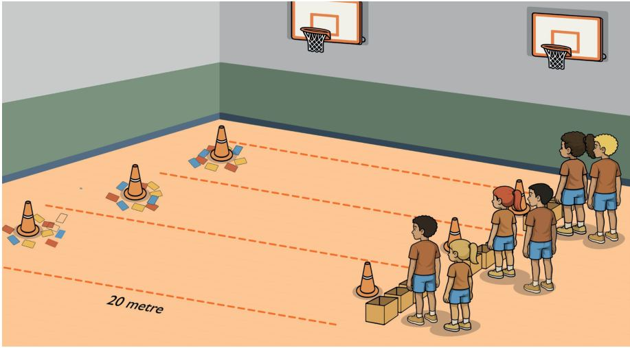

*Şekil 3. Zindelik hazinesi oyunu genel görünümü*

Öğrenciler 4-5 kişilik gruplara ayrılır. Spor salonu veya okul bahçesinde bir oyun alanı hazırlanır. Bitiş noktasına gruba ait bir "zindelik hazinesi kutusu" yerleştirilir. Bu kutularda fiziksel aktivite ve zindelik bilgi kartları (**Ek 5**) bulunur. Başlangıç noktasına her gruba ait dört karton kutu yerleştirilir. Kutuların üzerinde sırasıyla "Uyku", "Beslenme", "Teknoloji Kullanımı" ve "Fiziksel Aktivite" yazmalıdır. Bilgi kartları (**Ek 5**), her bir zindelik bileşeniyle ilgili bir bilgi notu ve bir fiziksel görev içerir. Örnek:

**Beslenme Kartı:** “Kahvaltı yapan çocuklar gün boyu daha enerjik olur.”
**Görev:** “On tane mekik çekin.”

**Uyku Kartı:** “Yeterli uyku, kaslarınızın dinlenmesini sağlar.”
**Görev:** “15 saniye plank duruşu yapın.”

**Teknoloji Kullanımı Kartı:** “Uzun süre ekran başında kalmak, gözlerinizi ve duruşunuzu olumsuz etkiler.”
**Görev:** “On zıplama yapın.”

**Fiziksel Aktivite Kartı:** “Haftada en az üç kez egzersiz yapmak kalbinizi güçlendirir.”
**Görev:** “Yirmi saniye yerinde koş.”

Oyun alanı konilerle işaretlenir ve egzersiz matı güvenli hareket için kullanılır.

Oyun Kuralları

* Gruplar, bitiş noktasındaki “zindelik hazinesi kutusu”ndan bir bilgi kartı alır ve kartı başlangıç noktasına getirir.
* Gruplar karttaki bilgi notunu yüksek sesle okur ve kartta belirtilen fiziksel görevi birlikte yaparlar (On mekik, 15 saniye plank vb.).
* Karttaki bilgi, zindelik bileşenlerinden biriyle (uyku, beslenme, teknoloji kullanımı, fiziksel aktivite) ilişkilidir. Öğrenciler, kartı ilgili bileşenin yazılı olduğu kutuya atar.
* Tüm kartlar toplanana kadar oyun devam eder. Her grup, kendi kutularında zindelik bileşenlerini sınıflandırmış olur.

Öğretmen, grupların kartları doğru kutulara yerleştirip yerleştirmediğini gözlemler ve gerektiğinde gruplara rehberlik edebilecek sorular sorar: “Bu kart neden ‘beslenme’ kutusuna gitti? Bu karttaki...

<!-- sayfa 28 -->

(SDB2.1) ve eğlenmeye teşvik edilir. Oyun sonunda gruplar kendi kutularındaki kartları kontrol ederek hangi bileşenin zindelikle nasıl ilişkilendirildiğini kısa bir tartışmayla değerlendirir (SDB2.1, SDB3.3, E3.10) ve zindeliğin önemine dair çıkarımlarda bulunur (KB2.10). Tartışmanın sonunda öğretmen, süreci sağlıklı yaşam değerine bağlar ve şu soruyu yöneltir: “Bu bilgiler ışığında sağlıklı bir yaşam için neler yapabilirsiniz?” (D13.1, D13.2). Zindelik ve sağlıklı yaşamla ilgili bir öğrenme günlüğü görevi verilir ve öğrencilerden bu öğrenme günlüklerini (Ek 4) düzenli olarak doldurmaları istenir.

**Çeşitlendirme**

“Zindelik hazinesi oyunu” yerine fiziksel aktiviteleri içeren istasyonlar da tercih edilebilir. Her gruba daha az kart (örneğin dört kart yerine iki kart) verilebilir veya sadece iki zindelik bileşeni (uyku ve genel ağda aktivite) üzerine odaklanılabilir. Bilgi kartlarındaki talimatlar basit (on mekik yerine beş mekik) tutulabilir. Görevleri yerine getirmek için zaman sınırı koyulmayabilir. Her grup için daha fazla kart (örneğin dört yerine altı kart) eklenebilir. Tüm kartların belirli bir sürede toplanması için bir zaman sınırı (on dakika gibi) koyulabilir. En hızlı grup ek puan kazanabilir. Doğru kutuya atılan kartlar için puan verilip yanlış kutuya atılan kartlar için puan kırılabilir. Kart kutuya atılmadan önce “Bu bilgi, zindeliğe nasıl katkıda bulunur?” sorusu tartışılır ve cevabı kâğıda yazılarak diğer tura geçilebilir.

**Öğrenme Kanıtları ve Etkinlik Yansıması**

Bu öğrenme çıktısının değerlendirilmesinde öğrenme günlüğü görevi formu (Ek 4) kullanılabilir. Etkinlik yansıması kapsamında öğrencilere aşağıdaki sorular yöneltilebilir.

* Oyun sırasında yaptığınız fiziksel görevlerin zindelikle bağlantısı ne olabilir?
* Araştırmanızdan öğrendiğiniz bir sağlıklı yaşam alışkanlığını günlük hayatınıza nasıl uygulayabilirsiniz?
* Fiziksel aktivite eksikliğinin yol açtığı sağlık sorunlarını önlemek için neler yapabilirsiniz?

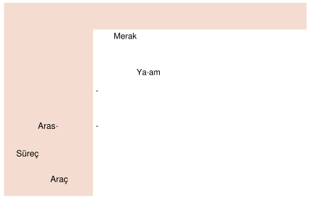

**ETKİNLİK 4** $\quad$ **Fiziksel Uygunluk Kavramını Öğreniyorum**

**Amaç:** Öğrencilerin fiziksel uygunluk bileşenlerini eğlenceli bir oyun yoluyla deneyimleyerek tanımaları ve sağlıklı bir yaşam için fiziksel uygunluğun önemini kavramalarıdır.

| | |
| :--- | :--- |
| **Eğilimler** | E1.1. Merak |
| **Sosyal-Duygusal Öğrenme Becerileri** | SDB1.3. Kendine Uyarlama (Öz Yansıtma) |
| **Değerler** | D13. Sağlıklı Yaşam |
| **Okuryazarlık Becerileri** | - |
| **Kavramsal Beceriler** | KB2.17. Değerlendirme |
| **Beceriler Arası İlişkiler** | - |
| **Öğrenme Çıktısı ve Süreç Bileşenleri** | BES.5.1.4. Fiziksel uygunluk kavramını açıklayabilme |
| **Kullanılan Öğretim Teknolojileri, Araç** | koniler, kavram kartları ve müzik çalar (hoparlör) |

<!-- sayfa 29 -->

Öğretmen, öğrencileri etkinlik alanında bir araya toplar ve öğrencilere şu soruları sorarak fiziksel uygunluk kavramına giriş yapar: “Merdiven çıkarken ya da ağır bir yük taşırken hiç zorlandınız mı?”, “Bu tür işleri kolayca yapabilmek için vücudunuzun hangi özelliklere sahip olması gerekir?” Bu sorularla fiziksel uygunluk kavramına yönelik merak uyandırılır ve öğrenciler düşünmeye teşvik edilir (**E1.1**). Öğretmen, cevapları toplayarak fiziksel uygunluk kavramını ve bunun günlük yaşamda neden önemli olduğunu kısaca açıklar.

### Oyun 1
Fiziksel uygunluk kavramına yönelik “fiziksel uygunluk orkestrası oyunu” oynanır.

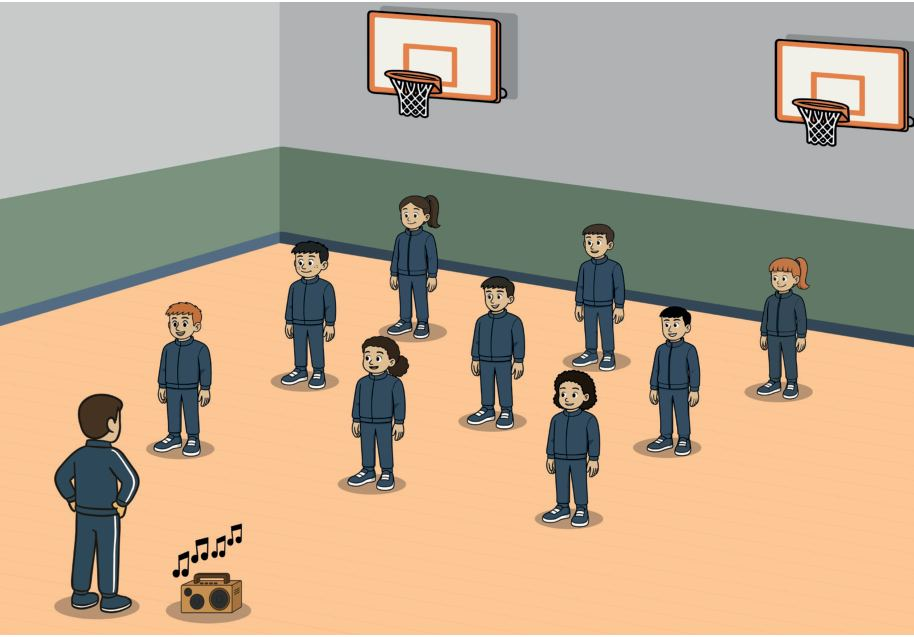

**Şekil 4.** *Fiziksel uygunluk orkestrası oyunu genel görünümü*

**Hazırlık:** Salonun ortasına beş koni yerleştirilir. Her koniye fiziksel uygunluk bileşenlerine ait kavram kartları (örneğin kas kuvveti - çömel-kalk)yapıştırılır. Öğrenciler 5-6 kişilik gruplara ayrılır. Her gruba aşağıdaki hareketler gösterilip yaptırılır: 1. Grup: squat (çömel-kalk) - kas kuvveti, 2. Grup: diz kaldırma - kalp-dolaşım sistemi dayanıklılığı, 3. Grup: hulahop çevirme - esneklik, 4. Grup: lastik gerdirme - kas dayanıklılığı, 5. Grup: ip atlama - vücut kompozisyonu.

Öğretmen, bir ritmik müzik açar ve sırayla her grubu işaret eder. Gruplar, müziğin ritmine uygun şekilde hareketini yapar. Örneğin 1. grup squat yaparken diğer gruplar bekler. Daha sonra öğretmen birden fazla grubu işaret ederek “orkestra” havası yaratır. Müziğin sonunda tüm gruplar aynı anda hareketlerini yaparak gösteriyi tamamlar.

Oyun durdurulur ve öğretmen şu soruları sorar: “Bu hareketleri yapmak sizi ne kadar zorladı?”, “Fiziksel aktiviteleri daha kolay yapabilmek için neye ihtiyaç duyarsınız?”, “Sizce bu hareket fiziksel uygunluğun hangi yönünü geliştiriyor?” Öğrenciler, bu soruların cevaplarını arayarak fiziksel uygunluk kavramına ilişkin bazı çıkarımlar yapar.

<!-- sayfa 30 -->

hareketleri tekrar uygulamaya başlar. Böylelikle her öğrenci, tüm fiziksel uygunluk bileşenlerini uygular. Oyunun bitiminde fiziksel uygunluğun sağlanmasının ve korunmasının sağlıklı bir yaşam sür medeki önemi açıklanarak öğrenciler dengeli beslenme ve aktif bir yaşam tarzı benimseme konusunda istekli olmaya teşvik edilir (**D13.2**).

### Oyun 2

İlk oyunun coşkulu finalinden sonra öğretmen, öğrencileri etkinlik alanında tekrar toplar ve fiziksel uygunluk bileşenlerini pekiştirmek için etkinliğe yeni bir oyunla devam edileceğini öğrencilere duyurur. Etkinlik alanı, önceki oyunda hazırlanmış şekilde beş koni ve her birinde fiziksel uygunluk bileşenlerine ait kavram kartlarıyla (kas kuvveti, kalp-dolaşım dayanıklılığı, esneklik, kas dayanıklılığı, vücut kompozisyonu) hazır bulunur. Gruplar (5-6 kişi) yine kendi hareketlerine bağlı kalır: squat, diz kaldırma, hulahop çevirme, lastik gerdirme, ip atlama. Öğretmen hareketli bir müzik (pop müzik veya dans müziği) açar. Her grup kendi konisinin önünde durur. Öğretmen “Başla!” komutuyla oyunu başlatır ve her grup, müziğin ritmine uygun şekilde kendi hareketini (örneğin 1. grup squat) yapar. Yaklaşık yirmi saniye sonra öğretmen müziği aniden değiştirir (Örneğin yavaş bir şarkıya geçer.) ve “Değiş!” der. Gruplar, sağdaki koniye koşarak yer değiştirir ve o koninin hareketini yapmaya başlar. Bu değişim 2-3 kez tekrarlanır, her değişim yaklaşık yirmi saniye sürer. Son turda öğretmen “Herkes her şey!” komutunu verir, tüm gruplar aynı anda tüm hareketleri karışık bir şekilde yapar ve oyun eğlenceli bir şekilde sona erer. Öğretmen veya öğrencilerin alkışlarıyla en uyumlu ve enerjik grup seçilir, en çok alkış alan grup kazanır. Öğretmen şu soruları sorar: “Başka bir grubun hareketini yapmak size nasıl hissettirdi?”, “Bu hareketler fiziksel uygunluğunuza nasıl katkıda bulunur?” Cevaplar, öğrencilerin fiziksel uygunluk bileşenlerini anlamasını pekiştirir.

Her grup, konideki fiziksel uygunluk kavram kartını (**Ek 8**) okuyarak diğer gruplara fiziksel uygunluk bileşenini açıklar. Örneğin 3. grup: “Esneklik, eklemlerin geniş açıda rahat hareket edebilmesidir. Hulahop çevirmek esnekliği artırır.” Etkinlik bitiminde öz değerlendirme formu (**Ek 6**) ve fiziksel uygunluk kavram testiyle (**Ek 7**) öğrencilerin kendi fiziksel uygunluklarına yönelik değerlendirme yapmaları istenir (**KB2.17, SDB1.3**).

#### Çeşitlendirme

Öğretmen, önce hareketi adım adım açıklayıp bir örnek gösterebilir. Hareket süresi kısaltılabilir (örneğin otuz saniye yerine on beş saniye) ve grubun ritme uyması için katı kurallar konmayabilir. Daha yavaş tempolu, basit ritimli bir müzik tercih edilebilir. Hareketler yapılırken yüzme sosisi, direnç lastikleri gibi ek materyaller eklenebilir. Ayrıca hareket süresi uzatılabilir (örneğin otuz saniye yerine kırk beş saniye) veya tekrar sayısı artırılabilir (örneğin on squat yerine on beş squat). Gruplar, öğrendikleri hareketleri birleştirerek kısa bir koreografi oluşturabilir ve bunu müzik eşliğinde sunabilir.

### Öğrenme Kanıtları ve Etkinlik Yansıması

Bu öğrenme çıktısının değerlendirilmesinde öz değerlendirme formu (**Ek 6**) ve fiziksel uygunluk kavram testi (**Ek 8**) kullanılabilir.

Etkinlik yansıması kapsamında öğrencilere aşağıdaki sorular yöneltilebilir:

* “Fiziksel uygunluk orkestrası” oyunu sırasında yaptığınız hareketler size neler hissettirdi?
* Size en zorlayıcı ya da en keyifli gelen fiziksel uygunluk bileşeni (kas kuvveti, esneklik, dayanıklılık vb.) hangisiydi? Nedeninizi paylaşınız.
* Bu etkinlikte deneyimlediğiniz fiziksel uygunluk bileşenlerinden hangisinin günlük yaşamınızda size daha çok yardımcı olabileceğini düşünüyorsunuz?
* Bu etkinlikten sonra fiziksel uygunluğunuzu artırmak için günlük hayatınıza eklemek istediğiniz

<!-- sayfa 31 -->

## 2.2. Farklılaştırma

### Zenginleştirme

Öğrenciler farklı egzersiz türlerini (koşu, ip atlama, squat vb.) uyguladıktan sonra nabız ölçümlerini kaydedebilir ve bu verileri çizgi grafiklere dönüştürerek analiz edebilir. Örneğin bir öğrenci, nabız verilerini dijital bir uygulamayla grafikleştirir ve egzersiz yoğunluğu ile nabız arasındaki ilişkiyi fen bilimleri dersiyle ilişkilendirerek açıklayabilir. Öğrenciler, haftalık öğrenme günlüklerine “Nabzınızı en çok hangi egzersiz artırdı? Bu değişimin bilimsel nedeni nedir?” gibi yansıtıcı sorular ekleyerek fizyolojik etkileri bilimsel bir dille açıklayabilir. Bu süreç, öğrencilerin eleştirel düşünme ve bilimsel ifade becerilerini geliştirmelerine olanak sağlar. Örneğin bir öğrenci, koşunun ip atlamaya göre nabzı daha fazla artırdığını gözlemleyebilir ve bunun nedenini koşunun daha fazla kas grubunu çalıştırması ve enerji talebini artırmasıyla açıklayabilir. Öğrenciler, nabız ölçümleri ve analizlerinden elde ettikleri bulguları bir sunumla paylaşabilir. Egzersizlerin fizyolojik etkilerini açıklarken web 2.0 araçlarından (sunum hazırlama programları) faydalanmaya ve görsel destek (örneğin grafik veya diyagram) kullanmaya teşvik edilebilir. Nabız verilerini matematik dersiyle ilişkilendirerek veri analizi yapabilir veya fen bilimleri dersiyle bağlantı kurarak kalp atım hızının biyolojik mekanizmalarını araştırabilir.

### Destekleme

Farklı fiziksel gereksinimleri olan veya hareket kısıtlılığı bulunan öğrenciler için koşu yerine sandalye üzerinde ritmik egzersizler (kol kaldırma-indirme veya hafif germe hareketleri) uygulanabilir. Bu etkinlikler, öğrencinin fiziksel durumuna uygun şekilde düzenlenmelidir. Nabız ölçümü, bir eş yardımıyla veya öğretmenin rehberliğinde gerçekleştirilebilir. Örneğin görme engelli bir öğrenci, dokunsal özellikli bir ölçüm cihazı kullanarak nabzını kontrol edebilir. Günlük tutma süreci yazılı olmayabilir. Öğrenciler, deneyimlerinin bir ses kaydını alabilir veya bunu bir arkadaşına dikte ettirebilir. Görme engelli öğrenciler için günlükler braille (brail) alfabesiyle veya sesli formatta tutulabilir. Etkinlik yönergeleri büyük puntolu yazılar, görsel şemalar veya sesli açıklamalarla sunulabilir. Öğretmen, ihtiyaç duyan öğrencilere bireysel rehberlik sağlayarak yönergeleri netleştirebilir. Öğretmen, etkinlik alanını öğrencilerin fiziksel ihtiyaçlarına göre düzenlemeli ve tüm öğrencilerin rahatça katılım sağlayabileceği bir ortam oluşturmalıdır. Örneğin hareket kısıtlılığı olan öğrenciler için erişilebilir alanlar sağlanabilir.

<!-- sayfa 32 -->

# 3. ÖĞRENME KANITLARI (Ölçme ve Değerlendirme)

Temanın tamamında yer alan öğrenme çıktılarına yönelik değerlendirme için aşağıdaki tema değerlendirme formu kullanılabilir.

**Tema Değerlendirme Formu**

Bu form, 5. sınıf beden eğitimi ve spor dersi “fiziksel aktivite ve zindelik” temasının tamamına yönelik süreç bileşenlerini değerlendirmek için hazırlanmıştır. Her öğrencinin süreç bileşenlerindeki performansını “yetersiz” (1) ile “çok iyi” (5) arasında puanlayınız. Puanları, her öğrenci için ilgili sütunlara işaretleyiniz. Toplam puanı hesaplayınız ve sonuçları ölçme aracının devamındaki tabloya kaydediniz.

| Süreç Bileşenleri | Mükemmel (5) | Çok İyi (4) | İyi (3) | Orta (2) | Zayıf (1) |
| :--- | :---: | :---: | :---: | :---: | :---: |
| Fiziksel aktiviteler sırasında vücudundaki değişimleri tanımlar (1.a). | | | | | |
| Fiziksel aktivitelerle ilgili sorular sorar (1.b). | | | | | |
| Fiziksel aktivitelerle ilgili bilgi toplar (1.c). | | | | | |
| Topladığı bilgilerin doğruluğunu değerlendirir (1.ç). | | | | | |
| Fiziksel aktiviteler hakkında çıkarım yapar (1.d). | | | | | |
| Fiziksel hareketsizliğin sonuçlarını inceler (2.a). | | | | | |
| Fiziksel hareketsizliğin getirdiği sonuçları farklı örneklerle açıklar (2.b). | | | | | |
| Fiziksel hareketsizliğin sonuçlarını kendi ifadeleriyle açıklar (2.c). | | | | | |
| Zindeliğin bileşenlerini belirler (3.a). | | | | | |
| Zindelik bileşenleri arasındaki ilişkiyi açıklar (3.b). | | | | | |
| Fiziksel uygunluk kavramını açıklar (4.a). | | | | | |

**Değerlendirme Ölçütleri:**

Bu ölçme aracından en az 11 puan, en fazla 55 puan alınabilmektedir. Öğrencinin puanı, alınan puanın yüzdelik karşılığı hesaplanarak bulunur. Bunun için alınan puan, öğrencinin alabileceği en yüksek puana bölünür ve çıkan sonuç 100 ile çarpılır. Ondalık gösterim elde edilmesi hâlinde sonuç, tam kısmına (birler basamağına) yuvarlanır.

Örnek: Öğrenci bu ölçme aracından 50 puan aldığında puanı şu şekilde hesaplanır:
$$(\frac{50}{55}) \times 100 = 90,9$$
<!-- KONTROL: Marker'da karşılığı yok, uydurma olabilir --> Öğrenci 91 puan almış olacaktır.

**Performans Düzeyleri:**

20-36/Geliştirilmeli: Süreç bileşenlerinin çoğunda yetersiz, daha fazla rehberlik gerekiyor.
54-70/Orta: Süreç bileşenlerinin bazılarında yeterli, gelişim devam etmeli.
71-87/İyi: Süreç bileşenlerinin çoğunda yeterli performans sergiliyor.
88-100/Çok iyi: Süreç bileşenlerinin tamamında üstün performans sergiliyor.

<!-- sayfa 33 -->

# Puan Kaydetme Tablosu

| Sınıf: | Tarih: |
| :--- | :--- |

| Öğrencinin Adı Soyadı | 1.a | 1.b | 1.c | 1.ç | 1.d | 2.a | 2.b | 2.c | 3.a | 3.b | 4.a | Toplam Puan |
| :--- | :--- | :--- | :--- | :--- | :--- | :--- | :--- | :--- | :--- | :--- | :--- | :--- |
| | | | | | | | | | | | | |
| | | | | | | | | | | | | |
| | | | | | | | | | | | | |
| | | | | | | | | | | | | |
| | | | | | | | | | | | | |
| | | | | | | | | | | | | |
| | | | | | | | | | | | | |
| | | | | | | | | | | | | |
| | | | | | | | | | | | | |
| | | | | | | | | | | | | |
| | | | | | | | | | | | | |
| | | | | | | | | | | | | |
| | | | | | | | | | | | | |
| | | | | | | | | | | | | |
| | | | | | | | | | | | | |
| | | | | | | | | | | | | |
| | | | | | | | | | | | | |
| | | | | | | | | | | | | |
| | | | | | | | | | | | | |
| | | | | | | | | | | | | |
| | | | | | | | | | | | | |
| | | | | | | | | | | | | |
| | | | | | | | | | | | | |
| | | | | | | | | | | | | |
| | | | | | | | | | | | | |
| | | | | | | | | | | | | |
| | | | | | | | | | | | | |
| | | | | | | | | | | | | |
| | | | | | | | | | | | | |
| | | | | | | | | | | | | |
| | | | | | | | | | | | | |
| | | | | | | | | | | | | |
| | | | | | | | | | | | | |
| | | | | | | | | | | | | |
| | | | | | | | | | | | | |
| | | | | | | | | | | | | |
| | | | | | | | | | | | | |
| | | | | | | | | | | | | |
| | | | | | | | | | | | | |
| | | | | | | | | | | | | |
| | | | | | | | | | | | | |
| | | | | | | | | | | | | |
| | | | | | | | | | | | | |
| | | | | | | | | | | | |

<!-- sayfa 34 -->

# 4. ÖĞRETMEN YANSITMALARI

Bir sonraki yıl bu temanın planlaması için yorumlar:

**Yorum 1:**

**Yorum 2:**

Öğrenme Çıktılarına Göre Öz Yansıtma (planlama/hazırlık, öğrenme çevresi, öğretim, mesleki sorumluluk)

1. Öğrenme çıktısı için yansıtmalar:

2. Öğrenme çıktısı için yansıtmalar:

3. Öğrenme çıktısı için yansıtmalar:

4. Öğrenme çıktısı için yansıtmalar:

<!-- sayfa 35 -->

# 5. EKLER
## Ek 1. Öğrenme Günlüğü

| **Etkinlik Adı:** Vücudumdaki Değişimleri Keşfediyorum |
| :--- |
| **Amaç:** Günlük yaşamındaki fiziksel aktiviteleri ve vücut değişimlerini kaydetmek, sağlıklı yaşam alışkanlıklarını fark etmek. |
| **Öğrencinin Adı Soyadı :** |
| **Tarih Aralığı:** |

Her gün yaptığınız fiziksel aktiviteleri (yürüme, bisiklete binme, oyun oynama vb.) ve sonrasında vücudunuzda hissettiğiniz değişimleri (nabız, nefes, yorgunluk, enerji vb.) aşağıdaki tabloya kaydediniz. Günün sonunda aktivitelerin sizi nasıl hissettirdiğini ve sağlığınıza katkısını yazınız.

### Günlük Kayıt Tablosu

| Günler | Fiziksel Aktivite (Ne yaptın? Süresi?) | Vücut Değişimleri (nabız, nefes, terleme, yorgunluk) | Nasıl hissettim? (enerjik, yorgun, mutlu vb.) | Sağlığıma Katkısı (Ne düşündüm?) |
| :--- | :--- | :--- | :--- | :--- |
| Pazartesi | bisiklete binme, 20 dk. | Nabzım hızlandı, biraz terledim, nefesim sıklaştı. | Enerjik ve mutlu hissettim. | Kalbim güçlendi, daha zinde hissettim. |
| | | | | |
| | | | | |
| | | | | |
| | | | | |
| | | | | |
| | | | | |

<!-- sayfa 36 -->

**Ek 2. Grup Çalışma Föyü**

| **Etkinlik Adı:** Harekete Geç, Zinde Kal |
| :--- |
| **Grup Adı:** |
| **Tarih:** |
| **Grup Üyeleri:** |
| **Yönerge:** |
| Aşağıdaki adımları takip ederek verilen metni inceleyiniz ve soruları yanıtlayınız. Fiziksel hareketsizliğin etkilerini grup olarak tartışınız. Cevaplarınızı bu föye kaydediniz. Daha sonra sonuçları sınıfta paylaşacak ve fiziksel hareketsizliğin etkilerini vurgulamak için bir poster fikri geliştireceksiniz. |
| **Adım 1: Metni İnceleme ve Sonuçları Belirleme** |
| Metne göre hareketsizliğin yol açtığı fiziksel, duygusal ve sosyal sonuçları tabloya yazınız. |

| Fiziksel | |
| :--- | :--- |
| Duygusal | |
| Sosyal | |

| Metindeki Etki | Kendi Cümleniz |
| :--- | :--- |
| Obezite | Hareketsizlik kilo alımına neden olabilir. |
| | |
| | |
| | |

**Adım 1: Tartışma ve Öneriler**

Grup tartışması

Hareketsizliğin günlük yaşama etkilerini tartışınız ve aşağıdaki soruları yanıtlayınız.

* Hareketsizliğin etkilerini önlemek için neler yapabilirsiniz?
* Hareketsizlik bireyleri nasıl etkiler?

**Adım 2: Poster Hazırlığı İçin Fikirler**

Hareketsizliğin etkilerini ve hareketsizliği önleme önerilerini vurgulayan bir poster hazırlayınız.

* Slogan:
* Görsel Fikirleri:
* Ana Mesaj:

<!-- sayfa 37 -->

**Ek 3. Hareketsizlik Günlüğü**

| Etkinlik Adı: Harekete Geç, Zinde Kal |
| :--- |
| **Öğrencinin Adı Soyadı:** |
| **Tarih Aralığı:** |
| Sevgili Öğrenciler, Bu günlük, sizin bir hafta boyunca hareketsiz geçirdiğiniz süreleri ve bu sürelerin sizi nasıl etkile-diğini kaydetmeniz için hazırlanmış bir taslaktır. Her gün hareketsiz geçirdiğiniz süreleri (ekran başında oturma, ders çalışma vb.) ve bu sürelerin sizi nasıl etkilediğini (yorgunluk, stres, motivasyon eksikliği vb.) aşağıdaki tabloya kaydediniz. Hafta sonunda yansıtma sorularını yanıtlayınız. |

**Günlük Kayıt Tablosu**

| Tarih | Hareketsiz Geçirilen Zaman (Ne yaptın? Süresi?) | Beni nasıl etkiledi? (fiziksel, duygusal, sosyal) | Hareketsizliği azaltmak için ne yapabilirim? |
| :--- | :--- | :--- | :--- |
| 01.05.2025 | Telefonla oyun oynama, 1 Saat | Yorgun hissettim, gözlerim ağrıdı. | Daha az ekran süresi, arada yürüyüş |
| | | | |
| | | | |
| | | | |
| | | | |
| | | | |
| | | | |
| | | | |
| | | | |
| | | | |
| | | | |
| | | | |

**Yansıtma Soruları** (Hafta sonunda yanıtlayınız.)

* Hareketsiz geçirdiğiniz süre sizi nasıl etkiledi?
* Kendi yaşamınızda hareketsizliği azaltmak için neler yapabilirsiniz?

<!-- sayfa 38 -->

# Ek 4. Öğrenme Günlüğü Görevi

| Etkinlik Adı: Fiziksel Aktivite ve Zindeliği Keşfediyorum |
| :--- |
| Bu form, “Fiziksel Aktivite ve Zindeliği Keşfediyorum” etkinliğinde öğrencilerin bir hafta boyunca günlük yaşamındaki zindelik bileşenlerini (uyku, beslenme, teknoloji kullanımı, fiziksel aktivite) gözlemlemek amacıyla hazırlanmıştır. |
| **Öğrencinin Adı Soyadı:** |
| **Tarih Aralığı:** |
| Bir hafta boyunca zindelik bileşenleriyle ilgili gözlemlerinizi aşağıdaki tabloya kaydediniz. Günün sonunda bu bileşenlerin sizi nasıl etkilediğini ve sağlıklı yaşam için neler yapabileceğini yazınız. Hafta sonunda yansıtma sorularını yanıtlayınız. |

## Öğrenme Günlüğü Kayıt Tablosu

| Tarih | Zindelik Bileşeni (Uyku, Beslenme, Teknoloji Kullanımı, Fiziksel Aktivite) | Gözlemlerim (Ne yaptım? Ne hissettim? (örneğin uyku süresi, yemek seçimi, ekran süresi, aktivite türü) | Beni nasıl etkiledi? (enerji, ruh hâli, sağlık vb.) | Sağlıklı yaşam için ne yapabilirim? |
| :--- | :--- | :--- | :--- | :--- |
| | | | | |
| | | | | |
| | | | | |
| | | | | |
| | | | | |
| | | | | |
| | | | | |
| | | | | |
| | | | | |
| | | | | |
| | | | | |
| | | | | |

**Yansıtma Soruları (Hafta sonunda yanıtlayınız.)**

* Zinde olmanızı en çok hangi zindelik bileşeni (uyku, beslenme, teknoloji kullanımı, fiziksel aktivite) etkiledi? Nedenini paylaşınız.
* Zindelik bileşenlerinin sağlıklı yaşamla nasıl bir ilişkisi olduğunu öğrendiniz?

<!-- sayfa 39 -->

Ek 5. Fiziksel Aktivite ve Zindelik Bilgi Kartları

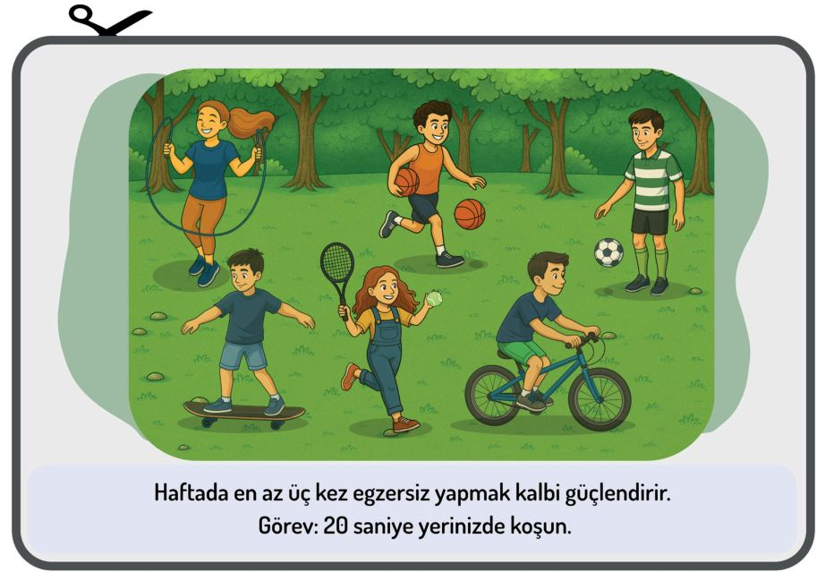
Haftada en az üç kez egzersiz yapmak kalbi güçlendirir.
Görev: 20 saniye yerinizde koşun.

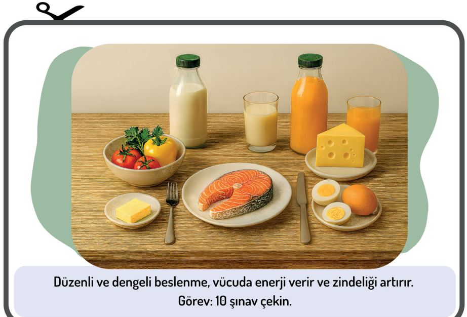
Düzenli ve dengeli beslenme, vücuda enerji verir ve zindeliği artırır.
Görev: 10 şınav çekin.

<!-- sayfa 40 -->

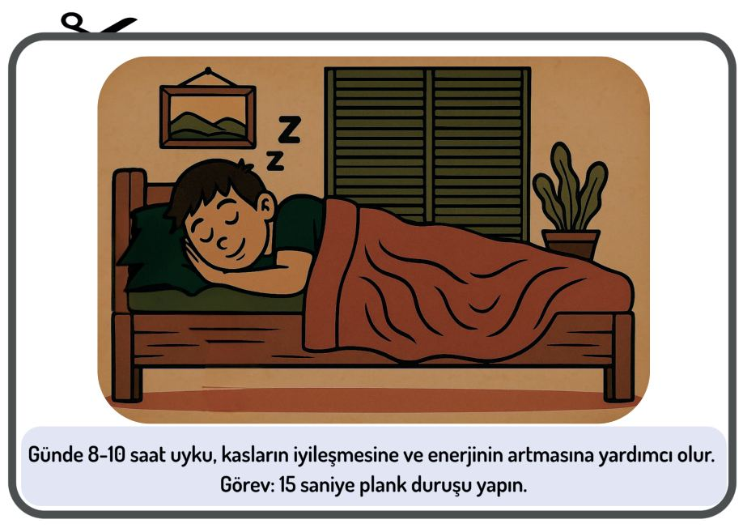

Günde 8–10 saat uyku, kasların iyileşmesine ve enerjinin artmasına yardımcı olur.
Görev: 15 saniye plank duruşu yapın.

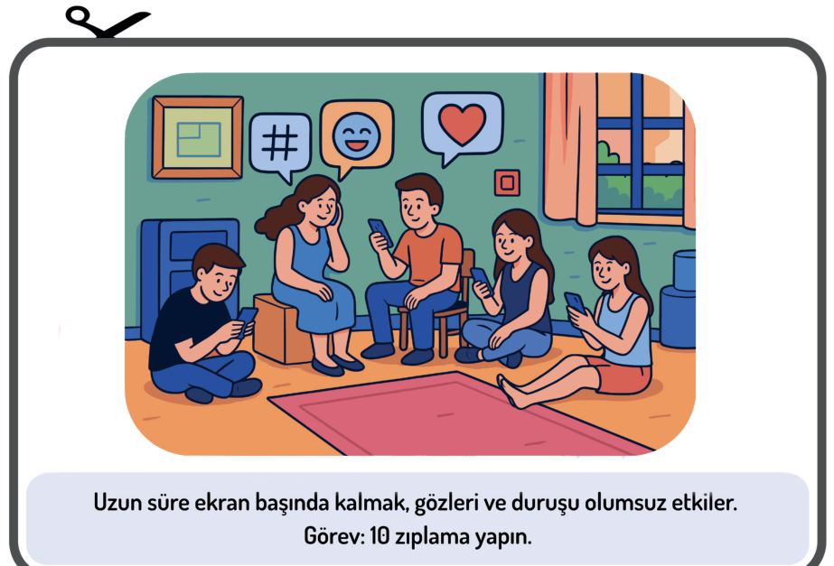

Uzun süre ekran başında kalmak, gözleri ve duruşu olumsuz etkiler.
Görev: 10 zıplama yapın.

<!-- sayfa 41 -->

**Ek 6. Öz Değerlendirme Formu**

| Etkinlik Adı: Fiziksel Uygunluk Kavramını Öğreniyorum |
| :--- |
| **Öğrencinin Adı Soyadı:** |
| **Tarih:** |

Aşağıdaki ifadeleri okuyunuz ve her bir ifade için uygun kutucuğu işaretleyiniz.

| İfade | Evet | Kısmen | Hayır |
| :--- | :---: | :---: | :---: |
| Fiziksel uygunluk kavramını ve bileşenlerini (kas kuvveti, kalp-dolaşım dayanıklılığı, esneklik, kas dayanıklılığı, vücut kompozisyonu) doğru bir şekilde açıkladım. | | | |
| Grubumun hareketini (squat, diz kaldırma) müziğin ritmine uygun ve doğru bir şekilde yaptım. | | | |
| Diğer grupların hareketlerini deneyimledim ve tüm fiziksel uygunluk bileşenlerini uyguladım. | | | |
| Fiziksel uygunluğun günlük yaşamda ve sağlıklı yaşam için önemini tartıştım ve farkındalık geliştirdim. | | | |
| Sağlıklı bir yaşam için düzenli egzersiz ve dengeli beslenme alışkanlıklarını benimseme konusunda istekli oldum. | | | |

<!-- sayfa 42 -->

# Ek 7. Fiziksel Uygunluk Testi

| Etkinlik Adı: Fiziksel Uygunluk Kavramını Öğreniyorum |
| :--- |
| **Grup Üyeleri:**   **Sınıf:**   **Tarih:** |

Aşağıdaki soruları dikkatlice okuyunuz ve boşlukları uygun kavramlarla doldurunuz. Son üç soruda fiziksel uygunluk bileşenlerinin günlük yaşama katkılarını kendi cümlelerinizle yazınız.

* Günlük işleri yorulmadan canlı ve uyanık biçimde yapabilmek için gerekli enerjiye sahip olmayı ifade eden kavram nedir?

Cevap: ..........................................................................................................................................

* Bir fiziksel aktivite yaparken eklemlerin geniş açıda rahat hareket edebilme becerisine ne denir?

* Herhangi bir fiziksel aktivitenin daha uzun süre, yorulmadan yapılabilmesini ifade eden kavrama ne denir?

* Bir kasın yorulmadan işlevini sürdürebilme yeteneğine ne denir?

* Kasın dirence karşı koyabilme yeteneğine ne denir?

* Kuvvetimizi geliştirmek, günlük yaşamda ne fayda sağlar?

* Kalp dolaşım sistemimizi geliştirmek, günlük yaşamda ne fayda sağlar?

* Esnekliğimizi geliştirmek, günlük yaşamda ne fayda sağlar?

<!-- sayfa 43 -->

EK 8. Fiziksel Uygunluk Kavram Kartları
FİZİKSEL UYGUNLUK
Günlük işleri yorgunluk duymaksızın canlı ve uyanık yapabilmek için gerekli enerjiye sahip olmaktır.

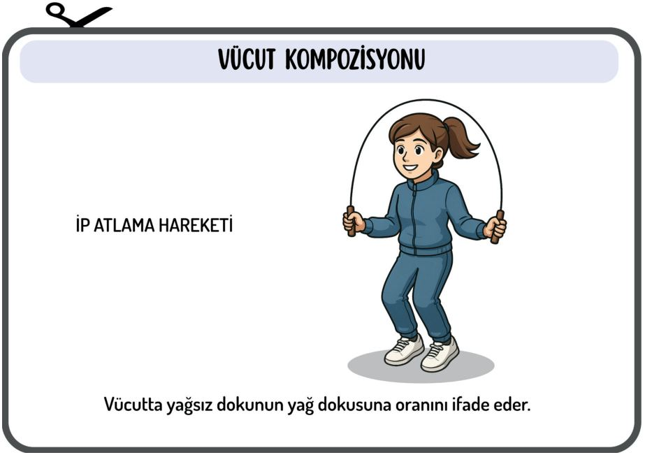
# VÜCUT KOMPOZİSYONU
İP ATLAMA HAREKETİ
Vücutta yağsız dokunun yağ dokusuna oranını ifade eder.

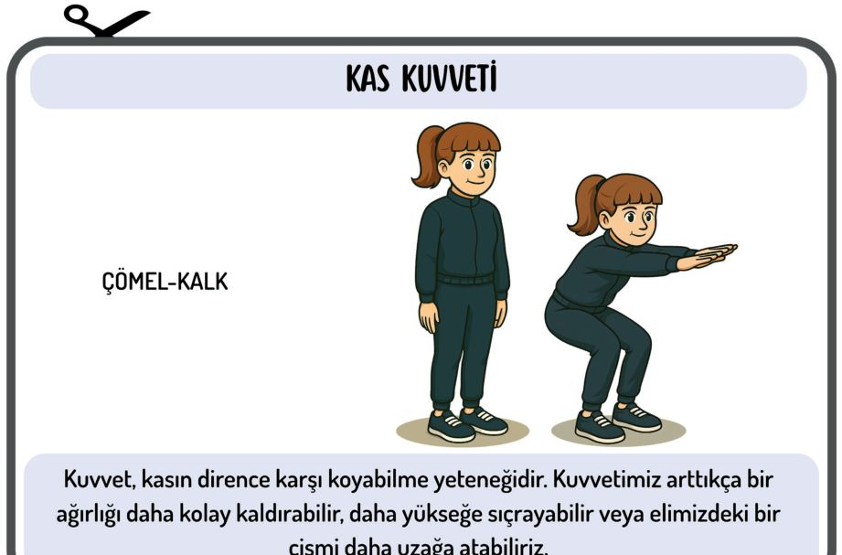
# KAS KUVVETİ
ÇÖMEL-KALK
Kuvvet, kasın dirence karşı koyabilme yeteneğidir. Kuvvetimiz arttıkça bir ağırlığı daha kolay kaldırabilir, daha yükseğe sıçrayabilir veya elimizdeki bir cismi daha uzağa atabiliriz.

<!-- sayfa 44 -->

# KAS DAYANIKLILIĞI

LASTİK GERDİRME
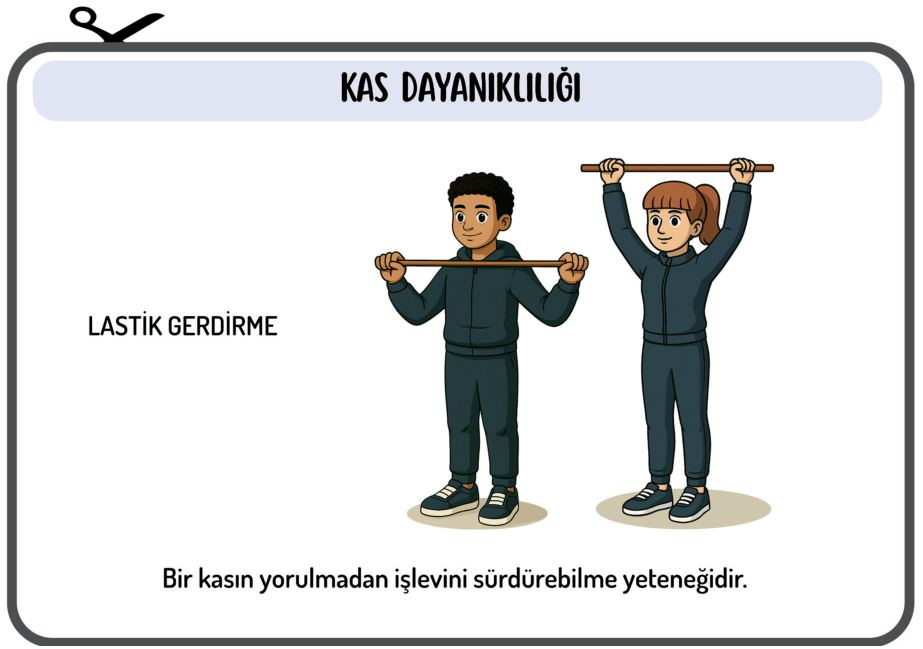
Bir kasın yorulmadan işlevini sürdürebilme yeteneğidir.

# KALP-DOLAŞIM SİSTEMİ DAYANIKLILIĞI

DİZ KALDIRMA HAREKETİ
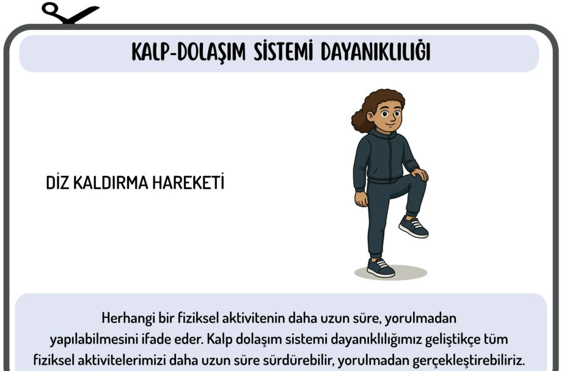
Herhangi bir fiziksel aktivitenin daha uzun süre, yorulmadan yapılabilmesini ifade eder. Kalp dolaşım sistemi dayanıklılığımız geliştikçe tüm fiziksel aktivitelerimizi daha uzun süre sürdürebilir, yorulmadan gerçekleştirebiliriz.

<!-- sayfa 45 -->

# ESNEKLİK

HULAHOP ÇEVİRME

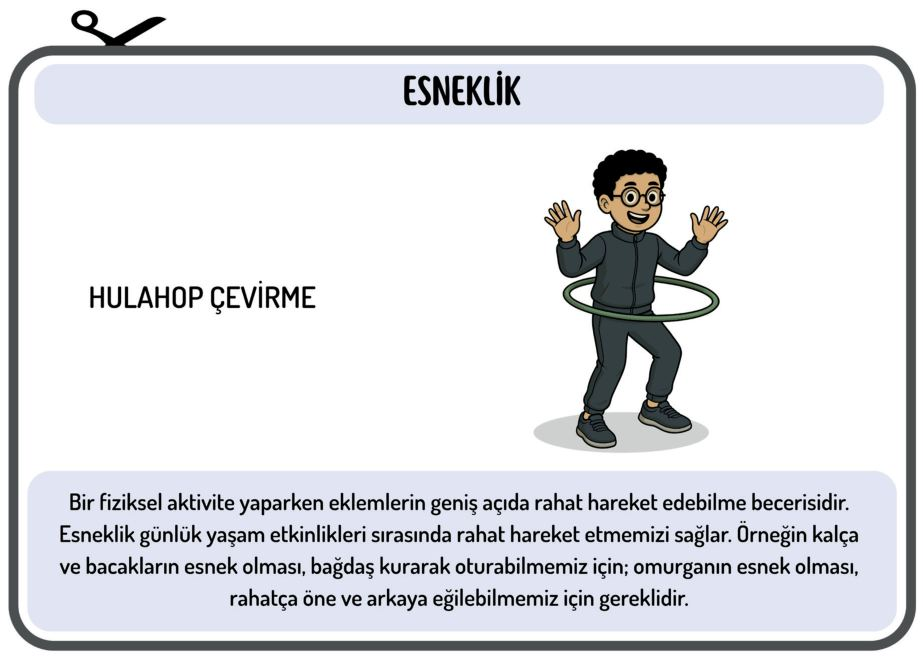

Bir fiziksel aktivite yaparken eklemlerin geniş açıda rahat hareket edebilme becerisidir. Esneklik günlük yaşam etkinlikleri sırasında rahat hareket etmemizi sağlar. Örneğin kalça ve bacakların esnek olması, bağdaş kurarak oturabilmemiz için; omurganın esnek olması, rahatça öne ve arkaya eğilebilmemiz için gereklidir.

<!-- sayfa 46 -->

# 2. TEMA

## İŞ BİRLİKLİ OYUNLAR

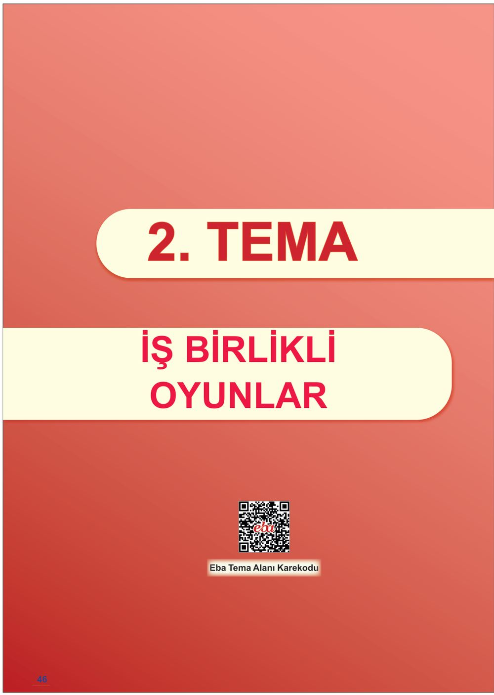 Eba Tema Alanı Karekodu

<!-- sayfa 47 -->

# 2. TEMA: İŞ BİRLİKLİ OYUNLAR

| | |
| :--- | :--- |
| **DERS SAATİ** | 18 |
| **ALAN BECERİLERİ** | BEOSAB1. Hareketi Sergileme, BEOSAB2. Hareket Kavramlarını Uygulama, BEOSAB3. Taktik ve Strateji Geliştirme |
| **KAVRAMSAL BECERİLER** | - |
| **EĞİLİMLER** | E2.2. Sorumluluk, E2.5. Oyunseverlik, E3.6.Analitiklik |

### PROGRAMLAR ARASI BİLEŞENLER

| | |
| :--- | :--- |
| **Sosyal-Duygusal Öğrenme Becerileri** | SDB1.2. Kendini Düzenleme (Öz Düzenleme), SDB2.1. İletişim, SDB2.2. İş Birliği, SDB3.1. Uyum, SDB3.3. Sorumlu Karar Verme |
| **Değerler** | D3. Çalışkanlık, D4. Dostluk, D10. Mütevazılık, D16. Sorumluluk, D20. Yardımseverlik |
| **Okuryazarlık Becerileri** | OB4. Görsel Okuryazarlık, OB7. Veri Okuryazarlığı |
| **DİSİPLİNLER ARASI İLİŞKİLER** | Sosyal Bilgiler |
| **BECERİLER ARASI İLİŞKİLER** | KB1. Temel Beceriler, KB2.4. Çözümleme, KB2.17. Değerlendirme, KB3.2. Problem Çözme, BEOSAB9. Takım/Grup Liderliği Sergileme, SBAB5.2. Grup Dinamiğini Sağlama |
| **ÖĞRENME ÇIKTILARI VE SÜREÇ BİLEŞENLERİ** | **BES.5.2.1. İş birlikli oyunlarda hareket kavramlarını uygulayabilme** a) İş birlikli oyunlarda hareket kavramlarını ayırt eder. b) İş birlikli oyunlarda hareket becerileri ile hareket kavramları arasında ilişki kurar. c) İş birlikli oyunlarda kavramlara uygun hareket eder.  **BES.5.2.2. İş birlikli oyunlarda hareket becerisi sergileyebilme** a) İş birlikli oyunlarda hareket becerilerini algılar. b) İş birlikli oyunlarda hareket becerilerinin basamaklarını gösterir. c) İş birlikli oyunlarda hareket becerilerini farklı ortamlarda uygular.  **BES.5.2.3. İş birlikli oyunlarda taktik ve strateji geliştirebilme** a) İş birlikli oyunlarda taktiksel problemi belirler. b) İş birlikli oyunlarda belirlenen problemin çözümüne ilişkin öneri sunar. c) İş birlikli oyunlarda seçilen taktik ve stratejiyi uygular. |
| **İÇERİK ÇERÇEVESİ** | İş birlikli Oyunlarda Hareket Kavramları İş birlikli Oyunlarda Hareket Becerileri İş birlikli Oyunlarda Taktik ve Strateji |
| **Genellemeler/ Anahtar Kavramlar/ Sembol ve Gösterimler** | beceri, bireysel sorumluluk, hareket, iş birliği, strateji, taktik, yardımlaşma |

<!-- sayfa 48 -->

# 1. TEMAYA BAŞLARKEN

Bu temada öğrencilerin iş birliği gerektiren oyunlar aracılığıyla hareket kavramlarını uygulamaları, hareket becerilerini sergilemeleri, taktik ve strateji geliştirme deneyimi kazanmaları amaçlanmaktadır. Etkinliklerde öğrenciler bir rakibe değil ortak bir hedefe yönelik olarak grupla hareket etmeye teşvik edilir.

Temadaki uygulamalar, öğrenen merkezli bir anlayışla planlanmış ve küçük grup çalışmaları temelinde yapılandırılmıştır. Bu yaklaşımda öğrencilerin hem bireysel sorumluluk hem de grup sorumluluğu üstlenmeleri, etkileşim içinde olmaları ve olumlu sosyal bağlar geliştirmeleri amaçlanmaktadır (Dirik, 2015).

Öğrencilerden grup içinde birbirlerine olan ihtiyaçlarını fark etmelerini sağlar ve bu yolla olumlu bağlılık ilişkileri kurulmasına katkıda bulunur. Ayrıca bu oyunlar hem bireysel başarıyı hem de grup başarısını destekleyerek öğrencilerin birbirlerinin öğrenme süreçlerine katkıda bulunmalarına ve birbirlerini motive etmelerine olanak tanır (Johnson ve Johnson, 2009).

Rekabetten uzak, dayanışma temelli bu oyunlar sayesinde öğrenciler birlikte öğrenmeyi, eğlenmeyi ve hedefe ulaşmak için ortak çaba göstermenin değerini deneyimleme fırsatı bulur. Böylece öğrenciler başarısızlık korkusu yaşamadan öz güvenle etkinliklere katılır, bireysel katkıların grup başarısına nasıl dönüştüğünü somut olarak gözlemleme imkânı elde ederler (Orlick, 2006). Sonuç olarak bu tema kapsamında yapılandırılan iş birlikli oyunlar, öğrencilerin bireysel katkılarını ortak hedefe yönlendirmelerini sağlayarak hem hareket kavramlarını ve becerilerini uygulamalarına hem de grup içinde koordinasyon, sorumluluk ve strateji geliştirme becerilerini deneyimlemelerine olanak tanımaktadır. Bu sayede öğrencilerin rekabetten uzak bir ortamda birlikte hareket etmenin gücünü keşfetmeleri beklenmektedir. Bu bağlamda da bu temada yer alan etkinliklerin “iş birlikli öğrenme modeli” kullanılarak yürütülmesi önerilmektedir. Birlikte öğrenme, ayrılıp birleşme (jigsaw), iş birliğine dayalı oyun, takım destekli bireyselleştirme gibi tekniklerden yararlanılarak sürecin devam ettirilmesi önemli görülmektedir.

Bu temada öğrencilerden iş birlikli oyunlarda kullanılabilecek çeşitli materyaller (paraşüt, farklı boyutlarda çemberler, toplar, engeller, deniz makarnaları vb.) tasarlamaları istenerek bu materyallerin süreçte yer alan etkinliklerde kullanılması desteklenmelidir. Materyal tasarımı sürecinde eski çoraplardan kum torbaları, plastik borulardan engel çubukları, su dolu şişelerden lobutlar ve kumaş parçalarından oyun çarşafı gibi işlevsel araçlar oluşturmaları desteklenmelidir.

# 2. ÖĞRENME-ÖĞRETME YAŞANTILARI

Dersin başında öğrencilere “Daha önce arkadaşlarınızla oynadığınız hangi oyunları hatırlıyorsunuz?” sorusu yöneltilerek öğrencilerin iş birlikli oyunlara dair önceki deneyimlerini hatırlamalarına rehberlik edilir. Ülkemizde ve farklı ülkelerde oynanan bazı iş birliği temelli geleneksel oyunlardan (mendil kapmaca, halat çekme, bayrak koşusu gibi) örnekler verilerek öğrencilerin farklı kültürlerdeki oyunların benzer ve farklı yönlerini karşılaştırmaları sağlanır, iş birliği kavramı hem bireysel yaşamla hem de kültürel değerlerle ilişkilendirilerek bağ kurulur. Ayrıca “Günlük hayatınızda hangi durumlarda başkalarıyla iş birliği yapmanız gerekiyor?” sorusu yöneltilerek öğrencilerden okulda (örneğin grup ödevleri), evde (örneğin sofra kurma) veya sosyal ortamlarda (örneğin arkadaşlarıyla bir etkinlik planlama) karşılaştıkları iş birliği gerektiren durumları paylaşmaları istenir. Bu örnekler üzerinden birlikte hareket etmenin ve ortak hedeflere ulaşmanın (bir sınıf panosunu hazırlarken herkesin farklı görevleri üstlenmesi, evde bir etkinlik düzenlenirken aile bireylerinin birlikte çalışması vb.) günlük yaşamda ne kadar önemli olduğu vurgulanır.

<!-- sayfa 49 -->

Öğrencilerle bir oyun seçilerek her öğrencinin katkısının günlük yaşamda olduğu gibi bu oyunda da grup başarısını doğrudan etkilediği vurgulanır. “Bu oyunda da hedefe ulaşabilmek için herkesin bir görevi olacak.” şeklinde bir yönlendirmeyle öğrencilerin bireysel çabalarının grup başarısına nasıl katkıda bulunduğu fark ettirilir. Oyun sonrasında öğretmen “Oyun sırasında nasıl hareket ettiniz?”, “Koşmak mı gerekiyordu, yakalamak mı?”, “Yoksa dikkatli şekilde yön mü değiştirdiniz?” gibi sorular yönelterek öğrencilerin hangi hareket becerilerini (koşma, atma, yön değiştirme, denge sağlama vb.) kullandıklarını öğrencilerle değerlendirir ve öğrencilerin hazır bulunuşluk düzeyleri hakkında bilgi edinir. Ayrıca “Oyun sırasında zorlandığınız bir an oldu mu?”, “Bu durumu birlikte nasıl çözdünüz?” gibi sorularla öğrenciler karşılaştıkları problem durumlarını ve bu durumlara karşı geliştirdikleri taktik veya stratejileri paylaşmaya teşvik edilir. Böylece öğretmen, etkinlik öncesinde öğrencilerin mevcut bilgi ve beceri düzeylerini gözlemleyerek ön değerlendirme sürecini yönetir.

## 2.1. Etkinlik Örnekleri

### ETKİNLİK 1  Birlikte Adım Adım

**Amaç:** *Öğrencilerin iş birliği gerektiren oyunlar aracılığıyla hareket kavramlarını uygulayabilmeleridir.*

| | |
| :--- | :--- |
| **Eğilimler** | E2.2. Sorumluluk |
| **Sosyal-Duygusal Öğrenme Becerileri** | SDB1.2. Kendini Düzenleme (Öz Düzenleme) |
| **Değerler** | D16. Sorumluluk, D20.Yardımseverlik |
| **Okuryazarlık Becerileri** | - |
| **Kavramsal Beceriler** | - |
| **Beceriler Arası İlişkiler** | - |
| **Öğrenme Çıktısı ve Süreç Bileşenleri** | **BES.5.2.1. İş birlikli oyunlarda hareket kavramlarını uygulayabilme**   a) İş birlikli oyunlarda hareket kavramlarını ayırt eder.   b) İş birlikli oyunlarda hareket becerileri ile hareket kavramları arasında ilişki kurar.   c) İş birlikli oyunlarda kavramlara uygun hareket eder. |
| **Kullanılan Öğretim Teknolojileri, Araç Gereçler ve Kaynaklar** | çember, koni, çanak, fasulye torbası ve küçük toplar |

Öğrencilere “Bir hedefe birlikte ulaşmak neden önemlidir?” sorusu yöneltilerek öğrencilerin düşüncelerini ifade etmeleri istenir. Öğrencilerden gelen cevaplar doğrultusunda iş birliği, birlikte hareket etme, yardımlaşma ve sorumluluk alma gibi kavramların önemi vurgulanır (**E2.2, D16.3, D20.2**).

Öğretmen, öğrencilere “ayna oyunu” oynayacaklarını açıklar ve yönergeler verir. Öğrencilerden birer eş seçmeleri istenir. Eşlerden biri lider olur ve yavaş-hızlı, sağa-sola, yukarı-aşağı gibi yön ve tempo değişimleri içeren çeşitli hareketler yapar. Diğer öğrenci, liderin yaptığı hareketleri taklit eder. Belirli bir süre sonra öğretmenin komutuyla roller değiştirilir. Bu etkinlik sayesinde öğrencilerin alan, yön ve

<!-- sayfa 50 -->

Oyunun ardından yeni bir oyun için oyun alanı belirlenir ve konilerle sınırlandırılır. Her öğrenciye bir adet çember verilir. Öğrenciler çemberleri yere düz bir hat şeklinde yerleştirir ve öğrencilerin her biri kendi çemberinin içine geçer. Bir çember daha verilir ve o çember boş kalacak şekilde oyun düzenlenir. Oyun başladığında öğrenciler boş çemberi en arkadan alıp, öne yerleştirerek ilerlemeye başlar. Her öğrenci, önündeki çembere sırasıyla adım atar. Öğrenciler bu şekilde bir “tırtıl” gibi hareket eder (**(SDB2.2)**).

Bir süre oynandıktan sonra oyun durdurulur. Öğretmen, öğrencilere birlikte daha iyi nasıl hareket edebileceklerini konuşmaları için kısa bir süre verir. Ardından öğrencilere çeşitli yön ve tempo yönergeleri vererek oyunu farklılaştırır. “Sola dönün ve ilerleyin.”, “Geri geri ilerleyin.”, “Zikzak yaparak ilerleyin.”, “Çok yavaş ilerleyin.”. Bu komutlarla öğrencilerin farklı yönlere ve farklı hızlara yönelik uyum sağlamaları ve birlikte hareket etmeleri sağlanır **(SDB3.1)**.

Daha sonra öğretmen, oyun alanının çeşitli bölgelerine “hazine” olarak adlandırılan küçük nesneler (toplar, çanaklar, fasulye torbaları vb.) yerleştirir. Öğrenciler, başlangıç çizgisinden başlayarak bu hazineleri birlikte toplamaya çalışır (**Şekil 1**). Öğrenciler ortak bir amaç doğrultusunda çalışarak hedefe ulaşmaya gayret eder. Tüm öğrencilerin katkıda bulunmasının önemi vurgulanarak birlikte çabalamanın süreç için gerekliliği ve önemi üzerinde durulur **(SDB2.2)**.

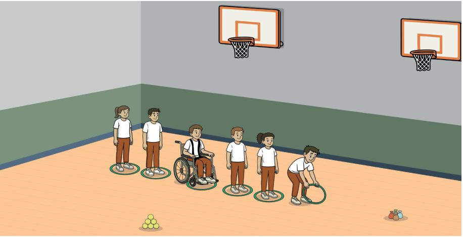

*Şekil 1. Birlikte hareket ederek nesneleri toplama*

Her grup içinde roller tanımlanır. Öğrenciler sırayla hazine taşıyıcı, yönlendirici gibi roller üstlenir. Her öğrenci, oyun boyunca farklı rolleri deneyimleyerek grubun hedefe ulaşmasına katkıda bulunur.

Etkinliğin sonunda öğretmen, öğrencilere sorular yönelterek öğrencilerden süreci değerlendirmelerini ister. Örneğin “Grubunuzla nasıl bir iş birliği yaptınız?”, “Grubunuzda herkes oyuna dâhil oldu mu?”, “Birlikte hareket etmekte zorlandığınız yönler neler oldu?”, “Birlikte hareket ederken nelere dikkat ettiniz?” Bu sorular yoluyla öğrencilerin bu süreçte grup dinamiğini iletişim, dayanışma ve yardımlaşma boyutunda değerlendirmeleri sağlanır.

**Açıklama**

Bu etkinlik sırasında öğrencilerin belirlenen her rolü deneyimlemelerine dikkat edilmelidir. Etkinliğin zorluk derecesi, çeşitlendirme bölümündeki örneklerden yararlanılarak öğrencilerin düzeylerine göre

<!-- sayfa 51 -->

**Çeşitlendirme**
Öğrencilere verilen görevlerin zorluk derecesi mesafeyi uzatarak veya belirlenen mesafeye küçük engeller ekleyerek artırılabilir. Birlikte hareket etmekte zorlanan kalabalık öğrenci gruplarının küçük gruplara ayrılması sağlanabilir. Oyun alanı mekânsal düzenlemelerle daraltılabilir ya da etkinlik, yön değiştirme zorunluluğu eklenerek daha karmaşık hâle getirilebilir.

**Öğrenme Kanıtları ve Etkinlik Yansıması**
Bu öğrenme çıktısının değerlendirilmesinde öz değerlendirme (**Ek 1**) ve akran değerlendirme (**Ek 2**) kullanılabilir.

Etkinlik yansıması kapsamında öğrencilere aşağıdaki sorular yöneltilebilir:
* Arkadaşlarınızla uyum içinde nasıl çalıştınız?
* Bugün üstlendiğinize benzer rolleri okul dışında hangi durumlarda üstleniyorsunuz?
* Etkinlik sırasında bir arkadaşınıza yardım ettiniz mi? Benzer bir durumu okul dışında nerede yaşadınız? Anlatınız.

# ETKİNLİK 2 | Hedefe Hep Birlikte

| | |
| :--- | :--- |
| **Amaç:** | Öğrencilerin iş birliği gerektiren oyunlar aracılığıyla hareket becerilerini sergileyebilmeleridir. |
| **Eğilimler** | E2.5. Oyunseverlik |
| **Sosyal-Duygusal Öğrenme Becerileri** | SDB1.2. Kendini Düzenleme (Öz Düzenleme), SDB2.1. İletişim, SDB3.1. Uyum |
| **Değerler** | D3. Çalışkanlık, D4. Dostluk, D16. Sorumluluk, D20. Yardımseverlik |
| **Okuryazarlık Becerileri** | OB7. Veri Okuryazarlığı |
| **Kavramsal Beceriler** | - |
| **Beceriler Arası İlişkiler** | BEOSAB9. Takım/Grup Liderliği Sergileme, SBAB5.2. Grup Dinamiğini Sağlama |
| **Öğrenme Çıktısı ve Süreç Bileşenleri** | **BES.5.2.2. İş birlikli oyunlarda hareket becerisi sergileyebilme**   a) İş birlikli oyunlarda hareket becerilerini algılar.   b) İş birlikli oyunlarda hareket becerilerinin basamaklarını gösterir   c) İş birlikli oyunlarda hareket becerilerini farklı ortamlarda uygular. |
| **Kullanılan Öğretim Teknolojileri, Araç Gereçler ve Kaynaklar** | küçük toplar, çemberler, kutular, lobutlar ya da plastik şişeler, deniz makarnaları, uzun saplı araçlar (raket, sopa vb.), görsel yönerge kartları ve koniler |


Öğrencilere ders boyunca grupla hareket etmeyi gerektiren etkinliklere dâhil olacakları ve hep birlikte hareket etmeye çalışmaları gerektiği belirtilir.

Öğrenciler küçük gruplara (6-7 kişi) ayrılır ve çember şeklinde dizilir. Her gruptan bir öğrenci oyunu başlatır, seçtiği basit bir hareketi (zıplama, çömelme, kolları açma vb.) yapar. Sonraki öğrenci bu hareketi tekrarlar ve harekete kendi seçtiği yeni bir hareketi ekler. Bu şekilde her öğrenci, kendinden önce gelen tüm hareketleri tekrar ederek üzerine yenisini ekler. Örnek:

1. öğrenci $\rightarrow$ kolları yukarı kaldırma
2. öğrenci $\rightarrow$ kollar yukarı kaldırma ve çömelme

<!-- sayfa 52 -->

Tüm öğrenciler, oluşan hareket serisini sırasıyla uyguladıktan sonra etkinlik sonlandırılır.

Öğrencilerin birlikte çalışmasını ve birbirinden öğrenmesini destekleyecek şekilde dört farklı istasyon hazırlanır. Bu istasyonlar iş birliği gerektiren eğilme, yön değiştirme, top sürme, hedefe atma, taşıma gibi temel hareket becerilerini içerecek biçimde yapılandırılır (**Şekil 2**).

**1. İstasyon:** Grup üyeleri, küçük topları birlikte hareket ederek belirli bir mesafede yer alan çember veya kutuya isabet ettirmeye çalışır. Grupların sırayla ya da aynı anda atış yapıp yapmayacağına, grup içinde kimin ne zaman atış yapacağına, kaç adımda hedefe ulaşılacağına birlikte karar verilir. Öğrenciler hedef alma, uygun mesafeyi belirleme ve topları dikkatli şekilde fırlatma konusunda birbirlerine destek olurlar. Belirlenen sayıda topu grup olarak hedefe ulaştırmaları beklenir.

**2. İstasyon:** Her öğrenciye birer uzun saplı araç (deniz makarnası, sopa vb.) verilir. Grup, bir topu birlikte hareket ederek, yere düşürmeden hedefe ulaştırmaya çalışır. Topun sadece araçlarla taşınmasına dikkat edilmelidir. Öğrenciler aralarındaki mesafeyi ve hızlarını dengeleyerek birlikte ilerlemeli, topu kontrollü şekilde hedefe ulaştırmalıdır.

**3. İstasyon:** Gruplar, belirli mesafelerde sıralanmış olan lobutları ya da plastik şişeleri toplarla devirmeye çalışır. Grup aynı anda veya sırayla, hangi stratejiyle atış yapılacağını birlikte planlar. Atış sırasında yönlendirme, isabetli hedef alma ve uygun hızda fırlatma konularında birbirlerine sözlü geri bildirim vermelerinin önemli olduğu belirtilir. Grup, birlikte hareket ederek tüm lobutları devirmeyi hedefler.

**4. İstasyon:** Gruplar ellerindeki uzun saplı araçlarla bir topu yerde sürükleyerek ve kontrol ederek, önceden hazırlanmış engelli bir parkurdan geçirip belirlenen hedefe ulaştırmaya çalışır. Parkur; koniler, ip şeritler, küçük engeller ve yön değişimlerini içerecek şekilde düzenlenir. Tüm grup üyeleri aynı anda topa temas ederek topu birlikte sürer ve topa yön vermeye çalışır. Topun parkur dışına çıkması ya da engellere çarpması durumunda grup, görevine tekrar başlar veya belirli bir noktadan devam eder.

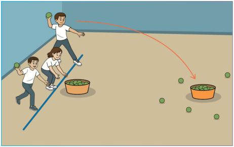
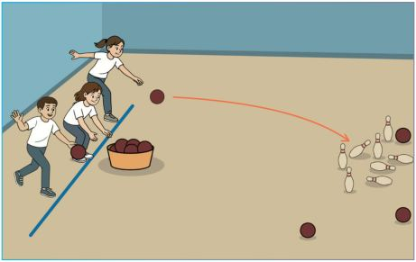
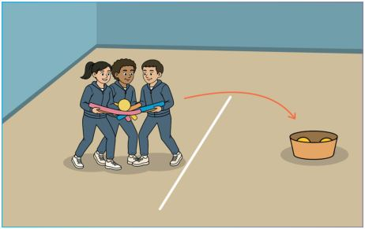
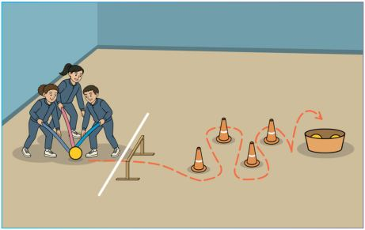

*Şekil 2. İstasyon görselleri*

<!-- sayfa 53 -->

Öğrenciler bu istasyonlarda yer alan hareket becerilerini birlikte uygulayarak deneyimler. Öğrencilerden istasyonlarda gerçekleştirilen hareket becerilerinin uygulama basamaklarını grup hâlinde tartışarak belirlemeleri ve bu adımları uygulamaları beklenir. Örneğin hedefe top atma becerisi için hazırlık, hedef alma, fırlatma gibi adımların sırayla uygulanması sağlanır.

İstasyonlara hareketlerin adımlarını içeren görseller yerleştirilerek öğrencilerin süreci daha kolay takip etmeleri desteklenir. Öğrenciler birbirlerine sözlü geri bildirimler verir (“Biraz daha yukarıdan atabilirsin.”, “Biraz yaklaşman işe yarar.” gibi). Grupların istasyonları en az 5-6 dakika süreyle deneyimlemesine olanak tanınır.

Öğretmen, istasyonlar sırasında öğrencilere rehberlik eder ve süreci pekiştirmek için şu tür sorular yöneltir: “Bir sonraki adımı nasıl planladınız?”, “Arkadaşınıza nasıl destek oldunuz?”

Etkinlik boyunca öğrencilerin farklı rolleri ve pozisyonları deneyimlemelerine fırsat verilir (SDB3.1). Böylece öğrencilerin birbirlerinin öğrenmesine katkıda bulunmaları, dayanışma içinde olmaları ve oyunlardan keyif almaları desteklenir (E2.5).

Etkinlik sonunda şu sorularla öğrencilerin iş birliği, iletişim ve grup dinamiği konularında farkındalık kazanmaları sağlanır “Gruptaki arkadaşlarınıza nasıl yardımcı oldunuz?”, “Bu oyunda birlikte çalışmanın en önemli yanı neydi?” (SDB1.2, SDB2.1, D20.2, SBAB5.2):

Öğrenciler süreç boyunca birbirlerinin öğrenmesine destek olmaya, sorumluluk alarak aktif roller üstlenmeye ve liderlik becerilerini geliştirmeye teşvik edilir (BEOSAB9).

Öğrencilerden iş birlikli oyunlarda kullanılabilecek çeşitli materyaller (paraşüt, farklı boyutlarda çemberler, toplar, engeller, deniz makarnaları vb.) tasarlamaları istenir. Öğrencilerden tasarladıkları materyalleri değerlendirmeleri, değerlendirme sonuçlarını analiz ederek materyallerini yeniden yapılandırmaları beklenir (OB7). Bir sonraki derse gelirken tasarladıkları materyalleri yanlarında getirmeleri istenir.

## Açıklama
Bu etkinlik sırasında öğrencilerin belirlenen her istasyonu deneyimlemesine dikkat edilmelidir. Etkinliğin zorluk derecesi, çeşitlendirme bölümündeki örneklerden yararlanılarak öğrencilerin düzeylerine göre değiştirilebilir ve etkinlik üç hafta boyunca uygulanabilir.

## Çeşitlendirme
Etkinlik sürecinin başında öğrenciler topu hedefe ulaştırırken istedikleri kadar tekrar yapabilir, daha ileri seviyelerde ise zaman sınırlaması getirilebilir veya topun düşmesi hâlinde başa dönmek gibi kurallar eklenerek görevler zorlaştırılabilir. Çember ya da kutuya atılan topların isabet ettirilmesi noktasında sürece daha büyük ya da daha küçük hedefler eklenebilir. Başlangıç seviyesindeki öğrenciler için büyük, dengeli ve kolay kontrol edilebilir toplar tercih edilebilir; gelişmiş öğrenciler için daha küçük veya zeminle teması zor olan toplar kullanılabilir. Uzun ve esnek deniz makarnaları yerine daha kısa ve kontrolü zor araçlar kullanılarak etkinliğin zorluk seviyesi artırılabilir. Oyun alanı düz ve geniş bir yüzeyle başlayabilir; ilerleyen süreçte dar alanlara, yön değişikliği gerektiren parkurlara ya da hafif eğimli zeminlere dönüştürülerek mekânsal değişkenlik sağlanabilir.

## Öğrenme Kanıtları ve Etkinlik Yansıması
Bu öğrenme çıktısının değerlendirilmesinde analitik dereceli puanlama anahtarı (Ek 3) kullanılır.
Etkinlik yansıması kapsamında öğrencilere aşağıdaki sorular yöneltilebilir:

* En çok hangi istasyonda zorlandınız? Neden zorlandığınızı arkadaşınızla paylaşınız.
* Adımları grup olarak birlikte belirlemek işinizi kolaylaştırdı mı? Kolaylaştırdıysa nasıl?

<!-- sayfa 54 -->

* Birlikte çalışmak, günlük yaşamda neden önemlidir? Hangi durumlarda birlikte çalışmanız gerekebilir?
* Arkadaşınızın bir hareketi yaparken zorlandığını fark ettiğinizde ona nasıl yardımcı oldunuz? Günlük hayatta yardım ettiğiniz bir zamanı hatırlıyor musunuz?


**ETKİNLİK 3**                                     **Birlikte Taşı, Birlikte Başar**

| | |
| :--- | :--- |
| **Amaç:** | Öğrencilerin iş birliği gerektiren oyunlar aracılığıyla hareket kavramlarını uygulayabilmeleridir. |
| **Eğilimler** | - |
| **Sosyal-Duygusal Öğrenme Becerileri** | SDB1.2. Kendini Düzenleme (Öz Düzenleme), SDB2.2. İş Birliği, SDB3.3. Sorumlu Karar Verme |
| **Değerler** | D10. Mütevazılık |
| **Okuryazarlık Becerileri** | - |
| **Kavramsal Beceriler** | - |
| **Beceriler Arası İlişkiler** | KB1. Temel Beceriler, KB2.4. Çözümleme, KB2.17. Değerlendirme, KB3.2. Problem Çözme |
| **Öğrenme Çıktısı ve Süreç Bileşenleri** | **BES.5.2.3. İş birlikli oyunlarda taktik ve strateji geliştirebilme**   a) İş birlikli oyunlarda taktiksel problemi belirler.   b) İş birlikli oyunlarda belirlenen problemin çözümüne ilişkin öneri sunar.   c) İş birlikli oyunlarda seçilen taktik ve stratejiyi uygular. |
| **Kullanılan Öğretim Teknolojileri, Araç Gereçler ve Kaynaklar** | deniz makarnası, uzun çubuk, top, yer işaretleyici (koni, bant, çember vb.), zamanlayıcı ve engel materyalleri (şerit, minder, kutu vb.) |

Öğrencilere “Birlikte oynarken ya da bir hedefe ulaşmaya çalışırken karşınıza çıkan en büyük zorluk neydi?” sorusu yöneltilir ve öğrencilerin fikirlerini paylaşmaları sağlanır. Öğretmen iş birliği yapılan oyunlarda taktiksel zorluklar, görev paylaşımı, iletişim eksikliği gibi kavramlara dikkat çeker ve “Bugün birlikte oynayacağımız oyunlarda hem birlikte hareket edeceğiz hem de karşılaştığımız sorunlara birlikte çözüm yolları bulacağız.” diyerek dersin amacına yönelik açıklayıcı ifadelerde bulunur.

Öğrencilerin önceki etkinlikte tasarladıkları materyaller sürece dâhil edilerek bu materyallerle oyunlar oynamaları sağlanır. Örneğin öğrenciler tasarladıkları oyun çarşafını (paraşüt) çember şeklinde dizilerek iki elleriyle tutar. Önce paraşütü ritmik şekilde yukarı-aşağı sallayarak dalga hareketi yaparlar. Ardından paraşütü hızla yukarı kaldırıp indirerek içine hava dolmasını sağlar ve paraşütün altına çömelirler. Daha sonra paraşütün ortasına bırakılan hafif topu delikten düşürmeden, paraşütü kontrollü biçimde hareket ettirerek yönlendirmeye çalışırlar. Öğrencilerden top deliğe yaklaşınca paraşütü hep birlikte yukarı çekerek iş birliği içinde kontrolü sağlamaları beklenir. Bu oyunlar aracılığıyla öğrencilerden oyunun amaçlarını bulmaları ve keşfetmeleri istenir (KB1).

Öğrenciler yeni bir oyuna dâhil edilir ve öğretmen öğrencilere oyunun amacını açıklar: “Bugün bir hedefe ulaşmaya çalışacağız ama bunu yaparken hep birlikte hareket etmeniz, düşünmeniz ve çözüm üretmeniz gerekecek.” Ardından öğrencilerle etkinliğin amacı, kuralları ve süreci konuşulur.

<!-- sayfa 55 -->

Etkinlikte her öğrenciye birer adet deniz makarnası veya uzun çubuk verilir. Öğrencilerin bir topu belirlenen bir noktadan diğer bir noktaya yalnızca bu makarnaları kullanarak, yere düşürmeden taşımaları gerektiği belirtilir (**Şekil 3**). Topa el ile temas edilmemesi gerektiği belirtilir. Topun yere düşmesi hâlinde grubun başa dönmesi gerektiği vurgulanır. Top yalnızca makarnalarla yönlendirilerek hareket ettirilmelidir. Her öğrenciden grupta kendi makarnasıyla top taşımaya katkıda bulunması beklenir.

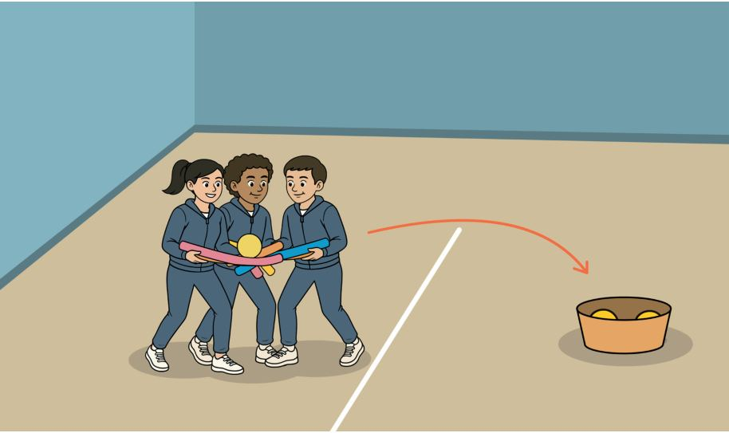

*Şekil 3. Birlikte top taşıma*

Oyun belirli bir süre oynandıktan sonra öğretmen öğrencilere süreci değerlendirmeleri için zaman tanır. Bu aşamada öğrencilere şu sorular yöneltilir: “Topu taşırken en çok nerede zorlandınız?”, “Herkes aynı anda hareket edebildi mi?”, “Birlikte hareket etmeyi kolaylaştırmak için ne yapabilirsiniz?” Öğrenciler bu sorular üzerinde tartışarak oyun içinde karşılaştıkları taktiksel problemleri belirler (**KB3.2, SDB1.2**). Ardından öğrenciler, belirlenen problemi çözmeye yönelik stratejiler geliştirirler (**KB3.2, SDB3.3**). Öğrenciler tarafından geliştirilen yöntemlerin oyun esnasında uygulanması sağlanır. Bu uygulama sırasında öğretmen öğrencileri gözlemleyerek süreci takip eder, yönelttiği sorularla öğrencilerin düşünmelerini destekler ve arkadaşlarıyla geliştirdikleri çözüm önerilerinin etkililiği üzerine tartışmalarını sağlar (**KB2.17, SDB2.2, D10.1**). Örneğin şu soruları yöneltir: “Stratejiniz işe yarıyor mu?”, “Neye göre karar veriyorsunuz?”, “Birbirinize nasıl yardımcı oluyorsunuz?” Uygulama tamamlandığında öğrenciler uyguladıkları stratejileri açıklar, stratejilerin işe yarayıp yaramadığını değerlendirir ve gerekirse geliştirmek üzere fikir üretirler (**SDB3.3**). Öğretmen süreci özetleyerek öğrencilerin taktik geliştirme ve strateji uygulama süreçlerini pekiştirir. Etkinlik boyunca her öğrenci çeşitli roller üstlenir. Öğretmen öğrencilerin her rolü denemeleri, fikirlerini paylaşmaları ve grubun başarısına katkıda bulunmaları için yönlendirme yapar.

### Açıklama

Bu etkinlik sırasında öğrencilerin taktik ve strateji geliştirme süreçlerinde düşünmelerine olanak tanımak için yeterli zaman verilmesine özen gösterilmelidir.

<!-- sayfa 56 -->

# Çeşitlendirme

Topun daha kısa mesafede taşınması ve topun düşmesi hâlinde grubun başa dönmek yerine bulunduğu noktadan devam etmesine izin verilmesi ile etkinlik kolaylaştırabilir, topun daha uzun mesafede ve zaman sınırlaması ile taşınmasıyla zorluk derecesi artırılabilir. Daha büyük ve ağır olmayan toplarla süreç kolaylaştırılabilir, küçük veya yönlendirmesi daha zor toplar (örneğin tenis topu) ile etkinlik zorlaştırılabilir. Ayrıca deniz makarnaları yerine daha esnek ya da sert araçlar kullanılması öğrencilerin topu kontrol etme seviyelerini etkileyebilir. Başlangıçta düz bir alanda yapılan taşıma etkinliği ilerleyen haftalarda engelli parkur (konilerle zikzaklar, alçak geçitler, eğimli yüzeyler) şeklinde yeniden yapılandırılarak çeşitlendirilebilir.

## Öğrenme Kanıtları ve Etkinlik Yansıması

Öğrencilere iş birliği gerektiren oyunlara ilişkin taktik ve strateji geliştirmeleri için problem durumları verilir. Öğrencilerden aşağıda yer alan senaryo durumlarını dikkatlice okumaları ve grup olarak bu duruma yönelik çözüm önerileri geliştirmeleri istenir.

### Senaryo 1: Top Sürekli Yere Düşüyor

Oynadığınız oyunda topu deniz makarnalarıyla taşırken top sık sık yere düştü. Grup olarak hedefe ulaşmakta zorlandınız. Bu durum karşısında nasıl bir çözüm geliştirirsiniz? Grup içindeki görev dağılımını nasıl değiştirirsiniz?

**Çözüm Öneriniz:** ................................................................................................................................

### Senaryo 2: Herkes Farklı Yöne Gidiyor

Grubunuzda herkes topu yönlendirmeye çalışırken top farklı yönlere hareket etti. Bu da topun kontrolünü zorlaştırdı ve hedefe ulaşamadınız. Sizce neden böyle oldu? Bir sonraki oyunda neyi farklı yapardınız?

### Senaryo 3: Grup İçinde Herkes Sürece Eşit Katılmadı

Oyun sırasında bazı arkadaşlarınız daha aktif rol aldı, bazıları ise sürece fazla katılamadı. Bu durum grubun başarısını nasıl etkiledi? Herkesin oyuna katkı sunabilmesi için nasıl bir çözüm önerirsiniz?

Etkinlik yansıması kapsamında öğrencilere aşağıdaki sorular yöneltilebilir:

* Karşılaştığınız en büyük problem neydi?
* Stratejiniz problemi çözdü mü? Çözdüyse nasıl?
* Bu oyunda öğrendiğiniz bir taktik, günlük hayatta işinize nasıl yarar?
* Birlikte çalışırken grubunuzu daha etkili hâle getirmek için ne yaparsınız?

## 2.2. Farklılaştırma

### Zenginleştirme

İş birlikli oyunların zorluk düzeyi artırılarak daha karmaşık becerileri içeren, eş zamanlı koordinasyon gerektiren etkinlikler tasarlanabilir. Örneğin öğrencilerden topu uzun çubuklarla taşırken bir engelin altından geçmeleri veya üzerinden atlamaları istenebilir. Oyun farklı zeminlerde (kum, çim, minder vb.) ya da eğimli yüzeylerde oynanarak denge ve yön değiştirme gibi becerilerin kullanımı desteklenebilir.

<!-- sayfa 57 -->

**Destekleme**
Nesne büyüklüğü ya da ağırlığı değiştirilerek (küçük top yerine büyük ve yumuşak top kullanmak) hareket kontrolü farklılaştırılabilir. Oyunlardaki alan büyüklüğü, oyuncu sayısı veya hedef yapısı değiştirilerek hareket becerisi ve grup iş birliği gereksinimi yeniden yapılandırılabilir.

### 3. ÖĞRENME KANITLARI (Ölçme ve Değerlendirme)
Bu temanın değerlendirilmesinde öğrencilerden performans görevi olarak iş birlikli oyunlarda kullanılabilecek yaratıcı materyaller (paraşüt, farklı boyutlarda çemberler, toplar, engeller, deniz makarnaları vb.) istenir (**Ek 5**). Öğrenciler hazırladıkları materyalleri kullanarak özgün oyunlar oluşturabilir, arkadaşlarına bu oyunları uygulatarak liderlik rolü üstlenebilir ve materyallerini geri bildirimlerle yeniden yapılandırabilirler. Öğrencilerin tasarladıkları materyaller analitik dereceli puanlama anahtarı (**Ek 6**) ile değerlendirilir.

### 4. ÖĞRETMEN YANSITMALARI
Bir sonraki yıl bu temanın planlaması için yorumlar:

**Yorum 1:**

**Yorum 2:**

Öğrenme Çıktılarına Göre Öz Yansıtma (planlama/hazırlık, öğrenme çevresi, öğretim, mesleki sorumluluk)

1. Öğrenme çıktısı için yansıtmalar:

2. Öğrenme çıktısı için yansıtmalar:

3. Öğrenme çıktısı için yansıtmalar:

<!-- sayfa 58 -->

# 5. EKLER
## Ek 1. Öz Değerlendirme Formu

**Öğrencinin Adı Soyadı:** ...........................  **Tarih:** ...........................

Bu form, “Hedefe Hep Birlikte” etkinliğinde kendi performansınızı değerlendirmeniz için hazırlanmıştır. Buna göre aşağıdaki ölçütleri dikkatlice okuyup her bir ölçüt için kendinize en uygun olan seçeneği işaretleyiniz.

| Ölçütler | Evet | Kısmen | Hayır |
| :--- | :---: | :---: | :---: |
| Arkadaşlarımla iş birliği içinde çalıştım. | | | |
| Hareket ederken yön, tempo ve alan gibi kavramlara dikkat ettim. | | | |
| Üzerime düşen görevleri (liderlik, taşıma, yönlendirme) yerine getirdim. | | | |
| Herkesin oyuna katılması için elimden geleni yaptım. | | | |
| Oyun sırasında iletişim kurarak arkadaşlarıma destek oldum. | | | |
| Hedefe ulaşmak için birlikte hareket etmenin önemini fark ettim. | | | |

Bu formda “Hayır” ve “Kısmen” bölümündeki işaretleriniz çoğunluktaysa öğrenme eksikliklerinizi gideriniz.

<!-- sayfa 59 -->

# Ek 2. Akran Değerlendirme Formu

| Öğrencinin Adı Soyadı: .......................... | Tarih: .......................... |
| :--- | :--- |

Bu form, “Hedefe Hep Birlikte” etkinliğinde arkadaşınızın performansını değerlendirmeniz için hazırlanmıştır. Aşağıdaki ölçütleri dikkatlice okuyup her bir ölçüt için arkadaşınızın performansına en uygun olan seçeneği işaretleyiniz. Arkadaşınıza nesnel ve yapıcı geri bildirim vererek çalışmasını geliştirmesine katkıda bulunmanız beklenmektedir.

| Ölçütler | Evet | Kısmen | Hayır |
| :--- | :---: | :---: | :---: |
| Oyuna aktif olarak katıldı. | | | |
| Görevini yerine getirdi ve sorumluluk aldı. | | | |
| Arkadaşlarına karşı destekleyici ve yardımseverdi. | | | |
| Hareket kavramlarına dikkat ederek oyuna katkıda (alan, yön, tempo vb.) bulundu. | | | |
| Arkadaşlarına karşı saygılıydı ve iletişim kurarken dikkatli davrandı. | | | |

<!-- sayfa 60 -->

# Ek 3. Analitik Dereceli Puanlama Anahtarı

Bu ölçme aracı, öğrencilerin iş birliğine dayalı istasyon çalışmasındaki performanslarını değerlendirmek amacıyla hazırlanmıştır. Her öğrenci için değerlendirmenizi aşağıda yer alan sınıf listesine not ediniz.

| Ölçütler | Çok İyi (4) | İyi (3) | Geliştirilebilir (2) | Yetersiz (1) |
| :--- | :--- | :--- | :--- | :--- |
| **Birlikte Hareket Etme** | Arkadaşları ile mükemmel uyum içinde hareket ediyor, akranlarına destek oluyor. | Genellikle arkadaşları ile uyumlu hareket ediyor, iş birliğine açık. | Zaman zaman uyumsuzluk gösteriyor, yardımlaşma yetersiz. | Arkadaşları ile uyumsuz hareket ediyor, yardımlaşmaya katkıda bulunmuyor. |
| **Görev Paylaşımı ve Sorumluluk** | Arkadaşları içinde görevleri dengeli biçimde paylaşıyor, sorumluluk alıyor. | Görev paylaşımına katılıyor, genellikle sorumluluk alıyor. | Görev dağılımında isteksiz, sorumluluk almakta zorlanıyor. | Görevlerden kaçınıyor, göreve katkıda bulunmuyor. |
| **İletişim ve Geri Bildirim** | Açık, yapıcı geri bildirimlerde bulunuyor, iletişimi güçlü. | İletişim kuruyor ve zaman zaman yapıcı geri bildirim sunuyor. | İletişimi sınırlı, geri bildirim vermiyor. | İletişim kurmaktan kaçınıyor, geri bildirimde bulunmuyor. |
| **Planlama ve Uygulama Becerisi** | Etkinlik adımlarını arkadaşları ile birlikte açıkça planlıyor ve başarıyla uyguluyor. | Genellikle etkinlik sürecini planlıyor ve uygulamaya katılıyor. | Genellikle etkinlik sürecini planlıyor ve uygulamaya katılıyor. | Etkinlik sürecine katkısı düşük, planlama yapmıyor. |

## Değerlendirme Sistemi

Bu ölçme aracından en az $4$ puan, en fazla $16$ puan alınabilmektedir. Öğrencinin puanı, alınan puanın yüzdelik karşılığı hesaplanarak bulunur. Bunun için alınan puan, öğrencinin alabileceği en yüksek puana bölünür ve çıkan sonuç $100$ ile çarpılır. Ondalık gösterim elde edilmesi hâlinde sonuç, tam kısmına (birler basamağına) yuvarlanır.

Örneğin öğrenci bu ölçme aracından $10$ aldığında puanı şu şekilde hesaplanır:

$$(10 : 16) \times 100 = 62,5$$

Bu sonuç yuvarlandığında öğrenci $63$ puan almış olacaktır.

### Performans Düzeyleri

$25\text{-}43$ <!-- KONTROL: Marker'da karşılığı yok, uydurma olabilir -->: Yetersiz  
$44\text{-}62$ <!-- KONTROL: Marker'da karşılığı yok, uydurma olabilir -->: Geliştirilebilir  
$63\text{-}81$ <!-- KONTROL: Marker'da karşılığı yok, uydurma olabilir -->: İyi  
$82\text{-}100$ <!-- KONTROL: Marker'da karşılığı yok, uydurma olabilir -->: Çok iyi

<!-- sayfa 61 -->

# Ek 4. Puan Kaydetme Tablosu

**Sınıf:**

| Öğrencinin Adı Soyadı | Birlikte Hareket Etme | Görev Paylaşımı ve Sorumluluk | İletişim ve Geri Bildirim | Planlama ve Uygulama Becerisi | Toplam Puan |
| :--- | :--- | :--- | :--- | :--- | :--- |
| | | | | | |
| | | | | | |
| | | | | | |
| | | | | | |
| | | | | | |
| | | | | | |
| | | | | | |
| | | | | | |
| | | | | | |
| | | | | | |
| | | | | | |
| | | | | | |
| | | | | | |
| | | | | | |
| | | | | | |
| | | | | | |
| | | | | | |
| | | | | | |
| | | | | | |
| | | | | | |
| | | | | | |
| | | | | | |
| | | | | | |
| | | | | | |
| | | | | | |
| | | | | | |
| | | | | | |
| | | | | | |
| | | | | | |
| | | | | | |
| | | | | | |
| | | | | | |
| | | | | | |
| | | | | | |
| | | | | | |
| | | | | | |
| | | | | | |
| | | | | | |
| | | | | | |
| | | | | | |

<!-- sayfa 62 -->

**Ek 5. Performans Görevi**

| Performans Görevi |
| :--- |
| **Ders:** Beden Eğitimi ve Spor |
| **Sınıf Düzeyi:** 5 |
| **Öğrenme Çıktısı:** İş birlikli oyunlarda hareket becerisi sergileyebilme |
| **Etkinlik:** Hedefe Hep Birlikte |
| **Görev Konusu:** Oyunlara ilişkin materyaller tasarlama |

Sevgili Öğrenciler,

Bu görevde amacınız geri dönüştürülebilir veya evde kolayca bulunabilen malzemeleri kullanarak oyunlar için işlevsel, estetik ve güvenli bir araç gereç tasarlamanızdır. Hayal gücünüzü kullanarak kendi oyun malzemelerinizi oluşturunuz ve arkadaşlarınızla paylaşınız.

**Görev Açıklaması:**

Aşağıda yer alan örneklerden ilham alarak kendi oyun materyalinizi tasarlayınız:

* Eski çorapların içine kum doldurarak hedef oyunları için atış torbaları yapabilirsiniz.
* Boş plastik şişelerin içine bir miktar su koyarak denge hedefleri veya devrilebilen hedefler tasarlayabilirsiniz.
* Karton kutulardan puanlama panosu, mini kale, atlama engeli ya da hedef tahtası oluşturabilirsiniz.
* İp, kurdele ya da lastik bantları kullanarak sıçrama ipi, denge hattı veya alan sınırı tasarlayabilirsiniz.

**Göreviniz Sırasında Dikkat Etmeniz Gerekenler:**

1. Malzemeniz oyunda işlevsel yani kullanılabilir olmalı.
2. Estetik görünümüne dikkat ediniz. Malzemenizi renkli, yaratıcı ve dikkat çekici hâle getirebilirsiniz.
3. Güvenli olması çok önemlidir. Sivri uçlar, keskin kenarlar veya kırılabilecek parçalar kullanmamalısınız.
4. Malzemenizi sınıfa getirerek arkadaşlarınıza tanıtınız.
5. Performans görevinizi en geç ............................................ tarihine kadar teslim ediniz.

<!-- sayfa 63 -->

# Ek 6. Analitik Dereceli Puanlama Anahtarı

Bu ölçme aracı, öğrencilerin materyal tasarlama etkinliğindeki performanslarını değerlendirmek için hazırlanmıştır. Her ölçüt için öğrencinin tasarladığı materyali dikkatle inceleyiniz ve uygun olan düzeyi işaretleyiniz.

| Ölçütler | Çok İyi (4) | İyi (3) | Geliştirilebilir (2) | Yetersiz (1) |
| :--- | :--- | :--- | :--- | :--- |
| **Yaratıcılık ve Özgünlük** | Çok özgün, yaratıcı fikirler içeriyor. | Yaratıcılık var, fikir dikkat çekici. | Fikirler sıradan, kısmen özgün. | Özgünlük yok, benzer veya kopya bir ürün. |
| **Materyalin İşlevselliği** | Çok yönlü kullanılabilir, amaca hizmet ediyor. | Temel düzeyde işlevsel. | Sınırlı işlevsellik içeriyor. | Kullanım açısından yetersiz. |
| **Oyuna Uygunluk** | Farklı türde oyunlara kolayca entegre edilebilir | Belirli türde oyunlara uygundur. | Sadece belirli bir oyun için kullanılabilir. | Oyunda kullanılabilirliği çok düşük. |
| **Güvenli Malzeme Kullanımı** | Tamamen güvenli ve bilinçli malzeme seçilmiş. | Genellikle güvenli malzeme seçilmiş. | Bazı malzemeler riskli veya dikkat gerektiriyor. | Güvensiz, tehlike oluşturabilecek malzeme içeriyor. |
| **Estetik ve Düzen** | Özenli ve dikkat çekici. | Genel olarak düzenli ve oyunlara uygun. | Görsel olarak sade, biraz daha özen gerekebilir. | Dağınık, özensiz, düzenli görünüm yok. |

## Değerlendirme Sistemi

Bu ölçme aracından en az $5$ puan, en fazla $20$ puan alınabilmektedir. Öğrencinin puanı, alınan puanın yüzdelik karşılığı hesaplanarak bulunur. Bunun için alınan puan, öğrencinin alabileceği en yüksek puana bölünür ve çıkan sonuç $100$ ile çarpılır. Ondalık gösterim elde edilmesi hâlinde sonuç, tam kısmına (birler basamağına) yuvarlanır.

Örneğin öğrenci bu ölçme aracından $14$ aldığında puanı şu şekilde hesaplanır:

$$(14 : 20) \times 100 = 70$$

Bu sonuç yuvarlandığında öğrenci $70$ puan almış olacaktır.

**Puan Aralığı Performans Düzeyi**

$25\text{-}43$ <!-- KONTROL: Marker'da karşılığı yok, uydurma olabilir -->: Yetersiz  
$44\text{-}62$ <!-- KONTROL: Marker'da karşılığı yok, uydurma olabilir -->: Geliştirilebilir  
$63\text{-}81$ <!-- KONTROL: Marker'da karşılığı yok, uydurma olabilir -->: İyi  
$82\text{-}100$ <!-- KONTROL: Marker'da karşılığı yok, uydurma olabilir -->: Çok iyi

<!-- sayfa 64 -->

# Ek 7. Puan Kaydetme Tablosu

**Sınıf:**

| Öğrencinin Adı Soyadı | Yaratıcılık ve Özgünlük | Materyalin İşlevselliği | Oyuna Uygunluk | Güvenli Malzeme Kullanımı | Estetik ve Düzen | Toplam Puan |
| :--- | :--- | :--- | :--- | :--- | :--- | :--- |
| | | | | | | |
| | | | | | | |
| | | | | | | |
| | | | | | | |
| | | | | | | |
| | | | | | | |
| | | | | | | |
| | | | | | | |
| | | | | | | |
| | | | | | | |
| | | | | | | |
| | | | | | | |
| | | | | | | |
| | | | | | | |
| | | | | | | |
| | | | | | | |
| | | | | | | |
| | | | | | | |
| | | | | | | |
| | | | | | | |
| | | | | | | |
| | | | | | | |
| | | | | | | |
| | | | | | | |
| | | | | | | |
| | | | | | | |
| | | | | | | |
| | | | | | | |
| | | | | | | |
| | | | | | | |
| | | | | | | |
| | | | | | | |
| | | | | | | |
| | | | | | | |
| | | | | | | |
| | | | | | | |
| | | | | | | |
| | | | | | | |
| | | | | | | |
| | | | | | | |
| | | | | | | |
| | | | | | | |
| | | | | | | |
| | | | | | | |
| | | | | | | |
| | | | | | | |
| | | | | | | |
| | | | | | | |
| | | | | | | |
| | | | | | | |
| | | | | | | |

<!-- sayfa 65 -->

# 3.TEMA
## HAYALİMDEKİ OYUN

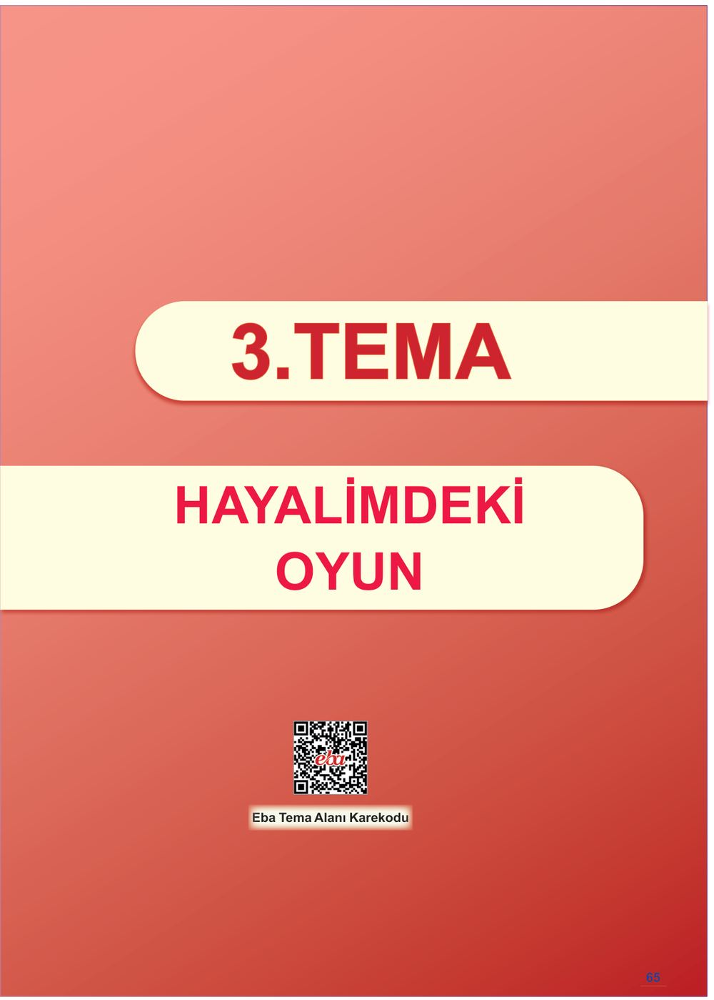 Eba Tema Alanı Karekodu

<!-- sayfa 66 -->

# 3. TEMA: HAYALİMDEKİ OYUN

| | |
| :--- | :--- |
| **DERS SAATİ** | 10 |
| **ALAN BECERİLERİ** | BEOSAB8. Adil Oyun Anlayışına Uygun Davranma, BEOSAB10. Güvenli Ortam Oluşturma |
| **KAVRAMSAL BECERİLER** | KB2.20. Sentezleyebilme |
| **EĞİLİMLER** | E2.5. Oyunseverlik, E3.10. Eleştirel Bakma |
| | **PROGRAMLAR ARASI BİLEŞENLER** |
| **Sosyal-Duygusal Öğrenme Becerileri** | SDB1.1. Kendini Tanıma (Öz Farkındalık), SDB1.2. Kendini Düzenleme (Öz Düzenleme), SDB1.3. Kendine Uyarlama (Öz Yansıtma), SDB2.2. İş Birliği, SDB3.1. Uyum, SDB3.3. Sorumlu Karar Verme |
| **Değerler** | D5. Duyarlılık, D6. Dürüstlük, D14. Saygı, D20. Yardımseverlik |
| **Okuryazarlık Becerileri** | OB4. Görsel Okuryazarlık, OB7. Veri Okuryazarlığı |
| **DİSİPLİNLER ARASI İLİŞKİLER** | Görsel Sanatlar, Sosyal Bilgiler |
| **BECERİLER ARASI İLİŞKİLER** | KB2.2. Gözlemleme, KB2.7. Karşılaştırma, KB2.17. Değerlendirme, KB3.2. Problem Çözme |
| **ÖĞRENME ÇIKTILARI VE SÜREÇ BİLEŞENLERİ** | **BES.5.3.1. Tasarlayacakları oyunlarda güvenli ortam oluşturabilme** a) Tasarlayacakları oyunlarda ortaya çıkabilecek riskleri belirler. b) Tasarlayacakları oyunlarda belirlenen risklere yönelik önleyici tedbirler alır.  **BES.5.3.2. Oyunların farklı özelliklerinden yararlanarak özgün bir oyun sentezleyebilme** a) Tasarlayacağı oyunun özelliklerini belirler. b) Tasarlayacağı oyunun özellikleri arasında ilişki kurar. c) Özgün bir oyun oluşturur.  **BES.5.3.3. Tasarlanan oyunlarda adil oyuna uygun davranabilme** a) Tasarlanan oyunlarda adil oyun anlayışını açıklar. b) Tasarlanan oyunlarda adil oyun anlayışına uygun hareket eder. |
| **İÇERİK ÇERÇEVESİ** | Güvenli Ortam Oluşturma Özgün Oyun Oluşturma Adil Oyuna Uygun Davranma |
| **Genellemeler/ Anahtar Kavramlar/ Sembol ve Gösterimler** | adil oyun, güvenli ortam, oyun, tasarı |

<!-- sayfa 67 -->

# 1. TEMAYA BAŞLARKEN

Bu temada öğrencilerin kendi tasarlayacakları özgün oyunlarda güvenli ortamın sağlanmasına yönelik tedbirler alabilmeleri, oyunların farklı özelliklerini birleştirerek özgün bir oyun oluşturabilmeleri ve tasarladıkları oyunlarda adil oyun anlayışına uygun davranabilmeleri amaçlanmaktadır.

Oyunlar; bireylerin sosyalleşmesi, iş birliği kurması, karar verme ve problem çözme gibi bilişsel ve sosyal becerilerini geliştirmede etkili araçlardır. Öğrencilerin fiziksel gelişimlerinin yanı sıra sosyal, duygusal ve bilişsel becerilerinin desteklenmesi; öğrencilerin oyun kurmaları, hayal ettikleri etkinlikleri tasarlamaları ve bu süreçte güvenli bir ortam oluşturmayı öğrenmeleri oldukça değerlidir (Demirhan ve Altay, 2001). Aynı zamanda oyunlar, her dönemin kültürel yapısını yansıtarak toplumların değerlerini ve yaşam biçimlerini sonraki kuşaklara aktarmaktadır (Huizinga, 2018). Bu nedenle geçmişten günümüze oyunların yapısal ve işlevsel özelliklerini incelemek, beden eğitimi ve spor derslerinde hem eğitsel hem de kültürel açıdan anlamlı kazanımlar sağlamaktadır.

Öğrenciler bu tema çerçevesinde yer alan etkinliklerle beden eğitimi ve spor derslerinde kendi oyunlarını tasarlayıp sergilemeye teşvik edilmektedir. Bu süreçte öğrencilerin yaratıcılıklarını kullanmaları, farklı kültürlere ait oyunları öğrenmeleri ve çeşitli değerler kazanmaları mümkün olacaktır. Ayrıca tasarladıkları oyunları diğer öğrencilerle paylaşmaları sonucu öğrencilerin iletişim becerilerinin ve öz güvenlerinin gelişmesine katkıda bulunulur.

Beden eğitimi ve spor derslerinde hayal edilen oyunların planlanması ve uygulanması sürecinde öğrenciler sadece hareket becerileri değil aynı zamanda birlikte oynama kültürü ve adil oyun anlayışını da öğrenirler. Bu anlayış sayesinde öğrenciler dostça yarışmayı, oyunun sonucuna saygı duymayı, kurallara uygun davranmayı ve herkes için adil bir ortam oluşturmayı deneyimlerler (Yıldıran, 2005). Bu bağlamda bu temada yer alan etkinliklerde öğrencilerden beklenen bazı davranışlar şu şekilde belirtilmiştir:

* Oyunlarda güvenli ortamın sağlanmasına yönelik tedbirler alabilmeleri,
* Farklı oyun özelliklerini birleştirebilmeleri,
* Hayal ettikleri oyunları tasarlayabilmeleri,
* Adil oyun anlayışını içeren davranışları geliştirebilmeleridir.

# 2. ÖĞRENME-ÖĞRETME YAŞANTILARI

Öğrencilere oynadıkları oyunlarda güvenlik açısından dikkat etmeleri gereken durumlar, oyun sırasında sağlıklı ve keyifli bir deneyim yaşamalarını sağlayacak önlemlerle ilgili çeşitli sorular yöneltilir. Örneğin “Oynadığınız oyunlarda güvenliği sağlamak için nelere dikkat ettiniz?” veya “Kalabalık bir grupta oynanan oyunlarda güvenliği sağlamak için nelere dikkat edilmelidir?” gibi sorular yöneltilir. Öğrencilerin oyun sırasında güvenlik önlemleri ve sağlıklı oyun ortamı oluşturma konusundaki bilgi ve farkındalık düzeyleri belirlenir.

Öğrencilerden daha önce oynadıkları ve oynamaktan keyif aldıkları oyunlara örnek vermeleri istenir. Bu oyunların kuralları ve oynandığı ortamlar, oyunlarda kullanılan malzemeler, oyuncu sayıları gibi oyunların farklı özelliklerini açıklamaları sağlanarak öğrenciler oyunlar hakkındaki bilgi ve deneyimlerini paylaşmaya teşvik edilir. Bu süreçte öğrencilerden aile büyükleriyle geçmişte oynanan geleneksel çocuk oyunları hakkında fikir alışverişi yapmaları istenir; bu oyunlardan hangilerinin günümüzde hâlâ oynandığına değinmeleri, geleneksel oyunlar ve günümüz oyunları arasındaki benzerlik ve farklılıkları karşılaştırmalı olarak tartışmaları sağlanır. Böylece kültürel geçmiş ile bugünün oyun anlayışı arasında anlamlı bir köprü kurmaları ve tasarlayacakları yeni oyunlarda yaşadıkları çevredeki ortak miras unsurlarıyla bağlantı kurarak kültürel değerleri yaşatma bilinci geliştirmeleri

<!-- sayfa 68 -->

Oynanan ya da tasarlanan oyunlarda adil oyun anlayışına uygun davranmanın önemi vurgulanır. Öğrencilerden oyunlarda adil davranma, kurallara uyma, rakiplere saygı gösterme ve birlikte oynama kültürüne ilişkin düşüncelerini ifade etmeleri istenir. Öğrencilerin oyun yoluyla etik değerleri benimsemeleri, başkalarının haklarına saygı göstermeleri, toplumsal sorumluluk duygusu taşımaları ve birlikte oyun oynama kültürünü geliştirmeleri hedeflenir.

## 2.1. Etkinlik Örnekleri

**ETKİNLİK 1** &nbsp;&nbsp;&nbsp;&nbsp;&nbsp;&nbsp;&nbsp;&nbsp;&nbsp;&nbsp;&nbsp;&nbsp;&nbsp;&nbsp;&nbsp;&nbsp;&nbsp;&nbsp;&nbsp;&nbsp;&nbsp;&nbsp;&nbsp;&nbsp;&nbsp;&nbsp;&nbsp;&nbsp;&nbsp;&nbsp;&nbsp;&nbsp;&nbsp;&nbsp;&nbsp;&nbsp;&nbsp;&nbsp;&nbsp;&nbsp;&nbsp;&nbsp;&nbsp;&nbsp;&nbsp;&nbsp;&nbsp;&nbsp;&nbsp;&nbsp;&nbsp;&nbsp;&nbsp;&nbsp;&nbsp;&nbsp;&nbsp;&nbsp;&nbsp;&nbsp;&nbsp;&nbsp;&nbsp;&nbsp;&nbsp;&nbsp;&nbsp;&nbsp;&nbsp;&nbsp;&nbsp;&nbsp;&nbsp;&nbsp;&nbsp;&nbsp;&nbsp;&nbsp;&nbsp;&nbsp;&nbsp;&nbsp;&nbsp;&nbsp;&nbsp;&nbsp;&nbsp;&nbsp;&nbsp;&nbsp;&nbsp;&nbsp;&nbsp;&nbsp;&nbsp;&nbsp;&nbsp;&nbsp;&nbsp;&nbsp;&nbsp;&nbsp;&nbsp;&nbsp;&nbsp;&nbsp;&nbsp;&nbsp;&nbsp;&nbsp;&nbsp;&nbsp;&nbsp;&nbsp;&nbsp;&nbsp;&nbsp;&nbsp;&nbsp;&nbsp;&nbsp;&nbsp;&nbsp;&nbsp;&nbsp;&nbsp;&nbsp;&nbsp;&nbsp;&nbsp;&nbsp;&nbsp;&nbsp;&nbsp;&nbsp;&nbsp;&nbsp;&nbsp;&nbsp;&nbsp;&nbsp;&nbsp;&nbsp;&nbsp;&nbsp;&nbsp;&nbsp;&nbsp;&nbsp;&nbsp;&nbsp;&nbsp;&nbsp;&nbsp;&nbsp;&nbsp;&nbsp;&nbsp;&nbsp;&nbsp;&nbsp;&nbsp;&nbsp;&nbsp;&nbsp;&nbsp;&nbsp

<!-- yer tutucu bulunamadı: sayfa sonuna eklendi -->

<!-- sayfa 69 -->

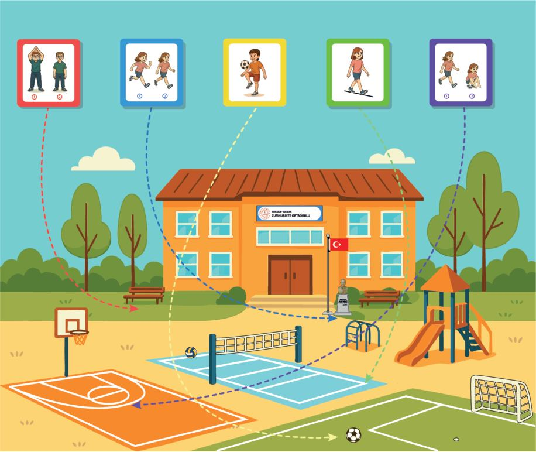

*Şekil 1. Yönünü bul, güvenliği kur oyun görseli*

Etkinlik öncesinde öğrencilere haritanın nasıl kullanılacağı ile ilgili bilgi verilir. Öğrenciler, sorunlara yaratıcı çözümler geliştirebilmeleri amacıyla 4-5 kişilik gruplar hâlinde çalışır. Her gruba bir harita ile fiziksel etkinlik görevleri ve güvenli oyun kontrol listesi (**Ek 1**) dağıtılır. Gruplar farklı başlangıç nokta-larından hareket ederek belirlenen tüm hedefleri sırayla tamamlar. Öğrenciler, belirlenen hedef nok-talarını harita yardımıyla bulurken çevredeki ipuçlarını dikkatle gözlemler. Her hedefte hem fiziksel etkinliği uygularlar hem de verilen güvenlik sorusunu grup olarak değerlendirirler (SDB2.2, SDB3.3, KB2.2). Her grup, doldurduğu kontrol listesinden elde ettiği risk gözlemlerini bir diğer grupla payla-şarak süreci değerlendirir (KB2.17, OB7). Yapılan değerlendirmeler sonucunda belirlenen riskler ve bu risklerin doğurabileceği olası tehlikeler grup içinde tartışılır. Grupların çözüm önerilerini sunmaları sağlanır. Sabit direklerin ve keskin kenarların çevresinin yumuşak malzemelerle kaplanması, oyun sınırlarının belirlenerek görünür biçimde işaretlenmesi, elektrik direği ya da jeneratör gibi alanlara emniyet şeridi çekilmesi gibi önlemlerle sürece katkıda bulunmaları beklenir (SDB3.3, D5.2). Öğren-cilerden sundukları çözüm önerilerinden uygulanabilir olanlarını gerçekleştirmeleri istenir. Örneğin öğrencilerin iş birliği içerisinde yumuşak malzeme (örneğin darbe emici minder) kullanarak sabit direklerin çevresini korumaları, oyun sınırlarını görünür bantlarla işaretlemeleri, riskli bölgelere emniyet şeridi çekmeleri sağlanır. Etkinlik sürecinde öğrencilerin grup arkadaşlarının fikirlerine değer vererek ortak kararlar almaları, görev paylaşımı yapmaları ve ihtiyaç duyulan durumlarda birbirlerine destek olmaları gerektiği vurgulanır (D20.2, KB3.2).

<!-- sayfa 70 -->

**Açıklama**
Öğrencilere kendi başlarına çözemeyecekleri güvenlik sorunlarında öğretmenlerden ve okul idaresinden destek alabilecekleri açıklanır. Fiziksel etkinlik ve güvenlik değerlendirme kartlarının sayısı, sınıftaki öğrenci mevcudu ve okulun çevresel koşulları dikkate alınarak yeniden düzenlenebilir.

**Çeşitlendirme**
Etkinlikler öğrencilerin hazır bulunuşluk seviyelerine uygun olarak kolay ve zor düzeylerde çeşitlendirilebilir. Başlangıç düzeyindeki öğrenciler öğretmen rehberliğinde tek bir oyun türü için güvenli alan analizi yapabilir ve hazır materyaller kullanarak çözümler geliştirebilirler. Hazır materyallere ek olarak geri dönüştürülebilir materyallerle çözüm önerileri sunabilirler. Gruplar hayal ettikleri oyun alanını kurgulayabilir, malzemeleri tamamen kendileri üretebilir ve kontrol listelerini oluşturabilirler.

**Öğrenme Kanıtları ve Etkinlik Yansıması**
Bu öğrenme çıktısının değerlendirilmesinde öz değerlendirme formu (**Ek 2**) kullanılabilir.
Etkinlik yansıması kapsamında öğrencilere aşağıdaki sorular yöneltilebilir:

* Günlük yaşamınızda oyun oynarken ya da spor yaparken güvenliğinizi nasıl sağlıyorsunuz?
* Bu etkinlikten sonra bu konuda neleri daha farklı yapmayı düşünüyorsunuz?
* Okul dışında arkadaşlarınızla oynarken bu etkinlikte öğrendiğiniz güvenlik bilgilerini nasıl kullanabilirsiniz?
* Evde, okulda veya parkta oynadığınız bir oyunda güvenliği sağlamak için ne gibi düzenlemeler yapabilirsiniz?

**ETKİNLİK 2** | **Sahne Senin: Kendi Oyununu Kur**

| | |
| :--- | :--- |
| **Amaç:** | Öğrencilerin oyunların farklı özelliklerini birleştirerek özgün bir oyun oluşturabilmeleridir. |
| **Eğilimler** | E3.10. Eleştirel Bakma |
| **Sosyal-Duygusal Öğrenme Becerileri** | SDB1.1. Kendini Tanıma (Öz Farkındalık), SDB1.2. Kendini Düzenleme (Öz Düzenleme), SDB2.2. İş Birliği, SDB3.1. Uyum, SDB3.3. Sorumlu Karar Verme |
| **Değerler** | D14. Saygı |
| **Okuryazarlık Becerileri** | OB4. Görsel Okuryazarlık, OB7. Veri Okuryazarlığı |
| **Kavramsal Beceriler** | - |
| **Beceriler Arası İlişkiler** | KB1. Temel Beceriler, KB2.7. Karşılaştırma |
| **Öğrenme Çıktısı ve Süreç Bileşenleri** | **BES.5.3.2. Oyunların farklı özelliklerinden yararlanarak özgün bir oyun sentezleyebilme**   a) Tasarlayacağı oyunun özelliklerini belirler.   b) Tasarlayacağı oyunun özellikleri arasında ilişki kurar.   c) Özgün bir oyun oluşturur. |
| **Kullanılan Öğretim Teknolojileri, Araç Gereçler ve Kaynaklar** | oyun kutusu, küçük kâğıtlar ve kalemler, poster kartonları, yazı ve çizim malzemeleri, etiket ve yapışkan notlar |

<!-- sayfa 71 -->

Ders alanına öğrencilerin dikkatini çekecek bir kutuyla girilir ve dikkatlerin bu kutuya yönelmesi sağlanır. Etkinliğin amacı hakkında kısa bir bilgilendirme yapılır. Öğrencilerden geçmişte oynanan bir oyunun küçük kâğıtlara yazılması ve bu kâğıtların kutuya atılması istenir. “Oyun kutusu”ndan oyunlar rastgele seçilerek (mendil kapmaca, kaleli yakantop, tombik vb.) bu oyunların oynanması sağlanır (SDB1.1).

Öğrencilerden oyunların özelliklerini (oyunların amacı, kullanılan malzemeler, kurallar, stratejiler, roller ve alan düzeni) belirlemeleri istenir (KB1). Yeni bir oyun tasarlarken, oyunlarda yer alan bu özellikleri göz önünde bulundurarak çeşitli eklemeler ve öneriler (oyuna yeni malzemeler ekleme, oyuncu sayısını değiştirme, oyunu daha küçük bir alanda oynanabilir hâle getirme vb.) geliştirmeleri istenir. Bu süreçte öğrenciler oyuna ilişkin fikirlerini nasıl geliştirdiklerini, hangi kaynak ya da deneyimlerden yararlandıklarını fark etmeleri ve tasarlamayı hedefledikleri oyunu daha işlevsel hâle nasıl getirebileceklerini düşünmeye teşvik edilir (SDB1.1, SDB1.2).

Öğrencilerin yaratıcılıklarını geliştirmek amacıyla spor dallarının tarihsel süreçte birbirleriyle kurduğu etkileşimlerden yararlanılabilir. Örneğin futbolun hentbola; kort tenisi, masa tenisi ve badmintonun (bedmıntın) pickleballa (pikılbol); basketbolun ise korfbola etkisi gibi örnekler paylaşılır ve bu spor dallarından bazıları öğrenciler tarafından oynanarak deneyimlenir. Bu deneyimlerin geliştirilecek özgün oyun fikirlerine kaynak oluşturması beklenir.

Öğrencilerin geliştirdikleri fikirleri arkadaşlarıyla paylaşmaları desteklenir; öğrenciler farklı görüşlere saygı göstermeye ve ortak bir sonuca ulaşmaya teşvik edilir (D14.1, SDB2.2). Yapılan değerlendirmeler sonucunda öğrencilerden yeni bir oyun fikri oluşturmaları istenir. Oluşturdukları oyun tasarımlarını gözden geçirmeleri ve geliştirilmesi gereken yönleri eleştirel bir bakış açısıyla değerlendirmeleri istenir (SDB1.2, E3.10). Bu süreçte öğrencilerden süre, oyuncu sayısı, alan ve malzeme gibi unsurlar arasında anlamlı ilişkiler kurarak oyunlarını yeniden yapılandırmaları beklenir. Örneğin daha fazla oyuncu sayısının daha geniş bir oyun alanı gerektirip gerektirmediği ya da eklenen yeni malzemelerin oyun stratejilerini nasıl etkilediği değerlendirilir. Öğrencilerin tasarlanan oyunları sırayla oynamaları sağlanarak öğrenciler ders süresince farklı ve özgün oyunlara aktif katılım göstermeye teşvik edilir (SDB3.1). Oyunları deneyimleyen öğrencilerin oyuncu sayısı, kullanılan malzemeler, oyun alanı düzeni, kurallar ve stratejiler gibi temel unsurlar üzerinden oyunlar arasındaki benzerlik ve farklılıkları belirlemeleri sağlanır (KB2.7).

Oyun deneyimlerinin ardından öğrencilerden tasarladıkları oyunlara ilişkin poster hazırlamaları istenebilir. Hazırlanacak görsellere rehberlik etmek amacıyla öğrencilerin “Hayalimdeki Oyun Posterini Hazırlama Rehberi” (Ek 4) adlı infografikten yararlanmaları sağlanır (OB4). Hazırlanan posterler, beden eğitimi ders alanının uygun bir bölümüne asılır ve her grup kendi oyununu poster üzerinden kısaca değerlendirir.

**Açıklama**

Geçmişte oynanan oyunlar, yaşanılan yöreye ve kültürel değerlere göre değişiklik gösterebilir. Öğrenciler bu farklılıklardan yararlanarak kendi özgün oyunlarını geliştirmeye teşvik edilebilir. Oyun tasarlama sürecinde hazırlanacak görsel materyallerin içeriği (örneğin poster) görsel sanatlar dersinden yararlanılarak geliştirilebilir.

**Çeşitlendirme**

Oyun tasarlama sürecinde grupların dönüşümlü olarak farklı görevler üstlenmeleri sağlanarak öğrencilerin sorumluluk paylaşımı ve iş birliği desteklenebilir. Öğrenciler geri dönüştürülebilir materyaller kullanmaya ve oyunlarını zenginleştirmeye teşvik edilebilir. Tasarlanan oyunların tanıtımına yönelik hazırlanan posterler, okul içindeki bilgilendirici panolarda sergilenerek farklı öğrencilerin de fikirleri alınabilir.

<!-- sayfa 72 -->

**Öğrenme Kanıtları ve Etkinlik Yansıması**

Bu öğrenme çıktısının değerlendirilmesinde öğrencilere aşağıdaki sorular yöneltilebilir:

* Oyununuza yeni bir kural ekleyecek olsaydınız bu kural ne olurdu? Düşündüklerinizi paylaşınız.
* Oyun alanı, malzeme ya da oyuncu sayısı oyununuzun stratejisini nasıl etkiledi? Örnek vererek açıklayınız.

Etkinlik yansıması kapsamında öğrencilere aşağıdaki sorular yöneltilebilir:

* Etkinlik sırasında sizi en çok mutlu eden neydi?
* Tasarladığınız oyunu oluştururken sizi en çok hangi aşama zorladı? Bu zorluğu nasıl aştınız?
* Tasarlanan diğer oyunlarda sizi etkileyen bir fikir oldu mu?


**ETKİNLİK 3** &nbsp;&nbsp;&nbsp;&nbsp;&nbsp;&nbsp;&nbsp;&nbsp;&nbsp;&nbsp;&nbsp;&nbsp;&nbsp;&nbsp;&nbsp;&nbsp;&nbsp;&nbsp;&nbsp;&nbsp;&nbsp;&nbsp;&nbsp;&nbsp;&nbsp;&nbsp;&nbsp;&nbsp;&nbsp;&nbsp;&nbsp;&nbsp;&nbsp;&nbsp;&nbsp;&nbsp;&nbsp;&nbsp;&nbsp;&nbsp;&nbsp;&nbsp;&nbsp;&nbsp;&nbsp;&nbsp;&nbsp;&nbsp;&nbsp;&nbsp;&nbsp;&nbsp;&nbsp;&nbsp;&nbsp;&nbsp;&nbsp;&nbsp;&nbsp;&nbsp;&nbsp;&nbsp;&nbsp;&nbsp;&nbsp;&nbsp;&nbsp;&nbsp;&nbsp;&nbsp;&nbsp;&nbsp;&nbsp;&nbsp;&nbsp;&nbsp;&nbsp;&nbsp;&nbsp;&nbsp;&nbsp;&nbsp;&nbsp;&nbsp;&nbsp;&nbsp;&nbsp;&nbsp;&nbsp;&nbsp;&nbsp;&nbsp;&nbsp;&nbsp;&nbsp;&nbsp;&nbsp;&nbsp;&nbsp;&nbsp;&nbsp;&nbsp;&nbsp;&nbsp;&nbsp;&nbsp;&nbsp;&nbsp;&nbsp;&nbsp;&nbsp;&nbsp;&nbsp;&nbsp;&nbsp;&nbsp;&nbsp;&nbsp;&nbsp;&nbsp;&nbsp;&nbsp;&nbsp;&nbsp;&nbsp;&nbsp;&nbsp;&nbsp;&nbsp;&nbsp;&nbsp;&nbsp;&nbsp;&nbsp;&nbsp;&nbsp;&nbsp;&nbsp;&nbsp

<!-- sayfa 73 -->

Etkinlik öncesinde ve oyunlar oynanırken uygun yerlerde adil oyun anlayışına uygun davranışların önemi vurgulanır. Her öğrencinin kurallara uyması gerektiği, dürüst ve saygılı davranmanın oyunun akışına yapacağı katkılar hatırlatılır. Öğrenciler tasarladıkları oyunları oynarken dersin uygun bir anında etkinlik öğretmen tarafından geçici olarak durdurulur. Adil oyun anlayışını davranışlarına en iyi şekilde yansıttığı gözlemlenen öğrenci/öğrenciler, sınıf arkadaşları tarafından alkışlanarak takdir edilir. Bu uygulama, adil oyun anlayışına uygun davranışların görünür kılınmasını sağlayarak sınıf ortamında olumlu tutumların desteklenmesine katkıda bulunabilir. Ayrıca tüm derslerde adil oyun davranışının pekişmesi için ders ve oyun ilkelerinin neler olabileceği belirlenerek bunlara ilişkin yazılı görseller ders ortamında sergilenebilir.

Öğrenciler, deneyimledikleri süreçte adil oyun anlayışına uygun olan ve olmayan durumları tespit ederler (*SDB3.3, E2.5*). Tespit edilen bu durumlar yaratıcı drama etkinliğiyle canlandırılır. Uygun olan davranışların oyunculara olumlu etkilerinin neler olabileceği tartışılır. Ardından canlandırmalar uygun olmayan davranışlar için gerçekleştirilir. Uygun olmayan davranışların canlandırılmasında aynı durum uygun olan davranış olarak canlandırılır ve iki durumun oyuna ve oyunculara etkilerinin neler olabileceği tartışılarak çıkarımlarda bulunulur. Süreç sonunda öğrencilerin oyun sırasında adil oyun davranışlarına ne ölçüde uyabildiklerini fark etmeleri ve bu doğrultuda kişisel çıkarımlar yapmaları sağlanır. Bu öğrenme deneyimi aracılığıyla oyunlarda kaybedenin olmadığı fikri “Arkadaşlarınla çaba gösterip eğlendiğinde zaten kazanmış olursun, yenilgi bile sana nasıl daha iyi olabileceğini öğretir; kurallara uyup centilmence oynadığında ise takdir kazanırsın ki bu durum bazen gol atmaktan daha değerlidir.” gibi ifadelerle vurgulanır (**Şekil 2**). Öğrenciler tarafından birlikte hareket etmenin ve sürece dâhil olmanın değerli kabul edildiği, adil davranışların öncelikli olduğu bir oyun anlayışı içselleştirilir ve pekiştirilir (*SDB1.2, SDB1.3*).

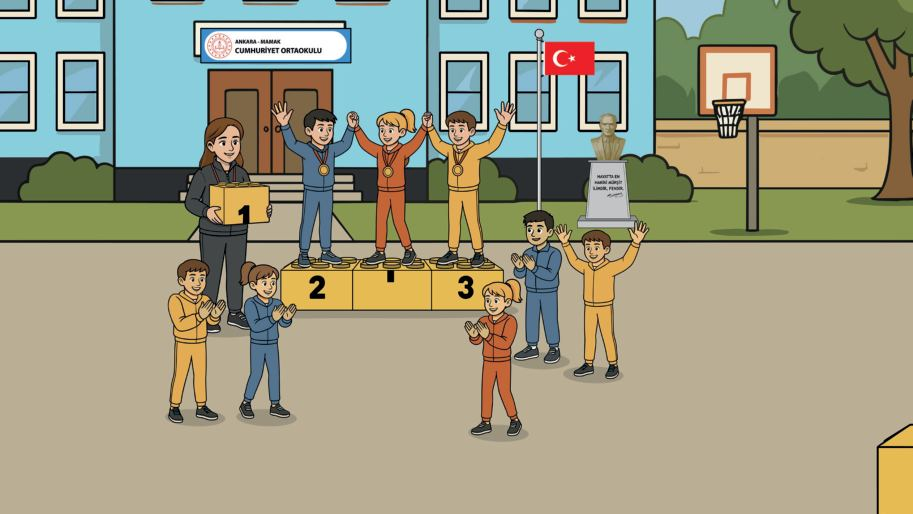

*Şekil 2. Kaybeden yok*

<!-- sayfa 74 -->

# Açıklama
Tasarlanan oyunlar 23 Nisan Ulusal Egemenlik ve Çocuk Bayramı kapsamında okul bahçesi, spor salonu veya etkinlik alanında düzenlenecek bir oyun istasyonu uygulaması yoluyla diğer öğrencilere tanıtılarak oynatılabilir.

## Çeşitlendirme
Değerlendirme süreci, adil oyun davranışını pekiştirmek için öğrencilerin tasarladıkları oyunlara jüri dâhil edilerek gerçekleştirilebilir. Öğrencilerin etkinlik sürecinde sergiledikleri olumlu tutum ve davranışların görünür kılınması amacıyla semboller (**Ek 3**) yer almaktadır. Bunlardan “takdir rozeti” oyunlarda iş birliği, empati, sorumluluk ve adil oyun ilkelerine uygun davranış gösteren öğrencilere; “adil oyun gülümsemesi” ise özellikle centilmenlik yapan ve kurallara saygı gösteren öğrencilerin ödüllendirilmesinde kullanılır.

### Öğrenme Kanıtları ve Etkinlik Yansıması
Bu öğrenme çıktısının değerlendirilmesinde öz değerlendirme formu (**Ek 5**) kullanılabilir. Öğrenciler, bu etkinlikte kendi performanslarını adil oyun anlayışı öz değerlendirme formu (**Ek 4**) ile değerlendirebilir.

Etkinlik yansıması kapsamında öğrencilere aşağıdaki sorular yöneltilebilir:

* Adil oyun kurallarına uymak, oyundan aldığınız mutluluğa nasıl katkıda bulunur?
* En adil davrandığınız bir durumu anlatır mısınız?
* Oyun oynarken nelere dikkat etmeniz gerektiğini düşünüyorsunuz? Bu düşüncelere nasıl ulaştınız?

## 2.2. Farklılaştırma
### Zenginleştirme
Öğrencilerden farklı kültürlere ait geleneksel veya modern oyunları araştırmaları, bu oyunların kurallarını ve amaçlarını öğrenmeleri, oyunlarda kullanılan malzemeleri incelemeleri istenebilir. Bu incelemeler sayesinde öğrenciler kendi tasarlayacakları oyunlarda bu oyunlardan esinlenmeye ve yeni bileşenler geliştirmeye teşvik edilebilir. Tasarım sürecinde öğrencilerden oluşturdukları özgün oyunların yasal haklarını nasıl koruyabileceklerine dair araştırma yapmaları, oyun fikrinin patent ya da telif hakkı gibi yollarla nasıl tescillenebileceğini öğrenmeleri istenebilir. Hazırlanan oyunların yalnızca kendi gruplarında değil farklı öğrenci grupları tarafından da oynanması sağlanabilir. Böylece öğrenciler, akranlarından aldıkları geri bildirimlere göre oyunlarını yeniden gözden geçirme ve geliştirme fırsatı elde edebilir. Ayrıca tasarladıkları oyunlara her öğrencinin katılımını sağlamaları beklenebilir. Örneğin özel gereksinimli olan bir arkadaşının da oyuna katılabilmesi için oyun alanının düzenlenmesi, kuralların esnetilmesi veya farklı iletişim biçimlerinin kullanılması gibi uyarlamalar yapmaları için teşvik edilebilirler. Tasarım sürecinde kullanılacak malzemelere geri dönüştürülebilir kaynaklar (karton kutular, plastik şişeler, eski kumaş parçaları vb.) dâhil edilerek çevre bilinci yüksek ürünler ortaya çıkması sağlanabilir. Oyun tasarımı sürecine “adil oyun” [fair play (feyr pley)] ilkeleri de entegre edilerek öğrencilerin bu kavramı senaryo yazma ya da drama çalışmalarıyla somutlaştırmaları istenebilir.

### Destekleme
Özel gereksinimli öğrencilerin de oyunlara katılımını artırmak amacıyla topun parlak renkli seçilmesi, materyallerin yumuşak dokulu ya da hafif olması ve dokunsal yönergeler gibi kapsayıcı uyarlamalar önerilebilir. Öğrencilerin özgün oyun tasarımı sürecinde yazılı, görsel ve dijital materyallerden yararlanmaları; farklı oyun kültürlerini tanımaları ve kurallarla ekipmanları kendi gelişim seviyelerine uygun biçimde düzenlemeleri desteklenir. Bu yaklaşımla hem yaratıcılık gelişimi teşvik edilir hem de sınıf içi kapsayıcılık güçlendirilir.

<!-- sayfa 75 -->

### 3. ÖĞRENME KANITLARI (Ölçme ve Değerlendirme)

Bu temanın değerlendirilmesinde öğrencilerden öğrendikleri bilgi ve kazandıkları becerileri yansı-
tacak şekilde oyunlarda kullanabilecekleri özgün materyaller tasarlamaları istenir. Bu görev, per-
formans görevi (**Ek 6**) olarak yapılandırılmıştır. Örneğin hedef oyunlarında kullanmak için eski ço-
raplardan kumla dolu atış torbaları, içine bir miktar su konulmuş plastik pet şişelerden materyaller 
veya kartondan puanlama tabelaları gibi işlevsel, estetik ve güvenli malzemeler hazırlamaya teşvik 
edilirler. Bu performans görevinin değerlendirilmesinde analitik dereceli puanlama anahtarı (**Ek 7**) 
kullanılır.

### 4. ÖĞRETMEN YANSITMALARI

Bir sonraki yıl bu temanın planlaması için yorumlar:

**Yorum 1:**

**Yorum 2:**

Öğrenme Çıktılarına Göre Öz Yansıtma (planlama/hazırlık, öğrenme çevresi, öğretim, mesleki so-
rumluluk)

1. Öğrenme çıktısı için yansıtmalar:

2. Öğrenme çıktısı için yansıtmalar:

3. Öğrenme çıktısı için yansıtmalar:

<!-- sayfa 76 -->

# 5. EKLER

Ek 1. Görev Kartları – Fiziksel Etkinlik ve Güvenlik Değerlendirme Formu

| Öğrencinin Adı Soyadı: |
| :--- |
| **Sınıfı:** |
| 1. Her etkinlikte fiziksel görev kartını bulunuz ve görevi tamamladıktan sonra size en uygun kutucuğu “✓” ile işaretleyiniz. |
| 2. Aynı renkteki güvenlik kontrol sorusunu bulunuz ve size uygun kutucuğu “✓ ” ile işaretleyiniz. |
| 3. Fiziksel görevleri iki kez deneme hakkınız vardır. |

## FİZİKSEL ETKİNLİK GÖREV KARTLARI

| Fiziksel Görevler | Evet | Kısmen | Hayır |
| :--- | :---: | :---: | :---: |
| **Kırmızı** On defa yıldız zıplama yap (eller başta, ayakları yana aç-kapa). | | | |
| **Mavi** İşaretli noktaya koş, geri yürü. | | | |
| **Sarı** Futbol topuyla 5 metre mesafedeki konileri devir. | | | |
| **Yeşil** Beş denge yürüyüşü adımı yap (denge tahtası/çizgi üzerinde). | | | |
| **Mor** Çift ayakla sıçrayarak beş adım ilerle. | | | |

## GÜVENLİK DEĞERLENDİRME BÖLÜMÜ

| Güvenlik Kontrol Soruları | Evet | Kısmen | Hayır |
| :--- | :---: | :---: | :---: |
| **Kırmızı** Bulunduğunuz zemin kaygan mı ya da sert mi? | | | |
| **Mavi** Koşu alanında dikkat edilmesi gereken bir unsur var mı? | | | |
| **Sarı** Çevrenizde atış yapılırken başka yöne bakan oyuncu var mı? | | | |
| **Yeşil** Denge etkinliği yaptığınız alan güvenli mi? | | | |
| **Mor** Sabit yapılar güvenli mesafede (kale, pota vb. direkler) mi? | | | |

Okulunuzda yukarıda belirtilen alanlar haricinde güvenliği tehdit eden oyun alanları var mı? Varsa bu alanları güvenli hâle getirmek için çözüm önerileriniz nelerdir?

<!-- sayfa 77 -->

**Ek 2. Öz Değerlendirme Formu**

Bu form; tasarladığınız oyunlarda riskleri belirleme, çözüm önerileri üretme ve güvenli ortam oluş- turmadaki katkılarınızı değerlendirmeniz için hazırlanmıştır. Ölçütleri dikkatlice okuyunuz ve size en uygun seçeneği “✓” ile işaretleyiniz. “Kısmen” ve “Hayır” olarak işaretlediğiniz ifadelere yönelik ek- siklerinizi gidermeniz önerilir.

| Öğrencinin Adı Soyadı: | |
| :--- | :--- |
| **Sınıfı:** | |

| Ölçütler | Evet | Kısmen | Hayır |
| :--- | :---: | :---: | :---: |
| Tasarladığım oyunun potansiyel risklerini düşündüm. | | | |
| Riskleri azaltmak için çözüm önerileri geliştirdim (“Sabit direklerin çev- resine yumuşak malzemeler sardım, oyun sınırlarını belirlemek için renkli tebeşirler kullandım.” gibi). | | | |
| Oyun malzemelerini güvenli kullanmaya özen gösterdim. | | | |
| Grup arkadaşlarımın güvenliğini sağlamak için onları uyardım. | | | |
| Oyun kurallarını herkesin anlayacağı şekilde açıkladım. | | | |
| Ortaya çıkan sorunlara hızlıca müdahale ettim. | | | |
| Bu etkinlikteki katkılarım oyunda güvenli bir ortam sağladı. | | | |

<!-- sayfa 78 -->

**Ek 3. Ödül Sembolleri**

| | |
| :---: | :---: |
| 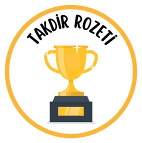 | 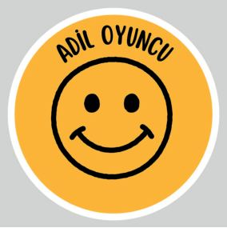 |
|  |  |
|  | 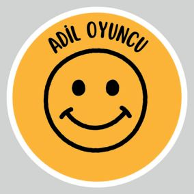 |
|  |  |

<!-- sayfa 79 -->

Ek 4. Hayalimdeki Oyun Posterini Hazırlama Rehberi (İnfografik)

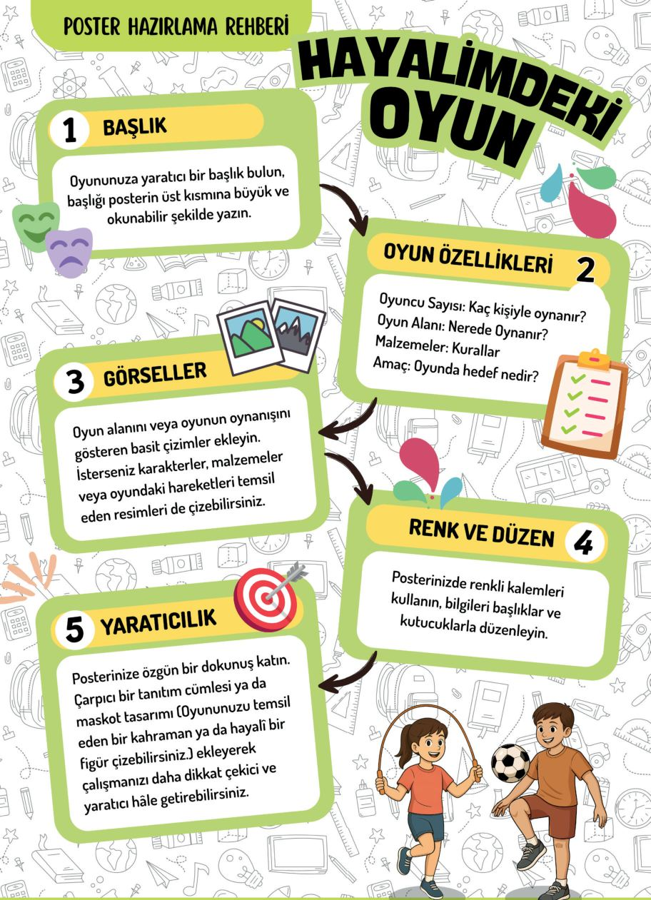

# POSTER HAZIRLAMA REHBERİ

# HAYALİMDEKİ OYUN

## 1 BAŞLIK
Oyununuza yaratıcı bir başlık bulun, başlığı posterin üst kısmına büyük ve okunabilir şekilde yazın.

## 2 OYUN ÖZELLİKLERİ
Oyuncu Sayısı: Kaç kişiyle oynanır?
Oyun Alanı: Nerede Oynanır?
Malzemeler: Kurallar
Amaç: Oyunda hedef nedir?

## 3 GÖRSELLER
Oyun alanını veya oyunun oynanışını gösteren basit çizimler ekleyin. İsterseniz karakterler, malzemeler veya oyundaki hareketleri temsil eden resimleri de çizebilirsiniz.

## 4 RENK VE DÜZEN
Posterinizde renkli kalemleri kullanın, bilgileri başlıklar ve kutucuklarla düzenleyin.

## 5 YARATICILIK
Posterinizize özgün bir dokunuş katın. Çarpıcı bir tanıtım cümlesi ya da maskot tasarımı (Oyununuzu temsil eden bir kahraman ya da hayali bir figür çizebilirsiniz.) ekleyerek çalışmanızı daha dikkat çekici ve yaratıcı hâle getirebilirsiniz.

<!-- sayfa 80 -->

# Ek 5. Öz Değerlendirme Formu

Bu form, öğrencilerin tasarlanan oyunlarda adil oyun anlayışını ne ölçüde benimsediklerini ve uyguladıklarını değerlendirmek amacıyla hazırlanmıştır. Aşağıdaki tabloda her bir ölçüt için kendinizi değerlendiriniz. Uygun seçeneği “✓” ile işaretleyiniz. Soruları cevaplarken dürüst olunuz. “Kısmen” ve “Hayır” olarak işaretlediğiniz ölçütlere yönelik eksiklerinizi gidermeye çalışınız.

| Öğrencinin Adı Soyadı: | |
| :--- | :--- |
| **Sınıfı:** | |

| Ölçütler | Evet | Kısmen | Hayır |
| :--- | :---: | :---: | :---: |
| Tasarlanan oyunlarda adil oyun anlayışını açıklayabilirim. | | | |
| Tasarlanan oyunlarda adil oyun anlayışına uygun hareket ederim. | | | |
| Oyunlarda tüm oyuncuların eşit şartlarda katılmasına özen gösteririm. | | | |
| Kurallara sadık kalır ve arkadaşlarıma karşı dürüst davranırım. | | | |
| Oyun sırasında bir sorun çıktığında sorumlu davranarak ve adil kararlar vererek çözüm bulmaya çalışırım. | | | |
| Ortaya çıkan sorunlara hızlıca müdahale ederim. | | | |
| Oyunlarda birlikte üretmenin ve hareket etmenin keyfini yaşarım. | | | |

<!-- sayfa 81 -->

**Ek 6. Performans Görevi**

| Performans Görevi |
| :--- |
| **Ders:** Beden Eğitimi ve Spor |
| **Sınıf Düzeyi:** 5 |
| **Öğrenme Çıktısı:** İş birlikli oyunlarda hareket becerisi sergileyebilme |
| **Etkinlik:** Sahne Senin: Kendi Oyununu Kur |
| **Görev Konusu:** Oyunlara ilişkin materyaller tasarlama |

Sevgili Öğrenciler,

Bu görevde amacınız geri dönüştürülebilir veya evde kolayca bulunabilen malzemeleri kullanarak oyunlar için işlevsel, estetik ve güvenli bir araç gereç tasarlamaktır. Hayal gücünüzü kullanarak kendi oyun malzemelerinizi oluşturacak ve arkadaşlarınızla paylaşacaksınız.

**Görev Açıklaması:**

* Aşağıda yer alan örneklerden ilham alarak kendi oyun malzemenizi tasarlayınız:
* Eski çorapların içine kum doldurarak hedef oyunları için atış torbaları yapabilirsiniz.
* Boş plastik şişelerin içine bir miktar su koyarak denge hedefleri veya devrilebilen hedefler tasarlayabilirsiniz.
* Karton kutulardan puanlama panosu, mini kale, atlama engeli ya da hedef tahtası oluşturabilirsiniz.
* İp, kurdele ya da lastik bantları kullanarak sıçrama ipi, denge hattı veya alan sınırı tasarlayabilirsiniz.

**Göreviniz Sırasında Dikkat Etmeniz Gerekenler:**

* Malzemeniz oyunda işlevsel yani kullanılabilir olmalı.
* Estetik görünümüne dikkat ediniz.
* Malzemenizi renkli, yaratıcı ve dikkat çekici hâle getirebilirsiniz.
* Güvenli olması çok önemlidir. Sivri uçlar, keskin kenarlar veya kırılabilecek parçalar kullanmamalısınız.
* Malzemenizi sınıfa getirerek arkadaşlarınıza tanıtınız.

<!-- sayfa 82 -->

# Ek 7. Tema Değerlendirmesi

| Hayalimdeki Oyun Materyal Tasarlama Analitik Dereceli Puanlama Anahtarı |
| :--- |

Bu ölçme aracı, öğrencilerin özgün oyun materyalleri tasarlamasına yönelik verilen performans görevinin değerlendirilmesi için hazırlanmıştır. Yaptığınız puanlamayı, dereceli puanlama anahtarının sonunda yer alan tabloya kaydediniz.

| Ölçütler | Çok İyi (3) | İyi (2) | Geliştirilebilir (1) |
| :--- | :--- | :--- | :--- |
| **Problem Çözme** | Materyaller işlevsel, yenilikçi ve oyunla uyumlu. | Materyaller işlevsel ancak bazı eksikler var. | Materyallerin işlevselliği belirsiz veya oyunla uyumsuz. |
| **Yaratıcılık** | Tasarlanan materyaller özgün ve estetik. | Tasarlanan materyaller özgün ancak estetik detaylar eksik. | Tasarlanan materyaller basit ve özgünlükten uzak. |
| **Güvenlik** | Materyaller kullanışlı, güvenlik açısından uygun. | Materyaller kullanışlı ancak küçük riskler var. | Materyaller kullanışlı değil, güvenlik açısından riskli. |
| **Adil Oyun Anlayışı** | Oyun kuralları adil, kapsayıcı ve açık. | Oyun kuralları adil ancak bazı belirsizlikler var. | Oyun kuralları adil değil veya eksik. |

**Değerlendirme Notu:**

Bu ölçme aracından en az $4$ puan, en fazla $12$ puan alınabilmektedir. Öğrencinin puanı, alınan puanın yüzdelik karşılığı hesaplanarak bulunur. Bunun için alınan puan, öğrencinin alabileceği en yüksek puana bölünür ve çıkan sonuç $100$ ile çarpılır. Ondalık gösterim elde edilmesi hâlinde sonuç, tam kısmına (birler basamağına) yuvarlanır. Örneğin öğrenci bu ölçme aracından $10$ aldığında puanı şu şekilde hesaplanır: $(10 \div 12) \times 100 = 83,333$ <!-- KONTROL: Marker'da karşılığı yok, uydurma olabilir -->. Bu sonuç yuvarlandığında öğrenci $83$ puan almış olacaktır.

**Performans Düzeyleri:**

$33\text{--}55$ <!-- KONTROL: Marker'da karşılığı yok, uydurma olabilir -->: Geliştirilebilir  
$56\text{--}78$ <!-- KONTROL: Marker'da karşılığı yok, uydurma olabilir -->: İyi  
$79\text{--}100$ <!-- KONTROL: Marker'da karşılığı yok, uydurma olabilir -->: Çok iyi

<!-- sayfa 83 -->

# Ek 8. Puan Kaydetme Tablosu

Sınıf:

| Öğrencinin Adı Soyadı | Problem Çözme | Yaratıcılık | Güvenlik | Adil Oyun Anlayışı | Toplam Puan |
| :--- | :--- | :--- | :--- | :--- | :--- |
| | | | | | |
| | | | | | |
| | | | | | |
| | | | | | |
| | | | | | |
| | | | | | |
| | | | | | |
| | | | | | |
| | | | | | |
| | | | | | |
| | | | | | |
| | | | | | |
| | | | | | |
| | | | | | |
| | | | | | |
| | | | | | |
| | | | | | |
| | | | | | |
| | | | | | |
| | | | | | |
| | | | | | |
| | | | | | |
| | | | | | |
| | | | | | |
| | | | | | |
| | | | | | |
| | | | | | |
| | | | | | |
| | | | | | |
| | | | | | |
| | | | | | |
| | | | | | |
| | | | | | |
| | | | | | |
| | | | | | |
| | | | | | |
| | | | | | |
| | | | | | |
| | | | | | |
| | | | | | |

<!-- sayfa 84 -->

# 4. TEMA

## HAREKETİN ESTETİĞİ VE RİTMİ

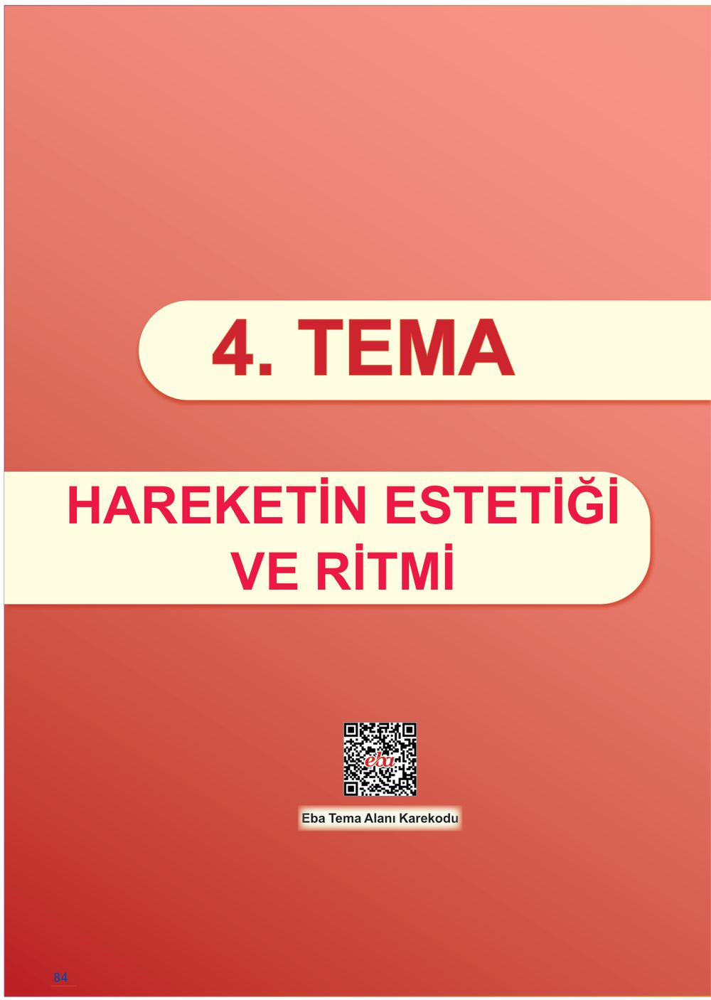 Eba Tema Alanı Karekodu

<!-- sayfa 85 -->

# 4. TEMA: HAREKETİN ESTETİĞİ VE RİTMİ

| | |
| :--- | :--- |
| **DERS SAATİ** | 12 |
| **ALAN BECERİLERİ** | BEOSAB1. Hareketi Sergileme, BEOSAB2. Hareket Kavramlarını Uygulama, BEOSAB5. Ritmik Hareket Etme |
| **KAVRAMSAL BECERİLER** | - |
| **EĞİLİMLER** | E1.2. Bağımsızlık, E3.2. Odaklanma, E3.3. Yaratıcılık, E3.6. Analitiklilik, E3.10. Eleştirel Bakma |
| **PROGRAMLAR ARASI BİLEŞENLER** | |
| **Sosyal-Duygusal Öğrenme Becerileri** | SDB1.1. Kendini Tanıma (Öz Farkındalık), SDB1.2. Kendini Düzenleme (Öz Düzenleme), SDB2.2. İş Birliği, SDB2.3. Sosyal Farkındalık, SDB3.1. Uyum, SDB3.3. Sorumlu Karar Verme |
| **Değerler** | D7. Estetik |
| **Okuryazarlık Becerileri** | OB4. Görsel Okuryazarlık, OB7. Veri Okuryazarlığı |
| **DİSİPLİNLER ARASI İLİŞKİLER** | Müzik, Türkçe |
| **BECERİLER ARASI İLİŞKİLER** | KB2.4. Çözümleme, KB2.13. Yapılandırma |
| **ÖĞRENME ÇIKTILARI VE SÜREÇ BİLEŞENLERİ** | **BES.5.4.1. Jimnastiğe ilişkin hareket kavramlarını uygulayabilme** a) Jimnastiğe ilişkin hareket kavramlarını ayırt eder. b) Jimnastiğe ilişkin hareket becerileri ile hareket kavramları arasında ilişki kurar. c) Jimnastiğe ilişkin hareket kavramlarına uygun hareket eder. **BES.5.4.2. Jimnastiğe ilişkin hareket becerilerini sergileyebilme** a) Jimnastiğe ilişkin hareket becerilerini algılar. b) Jimnastiğe ilişkin hareket becerilerinin basamaklarını gösterir. c) Jimnastiğe ilişkin hareket becerilerini farklı ortamlarda uygular. **BES.5.4.3. Müzik eşliğinde dansa özgü ritmik hareket edebilme** a) Harekete veya müziğe ilişkin ritmi algılar. b) Verilen ritme uygun hareket eder. c) Müzik eşliğinde dansa özgü ritmik hareket becerilerini sergiler. |
| **İÇERİK ÇERÇEVESİ** | Jimnastiğe İlişkin Hareket Kavramları Jimnastiğe İlişkin Hareket Becerileri Dansa Özgü Ritmik Hareketler |
| **Genellemeler/ Anahtar Kavramlar/** | beceri, dans, estetik, hareket, jimnastik, müzik, ritim |

<!-- sayfa 86 -->

# 1. TEMAYA BAŞLARKEN

Bu temada öğrencilerin jimnastiğe ilişkin hareket kavramlarını uygulayabilmeleri, jimnastiğe ilişkin hareket becerilerini sergileyebilmeleri ve müzik eşliğinde dansa özgü ritmik hareket edebilmeleri amaçlanmaktadır.

Jimnastik, genellikle zeminde veya çeşitli aletlerin üzerinde gerçekleştirilen fiziksel faaliyetlerle dayanıklılığı, esnekliği, kuvveti, koordinasyonu, çevikliği ve beden kontrolünü artırmayı amaçlayan bir spor dalı biçiminde ifade edilmektedir (Çimen ve Örs, 2018). Jimnastikte çeşitli fiziksel hareketler belirli kurallar, ölçüler ve koordinasyon prensipleri çerçevesinde düzenli ve ritmik bir şekilde sergilenir. Dolayısıyla öğrencilerin ritim, vücut, alan ve efor farkındalığı ile hareket ilişkilerini geliştirecek birçok etkinlik jimnastik ile planlanabilir. Bu tema kapsamında jimnastiğe özgü aşağıdaki becerilerin kazandırılması ve bu becerileri kullanarak özgün bir jimnastik serisi oluşturabilmeleri beklenir.

* Jimnastik adımları: galop-kayma adımı, çift ayak sıçrama, marş adımı, tekme (kick) adımı, kayma (skip) adımı vb.
* Jimnastik duruşları: cephe duruşları, oturuşlar, ters bank, düz bank, kartal, planör, çakı, mum vb.
* Jimnastik dönüşleri: tek ayak üstünde, adımla, sıçrayarak (burgu), doksan, yüz seksen ve üç yüz altmış derece dönüşler
* Yuvarlanmalar: uzanma pozisyonundan yana yuvarlanma (kalem), omuz üzeri yuvarlanma (güvenli/judo yuvarlanma), öne yuvarlanma (öne takla), geri yuvarlanma (geri takla) vb.
* Vücut transferi: amut (amut takla), çember, kartvil vb.

Ritim ise genel anlamda belirli bir düzen içinde birbiri ardına duyulan vuruşlar dizisi veya düzenli ve belirli hareketlerin birbirini izleyen kümeler hâlinde yapılması, görülmesi, duyulması veya hissedilmesi olarak tanımlanır (Doğan ve Altay, 1990). Bu tema kapsamında ilkokul hareket eğitimi ile hareket becerilerinin jimnastik ve ritim ile ilişkilendirilmesi beklenmektedir. Öğrencilerin bu temada hem bireysel hem de grup içinde hareket ederek beden farkındalığı, ritmik hareket, hareket-müzik uyumu, estetik ve yaratıcılık gibi alanlarda gelişmeleri amaçlanmaktadır. Bu nedenle öğretmen, öğrencilerin hareketleri yalnızca doğru yapmalarını değil aynı zamanda akıcı, estetik ve ritmik biçimde sunmalarını teşvik etmelidir.

# 2. ÖĞRENME-ÖĞRETME YAŞANTILARI

Öğrencilerden jimnastik konusundaki hazır bulunuşluk düzeylerini belirlemek amacıyla ön değerlendirme sürecinde daha önce öğrendikleri ya da deneyimledikleri jimnastik hareketlerini sergilemeleri istenir. Öğrencilerin hatırladıkları temel duruş, denge ya da esneklik gerektiren hareketleri göstermeleri sağlanır. Öğrencilerin hareket becerilerini uygulama düzeyleri gözlemlenerek hazır bulunuşluk düzeyleri belirlenir. Ayrıca öğrencilere çeşitli ritim ya da müzikler dinletilerek öğrencilerden bu ritim ya da müziğe uygun hareket etmeleri istenir. Öğretmen tarafından öğrencilerin ritimle ya da müzikle uyumlu hareket etme düzeyleri; beden, alan ve efor farkındalıkları; ritim algıları ile hareket estetiği gözlemlenir. Ayrıca öğrencilerden bu farklı ritimleri içeren müzikler eşliğinde belirli jimnastik hareketlerini sergilemeleri istenir. Farklı ritim türleri ile uyumlu bir şekilde jimnastik hareketlerini uygulayarak müzik ile dansa özgü hareket becerileri arasında bağ kurmaları sağlanır. Öğrencilerin grupla yapılan dans etkinliklerine katılmaları sağlanarak denge, esneklik, koordinasyon gibi bileşenleri gerektiren jimnastik hareketlerinin bir dans performansında nasıl kullanabileceği ile ilgili ilişki kurmaları desteklenir. Aynı zamanda öğrencilerin grupla yapılan dans etkinliklerine katılarak bireysel becerilerin ortak bir performansa dönüştüğünü deneyimlemeleri sağlanır.

<!-- sayfa 87 -->

### 2.1. Etkinlik Örnekleri

**ETKİNLİK 1** $\quad$ **Jimnastik Kavramları**

| | |
| :--- | :--- |
| **Amaç:** | Öğrencilerin jimnastiğe ilişkin hareket kavramlarını uygulayabilmeleridir. |
| **Eğilimler** | E3.2. Odaklanma, E3.3. Yaratıcılık, E3.10. Eleştirel Bakma |
| **Sosyal-Duygusal Öğrenme Becerileri** | SDB1.1. Kendini Tanıma (Öz Farkındalık),   SDB1.2. Kendini Düzenleme (Öz Düzenleme) |
| **Değerler** | - |
| **Okuryazarlık Becerileri** | OB4. Görsel Okuryazarlık, OB7. Veri Okuryazarlığı |
| **Kavramsal Beceriler** | - |
| **Beceriler Arası İlişkiler** | - |
| **Öğrenme Çıktısı ve Süreç Bileşenleri** | **BES.5.4.1. Jimnastiğe ilişkin hareket kavramlarını uygulayabilme**   a) Jimnastiğe ilişkin hareket kavramlarını ayırt eder.   b) Jimnastiğe ilişkin hareket becerileri ile hareket kavramları arasında ilişki kurar.   c) Jimnastiğe ilişkin hareket kavramlarına uygun hareket eder. |
| **Kullanılan Öğretim Teknolojileri, Araç Gereçler ve Kaynaklar** | antrenman çanağı, jimnastik minderi, çember, koni ve video içerikleri |

Öğrencilere “Bir tavşan nasıl zıplar?”, “Bir ayı nasıl yürür?”, “Bir at nasıl koşar?” gibi sorular sorularak öğrencilerden bu hayvanların hareketlerini taklit etmeleri istenir. Taklit edilen hayvan hareketlerinin jimnastikte hangi hareketlere benzediği öğrencilerle belirlenmeye çalışılır (E3.10). Örneğin tavşan sıçrayışının jimnastikteki çift ayak sıçrama hareketine benzediği; atın koşmasının jimnastikte geçiş hareketleri olarak kullanılabildiği; ayı yürüyüşünün eller ve ayaklarla yapılan yürüme hareketine benzediği ifade edilerek jimnastiğe ilişkin hareket kavramlarını ayırt etmeleri sağlanır.

Öğrencilerin jimnastiğe ilişkin ayırt ettikleri kavramları uygulayabilecekleri oyunlar sürece dâhil edilir. Örneğin alanın iki ucuna paralel çizgiler çizilir ve bu çizgilerin ortasında bir “ebeleme bölgesi” belirlenir. İki öğrencinin ebe olarak ortaya geçmesi sağlanır, diğer öğrencilerse çizginin gerisinde beklerler. Çizginin gerisinde bekleyen öğrenciler galop adımıyla karşı çizgiye geçmeye çalışır. Ortada ebe rolündeki öğrencilerse yana galop adımıyla ilerleyerek karşı çizgiye geçmeye çalışan arkadaşlarını yakalamaya çalışırlar. Yakalanan öğrenciler de ebe rolünü üstlenerek karşı çizgiye birlikte geçmeye çalışan öğrencileri kayma adımları ile yakalamaya çalışırlar (**Şekil 1**).


<!-- sayfa 88 -->

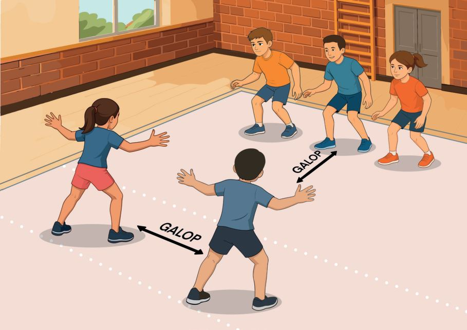

*Şekil 1. Yakalanmadan geç*

Jimnastiğe ilişkin duruşlar (ters bank, planör vb.), yuvarlanmalar (öne, geriye vb.), vücut transferi (çember, kartvil vb.), yön değişikliği ($180^\circ$ dönüşler, $90^\circ$ dönüşler vb.), geçişler ve bağlantılar gibi jimnastik kavramlarının yer aldığı istasyonlar hazırlanır. Örnek:

**1. İstasyon:** Öğrencilerin çift ayak sıçrama, galop-kayma adımı gibi adımları uygulayabileceği alanlar oluşturulur. Örneğin oyun alanına yerleştirilmiş nesneleri (küçük toplar, taşlar, yapraklar vb.) galop-kayma adımı yaparak toplamaları istenir.

**2. İstasyon:** Cephe duruşları, oturuşlar, ters bank, düz bank, kartal, planör, çakı, mum gibi duruşları deneyimleyebilecekleri minderlerin olduğu bir alan oluşturulur ve süreç, hareketleri içeren görsellerle desteklenir.

**3. İstasyon:** $90^\circ$, $180^\circ$ ve $360^\circ$ dönüşleri içeren yönergeler hazırlanır ve öğrencilere dağıtılır, belirlenen hedefe ulaşmaları için öğrencilerin gerekli dönüşleri yapmaları sağlanır.

**4. İstasyon:** Uzanma pozisyonundan yana yuvarlanma (örneğin kalem), omuz üzeri yuvarlanma (örneğin güvenli/judo yuvarlanma), öne yuvarlanma (öne takla), geri yuvarlanma (geri takla) gibi becerileri deneyebilecekleri güvenli alanlar oluşturulur. Hareketleri içeren görseller sürece dâhil edilerek öğrencilerin bu istasyonda yer alan becerileri denemeleri sağlanır (OB4). Ayrıca istasyonlardaki becerileri içeren çalışma yaprakları da hazırlanarak öğrencilerin bu becerileri belirtilen yönergelere uygun yapmaları sağlanabilir. Örnek çalışma yaprağı Ek 1'de yer almaktadır.

İstasyonda yer alan hareketleri bütün öğrencilerin deneyimlemesi sağlanır. Uygulama boyunca her hareketin jimnastik kavramlarıyla ilişkisi vurgulanır ve öğrencilerin jimnastiğe ilişkin hareket becerileri ile hareket kavramları arasında ilişki kurmaları sağlanır.

<!-- sayfa 89 -->

Öğrencilerden istasyonlarda deneyimledikleri jimnastik hareket kavramlarını bir araya getirerek kısa ve kendilerine özgü jimnastik serisi oluşturmaları istenir (E3.3). Bu serilerin öne yuvarlanma, $180^\circ$ dönüş, ters bank duruşu, çemberden geçiş, kartal duruşu gibi çeşitli hareketlerden oluşabileceği vurgulanır. Öğrencilerden hazırladıkları serileri bireysel ya da grup olarak sunmaları istenir (SDB1.2). Oluşturulan serilerde hareketlerin jimnastik kavramıyla olan ilişkisi vurgulanarak öğrencilerin jimnastiğe ilişkin kavramlara uygun hareket etmeleri sağlanır. “Hangi hareketleri birleştirmek zordu?”, “Seçtiğiniz hareketler arasında geçiş yaparken nelere dikkat ettiniz?” gibi sorular sorularak jimnastik kavramlarına odaklanmaları sağlanır (E3.2, SDB1.1, SDB1.2). Elde edilen veriler kullanılarak grafikler oluşturulabilir, seride zorlanılan ve kolaylıkla yapılabilen hareketler incelenebilir (OB7).

**Açıklama**

Bu yaşantı, ilkokuldaki temel hareket becerileri ile ilişkilendirilerek yapılandırılabilir. Bu etkinlikteki örnek istasyonlarda jimnastiğe ilişkin yer verilmeyen hareket kavramları ve becerilerine yer verilerek etkinlik 2-3 hafta daha devam ettirilir.

**Çeşitlendirme**

Etkinlikte yer alan oyunda farklı jimnastik hareketlerine yer verilerek oyun çeşitlendirilebilir. Örneğin galop-kayma adımı ile oynanan oyun, çift ayak sıçrayarak belirli bir alana ebelenmeden geçebilme şeklinde oynanabilir. Farklı yer değiştirme becerileri kullanılarak zorluk ve kolaylık seviyeleri değiştirilebilir. Çalışma yaprağındaki alıştırmaların tekrar sayıları artırılıp azaltılabilir.

**Öğrenme Kanıtları ve Etkinlik Yansıması**

Bu öğrenme çıktısının değerlendirilmesinde öz değerlendirme formu (**Ek 2**) kullanılabilir. Ayrıca aşağıda yer alan açık uçlu sorularla da etkinlik değerlendirilebilir:

* Bu etkinlikte hangi becerilerinizin (denge, ritim, yön değiştirme, karar verme vb.) geliştiğini düşünüyorsunuz?
* Dönüş hareketleri ile yuvarlanma hareketleri arasında ne gibi benzerlik veya farklılıklar gözlemlediniz?
* Bağımsız çalışırken nelere dikkat ettiniz? Hareket sırasını seçerken nasıl bir yol izlediniz?

Etkinlik yansıması kapsamında öğrencilere aşağıdaki sorular yöneltilebilir:

* Jimnastik becerilerini sergilemek size ne hissettirdi?
* En kolay ve en zor uyguladığınız beceriler hangileri oldu?
* Beceriler arasında geçiş yaparken nelere dikkat ettiniz?

<!-- sayfa 90 -->

**ETKİNLİK 2**                                                                    **jimnastik Becerileri**

| | |
| :--- | :--- |
| **Amaç:** | Öğrencilerin jimnastiğe ilişkin hareket becerilerini sergileyebilmeleridir. |
| **Eğilimler** | E3.6. Analitiklik |
| **Sosyal-Duygusal Öğrenme Becerileri** | SDB1.2. Kendini Düzenleme (Öz Düzenleme), SDB2.2. İş Birliği, SDB2.3. Sosyal Farkındalık, SDB3.1. Uyum, SDB3.3. Sorumlu Karar Verme |
| **Değerler** | - |
| **Okuryazarlık Becerileri** | OB4. Görsel Okuryazarlık |
| **Kavramsal Beceriler** | - |
| **Beceriler Arası İlişkiler** | KB2.4. Çözümleme |
| **Öğrenme Çıktısı ve Süreç Bileşenleri** | **BES.5.4.2. Jimnastiğe ilişkin hareket becerilerini sergileyebilme**   a) Jimnastiğe ilişkin hareket becerilerini algılar.   b) Jimnastiğe ilişkin hareket becerilerinin basamaklarını gösterir.   c) Jimnastiğe ilişkin hareket becerilerini farklı ortamlarda uygular. |
| **Kullanılan Öğretim Teknolojileri, Araç Gereçler ve Kaynaklar** | antrenman çanağı, jimnastik minderi, çember, koni ve video içerikleri |

Öğrencilerden günlük yaşamdaki hareketleri taklit etmeleri istenir: “Kaya gibi sabit durabilir misiniz?”, “Bir kuş gibi kanatlarınızı açıp dengede kalabilir misiniz?” Ardından seçilen birkaç temel jimnastik hareketinin başlangıç pozisyonu (köprü, ters bank, yuvarlanma pozisyonu vb.) gösterilir. Hareketin nasıl devam edebileceğini tahmin ederek denemeleri istenir. Öğrencilere hareketleri yaparken zorlandıkları kısımlar ve hareketi daha iyi yapmak için nasıl hareket etmeleri gerektiği ile ilgili sorular sorularak jimnastiğe ilişkin hareket becerilerini algılamaları sağlanır (SDB1.2). Örneğin “Bu hareketin hangi kısmı sizi zorladı?”, “Dengenizi kaybetmemek için neler yapabilirsiniz?” gibi sorular yöneltilebilir.

Öğrencilerden jimnastiğe ilişkin hareket becerilerinden (düz bank duruşu, öne yuvarlanma, çember, galop, burgu vb.) birini seçmeleri istenir. Öğrencilere görsellerle desteklenmiş jimnastik becerilerini içeren çalışma kâğıtları (Ek 3) dağıtılır (Çalışma kâğıdı öne yuvarlanma becerisi için hazırlanmıştır.). Öğrencilerden hareket becerisini oluşturan basamakları gruplar hâlinde analiz etmeleri istenir ve hareket becerilerini çözümlemeleri için öğrencilere zaman verilir (E3.6, SDB2.2, KB2.4). Öğrencilerin hareket becerilerine ilişkin öğrenme basamaklarını denemelerine olanak tanınır ve öğretmen rehberliğinde hareket becerilerinin basamaklarının doğruluğu değerlendirilir (SDB3.3). Öğrencilerden keşfettikleri hareket becerilerine ilişkin basamakları poster hâline getirmeleri istenebilir (OB4).

Jimnastiğe ilişkin hareket becerilerinin kullanılmasını olanaklı kılan bir hikâye ya da senaryo başlatılır ve öğrencilerden bu senaryoda yer alan jimnastik becerilerini uygulamaları istenir. Örneğin senaryo şu şekilde olabilir:

“Ormanda ilerlerken karşınıza yıkılmış, büyük bir ağaç çıktı. Bu ağacın altından yuvarlanarak hızla geçmeniz gerekiyor. Ağacı geçtikten sonra ileride bir nehrin şırıltısını duyuyorsunuz. Nehrin üstünde kütükten bir köprü var. Dengede kalmak için planör duruşu alarak karşıya geçmelisiniz. Tam geçerken ayağınız kayıyor ama hızlıca toparlanıp yolunuza galop adımıyla koşarak devam ediyorsunuz. Karşınıza yoğun çalılıklarla dolu bir geçit çıkıyor ve dar bir aralıktan geçmeniz gerekiyor. Dikkatli

<!-- yer tutucu bulunamadı: sayfa sonuna eklendi -->

<!-- sayfa 91 -->

laşmak için $180^\circ$ dönüş yaparak farklı bir patikaya yönelmeniz gerekiyor. Yeni yolda yürürken yerdeki yaprakların arasında bir harita buluyorsunuz. Haritada hazineye giden yolun sonunda gizli bir kapıdan geçmeniz gerektiği yazıyor. Bu kapı çok alçak. Kapıyı geçmek için geri yuvarlanma yaparak hız kazanmanız gerekiyor. Kapıyı geçtikten sonra sizi son görev bekliyor. Hazine sandığına ulaşmadan önce büyük bir taş çemberin içinden geçip kartal duruşu ile sabitlenmeniz gerekiyor. Dengenizi kaybederseniz sandık açılamayabilir.”

Etkinlik sonrasında öğrencilerden kendi hikâyelerini gruplar hâlinde oluşturmaları istenir (**SDB2.2**). Hikâyelerine uygun jimnastik becerilerini eklemeleri istenerek jimnastiğe ilişkin hareket becerilerini farklı ortamlarda uygulamaları sağlanır (**SDB3.1**).

**Açıklama**
Öğrenciler tarafından jimnastiğe ilişkin seçilen hareket becerileri farklı haftalarda çeşitlendirilmelidir. Seçilmeyen hareket becerilerine yer verilmelidir.

**Çeşitlendirme**
Yuvarlanma becerilerinde öne ve geriye takla yerine yan yuvarlanmalar kullanılarak etkinlik kolaylaştırılabilir. Diğer yandan taklalar kapalı bacak, açık bacak, yunus takla, amut takla ile çeşitlendirilerek zorlaştırılabilir.

**Öğrenme Kanıtları ve Etkinlik Yansıması**
Bu öğrenme çıktısının değerlendirilmesinde grup değerlendirme formu (**Ek 4**) ve analitik dereceli puanlama anahtarı (**Ek 5**) kullanılabilir.

Etkinlik yansıması kapsamında öğrencilere aşağıdaki sorular yöneltilebilir:
* Hareket becerilerini basamaklara ayırarak yapmak beceriyi kolaylaştırdı mı?
* Arkadaşlarınızdan aldığınız geri bildirimleri nasıl kullandınız?
* Temel jimnastik becerilerini günlük hayatınızda kullanabilmek size ne hissettirdi?
* Jimnastik becerilerini içeren bir hikâye oluştururken neleri düşündünüz? Nasıl bir yol izlediniz?

---

**ETKİNLİK 3** $\quad$ **Ritmik Hareketler**

| | |
| :--- | :--- |
| **Amaç:** | Öğrencilerin müzik eşliğinde dansa özgü ritmik hareket edebilmeleridir. |
| **Eğilimler** | E1.2. Bağımsızlık |
| **Sosyal-Duygusal Öğrenme Becerileri** | SDB1.1. Kendini Tanıma (Öz Farkındalık), SDB1.2. Kendini Düzenleme (Öz Düzenleme) |
| **Değerler** | D7. Estetik |
| **Kavramsal Beceriler** | - |
| **Beceriler Arası İlişkiler** | KB2.13. Yapılandırma |
| **Öğrenme Çıktısı ve Süreç Bileşenleri** | **BES.5.4.3. Müzik eşliğinde dansa özgü ritmik hareket edebilme**   a) Harekete veya müziğe ilişkin ritmi algılar.   b) Verilen ritme uygun hareket eder.   c) Müzik eşliğinde dansa özgü ritmik hareket becerilerini sergiler. |
| **Kullanılan Öğretim Teknolojileri, Araç** | çember, koni, antrenman çanağı, antrenman merdiveni, görsel ve dijital içerikler, müzik çalar |

<!-- sayfa 92 -->

Öğrencilerin harekete ilişkin içsel ritim algılarını geliştirmek için çeşitli etkinlikler yaptırılmalıdır. Bu etkinlikler başlangıçta öğretmenden gelen sesli yönergeler (“bir, iki, üç, dört, bir, iki….” veya alkış ile tempo tutma) ile sonrasında ise öğrencilerin kendi içsel ritimleri ile yapılabilir. Örneğin “Şimdi dört zamanlı bir ritimle bazı hareketler yapacağız.” Öğrencilere yarım çember düzeni aldırılır. “Ben ‘1, 2, 3, 4’ diye sayarken siz de her sayıya bir hareket yapacaksınız. 1=Alkış, 2=Ellerle dizine vur, 3=Eller yukarı, 4=Hafif zıpla” gibi bir yönerge verilir. Ritmik olarak “1, 2, 3, 4 ... 1, 2 ,...” şeklinde sayarken öğrenciler becerileri yerine getirir. Hareket örüntüsünün sırası iyice oturunca sesli yönergeler (örneğin alkış) ile etkinliğe devam edilebilir. Diğer bir etkinlikte öğrenciler antrenman merdiveninin arkasına sıraya geçirilir. Öndeki öğrencinin belirlediği tempoda hareket örüntüleri gerçekleştirilir. Yana sıçrama, öne ve geriye sıçrama, çeşitli adımlamalar vb. ile tempolu çalışmalar yapılabilir. Örneğin zıplayan yıldız hareketi ile başlanır. İlk adım, birinci boşluğa çift ayak sıçrayarak yapılır. İkinci sıçrama, aynı boşluk hizasında yıldız hareketi yaparak devam ettirilir (Şekil 2).

*Şekil 2. Antrenman merdiveni ile ritmik çalışma*

Öğrencilerden yapılan etkinlikler sonrasında müziğe ilişkin ritim algılarını geliştirmeleri için belirlenen bir alanda müzik eşliğinde özgürce dans etmeleri istenir (E1.2). Öğrencilere müzik durduğunda hareketsiz kalmaları gerektiği söylenir. Müzik belli aralıklarla durdurulup, tekrar başlatılarak öğrencilerin ritme uygun hareket etmeleri sağlanır. Etkinlik hızlı ve yavaş ritimli müziklerle çeşitlendirilerek öğrencilerin ritim farkındalığı geliştirmeleri sağlanır. Öğrencilere “Dans etmek size ne hissettirdi?” sorusu yöneltilerek öğrencilerin uygulamalar esnasında duygularına ilişkin farkındalıkları artırılır (SDB1.1).

### Ritmik Adımlar

Öğrencilerle basit dans adımlamaları belirlenir. Öğrencilerin seçilen dansa özgü hareketleri denemeleri için oyun alanının zeminine çemberler yerleştirilir. Öğrenciler çemberlerin arkasında sıraya geçer ve dansa özgü müzik başlatılır.

<!-- yer tutucu bulunamadı: sayfa sonuna eklendi -->

<!-- sayfa 93 -->

Öğrencilerin şu şekilde hareket etmeleri sağlanır:

**1. vuruş:** Önündeki çembere iki ayakla sıçra.
**2. vuruş:** Sağındaki çembere sıçra.
**3. vuruş:** Solundaki çembere tekrar sıçra.
**4. vuruş:** Olduğun yerde bir kez el çırp.

Ritim başa döndüğünde aynı sırayla bir öndeki çembere geçilerek hareket örüntüsüne devam edilmesi sağlanır. Öğrencilerin belirlenen adımlar eşliğinde ilerlerken arkadaşlarıyla da eş zamanlı hareket etmeye dikkat etmeleri gerektiği vurgulanır (**(Şekil 3)**).

*Şekil 3. Ritmik adımlar etkinliği*

Yörelere ait bir dans türü seçilir (Bu etkinlikte İç Anadolu yöresinden “Kesik Çayır” oyunu seçilmiştir.). Dansın adımlamaları gösterilir ve görsel materyallerle desteklenir. Öğrencilerin bireysel olarak adımlamaları denemeleri sağlanır. Öğrencilerden seçilen dansta yer alan adımlamaları yapabilmeleri için kendi öğrenme durumlarını geliştirmeye yönelik çalışmalar yapmaları istenir (**(SDB1.2)**). Öğrencilerden bireysel olarak denedikleri adımlamaları grupla bir arada yapmaları istenir. Öğrencilerin belirlenen dansa özgü adımlamaları müzikle birleştirmeleri ve ritme uygun hareket etmeleri sağlanır. Öğrencilerden uygulama süresince grupları ile uyumlu bir bütün oluşturarak estetik bakış açısıyla dans koreografisi oluşturmaları ve koreografilerini denemeleri istenir (**(KB2.13, D7.2)**. Grupların oluşturdukları koreografileri sırayla sunmaları ve müzik eşliğinde dansa özgü ritmik hareket becerilerini sergilemeleri sağlanır.

**Açıklama**
Farklı yörelere ait halk danslarına yer verilerek etkinlik birkaç hafta daha devam ettirilebilir.

**Çeşitlendirme**
Etkinlikler müzik veya işitsel araçlarla verilen uyaranların temposu değiştirilerek çeşitlendirilebilir. Yörelere ait halk danslarının figür sayısı artırılıp azaltılabilir. Gösteriler farklı ortamlarda sergilenebilir.

<!-- sayfa 94 -->

# Öğrenme Kanıtları ve Etkinlik Yansıması

Bu öğrenme çıktısının değerlendirilmesinde performansa dayalı değerlendirme ölçeği (**Ek 7**) kullanılabilir. Ayrıca öğrencilere aşağıdaki sorulara benzer açık uçlu sorular da sorulabilir:

* Dans ederken vücudunuzun ritme uyum sağlaması için nelere dikkat ettiniz?
* “Kesik Çayır” oyununu öğrenirken sizi en çok hangi bölüm zorladı? Bu bölümü nasıl kolaylaştırdınız?
* Kendi koreografinizi hazırlarken grup içinde nasıl bir görev üstlendiniz? İş birliği nasıl gerçekleşti?

Etkinlik yansıması kapsamında öğrencilere aşağıdaki sorular yöneltilebilir:

* Hareket becerilerini ritme uygun yaparken zorlandınız mı?
* Arkadaşlarınızla birlikte hareket etmek size nasıl hissettirdi?
* Koreografi oluşturmak sizi zorladı mı?

## 2.2. Farklılaştırma

### Zenginleştirme

Önde gelen jimnastikçilerin serileri izletilerek hareketler analiz edilebilir. Öğrencilerden hareketleri sadece doğru yapmakla kalmayıp, aynı zamanda estetik ve akıcı bir biçimde birleştirerek bir jimnastik serisi oluşturmaları istenebilir. Überşlak, flikflak veya salto gibi hareketler jimnastik serisine eklenebilir. Öğrencilerden birden fazla yöreye ait halk danslarını içeren bir dans gösterisi düzenlemeleri istenebilir.

### Destekleme

Jimnastik becerilerini yapmakta zorlanan öğrencilere bu becerilerin ayrıntılı basamaklandırılması ile yardımcı olunabilir. Basamakları akranların birbirine destek olarak uygulamaları sağlanabilir. Zorlanan öğrenciler için müziğin temposu düşürülebilir. Başlangıçta düdükle ritim verme, “bir, iki, üç, dört, bir, iki...” gibi akustik yardımcılar kullanılabilir. El çırpma veya basit vuruşlar ile ritim çalışmaları yaptırılabilir.

# 3. ÖĞRENME KANITLARI (Ölçme ve Değerlendirme)

Bu temada jimnastik becerilerinin fark edilmesi, jimnastik becerilerinin verilen müziğe uygun olarak halk oyunları veya jimnastik gösterilerinde grupça sergilenmesi beklenir. Farklı hızlardaki ritimleri veya farklı vuruş sayılarına uygun hareket becerilerini uygulamaları beklenir. Öğrencilerin bu performansları analitik dereceli puanlama anahtarı ile değerlendirilebilir.

<!-- sayfa 95 -->

# Analitik Dereceli Puanlama Anahtarı

Bu ölçme aracı, “Jimnastik ve Ritim Eğitimi” etkinliğinin değerlendirilmesi için hazırlanmıştır. Her ölçüt için öğrencilerinizin gösterdiği davranışı dikkatle gözlemleyiniz ve puanlarınızı ölçme aracının devamındaki tabloya kaydediniz.

| Ölçütler | Çok İyi (4) | İyi (3) | Orta (2) | Geliştirilmeli (1) |
| :--- | :--- | :--- | :--- | :--- |
| **A. Ritim ve Müzik Uyumuna Göre Hareket** | Müzik temposuna tamamen uygun ve akıcı hareket eder. | Genellikle müziğe uygun hareket eder, az hata yapar. | Zaman zaman ritimle uyumsuzluk yaşar. | Müzikle tamamen uyumsuz hareket eder. |
| **B. Temel Jimnastik Becerileri (denge, esneklik, sıçrama vb.)** | Tüm hareketleri doğru teknikle ve dengeli şekilde uygular. | Küçük teknik hatalara rağmen çoğu hareketi doğru uygular. | Temel hareketlerde belirgin hatalar görülür. | Hareketleri teknik açıdan yetersiz ve güvensizdir. |
| **C. Alan Kullanımı ve Mekânsal Farkındalık** | Alanı etkili kullanır, grupla uyum içindedir. | Alan kullanımı genellikle düzenlidir. | Alanı kullanmakta zorlanır, yerleşimde karışıklık yaşar. | Alan farkındalığı yoktur, grubun düzenini bozar. |
| **D. Grup Uyumu ve İş Birliği** | Grup içi uyum mükemmeldir, herkesle eş güdümlü hareket eder. | Grup uyumu genel olarak iyidir, küçük gecikmeler olabilir. | Uyumda aksaklıklar vardır, bazı üyelerden kopmalar olur. | Grup ile bağlantı kuramaz, bireysel hareket eder. |
| **E. Yaratıcılık ve İfade** | Hareketleri özgün, yaratıcı ve estetik açıdan etkileyicidir. | Hareketlerde kısmen özgünlük ve estetik vardır. | Hareketler genellikle standart ve az etkileyicidir. | Yaratıcılık ve estetik ögeler yok denecek kadar azdır. |

## Değerlendirme Sistemi

Bu ölçme aracından en az 5 puan, en fazla 20 puan alınabilmektedir. Öğrencinin puanı, alınan puanın yüzdelik karşılığı hesaplanarak bulunur. Bunun için alınan puan, öğrencinin alabileceği en yüksek puana bölünür ve çıkan sonuç $100$ ile çarpılır. Ondalık gösterim elde edilmesi hâlinde sonuç, tam kısmına (birler basamağına) yuvarlanır.

Örneğin öğrenci bu ölçme aracından $12$ puan aldığında puanı şu şekilde hesaplanır:

$$(12 \div 20) \times 100 = 60$$
<!-- KONTROL: Marker'da karşılığı yok, uydurma olabilir --> Öğrenci $60$ puan almış olacaktır.

### Performans Düzeyleri

$25\text{--}43$ <!-- KONTROL: Marker'da karşılığı yok, uydurma olabilir -->: Düşük  
$44\text{--}62$ <!-- KONTROL: Marker'da karşılığı yok, uydurma olabilir -->: Orta  
$63\text{--}81$ <!-- KONTROL: Marker'da karşılığı yok, uydurma olabilir -->: İyi  
$82\text{--}100$ <!-- KONTROL: Marker'da karşılığı yok, uydurma olabilir -->: Çok iyi

<!-- sayfa 96 -->

# Puan Kaydetme Tablosu

| Sınıf: | | | | | | | |
| :--- | :--- | :--- | :--- | :--- | :--- | :--- | :--- |
| **Öğrencinin Numarası** | **Öğrencinin Adı Soyadı** | **A** | **B** | **C** | **D** | **E** | **Toplam Puan** |
| | | | | | | | |
| | | | | | | | |
| | | | | | | | |
| | | | | | | | |
| | | | | | | | |
| | | | | | | | |
| | | | | | | | |
| | | | | | | | |
| | | | | | | | |
| | | | | | | | |
| | | | | | | | |
| | | | | | | | |
| | | | | | | | |
| | | | | | | | |
| | | | | | | | |
| | | | | | | | |
| | | | | | | | |
| | | | | | | | |
| | | | | | | | |
| | | | | | | | |
| | | | | | | | |
| | | | | | | | |
| | | | | | | | |
| | | | | | | | |
| | | | | | | | |
| | | | | | | | |
| | | | | | | | |
| | | | | | | | |
| | | | | | | | |
| | | | | | | | |
| | | | | | | | |
| | | | | | | | |
| | | | | | | | |
| | | | | | | | |
| | | | | | | | |
| | | | | | | | |
| | | | | | | | |
| | | | | | | | |
| | | | | | | | |
| | | | | | | | |
| | | | | | | | |
| | | | | | | | |
| | | | | | | | |
| | | | | | | | |
| | | | | | | | |
| | | | | | | | |
| | | | | | | | |
| | | | | | | | |
| | | | | | | | |
| | | | | | | | |
| | | | | | | | |
| | | | | | | | |
| | | | | | | | |
| | | | | | | | |
| | | | | | | | |
| | | | | | | | |
| | | | | | | | |
| | | | | | | | |
| | | | | | | | |
| | | | | | | | |
| | | | | | | | |
| | | | | | | | |
| | | | | | | | |
| | | | | | | | |
| | | | | | | | |
| | | | | | | | |
| | | | | | | | |
| | | | | | | | |
| | | | | | | | |
| | | | | | | | |
| | | |

<!-- sayfa 97 -->

# 4. ÖĞRETMEN YANSITMALARI

Bir sonraki yıl bu temanın planlaması için yorumlar:

**Yorum 1:**

**Yorum 2:**

Öğrenme Çıktılarına Göre Öz Yansıtma (planlama/hazırlık, öğrenme çevresi, öğretim, mesleki sorumluluk)

1. Öğrenme çıktısı için yansıtmalar:

2. Öğrenme çıktısı için yansıtmalar:

3. Öğrenme çıktısı için yansıtmalar:

<!-- sayfa 98 -->

# 5. EKLER

Ek 1. Çalışma Yaprağı Örneği

| Öğrencinin Adı Soyadı: | |
| :--- | :--- |
| **Sınıfı:** | **Tarih:** |
| **Numarası:** | |

## Öne Takla

Öne takla becerisini yerine getirebilmek adına aşağıdaki öğretim basamaklarını sırası ile takip etmek oldukça önemlidir. Yaptığınız tekrar sayısını alıştırmanın karşısına yazınız. Her alıştırma için en az beş tekrar yapmanız beklenmektedir.

| Alıştırmalar | Şekil | Tekrar Sayısı | Öğretmen Geri Bildirimleri |
| :--- | :---: | :---: | :---: |
| **Beşik sallanması** ● Mindere sıra ile sırt üstü yatınız. ● Her iki bacağınızı diz altından kavrayarak gövdenize çekiniz. ● Çenenizi göğsünüze yaklaştırınız. ● Sırtınızı kavisli duruma getirip enseniz mindere değecek şekilde beşik sallanması hareketini yapınız. ● Sallanma hareketinde bacaklarınızın toplu hâlde ve göğsünüze iyice yakın olmasına dikkat ediniz. |  | | |
| **Beşik sallanmasından sonra kalkma** ● Mindere sıra ile sırt üstü yatarak beşik sallanması hareketini yapınız. ● Beşik sallanması hareketinden sonra ayağa kalkma çalışması yapınız. ● Kalktıktan sonra hareketi tekrarlayınız. |  | | |

<!-- sayfa 99 -->

# Meyilli düzlemde yuvarlanma

* Hazırlanan meyilli düzlemde öne yuvarlanma hareketini sıra ile yapınız.
* Hızlıca yuvarlanarak dengeli şekilde kalkınız.
* Yuvarlanma esnasında öne takla hareketini doğru biçimde uygulamaya gayret ediniz.

# Öne takla

* Harekete bacaklar kapalı ayakta duruş pozisyonunda başlayınız.
* Ardından çömelik duruş pozisyonuna geçiniz.
* Avuç içlerinizi, parmaklar açık ve karşıyı gösterecek biçimde mindere yerleştiriniz.
* Ayak parmak uçlarınız ile ileri ittirme hareketi yaparken çenenizi göğse yaklaştırınız.
* Enseniz ile minderin teması gerçekleştikten sonra öne yuvarlanma hareketini yapınız. Bu sırada topuklarınızı kalçaya yaklaştırınız.
* Göğüs, dönüş hareketi ile hızlı bir şekilde dizlere yaklaştırılırken ellerinizi yere temas ettirmeden dengeli şekilde kalkınız.

<!-- sayfa 100 -->

**Ek 2. Öz Değerlendirme Formu**

Bu form, “Jimnastiğe İlişkin Hareket Kavramlarını Uygulayabilme” etkinliğini öğrencilerin değerlendirmesi için hazırlanmıştır. Formu doldururken etkinlikleri düşününüz.

| Değerlendirmeyi Yapan Öğrencinin | |
| :--- | :--- |
| **Adı Soyadı:** | |
| **Numarası:** | |
| **Sınıfı:** | **Tarih:** |

* Bu çalışmada bana en kolay gelen:

 

* Bu çalışmada en çok beğendiğim:

 

* Bu çalışmada en çok zorlandığım:

 

* Bu çalışma bence farklı yapılabilirdi. Örneğin

<!-- sayfa 101 -->

# Ek 3. Öne Takla Çalışma Kâğıdı Örneği

Bu çalışma kâğıdı, öne takla becerisinin basamaklı sırasını tarif etmektedir. Ayrıca yapılan genel hataları çalışma kâğıdında bulabilirsiniz.

## Öne Takla Çalışma Kâğıdı

1. Harekete ayakta bacaklar kapalı duruş pozisyonunda başlanır.
2. Ardından çömelik duruş pozisyonuna geçilir.
3. Avuç içleri, parmaklar açık olacak ve karşıyı gösterecek şekilde mindere yerleştirilir.
4. Ayak parmak uçları ile ittirme hareketi yapılırken çene göğse yaklaştırılır.
5. Ense ile minderin teması gerçekleştikten sonra öne yuvarlanma hareketi yapılır.
6. Bu sırada topuklar kalçaya yaklaştırılır.
7. Göğüs, dönüş hareketi ile hızlı bir şekilde dizlere yaklaştırılırken, eller yere temas etmeden dengeli bir şekilde yerden kalkılır.

### Yapılan genel hatalar

* Elleri minderde çok uzağa ya da yakına yerleştirmek
* Hareket esnasında kolları omuz genişliğinden az ya da çok mesafede tutmak
* Dönüşü başın tepesini kullanarak yapmak
* Yuvarlanırken vücudu yeterince kapalı tutmamak
* Kalkma sırasında eller vasıtası ile yerden destek almak
* Kalkma sırasında bacakları açık tutmak

<!-- sayfa 102 -->

# Ek 4. Grup Değerlendirme Formu

Bu ölçme aracı, “Jimnastik Becerileri” etkinliğindeki grup çalışmaları için tasarlanmıştır. Formu dikkatlice okuyup grup performansınızı değerlendiriniz.

**Öğrencinin Adı Soyadı:**
**Numarası:**
**Sınıfı:**
**Grup Arkadaşları:**
**Tarih:**

Grubunuzla yaptığınız çalışmayı düşünerek aşağıdaki ifadeler için size en uygun seçeneği işaretleyiniz.

| Görevler | Evet | Kısmen | Hayır |
| :--- | :---: | :---: | :---: |
| Çalışma planı yaptık. | | | |
| Çalışma boyunca planımıza uyduk. | | | |
| Görev dağılımı yaptık. | | | |
| Grup içinde görüşlerimizi rahatlıkla söyledik. | | | |
| Uyumlu çalıştık. | | | |
| Sorumluluklarımızı yerine getirdik. | | | |
| Çalışmamızı zamanında bitirdik. | | | |
| Çalışmamızı etkili bir biçimde sunduk. | | | |

<!-- sayfa 103 -->

# Ek 5. Analitik Dereceli Puanlama Anahtarı

Bu ölçme aracı, “Jimnastik Becerileri” etkinliğindeki “Hikâyeni Yaşat” uygulamasını değerlendirmek için tasarlanmıştır. Öğrencilerinizin performansını dikkatlice gözlemleyip ölçütlere göre işaretlemenizi yapınız.

| Ölçütler | İyi (3) | Orta (2) | Geliştirilmeli (1) |
| :--- | :--- | :--- | :--- |
| **Akıcılık** | Hikâye akıcı ve anlaşılır. | Hikâye anlaşılırdı fakat bütünlük yok. | Hikâye iyi kurgulanmamış ve anlaşılması zor. |
| **İlişkilendirme** | Hareket becerilerinin tamamı ilgili kısımlarda doğru bir şekilde ilişkilendirilmiştir. | Hareket becerilerinin bazıları doğru ilişkilendirilmiştir. | Hareket becerileri doğru biçimde ilişkilendirilememiştir. |
| **Çeşitlendirme** | Her durum için farklı beceriler kullanılmıştır. | Bazı durumlar için aynı beceriler kullanılmıştır. | Beceriler yeterince çeşitlendirilmemiştir. |

## Değerlendirme Sistemi

Bu ölçme aracından en az $3$ puan, en fazla $9$ puan alınabilmektedir. Öğrencinin puanı, alınan puanın yüzdelik karşılığı hesaplanarak bulunur. Bunun için alınan puan, öğrencinin alabileceği en yüksek puana bölünür ve çıkan sonuç $100$ ile çarpılır. Ondalık gösterim elde edilmesi hâlinde sonuç, tam kısmına (birler basamağına) yuvarlanır.

Örneğin öğrenci bu ölçme aracından $6$ puan aldığında puanı şu şekilde hesaplanır:

$$(6 \div 9) \times 100 = 66,67$$
<!-- KONTROL: Marker'da karşılığı yok, uydurma olabilir --> Öğrenci $67$ puan almış olacaktır.

## Performans Düzeyleri

$34\text{--}56$ <!-- KONTROL: Marker'da karşılığı yok, uydurma olabilir -->: Düşük

$57\text{--}78$ <!-- KONTROL: Marker'da karşılığı yok, uydurma olabilir -->: Orta

$79\text{--}100$ <!-- KONTROL: Marker'da karşılığı yok, uydurma olabilir -->: İyi

<!-- sayfa 104 -->

# Ek 6. Puan Kaydetme Tablosu

| Sınıf: | | | | | |
| :--- | :--- | :--- | :--- | :--- | :--- |
| **Öğrencinin Numarası** | **Öğrencinin Adı Soyadı** | **Akıcılık** | **İlişkilendirme** | **Çeşitlendirme** | **Toplam Puan** |
| | | | | | |
| | | | | | |
| | | | | | |
| | | | | | |
| | | | | | |
| | | | | | |
| | | | | | |
| | | | | | |
| | | | | | |
| | | | | | |
| | | | | | |
| | | | | | |
| | | | | | |
| | | | | | |
| | | | | | |
| | | | | | |
| | | | | | |
| | | | | | |
| | | | | | |
| | | | | | |
| | | | | | |
| | | | | | |
| | | | | | |
| | | | | | |
| | | | | | |
| | | | | | |
| | | | | | |
| | | | | | |
| | | | | | |
| | | | | | |
| | | | | | |
| | | | | | |
| | | | | | |
| | | | | | |
| | | | | | |
| | | | | | |
| | | | | | |
| | | | | | |
| | | | | | |
| | | | | | |
| | | | | | |
| | | | | | |
| | | | | | |
| | | | | | |
| | | | | | |
| | | | | | |
| | | | | | |
| | | | | | |
| | | | | | |
| | | | | | |
| | | | | | |
| | | | | | |

<!-- sayfa 105 -->

# Ek 7. Performansa Dayalı Değerlendirme Ölçeği

Bu ölçme aracı, “Ritmik Hareketler” etkinliğindeki “Sahne Bizim” uygulaması sonunda öğrencilerin sergilediği koreografileri değerlendirmek için tasarlanmıştır. Öğrencilerin performansını dikkatlice gözlemleyip ölçütlere göre yaptığınız puanlamayı ölçme aracının devamındaki tabloya kaydediniz.

| Ölçütler | Çok İyi (4) | İyi (3) | Geliştirilmeli (2) | Yetersiz (1) |
| :--- | :--- | :--- | :--- | :--- |
| **Hazırlık** | Çok çaba sarf edilmiş. | İyi hazırlık yapılmış. | Hazırlık yapılmış fakat özensiz. | Hazırlık yapılmamış. |
| **Özgünlük** | Hareketler özgün ve yaratıcıydı. | Bazı hareketler özgündü. | Tekrarlanan hareketler çoktu. | Tamamen tekrarlı ve sıradan hareketler vardı. |
| **Müzikle Uyum** | Hareketler müzik ritmi ile tamamen uygundu. | Hareketler genellikle müzik ritmi ile uyumluydu. | Müzik ile uyumu çok yakalayamadı. | Müzik ile uyum neredeyse yoktu. |
| **Grupla Uyum** | Grup ile çok uyumluydu. | Grup ile uyumu nadiren kaçırdı. | Çoğunlukla grup ile uyum yoktu. | Neredeyse gruptan tamamen bağımsız hareket etti. |
| **Alan Kullanımı** | Alan etkin kullanılmıştı. | Alan kullanımı genellikle yeterliydi. | Alan kullanımı sınırlıydı. | Alan kullanılamamıştı. |

## Değerlendirme Sistemi

Bu ölçme aracından en az $5$ puan, en fazla $20$ puan alınabilmektedir. Öğrencinin puanı, alınan puanın yüzdelik karşılığı hesaplanarak bulunur. Bunun için alınan puan, öğrencinin alabileceği en yüksek puana bölünür ve çıkan sonuç $100$ ile çarpılır. Ondalık gösterim elde edilmesi hâlinde sonuç, tam kısmına (birler basamağına) yuvarlanır.

Örneğin öğrenci bu ölçme aracından $14$ puan aldığında puanı şu şekilde hesaplanır:

$$(14 \div 20) \times 100 = 70$$
<!-- KONTROL: Marker'da karşılığı yok, uydurma olabilir --> Öğrenci $70$ <!-- KONTROL: Marker'da karşılığı yok, uydurma olabilir --> puan almış olacaktır.

*(Not: Görüntüdeki metinde bir yazım hatası mevcuttur; formülde $12 \div 20$ <!-- KONTROL: Marker'da karşılığı yok, uydurma olabilir --> yazılmış ancak metin içinde $14$ puan örneği verilmiştir. Orijinal görüntüdeki matematiksel ifadeye sadık kalınmıştır: $(12 \div 20) \times 100 = 60$ <!-- KONTROL: Marker'da karşılığı yok, uydurma olabilir -->)*

## Performans Düzeyleri

$25\text{--}43$ <!-- KONTROL: Marker'da karşılığı yok, uydurma olabilir -->: Düşük  
$44\text{--}62$ <!-- KONTROL: Marker'da karşılığı yok, uydurma olabilir -->: Orta  
$63\text{--}81$ <!-- KONTROL: Marker'da karşılığı yok, uydurma olabilir -->: İyi  
$82\text{--}100$ <!-- KONTROL: Marker'da karşılığı yok, uydurma olabilir -->: Çok iyi

<!-- sayfa 106 -->

# Ek 8. Puan Kaydetme Tablosu

| Öğrencinin Numarası | Öğrencinin Adı Soyadı | Hazırlık | Özgünlük | Müzikle Uyum | Grupla Uyum | Alan Kullanımı | Toplam Puan |
| :--- | :--- | :--- | :--- | :--- | :--- | :--- | :--- |
| | | | | | | | |
| | | | | | | | |
| | | | | | | | |
| | | | | | | | |
| | | | | | | | |
| | | | | | | | |
| | | | | | | | |
| | | | | | | | |
| | | | | | | | |
| | | | | | | | |
| | | | | | | | |
| | | | | | | | |
| | | | | | | | |
| | | | | | | | |
| | | | | | | | |
| | | | | | | | |
| | | | | | | | |
| | | | | | | | |
| | | | | | | | |
| | | | | | | | |
| | | | | | | | |
| | | | | | | | |
| | | | | | | | |
| | | | | | | | |
| | | | | | | | |
| | | | | | | | |
| | | | | | | | |
| | | | | | | | |
| | | | | | | | |
| | | | | | | | |
| | | | | | | | |
| | | | | | | | |
| | | | | | | | |
| | | | | | | | |
| | | | | | | | |
| | | | | | | | |
| | | | | | | | |
| | | | | | | | |
| | | | | | | | |
| | | | | | | | |

<!-- sayfa 107 -->

# 5.TEMA

## DAHA HIZLI, DAHA YÜKSEĞE, DAHA GÜÇLÜ VE BİRLİKTE

 Eba Tema Alanı Karekodu

<!-- sayfa 108 -->

# 5. TEMA: DAHA HIZLI, DAHA YÜKSEĞE, DAHA GÜÇLÜ VE BİRLİKTE

| | |
| :--- | :--- |
| **DERS SAATİ** | 16 |
| **ALAN BECERİLERİ** | BEOSAB1. Hareketi Sergileme, BEOSAB2. Hareket Kavramlarını Uygulama |
| **KAVRAMSAL BECERİLER** | KB1. Temel Beceriler |
| **EĞİLİMLER** | E1.1. Merak, E2.1. Empati, E2.2. Sorumluluk, E3.5. Açık Fikirlilik, E3.7. Sistematiklik |
| **PROGRAMLAR ARASI BİLEŞENLER** | |
| **Sosyal-Duygusal Öğrenme Becerileri** | SDB1.1. Kendini Tanıma (Öz Farkındalık), SDB1.2. Öz Düzenleme, SDB2.1. İletişim, SDB2.2. İş Birliği, SDB2.3. Sosyal Farkındalık, DB3.2. Esneklik |
| **Değerler** | D4. Dostluk |
| **Okuryazarlık Becerileri** | OB1. Bilgi Okuryazarlığı, OB4. Görsel Okuryazarlık |
| **DİSİPLİNLER ARASI İLİŞKİLER** | Görsel Sanatlar, Türkçe |
| **BECERİLER ARASI İLİŞKİLER** | KB2.8. Sorgulama, KB2.10. Çıkarım Yapma, KB2.18. Tartışma |
| **ÖĞRENME ÇIKTILARI VE SÜREÇ BİLEŞENLERİ** | **BES.5.5.1. Çocuk atletizmine ilişkin hareket kavramlarını uygulayabilme** a) Çocuk atletizmine ilişkin kavramları ayırt eder. b) Çocuk atletizmine ilişkin beceriler ile kavramlar arasında ilişki kurar. c) Çocuk atletizmine ilişkin kavramlara uygun hareket eder.  **BES.5.5.2. Çocuk atletizmine ilişkin hareket becerilerini sergileyebilme** a) Çocuk atletizmine ilişkin hareket becerilerini algılar. b) Çocuk atletizmine ilişkin hareket becerilerinin basamaklarını gösterir. c) Çocuk atletizmine ilişkin hareket becerilerini farklı ortamlarda uygular.  **BES.5.5.3. Olimpik ve Paralimpik Oyunların önemini açıklayabilme** |
| **İÇERİK ÇERÇEVESİ** | Çocuk Atletizmine İlişkin Hareket Kavramları Çocuk Atletizmine İlişkin Hareket Becerileri Olimpik ve Paralimpik Oyunlar |
| **Genellemeler/ Anahtar Kavramlar/ Sembol ve Gösterimler** | beceri, çocuk atletizmi, hareket, olimpik oyunlar, paralimpik oyunlar |

<!-- sayfa 109 -->

# 1. TEMAYA BAŞLARKEN

Bu temada öğrencilerin atletizme ilişkin hareket kavramlarını uygulayabilmeleri, hareket becerilerini sergileyebilmeleri, olimpik ve paralimpik oyunların önemini ifade edebilmeleri amaçlanmaktadır.

Çocuk atletizmi; koşular, atmalar ve atlamalar gibi temel motor becerilerin oyunlaştırılmış ve yaşa uygun hâle getirilmiş biçimde sunulmasını içerir. Atletizme özgü kavramlar öğrencilerin beden, alan ve efor farkındalığı ile hareket ilişkileri geliştirmelerine de önemli katkıda bulunur. Beden farkındalığı, bireyin vücudunun bölümlerini tanıması ve bu bölümlerle gerçekleştirebileceği hareketleri fark etmesini kapsar. Alan farkındalığı; bireyin vücudunun ne kadar yer kapladığını, çevreye göre konumunu ve hareket yönünü algılayabilmesini sağlar. Bu farkındalık; alan, yön, seviye, yol, uzam ve konum gibi alt kavramları içerir ve kişinin farklı yönlere güvenli bir şekilde hareket edebilmesi için önemlidir. Efor farkındalığı; zaman, tempo, güç ve akıcılık gibi hareketin niteliklerine ilişkin bileşenlerin fark edilmesini ve vücudun bu bileşenlere göre nasıl hareket ettiğinin anlaşılmasını içerir. Hareket ilişkileri ise hareket sırasında vücudun bölümlerinin nesne ya da diğer bireylerin konumuna göre nasıl uyumlu ve doğru bir şekilde kullanılacağını belirlemeye yönelik bir kavramdır (Graham, Holt-Hale ve Parker, 2010). Tema süresince öğrencilerden bu farkındalıkları uygulamalı etkinliklerle geliştirmeleri beklenir. Bu beceriler hızlanma, yön değiştirme, mesafe algısı, hareket sırasını takip etme gibi atletizme özgü alt bileşenlerle bütünleşir. Aynı zamanda öğrencilerin fiziksel uygunluklarıyla doğrudan ilişkili olan kuvvet, dayanıklılık, çeviklik gibi unsurların da gelişmesi desteklenir (Temel ve Koca, 2018).

Atletizmden hareketle bu tema içerisinde olimpik ve paralimpik oyunlara da yer verilerek öğrencilerin bu organizasyonların temel amacı, simgeleri ve taşıdığı evrensel değerler hakkında bilgi sahibi olmaları amaçlanmıştır. Aynı zamanda olimpik ve paralimpik oyunlar aracılığıyla öğrencilerin sporun kültürel ve evrensel yönüyle tanışmaları hedeflenmiştir. Bu tema çerçevesinde olimpik halkalar, paralimpik oyun logosu ve çeşitli sporcu simgeleriyle desteklenen görsel materyaller aracılığıyla öğrencilerin sporun barış, eşitlik ve kapsayıcılık değerleri üzerine düşünmeleri desteklenir (IOC, 2020).

# 2. ÖĞRENME-ÖĞRETME YAŞANTILARI

Atma, atlama, koşu, hız ve dayanıklılık gibi kavramlar çocukların hareket becerilerini yapılandırırken onların fiziksel uygunluk, beden farkındalığı ve motor gelişimleri açısından da önemli bir rol oynamaktadır. Bu bağlamda öğretmenin temaya başlamadan önce öğrencilerin ön bilgilerini, önceki deneyimlerini ve hazır bulunuşluk düzeylerini belirlemeleri önem taşır. Ön değerlendirme sürecinde öğrencilere “Atletizm ile ilgili bir etkinliğe katıldınız mı?”, “Atletizm ile ilgili bir etkinlik izlediniz mi?” gibi sorular sorularak beden eğitimi ve spor dersinde yapılan etkinliklerden hangilerinin atletizm ile ilgili olabileceği tartışılır. Öğrencilerin koşular, sıçrama, hedefe nesne atma gibi hareketleri deneyimleyebilecekleri bir aktiviteye katılmaları sağlanır. Öğrencilerin hareket becerilerini algılama ve uygulama düzeyleri gözlemlenerek hazır bulunuşluk düzeyleri belirlenir.

Bu tema çerçevesinde öğrencilere olimpik ve paralimpik oyunlara ait simgeler (olimpiyat halkası, paralimpik logosu vb.) gösterilerek öğrencilerden bu görsellerin ne ifade ettiğini tahmin etmeleri istenir. Öğrencilere aşağıdaki örnek sorular yöneltilerek öğrencilerin oyunların önemine ilişkin ön bilgileri değerlendirilir:

* Olimpiyat oyunlarını televizyonda ya da genel ağda hiç izlediniz mi? İzlediyseniz hangi sporları gördünüz?
* “Paralimpik Oyunlar” adını daha önce duydunuz mu? Sizce bu oyunlar kimler için düzenleniyor olabilir?
* Sizce farklı ülkelerden sporcuların bir araya gelmesi insanlar arasında nasıl bir etki oluşturur?

<!-- sayfa 110 -->

Atletizmin Antik Çağ olimpiyat oyunlarından modern olimpik ve paralimpik oyunlara kadar olimpiyatlarda her dönem yer aldığına; olimpiyatın evrensel değerleri ile sporun birleştirici gücü arasında güçlü bir köprü oluşturduğuna vurgu yapılır. Atletizmin olimpik ve paralimpik oyunlar için temel bir spor dalı olduğunu öğrencilerin fark etmeleri sağlanır. Ayrıca öğrencilere koşu, atma, atlama, hız, denge gibi temel atletizm becerilerinin günlük yaşamda nasıl kullanılabileceği ile ilgili sorular sorularak kendi yaşamlarında sergiledikleri aktiviteler ile ilişki kurmaları sağlanır.

## 2.1. Etkinlik Örnekleri

### ETKİNLİK 1 | Atletik Kavram İstasyonları

| | |
| :--- | :--- |
| **Amaç:** | Öğrencilerin çocuk atletizmine ilişkin hareket kavramlarını uygulayabilmeleridir. |
| **Eğilimler** | - |
| **Sosyal-Duygusal Öğrenme Becerileri** | SDB1.1. Kendini Tanıma (Öz Farkındalık), SDB1.2. Öz Düzenleme |
| **Değerler** | - |
| **Okuryazarlık Becerileri** | - |
| **Kavramsal Beceriler** | - |
| **Beceriler Arası İlişkiler** | KB2.10. Çıkarım Yapma |
| **Öğrenme Çıktısı ve Süreç Bileşenleri** | BES.5.5.1. **Çocuk atletizmine ilişkin hareket kavramlarını uygulayabilme**   a) Çocuk atletizmine ilişkin kavramları ayırt eder.   b) Çocuk atletizmine ilişkin beceriler ile kavramlar arasında ilişki kurar.   c) Çocuk atletizmine ilişkin kavramlara uygun hareket eder. |
| **Kullanılan Öğretim Teknolojileri, Araç Gereçler ve Kaynaklar** | dijital ya da basılı görsel örnekleri, sünger bloklar, ip, koni, koordinasyon merdiveni, yön kartları ve renkli plastik çemberler |

Öğrencilere atletizme ilişkin atma, atlama, koşu, hız, dayanıklılık gibi hareket kavramlarını içeren görseller (öne doğru çift ayak sıçrayan çocuk görseli, hedefe atış yapan çocuk görseli vb.) gösterilir. Öğrencilerden görsellerde yer alan hareket kavramlarına ilişkin çıkarım yapmaları istenir (KB2.10). Örneğin hedefe top atan bir çocuk görselinde öğrencilerden bu hareket ile atma arasında ilişki kurmaları beklenir. Her çıkarımdan sonra öğrencilere gerekli dönütler verilir ve kısa açıklamalarda bulunulur. Atletizmin temel alt dallarına ilişkin beceriler uygulamalı bir şekilde açıklanarak süreç videolarla desteklenir.

Atletizmin alt dallarına (koşular, atmalar, atlamalar vb.) özgü hareket kavramlarını içeren istasyonlar hazırlanır (Bu etkinlikte atlama etkinliklerine yer verilmiştir.).

Örneğin atlama istasyonunda şu etkinliklere yer verilir:

1. Kurbağa Sıçraması [Çömelerek (Squat Pozisyonunda) Çift Ayakla Sıçrama]: Öğrenciler oyun alanına yerleştirilen renkli sünger bloklardan; dal, ip, koni vb. malzemeler ile oluşturulan engellerin üzerinden çömelmiş pozisyonda durup, çift ayakla öne doğru sıçrayarak geçerler.
2. Koordinasyon Merdiveni Üzerinde Sekerek Geçiş: Öğrenciler koordinasyon merdiveninin basamaklarına çeşitli nesneler (taş, koni vb.) koyarak bu nesnelerin konulduğu basamaklara basma-

<!-- sayfa 111 -->

3. Farklı Yönlere Sıçrama Alanı: Öğrenciler çeşitli yönlere sıçramayı gerektiren yön kartlarından (**Şekil 1**) rastgele seçerek kartta yer alan yönergelere göre yere çizilen veya bantla oluşturulan “+” şeklindeki sıçrama alanında sıçrarlar.

*Şekil 1. Örnek yön kartları*

4. Hızlanarak Belirlenen Noktaya Çift ve Tek Ayakla Atlama: Öğrenciler ellerindeki çemberleri oyun alanına yerleştirir. Her öğrenci çemberi belirli bir mesafeye koyar ve o mesafeye doğru koşarak önce çift ayakla, ardından tek ayakla sıçrayarak çemberin içine atlamaya çalışır. Her başarılı atlayıştan sonra öğrenci, çemberi biraz daha uzağa koyarak yeni bir hedef oluşturur ve zorluk seviyesini kendi belirler.

**Not:** Atletizmin temel alt dallarına özgü bu istasyonlar (koşular, atmalar vb.) çeşitlendirilir.
Öğrencilerden istasyonları deneyimlemeleri ve atletizme ilişkin kavramları ayırt etmeleri istenir (**SDB1.2**). İstasyonları belirli bir süre deneyimleyen öğrencilerden bir arkadaşlarıyla eşleşmeleri istenir ve öğrencilere istasyonlarda yer alan görevleri içeren çalışma yaprakları dağıtılır (**Ek 1**). Öğrenciler hem uygulayıcı hem de gözlemci rolünde etkinliğe katılır. Uygulayıcının görevi, istasyonda yer alan etkinliği çalışma yapraklarında yer alan ölçütlere dikkat ederek uygulamaktır. Gözlemcinin görevi ise uygulayıcıya geri bildirim sağlamak, öğretmenle iletişim kurmak ve uygulayıcının performansını gözlemleyip ölçütlere göre karşılaştırmaktır. Uygulama bittikten sonra öğrencilerin rolleri ve görevleri değiştirmeleri sağlanır. Çalışma yapraklarında yer alan ölçütlere uygun olarak öğrencilerin birbirlerine dönütler vermesi gerektiği vurgulanır.
Öğrencilerin hareketleri farklı hız ve mesafelerde denemelerine fırsat verilerek atletizme ilişkin beceri ve kavramlar arasında bağ kurmaları sağlanır (**SDB1.1**). Öğrencilerden yapmakta zorlandıkları hareket istasyonlarını belirlemeleri istenir ve öğrencilerin o istasyonlarda daha fazla zaman geçirmelerine imkân verilerek atletizme ilişkin kavramlara uygun hareket etmeleri sağlanır (**SDB1.2**).

**Açıklama**
Atletizm ile ilgili seçilen kavram ve etkinlikte yer alan becerileri ilkokulda beden eğitimi ve oyun dersinde öğrendikleri yer değiştirme hareketleri ve hareket kavramları (alan, efor, ilişki) ile de ilişkilendirmeye çalışınız. İstasyonda yer alan becerileri atletizmin diğer alt dalları ile ilişkilendirerek (örneğin atmalar)

<!-- sayfa 112 -->

**Çeşitlendirme**

Sıçrama hareketlerinde zorlanan öğrencilerden sadece öne ve merkeze sıçrama yapmaları istenir, ileri düzeyde olan öğrencilerden ise belirlenen sıralamaya göre (öne-merkez-sağa-merkez ...) tüm yönleri tamamlamaları beklenir. Denge zorluğu yaşayan öğrenciler için daha geniş zeminli sıçrama alanları hazırlanabilir. İp atlama istasyonunda başlangıç seviyesindeki öğrencilerden süreye bağlı olmadan, sayarak atlamaları istenirken gelişmiş seviyedeki öğrencilerden süreli ve ritmik şekilde atlamaları istenir. Koordinasyon merdiveni yerine renkli halkalar veya yerde bantla oluşturulmuş basit geçiş alanları kullanılabilir.

**Öğrenme Kanıtları ve Etkinlik Yansıması**

Bu öğrenme çıktısının değerlendirilmesinde bütüncül dereceli puanlama anahtarı (**Ek 1**) kullanılabilir.

Etkinlik yansıması kapsamında öğrencilere aşağıdaki sorular yöneltilebilir:

* İstasyon çalışmaları sırasında en çok neyi uygularken zorlandınız?
* Arkadaşınıza hangi konuda geri bildirim verdiniz? Sizce bu geri bildirim faydalı oldu mu?
* Gözlemci arkadaşınızın verdiği geri bildirim sizin için yararlı oldu mu? Size nasıl bir katkıda bulundu?
* Günlük hayatınızda atmak, koşmak, zıplamak veya hızlanmak gibi becerileri nerelerde kullanıyorsunuz? Bir örnek veriniz.
* Spor yaparken veya başka bir etkinlikte bugün öğrendiğiniz denge, hız veya dayanıklılık gibi kavramlar size nasıl yardımcı olabilir?

**ETKİNLİK 2** $\quad$ **Küçük Adımlar, Büyük Atlayışlar**

| | |
| :--- | :--- |
| **Amaç:** | Öğrencilerin çocuk atletizmine ilişkin hareket becerilerini sergileyebilmeleridir. |
| **Eğilimler** | E1.1. Merak |
| **Sosyal-Duygusal Öğrenme Becerileri** | SDB1.2. Öz Düzenleme, SDB2.2. İş Birliği, SDB2.3. Sosyal Farkındalık, SDB3.2. Esneklik |
| **Değerler** | - |
| **Okuryazarlık Becerileri** | - |
| **Kavramsal Beceriler** | - |
| **Beceriler Arası İlişkiler** | KB2.8. Sorgulama, KB2.18. Tartışma |
| **Öğrenme Çıktısı ve Süreç Bileşenleri** | **BES.5.5.2. Çocuk atletizmine ilişkin hareket becerilerini sergileyebilme**   a) Çocuk atletizmine ilişkin hareket becerilerini algılar.   b) Çocuk atletizmine ilişkin hareket becerilerinin basamaklarını gösterir.   c) Çocuk atletizmine ilişkin hareket becerilerini farklı ortamlarda uygular. |
| **Kullanılan Öğretim Teknolojileri, Araç Gereçler ve Kaynaklar** | çeşitli ağırlıkta ve büyüklükte toplar, plastik ya da köpükten roketler, içi kum dolu keseler, çemberler ve slalom çubukları |

<!-- sayfa 113 -->

**Şekil 2.** *Örnek malzemeler*

Şekil 2’de örnekleri gösterilen malzemeler (kum torbası, roket, çember, farklı ağırlıkta toplar) etkinlik ortamında öğrencilere sunulur. Öğretmen, öğrencilere her bir malzemeyi göstererek bu malzemelerle yapılabilecek hareketlere ilişkin sorular yöneltir. “Bu kum torbasıyla hangi hareketleri yapabilirsiniz?”, “Bu çemberin içine nasıl zıplayabilirsiniz?”, “Bu topu uzağa atmak için nasıl bir teknik kullanabilirsiniz?” gibi sorularla öğrencilerin hareket becerileri hakkında fikir yürütmeleri sağlanır (**E1.1, KB2.8**).

Bu etkinlikte yer alacak hareket türleri belirlenir ve etkinlikler aşağıdaki gibi yapılandırılabilir:

* **Çember İçine Atlama:** Yere tebeşirle hedef çemberler çizilir ya da halkalar yerleştirilir, öğrenciler belirlenen alana uzun atlama yaparak ulaşır (**Şekil 3**).

**Şekil 3.** *Çember içine atlama*

* **Nesne Atma:** Kum torbası veya farklı ağırlıktaki toplar kullanılarak belirli bir mesafeye atış

<!-- sayfa 114 -->

*Şekil 4. Nesne atma*

* **Kısa Mesafe Koşusu:** Belirlenen kısa mesafe alanında öğrenciler hızlı çıkış ve hız koşusu denemeleri yapar (**Şekil 5**).

*Şekil 5. Kısa mesafe koşusu*

Öğrencilerin seçtikleri etkinlikte yer alan hareketin basamaklarını düşünmeleri ve arkadaşlarıyla tartışmaları sağlanır. Öğretmen, gelen dönütler çerçevesinde basamaklamalara ilişkin eksik noktaları tamamlar. Öğrencilere çalışma yaprağı (**Ek 2**) dağıtılarak öğrencilerden seçtikleri hareketin basamaklarını denemeleri istenir. Deneme sürecinde öğrenciler birbirlerini gözlemleyerek birbirlerine dönüt vermeye teşvik edilir. Örneğin “Sıçrarken kollarınızı nasıl kullandınız?”, “Atarken ayak pozisyonuna dikkat ettiniz mi?” gibi sorularla yapıcı geri bildirimler verilmesi sağlanır (**KB2.18, SDB2.2, SDB2.3**). Bu hareket becerileri haftalar ilerledikçe atletizm ile daha somut ilişki kurabilecekleri engel üzerinden atlama, bayrak koşusu gibi formlara dönüştürülür.

Öğrencilerin edindikleri becerileri farklı ortamlarda uygulayabilmeleri için çeşitli etkinlik alanları oluşturulur.

**Hız, Engel, Bayrak Koşusu:** Ekipmanlar aşağıdaki şekilde görüldüğü gibi yerleştirilir ve biri engel içeren, diğeri engel içermeyen iki kulvar hazırlanır. Önce engeli içeren kulvar koşulur, ardından engel içermeyen kulvar koşulur ve koşu tamamlanır. Bayrak değişimleri sol elle yapılarak stafet elden ele

<!-- sayfa 115 -->

**Şekil 6.** Hız, engel, bayrak koşusu

**Ağırlık Topunu Atma:** Öğrenci sağlık topu ($1\text{ kg}$), grubun özelliğine göre seçilmiş bir top veya nesneyi atmak için yumuşak bir minder üzerine gövdesi dik olacak şekilde diz üstü çöker. Daha sonra ağırlık topunu iki eliyle en uzağa atmak için gövdesini geriye getirir ve topu atar. Atışlarını en uzak mesafeye gerçekleştirmeleri için öğrencilere gerekli dönütler verilir (**Şekil 7**).

<!-- sayfa 116 -->

**Dönerek Atış:** İki direk arası; sol bölge, orta bölge ve sağ bölge olarak üç eşit bölgeye ayrılır. Öğrenciler orta bölgenin ortalama $5\text{ m}$ önünde yan durur pozisyonda ve gergin hâlde olan kolunu yandan getirerek iki direk ya da futbol kalesine bağlı topu ya da benzer materyali atar (disk atışına ya da tenis raketini savurma hareketine benzeyen şekilde). Atışın yapıldığı bölgelere puanlar verilebilir. Örneğin nesneyi sağ eliyle sağ bölgeye atanlar üç, ortaya atanlar iki, sol bölgeye atanlar bir puan elde eder (Sol elini kullanarak atış yapanlar ellerindeki objeyi sol atış bölgesine atmaya çabalarlar.) (**Şekil 8**).

*Şekil 8. Dönerek atış*

Tema boyunca farklı mesafe koşu; yumuşak bir zeminde uzun atlama; koni, ip ya da farklı engeller içeren parkur gibi çeşitli alanlar oluşturulur. Öğrencilerin farklı alanlarda becerilerini kullanabilmeleri, atletizme ilişkin hareket becerilerini geliştirebilmeleri ve bu hareketlerin nasıl değiştiğini fark etmeleri sağlanır (**SDB1.2, SDB3.2**).

**Açıklama**
Öğrencilerin atletizme hazırlayıcı becerilerin öğretiminde ilkokulda öğrendikleri hareket becerileri ile bağ kurmalarına ve bu becerilerin üstüne yeni becerileri inşa etmelerine dikkat edilir. Yukarıda yer alan etkinlikteki beceriler farklı haftalarda çeşitlendirilerek sürdürülür. Atletizmin alt dallarına ilişkin disk atma, cirit atma, atlama, dayanıklılık koşuları, ip atlama gibi alıştırma ya da ilişkili oyunlar seçilerek öğrencilerin deneyimlerinin çeşitlenmesi sağlanır.

**Çeşitlendirme**
Koşu ya da hazırlanan parkurların mesafeleri grup özelliklerine göre kısaltılabilir ya da uzatılabilir. Disk atma, cirit atma gibi atletizmin alt dallarına ilişkin ekinliklerde öğrencilerin kendi yaş gruplarına uygun becerileri farklı ekipmanlar kullanarak çalışmaları sağlanabilir. Engel koşularında daha düşük

<!-- sayfa 117 -->

# Öğrenme Kanıtları ve Etkinlik Yansıması

Bu öğrenme çıktısının değerlendirilmesinde bütüncül dereceli puanlama anahtarı (**(Ek 3)**) kullanılabilir.
Etkinlik yansıması kapsamında öğrencilere aşağıdaki sorular yöneltilebilir:

* Bu etkinliklerden en çok hangisini sevdiniz? Neden?
* Bu etkinliklerin hangi becerilerinizi geliştirdiğini düşünüyorsunuz?
* Bu etkinliklerde en çok zorlandığınız neydi?
* Bir sonraki etkinlikte neyi farklı yapmayı düşünüyorsunuz?
* Gelecekte hangi atletizm becerilerini geliştirmek istersiniz?

## ETKİNLİK 3 Olimpik ve Paralimpik Yolculuk

| Amaç: Öğrencilerin olimpik ve paralimpik oyunların önemini açıklayabilmeleridir. |
| :--- |
| **Eğilimler** | E2.1. Empati, E2.2. Sorumluluk, E3.5. Açık Fikirlilik, |
| **Sosyal-Duygusal Öğrenme Becerileri** | SDB2.1. İletişim, SDB2.2. İş Birliği, SDB2.3. Sosyal Farkındalık, SDB3.2. Esneklik |
| **Değerler** | D4. Dostluk, |
| **Okuryazarlık Becerileri** | OB1. Bilgi Okuryazarlığı, OB4. Görsel Okuryazarlık |
| **Kavramsal Beceriler** | - |
| **Beceriler Arası İlişkiler** | - |
| **Öğrenme Çıktısı ve Süreç Bileşenleri** | **BES.5.5.3. Olimpik ve Paralimpik Oyunların önemini açıklayabilme** |
| **Kullanılan Öğretim Teknolojileri, Araç Gereçler ve Kaynaklar** | stafet çubuğu veya renkli çubuklar, küçük engeller, koniler, kumaş göz bandı veya kumaş parçası, renkli kâğıtlar, kartonlar, boya kalemleri, makas ve yapıştırıcı |

Öğrencilere olimpik ve paralimpik oyunlar ile atletizmin tarihsel gelişimini; bu oyunların farklı toplumlar, ülkeler ve bireyler için taşıdığı kültürel anlamlarını araştırma görevleri verilerek öğrencilerin bu etkinlik için ihtiyaç duyabilecekleri bilgileri fark etmeleri sağlanır (**E2.2, OB1.**). Öğrencilere “Olimpik değerler nelerdir ve neden önemlidir?”, “Spor, bir ülke için neden gurur kaynağı olabilir?”, “Atletizm, olimpiyatların neden temel spor dallarından biridir?” gibi sorular yöneltilir ve atletizmin olimpiyatların temelini oluşturduğu; fiziksel, zihinsel ve sosyal katkılarının yanı sıra oyunların barış, dostluk, adil oyun anlayışı, kültürler arası etkileşim ve birleştirici rol gibi değerlerle ilişkilendirildiği vurgulanır (**D4.5**).

Öğrencilere atletizm yarışmalarını içeren olimpik ve paralimpik oyunlara ait ilgi çekici videolar izletilir. Öğrencilerden bu oyunların ülkeler ve bireyler için önemine ilişkin fikirlerini ifade etmeleri istenir (**E3.5, SDB2.1**). Paralimpik atletizm yarışmalarına örnekler verilerek eşitlik, azim, dayanışma, empati gibi kavramların önemi vurgulanır (**E2.1**).

Öğrencilerin olimpik ve paralimpik oyunların taşıdığı değerleri deneyimleyebilecekleri; atletizm temalı barış dayanışma gibi kavramları yansıtan istasyonlar hazırlanır Her öğrencinin tüm istasyonları

<!-- sayfa 118 -->

* Dayanışma istasyonunda öğrenciler bayrak yarışı yapar, bireysel başarıdan ziyade takım uyumu ve hedefe birlikte ulaşmanın önemi vurgulanır.
* Eşitlik ve empati istasyonunda çeşitli engelleri içeren küçük bir parkur hazırlanır. Eşleşen öğrencilerden biri gözleri kapalı bir şekilde ve arkadaşının rehberliğinde parkuru tamamlamaya çalışır (**SDB2.3**). Fiziksel farklılıklara duyarlılık, güven ve iş birliği gibi sosyal-duygusal becerilere vurgu yapılır.

İstasyon çalışmaları tamamlandıktan sonra öğrencilerden katıldıkları her istasyonda deneyimledikleri değerleri ve hissettikleri duyguları paylaşmaları istenir.

Öğrencilerden grup oluşturmaları ve olimpik ya da paralimpik oyunlarla ilişkili bir tema (barış, eşitlik, dayanışma, adil oyun anlayışı vb.) seçmeleri istenir. Seçtikleri temayı yansıtan görseller, sloganlar gibi ögeleri kullanarak bir afiş hazırlamaları istenir (**SDB2.2**). Her grup, hazırladığı afişi kısaca sunar ve hazırlanan afişler okulun uygun bir alanında sergilenir (**OB4**).

**Açıklama**
Etkinlik boyunca öğrencilerin iş birliği içinde hareket etmeleri, birbirlerine yapıcı dönütler vermeleri desteklenir. Eşitlik ve empati istasyonunda gözleri kapalı çalışan öğrenciler için kendilerine rehberlik eden arkadaşlarının yönlendirmeleri net ve destekleyici olmalıdır. İstasyonlarda farklı değerlere de yer verecek etkinlikler hazırlanarak tema devam ettirilmelidir.

**Çeşitlendirme**
Bayrak yarışında mesafe kısaltılabilir ve koşu temposu serbest bırakılabilir. Ayrıca dönüşlü koşu (zigzag yaparak) gibi karmaşık hareketler eklenerek etkinlik zorlaştırılabilir. Engelli parkurda daha basit, düşük yükseklikte engeller kullanılabilir ya da küçük sıçrama veya denge görevleri eklenerek görev çoklu hâle getirilebilir. Eşitlik ve empati istasyonunda arkadaşlarına rehberlik edecek öğrenciler için görsel kartlar (sağ, sol yönlerini gösteren işaretler vb.) hazırlanabilir.

**Öğrenme Kanıtları ve Etkinlik Yansıması**
Bu öğrenme çıktısının değerlendirilmesinde öğrencilere aşağıda yer alan açık uçlu sorular yöneltilebilir:

* Olimpik ve paralimpik oyunlar neden önemlidir? Sizce bu oyunların en değerli yönleri nedir?
* Sporun insanlar ve ülkeler arasında bağ kurmadaki etkisi nedir?

Etkinlik yansıması kapsamında öğrencilere aşağıdaki sorular yöneltilebilir:

* İstasyon etkinliklerinde karşınıza çıkan zorlukları nasıl aştınız?
* Empati, dayanışma veya adil oyun anlayışı gibi kavramlar bugünkü etkinliklerin hangi kısmında etkili oldu? Bir örnek veriniz.
* Sporun insanlar arasında barışı ve dostluğu güçlendirmedeki etkisi nedir?
* Bugün öğrendiğiniz olimpik ve paralimpik oyunlar hakkında sizi en çok etkileyen bilgi ne oldu?
* Bir engeli aşarken (örneğin gözler kapalıyken yürümek) yaşadığınız duygular, paralimpik sporcuların mücadele gücü hakkında size ne düşündürdü?

## 2.2. FARKLILAŞTIRMA
### Zenginleştirme
Birden fazla hareket becerisini içeren, eş zamanlı koordinasyon ve grup içi etkileşim gerektiren, daha karmaşık iş birlikli oyunlar planlanabilir. Örneğin öğrencilerin bir nesneyi taşırken çeşitli engellerin üzerinden atlamalarını ya da altından geçmelerini gerektiren çok adımlı parkurlar oluşturulabilir. Kalabalık gruplarda istasyon alanları çoğaltılarak bekleme süresi kısaltılabilir Oyunlara beklenmeyen

<!-- sayfa 119 -->

durumlar (kuralların aniden değiştirilmesi, zaman sınırlaması eklenmesi ya da görevlerin birleştiril-
mesi vb.) entegre edilerek öğrencilerin yalnızca bireysel becerileri değil grup içinde iş birliği yaparak 
değişen koşullara nasıl uyum sağladıkları da gözlemlenebilir. Öğrencilerden oynadıkları oyunları vi-
deo kaydıyla izlemeleri ve kendi taktiksel tercihlerini analiz etmeleri istenebilir.

**Destekleme**
Hareket kavramları (denge, hız, yön değiştirme vb.) ile uygulanan beceriler (atma, sıçrama, taşıma, 
koşma vb.) arasındaki ilişkiler yazılı, görsel ya da dijital içerikler kullanılarak daha açık hâle getirilebi-
lir. Öğrencilerin bu görseller üzerinden tahmin yürütmeleri, kavramları gruplandırmaları sağlanabilir. 
Oyun alanının daraltılması, hedefin büyütülmesi, grup sayılarının artırılması veya atılması kolaylaştı-
rılmış topların kullanılması gibi basit düzenlemelerle oyunlar hem farklılaştırılabilir hem de öğrencile-
rin ihtiyaçlarına göre yapılandırılabilir. Olimpik ve paralimpik oyunların önemini vurgulayan değerleri 
somutlaştırmak için hikâyeleştirme ve drama etkinlikleri düzenlenebilir.

### 3. ÖĞRENME KANITLARI (Ölçme ve Değerlendirme)
Değerlendirme sürecinde öğrencilerden küçük gruplar oluşturmaları istenir. Her grup, olimpik veya 
paralimpik oyunlarla ilişkili bir değer teması seçer. Seçilebilecek temalar arasında barış, eşitlik, daya-
nışma, adil oyun anlayışı, empati veya azim gibi kavramlar bulunur. Öğretmen gruplardan seçtikleri 
temayı yansıtacak şekilde bir afiş hazırlamalarını ister. Öğrenciler afişlerde seçilen temayı destekle-
yecek nitelikte görsel, özgün slogan ve renkli tasarım ögeleri kullanmaya teşvik edilir. Öğrencilerden 
hazırladıkları afişlerde hem yazılı hem de görsel unsurlardan yararlanmaları, mesajlarını açık ve 
etkili bir şekilde ifade etmeleri beklenir. Afiş çalışmaları tamamlandığında her grup hazırladığı afişi sı-
nıfta kısa bir sunumla tanıtır. Sunum sırasında öğrenciler o temayı neden seçtiklerini ve hazırladıkları 
afişlerde kullandıkları ögelerin anlamlarını açıklar. Bu performans görevi analitik dereceli puanlama 
anahtarı (**Ek 5**) ile değerlendirilir.

### 4. ÖĞRETMEN YANSITMALARI
Bir sonraki yıl bu temanın planlaması için yorumlar:

**Yorum 1:**

**Yorum 2:**

Öğrenme Çıktılarına Göre Öz Yansıtma (planlama/hazırlık, öğrenme çevresi, öğretim, mesleki so-
rumluluk)

1. Öğrenme çıktısı için yansıtmalar:

2. Öğrenme çıktısı için yansıtmalar:

3. Öğrenme çıktısı için yansıtmalar:

<!-- sayfa 120 -->

# 5. EKLER

EK 1. Çalışma Yaprağı
**Öğrencinin Adı Soyadı:**
**Sınıf:**
**Tarih:**

**Uygulayıcı:** Aşağıda yer alan etkinlikleri ölçütler doğrultusunda gerçekleştiriniz.

**Gözlemci:** Aşağıda yer alan ölçütlere göre arkadaşınızın performansını gözlemleyiniz. Uygun olduğunu düşündüğünüz seçeneği " $\checkmark$ " ile işaretleyiniz.

| Kurbağa Sıçraması [Çömelerek (Squat Pozisyonunda) Çift Ayakla Sıçrama] | | |
| :--- | :---: | :---: |
| **Ölçütler** | **Evet** | **Hayır** |
| Çömelme (squat) pozisyonunu doğru aldı. | | |
| Tüm engelleri çift ayakla sıçrayarak geçti. | | |
| Sıçrama sonrası dengede kaldı. | | |
| Engelleri doğru yönde ve dengeli şekilde geçti. | | |

| Farklı Yönlere Sıçrama Alanı | | |
| :--- | :---: | :---: |
| **Ölçütler** | **Evet** | **Hayır** |
| Yön kartında verilen sıçrama sırasını doğru takip etti. | | |
| Her sıçramadan sonra merkez kareye döndü. | | |
| Sıçramalarda yönünü şaşırmadı. | | |
| Sıçramaları çift ayakla ve dengeli yaptı. | | |

| Hızlanarak Belirlenen Noktaya Çift ve Tek Ayakla Atlama | | |
| :--- | :---: | :---: |
| **Ölçütler** | **Evet** | **Hayır** |
| Hedef çembere doğru hızlanarak koştu. | | |
| Çift ayakla sıçrayarak çemberin içine atladı. | | |
| Tek ayakla sıçrayarak çemberin içine atladı. | | |
| Her seferinde çemberi daha uzağa koyarak denemeyi sürdürdü | | |

<!-- sayfa 121 -->

# EK 2. Atletizm Çalışma Yaprağı
**Öğrencinin Adı Soyadı:**
**Sınıf:**
**Tarih:**

Aşağıdaki çalışmalar, atletizme ilişkin hareket becerilerinizi geliştirmeyi amaçlamaktadır. Her etkinliği yönergelere uygun olarak uygulayınız ve performansınızı aşağıdaki tabloya kaydediniz.

## A. Çember İçine Atlama

1. Yere tebeşirle ya da halka ile hedef çember belirleyiniz. Başlangıç çizgisinden çift ayakla sıçrayarak çemberin içine atlamaya çalışınız. Her başarılı sıçramayı işaretleyiniz. Bunu üç tur boyunca deneyiniz.
2. Her turda çemberi biraz daha uzağa yerleştirerek hedefe ulaşmayı zorlaştırınız.
3. Sıçrama öncesinde ayaklarınızı omuz genişliğinde ve paralel olacak şekilde pozisyon alınız. Çömelme (squat) pozisyonundan çift ayakla yukarı ve ileri yönde sıçrayınız ve kollarınızdan destek alarak çemberin içine atlamaya özen gösteriniz.

| Başarılı Atlayış Sayısı | 1. Uygulama | 2. Uygulama | 3. Uygulama |
| :--- | :--- | :--- | :--- |
| | | | |

## B. Nesne Atma

1. Kum torbası ya da küçük top kullanarak belirlenen hedefe atış yapınız.
2. Her atışta ayağınız sabit olmalı, vücudunuz dengede kalmalı.
3. Üç set boyunca hedefe kaç kez isabet ettirdiğinizi kaydediniz.
4. Topu ya da kum torbasını atarken ayaklarınız sabit olmalı. Nesneyi hedefe doğru yönlendirerek ileri doğru atınız. Atıştan sonra dengenizi korumaya dikkat ediniz.

| Hedefe İsabet Sayısı | 1. Uygulama | 2. Uygulama | 3. Uygulama |
| :--- | :--- | :--- | :--- |
| | | | |

## C. Kısa Mesafe Koşusu

1. Belirlenen kısa mesafede çıkış çizgisinden itibaren hızla koşunuz.
2. Çıkışınızı ve koşunuzu bitirme sürenizi arkadaşınızdan gözlemlemesini talep ediniz. Üç koşuda da en iyi sürenizi geliştirmeye çalışınız.
3. Her koşunuzun süresini aşağıya yazınız.

| Koşu Süresi (saniye) | 1. Koşu | 2. Koşu | 3. Koşu |
| :--- | :--- | :--- | :--- |
| | | | |

Bugün en başarılı olduğum hareket: ...................................................................................................

Bugün zorlandığım hareket:  ...............................................................................................................

Bir dahaki çalışmada dikkat etmek istediğim durum: ..........................................................................

<!-- sayfa 122 -->

# EK 3. Gözlem Formu

Bu ölçme aracı, “Küçük Adımlar, Büyük Atlayışlar” adlı etkinlikte yer alan uygulamaların değerlendirilmesi için hazırlanmıştır. Her ölçüt için öğrencinizin gösterdiği davranışı dikkatle gözlemleyiniz ve uygun olan düzeyi işaretleyiniz. Her öğrenci için gözlemlediğiniz değerleri ölçme aracının devamında yer alan tabloya kaydediniz.

| Hız, Engel, Bayrak Koşusu | | | |
| :--- | :---: | :---: | :---: |
| **Ölçütler** | **Çok iyi (3)** | **İyi (2)** | **Geliştirilebilir (1)** |
| Engelli ve engelsiz kulvarı tamamladı. | | | |
| Bayrak değişimini zamanında, sol elle ve arkadaşlarıyla uyum içinde gerçekleştirdi. | | | |
| Koşu sırasında takımına uyum sağladı. | | | |

| Ağırlık Topunu Atma | | | |
| :--- | :---: | :---: | :---: |
| **Ölçütler** | **Çok iyi (3)** | **İyi (2)** | **Geliştirilebilir (1)** |
| Diz üstü pozisyonda, gövdesi dik şekilde başladı. | | | |
| Topu çift elle ve kontrollü şekilde attı. | | | |
| Topu olabildiğince uzağa atmaya çalıştı. | | | |

| Dönerek Atış | | | |
| :--- | :---: | :---: | :---: |
| **Ölçütler** | **Çok iyi (3)** | **İyi (2)** | **Geliştirilebilir (1)** |
| Yan duruş pozisyonunu doğru aldı. | | | |
| Kol hareketini yandan ve kontrollü yaptı. | | | |
| Atışı hedef bölgelere yönlendirmeye çalıştı. | | | |

**Değerlendirme Sistemi:**

Bu ölçme aracından alınabilecek en düşük puan $9$, en yüksek puan ise $27$’dir. Öğrencinin puanı, alınan puanın yüzdelik karşılığı hesaplanarak belirlenir. Bunun için alınan puan, öğrencinin alabileceği en yüksek puan olan $27$’ye bölünür ve çıkan sonuç $100$ ile çarpılır. Ondalık sonuçlar en yakın tam sayıya yuvarlanır.

Örneğin öğrenci bu ölçme aracından $20$ puan aldıysa puanı şu şekilde hesaplanır:

$$(20 : 27) \times 100 = 74,07 \rightarrow 74 \text{ puan olarak değerlendirilir.}$$
<!-- KONTROL: Marker'da karşılığı yok, uydurma olabilir -->

**Performans Düzeyleri**

$33\text{-}55$ <!-- KONTROL: Marker'da karşılığı yok, uydurma olabilir -->: Geliştirilebilir  
$56\text{-}78$ <!-- KONTROL: Marker'da karşılığı yok, uydurma olabilir -->: İyi  
$79\text{-}100$ <!-- KONTROL: Marker'da karşılığı yok, uydurma olabilir -->: Çok iyi

<!-- sayfa 123 -->

# Ek 4. Puan Kaydetme Tablosu

| Sınıf: | | | | |
| :--- | :--- | :--- | :--- | :--- |
| **Öğrencinin Adı Soyadı** | **Hız, Engel, Bayrak Koşusu** | **Ağırlık Topunu Atma** | **Dönerek Atış** | **Toplam Puan** |
| | | | | |
| | | | | |
| | | | | |
| | | | | |
| | | | | |
| | | | | |
| | | | | |
| | | | | |
| | | | | |
| | | | | |
| | | | | |
| | | | | |
| | | | | |
| | | | | |
| | | | | |
| | | | | |
| | | | | |
| | | | | |
| | | | | |
| | | | | |
| | | | | |
| | | | | |
| | | | | |
| | | | | |
| | | | | |
| | | | | |
| | | | | |
| | | | | |
| | | | | |
| | | | | |
| | | | | |
| | | | | |
| | | | | |
| | | | | |
| | | | | |
| | | | | |
| | | | | |
| | | | | |
| | | | | |
| | | | | |
| | | | | |
| | | | | |
| | | | | |
| | | | | |
| | | | | |
| | | | | |
| | | | | |
| | | | | |
| | | | | |
| | | | | |
| | | | | |
| | | | | |
| | | | | |
| | | | | |
| | | | | |
| | | | | |
| | | | | |
| | | | | |
| | | | | |
| | | | | |
| | | | | |
| | | | | |
| | | | | |
| | | | | |
| | | | | |
| | | | | |
| | | | | |
| | | | | |
| | | | | |
| | | | | |
| | | | | |
| | | | | |
| | | | | |
| | | | | |
| | | | | |
| | | | | |
| | | | | |
| | | | | |
| | | | | |
| | | | | |
| | | | | |
| | | | | |
| | | | | |
| | | | | |
| | | | | |
| | | | | |
| | | | | |
| | | | | |
| | | | | |
| | | | | |
| | | | | |
| | | | | |
| | | | | |
| | | | | |
| | | | | |
| | | | | |
| | | | | |
| | | | | |
| | | | | |
| | | | | |
| | | | | |
| | | | | |
| | | | | |
| | | | | |
| | | | | |
| | | | | |
| | |

<!-- sayfa 124 -->

# EK 5. Analitik Dereceli Puanlama Anahtarı

Bu ölçme aracı, öğrencilerin olimpik ve paralimpik oyunlarla ilgili hazırladıkları afişlerin değerlendirilmesi için hazırlanmıştır. Her ölçüt için grubun gösterdiği düzeyi dikkatle gözlemleyiniz ve uygun olan kutucuğu işaretleyiniz. Her grup için gözlemlediğiniz değerleri ölçme aracının devamında yer alan tabloya kaydediniz.

| Ölçütler | Çok İyi (3) | İyi (2) | Geliştirilmeli (1) |
| :--- | :--- | :--- | :--- |
| **Tema ile Uyum** | Tema açık ve doğru bir şekilde yansıtılmış, tüm içerikler tema ile bütünleşmiş. | Tema genel olarak yansıtılmış ancak bazı ögeler temayla ilgisiz. | Tema yeterince yansıtılmamış veya belirgin değil. |
| **Yaratıcılık** | Görseller ve sloganlar özgün, yaratıcı ve etkili bir biçimde kullanılmış. | Bazı yaratıcılık örnekleri var ancak geliştirilebilir. | Yaratıcılık sınırlı, görseller ve sloganlar sıradan veya eksik. |
| **İş Birliği** | Grup üyeleri uyum içinde çalışmış, görev paylaşımı etkili yapılmış. | Grup içinde genel uyum var ancak görev paylaşımı kısmen uygun yapılmış. | Grup çalışmasında uyum eksik, görevler adil paylaşılmamış. |
| **Sunum Becerisi** | Sunum açık ve akıcı yapılmış. | Sunumda bazı akıcılık ve netlik eksiklikleri bulunmaktadır. | Sunum yetersiz, açıklamalar eksik veya anlaşılır değil. |

**Değerlendirme Düzeyi:**

Bu ölçme aracından en az 4 puan, en fazla 12 puan alınabilmektedir. Öğrencinin puanı, alınan puanın yüzdelik karşılığı hesaplanarak bulunur. Bunun için alınan puan, öğrencinin alabileceği en yüksek puana bölünür ve çıkan sonuç 100 ile çarpılır. Ondalık gösterimle edilmesi hâlinde sonuç, tam kısmına (birler basamağına) yuvarlanır. Örneğin öğrenci bu ölçme aracından 10 aldığında puanı şu şekilde hesaplanır: $(10 \div 12) \times 100 = 83,333$ <!-- KONTROL: Marker'da karşılığı yok, uydurma olabilir -->. Bu sonuç yuvarlandığında öğrenci 83 puan almış olacaktır.

**Performans Düzeyleri:**

33-55: Geliştirilmeli
56-78: İyi
79-100: Çok iyi

<!-- sayfa 125 -->

# Ek 6. Puan Kaydetme Tablosu

**Sınıf:**

| Grubun Adı | Tema ile Uyum | Yaratıcılık | İş Birliği | Sunum Becerisi | Toplam Puan |
| :--- | :--- | :--- | :--- | :--- | :--- |
| | | | | | |
| | | | | | |
| | | | | | |
| | | | | | |
| | | | | | |
| | | | | | |
| | | | | | |
| | | | | | |
| | | | | | |
| | | | | | |
| | | | | | |
| | | | | | |
| | | | | | |
| | | | | | |
| | | | | | |
| | | | | | |
| | | | | | |
| | | | | | |
| | | | | | |
| | | | | | |
| | | | | | |
| | | | | | |
| | | | | | |
| | | | | | |
| | | | | | |
| | | | | | |
| | | | | | |
| | | | | | |
| | | | | | |
| | | | | | |
| | | | | | |
| | | | | | |
| | | | | | |
| | | | | | |
| | | | | | |
| | | | | | |
| | | | | | |
| | | | | | |
| | | | | | |
| | | | | | |

<!-- sayfa 126 -->

BEDEN EĞİTİMİ VE SPOR DERSİ
6. SINIF TEMALARI

# 1. TEMA

## SAĞLIKLA İLGİLİ FİZİKSEL UYGUNLUK

 Eba Tema Alanı Karekodu

<!-- sayfa 127 -->

# 1. TEMA: SAĞLIKLA İLGİLİ FİZİKSEL UYGUNLUK

| | |
| :--- | :--- |
| DERS SAATİ | 12 |
| ALAN BECERİLERİ | BEOSAB1. Hareketi Sergileme, BEOSAB6. Fiziksel Uygunluk Sağlama |
| KAVRAMSAL BECERİLER | KB1. Temel Beceriler, KB2.4. Çözümleyebilme |
| EĞİLİMLER | E1.1. Merak, E1.3. Azim ve Kararlılık, E2.2. Sorumluluk, E2.5. Oyunseverlik, E3.2. Odaklanma, E3.8. Soru Sorma |
| **PROGRAMLAR ARASI BİLEŞENLER** | |
| Sosyal-Duygusal Öğrenme Becerileri | SDB1.1. Kendini Tanıma (Öz Farkındalık), SDB1.2. Kendini Düzenleme (Öz Düzenleme), SDB2.1. İletişim, SDB2.2. İş Birliği, SDB3.1. Uyum, SDB3.2. Esneklik, SDB3.3. Sorumlu Karar Verme |
| Değerler | D3. Çalışkanlık, D4. Dostluk, D6. Dürüstlük, D13. Sağlıklı Yaşam, D16. Sorumluluk |
| Okuryazarlık Becerileri | OB1. Bilgi Okuryazarlığı, OB2. Dijital Okuryazarlık, OB7. Veri Okuryazarlığı |
| DİSİPLİNLER ARASI İLİŞKİLER | Fen Bilimleri, Türkçe |
| BECERİLER ARASI İLİŞKİLER | KB2.7. Karşılaştırma, KB2.18 Tartışma, SBAB2. Kanıta Dayalı Sorgulama ve Araştırma |
| ÖĞRENME ÇIKTILARI VE SÜREÇ BİLEŞENLERİ | **BES.6.1.1. Sağlıkla ilgili fiziksel uygunluğu sağlayabilme** a) Sağlıkla ilgili fiziksel uygunluk bileşenlerini açıklar. b) Sağlıkla ilgili fiziksel uygunluk bileşenlerini içeren hareketleri uygular. c) Sağlıkla ilgili fiziksel uygunluk bileşenlerini geliştirir. **BES.6.1.2. Fiziksel uygunluk ve zindelik arasındaki ilişkiyi çözümleyebilme** a) Fiziksel uygunluk ve zindeliğe ilişkin parçaları belirler. b) Fiziksel uygunluk ve zindelik arasındaki ilişkiyi belirler. **BES.6.1.3. Fiziksel aktivite sırasında meydana gelebilecek yaralanmalarda temel ilk yardım uygulamalarını sergileyebilme** a) Fiziksel aktivite sırasında meydana gelebilecek yaralanmalarda temel ilk yardım uygulamalarını algılar. b) Fiziksel aktivite sırasında meydana gelebilecek yaralanmalarda temel ilk yardım uygulamalarını gösterir. c) Fiziksel aktivite sırasında meydana gelebilecek farklı yaralanma durumlarında temel ilk yardımı uygular. **BES.6.1.4. Fiziksel aktiviteye katılımı destekleyen teknolojik araçları belirleyebilme** |
| İÇERİK ÇERÇEVESİ | Sağlıkla İlgili Fiziksel Uygunluk Fiziksel Uygunluk ve Zindelik İlişkisi Temel İlk Yardım Uygulamaları Fiziksel Aktiviteye Katılımı Destekleyen Teknolojiler |
| Genellemeler/ | |

<!-- sayfa 128 -->

# 1. TEMAYA BAŞLARKEN

Bu temada 6. sınıf öğrencilerinin sağlıklı yaşam alışkanlıklarını benimsemeleri ve fiziksel uygun-
luk bilincini kazanmaları amaçlanmaktadır. Öğrencilerin sağlıkla ilgili fiziksel uygunluk bileşenlerini 
(kalp-damar dayanıklılığı, kas kuvveti, kas dayanıklılığı, esneklik ve vücut kompozisyonu) tanımala-
rı, bu bileşenleri geliştirmek için egzersizler uygulamaları, fiziksel uygunluk ve zindelik arasındaki 
ilişkiyi çözümlemeleri hedeflenir. Ayrıca öğrencilerin fiziksel aktivitelerde oluşabilecek yaralanmalar-
da temel ilk yardım uygulamalarını gerçekleştirebilmeleri ve fiziksel aktiviteyi destekleyen teknolojik 
araçları keşfederek hareketli bir yaşam tarzını benimsemeleri hedeflenmektedir. Tema dört temel 
konuyu kapsar:

* Sağlıkla İlgili Fiziksel Uygunluk: Kalp-damar dayanıklılığı, kas kuvveti, esneklik gibi sağlıkla 
ilgili fiziksel uygunluk bileşenlerinin öğrenilmesi ve egzersizlerle geliştirilmesi.
* Fiziksel Uygunluk ve Zindelik İlişkisi: Düzenli egzersizin kişinin ruh hâline ve zindeliğine etki-
lerinin keşfedilmesi.
* Temel İlk Yardım Uygulamaları: Kırık, kanama gibi farklı yaralanma durumlarında ilk yardım 
tekniklerinin öğrenilmesi ve uygulanması.
* Fiziksel Aktiviteye Katılımı Destekleyen Teknolojiler: Adımsayar, akıllı saat gibi araçların fizik-
sel aktiviteyi nasıl teşvik ettiğinin değerlendirilmesi.

İlgili temaya ait öğrenme çıktılarına ulaşmayı desteklemek amacıyla öğrencilerin fiziksel uygunluk 
bileşenlerini geliştirici aktiviteleri uyguladıkları ve bu bileşenleri tartıştıkları etkinliklere yer verilme-
lidir. Bu etkinliklerde öğrencilerden fiziksel uygunluk bileşenlerinin geliştirilmesine yönelik egzersiz 
planları hazırlamaları istenebilir. Etkinliklerde egzersizler FITT prensibine (Sıklık: Haftada 3-4 kez, 
Yoğunluk: Orta düzey, Süre: 15-20 dakika, Tür: İp atlama, koşu, esneme hareketleri) uygun şekilde 
planlanabilir. Fiziksel uygunluk ve zindelik arasındaki ilişkiyi çözümleyebilmeleri amacıyla uygulamalı 
etkinlikler ve grup tartışmaları gerçekleştirilir. Ayrıca ilk yardım senaryolarını ve teknoloji destekli (ör-
neğin adımsayar kullanımı) uygulamaların deneyimlenmesini içeren etkinlikler planlanmalıdır. Tema 
on iki ders saati süresince öğrencilerin aktif katılımını, iş birliğini ve öz düzenleme becerilerini kazan-
malarını teşvik eden öğrenme-öğretme etkinlikleriyle yapılandırılmıştır. Görevler bu öğrenme-öğret-
me etkinliklerinde öğrencilerin bireysel farklılıkları göz önüne alınarak uyarlanmalı, görevlere herke-
sin katılımı sağlanmalıdır.

Etkinliklerle ilgili dikkat edilmesi gereken hususlar şu şekilde sıralanabilir: Öğretmenler güvenli bir 
ortam sağlayıp farklı fiziksel düzeylere uygun görevlerle kapsayıcılığı desteklemeli, oyunlaştırma 
ve grup çalışmalarıyla öğrencilerin motivasyonunu artırmalıdır. Öğrenme günlükleri ve yansıtma so-
rularıyla öz değerlendirmeyi teşvik ederek matematik ve fen bilimleriyle disiplinler arası bağlantılar 
kurmalıdır. Öğretmen rehberliğinde afiş tasarlama ve ilk yardım senaryoları gibi etkinliklerle öğren-
ciler sorgulama, iş birliği ve öz farkındalık becerilerini geliştirmeye; sağlıklı yaşam alışkanlıklarını 
günlük hayata entegre etmeye teşvik edilmelidir. Bu temada yer alan etkinlikler, öğretim programının 
kazanımlarını desteklemek amacıyla hazırlanmış örnek uygulamalardır. Her bir etkinlik, ilgili öğrenme 
çıktısını somutlaştırmaya yönelik örnek niteliğindedir. Ancak öğretim sürecinin esnek ve dinamik 
doğası gereği öğretmenler bu etkinlikleri kendi sınıf düzeylerine, öğrenci ihtiyaçlarına, yerel koşullara 
göre çeşitlendirme ve uyarlama özgürlüğüne sahiptir. Bu doğrultuda öğretmenler mevcut etkinlikleri 
zenginleştirebilir, sadeleştirebilir ya da benzer amaçları karşılayacak yeni etkinlikler tasarlayabilirler.

## 2. ÖĞRENME-ÖĞRETME YAŞANTILARI

Öğrenme-öğretme sürecinin bu aşamasında öğrencilerin sağlıkla ilgili fiziksel uygunluk konusundaki 
hazır bulunuşluk düzeylerini belirlemek için bir ön değerlendirme yapılır. Bu süreç, içeriğin öğretmen

<!-- sayfa 129 -->

fiziksel uygunluk bileşenlerini arkadaşlarının da kullanabileceği şekilde kısa bir egzersiz düzenlenir. Öğrencilere yönelik gözlem formlarıyla öğrencilerin hazır bulunuşluk düzeyleri değerlendirilebilir. Aşağıdaki örnek sorularla öğrencilerin ön bilgileri değerlendirilebilir:

* Kendinizi ne kadar sağlıklı hissediyorsunuz?
* Günlük yaşamınızda hangi aktiviteler sizi daha zinde hissettiriyor?
* Günlük yaşamınızda hangi yaralanma durumlarıyla karşılaştınız? Bu durumlarda neler yaşandı?
* Fiziksel aktiviteyi destekleyen hangi teknolojik araçları biliyorsunuz?

Fiziksel uygunluk testleri gerçekleştirilerek de ön değerlendirme yapılabilir. Bu süreç, öğrencilerin fiziksel uygunluk bileşenleri (kalp-damar dayanıklılığı, kas kuvveti vb.) hakkındaki farkındalığını ortaya çıkarmayı ve temaya giriş yapmak amacıyla kullanılır.

Öğrencilerin fiziksel uygunluk ve zindelik arasındaki ilişkiyi günlük yaşamla bağdaştırmaları için bir tartışma gerçekleştirilebilir. Öğrencilerden fiziksel olarak aktif olan ve olmayan bireylerin sağlık durumlarını karşılaştırmaları istenir: “Çevrenizde spor yapanları ve hareketsiz yaşayanları düşününüz. Onların arasındaki farklar nelerdir?” Bu, öğrencilerin fiziksel uygunluk ve zindelik arasındaki ilişkiyi keşfetmelerine olanak tanır. Olası yaralanmalara dikkat çekmek için “Bir arkadaşınız koşarken arkadaşınızın ayak bileği burkulsa ne yaparsınız?” sorusu, öğrencilerin olası yaralanmalar karşısında nasıl tepki vereceklerini düşünmelerine ve ilk yardım süreçlerine yönelik farkındalık geliştirmelerine destek olabilir. Son olarak teknolojik araçların fiziksel aktivite takibine nasıl yardımcı olabileceği ile ilgili şu soru sorulur: “Yaptığınız hareketleri takip eden bir uygulama, sizi daha fazla hareket etmeye teşvik eder mi? Neden böyle düşündüğünüzü arkadaşlarınızla paylaşınız.” Böylece öğrencilerin temayı keşfetmelerine ve öğrenme çıktılarına ilişkin hazır bulunuşluklarını sağlamaya destek olunabilir.

Ayrıca vücut sistemleri konusu ve fiziksel uygunluk ilişkisi fen bilimleri dersi ile ilişki kurularak aşağıdaki örnek durum üzerinden tartışılabilir.

**Örnek Durum:** On altı yaşındaki bir öğrenci, okulda düzenlenen 400 metre koşu yarışına katılıyor. Koşu sırasında nefes nefese kalıyor ve kalbi hızlı atıyor.

**Fen Bilimleri Bağlantısı:** Koşu yapmak, kalp-dolaşım sistemi dayanıklılığı gerektirir. Koşu sırasında solunum sistemi akciğerler aracılığıyla kana oksijen sağlar. Dolaşım sistemi ise bu oksijeni kaslara taşır. Koşu sırasında artan enerji ihtiyacı, solunum ve dolaşım sisteminin daha hızlı çalışmasını gerektirir. Düzenli koşu yapan bir öğrencinin akciğer kapasitesi artar ve kalbi daha verimli kan pompalar, bu da fiziksel uygunluğu artırır.

<!-- sayfa 130 -->

# 2.1. Etkinlik Örnekleri

## ETKİNLİK 1 Fiziksel Uygunluk İçin Macera Parkuru

| | |
| :--- | :--- |
| **Amaç:** | Öğrencilerin sağlıkla ilgili fiziksel uygunluk bileşenlerini istasyon temelli uygulamalarla deneyimleyerek öğrenmeleri ve bireysel fiziksel gelişim hedefleri belirlemeleridir. |
| **Eğilimler** | E1.3. Azim ve Kararlılık, E2.2. Sorumluluk, E2.5. Oyunseverlik, E3.2. Odaklanma |
| **Sosyal-Duygusal Öğrenme Becerileri** | SDB1.2. Kendini Düzenleme (Öz Düzenleme), SDB2.1. İletişim, SDB2.2. İş Birliği |
| **Değerler** | D13. Sağlıklı Yaşam, D16. Sorumluluk |
| **Okuryazarlık** | - |
| **Becerileri** | - |
| **Kavramsal Beceriler** | KB2.7. Karşılaştırma |
| **Beceriler Arası İlişkiler** | - |
| **Öğrenme Çıktısı ve Süreç Bileşenleri** | BES.6.1.1. **Sağlıkla ilgili fiziksel uygunluğu sağlayabilme**   a) Sağlıkla ilgili fiziksel uygunluk bileşenlerini açıklar.   b) Sağlıkla ilgili fiziksel uygunluk bileşenlerini içeren hareketleri uygular.   c) Sağlıkla ilgili fiziksel uygunluk bileşenlerini geliştirir. |
| **Kullanılan Öğretim Teknolojileri, Araç Gereçler ve Kaynaklar** | beyaz tahta, egzersiz takip uygulaması, kronometre, atlama ipi, koniler, hulahop, yer minderi, toplar, kartonlar, kalemler ve poster (ilk yardım posteri) |

Öğretmen, sağlıkla ilgili fiziksel uygunluk bileşenlerini somut örneklerle açıklar. Örneğin “kas kuvveti: ağır bir taşı tek seferde kaldırabilmek, dayanıklılık: uzun süre nefes nefese kalmadan koşabilmek, esneklik: yerden bir şey almak için eğilebilmek.” Her tanım kartonlara yazılarak spor panosu ya da koridorlara asılır. Öğrencilere “Koşu yapmak hangi bileşeni geliştirir?” sorusu sorulur (E3.2, E1.3). Bu sorularla öğrencilerin fiziksel uygunluk bileşenlerini karşılaştırmaları sağlanır (KB2.7).

Etkinliğin yapılacağı alanda beş istasyonlu bir parkur hazırlanır. Her istasyonda bir fiziksel uygunluk bileşeni yer alır (D13.2).

**Vücut Kompozisyonu:** “Hedef atışı ile besin seçimi” oyunu oynanır (Örneğin “Hangi yiyecek, kas gelişimini destekler?”). Öğrenciler, farklı besinlerin vücut bileşenleri üzerindeki etkilerini öğrenir: kas (protein), kemik (kalsiyum, D vitamini), su (sıvılar, meyveler), yağ (enerji kaynağı olan yağlar). Dört adet renkli sepet getirilir, her bir küçük topun üzerine besinin adı ve görseli [tavuk (kas), süt (kemik), ceviz (yağ), salatalık (su), yoğurt (kemik), tuz (su ve enerji vb.)] yerleştirilir. Öğrenciler hedefe sırayla top atar. Topun isabet ettiği sepette bir besin kartı vardır. Öğrenci kartı alır ve “Bu besinin en çok desteklediği vücut bileşeni hangisidir?” sorusunu cevaplar. Örneğin öğrenci, yoğurt kartını çeker ve “Yoğurdun en çok desteklediği vücut bileşeni kemiktir çünkü kalsiyum içerir.” der. Doğru cevaplarsa puan alır. Yanlış cevaplarsa diğer öğrenciler doğru cevabı vermesi için ona destek olur (SDB2.2).

**Kalp-Damar Sistemi Dayanıklılığı:** Bir dakika yerinde koşu ve otuz saniye ip atlama (E1.3)

**Kuvvet:** Beş şınav ve beş top fırlatma (kol kuvveti için) (E2.2)

**Kas Dayanıklılığı:** 30 saniye plank (dirsek üstünde köprü) ve on squat (çömel-kalk)

<!-- sayfa 131 -->

Her istasyonda bir karton bulundurulur. Öğrencilerden bu kartonlara üzerinde üzerinde çalıştıkları bileşenlerin adını ve tanımını yazmaları istenir. İstasyonlara hareketlerin nasıl yapılacağını içeren bilgilendirici kartlar yerleştirilir. “Bu istasyonda bir dakika çalışacaksınız, otuz saniye dinleneceksiniz. Güvenli hareket edin ve birbirinize destek olun.” gibi açıklamalar yapılarak öğrencilere istasyon parkur kuralları verilir (SDB2.1, SDB2.2, D16.3).

Öğrenciler istasyonlarda çalışmaları için 4-5 kişilik gruplara ayrılır (SDB2.2). Grupların istasyonlar arasında sırayla gidip gelmesi istenir (E2.2). Öğrencilerin aktiviteyi uygularken hareketleri doğru yapıp yapmadıkları gözlemlenerek öğrencilere rehberlik edilir (E3.2). Örneğin “Squat (çömel-kalk) yaparken diz kapaklarınız parmak uçlarınızı geçmesin.”, “Şınav çekerken sırtınızı düz tutun.” Böylece öğrenci istasyonlardaki bileşenleri deneyimler, fiziksel aktivite ve fiziksel uygunluğun hangi bileşenini geliştirdiklerini fark eder (KB2.7). “Haftada üç kez, yirmi dakika koşu yapmak kalp-damar dayanıklılığını artırır.” açıklamasıyla fiziksel aktivitenin sıklığı, süresi, türü hakkında bilgi verilir (D13.2). Bu, FITT [Frequency–Intensity–Time–Type (Frikuvınsi- İntensıti- Taym- Tayp)] prensibine örnektir: sıklık (haftada üç kez), yoğunluk (orta düzey, konuşabilecek kadar), süre (yirmi dakika), tür (koşu).

Etkinlik, farklı bir oyunla da devam ettirilebilir. Öğrenciler oyun alanının ortasında toplanır ve öğrencilere oyun tanıtılır: “Herkes hazır mı? Bu oyunda herkes ebe! Amacınız, arkadaşlarınızı yakalayıp onların süper zindelik güçlerini ortaya çıkarmak. Ama yakalanırsanız siz de bir fiziksel uygunluk hareketi yapacaksınız ve hemen oyuna döneceksiniz!” Oyun için net sınırlar (spor salonunun köşeleri, bahçede bir alan vb.) belirlenir. Sınırları aşan öğrenci, bir fiziksel uygunluk hareketi yapıp döner. Alan, öğrenci mevcuduna göre (20-30 öğrenci için $10 \times 15$ <!-- KONTROL: Marker'da karşılığı yok, uydurma olabilir --> metre) ayarlanabilir. Beş bileşen hızlıca hatırlatılır: “kalp-damar dayanıklılığı: kalbin hızlanması, kas kuvveti: güçlü hareketler, kas dayanıklılığı: uzun süre dayanma, esneklik: vücudu esnetme, vücut kompozisyonu: sağlıklı beslenme.” Her bileşen için bir hareket belirlenir. Kurallar:

* **Herkes Ebe:** Her bir öğrenci, diğer öğrencileri yakalamaya çalışır. Yakalamak, bir arkadaşının omzuna hafifçe dokunmaktır (Sert bir şekilde itmek veya çekmek yasaktır.).
* **Yakalanma:** Yakalanan öğrenci, öğretmenin o an için belirlediği fiziksel uygunluk hareketini yapar ve oyuna hemen döner. Hareket 5-10 saniye sürer, böylece kimse dışarıda kalmaz.
* **Hareket Değişimi:** Öğretmen, yeni bir fiziksel uygunluk bileşenini ve hareketi (Örneğin “esneklik”, “Öne eğil!”) her 30-60 saniyede bir yüksek sesle söyler. Böylece tüm bileşenler çalışılır.
* **Rekabet:** Her yakalama, öğrenciye bir “zindelik puanı” kazandırır (örneğin “Üç arkadaş yakaladım.”). Öğrenciler, oyun sonunda puanlarını söyler (örneğin “Dürüstlük esastır.”). Öğretmen puanlama yapmaz, sadece eğlenceye odaklanılır.
* **Güvenlik Kuralları:** “Sadece omuza dokunun, koşarken dikkatli olun, sınırları geçmeyin!” Çarpışmayı önlemek için alan geniş olmalı (D16.3).

“Herkes ebe! İlk hareket, kalp-damar dayanıklılığı.” diyerek oyun başlatılır. Öğrenciler alanda koşarak birbirlerini yakalamaya çalışır. Yakalananlar beş kez kol açıp zıplar ve hemen oyuna döner. 1 dakika sonra “Esneklik!” diye bağırılır. Yakalananlar 5 saniye öne eğilir. Her turda yeni bir bileşen gelir. Puanlama istenirse her öğrenci, yakaladığı kişi sayısını aklında tutar. Her tur sonunda öğretmen 10 saniyelik bir mola verir ve sorar: “Bu hareket hangi bileşeni çalıştırır? Bunun faydası nedir?” (Örneğin “Zıplamak kalbi hızlandırır, dayanıklılık artar.”). Doğru cevaplar için öğrenciler alkışlanır. (KB2.7, E3.2) “Büyük zindelik patlaması!” diyerek tüm hareketler (her biri 10 saniye) sırayla söylenir. Yakalananlar, hareketlerin hepsini sırayla yapar. Tur sonunda öğrenciler zıplayarak “Zindelik kazandı!” diye bağırır. Öğrenciler toplanır: “Kaç kişi yakaladınız? En eğlenceli hareket hangisiydi?” soruları sorulur. Puanlama yapıldıysa öğrencileri en çok yakalayanlar alkışlanır ama herkes kahraman ilan edilir (E2.5).

<!-- sayfa 132 -->

“Düzenli egzersiz, daha enerjik ve mutlu olmanızı sağlar.” açıklamasıyla fiziksel uygunluğun sağlıklı yaşam için önemi vurgulanır (D13.2). Her öğrenciden bir fiziksel uygunluk bileşeni için bireysel bir hedef belirlemesi (Örneğin “Haftada iki kez on şınav çekeceğim.”) istenir (SDB1.2, E1.3, E2.2). Dijital uygulama (egzersiz takip uygulaması) kullanarak hedeflerini takip etmeleri önerilebilir (E2.2). Ayrıca öğrencilerin fiziksel uygunluk öz değerlendirme formunu (Ek 1) doldurarak her bir uygunluk bileşeni için kendi performanslarını değerlendirmeleri ve gelişimlerini izlemeleri sağlanır (SDB1.2, E1.3). Öğrenciler, istasyonlardaki aktiviteleri eğlenceli bir şekilde tamamlayarak fiziksel uygunluk bileşenlerini öğrenir ve sağlıklı yaşam alışkanlıkları geliştirmeye teşvik edilir (E2.5).

**Çeşitlendirme**

Fiziksel uygunluk etkinliklerinde farklı düzeylerdeki öğrencilere destek olmak amacıyla çeşitli uyarlamalar yapılabilir. Şınav veya squat (çömel-kalk) gibi hareketlerde zorlanan öğrenciler için farklı versiyonlar [diz üstü şınav, yarım squat (çömel-kalk) vb.] sunulabilir. Hulahop çevirmekte zorlanan öğrenciler, bunun yerine kol çemberi hareketleri yapabilir. Fiziksel kapasitesi daha yüksek olan öğrenciler için hareket sayısı artırılabilir [sekiz şınav, on beş squat (çömel-kalk) vb.] veya hulahop çevirme süresi uzatılabilir. Daha az katılım gösteren öğrenciler grup arkadaşlarıyla eşleştirilerek karşılıklı destek ve motivasyon sağlanabilir. Hedef atışı etkinliğinde seçenek sayısı azaltılarak (sadece iki kova: kas ve kemik vb.) etkinlik daha sade ve anlaşılır hâle getirilebilir.

**Öğrenme Kanıtları ve Etkinlik Yansıması**

Etkinlik sırasında öğrenciler öz değerlendirme formunu (Ek 1) doldurarak kendi öğrenmelerini değerlendirebilir. Daha sonra fiziksel uygunluğu ölçme formu (Ek 2) ile yapılan ölçümlerle öğrencilerin ön değerlendirmesi yapılabilir.

Etkinlik sonunda öğrenci yansımasına yer verilmelidir. Öğrenci yansıması için öğrencilere aşağıdakilere benzer sorular yöneltilebilir:

* Kendinizi daha rahat hissettiğiniz ya da daha çok zorlandığınız istasyonlar hangileriydi? Bu şekilde hissetmenizin sebebi neydi?
* Seçtiğiniz hedef (örneğin haftada iki kez şınav çekmek) sağlığınız için size nasıl bir fayda sağlar?
* “Hedef atışı ile besin seçimi” oyununda öğrendiğiniz yiyeceklerin vücudunuza etkileri hakkında ne düşünüyorsunuz?

<!-- sayfa 133 -->

# ETKİNLİK 2 | Zinde Adımlar, Zinde Takım Macerası

| | |
| :--- | :--- |
| **Amaç:** | Öğrencilerin fiziksel uygunluk bileşenlerini eğlenceli ve iş birliği görevlerle deneyimleyerek zindelik kavramını anlamaları, sağlıklı yaşam alışkanlıkları geliştirmeleri ve bireysel hedefler belirleyerek sorumluluk duygularını güçlendirmeleridir. |
| **Eğilimler** | E1.3. Azim ve Kararlılık, E2.2. Sorumluluk, E3.2. Odaklanma |
| **Sosyal-Duygusal Öğrenme Becerileri** | SDB1.2. Kendini Düzenleme (Öz Düzenleme), SDB2.1. İletişim, SDB2.2. İş Birliği, SDB3.3. Sorumlu Karar Verme |
| **Değerler** | D3. Çalışkanlık, D6. Dürüstlük, D13. Sağlıklı Yaşam |
| **Okuryazarlık Becerileri** | OB1. Bilgi Okuryazarlığı, OB7. Veri Okuryazarlığı |
| **Kavramsal Beceriler** | KB2.18. Tartışma |
| **Beceriler Arası İlişkiler** | SBAB2. Kanıta Dayalı Sorgulama ve Araştırma |
| **Öğrenme Çıktısı ve Süreç Bileşenleri** | **BES.6.1.2. Fiziksel uygunluk ve zindelik arasındaki ilişkiyi çözümleyebilme**   a) Fiziksel uygunluk ve zindeliğe ilişkin parçaları belirler.   b) Fiziksel uygunluk ve zindelik arasındaki ilişkiyi belirler. |
| **Kullanılan Öğretim Teknolojileri, Araç Gereçler ve Kaynaklar** | atlama ipleri, egzersiz minderleri, senaryo kartları, hazine kutusu, kalemler ve süsleme malzemeleri (renkli kalemler, keçeli kalemler, stickerlar), karton, egzersiz planı [şınav, squat (çömel-kalk) gibi hareketlerin çizimi], telefon/kronometre ve zinde takım panosu |

Öğrencileri 4-5 kişilik gruplara ayırarak her bir gruba bir fiziksel uygunluk bileşeni (esneklik, kas dayanıklılığı, kalp-damar dayanıklılığı, kuvvet, vücut kompozisyonu) verilir (SDB2.2). Gruplardan bu bileşenlerin zindelikle ilişkisini tartışmaları istenir (KB2.18, E3.2). “Kalp-damar dayanıklılığı zindelik için neden önemlidir?”, “Esneklik, günlük hayatta ne işinize yarar?” gibi sorular sorularak öğrencilere rehberlik edilir. Öğrenciler fikirlerini paylaşır (SDB2.1). Daha sonra gruplar, bileşenlerini (kuvvet, esneklik vb.) birkaç cümleyle özetler. “Kas kuvveti, güçlü olmamızı ve kendimizi iyi hissetmemizi sağlar.” (OB1, SDB2.1). Bu kısa tartışma ve etkinlikle öğrencilerde merak uyandırılır. (E3.2).

Etkinliğin yapılacağı alanın dört köşesine “Durak 1: atlama ipleri (kalp-damar dayanıklılığı), Durak 2: minder (kas kuvveti ve kas dayanıklılığı), Durak 3: boş bir alan (esneklik), Durak 4: ilk yardım malzemeleri ve senaryo kartları (vücut kompozisyonu ve ilk yardım)”; alanın ortasına da bir “hazine kutusu” (boş bir kutu veya sepet) içine sağlıklı yaşam önerileri yazılmış kâğıtlar (örneğin “Günde sekiz saat uyu.”) yerleştirilir. “Zinde takım macerası başlıyor! Hazineyi bulmak için tüm görevleri yerine getiriniz.” diyerek oyun başlatılır (SDB1.2, E1.3, D13.1).

Gruplardan her durağa sırayla gitmeleri ve görevlerini grup olarak yerine getirmeleri istenir (E2.2). Görevlerini yerine getiren gruplardan ortaya koşup hazine kutusundan bir sağlıklı yaşam önerisi almaları istenir. Tüm gruplar hazineyi bulunca oyun biter. Ardından tartışma ve ilk yardım uygulamaları yapılır (D3.1, SDB2.2).

Etkinlik Durakları ve Zindelik Bağlantıları:

**Durak 1: Zıplayan Kalpler (kalp-damar dayanıklılığı) (Şekil 1)**

Amaç: Kalp-damar dayanıklılığının zindeliği nasıl desteklediğini deneyimlemek ve fark etmek

<!-- sayfa 134 -->

**Çalışma:** Her öğrenci 30 saniye ip atlar veya yerinde zıplar. Grup, toplam iki dakika boyunca bu hareketi sırayla yapar (Öğrenciler etkinliğe 2-3 kez katılır.).

**Roller:** Bir öğrenci hareketi yapar, diğerleri onu motive eder (Örneğin “Hadi, harikasın!”), bir öğrenci süreyi (telefon/kronometre ile) tutar.

**Zindelik Bağlantısı:** Öğrenciler, aktivite sonrası nabızlarını kontrol eder ve “Kalp atışım neden hızlandı? Bu, zindeliğime nasıl katkıda bulunur?” sorularını tartışır. Bu, kalp-damar dayanıklılığının enerji ve dayanıklılığı artırdığını anlamalarına yardımcı olur (**D13.2, OB7, SBAB2**).

*Şekil 1. Zıplayan kalpler (kalp-damar dayanıklılığı) köşesi*

**Durak 2:** Güçlü Adımlar (kas kuvveti ve kas dayanıklılığı) (**Şekil 2**)

**Amaç:** Kas kuvveti ve kas dayanıklılığının günlük yaşamda güç ve zindelik sağladığını keşfetmek.

**Çalışma:** Grup, minder üzerinde 5-10 şınav çeker veya squat (çömel-kalk) yapar (her öğrenci kendi kapasitesine göre). Ardından 30 saniye plank (dirsek üstünde köprü) pozisyonunda durur (**E2.2, SDB2.2**).

**Roller:** Bir öğrenci hareketi yapar, bir öğrenci doğru formu (“Dik dur!”) kontrol eder, bir öğrenci sayar. Öğrenciler etkinliğe sırayla katılır (**D6.2**).

**Zindelik Bağlantısı:** Grup, “Bu hareketler bizi nasıl güçlü ve zinde yapar?” sorusunu tartışır. Bu, kasların günlük işlerde (örneğin çanta taşıma) ve kendine güvenmede önemini anlamalarını sağlar (**E3.2, SDB2.2, KB2.18**).

<!-- sayfa 135 -->

*Şekil 2. Güçlü adımlar (kas kuvveti ve kas dayanıklılığı) köşesi*

**Durak 3:** Esnek Yolculuk (esneklik) (**Şekil 3**)

**Amaç:** Esnekliğin hareket kabiliyetini artırarak zindeliğe katkısını deneyimlemek.

**Çalışma:** Grup, çember şeklinde oturur ve bir dakika basit esnetme hareketleri (örneğin bacakları uzatıp öne eğilme) yapar (**D13.1, KB2.18**).

**Roller:** Bir öğrenci hareketi gösterir, diğerleri onu takip eder. Bir öğrenci “Esnek miyiz?” diyerek grup enerjisini yükseltir.

**Zindelik Bağlantısı:** Grup “Esneklik, sakatlanmayı nasıl önler? Günlük hayatta size nasıl fayda sağlar?” sorusunu tartışır. Bu, esnekliğin rahat hareket ve zindelik için önemini anlamalarını sağlar.

<!-- sayfa 136 -->

**Durak 4: Sağlık Kahramanları (vücut kompozisyonu ve ilk yardım) (Şekil 4)**

**Amaç:** Vücut kompozisyonu ve ilk yardım farkındalığının sağlıklı ve zinde bir yaşam için önemini keşfetmek.

**Çalışma:** Grup bir senaryo kartı (Örneğin “Koşarken diz sıyrıldı.”) çeker ve doğru ilk yardım uygulamasını (yara temizleme, bandaj) yapar (**SDB3.3**).

**Roller:** Bir öğrenci hasta rolündedir, bir öğrenci bandaj yapar, bir öğrenci senaryoyu okur, diğerleri öneri sunar.

**Zindelik Bağlantısı:** Grup, “Sağlıklı beslenme ve ilk yardım, zindeliğimizi nasıl destekler?” sorusunu tartışır. Bu, sağlıklı yaşam alışkanlıklarının zindelikle bağlantısını anlamalarını sağlar (**OB7, KB2.18**).

*Şekil 4. Sağlık kahramanları (vücut kompozisyonu ve ilk yardım)*

Hazine Aşaması (**Şekil 5**): Her durağı tamamlayan grup, hazine kutusuna koşar ve bir sağlıklı yaşam önerisi (Örneğin “Haftada üç gün spor yap.”) çeker. Grup, öneriyi yüksek sesle okur ve bu önerinin neden önemli olduğunu bir cümleyle (Örneğin “Spor yapmak bizi zinde tutar.”) paylaşır. (**D13.2, SDB2.1**).

<!-- sayfa 137 -->

Şekil 5. Hazine aşaması

Oyundan sonra öğrencilere “En keyifli durak hangisiydi?”, “Fiziksel uygunluk, zindeliğinize nasıl katkıda bulunuyor?” soruları sorulur. Gruplar, hazine önerilerini ve favori duraklarını paylaşır. Her öğrenci bir zindelik hedefi belirler ve “Yedi Günlük Zindelik Hedefleri Görevi”ni (Ek 3) bir hafta sürdürür. Gruplar “Hareket et, zinde kal!” gibi bir sağlıklı yaşam sloganı oluşturur, sloganı kartona yazar ve sunar (D13,2 SDB2.2). Bu sloganlar ve hedef kartları, bir “Zinde Takım” panosuna asılır. Bu pano ile öğrencilerin sorumluluk ve azim duygusu güçlendirilebilir (E2.2, D3.4, SDB3.3).

### Çeşitlendirme

Gruplar oluşturulurken öğrencilerin farklı fiziksel ve sosyal becerileri dikkate alınarak dengeli ekipler kurulabilir. Bir lider öğrenci belirlenerek grubun yönlendirilmesi sağlanabilir. Her duraktaki görev süresi ve tekrar sayısı azaltılabilir (Örneğin iki dakika yerine bir dakika ve sadece bir egzersiz yapmaları yeterli olabilir.). Öğretmen veya bir yardımcı, her durağa bir pano ya da rehber öğrenci yerleştirebilir. Görev talimatları resimli kartlar gibi görsel materyallerle desteklenebilir. Daha basit ve anlaşılır talimatlar kullanılabilir, her duraktaki görev adım adım (“İp atla, sonra nabzını kontrol et.” gibi net yönergeyle) açıklanabilir. Görev süreleri (örneğin iki dakika yerine üç dakika) uzatılabilir veya tekrar sayısı (örneğin on şınav yerine on beş şınav) artırılabilir. Gruplar arasında bir yarışma sistemi kurulabilir. Her durağa bir görev (örneğin esneklik köşesinde bir yoga dizisini tamamlamak) eklenebilir. Görevler birleştirilebilir (örneğin ip atlama sırasında şarkı söyleme).

### Öğrenme Kanıtları ve Etkinlik Yansıması

Etkinliğin değerlendirilmesinde “Yedi Günlük Zindelik Hedefleri Görevi” (Ek 3) kullanılabilir. Öğrencilere fiziksel uygunluk bileşenleri, zindelik bağlantısı ve sağlıklı yaşam alışkanlıkları üzerine düşünmelerini destekleyecek aşağıdaki yansıma soruları sorulabilir:

* Hangi duraktaki çalışmaları/etkinliği yaparken kendinizi daha zinde hissettiniz? Bu şekilde hissetmenizin sebepleri neydi?
* Hazine kutusundan aldığınız sağlıklı yaşam önerisini günlük hayatınıza nasıl uygulayabilirsiniz?
* Grup arkadaşlarınızla duraklardaki etkinlikleri yaparken nasıl bir iş birliği yaptınız ve bu size neler öğretti?

<!-- sayfa 138 -->

**ETKİNLİK 3** | **İlk Yardım Uygulamalarını Öğreniyorum**

| | |
| :--- | :--- |
| **Amaç:** | Öğrencilerin temel ilk yardım bilgilerini öğrenmeleri, acil durumlarda doğru müdahaleleri uygulayabilmeleri ve spor sırasında yaşanabilecek yaralanmaları önlemeye yönelik bilinç geliştirmeleridir. |
| **Eğilimler** | E1.1. Merak, E3.2. Odaklanma, E3.8. Problem Çözme |
| **Sosyal-Duygusal Öğrenme Becerileri** | SDB1.1. Kendini tanıma (Öz farkındalık), SDB1.2. Kendini düzenleme (Öz düzenleme), SDB2.1. İletişim, SDB2.2. İş Birliği, SDB3.1. Uyum, SDB3.2. Esneklik |
| **Değerler** | D4. Dostluk |
| **Okuryazarlık Becerileri** | - |
| **Kavramsal Beceriler** | - |
| **Beceriler Arası İlişkiler** | - |
| **Öğrenme Çıktısı ve Süreç Bileşenleri** | **BES.6.1.3. Fiziksel aktivite sırasında meydana gelebilecek yaralanmalarda temel ilk yardım uygulamalarını sergileyebilme**    a) Fiziksel aktivite sırasında meydana gelebilecek yaralanmalarda temel ilk yardım uygulamalarını algılar.   b) Fiziksel aktivite sırasında meydana gelebilecek yaralanmalarda temel ilk yardım uygulamalarını gösterir.   c) Fiziksel aktivite sırasında meydana gelebilecek farklı yaralanma durumlarında temel ilk yardımı uygular. |
| **Kullanılan Öğretim Teknolojileri, Araç Gereçler ve Kaynaklar** | ilk yardım mankeni, bandaj, temiz bez, soğuk kompres, yaralanma senaryo kartları, tablet/akıllı tahta, ilk yardım uygulama kartları, değerlendirme formları, afiş için karton ve renkli kalemler |

Öğrencilere şu sorular sorularak tartışma başlatılır: “Spor yaparken veya oyun oynarken yaralanan birini hiç gördünüz mü? Ne olmuştu?”, “Bu tür durumlarda ne yapmayı düşünürsünüz?” Öğrenciler, yaralanma ve ilk yardım uygulamaları üzerine günlük yaşamdan örnekler verir. Öğrencilerden ilk yardım uygulamaları ile ilgili merak ettikleri üzerine sorular (Örneğin “Arkadaşım baygınlık geçirdiğinde nasıl yardımcı olabilirim?”) sormaları istenir (**E1.1, E3.8**). Temel ilk yardım ilkelerine giriş yapılır. Öğrencilerin fiziksel aktiviteler sırasında meydana gelebilecek yaralanmalarda temel ilk yardım uygulamalarını keşfetmeleri ve algılamaları amacıyla öğrencilere temel yaşam desteği uygulamaları (bilinç kontrolü, solunum kontrolü ve göğüs kompresyonu) bir manken/öğrenci üzerinde gösterilir. Ardından öğrenciler ikili gruplar hâlinde eşleştirilir. Temel yaşam desteği ile çeşitli acil durumlarda uygulanması gereken ilk yardım müdahalelerini içeren videolar izletilerek öğrencilerin öğrencilerin rol oynama yöntemiyle karşılıklı olarak bu ilk yardım uygulamalarını yapmaları sağlanır. Öğrenciler, yaptıkları uygulamaları videodaki ilk yardım uygulamalarıyla karşılaştırır. Farklı yaralanma durumlarında uygulanan ilk yardım uygulamalarını keşfetmeleri için öğrencilerle aşağıdaki “İlk Yardım Timleri Görevde” oyunu oynanır (**SDB1.1, SDB1.2, E3.2**).

<!-- sayfa 139 -->

*Şekil 6. İlk yardım timleri görevde oyunu*

Etkinlik alanında beş istasyon kurulur: kanama (kesik/sıyrık), burkulma, kol kırığı, burun kanaması, tam tıkanma [Hemlich manevrası (Haymlik manevrası)]. Her istasyonda öğrencilerin ilgili yaralanma durumlarına göre geçmiş yaşantılarından (Örneğin “Futbol oynarken bir arkadaşım düştü ve dizi kanadı.”) yola çıkarak oluşturdukları “yaralanma senaryo kartı” ve yaralanma durumlarına ilişkin ilk yardım uygulamalarını aşama aşama “ilk yardım uygulama kartı” bulunur (**Ek 4 , Ek 5**). Bu istasyonlar etkinlik alanındaki farklı bölgelere kurulur, oyunun başlamasıyla öğrencilerden gruplar hâlinde koşarak bu istasyonları bulmaları ve istasyondaki senaryolara ilişkin ilk yardım görevlerini tamamlamaları istenir.

Öğrenciler istasyondaki görevleri yerine getirmek üzere 4-5 kişilik gruplar hâlinde “ilk yardım timleri”ne ayrılır ve öğrencilerin ortak hedeflere ulaşmak için arkadaşlarıyla dayanışma içinde hareket etmeleri sağlanır (**SDB2.1, SDB2.2, D4.1**). Her gruba bir hakem atanır. İlk turda gruplara öğretmen rehberlik eder. İlk yardım timlerindeki öğrencilerden senaryoları istasyonlarda okuyarak uygulama kartlarındaki adımları takip etmeleri ve ilk yardım uygulamalarını sırayla yaparak göstermeleri istenir (**SDB3.2**). İlk yardım timlerinden kendi istasyonlarındaki uygulamaları bitirdikten sonra diğer istasyona gidip oradaki yaralanma türüne uygun şekilde temel ilk yardım uygulamalarını farklı durumlarda uygulamaları beklenir (**SDB3.1**). Her istasyonda bir öğrenci yaralı rolünü oynar. İkinci tur, yarışma şeklinde devam ettirilir. Görevler uygulama kartları olmadan, yalnızca senaryolar okutularak yaptırılır. Hakemler, akran değerlendirme formu (**Ek 6**) ile ilk yardım timlerinin ilk yardım uygulaması performanslarını değerlendirir. En yüksek puan alan tim “günün timi” seçilir.

Her gruba bir yaralanma durumu (kanama, burkulma, kırık vb.) verilir. Öğrenciler, verilen duruma uygun olarak görsellerle desteklenmiş bir ilk yardım afişi hazırlar. Hazırlanan afişler okul koridorlarına ya da spor salonuna asılarak “İlk Yardım Panosu” hazırlanır. Ardından spor sırasında yaşanabilecek yaralanmaları önlemek için ısınma ve soğuma egzersizleri, uygun ekipman kullanımı, yeterli dinlenme ve dengeli beslenmenin önemi vurgulanır.

### Çeşitlendirme

Etkinlikte kullanılan istasyon sayısı azaltılarak sadeleştirme (Örneğin yalnızca kanama ve burkulma istasyonları kullanılabilir.) yapılabilir. Görevler için zaman sınırı kaldırılabilir ve senaryolar basitleştirilebilir (Örneğin “Parmağınızda küçük bir kesik var ”) Uygulama adımları sınırlı (yalnızca temiz bezle

<!-- sayfa 140 -->

Öte yandan görev süreleri belirlenerek gruplar arasında rekabet ortamı oluşturulabilir (Örneğin her görev için iki dakikalık süre verilir, görevi en hızlı ve doğru şekilde tamamlayan grup ek puan alır.). İlk yardım malzemeleri sınırlı (örneğin yalnızca bir bandaj verilmesi) tutulabilir, bu sayede öğrenciler yaratıcı çözümler geliştirmeye teşvik edilir. Daha gerçekçi bir deneyim için ciddi senaryolar (Örneğin “Arkadaşınızın kolunda derin bir kesik var ve kanama durdurulamıyor.”) sunulabilir.

Öğrencilerin kendi senaryolarını oluşturmalarına ve yeni ilk yardım uygulamaları tasarlamalarına fırsat verilebilir. Gerçekçiliği artırmak amacıyla yara makyajı kullanılabilir. Etkinlik, okul bahçesi yerine bir parkur alanında yapılabilir. Ayrıca öğrenciler önce ilk yardım videolarını izleyip, ardından kendi videolarını çekerek öğrendiklerini pekiştirebilir.

### Öğrenme Kanıtları ve Etkinlik Yansıması

Etkinliğin öğrenme çıktılarının değerlendirilmesi hakemler tarafından akran değerlendirme formu (**Ek 6**) ile yapılır.

Etkinlik sonunda öğrenci yansımasına yer verilmelidir. Öğrencilerin etkinlikten kazandıkları bilgi ve becerileri kişisel yaşamlarıyla ilişkilendirmeleri ve yansıma yapmaları için öğretmen aşağıdaki sorulara benzer sorular sorabilir:

* “İlk yardım timleri görevde” oyununda en çok hangi istasyonda zorlandınız? Bu size ilk yardım uygulamaları hakkında ne öğretti?
* Bir yaralanma durumunda doğru ilk yardım uygulamasının günlük hayatta ne gibi faydaları olabilir?
* Grup olarak hazırladığınız senaryo çalışması, yaralanmalar hakkındaki düşüncelerinizi nasıl etkiledi?

## ETKİNLİK 4 | Teknolojiyle Aktif Yaşam

| | |
| :--- | :--- |
| **Amaç:** | Öğrencilerin teknolojik araçları kullanarak fiziksel aktivitelerini bilinçli bir şekilde planlamaları, izlemeleri ve bu süreçte düzenli hareket etmenin önemini kavramalarıdır. |
| **Eğilimler** | E2.5. Oyunseverlik, E3.2. Odaklanma |
| **Sosyal-Duygusal Öğrenme Becerileri** | SDB1.2. Kendini Düzenleme (Öz Düzenleme), SDB2.1. İletişim, SDB3.3. Sorumlu Karar verme |
| **Değerler** | D3. Çalışkanlık, D16. Sorumluluk |
| **Okuryazarlık Becerileri** | OB2. Dijital Okuryazarlık |
| **Kavramsal Beceriler** | - |
| **Beceriler Arası İlişkiler** | - |
| **Öğrenme Çıktısı ve Süreç Bileşenleri** | BES.6.1.4. Fiziksel aktiviteye katılımı destekleyen teknolojik araçları belirleyebilme |
| **Kullanılan Öğretim Teknolojileri, Araç Gereçler ve Kaynaklar** | **Teknolojiler:** akıllı saat, adımsayar, mobil uygulamalar, web 2.0 araçları, projektör/akıllı tahta, bilgisayar, genel ağ bağlantısı **Araç Gereçler:** egzersiz matları, hulahop, atlama ipi, değerlendirme formları, afiş için karton ve renkli kalemler ile fiziksel aktivite hedef takip çizelgesi **Kaynaklar:** mobil uygulama tanıtım videoları, akıllı saat kullanım kılavuzları web 2.0 araçları için rehber siteler |

<!-- sayfa 141 -->

Günlük fiziksel aktiviteleri takip etmeye yardımcı bazı teknolojik araçlar sınıfa getirilir, öğrencilere tanıtılır:

**Akıllı saat:** Kalp atış hızı, adım sayısı ve kalori takibini sağlar.
**Adımsayar:** Günlük adım hedeflerini ölçer.
**Mobil uygulamalar:** Yürüyüş ve koşu takibi yapar, genel fiziksel aktiviteleri izlemeye yarar.
**Web 2.0 araçları:** Dijital pano üzerinden günlük aktiviteler paylaşılabilir ve oyun tabanlı bir öğrenme platformu aracılığıyla fiziksel aktiviteyle ilgili eğlenceli bilgi yarışmaları düzenlenebilir.
**Giyilebilir teknolojiler:** Akıllı bileklikler ve spor takip cihazları fiziksel verileri kaydeder. Tanıtım sırasında öğrencilerin cihazlarla ilgili gözlemleri ve soruları alınarak öğrencilerde merak uyandırılır ve öğrenciler etkinlik katılımına teşvik edilir (SDB2.1). “Daha önce bu araçları kullandınız mı?”, “Bu araçlar fiziksel aktiviteyi nasıl destekler?”, “Siz olsaydınız bu araçları nasıl kullanırdınız?” gibi sorular sorularak tartışma başlatılır. Devamında öğrencilerin teknolojik araçları deneyimlemeleri için etkinlik alanında dört istasyon kurulur (E2.5):

1. **Akıllı Saat İstasyonu:** Öğrenci, akıllı saati takarak iki dakika boyunca ip atlar. Süre sonunda kalp atış hızını ve adım sayısını kontrol eder.
2. **Mobil Uygulama İstasyonu:** Öğrenciler bir mobil uygulamayla üç dakika boyunca yürüyüş yapar. Uygulamada mesafe ve süre verileri incelenir.
3. **Web 2.0 İstasyonu:** Grup olarak dijital panoya bir günlük fiziksel aktivite planı yazılır veya oyun tabanlı bir öğrenme platformu üzerinden bir quiz (kuiz) çözülür.
4. **Adımsayar İstasyonu:** Öğrenci, adımsayarı takarak bir dakika boyunca etkinlik alanında koşar. Süre sonunda atılan adım sayısı değerlendirilir.

Etkinlik öncesinde birbirlerinin öğrenmelerini desteklemek için öğrenciler 4-5 kişilik gruplara ayrılır. Her grup, dört farklı istasyonda sırayla çalışır ve her istasyonda yaklaşık beş dakika geçirir. Her istasyonda, uygulanacak adımları açıklayan bir rehber kart (“Akıllı saati tak, ip atla, sonuçları oku.”gibi) yer alır. Öğrenciler, rehber kartlardaki yönergeleri takip ederek ilgili teknolojik aracı kullanır. Örneğin mobil uygulama istasyonunda öğrenciler koşu aktivitesini mobil uygulamada başlatır ve süresi dolduğunda aktiviteyi bitirerek verileri inceler (SBD3.3, D16.1, D3.4). Her istasyonda teknolojik araçların etkililiğini değerlendirmek için aşağıdaki gözlem formu (SDB3.3, E3.2) doldurulur.

| Teknolojik Araç Gözlem Formu | | | |
| :--- | :--- | :--- | :--- |
| **İstasyon Adı** | **Araç kullanımı kolay mıydı?** | **Bu araç, fiziksel aktiviteyi nasıl destekledi?** | **Aracın hangi özelliklerini beğendiniz?** |
| Akıllı Saat | Evet   Hayır | | |
| Mobil Uygulama | Evet   Hayır | | |
| Web 2.0 Aracı | Evet   Hayır | | |
| Adımsayar | Evet   Hayır | | |

<!-- sayfa 142 -->

Öğrencilerden tanıtılan teknolojik araçlardan birini (örneğin akıllı saat, adımsayar) seçmeleri istenir. Seçtikleri bu aracı kullanarak bir hafta boyunca günlük fiziksel aktivitelerini (yürüyüş, koşu, ip atlama vb.) düzenli olarak yapmaları ve bu süreçte elde ettikleri verileri (örneğin adım sayısı, süre, kalp atış hızı gibi) öğrenme günlüğüne (**Ek 7**) kaydetmeleri beklenir (**E3.2, D3.4, OB2, SDB1.2**). Teknolojik araçların fiziksel aktiviteyi desteklemede faydalı olduğu ancak bu araçların aşırı ve kontrolsüz kullanımının teknoloji bağımlılığına yol açabileceği vurgulanır. Bu nedenle öğrencilere teknolojinin bilinçli ve dengeli kullanılması gerektiği açıklanır (**OB2**). Böylece öğrencilerin hem teknolojiyi bilinçli kullanmayı öğrenmeleri hem de fiziksel aktiviteyi düzenli takip etmenin önemini deneyimlemeleri sağlanır.

**Çeşitlendirme**

Etkinlik, öğrenci düzeyine ve ortam koşullarına göre farklı şekillerde uyarlanabilir. Dört istasyon yerine iki istasyon (sadece akıllı saat ve adımsayar) kullanılabilir. Her istasyonda görsel rehber kartları veya talimatların adım adım verildiği panolar bulundurulabilir. İstasyonlarda süre sınırı belirlenerek öğrenciler gruplar hâlinde yarışmaya teşvik edilebilir. Öğrenciler, mobil uygulamalar kullanarak kendi fiziksel aktivite oyunlarını tasarlayabilir. Etkinliğe sanal gerçeklik gözlükleri gibi farklı teknolojik araçlar dâhil edilebilir. Uygulama alanı olarak okul bahçesi yerine bir park tercih edilerek yürüyüş gibi etkinlikler daha doğal bir ortamda yapılabilir. Öğrenciler, kendi fiziksel aktivite videolarını çekip bunu web 2.0 araçları (örneğin dijital pano) aracılığıyla paylaşabilir. Teknolojik araçlar kullanılarak sınıf genelinde bir “fiziksel aktivite meydan okuması” planlanabilir. Ayrıca öğrencilerin teknolojik araçlara ilişkin rehber kartlar kullanmadan bu araçların işleyişini keşfetmeleri de sağlanabilir. Böylece öğrencilerin hem yaratıcı düşünme hem de problem çözme becerileri desteklenmiş olur.

**Öğrenme Kanıtları ve Etkinlik Yansıması**

Etkinliğin öğrenme çıktılarını değerlendirmek için öğrenme günlüğü (**Ek 7**) kullanılabilir.

Etkinlik sonunda öğrenci yansımasına yer verilmelidir. Öğrenci yansıması için öğrencilere aşağıdakilere benzer sorular yöneltilebilir:

* Hangi istasyonda kullandığınız araç size daha çok yardımcı oldu? Bu aracı neden diğerlerinden daha etkili buldunuz?
* Kullandığınız araçların hangi özelliklerini beğendiniz? Bu özellikler günlük hayatınızda nasıl faydalı olabilir?
* Teknolojik araçların aşırı kullanımının ne gibi olumsuz etkileri olabilir?
* Seçtiğiniz teknolojik aracı bir hafta boyunca kullanarak fiziksel aktivitelerinizi takip ettiniz. Bu süreçte kendinizle ilgili ne gibi yeni şeyler keşfettiniz?
* Bu araçların eksik olduğunu düşündüğünüz bir yönü var mı? Varsa bu eksik yön nasıl geliştirilebilir?

## 2.2. FARKLILAŞTIRMA

### Zenginleştirme

Öğrenciler, fiziksel uygunluk bileşenlerine (kardiyovasküler dayanıklılık, kas gücü, esneklik) dayalı özgün istasyonlar tasarlar. İstasyonlarda fiziksel uygunluk bileşenlerine yönelik fiziksel görevler ve teknoloji soruları yer alır. Bu sorular öğrencilerin araştırma yapmasını gerektirir. Örneğin “Akıllı saatlerin kalori hesaplama algoritması nasıl çalışır?” veya “Konum takibi tabanlı fiziksel uygunluk uygulamalarının doğruluk oranı nedir?” Örnek: Bir öğrenci, “squat (çömel-kalk) + plank (dirsek üstünde köprü)” içeren bir istasyon tasarlar ve akıllı saatlerin kalori hesaplama doğruluğunu bir makaleden analiz ederek sunar. Etkinlik sonuçları, fiziksel aktivitelerin sağlık üzerindeki etkilerini ve teknolojilerin bilimsel temellerini içeren bir dijital sunum veya video formatında hazırlanır. Örnek: Bir grup öğrenci, i

<!-- sayfa 143 -->

masyonla sunar. Öğrenciler sağlıkla ilgili farklı fiziksel uygunluk bileşenlerini arkadaşlarının da kulla-
nabileceği şekilde geliştirmeye yönelik ileri düzey egzersiz planları hazırlayabilir. Öğrenciler, hazine 
avını tüm okul için bir etkinliğe dönüştürmek üzere plan önerebilir. Bu plan, teknoloji entegrasyonunu 
(mobil uygulama ile puan takibi) ve diğer sınıfların katılımını içerir. Örnek: Bir grup, okul bahçesin-
de “Hazine Avı Festivali” önerir, istasyonları QR (Quick Response) kodlarla dijitalleştirir ve etkinlik 
için bir plan sunar. Etkinlik, matematik (adımsayar verilerinden istatistik çıkarma) ve biyoloji (fiziksel 
aktivitelerin vücut sistemlerine etkisi) gibi disiplinlerle ilişkilendirilebilir. Sınıf ya da okul genelinde 
bir mobil uygulama kullanılarak fiziksel aktivite meydan okuması etkinliği de planlanabilir. Örneğin 
öğrenciler fiziksel aktivitelerini bir mobil uygulamaya kaydedecekleri görevleri yerine getirir ve bu 
görevlerden puanlar kazanarak diğer sınıflarla rekabet içerisinde bu meydan okumayı sürdürür.

**Destekleme**

Öğrencilere sağlıkla ilgili fiziksel uygunluk bileşenlerini tanıtan bir görsel şema verilebilir. Öğrenciler, 
her bileşeni (örneğin esneklik) bir cümleyle tanımlar ve örnek bir hareketle (örneğin esneklik için öne 
eğilme) ilişkilendirir. Her bir fiziksel uygunluk bileşeni için öğretmen rehberliğinde basit bir egzersiz 
uygulaması yapılabilir. Örneğin kardiyovasküler dayanıklılık için “beş dakika yerinde koşu” yapılır 
ve öğrenciler bu aktivitenin hangi bileşeni geliştirdiğini tartışır. Etkinliklerdeki hareket görevleri öğ-
rencilerin fiziksel kapasitelerine göre uyarlanabilir, örneğin on squat (çömel-kalk) yerine tekerlekli 
sandalye kullanan bir öğrenci için sandalye üzerinde kol kaldırma veya gövde esnetme önerilebilir. 
Görme engelli öğrenciler için istasyonlar sesli talimatlar (bluetooth hoparlörle oynatılan yönergeler) 
ve dokunsal işaretlerle desteklenebilir, bir rehber öğrenci istasyonu tarif eder ve hareketleri yönlen-
dirir. İşitme engelli öğrenciler için görevler görsel kartlar ve işaret dili bilen bir destek personeliyle su-
nulabilir; teknoloji soruları yazılı olarak verilebilir ve sorular görsel ipuçlarıyla pekiştirilebilir. Öğrenme 
güçlüğü yaşayan öğrenciler için teknoloji soruları basitleştirilebilir. Örneğin “Adımları telefonla sayar 
mıyız?” sorusu kullanılabilir. Görevler görsel kartlar, resimli yönergeler veya videolarla desteklene-
bilir. Örneğin otizm spektrum bozukluğu olan bir öğrenci, görsel kartlarla desteklenen kol kaldırma 
görevini yapar ve “Evet/Hayır” formatında bir teknoloji sorusuna yanıt verir.

<!-- sayfa 144 -->

# 3. ÖĞRENME KANITLARI (Ölçme ve Değerlendirme)

Temanın tamamına yönelik öğrenme çıktılarının ve süreç bileşenlerinin değerlendirilmesi için öğretmen aşağıdaki tema değerlendirme formunu kullanarak değerlendirme yapabilir.

| Tema Değerlendirme Formu | |
| :--- | :--- |
| **Sınıf:** 6 | |
| **Tema: Sağlıkla İlgili Fiziksel Uygunluk** | |
| Her süreç bileşeni 1-5 arası puanla değerlendirilir. Değerlendirme ölçütlerine göre elde edilen puanlar ölçme aracının devamındaki tabloya kaydedilir. | |

| Öğrenme Çıktısı ve Süreç Bileşenleri | Yetersiz (1) | Geliştirilmeli (2) | Orta (3) | İyi (4) | Çok iyi (5) |
| :--- | :---: | :---: | :---: | :---: | :---: |
| Sağlıkla ilgili fiziksel uygunluk bileşenlerini açıklar (1.a). | | | | | |
| Sağlıkla ilgili fiziksel uygunluk bileşenlerini uygular (1.b). | | | | | |
| Sağlıkla ilgili fiziksel uygunluk bileşenlerini geliştirir (1.c). | | | | | |
| Fiziksel uygunluk ve zindeliğe ilişkin parçaları belirler (2.a). | | | | | |
| Fiziksel uygunluk ve zindelik arasındaki ilişkiyi belirler (2.b). | | | | | |
| Temel ilk yardım uygulamalarını algılar (3.a). | | | | | |
| Temel ilk yardım uygulamalarını gösterir (3.b). | | | | | |
| Farklı yaralanma durumlarında temel ilk yardımı uygular (3.c). | | | | | |
| Fiziksel aktiviteye katılımı destekleyen teknolojik araçları belirler (4.a). | | | | | |

### Değerlendirme Sistemi

Bu ölçme aracından en az 9 puan, en fazla 45 puan alınabilmektedir. Öğrencinin puanı, alınan puanın yüzdelik karşılığı hesaplanarak bulunur. Bunun için alınan puan, öğrencinin alabileceği en yüksek puana bölünür ve çıkan sonuç 100 ile çarpılır. Ondalık gösterim elde edilmesi hâlinde sonuç, tam kısmına (birler basamağına) yuvarlanır.

Örnek: Öğrenci bu ölçme aracından 12 puan aldığında puanı şu şekilde hesaplanır:

$$(12 \div 45) \times 100 = 26,66$$
<!-- KONTROL: Marker'da karşılığı yok, uydurma olabilir --> Öğrenci 27 puan almış olacaktır.

### Performans Düzeyleri

20-36: Yetersiz  
37-53: Geliştirilmeli  
54-70: Orta  
71-87: İyi  
88-100: Çok İyi

<!-- sayfa 145 -->

| Puan Kaydetme Tablosu | | | | | | | | | | |
| :--- | :---: | :---: | :---: | :---: | :---: | :---: | :---: | :---: | :---: | :---: |
| **Öğrencinin Adı Soyadı** | **1.a** | **1.b** | **1.c** | **2.a** | **2.b** | **3.a** | **3.b** | **3.c** | **4.a** | **Toplam Puan** |
| | | | | | | | | | | |
| | | | | | | | | | | |
| | | | | | | | | | | |
| | | | | | | | | | | |
| | | | | | | | | | | |
| | | | | | | | | | | |
| | | | | | | | | | | |
| | | | | | | | | | | |
| | | | | | | | | | | |
| | | | | | | | | | | |
| | | | | | | | | | | |
| | | | | | | | | | | |
| | | | | | | | | | | |
| | | | | | | | | | | |
| | | | | | | | | | | |
| | | | | | | | | | | |
| | | | | | | | | | | |
| | | | | | | | | | | |
| | | | | | | | | | | |
| | | | | | | | | | | |
| | | | | | | | | | | |
| | | | | | | | | | | |
| | | | | | | | | | | |
| | | | | | | | | | | |
| | | | | | | | | | | |
| | | | | | | | | | | |
| | | | | | | | | | | |
| | | | | | | | | | | |
| | | | | | | | | | | |
| | | | | | | | | | | |
| | | | | | | | | | | |
| | | | | | | | | | | |
| | | | | | | | | | | |
| | | | | | | | | | | |
| | | | | | | | | | | |
| | | | | | | | | | | |
| | | | | | | | | | | |
| | | | | | | | | | | |
| | | | | | | | | | | |
| | | | | | | | | | | |
| | | | | | | | | | | |
| | | | | | | | | | | |
| | | | | | | | | | | |
| | | | | | | | | | | |
| | | | | | | | | | | |
| | | | | | | | | | | |
| | | | | | | | | | | |
| | | | | | | | | | | |
| | | | | | | | | | | |
| | | | | | | | | | | |
| | | | | | | | |

<!-- sayfa 146 -->

# 4. ÖĞRETMEN YANSITMALARI

Bir sonraki yıl bu temanın planlaması için yorumlar:

**Yorum 1:**

**Yorum 2:**

Öğrenme Çıktılarına Göre Öz Yansıtma (planlama/hazırlık, öğrenme çevresi, öğretim, mesleki sorumluluk)

1. Öğrenme çıktısı için yansıtmalar:

2. Öğrenme çıktısı için yansıtmalar:

3. Öğrenme çıktısı için yansıtmalar:

4. Öğrenme çıktısı için yansıtmalar:

<!-- sayfa 147 -->

# 5. EKLER
Ek 1. Öz Değerlendirme Formu

| Etkinlik Adı: Fiziksel Uygunluk İçin Macera Parkuru |
| :--- |
| Aşağıdaki ifadeleri okuyunuz ve her ifade için uygun kutucuğu işaretleyiniz. |
| **Öğrencinin Adı Soyadı:** |
| **Tarih:** |

| Ölçütler | Evet (3) | Kısmen (2) | Hayır (1) |
| :--- | :---: | :---: | :---: |
| Vücut sağlığı, kalp-damar dayanıklılığı, kuvvet, kas dayanıklılığı ve esnekliği doğru ve ayrıntılı bir şekilde açıkladım. | | | |
| İstasyonlarda hareketleri [hedef atışı, yerinde koşu, şınav, plank (dirsek üstünde köprü), esnetme] doğru ve güvenli bir şekilde yaptım. | | | |
| İstasyonlarda hareketleri tamamlarken formuma dikkat ettim ve sınırlarımı zorlayarak çaba gösterdim. | | | |
| Besinlerin vücut sağlığı, dayanıklılık ve esneklik üzerindeki etkilerini doğru bir şekilde öğrendim ve sınıflandırdım. | | | |
| Sağlıklı yaşam için sporun önemini fark ettim ve kendim için bir gelişim hedefi belirledim. | | | |

<!-- sayfa 148 -->

**Ek 2. Fiziksel Uygunluğu Ölçme Formu**

| **Etkinlik Adı:** Fiziksel Uygunluk İçin Macera Parkuru (ön değerlendirme için) |
| :--- |
| Ad ve soyadınızı, yaş ve cinsiyet bilgilerinizi doldurunuz. Öğretmeninizin gözetiminde ısınma sonrası testleri yapınız: Şınav (1 dk.) ve mekik (1 dk.) için tekrar sayısını, otur-uzan testi için uzanma mesafesini (cm), VKİ için $\text{kilo (kg)} \div \text{boy}^2 \text{ (m}^2\text{) (kg/m}^2\text{)}$ <!-- KONTROL: Marker'da karşılığı yok, uydurma olabilir --> kaydediniz. Her bileşen için “Test Adı, Sonuç, Birim” sütunlarını tamamlayınız. |
| **Öğrencinin Adı Soyadı:** |
| **Yaşı:** |
| **Cinsiyeti:** |

| **Test Sonuçları** | | | |
| :--- | :--- | :--- | :--- |
| **Bileşenler** | **Test Adı** | **Sonuç** | **Birim** |
| **Kas Gücü** | Şınav (1 dk.) | | Tekrar |
| **Kas Dayanıklılığı** | Mekik (1 dk.) | | Tekrar |
| **Esneklik** | Otur-Uzan Testi | | cm |
| **Vücut Kompozisyonu** | VKİ (BMI) | | $\text{kg/m}^2$ <!-- KONTROL: Marker'da karşılığı yok, uydurma olabilir --> |

<!-- sayfa 149 -->

**Ek 3. Yedi Günlük Zindelik Hedefleri Görevi**

| Etkinlik Adı: Zinde Adımlar, Zinde Takım Macerası |
| :--- |
| **Öğrencinin Adı Soyadı:** |
| **Tarih Aralığı:** |
| **Zindelik Hedefim:** |
| (Örnek: Her gün on dakika yürüyeceğim.) |
| Aşağıdaki tabloyu her gün doldurunuz. Zindelik hedefinizi, fiziksel aktivite yapma durumunuzu, uyku sürenizi ve ekran süresini kaydediniz. Her biri için hedeflerinize ulaşıp ulaşmadığınızı (Evet/ Hayır) yazınız. |

| Tarih | Zindelik Hedef (örneğin 10 dk. yürüme) | Fiziksel Aktivite (Ne yaptınız? Süresi?) | Uyku Süresi (Saat) | Ekran Süresi (Saat) | Hedefe ulaştınız mı? (Evet/Hayır) |
| :--- | :--- | :--- | :--- | :--- | :--- |
| 01.05.2025 | 10 dk. yürüme | 15 dk. yürüme | 8 saat | 2 saat | Evet |
| | | | | | |
| | | | | | |
| | | | | | |
| | | | | | |
| | | | | | |

| Yansıtma Soruları (Hafta sonunda yanıtlayınız.): |
| :--- |
| 1. Zindelik hedeflerinize tam olarak ulaştığınızı düşünüyor musunuz? |
| |
| 2. Fiziksel aktivite, uyku ve ekran süresi alışkanlıklarınız zindeliğinizi nasıl etkiledi? |
| |
| 3. Gelecekte hangi alışkanlıkları devam ettirmek veya değiştirmek istersiniz? |
| |

<!-- sayfa 150 -->

Ek 4. İlk Yardım Uygulama Kartı Örneği

**Etkinlik Adı:** İlk Yardım Uygulamalarını Öğreniyorum

1. Kolu hareket ettirmeyin.
2. Kolun etrafına yumuşak bir malzeme (bez) sarın.
3. Askı beziyle kolu sabitleyin.
4. Tıbbi yardım çağırın.

<!-- sayfa 151 -->

**Ek 5. Örnek Yaralanma Senaryo Kartı**

| Etkinlik Adı: İlk Yardım Uygulamalarını Öğreniyorum |
| :--- |
| Aşağıdaki örnek istasyondan yararlanılarak farklı yaralanma durumu senaryoları oluşturulur. |
| **İstasyon:** Kol Kırığı |
| **Senaryo:** “Arkadaşımız basketbol oynarken düşüyor ve kolu farklı bir şekil alıyor. Ağrısı var ve kolunu hareket ettiremiyor.” |
| **Görev:** İlk yardım uygulayın. |
| **İstasyon:** Kanama |
| **İstasyon:** Burkulma |
| **İstasyon:** Tam Tıkanma |
| **İstasyon:** Burun Kanaması |
| **İstasyon:** Kol Kırığı |

<!-- sayfa 152 -->

# Ek 6. Akran Değerlendirme Formu

| Etkinlik Adı: İlk Yardım Uygulamalarını Öğreniyorum |
| :--- |
| Hakem her istasyonda (kanama, burkulma, kol kırığı, burun kanaması, tam tıkanma) grubun performansını gözlemleyerek her ölçüt için belirtilen puanlama ölçütlerine uygun bir puan verir. |

**Değerlendirilen Grup Üyeleri:**

**Değerlendiren Hakem:**

| Ölçütler | Evet (3 ) | Kısmen (2) | Hayır (1) |
| :--- | :---: | :---: | :---: |
| **Doğru Adımlar:** Tüm ilk yardım adımları eksiksiz, doğru ve sıralı uygulandı (Örneğin burkulmada soğuk kompres, bandaj ve kalp hizası tam yapıldı). | | | |
| **Hız:** İlk yardım uygulaması hızlı (iki dakika içinde), etkili ve panik olmadan tamamlandı. | | | |
| **İş Birliği:** Grup üyeleri etkili bir iş birliği sergiledi, roller net paylaşıldı. | | | |

<!-- sayfa 153 -->

**Ek 7. Öğrenme Günlüğü**

| Etkinlik Adı: Teknolojiyle Aktif Yaşam |
| :--- |
| Sevgili Öğrenciler, Bu form, fiziksel uygunluğunuzu destekleyici teknolojik araçları inceleme ve kullanımlarını her gün kaydetmeniz için hazırlanmış bir öğrenme günlüğüdür. Görev yönergelerini takip ederek öğrenme günlüğünüzü oluşturmanız beklenmektedir. |
| **Öğrencinin Adı Soyadı:** |
| **Tarih Aralığı:** |
| **Seçilen Teknolojik Araç:** |
| **Görev Yönergeleri:** 1. Sınıfta tanıtılan teknolojik araçlardan birini (örneğin akıllı saat, adımsayar) seçiniz. Araç hakkında bilgi edininiz (Neleri ölçer, nasıl kullanılır, hangi özelliklere sahip?). 2. Seçtiğiniz aracı bir hafta boyunca kullanınız. Her gün en az bir fiziksel aktivite (yürüyüş, koşu, ip atlama vb.) yapınız ve aracın sağladığı verileri (adım sayısı, kalp atış hızı, süre, mesafe vb.) öğrenme günlüğünüze kaydediniz. 3. Aracın kullanım kolaylığını, fiziksel aktiviteye katkısını, motivasyon üzerindeki etkisini ve bilinçli kullanım açısından gözlemlerinizi günlüğünüze her gün yazınız. 4. Öğrenme günlüğünüzü sınıfta paylaşınız. Paylaşım bir rapor, poster veya sunum formatında olabilir. 5. Teknolojinin aşırı kullanımının bağımlılığa yol açabileceğini unutmayınız. Günlüğünüzde ve paylaşımınızda aracın bilinçli ve dengeli kullanımına yönelik öneriler sununuz. |
| **Süre:** 1 hafta (aktiviteler ve günlük yazımı) |
| **Kaynaklar:** Akıllı saat, adımsayar, mobil uygulamalar, web 2.0 araçları |
| **Teslim Formatı:** Öğretmeninizin vereceği öğrenme günlüğü formu |

<!-- sayfa 154 -->

# Öğrenme Günlüğü

| Tarih | Fiziksel Aktivite ve Veriler | Aracın Kullanımı ve Gözlemler | Bilinçli Kullanım ve Yansıtma |
| :--- | :--- | :--- | :--- |
| 01.05.2025 | Aktivite: 15 dk. yürüme    Veriler: 5000 adım, 120 kalp atış hızı | Adımsayarı kolayca kullandım, adımları anlık görmek motive ediciydi. | Ekran süresini 2 saatle sınırladım, aracı fazla kullanmamaya özen gösterdim. |
| | | | |
| | | | |
| | | | |
| | | | |

**Hafta Sonu Yansıtma Soruları:**

1. Bu günlük, fiziksel aktivite yapma motivasyonumu nasıl etkiledi?
2. Haftalık yaptıklarımdan hangi sonuçları (en aktif günüm, toplam adım sayım vb.) çıkardım?

<!-- sayfa 155 -->

# 2.TEMA
## HEDEF OYUNLARI

 Eba Tema Alanı Karekodu

<!-- sayfa 156 -->

# 2. TEMA: HEDEF OYUNLARI

| | |
| :--- | :--- |
| **DERS SAATİ** | 14 |
| **ALAN BECERİLERİ** | BEOSAB1. Hareketi Sergileme, BEOSAB2. Hareket Kavramlarını Uygulama, BEOSAB3. Taktik ve Strateji Geliştirme |
| **KAVRAMSAL BECERİLER** | - |
| **EĞİLİMLER** | EE1.1. Merak, E2.1. Empati, E2.2. Sorumluluk, E2.5. Oyunseverlik, E3.2. Odaklanma, E3.5. Açık Fikirlilik, E3.7. Sistematiklik |
| **PROGRAMLAR ARASI BİLEŞENLER** | |
| **Sosyal-Duygusal Öğrenme Becerileri** | SDB1.1. Kendini Tanıma (Öz Farkındalık), SDB1.2. Kendini Düzenleme (Öz Düzenleme), SDB2.2. İş Birliği, SDB3.1. Uyum, SDB3.2. Esneklik, SDB3.3. Sorumlu Karar Verme |
| **Değerler** | D3. Çalışkanlık, D10. Mütevazılık, D16. Sorumluluk |
| **Okuryazarlık Becerileri** | OB7. Veri Okuryazarlığı |
| **DİSİPLİNLER ARASI İLİŞKİLER** | Fen Bilimleri, Türkçe |
| **BECERİLER ARASI İLİŞKİLER** | KB2.17. Değerlendirme, SBAB5.4. Müzakere Etme |
| **ÖĞRENME ÇIKTILARI VE SÜREÇ BİLEŞENLERİ** | **BES.6.2.1. Hedef oyunlarına ilişkin hareket kavramlarını uygulayabilme** a) Hedef oyunlarına ilişkin hareket kavramlarını ayırt eder. b) Hedef oyunlarına ilişkin hareket becerileri ile hareket kavramları arasında ilişki kurar. c) Hedef oyunlarına ilişkin hareket kavramına uygun hareket eder. **BES.6.2.2. Hedef oyunlarına ilişkin hareket becerilerini sergileyebilme** a) Hedef oyunlarına ilişkin hareket becerilerini algılar. b) Hedef oyunlarına ilişkin hareket becerilerinin basamaklarını gösterir. c) Hedef oyunlarına ilişkin hareket becerilerini farklı ortamlarda uygular. **BES.6.2.3. Hedef oyunlarına ilişkin taktik ve strateji geliştirebilme** a) Hedef oyunlarına ilişkin verilen taktiksel problemi belirler. b) Hedef oyunlarına ilişkin verilen problemin çözümüne ilişkin öneri sunar. c) Hedef oyunlarına ilişkin seçilen taktik ve stratejiyi uygular. |
| **İÇERİK ÇERÇEVESİ** | Hedef Oyunlarına İlişkin Kavramlar Hedef Oyunlarına İlişkin Hareket Becerileri Hedef Oyunlarına İlişkin Taktik ve Stratejiler |
| **Genellemeler/ Anahtar Kavramlar/ Sembol ve Gösterimler** | **Genellemeler:** Hedef oyunları okçuluk, dart, bocce, golf, bovling gibi sporları ya da odağında oyuncuların bir nesneyi hedef alana doğru gönderdiği oyunları temsil eder. |

<!-- sayfa 157 -->

# 1. TEMAYA BAŞLARKEN

Hedef oyunları teması içerisinde öğrencilerin hareket becerileri, odaklanma yetenekleri, taktiksel düşünme ve strateji geliştirmelerine yönelik etkinlikler yer almaktadır. Bu tema kapsamında hedef oyunları sırasında öğrencilere gerekli olan becerilerin gelişimi bovling, dart, bocce vb. sporlara hazırlayıcı oyunlarla sağlanır. Hedef oyunlarına yönelik beceriler içerisinde el-göz koordinasyon uyumu, nesne kontrolü sağlamaları, denge ve konsantrasyon gibi beceriler bulunur (Gallahue ve Ozmun, 2012; Mitchell vd., 2013; Schmidt ve Wrisberg, 2000).

Hedef oyunları, atış ve savunma becerilerinde odaklanma ve kontrol gerekliliği olan aktivitelerdir. Bu oyunlarda hareket becerilerini kapsamlı olarak geliştirmek için hedefin küçültülmesi, atış mesafesinin artırılması, hareketli hedef kullanılması, atış yapan kişinin hareket hâlinde olması gibi yöntemler kullanılabilir. Bu tema kapsamında yapılan etkinliklerde öğrenciler bir nesneyi (top, dart oku vb.) belirli bir alana el ya da araç kullanarak isabetli şekilde göndermeye çalışır. Hedef oyunları, stratejik ve taktiksel düşünmeyi gerektirdiğinden öğretim sürecinde taktiksel oyun modeli tercih edilebilir. Hedef oyunları, fiziksel becerinin yanı sıra zihinsel hazırlık da gerektirmektedir. Taktiksel oyun modeli, bu iki unsuru birleştirerek öğrencilerin hem teknik hem de taktiksel yeteneklerini aynı anda geliştirmelerine olanak tanır.

Bu bölümde hedef, hücum, file ve duvar oyunları temalarında kullanılması tavsiye edilen taktiksel oyun modeli ile ilgili kısa açıklamalara yer verilmektedir. Taktiksel oyun modeli, öğrencilerin sadece “Nasıl atış yapılır?” sorusuna değil aynı zamanda “En etkili atışı nasıl seçerim?”, “Hedefi daha iyi nasıl vururum?”, “Rakibin savunmasını nasıl aşarım?” gibi sorulara da odaklanmalarını sağlar. Taktiksel oyun modeliyle öğrenciler, oyun içinde değişen durumlara (hedefin hareketi, engeller vb.) uyum sağlarlar. Ayrıca öğrenciler, kendi stratejilerini keşfeder ve çözümler üretirler.

Taktiksel oyun modelini etkinlik içinde planlarken (Alagül ve Gürsel, 2017);
- İlgili branşta hangi oyunların oynatılacağı,
- Oyundaki odak noktaları,
- Seçilen oyundaki taktiğe yönelik problemler,
- Problemlerde çözüme giderken gerekli olan beceri veya hareketler belirlenmelidir.

Bu model, oyun öğretiminin kavramsallaştırılmasından ortaya çıkmıştır (Bunker ve Thorpe, 1982). Bunker (Bankır) ve Thorpe (Torp), beden eğitimi programlarının oyunların temel prensiplerini öğretmeye çalışması gerektiğini, böylece öğrencilerin her oyunun yapısını ve taktiklerini gerçekten kavramaları gerektiğini savunmuştur. Bunker ve Thorpe ayrıca oyunlar arasındaki ortak özellikleri tanımlayarak öğrencilerin her oyunun temel yapısını kavramalarına yardımcı olmak için oyunların sınıflandırılması gerektiğini desteklemiştir. Almond (1986), bir beden eğitimi programında öğretilen neredeyse tüm oyunların dört türde sınıflandırılabileceğini ifade etmiştir: hücum, file/ duvar, alan/ koşu ve hedef oyunları. Bu sınıflandırmaya ilişkin bazı örnekler Şekil 1’de sunulmuştur.

<!-- sayfa 158 -->

Aynı sınıflandırmada yer alan oyunlar, öğrencilerin bu kategorideki diğer oyunları tanımaları ve bilgilerini onlara transfer edebilmeleri için birçok ortak özelliği paylaşır. Örneğin savunmada yerleşme kavramı futbol, basketbol ve hentbol için oldukça benzerdir.

Bunker ve Thorpe (1982), geliştirdikleri “kavramak için oyun öğretimi modeli”ne göre adımları şu şekilde sıralamıştır:

1. Genel hatlarıyla oyun tanıtılır.
2. Öğrencilere oyunun tarihlerinde ve geleneklerindeki roller anlatılarak oyuna ilginin artması sağlanır.
3. Oyundaki ana taktik problemleri sunularak öğrencilerin taktik bilinci geliştirilir.
4. Öğrencilere taktik bilginin ne zaman ve nasıl uygulanacağını tanımalarını öğreten, oyun benzeri öğrenme etkinlikleri kullanılır.
5. Öğrenciler taktiksel bilgiyi aktiviteler sırasında beceri ile birleştirmeye başlar.
6. Öğrenciler bu taktik ve beceri bilgisinin birleşimine dayanarak üst seviye performans becerisi geliştirirler ve bu bilgiyi oyun formlarında veya oyunların gerçek formlarında uygularlar.

Görüldüğü gibi beden eğitiminde oyun öğretmeye yönelik birçok geleneksel yaklaşımın ilk adımı olan motor becerilerin öğrenilmesi, bu yaklaşımda 5. adımda başlamaktadır. Bunker ve Thorpe tarafından temelleri oluşturulan bu model “taktiksel oyun” adı verilen bir öğretim modeline dönüşmüştür (Griffin, Mitchell ve Oslin, 1997). Bu modelde öğretmen, süreci oyun oynamak için gereken en temel taktikleri belirleyerek başlatır. Bu, her bir görev türü için içerik listesi hâline gelir. Örneğin ortaokul öğrencileri için dart oyununda en temel taktikler şunları içerebilir:

1. Skor yönetimi
2. Oyun sonu stratejileri
3. Psikolojik dayanıklılık
4. Rakip analizi

Öğretmen, taktikleri belirledikten sonra her bir taktik için bir öğrenme etkinliği tasarlar. Her alandaki ilk öğrenme etkinliği, basit oyun formlarıyla başlayan ve daha karmaşık olanlara ilerleyen bir oyun şeklindedir. Griffin (Griffin), Mitchell (Mitçıl) ve Oslin (Oslin)’e (1997) göre oyun formları, oyunun tamamını temsil etmeli ve taktiksel beceri geliştirmeye odaklanmak için abartılı durumları kullanmalıdır. Temsil etmesi, oyun formunun öğrencilerin oyunda karşılaşacakları gerçekçi durumları içerdiği anlamına gelir. Abartılı durum ise oyun formunun öğrencileri yalnızca o anın taktik sorununa odaklanmaya zorlayacak şekilde oluşturulduğu anlamına gelir.

Taktiksel oyun modelinin ana teması “kavramak için oyun öğretimi” şeklindedir. Bu tema, taktiksel oyunlardaki en önemli öğrenme çıktısının özetidir. Model, oyun ile oyun gibi durumlarda uygulanabilecek ve benzer oyunlara aktarılabilecek derinlemesine bir anlayış sağlamayı amaçlamaktadır. Bu tema aynı zamanda öğrencilerin taktiksel farkındalık ve karar verme yetenekleri üzerindeki ana odağı yansıtmaktadır.

### Öğrenme Alan Öncelikleri ve Etkileşimleri

Modelin en temel varsayımı, bilişsel öğrenmeyi takip eden motor beceri performansının daha verimli olacağı yönündedir. Öğrencilerin oyun ortamlarında ne yapacaklarını ve nasıl yapacaklarını bilmeleri önemlidir fakat taktiksel oyun modelinde ilk önce genel çerçeve anlaşılır, sonrasında ne yapacakları ve nasıl yapacakları kısmına geçilir (Griffin, Mitchell ve Oslin, 1997). Bu duruma uygun şekilde öncelikli öğrenme alanı bilişsel, sonra psikomotor ve en son duyuşsal öğrenme alanı şeklindedir. Taktiksel

<!-- sayfa 159 -->

problemi önce bilişsel alanda çözerler, bu da psikomotor alanda oyun sırasındaki performansı ko-
laylaştırır. Duyuşsal alan içinse öğrenciler taktiksel farkındalıklarını motor performansla birleştirmeyi 
öğrendiklerinde otantik öğrenme çıktıları üretmeyi öğrenirler ve bu da öğrencilerin öz güvenlerini 
geliştirmelerini sağlar.

## Öğrenme Görevleri

Taktiksel oyun modelinde dört ana türde öğrenme görevi kullanılır: oyun formları, beceri geliştirme 
çalışmaları, düzenlenmiş oyunlar ve tam oyunlar. Oyun formu oynandıktan sonra öğretmen, taktikler 
ve becerilerle ilgili öğrenci ihtiyaçlarını belirler. Öğretmen, bu ihtiyaçları hedef alan bir veya daha 
fazla beceri alıştırması tasarlar. Alıştırmaların ardından öğrenciler ilk oyun formuna dönebilir veya 
değiştirilmiş oyunlara ilerleyebilirler. Değiştirilmiş bir oyun tam oyunun birçok yönünü kullanır ancak 
kurallarda, puanlamada, saha büyüklüğünde ve oyunun uzunluğunda bazı planlı değişiklikler yapılır. 
Son tür öğrenme görevi ise tam oyundur. Tam oyun yetişkin formu olmak zorunda değildir, oyunun 
tamamını veya hemen hemen tüm yönlerini içeren ve öğrencilerin maksimum katılımla taktik ve be-
cerileri uygulamalarına olanak tanıyan herhangi bir uygun çalışma olabilir.

Metzler (1990) oyun görevlerini yapılandırırken şunları önermiştir:

1. **Anında Tekrar:** Öğretmen oyunu durdurur ve son oyunu sıfırlar, böylece oyuncular taktiksel karar-
larını gözden geçirme ve değiştirme şansına sahip olabilirler.
2. **Oyuncu – Antrenör:** Öğretmen oyuna stratejik bir amaç için girer, öğrencilerin taktik ve beceri 
uygulamalarını geliştirmek için belirli durumları düzenlemeyi hedefler. Örneğin öğretmen skoru 
korumak için basketbol maçına girer ve pozisyonunu oyunun hızını kontrol etmek için kullanır.
3. **Durumlar:** Oyun boyunca öğretmen, oyunda belirli bir durum olmadan önce taktik farkındalığını ve 
karar vermeyi kontrol etmek için bir soru sormak amacıyla oyunu durdurur.
4. **Durum Analizi:** Öğretmen, bir oyun sırasında ortaya çıkan problemi fark ettikten sonra oyunu dur-
durur ve “Bu neden oluyor?”, “Takımın bunu durdurmak için ne yapması gerekiyor?” diye sorular 
sorabilir.

İçeriğin İlerleyişi: Griffin, Mitchell ve Oslin (1997), taktiksel problemlerin artan karmaşıklık düzeyle-
rinde tanımlanabileceğini belirtmektedir. Örneğin; oyun formu futbol ise ve taktiksel problem “hedefe 
hücum” ise herhangi biri için taktiksel problem tasarlanabilir (**Şekil 2**).

<!-- sayfa 160 -->

# Öğrenme İçin Katılım Örüntüleri

Taktiksel oyun modelindeki dört ana görev yapısı (oyun formları, duruma özgü beceri alıştırmaları, değiştirilmiş oyunlar ve tam oyunlar) öğrenciler için üç farklı etkileşim modeline yol açmaktadır. Beceri alıştırmalarında öğrenciler aynı görevi bireysel olarak yerine getirirler. Her öğrenci kendi uygulama alanına ve gerekli malzemeye sahiptir. Değiştirilmiş oyunlardaki katılım örüntüsü küçük gruplar olacaktır. Her grupta simülasyon veya değiştirilmiş oyunun eldeki taktik probleme odaklanması için yeterli öğrenci vardır. Öğretmen değiştirilmiş oyunun içinde öğrencinin hazırlığına bağlı olarak son katılım tarzını kullanabilir veya kullanmayabilir.

1. **Derse başlama**
   Öğretmen derse genellikle bir oyun türü ve taktiksel problem ile başlar.

2. **Görev sunumu**
   Öğretmen görevi sunar. Ayrıca görevi açıklamak için görsel araçlar kullanabilir.

3. **Taktiksel problemi ifade etme**
   Öğretmen her durumdaki öğrenme görevi için sahne kurar ve sonra öğrencilere taktiksel problemi verir.

4. **Taktiksel problemin çözümü**
   Öğrenci taktiksel problemi çözmek için kendi kendine ya da küçük bir grupla çalışarak düşünür.

5. **Malzeme dağıtımı ve toplanması**
   Öğrenme görevlerinin çoğu küçük grup yapıları içindedir. Gruplardaki öğrenciler ihtiyaç duydukları malzemeleri alır ve geri bırakırlar.

6. **Görev yapısı**
   Öğrenciler her bir görevi (öğrenme istasyonu) öğretmenin yönlendirdiği şekilde düzenlerler.

7. **Değerlendirme**
   Öğretmen her bir öğrenme görevi için değerlendirme tekniği tasarlamalıdır. Tasarlanan teknik ya da öğrenci tarafından kullanılabilir.

Şekil 3. Öğrenci ve öğretmenlerin rol ve sorumlulukları

<!-- sayfa 161 -->

Hedef oyunları teması yalnızca fiziksel becerileri geliştirmekle kalmaz, aynı zamanda öğrencilerin kişilik özelliklerini ve sosyal becerilerini desteklemeyi de amaçlar. Örneğin öğrenciler topu daha isabetli atabilmek için doğru açıları ve stratejileri düşünüp, uygularken öğrencilerin merak duyguları gelişir ve problem çözme becerileri desteklenir. Takım oyunlarında arkadaşlarının başarısızlığına üzülmek, rakiplerinin başarılı atışlarını takdir etmek ve sınıf arkadaşlarının farklı seviyelerine saygı göstermek gibi durumlar ise öğrencinin empati becerilerinin gelişmesine katkıda bulunur. Oyun sırasında malzemelere özen göstermek, kurallara uymak, sırasını beklemek ve kendi performansını değerlendirmek gibi davranışlar öğrencilerin sorumluluk bilincini artırır. Ayrıca mütevazı davranmak, rakibe saygı göstermek, hile yapmamak ve oyunun keyfini çıkarmak gibi tutumlarla öğrencilerin “oyunseverlik” değerleri pekişir. Atış etkinlikleri sırasında nefes kontrolünü sağlamak ve dikkat dağıtıcı unsurları görmezden gelmeye çalışmak ise odaklanma becerilerinin gelişmesini destekler. Öğrencilere kendi hedef oyunlarını tasarlama fırsatı sunmak; öğrencilerin farklı stratejiler denemelerine, geri bildirimlere açık olmalarına ve alternatif çözümler üretmelerine olanak tanır. Bu durum öğrencilerin açık fikirliliklerini geliştirir. Ayrıca öğrenciler oyunlarda adım adım ilerledikçe yaptıkları hataları analiz etmeyi ve bir sonraki aşamada yeni yöntemler deneyerek daha sistemli bir şekilde düşünmeyi öğrenebilirler.

## 2. ÖĞRENME-ÖĞRETME YAŞANTILARI

Öğretmen, etkinliklerin başlangıcında birtakım sorularla öğrencilerin hedef oyunlarına yönelik deneyimlerini paylaşmalarını sağlayarak dikkatlerini etkinliklere çekebilir. İçeriği günlük yaşamla bağdaştırmak için “Okul bahçesinde veya parkta taş, kum torbası gibi nesnelerle bir hedefe atış yaptığınızda neleri dikkate alırsınız?”, “Bir şeyi çöp kutusuna atarken hedefi isabet ettirmek için mesafeyi ve gücü nasıl ayarlarsınız?”, “Küçük bir kutuyu bir arkadaşınızla üç adım geriden devirmeye çalışsaydınız nasıl bir strateji geliştirirdiniz?”, “Kâğıttan bir uçak tasarlayacak olsanız uçağı belirli bir hedefe ulaştırmak için tasarıma (örneğin hedefe doğru düz gidebilmesi için biraz ağır hâle getirmek) neleri dâhil edersiniz?” sorularıyla rüzgârın etkisi, hız, kuvvet ve açı gibi kavramlar üzerinden tartışmaları sağlanabilir. Öğretmen farklı kültürdeki benzer aktiviteleri öğrencilerin keşfetmelerine rehberlik etmek için hedef oyunlarından (curling (körling), okçuluk gibi) paylaşımlar yapabilir. “Okçuluk ve atıcılık dallarındaki sporcularımızın son dönemdeki başarılarını nasıl değerlendiriyorsunuz?”, “Az bilinen hedef sporlarının yaygınlaşması için neler yapılabilir?” gibi sorularla öğrencilerin güncel spor olayları ile ilişki kurmaları sağlanabilir.

Öğrencilerin hedef oyunları temasına yönelik ön bilgi ve becerilerini değerlendirmek için “bilgi köyünden beceri kasabasına, oradan da strateji denizine yolculuk” adlı bir çalışma istasyonu kurulur. Bilgi köyünde öğrenciler “Bovling topu nasıl tutulur?”, “Dartta oku hedefe gönderirken kolun açısı nasıl olmalıdır?”, “Bocce oyununda pallinoya (hedef topu) en kısa yoldan nasıl ulaşılır?” gibi sorularla karşılaşırlar. Beceri kasabasına geldiklerinde öğrencilerden topu belirli bir noktaya yuvarlamaları, bocce oyununda pallinoya (hedef topu) yakın atış yapmaları ve dartta belirli bir puan bölgesini vurmaları istenir. Strateji denizine ulaştıklarında öğrencilerden bovling, dart ve bocce oyununa yönelik hazırlanan ve içerisinde rüzgâr, zemin eğimi, atış açısı gibi faktörlerle tasarlanmış problem durumları sunulur. Öğrencilerden bu problemlerin çözümlerine yönelik stratejiler geliştirmeleri beklenir. İstasyon çalışması sırasında öğretmen, hazırlanan gözlem formu ile öğrencilerin performansını değerlendirir.

<!-- sayfa 162 -->

## 2.1. Etkinlik Örnekleri

**ETKİNLİK 1**                                                  **Hedefe Doğru Yuvarla!**

| | |
| :--- | :--- |
| **Amaç:** | Öğrencilerin hedef oyunlarına ilişkin hareket kavramlarını uygulayabilmeleridir. |
| **Eğilimler** | E3.2. Odaklanma, E3.5. Açık Fikirlilik, E3.7. Sistematiklik |
| **Sosyal-Duygusal Öğrenme Becerileri** | SDB1.1. Kendini Tanıma (Öz Farkındalık), SDB1.2. Kendini Düzenleme (Öz Düzenleme) |
| **Değerler** | D3. Çalışkanlık |
| **Okuryazarlık Becerileri** | OB7. Veri Okuryazarlığı |
| **Kavramsal Beceriler** | - |
| **Beceriler Arası İlişkiler** | KB2.17. Değerlendirme |
| **Öğrenme Çıktısı ve Süreç Bileşenleri** | **BES.6.2.1. Hedef oyunlarına ilişkin hareket kavramlarını uygulayabilme**   a) Hedef oyunlarına ilişkin hareket kavramlarını ayırt eder.   b) Hedef oyunlarına ilişkin hareket becerileri ile hareket kavramları arasında ilişki kurar.   c) Hedef oyunlarına ilişkin hareket kavramına uygun hareket eder. |
| **Kullanılan Öğretim Teknolojileri, Araç Gereçler ve Kaynaklar** | plastik lobut ya da su şişeleri, farklı ağırlıklarda yumuşak basketbol, voleybol ya da sağlık topları; puanlama tablosu için pano ya da kâğıt vb., mesafe ölçümü için şerit metre, zemini işaretlemek için renkli tebeşirler ya da renkli bantlar |

Hedef oyunları içerisinde yer alan bovling etkinliği öncesinde öğretmen tarafından zemine bovling topu görseli çizilir. Öğrencilerin tebeşirle çizilmiş görselin etrafında yer almaları sağlanır (**Şekil 4**). Öğrencilere önlerinde bulunan çizimin ne olabileceği hakkında küçük ipuçları verilerek öğrencilerin görseli tahmin etmeleri sağlanır (**E3.5, SDB1.1**).

<!-- sayfa 163 -->

*Şekil 4. Bovling başlama alanı*

Öğretmen, temel kural ve tanımları yapmadan önce öğrencilere oyunu keşfetmelerini sağlayıcı “Daha önce misket (bilye) oyunu oynadınız mı?”, “Evinizde pet şişeleri hedef yaparak, yan yana dizip topla vurmaya çalıştınız mı?”, “Buna benzer hedef oyunlarından oynadıklarınız oldu mu?”, “Sizce bu oyunların ortak özellikleri nelerdir?” gibi sorular yöneltilir. Bu tip soru ve ipuçlarıyla öğrencilerin oyuna dair hedefe odaklanma, isabet, zamanlama, atış için güç uygularken dengeli olma gibi hareket kavramlarını tanımlamaları ve kavramları ayırt etmeleri sağlanır (E3.2). Öğrenciler öğretmen tarafından ek açıklamalarla desteklenir. Öğrencilerin hedef oyunlarıyla ilgili teknik ve taktik bilgileri keşfetmeleri için aktif katılım sağlayabilecekleri etkinliklere geçilir.

Bovling topu olarak okulda erişimi kolay ve kullanımı pratik olabilecek farklı ağırlıklarda sağlık topları, havası biraz indirilmiş basketbol topu vb. toplar kullanılabilir. Öğretmen, ilgili atış hareketini parçalara bölerek ve basamaklandırma yaparak (topun ileri itileceğini, kolun geriye sarkıtılacağını, topun indirilirken ayakla senkronize olacağını, topun ileriye doğru bırakılıp takip edileceğini) gösterir. Öğrencilerden bu basamaklandırılmış atış hareketini uygulamaları istenir. Düz atışta topun düz bir hat izlediği ve neredeyse hiç dönüş yapmadığı belirtilir. Öğrencilere yüksek atışta topun yüksek bir açıyla atılıp lobutların olduğu bölgeye havadan yer çekimi etkisiyle düşeceği; atıcının topun ineceği noktayı (lobutların önü/ arka kısmı) hesaplaması gerektiği; ön bölgedeki lobutları devirmek için düz atış, arka bölgedeki lobutları devirmek için yüksek atış kullanılması gerektiği iletilir. Öğretmen, öğrencilerden özellikle hangi atış tekniğinde daha rahat olduklarını belirtmelerini ister. Öğrenciler heterojen olarak dörtlü gruplara ayrılır. Gruplar farklı gruplarla rekabet içinde yarışmadan, kendi grup skorlarının yükselmesini hedefleyerek öğrenme sürecini gerçekleştirir.

Alan (salon ya da bahçe) zeminine sırasıyla ve farklı renklerde olacak şekilde 4 metre, 6 metre ve 8 metre mesafede atış çizgileri çizilir. Lobutların belirlenen uzaklıklara üçgen şeklinde dizilmesi sağlanır. Lobutların yakından uzağa doğru puanlaması belirlenir. Örneğin 4 metre hedefi: 10 puan, 6 metre hedefi 20 puan, 8 metre hedefi 30 puan olarak belirlenebilir. Gruplardaki her öğrenci belirlenen üç mesafede atışlarını gerçekleştirir (Şekil 5).

<!-- sayfa 164 -->

*Şekil 5. Bovling oyun alanı*

Öğrencilerin her turda farklı mesafelere iki atış hakkı bulunur. Öğrencilerden hangi atış şeklini kullandıklarında başarılı olduklarını not etmeleri istenir (**OB7**). Vücut pozisyonlarının eğik ya da düz durumdayken elde ettikleri atış başarılarını ayırt etmeleri sağlanır. Grupların oyun alanına ve atışlara ısındıkları görüldüğünde gruplardan lobutların dizilişini, şeklini, mesafelerin boyunu ve puanlama sistemini kendilerinin belirlemesi istenir (**SDB1.2**). Öğrencilerin farklı mesafelerden yaptıkları atışlardan sonra kuvvet, açı ve mesafe gibi kavramları analiz etmelerine yönelik sorular sorularak hareket kavramlarını ayırt etmeleri sağlanır. “Uzak mesafeden atış yaparken topa uyguladığınız kuvveti nasıl ayarladınız? Bu ayarı yaparken nelere dikkat ettiniz?”, “Atış hızınızı artırdığınızda veya azalttığınızda lobutların devrilme şekli nasıl değişti?”, “Mesafe arttıkça atış stratejinizi nasıl değiştirdiniz?”, “Denediğiniz farklı yöntemlerden hangisi işe yaradı?”, “Atışlarınızda en çok hangi faktörü (kuvvet, açı, mesafe) kontrol etmekte zorlandınız ve bu sorunu nasıl çözmeyi denediniz?” gibi sorular öğrencilere yöneltilebilir. Öğrencilerin gözlemlediği bir grup üyesine “Uzak mesafe atışlarında daha fazla güç uygulaman gerekli.” şeklinde dönüt vermesi, o öğrencinin hareket becerisiyle kavramsal ilişkiyi kurmasını sağlar. Öğrencilerden atış öncesi derin nefes alarak dikkat toplama çalışmaları yapmaları istenir. Buna benzer çalışmalarla öğrencilerin oyuna ilişkin hareket kavramına uygun hareket etmeleri sağlanır. Grupların ilk tur atışlarını tamamlamalarının ardından “Atışlarımızı nasıl yapmalıyız?” başlığı altında hedefe odaklanma, isabet, zamanlama, açı ve doğru güç kullanma gibi kavramları konuşacakları kısa bir tartışma yürütülmesi sağlanabilir. Bu tartışma içerisinde tüm grup üyelerinin söz alması sağlanarak öğrencilerden daha isabetli atışlara ulaşmak için değerlendirme yapmaları istenir (**SDB1.2**). Bu süreç sonunda öğretmen oyuna dâhil olarak hareket kavramlarının (hız, doğruluk, açı ve kuvvet vb.) belirli becerilerle nasıl ilişkilendirileceğini açıklayabilir. Öğrencilerden tartışma sonucunda karar vermeleri ve gerekli gördükleri her bir hareket becerisi için farklı istasyonlar tasarlamaları istenir (**D3.4, E3.2, E3.7**).

Öğrencilerin istasyonları tamamladıklarında oyuncu, hakem ve antrenör görevlerini almaları; lobutlara 4, 6, 8 metre mesafeden atış gerçekleştirmeleri atış tekniğinin ve kuralların pekiştirilmesine katkıda bulunabilir. Bovling oyununa yönelik temel oluşturabilecek ilk etkinlikten sonra bovlinge özgü

<!-- sayfa 165 -->

hareket becerileri barındıran, öğrencilerin sürekli hareket hâlinde olabilecekleri ve aktif rol alabilecek-
leri etkinliğe geçilir. Bu çalışma kapsamında oyun alanının hazırlığı yapılır. Oyun alanında dört bov-
ling pisti hazırlanır. Pist sayısı sınıf mevcuduna göre düzenlenebilir. Pistler zemin bandıyla çizilir. Her 
pistin arkasına bir adet “kaçış kutusu” (boş kutu/sepet) koyulur. Her pist için beşer adet lobut görevi 
görecek plastik şişeler dizilir. Şişelerin altına bazı görevlerin yazıldığı etiketler yapıştırılır: “Takım ola-
rak üç kez alkışla!”, “Şişeleri zıplayarak diz!”. Toplar bir plaj topu (devirmesi zor), iki tenis topu (hızlı 
atış), bir küçük yastıktan (sapması yüksek) oluşur. Roller her turda değiştirilerek uygulanır. Çalışma 
yöntemi, her on dakikada bir aşağıdaki bölümlerle gerçekleştirilir:

**1. Görevimi Seçiyorum, Havalara Uçuyorum**
Atıcı, topu atar ve görev kartı seçer. Lobut görevlisi, devrilen lobutları düzeltir ve rakiplerin lobutlarını 
almaya çalışır. Top dedektörü görevlisi, kaybolan ya da uzaklaşan topları getirir. Tüm takımlar aynı 
anda oynar. Atıcı, görev kartını çeker. Görev kartlarında şu örnek komutlara yer verilebilir: “Lobutla-
ra arkan dönük olarak atışını yap!”, “Topu şarkı söyleyerek yuvarla!” Bir takım lobut devirince rakip 
takımın lobut görevlisi o takımın bir lobutunu kaçırabilir. Kaçırılan lobut kendi pistlerine eklenir veya 
“kaçış kutusu”na atılır (Kutudakiler puana dâhil edilmez.). Öğretmen ara ara “Ateş topu!” diye bağırır. 
O anda öğrenciler ellerindeki topu bırakıp en uzaktaki topu almak zorundadır. 

**2. Duygunu Tercih Et**
Öğrenciler bir kâğıda duygularını yansıtan bir simge ya da karakter çizer. Öğretmen, öğrencilere çiz-
dikleri karaktere göre atış sırasında yapmaları gereken görevleri verir. Örneğin “Kollarını kısaltıp di-
nozor gibi kısa kollarla atış yap!”, “Süper kahraman pozuyla tek diz üstünde, bir el havada uçuyormuş 
gibi at!”, “Dramatik bir tiyatro oyuncusu gibi seslenerek at! (“Ah obutlarım!”)” Bu bölüm tüm öğrenciler 
tarafından tamamlanınca “doğaçlama zamanı” bölümüne geçilir. Öğretmen absürt ve eğlenceli bir 
senaryo düzenleyerek öğrencilerden atışı o şekilde yapmalarını ister: “Şu an bir devsin ve minik bir 
topu dev lobutlara atıyorsun!” (yavaş çekim hareketlerle). “Bir astronot olarak yer çekimsiz ortamda 
topu fırlat!” (ağır çekimde zıplayarak).

**3. Müziğin Ritmiyle Atış**
Öğretmen bir müzik açar ya da öğrencilerle ritim tutar. Öğrenciler hızlı tempoda topu çabuk yuvarlar, 
lobutları hızla dizer. Yavaş tempoda bir bal kavanozunun içindeymiş gibi ağır çekim hareketlerle topu 
atar. Müzik durunca on saniyelik hızlı dizme süresi başlar, öğrenciler etrafa dağılan ve devrilen lo-
butları hızla yerleştirir. Son iki dakikada atıcıların gözleri mendille bağlanır, takımdaki yönlendiricinin 
komutlarıyla atıcı atışı yapmaya çalışır.

Ek olarak öğrencilerden bovling oyununa yönelik çeşitli materyaller tasarlamaları istenebilir. Etkinli-
ğin sonunda öğretmen, öğrencilerin oyun süreçlerini değerlendirebilmeleri için öğrencilere birtakım 
sorular yöneltir. Örneğin “Arkadaşlarınızın başarılı atışlarını gözlemlerken kendi atış tarzınızı de-
ğiştirdiniz mi? Neden?”, “Ekibinizde herkesin sırayla oynamasını sağlamak kolay mıydı? Takım içi 
dayanışmayı nasıl sağladınız?”, “Bir arkadaşınız başarısız olduğunda ona nasıl destek verdiniz? Bu, 
oyundaki ruh hâlinizi etkiledi mi?” Bu sorular yoluyla öğrencilerin bovling oyununa özgü hareket kav-
ramlarını deneyimleri kapsamında değerlendirmeleri amaçlanır (OB7, KB2.17, SDB1.2).

**Açıklama**
Hedef oyunları, belirli bir oyun kümesini ifade eder. Etkinlikteki bovling oyunu bu gruba örnek olarak 
verilebilir. Bovling dışında okçuluk, curling, bocce gibi farklı hedef oyunları da yapılandırılabilir. Et-
kinlik döneminde öğrencilerin alan ve materyal hazırlamaya katılımı sağlanmalıdır. Oluşturulan grup-
ların heterojen olmasına dikkat edilmelidir. Etkinlik içindeki alan, atış mesafesi ve seçilen topların 
ağırlık derecesi öğrencilerin düzeylerine göre yeniden düzenlenebilir olmalıdır. Etkinlik, çeşitlendirme

<!-- sayfa 166 -->

# Çeşitlendirme

Etkinlik içindeki uygulamaların çeşitliliğini sağlamak amacıyla faaliyetlerin seviyeleri kolay ya da zor olarak yeniden tasarlanabilir. Örneğin lobutların aralıkları birbirine daha bitişik olacak biçimde düzenlenebilir. Atışta kullanılan topların boyutu büyütülebilir. Atışların rüzgâr gibi hava şartlarından etkilenmesini en aza indirgemek için oyun alanı kapalı alanlara taşınabilir. Atış sırasındaki kurallar rahat atış yapılabilecek uygunlukta esnetilebilir. Etkinliği zorlaştırmak için lobutların dizilişi farklı desenlerde (“s” deseni, “zikzak” deseni vb.) yerleştirilebilir. Topların fiziki özelliklerinde ağırlaştırma, kaygan ya da pürüzlü hâle getirme gibi değişikliklere gidilebilir. Atış sırasında müzik eklenebilir. Öğrencilerden rüzgârı hesaplamaları istenebilir. Ayrıca taktik ve strateji oluşturmaları için bazı problem durumları verilebilir. Örneğin “Lobutlar “s” deseninde yerleştirildiğinde daha çok lobutu aynı anda vurmak için ne gibi atışlar denersiniz?” Öğrencilerden bunu denemeleri ve raporlaştırmaları istenebilir. Öğrencilerin motor beceri gelişimlerini artırabilmeleri için atış yapılan noktanın hareketli bir zemin üzerinde olması sağlanabilir. Örneğin eski bir perde kumaşı üzerine hedefler yerleştirilebilir. Bir öğrenci atış sırasında kumaşı kaydırarak hedefi hareketli hâle getirebilir. Görsel odaklanma için hedef bölgesinde tek bir lobut bırakılarak öğrencilerin atış yapmaları sağlanabilir.

## Öğrenme Kanıtları ve Etkinlik Yansıması

Bu öğrenme çıktısının değerlendirilmesinde öz değerlendirme formu (**Ek 1**) kullanılabilir.

Etkinlik yansıması kapsamında öğrencilere aşağıdaki sorular yöneltilebilir:

1. Bovling etkinliğini siz planlasaydınız etkinlikte farklı yapacağınız bir bölüm olur muydu? Varsa neyi değiştirirdiniz?
2. Etkinlik sırasında vücudunuzun hangi bölümlerini daha çok kullandığınızı düşündünüz? Hangi kaslarınız çalışmış olabilir?
3. Grubunuzla nasıl iletişim kurdunuz? Birlikte karar verirken nasıl anlaştınız?
4. Etkinlikte en çok hangi bölümlerde mutlu oldunuz? Sebeplerini arkadaşlarınızla paylaşabilirsiniz.
5. Bovling oynarken dikkatinizi toplamak için neler yaptınız?

<!-- sayfa 167 -->

**ETKİNLİK 2**                                                  **Hedefin Etrafında Macera!**

| | |
| :--- | :--- |
| **Amaç:** | Öğrencilerin hedef oyunlarına ilişkin hareket becerilerini sergileyebilmeleridir. |
| **Eğilimler** | E1.1. Merak, E2.1. Empati, E2.5. Oyunseverlik |
| **Sosyal-Duygusal Öğrenme Becerileri** | SDB1.2. Kendini Düzenleme (Öz Düzenleme), SDB2.2. İş Birliği, SDB3.1. Uyum, SDB3.2. Esneklik |
| **Değerler** | D10. Mütevazılık, D16. Sorumluluk |
| **Okuryazarlık Becerileri** | - |
| **Kavramsal Beceriler** | - |
| **Beceriler Arası İlişkiler** | SBAB5.4. Müzakere Etme, KB2.17. Değerlendirme |
| **Öğrenme Çıktısı ve Süreç Bileşenleri** | **BES.6.2.2. Hedef oyunlarına ilişkin hareket becerilerini sergileyebilme**   a) Hedef oyunlarına ilişkin hareket becerilerini algılar.   b) Hedef oyunlarına ilişkin hareket becerilerinin basamaklarını gösterir.   c) Hedef oyunlarına ilişkin hareket becerilerini farklı ortamlarda uygular. |
| **Kullanılan Öğretim Teknolojileri, Araç Gereçler ve Kaynaklar** | mıknatıslı ya da cırtlı yumuşak uçlu dart okları, dart tahtası, puanlama tablosu için pano ya da kâğıt, mesafe ölçümü için şerit metre, zemini işaretlemek için tebeşir ya da bant, atış tekniklerini ve açılarını gösteren strateji kartları, koni |

Öğrencilerin merak duygusunu açığa çıkarmak için etkinliklerde kullanılacak dart alanlarından biri öğretmen tarafından hazırlanır (**E1.1**). Etkinliğin başında öğrencilerin dart alanının önünde toplanmaları sağlanır (**Şekil 6**).

<!-- sayfa 168 -->

Öğrencilerden önlerinde bulunan dart alanı hakkında küçük ipuçları verilerek oyunun oynanabilmeceğini tahmin etmeleri istenir. Öğretmen dart oyununun da önceki etkinlikteki bovling gibi bir hedef sporu olduğunu belirtir, öğrencilere bovlingle benzer ya da farklı hangi yönlerini sorar. Öğrencilerden farklı mesafelerden deneme atışları yapmaları istenir. Atış sonrasında öğrencilere hareketlerini analiz etmeleri için “Dart okunu hedefe atarken hız, açı, isabet ve uygun güç kullanma gibi faktörlerin etkili olduğunu düşündünüz mü?” sorusu sorulur (SDB1.2). Öğretmen tarafından dart tahtasının bölümleri tanıtılır. Öğrencilere “Sizce 20 puanlık bölgenin kırmızı ve en dar alan olmasının nedeni ne olabilir?” sorusu yöneltilerek kendilerini doğru cevaba götürecek fikirler üretmeleri sağlanır.

Öğrencilerden üç kişilik gruplar oluşturmaları istenir. Öğretmen, grupların oluşumunda heterojenliğe dikkat eder. Grup içerisinde atıcı, stratejist ve skor gözlemcileri bulunur. Gruptaki öğrenciler bu üç görevi sırasıyla ve rollerini değiştirerek yapar, gözlem yoluyla birbirlerine geri bildirim verir (E2.1, SDB3.1). Skor gözlemcileri atış sırasında kullanılan hareketlerin aşamalarını gözlemler ve görev kâğıdına (Ek 2) bakarak grup arkadaşlarına geri bildirim verir. Gruplar “Üç atışta en yüksek puanı nasıl alabiliriz?” konusunu tartışırlar. Gruplar, puan hesaplama kurallarını birlikte belirler (SDB2.2, D16.3). Örneğin görev kâğıtları üzerinde dart ya da ok atışı sırasında elin başlangıç pozisyonu, kolun hareketi ve hedefe yönelme gibi basamaklar, yaygın hatalar ve verilecek geri bildirim ifadesi gibi kısımlara yer verilebilir; gözlemci rolündeki öğrencinin arkadaşını bu listeye göre kontrol etmesi sağlanır (KB2.17). Bu etkinlik sırasında öğretmen, hareket basamaklarını daha iyi kavramaları için öğrencilere teknik açıklamalarda bulunur. Öğretmen tarafından iyi bir atış için doğru duruş pozisyonu alma, dart okunu tutuş, hedefleme, atış mekaniği (kol hareketi, bırakma, takip) ile nefes ve zamanlama bölümlerinin önemli olduğu belirtilir. Dart oku temel tutuş türleri (üç parmak tutuşu, kalem tutuşu, çatal tutuş ve iki parmak tutuşu) ve düz, eğik yüksek atış teknikleri öğrencilere şemalar üzerinden gösterilir. Bu süreçte öğrenciler, dart oyununa ilişkin hareket becerilerinin basamaklarını gösterir. Son aşamada ise önceki etkinlikteki mini bovling ve dart alanında hedef odaklı eğitsel oyunlarla alıştırmalar yaptırılarak oyunların ortak ve farklı yönlerinin öğrenciler tarafından keşfedilmesi sağlanır.

Dart oyununa yönelik atış ve puanlama bilgileri öğrencilere aktarıldıktan sonra hareket becerilerinin pekiştirilmesi için bir oyun düzenlenir. Oyun sahası üç alana ayrılır. Alanlar renkli zemin bantları ya da antrenman konisi ile belirlenir. Her alanın girişinde alan isimlerinin yazıldığı tabelalar bulunur. Dart panoları kartondan ve üzerinde sayılar yerine yıldız, güneş, roket, şimşek gibi semboller olacak şekilde hazırlanır. Dart pano sayısı sınıf mevcuduna göre düzenlenir. Her sembole bir puan değeri verilir. Bu etkinliklerde sivri dart okları yerine dart topları ya da mıknatıslı dart okları kullanılır. Sembol kartları, kartonlar üzerine semboller çizilerek hazırlanır. Kartlar öğretmen tarafından oyun alanına gizlice yerleştirilir. Her beş dakikada bir alarm veya müzik ile takımlar alan değişimi yaparlar. Her takım farklı renk bileklik, antrenman yeleği ya da kafa bandı kullanabilir.

## Alanlardaki Görevler:

1. **Dart Alanı:** Panodaki hedeflerde sembollerin yer aldığı merkeze dart atışları yapılır. Bu alanda üç kişiden oluşan takımlar sırayla üçer atış yaparlar. Öğrenciler vurdukları sembollerden aldıkları puanları not edip öğretmene iletirler. Bu alandaki görevi tamamlayan takım, hareket görevleri alanına geçer. Burada en çok sembol puanını toplayan takım, hareket görevleri alanının nasıl tasarlanacağına karar verme hakkı kazanır.
2. **Hareket Görevleri Alanı:** Zıplama, engel geçme gibi fiziksel aktivite görevleri yer alır. Örneğin “Üç defa sekerek ilerle!”, “Denge tahtasından yürüyerek geç!”, “Çömel-sıçra-çömel hareketini üç kez yap!”, “Hulahop içerisinden geç!”. Görevleri tamamlayan takımlar sembol kartları alanına geçerler.
3. **Sembol Kartları Arama Alanı:** Bu oyun sahasında gizli yerlere saklanmış kartları bulma görevi yer alır. Takımlar alana girip iki dakika içinde bulabildikleri kadar kart toplayabilir. En çok kart bulan ta-

<!-- sayfa 169 -->

atışlarınızı ters elinizle yapınız.”, “İki dakika boyunca takım olarak ritmik dans ediniz.” Takımlardan görevlerini yapmalarını isterler.

Alıştırmalar tamamlandıktan sonra öğrencilerin hedef oyunlarına yönelik hareket becerilerini farklı oyun ve alanlarda sergilemeleri sağlanır. Örneğin basketbol alanında pota çemberini hedef alarak yakın ve uzak atışlar yapmaları sağlanır. Ya da voleybol alanında file üzerinden karşı bölgedeki savunma bölgelerine tebeşirle çizilen farklı geometrik şekillerin içerisine atışlar yapmaları sağlanır (**Şekil 7**). Hedef alanları kolaydan zora doğru küçülterek yapılabilir (**E2.5, SDB3.2**).

*Şekil 7. Voleybolda hedefi vurma çalışması*

Etkinliğin sonunda öğrencilerden en çok hangi stratejilerin işe yaradığını değerlendirmeleri istenir (**KB2.17**). “Topu hedefe gönderebilmek için en kolay ve zor atış türleri” ile “Geliştirmemiz gereken yönler” gibi konularda tartışma ortamı kurulabilir (**D10.1, SBAB5.4**).

**Açıklama**

Öğrenciler etkinlik içerisinde hedef tahtasını yerleştirme, mesafe belirleme, güvenlik önlemleri alma ve materyal seçimi (manyetik dart, yapışkanlı ok vb.) gibi süreçlere aktif olarak dâhil edilmelidir. Öğretmen, anlık geri bildirimlerle teknik gelişimi desteklemelidir. Örneğin “Kolunu daha dik tutarsan hedefi daha iyi vurabilirsin.” Özellikle dart oklarıyla atış yapıldığında “Önce güvenlik, sonra puan!” kuralı öğrencilere benimsetilmelidir. Öğrencilerin atış yaparken çizgiyi geçmeme, diğer öğrenciler atış yaparken başlangıç çizgisiyle dart tahtası arasında kesinlikle bulunmama, okların toplanma düzenine dikkat etme, atılan okların hedef tahtasından sadece atıcı tarafından alınmasını sağlama gibi kurallara dikkat etmeleri sağlanmalıdır.

**Çeşitlendirme**

Etkinlik içerisindeki uygulamaların çeşitliliğini sağlamak için faaliyetlerin seviyeleri kolay ya da zor olarak yeniden tasarlanabilir. Örneğin okun atılacağı dart panosu büyütülebilir. Elde kavraması daha kolay oklar tercih edilebilir. Hedef mesafesinin kısaltılması sağlanabilir. Rakiple yarışmaları değil

<!-- sayfa 170 -->

kendi en iyi atışlarını yapmaları sağlanabilir. Etkinliği zorlaştırmak için sadece 3x puan bölgelerine yapılan atışların geçerli olacağı bir puan sistemi yapılabilir. Dart hedef tablosunun boyutunun küçültülmesi sağlanabilir. Vantilatör gibi rüzgâr etkisi yaratacak araçlar kullanmaları sağlanarak atışlarında rüzgârın etkisini hesaplamaları istenebilir. Ayrıca taktik ve strateji oluşturmaları için bazı problem durumları verilebilir. Örneğin “Final setinde rakibinizin sizden 90 sayı önde olduğu bir durumda hangi puan bölgelerine atışlar yapıp öne geçebilirsiniz?” sorusunu tartışıp raporlamaları istenebilir. Dart hedefi öğrencilerin motor beceri gelişimlerini artırabilmeleri için tekerlekli pano üzerine asılıp, atış sırasında yön değişimi yapılarak hareketli hâle getirilebilir. Bu çalışmayı yaparken manyetik ya da kauçuk uçlu, ucu sivri olmayan zararsız dart okları ve buna uygun hedef tahtası kullanılmalıdır.

**Öğrenme Kanıtları ve Etkinlik Yansıması**
Bu öğrenme çıktısının değerlendirilmesinde görev kartları (**Ek 2**) kullanılabilir.
Etkinlik yansıması kapsamında öğrencilere aşağıdaki sorular yöneltilebilir:
1. Dart etkinlikleri sırasında ne tür becerilerinizin geliştiğini fark ettiniz?
2. Atışınız anında isabet oranını artırmak için nelere dikkat etmelisiniz?
3. Etkinliklerde kullandığınız odaklanma becerisinin günlük hayatınızda nelere katkısı olabileceğini düşünüyorsunuz?
4. Dart etkinliğinden edindiğiniz deneyim, boş zamanlarınızda farklı etkinliklere katılma isteğinizi artırdı mı?

***

**ETKİNLİK 3** &nbsp;&nbsp;&nbsp;&nbsp;&nbsp;&nbsp;&nbsp;&nbsp;&nbsp;&nbsp;&nbsp;&nbsp;&nbsp;&nbsp;&nbsp;&nbsp;&nbsp;&nbsp;&nbsp;&nbsp;&nbsp;&nbsp;&nbsp;&nbsp;&nbsp;&nbsp;&nbsp;&nbsp;&nbsp;&nbsp;&nbsp;&nbsp;&nbsp;&nbsp;&nbsp;&nbsp;&nbsp;&nbsp;&nbsp;&nbsp;&nbsp;&nbsp;&nbsp;&nbsp;&nbsp;&nbsp;&nbsp;&nbsp; **Bocce Sahasında Stratejik Hedefler**

| | |
| :--- | :--- |
| **Amaç:** | Öğrencilerin hedef oyunlarına ilişkin taktik ve strateji geliştirebilmeleridir. |
| **Eğilimler** | E2.2. Sorumluluk, E3.2. Odaklanma |
| **Sosyal-Duygusal Öğrenme Becerileri** | SDB1.2. Kendini Düzenleme (Öz Düzenleme), SDB2.2. İş Birliği, SDB3.2. Esneklik, SDB3.3. Sorumlu Karar Verme |
| **Değerler** | D3. Çalışkanlık |
| **Okuryazarlık Becerileri** | - |
| **Kavramsal Beceriler** | - |
| **Beceriler Arası İlişkiler** | - |
| **Öğrenme Çıktısı ve Süreç Bileşenleri** | **BES.6.2.3. Hedef oyunlarına ilişkin taktik ve strateji geliştirebilme**   a) Hedef oyunlarına ilişkin verilen taktiksel problemi belirler.   b) Hedef oyunlarına ilişkin verilen problemin çözümüne ilişkin öneri sunar.   c) Hedef oyunlarına ilişkin seçilen taktik ve stratejiyi uygular. |
| **Kullanılan Öğretim Teknolojileri, Araç G l K kl** | bocce topları, hedef top (pallino), şerit metre, koniler, puanlama tablosu ve strateji kartları |

<!-- sayfa 171 -->

Öğretmen, okul bahçesinin uygun bir toprak alanında ya da bahçenin uygun bir yerinde öğrencilerle bocce alan tasarımını hayata geçirir. Öğrencilerden hazırladıkları bocce alanının atış çizgisi yakınında toplanmaları istenir. Öğretmen bazı sorular yönelterek etkinliğe başlar: “Daha önce bocce oyununu deneyimleyen oldu mu?”, “Bir parkta ya da sokakta taşlarla hedef vurmaya benzer bir oyun oynadınız mı?” gibi sorular yoluyla öğrencilerin dikkatleri yapılacak çalışmaya yöneltilir (**Şekil 8**).

*Şekil 8. Bocce sahası tanıtımı*

Öğretmen, bocce oyunuyla ilgili temel bilgileri görsel ve işitsel araçlar kullanarak öğrencilere aktarır ve öğrencilerden dört kişilik grup kurmalarını ister. Öğretmen, grupların heterojen biçimde oluşturulmuş olmasına dikkat eder. Gruplar sırasıyla deneme atışları gerçekleştirir. Atışlar sonucu gruplar ikili olarak eşleştirilir (**Şekil 9**).

<!-- sayfa 172 -->

Öğretmen “Oyun içerisinde takımınızla hangi stratejileri uygulayacaksınız?”, “Karşı takımın topu hedefe topuna (pallino) daha yakın olduğunda durumu kendi lehinize hangi atışlarla çevirebilirsiniz?” gibi sorularla öğrencilerin oyuna odaklanmasını sağlar (E3.2). Oluşturulan takımlar içerisinde farklı tekniklerle atış yapan iki atıcı, temel taktik ve strateji belirleyen bir strateji uzmanı ile hem kendi hem de diğer takım oyuncularını analiz eden bir gözlemci bulunur. Grup içindeki öğrenciler her görevi sırayla yerine getirirler. Bu gruplara bir taktiksel problem sunulur. Örneğin “Bocce topu hedefe (pallino) doğru en uygun hız ve yönde nasıl gönderilebilir?” taktiksel problemi hazırlanmışsa “Hedefe topu gönderebilmek için bir öğrenci en uygun başlangıç alanını gösterebilir mi?”, “Hedefe topu gönderebilmek için ne yapmanız gerekiyor?” gibi sorularla öğrenciler grup olarak düşünmeye yönlendirilir ve öğrencilerin hedef oyunlarına ilişkin farklı taktiksel problemler belirlemeleri sağlanır (SDB2.2, SDB3.3). Belirlenen probleme yönelik çözümler üretmek ve grup içinde fikir alışverişi yapmalarını sağlamak için öğrencilere kısa tartışma zamanları sunulur. Gruplardan tartışmaları sonrası kararlaştırdıkları hedefe ulaşmaları için en etkili taktik/stratejiyi tartışmaları ve önerileri arkadaşlarıyla paylaşmaları istenir (E2.2, E3.2, SDB2.2, SDB3.3). Bu uygulama sırasında öğretmen tarafından öğrencilerin bireysel teknikleri gözlemlenir ve öğrencilere geri bildirim sunulur. Son aşamada öğrencilerden belirledikleri taktik ve stratejileri kendi düzenledikleri senaryoda uygulamaları beklenir (SDB1.2). Bu uygulamalar sırasında geliştirdikleri taktik ve stratejilerin etkililik durumunu öğrencilerin analiz etmeleri ve gerektiğinde değişiklik yaparak hedef oyunlarına ilişkin seçilen taktik ve stratejiyi uygulamaları sağlanır (SDB1.2, SDB3.2). Etkinliğin sonunda öğrencilerden son değişikliklerle netleştirdikleri taktik ve stratejileri diğer takımların ve öğretmenin değerlendirmesi amacıyla rapor hazırlayıp kısa sunumlar yapmaları istenebilir. Bu raporların görsel yönden renkli ve dikkat çekici olması istenebilir. Hazırlanan bu görsel raporlar panolara asılarak sergileme etkinliği düzenlenebilir (SDB3.3).

## Açıklama

Stratejik ve hassas atışların yer aldığı bir tema alanı olarak bocce etkinliğinde öğrencilerin hedefe yönelik temel hareket becerilerinin yanı sıra sabır ve odaklanma gibi kavramları da öğrenmeleri hedeflenmelidir. Atışlar sırasında boccenin doğasında var olan dinginliğin korunmasına özen gösterilmelidir. Atış alanları, öğrencilerin birbirlerini rahatsız etmeden hareket edebilecekleri şekilde düzenlenmeli ve her atış öncesinde “hazırlık süresi” tanınmalıdır. Oyun alanının çevresi net bir şekilde belirlenmeli ve öğrencilerin atış yaparken diğer katılımcılarla aralarında yeterli mesafe bulunduğundan emin olunmalıdır. Kullanılacak topların ağırlık ve boyutlarının öğrencilerin yaş grubuna uygun olmasına dikkat edilmelidir. Etkinlik içerisindeki alan ve atış mesafesi öğrencilerin düzeylerine göre yeniden düzenlenebilir olmalıdır. Bu tema kapsamında planlanacak etkinliklerde petank ve frizbi oyunları kullanılabilir.

## Çeşitlendirme

Etkinlik içerisindeki uygulamaların çeşitliliğini sağlamak için etkinliklerin seviyeleri kolay ya da zor olarak yeniden tasarlanabilir. Örneğin topların büyük ve hafif olmasına dikkat edilerek atışların kolaylaştırılması sağlanabilir. Pallino uzaklığının daha yakın bir mesafede konumlanması sağlanabilir. Atılacak bölgenin renkli bantlarla işaretlenmesi sağlanabilir. Zemin tercihinde daha düzlük olan yerler tercih edilebilir. Bireysel başarı yerine grup başarısının önemine vurgu yapılabilir. Etkinliği zorlaştırıcı hâle getirmek için topların gerçek bocce topu ağırlığında ve boyutunda olması sağlanabilir. Pallino önüne engelleyiciler koyularak atış yapmaları istenebilir. Ayrıca öğretmen tarafından farklı taktik ve stratejiler oluşturmaları için bazı problem durumları verilebilir. Örneğin “Pallino önünde top olması durumunda nasıl bir atış (rakibin hedef topuna yakın topu uzaklaştıracak atış, doğrudan hedef topuna yönelik atış) tercih edersiniz?” Öğrencilerden bu problem durumuyla ilgili diğer gruplarla tartışmaları istenebilir. Öğrencilerin motor beceri gelişimlerini artırabilmeleri için pallino hareketli hâle getirilebilir. Öğrencilerin atışları sırasında süre tutularak bir önceki atış süresine göre daha az zaman verilip

<!-- sayfa 173 -->

# Öğrenme Kanıtları ve Etkinlik Yansıması

Bu öğrenme çıktısının değerlendirilmesinde gözlem formu (**Ek 3**) kullanılabilir.

Etkinlik yansıması kapsamında öğrencilere aşağıdaki sorular yöneltilebilir:

1. Bocce oynarken zorlandığınız bir atış oldu mu? Olduysa zorlanma sebebinizi açıklar mısınız?
2. Takım olarak oyun stratejinizi nasıl geliştirebilirsiniz?
3. Rakibinizin oyununu gözlemleyerek hangi taktiksel değişiklikleri yaptınız?
4. Oyun sırasında en başarılı bulduğunuz hamleniz neydi?

## 2.2. Farklılaştırma

### Zenginleştirme

Öğrencilerden hedef oyunlarına yönelik olan fakat tema içerisinde yer alan bovling, bocce ve dart oyunları dışında bir oyun tasarlamaları istenebilir. Örneğin öğrenciler, okul bahçesinde kolayca bulunabilecek malzemelerle etkileşimli bir atış oyunu tasarlayabilirler. Bir adet tekerlekli sınıf tahtası, tekerlekli ve dönen sandalye veya büyük bir karton levha döner platform olarak kullanılabilir. Bu platformun üzerine farklı renklerde A4 kâğıtları yapıştırılarak puan bölgeleri oluşturulabilir. Yakın bölgeler 1 puan, uzak bölgeler 12 puan şeklinde numaralandırılabilir. Platformun kenarına bir ip bağlanabilir. Bu ipi tutan bir öğrenci platformun 2-3 metre uzağında durarak, ipi yavaşça sağa ve sola çekerek döndürme işlemini yapabilir. Engel olarak plastik koniler, şişe ya da doldurulmuş kum torbaları kullanılabilir. Öğrenciler, etkinliği bu engellerin arasından geçerek atış yapmaya çalışırken hem hedefin hareketini hem de engellerin konumunu hesaba katarak yapar.

### Destekleme

Öğretmen, hedef oyunları teması kapsamındaki amaçlardan temel seviyede beceriler içeren bir oyun tasarlayabilir. Örneğin çift taraflı bantlar kullanılarak yere farklı büyüklüklerde kartondan hazırlanmış çiçek görünümünde daireler yapıştırılır. Bu çiçeklerin her biri, farklı puan değerlerini temsil eder (küçük çiçek = 10 puan, büyük çiçek = 5 puan vb.). Öğrencilere içi pamuk doldurulmuş küçük kumaş toplar veya rulo yapılmış çorap gibi yumuşak atış materyalleri verilebilir. Öğrenciler, belirlenen mesafeden bu yumuşak topları çiçeklerin üzerine atarak puan toplamaya çalışır. Etkinliğin ikinci aşamasında öğrencilerin fikirleri alınarak oyun zenginleştirilebilir. Örneğin çiçeklerin üzerine öğrencilerin çizdiği arı veya kelebek resimleri eklenebilir, hedeflere ulaşıldığında çalınması için eğlenceli ses efektleri (telefon uygulaması veya basit bir düdük kullanılarak) eklenebilir. Ayrıca hedeflerin konumu veya puan değerleri öğrenciler tarafından yeniden düzenlenebilir.

# 3. ÖĞRENME KANITLARI (Ölçme ve Değerlendirme)

Öğrencilerden bu tema kapsamındaki ilgili hareket becerileriyle ilgili farklı materyaller, farklı kurallar ve farklı oyun alanlarına yönelik yaratıcı yeni oyun tasarlamaları istenir. Bu tasarımda kullanılacak malzemelerin geri dönüşüm ürünleri olmasına dikkat edilmesi gerektiği belirtilir. Öğrenciler strafor, şişe ve kartonlardan top, lobut vb. tasarlar. Karton ve keçe gibi malzemelerden hedef panoları hazırlarlar (**Ek 5**). Kullanılmayan kumaşları rulo hâline getirerek toplar oluştururlar. Öğrencilerin hazırladıkları tasarımlar analitik dereceli puanlama anahtarı (**Ek 6**) ile değerlendirilir.

<!-- sayfa 174 -->

# 4. ÖĞRETMEN YANSITMALARI

Bir sonraki yıl bu temanın planlaması için yorumlar:

**Yorum 1:**

**Yorum 2:**

Öğrenme Çıktılarına Göre Öz Yansıtma (planlama/hazırlık, öğrenme çevresi, öğretim, mesleki sorumluluk)

1. Öğrenme çıktısı için yansıtmalar:

2. Öğrenme çıktısı için yansıtmalar:

3. Öğrenme çıktısı için yansıtmalar:

<!-- sayfa 175 -->

# 5. EKLER
## Ek 1. Öz Değerlendirme Formu

Bu form, “Bovling” etkinliğindeki performansınızı değerlendirmeniz için hazırlanmıştır. Her ölçüt için en uygun olduğunu düşündüğünüz seçeneği “✓” ile işaretleyiniz. Soruları cevaplarken dürüst olmaya çalışınız.

| Öğrencinin Adı Soyadı: | |
| :--- | :--- |
| **Sınıfı:** | |

| Ölçütler | Dereceler | | |
| :--- | :---: | :---: | :---: |
| | **Evet** | **Kısmen** | **Hayır** |
| Bovling topunu doğru şekilde tutabildim. | | | |
| Atış sırasında dengeli durdum. | | | |
| Hedeflediğim lobutları devirebildim. | | | |
| Stratejik düşünerek (örneğin hız veya açı ayarı) atış yaptım. | | | |
| Kurallara ve sıra düzenine uydum. | | | |

Bu formda “Hayır” ve “Kısmen” bölümündeki işaretleriniz çoğunluktaysa öğrenme eksikliklerinizi gidermenizi öneririm.

<!-- sayfa 176 -->

# Ek 2. Görev Kartı

**Öğrencinin Adı Soyadı :**
**Gözlemcinin Adı Soyadı:**
**Tarih:**

Bu çalışma, dart atışı becerilerinizi geliştirmek ve arkadaşlarınızla birbirinize yapıcı geri bildirim vermenizi sağlamak için hazırlanmıştır. Belirtilen görevleri yerine getiriniz. Atış yapan arkadaşınızın tekniklerini gözlemci olarak dikkatle inceleyiniz ve belirtilen ölçütlere göre değerlendirme yapınız. Doğru uygulandığında “✓”, hatalı uygulandığında “x” işaretiyle belirtiniz.

| No. | Görev Adı | Doğru Uygulandı mı? (✓/X) |
| :--- | :--- | :--- |
| 1. | Ayaklar omuz genişliğinde baskın ayak hafif önde atış yapınız. | ☐ Vücut dengesi korunuyor |
| 2. | Temel veya kalem tutuşla 3 puan bölgesine atış yapınız. | ☐ Parmak pozisyonu sabit |
| 3. | Kolu geri çekerek dirsek sabit şekilde atış yapınız. | ☐ Dirsek hareketi kontrollü |
| 4. | Sadece 20 puan bölgesine odaklanarak atış yapınız. | ☐ Gözler hedefte odaklı |

## Gözlemci Değerlendirme Alanı

| No. | Güçlü Yönler | Geliştirilecek Yönler |
| :--- | :--- | :--- |
| 1 | | |
| 2 | | |
| 3 | | |
| 4 | | |

<!-- sayfa 177 -->

# Ek 3. Gözlem Formu

Bu form; öğrencilerin bocce oyununda hedefe odaklanma, taktik/strateji geliştirme, uygulama ve analiz becerilerini değerlendirmek amacıyla hazırlanmıştır. Her öğrenciyi aşağıdaki ölçütlere göre gözlemleyiniz ve uygun olan düzeyi işaretleyiniz. Değerlendirme sonucunda öğrencinizin puanını hesaplayarak performans düzeyini belirleyiniz. Her öğrenci için değerlendirmenizi ölçme aracının devamında yer alan tabloya kaydediniz.

| Ölçütler | Çok İyi (1) | İyi (2) | Geliştirilmeli (3) |
| :--- | :---: | :---: | :---: |
| A) Hedefe odaklanma | | | |
| B) Taktik/strateji uygulama becerisi | | | |
| C) Teknik becerileri geliştirme alıştırmaları | | | |
| Ç) Stratejik değişiklik yapabilme | | | |

**Değerlendirme Sistemi:**

Bu ölçme aracından en az $4$ puan, en fazla $12$ puan alınabilmektedir. Öğrencinin puanı, alınan puanın yüzdelik karşılığı hesaplanarak bulunur. Bunun için alınan puan, öğrencinin alabileceği en yüksek puana ($12$) bölünür ve çıkan sonuç $100$ ile çarpılır. Ondalık gösterim elde edilmesi hâlinde sonuç, tam kısmına (birler basamağına) yuvarlanır.

Örnek Hesaplama:

Öğrenci bu ölçme aracından $10$ puan aldığında puanı şu şekilde hesaplanır:

$(10 \div 12) \times 100 = 83,333... \rightarrow 83$ <!-- KONTROL: Marker'da karşılığı yok, uydurma olabilir --> puan, performans düzeyi “Çok İyi” ($79\text{-}100$ <!-- KONTROL: Marker'da karşılığı yok, uydurma olabilir --> aralığında) olarak değerlendirilir.

**Performans Düzeyleri:**

$33\text{-}55$ <!-- KONTROL: Marker'da karşılığı yok, uydurma olabilir -->: Geliştirilmeli  
$56\text{-}78$ <!-- KONTROL: Marker'da karşılığı yok, uydurma olabilir -->: İyi  
$79\text{-}100$ <!-- KONTROL: Marker'da karşılığı yok, uydurma olabilir -->: Çok iyi

<!-- sayfa 178 -->

# Ek 4. Puan Kaydetme Tablosu

| Sınıf: | |
| :--- | :--- |
| **Tarih:** | |

| Öğrencinin Adı Soyadı | A | B | C | Ç | Toplam Puan |
| :--- | :---: | :---: | :---: | :---: | :---: |
| | | | | | |
| | | | | | |
| | | | | | |
| | | | | | |
| | | | | | |
| | | | | | |
| | | | | | |
| | | | | | |
| | | | | | |
| | | | | | |
| | | | | | |
| | | | | | |
| | | | | | |
| | | | | | |
| | | | | | |
| | | | | | |
| | | | | | |
| | | | | | |
| | | | | | |
| | | | | | |
| | | | | | |
| | | | | | |
| | | | | | |
| | | | | | |
| | | | | | |
| | | | | | |
| | | | | | |
| | | | | | |
| | | | | | |
| | | | | | |
| | | | | | |

<!-- sayfa 179 -->

**Ek 5. Performans Görevi**

| Sınıf Düzeyi: 6 |
| :--- |
| **Öğrenme Çıktısı:** Hedef oyunlarına ilişkin hareket becerilerini sergileyebilme |
| **Görev Konusu:** Hedef oyunlarına yönelik hareket becerilerini farklı materyaller, farklı kurallar ve farklı oyun alanlarına yönelik yaratıcı yeni oyun tasarımları oluşturma |

Sevgili Öğrenciler,

* Hedef oyunları temasına uygun bir oyun tasarlayınız. Tasarladığınız oyunun kurallarını, amacını ve hareketlerini büyük boy bir karton üzerine çizerek bir “Oyun Parkuru Kılavuzu” oluşturunuz. Oyun tasarlarken ve kılavuz oluştururken aşağıdaki unsurlara yer veriniz:
* Oyun tasarımında oyununuzda kullanacağınız malzemeleri (top, lobut, hedef panosu vb.) geri dönüşüm ürünlerinden (strafor, plastik şişe, karton, keçe, kumaş parçaları vb.) tasarlayınız.
* Oyun parkuru kılavuzunda oyunun adı, amacı ve kuralları, oyun parkurunun düzeni (başlangıç noktası, hedef bölgeleri, engeller vb.), hareket sırası (numaralandırma veya ok işaretleriyle gösteriniz), görsel unsurlar (çizimler, semboller, renkli işaretlemeler) olmasına dikkat ediniz.
* Geri dönüşüm malzemelerinden yaptığınız oyun materyallerini ve oyun parkuru kılavuzunu belirtilen tarihe kadar teslim ediniz.
* Çalışmanızı arkadaşlarınıza ve öğretmeninize sunum yaparak uygulatınız.

Son Teslim Tarihi: …/…/…

Başarılar dilerim!

<!-- sayfa 180 -->

# Ek 6. Analitik Dereceli Puanlama Anahtarı

Bu ölçme aracı, hedef oyunlarına yönelik materyal tasarımı görevinin değerlendirilmesi için hazırlanmıştır. Her ölçüt için öğrencinizin uygulama davranışlarını dikkatle gözlemleyiniz ve uygun olan düzeyi işaretleyiniz. Her öğrenci için puanlarınızı ölçme aracının devamında yer alan tabloya kaydediniz.

| Ölçütler | Çok İyi (3) | İyi (2) | Geliştirilmeli (1) |
| :--- | :--- | :--- | :--- |
| A) Materyal tasarımı ve kullanımı | Hedef oyunlarına uygun malzemeleri kullanarak tasarlamıştır. | Hedef oyunu tasarlanmıştır, ancak malzemelerin oyunla uyumunda eksiklikler vardır. | Tasarlanan materyaller hedef oyunlarına uygun değildir. |
| B) Hedef oyunlarına yönelik hareket kavramlarını uygulama | Tasarladığı hedef oyunu hareketlerini doğru uygulamıştır. | Hedef oyunu hareketlerini kısmen uygulamıştır. | Hedef oyunu hareketlerini tanımakta ve uygulamakta zorlanmıştır. |
| C) Hedef oyunlarına yönelik yaratıcılık | Oyunun kurallarını açıklar, yaratıcı stratejiler geliştirmiştir | Oyunun kurallarını kısmen açıklamıştır, stratejilerde tutarsızlık vardır. | Oyunun kuralları belirsizdir. Yeterli strateji geliştirilmemiştir. |
| Ç) Çevre bilinci ve sürdürülebilirlik | Tüm materyalleri geri dönüşüm ürünlerinden seçer, atık malzemeleri etkili şekilde değerlendirmiştir. | Geri dönüşüm malzemeleri kullanmıştır ancak bazı materyaller uygun değildir. | Geri dönüşüm malzemelerine yeterince özen gösterilmemiştir. |
| D) Rapor hazırlama ve sunum | Tasarlanan oyunun amacını, kurallarını ve materyallerini açık, mantıklı ve özgün bir şekilde sunar. | Rapor ve sunum kısmen açıklayıcıdır ancak bazı detaylar eksiktir. | Sunum yetersizdir, oyunun tasarımı ve kuralları net değildir. |

**Değerlendirme Notu:**
Bu ölçme aracından en az $5$ puan, en fazla $15$ puan alınabilmektedir. Öğrencinin puanı, alınan puanın yüzdelik karşılığı hesaplanarak bulunur. Bunun için alınan puan, öğrencinin alabileceği en yüksek puana ($15$) bölünür ve çıkan sonuç $100$ ile çarpılır. Ondalık gösterim elde edilmesi hâlinde sonuç, tam kısmına (birler basamağına) yuvarlanır. Örnek: Öğrenci $8$ puan aldığında $(8 \div 15) \times 100 = 53,333 \rightarrow 53$ <!-- KONTROL: Marker'da karşılığı yok, uydurma olabilir --> puan almış olacaktır.

**Performans Düzeyleri:**
33-55: Geliştirilmeli
56-78: İyi
79-100: Çok iyi

<!-- sayfa 181 -->

# Ek 7. Puan Kaydetme Tablosu

**Sınıf:**
**Tarih:**

| Öğrencinin Adı Soyadı | A | B | C | Ç | D | Toplam Puan | Performans Düzeyi |
| :--- | :---: | :---: | :---: | :---: | :---: | :---: | :---: |
| | | | | | | | |
| | | | | | | | |
| | | | | | | | |
| | | | | | | | |
| | | | | | | | |
| | | | | | | | |
| | | | | | | | |
| | | | | | | | |
| | | | | | | | |
| | | | | | | | |
| | | | | | | | |
| | | | | | | | |
| | | | | | | | |
| | | | | | | | |
| | | | | | | | |
| | | | | | | | |
| | | | | | | | |
| | | | | | | | |
| | | | | | | | |
| | | | | | | | |
| | | | | | | | |
| | | | | | | | |
| | | | | | | | |
| | | | | | | | |
| | | | | | | | |
| | | | | | | | |
| | | | | | | | |
| | | | | | | | |
| | | | | | | | |
| | | | | | | | |

<!-- sayfa 182 -->

# 3. TEMA

## SPOR ENGEL TANIMAZ

 Eba Tema Alanı Karekodu

<!-- sayfa 183 -->

# 3. TEMA: SPOR ENGEL TANIMAZ

| | |
| :--- | :--- |
| **DERS SAATİ** | 8 |
| **ALAN BECERİLERİ** | BEOSAB1. Hareket Kavramlarını Uygulama, BEOSAB2. Hareketi Sergileme, BEOSAB3. Taktik ve Strateji Geliştirme |
| **KAVRAMSAL BECERİLER** | - |
| **EĞİLİMLER** | E1.1. Merak, E1.3. Azim ve Kararlılık, E2.1. Empati, E2.2. Sorumluluk, E2.3. Girişkenlik, E2.5. Oyunseverlik, E3.1. Uzmanlaşma, E3.2. Odaklanma, E3.4. Gerçeği Arama, E3.5. Açık Fikirlilik |
| | **PROGRAMLAR ARASI BİLEŞENLER** |
| **Sosyal-Duygusal Öğrenme Becerileri** | SDB1.2. Kendini Düzenleme (Öz Düzenleme), SDB2.1. İletişim, SDB2.2. İş Birliği, SDB2.3. Sosyal Farkındalık, SDB3.1. Uyum, SDB3.2. Esneklik, SDB3.3. Sorumlu Karar Verme |
| **Değerler** | D3. Çalışkanlık, D5. Duyarlılık, D16. Sorumluluk, D20. Yardımseverlik |
| **Okuryazarlık Becerileri** | OB4. Görsel Okuryazarlık |
| **DİSİPLİNLER ARASI İLİŞKİLER** | Sosyal Bilgiler, Türkçe, Bilişim ve Teknoloji |
| **BECERİLER ARASI İLİŞKİLER** | BEOSAB9. Takım/Grup Liderliği Sergileme, KB2.8. Sorgulama |
| **ÖĞRENME ÇIKTILARI VE SÜREÇ BİLEŞENLERİ** | **BES.6.3.1. Engelli sporlarına ilişkin hareket kavramlarını uygulayabilme** a) Engelli sporlarına ilişkin hareket kavramlarını ayırt eder. b) Engelli sporlarına ilişkin hareket becerileri ve hareket kavramları arasında ilişki kurar. c) Engelli sporlarına ilişkin hareket kavramlarına uygun hareket eder. **BES.6.3.2. Engelli sporlarına ilişkin hareket becerilerini sergileyebilme** a) Engelli sporlarına ilişkin hareket becerilerini algılar. b) Engelli sporlarına ilişkin hareket becerilerinin basamaklarını gösterir. c) Engelli sporlarına ilişkin hareket becerilerini farklı ortamlarda uygular. **BES.6.3.3. Engelli sporlarına ilişkin taktik ve strateji geliştirebilme** a) Engelli sporlarına ilişkin verilen taktiksel problemi belirler. b) Engelli sporlarına ilişkin verilen problemin çözümüne ilişkin öneri sunar. c) Engelli sporlarına ilişkin seçilen taktik ve stratejiyi uygular. |
| **İÇERİK ÇERÇEVESİ** | Engelli Sporlarına İlişkin Kavramlar Engelli Sporlarına İlişkin Hareket Becerileri Engelli Sporlarına İlişkin Taktik/Stratejiler |
| **Genellemeler/ Anahtar Kavramlar/** | empati, engelli farkındalığı, engelli sporları, kapsayıcılık, mücadele, özel sporcular, paralimpik oyunlar, uyarlanmış beden eğitimi |

<!-- sayfa 184 -->

# 1. TEMAYA BAŞLARKEN

Bu temada öğrencilerin engelli sporlarına hazırlayıcı oyun ve etkinliklerde hareket kavramlarını ve becerilerini uygulayabilmeleri, taktik ve strateji geliştirebilmeleri amaçlanmaktadır. Bu tema, öğrencilerin sporun kapsayıcı yapısını tanımalarını ve engelli bireylerin de sporun bir parçası olabileceğini fark etmelerini amaçlar.

Bu amaç doğrultusunda öğrencilerden yapılandırılmış oyun ve etkinlikler aracılığıyla farklı yeterlilik düzeylerine sahip bireylerin spora katılım biçimlerini tanımaları, empati kurmaları ve kapsayıcı davranışlar geliştirme fırsatı elde etmeleri beklenmektedir. Bu doğrultuda engelli bireyler için geliştirilen spor dallarına da bu farklılıkları dikkate alacak şekilde bu temada yer verilmeye çalışılmıştır. Örneğin görme engelliler için golbol, bedensel engelliler için oturarak voleybol, zihinsel yetersizliği olanlar için çeşitli atletizm branşları, işitme engelliler için sessiz iletişim becerilerinin öne çıktığı spor dalları gibi uygulamalar gerçekleştirilmiştir. Bu tema kapsamında yararlanılabilecek uluslararası spor organizasyonları arasında Paralimpik Oyunlar, İşitme Engelliler Olimpiyatları (Deaflympics), Özel Olimpiyatlar (Special Olympics), Gazi Spor Oyunları (Invictus Games) ile Tekerlekli Sandalye ve Ampute Sporları Oyunları (IWAS Dünya Oyunları) yer almaktadır. Paralimpik oyunlar, farklı engel gruplarından sporcuların katıldığı ve çok sayıda branşı kapsayan en kapsamlı organizasyon olarak öne çıkarken diğer organizasyonlar da farklı yeterlilik gruplarına yönelik önemli sportif etkinliklerdir. Bu uluslararası organizasyonlar, bu tema kapsamında etkinlik içeriklerini zenginleştirmek, öğrencilerin farklı spor dallarını tanımalarını sağlamak, ilham verici sporcu örneklerine yer vermek ve kapsayıcı spor kültürünü desteklemek amacıyla kullanılabilir. Öğrenciler bu spor organizasyonlarını video, poster ya da örnek hikâyelerle tanıtabilir.

Bu temada yer alan etkinliklerde öğrencilerden yalnızca oyunlara katılmaları değil hareket kavramlarını uygulamaları, becerileri sergilerken taktik ve strateji geliştirmeleri ayrıca empati, kapsayıcılık ve saygı ilkelerine uygun davranmaları beklenmektedir.

Bu tema kapsamında göz önünde bulundurulması gereken noktalar şu şekilde sıralanabilir:

1. Öğrencilerin farklı yeterlilik düzeyine sahip bireylerin yaşadığı zorlukları anlamaları ve bu durumlara yönelik duyarlılık geliştirmeleri desteklenmelidir.
2. Erişilebilirlik ilkesine uygun materyal ve alan düzenlemeleri yapılmalı, her öğrencinin etkinliklere katılımı sağlanmalıdır.
3. Adil oyun anlayışı tüm etkinliklerde temel değer olarak yer almalı; öğrencilerin paylaşma, destekleme ve iş birliği gibi değerleri içselleştirmelerine fırsat tanınmalıdır.
4. Tanıtılan spor dalları ve organizasyonlar aracılığıyla engelli bireylerin sportif başarıları görünür kılınmalıdır.
5. Etkinliklerde kapsayıcı bir dil ve iletişim biçimi benimsenmeli, tüm öğrenciler arasında olumlu sosyal ilişkilerin kurulmasına ortam sağlanmalıdır.
6. Etkinliklerde kullanılacak araç gereçlerin önceden planlanması ve öğrencilerle tasarlanması gerekmektedir.

Bu temada öğrencilerin bu etkinliklerle engel tanımayan bireylerin kararlılıklarını ve başarılarını tanıma şansı bulmaları, ön yargıların yerini anlayış ve destekleyici davranışların alması beklenmektedir. Bu tema kapsamında sporun her bireyin katılımına açık bir alan olduğu vurgulanarak engelli birey olmanın spor yapmaya engel oluşturmadığı, uygun düzenlemelerle herkesin spor yoluyla kendini ifade edebileceği belirtilir (TMPK, 2012).

<!-- sayfa 185 -->

# 2. ÖĞRENME-ÖĞRETME YAŞANTILARI

Engelli bireylerin yaptıkları spor dalları hakkında öğrencilerin ön bilgilere sahip oldukları kabul edilmektedir. Bu bilgiden hareketle öğrencilerin engelli birey farkındalığını ve kapsayıcılık bağlamında herkesin oyun ve fiziksel aktivitelere katılma hakkı olduğunu bildikleri varsayılmaktadır. Bu doğrultuda daha önce öğrenilen bir oyun türü seçilerek engelli bireylerin bu oyuna katılmaları durumunda karşılaşabilecekleri olası güçlükleri değerlendirmek amacıyla aşağıdaki gibi açık uçlu sorular yöneltilebilir.

1. Seçtiğiniz oyunun görme engelli bir birey tarafından da oynanabilmesi için hangi yönlerinin değiştirilmesi gerekirdi?
2. Tekerlekli sandalye kullanan bir arkadaşınızın da oyuna katılabilmesi için oyun alanında ya da kurallarında nasıl bir düzenleme yapmayı düşünürdünüz?
3. İşitme engelli bir arkadaşınızın kendini rahatça ifade edebileceği ve diğer oyuncularla iletişim kurabileceği bir oyun ortamı oluşturmak için neler yapılabilir?
4. Oyun sırasında herkesin elinden gelenin en iyisini ortaya koyabilmesi için hangi kuralları değiştirmek veya eklemek gerekebilir?

Özel eğitim sınıflarıyla iş birliği yapılarak etkinliklere özel gereksinimli öğrencilerin de katılımı sağlanabilir. Bu süreçte öğrencilerin hazır bulunuşluk düzeyleri, oynanan oyunlara katılımları sırasında sergiledikleri etkileşim düzeyi ile beceri ve taktik geliştirme potansiyelleri gözlemlenerek değerlendirilebilir. Yapılan etkinlikler sırasında hazır bulunuşluk düzeyinde eksiklik tespit edilen öğrencilere temaya yönelik tamamlayıcı görevler (örneğin engelli sporlarında atletizm için yön bulma ve engel aşma çalışmaları; golbol için sesli topa yönelme ve ses kaynağını takip etme alıştırmaları; oturarak voleybol için oturma pozisyonunda top kontrolü ve paslaşma denemeleri vb.) verilebilir. Özel eğitim sınıfı bulunmaması durumunda çevredeki özel eğitim okullarıyla iş birliği yapılarak okullara ziyaretler planlanabilir ve ortak spor etkinlikleri düzenlenebilir. Bu tür etkileşimler, öğrencilerde empati ve kapsayıcılık gibi sosyal-duygusal becerilerin gelişmesine katkıda bulunan önemli öğrenme fırsatları olarak değerlendirilebilir.

Öğrencilerin dikkatini tema konusuna çekmek amacıyla engelli sporlarına yönelik bilgi paylaşımı yapılır ve örnekler üzerinden bir etkileşim başlatılır. Öğrencilerden bildikleri engelli spor dallarını ve bu alanda başarı göstermiş millî takımları ya da sporcuları paylaşmaları istenir. Ampute futbol, golbol, para masa tenisi, para yüzme, para okçuluk, para halter, para tekvando, para atıcılık ve para atletizm gibi branşlar bu süreçte öne çıkarılır. Ardından öğrencilerin yüzme, okçuluk, futbol, voleybol, masa tenisi, tekvando ve atletizm gibi aşina olduğu sporlar ile engelli sporlarına ilişkin türleri karşılaştırılarak kurallar, ekipmanlar ve fiziksel gereksinimler bakımından sporlar arasındaki farklılık ve benzerlikler tartışılır. Böylece öğrencilerin günlük hayatta bildikleri sporlar ile engelli bireylerin yaptığı sporlar arasında köprü kurmaları hedeflenir.

<!-- sayfa 186 -->

# 2.1. Etkinlik Örnekleri

## ETKİNLİK 1 | Sesin Peşinde Yolculuk

| | |
| :--- | :--- |
| **Amaç:** | Öğrencilerin engelli sporlarına hazırlayıcı oyun ve etkinliklerde hareket kavramlarını uygulamalarıdır. |
| **Eğilimler** | E1.1. Merak, E2.1. Empati, E2.3. Girişkenlik, E2.5. Oyunseverlik, E3.2. Odaklanma, E3.5. Açık Fikirlilik |
| **Sosyal-Duygusal Öğrenme Becerileri** | SDB1.2. Kendini Düzenleme (Öz Düzenleme), SDB2.1. İletişim, SDB2.3. Sosyal Farkındalık, SDB3.1. Uyum, SDB3.2. Esneklik |
| **Değerler** | D5. Duyarlılık |
| **Okuryazarlık Becerileri** | OB4. Görsel Okuryazarlık |
| **Kavramsal Beceriler** | - |
| **Beceriler Arası İlişkiler** | - |
| **Öğrenme Çıktısı ve Süreç Bileşenleri** | **BES.6.3.1. Engelli sporlarına ilişkin hareket kavramlarını uygulayabilme**   a) Engelli sporlarına ilişkin hareket kavramlarını ayırt eder.   b) Engelli sporlarına ilişkin hareket becerileri ve hareket kavramları arasında ilişki kurar.   c) Engelli sporlarına ilişkin hareket kavramlarına uygun hareket eder. |
| **Kullanılan Öğretim Teknolojileri, Araç Gereçler ve Kaynaklar** | pipet, göz bandı (ışık geçirmeyen kumaş), masa tenisi topu, çamaşır ipi, koli bandı, koni, zil, çıngırak, top (zilli ya da çıngıraklı), metal çubuk |

Dersin giriş bölümünde her öğrenciye birer pipet verilir ve öğrencilerden pipetleri ağızlarına yerleştirmeleri istenir. Ardından öğretmen tarafından “Şimdi hep birlikte ısınma egzersizlerine başlayacağız. Ama bu kez küçük bir farkla: Sadece pipetten nefes alarak.” açıklaması yapılır, öğrencilerin bedensel ve zihinsel olarak derse hazırlanmaları sağlanır. Öğrenciler, öğretmenin yönlendirmesiyle çeşitli basit hareketleri (kolları açıp kapama, diz çekme, yerinde yürüme gibi) yaparken yaklaşık 2-3 dakika boyunca sadece pipetle nefes almaya çalışır. Bu süreçte etkinlik, zorlanan öğrenciler olabileceği göz önünde bulundurularak herkesin kendi temposunda tamamlamasına ve ardından kısa bir süre rahatlamasına olanak tanıyacak şekilde yapılandırılır.

**Not:** Bu etkinlik sırasında öğrencilerin sağlık durumları göz önünde bulundurulmalıdır. Astım, solunum güçlüğü veya başka tıbbi rahatsızlığı olan öğrencilere pipetle nefes alma uygulaması yaptırılmamalıdır. Öğrenciler zorlandıkları anda pipeti bırakabilecekleri ve normal şekilde nefes alabilecekleri konusunda önceden bilgilendirilmelidir.

Öğretmen egzersiz tamamlandığında öğrencilere şu soruları yöneltir:

* Bu egzersizi pipetle yapmak nasıldı?
* Normalde yaptığınız egzersizlerden farkı neydi?

“Bugün tanışacağınız bazı spor dallarında sporcular, bu tür farklı bedensel koşullarla mücadele ediyor ama pes etmiyorlar. Peki, sizce bu nasıl mümkün oluyor?”, “Paralimpik oyunları hiç duydunuz mu?”

<!-- sayfa 187 -->

nuya ilişkin düşünce ve tahminlerini paylaşmaları istenir (E2.3, E3.5, SDB2.1). Öğrencilere engellilik türleri ve paralimpik oyunlara ilişkin sorular (“Görme engelli bireyler topu görmeden nasıl oynar?” ya da “Topun nerede olduğunu sadece topun sesinden anlamanız gerekseydi ne yapardınız?” vb.) yöneltilerek öğrencilerde merak duyguları uyandırılır (E1.1). Öğrencilerin fikirlerini paylaşmalarının ardından görme engelli bireylerin hareket ortamında karşılaştıkları durumlara ilişkin farkındalık kazanmalarını destekleyecek bir deneyimle sürece devam edilir. Bu bağlamda güvenlik tedbirleri alındıktan sonra öğrencilerin gözleri kapatılır, sessiz bir ortamda masa tenisi topunun sesini dinlemeleri ve bu sesi takip ederek sesin kaynağını bulmaları sağlanır (**Şekil 1**).

**Şekil 1.** Masa tenisi topunun sesini takip etme

Bu deneyimin ardından öğrencilerden görme engelli ya da farklı bir engel türüne sahip başarılı bir sporcunun yaşam öyküsünü araştırmaları istenir. Paralimpik spor dallarını da tanımaları amacıyla her öğrenci ya da grup golbol, tekerlekli sandalye basketbolu, beş kişilik futbol, para yüzme, para atletizm veya para bisiklet gibi branşlardan biriyle ilişkilendirilen bir sporcu belirler. Seçilen sporcunun karşılaştığı zorluklar, spora başlama süreci ve elde ettiği başarılarla ilgili belgesel ve film izleme ya da araştırma yapma görevi verilerek bunu arkadaşlarıyla paylaşmaları istenir. Bu etkinlik aracılığıyla öğrencilerin paralimpik sporlar hakkında bilgi edinmeleri ve sporcuların öyküleri üzerinden spora ilişkin bakış açılarını geliştirmeleri hedeflenir (OB4). Etkinliğin devamında öğrencilerden golbol oyununa uyarlanabilecek bir alanda saha çizimi yapmaları istenir. Bu amaçla kabartma hatlar oluşturmak üzere pipet veya çamaşır ipi gibi materyaller zemine yerleştirilir ve üzerleri koli bandı ile sabitlenir. Kale yapımında ise koni veya benzeri işaretleyici ekipmanlardan yararlanılır. Golbol öğrenmeleri amacıyla göz bandı ve öğrencilerle hazırlanmış ses çıkaran top (çıngıraklı, zilli vb.) ile istasyon temelli etkinlikler gerçekleştirilir. Öğretmen tarafından oluşturulan istasyonlar öğrencilere tanıtılır ve her istasyonda farklı hareket becerilerinin geliştirilmesine yönelik uygulamalara yer verilir. Bu istasyonlarda (**Şekil 2**):

<!-- sayfa 188 -->

* Savunma pozisyonu alma: Dizler yerde, kollar yanlarda, eller açık ve birbirine paralel, vücut yere yakın konumlandırılır. Gözler kapalı şekilde topun geliş yönüne göre sağa veya sola doğru uzanılarak savunma refleksi geliştirilir. Bu sırada kollar tamamen uzatılır, ellerin arası golbol topunun geçemeyeceği şekilde açık ve paralel olacak biçimde konumlandırılır.
* Yön ve alan farkındalığı: Zil sesli topun geliş yönüne göre hareket edilir veya topun yönü korunarak, zemindeki kabartma çizgiler parmak uçlarıyla takip edilip konum belirlenir.
* Hücum becerileri: Top, belirlenen hedefe gözler kapalı şekilde uygun güç ve doğrultuda (falsolu veya düz atış teknikleri) yuvarlanır.
* Taktik ve iletişim becerileri: Takım arkadaşlarıyla sözel olmayan iletişim (örneğin topun kimde olduğunu sessizce anlama) kurmaları, oyuncuların kendi bölgelerinden sorumlu olmaları ve gerektiğinde alan değiştirmeden pozisyonlarını korumaları sağlanır.

Öğrenciler gruplar hâlinde dönüşümlü olarak istasyonlarda görev alır (SDB1.2).

Şekil 2 Golbol alıştırma istasyonu

<!-- sayfa 189 -->

İstasyon çalışmaları tamamlandıktan sonra öğrencilerin kendi deneyimlerinden yola çıkarak bireysel farklılıkları fark etmeleri ve empati geliştirmeleri amacıyla öğrencilere şu kısa sorular yöneltilir:

* Topun sesini duyduğunuz anda ne hissettiniz?
* Gözleriniz kapalıyken yönünüzü bulmak kolay mıydı?
* Bu durumu her gün yaşıyor olsaydınız neleri farklı yapmanız gerekirdi?

Bu kısa uygulama ile öğrencilerin engelli bireylerin spora ve hayata katılımlarına yönelik duyarlılık geliştirmeleri desteklenmiş olur (**D5.1, SDB2.3**). Bu etkinlikler sürerken öğrencilere hedefin doğruluğu, uygulanan güç, hedefe olan mesafe ve gözler kapalı şekilde hedefe ulaşmanın zorlukları gibi konularda açık uçlu sorular yöneltilir. Örneğin “Topu yuvarlarken hedefe ulaşabilmek için nasıl bir yol izlediniz?”, “Hedefe ulaşmanızda en çok hangi etken zorlayıcı oldu?”, “Gözleriniz kapalıyken yönünüzü bulmak için hangi ipuçlarından yararlandınız?” gibi sorular aracılığıyla öğrencilerin beceriler ile hareket kavramları arasındaki ilişkiyi fark etmeleri desteklenir (**E3.2**).

**Duy ve Yönlendir:** Öğrencilerin öğrendikleri becerileri uygulamaları için dersin yapılacağı uygun bir alanda “duy ve yönlendir” adlı takım oyununun oynatılması sağlanır. Gözleri kapalı olan bir öğrenciden başlangıç noktasında beklemesi istenir. Önceden belirlenen sesli yön komutlarıyla takım arkadaşları tarafından öğrenciye yönlendirme (bir alkış sağa, iki alkış sola, ayak sesi ileri, çift ayak sesi geri vb.) yapılır. Her yön komutunda öğrenciden sabit olarak iki adım atması beklenir. Rehberlik eden öğrencilerden yalnızca biri tarafından bir defaya mahsus tek kelimelik sözlü yönlendirme yapılmasına izin verilir. Hedefe ulaştıktan sonra mesafenin uzaklığına göre minyatür bir kale ya da daha büyük bir kale tercih edilir. Öğrencilerin yön bulmalarını kolaylaştırmak için kale direklerine uygun bir materyalle (çıngırak, zil, metal çubuk vb.) hafifçe vurularak ses çıkarılabilir. Bu sayede öğrenciler sesi dinleyerek topu uygun güç ve doğrultuyla hedefe yuvarlamaya yönlendirilir (**E2.5**). Golbol oyununun oynandığı etkinlikte öğrencilerin daha önce tasarladıkları göz bantları kullanılarak görme duyuları sınırlandırılır. Bu sayede öğrencilerin alışık olmadıkları duyusal bir çevrede hareket etmeleri, yön bulmaları ve oyun sürecine aktif şekilde katılmaları hedeflenir. Böylece hem kendi bedenleriyle hem de çevreleriyle dengeli bir ilişki kurmaları ve değişen koşullara uyum sağlayarak bu ilişkiyi sürdürmeleri desteklenir (**SDB3.1**). Öğrencilerin farklı oyun alanlarında edindikleri becerileri deneyimlemeleri ve engelli sporlarına ilişkin kavramlara uygun şekilde hareket etmeleri sağlanır. Bu tür oyunlarla ses takibi, yön bulma, takım içi iletişim ve güç kontrolü gibi becerileri uygularken davranışlarını çevresel koşullara göre esnek biçimde ayarlamaları desteklenir (**SDB3.2**).

**Açıklama**

Bu öğrenme çıktısında güvenlik önlemlerine dikkat edilmelidir. Göz bandı kullanıldığında öğrenci yalnız bırakılmamalıdır. Golbol oyunu, saha ölçüleri bakımından voleybol sahası ile benzerlik göstermektedir. Bu nedenle voleybol sahası bulunan okullarda mevcut alanlardan kolaylıkla yararlanılabilir. Uygulama sırasında öğrenci güvenliğini sağlamak adına özellikle kale önlerine yumuşak zemin materyalleri (mat, ince sünger vb.) serilmesi önerilir. Etkinlikler süresince öğrenciler iş birliğine dayalı olarak birlikte hareket etmeye ve süreç boyunca birbirlerine destekleyici geri bildirimler sunmaya teşvik edilir.

**Çeşitlendirme**

Pipetle nefes alma süresi, öğrencinin yaşına ve dayanıklılığına göre azaltılabilir. Topu hedefe yuvarlama görevinde mesafenin boyu artırılıp azaltılabilir. “Duy ve yönlendir” oyununda yönlendirmeler alkış dışında “sağ”, “sol”, “ileri” gibi sesli komutlarla da yapılabilir. Masa tenisi topunu sesinden takip etme gibi küçük ölçekli yön bulma etkinlikleri okul koridorlarının gürültüsüz olduğu zaman dilimlerinde yapılabilir. Solunum problemi olan öğrenciler pipetli uygulamaya katılmaz; öğrencilerin egzersizi nor-

<!-- sayfa 190 -->

Etkinlik, öğrencilerin farklı engel türlerine yönelik farkındalıklarını artırmak amacıyla diğer paralimpik spor dallarına uyarlanarak sürdürülebilir.

**Öğrenme Kanıtları ve Etkinlik Yansıması**
Bu öğrenme çıktısının değerlendirilmesinde gözlem formu (**Ek 1**) kullanılabilir.
Etkinlik yansıması kapsamında öğrencilere aşağıdaki sorular yöneltilebilir:

* Bu etkinlikte sizi düşündüren ya da meraklandıran bir durum oldu mu? Olduysa neydi? Sebep-leriyle açıklayınız.
* Etkinlik sırasında zorlandıysanız bunu nasıl aştığınızı anlatabilir misiniz? Eğer zorlanmadıysa- nız süreci kolaylaştıran ne oldu? Hangi becerileriniz işinizi kolaylaştırdı?
* Bu deneyimden sonra spora ya da başkalarının spor yapma şekline dair bakış açınızda bir değişim oldu mu? Sebepleriyle açıklayınız.

 

| ETKİNLİK 2 | Ben de Yapabilirim |
| :--- | :--- |
| **Amaç:** | Öğrencilerin engelli sporlarına ilişkin hareket becerilerini sergileyebilmeleridir. |
| **Eğilimler** | E2.2. Sorumluluk, E3.1. Uzmanlaşma |
| **Sosyal-Duygusal Öğrenme Becerileri** | SDB1.2. Kendini Düzenleme (Öz Düzenleme), SDB2.2. İş Birliği |
| **Değerler** | D16. Sorumluluk, D20. Yardımseverlik |
| **Okuryazarlık Becerileri** | - |
| **Kavramsal Beceriler** | - |
| **Beceriler Arası İlişkiler** | BEOSAB9. Takım/Grup Liderliği Sergileme |
| **Öğrenme Çıktısı ve Süreç Bileşenleri** | **BES.6.3.2. Engelli sporlarına ilişkin hareket becerilerini sergileyebilme**   a) Engelli sporlarına ilişkin hareket becerilerini algılar.   b) Engelli sporlarına ilişkin hareket becerilerinin basamaklarını gösterir.   c) Engelli sporlarına ilişkin hareket becerilerini farklı ortamlarda uygular. |
| **Kullanılan Öğretim Teknolojileri, Araç Gereçler ve Kaynaklar** | kağıt bant, ip, metre, voleybol topu, balon, mini voleybol topu, koni, sla- lom çubuğu ve tebeşir |

 

Öğretmen, öğrencileri voleybol voleybol sahasına ya da oturarak voleybol sahası ölçülerine uygun büyüklükte bir alana yönlendirir. Öğrencilere “oturarak voleybol”un temel özelliklerini düşündürmeye ve oyuna yönelik meraklarını artırmaya ilişkin açık uçlu sorular yöneltilir:

* Sizce ayakta oynanamayan bir voleybol oyunu nasıl bir alanda oynanıyor olabilir?
* Bu voleybol oyunu için file yüksekliği ne kadar olmalıdır?
* Bacaklarınızı kullanmadan yer değiştirmeniz gerekseydi bunu nasıl yapardınız?

Bu sorularla öğrencilerin oturarak voleybola ilişkin fikirlerini ifade etmeleri sağlanır. Öğretmen, yanında getirdiği materyallerle (kağıt bant, ip, metre vb.) sahayı oturarak voleybola uygun hâle getirmeleri için öğrencileri yönlendirir. Görev paylaşımı yapılarak saha çizimi gerçekleştirilir. Öğretmen tarafından öğrencilere oturarak voleybola ilişkin genel özellikler ve seçili oyuna özgü temel beceriler

<!-- sayfa 191 -->

Öğrencilerin hem oyuna odaklanmalarını sağlamak hem de oturarak voleybolun temel hareket kurallarını eğlenceli bir şekilde tanımalarına fırsat vermek amacıyla “hızlı numara” adlı oyuna yer verilir (Şekil 3). Oturarak voleybol sahasının iki yanına öğrenciler kenar çizgiler boyunca oturur pozisyonda sıralanır. Karşılıklı oturan öğrenciler eşleştirilerek öğrencilere aynı numaralar (Örneğin her iki sahadaki öğrencilerden karşılıklı olanlar “1 numara” olur.) verilir. Sahanın her iki yarı alanının ortasına birer top bırakılır. Öğretmen, rastgele bir numara söylediğinde her iki sahada o numaraya sahip öğrenciler oturarak hareket eder ve kendi alanlarındaki topa ilk dokunan kişi olmaya çalışır. Öğrencilerin yalnızca oturarak hareket etmeleri, ayağa kalkmamaları gerektiği vurgulanır. Bu etkinlik, öğrencilerin oturarak voleybolun temel hareket becerilerini deneyimlemelerini sağlarken dikkat, hız ve eğlence odaklı bir etkileşimle derse ısınmalarını da destekler.

*Şekil 3. Hızlı numara*

Öğrenciler belirlenmiş oyun alanında üçer kişilik takımlar oluşturur. Önce “oturarak balonla üç pas yapma” oyunu oynanır. Balonun yavaş hareketi sayesinde öğrenciler hem eğlenir hem de oturarak paslaşma pratiği yapar. Sonrasında aynı düzende mini voleybol topu ya da benzeri yumuşak toplar (sünger veya plastik) kullanılarak oyuna devam edilir. Bu aşamada öğrencilerden topu tutarak paslaşmaları istenir, öğrencilerin oyunun temposuna alışmaları ve temel becerileri uygulamaları sağlanır.

Ardından bu temel becerilere ilişkin hareket örnekleri gösterilir. Böylece öğrencilerin oyuna özgü hareketleri gözlemlemeleri, kavramaları ve uygulamaya hazır hâle getirmeleri sağlanır.

Öğrenciler küçük gruplara ayrılarak “oturarak voleybol”a özgü hareket becerilerine yönelik alıştırmaların yer aldığı istasyonlara yönlendirilir. Her grubun belirlenen süre içerisinde istasyonlarda dönüşümlü olarak çalışması sağlanır. Etkinlikler, aşağıda örneklenmiş biçimde yapılandırılabilir (Şekil 4).

* **Hareket Etme İstasyonu:** Öğrenciler çember şeklinde oturur. Öğretmen “sola” dediğinde tüm öğrenciler ellerini ve kollarını kullanarak sol tarafa doğru hareket eder. “Sağa” komutu verildiğinde sağa, “geriye” dendiğinde geriye hareket eder ve ardından başlangıç pozisyonlarına dönerler. “Öne” komutunda ise öne doğru ilerlemeleri beklenir.

<!-- sayfa 192 -->

* **Oturarak Yer Değiştirme İstasyonu:** Öğrencilerden yere oturarak kendilerini elleriyle itmeleri ve parkuru tamamlamaya çalışmaları istenir. Parkur boyunca yerleştirilen koni, slalom çubuğu vb. yönlendirici araçların etrafından geçmeleri beklenir.
* **Pas Verme İstasyonu:** Öğrenciler önce eşli veya üçerli gruplar hâlinde oturarak paslaşır. Aralarındaki mesafe artırılarak isabetli pas verme çalışmaları yapmaları beklenir.
* **Servis Atma İstasyonu:** Öğrenciler oturur pozisyonda belirli bir mesafedeki hedef alanlara (zeminde çizilmiş bir daire, renkli bir alan ya da koni) servis atmaya çalışır.
* **Top Karşılama İstasyonu:** Öğrencilerden çember şeklinde oturmaları istenir. Öğretmen ya da bir öğrenci ortadan toplar atar; öğrencilerden topu yere düşürmeden, kollarını birleştirerek karşılamaları beklenir. Öğretmen, topu farklı bölgelere atarak öğrencilerin geriye, yana, öne doğru hareket etmelerini destekler.

**Şekil 4. Oturarak voleybol**

Her gruptan bir öğrenci lider olarak seçilir ve bu öğrenci grubun sırasını, etkinliğin süresini ve etkinliğe katılım düzeyini koordine etmekle sorumlu tutulur (**BEOSAB9**). Uygulama süreci boyunca öğretmen, her grubu gözlemleyerek gerektiğinde gruplara yönlendirme yapar ve ipuçları verir. Böylece öğrencilerin hem bireysel hem de grup düzeyinde oturarak voleybola ilişkin hareket becerilerini uygulamaları, pekiştirmeleri ve sorumluluk almaları sağlanır (**D16.3, E2.2, SDB2.2**).

Etkinliğin devamında öğrencilerin oturarak voleybola özgü pas verme ve top karşılama temel becerileri ile ilgili çalışmalar yapmaları sağlanır. Bu hareketlere ilişkin beceri basamaklarını öğrencilerin birlikte belirlemeleri sağlanır. Hareket becerilerine ilişkin belirlenen basamakların doğruluğu öğretmen rehberliğinde kontrol edilir. Bu doğrultuda öğrenciler iki gruba ayrılır.

**1. Grup – Paslaşma ve Yönlendirme:**
Bu çalışmada öğrenciler oturarak karşılıklı konumlanır ve parmak pas tekniğini kullanarak topu birbirlerine gönderirler. İkili ya da üçlü gruplar hâlinde gerçekleştirilen uygulama, iki aşamalı olarak yapılandırılır. İlk aşamada öğrenciler topu yere düşürmeden, doğrudan paslaşma çalışması yapar. Ardından ikinci aşamada her pas öncesinde topun yere bir kez sekmesine izin verilir. Öğrenci topun sekmesini takip ederek uygun pozisyon alır, pası karşılamaya hazırlanır ve ardından parmak pas uygular. Uygulama ritmik ve dönüşümlü olarak sürdürülür.

<!-- sayfa 193 -->

Uygulama sürecinde:

* Öğrenci, top yere düşmeden önce bedenini topun geliş yönüne göre doğru şekilde konumlandırır.
* Pozisyon alma, denge kurma ve zamanlamaya dikkat ederek pas verme becerileri desteklenir.
* Parmak pas sırasında topun yönü ve yüksekliği kontrol edilerek hedef odaklı paslaşma sağlanır.

**2. Grup – Topu Karşılama ve Oyun İçinde Tutma**

Bu çalışmada öğrenciler ikili ya da üçlü gruplar hâlinde topu sırayla karşılarlar. Oturarak oynanan bu etkinlikte öğrencilerden topu yere düşürmeden karşılamaları ve arkadaşlarına yönlendirerek oyunu sürdürmeleri beklenir. Amaç, paslaşmayı topun kontrolünü kaybetmeden devam ettirmektir.

Uygulama sürecinde:

* Öğrenciler topun geliş yönüne göre hızlı bir şekilde oturarak pozisyon alır.
* Top, yere temas etmeden önce vücudun ön kısmıyla (kollar açık, eller birleşik) temas noktası oluşturularak karşılanır.
* Karşılamanın ardından öğrenci topu arkadaşına yönlendirerek oyunun akışını devam ettirir.

Her iki çalışma sırasında öğrencilerin birbirleriyle iş birliği içinde hareket etmeleri, yardımlaşmaları ve takım olma bilincini geliştirmeleri amaçlanır (SDB2.2). Aynı zamanda öğrencilerden bu süreçte beceri uygulamasında zorlanan arkadaşlarına destek olmaları beklenir (D20.2).

Etkinlik sonunda öğrencilerden “Topu istediğiniz yöne atma becerisini uygularken sizi en çok zorlayan neydi?”, “Topu karşılarken dengenizi nasıl korudunuz?”, “Hangi anda ellerinizi kullanarak yer değiştirdiniz?” gibi yönlendirici sorularla becerilere ilişkin değerlendirme yapmaları istenir.

Öğrencilerin deneyimledikleri becerileri sergileyebilmeleri için takımlar oluşturmaları ve oturarak voleybol oyununa dâhil olmaları sağlanır. Oyun alanı genişletilerek, oyuncu sayısında değişiklik yapılarak ya da yeni kurallar eklenerek öğrencilerden değişen durumlara uyum sağlamaları beklenir (E3.1).

**Açıklama**

Her öğrencinin etkinlik sürecine aktif olarak katılması desteklenmeli, oturarak voleybola ilişkin farklı düşünce ve çözüm önerilerinin paylaşılmasına fırsat verilmelidir. Etkinlik boyunca grup liderliği ve diğer sorumluluk rollerinin dönüşümlü olarak deneyimlenmesi sağlanmalı, öğrencilerin bu rollere ilişkin becerileri gözlemlenerek öğrencilere geri bildirim verilmelidir. Bu etkinlik, “oturarak voleybol” spor dalı üzerine yapılandırılmıştır. Etkinlik, öğrencilerin farklı engel türlerine yönelik farkındalıklarını artırmak amacıyla diğer engelli spor dallarına uyarlanarak sürdürülebilir.

**Çeşitlendirme**

Öğrenciler arasında kuralları açıklama, puanları takip etme veya oyun alanını düzenleme gibi destekleyici görevler de paylaşılabilir. Zeminin sert olması durumunda öğrencilerin etkinlikleri uygulayabilmeleri için destekleyici minderler ya da matlar kullanılabilir. Öğrencilerin ihtiyaçlarına göre alan düzenlenebilir, daha fazla desteğe ihtiyaç duyanlar için mesafe kısaltılıp, engeller basitleştirilirken fiziksel dayanıklılığı geliştirmek amacıyla istasyonlar arası mesafe artırılabilir. İşitme engelli öğrencilerin etkinliğe katılımını desteklemek amacıyla sesli komutlar yerine görsel işaretler (renkli kartlar, el hareketleri vb.) kullanılabilir. Öğrencilerin takım içindeki iletişimlerinde önceden belirlenmiş basit işaret dili ifadeleri kullanılabilir. Etkinliğe fiziksel katılımda zorluk yaşayan öğrenciler, puan takibi veya hakemlik gibi roller üstlenebilir.

<!-- sayfa 194 -->

**Öğrenme Kanıtları ve Etkinlik Yansıması**

Bu öğrenme çıktısının değerlendirilmesinde gözlem formu (**Ek 3**) kullanılabilir.

Etkinlik yansıması kapsamında öğrencilere aşağıdaki sorular yöneltilebilir:

* Oturarak hareket etmek sizin için nasıl bir deneyimdi? Bu süreçte fiziksel olarak sizi en çok zorlayan neydi?
* Etkinliğe başlamadan önce engelli bireylerin nasıl spor yapabildikleri hakkında ne düşünüyordunuz? Etkinlikten sonra düşüncelerinizde bir değişiklik oldu mu? Neler fark ettiniz?
* Sporun herkes için erişilebilir olması sizce neden önemlidir?

 

**ETKİNLİK 3** $\quad$ **Engel Tanımayan Stratejiler**

| | |
| :--- | :--- |
| **Amaç:** | Öğrencilerin engelli sporlarına ilişkin taktik ve stratejilerini geliştirmeleridir. |
| **Eğilimler** | E1.3. Azim ve Kararlılık, E2.5. Oyunseverlik, E3.4. Gerçeği Arama, E3.5. Açık Fikirlilik |
| **Sosyal-Duygusal Öğrenme Becerileri** | SDB1.2. Kendini Düzenleme (Öz Düzenleme), SDB2.2. İş Birliği, SDB3.2. Esneklik, SDB3.3. Sorumlu Karar Verme |
| **Değerler** | D3. Çalışkanlık |
| **Okuryazarlık Becerileri** | - |
| **Kavramsal Beceriler** | - |
| **Beceriler Arası İlişkiler** | KB2.8. Sorgulama |
| **Öğrenme Çıktısı ve Süreç Bileşenleri** | **BES.6.3.3. Engelli sporlarına ilişkin taktik ve strateji geliştirebilme**   a) Engelli sporlarına ilişkin verilen taktiksel problemi belirler.   b) Engelli sporlarına ilişkin verilen problemin çözümüne ilişkin öneri sunar.   c) Engelli sporlarına ilişkin seçilen taktik ve stratejiyi uygular. |
| **Kullanılan Öğretim Teknolojileri, Araç Gereçler ve Kaynaklar** | deniz makarnaları, slalom çubukları, tabure, minder, göz bandı ve renkli şerit |

 

Koşu yolu ve atlama bölgesi öğrencilerle beraber basit işaretlerle hazırlanır. Daha sonra öğrencilerin dikkatini konuya çekmek ve düşünmelerini sağlamak amacıyla öğrencilere aşağıdaki açık uçlu sorular yöneltilir:

Sizce bir sporcu uzun atlamada başarılı olmak için neler yapmalıdır?

* Ayaklarınızla ileriye doğru sıçramak istediğinizde vücudunuzun hangi bölümlerini kullanırsınız?
* Görmeden hareket etmek zorunda kalsaydınız sıçrama yönünüzü ve zamanınızı nasıl belirlerdiniz?
* Sizce bir rehber, görme engelli sporcuya yardımcı olmak için neler yapmalıdır?

Öğrenciler tarafından fikirler paylaşıldıktan sonra paralimpik uzun atlama branşı hakkında kısa bir bilgilendirme yapılır: “Görme engelli sporcular uzun atlama sırasında genellikle iki rehber eşliğinde hareket eder. Bir rehber, koşu başlangıcında yön hizasının korunmasına yardımcı olurken diğer rehber, sıçrama tahtasının bulunduğu noktada sesli yönlendirmeler yaparak sporcunun doğru zamanda sıçramasına destek verir.” Bilgilendirmenin ardından sıçrama becerilerini öğrencilerin eğlenecekleri oyunlar yoluyla geliştirebilecekleri bir uygulamaya geçilir Öğrenciler “paralimpik uzun atlama” tema

<!-- sayfa 195 -->

rolleri paylaşır. Uygulamalar önce gözler açık şekilde yapılarak öğrencilerin hareketin temel yapısını algılamaları; ardından gözler kapalı şekilde gerçekleştirilerek görme engelli bireylerin yaşadıkları yön bulma, zamanlama ve güven gibi durumları deneyimlemeleri sağlanır (E3.4).

# 1. Oyun Durağı: İkili Güven Koşusu

Uygulama için öğrenciler ikili gruplara ayrılır. Her grupta bir öğrenci rehber, diğeri ise gözleri kapalı olan öğrenci olarak görev alır. Rehber öğrenci önde, diğer öğrenci arkada durur. İki öğrenci arasına yatay şekilde iki adet deniz makarnası/slalom çubuğu yerleştirilir. Rehber öğrenci önde makarnaların/slalom çubuklarının uçlarından tutarken gözleri kapalı olan öğrenci de aynı makarnaları/slalom çubuklarını arkada iki ucundan kavrar. Rehber öğrenci koşu yönünü belirleyerek yavaş tempolu bir şekilde ilerler. Gözleri kapalı olan öğrenci ise makarnalar/slalom çubukları sayesinde rehberini takip eder (**Şekil 5**). Etkinlik boyunca düz, engellerden arındırılmış ve güvenli bir zemin tercih edilir. Tüm öğrenciler her iki rolü de sırayla deneyimleyerek iş birliği ve güven duygusunu geliştirir.

*Şekil 5. İkili güven koşusu*

# 2. Oyun Durağı: Zikzak Sıçrama

Bu oyunda öğrencilerin önüne paralel şekilde deniz makarnası/slalom çubuğu yerleştirilir (**Şekil 6**). Makarna/slalom çubuğunun üç farklı noktasına (önce sol, sonra sağ ve tekrar sol tarafına) makarna/slalom çubuklarından oluşan kısa parçalar konur. Uygulama, uzun deniz makarnasının/slalom çubuğunun sol tarafından başlar. Öğrenci sırayla öne, sağa, öne, sola, öne sıçrayarak zikzak şeklinde ilerler ve engellerin üzerinden geçerek istasyonu tamamlar. Bu aşama gözler açık şekilde yapılır. Öğrencinin hem sıçrama kontrolünü hem de yön değiştirme becerisini geliştirmesi amaçlanır. Uygulamayı gözleri açık şekilde yapan öğrenci, gözlerini kapatarak aynı zikzak düzenini bir kez daha uygular. Bu aşamada bir rehber öğrenci, “öne”, “sağa”, “sola”, “sıçra” gibi kısa sözlü komutlarla yön ve sıçrama zamanlaması hakkında rehberlik ederken diğer iki öğrenci ise güvenlik görevlerini üstlenir.

<!-- sayfa 196 -->

*Şekil 6. Zikzak sıçrama*

### 3. Oyun Durağı: Güvenli Sıçrama

Bu oyunda öğrenciler, kendilerini güvende hissettikleri bir yükseklikten (örneğin bir tabure üzerinden) öne doğru sıçrama yapar (**Şekil 7**). İniş alanına sünger mat, minder gibi yumuşak malzemeler yerleştirilerek güvenli bir zemin hazırlanır. Öğrenciler platformun kenarına geçerek dengelerini sağlar ve ileriye doğru sıçrayarak yumuşak zemine iner. Uygulama, önce gözler açık şekilde yapılır ve her öğrenci kendi seviyesine uygun yüksekliği seçebilir.

Sonra öğrencinin gözleri kapatılarak aynı yükseklikten rehber eşliğinde sıçraması sağlanır. Rehber öğrenci, sıçrama zamanlamasına dair “Hazır, şimdi!” gibi kısa sesli komutlarla yönlendirme yapar. Güvenlikten sorumlu öğrenciler bu aşamada arkadaşlarının ellerinden tutarlar, sıçramalarına destek olurlar.

<!-- sayfa 197 -->

**Şekil 7.** Güvenli sıçrama

# 4. Oyun Durağı: Hedefe Uzan

Bu oyunda bir çubuğun ucuna poşet, renkli şerit veya hafif kumaş gibi dikkat çekici bir nesne bağlanır. Nesne, öğrenci ya da öğretmen tarafından öğrencilerin sıçrayarak ulaşabilecekleri bir yüksekliğe kaldırılır. Uygulama, öğrencinin sabit bir noktada durması ve yukarıdaki nesneye sıçrayıp dokunmaya çalışmasıyla başlar (**Şekil 8**). Daha sonra öğrenci her denemede başlangıç noktasından bir adım geriye çekilir, koşarak sıçramaya geçer. Böylece sıçrama yüksekliği ile koşu mesafesi arasındaki ilişki deneyimlenir. Her öğrencinin başlangıç mesafesini kendi seviyesine göre belirlemesi sağlanır.

Gözler açık şekilde uygulamanın ardından aynı öğrencinin gözleri kapatılarak rehber eşliğinde sıçrama yapması sağlanır. Rehber öğrenci, koşu yönü ve sıçrama zamanlaması hakkında kısa komutlarla (“Koş!”, “Şimdi!” vb.) yönlendirme yapar. Bu aşamada hem doğru anda sıçrama yapma hem de hedefe dokunma esas alınır. Güvenlikten sorumlu iki öğrenciden biri arkadaşının elinden tutarak arkadaşına destek olurken diğeri koşu hattını kontrol eder ve arkadaşının güvenli şekilde sıçrayabilmesi için çevresel riskleri gözlemler.

<!-- sayfa 198 -->

*Şekil 8. Hedefe uzan*

Öğrencilerin yukarıda yer alan rolleri üstlenerek uzun atlama yapmaları sağlanır. Bu denemeler sırasında öğrencilerden ortaya çıkabilecek taktiksel problemleri tanımlamaları istenir. Her öğrenci grubu, etkinlik süresince karşılaşabilecekleri bir problem durumunu belirleyerek bu probleme ilişkin sorular sormaya teşvik edilir.

Örnekler:

* Ne zaman sıçramam gerektiğini nasıl anlayabilirim?
* Rehberin sesini hangi uzaklıktan daha rahat duyabilirim?
* Gözlerim kapalıyken doğru yöne koştuğumu nasıl bileceğim?
* Rehber ses vermezse ne yapmalıyım?
* Daha ileriye atlamak için rehberle nasıl bir iş birliği yapmalıyım?

Bu aşamada öğrencilerden paralimpik uzun atlamada karşılaşılabilecek problem durumlarını sorgulamaları ve problem durumlarına ilişkin çözüm yolları belirlemeleri istenir (KB2.8, SDB3.2).

Etkinlik sürecinde gruplar belirledikleri farklı problem durumları üzerinde çalışır. Örneğin bir öğrenci gözleri kapalı şekilde koşarken rehberin komutuyla sıçrama tahtasında doğru yere basabilmek için zamanlama stratejisi geliştirir. Başka bir öğrenci ise koşu sırasında yönünü kaybetmeden ilerleyebilmek için rehberin sesli komutlarını nasıl daha etkili takip edebileceği üzerine çözüm yolları üretir. Öğrencilerin bu süreçte karşılaştıkları problem durumlarına yönelik uygun kararlar almaları desteklenir. Öğrencilerden aktif çalışarak önerilerini şekillendirmeleri, belirledikleri problemleri çözmek için stratejiler geliştirmeleri ve bu stratejileri deneyerek etkili sonuçlara ulaşmaya çalışmaları beklenir (E3.5, D3.4, SDB2.2, SDB3.3). Bu süreçte öğrencilerin belirledikleri taktik ve stratejilerle paralimpik uzun atlamaya özgü yön bulma, zamanlama ve sıçrama gibi hareket becerilerini geliştirmeleri sağlanır. Öğrenciler etkinlik sürecinde kendi performanslarını gözlemlemeye ve bu doğrultuda ihtiyaç duydukları alanlarda uygulamalarını düzenlemeye teşvik edilir (E1.3, SDB1.2). Etkinliğin son aşamasında öğrenciler, geliştirdikleri ve denedikleri taktik ve stratejileri uzun atlamada uygularlar (Şekil 9). Öğrenciler üç kişilik gruplara ayrılırlar. Öğrencilerden biri gözlerini bağlayarak “sporcu”

<!-- sayfa 199 -->

görevini üstlenir. Sporcu, yardımcının uygun mesafede yön belirtmesi ile gözleri kapalı şekilde koşar. Koşunun sonunda rehber, yalnızca bir kez “Şimdi!” komutunu verir ve bu komutla atlayış gerçekleşir. Yönlendirme sürecinde rehber, “koş, koş, koş” gibi sesli komutlarla alkış sesini eş zamanlı olarak kullanabilir. Sporcu atlama çizgisine yaklaştıkça seslerin şiddeti kademeli olarak artırılır, böylece yön tayini ve mesafe algısı Etkinlik boyunca öğrencilerin oyun ortamı içinde eğlenerek öğrenmeleri sağlanır (**E2.5**).

*Şekil 9. Paralimpik uzun atlama*

### Açıklama
Etkinlik 1 (golbol) ve Etkinlik 2’de (oturarak voleybol) geçen oyunlar taktik ve strateji geliştirebilme becerilerine yönelik çalışılabilir. Her öğrencinin sürece katılması teşvik edilmeli, farklı fikirlerin paylaşılmasına fırsat verilmelidir. Öğretmen, grupları yönlendirerek gerekli durumlarda kuralları ve oyun alanını öğrencilerin ihtiyaçlarına göre uyarlamalıdır. Atlayış yapılacak alanın yumuşak (kum havuzu, minder vb.) olmasına dikkat edilmelidir. Bu etkinlik, görme engelliler uzun atlama paralimpik spor dalı üzerine yapılandırılmıştır. Etkinlik, öğrencilerin farklı engel türlerine yönelik farkındalıklarını artırmak amacıyla diğer paralimpik spor dallarına uyarlanarak sürdürülebilir. Kaygı yaşayan öğrenciler ilk olarak uygulamaları gözlemler, daha sonra uygulamalara katılabilir.

### Çeşitlendirme
Gözler kapalıyken yapılacak koşu mesafesi, öğrencinin düzeyine göre artırılıp azaltılabilir. Öğrencilerden kendi stratejilerine göre mini sıçrama görevleri tasarlamaları istenebilir. Alkış yerine ses çıkaran bir cisim (zil, çıngırak vb.) kullanılabilir. Uzun atlama farklı zeminlerde (salon, toprak veya çim) deneyimlenebilir. Oyun durağı sayıları artırılıp atlama becerilerine ilişkin hareketler çeşitlendirilir.

### Öğrenme Kanıtları ve Etkinlik Yansıması
Bu öğrenme çıktısının değerlendirilmesinde bütüncül dereceli puanlama anahtarı (**Ek 5**) kullanılabilir.
Etkinlik yansıması kapsamında öğrencilere aşağıdaki sorular yöneltilebilir:

* Gözleriniz kapalıyken yönünüzü bulmak kolay mıydı yoksa zor muydu? Bunu yaparken neler hissettiniz?
* Stratejinizi uygularken grup olarak birlikte nasıl çalıştınız?
* Rol değiştirdiğinizde aynı görevleri yapmak size nasıl bir deneyim kazandırdı?

<!-- sayfa 200 -->

## 2.2. Farklılaştırma

### Zenginleştirme

Öğrencilerden bireysel farklılığı olan ve olmayan bireylerin birlikte oynayabilecekleri özgün bir spor dalı tasarlamaları istenebilir. Bu tasarım sürecine her iki grubun da eşit düzeyde katılım göstermesi, adil oyun fırsatları sunan kurallar geliştirmesi beklenir. Süreç boyunca öğrenciler; engelli sporcular, antrenörler, spor bilim uzmanları ve spor ekipmanı tasarımcılarıyla iletişime geçerek fikir alışverişinde bulunmaya teşvik edilebilir. Tasarladıkları sporun uygulanabilirliği hakkında bu uzmanlardan geri bildirim almaları sağlanabilir.

Öğrencilerden arşivlerde yer alan bir engelli spor karşılaşmasını izlemeleri ve bu oyunda dikkatlerini çeken beceri, strateji ve kavramsal özellikleri diğer spor dallarıyla karşılaştırarak analiz etmeleri istenebilir. Ayrıca öğrenciler, engelli sporcuların yaşam öykülerine dair belgesel ya da filmler izleyerek bu sporcuların karşılaştıkları zorluklarla nasıl başa çıktıkları ve başarıya nasıl ulaştıkları üzerine sunumlar hazırlayabilirler.

### Destekleme

Bu süreçte akran desteği verilerek öğrencilerin hızlı geri bildirim almaları ve engelli sporlarına ilişkin becerilerini geliştirmeleri desteklenebilir. İzlenen videolarla farklı engelli spor dallarının temel özellikleri tanıtılır, öğrencilerden bu sporların benzer ve farklı yönlerini belirlemeleri istenebilir. Okullarda engelli sporlarına ilişkin okul günleri yapılarak öğrenciler bu organizasyonda etkinliklere katılmaya teşvik edilebilirler.

## 3. ÖĞRENME KANITLARI (Ölçme ve Değerlendirme)

Engelli sporlar teması, öğrencilerin hem bilişsel hem de bedensel öğrenmelerini destekleyen çeşitli etkinlikler içermektedir. Bu nedenle temanın değerlendirme sürecinde öğrencilerden öğrendikleri bilgi ve kazandıkları becerileri yansıtacak şekilde bir materyal tasarlama performans görevi (**Ek 7**) istenir. Örneğin fırlatma topu, golbol kalesi, göz bandı, oturarak voleybol filesi vb. materyaller tasarlamaları istenir. Bu performans görevinin değerlendirilmesinde analitik dereceli puanlama anahtarı (**Ek 8**) kullanılabilir.

## 4. ÖĞRETMEN YANSITMALARI

Bir sonraki yıl bu temanın planlaması için yorumlar:

**Yorum 1:**

**Yorum 2:**

Öğrenme Çıktılarına Göre Öz Yansıtma (planlama/hazırlık, öğrenme çevresi, öğretim, mesleki sorumluluk)

1. Öğrenme çıktısı için yansıtmalar:

2. Öğrenme çıktısı için yansıtmalar:

<!-- sayfa 201 -->

# 5. EKLER

## Ek 1. Gözlem Formu

Bu ölçme aracı, “Sesin Peşinde Yolculuk” etkinliğinin değerlendirilmesi için hazırlanmıştır. Her ölçüt için öğrencinin gösterdiği davranışı dikkatle gözlemleyiniz ve uygun olan düzeyi işaretleyiniz. Yaptığınız puanlamayı, gözlem formunun devamında yer alan tabloya (**Ek 2**) kaydediniz.

| 1. İstasyon: Savunma Pozisyonu Alma | | | |
| :--- | :---: | :---: | :---: |
| **Ölçütler** | **Çok İyi (3)** | **İyi (2)** | **Geliştirilmeli (1)** |
| A) Dizler yerde ve kollar uygun şekilde açık olarak konumlandırılmıştır. | | | |
| B) Gözler kapalıyken doğru bir şekilde topun geliş yönüne uzanılmıştır. | | | |

| 2. İstasyon: Yön ve Alan Farkındalığı | | | |
| :--- | :---: | :---: | :---: |
| **Ölçütler** | **Çok İyi (3)** | **İyi (2)** | **Geliştirilmeli (1)** |
| C) Parmak uçlarıyla kabartma çizgiler takip edilerek konum alınmıştır. | | | |
| Ç) Topun yönüne uygun şekilde hareket ederek alan farkındalığı gösterilmiştir. | | | |

| 3. İstasyon: Hücum Becerileri | | | |
| :--- | :---: | :---: | :---: |
| **Ölçütler** | **Çok İyi (3)** | **İyi (2)** | **Geliştirilmeli (1)** |
| D) Top, hedefe uygun güç ve doğrultuda yuvarlanmıştır. | | | |
| E) Falsolu veya düz atış tekniklerinden en az biri doğru bir şekilde uygulanmıştır. | | | |

| 4. İstasyon: Taktik ve İletişim | | | |
| :--- | :---: | :---: | :---: |
| **Ölçütler** | **Çok İyi (3)** | **İyi (2)** | **Geliştirilmeli (1)** |
| F) Takım arkadaşlarıyla sessiz iletişim kurabilmiştir. | | | |
| G) Kendi bölgesinde kalmış ve gerektiğinde pozisyonunu korumuştur. | | | |

### Değerlendirme Sistemi

Bu ölçme aracından en az 8 puan, en fazla 24 puan alınabilmektedir. Öğrencinin puanı, alınan puanın yüzdelik karşılığı hesaplanarak bulunur. Bunun için alınan puan, öğrencinin alabileceği en yüksek puana bölünür ve çıkan sonuç 100 ile çarpılır. Ondalık gösterim elde edilmesi hâlinde sonuç, tam kısmına (birler basamağına) yuvarlanır. Örneğin öğrenci bu ölçme aracından 21 aldığında puanı şu şekilde hesaplanır: $(21:24).100 = 87,5$ Bu sonuç yuvarlandığında öğrenci 88 puan almış olacaktır.

### Performans Düzeyleri

33-55: Geliştirilmeli  
56-78: İyi  
79-100: Çok iyi

<!-- sayfa 202 -->

# Ek 2. Puan Kaydetme Tablosu

| Sınıf: | |
| :--- | :--- |
| **Tarih:** | |

| Öğrencinin Adı Soyadı | A | B | C | Ç | D | E | F | G | Toplam Puan |
| :--- | :---: | :---: | :---: | :---: | :---: | :---: | :---: | :---: | :---: |
| | | | | | | | | | |
| | | | | | | | | | |
| | | | | | | | | | |
| | | | | | | | | | |
| | | | | | | | | | |
| | | | | | | | | | |
| | | | | | | | | | |
| | | | | | | | | | |
| | | | | | | | | | |
| | | | | | | | | | |
| | | | | | | | | | |
| | | | | | | | | | |
| | | | | | | | | | |
| | | | | | | | | | |
| | | | | | | | | | |
| | | | | | | | | | |
| | | | | | | | | | |
| | | | | | | | | | |
| | | | | | | | | | |
| | | | | | | | | | |
| | | | | | | | | | |
| | | | | | | | | | |
| | | | | | | | | | |
| | | | | | | | | | |
| | | | | | | | | | |
| | | | | | | | | | |
| | | | | | | | | | |
| | | | | | | | | | |
| | | | | | | | | | |
| | | | | | | | | | |

<!-- sayfa 203 -->

# Ek 3. Gözlem Formu

Bu ölçme aracı, “Ben de Yapabilirim” etkinliğinin değerlendirilmesi için hazırlanmıştır. Her ölçüt için öğrencinin gösterdiği davranışı dikkatle gözlemleyiniz ve uygun olan düzeyi işaretleyiniz. Yaptığınız puanlamayı, gözlem formunun devamında yer alan tabloya (**Ek 4**) kaydediniz.

| Ölçütler | Çok iyi (3) | İyi (2) | Geliştirilmeli (1) |
| :--- | :---: | :---: | :---: |
| A) “Oturarak voleybol”un temel kuralları sözlü olarak ifade edilmiştir. | | | |
| B) Oyun sırasında engel durumuna uygun hareket edilmiştir. | | | |
| C) Parmak pas atma tekniği uygun vücut pozisyonuyla gösterilmiştir. | | | |
| Ç) Servis atma becerisi oturarak uygulanabilmiştir. | | | |
| D) Farklı top türleriyle yapılan çalışmalarda temel beceriler sergilenmiştir. | | | |
| E) Oyun içinde görev paylaşımına ve takım iş birliğine katkıda bulunulmuştur. | | | |

## Değerlendirme Sistemi

Bu ölçme aracından en az 6 puan, en fazla 18 puan alınabilmektedir. Öğrencinin puanı, alınan puanın yüzdelik karşılığı hesaplanarak bulunur. Bunun için alınan puan, öğrencinin alabileceği en yüksek puana bölünür ve çıkan sonuç 100 ile çarpılır. Ondalık gösterim elde edilmesi hâlinde sonuç, tam kısmına (birler basamağına) yuvarlanır. Örneğin öğrenci bu ölçme aracından 15 aldığında puanı şu şekilde hesaplanır: $(15:18).100 = 83,333$. Bu sonuç yuvarlandığında öğrenci 83 puan almış olacaktır.

## Performans Düzeyleri

33-55: Geliştirilmeli  
56-78: İyi  
79-100: Çok iyi

<!-- sayfa 204 -->

# Ek 4. Puan Kaydetme Tablosu

Sınıf:
Tarih:

| Öğrencinin Adı Soyadı | A | B | C | Ç | D | E | F | G | Toplam Puan |
| :--- | :---: | :---: | :---: | :---: | :---: | :---: | :---: | :---: | :---: |
| | | | | | | | | | |
| | | | | | | | | | |
| | | | | | | | | | |
| | | | | | | | | | |
| | | | | | | | | | |
| | | | | | | | | | |
| | | | | | | | | | |
| | | | | | | | | | |
| | | | | | | | | | |
| | | | | | | | | | |
| | | | | | | | | | |
| | | | | | | | | | |
| | | | | | | | | | |
| | | | | | | | | | |
| | | | | | | | | | |
| | | | | | | | | | |
| | | | | | | | | | |
| | | | | | | | | | |
| | | | | | | | | | |
| | | | | | | | | | |
| | | | | | | | | | |
| | | | | | | | | | |
| | | | | | | | | | |
| | | | | | | | | | |
| | | | | | | | | | |
| | | | | | | | | | |
| | | | | | | | | | |
| | | | | | | | | | |
| | | | | | | | | | |
| | | | | | | | | | |

<!-- sayfa 205 -->

# Ek 5. Bütüncül Dereceli Puanlama Anahtarı

Bu ölçme aracı, “Engel Tanımayan Stratejiler” etkinliğinde öğrencilerin performanslarını genel bir bütünlük içinde değerlendirmek amacıyla hazırlanmıştır. Her bir puan düzeyi, beklenen ölçütlerin ne derece karşılandığını ifade eder. Buna göre her öğrencinin çalışması, belirtilen puan düzeylerinden yalnızca biriyle değerlendirilmelidir. Yaptığınız puanlamayı, bütüncül dereceli puanlama anahtarının devamında yer alan tabloya (**Ek 6**) ekleyiniz.

| BÜTÜNCÜL DERECELİ PUANLAMA ANAHTARI | |
| :--- | :--- |
| **Düzey** | **Öğrenme Çıktıları** |
| **Çok İyi** (4) | Verilen taktiksel problemi çok iyi belirlemiştir. Problemin çözümüne ilişkin çok iyi bir öneri sunmuştur. Seçilen taktik ve stratejiyi çok iyi uygulamıştır. |
| **İyi** (3) | Verilen taktiksel problemi iyi tanımlamıştır. Problemin çözümüne ilişkin iyi bir öneri sunmuştur. Seçilen taktik ve stratejiyi iyi düzeyde uygulamıştır. |
| **Geliştirilebilir** (2) | Verilen taktiksel problemi kısmen doğru şekilde tanımlamıştır. Problemin çözümüne yönelik öneriyi kısmen doğru şekilde açıklamıştır. Seçilen taktik ve stratejiyi kısmen doğru şekilde uygulamıştır. |
| **Yetersiz** (1) | Verilen taktiksel problemi tanımlayamamıştır. Problemin çözümüne ilişkin herhangi bir öneri sunamamıştır. Seçilen taktik ve stratejiyi uygulayamamıştır. |

<!-- sayfa 206 -->

# Ek 6. Puan Kaydetme Tablosu

Sınıf:
Tarih:

| Sıra | Öğrencinin Adı Soyadı | Puan | Açıklama |
| :--- | :--- | :--- | :--- |
| | | | |
| | | | |
| | | | |
| | | | |
| | | | |
| | | | |
| | | | |
| | | | |
| | | | |
| | | | |
| | | | |
| | | | |
| | | | |
| | | | |
| | | | |
| | | | |
| | | | |
| | | | |
| | | | |
| | | | |
| | | | |
| | | | |
| | | | |
| | | | |
| | | | |
| | | | |
| | | | |
| | | | |
| | | | |
| | | | |
| | | | |
| | | | |
| | | | |
| | | | |
| | | | |
| | | | |
| | | | |
| | | | |
| | | | |
| | | | |
| | | | |
| | | | |
| | | | |
| | | | |
| | | | |
| | | | |
| | | | |
| | | | |
| | | | |
| | | | |
| | | | |
| | | | |

<!-- sayfa 207 -->

**Ek 7. Performans Görevi**

| Performans Görevi |
| :--- |
| **Ders:** Beden Eğitimi ve Spor |
| **Sınıf Düzeyi:** 6 |
| **Öğrenme Çıktısı:** Engelli sporlarına ilişkin taktik ve strateji geliştirebilme |
| **Etkinlik:** Spor Engel Tanımaz |
| **Görev Konusu:** Görme engelli sporculara yönelik yardımcı bir materyal tasarlama ve uygulama |

Sevgili Öğrenciler,

Bu performans görevi kapsamında sizden, görme engelli bireylerin uzun atlama etkinliğine katılımını kolaylaştıracak yardımcı bir materyal tasarlamanız istenmektedir. Bu materyal sporcunun yönünü bulmasına, sıçrama zamanını anlamasına ya da güvenliğini sağlamasına yardımcı olmalıdır.

Materyalinizi tasarlarken aşağıdaki adımları takip ediniz:

* Göreviniz sırasında dikkat etmeniz gerekenler şunlardır:
* Arkadaşlarınızla çalışarak görme engelli bir sporcu için karşılaşılabilecek bir problemi belirleyiniz.
* Bu probleme çözüm olabilecek bir yardımcı materyal tasarlayınız.
* Etkinlik sonunda materyalin işe yarayıp yaramadığını arkadaşlarınızla değerlendiriniz ve varsa geliştirme önerilerinizi ekleyiniz.
* Performans görevinizi en geç ........................................... tarihine kadar teslim ediniz.

<!-- sayfa 208 -->

# Ek 8. Analitik Dereceli Puanlama Anahtarı

Bu ölçme aracı, öğrencilerin materyal tasarlama etkinliğindeki performansını değerlendirmek için hazırlanmıştır. Her ölçüt için öğrencinin tasarladığı materyali dikkatle inceleyiniz ve uygun olan düzeyi işaretleyiniz. Yaptığınız puanlamayı, analitik dereceli puanlama anahtarının devamında yer alan tabloya (**Ek 9**) ekleyiniz.

| Ölçütler | Çok İyi (4) | İyi (3) | Geliştirilebilir (2) | Yetersiz (1) |
| :--- | :--- | :--- | :--- | :--- |
| **Yaratıcılık ve Özgünlük** | Çok özgün, yaratıcı fikirler içermektedir. | Yaratıcılık var, fikir dikkat çekicidir. | Fikirler sıradan, kısmen özgünlük var. | Özgünlük yok, benzer veya kopya bir ürün var. |
| **Materyalin İşlevselliği** | Çok yönlü kullanılabilir, amaca hizmet etmektedir. | Temel düzeyde işlevsellik içermektedir. | Sınırlı işlevsellik içermektedir. | Kullanım açısından yetersizdir. |
| **Oyuna Uygunluk** | Farklı türde oyunlara kolayca entegre edilebilir. | Sınırlı türde oyunlara uygundur. | Sadece belirli bir oyun için kullanılabilir. | Oyunda kullanılabilirliği çok düşüktür. |
| **Güvenli Malzeme Kullanımı** | Tamamen güvenli malzemeler seçilmiştir. | Büyük ölçüde güvenli malzemeler seçilmiştir. | Bazı malzemeler risklidir. | Güvensiz, tehlike oluşturabilecek malzemeler içermektedir. |
| **Estetik ve Düzen** | Özenli ve dikkat çekicidir. | Büyük ölçüde düzenli ve dikkat çekicidir. | Görsel olarak sadedir, biraz daha özen gerekmektedir. | Dağınıktır, özensizdir, düzenli görünüm yoktur. |

## Değerlendirme Sistemi

Bu ölçme aracından en az 5 puan, en fazla 20 puan alınabilmektedir. Öğrencinin puanı, alınan puanın yüzdelik karşılığı hesaplanarak bulunur. Bunun için alınan puan, öğrencinin alabileceği en yüksek puana bölünür ve çıkan sonuç 100 ile çarpılır. Ondalık gösterim elde edilmesi halinde sonuç tam kısmına (birler basamağına) yuvarlanır. Örneğin öğrenci bu ölçme aracından 17 aldığında puanı şu şekilde hesaplanır: $(17 : 20) \times 100 = 85$ Bu sonuç yuvarlandığında öğrenci 85 puan almış olacaktır.

## Performans Düzeyleri

25–43: Yetersiz  
44–62: Geliştirilebilir  
63–81: İyi  
82–100: Çok iyi

<!-- sayfa 209 -->

# Ek 9. Puan Kaydetme Tablosu

**Sınıf:**

| Öğrencinin Adı Soyadı | Yaratıcılık ve Özgünlük | Materyalin İşlevselliği | Oyuna Uygunluk | Güvenli Malzeme Kullanımı | Estetik ve Düzen | Toplam Puan |
| :--- | :--- | :--- | :--- | :--- | :--- | :--- |
| | | | | | | |
| | | | | | | |
| | | | | | | |
| | | | | | | |
| | | | | | | |
| | | | | | | |
| | | | | | | |
| | | | | | | |
| | | | | | | |
| | | | | | | |
| | | | | | | |
| | | | | | | |
| | | | | | | |
| | | | | | | |
| | | | | | | |
| | | | | | | |
| | | | | | | |
| | | | | | | |
| | | | | | | |
| | | | | | | |
| | | | | | | |
| | | | | | | |
| | | | | | | |
| | | | | | | |
| | | | | | | |
| | | | | | | |
| | | | | | | |
| | | | | | | |
| | | | | | | |
| | | | | | | |
| | | | | | | |
| | | | | | | |
| | | | | | | |
| | | | | | | |
| | | | | | | |
| | | | | | | |
| | | | | | | |
| | | | | | | |
| | | | | | | |
| | | | | | | |
| | | | | | | |
| | | | | | | |
| | | | | | | |
| | | | | | | |
| | | | | | | |
| | | | | | | |
| | | | | | | |
| | | | | | | |
| | | | | | | |
| | | | | | | |
| | | | | | | |

<!-- sayfa 210 -->

# 4. TEMA

## KÜLTÜREL BİRİKİMLERİMİZ VE OYUN

Eba Tema Alanı Karekodu

<!-- sayfa 211 -->

# 4. TEMA: KÜLTÜREL BİRİKİMLERİMİZ VE OYUN

| | |
| :--- | :--- |
| **DERS SAATİ** | 14 |
| **ALAN BECERİLERİ** | BEOSAB1. Hareketi Sergileme Becerisi |
| **KAVRAMSAL BECERİLER** | KB2.14. Yorumlama |
| **EĞİLİMLER** | E1.3. Azim ve Kararlılık, E2.2. Sorumluluk, E3.2. Odaklanma, E3.7. Sistematiklik, E3.8. Soru Sorma |
| **PROGRAMLAR ARASI BİLEŞENLER** | |
| **Sosyal-Duygusal Öğrenme Becerileri** | SDB1.2. Kendini Düzenleme, SDB2.2. İş Birliği, SDB2.3. Sosyal Farkındalık, SDB3.1. Uyum, SDB3.3. Sorumlu Karar Verme |
| **Değerler** | D6. Dürüstlük, D16. Sorumluluk, D19. Vatanseverlik |
| **Okuryazarlık Becerileri** | OB2. Dijital Okuryazarlık, OB5. Kültür Okuryazarlığı, OB9. Sanat Okuryazarlığı |
| **DİSİPLİNLER ARASI İLİŞKİLER** | Müzik, Sosyal Bilgiler |
| **BECERİLER ARASI İLİŞKİLER** | KB1. Temel Beceriler, KB2.7. Karşılaştırma, KB2.18. Sorgulama, SBAB3. Tarihsel Empati, BEOSAB8. Adil Oyun Anlayışına Uygun Davranma |
| **ÖĞRENME ÇIKTILARI VE SÜREÇ BİLEŞENLERİ** | **BES.6.4.1. Mustafa Kemal Atatürk’ün spora verdiği önemi yorumlayabilme** a) Mustafa Kemal Atatürk’ün spora verdiği önemi inceler. b) Mustafa Kemal Atatürk’ün spora verdiği önemi yorumlar. c) Mustafa Kemal Atatürk’ün spora verdiği önemi yeniden ifade eder. **BES.6.4.2. Seçili halk oyununa ilişkin hareket becerilerini sergileyebilme** a) Seçili halk oyununa ilişkin hareket becerilerini algılar. b) Seçili halk oyununa ilişkin hareket becerilerinin basamaklarını gösterir. c) Seçili halk oyununa ilişkin hareket becerilerini uygular. **BES.6.4.3. Geleneksel oyunlara ilişkin hareket becerilerini sergileyebilme** a) Geleneksel oyunlara ilişkin hareket becerilerini algılar. b) Geleneksel oyunlara ilişkin hareket becerilerinin basamaklarını gösterir. c) Geleneksel oyunlara ilişkin hareket becerilerini farklı ortamlarda uygular. |
| **İÇERİK ÇERÇEVESİ** | Mustafa Kemal Atatürk’ün Spora Verdiği Önem, Halk Oyunları, Geleneksel Oyunlar |
| **Genellemeler/** | adımlama, çocuk ve spor, figür, folklor, gelenek, geleneksel kıyafet, kutlama- |

<!-- sayfa 212 -->

# 1. TEMAYA BAŞLARKEN

Bu temada öğrencilerin kültürel birikim ve değerlerimize duyarlı olmaları, Mustafa Kemal Atatürk’ün spora verdiği önemi yorumlayabilmeleri, kültürümüzün önemli ögeleri olan halk oyunları ve geleneksel oyunlara ilişkin hareket becerilerini sergileyebilmeleri amaçlanmaktadır.

“Cumhuriyetin kurulması ile Mustafa Kemal Atatürk önderliğinde spor, ulusal kalkınmanın bir parçası olarak görülmeye başlanmıştır. Ayrıca Atatürk gençlerin düzenli spor yapmalarını sağlayacak politikalar geliştirmiş, okullarda beden eğitimi dersinin standart bir ders hâline getirilmesini sağlamış hatta bazı spor branşlarını destekleyip gençleri yönlendirmiştir (Demirhan ve ark., 2024).” Bu kapsamda Atatürk’ün spora ve sporcuya verdiği önemi anlatan hikâye, örnek olay ve sözler üzerinden Atatürk’ün spora ve sporcuya verdiği önem hakkında öğrencilerin düşünmeleri hedeflenmektedir.

Mustafa Kemal Atatürk ile Cumhuriyet Dönemi’nde beden eğitimi derslerine dâhil olan halk oyunları günümüzde de estetik, ritim ve kültür aktarımı açısından oldukça önemlidir. Halk oyunları öğretim etkinlikleri ile çocukların temel hareket becerilerini kazandıkları dönemde yaptıkları ritim çalışmalarını bir ürüne dönüştürmek, aynı zamanda halk oyunlarının kültürel değerlerini aktarmak gerekmektedir. Bu temada öğrencilerin hem kültürümüzün bir parçası olarak halk oyunlarımızı tanıması hem de seçilen halk oyununa özgü becerileri geliştirmeleri önem arz etmektedir.

Geleneksel oyunlar, çocukların bilişsel ve sosyal gelişimlerine önemli katkıda bulunur. Bu oyunlar aracılığıyla çocuklar planlama yapma, sıra bekleme, sorumluluk alma, yardımlaşma ve paylaşma gibi beceriler kazanırlar. Ayrıca sosyal etkileşimde bulunma fırsatı yakalayarak günlük yaşamla başa çıkma konusunda önemli deneyimler edinirler (Ünüvar, 2016). Bu oyunlar genellikle grup hâlinde ve çoğunlukla açık hava ortamlarında oynanır. Bu sayede çocukların hem fiziksel hem de sosyal hareketliliği desteklenmiş olur. Grup oyunlarının yapısı, çocukların sosyalleşmesini ve takım çalışmasını öğrenmesini kolaylaştırır (Başal, 2007). Geleneksel oyunlar aynı zamanda birer kültürel aktarım aracıdır. Oyunlar yoluyla kültürel değerler nesilden nesile aktarılırken çocuklar da toplumsal hayata uyum sağlama becerilerini geliştirirler. Ortak hafıza oluşumuna katkıda bulunan bu oyunlar, geleneksel yaşam biçimlerinin yaşatılmasına da hizmet eder (Ünüvar, 2016). Öğrenciler açısından bakıldığında ise bu oyunlar problem çözme, iş birliği yapma, takım ruhu geliştirme ve kendi oyun ortamını kurma gibi becerilerin kazandırılmasında etkilidir. Bu beceriler, çocukların hem bireysel hem de grup içinde etkili şekilde hareket etmelerini sağlar (Wilson, 2008). Bu temada son olarak öğrencilerin farklı geleneksel oyunları öğrenmeleri ve deneyimlemeleri beklenmektedir.

# 2. ÖĞRENME-ÖĞRETME YAŞANTILARI

Öğrencilere 23 Nisan Ulusal Egemenlik ve Çocuk Bayramı; 19 Mayıs Atatürk’ü Anma, Gençlik ve Spor Bayramı ile 29 Ekim Cumhuriyet Bayramı için düzenlenen şenliklerde geçmişte ve günümüzde yapılan sportif etkinlikler sorularak Atatürk’ün spora verdiği önem üzerinde durulur. Atatürk’ün ilgilendiği spor branşları ve halk oyunlarının neler olduğu sorularak öğrencilerin ön bilgileri yoklanır. Yörelerine ait halk oyunları hakkında sorularla öğrencilerde farkındalık oluşturulur. Oynadıkları geleneksel oyunlar ile ilgili sorular sorularak öğrencilerden bunları arkadaşları ile paylaşmaları istenebilir.

Cumhuriyet’in yeni kurulduğu dönemlerde Mustafa Kemal Atatürk öncülüğünde ülke olarak sporun gelişmesi adına tesisleşme, spor eğitimi ve organizasyonlara yönelik yatırımlar yapılmıştır. Spora verilen bu önemin sebebi ve gelecek nesilleri nasıl etkileyeceği öğrencilerle tartışılabilir. Geçmişten günümüze kadar gelen halk oyunları ve geleneksel oyunlar hakkında edinilen bilgiler öğrenciler tarafından sunulabilir. Öğrencilerin bulundukları bölgedeki düğün ve özel günlerde hangi halk oyunlarının oynandığı sorulur ve gönüllü öğrencilerden kısa bir performans sergilemeleri istenebilir. Günümüzde oynanan geleneksel oyunlar ile bu oyunlar arasındaki farklar veya değişiklikler hakkında soru-cevap

<!-- sayfa 213 -->

# 2.1. Etkinlik Örnekleri

## ETKİNLİK 1 | Atatürk, Spor ve Halk Oyunlarımız

**Amaç:** Öğrencilerin Mustafa Kemal Atatürk'ün spora verdiği önemi yorumlayabilmeleri, kültürümüzün önemli ögeleri olan halk oyunlarına ilişkin hareket becerilerini sergileyebilmeleridir.

| | |
| :--- | :--- |
| **Eğilimler** | E1.3. Azim ve Kararlılık, E2.2. Sorumluluk, E3.2. Odaklanma, E3.7. Sistematiklik, E3.8. Soru Sorma |
| **Sosyal-Duygusal Öğrenme Becerileri** | SDB1.2. Kendini Düzenleme (Öz Düzenleme), SDB2.2. İş Birliği, SDB3.3. Sorumlu Karar Verme |
| **Değerler** | D16. Sorumluluk, D19. Vatanseverlik |
| **Okuryazarlık Becerileri** | OB2. Dijital Okuryazarlık, OB5. Kültür Okuryazarlığı, OB9. Sanat Okuryazarlığı, |
| **Kavramsal Beceriler** | KB2.14. Yorumlama |
| **Beceriler Arası İlişkiler** | KB1. Temel Beceriler, KB2.8. Sorgulama Becerisi |
| **Öğrenme Çıktısı ve Süreç Bileşenleri** | **BES.6.4.1. Mustafa Kemal Atatürk'ün spora verdiği önemi yorumlayabilme** a) Mustafa Kemal Atatürk'ün spora verdiği önemi inceler. b) Mustafa Kemal Atatürk'ün spora verdiği önemi yorumlar. c) Mustafa Kemal Atatürk'ün spora verdiği önemi yeniden ifade eder. **BES.6.4.2. Seçili halk oyununa ilişkin hareket becerilerini sergileyebilme** a) Seçili halk oyununa ilişkin hareket becerilerini algılar. b) Seçili halk oyununa ilişkin hareket becerilerinin basamaklarını gösterir. c) Seçili halk oyununa ilişkin hareket becerilerini uygular. |
| **Kullanılan Öğretim Teknolojileri, Araç Gereçler ve Kaynaklar** | görsel ve işitsel materyaller, dijital içerikler, renkli karton ve kâğıtlar, yapıştırıcı ve makas |

Öğrencilerden Mustafa Kemal Atatürk’ün spora verdiği önemi gösteren sözlerinden bildiklerini söylemelerini istenir. Atatürk’ün “Türk gençliği, sağlıklı yetişip spor yaparsa ulusumuzun geleceği güvence altında olur.” sözüne yorum yapmaları beklenir. Dijital kaynaklardan Atatürk döneminde gerçekleşen spor olaylarına ilişkin araştırma yapmaları istenir. Bu kapsamda öğrencilerden o döneme ait belli bir spor olayını veya kendi belirledikleri olayları incelemeleri sağlanabilir (D16.3). Örneğin o dönemde kurulan önemli spor kulüpleri, Türkiye Millî Olimpiyat Komitesinin kuruluşu, 1936 Berlin Olimpiyatları’na katılan Türk sporcular, Atatürk’ün sporu devlet politikası hâline getirmesi gibi konular bu kapsamda verilebilir (OB2). Cumhuriyetin ilk yıllarında spora verilen öneme vurgu yapılması için Ek 1’deki metin benzeri okuma parçaları kullanılabilir. Bu metin ile öğrencilerin Cumhuriyet Dönemi’nde Türk sporuna katkıda bulunan şahısları vefa ve saygı ile anmaları sağlanır (D19.2).

Öğretmen öğrencilere “Yaz tatili başlamıştı. Küçük Arda, annesiyle büyük şehirden ayrılıp Karadeniz’in bir köyüne, dedesinin yanına gitti. O akşam Arda, pencereden dışarı bakarken köy meydanında toplanan kalabalığı gördü. Merakla dışarı koştu. Kalabalığın ortasında insanlar omuz omuza ve döne

<!-- sayfa 214 -->

hayranlıkla izledi. ‘Ne yapıyorlar böyle?’ diye fısıldadı. Dedesi yanına geldi, omzuna dokundu. ‘Bu gördüğün horondur.’ dedi. ‘Sadece bir oyun değil bizim birlik olduğumuz bir dildir bu.’ Arda şaşkınlıkla sordu: ‘Neden herkes el ele tutuşuyor? Neden hep birlikte oynuyorlar?’ Dedesi gülümsedi. ‘Çünkü burada tek başına iş yapmak zordur. Denize çıkarken, ev yaparken, dağa giderken hep birlikte olunur. Horon da bunu anlatır. Karadeniz’in dalgaları gibi önce yavaş başlar, sonra coşar. Her hareketin bir anlamı vardır: dalgalar, balıklar, kayıklar…’ dedi.” hikâyesini anlatır. Öğrencilere “Horon sadece bir dans mı?”, “Horonun figürleri neyi anlatıyor?”, “Karadeniz insanı neden birlikte hareket etmek zorunda?”, “Bu hikâyeye göre halk oyunları bizim hakkımızda neler anlatıyor olabilir?” gibi sorular yöneltilerek öğrencilerden halk oyunlarımız ve kültürümüz arasındaki ilişkiyi açıklamaları istenir (**OB5, KB1**). Öğrencilere “Yaşadığınız yerin ya da ailenizin köklerinin ait olduğu yörenin bir halk oyununu biliyor musunuz?” sorusu sorularak bu halk oyununu bilen öğrencilerden bunu sınıfta paylaşmaları istenir, bilmeyen öğrencilerden bir halk oyununu aile büyüklerine sormaları ve sınıfta paylaşmaları istenir (**OB9**). Öğrencilere Mustafa Kemal Atatürk’ün zeybek, horon, halay, bar, kaşık oyunları gibi halk oyunlarını çok sevdiğinden bahsedilir. Atatürk’ün “Bir milletin kültür düzeyi, onun sanat ve folkloruna verdiği değerle ölçülür.” dediği; halk oyunlarının yüzyıllar boyunca yaşatılmış olan gelenekleri, inançları, sevinçleri ve acıları yansıttığı; bu oyunların unutulmaması gerektiğini savunduğu anlatılır. Atatürk’ün “Bir milleti millet yapan en temel yapı taşı, onun millî kültürüdür.” sözleriyle halk oyunlarına neden bu kadar değer verdiği konusu üzerinde durulur. Türkiye’nin farklı bölgelerinden halk oyunları oynayan insan figürlerinin ve bölgeleri sembolize eden renk ya da motiflerin (Ege: zeybek/zeytin dalı, Karadeniz: horon/dalga, Doğu Anadolu: bar/kilim motifi, Akdeniz: teke zortlatması/keçi, Marmara: Roman havası /lale vb.) yer aldığı görsel ve dijital materyaller sunularak halk oyunlarının Türkiye’nin farklı kültürlerini birleştiren ortak bir değer olarak vurgulanan yönünün açıklanması istenir (**D19.1**). Daha sonra bir halk oyunu belirlenerek oyunun öğretimi için etkinliklere geçilir.

## Uzundere Barı

Öğretmen öğrencilere “Bugün sizlere Uzundere barını göstereceğim. Uzundere barı Erzurum yöresinde sergilenen, beş ayrı adım türünden oluşan bir halk oyunudur.” diyerek figürleri öğrencilere sırayla gösterir:

1. **Giriş adımı yavaş yürüme:** Yeni ölçünün başlangıcında sağ ayak ile başlanarak iki adımda ileri yürüme hareketi yapılır. Adımlar atılırken diğer ayaklar diz hizasına doğru çekilerek vücudun gerisinden düz bir şekilde ileri uzatılır. Üçüncü ileri yürüme adımının sonunda ayak yukarıya çekildikten sonra yerinde (yukarı aşağı) küçük yaylanma hareketi, dört sekizlik sayı süresince yapılır. Sonra diğer adımlarda olduğu gibi ayak öne uzatılır. Sol ayak ile başlanarak geriye doğru art arda iki adım atılır. Bu sırada diğer ayaklar öne düz uzatılmaktadır. Üçüncü adımda ise sol ayak öne basılır, sağ ayak dairesel bir hareketle geriden sol ayağın ön hizasına ve yanına getirilir, sağ ayak topuğu ile noktalama yapılır. Kol pozisyonu adım boyunca omuz hizasının üstünde, yukarıda “v” şeklinde ve kollar düzdür; eller parmaklardan geçirilerek tutuşulmaktadır.
2. **Yerinde yaylanma adımı:** Bu adımda giriş adımındaki öne yürüme hareketi bar oyunlarının genel karakteristik özelliği olan kesik, keskin ve küçük sekme hareketleri ile yapılır. Harekete yerinde yaylanma hareketinin sonundaki hazırlık pozisyonunun devamında sol ayak üzerinde sekilerek, sağ ayak öne düz bir şekilde uzatılarak başlanır. Ayak değiştirilerek ve öne doğru ilerlenerek sekmeli adım üç kez tekrarlanır. Dördüncü sekme adımının sonunda giriş adımında olduğu gibi sol ayak yerinde iken küçük yaylanmalarla dört tane sekizlik sayı tamamlanır ve sonunda sol ayak öne doğru düz ve hızlı bir şekilde uzatılır. Sol ayak, sağ ayağın yanına getirilerek çift ayak üzerinde bir sekme hareketi yapılır. Sekme hareketinin devamında sağ ayak öne uzatılır ve bu kez tek ayak üzerinde iki küçük sekme yapılır. Bu hareket küçük adımlarla geriye doğru ilerlerken ayak değiştirerek çift ve tek ayak sekme hareketi ile üç kez tekrarlanır Üçüncü sekmenin

<!-- sayfa 215 -->

sonunda sağ ayak ile giriş adımında olduğu gibi geriden gelerek noktalama yapılır. Kol pozisyonu, geriye gidişteki üçüncü sekmeye kadar aynı şekildedir. Üçüncü sekmeyle eller aynı tutuşma pozisyonundayken önden aşağı doğru indirilir, ayak basma hareketi ile eski pozisyonuna getirilir. Yerinde yaylanma adımı hızlı yürüme adımının sonunda iki kez tekrarlanır. İkinci tekrarın sonundaki hazırlık adımı ile yeni adıma geçilir.

3. **Hızlı yürüme adımı:** Yana yürüme hareketinde hızlı yürüme adımı sağa doğru, art arda, sıralı şekilde dönülerek yapılır. Dördüncü sekme adımının sonunda sol ayak öne düz ve hızlı bir şekilde uzatılır ve diğer ayağın gerisine çekilerek sol ayak üzerinde dik bir şekilde çökülür. Hareketin devamında sol ayak öne hızlı bir şekilde uzatılırken aynı anda soldan yarım tur dönülerek kalkılır ve sağ ayak üzerinde sekme yapılır, hareket karşı yönde tamamlanır. Hızlı yürüme adımının sekme hareketi ile harekete devam edilir ve iki sekme hareketi karşı yöne yapılır. Üçüncü sekme hareketi ile aynı anda soldan gidiş yönüne dönülür. Sonunda sol ayak üzerinde sekme yapılırken, diğer ayak geriye çekilerek o ayak üzerinde çökülür. Çökmenin ardından aynı yönde kalkılarak hareketin tamamı bir kez daha tekrarlanır. İkinci tekrarın sonunda son çökme hareketi yapılmaz ve karşı yöne dönülerek, iki ayak yan yana kapatılıp adım tamamlanır. Yana yürüme sırasında hareketin başlamasıyla sağa dönüldüğü anda kollar önden aşağı indirilir, eller önlü arkalı tutulu şekildedir. İlk çökme sonunda karşı yöne dönülürken kollar da aynı anda giriş adımındaki pozisyona döner. Sağ taraftan gidiş yönüne tekrar dönüldüğünde ise kollar aşağıya indirilerek harekete devam edilir.

4. **Yana yürüme ve çökme adımı:** Yana yürüme hareketinde hızlı yürüme adımı sağa doğru, art arda, sıralı şekilde dönülerek yapılır. Dördüncü sekme adımının sonunda, sol ayak öne düz ve hızlı bir şekilde uzatılır ve diğer ayağın gerisine çekilerek sol ayak üzerinde dik bir şekilde çökülür. Hareketin devamında sol ayak öne hızlı bir şekilde uzatılırken aynı anda soldan yarım tur dönülerek kalkılır ve sağ ayak üzerinde sekme yapılır, hareket karşı yönde tamamlanır. Hızlı yürüme adımının sekme hareketi ile harekete devam edilir ve iki sekme hareketi karşı yöne yapılır. Üçüncü sekme hareketi ile aynı anda soldan gidiş yönüne dönülür. Sonunda sol ayak üzerinde sekme yapılırken, diğer ayak geriye çekilerek o ayak üzerinde çökülür. Çökmenin ardından aynı yönde kalkılarak hareketin tamamı bir kez daha tekrarlanır. İkinci tekrarın sonunda son çökme hareketi yapılmaz ve karşı yöne dönülerek, iki ayak yan yana kapatılarak adım tamamlanır. Yana yürüme sırasında hareketin başlamasıyla sağa dönüldüğü anda kollar önden aşağı indirilir, eller önlü arkalı tutulu şekildedir. İlk çökme sonunda karşı yöne dönülürken kollar da aynı anda giriş adımındaki pozisyona döner. Sağ taraftan gidiş yönüne tekrar dönüldüğünde ise kollar aşağıya indirilerek harekete devam edilir.

5. **Yana sıçrama adımı:** Bir önceki hareketin sonunda iki ayak kapalı ve yan yana pozisyonda iken adıma başlanır. Sağ yana doğru bir uzun, iki kısa, küçük ve ritmik sekme hareketi üç kez tekrarlanarak sağa doğru ilerlenir. Ritimle uyumlu bir şekilde yerinde yaylanma adımında olduğu gibi üçüncü tekrarın sonunda beklenir. Bu sıçrama hareketi iki kez tekrarlanır, ikinci tekrarın sonunda beklenmez. Sol ayak üzerinde sekme yapılarak aynı anda sağa yarım tur dönülür, sağ ayak düz ve hızlı bir şekilde öne uzatılır. Kol pozisyonu giriş adımı ile aynıdır.

Uzundere oyununun geleneksel formunda yana sıçrama hareketinin ardından yana yürüme ve çökme adımı yapılır. Oyun; bu hareketin ikinci tekrarının sonunda vücut karşı yönde, iki ayak da kapalı pozisyonda iken kolların önden aşağı düz indirilmesiyle tamamlanır. Öğrencilerden öğretmenle eş zamanlı olarak hareketi tekrar etmeleri istenir (E3.2). Öğrenciler gruplara ayrılır, gruplar birinci figürün alıştırmalarını müziksiz yaparlar. Öğretmen geri bildirimler vererek hareketi doğru bir formda yapabilmeleri için öğrencileri destekler. Daha sonra figürler müzik eşliğinde çalışılır (D16.3, SDB1.2). Oyunun tüm bölümleri bu şekilde çalışıldıktan sonra hareketlerin birleştirilerek parça-bütün ilişkisi içerisinde uyumla yapılması sağlanır (E1.3). Çalışma bitince öğrencilerden bireysel, eşli veya grupla

<!-- sayfa 216 -->

jest, mimik, tavırlara dikkat ederek sergileyecekleri performans görevi verilir (**OB9, SDB2.2**). En iyi performanslar seçilerek bu performansların özellikle 19 Mayıs Atatürk’ü Anma, Gençlik ve Spor Bayramı başta olmak üzere millî bayramlarda sergilenmesi istenir (**OB5, D19.2**). Bu bağlamda Mustafa Kemal Atatürk’ün spora verdiği önemi inceleyip kavrayabilmeleri adına öğrencilere “Fikirden Postere” etkinliği performans görevi olarak verilir.

**Fikirden Postere**

Sınıf 4-6 kişilik küçük gruplara ayrılır ve gruplardan aşağıdaki konulardan birini seçmeleri istenir.
Konular:

* Sağlıklı bir toplumun inşası
* Millî kimlik ve yurttaşlık bilinci
* Gençlerin eğitimi
* Sporun teşvik edilmesi
* Uluslararası organizasyonlara katılım
* Millî bayramlar ve törenler
* Spor tesisleri ve altyapı çalışmaları
* Spor ve kültürel etkileşim
* Mustafa Kemal Atatürk’ün bireysel olarak ilgilendiği sporlar

Öğrencilerden konu seçimi sonrası kendi aralarında görev dağılımı yapmaları, seçilen konuya ilişkin Mustafa Kemal Atatürk’ün spora verdiği önemi inceleyip poster/afiş oluşturmaları istenir (**E2.2, D16.3, SDB2.2**). Oluşturulan poster ya da afişlerin öğrenciler tarafından okul panosunda sergilenmesi, öğrencilerin soru sormaları ve görüşlerini paylaşmaları sağlanır (**SDB3.3, E3.8, KB2.8**).

**Açıklama**

Bu tema farklı yörelere ait halk dansları düşünülerek yapılandırılabilir. Bu öğrenme çıktılarında Türkçe, sosyal bilgiler gibi dersler ile disiplinler arası iş birliği yapılabilir.

**Çeşitlendirme**

Öğrencilerden halk oyunları ve kültür arasındaki ilişki ile ilgili bir drama sergilemeleri istenebilir. Müzik temposu hızlandırılıp yavaşlatılarak etkinlikler çeşitlendirilebilir. Öğrenciler etkinliklerde okudukları metin sonrası duygu ve düşüncelerini konu alan kompozisyon yazabilir. Öğrencilerden “Atatürk ve Spor” etkinliği kapsamında yapılan araştırmalar sonunda ürün olarak dijital pano hazırlanması istenebilir.

**Öğrenme Kanıtları ve Etkinlik Yansıması**

Bu öğrenme çıktısı kapsamında gerçekleştirilen poster çalışması anahtarı (**Ek 2**) ile değerlendirilebilir. Bu etkinlikte sergilenen Uzundere barı performansı bütüncül dereceli puanlama anahtarı (**Ek 4**) ile değerlendirilebilir.

Etkinlik yansıması kapsamında öğrencilere aşağıdaki sorular yöneltilebilir:

* Bu etkinlikte en çok ne zaman keyif aldınız?
* Uzundere barını oynarken kendinizi nasıl hissettiniz?
* Bu etkinlikten sonra halk oyunlarına bakış açınızda bir değişiklik oldu mu? Olduysa sebepleriyle açıklayınız.
* Atatürk’ün spora önem verdiğini öğrenince ne hissettiniz? Bu sizi nasıl etkiledi?
* Araştırma yaparken sizi en çok etkileyen bilgi ne oldu?

<!-- sayfa 217 -->

* Bu etkinlikte sizi en çok zorlayan neydi?
* Poster hazırlarken sizi şaşırtan ya da yeni öğrendiğiniz bir bilgi var mıydı? Varsa anlatınız.
* Sınıf arkadaşlarınızdan gelen sorular veya yorumlar çalışmanızı nasıl etkiledi?

# ETKİNLİK 2 Geleneksel Oyunlar

| | |
| :--- | :--- |
| **Amaç:** | Öğrencilerin kültürümüzün önemli ögelerinden olan geleneksel oyunlara ilişkin hareket becerilerini sergileyebilmeleridir. |
| **Eğilimler** | - |
| **Sosyal-Duygusal Öğrenme Becerileri** | SDB3.1. Uyum, SDB2.3. Sosyal Farkındalık |
| **Değerler** | D6. Dürüstlük, D19. Vatanseverlik |
| **Okuryazarlık Becerileri** | OB5. Kültür Okuryazarlığı |
| **Kavramsal Beceriler** | - |
| **Beceriler Arası İlişkiler** | KB2.7. Karşılaştırma, SBAB3. Tarihsel Empati, BEOSAB8. Adil Oyun Anlayışına Uygun Davranma |
| **Öğrenme Çıktısı ve Süreç Bileşenleri** | **BES.6.4.3. Geleneksel oyunlara ilişkin hareket becerilerini sergileyebilme**   a) Geleneksel oyunlara ilişkin hareket becerilerini algılar.   b) Geleneksel oyunlara ilişkin hareket becerilerinin basamaklarını gösterir.   c) Geleneksel oyunlara ilişkin hareket becerilerini farklı ortamlarda uygular. |
| **Kullanılan Öğretim Teknolojileri, Araç Gereçler ve Kaynaklar** | antrenman çanağı, koni, top ve yelek |

Öğrencilere oynadıkları geleneksel oyunlar hakkında sorular sorulur. Birkaç geleneksel oyun adı (dokuztaş, çelik çomak, yakantop vb.) söylenir ve öğrencilere bu oyunları bilip bilmedikleri sorulur. Kültürün sürekliliği için geleneksel oyunların nasıl bir etkisi olduğunu keşfetmelerine yönelik sorular sorulur. Örnek sorular:

1. Bu oyunları oynamak sizce hangi duyguları (eğlence, heyecan, birliktelik vb.) hissettirir?
2. Geleneksel oyunları günümüz dijital oyunlarından ayıran özellikler nelerdir?
3. Sizce bu geleneksel oyunlar neden nesilden nesile aktarılmış olabilir?
4. Bu tür oyunların çocukların gelişimine (bedensel, zihinsel, sosyal) katkıları neler olabilir?
5. Kültürümüzde geleneksel oyunların yeri sizce neden önemlidir?
6. Araştırdığınız oyunlar arasında sizi en çok etkileyen hangisiydi? Sebepleriyle anlatınız.
7. Sizce bir oyunun unutulmaması için neler yapılabilir?
8. Günümüzde bu oyunların oynanma oranı azalmış olabilir mi? Neden böyle olmuş olabilir?
9. Siz bir geleneksel oyunu yeniden canlandırmak isteseydiniz hangisini seçerdiniz ve bunu nasıl yapardınız?

<!-- sayfa 218 -->

Ortak cevaplar belirlenerek geleneksel oyunlar ile ilgili farkındalık yaratılır (OB5, D19.3, SBAB3). Sonrasında öğretmen, yabancı kültürlerdeki geleneksel oyunları ve Türk kültüründeki geleneksel oyunları örneklerle [farklı kültürlere ait yakantop (dodgeball- doçbol), körebe/kör adamın blöfü (blind man’s bluff - blaynd mens blaf), saklambaç/saklan ve ara (hide and seek - hayd end siik)] açıklar. Oyunların benzer ve farklı yönlerini öğrencilerin sorularla fark etmesini sağlar. Örnek sorular:

1. Oyuncu sayıları açısından iki kültürdeki oyunların farkları nelerdir?
2. Her iki kültüre ait oyunlardaki görevler birbirine benziyor mu? Oyunların benzeyen ve benzemeyen yanlarını söyleyiniz.
3. Hangi oyun daha çok fiziksel hareket içeriyor? Sebebi ne olabilir?
4. Oyunlarda kullanılan malzemeler arasındaki benzer özellikler nelerdir?
5. Oyunların kuralları arasında ne gibi benzerlikler vardır?
6. Bu oyunların hangi kültürel değerleri yansıttığını düşünüyorsunuz?

Verilen cevaplarla öğrencilerin karşılaştırma yapmaları sağlanır (KB2.7, SDB2.3).

**Oyun 1. Geleneksel Yakantop**

Öğrenciler atıcı ve kaçan olmak üzere takımlara ayrılır. Atıcılar, aralarında $10\text{-}15\text{ m}$ <!-- KONTROL: Marker'da karşılığı yok, uydurma olabilir --> mesafe olacak şekilde karşılıklı yerleştirilir. Kaçıcılar bu iki çizginin tam ortasına yerleşir. Atıcıların amacı, kaçanları topla ele atarak vurmaktır. Atıcılar kaçanları yerden, isterlerse de havadan vurabilirler. Vurulan kişi oyun dışı kalır. Atıcıların attığı top, kaçanlar tarafından havada tutulursa tutan kişi bir can almış olur. Bu can, o kişi vurulduğunda oyundan çıkmamak için veya başkasını oyuna almak için kullanılabilir. Ortada tek bir kaçan kaldı ise atıcıların on bir atış hakkı olur. On bir atış içerisinde atıcılar ortadakini vururlarsa kendi hanelerine bir puan yazılır, vuramazlarsa kaçanların hanesine bir puan yazılır. Oyunda takım kaptanları belirlenir. “Aldım, verdim, ben seni yendim.” adımlaması ile takımlar oluşturulur. Belirlenen çizginin ötesinden atış yapmamaya dikkat edilir. Öğrenciler, rakip arkadaşlarına adil davranmaya teşvik edilir (BEOSAB8, D6.1).

**Oyun 2. Farklı Kültürlere Ait Yakantop (Dodgeball)**

Dodgeball sahası file dışında voleybol sahasına çok benzerdir, dolayısıyla voleybol sahasında oynatılabilir. Öğrenciler $4\text{-}6$ <!-- KONTROL: Marker'da karşılığı yok, uydurma olabilir --> kişilik takımlara ayrılır. Sahanın orta çizgisine altı top yerleştirilir. Hakem işaretiyle sporcular dip çizgiden (sahanın kısa kenarı) topa doğru koşarlar. Topların üçünü bir takım, diğer üçünü diğer takım alır. Atak çizgisinin ($3\text{ metre}$) gerisine geçildiği anda karşı takım sporcuları vurulmaya başlanır. Top zemin ile temas ederse ölü bir toptur, ölü bir topla vurulduğunda oyundan çıkılmaz. Eğer bir oyuncu, rakibin attığı topu havada yakalarsa topu atan oyuncu elenir. Vurulmamak için top ile bloklama yapılabilir. Oyuncular kaçan topları almak için oyun alanını terk edebilir ancak oyun alanı dışından vurmak için atış yapamaz. Oyun alanını bilerek terk eden veya oyun alanının dışına top atan oyuncu elenir ().

<!-- sayfa 219 -->

**Şekil 1.** Farklı kültürlere ait yakantop (Dodgeball)

Öğrencilerden Örnek 3 ve Örnek 4’ü karşılaştırmaları istenerek kültürler arası geleneksel oyunların hareket becerileri arasında benzerlik ve farklılıklarını fark etmeleri sağlanır.

### Oyun 3. Kaleli Yakantop

Oyun $9 \times 18$ <!-- KONTROL: Marker'da karşılığı yok, uydurma olabilir --> metre ölçülerinde voleybol sahasında oynanabilir. Kısa kenara dip çizgi, uzun kenarlara ise yan çizgi denir. Takımlar en az sekiz oyuncudan oluşur, imkânlar doğrultusunda oyuncu sayısı artırılabilir. Her takımda bir takım kaptanı bulunur. Takım kaptanı her sette bir mola alma hakkına sahiptir. Her takımın bir kalecisi olur, kaleci dip çizginin gerisinde oynar. Geri kalan takım arkadaşları kendi alanlarında oynar. Vurulan oyuncu kendi kalecisinin alanına gider ve orada kalecilik yapmaya başlar. Bir takımdaki tüm oyuncular vurulduğunda bir set tamamlanmış olur. Oyun üç set üzerinden oynanır. İki seti kazanan takım, oyunun galibi olur. Top yerden sektirilerek veya havadan atılabilir. Oyunculardan biri havadan atılan topla vurulur ancak top yere temas etmeden, vurulan oyuncu veya takım arkadaşları tarafından havada tutulursa hücum el değiştirir (**SDB3.1**) (**Şekil 2**).

<!-- sayfa 220 -->

Öğrencilerin geleneksel yakantop ve farklı kültürlere ait yakantop (dodgeball) oyunlarındaki hareket becerilerini “kaleli yakantop” gibi başka bir oyuna adapte etmeleri sağlanır (SDB3.1).

**Açıklama**
Bu etkinliklerde güvenlik açısından topların başa isabet ettirilmemesi konusunda uyarılar yapılmalıdır. Toplar mutlaka öğrenci seviyesine uygun yumuşaklık ve büyüklükte seçilmelidir.

**Çeşitlendirme**
Daha küçük ve daha büyük toplarla etkinlikler çeşitlendirilebilir. Oyun alanının çizgileri kısaltılarak alan farkındalığı sağlanabilir. Etkinliklerde oyuncu sayısı artırılıp azaltılabilir. Top sayısı artırılarak yine etkinliklerde çeşitlendirmeye gidilebilir. Öğrenme ortamlarının değiştirilmesi ile öğrencilerin toprak zemin, parke zemin, sert zeminde bu becerileri uygulaması sağlanabilir.

**Öğrenme Kanıtları ve Etkinlik Yansıması**
Öğrencilerin yakantop, dodgeball ve kaleli yakantop etkinliklerinde sergiledikleri performanslar kontrol listesi (**Ek 6**) ile değerlendirilebilir.
Etkinlik yansıması kapsamında öğrencilere aşağıdaki sorular yöneltilebilir:
* Hangi oyunda kendinizi daha aktif ve enerjik hissettiniz? Bu oyunda aktif olmanızın sebebi neydi?
* Oyun sırasında adil davranmak neden önemliydi? Böyle davranmak, takımı nasıl etkiledi?
* Geleneksel oyunlar ile modern oyunları karşılaştırdığınızda kültürümüzü aktarmak için hangi oyunlar daha uygun olur?
* Kazandığınızda veya elendiğinizde neler hissettiniz? Bu duygular size ne öğretti?
* Bu üç oyundan birini geliştirmeniz gerekseydi neleri değiştirirdiniz? Neden?

### 2.2. Farklılaştırma

**Zenginleştirme**
Öğrenciler dünyadaki diğer liderlerin spora verdiği önemi araştırabilir, bunları Mustafa Kemal Atatürk’ün spora verdiği önem ile karşılaştırmaları sağlanabilir. Cumhuriyetin ilk yıllarında Türk sporuna yön veren kurumlar hakkında bilgi toplamaları ve bu bilgilerden hareketle poster, pano, gazete, dergi tasarlamaları istenebilir. Millî bayramlarda okul, ilçe, il çapında şenliklere katılarak performans sergilemeleri istenebilir. Öğrencilerden günümüzde açık alanlarda oynadıkları oyunlar ile geleneksel çocuk oyunlarını karşılaştırmaları istenebilir. Bu oyunların karşılaştırması yapılırken teknoloji, materyaller, fiziksel aktiflik düzeyleri gibi parametreler dikkate alınmalıdır. Elde ettikleri bu bilgiler ışığında yeni bir oyun tasarlamaları istenebilir.

**Destekleme**
Öğrencilere ek öğrenme zamanı tanınabilir. Küçük grup çalışmalarında akran desteği sağlanabilir. Beklenen cevapların verilebilmesi için ek sorular ve ipuçları verilebilir. Yakantop etkinliklerinde daha hafif ve büyük toplar kullanılabilir.

<!-- sayfa 221 -->

# 3. ÖĞRENME KANITLARI (Ölçme ve Değerlendirme)

**Analitik Dereceli Puanlama Anahtarı**

Bu ölçme aracı, “Atatürk ve Spor” etkinliği sonrası değerlendirme yapmak için tasarlanmıştır. Öğrencileri dikkatlice gözlemleyip ölçütlere göre işaretleme yapınız.

| Ölçütler | Çok İyi (4) | İyi (3) | Geliştirilebilir (2) | Yetersiz (1) |
| :--- | :--- | :--- | :--- | :--- |
| **Bilgi Düzeyi** | Atatürk'ün spor politikaları, uygulamaları ve söylemlerini detaylı ve bağlantılı bir şekilde açıklar. | Atatürk'ün spora verdiği önemi örneklerle açıklar. | Atatürk'ün spora önem verdiğini sınırlı örnekle ifade eder. | Atatürk'ün sporla ilişkisi hakkında temel bilgiye sahip değil. |
| **Yorumlama** | Yorumları derinliklidir, Atatürk'ün vizyonunu dönemin koşullarıyla ilişkilendirir. | Atatürk'ün spora verdiği önemi düşünerek anlamlı yorumlar yapar. | Yorum yapmaya çalışır fakat fikirler yüzeyseldir. | Atatürk'ün sporla ilgili düşüncelerini yorumlamakta zorlanır. |
| **Yeniden İfade Etme** | Özgün bir şekilde, kendi cümleleriyle etkili, akıcı ve bütüncül biçimde ifade eder. | Atatürk'ün spora verdiği önemi kendi ifadeleriyle açık şekilde anlatır. | Atatürk'ün görüşlerini sınırlı şekilde ifade eder. | Konuyu tekrar ifade etmekte zorlanır. |

**Değerlendirme Sistemi**

Bu ölçme aracından en az 3 puan, en fazla 15 puan alınabilmektedir. Öğrencinin puanı, alınan puanın yüzdelik karşılığı hesaplanarak bulunur. Bunun için alınan puan, öğrencinin alabileceği en yüksek puana bölünür ve çıkan sonuç 100 ile çarpılır. Ondalık gösterim elde edilmesi hâlinde sonuç, tam kısmına (birler basamağına) yuvarlanır.

Örneğin öğrenci bu ölçme aracından 12 puan aldığında puanı şu şekilde hesaplanır:

$$(12 \div 15) \times 100 = 80$$
<!-- KONTROL: Marker'da karşılığı yok, uydurma olabilir --> Öğrenci 80 puan almış olacaktır.

**Performans Düzeyleri**

20–40: Düşük

41–60: Orta

61–80: İyi

81–100: Çok iyi

<!-- sayfa 222 -->

# Analitik Dereceli Puanlama Anahtarı

Bu ölçme aracı, “Halk Oyunlarımız” etkinliği sonrası değerlendirme yapmak için tasarlanmıştır. Öğrencileri dikkatlice gözlemleyip ölçütlere göre işaretlemeler yapınız.

| Ölçütler | Çok İyi (4) | İyi (3) | Geliştirilebilir (2) | Yetersiz (1) |
| :--- | :--- | :--- | :--- | :--- |
| **Hareketi Algılama** | Hareketleri hız, denge ve ritim ile bütüncül şekilde algılar. | Hareketleri doğru biçimde algılar ve tanımlar. | Hareketleri kısmen tanır ama doğru uygulamada zorlanır. | Oyun figürlerini ayırt etmekte zorlanır. |
| **Basamakları Gösterme** | Figürleri akıcı, ritmik ve doğru sırayla etkileyici şekilde sergiler. | Figürlerin sırasını doğru şekilde gösterir. | Sıralamayı kısmen doğru gösterir ama hatalar yapar. | Figürlerin sıralamasını gösteremez. |
| **Uygulama** | Hareketleri etkili mimik, ritim ve grup uyumu ile uygular. | Hareketleri ritimle uyumlu ve doğru şekilde uygular. | Hareketleri uygular ama koordinasyon ve denge sorunları yaşar. | Hareketleri bağımsız veya doğru şekilde uygulayamaz. |

## Değerlendirme Sistemi

Bu ölçme aracından en az $3$ puan, en fazla $15$ puan alınabilmektedir. Öğrencinin puanı, alınan puanın yüzdelik karşılığı hesaplanarak bulunur. Bunun için alınan puan, öğrencinin alabileceği en yüksek puana bölünür ve çıkan sonuç $100$ ile çarpılır. Ondalık gösterim elde edilmesi hâlinde sonuç, tam kısmına (birler basamağına) yuvarlanır.

Örneğin öğrenci bu ölçme aracından $12$ puan aldığında puanı şu şekilde hesaplanır:

$$(12 \div 15) \times 100 = 80$$
<!-- KONTROL: Marker'da karşılığı yok, uydurma olabilir --> Öğrenci $80$ puan almış olacaktır.

## Performans Düzeyleri

$0\text{--}25$ <!-- KONTROL: Marker'da karşılığı yok, uydurma olabilir -->: Düşük  
$26\text{--}50$ <!-- KONTROL: Marker'da karşılığı yok, uydurma olabilir -->: Orta  
$51\text{--}75$ <!-- KONTROL: Marker'da karşılığı yok, uydurma olabilir -->: İyi  
$76\text{--}100$ <!-- KONTROL: Marker'da karşılığı yok, uydurma olabilir -->: Çok iyi

<!-- sayfa 223 -->

# Analitik Dereceli Puanlama Anahtarı

Bu ölçme aracı, “Geleneksel Oyunlar” etkinliği sonrası değerlendirme yapmak için tasarlanmıştır. Öğrencileri dikkatlice gözlemleyip ölçütlere göre doğru işaretlemeleri yapınız.

| Ölçütler | Çok İyi (4) | İyi (3) | Geliştirilebilir (2) | Yetersiz (1) |
| :--- | :--- | :--- | :--- | :--- |
| **Hareket Becerisi** | Hareketleri çok doğru, ritmik ve akıcı şekilde uygular. | Hareketleri doğru ve çoğunlukla akıcı şekilde uygular. | Hareketleri yaparken zaman zaman hatalar yapar, akıcılık düşük. | Hareketlerde ciddi eksiklikler veya hatalar görülür. |
| **Takım Çalışması** | Grup içinde uyumlu, görev paylaşımına açık, iş birliğine önem veriyor. | Grup içinde çoğunlukla uyumlu, iş birliğine katılıyor. | Zaman zaman uyumsuzluk yaşıyor, gruba katkısı sınırlı. | Grup çalışmasına katılmıyor veya grupla uyumsuz davranıyor. |
| **Kurallara Uyum** | Kuralları çok iyi anlar ve uygular, diğer arkadaşlarına da destek olur. | Kuralları genelde doğru uygular. | Kuralları uygularken zaman zaman unutmalar olur. | Kuralları uygulamada zorluk yaşar veya kurallara uymaz. |

## Değerlendirme Sistemi

Bu ölçme aracından en az $3$ puan, en fazla $15$ <!-- KONTROL: Marker'da karşılığı yok, uydurma olabilir --> puan alınabilmektedir. Öğrencinin puanı, alınan puanın yüzdelik karşılığı hesaplanarak bulunur. Bunun için alınan puan, öğrencinin alabileceği en yüksek puana bölünür ve çıkan sonuç $100$ <!-- KONTROL: Marker'da karşılığı yok, uydurma olabilir --> ile çarpılır. Ondalık gösterim elde edilmesi hâlinde sonuç, tam kısmına (birler basamağına) yuvarlanır.

Örneğin öğrenci bu ölçme aracından $12$ <!-- KONTROL: Marker'da karşılığı yok, uydurma olabilir --> puan aldığında puanı şu şekilde hesaplanır:

$$(12 \div 15) \times 100 = 80$$
<!-- KONTROL: Marker'da karşılığı yok, uydurma olabilir --> Öğrenci $80$ <!-- KONTROL: Marker'da karşılığı yok, uydurma olabilir --> puan almış olacaktır.

## Performans Düzeyleri

$0\text{--}25$ <!-- KONTROL: Marker'da karşılığı yok, uydurma olabilir -->: Düşük

$26\text{--}50$ <!-- KONTROL: Marker'da karşılığı yok, uydurma olabilir -->: Orta

$51\text{--}75$ <!-- KONTROL: Marker'da karşılığı yok, uydurma olabilir -->: İyi

$76\text{--}100$ <!-- KONTROL: Marker'da karşılığı yok, uydurma olabilir -->: Çok iyi

<!-- sayfa 224 -->

# Puan Kaydetme Tablosu

Bu tabloya üç ayrı alt boyutta puan kaydedilir. Puanlar toplanıp üçe bölünür. Eğer ondalık gösterim elde edilirse sonuç, tam kısmına (birler basamağına) yuvarlanır ve toplam puan ortalaması kısmına kaydedilir.

**Sınıf:**

| Öğrencinin Adı Soyadı | Atatürk ve Spor | Halk Oyunlarımız | Geleneksel Oyunlar | Toplam Puan Ortalaması |
| :--- | :--- | :--- | :--- | :--- |
| | | | | |
| | | | | |
| | | | | |
| | | | | |
| | | | | |
| | | | | |
| | | | | |
| | | | | |
| | | | | |
| | | | | |
| | | | | |
| | | | | |
| | | | | |
| | | | | |
| | | | | |
| | | | | |
| | | | | |
| | | | | |
| | | | | |
| | | | | |
| | | | | |
| | | | | |
| | | | | |
| | | | | |
| | | | | |
| | | | | |
| | | | | |
| | | | | |
| | | | | |
| | | | | |
| | | | | |
| | | | | |
| | | | | |
| | | | | |
| | | | | |
| | | | | |
| | | | | |
| | | | | |
| | | | | |
| | | | | |
| | | | | |
| | | | | |
| | | | | |
| | | | | |
| | | | | |
| | | | | |
| | | | | |
| | | | | |
| | | | | |
| | | | | |
| | | | | |
| | | | | |
| | | | | |
| | | | | |
| | | | | |
| | | | | |
| | | | | |
| | | | | |
| | | | | |
| | | | | |
| | | | | |
| | | | | |
| | | | | |
| | | | | |
| | | | | |
| | | | | |
| | | | | |
| | | | | |
| | | | | |
| | | | | |
| | | | | |
| | | | | |
| | | | | |
| | | | | |
| | | | | |
| | | | | |
| | | | | |
| | | | | |
| | | | | |
| | | | | |
| | | | | |
| | | | | |
| | | | | |
| | | | | |
| | | | | |
| | | | | |
| | | | | |
| | | | | |
| | | | | |
| | | | | |
| | | | | |
| |

<!-- sayfa 225 -->

# 4. ÖĞRETMEN YANSITMALARI

Bir sonraki yıl bu temanın planlaması için yorumlar:

**Yorum 1:**

**Yorum 2:**

Öğrenme Çıktılarına Göre Öz Yansıtma (planlama/hazırlık, öğrenme çevresi, öğretim, mesleki sorumluluk)

1. Öğrenme çıktısı için yansıtmalar:

2. Öğrenme çıktısı için yansıtmalar:

3. Öğrenme çıktısı için yansıtmalar:

<!-- sayfa 226 -->

# 5. EKLER
## Ek 1. 1924 Paris Oyunları

**1924 Paris Oyunları**
“20 Şubat 1923 tarihli mektup ile Türkiye resmi olarak olimpiyatlara davet edildi. Ortada tek bir sorun vardı, oda sporcuların Paris Oyunlarındaki masraflarının karşılanmasıydı. Türkiye İdman Cemiyeti İttifakı ve Türkiye Milli Olimpiyat Komitesi bu konuda hükümetten yardım istedi. Özellikle Atatürk ve İsmet Paşa başta olmak üzere desteklerini çeşitli mektuplar ile belli ettiler. Yeni kurulmuş bir ülke olarak bir çok maddi sorunlara rağmen, olimpiyat oyunlarında Türkiye’nin de bulunmasının, milli bilinç ve Türkiye’nin uluslararası bir platformda yer alma arzusu için gerekliliğini onayladılar. 40 kişilik bir sporcu grubu ile Paris’e gidildi. Aynı dönemde bu kafilenin yanı sıra bazı beden eğitimi öğretmenleri de olimpiyat oyunları ve beden eğitimi hakkında bilgi toplanması adına Paris’e gönderildi. Sonuç olarak başarı elde edilmese bile Türk sporcuları için bu oyunlar tecrübe olmuş, türk sporunun kalkınması için bir basamak haline gelmiştir. Siyasi ve ekonomik sıkıntılar çeken Türk halkı için ise farklı bir odak noktası ve birleştirici bir güç olmuştur. Ayrıca halk spora daha fazla ilgi göstermeye başlamıştır. Diğer yandan Türk Devleti spora verdiği destek ile her zamanki gibi tüm dünyaya büyük bir devlet olduğunu kanıtlamıştır.” (Özdemir, 2013).

<!-- sayfa 227 -->

# Ek 2. Bütüncül Dereceli Puanlama Anahtarı

Bu ölçme aracı, “Atatürk’ün Spora Verdiği Önem–Grup Poster Çalışması ve Sunumu” etkinliğinin değerlendirilmesi için hazırlanmıştır. Öğrencilerinizi belirtilen ölçütlere göre gözlemleyiniz ve puanlarınızı ölçme aracının devamındaki tabloya kaydediniz.

| Ölçütler | Çok İyi (4) | İyi (3) | Geliştirilmeli (2) | Yetersiz (1) |
| :--- | :---: | :---: | :---: | :---: |
| 1. Konu Hâkimiyeti (Atatürk’ün spora bakışıyla ilgili bilgi doğru ve kapsamlı şekilde aktarılmış.) | | | | |
| 2. Araştırma Becerisi (Konu ile ilgili güvenilir kaynaklardan bilgi toplanmış.) | | | | |
| 3. Görev Dağılımı ve Grup İş birliği (Her grup üyesi aktif görev almış ve iş birliği içinde çalışılmış.) | | | | |
| 4. Yaratıcılık ve Görsel Düzen (Poster estetik, özgün ve dikkat çekici bir şekilde hazırlanmış.) | | | | |
| 5. Sunum Yeterliliği (Grup üyeleri sunumda anlaşılır, akıcı ve öz güvenli.) | | | | |
| 6. Eleştiriye Açıklık ve Geliştirme (Arkadaşlarının sorularına açık olup posteri geliştirmeye istekli.) | | | | |
| 7. Katılım ve Sorumluluk (Etkinlik süresince düzenli katılım göstermiş ve sorumluluk almış.) | | | | |

## Değerlendirme Sistemi

Bu ölçme aracından en az $7$ puan, en fazla $28$ puan alınabilmektedir. Öğrencinin puanı, alınan puanın yüzdelik karşılığı hesaplanarak bulunur. Bunun için alınan puan, öğrencinin alabileceği en yüksek puana bölünür ve çıkan sonuç $100$ ile çarpılır. Ondalık gösterim elde edilmesi hâlinde sonuç, tam kısmına (birler basamağına) yuvarlanır.

Örneğin öğrenci bu ölçme aracından $14$ puan aldığında puanı şu şekilde hesaplanır:

$$(14 \div 28) \times 100 = 50$$
<!-- KONTROL: Marker'da karşılığı yok, uydurma olabilir --> Öğrenci $50$ puan almış olacaktır.

### Performans Düzeyleri

25–43: Düşük

44–62: Orta

63–81: İyi

82–100: Çok iyi

<!-- sayfa 228 -->

# Ek 3. Puan Kaydetme Tablosu

| Sınıf: | | | | | | | | | |
| :--- | :---: | :---: | :---: | :---: | :---: | :---: | :---: | :---: | :---: |
| **Öğrencinin Adı Soyadı** | **1** | **2** | **3** | **4** | **5** | **6** | **7** | **Toplam** |
| | | | | | | | | |
| | | | | | | | | |
| | | | | | | | | |
| | | | | | | | | |
| | | | | | | | | |
| | | | | | | | | |
| | | | | | | | | |
| | | | | | | | | |
| | | | | | | | | |
| | | | | | | | | |
| | | | | | | | | |
| | | | | | | | | |
| | | | | | | | | |
| | | | | | | | | |
| | | | | | | | | |
| | | | | | | | | |
| | | | | | | | | |
| | | | | | | | | |
| | | | | | | | | |
| | | | | | | | | |
| | | | | | | | | |
| | | | | | | | | |
| | | | | | | | | |
| | | | | | | | | |
| | | | | | | | | |
| | | | | | | | | |
| | | | | | | | | |
| | | | | | | | | |
| | | | | | | | | |
| | | | | | | | | |
| | | | | | | | | |
| | | | | | | | | |
| | | | | | | | | |
| | | | | | | | | |
| | | | | | | | | |
| | | | | | | | | |
| | | | | | | | | |
| | | | | | | | | |
| | | | | | | | | |
| | | | | | | | | |
| | | | | | | | | |
| | | | | | | | | |
| | | | | | | | | |
| | | | | | | | | |
| | | | | | | | | |
| | | | | | | | | |
| | | | | | | | | |
| | | | | | | | | |
| | | | | | | | | |
| | | | | | | | | |
| | | | | | | | | |
| | | | | | | | | |
| | | | | | | | | |
| | | | | | | | | |
| | | | | | | | | |
| | | | | | | | | |
| | | | | | | | | |
| | | | | | | | | |
| | | | | | | | | |
| | | | | | | | | |
| | | | | | | | | |
| | | | | | | | | |
| | | | |

<!-- sayfa 229 -->

# Ek 6. Kontrol Listesi

Bu ölçme aracı, “Yakantop-Dodgeball-Kaleli Yakantop” etkinliğinin değerlendirilmesi için hazırlanmıştır. Öğrencilerinizi belirtilen ölçütlere göre gözlemleyiniz ve puanlarınızı ölçme aracının devamındaki tabloya kaydediniz.

| Ölçütler | Evet (1) | Hayır (0) |
| :--- | :---: | :---: |
| 1. Oyunun kurallarına uygun şekilde oynar. | | |
| 2. Atış ve kaçma sırasında denge ve koordinasyon becerilerini etkili kullanır. | | |
| 3. Takım çalışmasına ve yardımlaşmaya katkıda bulunur. | | |
| 4. Atış yaparken doğru teknikleri uygular. | | |
| 5. Topu yakalama sırasında refleks ve el-göz koordinasyonu gösterir. | | |
| 6. Oyunda “fair play” ilkesine uyar, rakibine saygılı davranır. | | |
| 7. Belirlenen oyun alanı kurallarına (sınır çizgisi, atış noktası vb.) dikkat eder. | | |
| 8. Oyunlarda görevlilerin (hakem, antrenör, takım kaptanı vb.) talimatlarına uyar ve stratejik hareket eder. | | |

**Performans Düzeyleri**

Çok İyi : 6-8 Puan

İyi :3-5 Puan

Geliştirilmeli : 0-2 Puan

<!-- sayfa 230 -->

**Ek 7. Puan Kaydetme Tablosu**

| Sınıf: | |
| :--- | :--- |
| **Öğrencinin Adı Soyadı:** | **1** | **2** | **3** | **4** | **5** | **6** | **7** | **Toplam** |
| | | | | | | | | |
| | | | | | | | | |
| | | | | | | | | |
| | | | | | | | | |
| | | | | | | | | |
| | | | | | | | | |
| | | | | | | | | |
| | | | | | | | | |
| | | | | | | | | |
| | | | | | | | | |
| | | | | | | | | |
| | | | | | | | | |
| | | | | | | | | |
| | | | | | | | | |
| | | | | | | | | |
| | | | | | | | | |
| | | | | | | | | |
| | | | | | | | | |
| | | | | | | | | |
| | | | | | | | | |
| | | | | | | | | |
| | | | | | | | | |
| | | | | | | | | |
| | | | | | | | | |
| | | | | | | | | |
| | | | | | | | | |
| | | | | | | | | |
| | | | | | | | | |
| | | | | | | | | |
| | | | | | | | | |
| | | | | | | | | |
| | | | | | | | | |
| | | | | | | | | |
| | | | | | | | | |
| | | | | | | | | |
| | | | | | | | | |
| | | | | | | | | |
| | | | | | | | | |
| | | | | | | | | |
| | | | | | | | | |
| | | | | | | | | |
| | | | | | | | | |
| | | | | | | | | |
| | | | | | | | | |
| | | | | | | | | |
| | | | | | | | | |
| | | | | | | | | |
| | | | | | | | | |
| | | | | | | | | |
| | | | | | | | | |
| | | | | | | | | |
| | | | | | | | | |
| | | | | | | | | |
| | | | | | | | | |
| | | | | | | | | |
| | | | | | | | | |
| | | | | | | | | |
| | | | | | | | | |
| | | | | | | | | |
| | | | | | | | | |
| | | | | | | | | |
| | | | | | | | | |
| | | | | | | | | |
| | | | | | | | | |
| | | | | | | | | |
| | | | | | | | | |
| | | |

<!-- sayfa 231 -->

# 5.TEMA

## HÜCUM OYUNLARI

Eba Tema Alanı Karekodu

<!-- sayfa 232 -->

# 5. TEMA: HÜCUM OYUNLARI

| | |
| :--- | :--- |
| **DERS SAATİ** | 20 |
| **ALAN BECERİLERİ** | BEOSAB1. Hareketi Sergileme, BEOSAB2. Hareket Kavramlarını Uygulama, BEOSAB3. Taktik ve Strateji Geliştirme, BEOSAB10. Güvenli Ortam Oluşturma |
| **KAVRAMSAL BECERİLER** | - |
| **EĞİLİMLER** | E1.1. Merak, E1.4. Kendini Tanıma, E2.1. Empati, E2.5. Oyunseverlik, E3.3. Yaratıcılık, |
| | **PROGRAMLAR ARASI BİLEŞENLER** |
| **Sosyal-Duygusal Öğrenme Becerileri** | SDB1.1. Kendini Tanıma (Öz Farkındalık), SDB1.2. Kendini Düzenleme (Öz Düzenleme), SDB1.3. Kendine Uyarlama (Öz Yansıtma), SDB2.2. İş Birliği, SDB3.1. Uyum, SDB3.3. Sorumlu Karar Verme |
| **Değerler** | D5. Duyarlılık, D8. Mahremiyet, D14. Saygı |
| **Okuryazarlık Becerileri** | OB7. Veri Okuryazarlığı |
| **DİSİPLİNLER ARASI İLİŞKİLER** | Sosyal Bilgiler, Türkçe, Matematik |
| **BECERİLER ARASI İLİŞKİLER** | KB2.17. Değerlendirme, KB2.18. Tartışma, BEOSAB8. Adil Oyuna Anlayışına Uygun Davranma |
| **ÖĞRENME ÇIKTILARI VE SÜREÇ BİLEŞENLERİ** | **BES.6.5.1. Hücum oyunlarında güvenli ortam oluşturabilme** **a)** Hücum oyunları oynarken oluşabilecek riskleri tanımlar. **b)** Hücum oyunları oynarken oluşabilecek risklere ilişkin önleyici tedbirler alır. **BES.6.5.2. Hücum oyunlarına ilişkin hareket kavramlarını uygulayabilme** **a)** Hücum oyunlarına ilişkin hareket kavramlarını ayırt eder. **b)** Hücum oyunlarına ilişkin hareket becerileri ile hareket kavramları arasında ilişki kurar. **c)** Hücum oyunlarına ilişkin hareket kavramına uygun hareket eder. **BES.6.5.3. Hücum oyunlarına ilişkin hareket becerilerini sergileyebilme** **a)** Hücum oyunlarına ilişkin hareket becerilerini algılar. **b)** Hücum oyunlarına ilişkin hareket becerilerinin basamaklarını gösterir. **c)** Hücum oyunlarına ilişkin hareket becerilerini farklı ortamlarda uygular. **BES.6.5.4. Hücum oyunlarına ilişkin taktik ve strateji geliştirebilme** **a)** Hücum oyunlarına ilişkin verilen taktiksel problemi belirler. **b)** Hücum oyunlarına ilişkin verilen problemin çözümüne ilişkin öneri sunar. **c)** Hücum oyunlarına ilişkin seçilen taktik veya stratejiyi uygular. |
| **İÇERİK ÇERÇEVESİ** | Hücum Oyunlarında Güvenli Ortam Hücum Oyunlarına İlişkin Kavramlar Hücum Oyunları İlişkin Beceriler Hücum Oyunları İlişkin Taktik ve Stratejiler |
| **Genellemeler/ Anahtar Kavramlar/** | **Genellemeler:** Hücum oyunları futbol, basketbol, hentbol, hokey, ultimate frizbi gibi sporları ya da taktiksel odağında hücum olan oyunları temsil eder. |

<!-- sayfa 233 -->

# 1. TEMAYA BAŞLARKEN

Bu temada öğrencilerin hücum oyunlarının dinamiklerini anlamaları; rakip savunmasını aşmak için etkili stratejiler geliştirmeleri; farklı hücum senaryolarını deneyimleyerek boş alan yaratma, pas verme, hareket etme ve zamanlama gibi temel kavram ve taktikleri uygulamaları; hücum sporlarına hazırlayıcı becerileri geliştirmeleri ve güvenlik konularına dikkat edebilmeleri amaçlanmaktadır.

Bu hedeflere ulaşmak için öğretmenlerin öğrencileri hem bireysel hem de takım düzeyinde hücum stratejilerini içeren etkinliklere aktif biçimde dâhil etmeleri önemlidir. Hücum oyunları aracılığıyla öğrencilerin oyun içerisinde karşılaştıkları problemleri tanımlamaları, bu problemlere çözüm üretmeleri ve taktiksel düşünme becerilerini geliştirmeleri sağlanmaktadır (Erdoğan, 2022).

Temada yer alan etkinliklerde yalnızca hücum değil aynı zamanda savunma süreçlerine de odaklanılmakta, öğrencilerin oyun içinde hem hücum hem de savunma sırasında karşılaştıkları problemleri tanımlamaları ve bu durumlara çözüm geliştirmeleri amaçlanmaktadır. Bu yaklaşım, öğrencilerin karar verme ve strateji oluşturma becerilerini pekiştirmektedir (Gün, 2018). Öğrencilerin hem hücum hem de savunma stratejilerini öğrenmeleri, onların oyun içerisindeki rol ve sorumluluklarını daha iyi kavramalarına yardımcı olacaktır. Dolayısıyla bu tema çerçevesinde öğretmenlerin öğrencileri taktiksel problemleri belirlemeye, çözüm önerileri geliştirmeye ve bu stratejileri oyun içinde uygulamaya teşvik etmeleri önerilmektedir.

Temada hücum oyunlarına ilişkin taktik ve strateji geliştirebilme çıktılarına yer verilmiştir. Bu çıktılara ilişkin etkinliklerde oyun oynama temeline dayanan öğrenen merkezli “Taktiksel Oyun Modeli” sürece dâhil edilebilir. Bu model ile öğrenciler arası ilgi ve heyecan yaratılabilir, öğrencilerin oyun bilgisi güçlendirilebilir ve aynı oyun sınıflamasındaki spor dalları arasında taktiksel anlayışın transfer edilmesi sağlanabilir (Metzler, 2011).

Bu temada öğrencilerden hücum oyunlarda kullanılabilecek çeşitli materyaller (paraşüt, farklı boyutlarda çemberler, toplar, engeller, deniz makarnaları vb.) tasarlamaları, süreçte yer alan etkinliklerde bu materyalleri kullanmaları desteklenmelidir. Materyal tasarımı sürecinde çeşitli malzemelerden frizbiler, toplar gibi işlevsel araçlar oluşturulabilir.

# 2. ÖĞRENME-ÖĞRETME YAŞANTILARI

Öğrencilerin ön bilgilerini ölçmek ve hazır bulunuşluklarını değerlendirmek amacıyla istasyon çalışması düzenlenir. Bu çalışmada her istasyonda farklı hücum ve savunma senaryoları, harekete dayalı uygulamalar, taktik ve strateji odaklı görevler yer alır. Öğrenciler istasyonlar arasında dönüşümlü olarak ilerleyerek çeşitli görevleri tamamlar. Öğretmen, her istasyonda öğrencilerin katılımını ve uygulamalarını gözlem formu aracılığıyla değerlendirir.

Öğrencilerin hücum oyunlarına yönelik güvenlik farkındalıklarını artırmak ve oyun alanlarını bilinçli kullanmalarını sağlamak amacıyla öncelikle olası risk faktörlerini tahmin etmeleri istenir. Öğrencilerden hücum oyunları sırasında karşılaşabilecekleri kazalara ya da tehlikelere yönelik olasılıkları düşünmeleri ve bu risklerin nasıl önlenebileceğini tartışmaları beklenir. Bulundukları oyun alanını gözlemlemeleri, bu alanda risk oluşturabilecek unsurları (zemin durumu, ekipman yerleşimi, kalabalık, kontrolsüz hareketler vb.) tespit etmeleri ve bunlara karşı nasıl önlem alabileceklerini ifade etmeleri sağlanır.

Öğrencilere geçmişte oynadıkları ya da izledikleri takım sporları hakkında sorular sorulur. Örneğin “Oynadığınız veya izlediğiniz oyunlarda takım nasıl sayı yapıyordu?”, “Top sizdeyken nasıl hareket etmeniz gerekiyordu?”, “Savunmayı geçmek için neler yaptınız?” gibi sorular yönlendirilir. Öğrenciler, edindikleri bilgiler doğrultusunda çeşitli sporları hücum oyunu olup olmamasına göre kategorilere

<!-- sayfa 234 -->

çıkan beceri (paslaşma, yön değiştirme, boş alana koşu) ve taktiklerin (alan kullanımı, zamanlama, karar verme) ne olduğuna dair çıkarımlarda bulunmaya teşvik edilirler. Öğrencilerden bu beceri ve taktiklerin sadece derslerde değil günlük hayatta arkadaşlarıyla oynadıkları oyunlara nasıl yansıdığını düşünmeleri ve örneklendirmeleri istenir.

## 2.1. Etkinlik Örnekleri

### ETKİNLİK 1 | Güvenli Oyun Alanı

| | |
| :--- | :--- |
| **Amaç:** | Öğrencilerin hücum oyunlarında güvenli ortam oluşturabilmeleridir. |
| **Eğilimler** | - |
| **Sosyal-Duygusal Öğrenme Becerileri** | SDB3.3. Sorumlu Karar Verme |
| **Değerler** | D8. Mahremiyet, D14. Saygı |
| **Okuryazarlık Becerileri** | OB7. Veri Okuryazarlığı |
| **Kavramsal Beceriler** | - |
| **Beceriler Arası İlişkiler** | BEOSAB8. Adil Oyuna Anlayışına Uygun Davranma |
| **Öğrenme Çıktısı ve Süreç Bileşenleri** | **BES.6.5.1. Hücum oyunlarında güvenli ortam oluşturabilme**   a) Hücum oyunları oynarken oluşabilecek riskleri tanımlar.   b) Hücum oyunları oynarken oluşabilecek risklere ilişkin önleyici tedbirler alır. |
| **Kullanılan Öğretim Teknolojileri, Araç Gereçler ve Kaynaklar** | koniler ve zemin uyarı kartları |

Öğrencilere “Oyun oynarken ya da spor yaparken sizin veya bir arkadaşınızın başına tehlikeli bir olay geldi mi?”, “Aklınızda kalan bir olay varsa bunu arkadaşlarınızla paylaşabilirsiniz.” gibi sorular yöneltilir. Öğrencilerden gelen yanıtlar çerçevesinde bir önceki yıla ait güvenli ortam oluşturabilme deneyimlerini hatırlamaları istenerek öğrencilerin güvenli bir oyun ortamının neden önemli olduğunu açıklamaları istenir. Güvenlikle ilgili bazı durumlar (zemin durumu, hava koşulları, oyuncu sayısı, kullanılan malzeme, kişisel sınırlar, kurallara uyum vb) üzerinde kısaca tartışılarak “güvenlik”, “risk”, “çevresel etken”, “kişisel sınır” gibi kavramların neler olduğu öğrencilere hatırlatılır.

Öğrencilerin sınıfça belirlenen hücum oyununu oynamadan önce oyun alanını gözlemlemeleri sağlanır. Öğrencilerden oyun alanını gözlemleyerek güvenli olan ve olmayan durumları belirlemeleri istenir. Öğrencilerden iş birliği içerisinde her bir durumu değerlendirmeleri ve olası riskleri kaydedebilecekleri kontrol listesi hazırlamaları istenir (OB7). Öğrenciler aşağıda yer alan örnek sorulara göre grup arkadaşlarıyla kontrol listelerini oluştururlar.

* Zemin kaygan mı?
* Oyunda kullanılacak malzemeler sağlam mı?
* Alan sınırları net mi?
* Çevrede dikkati dağıtacak veya tehlike yaratacak şeyler var mı?
* Herkes oyunun kurallarını biliyor mu?

<!-- sayfa 235 -->

Öğrenciler, yukarıda cevapladıkları sorulara göre hazırladıkları kontrol listeleri ile oyun alanını gözlemler; belirledikleri ölçütlere göre alanı değerlendirir, riskli ve güvenli gördükleri noktaları not ederler. Öğrenciler bulgularını arkadaşlarıyla paylaşır ve her bir riskli durum için alınabilecek önlemleri tartışırlar (SDB3.3). Kişisel sınırlarını koruma, başkalarının sınırlarına saygı gösterme, kurallara uyma gibi güvenli alan oluşturma bileşenlerine vurgu yapılarak öğrencilerin hücum oyunlarında bu hususlara dikkat etmeleri beklenir (BEOSAB8, D8.4 D14.1).

Öğrencilerden belirledikleri güvenli ortam oluşturabilme unsurlarını poster hâline getirmeleri istenir ve posterlerin okulun uygun alanlarına asılması sağlanır (). Her etkinlik öncesinde posterlerde yer alan yönergelere uygun olarak oyun alanının güvenliğine ilişkin tedbirleri almaları istenir.

# GÜVENLİ BİR OYUN ORTAMI OLUŞTURALIM

* Oyunun kuralları bilinmelidir.
* Sabit direklerin ve keskin kenarların çevresi yumuşak malzemeler ile kaplanmalıdır.
* Düz ve güvenli zemin tercih edilmelidir.
* Malzemelerin sağlamlığı kontrol edilmelidir.
* Oyun sınırları belirlenmeli ve işaretlenmelidir.

<!-- sayfa 236 -->

Her etkinlik öncesinde aldıkları önlemleri günlük hayatlarında uygulamalarının önemi üzerinde durulur. Örneğin bisiklet sürerken kask takmalarının gerekliliğinden bahsedilerek öğrencilerden bunu yaşamlarında uygulamaları beklenir.

**Açıklama**
Etkinlik öncesinde öğretmen, öğrencilerin gözlem yapacağı oyun alanını önceden kontrol etmelidir. Çok riskli ya da tehlikeli bir durum varsa gerekli önlemler alınmalıdır. Gözlem yapacak gruplar içinde her öğrenci aktif görev almaya teşvik edilmelidir.

**Çeşitlendirme**
Öğrencilerden riskleri tespit ettikten sonra kısa bir rapor veya sunum hazırlamaları istenebilir. Alınabilecek önlemleri poster ya da dijital sunum şeklinde tasarlamaları sağlanabilir. Her gruptaki öğrencilere “gözlemci, yazıcı, sözcü” gibi farklı roller verilmesi sağlanabilir.

**Öğrenme Kanıtları ve Etkinlik Yansıması**
Bu öğrenme çıktısının değerlendirilmesinde kontrol listesi (**Ek 1**) kullanılabilir.
Etkinlik yansıması kapsamında öğrencilere aşağıdaki sorular yöneltilebilir:

* Günlük hayatınızda (parkta ya da okul bahçesinde) bu etkinliğe benzer tehlikeli durumlar yaşadınız mı? Yaşadıysanız bunları arkadaşlarınızla paylaşınız.
* Bu etkinlik, çevrenizde bulunan riskleri fark etmeniz konusunda size nasıl yardımcı oldu?
* Riskli durumlara karşı ne tür önlemler alınması gerekir?

 

**ETKİNLİK 2** &nbsp;&nbsp;&nbsp;&nbsp;&nbsp;&nbsp;&nbsp;&nbsp;&nbsp;&nbsp;&nbsp;&nbsp;&nbsp;&nbsp;&nbsp;&nbsp;&nbsp;&nbsp;&nbsp;&nbsp;&nbsp;&nbsp;&nbsp;&nbsp;&nbsp;&nbsp;&nbsp;&nbsp;&nbsp;&nbsp;&nbsp;&nbsp;&nbsp;&nbsp;&nbsp;&nbsp;&nbsp;&nbsp;&nbsp;&nbsp;&nbsp;&nbsp;&nbsp;&nbsp;&nbsp;&nbsp;&nbsp;&nbsp;&nbsp;&nbsp;&nbsp;&nbsp;&nbsp;&nbsp;&nbsp;&nbsp;&nbsp;&nbsp;&nbsp;&nbsp;&nbsp;&nbsp;&nbsp;&nbsp;&nbsp;&nbsp;&nbsp; **Frizbiyle Hücuma**

| | |
| :--- | :--- |
| **Amaç:** | Öğrencilerin hücum oyunlarına ilişkin hareket kavramlarını uygulayabilmeleridir. |
| **Eğilimler** | E1.4. Kendini Tanıma, E2.5. Oyunseverlik |
| **Sosyal-Duygusal Öğrenme Becerileri** | SDB1.1. Kendini Tanıma (Öz Farkındalık),   SDB1.2. Kendini Düzenleme (Öz Düzenleme),   SDB1.3. Kendine Uyarlama (Öz Yansıtma) |
| **Değerler** | - |
| **Okuryazarlık Becerileri** | - |
| **Kavramsal Beceriler** | - |
| **Beceriler Arası İlişkiler** | KB2.17. Değerlendirme |
| **Öğrenme Çıktısı ve Süreç Bileşenleri** | **BES.6.5.2. Hücum oyunlarına ilişkin hareket kavramlarını uygulayabilme**   a) Hücum oyunlarına ilişkin hareket kavramlarını ayırt eder.   b) Hücum oyunlarına ilişkin hareket becerileri ile hareket kavramları arasında ilişki kurar.   c) Hücum oyunlarına ilişkin hareket kavramına uygun hareket eder. |
| **Kullanılan Öğretim Teknolojileri, Araç Gereçler ve Kaynaklar** | frizbi, alan belirleyici koniler, çemberler |

<!-- sayfa 237 -->

Öğrencilerin ilgisini çekmek amacıyla öğretmen çeşitli hücum oyunlarından (futbol, basketbol, hentbol, frizbi, hokey gibi) örnekler verir ve öğrencilere bu oyunlar hakkında aşağıda yer alan örnek soruları yöneltir:

* Akımların sayı yapmak veya puan kazanmak için mücadele ettiği bu tür oyunlara ne ad verilir?
* Bir takımın sayı yapmak amacıyla topa sahip olduğu ve ilerlemeye çalıştığı bölüme ne ad verebilirsiniz?

Öğrencilerin daha önce oynadıkları veya izledikleri oyunlardan hareketle fikirlerini ifade etmeleri desteklenir ve hangi oyunların hücum odaklı olduğunu ayırt etmeleri sağlanır. Oyunlar arasındaki temel ortak özelliklere dikkat çekilerek öğrencilerin oyunların amaçlarını ve genel kurallarını fark etmelerine rehberlik edilir. Oyunlarda hangi rollerin üstlenildiği; oyunların hangi alanlarda ve kaç kişilik gruplarla oynandığı, oyunun yapısal özellikleri hakkında bilgi verilir. Öğrenciler, öğretmenin sunduğu hücum oyunlarından birini seçer (Etkinliğin devamında öğrencilerin seçtiği hücum oyunu frizbi olarak ele alınmıştır.). Öğrenciler, öğretmen rehberliğinde frizbi oyununun temel amacını birlikte belirler: "Frizbiyi paslaşarak rakip takımın alanına taşımak ve sayı yapmak". Bu amaca ulaşmak için hangi bilgi ve becerilere ihtiyaç duyduklarını fark etmelerini sağlamak amacıyla öğretmen yönlendirici sorular sorar. Ardından öğrencilerin çeşitli hazırlayıcı oyunlara dâhil olmaları sağlanır.

Aşağıda yer alan oyunlarla öğrencilerin isabetli atış yapma, frizbiyi paslaşarak atma ve yakalama, frizbinin geliş yönüne doğru hareket etme gibi becerileri deneyimlemeleri sağlanır.

**Oyun 1: Frizbi Golfü**

Öğrencilerden belirli mesafeden çember ile belirlenmiş alanlara frizbi ile isabetli atış yapmaları istenir. Oyun alanının farklı bölgelerine çemberler yerleştirilerek (Dokuz bölge belirlenerek çemberler uygun yerlere yerleştirilebilir.) öğrencilerden farklı bölgelerden başlayarak isabetli atışlar yapmaları istenir. Her bölgede attıkları isabetli atışların sayısını not etmeleri sağlanır. En az atış sayısıyla tüm bölgelere isabetli atış yapmaları amaçlanır (**Şekil 2**).

*Şekil 2. Frizbi golfü oyunu*

<!-- sayfa 238 -->

# Oyun 2: Hedefe Pas, Savunmayı Aş

Öğrencilerin frizbiyi paslaşarak ilerlemeleri, istedikleri bölgeye frizbiyi gönderebilmeleri, savunma oyuncularına karşı paslaşarak ilerlemelerini içeren etkinliklere dâhil olmaları sağlanır (**Şekil 3**).

*Şekil 3. Hedefe pas, savunmayı aş oyunu*

Öğrencilerden frizbi oyununda sayı yapabilmek için sadece frizbiyi uzağa atmanın yetmeyeceğini; doğru zamanda doğru kişiye pas vermek, boş alanı görmek, hızlı kararlar almak ve takım arkadaşlarıyla etkili iletişim kurmak gibi önemli becerilere ihtiyaç duyulduğunu düşünmeleri beklenir. Öğrenciler böylece hareket becerileri ile oyun içinde kullandıkları kavramlar (alan kullanımı, pozisyon alma, zamanlama, karar verme gibi) arasında bağ kurmaya teşvik edilir (**SDB1.1, SDB1.2, E1.4**). Oyunun kuralları, rolleri, oyunun alanı, grup sayısı gibi konular netleştirilerek daha geniş bir oyun alanında frizbiyi oynamaları sağlanır. Örneğin oyun kuralları şu şekilde olabilir:

* Frizbiyi elinde tutan oyuncu koşamaz, sadece takım arkadaşlarına pas atabilir.
* Frizbi yere düşerse, belirlenen oyun alanının dışına çıkarsa veya rakip takım frizbiyeye müdahale ederek hücumu durdurursa hücum hakkı o anda diğer takıma geçer.
* Hücum eden takım paslaşarak ilerler ve frizbiyi rakip takımın sayı bölgesinde başarılı bir şekilde yakalarsa bir sayı kazanır.
* Savunma yapan takım, pasları engelleyerek hücumu durdurmaya çalışır.

Oyun başladığında öğretmen belirli anlarda oyunu durdurarak öğrencilere hızlı karar verme fırsatları sunar. Örneğin frizbiyi taşıyan bir oyuncunun pas vermesi gerektiği hatırlatılır ya da savunma oyuncularının pozisyon değiştirmesi istenir, böylece hücum eden öğrencilerin oyun alanındaki yeni boşlukları hızla fark ederek doğru karar vermeye çalışmaları desteklenir. Öğrenciler bu süreçte hem bireysel hem de grup hâlinde alan kullanımı, pozisyon alma, hızlı karar verme ve zamanlama gibi hücum oyunlarına özgü kavramları deneyimlerler. Ayrıca oyun boyunca öğrencilerin keyif alabilecekleri bir ortamda yer almaları hedeflenir (E2 5)

<!-- sayfa 239 -->

Oyun sırasında öğretmen, öğrencilerin özellikle frizbiyi taşırken alan kullanımına dikkat edip etme-diklerini, savunmadaki boşlukları nasıl değerlendirdiklerini, pas vermek ve pozisyon almak gibi becerileri hangi kavramlara bağlı olarak gerçekleştirdiklerini gözlemler.

Öğrencilerden hücum oyunlarına yönelik çeşitli materyaller (toplar, frizbi vb.) tasarlamaları ve tasarladıkları bu materyalleri hücum oyunlarında kullanmaları, tasarladıkları materyallere yönelik değerlendirme yapmaları sağlanır (**KB2.17, SDB1.3**).

**Açıklama**

Bu öğrenme çıktısı, hücum oyunları becerilerini geliştiren farklı oyun ve etkinliklerle de yapılandırılabilir. Bu etkinlik, frizbi spor dalı üzerine kurgulanmıştır. Tema süresi boyunca farklı hücum oyunlarını içeren spor dalları sürece dâhil edilmelidir. Etkinlik, öğrencilerin tasarladıkları frizbilerle sürdürülebilir.

**Çeşitlendirme**

Frizbi oyun alanının sınırları küçültülerek mesafeler kısaltılabilir. Alanın içinde hedefler (örneğin işaretli alanlar) belirlenerek frizbi sadece bu hedeflere atıldığında başarılı sayılabilir.

**Öğrenme Kanıtları ve Etkinlik Yansıması**

Bu öğrenme çıktısının değerlendirilmesinde gözlem formu (**Ek 2**) kullanılabilir.

Etkinlik yansıması kapsamında öğrencilere aşağıdaki sorular yöneltilebilir:

* Frizbi oyununu oynarken takımınızla sayı kazanmak için neler yapmanız gerektiğini fark ettiniz?
* Oyun sırasında hızlı karar vermeniz gereken bir an oldu mu? Bu kararı nasıl verdiniz ve sonucu ne oldu?
* Etkinlik sürecinde sizi en çok zorlayan durum neydi? Bununla nasıl başa çıktınız?

 

**ETKİNLİK 3** &nbsp;&nbsp;&nbsp;&nbsp;&nbsp;&nbsp;&nbsp;&nbsp;&nbsp;&nbsp;&nbsp;&nbsp;&nbsp;&nbsp;&nbsp;&nbsp;&nbsp;&nbsp;&nbsp;&nbsp;&nbsp;&nbsp;&nbsp;&nbsp;&nbsp;&nbsp;&nbsp;&nbsp;&nbsp;&nbsp;&nbsp;&nbsp;&nbsp;&nbsp;&nbsp;&nbsp;&nbsp;&nbsp;&nbsp;&nbsp;&nbsp;&nbsp;&nbsp;&nbsp;&nbsp;&nbsp;&nbsp;&nbsp;&nbsp;&nbsp;&nbsp;&nbsp;&nbsp;&nbsp;&nbsp; **Çok Kaleli Hücum**

| | |
| :--- | :--- |
| **Amaç:** | Öğrencilerin hücum oyunlarına ilişkin hareket becerilerini sergileyebilmeleridir. |
| **Eğilimler** | E1.3. Azim ve Kararlılık, E2.1. Empati |
| **Sosyal-Duygusal Öğrenme Becerileri** | SDB3.3. Sorumlu Karar Verme |
| **Değerler** | D5. Duyarlılık, D14. Saygı |
| **Okuryazarlık Becerileri** | - |
| **Kavramsal Beceriler** | - |
| **Beceriler Arası İlişkiler** | BEOSAB8. Adil Oyuna Anlayışına Uygun Davranma |
| **Öğrenme Çıktısı ve Süreç Bileşenleri** | BES.6.5.3. **Hücum oyunlarına ilişkin hareket becerilerini sergileyebilme**   a) Hücum oyunlarına ilişkin hareket becerilerini algılar.   b) Hücum oyunlarına ilişkin hareket becerilerinin basamaklarını gösterir.   c) Hücum oyunlarına ilişkin hareket becerilerini farklı ortamlarda uygular. |
| **Kullanılan Öğretim Teknolojileri, Araç** | saha sınırlandırma şeritleri, koniler ve çember |

<!-- sayfa 240 -->

Öğrencilerin hem hücum hem savunma kavramlarını deneyimleyebilecekleri oyun alanları oluşturulur (Şekil 1). Etkinlik için bir dikdörtgen ya da kare alan belirlenir ve bu alanın dip çizgilerine her iki takım için iki ila beş adet kale görevi görecek hedef materyaller (çember, koni, devrilebilir kova vb.) yerleştirilir. Öğrencilerin oyun alanında yer alan hedefleri (çember, koni, kova vb.) incelemelerine olanak sağlanır. Öğrenciler iki takıma ayrılır ve öğrencilere farklı renkte antrenman yelekleri giydirilerek öğrencilerin ayırt edilmeleri sağlanabilir. Oyunun temel amacının ne olabileceğine yönelik fikir yürütülür; amacın topu paslaşarak rakip sahada bulunan kalelere isabetli atışlar ile sayı yapmak olduğu belirlenir.

Oyun dip çizgiden pas vererek başlatılır. Hücum yapan takım, topu paslaşarak rakip sahada yer alan kalelere isabetli atış yapmaya çalışır. Savunma yapan takım ise rakibin hücumunu engellemeye çalışır. Öğrencilerin hızlı karar verme, boş alanları görme, topa sahip olma, pozisyon alma, alan kullanımı, isabetli pas verme, zamanlama ve takım arkadaşlarıyla iletişim kurma gibi hücum oyunlarına ilişkin becerilerini geliştirmeleri hedeflenir. Bu oyun süreci ile öğrencilerin hangi becerilere ihtiyaç duyduklarını fark etmeleri sağlanır.

<!-- sayfa 241 -->

Oyun sonrasında öğrenciler, öğretmen rehberliğinde oyunda ihtiyaç duyulan becerileri ve bu beceri-lere ait basamakları birlikte belirler. Örneğin aşağıda yer alan basamaklar öğrencilerle belirlenebilir:

1. Boş alanı fark etmek
2. Doğru yerde durmak
3. Takım arkadaşlarıyla konuşarak pas istemek
4. Topa sahip olmak ve onu kontrol etmek
5. Hedefe doğru, zamanında ve isabetli pas ya da atış yapmak
6. Savunmaya dönerek oyunun devam etmesini sağlamak

Her grup, belirlenen alanlarda bu beceri basamaklarını çalışır. Beceri çalışmaları tamamlandıktan sonra oyun tekrar başlatılır ve ek kurallarla oyun yapılandırılmış bir formda oynatılır.

Oyun sonrasında öğretmen, öğrencilerin becerilerindeki eksiklikleri gözlemler ve bu eksiklikleri gidermeye yönelik hedeflenmiş alıştırma etkinlikleri düzenler. Örneğin pas mesafesi veya savunma oyuncusu sayısı artırılarak çeşitlendirme sağlanabilir. Bu düzenlemelerle öğrencilerin öğrendikleri hareket becerilerini değişen oyun koşullarında da uygulamaları sağlanır. Alıştırmaların ardından alanın genişletilmesi, oyuncu sayısının artırılması ya da belirli bir sayıya ulaşma hedefi gibi farklılaştırmalar yapılarak öğrencilerin geliştirdikleri becerileri çeşitli oyun durumlarında uygulamaları sağlanır **(SDB3.1)**. Süreç, “oyun-alıştırma-oyun” döngüsü şeklinde devam ederek öğrencilerin hem uygulama yapmalarını hem de kendi gelişimlerini fark etmelerini destekler **(E1.3)**.

Oyunlar sırasında ve sonrasında adil oyun anlayışına uygun davranma özellikle vurgulanır. Öğrencilerin oyun ortamında yalnızca kazanmayı değil kurallara uymayı, rakibe ve arkadaşlarına saygı göstermeyi de önemsemeleri gerektiği belirtilir **(D5.1, E2.1)**. Öğrencilerin sadece kendi başarılarına değil arkadaşlarının başarısına da değer vermesi gerektiği desteklenir ve öğrenciler buna teşvik edilir **(D14.1)**. Her oyun sonrasında kurallara uyan, destekleyici ve saygılı davranışlar gösteren gruplar gözlemlenir ve haftanın “adil oyun anlayışına uygun davranan grubu” sınıfça seçilir **(BEOSAB8)**.

**Açıklama**

Bu öğrenme çıktısı farklı hücum oyunlarını içeren spor dallarının yer aldığı etkinliklerle de yapılabilir.

**Çeşitlendirme**

Sayı sınırı olmadan paslaşma süresi tanınabilir, oyun süresi kısaltılabilir veya her iki yarı sahanın ortasına kale görevinde kullanılacak çemberler yerleştirilerek hedefe ulaşma kolaylaştırılabilir. Kalelerin boyutu büyütülebilir, kale sayısı artırılarak öğrencilerin sayı yapma olasılığı artırılabilir. Hedefler alanın uzun kenarına yerleştirilerek atış açıları genişletilebilir. Sayı kazanımı belirli kalelere yapılan isabetli atışlarla sınırlandırılabilir. Oyunculardan sayı yapabilmek için tüm takım arkadaşlarıyla en az bir kez paslaşmaları istenebilir. Kaleler küçültülerek hedefe ulaşmak zorlaştırılabilir, kale sayısı azaltılarak stratejik düşünme gereksinimi artırılabilir. Hedefler alanın kısa kenarına yerleştirilerek atış açısı daraltılabilir. Ayrıca hücum takımına karşı daha fazla sayıda savunma oyuncusu eklenerek öğrenciler hızlı karar verme, boş alan yaratma ve paslaşma stratejileri geliştirmeye teşvik edilebilir.

**Öğrenme Kanıtları ve Etkinlik Yansıması**

Bu öğrenme çıktısının değerlendirilmesinde analitik dereceli puanlama anahtarı **(Ek 3)** kullanılabilir.
Etkinlik yansıması kapsamında öğrencilere aşağıdaki sorular yöneltilebilir:

* Topu pas vermek yerine uzağa atsaydınız neler olurdu? Bu durum oyunu nasıl etkilerdi?
* Hedefe pas atarken başarıya ulaşmak için neyi değiştirirdiniz?

<!-- sayfa 242 -->

**ETKİNLİK 4**                                              **Boşluğu Bul, Sayıyı Al**

| Amaç: Öğrencilerin hücum oyunlarına ilişkin taktik ve strateji geliştirebilmeleridir. |
| :--- |

| Eğilimler | E2.5. Oyunseverlik, E3.3. Yaratıcılık |
| :--- | :--- |
| **Sosyal-Duygusal Öğrenme Becerileri** | SDB1.2. Kendini Düzenleme (Öz Düzenleme), SDB2.2. İş Birliği, SDB3.3. Sorumlu Karar Verme |
| **Değerler** | - |
| **Okuryazarlık Becerileri** | - |
| **Kavramsal Beceriler** | KB2.18. Tartışma |
| **Beceriler Arası İlişkiler** | - |
| **Öğrenme Çıktısı ve Süreç Bileşenleri** | BES.6.5.4. **Hücum oyunlarına ilişkin taktik ve strateji geliştirebilme**   a) Hücum oyunlarına ilişkin verilen taktiksel problemi belirler.   b) Hücum oyunlarına ilişkin verilen problemin çözümüne ilişkin öneri sunar.   c) Hücum oyunlarına ilişkin seçilen taktik veya stratejiyi uygular. |
| **Kullanılan Öğretim Teknolojileri, Araç Gereçler ve Kaynaklar** | hentbol topu, alan sınırlandırma şeritleri/konileri, taşınabilir minyatür kale veya hedef alan işaretleri |

Öğrencilerle hücum oyunlarının temel amacı ve bu oyunlarda karşılaşılabilecek taktiksel problemler tartışılır (KB2.18). Öğrencilere “Hücum eden bir takım sayı yapamazsa bunun sebebi ne olabilir?”, “Topa sahip olmak her zaman yeterli midir?”, “Oyunun kritik anlarında ne yapılmalı?” gibi sorular sorularak öğrencilerin oyunlardaki boşluk oluşturma, boşlukta hareket etme, topa sahip olma, hızlı hücum, alan savunması gibi kavramlara odaklanmaları sağlanır. Bu süreçte öğrencilerden daha önce oynadıkları oyunlardan örnekler vermeleri ve taktiksel problem durumlarını paylaşmaları istenir.

Hücum oyunlarını içeren oyunlar seçilerek süreç bu oyun üzerinde kurgulanır (Bu etkinlikte hentbol spor dalına özgü oyunlara yer verilmiştir.).

**Oyun 1: On Pas Oyunu**

Öğrencilerden gruplara ayrılmaları, belirlenen oyun alanı içerisinde kendi takım arkadaşları ile paslaşarak belirlenen pas sayısına ulaşmaları istenir (örneğin savunma oyuncuları paslaşmayı engellemeden ve topu yere düşürmeden on kere paslaşabilmek). Topun yere düşmesi ya da savunma oyuncularının topu tutmaları durumunda roller değiştirilerek savunma oyuncularının on pas yapmaya başlamaları, diğer oyuncuların da savunma rolünü üstlenmeleri sağlanır (**Şekil 5**).

<!-- sayfa 243 -->

**Şekil 5.** On pas oyunu

# Oyun 2: Sayı Kalemizde

Öğrencilerin iki takıma ayrılması, her takımda bir oyuncunun kaleci olarak belirlenmesi sağlanır. Oyun alanı konilerle sınırlandırılarak kale bölgelerinin de konilerle belirlenmesi sağlanır (**Şekil 6**). Öğrencilerden kendi takım arkadaşları ile paslaşarak ilerlemeye ve savunma oyuncularına topu kaptırmadan kendi kalecilerine pas vermeye çalışmaları istenir. Kalecinin kaleli alanda topu yakalaması hâlinde sayı kazanabileceği belirtilir.

Öğrencilerin yukarıda yer alan oyunları belirlenen süre boyunca oynamaları sağlanır. Karşılaştıkları taktiksel problemleri (topa sahip olmayı devam ettirememe, zamanlama problemi, alan kullanımında yaşanan durumlar, etkili savunma yapamama vb.) belirlemeleri için gruplara gerekli süre verilir. Oyun sonunda öğrencilere şöyle yönlendirici sorular sorulabilir:

* Savunma sizi durdurduğunda hücumunuzu yeniden nasıl şekillendirirsiniz?
* Oyunda hangi anlarda pozisyon değiştirmenin hücum için avantaj sağladığını düşünüyorsunuz?
* Oyun alanında top sizdeyken en etkili alan kullanımı nasıl olur?

Problem durumlarını belirleyen öğrenci grupları, çözüm yolları üzerine birlikte düşünerek kendi stratejilerini geliştirmeye çalışırlar (**SDB2.2, SDB3.3**). Gruplar, fikir alışverişi yaparak hangi taktik ve stratejilerin daha etkili olabileceğine karar verir. Öğrenciler, seçtikleri çözüm önerilerini oyun içinde uygulayabilmek için ihtiyaç duydukları becerileri belirler. Bu becerileri geliştirebilmeleri için öğrencilere hedefe yönelik alıştırma çalışmaları yoluyla pratik yapma fırsatları sunulur. Bu amaç doğrultusunda oyunlar yeniden oynatılarak grupların oluşturduğu çözüm stratejilerinin oyun içerisinde etkin biçimde sergilenmesi beklenir. Bu süreçte öğrencilerin hem problemi tanımlamaları hem çözüm önerileri üretmeleri hem de bu çözümler doğrultusunda ihtiyaç duydukları hareket becerilerini uygulamalı olarak göstermeleri desteklenir (**E2.5, E3.3, SDB3.3**).

<!-- sayfa 244 -->

**Şekil 6.** Sayı kalemizde oyunu

Etkinlik sürecinin sonunda öğrencilerin oyun kuralları belirlenmiş hentbol oyununa dâhil olmaları sağlanır. Oyunlar esnasında belirledikleri ve çözümler ürettikleri problem durumlarına ilişkin taktik ve stratejileri hentbol oyunu esnasında kullanmaları beklenir. Oyunun sonunda öğrencilerin düşünme, değerlendirme ve yansıtma becerilerini geliştirmek amacıyla öğretmen tarafından yönlendirici sorular sorulur. Bu sorular, öğrencilerin süreç boyunca denedikleri stratejileri analiz etmelerine ve farklı çözüm yollarını karşılaştırmalarına yardımcı olur: “İlk stratejiniz neydi?”, “Bu sorunu çözmek için kaç strateji denediniz?”, “En etkili olan stratejiniz hangisiydi?”, “Diğer grubun taktik ve stratejilerini deneyimlediniz mi?” gibi sorularla öğrencilerin kendi öğrenme süreçlerine dair farkındalık geliştirmeleri sağlanır (**SDB1.2**).

### Açıklama
Bu öğrenme çıktısı, hücum oyunlarının becerilerini geliştiren farklı oyun ve etkinliklerle de yapılabilir. Bu etkinlik hentbol spor dalı üzerine kurgulanmıştır. Tema süresi boyunca farklı hücum oyunlarını içeren spor dalları sürece dâhil edilmelidir. Etkinlikte yer alan hücum ve savunma rollerini her öğrenci grubunun deneyimlemesi sağlanmalıdır.

### Çeşitlendirme
Oyun alanı daraltılabilir ve oyuncu sayısı azaltılabilir. Hedef alanı büyütülebilir. Her takımın hücumda en az üç pas yapması zorunlu tutulabilir. Önce bireysel veya ikili paslaşma alıştırmaları yapılabilir. Savunmasız mini oyunlarla hücum çalışmaları yapılabilir. Taktiksel problemi başlangıçta öğretmen verebilir, daha sonra öğrencilerin kendi problemlerini tanımlamaları istenebilir. Topun büyüklüğü ve sertliği değiştirilebilir.

### Öğrenme Kanıtları ve Etkinlik Yansıması
Bu öğrenme çıktısının değerlendirilmesinde aşağıda yer alan açık uçlu sorular kullanılabilir:

* Etkinlikte karşılaştığınız en belirgin taktiksel problem neydi? Bu problemi nasıl çözdünüz?
* Belirlediğiniz problemi çözmek için takımınızla nasıl bir strateji geliştirdiniz? Bu stratejinin güçlü ve zayıf yönleri nelerdi?
* Diğer grupların uyguladığı stratejilerden hangileri size farklı bakış açıları kazandırdı? Neler

<!-- sayfa 245 -->

Etkinlik yansıması kapsamında öğrencilere aşağıdaki sorular yöneltilebilir:

* Bugünkü etkinlikte karşılaştığınız en büyük zorluk neydi? Bu durumu nasıl aştınız?
* Geliştirdiğiniz stratejiyle ilgili kararları nasıl aldınız? Karar verme sürecinizde ne etkili oldu?
* Takım çalışması yaparken iletişim ve iş birliği açısından güçlü ve zayıf yönleriniz nelerdi?

## 2.2. FARKLILAŞTIRMA

### Zenginleştirme

Öğrencilerden oyun güvenliğine dair bir risk matrisi oluşturmaları istenebilir. Bu çalışmada öğrenciler oyun alanında karşılaşabilecekleri potansiyel tehlikeleri belirler, bu riskleri olasılık ve etki düzeyine göre sınıflandırır ve hangi risklerin öncelikli olarak ele alınması gerektiğini tartışarak belirler. Bu sayesinde öğrenciler sadece riskleri tanımakla kalmaz, aynı zamanda onları önlemeye yönelik stratejiler de geliştirirler.

### Destekleme

Ders sürecinde farklı hücum oyunlarına ait kavram, beceri ve taktiklerin örneklendiği görsel içerikler izletilerek öğrencilerin bu oyun yapılarını görsel olarak da tanımaları sağlanır. İzlenen videolardan sonra kısa tartışmalar veya analiz formlarıyla kavramların içselleştirilmesi hedeflenir. Öğrencilerin teknolojiyi sadece izlemek için değil analiz etmek ve taktik geliştirmek amacıyla kullanmaları desteklenir. Bu doğrultuda öğrencilerden çeşitli spor teknolojilerini (video analiz araçları, hareket takibi uygulamaları, dijital oyun çizim platformları vb.) kullanarak kendi seçtikleri bir hücum oyununa ait müsabaka ya da maç görüntülerini incelemeleri; bu oyunlardaki temel kavram, beceri ve taktikleri belirlemeleri istenebilir.

## 3. TEMANIN DEĞERLENDİRMESİ

Öğrencilerden hücum oyunlarına yönelik çeşitli materyaller (toplar, frizbi vb.) tasarlama ve tasarladıkları bu materyalleri taktik ve beceri geliştirici oyunlarda kullanma performans görevi verilir. Performans görevinin değerlendirilmesinde analitik dereceli puanlama anahtarı (**EK 5**) kullanılır.

## 4. ÖĞRETMEN YANSITMALARI

Bir sonraki yıl bu temanın planlaması için yorumlar:

**Yorum 1:**

**Yorum 2:**

Öğrenme Çıktılarına Göre Öz Yansıtma (planlama/hazırlık, öğrenme çevresi, öğretim, mesleki sorumluluk)

1. Öğrenme çıktısı için yansıtmalar:

2. Öğrenme çıktısı için yansıtmalar:

3. Öğrenme çıktısı için yansıtmalar:

4. Öğrenme çıktısı için yansıtmalar:

<!-- sayfa 246 -->

# 5. EKLER

## EK 1. GÖZLEM FORMU

Bu ölçme aracı, “Güvenli Oyun Alanı” etkinliğinin değerlendirilmesi için hazırlanmıştır. Her ölçüt için öğrencinizin gösterdiği davranışı dikkatle gözlemleyiniz ve uygun olan düzeyi işaretleyiniz. “Hayır” olarak işaretlediğiniz ifadelere yönelik öğrencilerinizin öğrenme eksikliklerini gidermeniz önerilmektedir.

**Öğrencinin Adı Soyadı:**
**Sınıfı:**
**Tarih:...../...../.......**

| Ölçütler | Evet | Hayır |
| :--- | :---: | :---: |
| Oyun alanında riskli durumları fark edebildi. | | |
| Tehlike oluşturan unsurları kontrol listesine kaydetti. | | |
| Riskli durumlara karşı uygun çözüm önerileri sundu. | | |
| Oyun alanının güvenliğini sağlamak için grup içinde iş birliği yaptı. | | |
| Güvenli oyun ortamı oluştururken çevresel faktörleri (zemin, hava, malzeme) dikkate aldı. | | |

<!-- sayfa 247 -->

# Ek 2. Gözlem Formu

Bu ölçme aracı, “Frizbiyle Hücuma” etkinliğinin değerlendirilmesi için hazırlanmıştır. Her ölçüt için öğrencinizin gösterdiği davranışı dikkatle gözlemleyiniz ve uygun olan düzeyi işaretleyiniz.

| Ölçütler | Gözlenmedi (1) | Kısmen Gözlendi (2) | Tam Olarak Gözlendi (3) |
| :--- | :---: | :---: | :---: |
| Oyun alanında boşlukları fark ederek pozisyon aldı. | ☐ | ☐ | ☐ |
| Frizbiyi doğru zamanda ve doğru kişiye pas attı. | ☐ | ☐ | ☐ |
| Savunmanın pozisyonuna göre karar değiştirdi. | ☐ | ☐ | ☐ |
| Takım arkadaşlarıyla etkili iletişim kurdu. | ☐ | ☐ | ☐ |
| Oyun içinde hızlı ve uygun kararlar verdi. | ☐ | ☐ | ☐ |
| Oyunun kurallarına uygun şekilde hareket etti. | ☐ | ☐ | ☐ |
| Oyun süresince aktif katılım sağladı. | ☐ | ☐ | ☐ |

## Değerlendirme Sistemi

Bu gözlem formunda öğrencinin alabileceği en düşük puan $7$, en yüksek puan $21$’dir. Öğrencinin puanı, alınan puanın yüzdelik karşılığı hesaplanarak bulunur. Bunun için alınan puan, öğrencinin alabileceği en yüksek puana bölünür ve çıkan sonuç $100$ ile çarpılır. Ondalık gösterim elde edilmesi hâlinde sonuç, tam kısmına (birler basamağına) yuvarlanır.Örneğin öğrenci toplamda $15$ puan aldıysa: $(15:21) \times 100 = 71,42 \rightarrow$ <!-- KONTROL: Marker'da karşılığı yok, uydurma olabilir --> Yüzde puan: $71$ olarak değerlendirilir.

## Performans Düzeyleri

$33\text{-}55$ <!-- KONTROL: Marker'da karşılığı yok, uydurma olabilir -->: Düşük (geliştirilmeli)

$56\text{-}78$ <!-- KONTROL: Marker'da karşılığı yok, uydurma olabilir -->: Orta (Kısmen yeterli)

$79\text{-}100$ <!-- KONTROL: Marker'da karşılığı yok, uydurma olabilir -->: Yüksek (Yeterli)

<!-- sayfa 248 -->

# Ek 3. Analitik Dereceli Puanlama Anahtarı

Bu ölçme aracı, “Çok Kaleli Hücum Oyunu” etkinliğinin değerlendirilmesi için hazırlanmıştır. Her ölçüt için öğrencinizin gösterdiği davranışı dikkatle gözlemleyiniz ve uygun olan düzeyi işaretleyiniz. Yaptığınız puanlamayı, analitik dereceli puanlama anahtarının devamında yer alan tabloya (Ek 4) ekleyiniz.

| Ölçütler | Çok İyi (4) | İyi (3) | Geliştirilmeli (2) | Yetersiz (1) |
| :--- | :--- | :--- | :--- | :--- |
| **A) Boş alanı fark etme ve doğru pozisyon alma** | Oyuncu boş alanı hızla fark ederek hücum yönünde avantajlı pozisyona geçer. | Genellikle doğru pozisyon alır ancak bazen gecikmeler yaşar. | Pozisyon alma konusunda kararsızlık yaşar, boş alanları geç fark eder. | Boş alanları fark edemez, etkili pozisyon alamaz. |
| **B) Takım arkadaşlarıyla etkili iletişim kurarak pas isteme** | Uygun anlarda etkili sesli ve bedensel iletişimle pas ister. | Pas isteme davranışı çoğu zaman uygundur. | Pas istemede çekingenlik gösterir, iletişim yetersizdir. | İletişim kurmaz, pas istemez. |
| **C) Topa sahip olma ve kontrol** | Topu kontrol ederek oyunun akışına uygun şekilde yönlendirir. | Top kontrolü genellikle yeterlidir. | Topu kontrol etmekte zorlanır, oyun akışı bozulabilir. | Topu kontrol edemez, sık sık top kaybı yaşar. |
| **Ç) Uygun zamanda pas veya atış yapma** | Karar verme ve uygulama zamanlaması mükemmeldir. | Zamanlama genellikle uygundur. | Zamanlama hataları yapılır, fırsatlar kaçırılır. | Zamanlama hataları oyunun etkinliğini ciddi ölçüde azaltır. |
| **D) Savunmaya dönüş ve oyun devamlılığı** | Şut sonrası hızla savunma pozisyonuna geçer, takım düzenini korur. | Genellikle savunmaya geçiş yapar. | Savunmaya geçmekte yavaş kalır. | Savunmaya dönmez, oyun dengesini bozar. |

## Değerlendirme Sistemi

Bu ölçme aracından en az 5 puan, en fazla 20 puan alınabilmektedir. Öğrencinin puanı, alınan puanın yüzdelik karşılığı hesaplanarak bulunur. Bunun için alınan puan, öğrencinin alabileceği en yüksek puana bölünür ve çıkan sonuç 100 ile çarpılır. Ondalık gösterim elde edilmesi hâlinde sonuç, tam kısmına (birler basamağına) yuvarlanır.

Örneğin öğrenci bu ölçme aracından 15 puan aldığında puanı şu şekilde hesaplanır:

$$(15:20) \times 100 = 75$$ Öğrenci 75 puan almış olacaktır.

## Performans Düzeyleri

25– 43: Düşük  
44 – 62: Orta  
63 – 81: İyi

<!-- sayfa 249 -->

# Ek 4. Puan Kaydetme Tablosu

**Sınıf:**

| Öğrencinin Adı Soyadı | A | B | C | Ç | D | Toplam Puan |
| :--- | :---: | :---: | :---: | :---: | :---: | :---: |
| | | | | | | |
| | | | | | | |
| | | | | | | |
| | | | | | | |
| | | | | | | |
| | | | | | | |
| | | | | | | |
| | | | | | | |
| | | | | | | |
| | | | | | | |
| | | | | | | |
| | | | | | | |
| | | | | | | |
| | | | | | | |
| | | | | | | |
| | | | | | | |
| | | | | | | |
| | | | | | | |
| | | | | | | |
| | | | | | | |
| | | | | | | |
| | | | | | | |
| | | | | | | |
| | | | | | | |
| | | | | | | |
| | | | | | | |
| | | | | | | |
| | | | | | | |
| | | | | | | |
| | | | | | | |
| | | | | | | |
| | | | | | | |
| | | | | | | |
| | | | | | | |
| | | | | | | |
| | | | | | | |
| | | | | | | |
| | | | | | | |
| | | | | | | |
| | | | | | | |
| | | | | | | |
| | | | | | | |
| | | | | | | |
| | | | | | | |
| | | | | | | |
| | | | | | | |
| | | | | | | |
| | | | | | | |
| | | | | | | |
| | | | | | | |

<!-- sayfa 250 -->

# Ek 5. Analitik Dereceli Puanlama Anahtarı

Bu dereceli puanlama anahtarı, öğrencilerin hücum oyunlarına yönelik tasarladıkları materyalleri değerlendirmek amacıyla oluşturulmuştur. Her bir ölçüt, öğrencinin materyal tasarımı ve bu materyali oyun içi beceri-taktik geliştirme amacıyla kullanma yeterliliğini analiz etmeye yöneliktir. Yaptığınız puanlamayı, analitik dereceli puanlama anahtarının devamında yer alan tabloya (Ek 6) ekleyiniz.

| Ölçütler | Çok İyi (4) | İyi (3) | Geliştirilmeli (2) | Uygun Değil (1) |
| :--- | :--- | :--- | :--- | :--- |
| **A) Materyalin İşlevselliği** | Materyal oyun içinde etkin şekilde kullanılabilir, çok amaçlıdır ve hücum becerilerini geliştirmeye uygundur. | Materyal oyun içinde kullanılabilir, belirli hücum becerilerine katkıda bulunur. | Materyal sınırlı şekilde kullanılabilir, işlevselliği zayıftır. | Materyal oyun için uygun değildir, kullanım amacı belirsizdir. |
| **B) Yaratıcılık ve Özgünlük** | Materyal tasarımı tamamen özgün ve yaratıcıdır, yenilikçi çözüm sunar. | Tasarımda bazı yaratıcı öğeler vardır, genel olarak farklılaştırılmıştır. | Tasarım sınırlı ölçüde özgündür, genellikle bilinen formların tekrarına dayanır. | Tasarım özgünlükten uzaktır, taklit niteliğindedir. |
| **C) Malzeme Seçimi ve Güvenlik** | Kullanılan malzemeler yaş grubuna uygundur, güvenli ve dayanıklıdır. | Malzemeler genel olarak uygundur, küçük güvenlik önlemleri gerekebilir. | Malzeme seçimi kısmen uygundur, dikkatli kullanım gerektirir. | Malzeme seçimi uygun değildir, güvenlik riski taşır. |
| **D) Taktik/Beceri İlişkisi** | Materyal, hücum oyunlarında taktik ve beceri gelişimine doğrudan katkıda bulunur. | Materyal, bazı becerilerin gelişimine katkıda bulunur. | Materyalin oyunla ilişkisi sınırlıdır, katkısı dolaylıdır. | Materyal ile oyun arasında anlamlı bir ilişki kurulamaz. |

## Değerlendirme Sistemi

Bu ölçme aracından en az 4 puan, en fazla 16 puan alınabilmektedir. Öğrencinin puanı, alınan puanın yüzdelik karşılığı hesaplanarak bulunur. Bunun için alınan puan, öğrencinin alabileceği en yüksek puana bölünür ve çıkan sonuç 100 ile çarpılır. Ondalık gösterim elde edilmesi hâlinde sonuç, tam kısmına (birler basamağına) yuvarlanır.

Örneğin 11 puan alan bir öğrencinin notu şu şekilde hesaplanır:

$$(11:16) \times 100 = 68,75 \rightarrow 69 \text{ puan}$$
<!-- KONTROL: Marker'da karşılığı yok, uydurma olabilir -->

## Performans Düzeyleri

25 – 43: Düşük  
44 – 62: Orta  
63 – 81: İyi

<!-- sayfa 251 -->

# Ek 6. Puan Kaydetme Tablosu

| Sınıf: | | | | | | |
| :--- | :---: | :---: | :---: | :---: | :---: | :---: |
| Öğrencinin Adı Soyadı | A | B | C | Ç | Toplam Puan |
| | | | | | |
| | | | | | |
| | | | | | |
| | | | | | |
| | | | | | |
| | | | | | |
| | | | | | |
| | | | | | |
| | | | | | |
| | | | | | |
| | | | | | |
| | | | | | |
| | | | | | |
| | | | | | |
| | | | | | |
| | | | | | |
| | | | | | |
| | | | | | |
| | | | | | |
| | | | | | |
| | | | | | |
| | | | | | |
| | | | | | |
| | | | | | |
| | | | | | |
| | | | | | |
| | | | | | |
| | | | | | |
| | | | | | |
| | | | | | |
| | | | | | |
| | | | | | |
| | | | | | |
| | | | | | |
| | | | | | |
| | | | | | |
| | | | | | |
| | | | | | |
| | | | | | |
| | | | | | |
| | | | | | |
| | | | | | |
| | | | | | |
| | | | | | |
| | | | | | |
| | | | | | |
| | | | | | |
| | | | | | |
| | | | | | |
| | | | | | |
| | | | | | |

<!-- sayfa 252 -->

BEDEN EĞİTİMİ VE SPOR DERSİ
7. SINIF TEMALARI

# 1. TEMA

## PERFORMANSLA İLGİLİ FİZİKSEL UYGUNLUK

 Eba Tema Alanı Karekodu

<!-- sayfa 253 -->

# 1. TEMA: PERFORMANSLA İLGİLİ FİZİKSEL UYGUNLUK

| | |
| :--- | :--- |
| **DERS SAATİ** | 12 |
| **ALAN BECERİLERİ** | BEOSAB6. Fiziksel Uygunluk Sağlama |
| **KAVRAMSAL BECERİLER** | KB2.8. Sorgulayabilme, KB2.14. Yorumlayabilme |
| **EĞİLİMLER** | E1.1. Merak, E1.3. Azim ve Kararlılık, E2.2. Sorumluluk, E3.4. Gerçeği Arama, E3.6. Analitiklik, E3.9. Şüphe Duyma, E3.10. Eleştirel Bakma |
| **PROGRAMLAR ARASI BİLEŞENLER** | |
| **Sosyal-Duygusal Öğrenme Becerileri** | SDB1.1. Kendini Tanıma (Öz Farkındalık), SDB1.2. Kendini Düzenleme (Öz Düzenleme), SDB2.1. İletişim, SDB2.2. İş Birliği, SDB3.3. Sorumlu Karar Verme |
| **Değerler** | D4. Dostluk, D13. Sağlıklı Yaşam, D16. Sorumluluk |
| **Okuryazarlık Becerileri** | OB1.Bilgi Okuryazarlığı, OB2. Dijital Okuryazarlık, OB4. Görsel Okuryazarlık |
| **DİSİPLİNLER ARASI İLİŞKİLER** | Fen Bilimleri |
| **BECERİLER ARASI İLİŞKİLER** | KB2.17. Değerlendirme, KB2.18. Tartışma |
| **ÖĞRENME ÇIKTILARI VE SÜREÇ BİLEŞENLERİ** | **BES.7.1.1. Egzersiz ve beslenme ilişkisini yorumlayabilme** a) Egzersiz ve beslenme ilişkisini inceler. b) Egzersiz ve beslenme ilişkisini kurar. c) Egzersiz ve beslenme ilişkisini yeniden ifade eder. **BES.7.1.2. Performansla ilgili fiziksel uygunluğu sağlayabilme** a) Performansla ilgili fiziksel uygunluğu açıklar. b) Performansla ilgili fiziksel uygunluk bileşenlerini içeren hareketleri uygular. c) Performansla ilgili fiziksel uygunluk bileşenlerini geliştirir. **BES.7.1.3. Egzersiz ve beslenme konusunda medyada yer alan kaynakların güvenirliğini sorgulayabilme** a) Medyada egzersiz ve beslenme ile ilgili merak ettiği konuyu tanımlar. b) Medyada egzersiz ve beslenme ile ilgili konu hakkında sorular sorar. c) İlgili konu hakkında bilgi toplar. ç) Toplanan bilgilerin doğruluğunu değerlendirir. d) Toplanan bilgiler üzerinde çıkarım yapar. |
| **İÇERİK ÇERÇEVESİ** | Egzersiz ve Beslenme İlişkisi Performansla İlgili Fiziksel Uygunluk Bileşenleri Egzersiz ve Beslenme Konusunda Medyada Yer Alan Kaynaklar |
| **Genellemeler/** | |

<!-- sayfa 254 -->

# 1. TEMAYA BAŞLARKEN

Bu tema öğrencilerin egzersiz ve beslenme arasındaki ilişkileri anlamalarını; hız, çeviklik, koordinasyon, güç ve tepki süresi gibi performansa yönelik fiziksel uygunluk bileşenlerini uygulamalarını ve bunları geliştirmek için uygun stratejileri keşfetmeyi amaçlayan bir öğrenme sürecini kapsamaktadır. Aynı zamanda öğrencilerin sosyal medya, genel ağ ve diğer medya kaynaklarında karşılaştıkları egzersiz ve beslenme ile ilgili konuları tanımlamalarını, bu konuyla ilgili sorular sormalarını ve seçtikleri konuyla ilgili güvenilir kaynaklardan (Sağlık Bakanlığı, Dünya Sağlık Örgütü) topladıkları bilgileri değerlendirmelerini hedefler. Tema; egzersiz ile beslenme arasındaki ilişki, performansla ilgili fiziksel uygunluk bileşenleri, egzersiz ve beslenme konusunda medyada yer alan kaynaklar konularına ilişkin etkinlikleri içermektedir.

Bu temada çeviklik ve denge istasyonlarının yer aldığı, öğrencilerin performansla ilgili fiziksel uygunluklarını geliştirdiği uygulamalı etkinlikler yer almaktadır. Egzersiz ve beslenmenin performans üzerindeki etkisi ilişkilendirilerek bu ilişki sınıf içi tartışmalara dönüştürülebilir. Ayrıca konu, “Sosyal medyada karşılaştığınız bir egzersiz tavsiyesi ne kadar güvenilir?” gibi gerçek hayatla bağlantılı sorularla öğrencilerin ilgisini çekecek şekilde işlenebilir. Egzersiz ve beslenme konusunda medyada yer alan kaynakların güvenirliğini sorgulayabilmeleri amacıyla medyada gördükleri haberleri sınıfa getirmeleri ve bu bilgilerin doğruluğuna ilişkin tartışma yapmalarını içeren etkinlikler planlanması önerilir. Böylece öğrencilerin medyada yer alan egzersiz ve beslenme bilgilerini eleştirel bir gözle değerlendirmeleri sağlanır. Son olarak öğrencilerin bir hafta boyunca yaptıkları egzersizleri, tükettikleri besinleri ve medyadan edindikleri bilgileri not ettikleri bir öğrenme günlüğü tutmaları istenebilir. Bu sayede hem öz değerlendirme yapmaları hem de öğrendiklerini günlük yaşamla ilişkilendirmeleri kolaylaşır.

Bu temada yer alan etkinliklerle ilgili dikkat edilmesi gereken hususlar şu şekilde sıralanabilir: Öğretmenlerin etkinlik planlarken görevleri temanın öğrenme hedeflerine ulaşmasını sağlayacak şekilde öğrencilerin bireysel farklılıklarını göz önüne alarak uyarlaması ve herkesin katılımını sağlaması önerilir. Etkinlikler güvenli bir öğrenme ortamı oluşturarak farklı fiziksel düzeylere uygun görevlerle kapsayıcılığı desteklemeli, oyunlaştırma ve grup çalışmalarıyla öğrencilerin motivasyonunu artırmalıdır. Ayrıca öğrenme günlükleri ve yansıtma soruları kullanarak öz değerlendirmeyi teşvik etmeli, matematik ve fen bilimleriyle disiplinler arası bağlantılar kurarak öğrenmeyi zenginleştirmelidir. Öğretmenler bu süreçte rehber konumunda olup öğrencilerin gözlem, sorgulama, eleştirel düşünme ve yansıtma becerilerini geliştirmeye odaklanmalıdır.

Bu temada yer alan etkinlikler, öğretim programının kazanımlarını desteklemek amacıyla hazırlanmış örnek uygulamalardır. Her bir etkinlik, ilgili öğrenme çıktısını somutlaştırmaya yönelik örnek niteliğindedir. Ancak öğretim sürecinin esnek ve dinamik doğası gereği öğretmenler bu etkinlikleri kendi sınıf düzeylerine, öğrenci ihtiyaçlarına, yerel koşullara göre çeşitlendirme ve uyarlama özgürlüğüne sahiptir. Bu doğrultuda öğretmenler mevcut etkinlikleri zenginleştirebilir, sadeleştirebilir ya da benzer amaçları karşılayacak yeni etkinlikler tasarlayabilirler.

# 2. ÖĞRENME-ÖĞRETME YAŞANTILARI

Öğrenme-öğretme sürecinin bir parçası olan ön değerlendirme bölümünde öğrencilerin mevcut bilgi ve becerilerinin belirlenmesi amaçlanır. Öğrencilerin fiziksel uygunluk, beslenme alışkanlıkları ve medya okuryazarlığı konularındaki bilgi, beceri ve farkındalık düzeylerini anlamak için kısa ve uygulamalı bir etkinlik tasarlanabilir. Bu etkinlik öğrencilerin fiziksel uygunluk bileşenlerini, beslenmenin performans üzerindeki etkisini ve medya kaynaklarının güvenilirliğini ayrı ayrı ele alarak bu konuların günlük yaşamlarındaki önemini anlamalarını sağlamayı amaçlar.

Performansla ilgili fiziksel uygunluk bileşenleri (kuvvet, dayanıklılık, esneklik vb.) günlük aktivitelerle

<!-- sayfa 255 -->

ken dayanıklılığın önemi” gibi örneklerle bu kavramlar somutlaştırılabilir. Öğrencilerin fiziksel aktivitelerden önce tükettikleri yiyeceklerin enerjilerine nasıl etki ettiğini sorgulamaları sağlanır. Örneğin “Okul bahçesinde top oynamadan veya bisiklet sürmeden önce tükettiğiniz hangi yiyecekler size daha fazla enerji veriyor?” sorusu sorularak öğrencilerin beslenme ile fiziksel performans arasındaki ilişkiyi günlük yaşamlarıyla bağdaştırmaları hedeflenir. Öğrenciler, yanıtlarını sınıf arkadaşlarıyla tartışarak beslenmenin performans üzerindeki etkisini değerlendirme fırsatı bulur. Öğrencilerden sosyal medyada karşılaştıkları egzersiz veya diyet önerilerini değerlendirmeleri istenir. Örneğin “Sosyal medyada gördüğünüz bir ‘hızlı kilo verme’ önerisi ne kadar güvenilirdir? Bunu nasıl kontrol edersiniz?” sorusu ile öğrenciler medya kaynaklarının güvenilirliğini sorgulamaya ve eleştirel düşünmeye teşvik edilir. Öğrenciler, yanıtlarını paylaşarak farklı bakış açılarını keşfeder. Öğretmen yanıtlardan bazılarını not alarak öğrencilerin fiziksel uygunluk, beslenme alışkanlıkları ve medya okuryazarlığı konularındaki farkındalıklarını değerlendirir. Öğretmen, öğrencilerin bu konuları uygulamalı bir şekilde deneyimlemeleri için kısa bir görev de verebilir. Her öğrenci, bir günlük fiziksel aktivite planı (örneğin on beş dakika koşu veya esneme) hazırlar. Bu plana uygun bir beslenme önerisi (örneğin aktiviteden önce muz yemek) ekler ve bu öneriyi bir medya kaynağından kontrol ederek önerinin güvenilirliğini değerlendirir (Resmî ve güvenilir kaynaklardan, örn. Sağlık Bakanlığı veya .gov/.org sitelerinden doğrular.). Öğrenciler, bu planı grup arkadaşlarıyla paylaşır ve birbirlerinin planlarını yorumlar. Bu etkinlik öğrencilerin konuya ilgisini artırmayı, ön bilgilerini ortaya çıkarmayı ve temaya giriş için bir temel oluşturmayı hedefler. Öğrenme sürecinin bu aşamasındaki etkinlikle öğrencilerin mevcut bilgi ve becerileri ile yeni kazanımları arasında bağlantı kurmaları hedeflenir.

## 2.1. Etkinlik Örnekleri

### ETKİNLİK 1 Egzersiz ve Beslenme İlişkisini Keşfet: Süper Kahramanların Gücü!

| | |
| :--- | :--- |
| **Amaç:** | Öğrencilerin sağlıklı besin türleri ile egzersiz çeşitleri arasındaki ilişkiyi kavrayarak enerji dengesini anlamaları ve bilinçli yaşam alışkanlıkları geliştirmeleridir. |
| **Eğilimler** | E2.2. Sorumluluk, E3.6. Analitiklik |
| **Sosyal-Duygusal Öğrenme Becerileri** | SDB2.1. İletişim, SDB3.3. Sorumlu Karar Verme |
| **Değerler** | D13. Sağlıklı Yaşam, D16. Sorumluluk |
| **Okuryazarlık Becerileri** | OB4. Görsel Okuryazarlık |
| **Kavramsal Beceriler** | - |
| **Beceriler Arası İlişkiler** | KB2.18. Tartışma |
| **Öğrenme Çıktısı ve Süreç Bileşenleri** | **BES.7.1.1. Egzersiz ve beslenme ilişkisini yorumlayabilme**   a) Egzersiz ve beslenme ilişkisini inceler.   b) Egzersiz ve beslenme ilişkisini kurar.   c) Egzersiz ve beslenme ilişkisini yeniden ifade eder. |
| **Kullanılan Öğretim Teknolojileri, Araç Gereçler ve Kaynaklar** | besin grupları (karbonhidrat, protein, yağ, vitamin, mineral) kartları, egzersiz türleri (kardiyo, kuvvet, esneklik) kartları, çalışma kâğıdı, kâğıtlar ve renkli kalemler |

<!-- sayfa 256 -->

“Haydi bakalım, süper kahramanların gücünü keşfetmeye hazır mısınız?” sorusu ile öğrencilerin dikkatleri çekilir. Ardından her bir öğrenciye renkli kumaştan yapılmış bileklikler rastgele verilir. “Bir süper kahraman olsaydınız gücünüzü nereden alırdınız?” sorusu sorulur. Öğrencilerden 1-2 dk. düşünmeleri istenir. 3-4 öğrencinin cevap vermesi (yemek yemek, spor yapmak) istenir (SDB3.3). “Vücudumuz bir enerji fabrikası ise yakıtı besinler, motoru egzersizlerdir.” ifadesiyle öğrenciler etkinliğe hazır hâle getirilir.

Her gruba (4-5 kişi) bir set besin grupları (karbonhidrat, protein, yağ, vitamin, mineral) kartı ve egzer-siz türleri (kardiyo, kuvvet, esneklik) kartı verilir (Şekil 1). Öğrenciler, kartları iki dakika inceleyerek her bir besinin ve egzersizin vücuda nasıl katkıda bulunduğunu grup içinde tartışır (OB4). Öğretmen, tartışmayı yönlendirmek için şu soruları sorar: “Karbonhidratlar ne işe yarar?”, “Hızlı koşmak, bisiklet sürmek gibi hareketli aktiviteler neden önemlidir?” Öğretmen, “Besinler vücudumuzda kimyasal enerjiye dönüşür, egzersizler bu enerjiyi kullanır.” bilgisini verir. Ardından her grup bir besin kartı seçer ve seçtikleri besinin vücuda katkısını (Karbonhidratlar enerji verir, proteinler kas gelişimini destekler vb.) arkadaşlarıyla paylaşır (E2.2, OB4).

**Şekil 1.** Besin ve egzersiz kartları

Her gruba bir A4 kâğıdı, renkli kalemler ve “Enerji Fabrikası Planı Taslağı” (Ek 1) dağıtılır. Öğretmen, şu talimatı verir: “Süper kahramanınızın bir günü için beslenme ve egzersiz planı hazırlayacaksınız. Hangi besinler enerji sağlar? Hangi egzersizler bu enerjiyi kullanır?” [Örneğin kahvaltıda karbonhidrat açısından zengin tam tahıllı ekmek tüketebilir çünkü sabah kardiyo egzersizi (koşu) yapacak ve bu egzersiz için hızlı bir enerji kaynağına ihtiyaç duyacak.]. Gruplar besin ve egzersiz kartlarını kullanarak planlarını hazırlar, çalışma kâğıtlarını doldurur ve planlarını görselleştirir (Örneğin kahval-

<!-- sayfa 257 -->

(Örneğin “Karbonhidratlar kardiyo için enerji verir.”) (E3.6, D13.1, D16.3, SDB2.1).

Her grup, planlarını sunmaları için davet edilir. “Besinler bir araya gelerek vücudumuza nasıl fayda sağlar?”, “Bu plan süper kahramana nasıl güç verir?” gibi soruları yanıtlamaları istenir. Diğer grupların da soru sormaları (Örneğin “Neden akşam protein yiyor?”, “Aynı egzersiz için başka ne yenilebilir?”, “Bunu başka nasıl açıklardınız? Kendi kelimelerinizle anlatınız.”) istenir. Bu süreç, öğrencilerin beslenme ve egzersiz arasındaki ilişkiyi yaratıcı bir şekilde anlamalarını sağlar (KB2.18).

Öğrencilerden öğrendiklerini bir sloganla ifade etmeleri istenir. Her öğrenciye “Egzersiz ve beslenme sizce neden bir takımdır?”, “Süper kahraman sloganınız nedir?” soruları sorulur. Öğrenciler, sloganlarını (Örneğin “Yemekle güç bul, egzersizle uç!”) yazar. 3-4 öğrencinin sloganı sınıfla paylaşılır, böylece öğrenciler motive edilir. Öğretmen açık uçlu sorularla etkinliği pekiştirir: “Bugün neler öğrendiniz?”, “Bu bilgiler günlük hayatınıza nasıl katkıda bulunur?” (SDB3.3, D16.3)

Öğretmen, besin ve egzersiz kartlarından bir kart (örneğin protein) çeker ve buna uygun bir hareket belirler (Örneğin “Üç squat yapın!”). Tüm öğrenciler bu hareketi aynı anda gerçekleştirir. Hareket tamamlandıktan sonra öğretmen rastgele bir öğrenciye çekilen kartla ilgili bir soru yöneltir (Örneğin “Protein ne işe yarar?”). Eğer öğrenci doğru cevap verirse (Örneğin “Kas gelişimini destekler.”), öğretmen “Süper!” diyerek yeni bir kart çeker. Eğer cevap yanlışsa (Örneğin “Enerji verir.”), öğretmen doğru bilgiyi paylaşır (Örneğin “Protein kasları güçlendirir.”) ve tüm sınıf aynı hareketi bir kez daha yapar.

Bu döngü, 5-6 kart için tekrarlanır ve her tur yaklaşık 30-40 saniye sürer. Son olarak öğretmen “Süper kahramanlar gibi enerjik olmak için ne yapmalıyız?” sorusunu sorar ve öğrencilerden gelen cevapları dinler.

## Çeşitlendirme

Daha basit bir uygulama için besin ve egzersiz kartları yerine yalnızca besin kartları kullanılabilir. Görsel öğrenmeyi desteklemek amacıyla gruplar, planlarını poster formatında tasarlayarak sınıfta sergileyebilir. Etkinlik, okul bahçesi veya spor salonunda gerçekleştirilerek planlara koşu, zıplama gibi fiziksel hareketler eklenebilir. Rehber kartlar kullanılmadan, öğrencilerin besin ve egzersiz kartlarının işlevlerini kendi başlarına keşfetmeleri sağlanarak problem çözme ve yaratıcı düşünme becerileri teşvik edilebilir. Fiziksel kısıtlamaları olan öğrenciler için egzersiz kartlarına düşük yoğunluklu hareketler (nefes egzersizi veya oturarak esneme) eklenebilir; okuma yazma güçlüğü çeken öğrenciler ise planlarını sözlü olarak anlatabilir veya resimle ifade edebilir.

## Öğrenme Kanıtları ve Etkinlik Yansıması

Bu öğrenme çıktısının değerlendirilmesinde “Enerji Fabrikası Planı Taslağı” (Ek 1) kullanılabilir.

Etkinlik yansıması kapsamında öğrencilere aşağıdaki sorular yöneltilebilir:

* Kendi beslenme ve egzersiz planınızı günlük yaşamınızda nasıl uygulayabilir ve sağlıklı alışkanlıklarınıza nasıl katkıda bulunabilirsiniz?
* “Vücudumuz bir enerji fabrikasıdır.” fikri hakkında ne düşünüyorsunuz?
* Süper kahraman planınızı sunarken diğer grupların sorularından veya önerilerinden neler öğrendiniz?
* Yazdığınız süper kahraman sloganınızın size ilham veren mesajı nedir? Bu mesajı günlük yaşamınızda sağlıklı alışkanlıklar geliştirmek için nasıl kullanabilirsiniz?

<!-- sayfa 258 -->

**ETKİNLİK 2** &nbsp;&nbsp;&nbsp;&nbsp;&nbsp;&nbsp;&nbsp;&nbsp;&nbsp;&nbsp;&nbsp;&nbsp;&nbsp;&nbsp;&nbsp;&nbsp;&nbsp;&nbsp;&nbsp;&nbsp;&nbsp;&nbsp;&nbsp;&nbsp;&nbsp;&nbsp;&nbsp;&nbsp;&nbsp;&nbsp;&nbsp;&nbsp;&nbsp;&nbsp;&nbsp;&nbsp;&nbsp;&nbsp; **Performansımı Geliştiriyor, Medyadaki Bilgileri Sorguluyorum!**

| | |
| :--- | :--- |
| **Amaç:** | Öğrencilerin medya okuryazarlığı becerilerini geliştirerek egzersiz ve beslenme konularında güvenilir bilgi kaynaklarını değerlendirme yetkinliği kazanmalarını sağlamak, fiziksel uygunluk bileşenlerini (denge, çeviklik, koordinasyon, güç, reaksiyon, hız) geliştirirken bu bilgileri uygulamalı görevlerle pekiştirmek, iş birliği ve eleştirel düşünme becerilerini güçlendirmek ve sağlıklı yaşam için sorumluluk alma farkındalığını artırmaktır. |
| **Eğilimler** | E1.1. Merak, E1.3. Azim ve Kararlılık, E3.4. Gerçeği Arama, E3.6. Analitik Düşünme, E3.9. Şüphe Duyma, E3.10. Eleştirel Bakma |
| **Sosyal-Duygusal Öğrenme Becerileri** | SDB1.1. Kendini Tanıma (Öz Farkındalık) SDB1.2. Kendini Düzenleme (Öz Düzenleme), SDB2.2. İş Birliği |
| **Değerler** | D4. Dostluk |
| **Okuryazarlık Becerileri** | OB1. Bilgi Okuryazarlığı, OB2. Dijital Okuryazarlık |
| **Kavramsal Beceriler** | - |
| **Beceriler Arası İlişkiler** | KB2.17. Değerlendirme Becerisi, |
| **Öğrenme Çıktısı ve Süreç Bileşenleri** | **BES.7.1.2. Performansla ilgili fiziksel uygunluğu sağlayabilme**   a) Performansla ilgili fiziksel uygunluğu açıklar.   b) Performansla ilgili fiziksel uygunluk bileşenlerini uygular.   c) Performansla ilgili fiziksel uygunluk bileşenlerini geliştirir.    **BES.7.1.3. Egzersiz ve beslenme konusunda medyada yer alan kaynakların güvenirliğini sorgulayabilme**   a) Medyada egzersiz ve beslenme ile ilgili merak ettiği konuyu tanımlar.   b) Medyada egzersiz ve beslenme ile ilgili konu hakkında sorular sorar. İlgili konu hakkında bilgi toplar.   c) Toplanan bilgilerin doğruluğunu değerlendirir.   ç) Toplanan bilgiler üzerinde çıkarım yapar. |
| **Kullanılan Öğretim Teknolojileri, Araç Gereçler ve Kaynaklar** | koniler, ipler, toplar, frizbiler, kronometre, düdük, renkli kartlar, etkinlik kartları (her görev için açıklama içeren) kâğıt, kalem, gazete kupürleri, sosyal medya paylaşımlarının çıktıları, karton ve yapışkan notlar |

<!-- yer tutucu bulunamadı: sayfa sonuna eklendi -->

<!-- sayfa 259 -->

Etkinlik, öğrencilerin egzersiz ve beslenme konusunda medyada yer alan bilgilerin doğruluğunu sorgulamayı öğrenmesiyle başlar (E3.4, OB2). Öğrencilerden etkinlikten bir hafta önce beslenme, antrenman ve spor konularında genel ağda, dergilerde veya sosyal medyada buldukları medya içeriklerini (sosyal medya gönderileri, haberler, dergi makaleleri) seçip derse getirmeleri istenir. “Egzersiz veya beslenme ile ilgili bir haber gördüğünüzde bilginin doğru olduğunu nasıl anlarsınız?”, “Sosyal medyada diyet veya egzersiz önerilerine ne kadar güveniyorsunuz?” gibi sorularla bir tartışma başlatılır (E3.9, E1.1). Öğrenciler getirdikleri medya içeriklerinin doğruluğunu sorgular ve düşüncelerini paylaşır, böylece medya okuryazarlığına giriş yapılır (Şekil 2).

Ardından “paragraftaki yanlışları düzeltmek için koş” (Şekil 3) oyunu oynanır. Öğrenciler 4-5 kişilik gruplara ayrılır. Her grupta bir öğrenci “yazar”, diğerleri “koşucu” rolünü alır. Etkinlik alanında her grup için bir koni yerleştirilir ve konilere yanlış bilgiler içeren “Paragraf 1: Yanlış bilgiler” kâğıdı koyulur (“Hızlı kilo vermek için sadece limonlu su içmelisiniz.”, “Egzersiz yaparken ne kadar yorulursanız o kadar faydalıdır.”, “Açken egzersiz yapmak yağ yakımını artırır.” vb.). Doğru bilgileri içeren “Paragraf 1: Doğru bilgiler” kâğıdı (“Sağlıklı kilo vermek için dengeli beslenme ve düzenli egzersiz önerilir.”, “Egzersizde aşırı yorgunluk sakatlanmalara yol açabilir.”, “Egzersizden iki saat önce yemek yenmeli.” vb.) öğretmende kalır (OB1). Koşucular düdük sesiyle koniye gider, yanlış bilgiler paragrafının bir bölümünü okur, ezberler ve koşarak yazara aktarır. Yazar rolündeki öğrenci bunu kâğıda yazar, ardından diğer koşucu koşmaya başlar. Gruplar paragrafı tamamlayana veya süre bitene kadar koşar. Gruplar yazılan paragrafı inceleyerek paragrafta yer alan yanlış bilgileri doğru bilgilerle değiştirir. Sonra doğru bilgiler paragrafı dağıtılır ve gruplar yanlış bilgileri tespit edip doğrusuyla değiştirir. Gruplara “doğru bilgiler” paragrafı dağıtılır ve gruplar yanlış bilgilerin ne kadarını tespit edebildiklerini değerlendirir. Bu süreç, öğrencilerin güvenilir kaynaklar tanımalarını ve eleştirel düşünme becerilerini geliştirmelerini sağlar (E3.10).

<!-- sayfa 260 -->

Bu etkinliğin ardından öğretmen, medya okuryazarlığı tartışmasını fiziksel uygunluk bileşenleriyle bağlar: “Medyada doğru bilgileri ayırt etmek ve buna göre sağlıklı bir yaşam için fiziksel uygunluğumuzu geliştirmek önemli. Şimdi ‘Performans Adası’na yolculuk yaparak fiziksel becerilerinizi test edecek ve öğrendiğiniz doğru bilgileri uygulayacaksınız!” Öğrenciler, performansla ilgili fiziksel uygunluk bileşenlerini (denge, çeviklik, koordinasyon, güç, reaksiyon, hız) öğrenir ve bunların günlük hayattaki önemini tartışır (D.13.1, SDB1.1). Öğrenciler adaya gönderilen kâşifler olarak hayal edilir ve öğrencilere fiziksel uygunluklarını geliştiren görevlerle karşılaşacakları söylenir.

Öğrenciler 5-6 kişilik gruplara ayrılır ve adanın farklı bölgelerini temsil eden “görev kartları”nı alırlar (SDB2.2). Performans Grubu Adası’ndaki istasyonlar (**Şekil 4**) şunlardır :

* Denge Bölgesi: Tek ayak üzerinde otuz saniye durarak denge tahtasında nesne taşıma.
* Çeviklik Bölgesi: Koniler arasında zikzak koşusu.
* Koordinasyon Bölgesi: Bir elle top sektirirken diğer elle frizbi yakalama.
* Güç Bölgesi: Squat yaparak maksimum tekrar sayısı hedefleme.
* Reaksiyon Bölgesi: Düdük veya renkli kart sinyaliyle harekete geçme.
* Hız Bölgesi: 20 metrelik en hızlı koşu.

***Şekil 4. Performans adası istasyonları***

<!-- sayfa 261 -->

Öğrenciler istasyonlardaki görevleri bireysel veya eşli/grup olarak tamamlar (D4.1). Görev sonunda akran değerlendirme formuyla birbirlerine geri bildirim verir ve hangi fiziksel uygunluk bileşeninin öne çıktığını tartışırlar. Öğretmen öğrencilerin çaba ve katılımını gözlemler, azim ve kararlılıklarını takdir eder (E1.3, E3.6, SDB1.2).

Etkinlik sonunda öğrencilerden etkinlikte grup olarak seçtikleri konuyla ilgili medyada yer alan bilgileri araştırmaları istenir. Öğrenciler araştırmadan öğrendikleri doğru bilgileri (“Dengeli egzersiz sakatlanmaları önler.”, “Egzersiz öncesi hafif atıştırma enerji sağlar.” vb.) yapışkan notlara yazarak bir “Egzersiz ve Beslenme Bilgi Havuzu” panosu oluşturur. Panodaki bilgiler “Bu bilgi hangi kaynaktan geldi? Güvenilir mi?” gibi sorularla öğretmen rehberliğinde değerlendirilir, böylece medya okuryazarlığı pekiştirilir (OB1, OB2).

Öğrenciler istasyonlarda deneyimledikleri bir fiziksel uygunluk bileşenini seçerek bir haftalık egzersiz planı hazırlar. Planlarını grup arkadaşlarıyla paylaşır, öneriler alır ve arkadaşlarına uygulamalı olarak yaptırırlar. Grup üyeleri, planları akran değerlendirme formuyla (Ek 3) değerlendirir; bu da eleştirel düşünme becerilerini güçlendirir (E3.10, KB2.17, SDB1.2).

Etkinlik, bir kapanış tartışmasıyla sona erer. Öğrenciler, “Medyadaki hangi bilgi sizi şaşırttı?”, “Hangi fiziksel uygunluk bileşeni sizi en çok zorladı?”, “Hazırladığınız egzersiz planını günlük hayatta uygulayabilir misiniz?” gibi sorulara yanıt verir. Bu tartışma, fiziksel uygunluğun yaşam kalitesine etkisini ve güvenilir bilgi kaynaklarının önemini vurgular. Öğrencilerin merak ve sorgulama eğilimleri takdir edilerek etkinlik tamamlanır.

## Çeşitlendirme

İstasyon sayısı altıdan üçe (denge, çeviklik, hız) indirilebilir. Denge tahtası yerine düz zeminde tek ayak üzerinde yirmi saniye durma yapılabilir. Etkinliği zorlaştırmak için süre artırılabilir (Örneğin kırk beş saniyeye çıkarılabilir.) veya iki nesne taşınabilir. Zikzak koşusu yerine düz çizgide yürüme uygulanabilir, koni sayısı beşten üçe düşürülebilir. Parkura iki koni veya alçak yerleştirilmiş bir ip eklenebilir; öğrenciler zikzak çizerek veya ipin üzerinden atlayarak ilerleyebilir. 20 metrelik koşu yerine 10 metre yürüme yapılabilir. Mesafe 30 metreye çıkarılabilir veya iki dakikalık toplam süre sınırı konabilir. Yeni bir istasyon eklenebilir. Esneklik bölgesi basit yoga pozları (örneğin öne eğilme) içerir. Koordinasyon görevinde top sektirme ve frizbi yakalama yerine sadece top sektirme veya frizbi yakalama seçilebilir. Frizbi daha yavaş atılabilir, daha büyük boyutta top veya frizbi kullanılabilir.

“Yanlış bilgiler” paragrafı yalnızca bir yanlış bilgi içerebilir (Örneğin “Açken egzersiz yapmak yağ yaktırır.”) ve grup hep birlikte koşabilir. Yanlış bilgiler kalın ve renkli yazı tipiyle vurgulanabilir. Her grup için farklı temalarda paragraflar verilebilir (Bir grup “diyet yanlışları” üzerine, başka bir grup “egzersiz yanlışları” üzerine çalışır.). “Yanlış bilgiler” paragrafına dört yanlış bilgi eklenebilir (“Limonlu su kilo verdirir, aşırı egzersiz daha faydalıdır, kahvaltı gereksizdir, sadece koşu yeterlidir.”). Bilgi panosu oluşturma basitleştirilebilir: Öğrenciler sadece bir doğru bilgiyi yapışkan nota yazabilir. Her öğrenci iki farklı kaynaktan [DSÖ (Dünya Sağlık Örgütü), Sağlık Bakanlığı] doğrulama yapar.

## Öğrenme Kanıtları ve Etkinlik Yansıması

Bu öğrenme çıktısının değerlendirilmesinde egzersiz planı taslağı (Ek 2), akran değerlendirme formu (Ek 3), performans görevi (Ek 4) ve dereceli puanlama anahtarı (Ek 5) kullanılabilir.

Etkinlik yansıması kapsamında öğrencilere aşağıdaki sorular yöneltilebilir:

* Sizi en çok hangi fiziksel uygunluk bileşeni (denge, çeviklik, koordinasyon, güç, reaksiyon, hız) zorladı? Bu zorluğun üstesinden gelmek için neler yapabilirsiniz?
* Arkadaşlarınız egzersiz planını uygularken neler hissettiniz? Onların yorumları size neler öğretti?

<!-- sayfa 262 -->

* Medyadaki bir bilginin doğru olup olmadığını nasıl anlarsınız? Bilgi panosu hazırlarken bu konuda neler öğrendiniz?
* Fiziksel uygunluk ve güvenilir beslenme bilgilerinin günlük hayatınızdaki önemini nasıl değerlendiriyorsunuz? Bu etkinlikle öğrendiklerinizle sağlıklı yaşam için hangi adımları atmayı planlıyorsunuz?

## 2.2. FARKLILAŞTIRMA

Bu temada “Çeviklik ve Hız Parkuru” isimli bir etkinlik de kullanılabilir. Öğrenciler, bir parkurda çeviklik ve hız görevlerini (koniler arasında slalom, 10 metre sprint, tepki süresi için ani durma vb.) tamamlar. Parkur sonrasında performans bileşenlerini tartışırlar. Ayrıca okul genelinde “Performans Günleri” adlı bir etkinlik düzenlenerek öğrencilerin performansla ilgili fiziksel uygunluk bileşenleri geliştirici istasyonlara katılmaları sağlanabilir.

**Zenginleştirme**

Öğrenciler kendi parkurlarını tasarlayabilir ve görevleri performans bileşenlerine (çeviklik, tepki süresi) göre çeşitlendirebilir. Öğrenci, parkurun etkilerini (örneğin kas koordinasyonu) ölçebilir ve bir analiz videosu hazırlayabilir. Parkuru okulun bir spor günü için önerebilir ve bir sunum yapabilir (Öğrenci, parkura “ani yön değiştirme” ekler ve bunun sinir-kas koordinasyonuna etkisini bir makaleyle açıklayabilir).

**Destekleme**

Fiziksel engeli olan öğrenciler için parkur (Slalom yerine oturarak bir sopayla ritmik hareketler, sprint yerine sabit bir yerde ellerle hızlı nesne geçirme, tepki süresi için sesli bir komuta el kaldırma gibi görevler verilir.) uyarlanabilir. Görme engelli öğrenciler parkurda bir arkadaşının dokunsal rehberliği ve zil sesleriyle yönlendirilebilir (Görme engelli bir öğrenci, zil sesiyle el kaldırma görevini tamamlar ve hislerini sözlü olarak paylaşır). Zihinsel yetersizliği olan veya otizm spektrum bozukluğu olan öğrenciler için parkur daha basit ve tek bir harekete (el kaldırma veya belirli bir mesafede yavaş yürüme) odaklanır. Görevler, ışıklı işaretler veya net talimatlarla desteklenebilir. Tartışma, “Hareket hızlı hissettirdi mi?” veya “Bu hareketi yaparken ne hissettiniz?” gibi kısa ve anlaşılır sorularla yapılır. Örneğin zihinsel yetersizliği olan bir öğrenci, ışıklı bir işaretle yönlendirilen basit bir el kaldırma görevini tamamlayabilir ve hislerini ifade edebilir. Konuşma bozukluğu olan öğrenciler için görevler, sözlü iletişime dayanmadan düzenlenebilir. Bu öğrenciler, hareketleri tamamladıktan sonra gözlemlerini bir deftere çizerek veya el işaretleri gibi basit hareketlerle ifade edebilir.

## 3. ÖĞRENME KANITLARI (Ölçme ve Değerlendirme)

Temada yer alan öğrenme çıktıları aşağıdaki tema değerlendirme formu kullanılarak değerlendirilir.

<!-- sayfa 263 -->

# Tema Değerlendirme Formu

**Sınıf:**  
**Tema:** Performansla İlgili Fiziksel Uygunluk

Bu form, öğretmenlerin “Performansla İlgili Fiziksel Uygunluk” temasının tamamına yönelik süreç bileşenlerini değerlendirmeleri amacıyla hazırlanmıştır.

Öğrencinin tema boyunca performansı göz önünde bulundurularak her süreç bileşeni için 1-5 arası (Yetersiz-Çok iyi) bir sütun işaretlenerek toplam puan oluşturulur. Değerlendirme ölçütlerine göre elde edilen puanlar ölçme aracının devamındaki tabloya kaydedilir.

| Süreç Bileşenleri | Çok İyi (5) | İyi (4) | Orta (3) | Gelişebilir (2) | Yetersiz (1) |
| :--- | :---: | :---: | :---: | :---: | :---: |
| Egzersiz ve beslenme arasındaki ilişkiyi açıklar (A1). | | | | | |
| Egzersiz ve beslenme bağlantısını etkinliklerde uygular (A2). | | | | | |
| Egzersiz ve beslenme alışkanlıklarını geliştirmek için öneriler sunar (A3). | | | | | |
| Hız, çeviklik, koordinasyon, güç ve tepki süresini tanımlar (B1). | | | | | |
| Bu becerileri etkinliklerde (örneğin çeviklik parkuru) uygular (B2). | | | | | |
| Bu becerileri geliştirmek için çaba gösterir (B3). | | | | | |
| Egzersiz ve beslenme konulu medya içeriklerini tanımlar (C1). | | | | | |
| Medya içeriklerinin güvenilirliğini sorgular (C2). | | | | | |
| Güvenilir kaynaklardan (örneğin Sağlık Bakanlığı) bilgi toplar (C3). | | | | | |

**Değerlendirme Sistemi**

Bu ölçme aracından en az 9 puan, en fazla 45 puan alınabilmektedir. Öğrencinin puanı, alınan puanın yüzdelik karşılığı hesaplanarak bulunur. Bunun için alınan puan, öğrencinin alabileceği en yüksek puana bölünür ve çıkan sonuç 100 ile çarpılır. Ondalık gösterim elde edilmesi hâlinde sonuç, tam kısmına (birler basamağına) yuvarlanır.

Örneğin öğrenci bu ölçme aracından 12 puan aldığında puanı şu şekilde hesaplanır:  
$(12 \div 45) \times 100 = 26,66$ <!-- KONTROL: Marker'da karşılığı yok, uydurma olabilir --> Öğrenci 27 puan almış olacaktır.

**Performans Düzeyleri**

20-39: Düşük  
40-59: Orta  
60-79: İyi

<!-- sayfa 264 -->

# Puan Kaydetme Tablosu

| Öğrencinin Adı Soyadı | A1 | A2 | A3 | B1 | B2 | B3 | C1 | C2 | C3 | Toplam Puan | Değerlendirme Sonucu |
| :--- | :--- | :--- | :--- | :--- | :--- | :--- | :--- | :--- | :--- | :--- | :--- |
| | | | | | | | | | | | |
| | | | | | | | | | | | |
| | | | | | | | | | | | |
| | | | | | | | | | | | |
| | | | | | | | | | | | |
| | | | | | | | | | | | |
| | | | | | | | | | | | |
| | | | | | | | | | | | |
| | | | | | | | | | | | |
| | | | | | | | | | | | |
| | | | | | | | | | | | |
| | | | | | | | | | | | |
| | | | | | | | | | | | |
| | | | | | | | | | | | |
| | | | | | | | | | | | |
| | | | | | | | | | | | |
| | | | | | | | | | | | |
| | | | | | | | | | | | |
| | | | | | | | | | | | |
| | | | | | | | | | | | |
| | | | | | | | | | | | |
| | | | | | | | | | | | |
| | | | | | | | | | | | |
| | | | | | | | | | | | |
| | | | | | | | | | | | |
| | | | | | | | | | | | |
| | | | | | | | | | | | |
| | | | | | | | | | | | |
| | | | | | | | | | | | |
| | | | | | | | | | | | |
| | | | | | | | | | | | |
| | | | | | | | | | | | |
| | | | | | | | | | | | |
| | | | | | | | | | | | |
| | | | | | | | | | | | |
| | | | | | | | | | | | |
| | | | | | | | | | | | |
| | | | | | | | | | | | |
| | | | | | | | | | | | |
| | | | | | | | | | | | |
| | | | | | | | | | | | |
| | | | | | | | | | | | |
| | | | | | | | | | | | |
| | | | | | | | | | | | |
| | | | | | | | | | | | |
| | | | | | | | | | | | |
| | | | | | | | | | | | |
| | | | | | | | | | | | |
| | | | | | | | | | | |

<!-- sayfa 265 -->

# 4. ÖĞRETMEN YANSITMALARI

Bir sonraki yıl bu temanın planlaması için yorumlar:

**Yorum 1:**

**Yorum 2:**

Öğrenme Çıktılarına Göre Öz Yansıtma (planlama/hazırlık, öğrenme çevresi, öğretim, mesleki sorumluluk)

1. Öğrenme çıktısı için yansıtmalar:

2. Öğrenme çıktısı için yansıtmalar:

3. Öğrenme çıktısı için yansıtmalar:

<!-- sayfa 266 -->

# 5. EKLER

Ek 1. Enerji Fabrikası Planı

| Etkinlik Adı: Egzersiz ve Beslenme İlişkisini Keşfet: Süper Kahramanların Gücü! |
| :--- |
| Bu plan taslağı, Etkinlik 1'de süper kahramanınızın bir günü için beslenme ve egzersiz planı hazırlayarak besinlerin ve egzersizlerin vücudun enerji fabrikasına nasıl katkıda bulunduğunu anlamak, bu bağlantıyı tartışmak ve görselleştirmek amacıyla hazırlanmıştır.    **Grup Adı** :   **Tarih** :   **Süper Kahraman Adı**:    **Yönerge:**   1. Grup olarak size verilen besin ve egzersiz kartlarını inceleyiniz.   2. Aşağıdaki tabloyu kullanarak süper kahramanınızın bir günü için beslenme ve egzersiz planı hazırlayınız. Her zaman dilimi için:   &nbsp;&nbsp;&nbsp;&nbsp; ● “Ne Yer?”: Besin kartlarından uygun bir besini seçiniz ve yazınız.   &nbsp;&nbsp;&nbsp;&nbsp; ● “Ne Yapar?”: Egzersiz kartlarından uygun bir egzersizi seçiniz ve süresini belirtiniz.   &nbsp;&nbsp;&nbsp;&nbsp; ● “Bağlantı (Neden?)”: Besin ve egzersiz arasındaki bağlantıyı bir cümleyle açıklayınız.   3. Planınızı A4 kâğıdına renkli kalemlerle doldurunuz ve görselleştiriniz.   4. Planınızı sınıfta sununuz ve diğer grupların sorularını yanıtlayınız. Besin-egzersiz bağlantısını tartışınız ve kendi kelimelerinizle açıklayınız.    |
| **Enerji Fabrikası ve Egzersiz Planı** |
| | Zaman | Ne yer? | Ne yapar? | Bağlantı (Neden?) | Çizim |
| | Kahvaltı | | | | |
| | Öğle | | | | |
| | Ara Öğün | | | | |
| | Akşam | | | | |

**Aşağıdaki soruları grupça yanıtlayınız:**

1. Farklı besinler birleşip süper kahramanınıza nasıl bir güç ve fayda sağlar?

2. Bu plan, süper kahramanınıza nasıl güç veriyor?

<!-- sayfa 267 -->

**Ek 2. Egzersiz Planı Taslağı**

| Etkinlik Adı: Performansımı Geliştiriyor, Medyadaki Bilgileri Sorguluyorum |
| :--- |
| Bu taslak, öğrencilerin Etkinlik 2'de seçtikleri bir egzersiz bileşeni (kuvvet, aerobik veya denge) için haftalık bir egzersiz planı hazırlamaları ve bu planı sınıf arkadaşlarına uygulatmaları amacıyla hazırlanmıştır. Egzersiz planını doldurmanız, ardından planın uygulanma süreci için akran değerlendirme formu ile değerlendirme yapmanız beklenmektedir. |
| **Öğrencinin Adı Soyadı:** |

| Günler | Egzersiz Türü | Egzersiz Örneği | Amaç | Süre | Notlar |
| :--- | :--- | :--- | :--- | :--- | :--- |
| Pazartesi | | | | | |
| Salı | | | | | |
| Çarşamba | | | | | |
| Perşembe | | | | | |
| Cuma | | | | | |
| Cumartesi | | | | | |
| Pazar | | | | | |

<!-- sayfa 268 -->

**Ek 3. Akran Değerlendirme Formu**

| Etkinliğin Adı: Performansımı Geliştiriyor, Medyadaki Bilgileri Sorguluyorum |
| :--- |
| Bu form, arkadaşınızın hazırladığı egzersiz planını uygulatma sürecini değerlendirmek için kullanılacaktır. Her ölçüt için uygun puanı (1, 2 veya 3) işaretleyiniz. |

**Değerlendirilen Öğrencinin Adı Soyadı:**
**Değerlendiren Öğrencinin Adı Soyadı:**

| Ölçütler | Evet (3) | Kısmen (2) | Hayır (1) |
| :--- | :---: | :---: | :---: |
| Egzersiz planı, seçilen egzersiz türüne (kuvvet, aerobik veya denge) uygundur. | | | |
| Öğrenci, planı sınıf arkadaşlarına açık ve doğru bir şekilde uygulattı. | | | |
| Beslenme önerileri, seçilen egzersiz türüne uygundur. | | | |
| Öğrenci planı sunarken ve uygulatırken akranlarıyla iş birliği içerisinde etkili iletişim kurdu. | | | |

<!-- sayfa 269 -->

**Ek 4. Performans Görevi**

**Etkinlik Adı: Performansımı Geliştiriyor, Medyadaki Bilgileri Sorguluyorum**

**Medyada Egzersiz ve Beslenme Bilgilerinin Doğruluğunu Araştırma**
Bu performans görevi, öğrencilerin medyada egzersiz ve beslenme bilgilerinin doğruluğunu araştırmaları ve bu bilgilerin güvenilirliğini sorgulayabilmeleri amacıyla hazırlanmıştır. Görev, aşağıdaki yönergeler takip edilerek yerine getirilir.

**Yönerge:** Öğrencilerden aşağıdaki adımları takip etmeleri beklenmektedir:
1. Medyada (sosyal medya, haber siteleri, dergiler, TV vb.) egzersiz veya beslenme ile ilgili merak ettiğiniz bir konuyu seçiniz.
2. Seçtiğiniz konuyla ilgili en az 3-5 adet sorgulayıcı soru oluşturunuz. Bu sorular, konunun farklı yönlerini anlamaya yardımcı olmalıdır.
3. Kitaplar, makaleler, güvenilir genel ağ kaynakları, haber siteleri ve uzman görüşlerinden yararlanarak seçtiğiniz konuda bilgi toplayınız. En az üç farklı kaynaktan veri toplayınız.
4. Topladığınız bilgilerin doğruluğunu değerlendiriniz. Kaynakların güvenilirliğini, bilgilerin tutarlılığını ve bilimsel kanıtlarını inceleyiniz.
5. Topladığınız bilgiler ışığında konu hakkında bir sonuca varınız. Bu bilgiler doğru mu, yanıltıcı mı yoksa eksik mi? Kendi görüşlerinizi de ekleyerek bir özet çıkarınız.
6. Bulgularınızı bir bilgi panosunda (poster) veya dijital ortamda (sanal sınıf, blog, slayt vb.) paylaşınız. Görseller, grafikler veya tablolar kullanarak içeriği zenginleştiriniz.

**Teslim Şekli**
* Bireysel veya Grup Çalışması: Görev bireysel olarak yapılabileceği gibi öğretmenin tercihine göre 2-3 kişilik gruplarla da tamamlanabilir.

**Paylaşım Ortamı**
* Sonuçlar, bir pano aracılığıyla veya dijital bir platformda sunulacaktır.

**Teslim Süresi**
* İki hafta

<!-- sayfa 270 -->

# Ek 5. Analitik Dereceli Puanlama Anahtarı

**Etkinlik Adı:** Performansımı Geliştiriyor, Medyadaki Bilgileri Sorguluyorum

Bu dereceli puanlama anahtarı, Ek 4’te verilen performans görevinin değerlendirilmesi amacıyla hazırlanmıştır. Her ölçüt için uygun puanı (1, 2 veya 3) işaretleyiniz. Toplam puan, tüm ölçütlerin puanlarının toplamı olarak hesaplanacaktır. Daha sonra öğrencinizin toplam puanını değerlendirme ölçütlerine göre değerlendiriniz.

**Değerlendirilen Öğrencinin Adı Soyadı:**

| Ölçütler | Çok İyi (4) | İyi (3) | Yeterli (2) | Yetersiz (1) |
| :--- | :--- | :--- | :--- | :--- |
| **Konu Belirleme** | Konu özgün, merak uyandırıcı ve net. | Konu net, ancak özgün ve merak uyandırıcı değil. | Konu belirsiz. | Konu uygun değil veya tanımlanmamış. |
| **Soru Formüle Etme** | 3-5 adet derinlemesine, konuya özgü soru var. | 3-5 soru var ancak bazıları yüzeysel. | 2 veya daha az soru var ve konuya uygun değil. | Soru yok veya alakasız. |
| **Bilgi Toplama** | 3+ güvenilir kaynaktan kapsamlı bilgi toplanmış, kaynaklar belirtilmiş. | 2-3 kaynaktan bilgi toplanmış, bazıları güvenilir değil. | 1 kaynaktan bilgi toplanmış ve kaynak belirtilmemiş. | Bilgi toplanmamış. |
| **Bilgileri Analiz Etme** | Bilgiler bilimsel dayanaklarla ayrıntılı analiz edilmiş. | Bilgiler analiz edilmiş fakat eksikler var. | Analiz yetersiz. | Analiz yapılmamış. |
| **Çıkarım ve Paylaşım** | Mantıklı, bilgiye dayalı çıkarım; görsel açıdan zengin, düzenli paylaşım yapılmış. | Çıkarım kısmen mantıklı, paylaşım düzenli fakat görseller yeterli değil. | Çıkarım zayıf, paylaşım düzenli değil. | Çıkarım ve paylaşım yok. |

**Toplam Puan:**

**Değerlendirme Sistemi**

Bu ölçme aracından en az 5 puan, en fazla 20 puan alınabilmektedir. Öğrencinin puanı, alınan puanın yüzdelik karşılığı hesaplanarak bulunur. Bunun için alınan puan, öğrencinin alabileceği en yüksek puana bölünür ve çıkan sonuç 100 ile çarpılır. Ondalık gösterim elde edilmesi hâlinde sonuç, tam kısmına (birler basamağına) yuvarlanır.

Örneğin öğrenci bu ölçme aracından 12 puan aldığında puanı şu şekilde hesaplanır:

$$(12 \div 20) \times 100 = 60$$
<!-- KONTROL: Marker'da karşılığı yok, uydurma olabilir --> Öğrenci 60 puan almış olacaktır.

**Performans Düzeyleri**

25-43: Yetersiz  
44-62: Yeterli  
63-81: İyi  
82-100: Çok iyi

<!-- sayfa 271 -->

# 2.TEMA

## FİLE VE DUVAR OYUNLARI

Eba Tema Alanı Karekodu

<!-- sayfa 272 -->

# 2. TEMA: FİLE VE DUVAR OYUNLARI

| | |
| :--- | :--- |
| **DERS SAATİ** | 20 |
| **ALAN BECERİLERİ** | BEOSAB1. Hareketi Sergileme, BEOSAB2. Hareket Kavramlarını Uygulama, BEOSAB3. Taktik ve Strateji Geliştirme |
| **KAVRAMSAL BECERİLER** | - |
| **EĞİLİMLER** | E1.1. Merak, E2.1. Empati, E2.5.Oyunseverlik, E3.2. Odaklanma |
| **PROGRAMLAR ARASI BİLEŞENLER** | |
| Sosyal-Duygusal Öğrenme Becerileri | SDB1.1. Kendini Tanıma (Öz Farkındalık), SDB1.2. Kendini Düzenleme (Öz Düzenleme), SDB1.3. Kendine Uyarlama (Öz Yansıtma), SDB2.1. İletişim, SDB2.2 İş Birliği, SDB2.3. Sosyal Farkındalık, SDB3.1. Uyum, SDB3.2. Esneklik, SDB3.3. Sorumlu Karar Verme |
| Değerler | D5. Duyarlılık, D16. Sorumluluk |
| Okuryazarlık Becerileri | OB4. Görsel Okuryazarlık |
| DİSİPLİNLER ARASI İLİŞKİLER | Türkçe, Matematik |
| BECERİLER ARASI İLİŞKİLER | KB2.14. Yorumlayabilme, KB2.17. Değerlendirme |
| **ÖĞRENME ÇIKTILARI VE SÜREÇ BİLEŞENLERİ** | **BES.7.2.1. File ve duvar oyunlarına ilişkin hareket kavramlarını uygulayabilme** a) File ve duvar oyunlarına ilişkin hareket kavramlarını ayırt eder. b) File ve duvar oyunlarına ilişkin hareket becerileri ile hareket kavramları arasında ilişki kurar. c) File ve duvar oyunlarına ilişkin hareket kavramına uygun olarak hareket eder.  **BES.7.2.2. File ve duvar oyunlarına ilişkin hareket becerilerini sergileyebilme** a) File ve duvar oyunlarına ilişkin hareket becerilerini algılar. b) File ve duvar oyunlarına ilişkin hareket becerilerinin basamaklarını gösterir. c) File ve duvar oyunlarına ilişkin hareket becerilerini farklı ortamlarda uygular.  **BES.7.2.3. File ve duvar oyunlarına ilişkin taktik ve strateji geliştirebilme** a) File ve duvar oyunlarına ilişkin verilen taktiksel problemi belirler. b) File ve duvar oyunlarına ilişkin verilen problemin çözümüne ilişkin öneri sunar. c) File ve duvar oyunlarına ilişkin seçilen taktik veya stratejiyi uygular. |
| **İÇERİK ÇERÇEVESİ** | File ve Duvar Oyunlarına İlişkin Kavramlar File ve Duvar Oyunlarına İlişkin Beceriler File ve Duvar Oyunlarına İlişkin Taktik ve Stratejiler |
| **Genellemeler/ Anahtar Kavramlar/** | **Genellemeler** File ve duvar oyunları voleybol, masa tenisi, tenis, badminton, pickleball, squash gibi sporları ya da bu sporlara hazırlayıcı oyunları temsil eder. |

<!-- sayfa 273 -->

# 1. TEMAYA BAŞLARKEN

Bu tema öğrencilerin file ve duvar oyunlarına yönelik hareket becerilerini geliştirirken taktiksel ve stratejik düşünebilme yeteneklerini açığa çıkarmayı hem takım hem de bireysel olarak rekabet edebilmelerini içermektedir. Öğrencilerin odaklanma, sorumluluk, empati gibi değerleri oyunlar yoluyla pekiştirmeleri hedeflenir; pickleball (pikılbol), duvar tenisi (squash (sukuaş)) ve voleybol gibi farklı oyunlar yoluyla merak ve oyunseverlik duyguları geliştirilir. Öğrencilerin oyun kurallarını görsel materyal ve dijital verilerle analiz ederek görsel ve dijital okuryazarlık becerilerini geliştirmeleri sağlanır.

Tema içerisindeki oyun etkinliklerinde öğrenciler, bir nesneyi belirlenmiş bir alana doğru elle ya da raket gibi araçlarla isabet ettirmeye çalışırlar. File ve duvar oyunları, yapısı itibariyle stratejik ve taktiksel düşünme becerileri barındırdığı için tema uygulamalarında taktiksel oyun modeli tercih edilebilir.

Taktiksel oyun modelini etkinlik içinde planlarken:

* İlgili branşta hangi oyunların oynatılacağı,
* Oyundaki odak noktaları,
* Seçtiğiniz oyundaki taktiğe yönelik problemler,
* Problemlerde çözüme giderken gerekli olan beceri veya hareketler belirlenmelidir (Alagül ve Gürsel, 2017).

Öğretmenler tema boyunca squash ve pickleball gibi hızlı oyunlarda öğrencilerin uygun materyal, kıyafet, ayakkabı ve koruyucu ekipmanlar (örneğin gözlük) kullanmasını sağlayarak güvenlik önlemlerini almalıdır. Farklı beceri seviyelerindeki öğrencileri motive edecek adaptasyonlar (örneğin voleybolda file yüksekliğini ayarlamak) yaparak tüm öğrencilerin katılımını sağlamalı, kapsayıcılığı artırmaya gayret etmelidir. Öğrencilerin birbirine empati ile yaklaşmasını teşvik ederek rakiplerine karşı duyarlılık göstermelerini sağlamalıdır. Öğrencilerin kendi taktiklerini geliştirmelerine izin vererek özgün düşünme yönlerini güçlendirmelerine destek olmalıdır.

Öğrenciler pickleball, duvar tenisi (squash) vb. oyunlarda yer alırken:

* Takım arkadaşına, rakibine ve oyun ortamında bulunan diğer görevleri almış bireylere karşı görgü kurallarına uygun şekilde davranmalarını sağlamak,
* Güvenlik kurallarına uymalarını sağlamak,
* Boşta kalan bir topun nasıl alınacağı, oyun alanının diğer oyuncularla nasıl paylaşılacağı dâhil olmak üzere olumlu davranışları öğretmek,
* Adil oyun davranışının önemini anlatmak, temanın başarıya ulaşmasında anahtar olarak görülebilir.

Bu prensipleri etkinlik öncesi öğrencilere belirtmek önemlidir (Kim vd., 2020).

# 2. ÖĞRENME-ÖĞRETME YAŞANTILARI

File ve duvar oyunları teması, öğrencilerin motor becerilerini geliştirmelerine ve günlük yaşamla bağlantı kurmalarına olanak sağlayan çok yönlü bir öğrenme alanıdır. Bu bağlamda öğrencilerin önceki bilgi ve deneyimlerini yeni öğrenme durumlarıyla ilişkilendirerek anlamlı öğrenmeyi destekler. Geliştirilen örnekler günlük yaşamdan spora, farklı sporlardan file ve duvar oyunlarına, basit oyunlardan karmaşık becerilere, eğlenceli çocuk oyunlarından teknolojik deneyimlere kadar uzanarak farklı öğrenme stillerine hitap edecek şekilde çeşitlendirilir. Örneğin “elim sende” oyunundaki ani yön değişimi becerisinin duvar tenisi (squash) oyununa aktarılması ya da bilgisayar oyunlarındaki zamanlamayla pickleballdaki vuruş zamanlamasının ilişkilendirilmesi öğrencilerin bildikleri alanlardan yola çıkarak yeni kavramlara daha kolay ulaşmasını sağlayabilir.

<!-- sayfa 274 -->

File ve duvar oyunları temasına başlarken öğrencilere önceki deneyimlerini harekete geçirmek ve yeni öğrenmelere zemin hazırlamak için kişisel deneyimlerine dokunan sorular yöneltilerek öğrencilerin dikkatleri toplanabilir. Örneğin “Daha önce top ya da raketle oynadığınız bir oyunu hatırlıyor musunuz?”, “O oyunu oynarken sizi en çok ne heyecanlandırmıştı?” Buna benzer sorularla öğrencinin geçmiş motor beceri deneyimlerini hatırlamaları, duygusal bağ kurmaları sağlanabilir. “Evde, okulda ya da parkta bir top ya da benzeri bir nesneyle duvara karşı oynadığınız bir oyun oldu mu? Bu oyunda nasıl hareket ettiğinizi hatırlıyor musunuz?” sorularıyla duvar oyunlarına yönelik önceki deneyimleri hatırlatılarak oyuna yönelik farkındalıkları artırılabilir. “Arkadaşlarınızla oynadığınız oyunlarda sizi oyunun içinde tutan ne (hareket, iş birliği, eğlence, rekabet vb.) oluyor?” Bu gibi sorular, öğrencilerin oyun motivasyonlarını tanımlamalarına ve bunu yeni etkinliğe taşımalarına yardımcı olabilir. Öğrencilerin bilinen bir oyunla tema becerileri arasındaki benzerlikleri fark etmeleri yalnızca fiziksel değil zihinsel olarak da aktif olmalarını sağlayabilir. Ayrıca “öğrenme duvarı” gibi görsel araçlarla yapılan paylaşımlar, öğrencilerin birbirinden öğrenmelerine olanak tanıyabilir.

Öğrencilerin yaratıcılıklarını ortaya koyabilecekleri, yeni fikirler üretebilecekleri sorularla oyuna aktif katılımları sağlanabilir. Örneğin “Bir fileyi sadece üstünden top geçirmek dışında başka hangi amaçlarla kullanabilirsiniz?”, “Duvar tenisi [squash (skwoş)] raketi ve yumuşak bir topla oynanabilecek yeni bir oyun kursaydınız oyunun adı ve kuralları nasıl olurdu?” Etkinliğin uygulama aşamasında öğrencilerin geliştirdiği oyun fikirlerinden yola çıkılarak temel teknik becerilere geçiş yapılabilir. Önce öğrencilerin önerdiği basit oyun senaryoları oynanabilir, ardından bu deneyimlerden hareketle gerçek spor kurallarına geçilebilir. Örneğin öğrenciler pickleball öğrenmeden önce raketle serbest vuruşlar yaparak top kontrolünü deneyimler, ardından file üzerinden yapılan ralli çalışmalarına geçilebilir. Böylece öğrenciler önceki bilgileriyle bağlantı kurabilir, yeni becerilere daha kolay ulaşabilir.

Tema sonunda öğrencilerin beceri düzeylerini değerlendirmek için hem öğretmen gözlemlerine hem de öğrenci katılımına dayalı yöntemler kullanılabilir. Öğrenciler kendi geliştirdikleri oyunları arkadaşlarlarına uygulatabilir ve birbirlerine dönüt verebilir. Örneğin “Arkadaşınız topa ne zaman ve hangi açıyla vurduğunda başarılı oldu?” gibi yapıcı gözlem sorusu yöneltilebilir. Öğrencilerin teknik gelişimleri için basit gözlem formları oluşturulabilir. Formda “Duvar tenisi (squash) oynarken topun geliş yönüne göre konum değiştirebiliyor mu?”,“Voleybolda manşet pası sırasında dizlerini bükebiliyor mu?” gibi ölçütler belirlenebilir. Ayrıca öğrencilere kendilerini değerlendirmeleri amacıyla öz değerlendirme formları dağıtılır, öğrenciler kendi gelişimlerini fark etmeye teşvik edilebilir. Süreç sonunda mini turnuvalar düzenlenerek öğrenilen becerilerin gerçek oyun ortamında pekiştirilmesi sağlanabilir.

<!-- sayfa 275 -->

# 2.1. Etkinlik Örnekleri

## ETKİNLİK 1                                           Pickleball Yolculuğu

| | |
| :--- | :--- |
| **Amaç:** | Öğrencilerin file ve duvar oyunlarına ilişkin hareket kavramlarını uygulayabilmeleridir. |
| **Eğilimler** | E3.2. Odaklanma, E2.1. Empati |
| **Sosyal-Duygusal Öğrenme Becerileri** | SDB1.1. Kendini Tanıma (Öz Farkındalık), SDB1.2. Kendini Düzenleme (Öz Düzenleme), SDB2.2. İş Birliği |
| **Değerler** | D5. Duyarlılık |
| **Okuryazarlık Becerileri** | OB4. Görsel Okuryazarlık |
| **Kavramsal Beceriler** | - |
| **Beceriler Arası İlişkiler** | - |
| **Öğrenme Çıktısı ve Süreç Bileşenleri** | BES.7.2.1. File ve duvar oyunlarına ilişkin hareket kavramlarını uygulayabilme   a) File ve duvar oyunlarına ilişkin hareket kavramlarını ayırt eder.   b) File ve duvar oyunlarına ilişkin hareket becerileri ile hareket kavramları arasında ilişki kurar.   c) File ve duvar oyunlarına ilişkin hareket kavramına uygun olarak hareket eder. |
| **Kullanılan Öğretim Teknolojileri, Araç Gereçler ve Kaynaklar** | pickleball raketleri, top, file, şerit metre, tebeşir, bant ve koniler |

Etkinlik öncesinde voleybol sahasının orta bölümüne tebeşir, zemin bantları vb. işaretleyicilerle pickleball oyun sahası çizilir. Öğrencilerin bu alanda toplanması sağlanır. Pickleball raketinin görseli dijital olarak kağıtlara bastırılır, kâğıtlar raket şeklinde kesilir, öğrencilerin raketi incelemeleri sağlanır (**Şekil 1**).

<!-- yer tutucu bulunamadı: sayfa sonuna eklendi -->

<!-- sayfa 276 -->

Öğrencilere dikkatlerini çekebilecek bazı sorular sorulur. Örneğin “Elinizdeki raketlerin daha önce gördüğünüz masa tenisi ve kort tenisi raketlerinden farkları nelerdir?”, “Bu raketle nasıl atış yapılabilir?”, “File ardına topu nasıl gönderebilirsiniz?” biçiminde sorularla öğrencilerden gelen dönütlerdeki olası eksikler öğretmen tarafından tespit edilerek öğrencilerin hareket kavramları üzerine düşünmeleri ve pickleball oyununda kullanılacak malzeme ve oyun sahasının farklılıklarına yönelik gözlem yapmaları sağlanır (**SDB1.1**). Hareket kavramlarını (raket ile ilişki, oyunun gerçekleştiği alan, zamanlama, dönüşler, pozisyon alma vb.) uygulayabilmeleri için öğrencilere sorular yöneltilerek öğrencilerden hareketin özelliklerini düşünmeleri ve bu kavramları gözlemlerine dayanarak ayırt etmeleri istenir (**SDB1.1**). Öğretmen, öğrencilerin oyun sırasında kullanması ve bilmesi gereken hareket kavramları ve kurallarını [servis atma, topu el içi vuruş (forehand (forhent)) ve el dışı vuruşla (backhand (bekhent)) karşılama, sayı alma, oyun saha çizgilerinin anlamları vb.] pano üzerinde şemalarla anlatır. Anlatım sonrası, kısa sorulardan oluşan doğru-yanlış testi ile kavramların öğrenciler tarafından ayırt edilip edilmediğinin kontrolü sağlanır (**OB4**). Pickleball raket ve top seti, öğrencilere eşli olarak verilir. Daha önce şemalar üzerinde gördükleri hareketleri sahada uygulamalı olarak kullanmaları sağlanır. Eşleşen öğrenciler önce yakın mesafeden birbirlerine raketle atış sergiler. Ardından eşlerden biri servis atan, diğeri servis karşılayan olarak filenin iki tarafında yerlerini alır. Zemine file üzerinden atış yapacakları küçük bir alan çizilerek bu hedefe servis atmaları ve servisi karşılamaları sağlanır (**Şekil 2**).

**Şekil 2.** Pickleball servis atma çalışması

Ardından öğrencilerin eşli şekilde ralli yapmaları sağlanır. Ralli sayısı altıdan başlayarak, çift sayılarla artırılıp on ikiye kadar sürdürülür. Çalışma sırasında öğrencilerden adımlama, vücut pozisyonu, raket tutuşu, bulunulan alan vb. kavramlara dikkat etmeleri istenir. Çalışma sonrası bir eşin diğerini akran değerlendirme formuyla (**Ek 1**) değerlendirmesi ve değerlendirmesini öğretmene kısaca sunması istenir. Ralli çalışmasının ardından öğrenciler öğretmen rehberliğinde dörtlü gruplara ayrılır. Saha üzerinde dört farklı hareket becerisi istasyonu hazırlanır. Bu istasyonlar sırasıyla servis istasyonu, yer-yön değiştirme ve pozisyon alma istasyonu, file üzerinden el içi vuruş (forehand) ve el dışı vuruş

<!-- yer tutucu bulunamadı: sayfa sonuna eklendi -->

<!-- sayfa 277 -->

Öğrenciler dörtlü gruplara ayrılır. Çizilen pickleball sahasına iki grup yerleştirilir. Öğrencilerin bek-
leme sürelerinin uzamaması için voleybol sahası ikiye bölünerek pickleball oyun sahası artırılabilir. 
Gruplar istasyonlardaki görevleri sırayla yerine getirirler:

1. **Servis İçin Dans Et İstasyonu:**
Öğrenciler karşılıklı olarak servis çizgisinde bekler. Müzik başladıktan sonra raketleriyle saha çizgi-
leri üzerinde dans hareketleri yaparlar. Müzik durduğunda en hızlı şekilde servis çizgisi yakınında 
pozisyonlarını alırlar. Servis atışıyla gönderdikleri topları karşı sahadaki servis kutularına isabet et-
tirmeye çalışırlar. Başarılı servis atan öğrenciler bir puan alırlar. Dört puan toplayan gruplar bir sonraki 
istasyona geçer. Müziğin hızı ve ritmi değiştirilerek daha eğlenceli anlar ortaya çıkarılabilir.

2. **Konilere Dokun, Rakibini Şaşırt İstasyonu:**
Dört farklı renkte (kırmızı, mavi, sarı, yeşil) koni, sahanın farklı noktalarına yerleştirilir. Öğretmen bir 
rengi seçerek bu rengi yüksek sesle söyler. Öğrenciler kayma adımlarıyla öğretmenin belirttiği renk-
teki koniye dokunup dönerler. Beklenmedik anda öğretmen “Tüm koniler!” diye seslenerek öğrenci-
lerden tüm konilere dokunmalarını ister. Bu istasyonda üç turu en hızlı tamamlayan grup bir sonraki 
istasyona geçer.

3. **File Üzerinde Ateşten Top İstasyonu:**
İki grup file yakınına karşılıklı dizilir. Öğretmen tarafından müzik başlatılır. Öğrenciler topu file üze-
rinden el içi vuruş (forehand) atışıyla karşıya atarlar. Öğrencilerin topu düşürmeden en uzun süre 
karşılıklı vuruş yapmaları amaçlanır. Müzik durduğunda top kimin alanındaysa o takım “bir” puan 
kaybeder. Öğretmen, müziği aniden durdurup “Şimdi el dışı vuruş (backhand)! ” komutuyla uygula-
mayı çeşitlendirebilir. En az puan alan grup ilk olarak dink istasyonuna geçmeye hak kazanır.

4. **Dink ile Koni Kulesi İstasyonu:**
Öğrenciler fileye yakın konumda mutfak alanı çizgisine yerleştirilir. Karşı alandaki mutfak alanı çizgi-
sine konilerden kule yapılır. Öğrenciler dink vuruşuyla konileri devirmeye çalışır. Devrilen her bardak 
bir puan değerinde olabilir. Altı puan toplayan grup kazanır. Koni kulesinin en üstteki hedefine daha 
yüksek puan yazılabilir.

Gruplardan istasyonları sırasıyla uygulayarak istasyonda sergiledikleri hareket kavramlarını açıkla-
maları istenir (SDB2.2, E3.2). İstasyon uygulamalarında parçalara ayrılmış hâlde bulunan hareket 
becerileri birleştirilerek öğrencilerin hareket kavramları ve becerileri arasında ilişki kurmaları sağlanır. 
(E2.1, D5.1). İstasyon uygulamalarından sonra öğrenciler öğretmen rehberliğinde eşli takımlar oluş-
turmak için bir “pickleball spor turnuvası” düzenler. Bu turnuvada öğrenciler istasyonlarda öğrendik-
leri becerileri takımlar hâlinde müsabaka yaparak sergilerler. Turnuva sonunda takımlardan kendi 
performansları üzerine konuşma yapmaları istenir. Ayrıca öğretmen tarafından öğrencilere “Hangi 
kavramları doğru uyguladınız?”, “Daha iyi yapmak için neyi değiştirirdiniz?” gibi sorular yöneltilerek 
öğrencilerin öz değerlendirme ve eleştirel düşünme becerileri desteklenir (SDB1.2). 

**Açıklama**
Bu etkinlik pickleball oyunuyla düzenlenmiştir. Etkinlik, file ve duvar oyunları içerisindeki farklı oyun-
lar kullanılarak da tasarlanabilir.

**Çeşitlendirme**
Etkinlik içerisindeki bazı uygulamalarda daha büyük ve yumuşak toplar kullanılabilir, oyuna raket ye-
rine el ile vuruşla başlanabilir. File yüksekliği düşürülebilir ve kort boyutu küçültülebilir. Daha küçük ve 
hızlı toplar kullanılabilir, raket ağırlığı artırılabilir. Kort üzerine koniler eklenerek vuruş açısı zorlaştırı-

<!-- sayfa 278 -->

**Öğrenme Kanıtları ve Etkinlik Yansıması**

Bu öğrenme çıktısının değerlendirilmesinde akran değerlendirme formu (**Ek 1**) kullanılabilir.

Etkinlik yansıması kapsamında öğrencilere aşağıdaki sorular yöneltilebilir:

1. Oyunda hızlı karar vermek zorunda kaldığınız anlar oldu mu? Günlük hayatta buna benzer durumlar yaşadınız mı?
2. Sizce kurallardan hangisi oyunu daha eğlenceli hâle getirdi? Hangi kural zorlayıcıydı?
3. Takım olarak birbirinize en çok hangi konuda destek oldunuz?

| **ETKİNLİK 2** | **Duvarda Gezen Atom Karıncalar** |
| :--- | :--- |
| **Amaç:** | Öğrencilerin file ve duvar oyunlarına ilişkin hareket becerilerini sergileyebilmeleridir. |
| **Eğilimler** | - |
| **Sosyal-Duygusal Öğrenme Becerileri** | SDB1.2. Kendini Düzenleme (Öz Düzenleme), SDB1.3. Kendine Uyarlama (Öz Yansıtma), SDB2.3. Sosyal Farkındalık, SDB3.1. Uyum Becerisi |
| **Değerler** | D16. Sorumluluk |
| **Okuryazarlık Becerileri** | - |
| **Kavramsal Beceriler** | |
| **Beceriler Arası İlişkiler** | KB2.14. Yorumlama, KB2.17. Değerlendirme |
| **Öğrenme Çıktısı ve Süreç Bileşenleri** | **BES.7.2.2. File ve duvar oyunlarına ilişkin hareket becerilerini sergileyebilme**   a) File ve duvar oyunlarına ilişkin hareket becerilerini algılar.   b) File ve duvar oyunlarına ilişkin hareket becerilerinin basamaklarını gösterir.   c) File ve duvar oyunlarına ilişkin hareket becerilerini farklı ortamlarda uygular. |
| **Kullanılan Öğretim Teknolojileri, Araç Gereçler ve Kaynaklar** | squash raketleri, squash topu, şerit metre, zemin bandı, tebeşir ve pano |

<!-- sayfa 279 -->

Öğretmen tarafından güvenli ve uygun olduğu değerlendirilen bir duvarda bant vasıtasıyla duvar tenisi (squash) oyun alanının ön yüz çizgileri ve servis alanları çizilir. Öğrencilerin duvar tenisi (squash) alanında toplanmaları sağlanır (**Şekil 3**).

*Şekil 3. Duvar tenisi (squash) tanıma etkinliği*

Öğrencilere “Daha önce oyun alanı zeminde olmayan bir oyun oynadınız mı?”, “Sizce oyun oynamak için mutlaka bir zemin olmalı mı?”, “Duvarda ne gibi oyunlar oynanabilir?”, “Duvardaki bantlı çizgilerin işlevi ne olabilir?” gibi sorular sorularak öğrencilerin dikkatleri oyuna yöneltilir. Öğretmen tarafından oyunun ve içerisindeki temel hareketlerin kısa tanımları açıklanır. Öğrenciler ikişerli takımlara ayrılır, öğrencilerin duvara raketle serbest atışlar yapmaları sağlanır. Ardından öğrencilere raket tutuş, adımlama, atış türleri ve servis atışları hem video üzerinden hem de uygulamalı olarak gösterilir. Bu becerilerin öğrenciler tarafından üçlü gruplar şeklinde sırasıyla uygulanması sağlanır. Grup içinde iki öğrenci hareketleri sergilerken bir öğrenci de hareketlerin sergilenmesi için gerekli aşamaların yapılıp yapılmadığını kontrol eder, diğer öğrencilere dönüt verir. Öğrenciler temel duvar tenisi (squash) hareket becerilerinin sergilendiği ve kolaydan zora doğru seviyelendirilmiş üç parkur tasarlar. Öğrencilerin tasarladıkları parkurlarda yer alan beceriler tarif edilirken görsel tablolar kullanılabilir. Duvar tenisi (squash) temel hareketler parkuru sonrası öğrencilere sergiledikleri hareket becerilerine yönelik bazı sorular yöneltilir: “Servis atışını nasıl basamaklandırdınız?”, “Duvarda hedef bölge seçerken neleri dikkate aldınız?”, “Rakip atışlarında nasıl konum aldınız?” (KB2.14, SDB1.3). Öğrencilerden duvar tenisi (squash) etkinliği içerisinde öğrendikleri servis atışı, el içi vuruş (forehand) ve el dışı (backhand) vuruşlarını pickleball oyun sahasında yapmaları istenir (SDB3.1). Bu becerilerin ortak ve farklı özelliklerini basamaklandırarak anlatmaları sağlanır. Öğrencilerin tasarladıkları parkurlar bütüncül dereceli puanlama anahtarı (Ek 2) ile değerlendirilebilir. Öğrencilerin duvar tenisi (squash)

<!-- sayfa 280 -->

Öğrencilerin raket tutuş, adımlama, servis, el içi vuruş (forehand), el dışı vuruş (backhand) gibi temel duvar tenisi (squash) hareket becerileri oyunlaştırılmış parkurlarla pekiştirilir. Öğrencilerden ikisi uygulayan ve biri gözlemci olmak üzere üçlü gruplar oluşturur. Aşağıda düzenlenmiş parkurlar, öğrenciler tarafından sırasıyla uygulanır.

### 1. Parkur: Renkli Ayak İzinden Servise
Zemin bantları kullanarak yere renkli ayak izleri görünümünde işaretlemeler yapılır. Duvara farklı renklerde A4 kâğıtlarıyla hedef daireler yerleştirilir. Öğrenciler, T şeklindeki renkli ayak izlerini takip eder ve aşağıdaki renk görevlerini üç tur boyunca doğru adımlama yaparak uygular.

**Sarı izler:** Servis kutusuna kayma adımları yapar.
**Mavi izler:** “T noktasına” geri çekilme adımlaması yapar.
**Kırmızı izler:** Fileye yaklaşma adımlaması yapar.
**Servis atışı:** Öğrenci, servis kutusundan duvardaki hedef renge servis atar.

**Gözlemci Kontrol Listesi:**
✔ Ayak izlerini doğru takip ettiniz mi?
✔ Serviste top, hedef renge çarptı mı?
✔ Raket tutuşu doğru mu?

### 2. Parkur: Duvardaki Hedefler
A4 kâğıtlarından duvara üç farklı hedef yapıştırılır. Hedefler alçak, orta ve yüksek seviyede konumlandırılır. Squash topları farklı renklerle (mavi: forehand, kırmızı: backhand, yeşil: vole) boyanabilir ya da kaplanabilir. Öğrenci, top rengine göre atış yapar.

**Mavi top:** El içi vuruş (forehand) ile alçak hedefi vur.
**Kırmızı top:** El dışı vuruş (backhand) ile orta hedefi vur.
**Yeşil top:** Vole ile yüksek hedefi vur.

Öğrenciler, öncelikle sabit durarak renk hedeflerini vurmaya çalışırlar. Ardından süre kısıtlaması getirilir. Öğrencilere bir dakikada hedefi en fazla vurmaya çalışmaları söylenir. Öğretmen son aşamada işaret verip, öğrencilerden sağa ve sola adım atarak vuruş yapmalarını ister.

**Gözlemci Kontrol Listesi:**
✔ Top rengiyle uyumlu vuruş yapıldı mı?
✔ Hedefi vurmak için doğru açı kullanıldı mı?
✔ Vücut dengesi korundu mu?

### 3. Parkur: Duvarda Maraton
Bant kullanılarak duvar üzerine yatay konumlanacak şekilde üç farklı çizgi oluşturulur. Öğrencilerden bu çizgileri hedef alarak altı ralli yapmaları istenir. Her çizgide farklı hızlarda ritimli müzik açılır. Öğrenciler tarafından rallilerin bu müzik hızına en yakın olacak şekilde gerçekleştirilmesi sağlanır. Kolaydan zora doğru olacak şekilde:

1. Üst çizgiye yavaş müzik ritmiyle sekiz ralli atışı yapılır.
2. Orta çizgiye biraz daha hızlı ritimde altı ralli atışı yapılır.

<!-- sayfa 281 -->

**Gözlemci Kontrol Listesi:**

✓ Topu belirtilen çizgilere tutarlı bir şekilde vurabiliyor mu?

✓ Vuruş hızı ve ritmi, çalınan müziğin temposuna uyum sağlıyor mu?

✓ Ralliler sırasında raket hâkimiyetini sürdürülebiliyor mu?

Bu bölüm sonrası öğrencilerden gruplara ayrılarak duvar tenisi (squash) ve pickleball becerilerinden oluşan oyun tasarlamaları ve tasarladıkları oyunları diğer öğrencilerle uygulamaları istenir (**SDB1.2**). Öğretmen tarafından öğrencilerin tasarımlarına ve sergiledikleri performanslara geri bildirim verilir. Tasarladıkları oyunlarda öğrencilerden farklı rol ve sorumluluklar (takım lideri, takım kaptanı, gözlemci, uygulayıcı vb.) üstlenmeleri istenir (**SDB3.1, D16.3**). Uygulamaların sonunda grupların birbirlerinin oyun ve uygulamalarına ilişkin verileri kaydetmeleri ve değerlendirmeleri sağlanır (**KB2.17, SDB2.3**). Etkinlik içerisinde kullanılması planlanan değerlendirme ölçme araçları (**Ek 3**) ekler bölümünde verilmiştir.

**Açıklama**

Duvar tenisi (squash) etkinliğinde öğrencilerin bekleme anlarında güvenli bir mesafede durmaları ve oyun oynayan öğrencilerle çarpışmamaları gerektiği, duvardan dönen topun çok yüksek hızlarda geri dönmesinden dolayı top takibi yapmayan öğrencilere temas ettiklerinde bunun yaralanmalara yol açabileceği belirtilmelidir. Etkinlik üç hafta uygulanabilir.

**Çeşitlendirme**

Duvara tebeşirle hayalî bir puan bölgesi çizilerek, öğrenciler topu bu bölgeye çarptırmaya çalışırlarken puan bölgesi büyük ve yüksek olarak ayarlanıp öğrencilerin rahat atış yapmaları sağlanabilir. Puan bölgesi küçük ve zemine yakın ayarlanarak atışların zorluk derecesi artırılabilir. Öğrencilerden gözleri kapalı olarak topun duvardan dönüş sesine göre pozisyon almaları istenebilir. Kort içerisine slalom çubukları konulur. Öğrencilerden topu duvara vurduktan sonra slalom çubuklarının etrafından koşarak, dönüp hareketi tamamlamaları istenebilir.

**Öğrenme Kanıtları ve Etkinlik Yansıması**

Bu öğrenme çıktısının değerlendirilmesinde bütüncül dereceli puanlama anahtarı (**Ek 2**) kullanılabilir. Etkinlik yansıması kapsamında öğrencilere aşağıdaki sorular yöneltilebilir:

* Duvar tenisinde (squash) duvara vurduğunuz topun açısını hesaplıyor olmak, gündelik yaşamda hedef oluşturma ve bu hedefe nasıl varılacağına ilişkin strateji geliştirme arasında bir bağ olabilir mi? Varsa nasıl bir bağlantı kurdunuz? Konuya ilişkin düşüncelerinizi paylaşınız.
* Vuruş açılarını hesaplarken fizik kurallarını fark ettiğiniz oldu mu? Hangileri dikkatinizi çekti?
* Duvar tenisinde (squash) duvardan dönen topu yakalamak için sürekli pozisyon değiştirmek, hayatta karşılaştığınız beklenmedik durumlara uyum sağlamanıza nasıl bir perspektif kazandırabilir?
* Squash oyununu bir dijital oyuna dönüştürseydiniz bu oyuna hangi teknolojik özellikleri eklerdiniz?

<!-- sayfa 282 -->

**ETKİNLİK 3**                                                                    **Hamlelerin Gücüyle Fileyi Aşalım!**

| | |
| :--- | :--- |
| **Amaç:** | Öğrencilerin file ve duvar oyunlarına ilişkin taktik ve strateji geliştirebilmeleridir. |
| **Eğilimler** | E1.1. Merak |
| **Sosyal-Duygusal Öğrenme Becerileri** | SDB2.1. İletişim, SDB3.2. Esneklik, SDB3.3. Sorumlu Karar Verme |
| **Değerler** | E2.5. Oyunseverlik |
| **Okuryazarlık Becerileri** | - |
| **Kavramsal Beceriler** | - |
| **Beceriler Arası İlişkiler** | - |
| **Öğrenme Çıktısı ve Süreç Bileşenleri** | BES.7.2.3. File ve duvar oyunlarına ilişkin taktik ve strateji geliştirebilme   a) File ve duvar oyunlarına ilişkin verilen taktiksel problemi belirler.   b) File ve duvar oyunlarına ilişkin verilen problemin çözümüne ilişkin öneri sunar.   c) File ve duvar oyunlarına ilişkin seçilen taktik veya stratejiyi uygular. |
| **Kullanılan Öğretim Teknolojileri, Araç Gereçler ve Kaynaklar** | voleybol topları, file, koniler, slalom çubukları ve pano |

Öğretmen, voleybol etkinliği için çeşitli beceri görevleri ve sorulardan (“Üç kez üst üste manşet pası yap!”, “File önünde beş smaç atışı dene!”, “Takım arkadaşınla dört kez kesintisiz paslaş!”, “Bir blok sıçraması yap ve fileye dokun!”, “Set sonu servis nereye atılmalı?”, “2-0 gerideyken taktiğin ne olmalı?”, “24-24 skorunda servis nereye atılmalı?”, “Güçlü smaçörü nasıl bloklayabilirsin?”) oluşan bir görev çarkı hazırlar (**Şekil 4**).

<!-- yer tutucu bulunamadı: sayfa sonuna eklendi -->

<!-- sayfa 283 -->

Çarkı çeviren öğrenci,, kendisini nasıl bir görev ya da sorunun beklediğini merakla takip eder. (E1.1). Öğrenciler altılı takımlar oluşturur. Takımların dengeli olabilmesi adına takım seçimleri öğretmen rehberliğinde yapılır. Her takıma voleybol müsabakasında biri hücum, biri savunma olmak üzere rakiplerinin bilmediği iki problem verilir. Öğrencilerden bu iki problem senaryosuna göre strateji ve taktik geliştirerek problemi çözmeleri istenir. Öğrencilerin hem müsabaka öncesi hem de müsabaka sırasında kısa süreli sık molalar vererek problemin çözümüne yönelik tartışmaları sağlanır (SDB2.1). Taktik ve strateji belirleyerek alanı savunmak, sahaya yerleşim, servis, blok, topa sahip olmak gibi kriz durum senaryoları aracılığıyla grubun güçlü ve zayıf yanlarını analiz etme, pozisyon alma, rakibin hareketlerini takip etme gibi durumların tartışılması sağlanır. Çözümler raporlaştırılarak öğrencilerden raporları sunmaları istenir. Ayrıca kendi takım problemi dışında diğer takımların problemleri için de çözüme yönelik fikirlerini paylaşmaları sağlanır (SDB3.3). Öğrencilerden voleybol oyunu içerisinde başlangıçta verilen problem durumlarını daha karmaşık, farklı ve zorluk seviyesi daha yüksek olacak biçimde yeniden üretmeleri istenir. Bu problem durumları bir kavanozun içine atılır, takım kaptanlarından kura çekmeleri istenir (Şekil 5).

*Şekil 5. Voleybol örnek problem senaryoları*

Karşılaştıkları yeni problem durumuna takımıyla görüş alışverişinde bulunup hazır olduğunu belirten takımlar eşleştirilir, takımlara bir setten oluşan bir voleybol maçı yaptırılır. Etkinliğin bu bölümünde takımlardan oyunlardaki durumlar için ifade ettikleri strateji ve taktiksel çözümleri uygulamaya geçirerek saha içerisinde somutlaştırmaları istenir. Öğrencilerden saha içerisinde uygulamaya geçirecekleri farklı zorluk seviyelerindeki oyun senaryolarının çözümleri için ürettikleri taktik ve stratejilere esnek alternatifler oluşturmaları istenir (SDB3.2). Öğrencilerin voleybol oyununa yönelik taktik ve strateji geliştirme istek ve meraklarını pekiştirmek adına profesyonel takımların oynadığı maç görüntüleri izletilerek, maçın bazı bölümleri durdurulup (örneğin savunma takımının bloğa hazırlandığı an) “Siz olsaydınız bu pozisyonda sahada nasıl bir pozisyon alırdınız? Şu an sahanın hangi bölümleri daha boş görünüyor?” gibi sorulara öğrencilerin çözümler üretmeleri sağlanır (E2 5)

<!-- sayfa 284 -->

**Açıklama**
Voleybol etkinliğinde bilek, dirsek ve diz burkulmalarını önlemek için doğru teknikler uygulamanın önemine değinilmelidir. Parmak pas çalışmalarında öğrencilerin parmaklarını incitmemeleri için doğru duruş ve temas noktaları üzerinde durulmalıdır. Etkinlik üç hafta boyunca sürdürülebilir.

**Çeşitlendirme**
Voleybol etkinliği sırasında saha büyüklüğü anlık olarak değiştirilebilir. Örneğin file yükseltilebilir ya da alçaltılabilir, sınır çizgileri daraltılabilir. Ralli çalışmaları yapılırken zaman kısıtlaması konulabilir. Örneğin takımların ilk olarak yirmi saniye, ardından on saniye ve son aşamada sadece beş saniye içinde ralli yapmaları istenebilir. Takım içi iletişimi konuşmadan sadece el işaretleriyle yapmaları sağlanabilir. Takım antrenörü olarak görev yapan öğrencilerden takımın hatalarını sadece jestlerle göstermeleri istenebilir. Etkinlikte bir takım “gölge” olur ve rakip takımın tüm hareketlerini üç saniye gecikmeli tekrar etmeleri istenebilir. Diğer takımdan bu gecikmeyi kullanarak alan açma stratejisi geliştirmesi istenebilir.

**Öğrenme Kanıtları ve Etkinlik Yansıması**
Bu öğrenme çıktısının değerlendirilmesinde bütüncül dereceli puanlama anahtarı (**Ek 4**) kullanılabilir. Etkinlik yansıması kapsamında öğrencilere aşağıdaki sorular yöneltilebilir:

* Voleyboldaki paslaşma kavramı, günlük hayattaki hangi iletişim becerilerine benziyor?
* Takım arkadaşlarınızla file üzerinden topu karşıya geçirme çabanız, gerçek hayatta ortak hedeflere ulaşmak için iş birliği yapmaya nasıl bir örnek oluşturuyor?
* Takım olarak en iyi performansı ne zaman gösterdiniz? Bunu nasıl başardığınızı düşünüyorsunuz?
* Takım arkadaşlarınızla aynı anda aynı topa vurma anlarında yaşadığınız iletişim zorlukları nelerdi?

## 2.2. Farklılaştırma

**Zenginleştirme**
Öğrencilerden duvar tenisindeki “top karşılama” hareketini seçmeleri istenebilir. Daha sonra bu hareketin nasıl yapıldığı, bu sırada hangi kas gruplarının çalıştığı, denge ve koordinasyonun nasıl sağlandığı gibi detayları analiz etmeleri beklenir. Arkadaşları ile paylaşmak için farklı file ve duvar oyunlarını araştırmaları ve özgün oyunlar tasarlamaları istenebilir. Voleybol oyununda rakip takım sürekli kısa servis atarak oyuncuların dengesini bozuyorsa öğrencilerden bu taktiksel sorunu çözmek için yerleşim düzenini değiştirmek, öne gelen oyuncuların yer değiştirmesi gibi çözüm yolları bulmaları ve bu stratejileri oyun içinde denemeleri istenebilir. Öğrencilerden tenis oyununun çim, toprak ve sert zeminlerde nasıl farklılaştığını araştırmaları istenebilir. Örneğin çim kortta topun daha hızlı sekmesi nedeniyle oyuncuların reflekslerinin daha önemli hâle geldiğini, toprak zeminde ise topun yavaşlayıp daha yükseğe sıçraması nedeniyle rallilerin uzadığını analiz etmeleri beklenebilir.

**Destekleme**
Öğrencilerden pickleball servis atışıyla ilgili bir video izlemeleri istenebilir. Videoyu izledikten sonra servis atışındaki tutuş, kol hareketi ve ayak pozisyonları gözlemlenip öğrencilerden bireysel olarak servis atışı çalışmaları yapmaları veya eşli şekilde doğru servis tekniklerini uygulamaları beklenebilir. Bir voleybol maçına dair video izlemeleri istenebilir. Videodaki smaç, blok ve manşet gibi hareketleri tespit etmeleri ve bu hareketleri saldırı, savunma ve geçiş gibi taktiksel kavramlara göre sınıflandırmaları beklenebilir. Öğrencilere hareket kavramlarını uygulama ve hareket becerilerini geliştirme sürecinde akran desteği sunularak öğrencilerin hızlı geri bildirim almaları sağlanabilir. Duvar tenisinde

<!-- sayfa 285 -->

rakibin sürekli olarak oyuncunun zayıf el dışı vuruş (backhand) bölgesine top göndermesi gibi basit bir taktiksel problem sunulabilir. Öğrencilerden bu duruma karşı kort içinde pozisyon değiştirme, vuruş tekniklerini geliştirme ya da vuruşu öne çekme gibi çözüm yolları üretmeleri ve bu çözümleri uygulamalı olarak denemeleri istenebilir.

### 3. ÖĞRENME KANITLARI (Ölçme ve Değerlendirme)
Öğrencilerden file ve duvar sporlarına özgü eğitim materyalleri geliştirmeleri ve bu materyalleri kullanarak beceri gelişimini hedefleyen özgün oyunlar oluşturmaları istenir. Bu çalışma, öğrencilere performans görevi (**Ek 6**) olarak verilir. Görevin değerlendirilmesi sürecinde analitik dereceli puanlama anahtarı (**Ek 7**) kullanılır.

### 4. ÖĞRETMEN YANSITMALARI
Bir sonraki yıl bu temanın planlaması için yorumlar:

**Yorum 1:**

**Yorum 2:**

Öğrenme Çıktılarına Göre Öz Yansıtma (planlama/hazırlık, öğrenme çevresi, öğretim, mesleki sorumluluk).

1. Öğrenme çıktısı için yansıtmalar:

2. Öğrenme çıktısı için yansıtmalar:

3. Öğrenme çıktısı için yansıtmalar:

<!-- sayfa 286 -->

# 5. EKLER
## Ek 1. Akran Değerlendirme Formu

**Öğrencinin Adı Soyadı:**
**Tarih:**

Bu form, “Pickleball Yolculuğu” etkinliğinde arkadaşınızın performansını değerlendirmeniz için hazırlanmıştır. Aşağıdaki ifadeleri dikkatlice okuyup her bir ifade için arkadaşınızın performansına en uygun olan seçeneği işaretlemeniz gerekmektedir. Nesnel ve yapıcı geri bildirim vererek arkadaşınıza çalışmasını geliştirmesi için katkıda bulunmanız beklenmektedir.

| Davranışlar | Evet | Kısmen | Hayır |
| :--- | :---: | :---: | :---: |
| Servis atışlarını belirlenen hedef alana gönderdi. | | | |
| Karşıdan gelen servisi karşıladı. | | | |
| Temel el içi vuruşu (forehand) uyguladı. | | | |
| Temel el dışı vuruşu (backhand) uyguladı. | | | |
| Ralli esnasında kayma adımını uyguladı. | | | |

<!-- sayfa 287 -->

# Ek 2. Bütüncül Dereceli Puanlama Anahtarı

Bu ölçme aracı, “Duvar Tenisi” etkinliğinde öğrencilerin parkur tasarımlarını genel bir bütünlük içinde değerlendirmek amacıyla hazırlanmıştır. Her bir puan düzeyi, beklenen ölçütlerin ne derece karşılandığını ifade eder. Buna göre öğrencinin çalışması, belirtilen puan düzeylerinden yalnızca biriyle değerlendirilmelidir. Yaptığınız puanlamayı, bütüncül dereceli puanlama anahtarı devamında yer alan tabloya (**Ek 3**) ekleyiniz.

| Düzey | Tanım |
| :--- | :--- |
| **Mükemmel (4)** | ● Kolaydan zora doğru net bir beceri sıralaması vardır. ● Parkur öğrenmeyi teşvik edici unsurlar içerir. -Talimatlar ve beceri açıklamaları için anlaşılır ve etkili görsel tablolar (diyagramlar, resimler, işaretler) kullanılmıştır. |
| **İyi (3)** | ● Beceriler genel olarak kolaydan zora sıralanmıştır ancak bazı aşamaların geçişleri biraz zorlayıcı olabilir. ● Parkur temel gereksinimleri karşılamaktadır ancak öğrenmeyi teşvik edici değildir. ● Talimatlar görsellerle desteklenmiştir ancak bazı kısımlar net değildir. |
| **Geliştirilmeli (2)** | ● Beceri sıralaması kısmen karmaşıktır. Aşamalar arası geçişler akıcı değildir. ● Parkur sade tasarlanmıştır, özgün bir yaklaşımı yoktur. ● Görsel tablolar eksik veya yetersizdir, talimatlar net değildir. |
| **Yetersiz (1)** | ● Beceriler rastgele sıralanmıştır, kolaydan zora bir geçiş yoktur. ● Parkur tasarımında özgünlük ve yaratıcılık bulunmamaktadır. ● Görsel yönergeler kullanılmamıştır. |

<!-- sayfa 288 -->

# Ek 3. Puan Kaydetme Tablosu

| Sınıf: | | |
| :--- | :--- | :--- |
| **Öğrencinin Adı Soyadı:** | **Puan:** | **Açıklama:** |
| | | |
| | | |
| | | |
| | | |
| | | |
| | | |
| | | |
| | | |
| | | |
| | | |
| | | |
| | | |
| | | |
| | | |
| | | |
| | | |
| | | |
| | | |
| | | |
| | | |
| | | |
| | | |
| | | |
| | | |
| | | |
| | | |
| | | |
| | | |
| | | |
| | | |
| | | |
| | | |
| | | |
| | | |
| | | |
| | | |
| | | |
| | | |
| | | |
| | | |
| | | |
| | | |
| | | |
| | | |
| | | |
| | | |
| | | |
| | | |
| | | |
| | | |
| | | |
| | | |

<!-- sayfa 289 -->

# Ek 4. Bütüncül Dereceli Puanlama Anahtarı

Bu ölçme aracı, öğrencilerin “Voleybol” etkinliğinde sunulan problem durumuna karşı geliştirmiş oldukları taktik ve stratejileri genel bir bütünlük içinde değerlendirmek amacıyla hazırlanmıştır. Her bir puan düzeyi, beklenen ölçütlerin ne derece karşılandığını ifade eder. Buna göre her öğrencinin çalışması, belirtilen puan düzeylerinden yalnızca biriyle değerlendirilmelidir. Yaptığınız puanlamayı, bütüncül dereceli puanlama anahtarı devamında yer alan tabloya (**Ek 5**) ekleyiniz.

| Düzey | Tanım |
| :--- | :--- |
| **Mükemmel (4)** | ● Verilen problem durumuna yönelik özgün ve etkili taktikler geliştirir. ● Taktikler, takımın oyun stilini ve rakip analizini dikkate alarak gerçekçi ve uygulanabilir şekilde planlanmıştır. ● Strateji, maç içinde tutarlı ve başarılı şekilde uygulanır. |
| **İyi (3)** | ● Taktikler genel olarak mantıklıdır ancak bazı eksikler veya standart çözümler içerir. ● Plan rakip/alan koşullarına kısmen uyar ancak detaylarda zayıflık olabilir. ● Strateji büyük ölçüde uygulanır ancak küçük hatalar gözlenir. |
| **Geliştirilmeli (2)** | ● Taktikler basit veya yüzeyseldir, problemin kökenine inmez. ● Planın oyun dinamiklerine uyumu zayıftır. ● Strateji nadiren doğru uygulanır, hatalar sık tekrarlanır. |
| **Yetersiz (1)** | ● Taktikler rastgele veya mantıksızdır, probleme çözüm üretmez. ● Plan oyun gerçekleriyle uyumsuzdur. ● Strateji hiç uygulanamaz veya tamamen başarısızdır. |

<!-- sayfa 290 -->

# Ek 5. Puan Kaydetme Tablosu

| Sınıf: | | |
| :--- | :--- | :--- |
| **Öğrencinin Adı Soyadı:** | **Puan:** | **Açıklama:** |
| | | |
| | | |
| | | |
| | | |
| | | |
| | | |
| | | |
| | | |
| | | |
| | | |
| | | |
| | | |
| | | |
| | | |
| | | |
| | | |
| | | |
| | | |
| | | |
| | | |
| | | |
| | | |
| | | |
| | | |
| | | |
| | | |
| | | |
| | | |
| | | |
| | | |
| | | |
| | | |
| | | |
| | | |
| | | |
| | | |
| | | |
| | | |
| | | |
| | | |
| | | |
| | | |
| | | |
| | | |
| | | |
| | | |
| | | |
| | | |
| | | |
| | | |
| | | |
| | | |
| | | |

<!-- sayfa 291 -->

**Ek 6. Performans Görevi**

| Performans Görevi |
| :--- |
| **Ders:** Beden Eğitimi ve Spor |
| **Sınıf Düzeyi:** 7 |
| **Öğrenme Çıktısı:** File ve duvar oyunlarına ilişkin taktik ve strateji geliştirebilme |
| **Görev Konusu:** File ve duvar oyunlarına özgü eğitim materyalleri geliştirmeleri ve bu materyalleri kullanarak beceri gelişimini hedefleyen özgün oyunlar oluşturmaları |

Sevgili Öğrenciler,

File ve duvar oyunlarına yönelik uygun bir materyal geliştirip, bu materyalleri kullanarak bir oyun tasarlayınız.

Materyal geliştirme ve oyun tasarlaması yaparken:

* Materyal oyun içinde etkin şekilde kullanılabilir, çok amaçlı ve hücum becerilerini geliştirmeye uygun olmalıdır.
* Materyal tasarımı özgün ve yaratıcı olmalıdır.
* Kullanılan malzemelerin yaş grubunuza uygun, güvenli ve dayanıklı olmalıdır.
* Materyal, hücum oyunlarında taktik ve beceri gelişimine katkıda bulunmalıdır.
* Çalışmanızı arkadaşlarınıza ve öğretmeninize sunum yaparak uygulatınız.

Başarılar dilerim!

Son Teslim Tarihi: .../.../...

<!-- sayfa 292 -->

# Ek 7. Analitik Dereceli Puanlama Anahtarı

Bu dereceli puanlama anahtarı, öğrencilerin file ve duvar oyunlarına yönelik geliştirdikleri eğitim materyallerini değerlendirmek amacıyla oluşturulmuştur. Her bir ölçüt, öğrencinin materyal tasarımı ve bu materyali oyun içi beceri-taktik geliştirme amacıyla kullanma yeterliliğini analiz etmeye yöneliktir. Yaptığınız puanlamayı, analitik dereceli puanlama anahtarının devamında yer alan tabloya (E 8) ekleyiniz.

| Ölçütler | Çok İyi (4) | İyi (3) | Geliştirilmeli (2) | Uygun Değil (1) |
| :--- | :--- | :--- | :--- | :--- |
| **A) Materyalin İşlevselliği** | Materyal oyun içinde etkin şekilde kullanılabilir, çok amaçlıdır ve hücum becerilerini geliştirmeye uygundur. | Materyal oyun içinde kullanılabilir, belirli hücum becerilerine katkıda bulunur. | Materyal sınırlı şekilde kullanılabilir, işlevselliği zayıftır. | Materyal oyun için uygun değildir, kullanım amacı belirsizdir. |
| **B) Yaratıcılık ve Özgünlük** | Materyal tasarımı tamamen özgün ve yaratıcıdır, yenilikçi çözüm sunar. | Tasarımda bazı yaratıcı ögeler vardır, genel olarak farklılaştırılmıştır. | Tasarım sınırlı ölçüde özgündür, genellikle bilinen formların tekrarına dayanır. | Tasarım özgünlükten uzaktır, taklit niteliktedir. |
| **C) Malzeme Seçimi ve Güvenlik** | Kullanılan malzemeler yaş grubuna uygundur, güvenli ve dayanıklıdır. | Malzemeler genel olarak uygundur, küçük güvenlik önlemleri gerekebilir. | Malzeme seçimi kısmen uygundur, dikkatli kullanım gerektirir. | Malzeme seçimi uygun değildir, güvenlik riski taşır. |
| **Ç) Taktik/Beceri İlişkisi** | Materyal, hücum oyunlarında taktik ve beceri gelişimine doğrudan katkıda bulunur. | Materyal, bazı becerilerin gelişimine katkıda bulunur. | Materyalin oyunla ilişkisi sınırlıdır, katkısı dolaylıdır. | Materyal ile oyun arasında anlamlı bir ilişki kurulamaz. |

## Değerlendirme Sistemi

Bu ölçme aracı, toplamda 4 ölçüt üzerinden her biri $1–4$ puan aralığında puanlanmaktadır. Öğrencinin buradan alabileceği en düşük puan $4$, en yüksek puan ise $16$’dır.

Öğrencinin değerlendirme notu $(\text{alınan puan} \div 16) \times 100$ <!-- KONTROL: Marker'da karşılığı yok, uydurma olabilir --> formülüyle hesaplanır. Ondalık sonuçlar varsa birler basamağına yuvarlanır.

Örneğin $11$ puan alan bir öğrencinin notu şu şekilde hesaplanır:
$(11 \div 16) \times 100 = 68,75 \rightarrow 69$ <!-- KONTROL: Marker'da karşılığı yok, uydurma olabilir --> puan

## Performans Düzeyleri

$25– 43$: Düşük,  
$44 – 62$: Orta,  
$63 – 81$: İyi,

<!-- sayfa 293 -->

# Ek 8. Puan Kaydetme Tablosu

| Sınıf: | | |
| :--- | :--- | :--- |
| **Öğrencinin Adı Soyadı:** | **Puan:** | **Açıklama:** |
| | | |
| | | |
| | | |
| | | |
| | | |
| | | |
| | | |
| | | |
| | | |
| | | |
| | | |
| | | |
| | | |
| | | |
| | | |
| | | |
| | | |
| | | |
| | | |
| | | |
| | | |
| | | |
| | | |
| | | |
| | | |
| | | |
| | | |
| | | |
| | | |
| | | |
| | | |
| | | |
| | | |
| | | |
| | | |
| | | |
| | | |
| | | |
| | | |
| | | |
| | | |
| | | |
| | | |
| | | |
| | | |
| | | |
| | | |
| | | |
| | | |
| | | |
| | | |
| | | |
| | | |

<!-- sayfa 294 -->

# 3. TEMA

## AÇIK ALAN VE MACERA ETKİNLİKLERİ

 Eba Tema Alanı Karekodu

<!-- sayfa 295 -->

# 3. TEMA: AÇIK ALAN VE MACERA ETKİNLİKLERİ

| | |
| :--- | :--- |
| **DERS SAATİ** | 14 |
| **ALAN BECERİLERİ** | BEOSAB1. Hareketi Sergileme, BEOSAB9. Takım/Grup Liderliği Sergileme, BEOSAB10. Güvenli Ortam Oluşturma |
| **KAVRAMSAL BECERİLER** | - |
| **EĞİLİMLER** | E2.2. Sorumluluk, E2.3. Girişkenlik, E2.4. Güven, E3.5. Açık Fikirlilik, E3.10. Eleştirel Bakma |

### PROGRAMLAR ARASI BİLEŞENLER

| | |
| :--- | :--- |
| **Sosyal-Duygusal Öğrenme Becerileri** | SDB1.1. Kendini Tanıma (Öz Farkındalık), SDB1.2. Kendini Düzenleme (Öz Düzenleme), SDB2.1 İletişim, SDB2.2. İş Birliği, SDB2.3. Sosyal Farkındalık, SDB3.2. Esneklik, SDB3.3. Sorumlu Karar Verme |
| **Değerler** | D5. Duyarlılık, D6. Dürüstlük, D14. Saygı, D16. Sorumluluk |
| **Okuryazarlık Becerileri** | OB4. Görsel Okuryazarlık, OB8. Sürdürülebilirlik Okuryazarlığı |
| **DİSİPLİNLER ARASI İLİŞKİLER** | Sosyal Bilgiler |
| **BECERİLER ARASI İLİŞKİLER** | SBAB10.1. Harita Okuma Becerisi, KB2.17. Değerlendirme |
| **ÖĞRENME ÇIKTILARI VE SÜREÇ BİLEŞENLERİ** | **BES.7.3.1. Açık alan ve macera etkinliklerinde güvenli ortam oluşturabilme** a) Açık alan ve macera etkinliklerine özgü riskleri belirler. b) Açık alan ve macera etkinliklerinde önleyici tedbirler alır. **BES.7.3.2. Açık alan ve macera etkinliklerine ilişkin hareket becerilerini sergileyebilme** a) Açık alan ve macera etkinliklerine ilişkin hareket becerilerini algılar. b) Açık alan ve macera etkinliklerine ilişkin hareket becerilerinin basamaklarını gösterir. c) Açık alan ve macera etkinliklerine ilişkin hareket becerilerini farklı durumlarda uygular. **BES.7.3.3. Açık alan ve macera etkinliklerinde grup liderliği sergileyebilme** a) Açık alan ve macera etkinliklerinde grup liderliği özelliklerini tanımlar. b) Açık alan ve macera etkinliklerinde grup liderliği özelliklerini davranışlarıyla gösterir. |
| **İÇERİK ÇERÇEVESİ** | Açık Alan ve Macera Etkinliklerinde Güvenli Ortam Açık Alan ve Macera Etkinliklerine İlişkin Hareket Becerileri Açık Alan ve Macera Etkinliklerinde Liderlik |
| **Genellemeler/ Anahtar Kavramlar/ Sembol ve Gösterimler** | çevreye duyarlılık, güvenlik önlemleri, iletişim, iş birliği, problem çözme, takım mücadelesi, yön bulma |

<!-- sayfa 296 -->

# 1. TEMAYA BAŞLARKEN

Bu temada öğrencilerin açık alan ve macera etkinliklerine özgü beceri ve tekniklerle iş birliği, iletişim, problem çözme, liderlik, takım olarak mücadele etme, grup dinamiği sağlama, çevreye duyarlılık ve güvenlikle ilgili bilgi ve becerileri edinebilmeleri amaçlanmaktadır. Macera ve açık alan eğitimi öz güven ve öz saygı, kişisel sorumluluk ile başkalarına ve çevreye saygının geliştirilmesiyle yakından bağlantılı unsurları içerir (JCPE, 2002, Akt. Tannehill ve Dillon, 2009). Macera eğitimi kapsamında geliştirilen kavramların çoğu (güven, iletişim, problem çözme vb.) açık alanlardaki etkinliklere katılım için ön koşullardır. Aşağıda tanımlanan özelliklerin listesi hem macera hem de açık hava eğitiminde ortaktır:

* Deneyimsel öğrenmeleri içerir.
* Riskin her öğrenci için farklı anlama geldiğini vurgular.
* Meydan okuma becerilerinin gelişmesine yardımcı olur.
* Herhangi bir fiziksel aktiviteye katılmak için çocuğun keyif alması çok önemli bir roldedir.
* Problemleri bireysel ya da grup olarak çözmek, uyum ve iş birliği için kritik öneme sahiptir.

Açık alanın odağı fiziksel aktivite üzerine, macera eğitiminin odağı ise aktivite aracılığıyla büyüme ve gelişme üzerinedir. Açık alan doğal ortamda gerçekleşir, macera ise gerçek hayatı temsil etmek üzere tasarlanmış bir ortamda gerçekleşir. Açık alan ve macera etkinlikleri öğrencide şunları geliştirmeyi amaçlar (JCPE, 2002, Akt., Tannehill ve Dillon, 2009):

* Bu etkinliklere keyifle katılımı kolaylaştıracak beceri ve teknikler
* Karar alma becerileri ve liderlik özellikleri
* Olumlu grup dinamikleri hakkında farkındalık
* Çevreyi koruma ihtiyacının anlaşılması
* Özellikle açık alanda kişisel güvenlik hakkında farkındalık ve ilk yardım hakkında temel bilgi

Bu tema, öğrencilerin açık alan ve macera etkinlikleri hazırlayıcı beceriler ile sosyal becerileri (iş birliği, liderlik, iletişim, güven vb.) birleştiren bir yaklaşım sunar. Tema kapsamında dersleri planlarken:

* Güvenlik, öncelikli olmalıdır. Malzeme kontrolü, fiziksel sınırların belirlenmesi ve olası riskler hakkında bilgilendirme gereklidir.
* Doğal çevreye uyum esas alınmalıdır. Etkinlikler öğrencilerin doğayla etkileşimini artıracak şekilde tasarlanmalı, beden eğitimi dersinde edinilen becerilerin öğrencilere ders dışında verilecek görevlerle pekiştirilmesine dikkat edilmelidir.
* Rollerin dönüşümlü dağıtılmasına dikkat edilmelidir. Liderlik, gözlemcilik, hakemlik gibi rollerin öğrencilere dönüşümlü olarak verilmesine özen gösterilmelidir.
* Okul alanlarını kullanarak yön bulma, mini macera parkurları, doğada sunulan bir senaryoda ne yapılması gerektiği ile ilgili soru-cevaplar, doğada sürdürülebilirlik anlayışı geliştirebilecek atık malzemelerle spor malzemeleri tasarlama gibi görev ve etkinliklerle tema zenginleştirilmelidir.
* Açık alan ve macera etkinlikleri birçok spor türünü barındırmaktadır. Bu bölümde verilen etkinlikler belirli branşlar düşünülerek örnek olması açısından sunulmuştur. Okulun ve çevrenin özellikleri, imkânları dikkate alınarak farklı açık alan ve macera etkinlikleri (kamp ve doğa yürüyüşleri, bisiklet, su sporları, sportif tırmanış, kış sporları vb.) ile bu tema yapılandırılabilir.

# 2. ÖĞRENME-ÖĞRETME YAŞANTILARI

Öğrencilerin farklı oyun türlerinde güvenli ortam oluşturma ile ilgili bilgi ve becerilere sahip oldukları;

<!-- sayfa 297 -->

kin becerilerini geliştirdikleri; iş birliği, iletişim, problem çözme, birlikte karar verme, liderlik ve grup dinamiği sağlama gibi konularda temel bilgi ve yeterliliklere sahip oldukları kabul edilmektedir. Öğrencilerin açık alan ve macera etkinliklerine özgü malzemeler, riskler ve önleyici tedbirler hakkındaki bilgilerini değerlendirmek için aşağıdaki sorulara benzer açık uçlu sorular sorulabilir:

* Açık alan ve macera etkinliklerinde güvenliği sağlamak için nelere dikkat ediyorsunuz?
* Güvenlik önlemleri alınmaması durumunda yaşanabilecek en büyük riskler sizce nelerdir?
* Güvenliğin sağlanması için çocukların ve katılımcıların eğitimi nasıl olmalıdır?
* Doğru ekipman kullanımı, güvenliği nasıl etkiler? Sizce en önemli ekipmanlar hangileridir?
* Güvenliğin sağlanması konusunda yeni teknolojileri veya yöntemleri nasıl kullanabilirsiniz?

Bunun dışında açık alan ve macera etkinliklerine özgü bir parkur (güvenlik, yürüyüş, macera oyunu, nefes egzersizi vb.) oluşturularak öğrencilerin mevcut bilgi ve beceri durumları kontrol edilir. Bu parkur etkinliklerinde öğrenciler gözlemlenerek hazır bulunuşluğunda eksiklik tespit edilen öğrencilere temaya hazırlayıcı görevler (yürüyüş planlama, ip atlama, harita okuma ve yön bulma vb.) verilebilir. Bunun yanı sıra tema konusu ile ilgili olarak öğrencilerden köprü kurabilmeleri için günlük yaşamlarında katıldıkları açık alan ve macera etkinliklerinden örnekler vermeleri istenebilir. Bu örneklerden hareketle bisiklet sürerken kask takmanın önemi, trekking sırasında hava koşullarına uygun kıyafet seçimi gibi konular ele alınır. Birbirinin sorumluluğunu üstlenme, birbirini takip etme, tehlikeli durumlardan kaçınma yöntemleri gibi konular kısaca tartışılır; bunlar öğrencilerin günlük yaşamda gerçekleştirdikleri fiziksel aktivitelerle ilişkilendirilebilir. Örneğin yürüme, koşma, tırmanma ve yön bulma gibi beceriler bir doğa yürüyüşü ile ilişkilendirilerek açıklanabilir.

## 2.1. Etkinlik Örnekleri

### ETKİNLİK 1 Güvenli Adımlar

| | |
| :--- | :--- |
| **Amaç:** | Öğrencilerin açık alan ve macera etkinliklerinde güvenli ortam oluşturabilmeleridir. |
| **Eğilimler** | E2.2. Sorumluluk |
| **Sosyal-Duygusal Öğrenme Becerileri** | SDB1.1. Kendini Tanıma (Öz Farkındalık), SDB2.2 İş Birliği, SDB3.2. Esneklik, SDB3.3. Sorumlu Karar Verme |
| **Değerler** | D5. Duyarlılık |
| **Okuryazarlık Becerileri** | OB8. Sürdürülebilirlik Okuryazarlığı |
| **Kavramsal Beceriler** | - |
| **Beceriler Arası İlişkiler** | - |
| **Öğrenme Çıktısı ve Süreç Bileşenleri** | BES.7.3.1. Açık alan ve macera etkinliklerinde güvenli ortam oluşturabilme   a) Açık alan ve macera etkinliklerine özgü riskleri belirler.   b) Açık alan ve macera etkinliklerinde önleyici tedbirler alır. |
| **Kullanılan Öğretim Teknolojileri, Araç Gereçler ve Kaynaklar** | dijital video örnekleri, harita, pusula ve ip |

<!-- sayfa 298 -->

Öğrencilere daha önce açık alan ve macera etkinliği yapıp yapmadıkları sorulur, yaptıklarından en sevdikleri etkinlikleri sınıf arkadaşlarıyla paylaşmaları istenir. Açık alan ve macera etkinliklerinde sık kullanılan malzeme ve kıyafetler hakkında açıklamalar yapılır. Sonrasında bu etkinliklerde karşılaşılabilecek risklerin neler olduğu sorularak tedbir alma, uygun ekipman bulundurma, doğru kıyafet seçimi, hava koşulları, zemin durumu gibi faktörlerin bu riskleri önlemede önemi üzerinde durulur **(SDB1.1)**. Güvenlik için fiziksel hazırlık (ısınma, esnetme, uygun kıyafet ve ayakkabı seçimi vb.), çevresel riskler (hava durumu, zemin farkındalığı, grup hâlinde hareket etme vb.), ekipman kullanımı (bisiklet/kaykay gibi araçlarda kask takma, su matarası, harita ve pusula kullanımı, güneş kremi, mobil uygulamalar vb.) gibi konular kısaca açıklanır, öğrenciler gruplara ayrılır ve öğrencilerden bu riskleri belirlemeleri istenir. Her grubun örnek bir parkur üzerinden ya da bir etkinlik (izcilik, doğa yürüyüşü, tırmanış, bisiklete binme vb.) yaptıklarını varsayarak riskler üzerine düşünmeleri, önleyici tedbirlerin neler olabileceğini tespit etmeleri ve diğer grup arkadaşlarıyla bunları paylaşmaları sağlanır **(SDB2.2, SDB3.2)**. Daha sonra aşağıda örnek olarak verilen etkinlikten ya da farklı bir açık alan ve macera etkinliğinden (izcilik, doğada yürüyüş, parkur vb.) hareketle bu etkinliklerde önleyici tedbirlerin nasıl alınması gerektiği uygulamalı olarak açıklanır.

**Okulda Oryantiring:** Okulun uygun yerlerine 5-6 hedef belirlenir ve her hedefe basit görevler yazılır (On mekik çek, soruya doğru cevap ver vb.). Öğrenciler takımlara ayrılır, takımların her birine harita ve hedef listesi sunulur. Etkinlik başlamadan önce sınırları belirleme, çevrede riskli durumlara dikkat etme, harita ve pusulayı uygun şekilde kullanma gibi konularda öğrencilerin tedbir almaları sağlanır. Öğrencilerden aldıkları tedbirlerin uygun olup olmadığı ile ilgili açıklama yapmaları istenir ve öğrencilere geri bildirim verilir **(SDB3.3)**. Güvenli ortam oluşturma becerilerini sergileyebilmeleri için örnek bir doğa yürüyüşü, okçuluk alanı, bisiklet yarışı alanı, kamp alanı ya da macera parkurunu güvenlik kurallarına dikkat ederek oluşturma görevleri verilir. Bu görevler sırasında çevreye duyarlılık, hedef kitle özellikleri, hava durumu/mevsim şartları, yaklaşık mesafe, acil durumlarda toplanma alanları, ilk yardım noktası, doğaya duyarlılık ve zarar vermeme gibi başlıklara dikkat edilmesi gerektiği vurgulanır **(KB2.17, SDB2.2, D5.2, E2.2, OB8)**.

**Çeşitlendirme**

Oyun alanı gruplar hâlinde gezilerek güvenlik ile ilgili riskler önceden grup hâlinde paylaşılabilir. Öğrencilerin etkinlik öncesinde güvenliğe uygun olmayan bölümleri tespit etmeleri ve tedbir almaları sağlanabilir. Gruplardan ısınma ve esnetme hareketlerinde daha fazla sorumluluk almaları ve bu doğrultuda hazırlanmaları istenebilir.

**Öğrenme Kanıtları ve Etkinlik Yansıması**

Bu öğrenme çıktısının değerlendirilmesinde analitik dereceli puanlama anahtarı (**Ek 1**) kullanılabilir. Bu ölçme aracına ek olarak aşağıda yer alan açık uçlu sorular da öğrencilere sorularak değerlendirme yapılabilir:

* Bir doğa yürüyüşüne çıkmadan önce hava koşullarını nasıl kontrol edersiniz? Bu bilgiye göre nasıl hazırlık yaparsınız?
* Kaygan bir patikada yürürken düşmeyi engellemek için ayakkabı seçiminde nelere dikkat edersiniz?
* Güneş çarpması riskine karşı yanınızda neler taşırsınız? Bu önlemler neden önemlidir?
* Grupta fiziksel engelli bir arkadaşınız olsaydı onun güvenliği için yürüyüş öncesinde hangi hazırlıkları yapardınız?
* Kaybolma riskine karşı grubunuz nasıl bir iletişim planı (örneğin düdük kullanımı) yapardı?
* Macera parkuru hazırlarken parkurun güvenli olması için nelere dikkat edersiniz?

<!-- sayfa 299 -->

Etkinlik yansıması kapsamında öğrencilere aşağıdaki sorular yöneltilebilir:

* Etkinlik sırasında kendinizi nasıl hissettiniz? Heyecanlı, endişeli, mutlu ya da başka bir duygu yaşadınız mı?
* Etkinlikte en çok hoşunuza giden neydi? Neden?
* Sizi en çok zorlayan an hangisiydi? Bu zorluğu nasıl aştınız?
* Takım arkadaşlarınızla nasıl çalıştınız?
* Karşılaştığınız bir problemi birlikte nasıl çözdünüz?
* Takımın başarısına katkıda bulunduğunuzu düşündüğünüz bir an var mı?
* Etkinlik sırasında güvenliğin sağlanması adına hangi önlemler alındı?
* Güvenli bir ortamın oluşturulması için hangi kurallara dikkat ettiniz?
* Bu deneyim, kişisel güvenlik ve sorumluluk hakkında size ne öğretti?

**ETKİNLİK 2** &nbsp;&nbsp;&nbsp;&nbsp;&nbsp;&nbsp;&nbsp;&nbsp;&nbsp;&nbsp;&nbsp;&nbsp;&nbsp;&nbsp;&nbsp;&nbsp;&nbsp;&nbsp;&nbsp;&nbsp;&nbsp;&nbsp;&nbsp;&nbsp;&nbsp;&nbsp;&nbsp;&nbsp;&nbsp;&nbsp;&nbsp;&nbsp;&nbsp;&nbsp;&nbsp;&nbsp;&nbsp;&nbsp;&nbsp;&nbsp;&nbsp;&nbsp;&nbsp;&nbsp;&nbsp;&nbsp;&nbsp;&nbsp;&nbsp;&nbsp;&nbsp;&nbsp;&nbsp;&nbsp;&nbsp;&nbsp;&nbsp;&nbsp;&nbsp;&nbsp;&nbsp;&nbsp;&nbsp;&nbsp;&nbsp;&nbsp;&nbsp;&nbsp;&nbsp;&nbsp;&nbsp;&nbsp;&nbsp;&nbsp;&nbsp;&nbsp;&nbsp;&nbsp;&nbsp;&nbsp;&nbsp;&nbsp;&nbsp;&nbsp;&nbsp;&nbsp;&nbsp;&nbsp;&nbsp;&nbsp;&nbsp;&nbsp;&nbsp;&nbsp;&nbsp;&nbsp;&nbsp;&nbsp;&nbsp;&nbsp;&nbsp;&nbsp;&nbsp;&nbsp;&nbsp;&nbsp;&nbsp;&nbsp;&nbsp;&nbsp;&nbsp;&nbsp;&nbsp;&nbsp;&nbsp;&nbsp;&nbsp;&nbsp;&nbsp;&nbsp;&nbsp;&nbsp;&nbsp;&nbsp;&nbsp;&nbsp;&nbsp;&nbsp;&nbsp

<!-- sayfa 300 -->

*Şekil 1. Temel değerler*

Güven oluşturma, iş birliği, iletişim, takım mücadelesi ve problem çözme gibi kavramların açık alan ve macera etkinliklerinde önemi üzerine örnek olaylar sunulur. Trekking sırasında yol şartları, yorgunluk ve rota durumuna göre iletişimin önemi; fiziksel ve zihinsel zorluklarda takım olarak hareket etmenin motivasyona etkisi; yolda çıkabilecek beklenmedik durumlarda birlikte çözüm üretebilmek gibi konularda örnek durumlar paylaşılır (**SDB3.3**). Aşağıda örnekleri verilen, iş birliği içerisinde olmalarını gerektirebilecek oyunlar oynatılabilir (**SDB2.2**). Bu etkinlikler iletişim, iş birliği, takım mücadelesi ve problem çözme becerilerini geliştirme çerçevesinde yapılandırılır.

### 1. Ördekler ve Köpekler

Öğrencilerin bir bağlantı çemberinde durarak oyuna başlamaları sağlanır. Daire eşit olacak şekilde ikiye bölünür. Öğrencilerin gözleri bağlı olacağından etkinlik alanının tüm nesnelerden tamamen arındırılmış olduğundan emin olunur. Bu etkinliğe başlamadan önce Şekil 1’de sunulan beş temel değer gözden geçirilir. Oyunun amacı, takımdaki öğrencilerin gözleri bağlıyken iletişim ve dinleme becerileri ile birbirlerine yeniden bağlanmasıdır.

Takımlar kendileri için belirlenen hayvan sesini nasıl çıkaracaklarını konuşurlar. Tek sözlü iletişim yolu bu hayvanın sesi olacak şekilde takımlar etkinlik alanına dağılır. Gözleri kapatıldıktan sonra öğrenciler kollarını önlerine doğru götürürler ve alanda yavaş şekilde harekete başlarlar. Birbirini seslerle bulanlar kol kola bağlanır, bu şekilde diğer takım arkadaşlarını ararlar. Tüm takım birbiriyle bağlantı kurup daire olduğunda etkinlik tamamlanır ve öğrencilerin göz bantları çıkarılır.

Bu etkinlikle takım içi iletişim ve uyum sağlandıktan sonra tema kapsamında verilecek içeriğin malzemeleri hakkında bilgi verilir ve bu içeriğin becerilerinin kullanım alanları uygulama alanında (izcilik, oryantiring, tırmanma, kayak, kampçılık, ip/halat etkinlikleri, macera parkurları vb.) gösterilir. Örneğin oryantiring etkinliği için farklı alanlarda (okul bina içi, okul bahçesi, okul çevresindeki yollar vb.) haritayı okuyarak yön belirleme, pusula kullanımı, rota planlama, zaman yönetimi, alan farkındalığı gibi beceriler uygulamalı olarak gösterilir (**SBAB10.1**). Etkinliğe özgü hareket becerileri belirlendikten

<!-- sayfa 301 -->

bağlama beceri basamakları: ipin ucunu hazırlama, ipi şekillendirme, ipi geçirme, düğümü oluşturma, sıkma) öğrencilerden bunları göstermeleri istenir. Seçilen beceri basamaklarının pekişmesi için öğrenciler gruplara ayrılır ve öğrencilere becerileri tekrar etme fırsatı sunulur. Beceriler geliştikten sonra bu becerileri oyun ya da farklı durumlarda (okul ya da bahçe alanında oryantiring, macera parkuru, iki ipi birbirine bağlama, ip ile bir nesneyi çekme, ekipmanlar kullanarak ortak görev yapma vb.) kullanmaları sağlanır (SDB2.3, OB.4). Gerçekleşebilecek etkinlik örnekleri aşağıda sunulmuştur. Yapılan etkinlik sırasında öğrenciler çeşitli soru ve ipuçları ile desteklenerek etkinliğin sonraki aşamaları için öğrencilerin düşünmeleri ve karar vermeleri gerekir (SDB1.2, SDB2.2).

2. **İşte Başlıyorsun!**

Büyük bir “bağlantı çemberi” içinde küçük konilerden oluşan bir alan kurulur. Her öğrenci bir koninin yanında oyuna başlar. Oyunun amacı, bağlantı çemberi etrafında çeşitli nesneleri fırlatıp, yakalarken öğrencilerin sınıf arkadaşlarının isimlerini belirlemeleridir. Bağlantı çemberinin etrafından nesneleri geçirirken, öğrenciler sınıf arkadaşlarının isimlerini kullanarak ellerindeki nesneyi bir sınıf arkadaşına atarlar. Nesneyi atmadan önce öğrenciden “Al bakalım ……….” diyerek arkadaşlarına seslenmesi, ismi söylenen öğrenciden de nesneyi tuttuktan sonra “Teşekkür ederim …………” demesi ve nesneyi başka bir arkadaşına atması beklenir. Nesne, onu atan kişiye ya da hemen yanındaki kişiye değil yeni bir arkadaşına atılmalıdır. Atılan nesne (bir kum torbası, bir voleybol topu, bir dev top vb.) sayısı kademeli olarak öğretmen tarafından artırılmalıdır.

3. **Süper Tavuk**

Konileri kullanarak üç eşit bölge oluşturulur. Görev alanlarını netleştirmek için bölgelere bir “yürüyen yumurta”, bir “aç tavuk” ve bir “süper tavuk” görseli yerleştirilir. Öğrencilerin öncelikle yürüyen yumurta bölgesinden başlamaları sağlanır. Oyunun amacı, öğrencilerin yürüyen yumurtadan aç tavuğa ve son olarak da süper tavuğa dönüşmesidir. Bunu “taş, kâğıt, makas” (TKM) karşılaşmalarını kazanarak yapmaları istenir.

<!-- sayfa 302 -->

Bu oyuna herkes yürüyen yumurta olarak başlar. Öğrenciler başlama işaretiyle herhangi bir eş bulur ve TKM oynar. Kazanan öğrenci dönüşüme uğrar ve bir sonraki aç tavuk bölgesine geçer. Kazanamayan öğrenci başka bir eş bulur ve oyunu tekrar dener. Öğrenciler her bölgede bir eş bulup dönüşüm için TKM oynar. Üçüncü bölgede maçı kazanan öğrenci süper tavuk olur ve zaferi kutlamak için üç saniyelik bir süper tavuk dansı yapar. Ardından oyunu tekrar denemek için güvenli ve hızlı bir şekilde yürüyen yumurta bölgesine döner. Süre dolmadan önce öğrencilerin kaç kez süper tavuğa dönüştükleri takip edilir.

**4. Puan Toplama**

Puan toplama, öğrencilere bir haritanın verildiği etkinliktir. Bu etkinlikte haritada işaretlenen kontrol noktalarına çeşitli puanlar verilir. Başlangıçtan daha uzakta olan kontrol noktaları genellikle daha fazla puan değerindedir. Öğrencilere başlangıç noktasına dönmeleri için belirli bir zaman sınırı verilir. Amaç, kontrol noktasında mümkün olduğunca çok sayıda bilgi (puan) toplamaktır. Ziyaret edilen her kontrol noktasında haritada belirtilen eşdeğer sayıda nokta ödüllendirilir. Öğrenciler verilen zaman sınırı içinde dönerlerse ekstra puanlar alırlar.

Farklı oyun ve görevlerde çeşitli becerilerin kazanılmasının ardından bir macera parkuru oluşturulur. Bu parkurda öğrenciler düğüm atma, ip üzerinde denge sağlama, engeller üzerinden sıçrayarak geçme, nesnelerle daraltılmış alandan nesnelere temas etmeden geçebilme, harita okuyarak hedefe ulaşma gibi hareket becerilerini sergiler (**Şekil 3**).

*Şekil 3. Parkurda kullanılabilecek örnek istasyonlar*

**Açıklama**

Tema konusu geniş bir içeriği yansıtmaktadır. Okul, bölge ve öğrencilerin özellikleri dikkate alınarak bu temada sadece macera parkur ya da oyunları olabileceği gibi izcilik, bisiklet, su sporları, sportif tırmanış, kış sporları gibi farklı içeriklerin de öğretimi şeklinde tema planları yapılandırılabilir. Seçilen içerik ve etkinlikler ne olursa olsun planlamadaki yapılandırma, örnek etkinlikte sunulan açık alan ve macera eğitiminin temel değer ve kavramları çerçevesinde olmalıdır.

<!-- sayfa 303 -->

# Çeşitlendirme

Parkur farklı zorluk seviyelerinde (engelin altından sürünerek geçme, zorlu düğümleri açma vb.) çeşitlendirilerek öğrencilerin hareket becerilerini farklı durumlarda uygulamaları sağlanabilir. Parkur ya da görevler öğrencilerin eşli hareket edebilecekleri şekilde yapılandırılabilir. Öğrencilerden grubun özelliklerine göre stratejiyi üst seviyeye çıkarabilecek çeşitli senaryoları planlamaları istenebilir. Oryantiring etkinliklerinde daha zorlu bir harita sunulabilir, zaman sınırı düşürülebilir. Parkur ya da görevlere bulmaca çözme, soruları cevaplama gibi bölümler eklenebilir.

## Öğrenme Kanıtları ve Etkinlik Yansıması

Bu öğrenme çıktısının değerlendirilmesinde gözlem formu (**Ek 5**) kullanılabilir.

Etkinlik yansıması kapsamında öğrencilere aşağıdaki sorular yöneltilebilir:

* Öğrendiğiniz becerilerden hangisini en faydalı buldunuz? Neden?
* Etkinlikler sırasında karşılaştığınız en büyük zorluk neydi? Bu zorluğun üstesinden nasıl geldiniz?
* Takım çalışması sırasında en önemli faktör size göre neydi? Siz takımınıza nasıl katkıda bulundunuz?
* Harita ve pusula kullanımı gibi yön bulma becerilerinizi günlük yaşamınızda nasıl kullanabilirsiniz?
* Açık alana ve macera etkinliklerine ilişkin edindiğiniz beceriler sizin doğa ile ilişkinizi nasıl etkiler veya değiştirir?
* Etkinlik sırasında öğrendiğiniz hangi beceriyi daha da geliştirmek istersiniz? Bunun için nasıl çalışabilirsiniz?
* Bu macera deneyimi sizin öz güven, dayanıklılık, iş birliği veya sabır gibi özelliklerinizi nasıl etkiledi?
* Bir sonraki benzer etkinlikte bir şeyi değiştirseydiniz bu ne olurdu?

# ETKİNLİK 3 | Liderlik Yolculuğu

| | |
| :--- | :--- |
| **Amaç:** | **Öğrencilerin açık alan ve macera etkinliklerinde grup liderliği sergileyebilmeleridir.** |
| **Eğilimler** | E2.3. Girişkenlik, E3.5. Açık Fikirlilik, E3.10. Eleştirel Bakma |
| **Sosyal-Duygusal Öğrenme Becerileri** | SDB1.1. Kendini Tanıma (Öz Farkındalık), SDB2.1 İletişim, SDB2.2. İş Birliği, SDB2.3. Sosyal Farkındalık, SDB3.2. Esneklik |
| **Değerler** | D14. Saygı, D16. Sorumluluk |
| **Okuryazarlık Becerileri** | - |
| **Kavramsal Beceriler** | - |
| **Beceriler Arası İlişkiler** | - |
| **Öğrenme Çıktısı ve Süreç Bileşenleri** | **BES.7.3.3. Açık alan ve macera etkinliklerinde grup liderliği sergileyebilme**   a) Açık alan ve macera etkinliklerinde grup liderliği özelliklerini tanımlar.   b) Açık alan ve macera etkinliklerinde grup liderliği özelliklerini davranışlarıyla gösterir. |
| **Kullanılan Öğretim Teknolojileri, Araç** | liderlik kartı (isteğe bağlı), görev kartları ve kronometre |

<!-- sayfa 304 -->

Lider olmak üzerine kısa bir tartışma etkinliği ile süreç başlatılır. “Sizce lider olmak ne demektir?”, “Okulda ya da çevrenizde tanıdığınız liderler kimler? Bu kişilerin özellikleri nelerdir?” gibi soru ve ipuçlarıyla süreç koordine edilir. Daha sonra öğrenciler küçük gruplara ayrılır ve etkili iletişim, planlama, karar verme, güven sağlama, takımı motive etme, sorumluluk alma ve problem çözme gibi liderlik özelliklerinin açık alan ve macera etkinliklerinde önemini tema içerisindeki deneyimlerinden de yola çıkarak kavramları ilişkilendirmeleri istenir (SDB2.1, D14.1, E3.10). Örnek durumları içeren oyun ya da görevler verilerek öğrencilerde liderlik özelliklerinin gelişmesi sağlanır (SDB2.2, SDB3.2) (grubu belirli bir alana yönlendirme, oyun sırasında karşılaşılan probleme çözüm üretme sürecine liderlik etme, güven oluşturma etkinlikleri planlama vb.). Liderlik özelliklerinin bu durumlarda kullanılması için ihtiyaç durumunda etkinlik durdurulur. Etkinliklerde öğrencilere liderlik rolünü deneyimlemeleri için fırsatlar sunulur (D16.3). Liderlerin bu etkinliklerde yönlendirici, etkin iletişim kurma, hızlı ve doğru karar verme gibi liderlik özellikleri göstermeleri ve etkinlik sonunda deneyimlerini arkadaşlarıyla paylaşmaları sağlanır (E2.3, E3.5, SDB1.1).

**Hazineyi Bul:** Öğrenciler 4-6 kişilik gruplara ayrılır. Gruplardan bir lider seçmeleri ve alanda belirlenmiş küçük hazineleri bulmaları istenir. Hazineler farklı noktalara ipucu ya da görev kartı şeklinde yerleştirilir. Liderden grup içinde görev paylaşımı yapmak, hazine bulma sürecinde ipuçlarını takip etmek, arkadaşlarını dinleyerek yönlendirme yapmak gibi görevleri üstlenmesi beklenir. İpucu ya da görev kartlarında basit bulmaca, hareket görevi (örneğin on kez sekme) gibi içerikler yer alabilir. Hazineyi ilk bulan takım kazanır. Bu oyun tekrarlanarak farklı öğrencilerin de lider olması sağlanır. Grup üyelerinin lider rolü üstlenen arkadaşının davranışlarını değerlendirmeleri için açık fikirli olmanın önemi vurgulanarak yansımalar alınır (SDB2.3).

**Açıklama**
Etkinliklerde etkili iletişim, planlama, karar verme, güven sağlama, takımı motive etme, sorumluluk alma ve problem çözme kavramları üzerinde durulmalıdır.

**Çeşitlendirme**
İstasyon çalışmaları yapılarak her bir istasyonda farklı bir liderle göreve devam edilebilir. Görevlerde süre tutulup belirli bir süre dolduktan sonra lider değiştirilebilir, görevi kalan sürede yeni liderin tamamlaması sağlanabilir. Eşli görevlerde bir öğrencinin gözleri bağlanıp diğer öğrencinin onu doğru iletişim ile yönlendirmesi istenebilir.

**Öğrenme Kanıtları ve Etkinlik Yansıması**
Bu öğrenme çıktısının değerlendirilmesinde analitik dereceli puanlama anahtarı (**Ek 6**) kullanılabilir.
Etkinlik yansıması kapsamında öğrencilere aşağıdaki sorular yöneltilebilir:

* Etkinliklerde liderlik yaptığınız ve takımınızı motive etmekte zorlandığınız bir anı hatırlayınız. O anda neler düşünüp neler hissettiniz? Sonrasında bu sorunu aşmak için hangi kararları aldınız?
* Sizce iyi bir lider olmak için en önemli özellikler nelerdir? Neden?
* Liderlik yaparken takımınızla nasıl iletişim kurdunuz? Bu iletişim size ve takımınıza ne kazandırdı?
* Bir liderin takımına güven sağlamak için ne tür davranışlarda bulunması gerektiğini düşünüyorsunuz?
* Kendinizi lider olarak geliştirmek için neler yapabilirsiniz?
* Liderlik deneyimlerinizden öğrendiğiniz en önemli ders nedir?

## 2.2. Farklılaştırma
**Zenginleştirme**
Öğrencilerin jigsaw tekniğiyle bir beceride uzmanlaşmaları ve beceriyi takım arkadaşlarına öğret...

<!-- sayfa 305 -->

meleri sağlanabilir. Örneğin macera uzmanları etkinliğinde harita/pusula uzmanı, ip bağlama-düğüm uzmanı, güvenli alan uzmanı, uygun ekipmanla kıyafet belirleme uzmanı ve liderlik becerileri uzmanı şeklinde gruplar belirlenebilir. Güvenlikle ilgili konuların daha özel durumlar (hava şartları, grup büyüklüğü, acemi gruplarda vb.) için çalışılması sağlanabilir. Daha karmaşık becerilerin yer aldığı parkur görevleri (harita+yön bulma $\rightarrow$ belirli bir hızda hedefe ulaşma, ip bağlama + çadır kurma $\rightarrow$ minimum sürede kamp alanı oluşturma vb.) hazırlanabilir.

**Destekleme**

“Bir hata bazen en iyi öğreticidir.” önermesinden hareketle gerçek hayatta açık alan ve macera etkinliklerinde yapılan hatalar ve sonuçları izletilebilir ya da anlatılabilir. Farklı durum örnekleri verilerek öğrencilerden hangi durumda ne giyilmesi ve yapılması gerektiğini açıklamaları istenebilir. Öğrenciler beceri seviyesi yüksek arkadaşları ile eşleştirilerek öğrencilerin etkinliklerde hep bir arada olmaları sağlanabilir. Kendi hızlarında ilerleyebilecekleri sadeleştirilmiş görev ya da parkurlarla öğrencilerin desteklenmesi sağlanabilir.

### 3. ÖĞRENME KANITLARI (Ölçme ve Değerlendirme)

Temada üzerinde durulan açık alan ve macera eğitimi temel değerlerinin değerlendirilmesi için analitik dereceli puanlama anahtarı (**Ek 8**) kullanılabilir. Kazandıkları becerileri değerlendirmek için öğrencilere parkur ya da oryantiring etkinlikleri hazırlama ve takımlar hâlinde küçük yarışmalar düzenleme performans görevi verilebilir. Örnek performans görevi aşağıda açıklanmıştır.

**Performans Görevi:** Oryantiring Parkuru Tasarla ve Yönet

**Görev Tanımı:** Bir açık alanda oryantiring parkuru tasarlamanız, parkura kontrol noktaları yerleştirmeniz ve bu parkurun nasıl çalışacağını açıklamanız gerekmektedir. Parkuru arkadaşlarınıza rehberlik ederek yürütmeniz ve değerlendirme yapmanız istenmektedir.

**Görev Aşamaları:**

1. **Parkur Planlama**
    * Seçeceğiniz alanı (okul bahçesi, park, kamp alanı vb.) inceleyin.
    * Harita çıkarın veya mevcut haritayı kullanarak en az beş kontrol noktası belirleyin.
    * Kontrol noktalarının güvenli olmasına dikkat edin.

2. **Kontrol Noktaları ve İpuçları**
    * Her kontrol noktasına bir işaret veya simge (örneğin işaret bayrağı, numara kartı) yerleştirin.
    * Katılımcıların kontrol noktalarını için kısa ipuçları veya görevler hazırlayın.

3. **Parkur Talimatları Hazırlama**
    * Parkurun başlangıç ve bitiş noktalarını belirleyin.
    * Parkuru nasıl tamamlayacaklarını anlatan kolay anlaşılır bir talimat metni yazın.
    * Gerekirse harita ve pusula kullanımına dair kısa bilgiler ekleyin.

4. **Parkuru Uygulama**
    * Hazırladığınız parkuru sınıf arkadaşlarınızla test edin.
    * Arkadaşlarınıza rehberlik yaparak onların parkuru tamamlamalarına yardımcı olun.

5. **Değerlendirme ve Geri Bildirim**
    * Sınıf arkadaşlarınızdan parkur hakkındaki görüşlerini alın: Zor mu kolay mı, iyileştirilebilecek noktalar neler?
    * Tasarladığınız parkuru ve uygulamanızı değerlendirin: Neyi iyi yaptınız, neyi geliştirebilirsiniz?

<!-- sayfa 306 -->

# Performans Görevi Analitik Dereceli Puanlama Anahtarı

Aşağıdaki dereceli puanlama anahtarı, öğrencilerin oryantiring parkuru hazırlama performans görevi için hazırlanmıştır.

| Ölçütler | Başarılı (3) | Orta (2) | Geliştirilmeli (1) |
| :--- | :--- | :--- | :--- |
| **Parkur Planlama** | Parkur planlaması uygun ve güvenli noktaları içerir. | Planlanan parkurda bazı güvenlik veya erişim sorunları içerir. | Planlanan parkur karmaşık yapıdadır ve risk içerir. |
| **Kontrol Noktaları ve İpuçları** | Net, anlaşılır ve hedefe uygundur. | Bazı ipuçları kafa karıştırıcı veya eksiktir. | İşaretler veya ipuçları yetersizdir. |
| **Talimatların Hazırlanması** | Talimatlar anlaşılır ve yol göstericidir. | Bazı net olmayan talimatlar vardır. | Talimatlar eksik veya karışıktır. |
| **Uygulamada Rehberlik** | Katılımcılara etkin destek verir. | Zaman zaman yardımcı olur. | Rehberlik sürecinde yeterli destek sunulmaz. |
| **Değerlendirme ve Geri Bildirim** | Yapıcı ve detaylı geri bildirim sağlar. | Sınırlı düzeyde geri bildirim verir. | Geri bildirimde bulunmaz veya net olmayan geri bildirimler verir. |

## Değerlendirme Sistemi

Bu ölçme aracından en az $5$ puan, en fazla $15$ puan alınabilmektedir. Öğrencinin puanı, alınan puanın yüzdelik karşılığı hesaplanarak bulunur. Bunun için alınan puan, öğrencinin alabileceği en yüksek puana bölünür ve çıkan sonuç $100$ ile çarpılır. Ondalık gösterim elde edilmesi hâlinde sonuç, tam kısmına (birler basamağına) yuvarlanır. Örneğin öğrenci bu ölçme aracından $12$ aldığında puanı şu şekilde hesaplanır: $(12:15) \times 100 = 80$ <!-- KONTROL: Marker'da karşılığı yok, uydurma olabilir --> Öğrenci $80$ puan almış olacaktır.

## Performans Düzeyleri

$35 - 56$: Geliştirilmeli  
$57 - 80$: İyi  
$81 - 100$: Çok iyi

<!-- sayfa 307 -->

| Öğrencinin Adı Soyadı | Parkur Planlama | Kontrol Noktaları ve İpuçları | Talimatların Hazırlanması | Uygulamada Rehberlik | Değerlendirme ve Geri Bildirim | Toplam Puan |
| :--- | :--- | :--- | :--- | :--- | :--- | :--- |
| | | | | | | |

<!-- sayfa 308 -->

# 4. ÖĞRETMEN YANSITMALARI

Bir sonraki yıl bu temanın planlaması için yorumlar:

**Yorum 1:**

**Yorum 2:**

Öğrenme Çıktılarına Göre Öz Yansıtma (planlama/hazırlık, öğrenme çevresi, öğretim, mesleki sorumluluk)

1. Öğrenme çıktısı için yansıtmalar:

2. Öğrenme çıktısı için yansıtmalar:

3. Öğrenme çıktısı için yansıtmalar:

<!-- sayfa 309 -->

# 5. EKLER

Ek 1. Güvenli Ortam Oluşturma Analitik Dereceli Puanlama Anahtarı

Aşağıdaki dereceli puanlama anahtarı, öğrencilerin güvenli ortam oluşturabilme becerilerinin değerlendirilmesi için hazırlanmıştır. Her öğrencinin puanını ölçme aracının devamındaki tabloya kaydediniz.

| Ölçütler | Mükemmel (4) | İyi (3) | Geliştirilmeli (2) | Başlangıç (1) |
| :--- | :--- | :--- | :--- | :--- |
| **Risk Analizi** | Tüm potansiyel riskleri tanımlar, önlem alır. | Çoğu riski fark eder, basit önlemler alır. | Sınırlı risk farkındalığı vardır. | Riskleri göz ardı eder. |
| **Ekipman Kullanımı** | Tüm ekipmanı doğru ve tutarlı kullanır. | Temel ekipmanları kullanır ancak küçük hatalar yapar. | Ekipmanı eksik/yanlış kullanır. | Ekipmanı hiç kullanmaz. |
| **Çevresel Farkındalık** | Hava/ortam değişikliklerine hızlı uyum sağlar. | Değişiklikleri fark eder, değişikliklere yavaş uyum sağlar. | Öğretmen tarafından uyarıldığında fark eder. | Çevreyi dikkate almaz. |
| **İletişim ve Takım Çalışması** | Aktif olarak grubu yönlendirir, acil durum prosedürlerini bilir. | Gruba uyar, temel iletişim kurar. | Pasif katılım gösterir. | İletişim kurmaz, takımdan izole davranır. |

**Değerlendirme Sistemi**

Bu ölçme aracından en az 4 puan, en fazla 16 puan alınabilmektedir. Öğrencinin puanı, alınan puanın yüzdelik karşılığı hesaplanarak bulunur. Bunun için alınan puan, öğrencinin alabileceği en yüksek puana bölünür ve çıkan sonuç 100 ile çarpılır. Ondalık gösterim elde edilmesi hâlinde sonuç, tam kısmına (birler basamağına) yuvarlanır. Örneğin öğrenci bu ölçme aracından 8 aldığında puanı şu şekilde hesaplanır: $(8:16) \times 100 = 50$ <!-- KONTROL: Marker'da karşılığı yok, uydurma olabilir --> Öğrenci 50 puan almış olacaktır.

**Performans Düzeyleri**

25 - 37: Düşük
38 - 62: Orta
63 - 87: İyi
88 - 100: Çok İyi

<!-- sayfa 310 -->

# Ek 2. Puan Kaydetme Tablosu

| Öğrencinin Adı Soyadı | Risk Analizi | Ekipman Kullanımı | Çevresel Farkındalık | İletişim ve Takım Çalışması | Toplam Puan |
| :--- | :--- | :--- | :--- | :--- | :--- |
| | | | | | |
| | | | | | |
| | | | | | |
| | | | | | |
| | | | | | |
| | | | | | |
| | | | | | |
| | | | | | |
| | | | | | |
| | | | | | |
| | | | | | |
| | | | | | |
| | | | | | |
| | | | | | |
| | | | | | |
| | | | | | |
| | | | | | |
| | | | | | |
| | | | | | |
| | | | | | |
| | | | | | |
| | | | | | |
| | | | | | |
| | | | | | |
| | | | | | |
| | | | | | |
| | | | | | |
| | | | | | |
| | | | | | |
| | | | | | |
| | | | | | |
| | | | | | |
| | | | | | |
| | | | | | |
| | | | | | |
| | | | | | |
| | | | | | |
| | | | | | |
| | | | | | |
| | | | | | |
| | | | | | |
| | | | | | |
| | | | | | |
| | | | | | |
| | | | | | |
| | | | | | |
| | | | | | |
| | | | | | |
| | | | | | |
| | | | | | |
| | | | | | |
| | | | | | |
| | | | | | |
| | | | | | |
| | | | | | |
| | | | | | |
| | | | | | |
| | | | | | |
| | | | | | |
| | | | | | |
| | | | | | |
| | | | | | |
| | | | | | |
| | | | | | |
| | | | | | |
| | | | | | |
| | | | | | |
| | | | | | |
| | | | | | |
| | | | | | |
| | | | | | |
| | | | | | |
| | | | | | |
| | | | | | |
| | | | | | |
| | | | | | |
| | | | | | |
| | | | | | |
| | | | | | |
| | | | | | |
| | | | | | |
| | | | | | |
| | | | | | |
| | | | | | |
| | | | | | |
| | | | | | |
| | | | | | |
| | | | | | |
| | | | | | |
| | | | | | |
| | | | | | |
| | | | | | |

<!-- sayfa 311 -->

Ek 3. Açık Alan ve Macera Eğitimi Değerlerine Uygun Davranma Sözleşmesi Örneği

# DAVRANIŞ SÖZLEŞMESİ

Bu sözleşme, açık alan ve macera etkinliklerini herkesin daha iyi öğrenebilmesi için hazırlanmıştır. Hepinizin ne yapması ve nelere dikkat etmesi gerektiğini bilmesi önemlidir. Bu yüzden aşağıdaki kurallara birlikte uymaya çalışalım.

## ANDA KALIN

Ders sırasında aklınız, bedeniniz ve duygularınızla derste olun. Dikkatinizi derse verin ve başkalarına saygı gösterin.

## DİKKAT EDİN

Başkalarını dinleyin ve ne söylediklerini anlamaya çalışın. Odak noktanızı aktiviteden uzaklaştıran dikkat dağıtıcı unsurları en aza indirmeye çalışın.

## GERÇEĞİNİZİ SÖYLEYİN

Düşüncelerinizi ve fikirlerinizi dürüstçe söyleyin. Herkesin fikri değerlidir. Aklınızdakileri saklamayın, çünkü sizin fikriniz gruba yardımcı olabilir.

## DENEYİMLERE AÇIK OLUN

Yeni şeyler öğrenirken hemen yargılamayın. Denemeden önce bir şeyi kötü bulmak, yeni fikirleri anlamanızı zorlaştırabilir.

## GÜVENLİ BİR ORTAM OLUŞTURUN

Konuşmalarınız ve davranışlarınızla herkesin kendini güvende hissetmesini sağlayın. Bu güvenli ortam sayesinde birbirinize karşı bir sorun veya endişe belirtin.

<!-- sayfa 312 -->

# İMZALAR

<!-- sayfa 313 -->

Ek 4. Açık Alan ve Macera Eğitimi Değerleri

<!-- sayfa 314 -->

**Ek 5. Gözlem Formu**
Aşağıda sunulan gözlem formu, öğrencilerin oryantiring etkinliği planlama süreçlerini değerlendirmek amacıyla hazırlanmıştır.

| Öğrencinin Adı Soyadı: | |
| :--- | :--- |
| **Sınıfı:** | |
| **Numarası:** | |

| Beceriler/Ölçütler | Değerlendirme Ölçütleri | Başarılı (3) | Orta (2) | Geliştirilmeli (1) |
| :--- | :--- | :---: | :---: | :---: |
| **Harita Okuma** | Haritayı doğru yönlendirdi. | | | |
| | İşaretlerin ve sembollerin anlamını biliyor. | | | |
| | Harita üzerindeki arazi özelliklerini tanıdı. | | | |
| **Pusula Kullanımı (Varsa)** | Pusulayı doğru tuttu. | | | |
| | Hedef rotayı pusula ile belirledi. | | | |
| **Yön Bulma ve Rota Planlama** | Rota oluştururken en uygun yolu seçti. | | | |
| **Kontrol Noktalarını Bulma** | Tüm kontrol noktalarını eksiksiz ziyaret etti. | | | |
| | Kontrol noktalarındaki işaretleri doğru kaydetti. | | | |
| **Zaman Yönetimi** | Zamanı etkin kullandı ve rotayı tamamladı. | | | |
| **Hareket Yeterliği** | Alanın özelliklerine uygun şekilde hareket etti. | | | |
| | Hareket görevlerini başarıyla yaptı. | | | |
| **Güvenlik Bilinci** | Güvenlik kurallarına uydu. | | | |
| | Tehlikeli durumlarda doğru karar verdi. | | | |
| **Takım Çalışması** | Takım içinde iletişim ve iş birliği sağladı. | | | |
| **Genel Davranış ve Tutum** | Motivasyonu ve odaklanmayı sürdürdü. | | | |

**Değerlendirme Sistemi**
Bu ölçme aracından en az 15 puan, en fazla 45 puan alınabilmektedir. Öğrencinin puanı, alınan puanın yüzdelik karşılığı hesaplanarak bulunur. Bunun için alınan puan, öğrencinin alabileceği en yüksek puana bölünür ve çıkan sonuç 100 ile çarpılır. Ondalık gösterim elde edilmesi hâlinde sonuç, tam kısmına (birler basamağına) yuvarlanır. Örneğin öğrenci bu ölçme aracından 30 aldığında puanı şu şekilde hesaplanır: $(30:45) \times 100 = 66,6$ <!-- KONTROL: Marker'da karşılığı yok, uydurma olabilir --> Öğrenci 67 puan almış olacaktır.

**Performans Düzeyleri**
33 - 55: Düşük
56 - 79: Orta
80 - 100: İyi

<!-- sayfa 315 -->

# Ek 6. Analitik Dereceli Puanlama Anahtarı
Bu ölçme aracı, öğrencilerin liderlik özelliklerini değerlendirmek için hazırlanmıştır. Öğrencilerinizin puanlarını ölçme aracının devamındaki tabloya kaydediniz.

| Beceriler | Başarılı (3) | Orta (2) | Geliştirilmeli (1) |
| :--- | :--- | :--- | :--- |
| **İletişim** | Açık, net ve uygun şekilde bilgi paylaşır, takım içinde etkin dinleyicidir. | Bazen bilgi aktarımı eksik olur; dinlemede zaman zaman dikkat dağılır. | İletişimde yetersizdir, önemli bilgileri paylaşmaz veya anlamaz. |
| **Planlama** | Etkin ve gerçekçi planlar yapar kaynakları etkin kullanır. | Planlama yapar ama bazı detayları gözden kaçırır, kaynak kullanımı orta seviyedir. | Planlama yapmaz ya da plansız hareket eder, kaynakları verimsiz kullanır. |
| **Karar Verme** | Doğru ve hızlı karar alır, takımı yönlendirebilir. | Karar verir ancak kararsız kalabilir, takımın desteğine ihtiyaç duyar. | Karar vermekte zorlanır veya yanlış kararlar verir. |
| **Güven Sağlama** | Takım içinde güven oluşturur, sorumluluk alır ve arkadaşlarına destek olur. | Güven oluşturmakta zaman zaman tutarsız davranışlar gösterir. | Takım arkadaşlarının güvenini olumsuz etkileyebilecek davranışlar sergiler. |
| **Problem Çözme** | Problemleri yaratıcı ve etkili şekilde çözer, alternatif yollar dener. | Probleme ilişkin etkili çözümler üretmekte zorlanır. | Problemleri çözemez veya problemlere uygun olmayan çözümler üretir. |

## Değerlendirme Sistemi
Bu ölçme aracından en az $5$ puan, en fazla $15$ puan alınabilmektedir. Öğrencinin puanı, alınan puanın yüzdelik karşılığı hesaplanarak bulunur. Bunun için alınan puan, öğrencinin alabileceği en yüksek puana bölünür ve çıkan sonuç $100$ ile çarpılır. Ondalık gösterim elde edilmesi hâlinde sonuç, tam kısmına (birler basamağına) yuvarlanır. Örneğin öğrenci bu ölçme aracından $8$ aldığında puanı şu şekilde hesaplanır: $(8:15) \times 100 = 53,3$ <!-- KONTROL: Marker'da karşılığı yok, uydurma olabilir --> Öğrenci $53$ puan almış olacaktır.

**Performans Düzeyleri**
33 - 44: Düşük
45 - 64: Orta
65 - 84: İyi
85 - 100: Çok İyi

<!-- sayfa 316 -->

# Ek 7. Puan Kaydetme Tablosu

| Öğrencinin Adı Soyadı | İletişim | Planlama | Karar Verme | Güven Sağlama | Problem Çözme | Toplam |
| :--- | :--- | :--- | :--- | :--- | :--- | :--- |
| | | | | | | |
| | | | | | | |
| | | | | | | |
| | | | | | | |
| | | | | | | |
| | | | | | | |
| | | | | | | |
| | | | | | | |
| | | | | | | |
| | | | | | | |
| | | | | | | |
| | | | | | | |
| | | | | | | |
| | | | | | | |
| | | | | | | |
| | | | | | | |
| | | | | | | |
| | | | | | | |
| | | | | | | |
| | | | | | | |
| | | | | | | |
| | | | | | | |
| | | | | | | |
| | | | | | | |
| | | | | | | |
| | | | | | | |
| | | | | | | |
| | | | | | | |
| | | | | | | |
| | | | | | | |

<!-- sayfa 317 -->

# Ek 8. Analitik Dereceli Puanlama Anahtarı

Bu ölçme aracı, öğrencilerin temaya yönelik açık alan ve macera eğitimi değerlerini benimseme durumları genel bir bütünlük içinde değerlendirmek amacıyla hazırlanmıştır. Öğrencilerin saygılı olmak, sorumluluk sahibi olmak, açık fikirli olmak, bağlı olmak ve güvende olmak değerlerini benimseme durumları değerlendirilmelidir.

| Ölçütler | Başlangıç (1) | Geliştirilmeli (2) | İyi (3) | Mükemmel (4) |
| :--- | :--- | :--- | :--- | :--- |
| **Saygılı Olmak** | Başkalarının duygularına ve haklarına saygı göstermek konusunda gelişime ihtiyacı var. | Başkalarına nadiren saygı gösterir, biraz dikkat gerekebilir. | Genellikle saygılı davranır, nazik olur. | Her zaman saygılı ve nazik davranır, başkalarının haklarına değer verir. |
| **Sorumluluk Sahibi Olmak** | Görevlerini tamamlamakta güçlük çeker veya bazen unutur. | Sorumluluklarını bazen yerine getirir. | Sorumluluklarını genellikle yerine getirir. | Sorumluluklarına her zaman dikkat eder. |
| **Açık Fikirli Olmak** | Farklı fikirleri dinlemek ve anlamakta zorlanır. | Bazen yeni fikirlere açık olur, değişime alışmakta biraz zorlanabilir. | Çoğu zaman yeni fikirlere açıktır, farklı düşünceleri dinler. | Her zaman yeni fikirlere ve farklı düşüncelere açık, meraklıdır. |
| **Bağlı Olmak** | Ekibin parçası olmayı ve birlik olmayı kabul etmekte zorlanır. | Bazen birlikte hareket eder ve arkadaşlarına zaman ayırır. | Güçlü arkadaşlık ilişkilerine sahiptir. Genellikle uyumlu hareket eder. | Gruba her zaman bağlıdır ve arkadaşlarına destek olur. |
| **Güvende Olmak** | Kendini ve çevresini güvende tutmakta zorluk yaşar, güvenliğe uygun davranışlar konusunda eksiklikler gösterir. | Bazen güvenliğe uygun davranışlar sergiler, ancak bu konuda halen gelişime ihtiyacı var. | Genel olarak güvenliğe uygun davranışlar sergiler ve güvenliği koruma konusunda farkındalığı var. | Kendini ve çevresini güvende tutar, uygun davranışlar ve güvenlik önlemleri konusunda oldukça bilinçlidir. |

## Değerlendirme Sistemi

Bu ölçme aracından en az $5$ puan, en fazla $20$ puan alınabilmektedir. Öğrencinin puanı, alınan puanın yüzdelik karşılığı hesaplanarak bulunur. Bunun için alınan puan, öğrencinin alabileceği en yüksek puana bölünür ve çıkan sonuç $100$ ile çarpılır. Ondalık gösterim elde edilmesi hâlinde sonuç, tam kısmına (birler basamağına) yuvarlanır. Örneğin öğrenci bu ölçme aracından $12$ aldığında puanı şu şekilde hesaplanır: $(12:20) \times 100 = 60$ <!-- KONTROL: Marker'da karşılığı yok, uydurma olabilir --> Öğrenci $60$ puan almış olacaktır.

## Performans Düzeyleri

$25 - 37$ <!-- KONTROL: Marker'da karşılığı yok, uydurma olabilir -->: Düşük
$38 - 62$ <!-- KONTROL: Marker'da karşılığı yok, uydurma olabilir -->: Orta

<!-- sayfa 318 -->

# Ek 9. Puan Kaydetme Tablosu

| Öğrencinin Adı Soyadı | Saygılı Olmak | Sorumluluk Sahibi Olmak | Açık Fikirli Olmak | Bağlı Olmak | Güvende Olmak | Toplam |
| :--- | :--- | :--- | :--- | :--- | :--- | :--- |
| | | | | | | |
| | | | | | | |
| | | | | | | |
| | | | | | | |
| | | | | | | |
| | | | | | | |
| | | | | | | |
| | | | | | | |
| | | | | | | |
| | | | | | | |
| | | | | | | |
| | | | | | | |
| | | | | | | |
| | | | | | | |
| | | | | | | |
| | | | | | | |
| | | | | | | |
| | | | | | | |
| | | | | | | |
| | | | | | | |
| | | | | | | |
| | | | | | | |
| | | | | | | |
| | | | | | | |
| | | | | | | |
| | | | | | | |
| | | | | | | |
| | | | | | | |
| | | | | | | |
| | | | | | | |

<!-- sayfa 319 -->

# 4.TEMA

## KÜLTÜREL BİRİKİMLERİMİZ VE OYUN

Eba Tema Alanı Karekodu

<!-- sayfa 320 -->

# 4. TEMA: KÜLTÜREL BİRİKİMLERİMİZ VE OYUN

| | |
| :--- | :--- |
| **DERS SAATİ** | 10 |
| **ALAN BECERİLERİ** | BEOSAB1. Hareketi Sergileme |
| **KAVRAMSAL BECERİLER** | KB1. Temel Beceriler |
| **EĞİLİMLER** | E1.1. Merak, E1.3. Azim ve Kararlılık, E2.2. Sorumluluk, E2.3. Girişkenlik, E3.2. Odaklanma |
| | **PROGRAMLAR ARASI BİLEŞENLER** |
| **Sosyal-Duygusal Öğrenme Becerileri** | SDB1.1. Öz Farkındalık, SDB1.2. Öz Düzenleme, SDB2.2. İş Birliği, SDB2.3. Sosyal Farkındalık, SDB3.1. Uyum, SDB3.2. Esneklik, SDB3.3. Sorumlu Karar Verme |
| **Değerler** | D4. Dostluk, D16. Sorumluluk, D19. Vatanseverlik, |
| **Okuryazarlık Becerileri** | OB1. Bilgi Okuryazarlığı, OB2. Dijital Okuryazarlık, OB4. Görsel Okuryazarlık, OB5. Kültür Okuryazarlığı, OB9. Sanat Okuryazarlığı |
| **DİSİPLİNLER ARASI İLİŞKİLER** | Müzik, Sosyal Bilgiler |
| **BECERİLER ARASI İLİŞKİLER** | KB2.6. Bilgi Toplama |
| **ÖĞRENME ÇIKTILARI VE SÜREÇ BİLEŞENLERİ** | **BES.7.4.1. Beden eğitimi ve spor alanının öncülerini tanıyabilme**   **BES.7.4.2. Halk oyununa ilişkin hareket örüntülerini sergileyebilme**   a) Seçili halk oyununa ilişkin hareket örüntülerini algılar.   b) Seçili halk oyununa ilişkin hareket örüntülerinin basamaklarını gösterir.   c) Seçili halk oyununa ilişkin hareket örüntülerini uygular.   **BES.7.4.3. Geleneksel oyunlara ilişkin hareket becerilerini sergileyebilme**   a) Geleneksel oyunlara ilişkin verilen hareket becerilerini algılar.   b) Geleneksel oyunlara ilişkin verilen hareket becerilerinin basamaklarını gösterir.   c) Geleneksel oyunlara ilişkin seçilen hareket becerilerini farklı ortamlarda uygular. |
| **İÇERİK ÇERÇEVESİ** | Ülkemizin Spor Öncüleri, Halk Oyunları, Geleneksel Oyunlar |
| **Genellemeler/ Anahtar Kavramlar/ Sembol ve Gösterimler** | folklor, kültür, millî bayramlar, olimpiyat başarıları, oyun, tören, ülke temsili |

<!-- sayfa 321 -->

# 1. TEMAYA BAŞLARKEN

Bu temada öğrencilerin ülkemizde spor adına öncü olan kişileri tanımaları, ülkemizdeki sporun gelişimine olan katkılarını bilmeleri amaçlanmaktadır. Tema içerisinde spor tarihi çalışmalarında akla ilk gelen isimlerden biri olan Selim Sırrı Tarcan, ülkemizi ilk kez olimpiyatlarda temsil eden kadın sporcumuz Halet Çambel, ülkemiz adına ilk kez altın madalya kazanan güreşçimiz Yaşar Erkan gibi kişilerin tanıtılmasına yönelik etkinlikler yapılabilir (TMOK, 2025).

Cumhuriyetin ilk yıllarında halk oyunları, çeşitli özel günler ve millî bayramlarda gösteri amacıyla sergilenmek üzere beden eğitimi derslerinde öğretilmeye başlanmıştır (Çapan, 2002). Bu temada öğrencilerin daha önceki sınıf düzeyinde öğrenmeye başladıkları halk oyunu becerilerini geliştirmeleri, farklı yörelere ait halk oyunlarını öğrenmeleri ve bu halk oyunlarının yörenin kültürüyle olan bağlarını öğrenmeleri amaçlanmaktadır.

Tema kapsamında öğrencilerden geçmişten günümüze gelen güreş, okçuluk, aşık oyunları gibi köklü oyunları tanımaları ve bu oyunlardaki hareket becerilerini uygulayabilmeleri beklenmektedir. Ayrıca bu oyunlar yoluyla kültürümüzün nesilden nesile aktarımı; öğrencilerde problem çözme, iş birliği yapma, takım ruhunu geliştirme ve kendi oyununu kurabilme gibi becerilerin gelişimi amaçlanmaktadır.

# 2. ÖĞRENME-ÖĞRETME YAŞANTILARI

Öğrencilerin Mustafa Kemal Atatürk’ün beden eğitimi ve spor alanına yaptığı katkılar ile ülkemizde beden eğitimi ve spor alanında öncü olmuş bazı isimler hakkında bilgi sahibi oldukları, bir yörenin halk oyununa ilişkin temel becerileri geliştirdikleri ve farklı geleneksel oyunları oynayarak bu oyunlara ilişkin çeşitli hareket becerilerine temel düzeyde sahip oldukları kabul edilmektedir. Öğrencilerin bu tema ile ilgili bilgilerini değerlendirmek için aşağıdaki sorulara benzer sorular sorulabilir:

* Türkiye’de beden eğitimi ve spor alanında öncü olmuş üç kişinin ismini söyleyiniz. Bu kişilerin sporunun gelişmesine sağladıkları katkılar nelerdir?
* Yakın çevrenizde hangi halk oyunları oynanmaktadır? Gözlemlediğiniz figürleri gösteriniz.

Bunların dışında öğrencilerden önceki öğrenme yaşantılarında öğrendikleri halk oyunlarından gösteriler sunmaları istenir. Performanslarını sergileyen öğrenciler gözlemlenerek hazır bulunuşluklarında eksiklik olan öğrencilere temaya hazırlayıcı görevler verilebilir.

Yukarıdaki örnek sorularla öğrencilerin günlük yaşamları ve tema konusu arasında bağ kurmaları sağlanabilir. Halk oyununu öğrenirken yörenin kültürünü, müziğini ve kıyafetlerini öğrenebilmeleri sağlanabilir. Öğrencilerden kendi yörelerinde oynanan halk oyunlarına örnek vermeleri ve bu oyunların kültürlerine benzerliklerini anlatmaları istenir. Tarihimizde ülkemiz adına öncü olmuş sporcular ile günümüzdeki millî sporcuların yaşamlarının benzerlik ve farklılıkları ya da karşılaştıkları benzer zorluklar açıklanabilir. Öğrencilerden eski olimpiyatlar ile günümüz olimpiyatları arasındaki benzerlik ve farklılıkları izledikleri videolardan hareketle açıklamaları istenebilir.

<!-- sayfa 322 -->

## 2.1. Etkinlik Örnekleri

**ETKİNLİK 1** | **Sporun Öncüleri ve Halk Oyunları**

| | |
| :--- | :--- |
| **Amaç:** | Öğrencilerin ülkemizde sporun gelişim sürecinde atılan adımları ve elde ettiği başarılarla öncü olmuş başarılı sporcuları tanıyabilmeleri, kültürümüzün önemli bir ögesi olan halk oyunlarına yönelik hareket örüntülerini sergileyebilmeleridir. |
| **Eğilimler** | E1.1. Merak, E1.3. Azim ve Kararlılık, E2.2. Sorumluluk, E3.2. Odaklanma |
| **Sosyal-Duygusal Öğrenme Becerileri** | SDB1.2. Öz Düzenleme, SDB2.1. İletişim, SDB2.2 İş Birliği, SDB3.1. Uyum, SDB3.2. Esneklik, SDB3.1. Uyum, SDB3.2. Esneklik |
| **Değerler** | D4. Dostluk, D16. Sorumluluk, D19. Vatanseverlik |
| **Okuryazarlık Becerileri** | OB1. Bilgi okuryazarlığı, OB2. Dijital okuryazarlık, OB4. Görsel Okuryazarlık, OB5. Kültür Okuryazarlığı, OB9. Sanat Okuryazarlığı |
| **Kavramsal Beceriler** | - |
| **Beceriler Arası İlişkiler** | - |
| **Öğrenme Çıktısı ve Süreç Bileşenleri** | BES.7.4.1. Beden eğitimi ve spor alanının öncülerini tanıyabilme BES.7.4.2. Halk oyununa ilişkin hareket örüntülerini sergileyebilme a) Seçili halk oyununa ilişkin hareket örüntülerini algılar. b) Seçili halk oyununa ilişkin hareket örüntülerinin basamaklarını gösterir. c) Seçili halk oyununa ilişkin hareket örüntülerini uygular. |
| **Kullanılan Öğretim Teknolojileri, Araç Gereçler ve Kaynaklar** | tanıtım kartları, görsel ve dijital sunum araçları, güreş minderi, jimnastik minderi, ses cihazı ve Türk bayrağı |

Öğrencilere ülkemizi uluslararası alanda temsil etmiş, ilklere imza atmış ve Türk sporunda öncü olmuş kişiler açıklanır; önceden hazırlanmış tanıtım kartları dağıtılır. Bu tanıtım kartları ile 1936 Berlin Olimpiyatları’nda ülkemiz adına ilk madalya kazanan güreşçimiz Ahmet Kireççi; 1936 Berlin Olimpiyatları’na ülkemiz adına katılan ilk kadın sporcular Halet Çambel, Suat Fetgeri Aşeni; 1936 Berlin Olimpiyatları’nda ilk altın madalya kazanan Yaşar Erkan gibi isimler tanıtılır (**OB1, OB4**). Öğrencilerden Türk spor tarihine iz bırakan sporculardan ilham alarak hayalî bir sporcu karakteri oluşturmaları istenir. Performans görevi olarak bu karakterin hayallerine ulaşma yolculuğunu anlatan bir kısa hikâye (anlatı metni/dijital hikâye) yazmaları beklenir. Bu performans görevi için “Hayalden Madalyaya” etkinliği dikkate alınabilir (**SDB1.2**).

**Hayalden Madalyaya**

Bu metin yazılırken öğrencilerin şu konularda düşünerek yazmaları istenir:

* Adı nedir? Kaç yaşındadır? Yaşadığı yer neresidir?
* Hangi sporu yapıyor? Neden bu sporu seçti?
* En büyük hayali ne?
* Bu sporcu hangi engellerle (ailesi, maddi imkânsızlıklar, sakatlık, psikolojik baskı vb.) karşılaştı?

<!-- sayfa 323 -->

* Hangi önemli müsabakalara katıldı?
* Hangi antrenmanlar ya da destekçiler onun için kritik oldu?
* En sonunda hayalini gerçekleştirebildi mi?

Tamamlanan hikâyeler okul panosunda ya da dijital ortamda (web 2.0 araçları) paylaşılır (**SDB3.2, E1.3**). Türk sporunda iz bırakan kişilerden Selim Sırrı Tarcan’ın Cumhuriyet Dönemi’nde “Tarcan Zeybeği” adıyla halk oyunlarının okullara girmesine öncülük ettiği anlatılarak öğrencilerin Türk spor tarihine iz bırakan kişiler ile bağ kurmaları ve bu konuda farkındalık kazanmaları sağlanır (**D19.2**). Böylelikle o dönemde halk oyunlarına verilen önemin öğrenciler tarafından fark edilmesi ve öğrencilerin bu konudaki öncüleri takdir etmeleri sağlanır (**D19.1, E1.1**). Ardından öğrencilere farklı yörelerin halk oyunları (zeybek, hora, bar, halay, teke, kafkas vb.) anlatılırken bu oyunlar video, görsel ya da uygulama yoluyla da gösterilir. Bu oyunların kültürümüzdeki rol ve önemi üzerine öğrencilerin fikirlerini arkadaşlarıyla paylaşmaları sağlanır (**OB2, OB5, SDB2.1**). Daha sonra bir önceki sınıf düzeyinde öğrendikleri halk oyununun çeşitli etkinliklerle tekrar edilmesi sağlanır.

### Adım Zincir Oyunu

Öğrencilerden daha önceki öğrenme yaşantılarında öğrendikleri bir halk oyununu (Uzundere barı) “adım zincir oyunu” ile oynamaları istenir. Adım zincir oyununda her öğrenci, hatırladığı bir adımlamayı gösterir ve bu adımlama grupça yapılır. Sıradaki adımlamayı başka bir öğrenci gösterir ve bu adımlama önceki adımlama ile grupça uygulanır. Böylelikle her yeni hareket becerisi zincire eklenerek süreç devam eder. Bu beceriler analitik dereceli puanlama anahtarı (**Ek 3**) ile değerlendirilebilir. Değerlendirme sonrasında eksik olan beceriler belirlenip bu beceriler üzerine yeni çalışmalar yapılır (**E3.2**). Yapılan çalışmalar sonrasında öğrenciler gruplara ayrılır ve seçilen halk oyununun basamaklarına dikkat ederek becerileri öğrenmek için çalışmalarını sürdürürler (**D16.3, E1.3**). Halk oyununa ait hareket becerilerinin doğru formda uygulandığı gözlemlenince çalışmalara müzik eşliğinde estetik ve akıcı bir biçimde devam edilir (**SDB3.1**). Öğrenciler hareket becerilerinin formuna yönelik geri bildirimlerle desteklenir. Öğrencilerden zorlandıkları yerlerde birbirlerine destek olmaları istenir (**E2.2, D4.1**).

### Kemençeye Eşlik

Öğrencilere kemençe eşliğinde tipik bir Karadeniz müziği dinletilir ve “Bu müzik sizce hangi yöreye aittir?”, “Sizce bu ritimle nasıl bir oyun oynanır?”, “Bu müzikte vücudumuz nasıl tepki verir?” gibi sorular tartışılır. Daha sonra öğrencilere horon oyunu hakkında kısa bilgi verilir. Horon oyunundaki figürler öğretmen ya da varsa horonu bilen öğrenciler tarafından gösterilerek öğrencilerden hareket örüntülerini algılamaları beklenir. Horon figürleri parça-bütün ilişkisine dikkat edilerek öğrencilere eş zamanlı yaptırılır.

### Trabzon Yöresine Ait Düz Horon Adımlaması

Düz horonun temel adımı on vuruştan oluşur. Oyun, ayakta ve iki ayak hafif aralıklı bir duruşla başlar. Vuruşlar ritme uygun, dengeli ve ahenkli şekilde birbirini takip eder.

1. **vuruş:** Sağ ayak hafifçe kaldırılır ve yere ayak tabanı ile basılır.
2. **vuruş:** Sol ayak yukarı kaldırılır ve öne uzatılır.
(Bu iki vuruş birlikte “sağ bas-sol uzat” olarak adlandırılır.)
3. **vuruş:** Sol ayak yere basar.
4. **vuruş:** Sağ ayak yukarı kaldırılır ve öne uzatılır.
(sol bas-sağ uzat)
5. **vuruş:** Sağ ayak yeniden yere basar.
6. **vuruş:** Sol ayak yukarı kaldırılır ve öne uzatılır

<!-- sayfa 324 -->

(sağ bas-sol uzat)
Bu ilk altı vuruş boyunca adımlar olduğu yerde yapılır.
**7. vuruş:** Öne uzatılmış olan sol ayak, sağ ayağın önüne doğru hafif çapraz yerleştirilir.
**8. vuruş:** Sağ ayak, sol ayağın yanına basılarak denge sağlanır.
7 ve 8. vuruşta adımlar öne doğru yapılır.
**9. vuruş:** Sağ ayak, küçük bir adımla hafifçe geriye alınır.
**10. vuruş:** Sol ayak, sağ ayağın yanına getirilerek bitiriş duruşuna ulaşılır.
5 ve 7. ayak vuruşları kuvvetli olmalıdır. Omuzlar 7, 8 ve 9. vuruşlar süresince sallanır. Kolların pozisyonu ise iki şekilde olabilir: İlk durumda kollar serbest, her iki yanda sallanır. İkinci durumda ise her vuruşta bir kere denk gelecek şekilde kollar dirseklerden bükülü, ön kol yere paralel olarak göğüs ve göbek hizasında indirilip kaldırılır.

Ardından öğrenciler küçük gruplara ayrılır ve öğrencilerin öğrendikleri figürleri birlikte çalışmaları sağlanır. Öğrenilen figürlerin bağlanması ve müzik eşliğinde eş zamanlı uygulanması istenir. Gruplar çalışmalarını tamamladıktan sonra grupların oyunlarını sergilemeleri sağlanır. Öğrencilerden bu etkinliklerde sunulan halk oyunlarındaki iyi performanslarını bayram ve törenlerde sergilemeleri istenebilir (**OB9, SDB2.2**).

### Açıklama
Halk oyunları etkinlikleri, okulun bulunduğu yörelere ait halk oyunları ile uygulanırsa daha etkili olabilir. Etkinlikler Türk sporuna öncülük etmiş kişi ya da olaylar değiştirilerek yapılandırılabilir.

### Çeşitlendirme
“Hayalden madalyaya” etkinliğine benzer etkinlikler için sporcu, antrenör gibi rollerin yanı sıra spor politikalarına etki edenler gibi roller de düşünülebilir. Seçilen halk oyunlarıyla ilgili farklı figürler gösterilerek bu figürlerin de yer aldığı oyunlar sergilenebilir. Örneğin düz horon için “Kollar dik!”, “Dik oyna!”, “Oyna, oyna!”, “Ha uşak ha!”, “Al aşağı!” gibi komut ve yöresel dildeki naralar kullanılabilir. Seçilen halk oyunlarında daha fazla hareketin yer aldığı (5-8-10) ve tekrar sayılarının daha fazla olduğu (3-4-5) müzikli oyunlar sergilenebilir. Halk oyunlarında iyi performans gösteren gruplardan hazırlık yapmaları istenerek öğrencilerin bayram ve törenlerde gösteri yapmaları sağlanabilir. Halk oyunları öğrencilerin beceri seviyelerine göre hızlı ya da yavaş ritimde oynanabilir. Hayalden madalyaya etkinliği drama, dijital pano benzeri yöntemler ile sunulabilir.

### Öğrenme Kanıtları ve Etkinlik Yansıması
Bu öğrenme çıktılarını değerlendirilmesinde bütüncül dereceli puanlama anahtarı (**Ek 1**) ve analitik dereceli puanlama anahtarı (**Ek 3**) kullanılabilir.

Etkinlik yansıması kapsamında öğrencilere aşağıdaki sorular yöneltilebilir:

* Ülkemiz adına hizmet etmiş sporcuların hayat hikâyeleri sizleri nasıl etkiledi?
* Millî takım adına bizleri temsil eden sporcuların yerinde olmak nasıl bir duyguydu?
* Dünyaca tanınmış bir sporcu olmanız kendinizi nasıl hissettirirdi?
* Ülkemiz adına herhangi bir çalışma yapmak için bir planınız var mı? Halk oyunlarının kültürümüzdeki önemi ve rolü nedir?
* Halk oyunları ait oldukları yörenin kültürünü nasıl yansıtır?
* Farklı yörelerin halk oyunlarını sergilerken hangi zorluklarla karşılaştınız?
* Halk oyunları gösterisi sergilerken iş birliğinin önemi nedir?

<!-- sayfa 325 -->

# ETKİNLİK 2 Sporun Öncüleri ve Halk Oyunları

| | |
| :--- | :--- |
| **Amaç:** | Öğrencilerin geleneksel oyunları deneyimleyerek bu oyunlara özgü hareket becerilerini sergileyebilmeleridir. |
| **Eğilimler** | E1.1. Merak, E2.3. Girişkenlik |
| **Sosyal-Duygusal Öğrenme Becerileri** | SDB1.1. Kendini Tanıma(Öz Farkındalık), SDB2.2. İş Birliği, SDB2.3. Sosyal Farkındalık, SDB3.1. Uyum, SDB3.3. Sorumlu Karar Verme |
| **Değerler** | D19. Vatanseverlik |
| **Okuryazarlık Becerileri** | OB1. Bilgi Okuryazarlığı, OB5. Kültür Okuryazarlığı |
| **Kavramsal Beceriler** | - |
| **Beceriler Arası İlişkiler** | KB2.6. Bilgi Toplama |
| **Öğrenme Çıktısı ve Süreç Bileşenleri** | **BES.7.4.3. Geleneksel oyunlara ilişkin hareket becerilerini sergileyebilme**   a) Geleneksel oyunlara ilişkin verilen hareket becerilerini algılar.   b) Geleneksel oyunlara ilişkin verilen hareket becerilerinin basamaklarını gösterir.   c) Geleneksel oyunlara ilişkin seçilen hareket becerilerini farklı ortamlarda uygular. |
| **Kullanılan Öğretim Teknolojileri, Araç Gereçler ve Kaynaklar** | tanıtım kartları, web 2.0 araçları (dijital hikâye kullanılacaksa), güreş minderi, jimnastik minderi, mas güreşi tahtası ve sopası, ses cihazı ve Türk bayrağı |

Öğrencilere geleneksel oyun ve sporlarda kullanılan malzemeler (kispet, yağlı güreş ayakkabısı, mas güreşi sopası, matrak, ok, yay, aşık kemiği, aba vb.) gösterilir. Öğrencilere “Bu malzemeler ne işe yarıyor olabilir?”, “Hangi oyunlarda buna benzer malzemeler kullanıyorsunuz?”, “Bu oyun sizce nerede oynanıyor olabilir?” gibi sorular yöneltilerek öğrencilerin dikkati çekilir (E1.1). Kısa bilgiler eşliğinde “yağlı güreşin tarihi ve Kırkpınar Güreşleri”, “Karakucak Güreşi ve halk panayırları”, “okçuluğun Osmanlıdaki yeri ve Okçular Tekkesi”, “aşık oyununun köylerdeki geçmişi” “Türk kültüründe atlı ciritin önemi” gibi konular aktarılır. Bu oyunlardan hangilerinin günümüzde yaşadığı, hangilerinin unutulmaya yüz tuttuğu tartışılarak kültürel mirasın sürekliliği üzerinde durulur (D19.1). Ardından öğrencilerin geleneksel oyunlar ile günümüzde oynanan oyunlar arasındaki benzerlik ve farklılıkları üzerinde durmaları için etkinlik yaptırılır.

### Eskiyle Bugünü Kıyasla

Öğrenciler küçük gruplara ayrılır. Her grup, geleneksel bir oyunla günümüzden bir oyunu karşılaştırır (aba güreşi-judo/çevgan-polo vb.). Bu karşılaştırma; oyunun amacı, oyunda kullanılan malzeme, oyunun oynandığı yer, fiziksel beceriler, oyunun kültürel anlamı gibi dikkat edilerek yapılmalıdır. Etkinliği tamamlayan gruplar bu oyunları kısaca tanıtırlar (SDB1.1, SDB2.3). Öğrencilerden yazılı ve görsel kaynaklardan araştırma yaparak geleneksel oyun ve sporların kültürümüzdeki yeri ve önemi ile ilgili bilgi toplamaları istenir. Araştırmanın içeriği “geleneksel oyunun tarihçesi”, “bu oyunla ilgili görseller (fotoğraf, resim, afiş, broşür vb.)” ve “oyunun bugün nerelerde oynandığı”, “hâlâ var olup olmadığı” gibi konu başlıkları düşünülerek oluşturulmalıdır. Araştırma sonuçları afiş, poster, dijital

<!-- sayfa 326 -->

bu oyunların yapısı, amaçları, kuralları gibi konularda bilgi verildikten sonra öğrencilere bu oyunlarda gerekli becerilerin neler olabileceği sorularak öğrencilerden fikirlerini gerekçeleriyle açıklamaları istenir (SDB3.3). Öğretmen tarafından eksik bilgiler tamamlanır ve seçilen bir geleneksel oyun üzerinde durulur, öğrencilerin gerekli becerileri öğrenmeleri için alıştırma görevleri yaptırılır.

**Oyun 1. Aşık Oyunu**

Öğrencilere aşık oyununun kuralları anlatılır. Aşık kemiği yerine misket veya farklı materyaller kullanılabilir. Yere çizilen bir dairenin içine elli bir adet aşık dizilir. Amaç, eldeki aşık kemiği ile dairenin içindeki aşık kemiklerini vurarak dairenin dışına çıkarmaktır. Yirmi altı aşık kemiğini dairenin dışına ilk çıkaran kazanır. Öğrenciler küçük gruplara ayrılarak aşık oyununu oynayabilirler. Bu geleneksel oyunda öğrencilerin kullandıkları hareket becerilerini geliştirmek için aşık oyunundaki kuralların olduğu farklı geleneksel oyunlar ya da aşağıda örneği verilen türde eğitsel oyunlar ile geleneksel oyun farklı materyallerle oynatılabilir (**Şekil 1**).

**Oyun 2. Vurduğun Senin**

Öğrenciler iki eşit gruba ayrılır. Ders alanının ortasına geniş bir çember çizilerek öğrenciler çemberin dışında kalacak şekilde yerleştirilir. Çemberin içine farklı renklerde koniler dizilerek her koniye farklı puanlar (kırmızı koniye beş puan, mavi koniye on puan, yeşil koniye on beş puan) verilir. Gruplar sırayla atış yapacak şekilde her öğrenciye bir atış hakkı verilir. Atış için hentbol topu kullanılabilir. Öğrenciler vurdukları koniyi yanına alır. Oyun sonunda en çok puan toplayan grup tebrik edilerek ödüllendirilir. Etkinlik sonrasında öğrencilerin aşık oyunu ve oynanan oyun arasındaki benzerlikle farklılıkları tartışmaları sağlanır.

<!-- sayfa 327 -->

# Oyun 3. Mas Güreşi

Öğrencilere “mas güreşi” hakkında genel bilgi verilir. Mas, “ağaç dalı” anlamına gelmektedir, mas güreşi ise “sopa çekme güreşi” olarak da bilinir. Oyunun temel kuralları anlatılır; oyuncular yere oturur, ayak tabanları karşılıklı temas eder. Arada bir tahta engel ya da çizgi bulunur. Oyuncular, elleriyle tuttukları sopayı (ya da çubuk) kendilerine doğru çekerek rakibini yerinden oynatmaya ya da sopayı rakiplerinin elinden almaya çalışır. Sopayı kimin içten, kimin dıştan tutacağı kura ile belirlenir. Kurallı, güvenli ve saygılı mücadeleye vurgu yapılır (**Şekil 2**).

*Şekil 2. Mas güreşi oyunu*

Aşık oyunu, mas güreşi benzeri okul ortamında oynanabilecek geleneksel oyunlar (geleneksel okçuluk, güreş vb.) çeşitlendirilebilir (**SDB3.1**). Diğer yandan çeşitli geleneksel oyunları bilen ve oynayan öğrencilerden sınıf içi mini geleneksel oyun şenliği düzenlemeleri istenir (**E2.3, SDB2.2**).

## Açıklama

Bazı geleneksel oyunlar (matrak, tomak vb.), yapısı gereği öğrenciler için riskler içerebilir; bu yüzden uygulamaların okul ortamında uygulanabilecek olması ve öğrenci güvenliği dikkate alınarak planlanması önemlidir.

## Çeşitlendirme

Etkinlikler çeşitlendirilerek farklı geleneksel oyunlarla etkinlikler düzenlenebilir. Uygulanan etkinliklerdeki oyunlarda zorluk seviyeleri değiştirilebilir. Aşık oyunu etkinliğinde etkinlik farklı büyüklükte ve farklı sertlikte materyallerle oynatılabilir. Çember genişletilip daraltılabilir. “Vurduğun senin” oyununda çember daha geniş ya da dar tutulup puanlı huni sayısı artırılıp azaltılabilir. “Mas güreşi” etkinliğinde oturma pozisyonları (çömelik oturuş, diz üstü oturuş vb.) değiştirilerek denge ve beden farkındalığı

<!-- sayfa 328 -->

# Öğrenme Kanıtları ve Etkinlik Yansıması

Bu öğrenme çıktısının değerlendirilmesinde bütüncül dereceli puanlama anahtarı (**(Ek 5)**) kullanılabilir.

Etkinlik yansıması kapsamında öğrencilere aşağıdaki sorular yöneltilebilir:

* Geleneksel oyunlar ile günümüz oyunları arasındaki benzerlik ve farklılıklar nelerdir?
* Geleneksel oyunların ortaya çıkış süreçleri ile ilgili ne düşünüyorsunuz?
* Geleneksel oyunlarda kullanılan malzemeleri günümüze nasıl entegre edebilirsiniz?
* Oyunlar sırasında alınması gereken güvenlik önlemleri nelerdir?

## 2.2. Farklılaştırma

### Zenginleştirme

Öğrencilere çevrelerinde beden eğitimi ve sporun öncü isimleriyle ilgili ulusal ya da uluslararası alanda yarışmalara katılmış kişilerle röportaj yapma görevi verilebilir. Farklı halk oyunu gösterileri sunan öğrencilerden hazırladıkları halk oyunları performanslarını geliştirmeleri, okul gösterilerinde ya da millî bayram etkinliklerinde sahne almaları istenebilir. Öğrencilere günümüzde oynanmayan geleneksel oyunları günümüz oyunları ile birleştirip yeni oyunlar oluşturma görevi verilebilir. Öğrencilerden geri dönüşüm malzemelerinden geleneksel oyunlarda kullanabilecekleri malzemeler üretmeleri istenebilir.

### Destekleme

Öğrencilerden “hayalden madalyaya” etkinliğinde ilham aldıkları Türk sporunun öncü isimlerini tanımaları, bu kişileri sözlü olarak anlatmaları istenebilir. Farklı halk oyunlarına ait figürleri birbirinden bağımsız ve müzik ritmi olmadan göstermeleri istenebilir. Geleneksel oyunlarda görüp öğrenebildikleri bir hareketi farklı oyunlarda göstermeleri istenebilir.

<!-- sayfa 329 -->

# 3. ÖĞRENME KANITLARI (Ölçme ve Değerlendirme)

| Ölçütler | Çok İyi (4) | İyi (3) | Geliştirilmeli (2) | Yetersiz (1) |
| :--- | :--- | :--- | :--- | :--- |
| 1. Spor öncülerini tanıma ve ifade etme | Spor alanının öncülerinin katkılarını detaylı ve doğru şekilde açıklar. | Spor öncülerini isimlendirir, katkılarını genel hatlarıyla ifade eder. | Spor öncülerini kısmen tanır, açıklamaları yüzeyseldir. | Spor öncülerine dair bilgi sahibi değildir veya yanlış bilgi verir. |
| 2. Halk oyunlarına ilişkin hareket örüntülerini algılama | Müzik ve ritme tamamen uyum sağlar, figürleri doğru şekilde kavramıştır. | Figürleri genel olarak doğru uygular, ritimle kısmen uyum gösterir. | Figürleri algılama ve ritme uymada zorluk yaşar. | Hareketleri algılamada ciddi güçlük çeker, ritme uyum sağlayamaz. |
| 3. Halk oyunlarına ilişkin hareket basamaklarını gösterme | Tüm basamakları doğru sırayla ve akıcı biçimde gösterir. | Basamakları doğru gösterir ancak akıcılıkta küçük hatalar vardır. | Basamakların sırası veya şekli zaman zaman karışır. | Hareketlerin sıralaması ve şekli belirgin biçimde hatalıdır. |
| 4. Halk oyunlarına ilişkin hareket örüntülerini uygulama | Hareketleri müzikle uyumlu, ritmik ve öz güvenle sergiler. | Hareketleri genellikle doğru ve ritmik uygular. | Hareketlerde zaman zaman kararsızlık veya hata görülür. | Hareketleri uygulamada ciddi zorluk yaşar. |
| 5. Geleneksel oyunlarda hareket becerilerini algılama | Oyunun kurallarını ve gerektirdiği becerileri tamamen kavramıştır. | Beceri ve kuralları büyük ölçüde kavrar. | Beceri ve kuralları anlamakta zaman zaman zorlanır. | Oyunun gerektirdiği becerileri ve kuralları anlamamıştır. |
| 6. Geleneksel oyunlarda beceri basamaklarını gösterme | Becerileri doğru teknikle ve sıra gözeterek gösterir. | Teknikte küçük hatalarla birlikte becerileri genel olarak doğru gösterir. | Becerilerin uygulanışı ve sıralamasında tutarsızlık görülür. | Beceri basamaklarını doğru gösteremez. |
| 7. Geleneksel oyun becerilerini farklı ortamlarda uygulama | Becerileri hem açık hem kapalı alanlarda başarılı uygular. | Ortam değiştiğinde kısmen uyum sağlar. | Ortam değişikliğinde performansı düşer. | Ortam değişikliğine uyum sağlayamaz. |

**Değerlendirme Sistemi**

Bu ölçme aracından en az $7$ puan, en fazla $28$ puan alınabilmektedir. Öğrencinin puanı, alınan puanın yüzdelik karşılığı hesaplanarak bulunur. Bunun için alınan puan, öğrencinin alabileceği en yüksek puana bölünür ve çıkan sonuç $100$ ile çarpılır. Ondalık gösterim elde edilmesi hâlinde sonuç, tam kısmına (birler basamağına) yuvarlanır. Örneğin öğrenci bu ölçme aracından $14$ puan aldığında puanı şu şekilde hesaplanır: $(14 \div 28) \times 100 = 50$ <!-- KONTROL: Marker'da karşılığı yok, uydurma olabilir --> Öğrenci $50$ puan almış olacaktır.

**Performans Düzeyleri**

25–43: Düşük

44–62: Orta

<!-- sayfa 330 -->

# Puan Kaydetme Tablosu

| Sınıf: | | | | | | | | | |
| :--- | :--- | :--- | :--- | :--- | :--- | :--- | :--- | :--- | :--- |
| **Öğrenci No.** | **Öğrencinin Adı Soyadı** | **1** | **2** | **3** | **4** | **5** | **6** | **7** | **Toplam Puan** |
| | | | | | | | | | |
| | | | | | | | | | |
| | | | | | | | | | |
| | | | | | | | | | |
| | | | | | | | | | |
| | | | | | | | | | |
| | | | | | | | | | |
| | | | | | | | | | |
| | | | | | | | | | |
| | | | | | | | | | |
| | | | | | | | | | |
| | | | | | | | | | |
| | | | | | | | | | |
| | | | | | | | | | |
| | | | | | | | | | |
| | | | | | | | | | |
| | | | | | | | | | |
| | | | | | | | | | |
| | | | | | | | | | |
| | | | | | | | | | |
| | | | | | | | | | |
| | | | | | | | | | |
| | | | | | | | | | |
| | | | | | | | | | |
| | | | | | | | | | |
| | | | | | | | | | |
| | | | | | | | | | |
| | | | | | | | | | |
| | | | | | | | | | |
| | | | | | | | | | |
| | | | | | | | | | |
| | | | | | | | | | |
| | | | | | | | | | |
| | | | | | | | | | |
| | | | | | | | | | |
| | | | | | | | | | |
| | | | | | | | | | |
| | | | | | | | | | |
| | | | | | | | | | |
| | | | | | | | | | |
| | | | | | | | | | |
| | | | | | | | | | |
| | | | | | | | | | |
| | | | | | | | | | |
| | | | | | | | | | |
| | | | | | | | | | |
| | | | | | | | | | |
| | | | | | | | | | |
| | | | | | | | | | |
| | | | | | | | | | |
| | | | | | | | | | |
| | | | | | | | | | |
| | | | | | | | | | |
| | | | | | | | | | |
| | | | | | | | | | |
| | | | | | | | | | |
| | | | |

<!-- sayfa 331 -->

# 4. ÖĞRETMEN YANSITMALARI

Bir sonraki yıl bu temanın planlaması için yorumlar:

**Yorum 1:**

**Yorum 2:**

Öğrenme Çıktılarına Göre Öz Yansıtma (planlama/hazırlık, öğrenme çevresi, öğretim, mesleki sorumluluk)

1. Öğrenme çıktısı için yansıtmalar:

2. Öğrenme çıktısı için yansıtmalar:

3. Öğrenme çıktısı için yansıtmalar:

<!-- sayfa 332 -->

# 5. EKLER

## Ek 1. Bütüncül Dereceli Puanlama Anahtarı

Bu ölçme aracı, "hayalden madalyaya" çalışmasında öğrencilerin performanslarını genel bir bütünlük içinde değerlendirmek amacıyla hazırlanmıştır. Her bir puan düzeyi, beklenen ölçütlerin ne derece karşılandığını ifade eder. Buna göre her öğrencinin çalışması, belirtilen puan düzeylerinden yalnızca biriyle değerlendirilmelidir. Yapılan puanlama, ölçme aracının devamındaki tabloya kaydedilebilir.

| Puan | Ölçütler |
| :--- | :--- |
| **Harika** (4) | Sporcu karakter çok iyi tanıtılmış. Hayali, karşılaştığı zorluklar ve zorluklarla baş etme yolları açık ve etkileyici şekilde anlatılmış. Hikâye akıcı, düzenli ve yazım kurallarına uygun. |
| **İyi** (3) | Karakter ve hikâye genel olarak anlaşılır. Zorluklar ve hayal anlatılmış ama bazı yerler daha detaylı olabilirdi. Küçük yazım hataları olabilir. |
| **Yeterli** (2) | Hikâye biraz eksik. Karakter tam tanıtılmamış ya da hayal ve zorluklar yeterince anlatılmamış. Anlatımda kopukluk olabilir. |
| **Geliştirilmeli** (1) | Karakter ve hikâye çok eksik. Anlatım dağınık ve zor anlaşılır. Yazım hataları fazla. Görev yeterince yerine getirilmemiş. |

<!-- sayfa 333 -->

# Ek 2. Puan Kaydetme Tablosu

| Sınıf: | | | |
| :--- | :--- | :--- | :--- |
| **Öğrenci No.** | **Öğrencinin Adı Soyadı** | **Puan** | **Açıklama** |
| | | | |
| | | | |
| | | | |
| | | | |
| | | | |
| | | | |
| | | | |
| | | | |
| | | | |
| | | | |
| | | | |
| | | | |
| | | | |
| | | | |
| | | | |
| | | | |
| | | | |
| | | | |
| | | | |
| | | | |
| | | | |
| | | | |
| | | | |
| | | | |
| | | | |
| | | | |
| | | | |
| | | | |
| | | | |
| | | | |
| | | | |
| | | | |
| | | | |
| | | | |
| | | | |
| | | | |
| | | | |
| | | | |
| | | | |
| | | | |
| | | | |
| | | | |
| | | | |
| | | | |
| | | | |
| | | | |
| | | | |
| | | | |
| | | | |
| | | | |
| | | | |
| | | | |
| | | | |
| | | | |
| | | | |
| | | | |
| | | | |
| | | | |
| | | | |
| | | | |
| | | | |
| | | | |
| | | | |
| | | | |
| | | | |
| | | | |
| | | | |
| | | | |
| | | | |
| | | | |
| | | | |
| | | | |
| | | | |
| | | | |
| | | | |
| | | | |
| | | | |
| | | | |
| | | | |
| | | | |
| | | | |
| | | | |
| | | | |
| | | | |
| | | | |
| | | | |
| | | | |
| | | | |
| | | | |
| | | | |
| | | | |
| | | | |
| | | | |
| | | | |
| | | | |
| | | | |
| | | | |
| | | | |
| | | | |
| | | | |
| | | | |
| | | | |
| | | | |
| | | | |
| | | | |
| | | | |
| | | | |
| | | | |
| | | | |
| | | | |
| | | | |
| | | | |
| | | | |
| | | | |
| | | | |
| | | | |
| | | | |
| | | | |
| | | | |
| | | | |
| | | | |
| | | | |
| | | | |
| | | | |
| | | | |
| | | | |
| | | | |
| | | | |
| | | | |
| | | | |
| | | | |
| | | | |
| | | | |
| | | |

<!-- sayfa 334 -->

# Ek 3. Analitik Dereceli Puanlama Anahtarı

Bu ölçme aracı, öğrencilerin sergiledikleri halk oyunları performanslarını değerlendirmek için geliştirilmiştir. Öğrencilerin aldıkları puanlar puan kaydetme tablosuna (**Ek 4**) kaydedilmelidir.

| Ölçütler | Mükemmel (4) | İyi (3) | Orta (2) | Geliştirilmeli (1) |
| :--- | :--- | :--- | :--- | :--- |
| **1. Hareketlerin Uyumu ve Doğruluğu** | Tüm hareketler doğru, ritme tam uyumlu. | Küçük hatalar dışında genelde doğru ve ritme uygun. | Bazı hatalar ve ritimden sapmalar var. | Çok sayıda hata, ritimde ciddi uyumsuzluk var. |
| **2. Sahne Kullanımı** | Sahne etkili ve yaratıcı şekilde kullanılmış. | Sahne çoğunlukla etkili kullanılmış. | Sahne kullanımı kısıtlı, hareket alanı az. | Sahne neredeyse hiç kullanılmamış. |
| **3. Topluluk Uyumu** | Tüm grup senkronize, iş birliği içinde hareket ediyor. | Genel olarak uyumlu, küçük senkron sorunları var. | Uyum zaman zaman bozuluyor. | Grup içinde ciddi uyumsuzluklar mevcut. |
| **4. Müzik ve Ritim Uygunluğu** | Müzik seçimi yerel kültüre uygun ve hareketlerle tam uyumlu. | Müzik genel olarak uyumlu. | Müzik yer yer hareketlerle örtüşmüyor. | Müzik ve hareketler uyumsuz, kültürel bağ zayıf. |
| **5. Seyirciyle Etkileşim** | Seyirciyle güçlü bağ kuruldu, ilgi sürekli canlı tutuldu. | Seyirciyle zaman zaman etkileşim kuruldu. | Etkileşim kısıtlı kaldı. | Seyirciyle etkileşim neredeyse yok. |

## Değerlendirme Sistemi

Bu ölçme aracından en az 5 puan, en fazla 20 puan alınabilmektedir. Öğrencinin puanı, alınan puanın yüzdelik karşılığı hesaplanarak bulunur. Bunun için alınan puan, öğrencinin alabileceği en yüksek puana bölünür ve çıkan sonuç 100 ile çarpılır. Ondalık gösterim elde edilmesi hâlinde sonuç, tam kısmına (birler basamağına) yuvarlanır.

Örneğin öğrenci bu ölçme aracından 14 puan aldığında puanı şu şekilde hesaplanır:

$$(14 \div 20) \times 100 = 70$$
<!-- KONTROL: Marker'da karşılığı yok, uydurma olabilir --> Öğrenci 70 puan almış olacaktır.

*(Not: Görüntüdeki metinde formül $(12 \div 20) \times 100 = 60$ <!-- KONTROL: Marker'da karşılığı yok, uydurma olabilir --> olarak yazılmış olsa da, örnekteki 14 puan üzerinden matematiksel doğrusu yukarıdaki gibidir. Talimat gereği aslına sadık kalınarak görüntüdeki hatalı ifadeyi değil, mantığı yansıtmak gerekirse:)*

$$(12 \div 20) \times 100 = 60$$
<!-- KONTROL: Marker'da karşılığı yok, uydurma olabilir --> Öğrenci 60 puan almış olacaktır.

## Performans Düzeyleri

25–43: Düşük

44–62: Orta

63–81: İyi

82–100: Çok iyi

<!-- sayfa 335 -->

# Ek 4. Puan Kaydetme Tablosu

| Sınıf: | | | | | | | |
| :--- | :--- | :--- | :--- | :--- | :--- | :--- | :--- |
| **Öğrenci No.** | **Öğrencinin Adı Soyadı** | **1** | **2** | **3** | **4** | **5** | **Toplam puan** |
| | | | | | | | |
| | | | | | | | |
| | | | | | | | |
| | | | | | | | |
| | | | | | | | |
| | | | | | | | |
| | | | | | | | |
| | | | | | | | |
| | | | | | | | |
| | | | | | | | |
| | | | | | | | |
| | | | | | | | |
| | | | | | | | |
| | | | | | | | |
| | | | | | | | |
| | | | | | | | |
| | | | | | | | |
| | | | | | | | |
| | | | | | | | |
| | | | | | | | |
| | | | | | | | |
| | | | | | | | |
| | | | | | | | |
| | | | | | | | |
| | | | | | | | |
| | | | | | | | |
| | | | | | | | |
| | | | | | | | |
| | | | | | | | |
| | | | | | | | |
| | | | | | | | |

<!-- sayfa 336 -->

# Ek 5. Bütüncül Dereceli Puanlama Anahtarı

Bu ölçme aracı, “Geleneksel Oyunlarımızı Öğreniyorum” etkinliğinde öğrencilerin performanslarını genel bir bütünlük içinde değerlendirmek amacıyla hazırlanmıştır. Her bir puan düzeyi, beklenen ölçütlerin ne derece karşılandığını ifade eder. Buna göre her öğrencinin çalışması, belirtilen puan düzeylerinden yalnızca biriyle değerlendirilmelidir. Yapılan puanlama, ölçme aracının devamındaki tabloya kaydedilebilir.

| Düzey | Ölçütler | Puan |
| :--- | :--- | :---: |
| **Mükemmel** | Oyuna tam katılım sağlar. Kurallara tamamen uyar. Takım çalışmasına etkin biçimde katkıda bulunur. Oyun sürecinde liderlik edebilir ve oyunun ruhunu en iyi şekilde yansıtır. | 4 |
| **İyi** | Oyuna aktif katılır. Küçük hatalar dışında kurallara uyar. Takım arkadaşlarıyla uyum içindedir. Oyun sürecine anlamlı katkılar sağlar. | 3 |
| **Gelişmekte** | Oyuna zaman zaman katılır. Kurallara uymakta zorlanabilir. Takım çalışmasına sınırlı katkıda bulunur. Yönlendirmeye ihtiyaç duyar. | 2 |
| **Başlangıç** | Oyuna isteksiz katılır ya da hiç katılmaz. Kuralları dikkate almaz. Takım çalışmasına katılmaz. Rehberliğe ihtiyaç duyar. | 1 |

<!-- sayfa 337 -->

# Ek 6. Puan Kaydetme Tablosu

| Sınıf: | | | |
| :--- | :--- | :--- | :--- |
| **Öğrenci No.** | **Öğrencinin Adı Soyadı** | **Puan** | **Açıklama** |
| | | | |
| | | | |
| | | | |
| | | | |
| | | | |
| | | | |
| | | | |
| | | | |
| | | | |
| | | | |
| | | | |
| | | | |
| | | | |
| | | | |
| | | | |
| | | | |
| | | | |
| | | | |
| | | | |
| | | | |
| | | | |
| | | | |
| | | | |
| | | | |
| | | | |
| | | | |
| | | | |
| | | | |
| | | | |
| | | | |
| | | | |
| | | | |
| | | | |
| | | | |
| | | | |
| | | | |
| | | | |
| | | | |
| | | | |
| | | | |
| | | | |
| | | | |
| | | | |
| | | | |
| | | | |
| | | | |
| | | | |
| | | | |
| | | | |
| | | | |
| | | | |
| | | | |

<!-- sayfa 338 -->

# 5. TEMA

## HÜCUM OYUNLARI

 Eba Tema Alanı Karekodu

<!-- sayfa 339 -->

# 5. TEMA: HÜCUM OYUNLARI

| | |
| :--- | :--- |
| **DERS SAATİ** | 12 |
| **ALAN BECERİLERİ** | BEOSAB1. Hareketi Sergileme, BEOSAB2. Hareket Kavramlarını Uygulama, BEOSAB3. Taktik ve Strateji Geliştirme |
| **KAVRAMSAL BECERİLER** | - |
| **EĞİLİMLER** | E1.1. Merak, E1.3. Azim ve Kararlılık, E1.4. Kendini Tanıma, E2.1. Empati, E2.5. Oyunseverlik, E3.3. Yaratıcılık, |
| **PROGRAMLAR ARASI BİLEŞENLER** | |
| **Sosyal-Duygusal Öğrenme Becerileri** | SDB1.2. Kendini Düzenleme (Öz Düzenleme), SDB1.3. Kendine Uyarlama (Öz Yansıtma), SDB2.2. İş Birliği, SDB3.2. Esneklik, SDB3.3. Sorumlu Karar Verme |
| **Değerler** | D5. Duyarlılık, D14. Saygı |
| **Okuryazarlık Becerileri** | OB4. Görsel Okuryazarlık |
| **DİSİPLİNLER ARASI İLİŞKİLER** | Sosyal Bilgiler, Türkçe, |
| **BECERİLER ARASI İLİŞKİLER** | KB2.17. Değerlendirme, KB2.18. Tartışma, BEOSAB8. Adil Oyuna Anlayışına Uygun Davranma |
| **ÖĞRENME ÇIKTILARI VE SÜREÇ BİLEŞENLERİ** | **BES.7.5.1. Hücum oyunlarına ilişkin hareket kavramlarını uygulayabilme** a) Hücum oyunlarına ilişkin hareket kavramlarını ayırt eder. b) Hücum oyunlarına ilişkin hareket becerileri ile hareket kavramları arasında ilişki kurar. c) Hücum oyunlarına ilişkin hareket kavramına uygun hareket eder. **BES.7.5.2. Hücum oyunlarına ilişkin hareket becerilerini sergileyebilme** a) Hücum oyunlarına ilişkin hareket becerilerini algılar. b) Hücum oyunlarına ilişkin hareket becerilerinin basamaklarını gösterir. c) Hücum oyunlarına ilişkin hareket becerilerini farklı ortamlarda uygular. **BES.7.5.3. Hücum oyunlarına ilişkin farklı zorluk seviyelerinde taktik ve strateji geliştirebilme** a) Hücum oyunlarına ilişkin taktiksel problemi belirler. b) Hücum oyunlarına ilişkin problemin çözümüne ilişkin öneri sunar. c) Hücum oyunlarına ilişkin seçilen taktik veya stratejiyi uygular. |
| **İÇERİK ÇERÇEVESİ** | Hücum Oyunlarına İlişkin Kavramlar Hücum Oyunları İlişkin Beceriler Hücum Oyunları İlişkin Taktik ve Stratejiler |
| **Genellemeler/ Anahtar Kavramlar/ Sembol ve Gösterimler** | **Genellemeler** Hücum oyunları futbol, basketbol, hentbol, hokey, ultimate frizbi gibi sporları ya da taktiksel odağında hücum olan oyunları temsil eder. **Anahtar Kavramlar** hareket becerileri, hücum, savunma |

<!-- sayfa 340 -->

# 1. TEMAYA BAŞLARKEN

Bu temada öğrencilerin farklı hücum oyunlarının dinamiklerini anlamaları; rakip savunmasını aşmak için etkili stratejiler geliştirmeleri; farklı hücum senaryolarını deneyimleyerek boş alan yaratma, pas verme, hareket etme ve zamanlama gibi kavram ve taktikleri uygulamaları; hücum sporlarına ilişkin becerileri geliştirmeleri amaçlanmaktadır.

Bu hedeflere ulaşmak için öğretmenlerin öğrencileri hem bireysel hem de takım düzeyinde hücum stratejilerini içeren etkinliklere aktif biçimde dâhil etmeleri önemlidir. Hücum oyunları aracılığıyla öğrencilerin oyun içerisinde karşılaştıkları problemleri tanımlamaları, bu problemlere çözüm üretmeleri ve taktiksel düşünme becerilerini geliştirmeleri sağlanmaktadır (Erdoğan, 2022).

Temada yer alan etkinliklerde yalnızca hücum değil aynı zamanda savunma süreçlerine de odaklanılmakta; öğrencilerin oyun içinde hem hücum hem de savunma sırasında karşılaştıkları problemleri tanımlamaları ve bu durumlara çözüm geliştirmeleri amaçlanmaktadır. Bu yaklaşım, öğrencilerin karar verme ve strateji oluşturma becerilerini pekiştirmektedir (Gün, 2018). Öğrencilerin hem hücum hem de savunma stratejilerini öğrenmeleri, oyun içerisindeki rol ve sorumluluklarını daha iyi kavramalarına yardımcı olacaktır. Dolayısıyla bu tema çerçevesinde öğretmenlerin öğrencileri taktiksel problemleri belirlemeye, çözüm önerileri geliştirmeye ve bu stratejileri oyun içinde uygulamaya teşvik etmeleri önerilmektedir.

Temada hücum oyunlarına ilişkin taktik ve strateji geliştirebilme çıktılarına yer verilmiştir. Bu çıktılara ilişkin etkinliklerde oyun oynama temeline dayanan öğrenen merkezli “taktiksel oyun modeli” sürece dâhil edilebilir. Bu model ile öğrenciler arası ilgi ve heyecan yaratılabilir, öğrencilerin oyun bilgisi güçlendirilebilir ve aynı oyun sınıflamasındaki spor dalları arasında taktiksel anlayışın transfer edilmesi sağlanabilir (Metzler, 2011).

# 2. ÖĞRENME-ÖĞRETME YAŞANTILARI

Öğrencilerin hücum oyunlarına dair sahip oldukları ön bilgileri ortaya çıkarmak amacıyla kuralları esnetilmiş bir hücum oyunu oynatılır. Bu oyun sırasında öğretmen; öğrencilerin oyun içindeki hareket becerilerini, oyun kurallarına uyumlarını, taktik geliştirme ve strateji uygulama davranışlarını dikkatle gözlemler. Özellikle boş alan yaratma, paslaşma, alan kullanımı, zamanlama gibi kavramların üzerinde durulur.

Oyun tamamlandıktan sonra öğrencilere çeşitli sorular yöneltilir. Bu sorular, öğrencilerin daha önce oynadıkları hücum oyunlarına dair deneyimlerini hatırlamalarını ve bu deneyimlerle derste oynadıkları oyunu karşılaştırmalarını hedefler. Örnekler:

* Bu oyunda sayı yapmak için nasıl bir yol izlediniz?
* Hangi anda pas vermeniz gerektiğine nasıl karar verdiniz?
* Savunmadan kurtulmak için neler yaptınız?

Öğrencilerden geçmişte oynadıkları hücum oyunlarına dair örnekler vermeleri istenir. Verilen örneklerin farklı hücum oyunlarıyla nasıl örtüştüğü sorgulanır. Öğrencilere belirli taktiksel yaklaşımlar verilerek öğrencilerin bu taktiklerin hangi oyunlarda işe yarayabileceği üzerine düşünmeleri sağlanır. Örnekler:

* Hızlı hücum yapma taktiği hangi oyunlarda işe yarayabilir?
* Boş alanı fark ettiğinizde nasıl hareket ettiniz? Benzer bir durumu başka hangi oyunda yaşayabilirsiniz?
* Bir takım arkadaşınız savunma baskısı altındaysa topu ona nasıl ulaştırırsınız?

<!-- sayfa 341 -->

### 2.1. Etkinlik Örnekleri

**ETKİNLİK 1** $\quad$ **Hücum Zamanı**

| Amaç: Öğrencilerin hücum oyunlarına ilişkin hareket kavramlarını uygulayabilmeleridir. |
| :--- |
| **Eğilimler** | E1.4. Kendini Tanıma, E2.5. Oyunseverlik |
| **Sosyal-Duygusal Öğrenme Becerileri** | SDB1.2. Kendini Düzenleme (Öz Düzenleme) |
| **Değerler** | - |
| **Okuryazarlık Becerileri** | - |
| **Kavramsal Beceriler** | - |
| **Beceriler Arası İlişkiler** | KB2.17. Değerlendirme |
| **Öğrenme Çıktısı ve Süreç Bileşenleri** | BES.7.5.1. **Hücum oyunlarına ilişkin hareket kavramlarını uygulayabilme**   a) Hücum oyunlarına ilişkin hareket kavramlarını ayırt eder.   b) Hücum oyunlarına ilişkin hareket becerileri ile hareket kavramları arasında ilişki kurar.   c) Hücum oyunlarına ilişkin hareket kavramına uygun hareket eder. |
| **Kullanılan Öğretim Teknolojileri, Araç Gereçler ve Kaynaklar** | korfbol topu, voleybol topu, korfbol potası, alan ve işaretleme konileri |

Bir önceki sınıf düzeyinde seçilen hücum oyunlarından (futbol, basketbol, hentbol, frizbi, hokey vb.) farklı bir oyun seçilmesi sağlanır (Bu etkinlikte korfbol spor dalı sürece dâhil edilmiştir.). Öğrencilere korfbol spor dalı ile ilgili sorular sorularak öğrencilerin korfbola ilişkin hazır bulunuşluk düzeylerinin belirlenmesi sağlanır. Öğrencilere korfbolun karma cinsiyetli, pas temelli, hareketli alan savunmasına dayalı yapısı açıklanarak oyunun temel özellikleri üzerinde durulur. Öğrencilerin oyunun amacı ve kuralları, roller, stratejiler gibi temel bileşenleri ayırt etmeleri sağlanır.

Öğrencilerin aşağıda yer alan korfbol becerilerini içeren çeşitli oyunlara dâhil edilmeleri sağlanır.

**Oyun 1: Çemberden Korf**

Bir grup öğrenciden ellerindeki çemberleri birer korfbol potası gibi tutmaları istenir. Diğer öğrencilerden ise korfbol topunu (Futbol veya voleybol topu da kullanılabilir.) belirlenen mesafelerden ve farklı açılardan bu çemberlerin içine isabetli şekilde atmaya çalışmaları istenir (**Şekil 1**). Atışlar belirli bir süre tekrarlandıktan sonra öğrenciler arasında rollerin değişmesi sağlanır.

<!-- yer tutucu bulunamadı: sayfa sonuna eklendi -->

<!-- sayfa 342 -->

**Şekil 1. Çemberden korf oyunu**

# Oyun 2: Atışımın Önündeki Engel

Öğrencilerin hücum ve savunma oyuncuları olarak iki gruba ayrılması sağlanır. Hücum oyuncularından kova ya da çembere belirlenen mesafeden isabetli atışlar yapmaları beklenir. Bu sırada savunma rolündeki öğrencilerden atışı engellemeye çalışmaları istenir (**Şekil 2**). Hücum yapan öğrencilere topu yalnızca paslaşarak taşıyabilecekleri hatırlatılır. İsabetli her atıştan sonra roller değiştirilerek her grubun hem hücum hem de savunma rollerini dönüşümlü olarak deneyimlemesi sağlanır.

<!-- sayfa 343 -->

Öğrenciler yukarıda örnek gösterilen oyunları deneyimledikten sonra korfbol oyun sürecine dâhil edilir, öğrencilerin oyunu oynamaları sağlanır. Öğretmen; korfbol oyununda “paslaşmanın önemli olduğu, şut atabilmek için savunma baskısının olmaması gerektiği, kız ve erkek oyuncuların oyunu karma olarak oynadığı, her oyuncunun hücum ve savunma rollerini dönüşümlü üstlendiği” gibi kuralları örneklerle açıklar. Korfbol oyunu hücum ve savunma yapacak takımların her biri eşit olacak şekilde (dörde dört, beşe beş) gruplar hâlinde, sadeleştirilmiş kurallarla oynatılarak öğrencilerin oyunun yapısını, rollerini ve dinamiklerini deneyimlemeleri sağlanır (**Şekil 3**).

*Şekil 3. Korfbol oyunu*

Oyunun ardından öğretmen aşağıda yer alan soruları yöneltir:

* Topa sahip olmayı sürdürebilmek ve hücuma devam edebilmek için oyunun hangi anında pas vermeniz gerektiğini nasıl anladınız?
* Boş alanı gördüğünüz anda ne yaptınız? Bu boş alanı nasıl fark ettiniz?

Öğretmen, öğrencilerden gelen cevaplarla sorularını yapılandırır. Öğrencilerin deneyimledikleri oyun süreci analiz edilerek alan kullanımı, pozisyon alma, topa sahip olmayı sürdürme, zamanlama, hızlı ve doğru karar verme kavramlarını ayırt etmeleri sağlanır (**SDB1.2, E1.4**).

Öğrenciler oyun sürecine yeniden dâhil edilir ve öğretmen, oyunu kısa aralıklarla durdurarak öğrencilerden oyunun belirli anlarını canlandırmalarını ister. Örneğin “Savunmadan kurtulmak için boş alana nasıl geçtiniz? Şimdi tekrar deneyelim.” ya da “O an pası almak için nerede durdunuz, neden o bölgeyi tercih ettiniz?” gibi sorularla öğrencilerin oyun içinde yaptıkları hareket becerileri ile kavramlar arasında ilişki kurmaları sağlanır. Öğrenciler korfbol oyununa aktif bir şekilde katılırlarken öğretmen, süreci yakından gözlemler ve anlık geri bildirimlerle öğrencileri yönlendirir. Oyun sırasında öğrencilerin alanı etkili kullanmaları, doğru zamanda doğru pozisyonu almaları, hızlı ve isabetli kararlar vermeleri ve zamanlamalarını doğru ayarlamaları desteklenerek kendilerini değerlendirmeleri istenir (**KB2.17**). Bu süreçte öğrencilerin hareketleri, ilgili kavramlarla ilişkilendirilerek pekiştirilir (**E2.5**).

<!-- sayfa 344 -->

**Açıklama**
Bu öğrenme çıktısı, hücum oyunlarına ilişkin becerileri geliştiren farklı oyun ve etkinliklerle de yapılandırılabilir. Bu etkinlik korfbol spor dalı üzerine kurgulanmıştır. Tema süresi boyunca farklı hücum oyunlarını içeren spor dalları sürece dâhil edilmelidir. Öğrencilerin hücum ve savunma rollerinin ikisini de deneyimlemesine dikkat edilmelidir.

**Çeşitlendirme**
Bazı gruplara boş alan oluşturma, bazı gruplara pas bağlantılarını güçlendirme görevi verilebilir. Topun büyüklüğü veya hafifliği farklılaştırılabilir (Başlangıç düzeyine uygun olarak daha büyük ve yumuşak toplar kullanılabilir.). Oyun alanı daraltılarak veya belirli bölgeler işaretlenerek öğrencilerin alan kullanımını daha bilinçli yapmaları sağlanabilir. Oyuncu sayısı azaltılarak veya artırılarak karar verme ve paslaşma sürecinde değişiklik yaratılabilir.

**Öğrenme Kanıtları ve Etkinlik Yansıması**
Bu öğrenme çıktısının değerlendirilmesinde gözlem formu (**Ek 1**) kullanılabilir.
Etkinlik yansıması kapsamında öğretmen öğrencilere şu soruları yöneltebilir:
* Bugünkü oyunda karşılaştığımız en zor durum neydi? Bu durumu nasıl aştınız?
* Pas verirken ya da alırken zamanlamayı neye göre belirlediniz?
* Bu etkinlik size takım olmanın ya da birlikte hareket etmenin önemine dair ne düşündürdü?

| ETKİNLİK 2 | Potaya Doğru |
| :--- | :--- |
| **Amaç:** | Öğrencilerin hücum oyunlarına ilişkin hareket becerilerini sergileyebilmeleridir. |
| **Eğilimler** | E1.3. Azim ve Kararlılık, E2.1. Empati |
| **Sosyal-Duygusal Öğrenme Becerileri** | SDB3.2. Esneklik |
| **Değerler** | D5. Duyarlılık, D14. Saygı |
| **Okuryazarlık Becerileri** | - |
| **Kavramsal Beceriler** | - |
| **Beceriler Arası İlişkiler** | BEOSAB8. Adil Oyun Anlayışına Uygun Davranma |
| **Öğrenme Çıktısı ve Süreç Bileşenleri** | **BES.7.5.2. Hücum oyunlarına ilişkin hareket becerilerini sergileyebilme**   a) Hücum oyunlarına ilişkin hareket becerilerini algılar.   b) Hücum oyunlarına ilişkin hareket becerilerinin basamaklarını gösterir.   c) Hücum oyunlarına ilişkin hareket becerilerini farklı ortamlarda uygular. |
| **Kullanılan Öğretim Teknolojileri, Araç G** | basketbol topu, basketbol potası, yer işaretleme konileri ve renkli yelekler |

<!-- sayfa 345 -->

Süreç, esnek kurallarla oynanan mini basketbol oyunu ile başlatılır. Etkinlikte öğrenciler, basketbolda şut atma becerisi üzerine yoğunlaşır (Bu etkinlik, basketbol spor dalına yönelik şut atma becerisi çerçevesinde yürütülmüştür.). Oyun sırasında hücum ve savunma rollerini öğrencinin deneyimlemesi sağlanır. Sayı yapmaya çalışan öğrencilerin hücum anında savunma baskısı altındayken şut atma becerilerini nasıl kullandıkları öğretmen tarafından dikkatle gözlemlenir. Öğrencilerin yalnızca teknik olarak şut atıp atmadıkları değil bu kararı hangi koşullarda ve nasıl verdikleri gözlemlenir.

Oyun oynanırken öğretmen öğrencilerin karar verme, pozisyon alma ve uygulama süreçlerine odaklanmalarını sağlamak amacıyla yönlendirici sorular sorar:

* Şut atarken savunma oyuncusunun size yakın olması kararınızı nasıl etkiledi?
* Boş alanı bulduğunuzda şut için vücudunuzu nasıl konumlandırdınız?

Öğrencilerin bu sorularla hızlı karar verme, savunmasız alanı değerlendirme, zamanlama ve pozisyon alma gibi taktiksel boyutlara da odaklanmaları sağlanır.

Öğrencilerin hücum yaparken ve karşılarında savunma oyuncuları varken şut atma becerilerini geliştirebilmeleri için çeşitli oyunlara dâhil olmaları sağlanır.

**Oyun 1: Çoklu Pota**

Öğrencilerden duvara çeşitli yüksekliklerde asılmış çemberlere, kovalara belirledikleri mesafeden isabetli atışlar yapmaları istenir. Bu atışları çeşitli ağırlıktaki topla tekrar etmeleri sağlanır.

*Şekil 4. Çoklu pota oyunu*

<!-- sayfa 346 -->

**Oyun 2: Renkli Blok**

Öğrenciler ikili gruplara ayrılır. Eşlerden biri belirlediği bir mesafeden potaya şut atarken diğer öğrenci, elindeki deniz makarnasıyla bu şutu engellemeye çalışır. Belirli sayıda denemeden sonra öğrenciler rollerini değiştirir.

*Şekil 5. Renkli blok oyunu*

Hücum sırasında savunma baskısı varken etkili bir şut atabilmek için hangi adımların izlenebileceği üzerine öğrencilerle düşünülür. Örnekler:

1. **Alan Taraması ve Savunmayı Fark Etme:** Oyuncu, topu almadan önce çevresini gözlemleyerek savunmanın yerleşimini ve boş alanları analiz eder.
2. **Topa Hazırlık ve Uygun Pozisyona Geçiş:** Top gelmeden önce savunmadan uzak, şut için uygun bir pozisyona yerleşilir.
3. **Topu Kontrollü Alma ve Zamanlama:** Top oyuncuya ulaştığında şut için zamanın uygun olup olmadığını değerlendirir. Savunma çok yakınsa pas tercih edilebilir.
4. **Çabuk Karar ve Ayak-Yön Koordinasyonu:** Şut atmaya karar verildiğinde ayak pozisyonu hedefe doğru yönelir. Gerekiyorsa savunmadan uzaklaşılır.
5. **Şut Tekniği ve Vücut Dengesi:** Dirsek ve bilek koordinasyonuyla top yukarı doğru kaldırılırken, vücut dengesini bozmadan bir atış gerçekleştirilir.
6. **Takip ve Oyun Devamlılığına Hazırlık:** Şut sonrası oyuncu, pozisyonuna döner; top potaya girmezse ribaund ya da savunma geçişine hazırdır.

<!-- sayfa 347 -->

Öğrencilerin belirlenen basamakları denemeleri sağlanır. Bir grup hücum rolünü üstlenirken diğer gruptan savunma rolünde olması istenerek rollerine yönelik hareketleri kararlı bir şekilde sergilemeleri beklenir (**E1.3**). Gruplardan verilen süre içinde uygulama yapmaları istenir. Roller değiştirilerek süreç devam ettirilir. Uygulamadan sonra oyun, düzenlenmiş kurallarla yeniden oynatılır. Yeni ve farklı etkinlikler yoluyla öğrencilerin hareket becerilerini tekrar ve çeşitlendirmelerle farklı durumlarda uygulamaları sağlanır (**SDB3.2**). Örnekler:

* Öğrenciler şut atmadan önce en az bir takım arkadaşına pas vermelidir.
* Öğrenciler şut atmadan önce zorunlu olarak bir dripling ve yön değişimi yapmalıdır.
* Bu çeşitlendirmelerle öğrencilerin şut atma becerisini farklı ortamlarda uygulamasına olanak sağlanır (**Şekil 6**).

*Şekil 6. Hücum ve savunma uygulamaları*

Oyunlar başlamadan önce öğrencilere adil oyun davranışlarının önemi hatırlatılır. Oyunda herkesin kurallara uyması, rakibe ve arkadaşlarına saygı göstermesi gerektiği vurgulanır (**BEOSAB8**). Etkinlik sonunda ise yalnızca kazanan takım değil tüm katılımcıların gösterdiği çaba ve sportmen davranışlar takdir edilir. Oyun bitiminde öğrencilerle “haftanın adil oyun anlayışına uygun davranan takımı” seçilir (**D5.1, D14.1, E2.1**).

### Açıklama
Bu etkinlik, basketbol spor dalına yönelik şut atma becerisi çerçevesinde yürütülmüştür. Etkinlik, belirlenen spor dalına özgü beceriler değiştirilerek ya da hücum oyunlarına ilişkin farklı spor dalları sürece dâhil edilerek 3-4 hafta daha sürdürülür.

### Çeşitlendirme
Öğrencilerden şut atmadan önce belirlenen alanlarda pozisyon almaları istenebilir. Daha hafif veya yumuşak toplar kullanılabilir. Farklı yüksekliklerde hedef alanları oluşturulabilir. Şut atılacak alanlar genişletilebilir veya daraltılabilir. Farklı açılardan (potanın sağından/solundan) atış yapılabilir. Takım sayıları azaltılarak savunmalı ve savunmasız şut çalışması yapılabilir.

<!-- sayfa 348 -->

# Öğrenme Kanıtları ve Etkinlik Yansıması

Bu öğrenme çıktısının değerlendirilmesinde bütüncül dereceli puanlama anahtarı (**(Ek 2)**) kullanılabilir.

Etkinlik yansıması kapsamında öğrencilere aşağıdaki sorular yöneltilebilir:

* Şut atmadan önce nasıl bir hazırlık duruşu sergilediniz?
* Oyunlarda şut atarken sizi hangi durumlar zorladı?
* Hareket becerilerini değişen koşullara nasıl uyarladınız?

 

**ETKİNLİK 3** &nbsp;&nbsp;&nbsp;&nbsp;&nbsp;&nbsp;&nbsp;&nbsp;&nbsp;&nbsp;&nbsp;&nbsp;&nbsp;&nbsp;&nbsp;&nbsp;&nbsp;&nbsp;&nbsp;&nbsp;&nbsp;&nbsp;&nbsp;&nbsp;&nbsp;&nbsp;&nbsp;&nbsp;&nbsp;&nbsp;&nbsp;&nbsp;&nbsp;&nbsp;&nbsp;&nbsp;&nbsp;&nbsp;&nbsp;&nbsp;&nbsp;&nbsp;&nbsp;&nbsp;&nbsp;&nbsp;&nbsp;&nbsp;&nbsp;&nbsp;&nbsp;&nbsp;&nbsp;&nbsp;&nbsp;&nbsp;&nbsp;&nbsp;&nbsp;&nbsp;&nbsp;&nbsp;&nbsp;&nbsp;&nbsp;&nbsp;&nbsp;&nbsp;&nbsp;&nbsp;&nbsp;&nbsp;&nbsp;&nbsp;&nbsp;&nbsp;&nbsp;&nbsp;&nbsp; **Sahada Taktik ve Strateji Var**

| | |
| :--- | :--- |
| **Amaç:** | Öğrencilerin hücum oyunlarına ilişkin farklı zorluk seviyelerinde taktik ve strateji geliştirebilmeleridir. |
| **Eğilimler** | E2.5. Oyunseverlik, E3.3. Yaratıcılık, |
| **Sosyal-Duygusal Öğrenme Becerileri** | SDB1.2. Kendini Düzenleme (Öz Düzenleme), SDB2.2. İş Birliği, SDB3.2. Esneklik, SDB3.3. Sorumlu Karar Verme |
| **Değerler** | - |
| **Okuryazarlık Becerileri** | - |
| **Kavramsal Beceriler** | KB2.18. Tartışma |
| **Beceriler Arası İlişkiler** | BEOSAB8. Adil Oyun Anlayışına Uygun Davranma |
| **Öğrenme Çıktısı ve Süreç Bileşenleri** | **BES.7.5.3. Hücum oyunlarına ilişkin farklı zorluk seviyelerinde taktik ve strateji geliştirebilme**   a) Hücum oyunlarına ilişkin taktiksel problemi belirler.   b) Hücum oyunlarına ilişkin problemin çözümüne ilişkin öneri sunar.   c) Hücum oyunlarına ilişkin seçilen taktik veya stratejiyi uygular. |
| **Kullanılan Öğretim Teknolojileri, Araç Gereçler ve Kaynaklar** | basketbol topu, basketbol potası, yer işaretleme konileri ve renkli yelekler |

Ders, basketbolda hücum ve savunma yapan takımların karşılaşabilecekleri taktiksel zorluklara odaklanılarak başlatılır. Öğrencilere yöneltilen “Top sizde ama pas verecek takım arkadaşınız uygun alanda değil. Bu durumda ne yaparsınız?”, “Alanı savunurken hangi boşlukları fark ettiniz ve bu boşlukları nasıl kapattınız?” gibi sorularla öğrencilerin oyunda karşılaşabilecekleri olası taktiksel problemleri fark etmeleri sağlanır. Öğrencilerden mini bir basketbol oyununa dâhil olmaları, karşılaştıkları taktiksel problemleri belirlemeleri istenir. Öğrenciler oyunda yaşadıkları zorlukları tartışarak ifade ederler (KB2.18). Örneğin “Savunmayı aşamıyoruz ve pas verebileceğimiz savunmasız oyuncuyu oyun esnasında göremiyoruz.” ya da “Potaya istediğimiz mesafede yaklaşamadığımız için şut fırsatı bulamıyoruz.”

Belirlenen problem durumları üzerinde öğrenciler birlikte düşünerek çözüm önerileri geliştirir ve geliştirilen çözüm stratejileri tartışılır (SDB2.2, SDB3.3). Gruplar, kendi çözüm yollarına uygun olan becerileri küçük alıştırmalarla (alan açmak için perdeleme, hızlı paslaşma, savunma oyuncusuna karşı paslaşma, yön değiştirme koşuları vb.) çalışır (Şekil 7).

<!-- sayfa 349 -->

*Şekil 7. Alıştırma örneği*

Bu uygulamalar sırasında öğretmen, öğrencilere dönütler vererek ihtiyaç duyulan hareket becerilerinin doğru şekilde yapılmasına rehberlik eder. Uygulama sonrası oyun yeniden başlatılır. Öğrencilerden problem durumlarını çözmek için geliştirdikleri taktik ve stratejileri oyunlar sırasında uygulamaları istenir (E2.5, E3.3, SDB3.2). Öğretmen bu uygulamaları gözlemler ve öğrencilerden “Stratejiniz işe yaradı mı?”, “Daha etkili bir çözüm yolu olabilir miydi?”, “Başka ne denemek isterdiniz?” gibi sorularla değerlendirme yapmalarını ister (SDB1.2). Etkinliğin sonunda öğrencilerin karşılaştıkları problemleri, sundukları çözümleri, uyguladıkları taktikleri ve elde ettikleri sonuçları kısaca ifade etmeleri sağlanır.

**Açıklama**
Bu etkinlikte basketbol spor dalına yönelik taktiksel durumlara yer verilmiştir. Etkinlik, farklı taktik ve strateji durumu ya da farklı spor dalları sürece dâhil edilerek 3-4 hafta daha sürdürülür.

**Çeşitlendirme**
Alan daraltma, zaman sınırlama gibi kısıtlamalarla karar verme süreci hızlandırılabilir. Rakibe karşı bire bir mücadele senaryoları dâhil edilebilir. Geçiş hücumu, hızlı hücum gibi senaryolarla strateji geliştirmeleri beklenebilir. Alan büyüklüğü grupların seviyesine göre ayarlanabilir.

**Öğrenme Kanıtları ve Etkinlik Yansıması**
Bu öğrenme çıktısının değerlendirilmesinde öğrencilere aşağıdaki sorular yöneltilebilir:

* Uyguladığınız strateji oyun sırasında işe yaradı mı? Hangi hareketler bu stratejinin etkili olmasını sağladı?
* Oyun sırasında karşınıza çıkan en büyük zorluk neydi?
* Bu sorunu çözmek için nasıl bir strateji geliştirdiniz?
* Uyguladığınız strateji işe yaradı mı? Stratejinin işe yaradığını nasıl fark ettiniz?
* Yeniden deneme şansınız olsaydı neyi farklı yapardınız?

<!-- sayfa 350 -->

Etkinlik yansıması kapsamında öğrencilere aşağıdaki sorular yöneltilebilir:

* Oyun sırasında takım olarak ne tür zorluklarla karşılaştınız?
* Diğer grupların uyguladığı stratejilerden sizin takımınıza uyarlanabilecek bir fikir var mıydı? Açıklayınız.
* Bu etkinlik, basketbol oyunundaki düşünme ve karar verme becerilerinizi nasıl etkiledi?
* Geliştirdiğiniz stratejiyi başka hangi spor dallarında ya da oyun türlerinde kullanabilirsiniz? Sebepleriyle açıklayınız.

## 2.2. FARKLILAŞTIRMA

**Zenginleştirme**
Öğrencilerin seçilen hücum oyununa yönelik oyun videolarını ve maç istatistiklerini analiz etmeleri sağlanarak bu veriler üzerinden oyun stratejilerini yorumlamaları ve kendi taktiklerini oluşturmaları desteklenebilir. Öğrencilerden analiz ettikleri videolarda hangi taktiksel kararların oyunun gidişatını etkilediğini belirlemeleri ve bu kararları neden-sonuç ilişkisiyle açıklamaları beklenir.

**Destekleme**
Bir hücum oyununa ait taktiksel bir problem durumu sunularak öğrenciler bu problem üzerinde iş birliği ile çalışmaya teşvik edilir. Öğrencilerden problemi aşmak için izlenebilecek adımları (boş alan yaratma, hızlı yön değiştirme vb.) birlikte belirlemeleri ve ardından bu stratejiyi oyunun içinde uygulamaları beklenir.

## 3. ÖĞRENME KANITLARI (Ölçme ve Değerlendirme)

Öğrencilere hücum oyunlarına hazırlayıcı, hareket kavramlarını uygulama ve taktiksel farkındalığı geliştirme fırsatı sunan oyun hazırlama performans görevi (**Ek 4**) verilir. Öğrencilerin performans görevi bütüncül dereceli puanlama anahtarı (**Ek 5**) ile değerlendirilir. Ayrıca öğrencilerin oluşturdukları oyuna özgü taktik ve stratejileri belirlemeleri ve bunları oyunda uygulamaları istenir.

## 4. ÖĞRETMEN YANSITMALARI

Bir sonraki yıl bu temanın planlaması için yorumlar:

**Yorum 1:**

**Yorum 2:**

Öğrenme Çıktılarına Göre Öz Yansıtma (planlama/hazırlık, öğrenme çevresi, öğretim, mesleki sorumluluk)

1. Öğrenme çıktısı için yansıtmalar:

2. Öğrenme çıktısı için yansıtmalar:

<!-- sayfa 351 -->

# 5. EKLER

**Ek 1. Gözlem Formu**

Bu form, “hücum zamanı” etkinliği için öğrencinin sergilediği davranışları değerlendirmek amacıyla kullanılır. Her ölçüt için öğrencinin performans düzeyi gözlemlenerek uygun puan (1-4 arası) işaretlenir.

| Öğrencinin Adı Soyadı: | |
| :--- | :--- |
| **Sınıfı:** | |

| Ölçütler | Çok İyi (4) | İyi (3) | Geliştirilmeli (2) | Yetersiz (1) |
| :--- | :---: | :---: | :---: | :---: |
| A) Oyun sırasında alan kullanımına dikkat ederek etkili pozisyonlar aldı. | | | | |
| B) Pozisyon alırken zamanlama ve boş alanları fark etme becerisi gösterdi. | | | | |
| C) Topa sahip olmayı sürdürebilmek için uygun zamanda pas verdi veya pas aldı. | | | | |
| Ç) Hücum sırasında karşılaştığı duruma göre hızlı ve uygun kararlar verdi. | | | | |
| D) Uyguladığı hareket becerilerini ilgili oyun kavramlarıyla ilişkilendirerek sergiledi. | | | | |

**Değerlendirme Sistemi**

Bu ölçme aracından en az 5 puan, en fazla 20 puan alınabilmektedir. Öğrencinin puanı, alınan puanın yüzdelik karşılığı hesaplanarak bulunur. Bunun için alınan puan, öğrencinin alabileceği en yüksek puana bölünür ve çıkan sonuç 100 ile çarpılır. Ondalık gösterim elde edilmesi hâlinde sonuç, tam kısmına (birler basamağına) yuvarlanır. Örneğin öğrenci bu ölçme aracından 14 aldığında puanı şu şekilde hesaplanır: $(14:20) \times 100 = 70$ <!-- KONTROL: Marker'da karşılığı yok, uydurma olabilir --> Öğrenci 70 puan almış olacaktır.

**Performans Düzeyleri**

25– 43: Düşük  
44 – 62: Orta  
63 – 81: İyi  
82 – 100: Çok İyi

<!-- sayfa 352 -->

# Ek 2. Bütüncül Dereceli Puanlama Anahtarı

Bu ölçme aracı, “potaya doğru” etkinliğinde öğrencilerin performanslarını genel bir bütünlük içinde değerlendirmek amacıyla hazırlanmıştır. Her bir puan düzeyi, beklenen ölçütlerin ne derece karşılandığını ifade eder. Buna göre her öğrencinin çalışması, belirtilen puan düzeylerinden yalnızca biriyle değerlendirilmelidir. Yaptığınız puanlamayı, bütüncül dereceli puanlama anahtarı devamında yer alan tabloya (**Ek 3**) ekleyiniz.

| Düzey | Ölçütler |
| :--- | :--- |
| **Mükemmel (4)** | Öğrenci tüm şut basamaklarını doğru uygular. Duruş, top tutuşu, hedefe odaklanma, şut ve takip aşamalarında akıcı ve doğru bir teknik sergiler. Değişen istasyon koşullarına hızlı uyum sağlar. |
| **İyi (3)** | Öğrenci şut basamaklarının çoğunu doğru uygular. Küçük teknik eksiklikler olsa da genel olarak doğru pozisyon ve doğru şut mekaniği gösterir. Farklı istasyonlara uyum sağlar. |
| **Geliştirilmeli (2)** | Öğrenci şut basamaklarının bazılarını doğru uygular ancak temel teknik hatalar yapar. Duruş, top tutuşu veya odaklanmada belirgin eksiklikler gözlenir. İstasyonlar arası uyum zayıftır. |
| **Yetersiz (1)** | Öğrenci şut basamaklarının çoğunu yanlış uygular. Şut tekniği, duruş ve odaklanma belirgin şekilde eksiktir. Farklı istasyonlarda doğru hareketi sergilemekte zorlanır. |

<!-- sayfa 353 -->

# Ek 3. Puan Kaydetme Tablosu

Sınıf:

| Öğrencinin Adı Soyadı | Puan | Açıklama |
| :--- | :--- | :--- |
| | | |
| | | |
| | | |
| | | |
| | | |
| | | |
| | | |
| | | |
| | | |
| | | |
| | | |
| | | |
| | | |
| | | |
| | | |
| | | |
| | | |
| | | |
| | | |
| | | |
| | | |
| | | |
| | | |
| | | |
| | | |
| | | |
| | | |
| | | |
| | | |
| | | |
| | | |
| | | |
| | | |
| | | |
| | | |
| | | |
| | | |
| | | |
| | | |
| | | |
| | | |
| | | |
| | | |
| | | |
| | | |
| | | |
| | | |
| | | |
| | | |
| | | |
| | | |
| | | |
| | | |
| | | |

<!-- sayfa 354 -->

# Ek 4. Performans Görevi

| Performans Görevi |
| :--- |
| **Ders:** Beden Eğitimi ve Spor |
| **Sınıf Düzeyi:** 7 |
| **Öğrenme Çıktısı:** Hücum oyunlarına ilişkin hareket kavramlarını uygulayabilme |
| **Görev Konusu:** Hücum oyunlarına hazırlayıcı, hareket kavramlarını uygulama ve taktiksel farkın- dalığı geliştirme fırsatı sunan oyunlar hazırlama |

Sevgili Öğrenciler,

Bu görevde sizden, hücum oyunlarına hazırlık niteliğinde, hareket kavramlarını uygulamanıza ve taktiksel farkındalığınızı geliştirmenize olanak tanıyan oyunlar tasarlamanız beklenmektedir. Hazırladığınız bu oyunları arkadaşlarınızla birlikte oynayacak ve oyun sürecinde karşılaştığınız problem durumlarına birlikte çözüm yolları geliştireceksiniz. Ayrıca, bulduğunuz çözüm önerilerini oyuna uyarlayarak uygulamanız da bu görevin önemli bir parçasıdır.

**Görev Açıklaması ve Dikkat Etmeniz Gerekenler:**

Bu görevde sizden, hücum oyunlarına hazırlık niteliğinde bir oyun tasarlamanız istenmektedir.

* Tasarlayacağınız oyun
    - hareket kavramlarını (alan farkındalığı, yön, hız, denge vb.) içermeli,
    - taktiksel düşünme ve strateji geliştirme becerilerinizi kullanmanıza olanak tanımalı,
    - takım arkadaşlarınızla birlikte oynanabilir ve iş birliğini destekleyici olmalıdır.
* Görev sürecinde oyunun kurallarını, malzemelerini ve oynanacağı alanı belirlemeniz; oyunun hangi yaş grubuna uygun olduğunu ve nasıl oynanacağını açıklamanız beklenmektedir.
* Oyun sırasında karşılaştığınız problem durumlarını fark etmeniz ve arkadaşlarınızla çözüm yolları geliştirerek bu çözümleri oyuna uygulamanız önemlidir. Sürecin sonunda oyununuzu sınıf ortamında sunmanız ve uygulamanız gerekmektedir.
* Performans görevinizi en geç ........................................... tarihine kadar hazırlamanız gerekmektedir.

<!-- sayfa 355 -->

# Ek 5. Bütüncül Dereceli Puanlama Anahtarı

Bu ölçme aracı, öğrencilerin hücum oyunlarına hazırlayıcı nitelikte özgün bir oyun tasarlama ve uygulama süreçlerini değerlendirmek amacıyla hazırlanmıştır. Her bir puan düzeyi, beklenen ölçütlerin ne derece karşılandığını ifade eder. Buna göre her öğrencinin çalışması, belirtilen puan düzeylerinden yalnızca biriyle değerlendirilmelidir. Yaptığınız puanlamayı, puan kaydetme tablosuna (**Ek 6**) ekleyiniz.

| Düzey | Ölçütler |
| :--- | :--- |
| **Mükemmel (4)** | Öğrenci, oyunu özgün ve yaratıcı biçimde tasarlamış; oyunda hareket kavramlarını (alan farkındalığı, yön, hız, denge vb.) etkili biçimde kullanmıştır. Taktik ve strateji ögelerini açıkça belirlemiş ve oyun içinde başarıyla uygulamıştır. Takım içi iş birliği, oyun kuralları ve akıcılık mükemmel düzeydedir. Sunum anlaşılır ve etkileyicidir. |
| **İyi (3)** | Öğrenci, oyunu amaca uygun şekilde tasarlamış; temel hareket kavramlarına yer vermiştir. Taktik ve strateji ögeleri genel olarak tanımlanmış ve oyun içinde kullanılmaya çalışılmıştır. Kurallar açık, oyunun akışı yeterince düzenlidir. Küçük eksikliklere rağmen oyun anlaşılırdır. |
| **Gelişiyor (2)** | Öğrencinin tasarladığı oyun sınırlı düzeyde hareket kavramlarını içermektedir. Taktiksel unsurlar ve stratejiler net değildir veya uygulamada zorlanılmıştır. Oyun kurallarında veya akışta belirsizlikler vardır. Uygulama süreci destek gerektirmektedir. |
| **Başlangıç Düzeyi (1)** | Oyun tasarımı yetersizdir, hareket kavramları ya hiç yer almamış ya da yanlış uygulanmıştır. Taktiksel düşünme ve strateji geliştirme gözlenmemektedir. Oyun kuralları belirsizdir veya uygulanabilir değildir. Takım içi iş birliği ve sunum yetersizdir. |

<!-- sayfa 356 -->

# Ek 6. Puan Kaydetme Tablosu

| Sınıf: | | |
| :--- | :--- | :--- |
| **Öğrencinin Adı Soyadı** | **Puan** | **Açıklama** |
| | | |
| | | |
| | | |
| | | |
| | | |
| | | |
| | | |
| | | |
| | | |
| | | |
| | | |
| | | |
| | | |
| | | |
| | | |
| | | |
| | | |
| | | |
| | | |
| | | |
| | | |
| | | |
| | | |
| | | |
| | | |
| | | |
| | | |
| | | |
| | | |
| | | |
| | | |
| | | |
| | | |
| | | |
| | | |
| | | |
| | | |
| | | |
| | | |
| | | |
| | | |
| | | |
| | | |
| | | |
| | | |
| | | |
| | | |
| | | |
| | | |
| | | |
| | | |
| | | |

<!-- sayfa 357 -->

BEDEN EĞİTİMİ VE SPOR DERSİ
8. SINIF TEMALARI

# 1.TEMA

## EGZERSİZE KATILIM

Eba Tema Alanı Karekodu

<!-- sayfa 358 -->

# 1. TEMA: EGZERSİZE KATILIM

| | |
| :--- | :--- |
| **DERS SAATİ** | 12 |
| **ALAN BECERİLERİ** | BEOSAB4. Fiziksel Aktiviteye Katılabilme |
| **KAVRAMSAL BECERİLER** | KB1. Temel Beceriler |
| **EĞİLİMLER** | E1.5. Kendine Güvenme, E2.2. Sorumluluk, E3.2. Odaklanma, E3.10. Eleştirel Bakma |
| | **PROGRAMLAR ARASI BİLEŞENLER** |
| **Sosyal-Duygusal Öğrenme Becerileri** | SDB1.1. Kendini Tanıma (Öz Farkındalık), SDB1.2. Kendini Düzenleme (Öz Düzenleme), SDB2.2. İş Birliği, SDB2.3. Sosyal Farkındalık, SDB3.3. Sorumlu Karar Verme, SDB2.1. İletişim |
| **Değerler** | D4. Dostluk, D13. Sağlıklı Yaşam |
| **Okuryazarlık Becerileri** | OB1. Bilgi Okuryazarlığı, OB7. Veri Okuryazarlığı |
| **DİSİPLİNLER ARASI İLİŞKİLER** | Fen Bilimleri |
| **BECERİLER ARASI İLİŞKİLER** | KB2.7. Karşılaştırma, KB2.18. Tartışma |
| **ÖĞRENME ÇIKTILARI VE SÜREÇ BİLEŞENLERİ** | **BES.8.1.1. Egzersiz sırasında vücudunda meydana gelen fizyolojik değişimleri açıklayabilme** **BES.8.1.2. Fiziksel uygunluğunu geliştirebilmek için egzersize katılabilme** a) Fiziksel uygunluk düzeyini fark eder. b) Fiziksel uygunluk düzeyini geliştirmek için egzersiz planı yapar. c) Egzersiz planını uygular. |
| **İÇERİK ÇERÇEVESİ** | Egzersiz Sırasında Vücudunda Meydana Gelen Fizyolojik Değişimler Egzersize Katılım |
| **Genellemeler/ Anahtar Kavramlar/ Sembol ve Gösterimler** | düzenli fiziksel aktivite, egzersiz planı, fizyolojik değişim |

<!-- sayfa 359 -->

# 1. TEMAYA BAŞLARKEN

Bu temada 8. sınıf öğrencilerinin düzenli egzersizle vücutlarında meydana gelen değişimleri keşfetmeleri, fiziksel uygunluk düzeylerini fark ederek geliştirmeleri ve sağlıklı yaşam alışkanlıkları kazanmaları amaçlanmaktadır. Öğrencilerin düzenli fiziksel aktivite ile ortaya çıkan fizyolojik tepkileri gözlemlemeleri ve bu değişimlerin kalp-damar sistemi, solunum sistemi ve kaslar üzerindeki etkilerini anlamlandırmaları hedeflenmektedir. Bu süreçte öğrencilerin kendi fiziksel uygunluk düzeylerini (dayanıklılık, kuvvet, esneklik gibi) değerlendirerek kişisel hedefler belirlemeleri, bu hedeflere ulaşmak için egzersiz planları oluşturmaları ve bu planları uygulamaları beklenmektedir. Örneğin esnekliğini artırmak isteyen bir öğrenci, yoga temelli bir program geliştirip bir hafta boyunca bu programı sürdürecektir. Tema boyunca öğrencilerin öz farkındalık ve öz yönetim becerileri geliştirmeleri, egzersizin fiziksel olduğu kadar zihinsel (örneğin stresin azalması) ve sosyal (örneğin iş birliği ve birlikte hareket etme) katkılarını da deneyimlemeleri hedeflenmektedir.

İlgili temaya ait etkinliklerde öğrencilerin oluşturdukları haftalık egzersiz programlarını ve bu süreçte gözlemledikleri fizyolojik tepkileri bir öğrenme günlüğüne kaydederek kendi gelişimlerini takip etmeleri ve değerlendirmeleri sağlanabilir. Böylece öğrenciler hem düzenli fiziksel aktivite alışkanlığı kazanabilir hem de kendi öğrenme süreçlerinin farkında olabilir. Tema süresince açık uçlu sorularla tartışma ortamı oluşturulur ve öğrenciler merak ettikleri konuları paylaşmaya teşvik edilir. Bu temada yer alan etkinlikler, öğretim programının kazanımlarını desteklemek amacıyla hazırlanmış örnek uygulamalardır. Her bir etkinlik, ilgili öğrenme çıktısını somutlaştırmaya yönelik örnek niteliğindedir. Ancak öğretim sürecinin esnek ve dinamik doğası gereği öğretmenler bu etkinlikleri kendi sınıf düzeylerine, öğrenci ihtiyaçlarına, yerel koşullara göre çeşitlendirme ve uyarlama özgürlüğüne sahiptir. Bu doğrultuda öğretmenler mevcut etkinlikleri zenginleştirebilir, sadeleştirebilir ya da benzer amaçları karşılayacak yeni etkinlikler tasarlayabilirler.

## 2. ÖĞRENME-ÖĞRETME YAŞANTILARI

Temanın başlangıcında öğrencilerin düzenli egzersiz sonrasında vücutlarında meydana gelen fizyolojik değişimleri ve fiziksel uygunluk düzeyleri ile ilgili mevcut bilgilerini ve farkındalıklarını belirlemek amacıyla kısa bir etkinlik yapılabilir, fiziksel uygunluk testleri kullanılabilir ya da aşağıdaki sorulara benzer sorularla tartışması yapılabilir:

* Egzersiz yapan bir kişinin vücudunda hangi değişiklikler meydana gelir? Çevrenizde düzenli egzersiz yapan kişilerin vücutlarında hangi değişiklikleri gözlemlediniz?
* Fiziksel uygunluk düzeyiniz hakkında ne düşünüyorsunuz?
* Kendi egzersiz planınızı hazırlasaydınız hangi hedeflere öncelik verirdiniz?

Öğrenciler bu sorulara verdikleri yanıtları sözlü olarak paylaşır. Öğretmen yanıtları gözlemleyerek öğrencilerin fizyolojik değişimleri tanıma düzeylerini, fiziksel uygunluk farkındalıklarını ve kişisel hedef belirleme eğilimlerini değerlendirir. Bu aşama, öğrencilerin kendi bedenlerini tanımalarına ve temaya aktif katılım göstermelerine zemin hazırlar.

<!-- sayfa 360 -->

### 2.1. Etkinlik Örnekleri

**ETKİNLİK 1** | **Fizyolojik Keşif ve Hareket Laboratuvarı**

| | |
| :--- | :--- |
| **Amaç:** | Öğrencilerin fiziksel uygunluk düzeyini fark etmeleri, egzersizler sırasında vücutlarında meydana gelen fizyolojik değişimleri açıklayabilmeleridir. |
| **Eğilimler** | E3.2. Odaklanma, E3.10. Eleştirel Bakma |
| **Sosyal-Duygusal Öğrenme Becerileri** | SDB1.1. Kendini Tanıma (Öz Farkındalık), SDB1.2. Kendini Düzenleme (Öz Düzenleme), SDB2.1. İletişim Becerisi, SDB2.2. İş Birliği, SDB2.3. Sosyal Farkındalık, SDB3.3. Sorumlu Karar Verme |
| **Değerler** | D4. Dostluk |
| **Okuryazarlık Becerileri** | OB1. Bilgi Okuryazarlığı |
| **Kavramsal Beceriler** | - |
| **Beceriler Arası İlişkiler** | KB2.7. Karşılaştırma, KB2.18. Tartışma |
| **Öğrenme Çıktısı ve Süreç Bileşenleri** | **BES.8.1.1. Egzersiz sırasında vücudunda meydana gelen fizyolojik değişimleri açıklayabilme** |
| **Kullanılan Öğretim Teknolojileri, Araç Gereçler ve Kaynaklar** | nabız ölçerler, üfleme balonları (her öğrenci için iki adet), direnç lastikleri (farklı dirençlerde), atlama ipleri, 1-2 kg ağırlıklar (Su şişeleri kullanılabilir.), kronometre, cetvel (balon şişirme çapını ölçmek için) ve koni |

Öğrencileri etkinliğe hazırlamak için nabız ölçer, direnç lastiği, balon gibi malzemeler gösterilir. “Bu materyaller vücudumuzdaki hangi değişimleri ölçmemize yardımcı olur?” sorusu sorulur. Öğrencilerin yanıtları dinlenir. Doğru cevaplar pekiştirilir ve günlük hayattan örnekler istenir (**SDB1.1**) (“Merdiven çıktığınızda kalbiniz daha hızlı atar ve nabzınız artar. Sizce bu, vücudunuzda neler olduğunu gösteriyor? Kalp neden daha hızlı çalışıyor?” gibi). Öğrencilere fiziksel aktivitelerin vücut üzerindeki etkilerinin anlık değil düzenli yapıldığında uzun vadede nasıl değişimlere yol açtığı anlatılır (örneğin daha güçlü kalp, artan akciğer kapasitesi). “3-4 hafta boyunca bu değişimleri takip ederek, düzenli egzersizin vücudumuza nasıl fayda sağladığını keşfedeceğiz!” denir.

Öğrencilerden dinlenik durumda nabız (bir dakikalık sayım), nefes alma hızı (bir dakikada kaç nefes) ve balon şişirme kapasitesi (balonu şişirip çapını ölçme) ölçümlerini yapmaları istenir. Yaptıkları ölçümleri Ek 1’deki gözlem formuna kaydetmeleri sağlanır (**SDB1.1**). Ölçümleri yaparken dikkatlerini toplamaları için rehberlik edilir (**E3.2**). Ardından öğrenciler 5-6 kişilik gruplara ayrılır. Her grubun bir istasyonda beş dakika çalışacağı, ardından sırayla diğer istasyona geçeceği açıklanır. Grup içi iş birliği ve görev paylaşımı yapmaya teşvik edilir (**SDB2.2**) (Bir öğrenci zaman tutar, diğeri not alır.). Öğrenciler gruplar halinde istasyonlarda çalışır ve Ek 1’deki gözlem formuna notlarını alır.

**İstasyon 1: Tempolu Koşu**
* **Aktivite:** İki dakika yüksek tempoda koşu, koşu öncesi ve sonrası nabız ölçümü.
* **Talimat:** Doğru koşu tekniğini uygulayın (kol hareketleri). Nabız değişimini gözlem formuna kaydedin (**KB2.7, SDB1.2, E3.2**).

**İstasyon 2: İp Atlama**
* **Aktivite:** Bir dakika orta tempoda ip atlama, hangi kasların çalıştığını hissetme ve not etme.
* **Talimat:** Ritmik hareket ve nefes kontrolüne dikkat edin. Hangi kas gruplarının aktif olduğunu

<!-- sayfa 361 -->

**İstasyon 3: Ağırlık Taşıma**
* **Aktivite:** 1-2 kg su şişelerini otuz saniye kollarla taşıma, aktif kasları not etme.
* **Talimat:** Omuz ve kol kaslarınızı hissedin. Taşıma tekniğinin verimliliğini değerlendirin (**E3.10, SDB1.2**).

**İstasyon 4: Direnç Lastiği**
* **Aktivite:** Bacak veya kol için direnç lastiğiyle on tekrar, kas gerginliğini not etme.
* **Talimat:** Farklı direnç seviyelerini deneyin, kas gerginliğini hissedin ve kaydedin (**SDB1.2, E3.2**).

**İstasyon 5: Ölçüm İstasyonu**
* **Aktivite:** Egzersiz sonrası nabız, nefes hızı ve balon şişirme kapasitesi ölçümü, dinlenme değerleriyle karşılaştırma.
* **Talimat:** Ölçümleri yapın ve dinlenme-egzersiz farkını gözlem formuna yazın (**KB2.7, OB1**).

**İstasyon 6: Geri Bildirim İstasyonu**
* **Aktivite:** Bir arkadaşın performansını gözlemleme, yapıcı geri bildirim yazma, fizyolojik değişimleri not etme.
* **Talimat:** Arkadaşınızın hareketlerini izleyin, olumlu ve yapıcı yorumlar yazın (**SDB2.3, SDB2.1, D.4**).

Öğrencilerin gözlem formlarını incelemeleri istenir. Öğrencilerin gözlem formunda (**Ek 1**) bulunan yanıtları tartışmaya açılır, bilimsel açıklamalarla desteklenir (Örneğin nabız artışı, oksijen ihtiyacını karşılamak için kalbin daha hızlı çalışmasıdır.). “Düzenli egzersiz, bu fizyolojik tepkileri nasıl geliştirir?” sorusu sorularak öğrencilerden günlük hayattan örnekler vermeleri istenir (“Bisiklet sürdükten sonra daha az yoruluyorum.” gibi) (**E3.10, KB2.18, SDB3.3**). Grupların fizyolojik bir değişimi (örneğin nabız artışı) ve nedenini açıklaması istenir (**SDB2.1**). Öğrenciler açıklamaları dinleyip olumlu yorum yapmaya teşvik edilir (**D.4.2**). Fizyolojik değişimlerin vücut sistemleriyle ilişkisi vurgulanır (Örneğin nabız artışı dolaşım sistemiyle, solunum artışı solunum sistemiyle bağlantılıdır.). Düzenli egzersizin bu sistemleri nasıl güçlendirdiği (daha güçlü kalp, daha iyi oksijen kullanımı vb.) hatırlatılır.

Öğrencilere “Günlük Fiziksel Aktivite Takibi” ödevi verilir. Öğrencilere 3-4 hafta boyunca haftada en az üç gün fiziksel aktivite yapmaları (örneğin yirmi dakika yürüyüş, bisiklet sürme, ip atlama) ve her aktivite sonrası şu ölçümleri kaydetmeleri söylenir: nabız (dinlenik ve aktivite sonrası), nefes hızı, balon şişirme kapasitesi, hissettikleri yorgunluk seviyesi ve enerji durumu.

Bu veriler, “Uzun Vadeli Vücut Değişim Takip Formu”na (**Ek 2**) haftalık olarak kaydedilir. Örnek yönergeler: “Aktivite sonrası kendinizi nasıl hissediyorsunuz? Daha enerjik misiniz? Nabzınız zamanla nasıl değişiyor?” Öğrencilerden her hafta sonunda gözlemlerini öz yansıtma yaparak değerlendirmeleri istenir: “Bu hafta hangi aktiviteler sizi daha az yordu? Balon şişirme kapasiteniz değişti mi?” (**SDB1.2, E3.10**). 3-4 hafta sonunda öğrenciler formu getirir. Veriler gruplar hâlinde tartışılır:

* Nabzınız dinlenmiş durumdayken veya egzersiz sonrasında nasıl değişti?
* Balon şişirme kapasiteniz arttı mı? Bu ne anlama geliyor?
* Hangi aktiviteler sizi daha az yormaya başladı? Bunun sebebi ne olabilir?

Tartışmalar bilimsel açıklamalarla desteklenir: “Nabız artışı, kalbin daha fazla oksijen pompalaması gerektiğini gösterir. Düzenli egzersiz kalbinizi güçlendirir ve dinlenik nabzınızı düşürebilir.” (**KB2.7**). Her grup kendi fizyolojik değişimlerini (örneğin nabız artışı, solunum kapasitesindeki iyileşme) ve nedenlerini açıklar. Diğer öğrenciler olumlu yorumlarla desteklenir (**D.4.2**).

**Çeşitlendirme**
Beceri düzeyine göre istasyon süreleri kısaltılabilir, nefes tutma gibi ölçümler eklenebilir. Malzeme kısıtı olan sınıflarda nabız ölçer yerine parmakla sayım, direnç lastiği yerine su şişesi gibi alternatif...

<!-- sayfa 362 -->

materyaller kullanılabilir. Koşu yerine zıplama, ip atlama yerine dans gibi hareketlerle egzersizler çeşitlendirilebilir.

Özel gereksinimli öğrenciler için sesli yönlendirmeler ya da sandalye egzersizleri, kültürel bağlamı desteklemek amacıyla yakantop gibi yerel oyunlar eklenebilir. Akıllı saatle nabız takibi gibi teknolojik ve alternatif ölçümler entegre edilebilir.

İkili çalışmalar, puanlama sistemleri ve okul bahçesinde oluşturulan engelli parkurlar gibi çevresel düzenlemeler sayesinde öğrencilerde iş birliği, farkındalık ve stratejik düşünme becerileri desteklenir.

**Öğrenme Kanıtları ve Etkinlik Yansıması**

Bu öğrenme çıktısının değerlendirilmesinde gözlem formu (**Ek 1**) ve “Uzun Vadeli Vücut Değişim Takip Formu” (**Ek 2**) kullanılabilir.

Etkinlik yansıması kapsamında öğrencilere aşağıdaki sorular yöneltilebilir:

* Hangi istasyonda kendinizi daha rahat ya da daha zorlanmış hissettiniz?
* Egzersizle vücudunuzda meydana gelen değişikliklerin nedeni sizce nedir? Bu değişiklikler günlük hayatta size nasıl yardımcı olabilir?
* Grup olarak istasyonlarda çalışırken iş birliği yapmanın size neler kazandırdığını düşünüyorsunuz? Bir arkadaşınıza verdiğiniz veya arkadaşınızdan aldığınız geri bildirim, performansınızı nasıl etkiledi?

| ETKİNLİK 2 | Fiziksel Uygunluğumu Geliştiriyorum: Test Et, Planla, Geliştir |
| :--- | :--- |
| **Amaç:** | Öğrencilerin fiziksel uygunluk bileşenlerini tanıyarak kendi fiziksel yeterliliklerini değerlendirmeleri ve uygun bireysel ya da grup egzersiz planları oluşturmalarıdır. |
| **Eğilimler** | E1.5. Kendine güvenme |
| **Sosyal-Duygusal Öğrenme Becerileri** | SDB1.1. Kendini tanıma (Öz Farkındalık), SDB1.2. Kendini düzenleme (Öz düzenleme), SDB2.2. İletişim |
| **Değerler** | D13. Sağlıklı Yaşam |
| **Okuryazarlık Becerileri** | OB7. Veri okuryazarlığı |
| **Kavramsal Beceriler** | - |
| **Beceriler Arası İlişkiler** | KB2.7. Karşılaştırma, KB2.18. Tartışma |
| **Öğrenme Çıktısı ve Süreç Bileşenleri** | **BES.8.1.2. Fiziksel uygunluğunu geliştirebilmek için egzersize katılabilme**   a) Fiziksel uygunluk düzeyini fark eder.   b) Fiziksel uygunluk düzeyini geliştirmek için egzersiz planı yapar.   c) Egzersiz planını uygular. |
| **Kullanılan Öğretim Teknolojileri, Araç Gereçler ve Kaynaklar** | **Teknolojiler:** projektör/akıllı tahta, tablet/bilgisayar (sonuç kaydı için), web 2.0 araçları   **Araç Gereçler:** metre, kronometre, direnç lastiği, egzersiz matı, test rehber kartları, egzersiz planı şablonları, portfolyo formu, bilgi panosu için karton ve renkli kalemler   **Kaynaklar:** Fiziksel uygunluk test rehberleri, egzersiz planı örnekleri, |

<!-- sayfa 363 -->

Daha önce uygulanmış olan “Fiziksel Uygunluğu Ölçme Formu” (**Ek 3**) öğrencilerle paylaşılır. “Bu sonuçlarda hangi fiziksel uygunluk bileşenini görüyorsunuz?” sorusuyla öğrencilerin düşüncelerini paylaşması istenir. Testlerde yer alan bileşenler (şınav: üst vücut kuvveti, otur-uzan: esneklik vb.) açıklanır. “Bu testlerle fiziksel uygunluk düzeylerimizi fark edebiliriz.” açıklaması yapılır. Fiziksel uygunluk düzeylerinin belirlenmesi için etkinlik alanına istasyonlar kurulur. Öğrencilerin testleri istasyonlarda sırayla tamamlamalarına rehberlik edilir. Sonuçlar web 2.0 araçları veya “Fiziksel Uygunluğu Ölçme Formu”na (**Ek 4**) kaydedilir (**OB7**). Sonuçlar öğrencilerle paylaşılır ve öğrencilerin bireysel uygunluk düzeylerini tartışmaya açmak için: “Hangi alanda güçlüsünüz?”, “Hangi bileşeni geliştirmeniz gerekiyor?” soruları sorulur. Öğrencilerin fiziksel uygunluk düzeylerini fark etmeleri sağlanır (**KB2.18, SDB1.1**).

Öğrenciler fiziksel uygunluk düzeylerini geliştirmek amacıyla egzersiz planı yapmak için 4-5 kişilik gruplara ayrılır ve her gruba bir bileşen (kuvvet, esneklik, dayanıklılık vb.) atanır. Öğrencilerle örnek bir kuvvet egzersiz planı paylaşılır. Gruplar, grup egzersiz planı şablonunu (**Ek 5**) kullanarak kendi bileşenleri için egzersiz planı günlüğü hazırlarlar. (**SDB1.2, SDB2.2**). Öğrencilere geri bildirim verilir. Gruplar, düzenledikleri planlardan bir bölümünü grup olarak etkinlik alanında uygular (**D13.2**). Öğrenciler, test sonuçlarına göre bir bileşen seçer ve buna uygun bireysel bir egzersiz planı hazırlar (**KB2.7**).

Öğrenciler, çevrelerinde yer alan spor alanlarında hazırladıkları egzersiz planını 3-4 hafta boyunca arkadaşlarıyla uygular. Her dersin bir bölümü de planlarındaki egzersizlerin uygulanmasına ayrılır (**E1.5, SDB1.2**). Hazırlanan egzersiz planları, bireysel egzersiz planları formu (**Ek 6**) doldurularak kâğıt veya dijital belge formatında sunulur (**OB7**). Planlar öğretmenler tarafından değerlendirilir.

**Açıklama:** Bu etkinlik 2-3 hafta boyunca sürdürülebilir. Süreç boyunca öğrenciler hazırladıkları egzersiz planlarını takip ederler. Planda yer alan egzersizleri okul dışında arkadaşlarıyla gerçekleştirebilirler. Öğretmen öğrencilerin egzersiz planlarını uygulama süreçlerinde öğrencilere rehberlik eder.

### Çeşitlendirme
Farklı beceri seviyesindeki öğrenciler için diz üstü şınav, yarı mesafe otur-uzan veya destekli flamingo denge gibi kolaylaştırılmış hareketler, artan tekrar sayıları, ek ağırlıkla şınav veya göz kapalı denge gibi zorlayıcı seçenekler sunulabilir. Direnç lastiği yerine su şişesi, nabız ölçer yerine parmakla sayım, mat yerine işaretlenmiş zemin kullanılabilir. Dayanıklılık için koşu yerine dans veya mendil kapmaca gibi yerel oyunlar eklenebilir. Özel gereksinimli öğrenciler için sesli talimatlar, sandalye destekli egzersizler veya küçük grup çalışmaları sağlanır. Dijital portfolyo için dijital belge oluşturma, nabız takibi için fiziksel uygunluk uygulamaları veya nefes tutma gibi alternatif ölçümler entegre edilebilir. Okul bahçesinde engelli parkur, ikili egzersizler ve “en yaratıcı plan” ödüllü puan sistemiyle motivasyon artırılarak iş birliği, öz yönetim ve farkındalık desteklenebilir.

### Öğrenme Kanıtları ve Etkinlik Yansıması
Bu öğrenme çıktısının değerlendirilmesinde grup egzersiz planı (**Ek 5**) ve egzersiz planı formu (**Ek 6**) kullanılabilir.

Etkinlik yansıması kapsamında öğrencilere aşağıdaki sorular yöneltilebilir:

* Önümüzdeki dönemde hangi fiziksel uygunluk bileşenine odaklanmak istiyorsunuz ve bu konuda ne gibi adımlar atacaksınız?
* Fiziksel uygunluk aktivitelerinin günlük hayatınıza nasıl bir etkisi olduğunu düşünüyorsunuz?
* Şu anki performansınızı geçmişle karşılaştırdığınızda ne gibi ilerlemeler fark ettiniz?

<!-- sayfa 364 -->

## 2.2. Farklılaştırma

Farklılaştırma örneği olarak “Haftalık Fiziksel Uygunluk Maratonu” etkinliği de bu temada kullanılabilir. Öğrenciler, bir hafta boyunca her gün on dakikalık bir egzersiz uygular. Her seanstan önce ve sonra nabızlarını ölçer, nefes sıklığını (nefes sayısı/dakika) ve enerji seviyelerini kaydeder. Hafta sonunda fizyolojik değişimleri (örneğin nabız düşüşü, enerji artışı) ve uygunluk düzeylerini tartışır. Etkinlik okul bahçesinde, spor salonunda ya da okul dışında gerçekleştirilebilir.

### Zenginleştirme

İleri seviye için öğrenciler, egzersiz setini kendi tasarlar ve birden fazla fiziksel uygunluk bileşenine (örneğin dayanıklılık için interval koşu, esneklik için yoga pozları) odaklanır. Bir hafta boyunca her seansta nabız, nefes sıklığı, enerji seviyeleri ve kas yorgunluğunu kaydeder; verileri bir dijital tabloya işler ve çizgi grafiklerle analiz eder. Fizyolojik değişimlerin bilimsel nedenlerini (örneğin düzenli egzersizin nabız düşüşüne etkisi) araştırır ve bir analiz raporu veya video sunumu hazırlar. Ayrıca maratonu bir okul fiziksel uygunluk kampanyasına dönüştürmek için öneri planı sunar. Bu temada öğrencilerin egzersiz planlarını okul dışında sürdürecekleri bir meydan okuma da planlanabilir. Öğrenciler okul dışında gerçekleştirdikleri egzersizleri bir mobil uygulamaya kaydederek liderlik tablosunda bu meydan okumaya katılabilir.

### Destekleme

Fiziksel gereksinimi olan öğrenciler için egzersiz seti uyarlanır; örneğin koşu yerine oturarak ellerle ritmik bir bant germe, esnetme yerine boyun ve omuz hareketleri, şınav/squat yerine sabit bir yerde hafif bir nesneyi (örneğin $0{,}5\text{ kg}$ ağırlık) kaldırma-indirme, yürüyüş yerine sandalye üzerinde kol çevirme. Görme engelli öğrenciler için hareketler bir arkadaşının fiziksel rehberliği (örneğin kol yönlendirme) ve metronom gibi ritmik ses sinyalleriyle desteklenir. Zihinsel yetersizliği olan veya otizm spektrum bozukluğu olan öğrenciler için egzersiz seti tek bir basit hareket (örneğin nesne kaldırma) içerir. Kayıt, basit bir işaretleme formuyla (örneğin “Enerjim yüksek: $\square$/Düşük:$\square$”) yapılır. Tartışma, “Egzersiz sizi enerjik yaptı mı?” gibi kısa ve rehber bir soruyla yürütülür. Konuşma bozukluğu olan öğrenciler için kayıt ve geri bildirim sözlü iletişim gerektirmeyen yöntemlerle yapılır; örneğin öğrenciler enerji seviyelerini işaretleme formuyla ($\square/\square$) veya çizimle ifade eder. Tekerlekli sandalye kullanan bir öğrenci oturarak hafif bir bant germe hareketi yapar, nabzını bir arkadaşının yardımıyla ölçer ve enerji seviyesini bir gülümseme işaretiyle belirtir.

<!-- sayfa 365 -->

# 3. ÖĞRENME KANITLARI (Ölçme ve Değerlendirme)

Temada yer alan öğrenme çıktıları aşağıdaki “Tema Değerlendirme Formu” kullanılarak değerlendirilebilir.

| Tema Değerlendirme Formu |
| :--- |
| **Sınıf:** 8 |
| **Tema:** Egzersize Katılım |
| Bu form, “egzersize katılım” temasının tamamına yönelik süreç bileşenlerini değerlendirmek için hazırlanmıştır. |
| Her öğrencinin süreç bileşenlerindeki performansını “Yetersiz (1)” ile “Çok iyi (5)” arasında puanlayınız. Puanları, her öğrenci için ilgili sütunlara işaretleyiniz. Toplam puanı hesaplayınız ve sonuçları alttaki tabloya kaydediniz. |

| Süreç Bileşenleri | Çok iyi (5) | İyi (4) | Orta (3) | Geliştirilmeli (2) | Yetersiz (1) |
| :--- | :---: | :---: | :---: | :---: | :---: |
| Egzersiz sırasında fizyolojik değişimleri açıklar (1.a). | | | | | |
| Fiziksel uygunluk düzeyini fark eder (2.a). | | | | | |
| Fiziksel uygunluk düzeyini geliştirmek için egzersiz planı yapar (2.b). | | | | | |
| Egzersiz planını uygular (2.c). | | | | | |

**Değerlendirme Sistemi**

Bu ölçme aracından en az 4 puan, en fazla 20 puan alınabilmektedir. Öğrencinin puanı, alınan puanın yüzdelik karşılığı hesaplanarak bulunur. Bunun için alınan puan, öğrencinin alabileceği en yüksek puana bölünür ve çıkan sonuç 100 ile çarpılır. Ondalık gösterim elde edilmesi hâlinde sonuç, tam kısmına (birler basamağına) yuvarlanır.

Örnek: Öğrenci bu ölçme aracından 12 puan aldığında puanı şu şekilde hesaplanır:

$$(12 \div 20) \times 100 = 60$$
<!-- KONTROL: Marker'da karşılığı yok, uydurma olabilir --> öğrenci 60 puan almış olacaktır.

**Performans Düzeyleri**

20–40: Düşük  
41–60: Orta  
61–80: İyi  
81–100: Çok iyi

<!-- sayfa 366 -->

# Puan Kaydetme Tablosu

| Öğrencinin Adı Soyadı | 1.a | 2.a | 2.b | 2.c | Toplam Puan |
| :--- | :--- | :--- | :--- | :--- | :--- |
| | | | | | |
| | | | | | |
| | | | | | |
| | | | | | |
| | | | | | |
| | | | | | |
| | | | | | |
| | | | | | |
| | | | | | |
| | | | | | |
| | | | | | |
| | | | | | |
| | | | | | |
| | | | | | |
| | | | | | |
| | | | | | |
| | | | | | |
| | | | | | |
| | | | | | |
| | | | | | |
| | | | | | |
| | | | | | |
| | | | | | |
| | | | | | |
| | | | | | |
| | | | | | |
| | | | | | |
| | | | | | |
| | | | | | |
| | | | | | |
| | | | | | |
| | | | | | |
| | | | | | |
| | | | | | |
| | | | | | |
| | | | | | |
| | | | | | |
| | | | | | |
| | | | | | |
| | | | | | |

<!-- sayfa 367 -->

# 4. ÖĞRETMEN YANSITMALARI

Bir sonraki yıl bu temanın planlaması için yorumlar:

**Yorum 1:**

**Yorum 2:**

Öğrenme Çıktılarına Göre Öz Yansıtma (planlama/hazırlık, öğrenme çevresi, öğretim, mesleki sorumluluk)

1. Öğrenme çıktısı için yansıtmalar:

2. Öğrenme çıktısı için yansıtmalar:

<!-- sayfa 368 -->

# 5. EKLER
Ek 1. Gözlem Formu

| Etkinlik Adı: Fizyolojik Keşif ve Hareket Laboratuvarı |
| :--- |
| **Öğrencinin Adı Soyadı:** |
| **Tarih:** |
| **Grup No:** |

**Bölüm 1: Dinlenik Durum Ölçümleri**
Dinlenik durumdayken aşağıdaki ölçümleri yapınız ve kaydediniz. Nabız ve nefes hızınızı bir dakika boyunca sayınız. Balonu tek nefeste şişiriniz ve balonun çapını ölçünüz.

| Ölçüm | Değer | Notlar (Hissettikleriniz veya Gözlemleriniz) |
| :--- | :--- | :--- |
| Nabız (bir dakikada atım sayısı) | | |
| Nefes Alma Hızı (1 dakikada nefes sayısı) | | |
| Balon Şişirme Kapasitesi (Balon çapı, cm) | | |

**Bölüm 2: İstasyon Ölçümleri ve Gözlemler**
Her istasyonda belirtilen egzersizi yapınız, ölçümleri kaydediniz ve aktif olan kas gruplarını/hissettiklerinizi not ediniz.

| İstasyon | Ölçüm/Gözlem |
| :--- | :--- |
| **İstasyon 1: Tempolu Koşu** | Koşu öncesi nabız: Koşu sonrası nabız: Hissettikleriniz (aktif kaslar, yorgunluk vb.): |
| **İstasyon 2: İp Atlama** | Aktif olan kas grupları: Hissettikleriniz (nefes, ritim vb.): |
| **İstasyon 3: Ağırlık Taşıma** | Aktif olan kas grupları: Taşıma tekniği hakkında gözlem: |
| **İstasyon 4: Direnç Lastiği** | Kas gerginliği hissi: Farklı direnç seviyelerindeki gözlemler: |
| **İstasyon 5: Ölçüm İstasyonu** | Egzersiz sonrası nabız: Egzersiz sonrası nefes alma hızı: Egzersiz sonrası balon çapı (cm): Dinlenik durumla farklar: |
| **İstasyon 6: Geri Bildirim İstasyonu** | Gözlemlediğiniz arkadaşınızın adı: Performans gözlemleri: Yapıcı geri bildirim: |

**Bölüm 3: Karşılaştırma ve Yansıtma**
Dinlenik ve egzersiz sonrası ölçümleri karşılaştırınız. Aşağıdaki soruları yanıtlayınız.

* Nabız değişimi: Egzersiz öncesi ve egzersiz sonrası nabzınız nasıl değişti? Bunun nedeni nedir?
* Nefes alma hızı değişimi: Nefes alma hızınız neden değişti? Vücudunuzun hangi ihtiyacını karşıladı?
* Balon şişirme kapasitesi: Balon çapındaki değişim neyi gösteriyor?
* Hangi egzersizde hangi kas grupları daha aktifti? Örnek veriniz.

<!-- sayfa 369 -->

# Ek 2. Uzun Vadeli Vücut Değişim Takip Formu

| Hafta | Tarih | Aktivite | Dinlenik Nabız | Aktivite Sonrası Nabız | Nefes Hızı | Balon Çapı (cm) | Yorgunluk ( Çok / Az / Yok) | Enerji Durumu | Ek Notlar/ Sorular |
| :--- | :--- | :--- | :--- | :--- | :--- | :--- | :--- | :--- | :--- |
| 1 | 27.05.2025 | 20 dk. yürüyüş | 70 | 110 | Hızlı | 20 cm | Az | Kendimi daha canlı hissettim, daha çok hareket edebilirim. | Nabzım neden bu kadar hızlandı? |
| 2 | | | | | | | | | |
| 3 | | | | | | | | | |
| 4 | | | | | | | | | |
| 5 | | | | | | | | | |
| 6 | | | | | | | | | |
| 7 | | | | | | | | | |

<!-- sayfa 370 -->

<!-- yer tutucu bulunamadı: sayfa sonuna eklendi -->

<!-- sayfa 371 -->

# Ek 4. Fiziksel Uygunluk Ölçme Formu (Boş hâli)

**Etkinlik Adı: Fiziksel Uygunluğumu Geliştiriyorum: Test Et, Planla, Geliştir**

Bu form, sağlıkla ilgili fiziksel uygunluk bileşenlerini (kas gücü, kas dayanıklılığı, esneklik, vücut kompozisyonu) değerlendirmek için tasarlanmıştır.

| SAĞLIKLA İLGİLİ FİZİKSEL UYGUNLUK ÖLÇÜM DEĞERLERİ | ÖLÇÜM DÖNEMİ 15 EYLÜL 15 EKİM | ÖLÇÜM DÖNEMİ 15 NİSAN 15 MAYIS | ERKEK (REFERANS DEĞERLERİ) Yaş | Erkek Mekik | Erkek Şınav | Erkek Otur-Uzan Testi(cm) | KIZ (REFERANS DEĞERLERİ) Yaş | Kız Mekik | Kız Şınav | Kız Otur-Uzan Testi(cm) | DÜNYA SAĞLIK ÖRGÜTÜ BEDEN KÜTLE İNDEKSİ (BKİ) Z-SKORU KESİM NOKTALARI | SONUÇ |
| :--- | :--- | :--- | :--- | :--- | :--- | :--- | :--- | :--- | :--- | :--- | :--- | :--- |
| **Vücut Kompozisyonu** | | | | | | | | | | | | |
| Vücut Ağırlığı (kg) | | | 10 | 212 | 27 | 20,5 | 10 | 212 | 27 | 23 | | |
| Boy Uzunluğu (cm) | | | 11 | 215 | 28 | 20,5 | 11 | 215 | 27 | 25,5 | > +2 SD | ŞİŞMAN |
| BKİ Z-Skoru Sonucu | | | 12 | 218 | 210 | 20,5 | 12 | 218 | 27 | 25,5 | | |
| | | | 13 | 221 | 212 | 20,5 | 13 | 218 | 27 | 25,5 | > +1 SD | FAZLA KİLOLU |
| **Kas Dayanıklılığı** | | | 14 | 224 | 214 | 20,5 | 14 | 218 | 27 | 25,5 | | |
| Şınav | | | 15 | 224 | 216 | 20,5 | 15 | 218 | 27 | 30,5 | -2SD $\le$ -1 SD | NORMAL |
| Mekik | | | 16 | 224 | 218 | 20,5 | 16 | 218 | 27 | 30,5 | | |
| **Esneklik** | | | 17 | 224 | 218 | 20,5 | 17 | 218 | 27 | 30,5 | < -2 SD | ZAYIF |
| Otur-Uzan Testi Sağ | | | >17 | 224 | 218 | 20,5 | >17 | 218 | 27 | 30,5 | | |
| Otur-Uzan Testi Sol | | | | | | | | | | | < -3 SD | CİDDİ ZAYIF |

(Beden Eğitimi ve Spor Öğretmenleri İçin Sağlıkla İlgili Fiziksel Uygunluk Karnesi Uygulama Rehberi, 2017)

Testin Değerlendirilmesi: Yukarıdaki tabloda beden kütle indeksi Z-skoru, kas kuvveti, kas dayanıklılığı ve esneklik değerleri bulunmaktadır. Bu değerler tüm dünyada belirlenen sağlıkla ilgili fiziksel uygunluğun standart ölçüleridir. Öğrencinin fiziksel uygunluk ölçümleri bu değerlere göre değerlendirilir.

* Kas Kuvveti:

* Kas Dayanıklılığı:

* Esneklik:

* Vücut Kompozisyonu:

<!-- sayfa 372 -->

# Ek 5. Grup Egzersiz Planı Şablonu

**Etkinlik Adı: Fiziksel Uygunluğumu Geliştiriyorum: Test Et, Planla, Geliştir**

Bu şablon, Etkinlik 2’de öğrencilerin grup hâlinde seçtikleri veya öğretmen tarafından belirlenen bir fiziksel uygunluk bileşeni (kas gücü, kas dayanıklılığı, esneklik veya kardiyovasküler dayanıklılık) üzerine egzersiz planı hazırlamaları için tasarlanmıştır. Plan; sıklık, yoğunluk, süre ve tekrar sayısı gibi detayları belirtmelidir.

**Kullanım Talimatları**

1. Grup, seçilen fiziksel uygunluk bileşenine uygun egzersizleri belirler ve tabloyu doldurur.
2. Her egzersiz için sıklık, yoğunluk, tekrar ve süre gibi detaylar açıkça belirtilmelidir.
3. Plan, öğretmen tarafından kontrol edildikten sonra geri bildirimlere göre revize edilmelidir.
4. Egzersizler uygulandığında, yapılan hareketlerin sayısı ve süresi not edilmelidir.
5. Güvenlik ve doğru form, egzersiz sırasında öncelikli olmalıdır.

**Grup Bilgileri:**

**Grup Adı:**

**Grup Üyeleri:**

**Tarih:**

**Fiziksel Uygunluk Bileşeni:**

**Egzersiz Planı**

| Egzersiz Adı | Açıklama | Ekipman | Tekrar/ Süre | Set Sayısı | Yoğunluk | Sıklık | Öğretmen Geri Bildirimi |
| :--- | :--- | :--- | :--- | :--- | :--- | :--- | :--- |
| | | | | | | | |
| | | | | | | | |
| | | | | | | | |
| | | | | | | | |
| | | | | | | | |
| | | | | | | | |
| | | | | | | | |
| | | | | | | | |
| | | | | | | | |
| | | | | | | | |
| | | | | | | | |
| | | | | | | | |

<!-- sayfa 373 -->

**Ek 6. Bireysel Egzersiz Planı Formu**

| Etkinlik Adı: Fiziksel Uygunluğumu Geliştiriyorum: Test Et, Planla, Geliştir |
| :--- |
| Bu form, öğrencilerin seçtiği veya öğretmen tarafından belirlenen bir fiziksel uygunluk bileşeni (kas gücü, kas dayanıklılığı, esneklik veya kardiyovasküler dayanıklılık) üzerine öğrencilerin bireysel egzersiz planı hazırlamaları ve uygulamaları için tasarlanmıştır. Egzersizler, vücut ağırlığı veya direnç lastiği gibi ekipmanlarla yapılabilir. Plan; yoğunluk, süre, tekrar sayısı ve egzersizin yapıldığı tarih gibi detayları içermeli ve bir haftalık uygulama için düzenlenmelidir. Plan, öğretmen tarafından kontrol edildikten sonra geri bildirimlere göre revize edilmelidir. Öğretmenin geri bildirimi için bir bölüm ayrılmıştır. |

**Kişi Bilgileri:**  
**Adı Soyadı:**  
**Yaş:**  
**Fiziksel Uygunluk Bileşeni:**  
**Tarih Aralığı:**  

**Egzersiz Planı**

| Egzersiz | Ekipman | Tekrar/Süre | Set | Yoğunluk | Sıklık | Yapıldığı Tarih |
| :--- | :--- | :--- | :--- | :--- | :--- | :--- |
| | | | | | | |
| | | | | | | |
| | | | | | | |
| | | | | | | |
| | | | | | | |
| | | | | | | |
| | | | | | | |
| | | | | | | |
| | | | | | | |
| | | | | | | |
| | | | | | | |
| | | | | | | |
| | | | | | | |
| | | | | | | |
| | | | | | | |
| | | | | | | |
| | | | | | | |
| | | | | | | |
| | | | | | | |
| | | | | | | |

<!-- sayfa 374 -->

# 2. TEMA

## SPOR EĞİTİMİ

 Eba Tema Alanı Karekodu

<!-- sayfa 375 -->

# 2. TEMA: SPOR EĞİTİMİ

| | |
| :--- | :--- |
| **DERS SAATİ** | 22 |
| **ALAN BECERİLERİ** | BEOSAB1. Hareketi Sergileme, BEOSAB7. Eşle/Grupla Hareket Etme, BEOSAB8. Adil Oyun Anlayışına Uygun Davranma, BEOSAB9. Takım veya Grup Liderliği Sergileme |
| **KAVRAMSAL BECERİLER** | KB1. Temel Beceriler |
| **EĞİLİMLER** | E1.1. Merak, E1.3. Azim ve Kararlılık, E1.4. Kendine İnanma (Öz Yeterlilik), E1.5. Kendine Güvenme, E2.2. Sorumluluk, E2.3. Girişkenlik, E3.3. Yaratıcılık |
| **PROGRAMLAR ARASI BİLEŞENLER** | |
| **Sosyal-Duygusal Öğrenme Becerileri** | SDB1.1. Kendini Tanıma (Öz Farkındalık), SDB1.2. Kendini Düzenleme (Öz Düzenleme), SDB1.3. Öz Yansıtma, SDB2.1. İletişim, SDB2.2. İş Birliği, SDB3.2. Esneklik |
| **Değerler** | D1. Adalet, D6. Dürüstlük, D12. Sabır, D16. Sorumluluk |
| **Okuryazarlık Becerileri** | OB2. Dijital Okuryazarlık, OB4. Görsel Okuryazarlık |
| **DİSİPLİNLER ARASI İLİŞKİLER** | Görsel Sanatlar, Sosyal Bilgiler |
| **BECERİLER ARASI İLİŞKİLER** | KB2.8. Sorgulama, KB2.18. Tartışma, SBAB5.2. Grup Dinamiğini Sağlama, KB2.17 Değerlendirme |
| **ÖĞRENME ÇIKTILARI VE SÜREÇ BİLEŞENLERİ** | **BES.8.2.1. Seçilen spor branşına ilişkin hareket becerilerini sergileyebilme** a) Seçilen spor branşına ilişkin hareket becerilerini algılar. b) Seçilen spor branşına ilişkin hareket becerilerinin basamaklarını gösterir. c) Seçilen spor branşına ilişkin hareket becerilerini farklı durumlarda uygular. **BES.8.2.2. Takımdaki sorumluluğuna uygun hareket edebilme** a) Takımdaki sorumluluğuna ilişkin rolleri tanımlar. b) Takımdaki sorumluluğuna ilişkin rolleri yerine getirir. c) Takımdaki sorumluluğuna uygun hareket eder. **BES.8.2.3. Seçilen spor branşına ilişkin oyunlarda grup liderliği sergileyebilme** a) Seçilen spor branşına ilişkin oyunlarda grup liderliği özelliklerini tanımlar. b) Seçilen spor branşına ilişkin oyunlarda grup liderliği özelliklerini davranışlarıyla gösterir. **BES.8.2.4. Seçilen spor branşına ilişkin oyunlarda adil oyuna uygun davranabilme** a) Seçilen spor branşına ilişkin oyunlarda adil oyun anlayışını açıklar. b) Seçilen spor branşına ilişkin oyunlarda adil oyun anlayışına uygun hareket eder. |
| **İÇERİK ÇERÇEVESİ** | Spor Branşına İlişkin Beceriler Takımda Sorumluluk Alma Liderlik Becerisi Sergileme Adil Oyun Anlayışı |
| **Genellemeler/** | |

<!-- sayfa 376 -->

# 1. TEMAYA BAŞLARKEN

Bu temada öğrencilerin bireysel veya takım sporları yoluyla spora ilişkin hareket becerilerini sergileyebilmeleri, takım içerisinde verilen sorumluluğa uygun hareket edebilmeleri, grup liderliği sergileyebilmeleri ve oyunlarda adil oyun anlayışına uygun davranabilmeleri amaçlanmaktadır. Bu zengin tema, farklı pedagojik yaklaşımlar ve öğretim yöntemleriyle de başarıyla yapılandırılabilir. Bu tema spor eğitimi modelinin (SEM) sunduğu yapılandırılmış ve öğrenci merkezli çerçeveyle ele alınmak istenirse SEM’in temel özelliklerinin ve bu temaya nasıl entegre edilebileceğinin incelenmesi faydalı olacaktır.

SEM’in temel hedefi, öğrencileri sadece sporun tekniklerini öğrenen bireyler olmaktan öteye taşıyarak onları “becerili, bilgili ve istekli” spor katılımcıları olarak yetiştirmektir. Bu temadaki öğrenme çıktıları da tam olarak bu vizyonu desteklemektedir. Siedentop (1994), öğrencilerin okul dışındaki sportif faaliyetlere katılımda daha istekli ve heyecanlı olduklarını, beden eğitimi derslerinde ise bu durumun gözlenmediğini fark etmesi üzerine daha coşkulu ve otantik bir beden eğitimi dersi deneyimi için spor eğitim modelini geliştirmiştir. Spor eğitim modeli; öğrencilerinizin spor becerilerini geliştirirken aynı zamanda sporun sosyal, duygusal ve bilişsel boyutlarını deneyimlemelerini sağlayacak, öğrenci merkezli ve aktif katılımı teşvik eden beden eğitimine özgü bir öğretim modelidir. (Siedentop, Hastie ve Van Der Mars, 2011).

Spor eğitimi modeli altı temel özellik üzerine inşa edilmiştir (**Şekil 1**):

### Spor Eğitim Modelinin 6 Temel Özelliği

<!-- sayfa 377 -->

* **Sezonlar:** Bir spor branşının öğretilmesi için ayrılan süre “sezon” olarak adlandırılır. Sezonlar planlama, uygulama ve kazanımlara ulaşacak süreyi kapsayacak şekilde belirlenir (Metzler, 2017).
* **Takım Üyeliği:** Öğrenciler sezon boyunca hem bir oyuncu hem de bir takımın üyesi (antrenör, kaptan, idareci, istatistikçi, basın görevlisi vb.) olurlar. Öğrenciler, takımlarının başarılı olması için iş birliği içerisinde çalışırlar (Seidentop, Hastie ve Van Der Mars., 2011).
* **Resmî Müsabakalar:** Sezon içerisinde hazırlık antrenmanları ve resmî müsabakalar yer almaktadır. Bu format yarışma formatları, lig usulü veya turnuva şeklinde olabilmektedir. Sezonun yapısını ve işleyişi ile ilgili kararların çoğunluğunu öğrenciler almaktadır. Adaleti ve katılımı demokratikleştirmek için oyun kurallarında uyarlamalar yapılabilir (Metzler, 2017).
* **Sonuç Etkinliği:** Resmî müsabakalardan sonra takım yarışması veya bireysel yarışma formatında, şenlik havasında bir sezon etkinliği düzenlenir (Seidentop vd., 2011).
* **Kayıt Tutma:** Sezon boyunca antrenman ve müsabaka verileri oyuncuların ve takımların performanslarını tespit etmek için istatistik görevlisi tarafından kayıt altına alınır ve basın görevlisi tarafından paylaşılır (Seidentop vd., 2011).
* **Festival:** Spor eğitimi sezonu festival havasında geçer. Oyun alanları süslenir, afiş ve pankartlar hazırlanır, destek veren seyirciler (öğretmenler, öğrenciler, veliler) yer alır, ödül törenleri düzenlenir (Metzler, 2017).

## SEM’in Planlanmasında Dikkat Edilmesi Gerekenler

* **Seçilecek spor branşına karar verilmesi:** Okulun fiziksel imkânları, bölgenin iklimi, öğrencilerin hazır bulunuşlukları ve kullanılabilecek malzemeler dikkate alınmalıdır. Genellikle öğrencilerin deneyimlerinin az olduğu veya yetenek seviyelerinin birbirine yakın olduğu spor branşlarının tercih edilmesi, spor eğitim modelinin başarısını olumlu yönde etkileyebilir (Siedentop vd., 2011).
* **Takımların Belirlenmesi:** Spor eğitim modelinde öğrenciler, sezonun başında bir takıma katılırlar ve tüm sezon boyunca bu takımda yer alarak birlikte çalışırlar. Takımlar genellikle üç, beş gibi tek sayıda kişiden oluşur. Bu sayede bir takım sahada oynarken diğer takımdaki öğrenciler hakemlik veya basın görevlisi gibi farklı görevler üstlenebilirler.
* **Takım Rollerinin Belirlenmesi:** Roller, seçilen spor branşına göre değişiklik gösterir. Bu roller sayesinde öğrenciler, seçtikleri spor branşını daha iyi anlar ve daha bilgili oyuncular hâline gelirler. Öğrencilerin SEM ile edindikleri deneyimler arttıkça rollerin sorumlulukları da değiştirilebilir ve genişletilebilir (Saraç-Oğuzhan, 2019). Şekil 2’ de bazı takım rolleri sunulmuştur.
* **Müsabaka formatına karar verilmesi:** Spor eğitiminde müsabaka formatı belirlenirken temel prensip, tüm öğrencilere eşit düzeyde oynama fırsatı sunmaktır. Bu, öğrencilerin başarılı olmak için gerekli teknik ve taktikleri öğrenmelerini sağlayacak hazırlık müsabakaları olarak nitelendirilen mini müsabakalar aracılığıyla hayata geçirilir. Sezonlar, takımlarda yedek oyuncu olmayacak şekilde tasarlanmalı ve öğrencilere farklı pozisyonları deneyimleme imkânı verilmelidir. Bir diğer önemli kural, öğrencilerin takım olmanın değerini kavramalarıdır. Tüm müsabakalar öncelikle takım odaklıdır ve ortak bir amaç için birlikte çalışmak, spor eğitim modelinin temel eğitim hedeflerindendir. Takımlar yarışmaları ve sezon şampiyonluklarını elde ederler; bireysel sporlar olan badminton, yüzme ve jimnastik gibi branşlarda bile sezon içindeki rekabet takım performansına katkıda bulunur. Bu sporlarda bireysel başarılar genel takım puanına, derecesine veya sıralamasına yansır. Üçüncü olarak müsabakalarda beceri seviyeleri arasında denge gözetilmelidir. Müsabakalar, mümkün olduğunca eşit koşullarda yapıldığında hem eğlenceli hem de öğrenme açısından en yüksek faydayı sağlar (Siedentop vd., 2011). Spor eğitim modelinde çeşitli müsabaka formatları uygulanabilir Şekil 3’te müsabaka formatının

<!-- sayfa 378 -->

Bu temada seçilen voleybol branşı üzerinden örnekler sunulmuş olsa da aynı pedagojik yaklaşımlar ve öğrenme hedefleri doğrultusunda basketbol, futbol, hentbol, badminton, tenis, atletizm (bireysel ve takım yarışları) gibi pek çok farklı spor branşı da başarıyla uygulanabilir. Her bir branşın kendine özgü hareket becerileri, taktiksel yaklaşımları ve oyun dinamikleri öğrencilere zengin ve çeşitli öğrenme deneyimleri sunacaktır. Bu süreçte spor eğitim modeli kullanımı tavsiye edilir fakat bu, zorunluluk değildir. Seçilen branşa uygun temel becerileri öğretmek, stratejik düşünmeyi teşvik etmek ve öğrencilerin aktif katılımını sağlayacak öğrenme ortamları oluşturmak önemlidir.

| Spor Eğitim Modeli Oyuncu Rolleri | |
| :--- | :--- |
| **Oyuncunun Rolleri** | |
| **Görev** | **Sorumlulukları** |
| Oyuncu | ● Teknik/taktik becerileri öğrenmeye heveslidir. ● Oyuna gayret ve adil bir şekilde katılır. ● Takım arkadaşlarını destekler. ● Rakiplere ve hakemlere saygılı olur. |
| **Takım İşleri ile İlgili Gerekli Roller** | |
| Hakem | ● Maçları yönetir. ● Oyun içerisinde ve dışarısında oyun ile ilgili kararlar alır. ● Müsabakaların problemsiz bir şekilde tamamlanmasını sağlar. |
| Sayı Tutucu | ● Maçlar esnasında oyuncuların performans verilerini kaydeder. ● Maç esnasında sayıları kaydeder. ● Maç skorlarını kaydeder ve ilgili kişilere teslim eder. |
| **Takım Rolleri** | |
| Antrenör | ● Takımın lideridir. ● Teknik ve taktik çalışmalar yaptırır. ● Oyuncuların belirlenmesini sağlar. |
| Kaptan | ● Müsabaka esnasında hakemle iletişimden sorumludur. ● Formları hazırlar. ● Takımın motivasyonunu artırır. |
| Takım İdarecisi | ● Takımın yönetimsel işlerini yapar. ● Formları hazırlar. ● Takım görevlilerinin rollere yerleşmesini sağlar. |
| Malzemeci | ● Takımın malzemelerinden sorumludur. ● Formalardan sorumludur. ● Malzemeler hakkında öğretmene bilgi verir. |
| İlkyardım Uzmanı | ● Yaptıkları spora özgü sakatlıkları bilir. ● İlk yardım malzemelerine ulaşmaktan sorumludur. ● Yaralanma ve sakatlanma durumlarını öğretmene bildirir. |
| Basın/Gazeteci | ● Maçların sonuçlarını toplar ve yayımlar. |

<!-- sayfa 379 -->

# MÜSABAKA FORMATI GENEL KOŞULLARI VE ÇEŞİTLEMELEERİ

| MÜSABAKA FORMATI | GENEL KOŞULLAR | ÇEŞİTLEMELEERİ |
| :--- | :--- | :--- |
| Devam eden müsabaka formatı | Teknik ve taktik becerileri geliştirmeyi amaçlayan bu müsabakalar, aynı branşta düzenlenir. Bireysel veya takım hâlinde elde edilen başarılar, sezon şampiyonluğuna doğrudan katkı sağlar. | Öğrenciler başlangıçta temel becerilerle yarışırken, sezon ilerledikçe farklı seviyelerde mücadele ederler. |
| Bireysel performans formatı | Öğrenciler bireysel olarak yarışırsa da performansları takımlarına puan kazandırır. | Farklı seviyelerdeki öğrencilerin bireysel becerileri bir araya gelerek takımın genel başarısını belirler. |
| Eşli müsabaka formatı | Öğrenciler bireysel veya eşli olarak rakip takımdan uygun görülen kişiyle eşleşme ile müsabakalara katılırlat. Günün kazananını belirlemek için tüm maç sonuçları toplanır. | Her takımdan tekler, çiftler ve karışık çiftler yarışır. Müsabakalar çiftler maçlarıyla başlar, ardından tekler maçlarıyla devam eder. |
| Lig usulü | Her takım sezon boyunca birbiriyle karşılaşır. Maçlar, uzun bir antrenman sezonunun ardından başlar. | Takım sayılarının büyüklüğüne göre çeşitlendirilir. |

## 2. ÖĞRENME-ÖĞRETME YAŞANTILARI

Öğretmen, farklı spor branşlarına ait beceri ve motorik özelliklere uygun istasyonları ders ortamına veya etkinlik alanına kurar. Her istasyonda gerekli malzemeler hazır bulundurulur. Kurulabilecek örnek istasyonlar şunlardır:

1. Basketbol Slalom: Koniler arasından basketbol topu sürerek geçme (top sürme ve çeviklik).
2. Futbol Hedef Vuruşu: Belirli bir mesafeden işaretlenmiş hedeflere (örneğin kale içindeki farklı bölgeler) ayak içi veya ayak üstü vuruşlar yapma (vuruş tekniği ve isabet).
3. Hentbol Kaleye Şut: Belirli bir mesafeden ve farklı açılardan kaleye el ile şut atma (şut tekniği ve kol kuvveti).
4. Badminton Servis Alanına Servis: Belirlenen servis çizgisi gerisinden rakip servis alanına doğru servis atma (servis tekniği ve isabet).
5. Masa Tenisi Top Sürme ve Kontrol: Topu masa üzerinde raketle kontrol ederek belirli sayıda sektirme veya basit vuruşlar yapma (el-göz koordinasyonu ve top kontrolü)

<!-- sayfa 380 -->

6. Yüzme Taklidi (Kuru Alan): Minder üzerinde temel yüzme stillerinin (serbest, sırtüstü, kurbağala- ma) kol ve bacak hareketlerini doğru formda yapma (teknik farkındalık ve koordinasyon).
7. Hedefe Pas: Belirli bir mesafeden duvardaki hedefe voleybol topuyla pas atma (parmak pas doğruluğu).
8. Koordinasyon Parkuru: Farklı denge aletleri (denge tahtası, denge yastıkları), atlama ipleri ve küçük engelleri kullanarak koordinasyon gerektiren bir parkuru tamamlama (koordinasyon ve denge).
9. İp Atlama Maratonu: Belirli bir süre içinde ip atlama (koordinasyon ve dayanıklılık).
10. Uzağa Sıçra: Durarak en uzağa çift ayakla sıçrama (bacak kuvveti).
11. Esneklik Testi: Oturarak öne doğru uzanma mesafesini ölçme (esneklik).

Öğrencilere etkinliğin amacı, istasyonları ve kuralları açıklanır. Güvenlik önlemleri hatırlatılır. Öğren- ciler, belirlenen gruplar hâlinde istasyonları tamamlar. Her istasyonda o istasyona özgü beceriyi veya motor beceri özelliği sergilerler. Her istasyonun sonunda veya geçişlerde öğretmen, öğrencilere “Bu hareketi daha önce nerede yapmıştınız?”, “Bu beceriyi ilgili spor dalında nerede kullanabilirsiniz?” gibi sorular sorarak öğrencilerin ön öğrenmeleriyle bağlantı kurmalarını sağlar. Böylece öğretmen, öğrencilerin etkinlik öncesi mevcut bilgi ve beceri düzeylerini gözlemleyerek ön değerlendirme süreci- ni yönetir. Öğretmen, “Hepimiz spor müsabakalarında oyuncuları izliyoruz. Peki, spor ortamlarında oyuncular dışında başka ne tür roller ve sorumluluklar olabilir?” sorusunu yöneltir. Öğrencilerden bildikleri rolleri ve bu rollerin sorumluluklarını paylaşmaları, bunlara örnekler vermeleri istenir. Öğ- rencilerden her bir rolün temel sorumlulukları ve önemi hakkında kısa açıklamalar yapmaları istenir. Öğretmen, “Son zamanlarda izlediğiniz herhangi bir spor müsabakasında adil oyun anlayışına uy- gun, sizi etkileyen bir sporcu davranışı hatırlıyor musunuz? Bu davranış neydi ve sizi neden etkiledi?” sorularını öğrencilere yöneltir. Öğrencilerden hatırladıkları adil oyun örneklerini paylaşmaları istenir. Öğretmen, her bir örneğin adil oyunun hangi ilkeleriyle (dürüstlük, saygı, kurallara uyma, yardımlaş- ma, sportmenlik vb.) ilişkili olduğunu vurgulayarak kısa bir tartışma ortamı oluşturur.

## 2.1. Etkinlik Örnekleri

**ETKİNLİK 1** &nbsp;&nbsp;&nbsp;&nbsp;&nbsp;&nbsp;&nbsp;&nbsp;&nbsp;&nbsp;&nbsp;&nbsp;&nbsp;&nbsp;&nbsp;&nbsp;&nbsp;&nbsp;&nbsp;&nbsp;&nbsp;&nbsp;&nbsp;&nbsp;&nbsp;&nbsp;&nbsp;&nbsp;&nbsp;&nbsp;&nbsp;&nbsp;&nbsp;&nbsp;&nbsp;&nbsp;&nbsp;&nbsp;&nbsp;&nbsp;&nbsp;&nbsp;&nbsp;&nbsp;&nbsp;&nbsp;&nbsp;&nbsp;&nbsp;&nbsp;&nbsp;&nbsp;&nbsp;&nbsp;&nbsp;&nbsp;&nbsp;&nbsp;&nbsp;&nbsp;&nbsp;&nbsp;&nbsp; **Spor Eğitimine İlk Adım**

| | |
| :--- | :--- |
| **Amaç:** | Öğrencilerin seçilen spor branşına ilişkin hareket becerilerini sergileyebilmeleridir. |
| **Eğilimler** | E1.1. Merak, E1.5. Kendine Güvenme |
| **Sosyal-Duygusal Öğrenme Becerileri** | SDB1.1. Kendini Tanıma (Öz Farkındalık), SDB1.2. Kendini Düzenleme (Öz Düzenleme), SDB1.3. Öz Yansıtma |
| **Kavramsal Beceriler** | - |
| **Beceriler Arası İlişkiler** | - |
| **Öğrenme Çıktısı ve Süreç Bileşenleri** | BES.8.2.1. Seçilen spor branşına ilişkin hareket becerilerini sergileyebilme a) Seçilen spor branşına ilişkin hareket becerilerini algılar. b) Seçilen spor branşına ilişkin hareket becerilerinin basamaklarını gösterir. c) Seçilen spor branşına ilişkin hareket becerilerini farklı durumlarda uygular. |
| **Kullanılan Öğretim** | seçilen spor branşına ait top, raket vb.; istasyonlar için koni, çember, |

<!-- sayfa 381 -->

Seçilen spor branşına (basketbol, voleybol, futbol, tenis, badminton vb.) ait temel malzemeler (top, raket, file, forma, kask, dizlik vb.) ders alanına getirilerek öğrencilerin görebileceği şekilde sergilenir ve öğrencilerde merak uyandırılır (E1.1). Gönüllü öğrenciler seçilerek bu öğrencilere “sporcu” ve “muhabir” rolleri verilir. Muhabirler sporculara seçilen spor branşı ve kullanılan malzemeler hakkında sorular sorar. Öğrencilerin röportajda sorabilecekleri örnek sorular şunlar olabilir:

* Özelle bu spor branşını neden seçtiniz? Bu branşta sizi en çok etkileyen neydi?
* Bu spor branşının size göre en zorlayıcı ve en keyifli yönleri nelerdir?
* Bu spor branşında başarılı olmak için hangi özelliklere sahip olmak gerekir?
* Kariyerinizde bu spor branşında ulaşmak istediğiniz en büyük hedef nedir?
* Bu spor branşında kullandığınız temel malzemeler nelerdir?
* Malzemelerin taşınması ve saklanması konusunda özel bir yönteminiz var mı?

Öğrencilerin seçilen spor branşına ait hareket becerilerini deneyimleyerek algılamalarını sağlamak amacıyla “Usta Gösterisi ve Taklit Zamanı” etkinliği düzenlenir.

Bu etkinlikte öğrencilere seçilen spor dalının temel hareketleri (basketbolda top sürme ve şut atma, voleybolda servis ve manşet, futbolda top sürme ve şut, teniste servis ve forehand, badmintonda servis ve smaç vb.) doğru tekniklerle gösterilir. Gösteri sırasında her hareket adım adım ve yavaş tempoda sergilenirken kullanılan malzemenin (top, raket vb.) doğru bir şekilde nasıl tutulduğu, hareket sırasında vücudun hangi bölümlerinin daha aktif kullanıldığı ve hareketin temel amacı açıklanır. Gösterilen hareketleri güvenli bir alanda denemeleri için öğrencilere yeterli zaman ve imkân tanınır. Öğrenciler hareketi denerken öğretmen her bir öğrenciye bireysel geri bildirimler verir ve öğrencilerin doğru teknikleri uygulamalarına destek olur. Hareketin deneme aşaması tamamlandıktan sonra öğrencilerin hem kendi vücutlarını ve hareketlerini deneyimleyerek farkındalık kazanmaları hem de spor malzemesi ile hareket arasındaki etkileşimi anlamaları için “Bu hareketi yaparken vücudunuzun hangi kas gruplarını daha yoğun bir şekilde hissettiniz?”, “Hareketi gerçekleştirirken en çok hangi noktalara (vücut duruşu, denge, topa veya rakete vuruş zamanlaması vb.) dikkat etmeniz gerekir?” gibi sorular yöneltilir. Ayrıca öğrencilerin hareket sırasında hissettikleri duyguları ifade etmeleri ve zorlandıkları noktaları fark etmeleri için “Bu adımı daha iyi yapabilmek için neyi değiştirmelisiniz?”, “Hangi hareketi yaparken zorlandınız?” gibi sorular yöneltilir (SDB1.1, SDB1.2, SDB1.3).

Öğrenciler 4-5 kişilik gruplara ayrılır. Her grubun seçilen spor branşına ilişkin temel becerilerinden birini (voleybolda servis, manşet, pas, smaç, blok vb.) seçmesi sağlanır. Her grubun kendi seçtiği becerinin temel basamaklarını (smaç için adımlama, sıçrama, kolu açma, topa vurma, düşme vb.) birlikte araştırması ve bu basamakları içeren bir uygulama planı oluşturması sağlanır. Her gruptan kendi seçtikleri beceri basamaklarını uygulayabilecekleri bir istasyon kurmaları istenir. Uygulama aşamasında gruplardan diğer grupların istasyonlarını sırayla ziyaret etmeleri istenir. Öğretmen bu sırada her bir öğrenciye bireysel olarak geri bildirimler verir, zorlanan öğrencilere beceri basamaklarını doğru uygulamaları için ipuçları ve destek sunar (E1.5).

Öğrencilerin seçilen spor branşına yönelik hareket becerilerini farklı oyun ortamlarında uygulamaları için etkinlikler (Seçilen spor branşı voleybol ise “Voleybol Beceri Olimpiyatları” etkinliği oynatılabilir.) yaptırılır. Oyun alanı içerisinde istasyonlar oluşturulur.

<!-- sayfa 382 -->

1. **İstasyon:** Öğrencilerin belirlenen mesafelerden farklı hedef bölgelerine servis atışları yapmaları sağlanır. Hem servis hızları ölçülür hem de isabetli atışlarına puan verilir.

*Şekil 4. 1. İstasyon genel görünümü*

2. **İstasyon:** Öğrencilerin havaya attıkları topu art arda en çok sayıda manşetle kontrol etme becerileri bireysel veya takım hâlinde sergilenir.

<!-- sayfa 383 -->

3. **İstasyon:** Öğrenciler, belirli bir mesafeden parmak pası ile bir hedefi (örneğin bir basketbol potası panyası) tutturmaya çalışırlar.

*Şekil 6. 3. İstasyon genel görünümü*

4. **İstasyon:** Öğrencilerden file üzerinden smaç atarak farklı sayı bölgelerine isabetli vuruşlar yapmaları istenir.

<!-- sayfa 384 -->

5. **İstasyon:** Öğrencilerden karşılıklı olarak atılan hafif topları blok yaparak en çok sayıda başarılı blok yapmaları istenir.

*Şekil 8. 5. İstasyon genel görünümü*

Her grup, bu istasyonlarda yer alan hareket becerilerini birlikte uygulayarak deneyimler. Bu süreçte öğrencilerin hareketleri gözlemlenerek öğrencilere bireysel geri bildirimler verilir.

**Çeşitlendirme**

Öğrencilerden evlerinde bulunan farklı spor branşlarına ait malzemeleri sınıfa getirmeleri ve bu malzemelerin özellikleri hakkında bilgi vermeleri istenir. İstasyonlardaki görevlerin zorluk seviyeleri farklılaştırılabilir, bazı istasyonlara rekabet unsuru azaltılarak iş birlikçi görevler eklenebilir. Örneğin bir istasyonda belirli sayıda pası hatasız yapmaya odaklanılabilir. Gruplardan seçtikleri becerinin temel basamaklarını resimler ve kısa açıklamalarla anlatan posterler hazırlamaları istenir.

**Öğrenme Kanıtları ve Etkinlik Yansıması**

Bu öğrenme çıktısının değerlendirilmesinde bütüncül dereceli puanlama anahtarı (**Ek 1**) kullanılabilir.

Etkinlik yansıması kapsamında öğrencilere aşağıdaki sorular yöneltilebilir:

* Hangi beceriyi uygulamakta daha başarılı oldunuz?
* Hangi beceriyi uygulamakta daha çok zorlandınız?
* Bu etkinlikte kendi performansınızı nasıl değerlendiriyorsunuz? Bir dahaki sefere neyi farklı yapmak istersiniz?

<!-- sayfa 385 -->

# ETKİNLİK 2 Takım Görevlerinde Ben de Varım

| | |
| :--- | :--- |
| **Amaç:** | Öğrencilerin takım içinde üstlendikleri sorumlulukları fark etmelerini, bu sorumluluklara uygun roller geliştirmelerini ve bu rolleri etkin bir şekilde yerine getirebilmelerini sağlayabilmeleridir. |
| **Eğilimler** | E1.3. Azim ve Kararlılık, E1.4. Kendine İnanma (Öz Yeterlilik), E2.2. Sorumluluk, E2.3. Girişkenlik, E3.3. Yaratıcılık |
| **Sosyal-Duygusal Öğrenme Becerileri** | SDB1.2. Kendini Düzenleme (Öz Düzenleme), SDB2.1. İletişim, SDB2.2. İş Birliği, SDB3.2. Esneklik |
| **Değerler** | D16. Sorumluluk |
| **Okuryazarlık Becerileri** | OB2. Dijital Okuryazarlık, OB4. Görsel Okuryazarlık |
| **Kavramsal Beceriler** | - |
| **Beceriler Arası İlişkiler** | KB2.17. Değerlendirme |
| **Öğrenme Çıktısı ve Süreç Bileşenleri** | **BES.8.2.2. Takımdaki sorumluluğuna uygun hareket edebilme**   a) Takımdaki sorumluluğuna ilişkin rolleri tanımlar.   b) Takımdaki sorumluluğuna ilişkin rolleri yerine getirir.   c) Takımdaki sorumluluğuna uygun hareket eder. |
| **Kullanılan Öğretim Teknolojileri, Araç Gereçler ve Kaynaklar** | seçilen spor branşına ait top, raket, file, forma, kask, dizlik vb.; oyun alanları için koni, çember, ip vb. işaretleyiciler; dijital tasarım araçları |

“Bir takımın başarılı olması için hangi görevlilere ihtiyaç vardır?” sorusu yöneltilerek öğrencilere beyin fırtınası yaptırılır. Seçilen spor branşına ait takımlardan örnekler verilerek antrenör, hakem, istatistikçi, malzemeci gibi farklı takım rolleri ve bu rollere ait sorumluluklar açıklanır. Sınıf içinde seçilen spor branşına yönelik basit kuralları olan mini bir oyun düzenlenerek öğrencilere farklı rollerde görev alma fırsatı verilebilir.

**Paslaşarak Gol Atma**

Öğrenciler iki takıma ayrılır ve her takım kendi kale alanlarını belirler. Oyun alanında bir top (voleybol, futbol, hentbol, plastik top vb.) yer alır. Her takım paslaşarak topu rakip kaleye atmayı hedefler ve kendi kalelerine topun atılmasını engeller. Temel hareketler [top sürme (Topla en fazla iki adım atılabilir.), pas verme, temel şut] kullanılabilir. Takımlarda kaleci yer almaz. Oyun içerisinden bir öğrenci oyunun kurallarını öğretmen rehberliğinde takip eder, faulleri belirler (koşarken topu sektirmemek, tek pas yapmak vb.), serbest atışları işaret eder ve sayıları ilan eder. İstatistikçi, takımların kazandığı sayıları kaydeder. Öğrenciler sırayla hakemlik, istatistikçi gibi görevleri üstlenirler. Oyun öncesinde belirlenen sayıya ulaşan takım oyunu kazanır.

Farklı rolleri deneyimledikten sonra öğrenciler seçilen spor branşına uygun olarak takımlara ayrılabilir. Öğrencilere seçili spor branşına ilişkin takım rolleri (antrenör, basın görevlisi, hakem, istatistikçi, malzemeci vb.) verilir veya rollerden birini seçmeleri sağlanabilir. Takım sayısı belirlenirken mümkünse üç, beş gibi tek rakamlı sayılar kullanılmalıdır. Öğrenci sayısının az olduğu sınıflarda her öğrenciye bir rol verilebilir.

Öğrencilerden kendi üstlendikleri rolü en iyi temsil ettiklerini düşündükleri bir sembol veya çizim tasarlamaları istenebilir. Bu tasarım fiziksel (kâğıt üzerine çizim) veya dijital (basit tasarım araçları kullanılarak) yapılabilir (OB2, SDB.2.2). Ardından kendi rollerine ilişkin en önemli görevlerin

<!-- yer tutucu bulunamadı: sayfa sonuna eklendi -->

<!-- sayfa 386 -->

posteri, afişi veya kartı hazırlamaları istenebilir (E1.4, OB4). Poster, afiş veya kartın görsel olarak dikkat çekici ve akılda kalıcı olması önemlidir. Renkli kalemler kullanılabilir. Öğrenciler hazırladıkları materyalleri sınıf içerisinde yer alan panolara asabilir. Mümkünse her takımın ayrı bir panosu olması sağlanır. Ayrıca öğrencilerden üstlendikleri rollerin gerektirdiği görevleri daha etkili bir şekilde yerine getirmelerine yardımcı olacak çeşitli materyaller (skor kartları, strateji panoları, antrenman çizelgeleri, malzeme kontrol listeleri, hakem not kâğıtları, oyuncu performans takip formları, iletişim kartları vb.) geliştirmeleri istenir. Bu materyallerin tasarımı ve geliştirilmesi sürecinde öğrenciler yaratıcılıklarını kullanmaya, iş birliği içinde çalışmaya ve pratik çözümler üretmeye teşvik edilir (SDB1.2, E3.3). Geliştirilen bu materyaller, öğrencilerin sezon boyunca rollerini aktif biçimde uygularken kullanacakları araçlar hâline gelir.

Öğrencilerin takımları ve rolleri belirlendikten sonra spor branşına ilişkin mini bir oyun düzenlenir ve öğrencilerin hem oyun sürecine aktif olarak katılmaları hem de takım içinde çeşitli roller üstlenerek sorumluluk almaları sağlanır (E2.2). Bu roller arasında antrenör, basın görevlisi, hakem, istatistikçi ve malzemeci gibi görevler yer alır.

* Antrenör, takımın moral ve motivasyonunu destekleyerek oyunculara yönlendirmelerde bulunur.
* Basın görevlisi maç öncesinde ve sonrasında röportajlar yapar, gözlemlerini yazarak kısa haber metinleri oluşturur.
* Hakem, öğretmenle beraber maçın kurallarına uygun oynanmasını sağlar.
* İstatistikçi, maç esnasında takımın sayılarını ve başarılı hareketlerini kayıt altına alır.
* Malzemeci ise oyun alanındaki top, forma, file gibi araç gereçlerin düzeninden sorumludur.

Öğrenciler üç takıma ayrıldıysa bu takımlardan ikisi belirlenen oyun alanında oyunu oynar, diğer takımın öğrencileri ise rollerine ilişkin sorumlulukları yerine getirir. Örneğin A ve B takımları maç yaparken C takımının hakem rolündeki öğrencisi maçı yönetir. Müsabakalar kısa süreli (örneğin 15 dakika) olacak şekilde organize edilir ve takımlar sırayla birbirleriyle karşılaşır. Oyun sonunda roller dönüşümlü olarak diğer öğrencilere verilir (Örneğin B takımının hakemi A-C takımları arasındaki müsabakayı yönetir.). Müsabaka sonunda basın görevlileri “Maçın Oyuncusu” gibi içerikler hazırlayarak bunları sınıf panosuna asabilir, antrenörler takımlarını değerlendirip gelişim alanlarını paylaşabilir, istatistikçiler ise küçük performans raporları oluşturabilir (E2.3, D16.3, BEOSAB9, SDB3.2).

Bu süreçte öğrencilerden takım rollerini benimsemeleri, içselleştirmeleri ve grup dinamiğini güçlendirmeleri için takımlarına yönelik özgün isim ve logo bulma çalışması yapmaları istenir. İsim ve logo belirlerken sezon boyunca birlikte çalışacakları takımlarının kimliğini yansıtacak, onları bir araya getirecek ve aidiyet duygularını güçlendirecek özgün bir takım ismi belirlemeleri ve takım logosu tasarlamaları beklenir (Bir örneği Ek 2’de sunulmuştur.). Bu tasarım sürecinde öğrenciler, takım arkadaşlarının fikirlerini alarak iş birliği içinde çalışmaya teşvik edilir. Logo tasarımında takımın adı; seçilen spor branşı; takımın ruhunu veya hedeflerini temsil eden renkler, şekiller ve semboller kullanabilirler. Öğrenciler, tasarımlarını elle çizebilecekleri gibi basit dijital araçlardan da yararlanabilirler (OB2, OB4). Tamamlanan logo tasarımları sınıfça değerlendirilir ve takımın ortak kararıyla nihai logo seçilir (KB2.17). Hazırlık sürecinin tamamlanmasının ardından takımlar geliştirdikleri materyalleri ders ortamında hem kendi aralarında hem de diğer takımlarla paylaşır, üstlenecekleri rolleri birlikte değerlendirip ortak bir karara varır ve belirlenen görev dağılımını tüm sınıfa açık şekilde sunar (OB4, SDB2.2, E3.3, SBAB5.2). Takım kaptanlarından takımlarının isim ve logolarını diğer takımlarla paylaşmaları ve panolarına asmaları istenir (D16.3).

Öğrenciler, oyun başlamadan önce veya oyunun duraklama anlarında takım arkadaşlarıyla bir araya gelerek oyun planlarını ve stratejilerini sözlü olarak paylaşırlar (E1.3). Örneğin “Topu önce sağ

<!-- sayfa 387 -->

bırakmayalım.” gibi direktifler ve öneriler sunabilirler. Zor anlarda veya başarılı bir hamleden sonra birbirlerine sözlü olarak destek olabilir ve motive edici ifadeler kullanabilirler. “Harika pas!”, “Devam et!”, “Pes etme!” gibi sözlerle takım ruhunu canlı tutabilirler.

Oyunun gidişatı hakkında önemli bilgileri sözlü olarak aktarabilirler. “Rakip oyuncu çok hızlı geliyor.” veya “Boş alan var, oraya doğru koş.” gibi uyarılar ve yönlendirmelerle takım arkadaşlarını bilgilendirebilirler. El ve kol hareketleriyle çeşitli mesajlar iletebilirler. Örneğin boş alanı işaret etmek, pas istemek, yön göstermek gibi jestlerle sözlü iletişime gerek kalmadan anlaşabilirler (SDB2.1).

### Çeşitlendirme
Öğrencilere yalnızca temel roller değil antrenör yardımcısı, medya sorumlusu, sağlık görevlisi gibi yeni roller sunularak görev çeşitliliği artırılabilir. Oyun kuralları esnetilerek farklı ekipmanlar (frizbi, balon, sünger top vb.) kullanılabilir. Takım oluşturma yöntemlerinde değişikliğe gidilerek farklı yaş ve beceri gruplarından öğrencilerin bir araya gelmesi sağlanabilir. Değerlendirme sürecinde öz ve akran değerlendirme gibi yöntemler kullanılarak öğrencilerin sürece daha aktif katılımı teşvik edilebilir. Ayrıca öğrencilerin kendi takımlarına özgü marş, slogan gibi yaratıcı ürünler geliştirmeleri desteklenerek etkinlik daha eğlenceli ve anlamlı hâle getirilebilir.

### Öğrenme Kanıtları ve Etkinlik Yansıması
Bu öğrenme çıktısının değerlendirilmesinde kontrol listesi (**Ek 3**) kullanılabilir.

Etkinlik yansıması kapsamında öğrencilere aşağıdaki sorular yöneltilebilir:

* Etkinlik sırasında üstlendiğiniz rol neydi? Bu rolde en çok hangi görevleri yerine getirdiniz?
* Üstlendiğiniz rolü yerine getirirken karşılaştığınız en büyük zorluk neydi? Bu zorluğu nasıl aştınız?
* Rolünüzü başarıyla yapabilmek için hangi becerilere ihtiyaç duydunuz?
* Etkinlikte takım olarak güçlü olduğunuz yönler nelerdi? Geliştirilmesi gereken yönleriniz var mıydı?

<!-- sayfa 388 -->

**ETKİNLİK 3**                                         **Spor ile Gerçekleştirilen Liderlik Deneyimleri**

| | |
| :--- | :--- |
| **Amaç:** | Öğrencilerin seçilen spor branşı kapsamında grup liderliği kavramını tanımaları ve bu role uygun davranışları oyun sırasında sergileyebilmeleridir. |
| **Eğilimler** | E1.4. Kendine İnanma (Öz Yeterlilik), E1.5. Kendine Güvenme, E2.2. Sorumluluk |
| **Sosyal-Duygusal Öğrenme Becerileri** | SDB1.1. Kendini Tanıma (Öz Farkındalık), SDB1.3. Öz Yansıtma, SDB3.2. Esneklik |
| **Değerler** | D12. Sabır, D16. Sorumluluk |
| **Okuryazarlık Becerileri** | - |
| **Kavramsal Beceriler** | - |
| **Beceriler Arası İlişkiler** | KB2.8. Sorgulama, KB2.17. Değerlendirme |
| **Öğrenme Çıktısı ve Süreç Bileşenleri** | **BES.8.2.3. Seçilen spor branşına ilişkin oyunlarda grup liderliği sergileyebilme**   a) Seçilen spor branşına ilişkin oyunlarda grup liderliği özelliklerini tanımlar.   b) Seçilen spor branşına ilişkin oyunlarda grup liderliği özelliklerini davranışlarıyla gösterir. |
| **Kullanılan Öğretim Teknolojileri, Araç Gereçler ve Kaynaklar** | seçilen spor branşına ait top, raket, file, forma, kask, dizlik; oyun alanları için koni, çember, ip vb. işaretleyici malzemeler |

Öğrenciler bir önceki temada oluşturdukları takımlarda kalır ve her takım için sınırlı bir oyun alanı belirlenir. Öğrencilerin liderlik kavramına dair düşüncelerini ve çeşitli spor veya okul ortamlarındaki liderlik rollerine bakış açılarını ortaya çıkarmak için derse şu gibi sorularla başlanabilir:

* Sizce bir futbol takımında kaptanın en önemli görevi nedir? Sadece top oynamak mı yoksa başka sorumlulukları da var mıdır?
* Basketbolda maçın son saniyelerinde kritik bir atış yapma sorumluluğu kime verilir ve bu kişinin hangi özellikleri taşıması beklenir?
* Okulunuzdaki bir etkinlikte bir grup arkadaşınızla bir görev üstlendiğinizi hayal ediniz. İşler planlandığı gibi gitmezse lider olarak nasıl bir yol izlersiniz?
* Sınıf başkanının en önemli sorumlulukları nelerdir ve zor bir karar alması gerektiğinde nelere dikkat etmelidir?

Ardından öğrencilere somut vaka çalışmaları sunulur.

**Örnek Vaka Çalışması**

“2000’de UEFA Kupası finalinde A ve B takımları karşılaşıyor. A takımı, normal süresi 0-0 biten maçın uzatma dakikalarında da gol bulamıyor. Takımın yorgunluğu ve baskı altında olma durumu gözleniyor. A takımı kaptanı Bülent, penaltı atışları öncesinde takım arkadaşlarını bir araya topluyor.” Bu örnek vaka sonrası öğrencilere şu sorular sorulabilir (**KB2.8**):

* Sizce Bülent takım arkadaşlarıyla nasıl bir iletişim kurmuş, onların üzerindeki baskıyı azaltıp...

<!-- yer tutucu bulunamadı: sayfa sonuna eklendi -->

<!-- sayfa 389 -->

* Bu kadar kritik bir anda Bülent takım arkadaşlarının motivasyonunu nasıl yüksek tutmuş olabilir?
* Kaptan olarak Bülent, bu zorlu süreçte ne tür bir sorumluluk üstlenmiş olabilir? Takımın üzerindeki baskıyı azaltmak için kendi duruşuyla nasıl bir örnek sergilemiş olabilir?
* Penaltı atışları öncesinde Bülent’in vermesi gereken önemli kararlar (örneğin kimin kaçıncı sırada atacağı konusunda) neler olabilirdi? Bu kararları alırken hangi faktörleri göz önünde bulundurmuş olabilir?
* Uzatma dakikalarındaki yorgunluk ve stres, takım için bir problem teşkil ediyordu. Bülent bu problemi çözmek adına penaltı atışları öncesinde nasıl bir yaklaşım sergilemiş olabilir?
* Bülent’ in penaltı atışı yapacak oyuncuları seçerken veya onlarla konuşurken adil ve saygılı bir tutum sergilemesi neden önemlidir? Bu tutum takımın birlikteliğini nasıl etkiler?

Öğrenciler daha önceki çalışmalarında oluşturdukları takımlarda yer almaya devam ederler. Bir önceki etkinlikte belirlenen spor branşı ve takımlar sabit kalır ancak bu aşamada ana vurgu, liderlik rollerinin deneyimlenmesi ve geliştirilmesi üzerine yapılır. Öğretmen, seçilen spor branşına özgü oyunlar ve müsabakalar sırasında öğrencilerin üstlenebilecekleri farklı liderlik rollerini tanıtır. Bu roller hem sahada aktif olan oyuncu liderliklerini içeren hem de antrenör, hakem, istatistikçi, malzemeci gibi çeşitli görevleri de kapsayan rollerdir. Her bir rolün o spor branşındaki önemi ve gerektirdiği liderlik özellikleri detaylı bir şekilde açıklanır.

Daha sonra spor spor branşına ilişkin müsabakalar gerçekleştirilir. Müsabakalar esnasında öğrenciler, farklı liderlik rollerini uygulamalı olarak deneyimlerler (**E1.4, E1.5, E2.2, D16.3**). Müsabakalar esnasında öğrencilere beklenmedik durumlar içeren senaryolar yaratılarak öğrencilerden liderlik davranışı (nasıl iletişim kurduğu, hangi kararları aldığı ve problemi nasıl çözdüğü vb.) sergilemeleri beklenir. Örnek olarak şu senaryolar kullanılabilir:

* Antrenör rolündeki öğrenciye “Takımın moralinin düştüğünü fark ettin. Nasıl bir konuşma yaparak onları yeniden motive edersin?”
* Kaptan rolündeki öğrenciye “Takım içinden iki oyuncu arasında bir anlaşmazlık çıktı. Kaptan olarak nasıl bir ara buluculuk yaparsın?”
* Hakem rolündeki öğrenciye “Kendi takımından biri sportmenliğe aykırı bir davranışta bulundu. Tarafsız ve adil bir tutumu nasıl sergilersin?”
* İstatistikçi rolündeki öğrenciye “Takım performansını değerlendirdin ve bazı oyuncuların düşük performans gösterdiğini fark ettin. Bunu antrenöre nasıl iletirsin ve çözüm önerin ne olur?”

Müsabakaların ardından etkinlikte farklı takımlarda aynı liderlik rollerini alan öğrenciler bir araya gelirler. Örneğin tüm antrenörler bir araya gelerek kendi liderlik deneyimlerini paylaşır, karşılaştıkları zorlukları ve buldukları çözümleri tartışırlar (**D12.3, SDB1.3, SDB3.2**). Bir araya gelen ve aynı rolü paylaşan öğrencilerin liderlik davranışları öz veya akran değerlendirme formu ile değerlendirilir (**KB2.17**).

### Çeşitlendirme
Farklı spor dallarından tarihî ya da güncel liderlik örnekleri kısa videolar ya da gazete kupürleriyle sınıfa taşınarak öğrencilerin farklı bağlamlarda liderlik anlayışlarını karşılaştırmaları sağlanabilir.

### Öğrenme Kanıtları ve Etkinlik Yansıması
Bu öğrenme çıktısının değerlendirilmesinde öz değerlendirme formu (**Ek 4**) ve akran değerlendirme formu (**Ek 5**) kullanılabilir.

<!-- sayfa 390 -->

Etkinlik yansıması kapsamında öğrencilere aşağıdaki sorular yöneltilebilir:

* Bu etkinlik sırasında karşılaştığınız zorlukları aşmayı nasıl başardınız?
* Etkinlik boyunca aldığınız kararlar gerçek hayatta karşılaştığınız sorunları çözme şeklinizle ne kadar benzerdi?
* Bu etkinlikte takımınızdaki liderle nasıl iletişim kuruldu? Liderlik becerileri hakkında öğrendiklerinizi günlük yaşamda nasıl kullanabilirsiniz?
* Zor bir durumda motive olmak için hangi stratejileri kullandınız? Bu stratejiler, sizin için başka hangi alanlarda faydalı olabilir?

# ETKİNLİK 4 Adil Oyun İçin Bir Araya Gel

| | |
| :--- | :--- |
| **Amaç:** | Öğrencilerin seçilen spor branşına ilişkin oyunlar sırasında adil oyun anlayışını kavramaları ve bu anlayışa uygun davranışlar sergilemeleridir. |
| **Eğilimler** | - |
| **Sosyal-Duygusal Öğrenme Becerileri** | SDB1.2. Kendini Düzenleme (Öz Düzenleme), SDB2.1. İletişim, SDB2.2. İş Birliği |
| **Değerler** | D1. Adalet, D6. Dürüstlük |
| **Okuryazarlık Becerileri** | OB4. Görsel Okuryazarlık |
| **Kavramsal Beceriler** | - |
| **Beceriler Arası İlişkiler** | KB2.18 Tartışma |
| **Öğrenme Çıktısı ve Süreç Bileşenleri** | BES.8.2.4. Seçilen spor branşına ilişkin oyunlarda adil oyuna uygun davranabilme   a) Seçilen spor branşına ilişkin oyunlarda adil oyun anlayışını açıklar.   b) Seçilen spor branşına ilişkin oyunlarda adil oyun anlayışına uygun hareket eder. |
| **Kullanılan Öğretim Teknolojileri, Araç Gereçler ve Kaynaklar** | seçilen spor branşına ait top, raket, file, forma, kask, dizlik; oyun alanları için koni, çember, ip vb. işaretleyiciler |

Öğrenciler bir önceki temada oluşturdukları takımlarda kalır ve her takım için sınırlı bir oyun alanı belirlenir. Öğrenciler seçilen spor branşına ilişkin müsabakalara kendi takımlarında rollerine uygun olarak devam ederler. Müsabakaların arasında öğretmen, öğrencilerin adil oyun kavramını içselleştirmelerini sağlamak amacıyla spor dünyasından örneklerle zenginleştirilmiş hikâyeler paylaşır ve bu hikâyeler üzerine derinlemesine tartışmalar başlatır.

**Örnek Vaka**

“2023’te oynanan A ve B takımları arasında oynanan Lig maçında B takımı oyuncusu Magdalena Stysiak (Magdalena Sitişak), hakemin lehine verdiği bir kararı düzeltti. Pozisyonun ardından hakem, topun rakipten dışarı çıktığını belirleyerek B takımı lehine sayı verdi. Ancak Stysiak, topun kendisinden çıktığını belirterek hakeme durumu bildirdi. Bu dürüst davranışı sonucunda hakem, kararı A takımı lehine çevirdi ve Stysiak, Türkiye Voleybol Federasyonu’nun uyguladığı Fair Play Yeşil Kart ile ödüllendirildi.”

Öğrencilere sadece sporun rekabetçi yönünün değil aynı zamanda dürüstlük ve sportmenlik gibi

<!-- sayfa 391 -->

Stysiak’ın bu davranışının neden adil oyun davranışı olarak değerlendirildiği, hakemin tutumu, takım arkadaşlarının ve rakip takımın olası düşünceleri üzerine tartışılabilir.

Öğrencilerden seçilen spor branşıyla ilgili adil oyun ilkelerini içeren örnek olaylar bulmaları ve spor ortamında adil oyuna uygun davranışları nasıl sergileyebileceklerini açıklamaları istenir (**KB2.18, SDB2.1**). Öğrencilere adil oyun ilkelerini araştırmaları için yol gösterici sorular sunulabilir:

* Seçtiğiniz spor branşında adil oyunun temel ilkeleri (dürüstlük, saygı, kurallara uyma, eşitlik, sportmenlik vb.) nelerdir?
* Bu ilkelerin ihlal edildiği veya örnek teşkil ettiği olaylar nelerdir?
* Bu olaylarda hangi davranışlar adil oyuna uygun veya aykırıdır?
* Bu olayların sonuçları (olumlu/olumsuz etkileri) neler olmuştur?

Her takım, bu genel ilkelere dayanarak kendi “Adil Oyun Takım Sözleşmesi”ni oluşturur (**OB4, SDB1.2, SDB2.2**). Bu sözleşmede takım üyelerinin maçlar ve antrenmanlar sırasında sergileyeceği adil davranışlara dair somut örnekler (hakem kararlarına saygı duymak, rakip oyunculara yardım etmek, hatalı bir durumda dürüst olmak vb.) yer alır. Bu sözleşmeler tüm takım üyeleri tarafından imzalanır. Müsabakalar esnasında öğrencilere beklenmedik durumlar içeren senaryolar yaratılır. Bu senaryolarla öğrencilerden adil oyun anlayışına uygun davranışlar sergilemeleri beklenir. Örnek olarak şu senaryolar kullanılabilir:

* Antrenör rolündeki öğrenciye “Takımının oyun planına uymadığını ve dağınık oynadığını fark ettin. Antrenör olarak mola aldığında takımına neler söylersin ve takımı nasıl toparlarsın?”
* Kaptan rolündeki öğrenciye “Bir oyuncu kendisini oyuna yeterince dâhil hissedemediği için performansı düşüyor. Takım kaptanı olarak bu duruma nasıl yaklaşır ve takım arkadaşına nasıl destek olursun?”
* Hakem rolündeki öğrenciye “Bir pozisyon sonrası her iki takım da karardan memnun değil ve karara itiraz ediyor. Hakem olarak ortamı nasıl sakinleştirir ve otoriteni nasıl korursun?”
* İstatistikçi rolündeki öğrenciye “Tuttuğun istatistiklere göre takımının servis karşılamada zorlandığını tespit ettin. Bu durumu nasıl bir raporla sunarsın ve antrenöre ne tür önerilerde bulunursun?”
* Malzemeci rolündeki öğrenciye “Maç öncesinde eksik malzeme olduğunu fark ettin ve zaman kısıtlı. Bu durumda nasıl bir çözüm üretir ve takımın motivasyonunu korursun?”

Seçilen spor branşına ilişkin müsabakalar yapılırken normal skorlamanın yanı sıra takımlara adil davranışları (rakibe yardım etme, sportmence itiraz, dürüstlük) için ek adil oyun davranışı kartı (yeşil kart) verilebilir (**D1.2, D6.2**).

### Çeşitlendirme

Farklı spor branşlarından adil oyun örnekleri eklenebilir ve öğrencilerin ilgi alanlarına göre hikâyeler çeşitlendirilebilir. Ayrıca uluslararası adil oyun ödüllerini alan sporcuların kısa videoları izletilip adil oyun anlayışı tartışmalarla desteklenebilir.

Her rol (antrenör, kaptan, hakem, basın görevlisi vb.) için adil oyun davranışlarını destekleyecek haftalık görevler oluşturulabilir. Örneğin basın görevlisi sorumlusu haftalık olarak “adil oyun anıları”nı dijital ortamda kısa içeriklerle paylaşır. İstatistikçi rolündeki öğrenciler sadece sportif performansı değil adil davranışların sıklığını da kayıt altına alabilir. Antrenman ve maç günlerinde senaryo tabanlı mini oyunlar veya olaylar (kasıtlı faul sonrası özür, hakem hatasında dürüst davranış vb.) spontane olarak sahneye konur ve öğrencilerin bu durumlara nasıl tepki verdiği gözlemlenir. Bu gözlemler, maç sonrası takım değerlendirme toplantısında tartışılır.

<!-- sayfa 392 -->

Oyunlarda “centilmenlik hakemi” gibi özel roller tanımlanarak öğrencilerin adil davranışları doğrudan gözlemleyip ödüllendirmeleri sağlanabilir. Tasarlanan adil oyun kartları, ders içinde veya okul genelinde bir sergiyle paylaşılabilir. Dijital araçlar (online anketler, kısa video tasarımları vb.) kullanılıp, adil oyun kavramı teknolojiyle buluşturularak yaşantının güncellenmesi ve daha kapsayıcı hâle getirilmesi sağlanabilir.

**Öğrenme Kanıtları ve Etkinlik Yansıması**

Bu öğrenme çıktısının değerlendirilmesinde Adil Oyun Öz Değerlendirme Formu (**Ek 6**) kullanılabilir.

Etkinlik yansıması kapsamında öğrencilere aşağıdaki sorular yöneltilebilir:

* Bugün verdiğiniz kararlar adil miydi? Neden böyle düşündünüz?
* Başka birinin adil oyun davranışı sizi etkiledi mi? Ne hissettiniz?
* Sportmenlik gösterdiğiniz bir durumda karşınızdakinin tepkisi nasıldı?
* Bugünkü davranışlarınızdan değiştirmek veya geliştirmek istediğiniz var mı?
* Bugün öğrendiklerinizi günlük hayatınızda (okulda, arkadaş çevresinde, evde) nasıl kullanabilirsiniz?
* Adil oyun davranışları bir toplumda hangi sorunları azaltabilir?

## 2.2. Farklılaştırma

**Zenginleştirme**

Öğrencilere potansiyellerini daha etkili kullanabilmeleri ve akranlarına rehberlik edebilmeleri için antrenörlük ya da liderlik rolleri fırsatı sunulabilir. Öğrencilere kendi ilgilerine veya seviyelerine uygun takım görevleri (basın görevlisi, istatistikçi, antrenör vb.) seçme fırsatı verilebilir. Öğrencilerden kendi oyunlarını tasarlamaları ve hareket becerilerini bu oyunlarda uygulamaları istenebilir. Takım rollerine ilişkin materyalleri dijital araçlar kullanarak geliştirmeleri istenebilir. Adil oyun anlayışını içeren senaryolar oluşturularak sürecin canlandırılması istenebilir.

**Destekleme**

Öğrencilere ihtiyaçlarına yönelik seçilen spor branşına uygun ders içi veya ders dışı bireysel çalışma etkinlikleri; takım içindeki rollerini anlamalarına yardımcı olacak yazılı, görsel ve dijital materyaller sunulabilir. Öğrencilerin liderlik özelliklerini geliştirmek için destekleyici roller (örneğin yardımcı hakem) verilebilir. Adil oyun anlayışını desteklemek için katılımcı olmanın, rakibe saygı duymanın, kaybetmeyi kabullenmenin, kazananı tebrik etmenin ve oyuna katılmaktan keyif almanın önemini vurgulayan örnekler verilebilir.

# 3. ÖĞRENME KANITLARI (Ölçme ve Değerlendirme)

Bu temanın değerlendirilmesinde öğrencilerin seçilen spor branşına ilişkin beceriyi sergileyebilme durumları, hazırlanan istasyon çalışmalarında bütüncül dereceli puanlama anahtarı ile değerlendirilir. Ek 1’de örnek olarak voleybol branşındaki performansı değerlendirmek için bütüncül dereceli puanlama anahtarı sunulmuştur. Öğrencilere rol ve sorumluluk kartları oluşturma performans görevi verilir. Ek 9’ da hakem rolündeki öğrenciler için örnek rol ve sorumluluk kartı sunulmuştur. Öğrencilerin seçilen spor branşına ilişkin takım rolleri ve mini oyun performanslarını değerlendirmek için “Takım Rolleri ve Mini Oyun Performans Değerlendirme Kontrol Listesi” (**Ek 4**) kullanılır. Seçilen spor branşına ilişkin oyunlarda sergiledikleri grup liderliğini değerlendirebilmek için “Liderlik Rolü Öz Değerlendirme Formu” (**Ek 6**) ve “Liderlik Rolü Akran Değerlendirme Formu” (**Ek 7**) kullanılır. Öğrencilerin oyunlar içerisinde sergiledikleri adil oyun davranışları “Adil Oyun Öz Değerlendirme Formu” (**Ek 8**) ile değerlendirilir.

<!-- sayfa 393 -->

# 4. ÖĞRETMEN YANSITMALARI

Bir sonraki yıl bu temanın planlaması için yorumlar:

**Yorum 1:**

**Yorum 2:**

Öğrenme Çıktılarına Göre Öz Yansıtma (planlama/hazırlık, öğrenme çevresi, öğretim, mesleki sorumluluk)

1. Öğrenme çıktısı için yansıtmalar:

2. Öğrenme çıktısı için yansıtmalar:

3. Öğrenme çıktısı için yansıtmalar:

4. Öğrenme çıktısı için yansıtmalar:

<!-- sayfa 394 -->

# 5. EKLER

Ek 1. Bütüncül Dereceli Puanlama Anahtarı

Bu form, “Spor Eğitimine İlk Adım” etkinliğine yönelik öğrencilerin performanslarını genel bir bütünlük içinde değerlendirmek amacıyla hazırlanmıştır. Her bir puan düzeyi, beklenen ölçütlerin ne derece karşılandığını ifade eder. Buna göre her öğrencinin performansı, her istasyon için ayrı ayrı olmak üzere belirtilen puan düzeylerinden yalnızca biriyle değerlendirilmelidir. Yapılan puanlama ölçme aracının devamında yer alan tabloya kaydedilebilir.

| İstasyon 1: Servis Hız ve İsabet Yarışması | |
| :--- | :--- |
| **Puan** | **Ölçütler** |
| **Mükemmel (4)** | Tutarlı bir şekilde yüksek hızda ve tam isabetle servis atışları gerçekleştirilmiştir. Hedef alanının en kritik noktalarına isabet oranı çok yüksektir ve atışlar belirgin bir güçle yapılmıştır. |
| **İyi (3)** | Hem hız hem de isabet açısından iyi bir performans sergilenmiştir. Çoğu atış yüksek hızda ve hedef alanına isabetli olmuştur. |
| **Geliştirilebilir (2)** | Hız veya isabet konusunda geliştirilmesi gereken alanlara sahip olunmuştur. Atışlar genellikle yeterli hızda olmuştur ancak isabette sorunlar yaşanmıştır (ya da tam tersi durum yaşanmıştır). Hedef alanına isabet oranı dalgalanma göstermiştir. |
| **Yetersiz (1)** | Hem hız hem de isabet açısından önemli eksiklikler gösterilmiştir. Atışlar genellikle düşük hızda veya hedeften sapmış durumdadır. |

| İstasyon 2: Manşet Top Tutma | |
| :--- | :--- |
| **Puan** | **Ölçütler** |
| **Mükemmel (4)** | Toplar tutarlı bir şekilde ve tam kontrolle manşetle tutulmuştur. Topun yönü ve yüksekliği her zaman istenen seviyede olup çok az hata yapılmıştır. Top tutma tekniği kusursuzdur ve hiçbir zorlanma gözlenmemiştir. |
| **İyi (3)** | Toplar manşetle iyi bir kontrolle tutulmuştur. Çoğu top doğru yöne ve uygun yüksekliğe yönlendirilmiştir. Ara sıra oluşan küçük hatalar veya kontrol kayıpları genel performansı etkilememiştir. |
| **Geliştirilebilir (2)** | Top tutma becerisinde geliştirilmesi gereken alanlara sahip olunmuştur. Toplar genellikle tutulabilmiş ancak yön veya yükseklik kontrolünde tutarsızlıklar yaşanmıştır. Bazı toplar istenen hedefi kaçırmış veya kontrol dışına çıkmıştır. Teknikte belirgin eksiklikler gözlenmiştir. |
| **Yetersiz (1)** | Top tutma becerisinde önemli eksiklikler gösterilmiştir. Topların çoğu manşetle kontrolsüzce tutulmuş veya hiç tutulamamıştır. Yön ve yükseklik kontrolü çok zayıftır. |

| İstasyon 3: Parmak Pası Hedefine Ulaştırma | |
| :--- | :--- |
| **Puan** | **Ölçütler** |
| **Mükemmel (4)** | Paslar tutarlı bir şekilde hedefe ulaşmış ve tam kontrolle yapılmıştır. Pasın hızı ve yüksekliği her zaman istenen seviyede olup çok az hata yapılmıştır. Parmak pası tekniği kusursuzdur ve topu hedefe yönlendirmede hiçbir zorlanma gözlenmemiştir. |
| **İyi (3)** | Paslar iyi bir kontrolle hedefe yönlendirilmiştir. Çoğu pas doğru yöne ve uygun yüksekliğe atılmıştır. Ara sıra oluşan küçük hatalar veya kontrol kayıpları genel performansı etkilememiştir. |
| **Geliştirilebilir (2)** | Parmak pası becerisinde geliştirilmesi gereken alanlara sahip olunmuştur. Paslar genellikle hedefe yakın olsa da yön veya yükseklik kontrolünde tutarsızlıklar yaşanmıştır. Bazı paslar, istenen hedefi kaçırmış veya kontrol dışına çıkmıştır. Teknikte belirgin eksiklikler gözlenmiştir. |

<!-- sayfa 395 -->

# İstasyon 4: Smaç Gücü ve Yerleştirme Oyunu

| Puan | Ölçütler |
| :--- | :--- |
| Mükemmel (4) | Smaçlar tutarlı bir şekilde yüksek güçle ve tam yerleştirme ile yapılmıştır. Toplar, belirlenen hedef alanlarının en kritik ve yüksek puanlı bölgelerine isabet etmiştir. Smaç tekniği uygundur ve atışlarda hiçbir zorlanma gözlenmemiştir. |
| İyi (3) | Smaçlar hem güç hem de yerleştirme açısından iyi bir performans sergilemiştir. Çoğu smaç yeterli güçle ve hedef alanına isabetli olarak yapılmıştır. Ara sıra oluşan küçük sapmalar veya güç kayıpları genel performansı etkilememiştir. |
| Geliştirilebilir (2) | Smaç becerisinde geliştirilmesi gereken alanlara sahip olunmuştur. Smaçlar genellikle yeterli güçte olmuştur ancak hedeften sapmıştır. Hedef alanına isabet oranı dalgalanma göstermiş veya güçte tutarsızlıklar görülmüştür. |
| Yetersiz (1) | Smaç becerisinde önemli eksiklikler gösterilmiştir. Smaçlar genellikle düşük güçte veya hedeften sapmış durumdadır. Güç ve yerleştirme kontrolü çok zayıftır. |

# İstasyon 5: Blok Refleks Oyunu

| Puan | Ölçütler |
| :--- | :--- |
| Mükemmel (4) | Blok hareketleri tutarlı bir şekilde hızlı ve tam zamanlamayla yapılmıştır. Gelen toplarla her zaman etkili temas kurulmuş, toplar istenen yöne veya dışarıya yönlendirilmiştir. Blok tekniği uygundur ve hiçbir zorlanma gözlenmemiştir. |
| İyi (3) | Blok hareketleri iyi bir hız ve zamanlamayla yapılmıştır. Gelen çoğu top etkili bir şekilde engellenmiş veya yönlendirilmiştir. Ara sıra oluşan küçük zamanlama veya temas hataları genel performansı etkilememiştir. |
| Geliştirilebilir (2) | Blok becerisinde geliştirilmesi gereken alanlara sahip olunmuştur. Blok hareketleri genellikle yeterli hızda olsa da zamanlama veya etkili temas kurmada tutarsızlıklar yaşanmıştır. Bazı toplar bloktan geçirilmiş veya kontrolsüzce yönlendirilmiştir. |
| Yetersiz (1) | Blok becerisinde önemli eksiklikler gösterilmiştir. Blok hareketleri genellikle yavaş veya yanlış zamanlamayla yapılmıştır. Toplarla etkili temas kurulamamış veya çoğu top bloktan geçirilmiştir. |

## Değerlendirme Sistemi

Bu ölçme aracından en az 5 puan, en fazla 20 puan alınabilmektedir. Öğrencinin puanı, alınan puanın yüzdelik karşılığı hesaplanarak bulunur. Bunun için alınan puan, öğrencinin alabileceği en yüksek puana bölünür ve çıkan sonuç 100 ile çarpılır. Ondalık gösterim elde edilmesi hâlinde sonuç, tam kısmına (birler basamağına) yuvarlanır. Örneğin öğrenci bu ölçme aracından 13 aldığına puanı şu şekilde hesaplanır: $(13 : 20) \times 100 = 65$ <!-- KONTROL: Marker'da karşılığı yok, uydurma olabilir -->

## Performans Düzeyleri

25–43: Geliştirilmeli  
44–62: Orta  
63–81: İyi  
82–100: Çok iyi

<!-- sayfa 396 -->

# Ek 2. Puan Kaydetme Tablosu

| Sınıf | | | | | | | |
| :--- | :--- | :--- | :--- | :--- | :--- | :--- | :--- |
| **Öğrenci Numarası** | **Öğrencinin Adı Soyadı** | **İstasyon 1** | **İstasyon 2** | **İstasyon 3** | **İstasyon 4** | **Toplam Puan** | |
| | | | | | | | |
| | | | | | | | |
| | | | | | | | |
| | | | | | | | |
| | | | | | | | |
| | | | | | | | |
| | | | | | | | |
| | | | | | | | |
| | | | | | | | |
| | | | | | | | |
| | | | | | | | |
| | | | | | | | |
| | | | | | | | |
| | | | | | | | |
| | | | | | | | |
| | | | | | | | |
| | | | | | | | |
| | | | | | | | |
| | | | | | | | |
| | | | | | | | |
| | | | | | | | |
| | | | | | | | |
| | | | | | | | |
| | | | | | | | |
| | | | | | | | |
| | | | | | | | |
| | | | | | | | |
| | | | | | | | |
| | | | | | | | |
| | | | | | | | |
| | | | | | | | |
| | | | | | | | |
| | | | | | | | |
| | | | | | | | |
| | | | | | | | |
| | | | | | | | |
| | | | | | | | |
| | | | | | | | |
| | | | | | | | |
| | | | | | | | |
| | | | | | | | |
| | | | | | | | |
| | | | | | | | |
| | | | | | | | |
| | | | | | | | |
| | | | | | | | |
| | | | | | | | |
| | | | | | | | |
| | | | | | | | |
| | | | | | | | |
| | | | | | | | |
| | | | | | | | |
| | | | | | | | |
| | | | | | | | |
| | | | | | | | |
| | | | | | | | |
| | | | | | | | |
| | | | | | | | |
| | | | | | | | |
| | | | | | | | |
| | | | | | | | |
| | | | | | | | |
| | | | | | | | |
| | | | | | | | |
| | | | | | | | |
| | | | | | | | |
| | | | | | | | |
| | | | | | | | |
| | | | | |

<!-- sayfa 397 -->

Ek 3. Dijital Araçlarla Yapılan Takım Logosu Örneği

<!-- sayfa 398 -->

# Ek 4. Kontrol Listesi

Bu ölçme aracı, “Takım Görevlerinde Ben de Varım!” etkinliğinin değerlendirilmesi için hazırlanmıştır. Her ölçüt için öğrencinin gösterdiği davranışı dikkatle gözlemleyiniz ve uygun olan seçeneği işaretleyiniz.

| 1. Rolünü Yerine Getirme | | |
| :--- | :---: | :---: |
| **Ölçütler** | **Evet (2)** | **Hayır (1)** |
| Rolüne uygun görevleri eksiksiz ve zamanında yerine getirdi. | | |
| Rolüne uygun araç-gereç / materyal geliştirdi. | | |
| Rolüne uygun biçimde etkin katılım gösterdi. | | |
| Rolünü uygularken karşılaştığı problemlere etkili çözümler sundu. | | |
| **2. Takım İçi Çalışma ve İletişim** | | |
| Grup içinde sorumluluk alarak katkıda bulunur. | | |
| Strateji geliştirme ve uygulamaya katkıda bulundu. | | |
| Sözlü ve sözsüz iletişim yollarını etkili kullandı. | | |
| Takım ruhunu destekleyici davranışlar sergiledi. | | |
| **3. Mini Oyun Uygulama** | | |
| Oyun sırasında dikkatli, kontrollü ve sorumlu davranışlar sergiledi. | | |
| Öğrendiği becerileri oyun içinde doğru şekilde uyguladı. | | |

**Gözlem Notları / Açıklamalar:**
...........................................................................................................................................................
...........................................................................................................................................................
...........................................................................................................................................................
...........................................................................................................................................................
...........................................................................................................................................................

## Değerlendirme Sistemi

Bu ölçme aracından en az 10 puan, en fazla 20 puan alınabilmektedir. Öğrencinin puanı, alınan puanın yüzdelik karşılığı hesaplanarak bulunur. Bunun için alınan puan, öğrencinin alabileceği en yüksek puana bölünür ve çıkan sonuç 100 ile çarpılır. Ondalık gösterim elde edilmesi hâlinde sonuç, tam kısmına (birler basamağına) yuvarlanır. Örneğin öğrenci bu ölçme aracından 15 aldığında puanı şu şekilde hesaplanır: $(15:20) \times 100 = 75$ <!-- KONTROL: Marker'da karşılığı yok, uydurma olabilir -->

### Performans Düzeyleri

050 - 59: Yetersiz  
60 - 69: Geliştirilebilir  
70 - 87: İyi  
88 - 100: Çok iyi

<!-- sayfa 399 -->

# Ek 5. Puan Kaydetme Tablosu

| Öğrencinin Adı Soyadı | Öğrencinin Takımının Adı | Öğrencinin Rolü | Rolünü Yerine Getirme | Takım İçi Çalışma ve İletişim | Mini Oyun Uygulama | Toplam Puan |
| :--- | :--- | :--- | :--- | :--- | :--- | :--- |
| | | | | | | |
| | | | | | | |
| | | | | | | |
| | | | | | | |
| | | | | | | |
| | | | | | | |
| | | | | | | |
| | | | | | | |
| | | | | | | |
| | | | | | | |
| | | | | | | |
| | | | | | | |
| | | | | | | |
| | | | | | | |
| | | | | | | |
| | | | | | | |
| | | | | | | |
| | | | | | | |
| | | | | | | |
| | | | | | | |
| | | | | | | |
| | | | | | | |
| | | | | | | |
| | | | | | | |
| | | | | | | |
| | | | | | | |
| | | | | | | |
| | | | | | | |
| | | | | | | |
| | | | | | | |
| | | | | | | |
| | | | | | | |
| | | | | | | |
| | | | | | | |
| | | | | | | |
| | | | | | | |
| | | | | | | |
| | | | | | | |
| | | | | | | |
| | | | | | | |
| | | | | | | |
| | | | | | | |
| | | | | | | |
| | | | | | | |
| | | | | | | |
| | | | | | | |
| | | | | | | |
| | | | | | | |
| | | | | | | |
| | | | | | | |

<!-- sayfa 400 -->

# Ek 6. Öz Değerlendirme Formu

Bu form, “Spor ile Gerçekleştirilen Liderlik Deneyimleri” etkinliğine yönelik, takım içinde üstlendiğiniz liderlik rolünü ne ölçüde yerine getirdiğinizi değerlendirmek amacıyla hazırlanmıştır. Aşağıda yer alan ifadeleri dikkatle okuyunuz ve her bir maddeyi kendinizi en iyi yansıtacak şekilde yanıtlayınız.

**Öğrencinin Adı Soyadı:**
**Tarih:**
**Üstlendiğim Liderlik Rolü:**

### 1. Rolü Üstlenme ve Hazırlık
Bu liderlik rolüne nasıl hazırlandım?
..........................................................................................................................................................
...........................................................................................................................................................

### 2. İletişim Becerisi
Takım arkadaşlarımla iletişimim nasıldı? ( ) Çok iyi, ( ) İyi, ( ) Orta, ( ) Geliştirilmeli
İletişimimi güçlendirmek için neler yaptım?
..........................................................................................................................................................
...........................................................................................................................................................

### 3. Karar Verme ve Problem Çözme
Bir problemle karşılaştığımda nasıl bir çözüm ürettim?
..........................................................................................................................................................
................................................................................

<!-- sayfa 401 -->

**Ek 7. Akran Değerlendirme Formu**

Bu form, “Spor ile Gerçekleştirilen Liderlik Deneyimleri” etkinliğindeki arkadaşınızın çalışmasını değerlendirmeniz için hazırlanmıştır. Nesnel ve yapıcı geri bildirim vererek arkadaşınızın çalışmasını geliştirmesine katkıda bulunmanız beklenmektedir.

| | |
| :--- | :--- |
| **Değerlendirilen Öğrencinin Adı Soyadı:** | |
| **Değerlendiren Öğrencinin Adı Soyadı:** | |

| Değerlendirilen Özellik | İyi | Orta | Geliştirilmeli |
| :--- | :---: | :---: | :---: |
| Açık, net, saygılı iletişim kurma | | | |
| Doğru ve zamanında kararlar alma | | | |
| Takımı moral olarak destekleme | | | |
| Karşılaştığı sorunlara çözüm bulma | | | |
| Görevini ciddiyetle üstlenme | | | |
| Tüm arkadaşlarına eşit ve saygılı davranma | | | |

<!-- sayfa 402 -->

# Ek 8. Öz Değerlendirme Formu

Bu form, “Adil Oyun İçin Bir Araya Gel!” etkinliğindeki performansınızı değerlendirmeniz için hazırlanmıştır. Her ölçüt için en uygun olduğunu düşündüğünüz seçeneği “ ✓ “ ile işaretleyiniz. Seçim yaparken dürüst olunuz.

**Adı Soyad:**
**Takım Adı:**
**Takım Rolü:**
**Tarih:**

| Adil Oyun Davranışı | Evet | Bazen | Hayır |
| :--- | :---: | :---: | :---: |
| Kurallara dürüstçe uydum. | | | |
| Hakemin kararlarına saygı gösterdim. | | | |
| Rakip oyunculara saygılı davrandım. | | | |
| Hatalı olduğumda hatamı dürüstçe kabul ettim. | | | |
| Takım arkadaşlarıma yardım ettim ve destek verdim. | | | |
| Kazanmayı dürüst yollarla hedefledim. | | | |
| Sportmenliğe aykırı davranışlardan kaçındım. | | | |
| Pozitif ve yapıcı bir tutum sergiledim. | | | |

## Genel Değerlendirme

Bu etkinlikte adil oyun kültürüne katkım hakkında kendi düşüncem:
..........................................................................................................................................................
..........................................................................................................................................................
..........................................................................................................................................................
..........................................................................................................................................................
..........................................................................................................................................................
..........................................................................................................................................................

Bir sonraki etkinlik için kendime koyduğum hedefler:
..........................................................................................................................................................
..........................................................................................................................................................
................

<!-- sayfa 403 -->

Ek 9. Hakem Rolündeki Öğrenciler İçin Rol ve Sorumluluk Kartı

# Hakem

01 Yarışmaları yönetir.

02 Oyunları karara bağlar.

03 Yarışmaların sorunsuz bir şekilde sürmesini sağlar.

04 Performans gerçekleştiğinde sayıyı kaydeder.

05 Sonuç kayıtlarını ilgili kişilere (öğretmen, basın, görevlisi vb.) teslim eder.

<!-- sayfa 404 -->

# 3. TEMA

## TURNUVAYA KATILIM

 Eba Tema Alanı Karekodu

<!-- sayfa 405 -->

# 3. TEMA: TURNUVAYA KATILIM

| | |
| :--- | :--- |
| **DERS SAATİ** | 22 |
| **ALAN BECERİLERİ** | BEOSAB1. Hareketi Sergileme, BEOSAB3.Taktik ve Strateji Geliştirme, BEOSAB7. Eşle/Grupla Hareket Etme, BEOSAB8. Adil Oyuna Uygun Davranma |
| **KAVRAMSAL BECERİLER** | - |
| **EĞİLİMLER** | E2.2. Sorumluluk, E3.3. Yaratıcılık, E3.10. Eleştirel Bakma |
| **PROGRAMLAR ARASI BİLEŞENLER** | |
| **Sosyal-Duygusal Öğrenme Becerileri** | SDB1.1. Kendini Tanıma (Öz Farkındalık), SDB1.2. Kendini Düzenleme (Öz Düzenleme), SDB1.3. Kendine Uyarlama (Öz Yansıtma), SDB2.2. İş Birliği, SDB3.1. Uyum, SDB3.2. Esneklik, SDB3.3. Sorumlu Karar Verme |
| **Değerler** | D1. Adalet, D4. Dostluk, D10. Mütevazılık, D14. Saygı, D16. Sorumluluk |
| **Okuryazarlık Becerileri** | OB1. Bilgi Okuryazarlığı, OB4. Görsel Okuryazarlık |
| **DİSİPLİNLER ARASI İLİŞKİLER** | Görsel Sanatlar |
| **BECERİLER ARASI İLİŞKİLER** | SBAB5.4. Müzakere Etme, SBAB5.5. Fikri Eyleme Dönüştürme, KB2.14. Yorumlama |
| **ÖĞRENME ÇIKTILARI VE SÜREÇ BİLEŞENLERİ** | **BES.8.3.1. Seçilen spor branşına ilişkin hareket becerilerini sergileyebilme** a) Seçilen spor branşına ilişkin hareket becerilerini algılar. b) Seçilen spor branşına ilişkin hareket becerilerinin basamaklarını gösterir. c) Seçilen spor branşına ilişkin hareket becerilerini farklı durumlarda uygular. **BES.8.3.2. Seçilen spor branşına ilişkin taktik ve strateji geliştirebilme** a) Seçilen spor branşına ilişkin taktiksel ya da stratejik problemi belirler. b) Seçilen spor branşına ilişkin belirlenen problemin çözümüne ilişkin öneri sunar. c) Seçilen spor branşına ilişkin taktiği ve stratejiyi uygular. **BES.8.3.3. Turnuvadaki sorumluluğuna uygun hareket edebilme** a) Turnuvadaki rolüne ilişkin sorumluluğu tanımlar. b) Turnuvadaki rolüne ilişkin sorumluluğunu yerine getirir. c) Turnuvadaki sorumluluğuna uygun hareket eder. **BES.8.3.4. Turnuvada adil oyun anlayışına uygun davranabilme** a) Turnuvada adil oyun anlayışını açıklar. b) Turnuvada adil oyun anlayışına uygun hareket eder. |
| **İÇERİK ÇERÇEVESİ** | Seçilen Spor Branşına İlişkin Hareket Becerileri Seçilen Spor Branşına İlişkin Taktik ve Stratejiler Adil Oyun Turnuvada Rol ve Sorumluluklar |
| **Genellemeler/ Anahtar Kavramlar/ Sembol ve Gösterimler** | adil oyun, fikstür, rol, sorumluluk, turnuva |

<!-- sayfa 406 -->

# 1. TEMAYA BAŞLARKEN

Bu temada öğrencilerin bireysel ve takım sporları yoluyla spora ilişkin hareket becerilerini sergileyebilmeleri, seçilen spor branşına ilişkin taktik ve strateji geliştirebilmeleri, turnuvadaki sorumluluklarını yerine getirebilmeleri, turnuvada adil oyuna uygun davranışlar sergileyebilmeleri amaçlanmaktadır. Bu tema, öğrencilerin sadece sporun fiziksel aktivitelerini değil çok yönlü doğasını deneyimlemelerini hedeflemektedir. Bireysel ve takım sporları aracılığıyla öğrenciler, temel ve karmaşık hareket becerilerini güvenli ve destekleyici bir ortamda sergileme fırsatı bulacaklardır.

Seçilen spor branşına odaklanılarak öğrencilerin sadece teknik yeterliliklerini geliştirmeleri değil aynı zamanda stratejik düşünme ve taktiksel analiz becerilerini de kazanmaları hedeflenmektedir. Öğrenciler oyunun akışını okuma, rakibin olası hamlelerini öngörme ve buna uygun karşı stratejiler geliştirme süreçlerine aktif olarak katılacaklardır. Bu, öğrencilerin problem çözme ve eleştirel düşünme yeteneklerini de destekleyecektir.

Düzenlenecek turnuva, öğrencilere sorumluluk alma ve takım içinde iş birliği yapma becerilerini geliştirmeleri için bir ortam sağlayacaktır. Her öğrenci, takım içindeki rolüne uygun görevleri üstlenerek turnuvanın başarılı bir şekilde yürütülmesine katkıda bulunacaktır. Bu da öğrencilerin organizasyon, zaman yönetimi ve iletişim becerilerini güçlendirecektir.

Turnuvanın en önemli unsurlarından biri de adil oyun ilkesinin vurgulanmasıdır. Öğrencilerin sadece kazanmaya odaklanmaları yerine dürüstlük, saygı, kurallara uyma ve sportmenlik gibi değerleri benimsemeleri ve sergilemeleri teşvik edilecektir. Turnuva süresince adil oyun anlayışına uygun davranışlar gösteren öğrenciler takdir edilecek ve bu değerlerin sporun ayrılmaz bir parçası olduğu bilinci pekiştirilecektir.

# 2. ÖĞRENME-ÖĞRETME YAŞANTILARI

Öğrencilerin seçilen spor branşına ilişkin hareket becerilerini değerlendirmek amacıyla tematik istasyonlar kurulur. Her istasyon, temel motor becerileri ve oyunla ilgili performans unsurlarını ölçmeye yönelik tasarlanır. Örneğin “pas kontrol istasyonu”nda öğrencilerden hareketli ve sabit hedeflere doğru isabetli paslar yapmaları beklenir. “Hedefe isabet istasyonu”nda topu belirli bir hedefe atma veya vurma becerileri değerlendirilir. “Şut/Atış istasyonu”nda öğrenciler belirlenen alandan topu kaleye ya da hedefe gönderir; şutun hızı ve doğruluğu gözlemlenir. “Savunma ve hücum oyunları istasyonu”nda ise ikili ya da küçük gruplarla yapılan mini oyunlar aracılığıyla öğrencilerin alan kullanımı, karar verme, takım çalışması ve strateji geliştirme becerileri ölçülür. İstasyon çalışması sırasında öğretmen, hazırlanan gözlem formu ile öğrencilerin performansını değerlendirir.

Öğrencilerin seçilen takım sporlarına ilişkin taktik ve strateji geliştirmelerini değerlendirmek ve desteklemek amacıyla problem temelli oyunlar düzenlenir.

### 1. Voleybol- “Boşluğu Bul” Oyunu

**Problem:** Rakip takım savunmada boşluk bırakıyor, bu boşluğu nasıl değerlendirirsiniz?

**Etkinlik:** Üçer kişilik mini maçlar oynanır. Her takım, hücum öncesi kısa bir strateji toplantısı yapar. Oyunculara “Paralel mi yoksa çapraz mı atak yapmalıyız?”, “Boşluk neredeydi?” gibi sorularla rehberlik edilir. Her setten sonra strateji değerlendirilir.

### 2. Basketbol- “Topu En Verimli Kullanan Kazanır” Oyunu

**Problem:** 30 saniyelik hücum süresinde savunmaya karşı etkili bir atış fırsatı nasıl yaratılır?

**Etkinlik:** Dörder kişilik hücum-savunma setleri oynanır. Her hücum sonrası takım, stratejisini kısaca açıklar. Öğrenciler “yardımlaşma, perdeleme, boş adam yaratma” gibi kavramlar üzerinde düşünür.

<!-- sayfa 407 -->

3. **Futbol- “Dar Alanda Çözüm” Oyunu**
**Problem:** Rakip baskı yaparken topu kaybetmeden nasıl çıkarırız?
**Etkinlik:** 5x3 dar alan oyunları kurulur. Topa sahip olan takım, kısa pas ve destekle baskıdan kurtulmaya çalışır. Oyuncular mola alıp strateji değiştirir. “Üçgen pas”, “boş alan yaratma” gibi kavramlar oyunla pekiştirilir.

4. **Pickleball - “Rakibi Yıprat” Strateji Oyunu**
**Problem:** Dengeyi bozmak için hangi vuruş türleri daha etkilidir?
**Etkinlik:** İkişer kişilik kısa setli maçlar yapılır. Öğrenciler vuruş çeşitliliği (drop, lob, smaç) üzerine düşünerek taktik plan yapar. Maç sonrası “En çok işe yarayan taktik neydi?” sorusu üzerinden grup değerlendirmesi yapılır.

## 2.1. Etkinlik Örnekleri

### ETKİNLİK 1  Hareketi Keşfet, Becerini Göster

| | |
| :--- | :--- |
| **Amaç:** | Öğrencilerin seçilen spor branşına özgü hareket becerilerini doğru bir şekilde algılamaları, bu becerilerin temel basamaklarını öğrenip gösterebilmeleri ve farklı oyun ya da uygulama durumlarında bu becerileri etkili biçimde kullanabilmeleridir. |
| **Eğilimler** | E2.2. Sorumluluk, E3.3. Yaratıcılık |
| **Sosyal-Duygusal Öğrenme Becerileri** | SDB1.1. Kendini Tanıma (Öz Farkındalık), SDB1.2. Kendini Düzenleme (Öz Düzenleme), SDB2.2. İş Birliği, SDB3.1. Uyum |
| **Değerler** | D16. Sorumluluk |
| **Okuryazarlık Becerileri** | OB1. Bilgi Okuryazarlığı, OB4. Görsel Okuryazarlık |
| **Kavramsal Beceriler** | KB2.14. Yorumlama |
| **Beceriler Arası İlişkiler** | - |
| **Öğrenme Çıktısı ve Süreç Bileşenleri** | BES.8.3.1. **Seçilen spor branşına ilişkin hareket becerilerini sergileyebilme**   a) Seçilen spor branşına ilişkin hareket becerilerini algılar.   b) Seçilen spor branşına ilişkin hareket becerilerinin basamaklarını gösterir.   c) Seçilen spor branşına ilişkin hareket becerilerini farklı durumlarda uygular. |
| **Kullanılan Öğretim Teknolojileri, Araç Gereçler ve Kaynaklar** | Seçilen spor branşına uygun malzemeler: top, file, raket vb.   Oyun alanını belirlemek için işaretleyiciler: koniler, şeritler vb. |

Öğrenciler, bir önceki temada oluşturdukları takımlarda kalır ve her takım için sınırlı bir oyun alanı belirlenir. Seçilen spor branşına ilişkin hareket becerilerini geliştirecek oyunlar düzenlenir.

**Şekilden Şekile Pas (Pas Oyunu)**
Öğrenciler takımlara ayrılır. Her takıma bir top verilir. Öğrenciler başlangıçta üçgen şeklinde dizilir. Süre başladığında takım oyuncuları topu mümkün olduğunca fazla ve doğru şekilde birbirlerine paslamaya çalışır. Her başarılı pas 1 puan değerindedir. Top yere düştüğünde o pas geçersiz sayılır ve oyun devam eder. Belirli aralıklarla öğretmen “Kare!” veya “Daire!” gibi yeni diziliş komutları verir ve...

<!-- sayfa 408 -->

# Sayı Yükseltme (Hedef Oyunu)

Öğrenciler takımlarına ayrılır. Her takım sırayla atış yapacak şekilde basketbol potasının önünde sıraya girer. Serbest atış çizgisinin hizasına koniler yerleştirilir. Takımlardan basketbol potasına belirlenen mesafeden belirlenen süre boyunca atış yapmaları istenir. Her başarılı atış, takımlara “bir” puan kazandırır. Oyun sırasında hakem “Sayı yükseltme!” komutuyla hedefin mesafesini serbest atış çizgisi ile üç sayı çizgisi arasına artırarak zorluk seviyesini yükseltir. Atışlar belirlenen süre boyunca sırayla yapılır ve her takım, isabetli sayı atarak puan kazanmaya çalışır. Oyun sonunda hangi takımın en fazla puanı kazandığı belirlenir.

Oyun tamamlandıktan sonra öğrencilere,

* “Şekilden şekile pas” oyununda farklı pas türlerine (üçgen, kare, daire) geçerken pasın isabetini korumak için topu atarken veya alırken hareket becerilerinizde nasıl bir değişiklik yaptınız?
* “Şekilden şekile pas” oyununda ‘Kare!’ veya ‘Daire!’ komutu geldiğinde yeni pas türüne hızlıca geçmek için hangi hareket becerilerinizi (ani yön değiştirme, hızlanma-yavaşlama vb.) kullandınız?
* “Sayı yükseltme” oyununda atış yaparken topu potaya isabet ettirmek için kolunuzun açısını, bileğinizin hareketini veya topa uyguladığınız gücü nasıl ayarladınız?

Mesafenin artırıldığı “Sayı yükseltme!” komutu geldiğinde atış tekniğinizde (bacak gücü kullanımı, yayın yüksekliği vb.) nasıl bir değişiklik yaptınız ve bunun isabetinize etkisi ne oldu? gibi sorularla oyunlardaki hareket becerilerini algılamaları sağlanır (**SDB1.1**).

Takımlardaki antrenör veya akran öğretici rolündeki öğrenciler, seçilen hareketin tüm aşamalarını takım arkadaşlarına gösterir. Bu aşamalar şunları içerebilir:

* Başlangıç Duruşu: Hareketin yapılacağı başlangıç pozisyonu, vücut hizası ve ayak duruşu.
* Temel Teknikler: Hareketin gerçekleştirilmesi için gereken temel teknik adımlar (şut atmada topun tutulması, vücut pozisyonu vb.).
* Bitiş: Hareketin bitiş noktası, hareketin tamamlanış biçimi (futbol pasının isabetli bir şekilde yapılması veya basketbolda topun potaya doğru yönlendirilmesi).

Öğretmen, antrenör rolündeki öğrenciler veya akran öğreticiler öğrencilere uygulama yaparken hareketin doğruluğunu değerlendirme ve geri bildirimde bulunma fırsatı verir. (**KB2.14**). Geri bildirimler şu konularda olabilir:

* Başlangıç Duruşu: Öğrencinin vücut duruşunun doğru olup olmadığı.
* Teknik Aşamalar: Hareketin doğru teknikle yapılması, yanlış bir pozisyonun düzeltilmesi.
* Bitiş: Hareketin sonlandırılma şekli, hedefe yönelik doğruluk.

Öğrenciler, turnuva öncesinde hazırlık müsabakalarına devam eder. Her takım, seçilen spor branşında birbirleriyle karşılaşır. Bu müsabakalarda öğrenciler sadece oyun becerilerini sergilemekle kalmaz, öğrencilerden oyun sırasında belirlenen rollerine uygun hareket etmeleri de beklenir. Öğrenciler, her müsabaka sırasında kendi rollerini aktif bir şekilde üstlenir. Örneğin takım kaptanı takımını organize eder, oyun kurucu oyunun temposunu belirler, antrenör strateji belirleyip oyuncuları yönlendirir. Ayrıca hakem rolünde olan öğrenciler, oyunun kurallarını uygulayarak müsabakanın adil bir şekilde ilerlemesini sağlar (**E2.2, D16.3, SDB3.1**).

Öğrenciler, seçilen spor branşının tarihini takımlarıyla araştırır. Sporun ortaya çıkışı, gelişimi, önemli kuralların değişimi, tarihî figürleri ve dünya çapındaki yayılımı gibi başlıklar incelenir. Araştırma sonuçları dijital sunum araçları veya fiziksel araçlar (karton, renkli kalemler, dergiler vb.) kullanılarak poster veya afiş hâline getirilir. Hazırlanan posterlerde hem yazılı bilgiler hem de görsel ögelere (fotoğraf, çizim, grafik vb.) yer verilmesi teşvik edilir. Hazırlanan afişler sınıfta sergilenir ve her takım

<!-- sayfa 409 -->

turnuvanın kurallarını, formatını ve fikstürü belirler. Turnuva formatı (lig usulü, eleme usulü, grup aşamalı vb.), sınıftaki öğrenci ve takım sayısına, seçilen spor branşına göre birlikte kararlaştırılır.

Öğrenciler düzenlenecek sınıf içi turnuva için fikstür oluşturma, uygulama ve takip etme süreçlerinde aktif görev alırlar. Her takımın eşit sayıda maç yapacağı şekilde öğretmen rehberliğinde bir fikstür hazırlanır. Takımlar, müsabaka günlerini ve saatlerini içeren bir “Turnuva Fikstürü” afişi veya dijital pano tasarlar. Bu afiş sınıfta görünür bir yere asılır ya da sınıfın dijital iletişim platformunda paylaşılır **(E3.3)**.

Öğrencilerin seçilen spor branşına ilişkin hareket becerilerini farklı ve sürekli değişen durumlarda uygulama yeteneklerini test etmek ve geliştirmek için “dinamik alan kontrolü” adında bir oyun düzenlenir. Oyunda öğrencilerin branşa özgü temel pas, şut/atış ve savunma/hücum hareketlerini belirlenen oyun alanı içindeki değişen koşullar altında aktif olarak kullanmaları amaçlanır. Oyun iki takımla oynanır. Oyun alanında “hedef bölgeler” ile “savunma alanları” belirlenir. Hücum eden takımın amacı, topu paslaşarak veya dribbling yaparak bu hedef bölgelerden birine ulaştırmak için savunma yapan rakip takımın amacına ulaşmasını engellemektir. Oyun içerisinde öğretmen, belirli aralıklarla “Hedef değişti!” komutuyla aktif hedef bölgeyi değiştirir. Ayrıca “Hızlı çözüm!” gibi zaman kısıtlaması getiren komutlar veya “engelli bölge tanıtımı” gibi kural değişiklikleri, öğrencileri baskı altında hızlı karar almaya ve becerilerini farklı senaryolara adapte etmeye zorlar.

Hakem rolündeki öğrenciler, takımlarıyla iş birliği yaparak seçilen spor branşına ilişkin müsabaka kurallarının açıklamalarını hazırlar. Bu açıklamalar; poster, afiş veya kart gibi araçlarla sunulabilir. Hazırlanan materyaller sınıfta sergilenir. Performans görevi olarak değerlendirilecek bu süreçte öğrencilerden açıklamaların anlaşılır, araçların görsel açıdan desteklenmiş ve branşa uygun olmasına dikkat etmeleri beklenir **(SDB2.2, OB4)**. Her maç sonunda öğrenciler sorumlu oldukları görevlerle (hakemlik, istatistik tutma, malzeme hazırlığı, zaman kontrolü) turnuva planına sadık kalarak maçların zamanında başlamasını ve bitmesini sağlar. Öğrencilerin iş birliğiyle turnuva boyunca zaman çizelgesine uyulması, müsabaka sırasının karışmaması ve maçların adil şekilde devam etmesi sağlanır.

## Çeşitlendirme

Temel hareket becerilerini geliştiren “şekilden şekile pas” ve “sayı yükseltme” gibi oyunlar, kolaylaştırılabilir veya zorlaştırılabilir; oyun alanı büyütülüp küçültülebilir, zaman ve hedef sayısı değiştirilebilir. Aynı zamanda branşa özgü hareketler (futbol, voleybol, hentbol vb.) entegre edilerek branş temelli oyun versiyonları oluşturulabilir. Akran öğretici ve antrenör rollerindeki öğrenciler, takım arkadaşlarına yönelik video çekimiyle analiz yaparak hareketi daha görsel ve detaylı anlatabilir. Poster, afiş, logo ve kupa tasarımı gibi sanatsal içerikler dijital araçlarla (sunum, yapay zekâ araçları vb.) desteklenerek dijital tasarım becerilerine entegre edilebilir. Ayrıca spor tarihine yönelik araştırmalar sadece yazılı sunumlarla değil drama, podcast (podkest) ya da kısa video belgesel biçiminde de sunulabilir. Turnuva organizasyonunda ise farklı formatların (rövanşlı lig, karışık takımlar, yıldız oyuncu değişimi gibi) denenmesi öğrencilere stratejik düşünme ve organizasyon becerileri kazandırabilir.

## Öğrenme Kanıtları ve Etkinlik Yansıması

Öğrenciler seçilen spor branşına ilişkin müsabakalar esnasında sergiledikleri hareket becerileri doğrultusunda gözlem formu **(Ek 1)** ile değerlendirilir.

Etkinlik yansıması kapsamında öğrencilere aşağıdaki sorular yöneltilebilir:

* Oyun içinde baskı altında hareket ederken hangi becerilerinizi daha çok kullandığınızı düşünüyorsunuz?
* “Engelli bölge” gibi kural değişiklikleri topu kontrol etme veya pas vermenizi nasıl etkiledi? Bu durumlar karşısında hareket becerilerinizi nasıl adapte ettiniz?

<!-- sayfa 410 -->

* “Hedef değişti!” veya “Engelli bölge!” komutlarında ani yön değiştirirken ayaklarınızı ve vücudunuzu nasıl kullandınız? Dengede kalmakta zorlandığınız anlar oldu mu?
* Topu hedef bölgelere gönderirken, hedefe bakıp vücut mekaniğinizi (kolun hareketi, ayağın vuruşu vb.) nasıl koordine ettiniz? Gözleriniz ve hareketiniz arasında nasıl bir ilişki kurdunuz?

# ETKİNLİK 2 Taktikle Yön Ver, Stratejiyle Kazan!

| | |
| :--- | :--- |
| **Amaç:** | Öğrencilerin seçilen spor branşına ilişkin taktiksel ve stratejik düşünme becerilerini geliştirmeleridir. |
| **Eğilimler** | E3.10. Eleştirel Bakma |
| **Sosyal-Duygusal Öğrenme Becerileri** | SDB3.2. Esneklik, SDB3.3. Sorumlu Karar Verme |
| **Değerler** | D16. Sorumluluk |
| **Okuryazarlık Becerileri** | - |
| **Kavramsal Beceriler** | - |
| **Beceriler Arası İlişkiler** | SBAB5.4. Müzakere Etme, SBAB5.5. Fikri Eyleme Dönüştürme” |
| **Öğrenme Çıktısı ve Süreç Bileşenleri** | BES.8.3.2. **Seçilen spor branşına ilişkin taktik ve strateji geliştirebilme**   a) Seçilen spor branşına ilişkin taktiksel ya da stratejik problemi belirler.   b) Seçilen spor branşına ilişkin belirlenen problemin çözümüne ilişkin öneri sunar.   c) Seçilen spor branşına ilişkin taktiği ve stratejiyi uygular. |
| **Kullanılan Öğretim Teknolojileri, Araç Gereçler ve Kaynaklar** | seçilen spor branşına uygun top, file, raket, vb.; oyun alanını belirlemek için koni, şerit vb. işaretleyiciler; bardak tasarımı için kâğıt, boya kalemi vb. kırtasiye araçları |

Hazırlık müsabakalarının tamamlanmasının ardından öğrenciler fikstüre uygun olarak turnuva müsabakalarına başlarlar. Turnuva boyunca öğrencilerin antrenörlük, hakemlik, basın görevlisi ve malzeme sorumlusu gibi çeşitli rol ve sorumluluklarını titizlikle takip etmeleri sağlanır (**D16.3**). Takımlar müsabakalar esnasında karşılaştıkları taktiksel problemleri tespit ederler (**SBAB5.4, E3.10, SDB3.3**).

Voleybol branşı için taktiksel problem örnekleri:

* Rakibin uzun servislerine karşı nasıl daha etkili pozisyon alabiliriz?
* Rakip oyuncunun smaçları çok etkili ise nasıl blok yapmalıyız?
* Savunma hattında iletişim eksikliği var mı?
* Hücumda paslaşmalar yeterince hızlı mı?

Basketbol branşı için taktiksel problem örnekleri:

* Rakip baskılı savunma yapıyor, topu daha güvenli nasıl taşıyabiliriz?
* Hızlı hücumları değerlendiremiyorsak, nasıl organize olmalıyız?
* Takım olarak çok faul yaparsak savunma stratejimizi nasıl değiştirmeliyiz?

<!-- sayfa 411 -->

Badminton / Raket Sporları için taktiksel problem örnekleri:

* Rakip file önüne sürekli kısa toplar attığında buna nasıl önlem alabiliriz?
* Uzun ralli sonrası hata yapınca stratejimizi nasıl değiştirebiliriz?
* Hızlı servis karşılamada zorlanırsak başlangıç pozisyonumuzu nasıl ayarlamalıyız?

Genel Taktiksel Problemler:

* Takım içinde görev dağılımı net değilse roller nasıl daha belirgin hâle getirilebilir?
* Oyunda moral bozulduğunda toparlanmazsak takım içinde birbirimize nasıl destek olabiliriz?
* Saha içinde iletişim eksikliği yaşadığımızda birbirimize nasıl destek olabiliriz?

Tartışmalar sonucunda taktiksel oyun yaklaşımına göre belirlenen taktiğin uygulanmasında teknik yetersizlikler oluşursa bu eksikliklerin giderilmesi için çalışmalar yapılır. Bu süreçte görsel materyaller (saha çizimleri, oyuncu pozisyonları vb.) kullanılabilir. Takımlar, sundukları strateji önerilerini bir sonraki müsabakalarında uygulamaya çalışırlar (**SBAB5.5**).

Öğrenciler karşılaşacakları farklı rakipler hakkında bilgi toplarlar. Rakiplerinin önceki maçlarını izleyerek güçlü ve zayıf yönlerini belirler, oyun tarzlarını analiz ederler. Öğrencilere rakip analizi yapmaları için rehberlik edilir ve gerekli kaynaklar (varsa video kayıtları, istatistikler vb.) sağlanır. Takımlar, topladıkları bilgileri değerlendirerek rakibe karşı hangi taktik ve stratejilerin daha etkili olabileceğine dair fikirler üretirler. Her takım, rakip analizleri doğrultusunda o rakibe karşı uygulamak istedikleri belirli bir taktik veya strateji belirler. Bu seçimde takımın kendi güçlü yönleri de dikkate alınır. Öğrenciler, seçtikleri taktiğin neden o rakibe karşı avantaj sağlayacağını ve nasıl uygulanacağını detaylı bir şekilde tartışırlar. Takım olarak ortak bir karar alınır ve uygulanacak strateji netleştirilir. Müsabaka sırasında rakibin beklenmedik hamleleri veya oyunun farklı gelişimi durumunda takımlar seçtikleri stratejide değişiklik yapma veya yeni taktikler uygulama esnekliği gösterirler (**SBAB5.4, SDB3.2**).

### Çeşitlendirme

Öğrencilerin müsabakalardaki performansları kayıt altına alınarak hücum/savunma stratejileri geliştirilebilir. Öğrenciler kendi maç kayıtlarını izleyerek, stratejik hataları tespit edip çözüm yolları üretirler. Müsabakalardan önce uygulanan “Rakip Takım Analiz Sunumları” sayesinde öğrenciler analiz yapma ve stratejik planlama becerilerini pekiştirirler. Her takıma verilen “gizli problem” görevi ile takımlardan biri oyun içinde bir problemi çözmeye çalışırken diğer takımlar da bu değişimi gözlemleyerek farkındalıklarını artırırlar.

### Öğrenme Kanıtları ve Etkinlik Yansıması

Bu öğrenme çıktısının değerlendirilmesinde Taktiksel Problem Tespiti ve Strateji Geliştirme ve Uygulama Gözlem Formu (**Ek 3**) kullanılabilir.

Etkinlik yansıması kapsamında öğrencilere aşağıdaki sorular yöneltilebilir:

* Bir sorunu takımınızla çözmeye çalışırken ne öğrendiniz?
* Strateji geliştirme sürecine kendi katkınızı nasıl değerlendiriyorsunuz?
* Rakip analizini yaparken nelere dikkat ettiniz? Bu bakış açısı başka hangi durumlarda işe yarayabilir?
* Stratejik karar verirken takım olarak ne kadar etkili iletişim kurabildiniz? Bu süreci geliştirmek için neler yapılabilirdi?
* Rakip takım karşısında uyguladığınız strateji etkili oldu mu? Etkili olmadıysa neleri farklı yapmayı isterdiniz?

<!-- sayfa 412 -->

**ETKİNLİK 3**                                          **Rol Bende, Hareket Bende, Sıra Turnuvada!**

| | |
| :--- | :--- |
| **Amaç:** | Öğrencilerin turnuva ortamlarında üstlendikleri rollere ilişkin sorumlulukları tanımaları, bu sorumlulukları yerine getirerek etkin bir şekilde takım içinde yer almalarıdır. |
| **Eğilimler** | E2.2. Sorumluluk |
| **Sosyal-Duygusal Öğrenme Becerileri** | SDB1.2. Kendini Düzenleme (Öz Düzenleme), SDB2.2. İş Birliği, SDB3.1. Uyum |
| **Değerler** | D4. Dostluk, D16. Sorumluluk |
| **Okuryazarlık Becerileri** | - |
| **Kavramsal Beceriler** | - |
| **Beceriler Arası İlişkiler** | - |
| **Öğrenme Çıktısı ve Süreç Bileşenleri** | BES.8.3.3. **Turnuvadaki sorumluluğuna uygun hareket edebilme**   a) Turnuvadaki rolüne ilişkin sorumluluğu tanımlar.   b) Turnuvadaki rolüne ilişkin sorumluluğunu yerine getirir.   c) Turnuvadaki sorumluluğuna uygun hareket eder. |
| **Kullanılan Öğretim Teknolojileri, Araç Gereçler ve Kaynaklar** | seçilen spor branşına uygun top, file, raket, vb.; oyun alanını belirlemek için koni, şerit vb. işaretleyiciler |

Öğrenciler fikstüre uygun olarak müsabakalara devam ederler. Turnuva süresince farklı takımlarda aynı rolleri üstlenen öğrencilerin (antrenör, hakem, basın görevlisi, malzeme sorumlusu vb.) düzenli olarak bir araya gelerek kendi deneyimlerini paylaşmaları, karşılaştıkları zorluklara ortak çözümler aramaları sağlanır. Öğrenciler, turnuva süresince üstlendikleri rolün gerekliliklerine ilişkin hedef belirleyip, bu hedefleri yerine getirerek turnuvanın planlı bir şekilde ilerlemesine katkıda bulunur (**E2.2, SDB1.2**). Bu rol gruplarından düzenli olarak bir araya gelecekleri belirli zaman aralıkları (iki haftada bir, her maç sonunda vb.) planlamaları istenir. Her buluşma için önceden belirlenmiş veya öğrencilerin ortak kararıyla oluşturulmuş tartışma temaları olabilir. Örnek temalar:

*   Antrenörler: Oyuncu motivasyonu sağlama yöntemleri, farklı taktiksel yaklaşımların uygulanması, oyuncu değişikliklerinde karşılaşılan zorluklar, maç analizi yapma yöntemleri.
*   Hakemler: Zorlu kararlar verme süreçleri, kural yorumlamasında karşılaşılan farklılıklar, oyuncu itirazlarını yönetme, adil ve tutarlı olma ilkeleri.
*   Basın Görevlileri: Etkili iletişim kurma yöntemleri, maç özetlerini hazırlarken dikkat edilmesi gerekenler, röportaj teknikleri, sosyal medya yönetimi (varsa).
*   Malzeme Sorumluları: Malzeme güvenliğini sağlama yöntemleri, lojistik planlama, karşılaşılan eksiklikler ve çözüm önerileri, malzeme bakımının önemi.

Her öğrenci, kendi takımındaki rolünü yerine getirirken karşılaştığı ilginç durumları, zorlukları, başarıları ve öğrendiklerini aktarır. Tartışmalar sırasında öğrenciler ortak zorluklara yönelik beyin fırtınası yaparak çözüm önerileri geliştirmeye çalışırlar (**SDB2.2, SDB3.1, D4.1, D16.3**).

**Çeşitlendirme**
Rol grubu buluşmaları daha etkileşimli hâle getirilerek gruplar belirli bir konuda kısa sunumlar yapmaya veya çözüm önerilerini afiş/poster şeklinde hazırlayarak diğer gruplarla paylaşmaya teşvik

<!-- yer tutucu bulunamadı: sayfa sonuna eklendi -->

<!-- sayfa 413 -->

öğrencilerin deneyimleri belgelenebilir ve turnuva sonunda tüm grupların katkısıyla ortak bir “turnuva deneyim raporu” hazırlanabilir. Öğretmen, sürece mentörlük ederek her buluşmada rehberlik soruları sorabilir ve grupların gelişimini izleyebilir. Farklı rollerdeki öğrencilerden seçilen temsilciler arası çapraz grup çalışmaları yapılabilir, örneğin antrenörlerle basın görevlileri bir araya gelerek iletişimde yaşanan aksaklıkları değerlendirebilir. Böylece öğrenciler yalnızca kendi rollerini değil diğer rollerin işleyişini ve karşılıklı bağımlılığı da fark ederler. Ayrıca sürdürülebilirlik, iş birliği, liderlik ve empati gibi kavramlara odaklanan özel oturumlar planlanarak rollerin sadece görev değil aynı zamanda değer temelli bir sorumluluk olduğu bilinci güçlendirilebilir.

**Öğrenme Kanıtları ve Etkinlik Yansıması**
Bu öğrenme çıktısının değerlendirilmesinde Turnuva Rolleri Kontrol Listesi (**Ek 5**) kullanılabilir.
Etkinlik yansıması kapsamında öğrencilere aşağıdaki sorular yöneltilebilir:

* Turnuva süresince karşılaştığınız en büyük zorluk neydi? Bu zorluğun üstesinden nasıl geldiniz?
* Sorumluluğunuzu yerine getirirken kendinizi ne kadar etkili buldunuz? Neyi daha iyi yapabilirdiniz?
* Turnuva boyunca geliştiğini düşündüğünüz yönleriniz neler?

***

# ETKİNLİK 4 | Turnuvada Yerini Al, Adil Oyunla Fark Yarat

| | |
| :--- | :--- |
| **Amaç:** | Öğrencilerin turnuva ortamlarında adil oyun anlayışını kavrayıp bu anlayışa uygun davranışları sergileyebilmeleridir. |
| **Eğilimler** | - |
| **Sosyal-Duygusal Öğrenme Becerileri** | SDB1.3. Kendine Uyarlama (Öz Yansıtma) |
| **Değerler** | D1. Adalet, D10. Mütevazılık, D14. Saygı |
| **Okuryazarlık Becerileri** | - |
| **Kavramsal Beceriler** | - |
| **Beceriler Arası İlişkiler** | Sosyal Bilgiler, Görsel Sanatlar |
| **Öğrenme Çıktısı ve Süreç Bileşenleri** | **BES.8.3.4. Turnuvada adil oyuna uygun davranabilme**   a) Turnuvada adil oyun anlayışını açıklar.   b) Turnuvada adil oyun anlayışına uygun hareket eder. |
| **Kullanılan Öğretim Teknolojileri, Araç Gereçler ve Kaynaklar** | seçilen spor branşına uygun top, file, raket, vb.; oyun alanını belirlemek için koni, şerit vb. işaretleyiciler |

Takımlar fikstüre uygun olarak müsabakalara devam eder. Öğretmen, adil oyun kavramını tanımlar ve temel ilkeleri (saygı, iş birliği, dürüstlük, kurallara uyma, centilmenlik) hakkında kısa bir bilgilendirme yapar. Öğrencilerden bu ilkelerin turnuvadaki müsabakalarda nasıl uygulanacağını açıklamaları ve örnekler (rakibe saygı gösterme, hataları kabul etme, kurallara sadık kalma vb.) sunmaları istenir. Öğretmen adil oyun senaryoları oluşturur ve bu senaryoları müsabakalar sonrasında öğrencilere aktarır. Takımlardan çözüm yollarını tartışarak yorumlamaları istenir (**D10.3, D14.1**). Örnek senaryolar:

* Rakibin ayağı kayıp düştü, siz avantaj yakaladınız. Ne yaparsınız?

<!-- sayfa 414 -->

* Takım arkadaşınız hatalı pası için başkasını suçladı. Nasıl davranırsınız?
* Maç sonunda rakibiniz sizinle tokalaşmak istemedi. Tepkiniz ne olur?

Müsabaka sonrası öğrencilere “Oyunda hangi adil oyun davranışlarını sergiledim?”, “Oyunda arkadaşım hangi adil oyun davranışlarını sergiledi?”, “Daha iyi olabileceğim bir durum var mıydı?” gibi sorular yoluyla öğrencilerin kendi davranışlarını ve rakiplerinin davranışlarını değerlendirmeleri sağlanır (SDB1.3). Turnuva sırasında adil oyun davranışı gösteren öğrencilerin hakemler tarafından belirlenip şenlikler sırasında adil oyuncu ödülü ile ödüllendirilmesi sağlanır (D1.3). Ödül; sertifika, madalya, rozet ya da kupa şeklinde olabilir. Ayrıca adil oyuncuların sergilediği davranışlar tüm sınıfla paylaşılır ve bu oyuncuların örnek olmaları sağlanır.

**Çeşitlendirme**

Müsabaka sonrasında öğrenciler “Oyun sırasında birinin yerinde olsaydım nasıl hissederdim?” sorusuyla empati kurmaya teşvik edilebilir. Takımların adil oyun davranışları puanlanabilir. Belirli sayıda adil oyun puanına ulaştıklarında sembolik ödüller (rozetler, bayraklar vb.) kazanabilirler. Bireysel veya takım bazında toplanan adil oyun puanları bir liderlik tablosunda sergilenebilir (rekabetçi olmayan bir şekilde sadece farkındalık yaratmak amacıyla).

**Öğrenme Kanıtları ve Etkinlik Yansıması**

Bu öğrenme çıktısının değerlendirilmesinde Turnuva Adil Oyun Davranışları Akran Değerlendirme Formu (Ek 7) kullanılabilir.

Etkinlik yansıması kapsamında öğrencilere aşağıdaki sorular yöneltilebilir:

* Bugünkü etkinlikte “adil oyun” sizin için ne anlama geldi?
* Sizi en çok etkileyen adil oyun örneği neydi? Neden?
* “Adil oyuncu” seçimi size ne düşündürdü?

## 2.2. FARKLILAŞTIRMA

### Zenginleştirme

Öğrencilerden dijital araçlar kullanarak kendi sergiledikleri hareketlerin analizlerini yapmaları ve video aracılığıyla rakiplerinin güçlü ve zayıf yönlerini analiz etmeleri, buna göre kendi taktik ve stratejilerini geliştirmeleri istenebilir. Seçilen spor branşına ilişkin eğitim içeriklerini (branşın teknik ve taktik özelliklerini anlatan videolar veya animasyonlar vb.) genel ağ üzerinden araştırmaları ve buldukları içerikleri sınıf arkadaşlarıyla paylaşmaları istenebilir. Antrenör rolündeki öğrencilerden takımları için antrenman programı hazırlamaları istenebilir. Turnuvanın değerlendirilmesi için dijital veya fiziksel araçlarla rapor hazırlamaları istenebilir. Öğrencilerden medyada yer alan spor olaylarından adil oyun anlayışına uymayan örnek olayları inceleyerek bu konuda derste tartışmalar yürütmeleri istenebilir.

### Destekleme

Öğrencilerin hareket beceri seviyelerine uygun olarak ders içi veya ders dışı bireysel çalışma yapmalarına fırsat sunulabilir. Hareketin algılanmasını kolaylaştırmak amacıyla yavaş gösterimler yapılarak ve ipuçları verilerek öğrencilerin hareketi uygulamaya hazırlanmaları sağlanabilir. Öğrencilere takım içindeki rollerini anlamalarına ve pekiştirmelerine yardımcı olacak yazılı, görsel ve dijital materyaller sunulabilir. Bu rolü başarılı sergilediği düşünülen öğrencilerden akran desteği alınabilir. Adil oyun anlayışını desteklemek için katılımcı olmanın, rakibe saygı duymanın, kaybetmeyi kabullenmenin, kazananı tebrik etmenin ve oyuna katılmaktan keyif almanın önemini vurgulayan örnekler verilebilir.

<!-- sayfa 415 -->

### 3. ÖĞRENME KANITLARI (Ölçme ve Değerlendirme)

Bu temada öğrencilerin seçilen spor branşına ilişkin müsabakalar esnasında sergiledikleri “Hareketi Keşfet, Becerini Göster Gözlem Formu” ile değerlendirilir (**Ek 1**). Öğrencilerin seçilen spor branşına ilişkin geliştirdikleri taktik ve stratejileri değerlendirmek için “Taktiksel Problem Tespiti, Strateji Geliştirme ve Uygulama Gözlem Formu” (**Ek 3**) kullanılır. Öğrencilerin seçilen spor branşında düzenlenen turnuvadaki sorumluluklarına uygun sergiledikleri grup liderliğini değerlendirmek için “Turnuva Rolleri Kontrol Listesi” (**Ek 5**) kullanılır. Öğrencilerin turnuva içerisinde sergiledikleri adil oyun davranışları “Turnuvada Adil Oyun Davranışları Akran Değerlendirme Formu” (**Ek 7**) ile değerlendirilir. Öğrencilerden müsabaka kurallarının açıklamalarının yer aldığı poster, afiş veya kart hazırlama performans görevi (**Ek 8**) verilebilir. Bu performans görevinin değerlendirilmesinde analitik dereceli puanlama anahtarı (**Ek 9**) kullanılır.

### 4. ÖĞRETMEN YANSITMALARI

Bir sonraki yıl bu temanın planlaması için yorumlar:

**Yorum 1:**

**Yorum 2:**

Öğrenme Çıktılarına Göre Öz Yansıtma (planlama/hazırlık, öğrenme çevresi, öğretim, mesleki sorumluluk)

1. Öğrenme çıktısı için yansıtmalar:

2. Öğrenme çıktısı için yansıtmalar:

3. Öğrenme çıktısı için yansıtmalar:

4. Öğrenme çıktısı için yansıtmalar:

<!-- sayfa 416 -->

# 5. EKLER

**Ek 1. Gözlem Formu**

Bu ölçme aracı, “Hareketi Keşfet, Becerini Göster” etkinliğinin değerlendirilmesi için hazırlanmıştır. Her ölçüt için öğrencinin gösterdiği davranışı dikkatle gözlemleyiniz ve uygun olan düzeyi işaretleyiniz.

| Değerlendirilen Hareket Becerileri | İyi (3) | Orta (2) | Geliştirilmeli (1) |
| :--- | :---: | :---: | :---: |
| Hareketin başlangıç duruşunu (vücut, kollar, ayaklar) doğru bir şekilde sergiledi mi? | | | |
| Hareketin temel teknik adımlarını (topa temas, kolun uzatılması) doğru sıra ve biçimde gerçekleştirdi mi? | | | |
| Hareketin bitiş pozisyonunu veya tamamlanış biçimini (denge, takip) doğru bir şekilde uyguladı mı? | | | |
| Değişen mesafelerde veya açılarda (farklı hedef bölgeler) beceriyi başarıyla uygulayabildi mi? | | | |
| Beklenmedik durumlara (engelli bölge) karşı becerisini uyarlayarak tepki verdi mi? | | | |

**Değerlendirme Sistemi**

Bu ölçme aracından en az 5 puan, en fazla 15 puan alınabilmektedir. Öğrencinin puanı, alınan puanın yüzdelik karşılığı hesaplanarak bulunur. Bunun için alınan puan, öğrencinin alabileceği en yüksek puana bölünür ve çıkan sonuç 100 ile çarpılır. Ondalık gösterim elde edilmesi hâlinde sonuç, tam kısmına (birler basamağına) yuvarlanır. Örneğin öğrenci bu ölçme aracından 5 aldığında puanı şu şekilde hesaplanır: $(10:15).100 = 66,66$. Bu sonuç yuvarlandığında öğrenci 67 puan almış olacaktır.

**Performans Düzeyleri**

33-55: Geliştirilmeli

56-78: Orta

79-100: İyi

<!-- sayfa 417 -->

# Ek 2. Puan Kaydetme Tablosu

| Öğrenci No. | Öğrencinin Adı Soyadı | Taktiksel Problem Tespiti | Strateji Geliştirme | Strateji Uygulama | Toplam Puan |
| :--- | :--- | :--- | :--- | :--- | :--- |
| | | | | | |
| | | | | | |
| | | | | | |
| | | | | | |
| | | | | | |
| | | | | | |
| | | | | | |
| | | | | | |
| | | | | | |
| | | | | | |
| | | | | | |
| | | | | | |
| | | | | | |
| | | | | | |
| | | | | | |
| | | | | | |
| | | | | | |
| | | | | | |
| | | | | | |
| | | | | | |
| | | | | | |
| | | | | | |
| | | | | | |
| | | | | | |
| | | | | | |
| | | | | | |
| | | | | | |
| | | | | | |
| | | | | | |
| | | | | | |

<!-- sayfa 418 -->

# Ek 3. Taktiksel Problem Tespiti, Strateji Geliştirme ve Uygulama Gözlem Formu

Bu ölçme aracı, “Taktikle Yön Ver, Stratejiyle Kazan” etkinliğinin değerlendirilmesi için hazırlanmıştır. Her ölçüt için öğrencinin gösterdiği davranışı dikkatle gözlemleyiniz ve uygun olan seçeneği işaretleyiniz.

| Taktiksel Problem Tespiti | | | |
| :--- | :---: | :---: | :---: |
| **Ölçütler** | **İyi (3)** | **Orta (2)** | **Geliştirilmeli (1)** |
| Oyun içerisinde kendi uyguladığı taktiği tanımlar. | | | |
| Oyun içindeki aksaklıkları veya zorlanılan durumları tanımlar. | | | |
| Tekrar eden hataları veya rakibin sürekli kullandığı taktikleri fark eder. | | | |
| Oyunun gidişatını ve takım performansını eleştirel bir şekilde değerlendirir. | | | |
| **Strateji Geliştirme** | | | |
| Belirlenen taktiksel problemlere yönelik çözüm önerileri sunar. | | | |
| Sunduğu stratejilerin neden işe yarayabileceğini açıklar. | | | |
| Uygulanabilir ve anlaşılır stratejiler önerir. | | | |
| **Strateji Uygulama** | | | |
| Stratejinin başarılı olması için takım arkadaşlarıyla iş birliği yapar. | | | |
| Belirlenen taktik çerçevesinde hareket eder. | | | |
| Belirlenen strateji uygulanırken oyunun üzerindeki etkilerini gözlemler. | | | |

**Değerlendirme Sistemi:**

Bu ölçme aracından en az 10 puan, en fazla 30 puan alınabilmektedir. Öğrencinin puanı, alınan puanın yüzdelik karşılığı hesaplanarak bulunur. Bunun için alınan puan, öğrencinin alabileceği en yüksek puana bölünür ve çıkan sonuç 100 ile çarpılır. Ondalık gösterim elde edilmesi hâlinde sonuç, tam kısmına (birler basamağına) yuvarlanır. Örneğin öğrenci bu ölçme aracından 15 aldığında puanı şu şekilde hesaplanır: $(15:30).100 = 50$

**Performans Düzeyleri:**

33–55: Geliştirilmeli

56–78: İyi

79–100: Çok iyi

<!-- sayfa 419 -->

# Ek 4. Puan Kaydetme Tablosu

| Öğrenci No. | Öğrencinin Adı Soyadı | Taktiksel Problem Tespiti | Strateji Geliştirme | Strateji Uygulama | Toplam Puan |
| :--- | :--- | :--- | :--- | :--- | :--- |
| | | | | | |
| | | | | | |
| | | | | | |
| | | | | | |
| | | | | | |
| | | | | | |
| | | | | | |
| | | | | | |
| | | | | | |
| | | | | | |
| | | | | | |
| | | | | | |
| | | | | | |
| | | | | | |
| | | | | | |
| | | | | | |
| | | | | | |
| | | | | | |
| | | | | | |
| | | | | | |
| | | | | | |
| | | | | | |
| | | | | | |
| | | | | | |
| | | | | | |
| | | | | | |
| | | | | | |
| | | | | | |
| | | | | | |
| | | | | | |
| | | | | | |
| | | | | | |
| | | | | | |
| | | | | | |
| | | | | | |
| | | | | | |
| | | | | | |
| | | | | | |
| | | | | | |
| | | | | | |
| | | | | | |
| | | | | | |
| | | | | | |
| | | | | | |
| | | | | | |
| | | | | | |
| | | | | | |
| | | | | | |
| | | | | | |
| | | | | | |

<!-- sayfa 420 -->

# Ek 5. Turnuva Rolleri Kontrol Listesi

Bu ölçme aracı, “Rol Bende, Hareket Bende, Sıra Turnuvada” etkinliğinin değerlendirilmesi amacıyla hazırlanmıştır. “Genel Sorumluluklar” başlığı altındaki ölçütler tüm öğrenciler için doldurulacaktır. Diğer başlıklardaki ölçütler ise yalnızca ilgili oyuncu için doldurulmalıdır. Örneğin antrenör rolündeki öğrenci için hem “genel sorumluluklar” hem de “antrenör” başlığı altındaki alanlar doldurulmalıdır. Her ölçüt için öğrencinin gösterdiği davranışları dikkatle gözlemleyiniz ve uygun olan seçeneği işaretleyiniz.

## Genel Sorumluluklar (Tüm Roller için Ortak)

| Ölçütler | Evet (2) | Hayır (1) |
| :--- | :---: | :---: |
| Takım arkadaşları ve diğer takımlardaki aynı rolü paylaşan arkadaşları ile etkili iletişim kurdu. | | |
| Görev süresince sorumluluğunu genel olarak yerine getirdi. | | |
| Turnuva sürecinde rolünü geliştirici öneriler sundu. | | |
| Turnuva sürecinde sunulan rolünü geliştirici önerileri uyguladı. | | |
| Sorunlarla karşılaştığında çözüm üretmeye çalıştı. | | |

## Antrenör

| Ölçütler | Evet (2) | Hayır (1) |
| :--- | :---: | :---: |
| Maç öncesinde takımın stratejisini planladı. | | |
| Oyuncu değişikliklerini zamanında ve etkili şekilde yaptı. | | |
| Takım içi motivasyonu sağlamak için çaba gösterdi. | | |
| Rakip analizi yaparak taktiksel plan oluşturdu. | | |
| Rolünü uygularken adil oyun davranışlarına uygun hareket etti. | | |

## Hakem

| Ölçütler | Evet (2) | Hayır (1) |
| :--- | :---: | :---: |
| Maçı zamanında başlattı ve kurallara uygun yönetti. | | |
| Oyunun akışını bozacak durumlara zamanında müdahale etti. | | |
| Gerekli durumlarda kararlarını açık ve anlaşılır şekilde ifade etti. | | |
| Maç yönetimi sürecinde dikkatli ve tutarlıydı. | | |
| Rolünü uygularken adil oyun davranışlarına uygun hareket etti. | | |

## Basın Görevlisi

| Ölçütler | Evet (2) | Hayır (1) |
| :--- | :---: | :---: |
| Maç sonuçlarını zamanında ve doğru şekilde duyurdu. | | |
| Turnuvaya dair haber, röportaj ya da öne çıkan olayları paylaştı. | | |
| Görseller veya grafiklerle bilgi akışını destekledi. | | |
| Görevinde yaratıcı ve etkili içerikler oluşturdu. | | |

<!-- sayfa 421 -->

**Malzeme Sorumlusu**

| Ölçütler | Evet (1) | Hayır (0) |
| :--- | :---: | :---: |
| Gerekli malzemeleri maç öncesi hazırladı ve maç sonrası topladı. | | |
| Ekipmanların eksiksiz ve düzgün çalışır durumda olmasını sağladı. | | |
| Ekipmanların düzenli saklanmasını ve güvenliğini sağladı. | | |
| Malzeme ihtiyaçlarını takip ederek öğretmene bildirdi. | | |
| Rolünü uygularken adil oyun davranışlarına uygun hareket etti. | | |

**Değerlendirme Sistemi:**

Bu ölçme aracından en az $10$ puan, en fazla $20$ puan alınabilmektedir. Öğrencinin puanı, alınan puanın yüzdelik karşılığı hesaplanarak bulunur. Bunun için alınan puan, öğrencinin alabileceği en yüksek puana bölünür ve çıkan sonuç $100$ ile çarpılır. Ondalık gösterim elde edilmesi hâlinde sonuç, tam kısmına (birler basamağına) yuvarlanır. Örneğin öğrenci bu ölçme aracından $10$ aldığında puanı şu şekilde hesaplanır: $(10:20).100=50$

**Performans Düzeyleri:**

$50 - 59$ <!-- KONTROL: Marker'da karşılığı yok, uydurma olabilir -->: Yetersiz

$60 - 69$ <!-- KONTROL: Marker'da karşılığı yok, uydurma olabilir -->: Geliştirilebilir

$70 - 87$ <!-- KONTROL: Marker'da karşılığı yok, uydurma olabilir -->: İyi

$88 - 100$ <!-- KONTROL: Marker'da karşılığı yok, uydurma olabilir -->: Çok iyi

<!-- sayfa 422 -->

# Ek 6. Puan Kaydetme Tablosu

| Öğrenci No. | Öğrencinin Adı Soyadı | Genel Sorumluluklar (Tüm Roller İçin Ortak) | Rolü | Toplam Puan |
| :--- | :--- | :--- | :--- | :--- |
| | | | | |
| | | | | |
| | | | | |
| | | | | |
| | | | | |
| | | | | |
| | | | | |
| | | | | |
| | | | | |
| | | | | |
| | | | | |
| | | | | |
| | | | | |
| | | | | |
| | | | | |
| | | | | |
| | | | | |
| | | | | |
| | | | | |
| | | | | |
| | | | | |
| | | | | |
| | | | | |
| | | | | |
| | | | | |
| | | | | |
| | | | | |
| | | | | |
| | | | | |
| | | | | |
| | | | | |
| | | | | |
| | | | | |
| | | | | |
| | | | | |
| | | | | |
| | | | | |
| | | | | |
| | | | | |
| | | | | |
| | | | | |
| | | | | |
| | | | | |
| | | | | |
| | | | | |
| | | | | |
| | | | | |
| | | | | |
| | | | | |
| | | | | |
| | | | | |
| | | | | |
| | | | | |
| | | | | |
| | | | | |
| | | | | |
| | | | | |
| | | | | |
| | | | | |
| | | | | |
| | | | | |
| | | | | |
| | | | | |
| | | | | |
| | | | | |
| | | | | |
| | | | | |
| | | | | |
| | | | | |
| | | | | |
| | | | | |
| | | | | |
| | | | | |
| | | | | |
| | | | | |
| | | | | |
| | | | | |
| | | | | |
| | | | | |
| | | | | |
| | | | | |
| | | | | |
| | | | | |
| | | | | |
| | | | | |
| | | | | |
| | | | | |
| | | | | |
| | | | | |
| | | | | |
| | | | | |
| | | | | |
| | | | | |
| | | | | |
| | | | | |
| | | | | |
| | | | | |
| | | | | |
| | | | | |
| | | | | |
| | | | | |
| | | | | |
| | | | | |
| | | | | |
| | | | | |
| | | | | |
| | | | | |
| | | | | |
| | | | | |
| | | |

<!-- sayfa 423 -->

# Ek 7. Turnuvada Adil Oyun Davranışları Akran Değerlendirme Formu

Bu form, “Turnuvada Yerini Al, Adil Oyunla Fark Yarat” etkinliğindeki arkadaşınızın çalışmasını değerlendirmeniz için hazırlanmıştır. Arkadaşınızın çalışmasını geliştirmesine yönelik nesnel ve yapıcı geri bildirim vererek katkıda bulunmanız beklenmektedir.

**Değerlendirmeyi Yapan Öğrencinin Adı Soyadı:**
**Değerlendirilen Öğrencinin Adı Soyadı:**
**Sınıf:**

| Ölçütler | Evet | Hayır |
| :--- | :---: | :---: |
| Takım arkadaşlarına ve rakip takıma karşı saygılıydı. | | |
| Kurallara uydu ve oyunu dürüst bir şekilde oynadı. | | |
| Oyundaki davranışlarıyla iyi bir örnek oluşturdu. | | |
| Takım ruhuna katkıda bulundu ve arkadaşlarını destekledi. | | |
| Hatalı olduğunda bunu kabul etti ve olgunlukla karşıladı. | | |

<!-- sayfa 424 -->

# Ek 8. Müsabaka Kural Açıklamaları Posteri/Afişi/Kartı Performans Görevi Yönergesi

| | |
| :--- | :--- |
| **Görevin Adı:** | Müsabaka Kurallarını Tanıtan Afiş/Poster/Kart Tasarımı |
| **Ders:** | Beden Eğitimi ve Spor |
| **Süre:** | Bir hafta |
| **Teslim Şekli:** | **Görsel sunum** (afiş, poster veya bilgi kartı) |
| **Amaç:** | Spor branşına ait temel müsabaka kurallarını öğrenme, bilgiyi sade ve etkili biçimde sunma, görsel tasarım ve iletişim becerilerinin geliştirilmesi |

**Görev Açıklaması:**

Bu görevde sizden, seçilen spor branşına ait temel müsabaka kurallarını açıklayan bir afiş, poster ya da bilgi kartı tasarlamanız istenmektedir. Tasarımınız hem bilgilendirici hem de dikkat çekici olmalıdır. Bilgi kartınızın aşağıdaki unsurları içermesi beklenmektedir:

* Sporun adı ve kısa tanıtımı
* En az beş temel müsabaka kuralı (süre, oyuncu sayısı, puanlama, başlama kuralları, fauller vb.)
* Kuralların açık, sade ve anlaşılır ifadelerle yazılması
* Görsel ögelerle (semboller, simgeler, küçük çizimler vb.) desteklenmiş tasarım

Çalışma bireysel ya da grup çalışması olarak yapılabilir. Hazırlanan çalışmalar sınıfta sunulacak ve panoda sergilenecektir.

**Tasarımda Dikkat Edilmesi Gereken Unsurlar:**

* Doğru ve güncel müsabaka kuralları bilgisi
* Açık, sade ve anlaşılır dil kullanımı
* Görsel düzen ve estetik sunum
* İlgi çekici başlıklar ve yazı düzeni
* Görsel tasarımın bilgiyle dengeli olması

<!-- sayfa 425 -->

# Ek 9. Analitik Dereceli Puanlama Anahtarı

Bu ölçme aracı, öğrencilerin hazırladıkları müsabaka kural açıklamalarının yer aldığı posteri, afişi veya kartının değerlendirilmesi amacıyla hazırlanmıştır. Öğrencilerin tasarladıkları materyali belirtilen kriterler doğrultusunda değerlendiriniz.

| Ölçütler | Çok İyi (3) | İyi (2) | Geliştirilmeli (1) |
| :--- | :--- | :--- | :--- |
| **Kural Bilgisi ve Doğruluğu** | Kurallar tam, doğru ve açıklayıcıdır. | Bazı kurallar eksik veya yüzeysel. | Kurallar hatalı veya yok. |
| **Dil ve Anlatım (Sadelik, Anlaşılırlık)** | Açık, sade ve etkili bir dil kullanılmış. | Anlatım karışık veya dağınık. | Anlaşılmayan veya kopuk anlatım |
| **Görsel Tasarım ve Estetik** | Tasarım dikkat çekici ve düzenli. | Tasarım sıradan, görsel destek zayıf. | Görsel açıdan düzensiz. |
| **Sunum Becerisi** | Etkileyici sunum yapılmış. | Sunum kısa ve etkisiz. | Sunum yapılmamış veya çok zayıf. |

**Değerlendirme Sistemi:**

Bu ölçme aracından en az 4 puan, en fazla 12 puan alınabilmektedir. Öğrencinin puanı, alınan puanın yüzdelik karşılığı hesaplanarak bulunur. Bunun için alınan puan, öğrencinin alabileceği en yüksek puana bölünür ve çıkan sonuç 100 ile çarpılır. Ondalık gösterim elde edilmesi hâlinde sonuç, tam kısmına (birler basamağına) yuvarlanır. Örneğin öğrenci bu ölçme aracından 8 aldığında puanı şu şekilde hesaplanır: $(8 : 12).100 = 67$.

**Performans Düzeyleri:**

33–55: Geliştirilmeli  
56–78: İyi  
79–100: Çok iyi

<!-- sayfa 426 -->

# Ek 10. Puan Kaydetme Tablosu

| Öğrenci No. | Öğrencinin Adı Soyadı | Kural Bilgisi ve Doğruluğu | Dil ve Anlatım (Sadelik, Anlaşılırlık) | Görsel Tasarım ve Estetik | Sunum Becerisi | Toplam Puan |
| :--- | :--- | :--- | :--- | :--- | :--- | :--- |
| | | | | | | |
| | | | | | | |
| | | | | | | |
| | | | | | | |
| | | | | | | |
| | | | | | | |
| | | | | | | |
| | | | | | | |
| | | | | | | |
| | | | | | | |
| | | | | | | |
| | | | | | | |
| | | | | | | |
| | | | | | | |
| | | | | | | |
| | | | | | | |
| | | | | | | |
| | | | | | | |
| | | | | | | |
| | | | | | | |
| | | | | | | |
| | | | | | | |
| | | | | | | |
| | | | | | | |
| | | | | | | |
| | | | | | | |
| | | | | | | |
| | | | | | | |
| | | | | | | |
| | | | | | | |
| | | | | | | |
| | | | | | | |
| | | | | | | |
| | | | | | | |
| | | | | | | |
| | | | | | | |
| | | | | | | |
| | | | | | | |
| | | | | | | |
| | | | | | | |
| | | | | | | |
| | | | | | | |
| | | | | | | |
| | | | | | | |
| | | | | | | |
| | | | | | | |
| | | | | | | |
| | | | | | | |
| | | | | | | |
| | | | | | | |
| | | | | | | |

<!-- sayfa 427 -->

# 4.TEMA
## SPOR ŞENLİĞİ

 Eba Tema Alanı Karekodu

<!-- sayfa 428 -->

# 4. TEMA: SPOR ŞENLİĞİ

| | |
| :--- | :--- |
| **DERS SAATİ** | 12 |
| **ALAN BECERİLERİ** | BEOSAB7. Eşle/Grupla Hareket Etme Becerisi |
| **KAVRAMSAL BECERİLER** | - |
| **EĞİLİMLER** | E1.4. Kendine İnanma (Öz Yeterlilik), E2.2. Sorumluluk |
| **PROGRAMLAR ARASI BİLEŞENLER** | |
| **Sosyal-Duygusal Öğrenme Becerileri** | SDB2.2. İş Birliği, SDB3.1. Uyum |
| **Değerler** | D4.Dostluk, D16. Sorumluluk |
| **Okuryazarlık Becerileri** | OB1. Bilgi Okuryazarlığı, OB4. Görsel Okuryazarlık |
| **DİSİPLİNLER ARASI İLİŞKİLER** | Sosyal Bilgiler, Görsel Sanatlar |
| **BECERİLER ARASI İLİŞKİLER** | SBAB5.2. Grup Dinamiğini Sağlama |
| **ÖĞRENME ÇIKTILARI VE SÜREÇ BİLEŞENLERİ** | **BES.8.4.1. Spor organizasyonlarını inceleyebilme** **BES.8.4.2. Organizasyondaki sorumluluğuna uygun hareket edebilme** a) Organizasyondaki sorumluluğuna ilişkin rolleri tanımlar. b) Organizasyondaki sorumluluğuna ilişkin rolleri yerine getirir. c) Organizasyondaki sorumluluğuna uygun hareket eder. |
| **İÇERİK ÇERÇEVESİ** | Spor Organizasyonları Organizasyonda Sorumluluklar |
| **Genellemeler/ Anahtar Kavramlar/ Sembol ve Gösterimler** | ekip çalışması, etkinlik planlama, iş birliği, spor organizasyonu, spor şenliği |

<!-- sayfa 429 -->

# 1. TEMAYA BAŞLARKEN

Bu tema öğrencilerin spor organizasyonlarının işleyişini keşfetmelerini; bir spor şenliği düzenlemenin sorumluluklarını anlamalarını ve bu süreçte takım çalışması, planlama ve organizasyon becerilerini geliştirmelerini amaçlamaktadır. Tema, öğrencilerin aşağıdaki temel kavramları hem teorik hem de uygulamalı etkinlikler yoluyla anlamalarına olanak tanır:

* Spor Organizasyonları: Spor etkinliklerinin planlanması, düzenlenmesi ve yürütülmesi süreçleri.
* Takım Çalışması: Organizasyonlarda iş birliği yapmanın önemi ve görev paylaşımı.
* Sorumluluk: Bir spor etkinliğinde farklı rollerin (hakem, organizatör, medya sorumlusu vb.) gerektirdiği sorumluluklar.
* Planlama ve Yönetim: Bir spor şenliğinin başarılı olabilmesi için gerekli adımlar ve stratejiler.
* İletişim: Organizasyon sürecinde etkili iletişim ve sunum becerilerinin rolü.
* Analitik Düşünme: Spor organizasyonlarının yapısını ve etkilerini analiz etme.

Öğrencilerin bu temada farklı spor organizasyonlarını (olimpiyatlar, okul spor şenlikleri veya yerel turnuvalar) araştırmaları, bu organizasyonların nasıl planlandığını ve yürütüldüğünü anlamaları sağlanabilir. Örneğin bir spor şenliği düzenlemek için görev dağılımı yapılabilir, öğrenciler etkinlik planı oluşturabilir veya bir organizasyonun kurallarını ve işleyişini inceleyebilirler. Bu süreçte sporun sadece fiziksel bir etkinlik olmadığı aynı zamanda planlama, yönetim ve iş birliği gerektiren bir sistem olduğu üzerinde durulur.

Öğrenciler bir spor şenliğinin okul topluluğunu nasıl bir araya getirebileceği veya bir organizasyonun medya aracılığıyla nasıl tanıtılabileceği gibi konuları tartışır. Öğrenciler kendi sınıflarında veya okullarında küçük çaplı bir spor etkinliği planlayarak sorumluluk alma, problem çözme ve liderlik becerilerini geliştirecek fırsatlara sahip olurlar.

Öğretmenler etkinlikleri temanın öğrenme hedeflerine ulaşmasını sağlayacak şekilde planlarken etkinliklerin güvenli bir ortamda gerçekleşmesi için gerekli önlemlerin alınması (alan düzenlemesi, kuralların belirlenmesi vb.); her öğrencinin sürece katılabilmesi için görevlerin farklı ilgi alanlarına ve beceri düzeylerine göre çeşitlendirilmesi; öğrencilerin ilgisinin oyunlaştırma, grup projeleri veya yaratıcı sunumlarla canlı tutulması; öğrencilerin ilerlemelerini ve katkılarını değerlendirmeleri için yansıtma soruları, öğrenme günlükleri veya grup tartışmaları gibi yöntemlerin kullanılması konusuna dikkat etmelidirler.

Bu tema, öğrencilerin spor organizasyonlarının karmaşık dünyasını anlamalarına ve bu süreçte edindikleri becerileri günlük yaşamlarına entegre etmelerine olanak tanıyacak şekilde tasarlanmıştır. Öğretmenler, kılavuzdaki önerileri kendi sınıf dinamiklerine uyarlayarak öğrencilerin öğrenme sürecini zenginleştirebilir.

# 2. ÖĞRENME-ÖĞRETME YAŞANTILARI

Öğrencilere olimpiyat oyunları, okul sporları turnuvaları, geleneksel oyun festivalleri gibi farklı düzey ve türlerdeki spor organizasyonları tanıtılır. Ardından öğrencilerden daha önce izledikleri veya katıldıkları organizasyonları düşünmeleri istenir. “Hangi spor organizasyonlarını biliyorsunuz?”, “Daha önce katıldığınız okul sporları turnuvaları oldu mu?” gibi sorular sorulur. Öğretmen tarafından seçilen bir spor organizasyonu videosu sınıfta izletilebilir.

Spor organizasyonlarının saha içindeki etkinliklerden daha fazlasını içerdiği (planlama, yönetim, iş birliği) ve farklı rollerin (hakem, organizatör, medya temsilcisi vb.) önemi vurgulanır. Öğrencilerden...

<!-- sayfa 430 -->

gi rollerin (hakem, organizatör vb.) yer aldığını sınıfta paylaşmaları istenir. “Bu etkinlikte kimler görev aldı? Hangi roller dikkatinizi çekti?” gibi sorularla bu organizasyonlarda görev alan kişilerin kimler olduğu (hakem, antrenör, sağlık görevlisi, saha sorumlusu, medya temsilcisi, organizasyon yöneticisi) belirlenir. Öğrenciler bu kişilerin organizasyondaki görev ve sorumluluklarını tartışır. Daha önce kendi üstlendikleri takım rolleriyle (kaptan, hakem, antrenör, istatistikçi vb.) bu organizasyonlardaki görevlilerin sorumlulukları arasında bağlantı kurmaları istenir. Önceki temalarda takımlarındaki rollere ek olarak başka hangi rollere ihtiyaç duyulduğu üzerine konuşulur. Spor organizasyonlarında görev alan meslek gruplarıyla ilgili sorular sorulur ve bu alandaki kariyer planları tartışılır. Öğrencilerin mevcut bilgileri ile spor organizasyonlarının planlama ve iş birliği süreçleri arasında bağlantı kurulur.

## 2.1. Etkinlik Örnekleri

**ETKİNLİK 1** &nbsp;&nbsp;&nbsp;&nbsp;&nbsp;&nbsp;&nbsp;&nbsp;&nbsp;&nbsp;&nbsp;&nbsp;&nbsp;&nbsp;&nbsp;&nbsp;&nbsp;&nbsp;&nbsp;&nbsp;&nbsp;&nbsp;&nbsp;&nbsp;&nbsp;&nbsp;&nbsp;&nbsp;&nbsp;&nbsp;&nbsp;&nbsp;&nbsp;&nbsp;&nbsp;&nbsp;&nbsp;&nbsp;&nbsp;&nbsp;&nbsp;&nbsp;&nbsp;&nbsp;&nbsp;&nbsp;&nbsp;&nbsp;&nbsp;&nbsp;&nbsp;&nbsp;&nbsp;&nbsp;&nbsp;&nbsp;&nbsp;&nbsp;&nbsp;&nbsp;&nbsp;&nbsp;&nbsp;&nbsp;&nbsp;&nbsp;&nbsp;&nbsp;&nbsp;&nbsp;&nbsp;&nbsp;&nbsp;&nbsp;&nbsp;&nbsp;&nbsp;&nbsp;&nbsp;&nbsp;&nbsp;&nbsp;&nbsp;&nbsp;&nbsp;&nbsp;&nbsp;&nbsp;&nbsp;&nbsp;&nbsp;&nbsp;&nbsp;&nbsp;&nbsp;&nbsp;&nbsp;&nbsp;&nbsp;&nbsp;&nbsp;&nbsp;&nbsp;&nbsp;&nbsp;&nbsp;&nbsp;&nbsp; **Spor Sadece Oyun Değil Organizasyondur**

| | |
| :--- | :--- |
| **Amaç:** | Öğrencilerin farklı spor organizasyonlarını inceleyerek bu organizasyonların yapısını, işleyişini ve yönetim süreçlerini anlamalarıdır. |
| **Eğilimler** | E2.2. Sorumluluk |
| **Sosyal-Duygusal Öğrenme Becerileri** | SDB2.2. İş Birliği |
| **Değerler** | - |
| **Okuryazarlık Becerileri** | OB1. Bilgi Okuryazarlığı, OB4. Görsel Okuryazarlık |
| **Kavramsal Beceriler** | - |
| **Beceriler Arası İlişkiler** | - |
| **Öğrenme Çıktısı ve Süreç Bileşenleri** | **BES.8.4.1. Spor organizasyonlarını inceleyebilme** |
| **Kullanılan Öğretim Teknolojileri, Araç Gereçler ve Kaynaklar** | seçilen spor branşı için top, file, raket, vb.; oyun alanını belirlemek için koniler, şeritler vb. işaretleyiciler |

Spor organizasyonlarının çeşitliliği ve büyüklüğü hakkında kısa bir bilgilendirme yapılır. Olimpiyat oyunları, FIFA Dünya Kupası, UEFA Şampiyonlar Ligi, yerel ligler, okul sporları, üniversite ligleri gibi farklı ölçekteki organizasyonlardan örnekler verilir. “Bu organizasyonlarda kimler görev alır?”, “Hangi roller önemlidir?” soruları sorularak öğrencilerin konuya ilgisi çekilir.

Bir önceki temada oluşturulan takımlar korunarak takımlardan organizasyon düzenleme prensipleri, komitelerin rolleri, organizasyonun duyurulması ve hangi kaynaklarla desteklendiği gibi temel unsurlarını araştırmaları istenir. Organizasyon seçiminde çeşitlilik olmasına özen gösterilir (**OB1, OB4, E2.2, SDB2.2**).

Öğrenciler, öğrendiklerini uygulamak için sınıfta veya spor salonunda küçük çaplı bir spor şenliği planlar (**SDB2.2**). Şenliğin içeriği; bir futbol maçı, koşu yarışı veya voleybol turnuvası gibi öğrencilerin seçtiği spor branşlarına uygun etkinliklerden oluşur. Öğrenciler takımlar hâlinde çalışarak şenliğin tüm detaylarını tasarlar. Öğrenciler kuralların belirlenmesi, görev dağılımı ve roller, müsabakanın yeri ve zamanı, oyun alanının düzenlenmesi, tanıtım ve duyuruların yapılması gibi organizasyon sürecini yönetir. Planlama tamamlandıktan sonra öğrenciler belirlenen takvime göre spor şenliğini hayata geçirirler Her öğrenci planlanan göreve uygun olarak sorumluluklarını yerine getirir Öğretmen süreci

<!-- sayfa 431 -->

**Çeşitlendirme**

Bazı öğrenciler mini spor şenliğinde hakemlik veya alan düzenleme gibi roller alırken bazıları afiş tasarlama veya sunum hazırlama gibi görevlere yönlendirilir. Araştırma becerisi yüksek öğrenciler uluslararası organizasyonları inceleyebilir, daha fazla desteğe ihtiyaç duyanlar yerel etkinliklere odaklanabilir. Öğrenciler kültürel farklılıkları göz önüne alarak kendi kültürlerinden organizasyonları araştırabilir.

**Öğrenme Kanıtları ve Etkinlik Yansıması**

Bu etkinlikte öğrencilerin spor şenlikleri düzenleme becerileri performans görevi olarak verilebilir (**Ek 1**). Bu performans görevinin değerlendirilmesinde analitik dereceli puanlama anahtarı (**Ek 2**) kullanılabilir.

Etkinlik yansıması kapsamında öğrencilere aşağıdaki sorular yöneltilebilir:

* Bu etkinlikte incelediğiniz spor organizasyonunun temel yapıları ve işleyiş mekanizmaları hakkında edindiğiniz en önemli bilgi neydi? Bu bilgi, spor organizasyonlarına bakış açınızı nasıl değiştirdi?
* Araştırma sürecinde organizasyon düzenleme, lig sistemleri, komite rolleri, sponsorluk veya etkinlik planlama gibi konulardan en çok hangisi sizi şaşırttı veya sizin ilginizi çekti? Neden?

**ETKİNLİK 2** &nbsp;&nbsp;&nbsp;&nbsp;&nbsp;&nbsp;&nbsp;&nbsp;&nbsp;&nbsp;&nbsp;&nbsp;&nbsp;&nbsp;&nbsp;&nbsp;&nbsp;&nbsp;&nbsp;&nbsp;&nbsp;&nbsp;&nbsp;&nbsp;&nbsp;&nbsp;&nbsp;&nbsp;&nbsp;&nbsp;&nbsp;&nbsp;&nbsp;&nbsp;&nbsp;&nbsp;&nbsp;&nbsp;&nbsp;&nbsp;&nbsp;&nbsp;&nbsp;&nbsp;&nbsp;&nbsp;&nbsp;&nbsp;&nbsp;&nbsp;&nbsp;&nbsp;&nbsp;&nbsp;&nbsp;&nbsp;&nbsp;&nbsp;&nbsp;&nbsp;&nbsp;&nbsp;&nbsp;&nbsp;&nbsp;&nbsp;&nbsp;&nbsp;&nbsp;&nbsp;&nbsp;&nbsp;&nbsp;&nbsp;&nbsp;&nbsp;&nbsp;&nbsp;&nbsp;&nbsp;&nbsp;&nbsp;&nbsp;&nbsp;&nbsp;&nbsp;&nbsp; **Organizasyonda Yer Al, Sorumluluğunu Taşı!**

| | |
| :--- | :--- |
| **Amaç:** | Öğrencilerin bir spor organizasyonundaki rollerini tanımlamaları, bu rolleri yerine getirerek sorumluluklarını etkin bir şekilde yerine getirmeleridir. |
| **Eğilimler** | E1.4. Kendine İnanma (Öz Yeterlilik) |
| **Sosyal-Duygusal Öğrenme Becerileri** | SDB2.2. İş Birliği, SDB3.1. Uyum |
| **Değerler** | D4. Dostluk, D16. Sorumluluk |
| **Okuryazarlık Becerileri** | OB1. Bilgi Okuryazarlığı |
| **Kavramsal Beceriler** | - |
| **Beceriler Arası İlişkiler** | SBAB5.2. Grup Dinamiğini Sağlama |
| **Öğrenme Çıktısı ve Süreç Bileşenleri** | **BES.8.4.2. Organizasyondaki sorumluluğuna uygun hareket edebilme**   a) Organizasyondaki sorumluluğuna ilişkin rolleri tanımlar.   b) Organizasyondaki sorumluluğuna ilişkin rolleri yerine getirir.   c) Organizasyondaki sorumluluğuna uygun hareket eder. |
| **Kullanılan Öğretim Teknolojileri, Araç Gereçler ve Kaynaklar** | spor organizasyonlarıyla ilgili güvenilir genel ağ siteleri (okul sporları siteleri, Türkiye Futbol Federasyonu vb.), spor dergileri, kütüphane; dijital sunum araçları, tablet/bilgisayar, sosyal medya platformları (okul izniyle); poster için karton, renkli kalemler; şenlik için top, koniler, şeritler, ip, raket gibi spor ekipmanları; spor salonu veya açık alanda etkinlik için koniler, tebeşir gibi işaretleyiciler |

Bir önceki etkinlikte organizasyonların yapısını, görevlerini inceleyen ve küçük çaplı bir şenlik düzenleyen öğrencilere sınıf veya okul düzeyinde daha büyük kapsamlı bir spor şenliğinin düzenleneceği ile ilgili duyuru yapılır. Öğrenciler şenliğin başarılı bir şekilde yürütülmesi için ihtiyaç duyulan ek organizasyon rollerini belirler. Şenlik koordinatörü, saha ve alan sorumlusu, gönüllü koordinatörü, sağlık görevlisi gibi ek roller verilebilir. Şenliğin başarısı için her rolün ne kadar önemli olduğu vurgulanır.

<!-- sayfa 432 -->

Öğrencilerden üstlenmek istedikleri rolü ve bu rolde neler yapabileceklerini kısa bir notla yazmaları veya sözlü olarak ifade etmeleri istenebilir (**OB1, E1.4**). Her takım, şenlik için sunulabilecek farklı etkinlik türleri hakkında beyin fırtınası yapmaya teşvik edilir. Örnek etkinlik türleri tekrar hatırlatılır:

* Halk dansları gösterileri (*farklı yörelerden veya modern danslar*)
* Geleneksel çocuk oyunları (*mendil kapmaca, seksek, ip atlama vb.*)
* Parkur yarışları (*engel parkuru, denge parkuru vb.*)
* Farklı kültürlere ait oyunlar (*uluslararası çocuk oyunları*)
* Yaratıcı spor etkinlikleri (*bir öğrencinin gözleri bağlıyken takım arkadaşının sözlü yönlendirmesiyle bir engelli parkuru geçmesi vb.*)
* Müzikli ve ritmik gösteriler

Öğretmen ilgi alanlarına, yeteneklerine ve okulun/sınıfın imkânlarına uygun bir etkinlik seçmeleri konusunda öğrencilere rehberlik eder (**E1.4, SDB2.2, SBAB5.2**). Farklı etkinlik takımları ve organizasyon rolleri arasındaki iletişim ve koordinasyonun sağlanması için düzenli toplantılar veya bilgilendirme kanalları oluşturulur (**SDB2.2, SBAB5.2**). Öğrenciler, olası sorunları önceden belirlemek ve sorunlara çözüm üretmek için birbirleriyle etkileşimde bulunurlar. Şenlik günü geldiğinde öğrenciler sadece kendi planladıkları etkinliklerin değil genel organizasyonun sorunsuz ilerlemesi için de aktif rol alırlar. Her öğrenci, şenlik boyunca üstlendiği görevi en iyi şekilde yerine getirmeye çalışır (**D4.1, SDB2.2, SDB3.1**).

Spor şenliği boyunca aktif rol alan her öğrencinin katkısını takdir etmek ve onurlandırmak amacıyla çeşitli kategorilerde ödüller verilir. Öğrencilere verilecek ödül kategorileri duyurulur. Ödüllerin kime verileceği öğretmen tarafından belirlenir.

**Turnuva Kapsamında:**

* **En İyi Hakem Ödülü:** Seçilen spor branşına ilişkin oyunun kurallarını adil ve eksiksiz şekilde uygulayan hakeme verilir.
* **En Başarılı Antrenör Ödülü:** Takımlarını en iyi şekilde hazırlayan, stratejiler geliştiren ve motive eden antrenörlere verilir.
* **En Başarılı Takım Ödülü:** Turnuvalarda üstün performans sergileyen takımlara verilir.

**Katılım ve Destek İçin:**

* **En Coşkulu Taraftar Ödülü:** Şenlik boyunca en enerjik ve destekleyici olan öğrencilere veya gruplara verilir.
* **En İyi İş Birlikçi Takım Ödülü:** Farklı etkinliklerde iş birliğini en iyi sergileyen takımlara verilir.
* **En Centilmen Katılımcı Ödülü:** Adil oyun ilkelerine en çok uyan ve sportmence davranışlar sergileyen öğrencilere verilir.

**Çeşitlendirme**

Şenliğe “Olimpiyat Ruhunu Yaşatıyoruz”, “Geleneksel Sporlar Şenliği”, “Çevre Dostu Spor Şenliği” gibi bir tema adı vermek etkinliklere ve süslemelere bir bütünlük katabilir ve öğrencilerin yaratıcılığını farklı yönlerde teşvik edebilir. Müzik grupları, dans toplulukları veya tiyatro kulüplerinin spor temalı gösterileri şenliğe renk katabilir. Şenlik için bir maskot tasarlama yarışması düzenlenebilir ve kazanan maskot şenlik boyunca kullanılabilir. Veliler için de basit yarışmalar veya oyunlar düzenlenebilir. Yiyecek/içecek stantlarında gönüllü veliler görev alabilir. Okulun eski başarılı sporcuları veya mezunları şenliğe davet edilir, bu kişilerin öğrencilere ilham vermeleri sağlanabilir. Özel gereksinimli öğrencilerin de katılabileceği veya onların deneyimlerini anlamaya yönelik basit etkinlikler düzenlenebilir (örneğin tekerlekli sandalye basketbolu denemesi)

<!-- sayfa 433 -->

# Öğrenme Kanıtları ve Etkinlik Yansıması

Bu öğrenme çıktısının değerlendirilmesinde Spor Şenliği Öz Değerlendirme Formu (**Ek 3**) kullanılabilir.
Etkinlik yansıması kapsamında öğrencilere aşağıdaki sorular yöneltilebilir:

* Üstlendiğiniz rolü yerine getirirken neler öğrendiniz? Bu rol size ne hissettirdi?
* Şenlik sırasında takımınızla iş birliği yaparken hangi zorluklarla karşılaştınız ve zorlukları nasıl çözdünüz?
* Rolünüz şenliğin başarısına nasıl katkıda bulundu? Farklı bir rol seçseydiniz ne yapardınız?
* Bu etkinlikten öğrendiğiniz becerileri (planlama, iletişim vb.) günlük yaşamınızda nasıl kullanabilirsiniz?

## 2.2. Farklılaştırma

### Zenginleştirme

Öğrencilerden spor organizasyonlarında belirlenen rollere ilişkin örnek olduğu düşünülen başarılı kişilerin (spor spikeri, spor organizatörü, spor hakemi vb.) yaşam hikâyelerini araştırıp bunu paylaşmaları; spor yöneticileri, antrenörler veya hakemlerle çevrim içi ya da yüz yüze röportaj yapmaları istenebilir.

Organizasyonun yapısını anlamaları için poster, infografik, organizasyon şeması ve çizelgeler hazırlanabilir. Öğrencilerden şenliğe yönelik dijital veya fiziksel araçları kullanarak şenlik davetiyesi hazırlamaları istenebilir. Şenliklere ailelerin, okul idaresinin, eğitim kadrosunun ve farklı sınıfların davet edilmesi sağlanabilir. Organizasyondaki rolünü ve sorumluluğunu başarılı şekilde gerçekleştireceği düşünülen öğrencilere şenlik koordinatörü, etkinlik lideri gibi roller verilebilir.

### Destekleme

Öğrencilere organizasyonun yapısını anlamalarına ve pekiştirmelerine yardımcı olacak yazılı, görsel ve dijital materyaller sunulabilir. Öğrencilerin ilgi ve hazır bulunuşluklarına uygun olarak organizasyonda rol almaları ve sorumluluk üstlenmeleri sağlanabilir.

# 3. ÖĞRENME KANITLARI (Ölçme ve Değerlendirme)

Bu temada öğrencilere spor organizasyonlarını inceleme ve bir spor organizasyonu düzenleme performans görevi (**Ek 1**) verilebilir. Bu performans görevinin değerlendirilmesinde analitik dereceli puanlama anahtarı (**Ek 2**) kullanılır. Öğrencilerin organizasyondaki sorumluluğuna uygun hareket edebilme becerileri spor şenliği öz değerlendirme formu ile değerlendirilir (**Ek 4**).

<!-- sayfa 434 -->

# 4. ÖĞRETMEN YANSITMALARI

Bir sonraki yıl bu temanın planlaması için yorumlar:

**Yorum 1:**

**Yorum 2:**

Öğrenme Çıktılarına Göre Öz Yansıtma (planlama/hazırlık, öğrenme çevresi, öğretim, mesleki sorumluluk)

1. Öğrenme çıktısı için yansıtmalar:

2. Öğrenme çıktısı için yansıtmalar:

<!-- sayfa 435 -->

# 5. EKLER
Ek 1. Spor Şenliği İnceleme ve Düzenleme Performans Görevi Yönergesi

| | |
| :--- | :--- |
| **Görevin Adı:** | Spor Şenliği İnceleme ve Düzenleme |
| **Ders:** | Beden Eğitimi ve Spor |
| **Süre:** | İki hafta |
| **Teslim Şekli:** | Görsel sunum (afiş, poster veya bilgi kartı) |
| **Amaç:** | Bu performans görevi spor şenliğinin düzenlenmesi, yönetimi ve temel unsurları hakkında edindiğiniz bilgiler doğrultusunda spor şenliği düzenlemenize yönelik plan oluşturmayı plan oluşturma |
| **Görev Açıklaması:** | Bu görevde sizden, takımlarınızla birlikte, sınıf veya spor salonu ortamında küçük çaplı bir “Mini Spor Şenliği” planlamanız ve uygulamaya geçirmeniz beklenmektedir. Şenliğinizin içeriği, takım olarak seçeceğiniz spor branşlarına uygun etkinliklerden (örneğin, bir futbol maçı, koşu yarışı, voleybol turnuvası vb.) oluşmalıdır. Takımınızla bir araya gelerek “Mini Spor Şenliği”nizin tüm detaylarını tasarlayınız. Aşağıdaki unsurları mutlaka planınıza dahil ediniz:    ● **Etkinlik İçeriği:** Hangi spor branşlarını veya oyunları (Örn: futbol, voleybol, koşu, masa tenisi vb.) içerecek?   ● **Kurallar:** Seçtiğiniz etkinliklerin basit ve anlaşılır kurallarını belirleyin.   ● **Görev Dağılımı ve Roller:** Takım içindeki her üyenin sorumluluklarını ve rollerini (organizasyon sorumlusu, hakem, skor tutucu, basın görevlisi vb.) açıkça belirleyin.   ● **Yer ve Zaman:** Şenliğin nerede (sınıf, spor salonu vb.) ve ne zaman gerçekleşeceğini netleştirin.   ● **Oyun Alanı Düzenlemesi:** Gerekli malzemeleri, ekipmanları ve alanın nasıl düzenleneceğini planlayın.   ● **Tanıtım ve Duyurular:** Şenliğin diğer öğrencilere veya katılımcılara nasıl duyurulacağını (afiş, okul duyuru panosu, sözlü duyuru vb.) planlayın.   ● **Kaynak Desteği:** Şenlik için hangi kaynaklara (malzeme, gönüllü vb.) ihtiyacınız olacağını belirleyin. |

<!-- sayfa 436 -->

# Ek 2. Analitik Dereceli Puanlama Anahtarı

Bu ölçme aracı, öğrencilerin spor şenlikleri kapsamında hazırladıkları oyunları ve etkinlikleri değerlendirmek amacıyla hazırlanmıştır. Öğrencilerin tasarladıkları materyali belirtilen ölçütler doğrultusunda değerlendiriniz.

| Ölçütler | Çok İyi (3) | İyi (2) | Geliştirilmeli (1) |
| :--- | :--- | :--- | :--- |
| **Etkinlik/Oyun İçeriği** | Etkinlik/oyun son derece net, anlaşılır ve özgün şekilde sunulmuş. Hedef kitleye çok uygun. | Etkinlik/oyun genellikle net ve anlaşılır. Bazı küçük belirsizlikler olabilir veya özgünlük orta düzeyde. | Etkinlik/oyun yüzeysel, belirsiz veya anlaşılması zor. Hedef kitleye uygun değil. |
| **Kurallar** | Kurallar tamamen açık, anlaşılır ve eksiksiz olarak ifade edilmiş. | Kurallar genellikle açık ve anlaşılır, ancak küçük eksiklikler veya karmaşıklıklar içermekte. | Kurallar karmaşık, eksik veya anlaşılmaz. |
| **Görev Dağılımı ve Roller** | Organizasyondaki görevler ve roller net, kapsamlı ve sorumluluklarıyla birlikte belirtilmiş. Dağılım dengeli yapılmış. | Görevler ve roller belirtilmiş, ancak bazı belirsizlikler veya eksiklikler var. Dağılım kısmen anlaşılır. | Görevler ve roller belirtilmemiş veya çok belirsiz. Dağılım dengesiz yapılmış. |
| **Tanıtım ve Duyurular** | Şenliğin nasıl duyurulacağına dair yaratıcı, etkili ve çekici bir tanıtım stratejisi sunulmuş. | Tanıtım için temel bilgiler sunulmuş. Duyuru yöntemleri makul düzeyde. | Tanıtım planı yetersiz veya hiç yok. Materyal, bilgilendirici değil. |
| **Kaynak Desteği** | Gerekli kaynaklara (malzeme, gönüllü, sponsor vb.) yönelik bilgiler detaylı, yaratıcı ve ulaşılabilir fikirler sunarak materyalde vurgulanmış. | Kaynak desteği için temel bilgiler veya ipuçları sunulmuş. Bazı yaratıcı fikirler mevcut. | Kaynak desteğine dair bilgiler eksik veya hiç yer almıyor. Herhangi bir fikir sunulmamış. |

## Değerlendirme Sistemi

Bu ölçme aracından en az 5 puan, en fazla 15 puan alınabilmektedir. Öğrencinin puanı, alınan puanın yüzdelik karşılığı hesaplanarak bulunur. Bunun için alınan puan, öğrencinin alabileceği en yüksek puana bölünür ve çıkan sonuç 100 ile çarpılır. Ondalık gösterim elde edilmesi hâlinde sonuç, tam kısmına (birler basamağına) yuvarlanır. Örneğin öğrenci bu ölçme aracından 9 aldığında puanı şu şekilde hesaplanır: $(9 : 15).100 = 60$.

## Performans Düzeyleri

33–55: Geliştirilmeli  
56–78: İyi  
79–100: Çok iyi

<!-- sayfa 437 -->

# Ek 3. Puan Kaydetme Tablosu

| Öğrenci No. | Öğrencinin Adı Soyadı | Kural Bilgisi ve Doğruluğu | Dil ve Anlatım (Sadelik, Anlaşılırlık) | Görsel Tasarım ve Estetik | Sunum Becerisi | Toplam Puan |
| :--- | :--- | :--- | :--- | :--- | :--- | :--- |
| | | | | | | |
| | | | | | | |
| | | | | | | |
| | | | | | | |
| | | | | | | |
| | | | | | | |
| | | | | | | |
| | | | | | | |
| | | | | | | |
| | | | | | | |
| | | | | | | |
| | | | | | | |
| | | | | | | |
| | | | | | | |
| | | | | | | |
| | | | | | | |
| | | | | | | |
| | | | | | | |
| | | | | | | |
| | | | | | | |
| | | | | | | |
| | | | | | | |
| | | | | | | |
| | | | | | | |
| | | | | | | |
| | | | | | | |
| | | | | | | |
| | | | | | | |
| | | | | | | |
| | | | | | | |
| | | | | | | |
| | | | | | | |
| | | | | | | |
| | | | | | | |
| | | | | | | |
| | | | | | | |
| | | | | | | |
| | | | | | | |
| | | | | | | |
| | | | | | | |
| | | | | | | |
| | | | | | | |
| | | | | | | |
| | | | | | | |
| | | | | | | |
| | | | | | | |
| | | | | | | |
| | | | | | | |
| | | | | | | |
| | | | | | | |
| | | | | | | |
| | | | | | | |
| | | | | | | |
| | | | | | | |
| | | | | | | |
| | | | | | | |
| | | | | | | |
| | | | | | | |
| | | | | | | |
| | | | | | | |
| | | | | | | |
| | | | | | | |
| | | | | | | |
| | | | | | | |
| | | | | | | |
| | | | | | | |
| | | | | | | |
| | | | | | | |
| | | | | | | |
| | | | | | | |
| | | | | | | |
| | | | | | | |
| | | | | | | |
| | | | | | | |
| | | | | | | |
| | | | | | | |
| | | | | | | |
| | | |

<!-- sayfa 438 -->

**Ek 4. Öz Değerlendirme Formu**

Bu form “Organizasyonda Yer Al, Sorumluluğunu Taşı” etkinliğindeki performansını değerlendirmeniz için hazırlandı. Her ölçüt için en uygun olduğunu düşündüğünüz seçeneği “✓ ” ile işaretleyiniz. Seçim yaparken dürüst olmaya çalışınız.

| Öğrencinin Adı Soyadı: | |
| :--- | :--- |
| **Rolü:** | |

| Ölçütler | Evet | Kısmen | Hayır |
| :--- | :---: | :---: | :---: |
| Rolümün gerektirdiği sorumlulukları zamanında yerine getirdim. | | | |
| Takım arkadaşlarımla etkili iletişim kurdum. | | | |
| Karşılaştığım sorunlara çözüm üretmeye çalıştım. | | | |
| Diğer ekiplerle uyumlu çalıştım. | | | |
| Etkinlik planlamasında yaratıcı fikirler sundum. | | | |

<!-- sayfa 439 -->

# SÖZLÜK

### A

**açık alan ve macera etkinlikleri:** Doğada ya da düzenlenmiş bir ortamda gerçekleştirilen ve genel-likle heyecan, keşif ve fiziksel aktiviteyi içeren etkinlikler.

**adil oyun:** Sporun ruhuna uygun şekilde; dürüstlük, saygı, eşitlik, kurallara uyma ve sportmenlik gibi değerler doğrultusunda hareket etmek.

**antropometrik ölçüm:** Vücudun boyutları ve kompozisyonuyla ilgili ölçüm. (örneğin boy, kilo, vücut kitle indeksi- VKİ) .

**aşık oyunu:** Hayvanların arka bacaklarında bulunan kemikle oynanan bir tür hedef oyunu.

### B

**bocce topu:** Pallinoya yakın olmaya çalışılan büyük top.

### D

**dayanıklılık:** Kasların veya kalp-damar sisteminin uzun süreli aktiviteleri sürdürebilme kapasitesi (örneğin koşu)

**denge:** Vücudun sabit veya hareket hâlindeyken pozisyonunu koruma yeteneği (örneğin tek ayak üzerinde durma)

**dinamik esnetme:** Vücudu ısıtmak ve kasları harekete hazırlamak için aktif hareketlerle yapılan esnetme türü. (örneğin kol çevirme, diz çekme).

**dink:** Pickleball oyunundaki yumuşak ve kontrollü bir şekilde topu file üzerinden geçirme.

**doğa ile uyum:** Etkinliklerin, doğanın doğal yapısına saygı gösterilerek ve sürdürülebilirlik ilkesine uygun olarak yapılması.

**drama:** Bir lider (genellikle bir öğretmen) tarafından yönlendirilen, çocukların hayaller kurmalarına, bunları canlandırmalarına ve gerçek ya da hayali deneyimlerini yansıtmalarına izin veren özgün bir öğrenme aktivitesi.

### E

**enerji dengesi:** Vücudun aldığı enerji (besinler yoluyla) ile harcadığı enerji (egzersiz yoluyla) arasındaki denge.

**engelli:** Doğuştan veya sonradan herhangi bir nedenle bedensel, zihinsel, ruhsal, duyusal veya sosyal yeteneklerini çeşitli derecelerde kaybetmiş, toplumsal yaşama uyum sağlama ve günlük gereksinimlerini karşılama güçlükleri çeken.

**esneklik:** Eklem hareket açıklığı ve kasların uzama yeteneği (örneğin yoga hareketleri)

**estetik:** Güzellik duygusu ile ilgili olan; güzel duyusal.

### F

**FIFA Dünya Kupası:** Dört yılda bir düzenlenen, futbolun en prestijli uluslararası turnuvası.

**figür:** Bir dansı veya oyunu oluşturan ölçülü adımlarla beliren zincirleme hareketlerden her biri.

<!-- sayfa 440 -->

**fizyolojik değişim:** Egzersiz sırasında veya sonrasında vücudun biyolojik sistemlerinde (örneğin nabız, solunum, terleme, kas yorgunluğu) meydana gelen değişiklik.

**fiziksel uygunluk:** Bireyin günlük yaşam aktivitelerini yorgunluk hissetmeden gerçekleştirebilme kapasitesidir ve çeşitli bileşenlerden oluşur.

**fizyolojik tepkiler:** Vücudun fiziksel aktivitelere verdiği doğal tepkiler (nabız artışı, terleme, nefes sıklaşması gibi)

**folklor:** Halk bilimi.

G

**geleneksel çocuk oyunu:** Mendil kapmaca, seksek, ip atlama gibi geçmişten günümüze aktarılan; genellikle top veya malzemeye ihtiyaç duymayan eğlenceli oyun.

H

**hareketsizlik:** Uzun süreli oturma veya düşük fiziksel aktivite düzeyi içeren yaşam tarzıdır. Örnekler arasında ekran başında fazla zaman geçirme veya uzun süre hareketsiz oturma yer alır.

İ

**ilk yardım:** Kaza, hastalık, yangın, deprem vb. tehlikeli ve ani durumlarda hastaya kesin tedavi öncesi, olay yerinde uygulanan ilk ve ivedi işlem; sıhhi imdat.

**infografik:** Grafik bilgi.

K

**kabartma:** Bir biçimin veya bir süslemenin düz yüzey üzerindeki çıkıntısı; gofre.

**kardiyovasküler dayanıklılık:** Kalp ve akciğerlerin uzun süreli fiziksel aktiviteler sırasında vücuda yeterli oksijen sağlama kapasitesi.

**kişisel alan:** Öğrencinin hareket ederken kollarını açtığında sahip olduğu varsayılan alan boşluğu.

**kişisel sınır:** Bireyin fiziksel ve duygusal alanını tanıma, koruma ve başkalarının sınırlarına saygı gösterme becerisi.

**koordinasyon:** Vücudun farklı bölümlerinin (örneğin eller ve gözler) uyum içinde çalışması.

**koreografi:** Defile, müzikli gösteri vb. gösterilerdeki programın genel hatları.

**kuvvet:** Kasların dirence karşı güç üretme yeteneği (örneğin şınav çekme)

L

**liderlik:** Katılımcıların yönlendirilmesi, motive edilmesi ve sorumluluk almalarının sağlanması.

**lobut:** Bovling oyununda devrilmesi hedeflenen on adet şişe şeklindeki nesne.

M

**maç analizi:** Bir müsabakanın performans, taktik, bireysel ve takım açısından değerlendirilmesi.

**mutfak alanı:** Pickleball oyunundaki fileye yakın servis atışının yasak olduğu bölge.

<!-- sayfa 441 -->

# N

**nefes sıklığı:** Bir dakikada alınan nefes sayısı.

# O

**okul sporları:** Okul bünyesinde veya okullar arası düzenlenen, öğrencilerin katıldığı spor etkinlikleri ve turnuvalar.

**olimpik:** Olimpiyatlarla ilgili, olimpiyat ölçülerinde olan.

**olimpiyat oyunları:** Dört yılda bir düzenlenen, birçok spor dalını kapsayan ve dünya genelindeki sporcuların katıldığı en büyük uluslararası spor etkinliği.

**olumlu bağlılık:** Grup başarısının bireylerin birlikte çalışmasına bağlı olması durumu.

**organizasyon komitesi:** Bir spor etkinliğinin planlanması, yürütülmesi ve tamamlanmasından sorumlu ana ekip.

**ortak hedef:** Grup üyelerinin ulaşmak için birlikte çalıştığı ve herkesin katkısının önemli olduğu amaç

**oryantiring:** Yönbul.

**oyun tahtası (dartboard):** Dart oyununda, üzerinde numaralı bölümler bulunan hedef tahtası.

# Ö

**ön duvar:** Duvar tenisi (squash) oyununda topun vurulduğu ana duvar.

**öz farkındalık:** Kendi fiziksel ve duygusal durumunu (örneğin güçlü/zayıf yönler, yorgunluk hissi) tanıma yeteneği.

**öz yansıtma:** Bireyin kendi duygu, düşünce ve deneyimlerini değerlendirmesi sürecidir.

**öz yönetim:** Kendi davranışlarını, hedeflerini ve egzersiz süreçlerini planlama ve kontrol etme becerisi.

# P

**pallino:** Bocce oyunundaki küçük hedef topu.

**paralimpik oyun:** Çeşitli dallarda bireysel veya takım hâlinde engelli sporcular tarafından oynanan yarışma.

**performansla ilgili fiziksel uygunluk:** Spor ve fiziksel aktivitelerde performansı artıran fiziksel uygunluk bileşenleri (denge, çeviklik, koordinasyon, güç, reaksiyon, hız).

# R

**reaksiyon:** Bir uyarana (örneğin düdük veya renkli kart) hızlı bir şekilde yanıt verme yeteneği.

**ritim:** Bir dizede, bir notada vurgu, uzunluk veya ses özelliklerinin, durakların düzenli bir biçimde tekrarlanmasından doğan ses uygunluğu; dizem, tartım.

# S

**sağlık:** Bireyin fiziksel, sosyal ve ruhsal yönden tam bir iyilik durumunda olması, vücut esenliği; keyif, sıhhat.

<!-- sayfa 442 -->

**solunum kapasitesi:** Akciğerlerin bir nefeste alabileceği hava hacmi.

**spor şenliği:** Genellikle bir okul veya topluluk içinde düzenlenen, katılımcıların çeşitli spor etkinliklerine katıldığı, daha küçük ve eğlence odaklı organizasyon.

**stafet:** Bayrak koşularında elden ele geçirerek koşuyu tamamladıkları tahta veya metal bir sopa

T

**taktiksel problem:** Bir spor karşılaşması sırasında takımın oyununu etkileyen stratejik veya teknik zorluklar (Örneğin: Rakibin baskılı savunmasını nasıl aşabiliriz?).

**teknoloji:** Bir sanayi dalı ile ilgili yapım yöntemlerini, kullanılan araç, gereç ve aletleri, bunların kullanım biçimlerini kapsayan uygulama bilgisi; uygulayım bilimi.

U

**UEFA Şampiyonlar Ligi:** Avrupa’nın en iyi futbol kulüplerinin yarıştığı, her yıl düzenlenen kıtasal turnuva.

Ü

**üniversite ligleri:** Üniversiteler arası düzenlenen, öğrencilerin spor dallarında yarıştığı ligler ve şampiyonalar.

V

**video analizi:** Öğrencilerin ya da profesyonel oyuncuların maç videoları üzerinden oyun içi kararları, taktikleri ve stratejileri değerlendirme çalışması.

**vücut kitle indeksi (VKİ):** Kilonun boyun karesine bölünmesiyle hesaplanan, vücut kompozisyonunu değerlendiren bir ölçüt ($\text{kg/m}^2$ <!-- KONTROL: Marker'da karşılığı yok, uydurma olabilir -->).

**vücut kompozisyonu:** Vücutta yağsız dokunun yağ dokusuna oranını ifade eder.

Y

**yerel ligler:** Belirli bir bölge veya şehir içinde düzenlenen, daha küçük ölçekli ve genellikle amatör veya yarı profesyonel spor müsabakaları.

Z

**zindelik:** Dirilik.

<!-- sayfa 443 -->

# KAYNAKÇA

Akyol, A. K. (2003). Drama ve dramanın önemi. *Türk Eğitim Bilimleri Dergisi*, 1(2)

Alagül, Ö., & Gürsel, F. (2017). Taktiksel Oyun Modeli TOM. Mirzeoğlu, AD (Edt.) *Model Temelli Beden Eğitimi Öğretimi*, Spor Yayınevi ve Kitabevi, Ankara

Almond, L. (1986). Reflecting on themes: A games classification system. In R. Thorpe, D. Bunker, & L. Almond, eds. *Rethinking games teaching* (pp. 71–72). Loughborough, England: Authors.

Başal, H. A. (2007). Geçmiş yıllarda Türkiye’de çocuklar tarafından oynanan çocuk oyunları. *Uludağ Üniversitesi Eğitim Fakültesi Dergisi*, 20(2), 243-266.

Bunker, D., & Thorpe, R. (1982). A model for the teaching of games in secondary schools. *Bulletin of physical education*, 18(1), 5-8.

Çapan, M. Ş. (2002). Selim Sırrı Tarcan’ın zeybek oyunu derleme çalışmaları. *Muğla Üniversitesi Sosyal Bilimler Enstitüsü Dergisi*, (8).

Çimen, S. ve Örs S. B. (2018). *Ritmik jimnastik*. Ankara: Gazi Kitabevi.

Demirhan, A., Özel, A. & Aslankılıç, M. (2024). Kalkınma Planları Çerçevesinde Türkiye’de Spor Politikalarının Evrimi. *Sportif Bakış: Spor ve Eğitim Bilimleri Dergisi*, 11(3), 343-360.

Demirhan, G., & Altay, F. (2001). *Beden eğitimi ve sporun temelleri*. Ankara: Bağırgan Yayımevi.

Dirik, M.Z. (2015). *Öğretim ilke ve yöntemleri*. Pegem Akademi

Dogan, F., & Altay, F. (1990). *Sportif ve ritmik jimnastik*. Ankara: Ünal Ofset Yayınevi.

Erdoğan, B. (2022). *Basketbolda Hücum*. Akademisyen Kitabevi.

Gallahue, D. L., & Ozmun, J. C. (2012). *Understanding motor development: Infants, children, adolescents, adults*. McGraw-Hill.

Genç, R. (1997). *Kaşgarlı Mahmud’a Göre XI. Yüzyılda Türk Dünyası*. Ankara, Ankara Üniversitesi Basımevi

Graham G, Holt-Hale SH, Parker M. (2010). *Children moving: A reflective approach to teaching physical education*. (8th Edition). McGraw-Hill.

Griffin, L. L., Mitchell, S. A., & Oslin, J. L. (1997). *Teaching sports concepts and skills: A tactical games approach*. Human Kinetics Publishers (UK) Ltd

Gün, H. (2018). *Taktiksel Oyun Yaklaşımının Ortaöğretimde Öğrenim Gören Öğrencilerin Beden Eğitimi Dersine Yönelik Tutumlarına Etkisi*. Karamanoğlu Mehmetbey Üniversitesi.

Günay, M., Tamer, K., & Cicioğlu, İ. (2019). *Spor fizyolojisi ve performans ölçüm testleri*. Gazi Kitabevi.

Huizinga, J. (2018). *Homo Ludens: Oyunun kültür tarihi üzerine bir deneme* (O. Düz, Çev.). İstanbul: Ayrıntı Yayınları.

International Olympic Committee (IOC). (2020). Olympic Values Education Programme (OVEP). https://olympics.com

Johnson, D. W., & Johnson, R. T. (2009). An educational psychology success story: Social interdependence theory and cooperative learning. *Educational researcher*, 38(5), 365-379.

Kim, I., Oh, D., Kim, M., & Cho, K. (2020). Teaching pickleball with in-depth content knowledge in

<!-- sayfa 444 -->

Merrell, K. W. & Gueldner, B. A. (2010). *Social and emotional learning in the classroom: Promoting mental health and academic success*. New York: The Guilford Press.

Metzler, M. (1990). Teaching in competitive games—not just playin’around. *Journal of Physical Education, Recreation & Dance*, 61(8), 57-61.

Metzler, M. W. (2011). *Instructional Models for Physical Education*. 3rd ed. Arizona: Holcomb Hathway.

Metzler, M. (2017). *Instructional models in physical education*. Routledge.

Milli Eğitim Bakanlığı (MEB) (2025). TYMM Beden eğitimi ve spor dersi öğretim programı (5, 6, 7 ve 8. Sınıflar). https://mufredat.meb.gov.tr/ProgramDetay.aspx?PID=1946 Erişim Tarihi: Ağustos 2025

Mitchell, S. A., Oslin, J. L., & Griffin, L. L. (2020). *Teaching sport concepts and skills: A tactical games approach*. Human Kinetics.

Ohrt, J. H., Clarke, P. B., & Conley, A. H. (2019). *Wellness counseling: A holistic approach to prevention and intervention*. American Counseling Association.

Orlick, T. (2006). *Cooperative games and sports: Joyful activities for everyone*. Human kinetics, 4,5

Özdemir, N. (2013). Türkiye Cumhuriyeti’nin katıldığı ilk uluslararası organizasyon: 1924 Paris Olimpiyatları. *Atatürk Yolu Dergisi*, 13(51), 717-744.

Özdemir, M. (2025). Antropometrik Ölçümler ve Vücut Kompozisyonu. In *Beslenme Epidemiyolojisi*. Akademisyen Kitabevi.

Özer, K. (2006). *Fiziksel uygunluk*. Nobel Yayın Dağıtım.

Sağlık Bakanlığı. (2020). *Sağlıklı beslenme ve hareketli yaşam rehberi*. https://saglik.gov.tr

Saraç-Oğuzhan, N. (2019). *Ortaokul Öğrencilerinin Spor Eğitim Modeline İlişkin Deneyimleri: Boylamsal Bir Çalışma* (Yayımlanmamış Yüksek Lisans Tezi). Pamukkale Üniversitesi, Denizli, Türkiye.

Schmidt, R. A., & Wrisberg, C. A. (2000). *Motor learning and performance*. Human Kinetics.

Siedentop, D., Hastie, P., & van der Mars, H. (2011). *Complete guide to sport education*. Champaign, IL: Human Kinetics.

Siedentop, D., & van der Mars, H. (2011). *Introduction to physical education, fitness, and sport*. McGraw-Hill

Tannehill, D., & Dillon, M. (2009). *A handbook of ideas: Teaching adventure education*. University of Limerick: Physical Education Association of Ireland.

Temel, V. ve Koca, C. (2018). *Çocuk ve Spor*. Nobel Yayıncılık.

Ünüvar, P. (2016). *Geleneksel çocuk oyunlarımız ve oyuncaklarımız*. (2. basım). Ankara: Pegem Akademi.

Wilson, R. (2008). *Nature and young children: Encouraging creative play and learning in natural environments*. New York: Routledge.

Yıldıran, İ. (2005). Fair play eğitiminde beden eğitiminin rolü. *Gazi Beden Eğitimi ve Spor Bilimleri Dergisi*, 10(1), 3-16.

(Kaynakça APA 7’ye göre düzenlenmiştir).

<!-- sayfa 445 -->

# Görsel ve Genel Ağ Kaynakçası

> Görsel kaynakçaya ve genel ağ kaynakçasına bu karekodu okutarak erişebilirsiniz.

<!-- sayfa 446 -->

50°D 45°D 40°D 35°D 30°D 25°D
40°K 35°K

HAZAR DENİZİ
RUSYA FEDERASYONU
AZERBAYCAN
ERMENİSTAN
NAHÇIVAN Ö.C. (AZERBAYCAN)
İRAN
İRAK
SURİYE
LÜBNAN
GÜNEY KIBRIS RUM YÖNETİMİ
KUZEY KIBRIS TÜRK CUMHURİYETİ
FİLİSTİN
İSRAİL
MISIR
LİBYA
AKDENİZ
EGE DENİZİ
KARADENİZ
BULGARİSTAN
YUNANİSTAN
ROMANYA
UKRAYNA

: Türkiye'nin mülki idare bölümleri, nehirler, göller ve komşu ülkeleri gösteren harita.

Adana
Adıyaman
Afyonkarahisar
Ağrı
Amasya
Ankara
Antalya
Artvin
Aydın
Balıkesir
Bilecik
Bingöl
Bitlis
Bolu
Burdur
Bursa
Çanakkale
Çankırı
Çorum
Denizli
Diyarbakır
Edirne
Elâzığ
Erzincan
Erzurum
Eskişehir
Gaziantep
Giresun
Gümüşhane
Hakkâri
Hatay
Isparta
Mersin
İstanbul
İzmir
Kars
Kastamonu
Kayseri
Kırklareli
Kırşehir
Kocaeli
Konya
Kütahya
Malatya
Manisa
Kahramanmaraş
Mardin
Muğla
Muş
Nevşehir
Niğde
Ordu
Rize
Sakarya
Samsun
Siirt
Sinop
Sivas
Tekirdağ
Tokat
Trabzon
Tunceli
Şanlıurfa
Uşak
Van
Yozgat
Zonguldak
Aksaray
Bayburt
Karaman
Kırıkkale
Batman
Şırnak
Bartın
Ardahan
Iğdır
Yalova
Karabük
Kilis
Osmaniye
Düzce

Kızılırmak N.
Aras N.
Fırat N.
Meriç N.
Sakarya N.
Gediz N.
Büyük Menderes N.
Bakırçay N.
Küçük Menderes N.
Yeşilırmak N.
Çoruh N.
Dicle N.
Seyhan N.
Ceyhan N.
Göksu N.
Asi N.
Nil N.

Van Gölü
Tuz Gölü
Urumiye Gölü

Tiflis
Erivan
Lefkoşa
Sofya
Bükreş
Beyrut
Şam
Tel Aviv
Kudüs
Gazze Şeridi
Batı Şeria
Doğu Kudüs

# TÜRKİYE'NİN MÜLKİ İDARE BÖLÜMLERİ İLE KARA VE DENİZ KOMŞULARI HARİTASI

| BAŞKENT | İL MERKEZİ | GÖL | AKARSU | ÜLKE SINIRI | ÖZERK BÖLGE SINIRI |
| :--- | :--- | :--- | :--- | :--- | :--- |
| Ankara | | | | | |

0 100 200 300 400 km

Harita Genel Müdürlüğü tarafından üretilmiştir.

<!-- sayfa 447 -->

: TÜRK DÜNYASI HARİTASI

**Harita Bilgileri ve Lejant:**

**TÜRK DÜNYASI HARİTASI**
* Bağımsız Türk Devletleri (Koyu turuncu)
* Türk Cumhuriyetleri, Türk Bölgeleri (Turuncu)
* Türk Toplulukları (Açık turuncu)

**Ölçek:**
0 250 500 1.000 1.500 2.000 km

**TÜRK CUMHURİYETLERİ, TÜRK BÖLGELERİ**
1. GAGAVUZ YERİ
2. KARAÇAY-ÇERKESYA
3. KABARDİN-BALKARYA C.
4. DAĞISTAN C.
5. ÇUVAŞİSTAN C.
6. TATARİSTAN C.
7. BAŞKURT C.
8. KARAKALPAKİSTAN C.
9. ALTAY C.
10. HAKASYA C.

**TÜRK TOPLULUKLARI**
a. Avrupa'daki Türkler
b. Kosova Türkleri
c. Yunanistan Türkleri
d. Bulgaristan Türkleri
e. Romanya Türkleri
f. Suriye Türkmenleri
g. Irak Türkmenleri
h. İran Türkleri
ı. Afganistan Türkmenleri
j. Pakistan Türkmenleri
k. Hindistan Türkmenleri
l. Çin H. C. Türkleri
m. Moğolistan Türkleri
n. Rusya Federasyonu Türkleri

**ÜLKE KISALTMALARI**
ARN: ARNAVUTLUK
BEL: BELÇİKA
BH: BOSNA - HERSEK
GKRY: GÜNEY KIBRIS RUM YÖNETİMİ
HRV: HIRVATİSTAN
ISV: İSVİÇRE
KMKD: KUZEY MAKEDONYA
KKTC: KUZEY KIBRIS TÜRK CUMHURİYETİ
KRD: KARADAĞ
KSV: KOSOVA
LİH: LİHTENŞTAYN
SRB: SIRBİSTAN

**Koordinat Sistemi:**
50°K, 40°K, 30°K, 20°K, 10°K
10°B, 20°B, 30°B, 40°B, 50°B, 60°B, 70°B, 80°B, 90°B, 100°B, 110°B, 120°B
0°, 10°D, 20°D, 30°D, 40°D, 50°D, 60°D, 70°D, 80°D, 90°D, 100°D, 110°D, 120°D, 130°D, 140°D, 150°D, 160°D, 170°D, 180°

**Haritada Yer Alan Bazı Coğrafi İsimler (Örnekler):**
* **Denizler:** Barents Denizi, Norveç Denizi, Akdeniz, Hazar Denizi, Karadeniz, Umman Denizi, Kızıldeniz, Baltık Denizi, Japon Denizi, Ohotsk Denizi, Bering Denizi, Güney Çin Denizi.
* **Nehirler/Göller:** Volga N., Ural N., Don N., Nil N., Dicle N., Fırat N., İndus N., Baykal G., Aral G., Balkaş G., Issık G.
* **Ülkeler/Bölgeler:** RUSYA FEDERASYONU, ÇİN HALK CUMHURİYETİ, MOĞOLİSTAN, KAZAKİSTAN, ÖZBEKİSTAN, KIRGIZİSTAN, TACİKİSTAN, AFGANİSTAN, PAKİSTAN, HİNDİSTAN, İRAN, IRAK, SURİYE, TÜRKİYE, AZERBAYCAN, TÜRKMENİSTAN, GÜRCİSTAN, ARMENYA, KAZAKİSTAN, SİNCAN UYGUR ÖZERK BÖLGESİ, SAHA (YAKUT) C., TUVA C.

<!-- sayfa 448 -->

# Bu kitaba sığmayan daha neler var!

[EBA logosu]
www.eba.gov.tr

Teknoloji Yolculuğumuz

* Mikro Uydu Fırlatma Sistemi
* TÜRK SAT
* KAAN
* İnsansız Hava Aracı
* Yerli ve Milli Otomobil
* TCG Anadolu
* İstanbul Havalimanı
* GÖKMEN
* GÖKBEY
* Sondaj ve Sismik Arama Gemisi
* Yüksek Hızlı Tren
* Turbofan Motoru

BU DERS KİTABI MİLLÎ EĞİTİM BAKANLIĞINCA ÜCRETSİZ OLARAK VERİLMİŞTİR.
PARA İLE SATILAMAZ.
