# Bilişim Teknolojileri Ve Yazılım Dersi 5.Sınıf Öğretmen Kılavuz Kitabı

<!-- sayfa 0 -->

ORTAOKUL VE İMAM HATİP ORTAOKULU

# BİLİŞİM TEKNOLOJİLERİ VE YAZILIM

## 5. Sınıf

### Öğretmen Kılavuz Kitabı

# YAZARLAR

Doç. Dr. Ayşe ALKAN
Büşra DEMİR
Hüseyin AKMAN
Nurhayat AKALIN
Selma ALBAYRAK

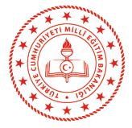

<!-- sayfa 1 -->

MİLLÎ EĞİTİM BAKANLIĞI YAYINLARI NO: ............................................................................:
DERS KİTAPLARI DİZİSİ NO: ...............................................................................................:

Her hakkı saklıdır ve Millî Eğitim Bakanlığına aittir. Kitabın metin, soru ve şekilleri kısmen de olsa hiçbir suretle alınıp yayımlanamaz.

**Editör**
Prof. Dr. Gürhan DURAK
Prof. Dr. Rabia Meryem YILMAZ

**Dil Uzmanı**
Aylin ALTINBAŞ

**Görsel Tasarımcı**
Ayhan Ercan SEĞMEN

**Çoklu Ortam Tasarımcısı**
Burhan TURGUT

**Program Geliştirme Uzmanı**
Dr. Emine SELMANOĞLU
Dr. Şahika ÜNLÜ

**Ölçme ve Değerlendirme Uzmanı**
Dr. Mustafa KILINÇ
Neslihan BİÇER KURT

**Rehberlik Uzmanı**
Kamil TOPÇU

Millî Eğitim Bakanlığı Talim ve Terbiye Kurulu Başkanlığının ................. tarih ve .............. sayılı yazısı ile eğitim aracı olarak kabul edilmiştir.

Kurulca bu kitabın kabul edilmiş olması ders kitabından yayınevi ve yazar/yazarların

<!-- sayfa 2 -->

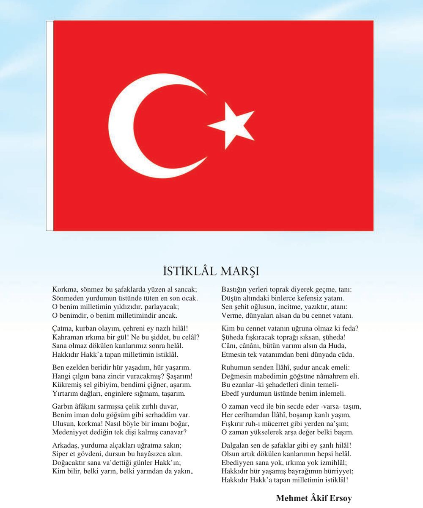

# İSTİKLÂL MARŞI

Korkma, sönmez bu şafaklarda yüzen al sancak;
Sönmeden yurdumun üstünde tüten en son ocak.
O benim milletimin yıldızıdır, parlayacak;
O benimdir, o benim milletimindir ancak.

Çatma, kurban olayım, çehreni ey nazlı hilâl!
Kahraman ırkıma bir gül! Ne bu şiddet, bu celâl?
Sana olmaz dökülen kanlarımız sonra helâl.
Hakkıdır Hakk'a tapan milletimin istiklâl.

Ben ezelden beridir hür yaşadım, hür yaşarım.
Hangi çılgın bana zincir vuracakmış? Şaşarım!
Kükremiş sel gibiyim, bendimi çiğner, aşarım.
Yırtarım dağları, enginlere sığmam, taşarım.

Garbın âfâkını sarmışsa çelik zırhlı duvar,
Benim iman dolu göğsüm gibi serhadim var.
Ulusun, korkma! Nasıl böyle bir imanı boğar,
Medeniyet dediğin tek dişi kalmış canavar?

Arkadaş, yurduma alçakları uğratma sakın;
Siper et gövdeni, dursun bu hayâsızca akın.
Doğacaktır sana va'dettiği günler Hakk'ın;
Kim bilir, belki yarın, belki yarından da yakın

Bastığın yerleri toprak diyerek geçme, tanı:
Düşün altındaki binlerce kefensiz yatanı.
Sen şehit olasın, incitme, yazıktır, atanı:
Verme, dünyaları alsan da bu cennet vatanı.

Kim bu cennet vatanın uğruna olmaz ki feda?
Şüheda fışkıracak toprağı sıksan, şüheda!
Cânı, cânânı, bütün varımı alsın da Huda,
Etmesin tek vatanımdan beni dünyada cüda.

Ruhumun senden ilâhî, şudur ancak emeli:
Değmesin mabedimin göğsüne nâmahrem eli.
Bu ezanlar -ki şehadetleri dinin temeli-
Ebedî yurdumun üstünde benim inlemeli.

O zaman vecd ile bin secde eder -varsa- taşim,
Her cerîhamdan ilâhî, boşanıp kanlı yaşım,
Fışkırır ruh-ı mücerret gibi yerden na'şım;
O zaman yükselerek arşa değer belki başım.

Dalgalan sen de şafaklar gibi ey şanlı hilâl!
Olsun artık dökülen kanlarımızın hepsi helâl.
Ebediyyen sana, ırkıma yok izmihlâl;
Hakkıdır hür yaşamış bayrağımın hürriyet;
Hakkıdır Hakk'a tapan milletimin istiklâl!

Mehmet Âkif Ersoy

<!-- sayfa 3 -->

# GENÇLİĞE HİTABE

Ey Türk gençliği! Birinci vazifen, Türk istiklâlini, Türk Cumhuriyetini, ilelebet muhafaza ve müdafaa etmektir.

Mevcudiyetinin ve istikbalinin yegâne temeli budur. Bu temel, senin en kıymetli hazinendir. İstikbalde dahi, seni bu hazineden mahrum etmek isteyecek dâhilî ve hâricî bedhahların olacaktır. Bir gün, istiklâl ve cumhuriyeti müdafaa mecburiyetine düşersen, vazifeye atılmak için, içinde bulunacağın vaziyetin imkân ve şeraitini düşünmeyeceksin! Bu imkân ve şerait, çok namüsait bir mahiyette tezahür edebilir. İstiklâl ve cumhuriyetine kastedecek düşmanlar, bütün dünyada emsali görülmemiş bir galibiyetin mümessili olabilirler. Cebren ve hile ile aziz vatanın bütün kaleleri zapt edilmiş, bütün tersanelerine girilmiş, bütün orduları dağıtılmış, memleketin her köşesi bilfiil işgal edilmiş olabilir. Bütün bu şeraitten daha elim ve daha vahim olmak üzere, memleketin dâhilinde iktidara sahip olanlar gaflet ve dalâlet ve hatta hıyanet içinde bulunabilirler. Hattâ bu iktidar sahipleri şahsî menfaatlerini, müstevlilerin siyasi emelleriyle tevhit edebilirler. Millet, fakr u zaruret içinde harap ve bîtap düşmüş olabilir.

Ey Türk istikbalinin evlâdı! İşte, bu ahval ve şerait içinde dahi vazifen, Türk istiklâl ve cumhuriyetini kurtarmaktır. Muhtaç olduğun kudret, damarlarındaki asil kanda mevcuttur.

Mustafa Kemal Atatürk

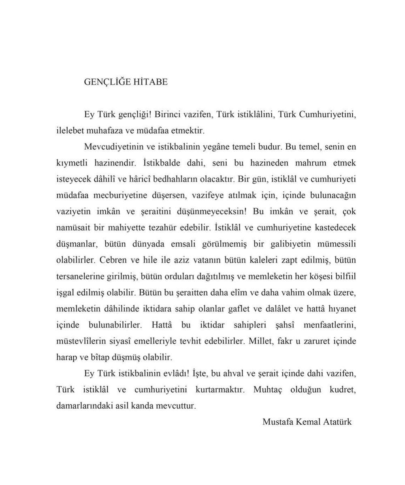
<!-- yer tutucu bulunamadı: sayfa sonuna eklendi -->

<!-- sayfa 4 -->

Görüntüde herhangi bir metin veya matematiksel ifade bulunmamaktadır. Sadece Mustafa Kemal Atatürk'ün bir portre resmi yer almaktadır.

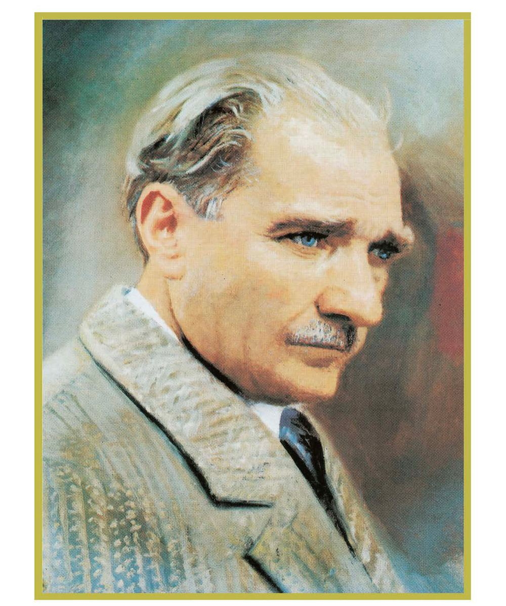
<!-- yer tutucu bulunamadı: sayfa sonuna eklendi -->

<!-- sayfa 5 -->

Henüz bir görsel veya metin katmanı paylaşmadınız. Lütfen dönüştürülmesini istediğiniz matematik ders kitabı sayfasının görüntüsünü ve varsa PDF metin katmanını gönderin. Verileri paylaştığınız anda talimatlarınıza harfiyen uyarak Markdown formatında çevirisini yapacağım.

<!-- yer tutucu bulunamadı: sayfa sonuna eklendi -->

<!-- sayfa 6 -->

# İçindekiler

| İçindekiler | 07 |
| :--- | :--- |
| **1. TEMA: BİLİŞİM TEKNOLOJİLERİNİN HAYATIMIZDAKİ YERİ** | **08** |
| BİLİŞİM TEKNOLOJİLERİNİN SINIFLANDIRILMASI | 12 |
| BİLİŞİM TEKNOLOJİLERİNİN ETKİLERİ VE DİJİTAL SAĞLIK | 17 |
| DİJİTAL VATANDAŞLIK UYGULAMALARI | 23 |
| YAPAY ZEKÂDA TEMEL KAVRAM VE ÖZELLİKLER | 29 |
| BİLGİSAYAR SİSTEMLERİNİN KULLANIMI | 46 |
| DOSYA VE KLASÖR YÖNETİMİ | 56 |
| **2. TEMA: DİJİTAL ÜRÜN TASARIMI VE GELİŞTİRME** | **74** |
| GÖRSEL DÜZENLEME PROGRAMLARINA GİRİŞ | 79 |
| GÖRSEL TASARIMA YÖNELİK KURGU OLUŞTURMA | 89 |
| GÖRSEL ÜRÜN GELİŞTİRME | 92 |
| KELİME İŞLEMCİ PROGRAMLARINA GİRİŞ | 98 |
| KELİME İŞLEMCİ DOSYASI GELİŞTİRME | 105 |
| SUNUM PROGRAMLARINA GİRİŞ | 110 |
| SUNUM DOSYASI OLUŞTURMA | 116 |
| **3. TEMA: BİLGİSAYAR AĞLARI VE İLETİŞİM** | **128** |
| BİLGİSAYAR AĞLARI VE AĞ BİLEŞENLERİ | 131 |
| BİLGİSAYAR AĞ TÜRLERİ VE BAĞLANMA YÖNTEMLERİ | 136 |
| İNTERNETTE BİLGİ KAYNAKLARI VE ARAMA YÖNTEMLERİ | 139 |
| **4. TEMA: BİLİŞİM ETİĞİ VE SİBER GÜVENLİK** | **151** |
| BİLİŞİM ETİĞİ VE İLKELERİ | 154 |
| DİJİTAL ORTAMLARDA GİZLİLİK VE GÜVENLİK | 161 |
| **5. TEMA: YAPAY ZEKÂ** | **171** |
| YAPAY ZEKÂ KULLANIM ALANLARI VE ALT DALLARI | 174 |
| YAPAY ZEKÂDA GÜVENLİK | 181 |
| **6. TEMA: YAZILIM TASARIMI VE PROGRAMLAMA** | **195** |
| BİLGİ KAYNAKLARI VE İNTERNETTE ARAMA YÖNTEMLERİ | 198 |
| ALGORİTMA TEST ETME VE GERİ BİLDİRİM ALMA | 208 |
| YAZILIMDA KULLANILAN BİLEŞENLER | 212 |
| BLOK TABANLI ORTAMDA YAZILIM GELİŞTİRME | 225 |
| BLOK TABANLI ORTAMDA YAZILIM DEĞERLENDİRME | 233 |
| SÖZLÜK | 243 |
| KAYNAKÇA | 246 |
| GENEL AĞ KAYNAKÇASI VE GÖRSEL KAYNAKÇA | 247 |
| TÜRKİYE’NİN MÜLKİ İDARE BÖLÜMLERİ İLE KARA VE DENİZ KOMŞULARI HARİTASI | 248 |

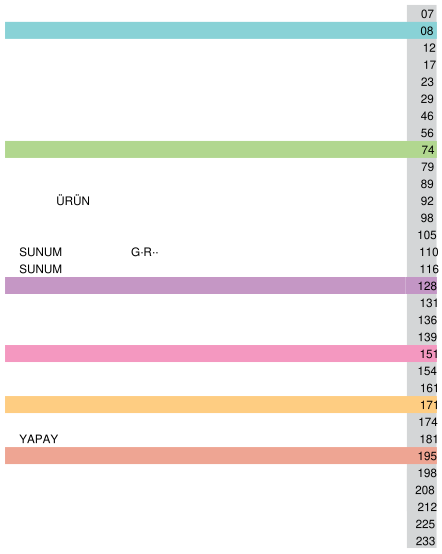
<!-- yer tutucu bulunamadı: sayfa sonuna eklendi -->

<!-- sayfa 7 -->

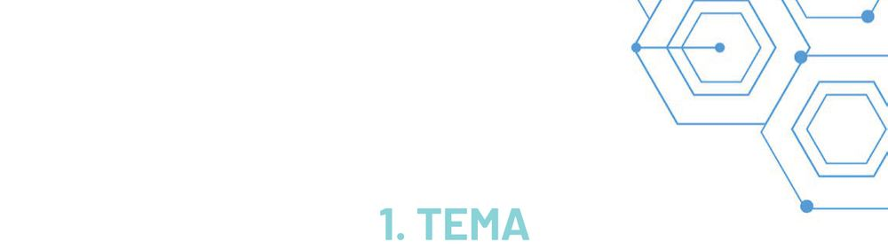

# 1. TEMA
## BİLİŞİM TEKNOLOJİLERİNİN HAYATIMIZDAKİ YERİ

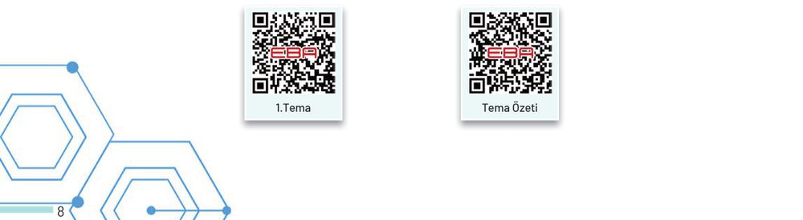

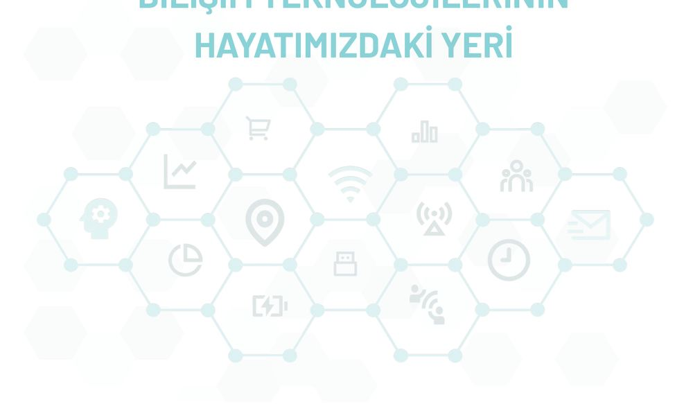
1.Tema
Tema Özeti

<!-- sayfa 8 -->

| DERS SAATİ | 14 ders saati |
| :--- | :--- |
| İÇERİK ÇERÇEVESİ | Bilişim Teknolojilerinin Sınıflandırılması Bilişim Teknolojilerinin Etkileri ve Dijital Sağlık Dijital Vatandaşlık Uygulamaları Yapay Zekâda Temel Kavram ve Özellikler Bilgisayar Sistemlerinin Kullanımı Dosya ve Klasör Yönetimi |
| ÖĞRENME ÇIKTILARI VE SÜREÇ BİLEŞENLERİ | BTY.5.1.1. Günlük yaşamda kullanılan bilişim teknolojilerini sınıflandırabilme a) Bilişim teknolojilerine ilişkin temel kavramları belirler. b) Geçmişten günümüze bilişim teknolojilerindeki benzerlikleri ve farklılıkları ilişkilendirir. c) Bilişim teknolojilerini kullanım alanlarına göre gruplandırır.  BTY.5.1.2. Bilişim teknolojilerinin birey ve toplum üzerindeki etkilerini özetleyebilme a) Farklı bilişim teknolojilerinin olumlu ve olumsuz yönleri ile ilgili çözümleme yapar. b) Farklı bilişim teknolojilerinin kullanımına göre fiziksel güvenlik önlemleri ile ilgili sınıflandırma yapar. c) Bilişim teknolojilerini kullanmanın beden ve ruh sağlığı üzerindeki etkilerini kendi cümleleriyle ifade eder.  BTY.5.1.3. Dijital vatandaşlık uygulamalarını sınıflandırabilme a) Dijital kimlik kavramını belirler. b) Dijital ayak izinin etkilerini bilişim teknolojilerinin kullanım alanları ile ilişkilendirir. c) Dijital vatandaşlık uygulamalarını kullanım alanlarına göre gruplandırır.  BTY.5.1.4. Yapay zekâ ile ilgili temel kavramları ve özellikleri sorgulayabilme a) Yapay zekâ ile ilgili temel kavram ve özelliklere ilişkin merak ettiği konuları tanımlar. b) Yapay zekâ ile ilgili temel kavram ve özellikleri hakkında sorular sorar. c) Yapay zekâ ile ilgili temel kavram ve özellikleri hakkında bilgi toplar. ç) Yapay zekâ ile ilgili temel kavram ve özellikleri hakkında toplanan bilgilerin doğruluğunu değerlendirir. d) Yapay zekânın olası etkilerine ilişkin topladığı bilgiler üzerinden çıkarım yapar.  BTY.5.1.5. Bilgisayar sistemlerini çözümleyebilme a) Bilgisayar sistemlerinin temel bileşenlerini belirler. b) Bilgisayar sistemlerinin temel bileşenleri arasındaki ilişkileri belirler.  BTY.5.1.6. Dosya ve klasör yönetimi ile ilgili temel işlemlerle çalışabilme a) Temel dosya ve klasör düzenleme işlemlerini belirler. b) Temel dosya ve klasör düzenleme işlemlerini kullanır. c) Dosya ve klasör sıkıştırma işlemlerini verimlilik kapsamında değerlendirir. |

<!-- yer tutucu bulunamadı: sayfa sonuna eklendi -->

<!-- sayfa 9 -->

| | |
| :--- | :--- |
| **Alan Becerileri** | BTYAB1. Bilişim Teknolojileri Kullanma |
| **Kavramsal Beceriler** | KB2.3. Özetleme, KB2.4. Çözümleme, KB2.8. Sorgulama |
| **Eğilimler** | E1.1. Merak, E1.2. Bağımsızlık, E2.1. Empati, E2.2. Sorumluluk, E2.5. Oyunseverlik, E3.5. Açık Fikirlilik, E3.7. Sistematiklik, E3.8. Soru Sorma, E3.10. Eleştirel Bakma |
| **PROGRAMLAR ARASI BİLEŞENLER** | |
| | **Sosyal Duygusal Öğrenme Becerileri** | SDB1.1. Kendini Tanıma (Öz Farkındalık), SDB1.2. Kendini Düzenleme (Öz Düzenleme), SDB2.1. İletişim, SDB2.2. İş Birliği, SDB2.3. Sosyal Farkındalık, SDB3.1. Uyum, SDB3.3. Sorumlu Karar Verme |
| | **Değerler** | D3. Çalışkanlık, D4. Dostluk, D6. Dürüstlük, D8. Mahremiyet, D10. Mütevazılık, D12. Sabır, D13. Sağlıklı Yaşam, D14. Saygı, D15. Sevgi, D16. Sorumluluk, D17. Tasarruf |
| | **Okuryazarlık Becerileri** | OB1. Bilgi Okuryazarlığı, OB2. Dijital Okuryazarlık, OB4. Görsel Okuryazarlık |
| **Disiplinler Arası İlişkiler** | - |
| **Beceriler Arası İlişkiler** | KB2.7. Karşılaştırma, KB2.8. Sorgulama |
| **Anahtar Kavramlar** | bilgi, bilgi ve iletişim teknolojileri, bilgisayar sistemleri, bilişim teknolojileri, bulut bilişim, çıkış birimi, depolama birimi, dijital ayak izi, dijital bağımlılık, dijital etik, dijital kimlik, dijital vatandaşlık, doğal zekâ, donanım, dosya, dosya yönetimi, dosya uzantısı, ergonomi, ekran süresi, giriş birimi, iletişim, işletim sistemi, klasör, klasör yapısı, sosyal medya, teknoloji bağımlılığı, veri sıkıştırma, yapay zekâ, yapay zekâ tarihi, yazılım |

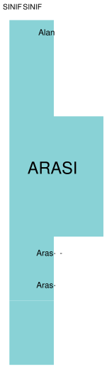
<!-- yer tutucu bulunamadı: sayfa sonuna eklendi -->

<!-- sayfa 10 -->

# Ön Değerlendirme

* Öğrencilerin bilişim teknolojilerine ilişkin mevcut bilgi düzeyleri ve ön öğrenmelerini belirlemek, konuya yönelik bilgilerini değerlendirmek için beyin fırtınası tekniği kullanılabilir.

# Bağlantı Noktası

Aşağıdaki sorulardan uygun gördüklerinizi öğrencilere yönelterek yanıtlamalarını isteyiniz.

* Evde, okulda veya çevrenizde kullandığınız teknolojik cihazlar olmasaydı, günlük yaşamınızdaki alışkanlıklarınız nasıl değişirdi?
* Cep telefonunu kullanamadığınızda hangi işleri yapmanız zorlaşır?
* İnterneti daha çok hangi amaçlarla kullanıyorsunuz?

### Toplumsal etkiler üzerine sorular

* Bilişim teknolojileri hayatınızı nasıl etkiler? İyi yönde mi, kötü yönde mi?
* Bilişim teknolojilerinin hayatımızı kolaylaştıran yönleri ile farkında olmadan bize veya çevremize verebileceği zararlar arasında nasıl bir bağ kurabiliriz?
* Ailenizle iletişim kurarken veya ödev yaparken teknoloji size nasıl yardımcı oluyor?

### Dijital vatandaşlık bağlamında sorular

* Sosyal medyada yapılan paylaşımların bu paylaşımı yapan kişileri nasıl temsil ettiğini düşündünüz mü?
* Dijital kimlik sizce ne anlama geliyor?
* İnternette güvenliğimizi tehdit eden bir durumla karşılaştığımızda, gerçek hayattaki güvenlik kurallarımızla nasıl bir benzerlik kurarak kendimizi koruyabiliriz?

### Yapay zekâ bağlamında sorular

* Kullandığınız sesli asistanlar veya dijital araçlar sizin alışkanlıklarınızı analiz ederek size nasıl özel çözümler sunuyor? Bu durum hayatımızı nasıl kolaylaştırıyor?
* Sizce bir bilgisayar sisteminin ‘yapay zekâ’ teknolojisine sahip olduğunu söyleyebilmemiz için hangi özellikleri göstermesi gerekir?
* Günlük hayatta yapay zekânın size yardımcı olmasını istediğiniz bir alan var mı?

### Bilgisayar sistemleri ve dosya yönetimi için sorular

* Bir bilgisayarı oluşturan temel parçaların görevleri ile insan vücudundaki organların işleyişi arasında nasıl bir ilişki kurabiliriz?
* Dosyalarınızı veya defterlerinizi düzenlerken nasıl bir yöntem izliyorsunuz? Bunu bilgisayarda dosya–klasör düzenine benzetebilir miyiz?
* Bilgisayardaki çalışmalarımızı yedeklemediğimizde yaşanabilecek sorunlar, gelecekteki dijital üretimlerimizi ve veri güvenliğimizi nasıl etkiler?

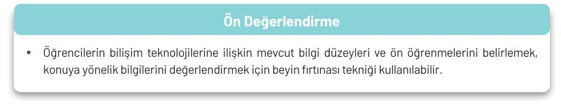
<!-- yer tutucu bulunamadı: sayfa sonuna eklendi -->

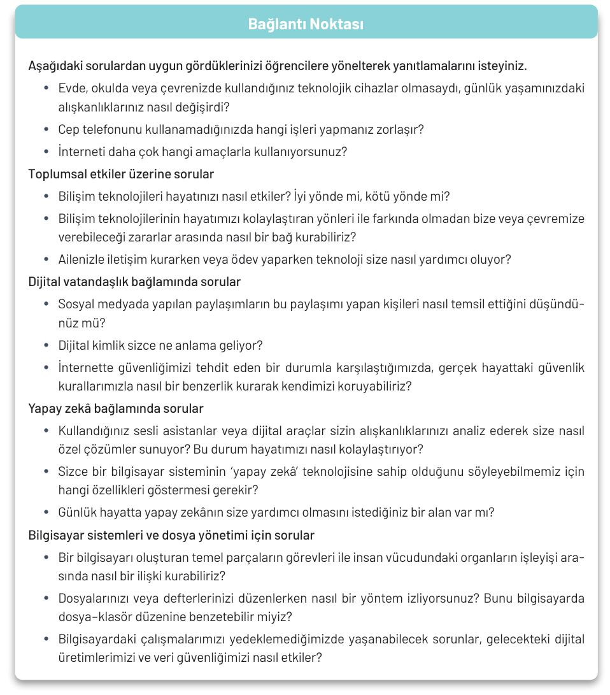
<!-- yer tutucu bulunamadı: sayfa sonuna eklendi -->

<!-- sayfa 11 -->

# BİLİŞİM TEKNOLOJİLERİNİN SINIFLANDIRILMASI

**Süre:**
2 ders saati

**Öğrenme Çıktısı**
BTY.5.1.1. Günlük yaşamda kullanılan bilişim teknolojilerini sınıflandırabilme
a) Bilişim teknolojilerine ilişkin temel kavramları belirler.
b) Geçmişten günümüze bilişim teknolojilerindeki benzerlik ve farklılıkları ilişkilendirir.
c) Bilişim teknolojilerini kullanım alanlarına göre gruplandırır.

**Dersten Önce**
* Bilişim teknolojileri kavramına ilişkin beyin fırtınası soruları hazırlayınız.
* Öğrencilerin kavramlarla çalışması için bir "kelime kavanozu" oluşturunuz. Kavanozun içine "iletişim, bilgi, bilişim, teknoloji, bilgi iletişim teknolojileri vb." kartları yerleştiriniz: Bilişim teknolojileri alt kavramları interaktif etkinliğini hazırlayınız.
* 3-4 kişilik gruplar oluşturmak için bir web 2.0 grup oluşturma aracı veya renkli kartlar hazırlayınız.
* Bilişim teknolojilerine ait geçmişten ve günümüzden görseller hazırlayınız (daktilo, teyp, ilk bilgisayar, akıllı telefon, bulut bilişim vb.).
* Grupların çalışmaları için afiş/poster kâğıtları ve renkli kalemler temin ediniz.
* Yeşil ekran teknolojisine ait kısa bir film sahnesi videosu hazırlayınız (örnek çekim süreci ve sahne arkası görüntüleriyle birlikte).
* Ölçme ve değerlendirme için Dereceli Puanlama Anahtarı ve Öğretmen Gözlem Formu'nu önceden hazırlayınız.

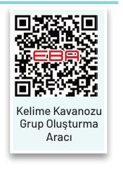

**Dikkat Çekme**
Öğrencilerden aşağıdaki soruları yanıtlamalarını isteyiniz, öğrencilerin verdiği yanıtları tartışmaya açınız. Gelen cevapları tahtaya yazınız ve kavramları gruplayarak sınıfta görünür hâle getiriniz. Bunun için yapışkan not/mini kart kullanabilirsiniz.
* Bilişim teknolojileri denince aklınıza neler geliyor?
* Günlük yaşamınızda karşılaştığınız bilişim teknolojilerinden örnekler veriniz.
* Sizce bilişim teknolojileri hayatımızı nasıl etkiliyor, bize hangi kolaylıkları sağlıyor?

**Ders Süreci**
☐ Öğrencilere bilişim teknolojileri hakkındaki düşüncelerini sorarak bir beyin fırtınası süreci başlatınız ve gelen fikirleri haritalandırarak tahtaya not ediniz. Öğrencilerin günlük yaşamlarından verdikleri örneklerden yola çıkarak; iletişim, bilgi, bilişim, teknoloji, BİT, donanım, yazılım ve internet gibi temel kavramlar arasında bağlantılar kurmalarını ve bu kavramların anlamlarını kendi cümleleriyle keşfetmelerini sağlayınız. Kavramlar arasındaki ilişkilerin somutlaştırılması, anlamlandırılması ve öğrencilerin çıkarımda bulunabilmesi amacıyla bu süreçte “Bilişim Teknolojileri Alt Kavramları” interaktif etkinliğini aktif bir öğrenme aracı olarak kullanınız.

☐ Öğrencileri otomatik grup oluşturan bir Web 2.0 aracı vasıtasıyla küçük gruplara ayırınız. Hazırladığınız “Kelime Kavanozu”ndan her grubun rastgele bir kavram seçmesini sağlayarak çalışmayı “Temel Kavramları Keşfediyoruz” etkinliği ile gerçekleştiriniz. Gruplara araştırma yapmaları için 5-8 dakika süre veriniz ve bu süreçte öğrencilerin internet tarayıcıları üzerinden güvenilir bilgi kaynaklarına eri...

<!-- sayfa 12 -->

şimlerine rehberlik ediniz. Grupların ulaştıkları sonuçları sınıfa sunmalarını sağlayarak diğer öğrencileri sorular yöneltmeye teşvik ediniz. Sunulan kavramları tahtada toplayarak kullanım alanlarına göre sınıflandırınız. Ardından öğrencilere “Bilişim teknolojilerinin genel olarak sağladığı avantajlar neler olabilir?” sorusunu yönelterek bir beyin fırtınası gerçekleştiriniz. Öğrencilerin kendi yaşam deneyimlerinden ve araştırma sonuçlarından yola çıkarak teknolojinin hayatımızı kolaylaştırma, süreçleri hızlandırma, maliyetleri azaltma ve verimliliği artırma gibi boyutlardaki etkilerini analiz etmelerini ve bu avantajlar üzerine kendi çıkarımlarını inşa etmelerini sağlayınız.

Geçmişten günümüze kullanılan teknolojilere ilişkin materyalleri sınıfa yansıtarak öğrencilerin; daktilo, kasetçalar, tüplü televizyon, telgraf, disket veya ilk cep telefonu gibi geçmişe ait örnekler ile günümüzdeki dokunmatik dizüstü bilgisayar, akıllı telefon, akıllı saat, bulut bilişim, çevrim içi müzik platformu ve yüksek çözünürlüklü akıllı televizyon gibi teknolojileri kendi aralarında karşılaştırmalarını sağlayınız. Öğrencilerden bu eski ve yeni teknolojiler arasındaki benzerlik, farklılık ve değişimleri analiz ederek tarihsel gelişim üzerine kendi çıkarımlarını kurmalarını isteyiniz. Daha sonra öğrencileri rastgele küçük gruplara ayırarak her gruba bir teknolojik araç (bilgisayar, telefon vb.) veriniz. Bu çalışmayı “Teknolojilerin Yolculuğu” etkinliği ile uygulayarak grupların araştırma sonuçlarını yansıtan poster/afiş çalışmaları hazırlamalarını ve sınıfa sunmalarını sağlayınız. Sunum sürecinde dinleyici konumundaki öğrencileri; akranlarının çalışmalarını doğruluk, özgünlük ve netlik ölçütlerine göre açık fikirlilikle değerlendirmeleri ve sürece sorularıyla aktif olarak katılmaları için teşvik ediniz.

Öğrencilere yeşil ekran teknolojisiyle hazırlanmış, onların ilgisini çekecek kısa bir film sahnesi izletiniz. Ardından “Sizce bir oyuncu stüdyodan hiç çıkmadan nasıl bir ejderhanın sırtında uçabilir veya uzayda yürüyebilir? Bu sihrin arkasında nasıl bir teknoloji saklanıyor olabilir?” sorusunu yönelterek onlarda merak uyandırınız. Öğrencilerin tahminlerini aldıktan sonra sahne arkası çekim sürecini göstererek teknolojinin işleyişini somutlaştırınız. Farklı yeşil ekran örnekleri sunduktan sonra, “En sevdiğiniz animasyon karakterlerinin veya bilgisayar oyunlarındaki kahramanların gerçek gibi hareket etmesini sağlayan diğer bilişim teknolojileri neler olabilir?” sorusuyla tartışmayı derinleştiriniz. Son olarak, “Eğer sinemadaki bu teknolojileri okulda, hastanede veya uzay araştırmalarında kullansaydık hayatımızda neler değişirdi?” şeklinde ilişki kurmayı teşvik eden sorular yönelterek öğrencilerin zihinsel örüntüler çıkarmalarını sağlayınız. Öğrencilerin cevaplarını tahtada haritalandırarak kullanım alanlarına göre sınıfla birlikte gruplandırınız.

Öğrencilere “Bilişim teknolojileri topluma nasıl katkılar sağlar, hangi alanlarda daha faydalıdır?” sorusunu yöneltiniz. Öğrencilerden görüşlerini sorumluluk bilinciyle paylaşmalarını isteyiniz; bu süreçte sorumluluk bilincini somutlaştırmak adına öğrencilere ‘başkalarının fikirlerine saygı duymak, konuşma sırasını beklemek, kaynağı belirsiz kulaktan dolma bilgileri paylaşmamak ve doğruluğundan emin olunan örnekler vermek’ gibi kuralları hatırlatarak rehberlik ediniz. Örneklerle tartışmayı zenginleştirdikten sonra öğrencileri küçük gruplara ayırarak her bir gruba seçtikleri alandaki bilişim teknolojilerini tanıtan kısa sözlü sunum yapma görevi veriniz. Hazırlıklarını arkadaşlarıyla paylaşmaları için gruplara söz hakkı veriniz ve sunum bittiğinde eksik kalan noktaları tamamlayınız.

<!-- sayfa 13 -->

# Etkinlik 1

| | |
| :--- | :--- |
| **Etkinlik Adı:** | Temel Kavramları Keşfediyoruz |
| **Etkinlik Süresi:** | 20 dk. |
| **Etkinlik Türü:** | Grup Etkinlikleri |
| **Yöntem ve Teknikler:** | • Küçük Grup Çalışması • Soru-Cevap • Sunum |
| **Materyaller:** | Kelime kavanozu (iletişim, bilgi, bilişim, teknoloji, BİT kartları), Kelime Kavanozu Grup Oluşturma Aracı, Web Tarayıcısı (araştırma desteği için) |
| **Etkinlik Açıklaması:** | Öğrenciler küçük gruplara ayrılarak bilişim teknolojilerinin temel kavramlarını keşfedecektir. Her grup bir kavram seçerek kısa bir araştırma yapacak, kavramı sınıfa sunacaktır. Diğer öğrenciler sorular yönelterek tartışmaya katılacaktır. |

**Uygulama Aşamaları:**

* Öğrencileri Kelime Kavanozu Grup Oluşturma Aracı veya renkli kartlarla küçük gruplara ayırınız.
* Her gruba kelime kavanozundan bir kavram seçtiriniz.
* Gruplara araştırma yapmaları için 5-8 dakika gibi kısa bir süre veriniz ve gerek-tiğinde web tarayıcısı ile destekleyiniz.
* Grupların kavramlarını sınıfa sunmalarını sağlayınız.
* Sunumlar sırasında diğer öğrencilerin sorular yöneltmelerini teşvik ediniz.
* Kavramları tahtada toplayarak kullanım alanlarına göre sınıflandırınız.

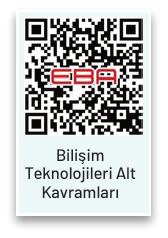
Bilişim Teknolojileri Alt Kavramları

<!-- sayfa 14 -->

# Etkinlik 2

**Etkinlik Adı:** Teknolojilerin Yolculuğu

**Etkinlik Süresi:** ⌛ 25 dk.

**Etkinlik Türü:** 👥 Grup Etkinlikleri

**Yöntem ve Teknikler:**
* Küçük Grup Tartışmaları
* Bütün Sınıfla Yapılan Tartışmalar

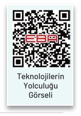

**Materyaller:** Geçmişten ve günümüzden teknolojilere ait görseller (daktilo–bilgisayar, teyp–akıllı telefon vb.), Poster kâğıtları, renkli kalemler, Etkileşimli tahta/tahta

**Etkinlik Açıklaması:** Öğrenciler, geçmişten günümüze teknolojileri karşılaştırarak benzerlik ve farklılıklarını öğreneceklerdir. Gruplar görsellerden yola çıkarak poster hazırlayacak ve sınıfa sunacaktır.

**Uygulama Aşamaları:**

* Öğrencilere geçmiş ve günümüz teknolojilerine ait görseller gösteriniz.
* Öğrencilerden benzerlik ve farklılıkları ifade etmelerini isteyiniz.
* Öğrencileri küçük gruplara ayırınız ve her gruba bir teknolojik araç (bilgisayar, telefon vb.) veriniz.
* Gruplardan verilen teknolojiyi geçmiş ve günümüzdeki biçimleriyle işlev, kullanıcı deneyimi, erişilebilirlik, maliyet ve enerji tüketimi açısından karşılaştırmalarını isteyiniz.
* Grupların afiş hazırlamalarını ve sınıfa sunmalarını sağlayınız.
* Sunum yapan grupları dinleyen öğrencileri sunumları açık fikirlilikle değerlendirmeleri ve sorular sormaları için teşvik ediniz.

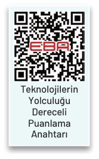

<!-- sayfa 15 -->

# Ara Değerlendirme

Etkinliklerin değerlendirilmesi için Öğretmen Gözlem Formu'ndan yararlanabilirsiniz.

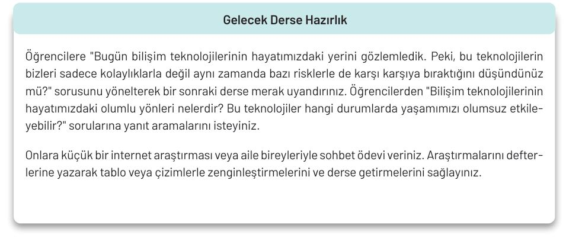

# Gelecek Derse Hazırlık

Öğrencilere "Bugün bilişim teknolojilerinin hayatımızdaki yerini gözlemledik. Peki, bu teknolojilerin bizleri sadece kolaylıklarla değil aynı zamanda bazı risklerle de karşı karşıya bıraktığını düşündünüz mü?" sorusunu yönelterek bir sonraki derse merak uyandırınız. Öğrencilerden "Bilişim teknolojilerinin hayatımızdaki olumlu yönleri nelerdir? Bu teknolojiler hangi durumlarda yaşamımızı olumsuz etkileyebilir?" sorularına yanıt aramalarını isteyiniz.

Onlara küçük bir internet araştırması veya aile bireyleriyle sohbet ödevi veriniz. Araştırmalarını defterlerine yazarak tablo veya çizimlerle zenginleştirmelerini ve derse getirmelerini sağlayınız.

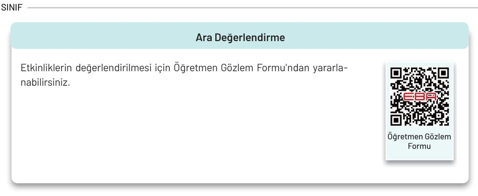
<!-- yer tutucu bulunamadı: sayfa sonuna eklendi -->

<!-- sayfa 16 -->

# BİLİŞİM TEKNOLOJİLERİNİN ETKİLERİ VE DİJİTAL SAĞLIK

**Süre:**
2 ders saati

**Öğrenme Çıktıları**
BTY.5.1.2. Bilişim teknolojilerinin birey ve toplum üzerindeki etkilerini özetleyebilme
a) Farklı bilişim teknolojilerinin olumlu ve olumsuz yönleri ile ilgili çözümleme yapar.
b) Farklı bilişim teknolojilerinin kullanımına göre fiziksel güvenlik önlemleri ile ilgili sınıflandırma yapar.
c) Bilişim teknolojilerini kullanmanın beden ve ruh sağlığı üzerindeki etkilerini kendi cümleleriyle ifade eder.

**Dersten Önce**
* Farklı bilişim teknolojilerine (telefon, tablet, sosyal medya platformları, bulut teknolojileri vb.) ait teknoloji görselleri hazırlayınız.
* Olumlu ve olumsuz teknoloji kullanımı ile ilgili beyin fırtınası soruları oluşturunuz.
* Teknolojinin olumlu ve olumsuz yönleriyle "sürükle bırak" oyununu hazırlayınız.
* Öğrencilerin günlük teknoloji kullanım sürelerini not edebilecekleri günlük teknoloji kullanımı gözlem formu hazırlayınız.
* Sağlık ve güvenlik kurallarına uygun olmayan, bilgisayar kullanımlarını gösteren, ergonomik olmayan teknoloji kullanımı görselleri hazırlayınız.
* Sağlıklı teknoloji kullanımına örnek olarak kullanılabilecek ergonomi görseli hazırlayınız.
* Öğrencilere izletebileceğiniz kısa bir dijital sağlık/teknoloji bağımlılığı farkındalık videosu seçiniz. Bu kapsamdaki görsel ve işitsel materyaller için EBA web sitesindeki <teknoloji bağımlılığı> başlığından veya diğer güvenilir kurumsal dijital platformlardan yararlanabilirsiniz.
* Ölçme ve değerlendirme süreci için Öz Değerlendirme Formu ve Öğretmen Gözlem Formu'nu önceden hazırlayınız.

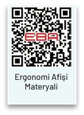
Ergonomi Afişi Materyali

**Dikkat Çekme**
Aşağıdaki sorulardan uygun gördüklerinizi öğrencilere sorunuz.
* Gün içinde en çok hangi bilişim teknolojilerini kullanıyorsunuz?
* Sizce bu teknolojiler hayatımızı nasıl kolaylaştırıyor?
* Teknolojiyi bilinçsiz, aşırı veya kontrolsüz kullandığımızda, bu durum günlük yaşamımızda ve sağlığımızda ne gibi olumsuz etkiler veya riskler oluşturabilir?
* Ekran başında çok uzun süre kaldığınız oldu mu? Bu durum size nasıl etkiledi?
* Oyun veya sosyal medyanın plansız kullanımının derslerinizi ya da günlük işlerinizi olumsuz yönde etkilediği zamanlar oldu mu?
* Telefonunuzu veya bilgisayarınızı nasıl daha bilinçli kullanabilirsiniz?
* Sağlıklı teknoloji kullanımı deyince aklınıza neler geliyor?

<!-- sayfa 17 -->

# Ders Süreci

* Öğrencilere farklı bilişim teknolojilerini (akıllı telefon, tablet, dizüstü bilgisayar, sosyal medya uygulamaları, akıllı saatler, çevrim içi eğitim araçları vb.) sorunuz ve bunların olumlu–olumsuz yönleri hakkında bireysel düşünmelerini isteyiniz. Öğrencilerin kendi listelerini hazırlamalarını, daha sonra sınıfla paylaşmalarını ve tartışmalarını sağlayınız. Bu süreçte öğrencilerin eleştirel düşünmelerine ve kendi fikirlerini sorumluluk alarak ifade etmelerine rehberlik ediniz.
* Öğrencilerden bu teknolojilerin olumlu (hızlı iletişim, bilgiye erişim vb.) ve olumsuz yönlerini (gizlilik sorunları, dijital bağımlılık, oyun bağımlılığı, aşırı ekran süresi vb.) belirlemelerini ve bunu bir liste hâline getirmelerini isteyiniz. Hazırladıkları listeleri kullanım alanlarıyla ilişkilendirerek sınıfta karşılaştırma yapmalarını sağlayınız. Tartışma sırasında öğrencilerin hem kendi görüşlerini açıkça dile getirmelerini hem de farklı düşüncelere saygıyla yaklaşmalarını teşvik ediniz. Ardından "Teknolojinin Olumlu ve Olumsuz Yönleri Oyunu" etkinliğini gerçekleştiriniz. Öğrencilerle birlikte uygulayınız. Seçtiğiniz öğrencilerin isimleriyle oyuna giriş yaparsanız bu etkinlik daha ilgi çekici ve heyecanlı olacaktır.
* Öğrencilerin sunduğu tüm olumlu ve olumsuz sonuçları listeleyiniz. Bu süreçte, öğrencilerin birbirleriyle açık fikirli bir şekilde iletişim kurmalarını ve farklı bakış açılarını değerlendirmelerini teşvik ediniz. Bu değerlendirme sürecinde öğrencilerin farklı bakış açılarını dikkate alarak fikirlerini dengeli bir şekilde ifade etmelerini sağlayınız. "Teknolojinin olumlu ve olumsuz etkileri listesi" etkinliğiyle süreci ilerletiniz. Sonrasında, günlük yaşamları için sağlıklı sınırlar belirleyerek teknoloji kullanımını kontrollü bir şekilde yönetme bilinci geliştirmelerini sağlayınız. Böylece öğrencilerin teknoloji ve davranış bağımlılığının olumsuz etkilerini fark ederek sağlıklı alışkanlıklar geliştirmesini ve dijital bağımlılıkla mücadele etmenin yollarını öğrenmesini sağlayınız.
* Öğrencilerden bilişim teknolojilerinin beden ve ruh sağlığı üzerindeki etkilerini belirlemelerini, liste hazırlamalarını ve bu etkileri neden–sonuç ilişkisi kurarak analiz etmelerini isteyiniz. Farklı bakış açılarını değerlendirmelerine ve bu etkiler arasında ilişki kurmalarına rehberlik ediniz.
* Bilişim teknolojilerinin kullanımında ergonomiye uygun davranışların beden sağlığı üzerindeki önemini öğrencilere açıklayınız, farklı bilişim teknolojisi araçlarının kullanımına göre alınabilecek fiziksel güvenlik önlemlerini sınıflandırınız ve sağlık ile güvenliğe uygun olmayan kullanım hatalarının yer aldığı fotoğraf ve videoları öğrencilere gösteriniz. Burada "Ergonomi ve doğru kullanım analizi" etkinliğini gerçekleştiriniz.
* Öğrencilerin izledikleri hatalı kullanım örneklerini empati kurarak analiz etmelerini ve doğru kullanım yöntemlerini belirlemelerini sağlayınız, bu davranışların kısa ve uzun vadede beden ve ruh sağlığına nasıl zarar verebileceğini kendi cümleleriyle ifade etmelerini isteyiniz ve bu zararların günlük yaşamda nelere yol açabileceğinin (örneğin bel ağrısı nedeniyle spor yapamama, göz yorgunluğu nedeniyle derse odaklanamama gibi) tartışılmasını sağlayınız.
* Öğrencilerin doğru kullanım yöntemlerini belirleyerek farklı bilişim teknolojisi araçlarını kullanım alanlarına göre kategorilere ayırmalarını sağlayınız, hem fiziksel güvenlik hem de ergonomi açısından doğru kullanım alışkanlıkları geliştirmenin önemini kavramalarını destekleyiniz ve bu süreçte dijital sağlık ve esenlik kapsamında fiziksel sağlık (ekran süresi yönetimi, doğru oturuş, dijital göz yorgunluğu, göz sağlığı alışkanlıkları), bilişsel/davranışsal sağlık (aşırı teknoloji kullanımının uyku düzenine etkisi, bildirim yorgunluğu, dikkat dağınıklığı, dijital detoks farkındalığı) ile sosyal-duygusal sağlık (siber zorbalığın ruh sağlığına etkileri, siber zorbalıkla baş etme yolları, çevrim içi nezaket ve empati) alt boyutlarını ele alarak öğrencilerin dijital ortamla dengeli ve sağlıklı ilişki kurmalarını destekleyiniz.

<!-- sayfa 18 -->

# Etkinlik 3

| | |
| :--- | :--- |
| **Etkinlik Adı:** | Olumlu ve Olumsuz Teknoloji Listesi |
| **Etkinlik Süresi:** | 20 dk. |
| **Etkinlik Türü:** | Bireysel Etkinlikler |
| **Yöntem ve Teknikler:** | • Beyin fırtınası • Grup tartışması |
| **Materyaller:** | Günlük Teknoloji Kullanımı Gözlem Formu (Öğrenci), Tahta/etkileşimli tahta, Renkli veya A4 kâğıtlar |
| **Etkinlik Açıklaması:** | Öğrenciler, bilişim teknolojilerinin günlük yaşamlarındaki olumlu ve olumsuz yönlerini fark ederek bir liste oluşturacak, ardından küçük gruplarda tartışarak sağlıklı teknoloji kullanımı için öneriler geliştireceklerdir. |

### Uygulama Aşamaları:

* Öğrencilerden hangi teknolojileri (telefon, tablet, bilgisayar vb.) günde kaç saat kullandıklarını bireysel olarak not etmelerini isteyiniz.
* Her öğrenciden kullandığı teknolojilerin olumlu (bilgiye erişim, hızlı iletişim, eğlence vb.) ve olumsuz (aşırı/kontrolsüz kullanım, fiziksel ve sosyal riskler vb.) yönlerini yazmasını isteyiniz.
* Öğrenciler hazırladıkları listeleri küçük gruplarda paylaşır. Gruplar, ortak fikirleri birleştirerek "Olumlu Teknoloji Kullanımı" ve "Olumsuz Teknoloji Kullanımı" başlıkları altında iki ayrı grup listesi hazırlar.
* Grupların çalışmaları tahtaya/etkileşimli tahtaya yansıtılır. Öğrencilerden "Teknoloji hangi durumlarda faydalı, hangi durumlarda zararlıdır?" sorusu üzerine düşünmelerini isteyiniz.
* Son aşamada, öğretmen öğrencileri günlük yaşamlarında sağlıklı sınırlar belirlemeye yönlendirir. Örneğin "Ekran süremi azaltmak için her 30 dakikada bir ara veririm." gibi öneriler sınıfça tartışılır.
* Etkinlik sonunda öğretmen, bu yaş grubu için önerilen ekran sürelerini açıklar. Konu ile ilgili farkındalığı artırmak adına öğrencilere küçük bir performans çalışması veya ev görevi (örneğin; ailece ekransız akşam saati planlama) verilebilir.

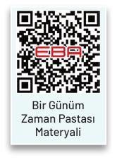
Günlük Teknoloji Kullanımı Gözlem Formu

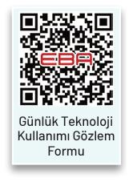
Bir Günüm Zaman Pastası Materyali

<!-- sayfa 19 -->

# Etkinlik 4

| | |
| :--- | :--- |
| **Etkinlik Adı:** | Teknolojinin Olumlu ve Olumsuz Yönleri Oyunu |
| **Etkinlik Süresi:** | ⌛ 20 dk. |
| **Etkinlik Türü:** | 👥 Grup Etkinlikleri |
| **Yöntem ve Teknikler:** | • Soru-cevap   • Tartışma |
| **Materyaller:** | Etkileşimli tahta, Sürükle–bırak oyunu uygulaması |
| **Etkinlik Açıklaması:** | Bu etkinlikte öğrenciler, bilişim teknolojilerinin olumlu ve olumsuz yönlerini belirleyecektir. Sürükle–bırak oyununu oynayarak öğrendiklerini pekiştireceklerdir. |

**Uygulama Aşamaları:**

* Teknolojinin olumlu ve olumsuz yönleriyle ilgili sürükle–bırak oyununu öğrencilere oynatınız.
* Oyuna öğrencilerin isimlerini girerek etkinliği daha ilgi çekici hâle getiriniz.
* Doğru eşleştirmelerde sınıfı birlikte teşvik ediniz.
* Yanlış eşleştirmelerde öğrencileri yargılamadan doğru cevaba yönlendirmek için ipuçları veriniz.
* Öğrencilerin listelerde belirttikleri olumlu/olumsuz yönleri oyun sırasında hatırlatmalarını isteyiniz.
* Oyun sonunda sınıfa genel bir değerlendirme yaptırınız.
* Oyun verilerini veya eşleştirmeleri tahtada kısaca özetleyiniz ve dersin genel mesajını vurgulayınız.

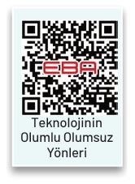

<!-- sayfa 20 -->

# Etkinlik 5

| | |
| :--- | :--- |
| **Etkinlik Adı:** | Ergonomi ve Doğru Kullanım Analizi |
| **Etkinlik Süresi:** | 20 dk. |
| **Etkinlik Türü:** | Grup Etkinlikleri |
| **Yöntem ve Teknikler:** | • Problem Çözme • Tartışma |
| **Materyaller:** | Teknolojinin sağlıksız kullanımına yönelik görseller (yanlış oturuş, düşük ışıkta ekran, uzun süre hareketsiz kalma, eğilmiş boyun, fazla ekran süresi vb.), Doğru kullanım örneklerini gösteren ergonomi görseli, Tahta veya etkileşimli tahta |
| **Etkinlik Açıklaması:** | Öğrenciler, sağlığa uygun olmayan bilgisayar kullanımını gösteren görselleri analiz ederek hatalı yönleri belirleyecek, ardından doğru kullanım önerileri geliştirecektir. Bu süreçte öğrenciler empati kuracak, hatalı davranışların kısa ve uzun vadede beden sağlığı üzerindeki etkilerini tartışacaktır. |

**Uygulama Aşamaları:**

* Öğrencilere sırayla ergonomik olmayan teknoloji kullanımı görselleri gösteriniz (kambur oturuş, ekrana çok yakın bakma, düşük ışıkta kullanım, masa altında bacakların sıkışması vb.).
* Öğrencilerden gördükleri hataları tek tek söylemelerini isteyiniz. Sorunlu davranışları tahtaya yazınız.
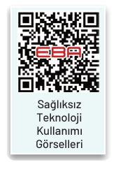
* Her yanlış davranış için öğrencilere şu soruları yöneltiniz:
    * Bu şekilde uzun süre çalışmak hangi sorunlara yol açabilir?
    * Siz bu durumu yaşamış olsaydınız ne hissederdiniz?
    * Bu davranışı nasıl düzeltmeliyiz?
* Ardından sınıfı ikişerli gruplara (sıra arkadaşı eşleşmesi) ayırınız. Öğrencilerin, sıra arkadaşlarının bilgisayar/ekran başındaki mevcut oturuş, dirsek ve boyun açılarını yansıtılan görsellerdeki hatalarla kıyaslayarak incelemelerini sağlayınız. Öğrencilerin birbirlerine “doğru duruş ve ideal açı” konusunda yapıcı geri bildirimler vermelerine rehberlik ederek sağlıklı oturuş pozisyonunu sınıfta fiziksel olarak deneyimlemelerini ve kalıcı bir dijital sağlık alışkanlığı geliştirmelerini teşvik ediniz.
* Gruplardan "Bilgisayarın Sağlıklı Kullanımı İçin 3 Öneri" başlıklı kısa listeler hazırlamalarını isteyiniz. Grupların fikirlerini sınıfta paylaşmalarını sağlayınız.
* Dersin sonunda sınıfça "Altın Kurallar" listesi çıkarınız (30 dakikada bir mola, doğru oturuş, ekran mesafesi, uygun ışık, göz egzersizi vb.).

Sağlıksız Teknoloji Kullanımı Görselleri

<!-- sayfa 21 -->

# Ara Değerlendirme

Etkinliklerin değerlendirilmeleri için Öz Değerlendirme Formu ve Öğretmen Gözlem Formu'ndan yararlanabilirsiniz.

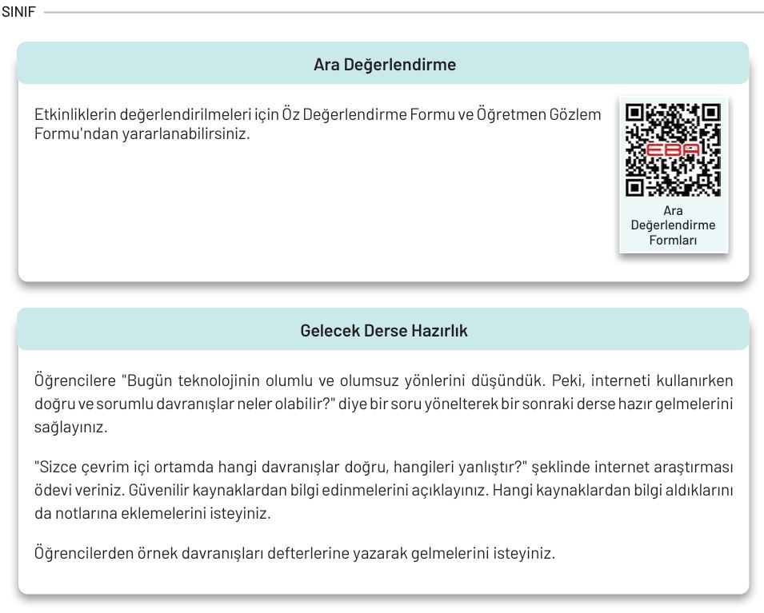: QR kod ve altında "Ara Değerlendirme Formları" metni.

# Gelecek Derse Hazırlık

Öğrencilere "Bugün teknolojinin olumlu ve olumsuz yönlerini düşündük. Peki, interneti kullanırken doğru ve sorumlu davranışlar neler olabilir?" diye bir soru yönelterek bir sonraki derse hazır gelmelerini sağlayınız.

"Sizce çevrim içi ortamda hangi davranışlar doğru, hangileri yanlıştır?" şeklinde internet araştırması ödevi veriniz. Güvenilir kaynaklardan bilgi edinmelerini açıklayınız. Hangi kaynaklardan bilgi aldıklarını da notlarına eklemelerini isteyiniz.

Öğrencilerden örnek davranışları defterlerine yazarak gelmelerini isteyiniz.

<!-- sayfa 22 -->

# DİJİTAL VATANDAŞLIK UYGULAMALARI

**Süre:**
2 ders saati

**Öğrenme Çıktıları**
BTY.5.1.3. Dijital vatandaşlık uygulamalarını sınıflandırabilme
a) Dijital kimlik kavramını belirler.
b) Dijital ayak izinin etkilerini bilişim teknolojilerinin kullanım alanları ile ilişkilendirir.
c) Dijital vatandaşlık uygulamalarını kullanım alanlarına göre gruplandırır.

**Dersten Önce**
* Dijital kimlik kavramını tanıtan kısa bir video seçiniz ve derste kullanmak üzere hazırlayınız.
* Dijital Kimlik Kartım şablonunu (kullanıcı adı, profil bilgileri, gizlilik ayarları vb. alanları içeren) çoğaltarak öğrencilere dağıtmaya hazır hâle getiriniz.
* Dijital ayak izi kavramını tanıtmak amacıyla kullanılabilecek örnek bir sunum veya 2-3 dakikalık kısa bir video hazırlayınız.
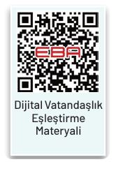
* Öğrencilere yönelteceğiniz beyin fırtınası ve tartışma sorularını belirleyiniz ("Dijital ortamdaki paylaşımlarımız bize nasıl geri dönebilir? Sizce internette yaptığımız paylaşımlar tamamen silinebilir mi?" vb.).
* Dijital Vatandaşlık Eşleştirme Uygulamasını hazırlayınız.
* Grupların dijital vatandaşlık uygulamalarını kullanım alanlarına göre sınıflandırma yapacakları poster etkinliği için renkli kartlar ve afiş kâğıtları hazırlayınız.
* Ölçme-değerlendirme sürecinde kullanılmak için Öz Değerlendirme ve Öğretmen Gözlem Formu'nu önceden hazırlayınız.

**Dikkat Çekme**
Aşağıdaki soruları öğrencilere yöneltiniz.
* Bir paylaşım yapmadan önce kendimize “Bu paylaşımı kimler görebilir?” diye sormak, gelecekte karşılaşabileceğimiz durumları nasıl etkileyebilir?
* Çevrim içi ortamlarda sergilediğimiz olumlu ya da olumsuz bir davranışın, ekranın diğer tarafındaki insanlar üzerinde ne gibi etkileri olabilir?
* İnternete yüklediğimiz bir fotoğrafı daha sonra silsek bile, o fotoğrafın tamamen yok olduğunu söyleyebilir miyiz? Bu durum nasıl sonuçlar doğurabilir?
* Günlük hayatta interneti kullanırken arkamızda ne tür dijital izler bırakıyoruz? Sizce bu izler gelecekte yaşamımızı nasıl etkileyebilir?
* Bir çevrim içi oyun oynarken, e-posta gönderirken veya sosyal bir platformda vakit geçirirken neden farklı kimlikler veya davranışlar sergileme ihtiyacı duyarız?
* Bir arkadaşınız adınızı arama motorunda arattığında hakkınızda neler bulabilir? Bu bilgilerin herkes tarafından erişilebilir olmasının ne gibi sonuçları olabilir?
* Dijital profilimizde hangi bilgileri paylaşmak sakıncalı değildir? Peki; adres, okul adı veya telefon numarası gibi kritik bilgileri paylaşmanın ne gibi riskleri olabilir?
* Okul platformlarını (örneğin EBA) kullanırken sergilediğimiz dijital vatandaşlık davranışları ile eğlence veya oyun platformlarındaki davranışlarımız arasında ne gibi farklar olmalıdır?

<!-- sayfa 23 -->

* İnternette başkasına ait bir içeriği (fotoğraf, video, yazı vb.) paylaşırken nelere dikkat etmeliyiz? Bu durumun etik ve adil olması için nasıl davranabiliriz?
* Gerçek hayatta bizi tanıtan kimlik kartımız ile dijital dünyada bizi temsil eden profilimiz arasındaki en belirgin farklar ve benzerlikler nelerdir?

## Ders Süreci

* Öğrencilere dijital kimlik kavramını tanıtan kısa bir video izletiniz. Bu videoda dijital kimlikle ilgili hangi bilgileri fark edeceğini not almalarını isteyiniz. Videodan sonra öğrencilere ne anladıklarını sorunuz ve onlara Dijital kimlik nedir?» sorusu üzerinden beyin fırtınası yaptırınız. Öğrencilerin paylaşımlarını tahtaya yazınız ve farklı görüşlerin tartışılmasına fırsat veriniz. Öğrencilere sosyal medya hesapları, oyun hesapları ve diğer çevrim içi platformlardaki varlıklarının dijital kimlikleri olduğu belirtilir.
* Ardından öğrencilerin dijital kimliği somutlaştırabilmeleri için Dijital Kimlik Kartım etkinliğini uygulayınız. Etkinlik çıktısını öğrencilere dağıtınız. Kart üzerinde kullanıcı adı, profil bilgileri, gizlilik ayarları gibi alanlar yer almalıdır. Öğrencilerden bu bileşenleri doldurmalarını ve kendi dijital kimliklerini oluşturmalarını isteyiniz. Öğrencilerin, bu etkinlik kapsamında dijital kimlik bileşenlerini ilişkilendirerek kendi dijital kimliklerini oluşturmalarını; dijital ayak izinin etkilerini, bilişim teknolojilerinin kullanım alanlarıyla ilişkilendirerek sorumluluk bilinciyle değerlendirme yapmalarını sağlayınız. Öğrencilerin dijital kimliklerinin hangi alanlarda etkili olabileceğini tartışmalarına rehberlik ediniz.
* Etkinlik sonrasında dijital kimlik kavramının önemli noktalarını özetleyiniz. Öğrencilere dijital vatandaşlık kavramının ne anlama geldiğini ve neden önemli olduğunu açıklayan bir sunum yapınız. Bu sunuda dijital vatandaşlık, sosyal medya, çevrim içi güvenlik, dijital iletişim ve çevrim içi etik gibi konulara yer veriniz. Etkileşimli tahtada arama motoruna kendi ad ve soyadınızı yazarak arama işlemini gerçekleştiriniz. Arama motoru sonuçları üzerinden dijital ortamda paylaşılan bilgilerin internette uzun süre kalabildiği ve herkes tarafından görülebildiği üzerinde durunuz. Dijital ayak izini tanıtan bir sunu veya video aracılığıyla “dijital ayak izi” kavramını tanıtınız. Öğrencilere dijital izlerin kalıcı olabileceğini ve paylaşım yaparken dikkatli davranmanın önemini tartışmaları için fırsat sununuz. Bu tartışma sürecinde, açık fikirlilikle farklı bakış açılarına saygı gösterilmesini sağlayınız, sorgulama ve anlamaya yönelik sorular sorarak öğrencilerin konuyu daha derinlemesine keşfetmelerini teşvik ediniz.
* Öğrencilere dijital ayak izi testi çalışma kâğıdı dağıtınız. Çalışmada, sosyal medyada gizlilik ihlali durumunda ne gibi sonuçlarla karşılaşabileceklerini belirlemelerini isteyiniz. Bu gibi durumlarda aile, öğretmen, okul rehberlik servisi, Bilgi Teknolojileri ve İletişim Kurumu (BTK) gibi güvenilir kaynaklara başvurabileceklerini öğrencilere açıklayınız.
* Öğrencilere Dijital Vatandaşlık Eşleştirme uygulamasını yaptırınız. Ardından sınıfta tarafsızlığı ve heterojenliği sağlamak amacıyla rastgele grup oluşturma tekniklerinden biri olan «Renk Kartları» yöntemini kullanınız (Öğrencilerin torbadan rastgele çektikleri renklere göre gruplara ayrılmasını sağlayınız). Oluşan her gruba farklı bir kullanım alanı (eğitim, sosyal medya, sağlık, kamu hizmetleri vb.) veriniz ve dijital vatandaşlığın bu alanlardaki uygulamalarını araştırarak bir poster çalışması hazırlamalarını isteyiniz. Bu süreçte, öğrencilerin dijital vatandaşlıkla ilgili kavramları araştırmaları sırasında öğretmen rehberliğinde yapay zekâ destekli bilgi kaynaklarının (örneğin güvenli içerik filtrelerine sahip yapay zekâ destekli kütüphaneler veya eğitim amaçlı sohbet botları) sınırlı ve kontrollü biçimde kullanılmasına rehberlik ediniz. Öğrencilerin, yapay zekâdan elde edilen bilgilerin güvenilirliği üzerine düşünmelerini teşvik ediniz. Öğrencilerin posterlerinde görsel ve yazılı anlatımı birlikte kullanmalarına, dijital vatandaşlık uygulamalarını kendi kullanım alanlarına göre sınıflandırmalarına ve posterlerini sınıfa sunmalarına rehberlik ediniz. Diğer grupların ise sorular yönelterek tartışmaya katılmalarını teşvik ederek süreç boyunca öğrencileri yapıcı iletişim kurmaya ve saygılı bir tartışma ortamını sürdürmeye yönlendiriniz.

<!-- sayfa 24 -->

☐ Grup değerlendirmesi ile öğrencilerin iş birliği becerileri ve etkinlik sürecindeki katkılarını izleyiniz. Öz Değerlendirme ve Akran Değerlendirme Formu'nu kullanarak geri bildirim veriniz. Poster çalışmalarını dereceleme ölçeği ile (kavram doğruluğu, açıklayıcılık, görsel düzen vb.) değerlendiriniz. Dijital vatandaşlık ve dijital ayak izi kavramlarını anlama düzeylerini Frayer Modeli veya Dereceli Puanlama Anahtarı ile ölçünüz; tanım, özellik, örnek ve örnek olmayan durumlar üzerinden kavramsal geri bildirim sununuz. Alternatif olarak qr kodda yer alan "Dijital Vatandaş Sürükle Bırak" etkinliğini kullanabilirsiniz.

<!-- sayfa 25 -->

# Etkinlik 6

| | |
| :--- | :--- |
| **Etkinlik Adı:** | Dijital Kimlik Kartım |
| **Etkinlik Süresi:** | 20 dk. |
| **Etkinlik Türü:** | Bireysel Etkinlikler |
| **Yöntem ve Teknikler:** | • Beyin fırtınası • Görüş geliştirme |
| **Materyaller:** | Dijital kimlik kartı şablonu (kullanıcı adı, profil fotoğrafı, gizlilik ayarları, güçlü şifre örneği, çevrim içi davranışlar gibi alanları içeren), Renkli kalemler veya dijital kimlik formu |
| **Etkinlik Açıklaması:** | Öğrenciler, dijital kimlik kavramını somutlaştırmak için kendi "Dijital Kimlik Kartlarını" oluşturacaktır. Kart üzerinde yer alan alanları doldurarak sosyal medya, oyun veya çevrim içi platformlarda sahip oldukları kimlik özelliklerini tanımlayacak; gizlilik ve güvenlik ayarlarını nasıl yapmaları gerektiğini tartışacaklardır. |

**Uygulama Aşamaları:**

* Öğrencilere dijital kimliğin, çevrim içi ortamlardaki varlıklarımızı ve bıraktığımız izleri temsil ettiğini açıklayınız.
* Her öğrenciye Dijital Kimlik Kartım şablonunu dağıtınız.
* Kartta yer alan alanları (kullanıcı adı, profil fotoğrafı, gizlilik ayarları, güçlü şifre, çevrim içi davranış kuralları vb.) doldurmalarını isteyiniz.
* Gizlilik amacıyla öğrencilerin profil fotoğrafı ve kullanıcı adını anonim, hayali veya avatar tabanlı seçmelerini öneriniz.
* Öğrencilerin çalışmayı bireysel olarak yapmalarını sağlayınız. İsteyen öğrencilerin kendi kartlarını sınıfta paylaşmalarına fırsat veriniz.
* Paylaşımlar sonrasında, öğrencilerle birlikte dijital kimliğin doğru yönetilmediğinde ne tür riskler doğurabileceğini (siber zorbalık, gizlilik ihlali, yanlış bilgi paylaşımı vb.) tartışınız.
* Öğrencilerin kartlarını saklamalarını ve ilerleyen haftalarda "dijital ayak izi" ve "dijital vatandaşlık" konularıyla bağlantı kurmalarını sağlayınız.

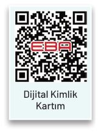

<!-- sayfa 26 -->

# Etkinlik 7

| | |
| :--- | :--- |
| **Etkinlik Adı:** | Dijital Ayak İzi Testi & Poster Çalışması |
| **Etkinlik Süresi:** | ⌛ 30 dk. |
| **Etkinlik Türü:** | 👥 Grup Etkinlikleri |
| **Yöntem ve Teknikler:** | • Bireysel Çalışma • Grup Çalışması • Sunum |
| **Materyaller:** | "Dijital Ayak İzi Testi" çalışma kâğıdı (gizlilik ayarları, hangi bilgilerin paylaşıldığı riskli durumlar vb.), Renkli karton, A3 kâğıt veya dijital poster hazırlama araçları, Renkli kalemler/çıkartmalar, Tahta veya etkileşimli tahta |
| **Etkinlik Açıklaması:** | Öğrenciler bu etkinlikte dijital vatandaşlık uygulamalarını sınıflandırmayı öğrenirken sorumluluk bilinci geliştireceklerdir. |

**Uygulama Aşamaları:**

* Öğrencilere "Dijital Ayak İzi Testi" çalışma kâğıdını dağıtınız.
* Öğrencilerden gizlilik, güvenlik ve paylaşımlarıyla ilgili soruları cevaplamalarını isteyiniz.
* Test tamamlandıktan sonra öğrencileri 4–5 kişilik gruplara ayırınız. Gruplardan test sonuçlarını tartışmalarını ve hangi davranışların güvenli/daha az güvenli olduğunu belirlemelerini isteyiniz.
* Her gruba bir kullanım alanı veriniz (sosyal medya, eğitim, sağlık, çevrim içi alışveriş, oyun vb.). Gruplardan dijital vatandaşlık uygulamalarını bu alanlara göre sınıflandırarak bir poster hazırlamalarını isteyiniz.
* Gruplar hazırladıkları posteri sınıfta sunar. Sunum sırasında diğer gruplar soru sorar ve yapıcı geri bildirim verir.
* Öğretmen, öğrencilerini farklı görüşlere saygılı ve açık fikirli olmaya teşvik eder.

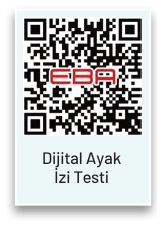

<!-- sayfa 27 -->

# Ara Değerlendirme

Değerlendirme sürecinde öğrencilerin çalışmalarını Öz Değerlendirme ve Öğretmen Gözlem Formları ile takip ediniz. Alternatif olarak Frayer Uygulama Etkinliğini kullanabilirsiniz.

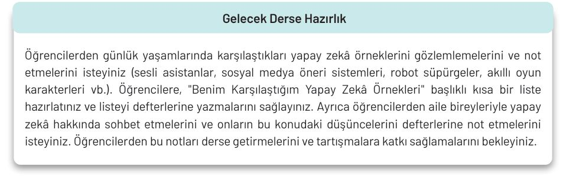

# Gelecek Derse Hazırlık

Öğrencilerden günlük yaşamlarında karşılaştıkları yapay zekâ örneklerini gözlemlemelerini ve not etmelerini isteyiniz (sesli asistanlar, sosyal medya öneri sistemleri, robot süpürgeler, akıllı oyun karakterleri vb.). Öğrencilere, "Benim Karşılaştığım Yapay Zekâ Örnekleri" başlıklı kısa bir liste hazırlatınız ve listeyi defterlerine yazmalarını sağlayınız. Ayrıca öğrencilerden aile bireyleriyle yapay zekâ hakkında sohbet etmelerini ve onların bu konudaki düşüncelerini defterlerine not etmelerini isteyiniz. Öğrencilerden bu notları derse getirmelerini ve tartışmalara katkı sağlamalarını bekleyiniz.

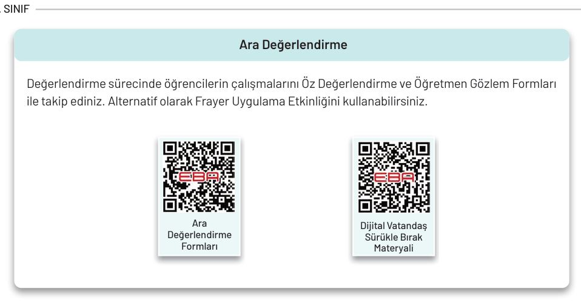

<!-- sayfa 28 -->

# YAPAY ZEKÂDA TEMEL KAVRAM VE ÖZELLİKLER

**Süre:**
2 ders saati

**Öğrenme Çıktıları**
BTY.5.1.4. Yapay zekâ ile ilgili temel kavramları ve özellikleri sorgulayabilme
a) Yapay zekâ ile ilgili temel kavram ve özelliklere ilişkin merak ettiği konuları tanımlar.
b) Yapay zekâ ile ilgili temel kavram ve özellikleri hakkında sorular sorar.

**Dersten Önce**
* Yapay Zekâ ile Tanışıyorum sunumunu hazırlayınız.
* "Yapay zekâ kavramı" ile ilgili öğrencilerin akıllarına gelen kelimeleri ortaklaşa yazabilecekleri bir dijital pano veya alternatif olarak Yapay Zekâ Ortak Kavram Panosu Sürükle Bırak oyununu hazırlayınız.
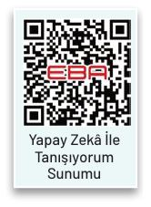
* Öğrencilerle birlikte oynamak üzere Frayer Yapay Zekâ Sürükle Bırak oyununu hazır hâle getiriniz (tanım, özellikler, örnekler, örnek olmayanlar).
* Ölçme ve değerlendirme süreci için Öğretmen Gözlem ve Öz Değerlendirme Formu'nu önceden hazırlayınız.
* Öğrencilerin yapay ve doğal zekâ arasındaki farklılıkları tartışabilecekleri görsel materyaller (karşılaştırma tabloları, kısa metin kartları) hazırlayınız.

**Dikkat Çekme**
Aşağıdaki soruları öğrencilere yönelterek yanıtlamalarını isteyiniz.
* Makineler sizce karar verirken veya sorun çözerken insan gibi düşünebilir mi? Neden?
* Günlük yaşamınızda karşılaştığınız yapay zekâ örnekleri neler olabilir?
* Bir robotla arkadaşlık etseydiniz bu robotun hangi özelliklere sahip olmasını isterdiniz?
* Yapay zekâ hangi durumlarda faydalı olur, hangi durumlarda risk oluşturabilir? Örnek veriniz.
* İnsan zekâsıyla yapay zekâ arasında nasıl farklar olabilir?

**Ders Süreci**
☐ Öğrencilere “Sizce makineler düşünebilir mi?” sorusu yöneltilerek beyin fırtınası yapmaları sağlanır (Makineler Düşünebilir mi? Beyin Fırtınası Etkinliği). Yaratıcılık ve özgün bakış açılarını kullanarak ilginç ve farklı fikirler üretip cevap vermeleri beklenir. Öğrencilerin çeşitli fikir ve argümanlara açık olmaları için farklı bakış açılarıyla düşünmeleri teşvik edilir. Örneğin bir öğrenci yapay zekânın insan gibi düşünebileceğini savunurken, bir başkası bunun mümkün olmadığını belirterek kendi gerekçelerini ortaya koyabilir.

☐ Öğrencilerin görüşleri alındıktan sonra yapay zekâya ilişkin kısa ve günlük hayattan örnekler verilir (sesli asistanlar, yüz algılama ve tanıma uygulamaları, otonom arabalar vb.) (Yapay Zekâ Nerede? Tartışma Etkinliği). Örneklerdeki yapay zekâ uygulamaları ile nerelerde karşılaştıkları ve bu uygulamalardan nasıl faydalandıklarını düşünüp ifade etmeleri istenir. Yapay zekânın tanımı sade ve anlaşılır bir şekilde yapılır. Yapay zekâ ve makinelerin düşünme yetenekleri ile ilgili sunum izletilir; teknolojik altyapı mevcut değilse sununun sayfa görüntülerinin çıktıları alınarak tahtaya asılır.

<!-- sayfa 29 -->

☐ “Yapay Zekâ” başlığı, dijital bir beyaz tahta ekranına yansıtılır. Öğrencilerden kendi düşünceleri doğrultusunda, özgürce seçim yaparak bu kavramla ilgili akıllarına gelen terimleri kendi bilgisayarlarından ortak dijital panoya yazmaları istenir (Ortak Kavram Panosu Etkinliği / Yapay Zekâ Ortak Kavram Panosu Sürükle Bırak materyali). Her öğrenci, yapay zekâ ile ilgili daha önce gördüğü ya da duyduğu bir örneği sözlü olarak veya kısa yazılı bir notla paylaşır. Öğrenciler, yazdıkları terimler ve paylaştıkları örnekler doğrultusunda yapay zekânın tanımını yapar. Cümleler dijital pano üzerinde toplanarak sınıfın ortak tanımı oluşturulur.

☐ Öğrencilerde sorgulayıcı bakış açısını geliştirmek amacıyla 'Kendi Tanımımı Yapıyorum' adlı yansıtıcı düşünme etkinliğine geçiniz. Onlara sunulan yapay zekâ görselleri veya senaryoları üzerine odaklanmalarını isteyiniz. Gruplardan, bu senaryolar çerçevesinde 'Neden?', 'Nasıl?' ve 'Ne zaman?' sorularını üretmeleri istenerek konuyu derinlemesine analiz etmelerini sağlayınız. Hazırlanan soruların sınıf paylaşımına açılmasıyla birlikte, farklı bakış açıları üzerinden ortak bir tartışma ortamı oluşturunuz. Tartışmalar sonrası ulaşılan çıkarımlar ışığında, öğrencilerin yapay zekâ kavramını kendi cümleleriyle anlamlandırmaları beklenir. Etkinliği, her öğrencinin yapay zekâya yönelik özgün tanımını topluluk önünde sözlü olarak ifade etmesiyle ve kazanımların pekiştirilmesiyle sonlandırınız.

<!-- sayfa 30 -->

# Etkinlik 8

**Etkinlik Adı:** "Makineler Düşünebilir mi?" Beyin Fırtınası

**Etkinlik Süresi:** 10 dk.

**Etkinlik Türü:** Grup Etkinlikleri

**Yöntem ve Teknikler:**
* Beyin Fırtınası
* Tartışma Yöntemi
* Soru-Cevap

**Materyaller:** Tahta veya etkileşimli tahta, Renkli tahta kalemleri

**Etkinlik Açıklaması:** Bu etkinlik, öğrencilerin yapay zekâ hakkındaki ilk düşüncelerini özgürce ifade etmelerine fırsat verecektir. Öğrenciler farklı fikirlerini ortaya koyacak, birbirlerinin görüşlerini dinleyecek ve tartışmada nezaket kurallarını gözeterek düşüncelerini geliştireceklerdir.

**Uygulama Aşamaları:**

* Öğrencilere "Sizce makineler düşünebilir mi?" sorusunu yöneltiniz.
* Öğrencilerin cevaplarını dikkatle dinleyiniz ve farklı fikirlerin oluşmasını teşvik ediniz.
* Gelen görüşleri tahtaya veya dijital panoya yazınız.
* Tartışma sırasında öğrencilerin birbirlerinin fikirlerine saygı göstermelerini hatırlatınız.
* Öğrencilerin paylaşımlarından hareketle beyin fırtınasını özetleyiniz ve etkinliği tamamlayınız.

<!-- sayfa 31 -->

# Etkinlik 9

| | |
| :--- | :--- |
| **Etkinlik Adı:** | "Yapay Zekâ Nerede?" Tartışma Etkinliği |
| **Etkinlik Süresi:** | ⌛ 10 dk. |
| **Etkinlik Türü:** | 👥 Grup Etkinlikleri |
| **Yöntem ve Teknikler:** | • Tartışma Yöntemi • Beyin Fırtınası • Soru-Cevap |
| **Materyaller:** | Tahta veya etkileşimli tahta, Günlük yaşamdan yapay zekâ örneklerinin yer aldığı görseller (sesli asistan, otonom araç, yüz tanıma sistemi, çevrim içi öneri sistemleri vb.) |
| **Etkinlik Açıklaması:** | Bu etkinlik, öğrencilerin günlük yaşamda karşılaştıkları yapay zekâ uygulamalarını fark etmelerini sağlayacaktır. Öğrenciler kendi deneyimlerini sınıfla paylaşacak, farklı kullanım alanlarını tanıyacak ve yapay zekânın hayatlarına etkilerini tartışacaklardır. |

**Uygulama Aşamaları:**

* Öğrencilere günlük yaşamda kullanılan yapay zekâ örneklerini (örneğin sesli asistanlar, yüz tanıma sistemleri, otonom araçlar, çevrim içi öneri sistemleri) gösteriniz.
* "Bu uygulamalarla hiç karşılaştınız mı? Nerede ve nasıl kullandınız? Karşılaşmadıysanız uygulamalar sizce hangi alanlarda kullanılabilir?" sorularını yöneltiniz.
* Öğrencilerden sözlü paylaşım yapmalarını veya cevaplarını küçük not kartlarına yazarak katkıda bulunmalarını isteyiniz.
* Cevapları tahtaya yazarak farklı alanlarda kullanılan yapay zekâ uygulamalarını listeleyiniz.
* Tartışmayı özetleyiniz, yapay zekânın günlük yaşamla nasıl ilişkili olduğunu vurgulayınız.

<!-- sayfa 32 -->

# Etkinlik 10

**Etkinlik Adı:** Ortak Kavram Panosu Sürükle–Bırak Oyunu

**Etkinlik Süresi:** 15 dk.

**Etkinlik Türü:** Grup Etkinlikleri

**Yöntem ve Teknikler:**
* Oyunlaştırma
* Tartışma
* Soru-Cevap

**Materyaller:** Etkileşimli tahta veya bilgisayar, projeksiyon, “Yapay Zekâ Örnek/Örnek olmayan/Emin Değilim” başlıklı dijital pano (sürükle–bırak oyunu arayüzü), yapay zekâ ile ilgili kavram kartları (robot süpürge, sesli asistan, yüz tanıma, hava durumu uygulaması, bisiklet, kitap, insan zekâsı vb.)

**Etkinlik Açıklaması:** Bu etkinlik, öğrencilerin yapay zekâya ilişkin doğru ve yanlış örnekleri ayırt etmelerine yardımcı olacaktır. Öğrenciler kartlarda verilen nesne ve kavramları inceleyerek “Örnek”, “Örnek Olmayan” ve “Emin Değilim” panolarına sürükleyip bırakacaklardır. Böylece öğrenciler kavramlar üzerinde tartışacak, yapay zekâya dair sınırları sorgulayacak ve ortak bir tanım oluşturacaklardır.

**Uygulama Aşamaları:**

* Dijital panoya “YAPAY ZEK” başlığını yazınız veya oyun ekranını sınıfa yansıtınız.
* Öğrencilere sürükle–bırak oyununun kurallarını açıklayınız:
    * Yeşil alan: Yapay zekâ örnekleri
    * Kırmızı alan: Yapay zekâ olmayan örnekler
    * Gri alan: Emin olunmayan, tartışmalı örnekler
    * Bu renklerle birlikte simgeler de ekleyebilirsiniz.

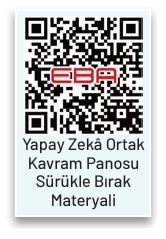

* Öğrencilere sırayla kavram kartlarını (örneğin robot süpürge, sesli asistan, yüz tanıma sistemi, hesap makinesi, analog saat, öneri sistemleri, insan zekâsı vb.) gösteriniz. Bu etkinliği benzer örnekleri baskı alarak bilgisayarsız etkinlik olarak da uygulayabilirsiniz.
* Kartların doğru alana sürüklenmesi için öğrencilerin fikirlerini tartışmalarını sağlayınız.
* “Emin Değilim” alanına gelen kartlar üzerinden sınıf tartışması yaparak öğrencilerin neden tereddüt ettiklerini açıklamalarını isteyiniz.
* Tüm kartlar yerleştirildikten sonra panoyu sınıfla değerlendiriniz.
* Oyun tamamlandıktan sonra panodaki dağılım üzerinden sınıfın ortak bir yapay zekâ tanımının amaç, yöntem, örnek açısından oluşturmasına rehberlik ediniz.
* Elde edilen tanımı tahtaya yazınız ve dersin sonunda kısa bir özet yapınız.

<!-- sayfa 33 -->

# Etkinlik 11

| | |
| :--- | :--- |
| **Etkinlik Adı:** | Yapay Zekâyı Keşfediyorum – Frayer Modeli Sürükle Bırak Oyunu |
| **Etkinlik Süresi:** | 20 dk. |
| **Etkinlik Türü:** | Grup Etkinlikleri |
| **Yöntem ve Teknikler:** | • Sorgulama • İş birlikli Öğrenme |
| **Materyaller:** | Etkileşimli tahta veya bilgisayar–projeksiyon sistemi, Hazırlanmış Frayer modeli sürükle–bırak oyunu (bölümler: Tanım, Özellikler, Örnekler, Örnek Olmayanlar), Etkileşimli oyun yerine fiziksel oynamak istenirse yapay zekâya ilişkin kavram ve örnek kartları (robot süpürge, sesli asistan, akıllı telefon öneri sistemi, insan zekâsı, masa, defter, bulut bilişim vb.) |
| **Etkinlik Açıklaması:** | Öğrenciler, yapay zekâ kavramını derinlemesine anlamak için Frayer modeli çerçevesinde hazırlanmış bir sürükle–bırak oyunu oynayacaktır. Öğrenciler kartları doğru bölümlere sürükleyerek yapay zekânın tanımını, özelliklerini, örneklerini ve örnek olmayanlarını keşfedecektir. Bu etkinlik sayesinde öğrenciler kavramın sınırlarını netleştirecek ve eleştirel düşünme becerilerini geliştirecektir. |

**Uygulama Aşamaları:**

* Frayer modeli oyun ekranını tahtaya yansıtınız. Dört bölümü tanıtınız: tanım, özellikler, örnekler, örnek olmayanlar.
* Gönüllü öğrencileri kavram kartlarını sürükleyip bırakmaları için tahtaya kaldırınız. Tüm kartların açıklamaları açıldığında etkinliği sonlandırınız.
* Yanlış veya tartışmalı seçimlerde sınıfa sorular yönelterek birlikte değerlendirme yapınız.
* Özellikle "örnek olmayanlar" kısmına bırakılan kartların neden uygun olmadığını öğrencilerden gerekçelendirmelerini isteyiniz.
* Öğrencilerin "tanım" alanına yapay zekânın tanımını kendi cümleleriyle yazmalarını sağlayınız.
* Süreç sonunda panodaki tüm alanları birlikte gözden geçiriniz ve sınıfın ortak öğrenme çıktısını özetleyiniz.

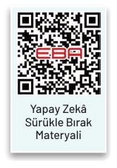

<!-- sayfa 34 -->

# Etkinlik 12

| | |
| :--- | :--- |
| **Etkinlik Adı:** | Kendi Tanımımı Yapıyorum |
| **Etkinlik Süresi:** | ⌛ 10 dk. |
| **Etkinlik Türü:** | 👤 Bireysel Etkinlikler |
| **Yöntem ve Teknikler:** | • Yansıtıcı Düşünme |
| **Materyaller:** | Öğrenci defterleri, Tahta veya dijital pano |
| **Etkinlik Açıklaması:** | Bu etkinlik ile öğrenciler; yapay zekâ uygulamalarını tanıyarak günlük yaşamla ilişkilendirir, sorgulayıcı düşünme becerilerini geliştirir ve farklı bakış açılarıyla düşünmeyi öğrenir. Grup çalışması yoluyla iletişim, paylaşma ve ortak ürün oluşturma becerileri kazanır; yapay zekâ kavramına yönelik anlamlandırmalarını derinleştirir. |

**Uygulama Aşamaları:**

* Öğrencileri küçük gruplara ayırınız.
* Her gruba bir yapay zekâ görseli veya senaryo veriniz.
* Gruplardan “Neden?”, “Nasıl?” ve “Ne zaman?” soruları üretmelerini isteyiniz.
* Grupların hazırladıkları soruları sınıfla paylaşmalarını sağlayınız.
* Öğrencilerden, paylaşılan sorular ve tartışmalar doğrultusunda yapay zekâ ile ilgili çıkarımlar yapmalarını isteyiniz.
* Etkinliği, öğrencilerin yapay zekâyı nasıl tanımladıklarını sözlü olarak ifade etmelerini sağlayarak sonlandırınız.

<!-- sayfa 35 -->

# Ara Değerlendirme

Etkinliklerin değerlendirilmeleri için Öğretmen Gözlem Formu ve Öz Değerlendirme Formu'ndan yararlanabilirsiniz

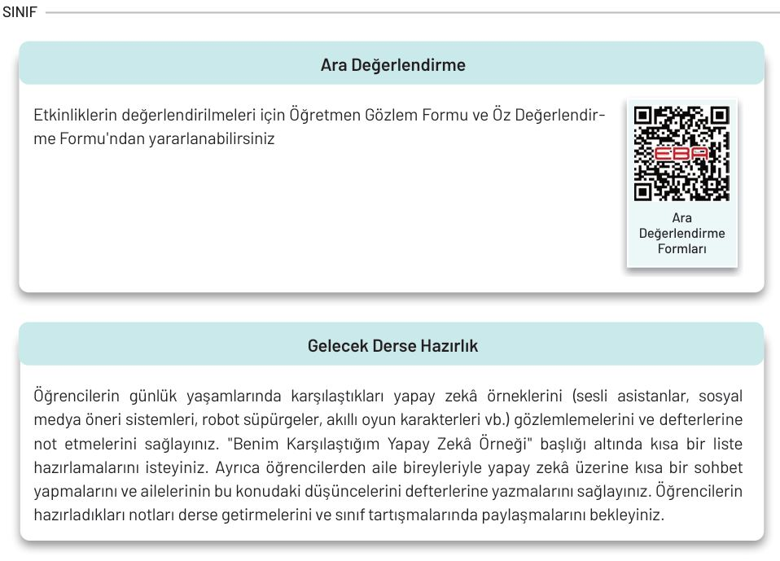

# Gelecek Derse Hazırlık

Öğrencilerin günlük yaşamlarında karşılaştıkları yapay zekâ örneklerini (sesli asistanlar, sosyal medya öneri sistemleri, robot süpürgeler, akıllı oyun karakterleri vb.) gözlemlemelerini ve defterlerine not etmelerini sağlayınız. "Benim Karşılaştığım Yapay Zekâ Örneği" başlığı altında kısa bir liste hazırlamalarını isteyiniz. Ayrıca öğrencilerden aile bireyleriyle yapay zekâ üzerine kısa bir sohbet yapmalarını ve ailelerinin bu konudaki düşüncelerini defterlerine yazmalarını sağlayınız. Öğrencilerin hazırladıkları notları derse getirmelerini ve sınıf tartışmalarında paylaşmalarını bekleyiniz.

<!-- sayfa 36 -->

# YAPAY ZEKÂDA TEMEL KAVRAM VE ÖZELLİKLER

**Süre:**
2 ders saati

**Öğrenme Çıktıları**
BTY.5.1.4. Yapay zekâ ile ilgili temel kavramları ve özellikleri sorgulayabilme
a) Yapay zekâ ile ilgili temel kavram ve özellikler hakkında bilgi toplar.
b) Yapay zekâ ile ilgili temel kavram ve özellikler hakkında toplanan bilgilerin doğruluğunu değerlendirir.
c) Yapay zekânın olası etkilerine ilişkin topladığı bilgiler üzerinden çıkarım yapar.

**Dersten Önce**
* Yapay ve doğal zekâ karşılaştırması için görsel tablo veya Yapay Zekâ–Doğal Zekâ oyununu hazırlayınız.
* Grupların poster çalışması için renkli kâğıt ve kalemler temin ediniz.
* Yapay Zekâ Tarihi videosunu veya alternatif olarak karelerin çıktısını hazır bulundurunuz.
* Öğrencilere dağıtmak üzere rol kartları (Turing, McCarthy vb.) düzenleyiniz.
* Poster Rubriği, Akran Poster- Sunum Değerlendirme Formu ve Öğretmen Gözlem Formu'nu önceden çoğaltınız.
* Çıkarım cümleleri ve posterler için EBA bilgi duvarında pano açınız.
* Doğal Zekâ Yapay Zekâ Sunumu'nu hazırlayınız.

**Dikkat Çekme**

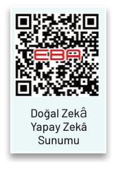
Yapay Zekâ
Doğal Zekâ
Oyunu Materyali

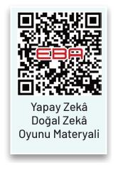
Doğal Zekâ
Yapay Zekâ
Sunumu

Aşağıdaki soruları öğrencilere yönelterek yanıtlamalarını isteyiniz.
* Bir makine yanlış yaptığında hatasından öğrenebilir mi? Neden?
* İnsan ile yapay zekâ arasındaki en temel fark nedir?
* Alan Turing, makinelerin insan gibi düşünüp düşünemeyeceğini tartışmaya açtı. Sizce bugün popüler olan yapay zekâları düşününce bu soruya nasıl cevap veririz?
* Aynı teknolojinin hem faydalı hem riskli olabileceğine bir örnek verebilir misiniz?

<!-- sayfa 37 -->

# Ders Süreci

* Öğrencilerin yapay zekâya ilişkin temel kavram ve özelliklerle ilgili soru sorma becerilerini gözlemlemek amacıyla grup değerlendirmesi yapınız. Yapay ve doğal zekâ arasındaki temel farkları anlatan sunumu yansıtınız veya altyapı mevcut değilse çıktıları alarak asınız. Karşılaştırmayı desteklemek amacıyla Yapay ve Doğal Zekâ Görsel Tablosunu veya “Yapay Zekâ - Doğal Zekâ" oyununu kullanınız. “Zekâ” ana başlığı altında yapay zekâ ve doğal zekâ alt başlıklarını tahtaya yazınız; öğrencilerden bu başlıklar altında düşüncelerini ve örneklerini yazmalarını ve tartışmalarını isteyiniz. Süreçte, öğrencilerin soru sorma ve tartışmaya katılım düzeylerini Öğretmen Gözlem Formu ile izleyiniz.

* Öğrenci gruplarından tartışmaları doğrultusunda poster hazırlamalarını isteyiniz (Grup Posteri: Benzerlikler ve Farklılıklar etkinliği). Posterlerde yapay ve doğal zekânın özelliklerini, farklılıklarını ve benzerliklerini görsel ve yazılı olarak ifade etmelerine rehberlik ediniz. Posterlerin değerlendirilmesinde Poster Rubriğini kullanınız. Her grubun hazırladığı posteri sınıfa sunmasını veya EBA bilgi duvarında paylaşmasını sağlayınız (Poster Sunumlar ve Soru-Cevap etkinliği). Sunumlar sırasında öğrencilerin birbirlerinin çalışmalarını Akran Poster – Sunum Değerlendirme Formu ile değerlendirmelerini isteyiniz.

* Öğrencileri beş-altı kişilik heterojen gruplara ayırınız. Her grubun “Yapay zekânın doğal zekâdan ne gibi farklılıkları vardır?” ve “Yapay zekâ doğal zekâ kadar başarılı olabilir mi?” sorularını tartışmak üzere araştırma yapmalarını isteyiniz. Teknolojik altyapı mevcut değilse yapay ve doğal zekâ konularını ele alan kısa metinleri ve bilgi kartlarını dağıtınız. Gruplardan ulaştıkları bilgileri değerlendirerek görüş oluşturmalarını ve tartışmalarını sağlayınız.

* Yapay zekânın tarihine dair bir video izletiniz veya altyapı yoksa videodan seçilmiş karelerin çıktıları ve yazılı özetler ile anlatımı yapınız. Öğrencilerden önemli noktaları belirlemelerini ve açıklamalarını isteyiniz. Ardından öğrencilerin farklı kaynaklardan bilgi toplamalarını sağlayınız, altyapı yoksa basılı kaynakları dağıtınız. Tahtaya yapay zekânın tarihsel gelişimini gösteren zaman çizelgesini çiziniz ve önemli olayları yazdırınız (Yapay Zekâ Tarihi ve Zaman Çizelgesi Etkinliği). 1950’de Alan Turing’in yayımladığı “Makineler Düşünebilir mi?” makalesi, 1959’da Cahit Arf’ın kaleme aldığı “Makine Düşünebilir mi ve Nasıl Düşünebilir?” makalesi, 1997’de bir bilgisayarın satrançta dünya şampiyonunu yenmesi ve 2016’da yapay zekânın Go oyununda dünya şampiyonunu mağlup etmesi gibi önemli gelişmeleri bu çizelgeye yazmalarını isteyiniz. Bu süreçte öğrencilerin belirli bir yöntemle düzenli ve odaklı bir şekilde yazmalarına rehberlik ediniz. Zaman çizelgesi çalışmalarında düzen, odaklanma ve özgünlüğü Poster Rubriği veya dereceleme ölçeği ile değerlendiriniz.

* Zaman çizelgesi çalışmasının ardından öğrencileri küçük gruplara ayırınız ve her gruba yapay zekâ tarihinin önemli isimlerinden (örneğin Alan Turing, John McCarthy) bir rol veriniz. Rol Canlandırma: Yapay Zekâ Öncüleri etkinliğini yapınız. Gruplardan bu kişileri canlandırmalarla tanıtmalarını isteyiniz. Öğrencilerin dönemin şartlarını göz önünde bulundurmalarını ve canlandırdıkları kişinin yapay zekâya yaptığı katkıyı anlatmalarını sağlayınız.

<!-- sayfa 38 -->

* Sonrasında öğrencilere Rol Kartları (Alan Turing, John McCarthy vb.) dağıtarak tarihsel figürleri canlandırmalarını isteyiniz; canlandırılan karakterlerin duygu ve düşüncelerine uygun anlatım yapmalarını teşvik ediniz (Rol Canlandırma: Yapay Zekâ Öncüleri Etkinliği). Karakter canlandırmaları sırasında motivasyon ve anlatım becerilerini Öğretmen Gözlem Formu ile izleyiniz. Öğrencilerin öz değerlendirme yapmalarını sağlayınız, grup içi katkı düzeylerini Akran Poster – Sunum Değerlendirme Formu ile de değerlendiriniz.

* Öğrencileri işbirlikli öğrenme gruplarına ayırınız ve her gruba doğru–yanlış Bilgi Kartları ile çalışma sayfası dağıtınız (Günlük Hayata Yapay Zekânın Etkileri Etkinliği). Öğrencilerin güvenilir kaynakları inceleyerek bilgilerin doğruluğunu değerlendirmelerini sağlayınız. Her grubun kararlarını sınıfa sunarak tartışmalarını isteyiniz. Ardından yapay zekânın iş gücü, eğitim, sağlık, tarım, turizm, sosyal medya ve eğlence alanlarındaki etkilerini içeren sunumu izletiniz veya çıktıları asınız. Gruplardan olumlu ve olumsuz etkileri çok yönlü değerlendirmelerini ve etik boyutları tartışmalarını isteyiniz. Ulaşılan sonuçlardan çıkarım yapmalarını sağlayınız ve süreci bilgi duvarı üzerinden geri bildirimlerle tamamlayınız. 

* Yapay zekânın iş gücü, eğitim, sağlık, tarım, turizm, sosyal medya ve eğlence alanlarındaki etkilerini ele alan sunumu izletiniz; teknolojik altyapı yoksa çıktıları asınız. Bu aşamada “Günlük Hayatta Yapay Zekânın Etkileri” Etkinliğini uygulayınız. Öğrencileri beş–altı kişilik heterojen gruplara ayırınız. Gruplardan “Yapay zekânın günlük hayattaki kullanım alanlarında olumlu ve olumsuz etkileri neler olabilir?” ve “Gelecekte yapay zekânın etkileri neler olabilir?” sorularını çok yönlü değerlendirmeler yaparak tartışmalarını isteyiniz. Tarımda ürün verimliliğinin artması, hastalık tespiti; turizmde dijital rehberlik ve kişiselleştirilmiş öneriler gibi örneklerle düşünmelerini yönlendiriniz. Yapay zekânın verimliliği artıran yönlerini takdir ederken etik riskleri de eleştirel bakışla incelemelerini sağlayınız. Grupların tartışmalarından çıkarım cümleleri oluşturmalarını isteyiniz (örneğin: “Yapay zekâ sağlıkta fayda sağlayabilir ancak bilinçli kullanılmalıdır.”). Öğrencilerin düşüncelerini nezaket çerçevesinde ifade etmelerine rehberlik ediniz. Değerlendirmeyi Dereceli Puanlama Anahtarı veya Bilgi Duvarı ile yapınız ve süreç odaklı geri bildirim veriniz.

<!-- sayfa 39 -->

# Etkinlik 13

**Etkinlik Adı:** Grup Posteri: Benzerlikler ve Farklılıklar

**Etkinlik Süresi:** 20 dk.

**Etkinlik Türü:** Grup Etkinlikleri

**Yöntem ve Teknikler:**
* Grup çalışması
* Beyin fırtınası
* Tartışma yöntemi
* Soru–cevap

**Materyaller:** Renkli A3 kâğıtları, Renkli kalemler, Tahta/pano (posterlerin sergilenmesi için), Yapıştırıcı/bant (opsiyonel)

**Etkinlik Açıklaması:** Bu etkinlikte öğrenciler, yapay zekâ ile doğal zekâ arasındaki benzerlik ve farklılıkları tartışarak görselleştireceklerdir. Gruplar, "Yapay zekâ algılama/dil/yaratıcılık vb. yönünden doğal zekâ kadar başarılı olabilir mi?" sorusu üzerinden fikir üretecek, tartışmalarını bir poster üzerinde görsel ve yazılı ögelerle ifade edeceklerdir.

**Uygulama Aşamaları:**

* Öğrencileri beş–altı kişilik rastgele gruplara ayırınız.
* Gruplara renkli A3 kâğıtları ve kalemler dağıtınız.
* Öğrencilere "Yapay zekâ algılama/dil/yaratıcılık vb. yönünden doğal zekâ kadar başarılı olabilir mi?" sorusunu yöneltiniz.
* Gruplardan yapay zekâ ile doğal zekânın benzerlik ve farklılıklarını tartışmalarını isteyiniz.
* Tartışma sonuçlarını poster hâline getirmelerini sağlayınız.
* Posterlerin hem yazılı ifadeler hem de görsel semboller içermesine dikkat ediniz.
* Etkinlik sonunda gruplardan posterlerini sınıfta sergilemelerini veya EBA bilgi duvarına yüklemelerini sağlayınız.

<!-- sayfa 40 -->

# Etkinlik 14

**Etkinlik Adı:** Poster Sunumları ve Soru-Cevap

**Etkinlik Süresi:** ⌛ 20 dk.

**Etkinlik Türü:** 👥 Grup Etkinlikleri

**Yöntem ve Teknikler:**
* Sunum
* Soru-cevap
* Tartışma

**Materyaller:** Grupların hazırladığı posterler, EBA bilgi duvarı (posterlerin dijital paylaşımı için), Akran Değerlendirme Formu

**Etkinlik Açıklaması:** Bu etkinlik, öğrencilerin eleştirel düşünme, iletişim ve akran etkileşimi becerilerini geliştirmeyi amaçlar. Gruplar hazırladıkları posterleri sınıfta sunar, görüşlerini paylaşır ve diğer öğrenciler soru sorup yorum yaparak tartışmaya katılır.

**Uygulama Aşamaları:**

* Gruplara hazırladıkları posterleri sınıf önünde sergilemeleri için zaman veriniz.
* Her gruba 1-2 dakikalık sunum süresi tanıyınız.
* Sunum sırasında öğrencilerden diğer grupların posterleri hakkında sorular sormalarını isteyiniz.
* Öğrencilerin arkadaşlarının fikirlerini geliştirecek şekilde yorum yapmalarını teşvik ediniz.
* Posterlerin EBA bilgi duvarına yüklenmesini sağlayınız.
* Grupların birbirlerine yapıcı geri bildirim vermelerine imkân tanıyınız, öğrencilerden Akran Değerlendirme Formu'nu doldurmalarını isteyiniz.
* Etkinliği, tartışmadan çıkan ortak noktaları vurgulayarak tamamlayınız.

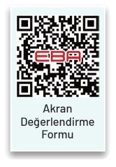

<!-- sayfa 41 -->

# Etkinlik 15

**Etkinlik Adı:** Yapay Zekâ Tarihi ve Zaman Çizelgesi

**Etkinlik Süresi:** 15 dk.

**Etkinlik Türü:** Grup Etkinlikleri

**Yöntem ve Teknikler:** Tartışma

**Materyaller:** Yapay zekâ tarihini anlatan kısa video, Yazı tahtası/etkileşimli tahta, Öğrenci defterleri, Kalemler

**Etkinlik Açıklaması:** Bu etkinlik, öğrencilerin yapay zekâ tarihindeki önemli dönüm noktalarını tanımalarını ve kronolojik düşünme becerilerini geliştirmelerini sağlayacaktır. Öğrenciler, verilen video veya yazılı materyalden elde ettikleri bilgileri zaman çizelgesi hâline getirecek ve defterlerine not edeceklerdir.

**Uygulama Aşamaları:**

* Öğrencilere yapay zekâ tarihini tanıtan kısa bir video izletiniz.
* Teknolojik altyapı yoksa videodan karelerin açıklamalarını veya özetini tahtaya asınız.
* Öğrencilerden videodaki yapay zekâ dönüm noktalarını ve etkili keşifleri belirlemelerini isteyiniz.
* Tahtaya yatay bir zaman çizelgesi çiziniz ve dönüm noktalarını sınıfla birlikte ekleyiniz.
    * 1950: Alan Turing – "Makineler düşünebilir mi?"
    * 1956: John McCarthy- "Yapay zekâ" terimini ilk kez ortaya atması
    * 1959: Cahit Arf – "Makine düşünebilir mi ve nasıl?"
    * 1997: Bilgisayarın satrançta dünya şampiyonunu yenmesi
    * 2016: Yapay zekânın Go şampiyonunu mağlup etmesi
* Öğrencilerin bu tarihleri kendi defterlerine kısa açıklamalarla not etmelerini sağlayınız.
* Çalışmayı "Yapay Zekâ tarihinin günümüzdeki gelişmelere nasıl ışık tuttuğunu" tartışarak tamamlayınız.

<!-- sayfa 42 -->

# Etkinlik 16

| | |
| :--- | :--- |
| **Etkinlik Adı:** | Rol Canlandırma: Yapay Zekâ Öncüleri |
| **Etkinlik Süresi:** | 10 dk. |
| **Etkinlik Türü:** | Grup Etkinlikleri |
| **Yöntem ve Teknikler:** | • Rol oynama (drama) • Tartışma |
| **Materyaller:** | Yapay zekâ öncüleri hakkında kısa bilgi kartları (Alan Turing, John McCarthy vb.), Basit aksesuarlar ya da isim kartları (opsiyonel) |
| **Etkinlik Açıklaması:** | Bu etkinlik, öğrencilerin yapay zekâ tarihindeki önemli kişileri tanımalarını ve empati yoluyla öğrenmelerini sağlayacaktır. Öğrenciler, kendilerine verilen tarihi kişileri kısa canlandırmalarla temsil edecek ve onların yapay zekâya yaptıkları katkıları aktaracaklardır. |

**Uygulama Aşamaları:**

* Öğrencileri küçük gruplara ayırınız.
* Her gruba bir yapay zekâ öncüsü hakkında bilgi kartı dağıtınız (örneğin Alan Turing, John McCarthy).
* Öğrencilerden seçilen kişiyi canlandırma yoluyla grupça sınıfa tanıtmanızı isteyiniz.
* Öğrencilerden dönemin şartlarını dikkate alarak canlandırdıkları kişinin yapay zekâya yaptığı katkıyı anlatmalarını sağlayınız.
* Sunumların ardından kısa bir sınıf tartışması yaparak öğrencilerin farklı bakış açılarını paylaşmalarına fırsat tanıyınız.
* Rol Kartları-Yapay Zekâ Öncüleri

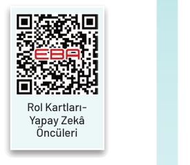

<!-- sayfa 43 -->

# Etkinlik 17

**Etkinlik Adı:** Günlük Hayatta Yapay Zekânın Etkileri

**Etkinlik Süresi:** 10 dk.

**Etkinlik Türü:** Grup Etkinlikleri

**Yöntem ve Teknikler:**
* Tartışma
* Soru–cevap

**Materyaller:** Yazı tahtası/etkileşimli tahta, Öğrenci defteri, EBA bilgi duvarı, Çıkarım cümlesi kontrol listesi

**Etkinlik Açıklaması:** Bu etkinlik, öğrencilerin yapay zekânın günlük yaşam alanlarındaki olumlu ve olumsuz yönlerini değerlendirmelerini sağlayacaktır. Öğrenciler grup tartışmaları sonucunda çıkarım cümleleri oluşturacak ve bu cümleleri sınıfta paylaşacaklardır.

**Uygulama Aşamaları:**

* Öğrencilere sağlık, eğitim, tarım, turizm, sosyal medya ve eğlence alanlarında yapay zekânın kullanımını hatırlatınız.
* Gruplara "Bu alanlarda yapay zekânın olumlu ve olumsuz etkileri nelerdir?" sorusunu veriniz.
* Gruplardan tartışma sonucunda bir çıkarım cümlesi oluşturmalarını isteyiniz.
* Örneğin "Yapay zekâ sağlıkta teşhisi hızlandırabilir ancak dikkatli kullanılmalıdır."
* Her grubun cümlesini sınıfla paylaşmasını sağlayınız.
* Çıkarım cümlelerini EBA bilgi duvarına yükleyiniz.
* Çalışmayı öğrencilerin farklı bakış açılarını vurgulayarak tamamlayınız.

<!-- sayfa 44 -->

# Ara Değerlendirme

Etkinliklerin değerlendirilmesinde Dereceli Puanlama Anahtarı ve Öğretmen Gözlem Formu'ndan yararlanınız.

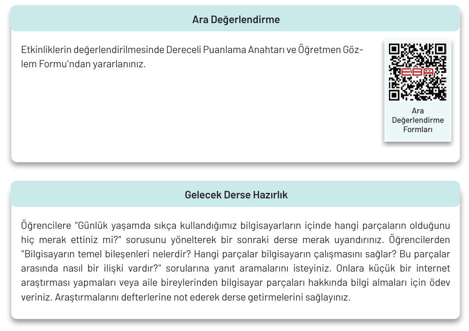

# Gelecek Derse Hazırlık

Öğrencilere "Günlük yaşamda sıkça kullandığımız bilgisayarların içinde hangi parçaların olduğunu hiç merak ettiniz mi?" sorusunu yönelterek bir sonraki derse merak uyandırınız. Öğrencilerden "Bilgisayarın temel bileşenleri nelerdir? Hangi parçalar bilgisayarın çalışmasını sağlar? Bu parçalar arasında nasıl bir ilişki vardır?" sorularına yanıt aramalarını isteyiniz. Onlara küçük bir internet araştırması yapmaları veya aile bireylerinden bilgisayar parçaları hakkında bilgi almaları için ödev veriniz. Araştırmalarını defterlerine not ederek derse getirmelerini sağlayınız.

<!-- sayfa 45 -->

# BİLGİSAYAR SİSTEMLERİNİN KULLANIMI

**Süre:**
2 ders saati

**Öğrenme Çıktıları**
BTY.5.1.5. Bilgisayar sistemlerini çözümleyebilme
a) Bilgisayar sistemlerinin temel bileşenlerini belirler.
b) Bilgisayar sistemlerinin temel bileşenleri arasındaki ilişkileri belirler.

**Dersten Önce**
* "Bilgisayarın Temel Bileşenleri" sunumunu hazırlayınız (donanım, yazılım, ağ, bit–bayt kavramları).
* Öğrencilere dağıtmak üzere piksel çalışma kâğıtlarını ve renkli kalem/boyaları hazır ediniz.
* Veri Boyutu Merdiveni oyununu hazırlayınız.
* Depolama birimlerinin görsellerini (HDD, SSD, USB bellek, bulut) temin ediniz.
* İç donanım, dış donanım ve giriş, çıkış sınıflandırmaları için Bilgisayarın Temel Bileşenleri-Mini Oyun Seti oyununu hazırlayınız.
* Klavye ve fare görsellerinin yer aldığı çalışma kâğıtlarını çoğaltınız.
* "Doğru mu, Yanlış mı?" İşletim Sistemi etkinliğini hazırlayınız.
* Sorun giderme algoritması etkinliğini hazırlayınız. (ör. "Yazıcı çalışmıyor – kablo $\rightarrow$ güç $\rightarrow$ sürücü") algoritmasını öncesinde deneyimleyiniz.
* Akran Değerlendirme Formu ve Öğretmen Gözlem Formu'nu çoğaltınız.

**Dikkat Çekme**
Aşağıdaki soruları öğrencilere yönelterek yanıtlamalarını isteyiniz.
* Sizce bir bilgisayar hangi bölümlerden oluşuyor?
* Bir masaüstü veya dizüstü bilgisayarı klavye ve fare olmadan nasıl kullanabiliriz?
* Bir fotoğrafın telefonunuzda 2 MB, başka bir fotoğrafın ise 5 MB olmasının nedeni sizce nedir? Fotoğrafın netliği, renkleri ya da uzunluğu dosya boyutunu etkiliyor olabilir mi?
* Oyun oynarken bilgisayarın hızını etkileyen şeyler neler olabilir?
* Bir dosyayı USB’ye kaydetmek ile buluta kaydetmek arasında ne fark vardır (Bulut bilişim, dosyaları internette saklamamızı sağlayan depolama alanıdır.)?
* Bir uygulama çalışırken telefonun hangi bölümleri görev yapıyor olabilir?
* Evinizde elektronik bir donanım bozulduğunda ne yaparsınız? Onu tekrar çalıştırmak için hangi yöntemleri denersiniz?

**Ders Süreci**
☐ “Sizce bilgisayar hangi bölümlerden oluşuyor?” sorusu ile öğrencilerde merak uyandırınız ve bilgisayar sisteminin temel bileşenleri hakkında bir sunum yapınız. Bu sunumda donanımın bilgisayarın fiziksel bileşenlerini (işlemci, bellek, depolama birimleri vb.) içerdiğini belirtiniz. Donanım, yazılım, bit ve byte kavramlarını tanımlayınız ve bu terimlerin verinin nasıl depolandığı ve işlendiği konusundaki önemine değininiz. Öğrencilerin bilgisayar sistemlerinin işleyişi ile ilgili tartışmalarını sağlayınız. Bu süreçte öğrencilerin bilgisayar sisteminin temel bileşenlerini (donanım, yazılım, ağlar vb.) belirlemelerini ve bu bileşenlerin nasıl etkileşimde bulunduğunu tartışmalarını isteyiniz. Öğrencilerin her bileşenin işlevini...

<!-- sayfa 46 -->

* Grup çalışması becerilerini geliştirmek amacıyla öğrencileri rastgele küçük gruplara ayırınız ve her gruba bir piksel çalışma kâğıdı veriniz. Boş matris içindeki kutucukları boyama kuralını anlatınız. Görevini tamamlayan grupların çalışmalarını tahtaya veya panoya astırarak, tüm sınıfın saklanan resmi görmesini sağlayınız. Aynı zamanda öğrencilerin bu etkinlikte görevlerini yerine getirerek sorumluluk bilinci kazanmalarına rehberlik ediniz. Resmin kapladığı alan küçültüldüğü için programcıların verileri sıkıştırmak amacıyla kullandığı yöntemlerden biri olan dizi boyu kodlamasının bu etkinlikte uygulandığını belirtiniz. Bu yöntem kullanılmasaydı resimleri bir yerden başka bir yere göndermenin zor olacağını açıklayınız.

* Günlük hayatta kullanılan ölçü birimlerine değininiz ve bilgisayardaki dosya büyüklüklerini belirtmek için “dijital hafıza birimleri”nin kullanıldığını açıklayınız (Veri Boyutu Merdiveni Etkinliği). Metre ve kilogram anlatımı için kullanılan ölçü merdivenini tahtaya çiziniz ve dijital ölçü birimlerini küçükten büyüğe doğru sıralayınız. Ardından depolama birimlerini tanıtan bir sunum yapınız. Bu sunumda sabit disk, SSD, USB bellek ve bulut depolama gibi farklı depolama yöntemlerinin ne olduğu, nasıl çalıştığı ve günlük hayatta hangi durumlarda kullanıldığı hakkında bilgi veriniz. Öğrencilerin bilgisayar sistemlerinde yer alan depolama birimlerini veri erişim hızı, kapasite ve kullanım amacı açısından diğer temel bileşenlerle ilişkilendirmelerini sağlayınız.

* Bir sonraki aşamada "Veri Boyutu Merdiveni" oyununu oynayınız. Metre, kilogram gibi günlük hayattaki ölçü birimlerinden örnek vererek, bit, byte, kilobyte, megabyte, gigabyte ve terabyte birimlerini küçükten büyüğe sıralayınız. Öğrencilere günlük yaşamdan örneklerle (bir fotoğraf $\approx$ birkaç MB, bir film $\approx$ birkaç GB) açıklama yapınız. Ardından sabit disk, SSD, USB bellek, bulut depolama gibi depolama birimlerini tanıtınız. Bu depolama araçlarının hız, kapasite ve kullanım amaçları açısından farklılıklarını tartışmaya açınız.

* Web 2.0 tabanlı oyunlaştırılmış ölçme/etkinlik aracı ile hazırlanan donanım ve yazılım kavramları ile örnek donanım birimlerinin eşleştirildiği etkinliği uygulayınız (Bilgisayarın Temel Bileşenleri Mini Oyun Seti Etkinliği). Öğrencilerin bu etkinlik aracılığıyla donanım ve yazılım kavramlarını hatırlamalarını ve bu kavramlarla ilişkili donanım birimlerini belirlemelerini sağlayınız. Ardından “Dışında ne var, içinde ne var?” sunumu ile bilgisayarın iç ve dış donanım birimlerini gruplandırınız. Sunumda iç donanım (işlemci, anakart, RAM bellek vb.) ve dış donanım (yazıcı, hoparlör, ekran vb.) bileşenlerinin görevlerine değinerek açıklamalar yapınız. Bilgisayarda bazı araçların yalnızca veri girişi, bazılarının yalnızca veri çıkışı, bazılarının ise her iki görevi birlikte yerine getirdiğini ifade ediniz.

* Öğrencilerle giriş birimlerini temsil eden “deve”, çıkış birimlerini temsil eden “cüce” oyunu oynayarak giriş ve çıkış birimlerini ilişkilendiriniz (Deve Cüce Etkinliği). Bu oyun aracılığıyla öğrencilerin edindikleri bilgileri eğlenceli bir etkinlik ile pekiştirmelerini ve görevlerini yerine getirirken özveri ile çalışmalarını teşvik ediniz. Ardından öğrencilere donanım bileşenlerini sınıflandırmalarına yönelik çalışma kâğıdını (giriş birimleri, çıkış birimleri, iç donanım ve dış donanım) dağıtınız.

* Öğrenme süreci öncesinde öğrencilere klavye ve fare görsellerinin yer aldığı çalışma kâğıdını dağıtınız. Fare ve klavyenin ne işe yaradığına ve hangi durumlarda kullanıldığına ilişkin sunum yapınız. Klavyedeki özel tuşlara (Ctrl, Esc, Shift vb.) değinerek öğrencilerden bu tuşların yerlerini çalışma kâğıdı üzerinde bulmalarını ve işaretlemelerini isteyiniz. Böylece öğrencilerin klavye üzerindeki tuşlar ile görevleri arasındaki ilişkiyi kurmalarını sağlayınız.

* Öğrencilere “İşletim sistemi nedir?” ve “Arayüz ne demektir?” sorularını yönelterek merak uyandırınız. İşletim sistemlerinin temel görevleri, örnek işletim sistemleri ve bu sistemlerin donanım ile yazılımları nasıl yönettiği hakkında sunum yapınız. Öğrencilerden farklı işletim sistemlerinin neden var olduğuna yönelik görüş paylaşmalarını isteyiniz. İşletim sisteminin temel bileşenleri (çekirdek, kullanıcı arayüzü, dosya yönetimi, bellek yönetimi, işlem yönetimi vb.) hakkında bilgi veriniz. Ardından doğru–yanlış oyununu uygulayınız Öğrencilere bir yüzüne “D” diğer yüzüne “Y” yazılmış kâğıtlar dağıtarak öğretmenin

<!-- sayfa 47 -->

okuduğu önermelere doğru veya yanlış şeklinde yanıt vermelerini isteyiniz (Doğru mu Yanlış mı İşletim sistemi Etkinliği). Oyun sonunda kalan öğrenciye “Günün BT Uzmanı” rozeti takınız. Yanlış cevap veren öğrencilere anında geri bildirimde bulunarak eksiklerini fark etmelerini sağlayınız ve gerektiğinde konuyu yeniden ele alınız.

☐ Donanım ve yazılım sorunlarının genel tanımlarını yaparak yaygın karşılaşılan hata türlerini öğrencilerinize açıklayınız. Ardından, teknik sorunlarla başa çıkabilmek için hazırlanan temel adımları içeren Sorun Giderme Algoritması Etkinliği kapsamında; yazıcının çalışmaması veya bilgisayarın açılmaması gibi örnek bir senaryoyu içeren oyunu tahtaya yansıtınız. Öğrencilerden, oyundaki Sorun Giderme Algoritmasını rehber alarak adım adım çözüm yolları üretmelerini ve etkileşimli materyal üzerinde bu adımları düzenlemelerini isteyiniz. Tartışma aşamasında öğrencilerin farklı çözüm önerilerini dinlemelerini sağlayarak problem çözme süreçlerini destekleyiniz. Karşılaşılan teknik güçlüklerde hemen pes etmemeleri gerektiğini hatırlatıp, sebat etmenin önemini vurgulayınız. Etkinlik sonunda, öğrenme düzeylerini Web 2.0 tabanlı oyunlaştırılmış araçlar veya dereceli puanlama anahtarı ile ölçerek öğrencilere süreç odaklı geri bildirim veriniz.

<!-- sayfa 48 -->

# Etkinlik 18

| | |
| :--- | :--- |
| **Etkinlik Adı:** | Piksel Çalışmasıyla Gizli Resim |
| **Etkinlik Süresi:** | 20 dk. |
| **Etkinlik Türü:** | Grup Etkinlikleri |
| **Yöntem ve Teknikler:** | • Problem çözme |
| **Materyaller:** | Piksel Çalışma Kâğıtları, Renkli Kalemler Pano/Tahta |
| **Etkinlik Açıklaması:** | Öğrenciler piksel kâğıtlarını grup hâlinde boyayarak gizli resmi ortaya çıkaracaklardır. Böylece iş birliği yapacak, sorumluluk üstlenecek ve veri sıkıştırmanın mantığını kavrayacaklardır. |

**Uygulama Aşamaları:**

* Öğrencileri 4–5 kişilik küçük gruplara ayırınız.
* Her gruba birer piksel çalışma kâğıdı ve renkli kalemler dağıtınız.
* Öğrencilerden kutucukları yönergeye uygun şekilde boyamalarını isteyiniz.
* Çalışmaları pano veya tahtaya asarak gizli resmi sınıfça inceleyiniz.
* Resmin küçültülmesi örneğiyle veri sıkıştırma mantığını açıklayınız.

<!-- sayfa 49 -->

# Etkinlik 19

| | |
| :--- | :--- |
| **Etkinlik Adı:** | Veri Boyutu Merdiveni Oyunu |
| **Etkinlik Süresi:** | ⌛ 15 dk. |
| **Etkinlik Türü:** | 👥 Grup Etkinlikleri |
| **Yöntem ve Teknikler:** | • Oyunlaştırma • Soru-cevap |
| **Materyaller:** | • Hazırlanmış web 2.0 sürükle-bırak aracı • (bit, byte, kilobyte, megabyte, gigabyte, terabyte kartları) |
| **Etkinlik Açıklaması:** | Öğrenciler, hazırlanan web 2.0 sürükle-bırak oyunu aracılığıyla dijital hafıza birimlerini küçükten büyüğe doğru sıralayacaklardır. Böylece veri boyutlarını günlük yaşamdan örneklerle ilişkilendirerek kavrayacaklardır. |

**Uygulama Aşamaları:**

* Web 2.0 oyununu sınıfta açınız veya etkileşimli tahtaya yansıtınız.
* Öğrencilerden kartları sürükleyerek merdiven üzerindeki doğru sıraya yerleştirmelerini isteyiniz.
* Tüm kartlar yerleştirildikten sonra "Kontrol Et" butonuna basarak sonuçları sınıfla birlikte değerlendiriniz.
* Yanlış yerleştirilen kartları oyun geri bildirimiyle düzeltmelerine fırsat veriniz.
* Doğru sıralama tamamlandığında öğrencilere günlük yaşamdan örnekler (fotoğraf = MB, film = GB vb.) sunarak konuyu pekiştiriniz.

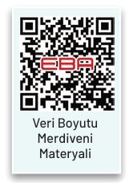

<!-- sayfa 50 -->

# Etkinlik 20

| | |
| :--- | :--- |
| **Etkinlik Adı:** | Bilgisayarın Temel Bileşenleri – Mini Oyun Seti |
| **Etkinlik Süresi:** | ⌛ 20 dk. |
| **Etkinlik Türü:** | 👥 Grup Etkinlikleri |
| **Yöntem ve Teknikler:** | • Oyunlaştırma • Tartışma |
| **Materyaller:** | Bilgisayarın Temel Bileşenleri – Mini Oyun Seti (donanım–yazılım ayrımı, giriş–çıkış sınıflandırma, görev–parça eşleştirme vb.) |
| **Etkinlik Açıklaması:** | Öğrenciler, hazırlanan web 2.0 oyun setiyle bilgisayarın temel bileşenlerini tanıyacak ve sınıflandıracaklardır. Böylece bilgilerini eğlenceli bir şekilde pekiştireceklerdir. |

### Uygulama Aşamaları:

* Bilgisayarın Temel Bileşenleri – Mini Oyun Seti web 2.0 aracını sınıfta açınız veya etkileşimli tahtaya yansıtınız.
* Öğrencilerden oyundaki görevleri sırasıyla (donanım–yazılım ayrımı, giriş–çıkış sınıflandırma, görev–parça eşleştirme) yapmalarını isteyiniz.
* Öğrencilerin kartları doğru bölümlere sürükleyip bırakmalarını sağlayınız.
* Yanlış eşleştirmelerde oyunun verdiği geri bildirimleri sınıfça değerlendiriniz.
* Doğru sıralama ve eşleştirmeler üzerinden kısa açıklamalar yaparak konuyu pekiştiriniz.
* Etkinlik sonunda öğrencilerin çalışmalarını sınıfla paylaşarak değerlendiriniz.

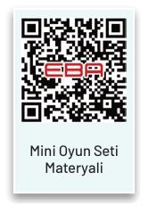
Mini Oyun Seti Materyali

<!-- sayfa 51 -->

# Etkinlik 21

**Etkinlik Adı:** Deve Cüce Etkinliği

**Etkinlik Süresi:** 10 dk.

**Etkinlik Türü:** Grup Etkinlikleri

**Yöntem ve Teknikler:**
* Rol yapma
* Oyunlaştırma
* Soru-cevap

**Materyaller:** Donanım birimleri listesi (öğretmen için)

**Etkinlik Açıklaması:** Öğrenciler, verilen donanım biriminin giriş mi çıkış mı olduğunu bedensel hareketlerle göstereceklerdir. Böylece eğlenceli bir şekilde bilgisayar donanım birimlerini sınıflandırmayı pekiştireceklerdir.

**Uygulama Aşamaları:**

* Öğrencilere oyunun kurallarını açıklayınız.
* Bir donanım birimi söyleyiniz (klavye, yazıcı, hoparlör vb.).
* Öğrencilerden giriş birimi için "Deve" çıkış birimi için "Cüce" pozisyonu almalarını isteyiniz.
* Yanlış yapan öğrencilere doğru cevabı bulduracak ipuçları içeren dönütler veriniz.
* Oyunu farklı örneklerle birkaç tur tekrarlayınız.

<!-- sayfa 52 -->

# Etkinlik 22

| | |
| :--- | :--- |
| **Etkinlik Adı:** | Doğru mu, Yanlış mı? – İşletim Sistemi |
| **Etkinlik Süresi:** | ⌛ 15 dk. |
| **Etkinlik Türü:** | 👥 Grup Etkinlikleri |
| **Yöntem ve Teknikler:** | • Oyunlaştırma • Soru-cevap |
| **Materyaller:** | • Doğru mu, Yanlış mı? İşletim Sistemi Etkinliği, Günün BT Uzmanı Rozeti |
| **Etkinlik Açıklaması:** | Öğrenciler, işletim sistemi ve arayüz konularını tekrar etmek amacıyla hazırlanan dijital doğru/yanlış oyununu oynayacaklardır. Bu süreçte hem dikkatlerini yoğunlaştıracak hem de bilgilerini eğlenceli bir şekilde pekiştireceklerdir. |

**Uygulama Aşamaları:**

* Etkinliğin arayüzünü açınız.
* Öğrencilere "İşletim sistemi nedir? Arayüz ne demektir?" sorularına cevap olacak şekilde kısa açıklamalar yapınız.
* İşletim sisteminin görevlerini, örneklerini ve neden farklı sistemler bulunduğunu 1-2 dakika boyunca tartışınız.
* Oyun kısmını açınız ve kuralları açıklayınız.
* Önermeleri ekrana yansıtınız, öğrencilerden butonlarla "Doğru" veya "Yanlış" cevabını vermelerini isteyiniz.
* Yanlış yapan öğrencileri oyundan çıkarınız, kalanlarla devam ediniz.
* Sona kalan öğrenciye "Günün BT Uzmanı" rozetini veriniz.
* Yanlış cevaplarda anında dönüt vererek eksik öğrenmeleri tamamlayınız.

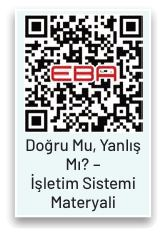

<!-- sayfa 53 -->

# Etkinlik 23

| | |
| :--- | :--- |
| **Etkinlik Adı:** | Sorun Giderme Algoritması Etkinliği |
| **Etkinlik Süresi:** | ⌛ 10 dk. |
| **Etkinlik Türü:** | 👥 Grup Etkinlikleri |
| **Yöntem ve Teknikler:** | • Problem çözme • Tartışma |
| **Materyaller:** | • Örnek Senaryolar İçeren Sorun Giderme Oyunu (yazıcı çalışmıyor, bilgisayar açılmıyor, hoparlörden ses gelmiyor vb.) |
| **Etkinlik Açıklaması:** | Öğrenciler, bilgisayar kullanımında karşılaşılan yaygın sorunları çözmek için sorun giderme algoritmasını kullanacaklardır. Böylece hem problem çözme becerilerini geliştirecek hem de sebat etmeyi öğreneceklerdir. |
| **Uygulama Aşamaları:** | |

* Sınıfta sorun giderme algoritmasını içeren materyali açınız.
* Bir senaryo seçiniz (örneğin yazıcı çalışmıyor) ve tahtada açıklayınız.
* Öğrencilerden algoritmayı kullanarak adım adım çözüm yolları önermelerini ve sürükle bırak yöntemiyle düzenlemelerini isteyiniz.
* Çözüm sürecinde öğrencilerin katkılarını dinleyiniz ve doğru adımları vurgulayınız.
* Öğrencilerden kendi yaşadıkları benzer sorunları paylaşmalarını isteyiniz.

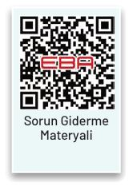

<!-- sayfa 54 -->

# Ara Değerlendirme

Etkinliklerin değerlendirilmesinde Öz Değerlendirme Formu ve Öğretmen Gözlem Formu'ndan yararlanınız.

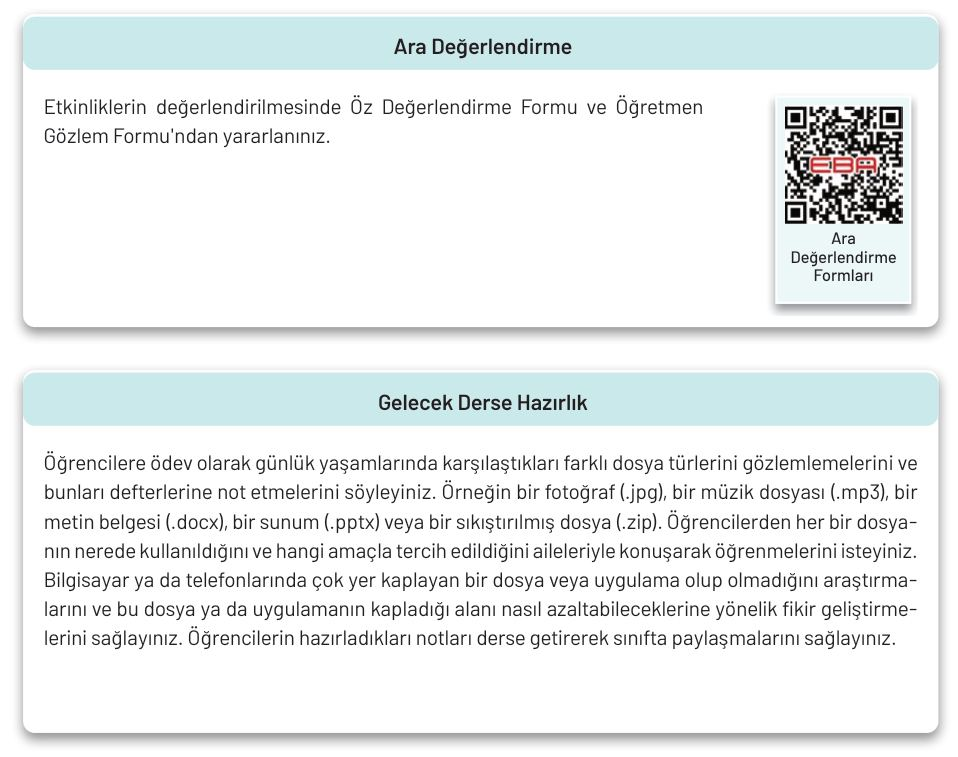
Ara Değerlendirme Formları

# Gelecek Derse Hazırlık

Öğrencilere ödev olarak günlük yaşamlarında karşılaştıkları farklı dosya türlerini gözlemlemelerini ve bunları defterlerine not etmelerini söyleyiniz. Örneğin bir fotoğraf (.jpg), bir müzik dosyası (.mp3), bir metin belgesi (.docx), bir sunum (.pptx) veya bir sıkıştırılmış dosya (.zip). Öğrencilerden her bir dosyanın nerede kullanıldığını ve hangi amaçla tercih edildiğini aileleriyle konuşarak öğrenmelerini isteyiniz. Bilgisayar ya da telefonlarında çok yer kaplayan bir dosya veya uygulama olup olmadığını araştırmalarını ve bu dosya ya da uygulamanın kapladığı alanı nasıl azaltabileceklerine yönelik fikir geliştirmelerini sağlayınız. Öğrencilerin hazırladıkları notları derse getirerek sınıfta paylaşmalarını sağlayınız.

<!-- sayfa 55 -->

# DOSYA VE KLASÖR YÖNETİMİ

**Süre:**
2 ders saati

**Öğrenme Çıktıları**
BTY.5.1.6. Dosya ve klasör yönetimi ile ilgili temel işlemlerle çalışabilme
a) Temel dosya ve klasör düzenleme işlemlerini belirler.
b) Temel dosya ve klasör düzenleme işlemlerini kullanır.
c) Dosya ve klasör sıkıştırma işlemlerini verimlilik kapsamında değerlendirir.

**Dersten Önce**
* Öğrencilere göstermek üzere karışık masaüstü görseli hazırlayınız.
* Dosya ve klasör düzeni sunumunu hazırlayınız.
* Etkileşimli tahtada göstermek için dosya işlemleri görev listesi (klasör oluşturma, taşıma, ad değiştirme, silme, arama) hazırlayınız. Dosya uzantıları ve türlerini gösteren örnek bir poster veya görsel hazırlayınız.
* Dosya Uzantıları Eşleştirme oyununu web 2.0 tabanlı etkinliğini önceden hazırlayınız.
* Dijital bilginin aktarımını göstermek için tarayıcı veya mobil cihaz temin ediniz.
* Çöp poşeti ve gazete kâğıtları getirerek dosya sıkıştırma etkinliğine hazırlık yapınız.
* Depolama alanı dolmuş gibi görünen bir USB bellek veya Verileri Sıkıştırma Etkinliği isimli web 2.0 aracını hazırlayınız.
* Öğrencilerin etkinliklerdeki performansını değerlendirmek için Öğretmen Gözlem Formu'nu çoğaltınız.

**Dikkat Çekme**
Aşağıdaki soruları öğrencilere yönelterek yanıtlamalarını isteyiniz.
* Bilgisayarınızda çok fazla dosya olursa aradığınızı bulmak kolay mı olur, zor mu olur?
* Sizce dosyaları düzenlemenin en pratik yolu ne olabilir?
* Daha önce hiç dosya uzantısına (.jpg, .mp3 gibi) dikkat ettiniz mi? Ne anlama geldiğini biliyor musunuz?
* Telefonunuzda veya bilgisayarınızda depolama alanınız hiç doldu mu? O zaman ne yaptınız?
* Bir dosyayı sıkıştırdığımızda sizce ne değişir?

**Ders Süreci**
☐ Sınıfta çok sayıda dosyanın bulunduğu karışık bir bilgisayar masaüstü görselini açınız. “Bu masaüstünde aranılan bir belgenin bulunması zor olur mu?” ve “Sizce zamanla çoğalacak bu dosyaları düzenlemek için ne yapılmalıdır?” sorularını yönelterek öğrencilerin görüşlerini alınız. Ardından “bir araya toplamak”, “gruplandırmak” ve dosyaları anlamlı ve tarih bilgisi içerecek şekilde “adlandırmak” gibi yöntemleri öğrencilerle paylaşınız. Temel dosya ve klasör kavramları, dosya türleri (metin, görüntü, ses vb.), klasör yapısının önemi ve düzenli bir dosya yönetiminin sağladığı avantajlar hakkında bir sunum yapınız (Dosya ve Klasör Düzeni Sunumu).

<!-- sayfa 56 -->

* Sunumdan sonra etkileşimli tahta üzerinden klasör oluşturma, dosya taşıma, dosya adını değiştirme, dosya silme ve dosya arama işlemlerini uygulamalı olarak gösteriniz (Dosya İşlemleri Uygulaması etkinliği). Ayrıca dosya ve klasörlerin türlerine ve oluşturulma ya da son güncellenme tarihlerine göre düzenlenmesine yönelik uygulamalara da yer veriniz. Öğrencilerin öğretmen rehberliğinde belirli bir görev listesine göre temel dosya ve klasör işlemlerini gerçekleştirmelerini sağlayınız. Öğrencilerin dosya ve klasör düzenleme işlemlerini uygulayarak bilgisayar ve dizin yapısı gibi araçları etkin bir şekilde kullanmalarını destekleyiniz.

* Dosya yapısı ve uzantıların (txt, jpg, mp3, docx, odt, ogg, png vb.) ele alındığı bir sunum yapınız. Sunumda her bir uzantının hangi tür dosyaları ifade ettiği, hangi programlarla açıldığı ve hangi amaçlarla kullanıldığı üzerinde durunuz. Dosya uzantıları ve anlamlarını içeren bir posteri sınıf panosuna asınız. Sunum sonrasında öğrencilerin dosya türleri ve uzantılarını eşleştirmelerine yönelik web 2.0 tabanlı etkileşimli bir etkinlik yaptırınız (Dosya Uzantılarını Keşfediyorum Etkinliği).

* Öğrenme sürecini teknolojiyle ilgili bir gelişmeyi konu alan gazete veya dergi kupürünü öğrencilerle paylaşarak başlatınız. Fotokopi makinesi olmadan bu tür basılı belgelerin geçmişte nasıl çoğaltıldığına ilişkin sorular yönelterek öğrencilerin düşüncelerini alınız.

* Bilgiye ulaşmanın geçmişte nasıl gerçekleştiğine dair görseller sunarak tartışma ortamı oluşturunuz. Öğrencilerin tarayıcı, cep telefonu veya tablet kullanarak bir belgenin dijital ortama aktarılma sürecini adım adım gözlemlemelerini sağlayınız (Dijital Bilgiye Yolculuk Etkinliği).

* Yanınıza bir çöp poşeti alarak içine kapasitesinden fazla gazete yerleştirmeye çalışınız. Bu durumu verimlilik ve kaynak yönetimi açısından öğrencilerle tartışınız. Dolu bir çanta örneği üzerinden alan tasarrufu kavramını günlük yaşamla ilişkilendiriniz. Bilgisayarların ve depolama araçlarının da belirli bir kapasitesi olduğu bilgisini veriniz. Öğrencilere sınırlı alanlı taşınabilir belleğe dosya kaydetme denemesi yaptırarak “yetersiz alan” uyarısını görmelerini sağlayınız (Verileri Sıkıştırma Etkinliği). Dosya ve klasör sıkıştırmanın ne olduğunu, neden kullanıldığını ve hangi araçlarla yapıldığını açıklayınız. Yaygın sıkıştırma araçlarını tanıtınız.

* Öğrencilerin dosya türleri, uzantıları ve depolama yönetimine ilişkin bilgi düzeylerini web 2.0 tabanlı oyunlaştırılmış ölçme araçları ile değerlendiriniz. Performans görevi kapsamında öğrencilerden dosya türleri ve sıkıştırma yöntemlerini içeren bir rapor hazırlamalarını isteyiniz. Bu raporları; içerik doğruluğu, yöntemlerin uygulanabilirliği ve düzen kriterlerine göre Dereceli Puanlama Anahtarı ile değerlendiriniz. Her öğrenciye bireysel geri bildirim vererek öğrenme sürecindeki güçlü yönlerini ve geliştirilmesi gereken alanları belirtiniz.

* Ardından Dosya Sıkıştırma Deneyi etkinliğini yapınız. Önceden hazırladığınız poşete gazete kâğıtları doldurup kapasitesini aştırınız. Öğrencilere poşete kâğıtların düzenli yerleştirilmesiyle alan tasarrufu sağlanabileceğini örneklendiriniz. Sıkıştırma yapmanın dosyanın içeriğini değiştirmediğini, sadece yer tasarrufu sağladığını açıklayınız. Buradan hareketle dosya sıkıştırma kavramını açıklayınız. Farklı bir örnek olarak öğrencilere depolama alanı dolmuş bir belleğe dosya kaydetmeye çalıştırınız ve hata mesajını görmelerini sağlayınız. Daha sonra sıkıştırma yöntemlerini göstererek aynı dosyaların belleğe sığabileceğini deneyimletiniz. Yaygın kullanılan sıkıştırma araçlarını tanıtınız ve öğrencilerle birlikte tartışınız. Öğrencilere alternatif olarak Verileri Sıkıştırma Etkinliğini yaptırabilirsiniz.

* Dersin sonunda öğrencilerle kısa bir değerlendirme yapınız. Öğrencilere "Dosya düzenleme, uzantıları bilme ve sıkıştırma işlemleri günlük hayatta bize nasıl fayda sağlar?" sorusunu yöneltiniz. Öğrencilerin görüşlerini sınıfça tartıştırarak dersin ana noktalarını özetleyiniz.

<!-- sayfa 57 -->

# Etkinlik 24

| | |
| :--- | :--- |
| **Etkinlik Adı:** | Dosya ve Klasör Düzeni Sunumu |
| **Etkinlik Süresi:** | 15 dk. |
| **Etkinlik Türü:** | Grup Etkinlikleri |
| **Yöntem ve Teknikler:** | • Soru-Cevap • Tartışma • Sunum |
| **Materyaller:** | Karışık Masaüstü Görseli, Sunum Slaytları, Etkileşimli Tahta |
| **Etkinlik Açıklaması:** | Bu etkinlikte öğrenciler, dosya ve klasör düzeninin önemini fark edecektir. Öğrenciler dosya türlerini (metin, görüntü, ses vb.) tanıyacak ve klasör yapısının avantajlarını öğrenecektir. Düzenli dosya yönetiminin günlük yaşamda sağladığı kolaylıkları tartışacaklardır. |

**Uygulama Aşamaları:**

* Etkileşimli tahtada çok dosya ile dolu ve karışık görünen bir bilgisayar masaüstü görselini yansıtınız.
* Öğrencilere "Bu masaüstünde aranan bir belgeyi bulmak sizce kolay mı, zor mu? Neden?" Sorusunu yöneltiniz.
* "Sizce zamanla çoğalacak bu dosyaları düzenlemek için ne yapılmalıdır?" sorularını sorunuz.
* Önerilen çözümleri tahtada listeleyin, benzer fikirleri gruplayınız.
* Dosya ve Klasör Düzeni sunumunu açarak dosya ve klasör kavramlarını, dosya türlerini (metin, görüntü, ses vb.) öğrencilere açıklayınız.
* Öğrencilere klasör yapısının düzen sağlamadaki rolünü örneklerle anlatınız.
* Düzenli dosya yönetiminin sağladığı avantajları (kolay bulma, zaman tasarrufu, düzenli çalışma) sınıfça tartışınız.

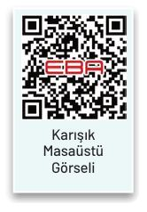

<!-- sayfa 58 -->

# Etkinlik 25

| | |
| :--- | :--- |
| **Etkinlik Adı:** | Dosya İşlemleri Uygulaması |
| **Etkinlik Süresi:** | ⌛ 25 dk. |
| **Etkinlik Türü:** | 👥 Grup Etkinlikleri |
| **Yöntem ve Teknikler:** | • Gösterip yaptırma |
| **Materyaller:** | Dosya İşlemleri Görseli, Bilgisayar, Etkileşimli Tahta |
| **Etkinlik Açıklaması:** | Bu etkinlikte öğrenciler, bilgisayarda temel dosya işlemlerini öğrenecektir. |

**Uygulama Aşamaları:**

* Etkileşimli tahtada "Dosya İşlemleri" görselini yansıtınız.
* Klasör oluşturma işlemini örnek üzerinden gösteriniz ve öğrencilere aynısını yapmalarını sağlayınız.
* Dosya taşıma işlemini farklı klasörler arasında uygulayarak öğrencilere yaptırınız.
* Bir dosyanın adını değiştirme sürecini gösteriniz ve öğrencilerden kendi dosyalarında uygulamalarını isteyiniz.
* Dosya silme işlemini örnek bir dosya üzerinde gösteriniz, öğrencilerin aynı işlemi güvenli bir şekilde uygulamalarını sağlayınız.
* Dosya arama özelliğini kullanarak belirli dosyalara ulaşma yöntemini açıklayınız ve öğrencilere denettiriniz.
* Öğrencilere dosyaları türlerine veya tarihlerine göre sıralamayı gösteriniz ve onlardan sıralamayı kendi bilgisayarlarında uygulamalarını isteyiniz.

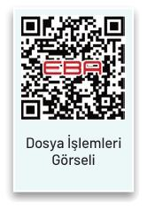
Dosya İşlemleri Görseli

<!-- sayfa 59 -->

# Etkinlik 26

**Etkinlik Adı:** Dosya Uzantılarını Keşfediyorum

**Etkinlik Süresi:** 20 dk.

**Etkinlik Türü:** Grup Etkinlikleri

**Yöntem ve Teknikler:**
* Anlatım
* Eşleştirme

**Materyaller:** Dosya Uzantıları Posteri, Dosya Uzantıları Eşleştirme Oyunu, Sınıf Panosu

**Etkinlik Açıklaması:** Bu etkinlikte öğrenciler, farklı dosya uzantılarının hangi tür verileri içerdiğini öğrenecektir. Dosyaların hangi programlarla açıldığını fark edecektir.

**Uygulama Aşamaları:**

* Dosya uzantılarının (.txt, .jpg, .mp3, .docx, .png vb.) yer aldığı posteri sınıf panosuna asınız.
* Öğrencilere her dosya uzantısının hangi tür verileri içerdiğini ve hangi amaçlarla kullanıldığını açıklayınız.
* Öğrencilerden günlük yaşamlarında karşılaştıkları dosya uzantılarına örnekler vermelerini isteyiniz.
* Öğrencilerle uzantı ve dosya türlerini eşleştirebilecekleri web 2.0 aracı üzerinden etkinliği gerçekleştiriniz.
* Eşleştirme oyununun ardından doğru yanıtları sınıfça kontrol ediniz ve öğrencilerin eksiklerini gideriniz.

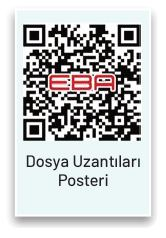

<!-- sayfa 60 -->

# Etkinlik 27

| | |
| :--- | :--- |
| **Etkinlik Adı:** | Dijital Bilgiye Yolculuk |
| **Etkinlik Süresi:** | 20 dk. |
| **Etkinlik Türü:** | Grup Etkinlikleri |
| **Yöntem ve Teknikler:** | • Tartışma • Sunum |
| **Materyaller:** | Tarayıcı, Mobil Cihaz, Bilgisayar, Örnek Belgeler |
| **Etkinlik Açıklaması:** | Bu etkinlikte öğrenciler, fiziksel bilgiden dijital bilgiye geçiş sürecini öğrenecektir. |

**Uygulama Aşamaları:**

* Öğrencilere geçmişte fotokopi makinesi olmadan belgelerin nasıl çoğaltıldığını sorunuz ve sınıfça tartışınız.
* Bir tarayıcı veya mobil cihaz kullanarak örnek bir belgenin bilgisayara aktarılma sürecini öğrencilere gösteriniz.
* Belgeyi taradıktan sonra bilgisayarda açılmasını sağlayınız ve öğrencilere inceletiniz.
* Öğrencilerin süreci adım adım takip etmelerini sağlayınız. Onların da bir belgeyi tarayıcı veya mobil cihaz aracılığıyla bilgisayara aktarmalarını isteyiniz.
* Dijitalleştirilen belgenin bilgisayarda nasıl kaydedileceğini ve hangi formatlarda saklanabileceğini açıklayınız.

<!-- sayfa 61 -->

# Etkinlik 28

**Etkinlik Adı:** Verileri Sıkıştırma Etkinliği

**Etkinlik Süresi:** 25 dk.

**Etkinlik Türü:** Grup Etkinlikleri

**Yöntem ve Teknikler:**
* Gösteri
* Deney
* Tartışma

**Materyaller:** Çöp Poşeti, Gazete Kâğıtları, Bilgisayar, Flash Bellek, Sıkıştırma Yazılımları

**Etkinlik Açıklaması:** Bu etkinlikte öğrenciler, günlük yaşamdan örnekler aracılığıyla dosya sıkıştırmanın mantığını öğrenecektir.

**Uygulama Aşamaları:**

* Çöp poşetine gazete kâğıtları doldurunuz ve kapasitenin aşıldığını öğrencilere gösteriniz.
* Çantaya eşyaların düzenli yerleştirilmesi benzetmesini yaparak alan tasarrufu kavramını açıklayınız.
* Depolama alanı dolmuş bir belleğe dosya kaydetmeyi deneyiniz ve çıkan hata mesajını öğrencilere yansıtınız.
* Aynı dosyaları sıkıştırma yöntemleriyle küçülterek belleğe kaydediniz ve süreci öğrencilere gösteriniz.
* Kullanılan yaygın sıkıştırma araçlarını öğrencilere tanıtınız.
* Sınıfla birlikte dosya sıkıştırmanın avantajlarını (alan tasarrufu, hızlı aktarım, düzen) tartışınız.
* Öğrencilere Verileri Sıkıştırma etkinliği web 2.0 aracı üzerinden flash belleği veri ile doldurduğumuzda sıkıştırma işlemi ile alan açılabileceğini uygulatınız.

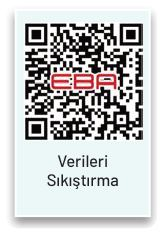

<!-- sayfa 62 -->

# Ara Değerlendirme

Etkinliklerin değerlendirilmesinde Öz Değerlendirme Formu ve Öğretmen Gözlem Formu'ndan yararlanınız.

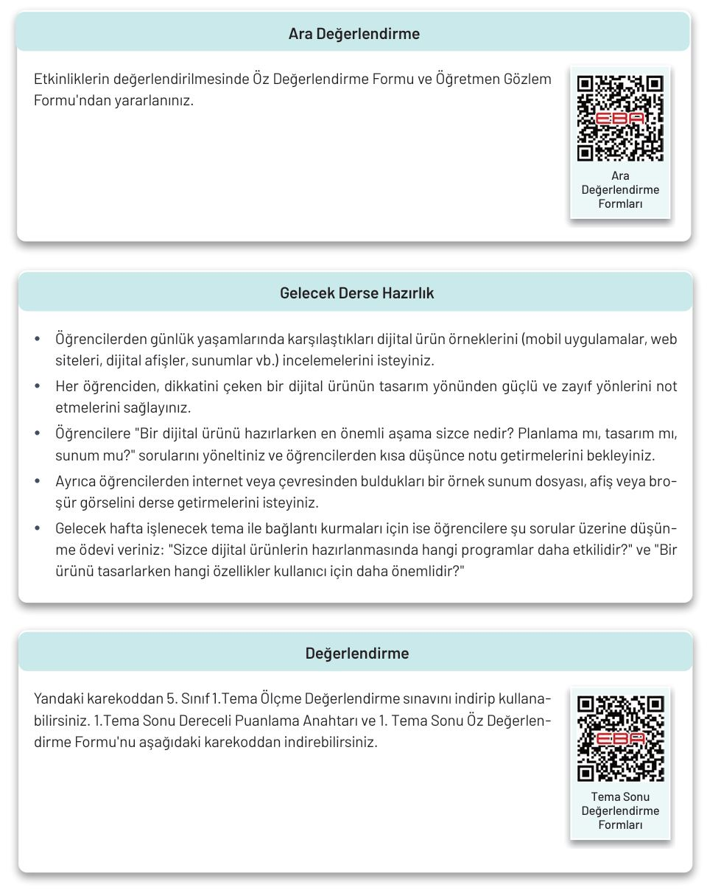
Ara Değerlendirme Formları

# Gelecek Derse Hazırlık

* Öğrencilerden günlük yaşamlarında karşılaştıkları dijital ürün örneklerini (mobil uygulamalar, web siteleri, dijital afişler, sunumlar vb.) incelemelerini isteyiniz.
* Her öğrenciden, dikkatini çeken bir dijital ürünün tasarım yönünden güçlü ve zayıf yönlerini not etmelerini sağlayınız.
* Öğrencilere "Bir dijital ürünü hazırlarken en önemli aşama sizce nedir? Planlama mı, tasarım mı, sunum mu?" sorularını yöneltiniz ve öğrencilerden kısa düşünce notu getirmelerini bekleyiniz.
* Ayrıca öğrencilerden internet veya çevresinden buldukları bir örnek sunum dosyası, afiş veya broşür görselini derse getirmelerini isteyiniz.
* Gelecek hafta işlenecek tema ile bağlantı kurmaları için ise öğrencilere şu sorular üzerine düşünme ödevi veriniz: "Sizce dijital ürünlerin hazırlanmasında hangi programlar daha etkilidir?" ve "Bir ürünü tasarlarken hangi özellikler kullanıcı için daha önemlidir?"

# Değerlendirme

Yandaki karekoddan 5. Sınıf 1.Tema Ölçme Değerlendirme sınavını indirip kullanabilirsiniz. 1.Tema Sonu Dereceli Puanlama Anahtarı ve 1. Tema Sonu Öz Değerlendirme Formu'nu aşağıdaki karekoddan indirebilirsiniz.

Tema Sonu Değerlendirme Formları

<!-- sayfa 63 -->

# Farklılaştırma

## Zenginleştirme

* Öğrencilerden "bilgi" kavramını merkeze alarak günlük yaşamda karşılaştıkları teknolojik bilgileri (internet aramaları, uygulama önerileri, öğretmen anlatımı vb.) karşılaştırmaları istenebilir. Böylece öğrenciler, teknolojik bilgileri temel bilgi kavramıyla ilişkilendirerek bu bilgileri içselleştirebilir.
* Öğrencilerin aile büyükleriyle röportaj yaparak geçmişte kullanılan bilişim teknolojilerini araştırmaları ve bu bilgileri sınıfta arkadaşlarıyla paylaşmaları istenir.
* Öğrencilerin geçmişten günümüze bilişim teknolojilerini araştırarak bir zaman çizelgesi oluşturmaları sağlanabilir. Bu çalışmada öğrencilerden teknolojinin gelişimi, benzerlikleri ve farklılıkları hakkında bilgi toplamaları istenebilir.
* Bilişim teknolojilerinin günlük yaşamda nasıl kullanıldığına dair belgesel veya video gösterimi yapılabilir. Öğrencilerin izlediklerini tartışmaları için bir alan oluşturulabilir.
* Öğrenciler, belirli bir bilişim teknolojisi (bulut bilişim, yapay zekâ vb.) ile ilgili bir sanal gezi yapabilirler. Öğrencilerden gezi sonrası öğrendiklerini bir sunum şeklinde paylaşmaları, teknolojinin geçmişten günümüze gelişimini ve etkilerini tartışarak elde ettikleri bulguları rapor hâline getirmeleri istenebilir.
* Öğrencilerin bilgisayar sistemlerinin bileşenlerini donanım ve yazılım olarak sınıflandırmaları için bir eşleştirme etkinliği yapılabilir. Heterojen gruplara ayrılan öğrencilere belirlenen bileşenler hakkında araştırma yaptırılarak bunların görevlerini ve birbiriyle nasıl etkileşimde bulunduklarını açıklamaları sağlanabilir. Her grubun kendi bileşenine dair örnekler sunması sağlanarak sınıfta tartışma ortamı oluşturulabilir.
* Öğrencilerden bilişim teknolojilerinin beden ve ruh sağlığı üzerindeki etkilerini araştıran bir rapor istenebilir. Bu raporun olumlu ve olumsuz yönlerini tartışmaları ve sonuçları sınıfla paylaşmaları beklenebilir.
* Öğrencilere dijital kimlik ve güvenli internet konularını içeren bilgi yarışması düzenlenebilir.
* Öğrencilerden dijital kimlik ve güvenlik konularını ele alan bir podcast bölümü ya da kısa video hazırlamaları istenebilir.

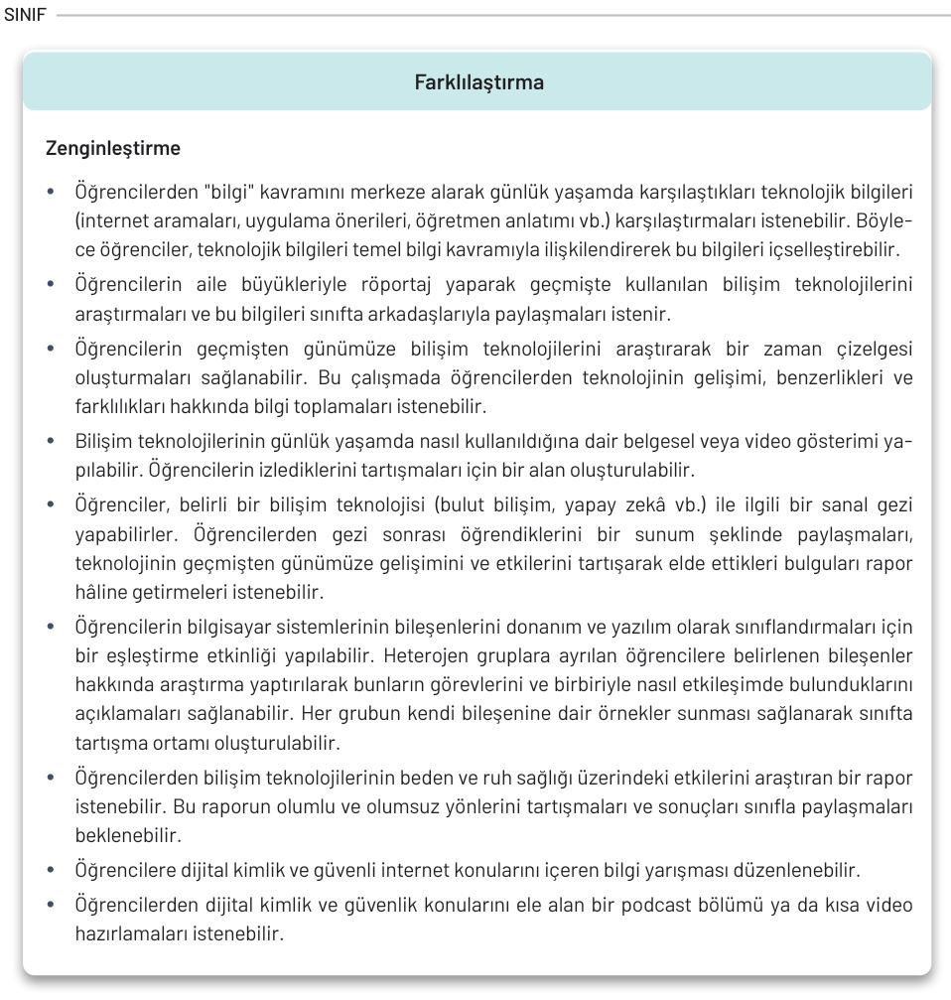
<!-- yer tutucu bulunamadı: sayfa sonuna eklendi -->

<!-- sayfa 64 -->

# Zenginleştirme Etkinliği 1

| | |
| :--- | :--- |
| **Etkinlik Adı:** | Geçmişten Günümüze Röportaj |
| **Etkinlik Süresi:** | ⌛ 40 dk. |
| **Etkinlik Türü:** | 👥 Grup Etkinlikleri |
| **Yöntem ve Teknikler:** | • Röportaj • Soru-cevap • Araştırma • Tartışma |
| **Materyaller:** | Röportaj soruları, Defter, Kalem, Sunum için etkileşimli tahta veya afiş kâğıdı |
| **Etkinlik Açıklaması:** | Bu etkinlikte öğrenciler, aile büyükleriyle röportaj yaparak geçmişte kullanılan bilişim teknolojilerini araştıracaktır. Röportajlardan elde ettikleri bilgileri sınıfta arkadaşlarıyla paylaşacak, geçmiş ile günümüz teknolojileri arasında karşılaştırma yaparak teknolojinin gelişimini fark edeceklerdir. |

**Uygulama Aşamaları:**

* Öğrencilere aile büyükleriyle röportaj yapmaları için sorular veriniz ("Sizin zamanınızda iletişim için hangi araçlar kullanılırdı? Bilgiye ulaşmak için hangi yöntemlere başvururdunuz?" vb.).
* Öğrencilerden röportaj sırasında aldıkları cevapları defterlerine not etmelerini isteyiniz.
* Röportajları evde tamamlamalarını ve derse getirmelerini söyleyiniz.
* Sınıfta her öğrencinin röportaj bulgularını 2-3 dakikalık açıklama yöntemiyle açıklamasını sağlayınız.
* Röportajlardan çıkan sonuçları tahtada "Geçmiş Teknolojiler ve Günümüz Teknolojileri" başlığı altında tablo hâline getiriniz.
* Öğrencilerle birlikte teknolojilerin benzerliklerini, farklılıklarını ve zamanla nasıl değiştiğini tartışınız.
* Teknolojinin sürekli geliştiği ve hayatımıza yeni imkânlar sunduğu sonucuyla etkinliği bitiriniz.

<!-- sayfa 65 -->

# Zenginleştirme Etkinliği 2

**Etkinlik Adı:** Bilişim Teknolojileri Zaman Çizelgesi

**Etkinlik Süresi:** 40 dk.

**Etkinlik Türü:** Grup Etkinlikleri

**Yöntem ve Teknikler:**
* Araştırma
* Sunum
* Tartışma

**Materyaller:** İnternet erişimi olan bilgisayar/tablet, Renkli karton veya A3 kâğıdı, Kalemler, cetvel, Etkileşimli tahta

**Etkinlik Açıklaması:** Bu etkinlikte öğrenciler, geçmişten günümüze bilişim teknolojilerinin gelişimini araştıracak ve elde ettikleri bilgileri zaman çizelgesi üzerinde göstereceklerdir. Öğrenciler, teknoloji tarihindeki önemli dönüm noktalarını belirleyerek benzerlikleri ve farklılıkları ortaya koyacaktır.

**Uygulama Aşamaları:**

* Öğrencileri 4-5 kişilik küçük gruplara ayırınız ve her gruba farklı bir dönem veriniz (1950–1970, 1970–1990, 1990–2010, 2010–2020, 2020-günümüz vb.).
* Gruplardan kendi dönemlerinde öne çıkan bilişim teknolojilerini araştırmalarını isteyiniz (ilk bilgisayarlar, internetin yaygınlaşması, akıllı telefonlar, yapay zekâ uygulamaları vb.).
* Öğrencilere araştırmalarını görsellerle desteklemeleri için yönlendirme yapınız (reklam afişleri, eski gazete kupürleri, kısa video vb.).
* Gruplardan topladıkları bilgileri bir zaman çizelgesi üzerinde göstermelerini isteyiniz.
* Hazırlanan çizelgeleri sınıfta sergileyiniz ve her grubun 1-2 dakikalık kısa sunum yapmasını sağlayınız.
* Sunumlar sonrasında tahtada "benzerlikler-farklılıklar" tablosu oluşturunuz.
* Dersin sonunda teknolojinin hızla geliştiğini ve geçmişin birikimleri üzerine kurulduğunu vurgulayarak etkinliği tamamlayınız.

<!-- sayfa 66 -->

# Zenginleştirme Etkinliği 3

**Etkinlik Adı:** Bilgisayar Sistemlerini Çözümlüyorum

**Etkinlik Süresi:** 40 dk.

**Etkinlik Türü:** Grup Etkinlikleri

**Yöntem ve Teknikler:**
* İş birlikli öğrenme
* Araştırma
* Sunum

**Materyaller:** Bilgisayar bileşenleri kartları (donanım ve yazılım isimleri), Bilgisayar sistemlerini çözümlüyorum interaktif etkinliği, A3 kâğıdı, renkli kalemler, Etkileşimli tahta

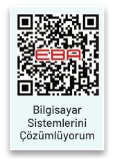

**Etkinlik Açıklaması:** Bu etkinlikte öğrenciler, bilgisayar sistemlerinin temel bileşenlerini donanım ve yazılım olarak sınıflandıracaklardır. Bu etkinliği dilerseniz kartlarla fiziksel olarak veya interaktif web 2.0 aracıyla gerçekleştirebilirsiniz.

**Uygulama Aşamaları:**

* Öğrencileri 4–5 kişilik heterojen gruplara ayırınız.
* Her gruba bilgisayar bileşenlerinin isimlerinin yazılı olduğu kartlar dağıtınız (işlemci, RAM, sabit disk, klavye, işletim sistemi, kelime işlemci vb.).
* Gruplardan bu kartları donanım ve yazılım olmak üzere ikiye ayırmalarını isteyiniz.
* Ayrım yapıldıktan sonra seçilen bileşenlerin görevlerini grupça açıklamalarını isteyiniz.
* Öğrencilerin bu bileşenlerin birbirleriyle nasıl etkileşim içinde olduğunu örneklerle anlatmalarını sağlayınız.
* Grupların sınıfta kısa sunumlar yaparak bulgularını paylaşmalarını sağlayınız.
* Tüm grupların sunumlarının ardından tahtada ortak bir tablo oluşturunuz: Donanım-Yazılım-Görevleri-Etkileşimleri.
* Etkinliği, bilgisayarın bütün bileşenlerinin bir sistem olarak uyum içinde çalıştığı vurgusuyla bitiriniz.

<!-- sayfa 67 -->

# Zenginleştirme Etkinliği 4

**Etkinlik Adı:** Teknolojinin Sağlığa Etkileri Raporu

**Etkinlik Süresi:** 40 dk.

**Etkinlik Türü:** Grup Etkinlikleri

**Yöntem ve Teknikler:**
* Araştırma
* Sunum
* Tartışma
* Raporlama

**Materyaller:** İnternet erişimi olan bilgisayar/tablet, Defter veya rapor şablonu, Etkileşimli tahta

**Etkinlik Açıklaması:** Bu etkinlikte öğrenciler, bilişim teknolojilerinin beden ve ruh sağlığı üzerindeki etkilerini araştıracaklardır. Araştırma sonucunda elde ettikleri bilgileri rapor hâline getirip sınıfta sunacaklar, rapor üzerinden olumlu ve olumsuz yönleri tartışacaklardır.

**Uygulama Aşamaları:**

* Öğrencileri 4-5 kişilik küçük gruplara ayırınız.
* Her gruba şu alt başlıklardan birini veriniz:
    * Fiziksel sağlık üzerindeki etkiler (duruş bozukluğu, göz sağlığı vb.)
    * Ruh sağlığı üzerindeki etkiler (dikkat dağınıklığı, bağımlılık, stres vb.)
    * Olumlu etkiler (öğrenme kolaylığı, hızlı bilgiye erişim vb.)
* Gruplardan seçtikleri alt başlıkla ilgili araştırma yapmalarını isteyiniz.
* Bulgularını olumlu ve olumsuz yönleri karşılaştırarak bir rapor hâline getirmelerini sağlayınız.
* Grupların raporlarını sınıfta sunum yaparak paylaşmalarını sağlayalım.
* Sunumların ardından sınıfta genel bir tartışma ortamı oluşturunuz: "Teknolojinin faydaları mı daha baskındır, zararları mı?"
* Etkinliği, teknoloji kullanımında dengeli olmanın önemi vurgusu ile bitiriniz.

<!-- sayfa 68 -->

# Zenginleştirme Etkinliği 5

| | |
| :--- | :--- |
| **Etkinlik Adı:** | Yapay Zekâ Çalışanlarının Bir Günü |
| **Etkinlik Süresi:** | ⌛ 40 dk. |
| **Etkinlik Türü:** | 👥 Grup Etkinlikleri |
| **Yöntem ve Teknikler:** | • İnceleme • Araştırma • Sunum |
| **Materyaller:** | İnternet Erişimi Olan Bilgisayar/Tablet, Araştırma Kılavuzu, Sunum Şablonu, Etkileşimli Tahta |
| **Etkinlik Açıklaması:** | Bu etkinlikte öğrenciler, yapay zekâ alanında çalışan meslekleri araştıracak ve bu kişilerin günlük iş rutinlerini inceleyecektir. Öğrenciler, mesleklerin görevlerini, karşılaştıkları zorlukları ve kullandıkları teknolojileri öğrenecek, elde ettikleri bilgileri grup sunumlarıyla sınıfta paylaşacaklardır. |

**Uygulama Aşamaları:**

* Öğrencileri 4-5 kişilik küçük gruplara ayırınız.
* Her gruba yapay zekâ ile ilişkili bir meslek (veri bilimci, yapay zekâ mühendisi, etik uzmanı, robotik tasarımcı vb.) seçtiriniz.
* Gruplardan seçtikleri mesleklerdeki kişilerin bir günlerini nasıl geçirdiklerini araştırmalarını isteyiniz (Meslek sahibinin sabah işe gelişinden gün sonuna kadar hangi işleri yaptığı araştırılır.).
* Öğrencilerin topladıkları bilgileri 4–5 slaytlık kısa bir sunum hâline getirmelerini sağlayınız.
* Gruplara sırayla sunum yaptırınız ve diğer öğrencilerin sorular sormalarını teşvik ediniz.
* Sunum sonunda yapay zekâ alanındaki farklı mesleklerin karşılaştırmasını yaparak dersin ana fikrini özetleyiniz.

<!-- sayfa 69 -->

# Farklılaştırma

## Destekleme

* Öğrencilerin bilişim teknolojilerine dair temel kavramları anlamalarına yardımcı olmak için kavram haritaları oluşturma etkinliği düzenlenebilir. Bu haritalar, öğrencilerin anahtar kavramları ve ilişkilerini görsel olarak anlamalarına yardımcı olacaktır.
* Öğrencilerden bilişim teknolojilerinin farklı dönemlere ait araçlarını temsil eden kartları kullanarak bir zaman çizelgesi oluşturmaları istenebilir. "Bu gelişme toplumu nasıl etkiledi?" sorusuna cevap aramaları beklenebilir.
* Öğrencilerden dijital vatandaşlıkla ilgili uygulamaları temsil eden görseller veya kartları (sosyal medya, çevrim içi alışveriş, online bankacılık, eğitim platformları vb.) kullanarak sınıf içinde herkesin görebileceği bir sınıflandırma panosu oluşturmaları istenebilir. Pano üzerinde uygulamalar "iletişim", "eğlence", "eğitim", "finans", "güvenlik" gibi kategoriler altında gruplandırılır; böylece öğrencilerin günlük yaşamda kullandıkları dijital ortamları sınıflandırarak dijital vatandaşlık bileşenlerini somut biçimde fark etmeleri sağlanır.
* Yapay zekâya ilişkin temel kavramlar ve yapay zekânın kullanım alanlarıyla ilgili anahtar kelimeler kullanılarak bir bulmaca oluşturulabilir. Öğrencilerden bulmacayı çözerken temel kavramları ve kullanım alanlarını açıklamaları istenebilir.
* Öğrencilere dijital dünyada karşılaşılabilecek olası tehlikeler ve bu tehlikelere karşı alınacak önlemlerle ilgili bir senaryo verilerek bu senaryoyu canlandırmaları istenebilir.
* Öğrencilere bilgisayarın temel parçalarını gösteren bir görsel verilerek öğrencilerden bu görseldeki her bir bilgisayar parçasını doğru şekilde eşleştirmeleri istenebilir.

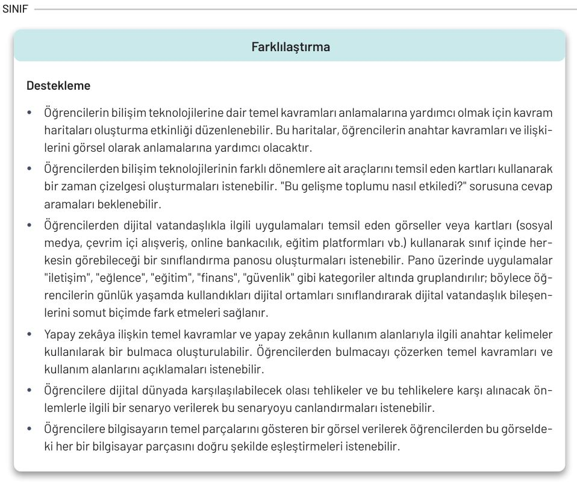
<!-- yer tutucu bulunamadı: sayfa sonuna eklendi -->

<!-- sayfa 70 -->

# Destekleme Etkinliği 1

| | |
| :--- | :--- |
| **Etkinlik Adı:** | Kavram Haritası ile Öğreniyorum |
| **Etkinlik Süresi:** | 20 dk. |
| **Etkinlik Türü:** | Bireysel Etkinlikler |
| **Yöntem ve Teknikler:** | • Kavram Haritası • Tartışma |
| **Materyaller:** | A3 kâğıdı, renkli kalemler, Örnek kavram listesi (bilgi, veri, donanım, yazılım, internet, yapay zekâ vb.), Etkileşimli tahta |
| **Etkinlik Açıklaması:** | Bu etkinlikte öğrenciler, bilişim teknolojilerine ilişkin temel kavramları daha iyi anlamak için kavram haritası oluşturacaktır. Öğrenciler, anahtar kavramlar arasındaki ilişkileri görsel olarak gösterecek ve sınıfta paylaşarak tartışacaktır. |

**Uygulama Aşamaları:**

* Öğrencilere temel kavramların yazılı olduğu bir liste dağıtınız (ör. bilgi, veri, donanım, yazılım, internet, yapay zekâ).
* Öğrencilerden bu kavramları kâğıda yazmalarını ve aralarındaki ilişkileri oklarla göstermelerini isteyiniz.
* Çalışmalarını tamamlayan öğrencilerden bazılarını tahtaya davet ederek kavram haritasını sınıfla paylaşmalarını sağlayınız.
* Sunum sırasında öğrencilerin farklı bağlantılar kurmasını teşvik ediniz.
* Bunun için yönlendirici sorular ("Bu teknolojinin günümüzdeki karşılığı nedir? Benzer bir durumu siz nerede deneyimlediniz?" vb.) sorarak öğrencilerin daha geniş bakış açısıyla ilişkilendirme yapmalarına rehberlik ediniz.
* Son aşamada tahtada ortak bir kavram haritası çizerek etkinliği sınıfın katkılarıyla tamamlayınız.

<!-- sayfa 71 -->

# Destekleme Etkinliği 2

| | |
| :--- | :--- |
| **Etkinlik Adı:** | Dijital Vatandaşlık Panosu |
| **Etkinlik Süresi:** | 25 dk. |
| **Etkinlik Türü:** | Grup Etkinlikleri |
| **Yöntem ve Teknikler:** | İş birlikli öğrenme |
| **Materyaller:** | Kartlar (sosyal medya, online alışveriş, e-devlet, çevrim içi bankacılık, eğitim platformları vb. görseller), Yapıştırıcı, Büyük pano kartonu veya tahta, Renkli kalemler |
| **Etkinlik Açıklaması:** | Bu etkinlikte öğrenciler, dijital vatandaşlık uygulamalarını kullanım alanlarına göre sınıflandırarak bir pano hazırlayacaktır. Böylece öğrenciler dijital vatandaşlık kavramını günlük yaşam örnekleri üzerinden görselleştirme fırsatı bulacaktır. |

**Uygulama Aşamaları:**

* Öğrencileri 4-5 kişilik küçük gruplara ayırınız.
* Her gruba farklı dijital uygulamaları temsil eden kartlar dağıtınız (sosyal medya, online alışveriş, çevrim içi eğitim platformları, bankacılık, e-devlet vb.).
* Gruplardan bu kartları kullanım alanlarına göre sınıflandırmalarını isteyiniz.
* Grupların hazırladığı sınıflandırmaları panoya veya tahtaya yapıştırınız.
* Tüm panoyu sınıfça inceleyerek hangi uygulamanın hangi kategoride yer aldığını tartışınız.
* Öğrencilerin panoya ek örnekler önermelerini sağlayınız (oyunlar, dijital kütüphane, çevrim içi sağlık sistemleri vb.).
* Etkinliği, dijital vatandaşlık kavramının hayatın birçok alanında karşımıza çıktığını vurgulayarak sonlandırınız.

<!-- sayfa 72 -->

# Destekleme Etkinliği 3

**Etkinlik Adı:** Yapay Zekâ Kavramlarını Bulmacayla Keşfediyorum

**Etkinlik Süresi:** 20 dk.

**Etkinlik Türü:** Grup Etkinlikleri

**Yöntem ve Teknikler:**
* Oyunlaştırma
* Problem çözme

**Materyaller:** Yapay Zekâ Kelime Bulmacası Etkinliği, Etkileşimli tahta

**Etkinlik Açıklaması:** Bu etkinlikte öğrenciler, yapay zekâya ilişkin temel kavramlar ve kullanım alanlarını bir bulmaca aracılığıyla öğreneceklerdir. Öğrenciler bulmacadaki kavramları bularak hem kelime bilgilerini geliştirecek hem de kavramların anlamlarını açıklayarak pekiştireceklerdir.

**Uygulama Aşamaları:**

* Yapay Zekâ Kelime Bulmacası etkinliği adlı interaktif bulmacayı etkileşimli tahta veya öğrenci cihazlarından açınız.
* Öğrencilerden bulmaca üzerinde gizlenmiş kelimeleri sırayla bulmalarını isteyiniz (veri, algoritma, model, yüz tanıma, sesli asistan, öneri sistemi vb.).
* Bulunan her kelimenin ardından öğrenciye şu yönergeleri veriniz:
    * Anlamını açıklayınız.
    * Günlük hayattan bir örnek veriniz.

* Zorlanan öğrencilere ilk harfi gösteren ipucu butonuna basmalarını söyleyiniz.
* Eksik veya düzeltilmesi gereken açıklamalar varsa sınıfça düzeltilmesini sağlayınız.
* Bir veya iki gruptan kavramların özetini sunmalarını isteyiniz.
* Veri gizliliği ve ön yargı gibi güvenlik ve etikle ilgili alanlarda hatırlatmalar yaparak etkinliği tamamlayınız.
* Değerlendirme:
    * Kelimeyi bulma: 1 puan
    * Anlamı doğru ifade etme: 2 puan
    * Günlük hayattan örnek verme: 2 puan
    * Toplam: 5 puan/kavram
* İleri düzeydeki öğrencilerden kavramla ilgili bir "yanılgı örneği" ("Algoritma sadece kod demektir." vb.) eklemelerini isteyiniz.

<!-- sayfa 73 -->

# 2. TEMA

## DİJİTAL ÜRÜN TASARIMI VE GELİŞTİRME

| | |
| :---: | :---: |
|  |  |
| 2. Tema | Tema Özeti |

<!-- sayfa 74 -->

| DERS SAATİ | 12 ders saati |
| :--- | :--- |
| **İÇERİK ÇERÇEVESİ** | Görsel Düzenleme Programlarına Giriş Görsel Tasarıma Yönelik Kurgu Oluşturma Görsel Ürün Geliştirme Kelime İşlemci Programlarına Giriş Kelime İşlemci Dosyası Geliştirme Sunum Programlarına Giriş Sunum Dosyası Oluşturma |
| **ÖĞRENME ÇIKTILARI VE SÜREÇ BİLEŞENLERİ** | BTY.5.2.1 Görsel düzenleme programlarından yararlanabilme a) Görsellerin temel özelliklerini tanır. b) Uygun görsel düzenleme programını belirler. c) Belirlenen görsel düzenleme programının arayüz özelliklerini kullanır. ç) Kullanılan görsel düzenleme programını kullanım alanları/verimliliği açısından değerlendirir.  BTY.5.2.2 Görsel için kurgu oluşturabilme a) Görsel tasarlanacak gerçek hayat problemini belirler. b) Görsel hazırlama sürecinde kullanılacak hikâye/senaryo unsurlarını belirler. c) Belirlenen unsurları kapsayan hikâye/senaryo oluşturur. ç) Hikâyeyi/senaryoyu bütünlük/kullanışlılık açısından değerlendirir.  BTY.5.2.3 Görsel dosyası geliştirebilme a) Tasarlanan hikâye/senaryo unsurlarına uygun bir görsel oluşturur. b) Oluşturulan görseli belirlenen ölçütler açısından değerlendirir.  BTY.5.2.4 Kelime işlemci programlarından yararlanabilme a) Kelime işlemci programlarının temel özelliklerini tanır. b) Uygun kelime işlemci programını belirler. c) Belirlenen kelime işlemci programının arayüz özelliklerini kullanır. ç) Kullanılan kelime işlemci programını kullanım alanları/verimliliği açısından değerlendirir.  BTY.5.2.5 Kelime işlemci dosyası geliştirebilme a) Kelime işlemci dosyası oluşturur. b) Oluşturulan kelime işlemci dosyasını belirlenen ölçütler açısından değerlendirir.  BTY.5.2.6 Sunum programlarından yararlanabilme a) Sunum programlarının temel özelliklerini tanır. b) Uygun sunum programını belirler. c) Belirlenen sunum programının arayüz özelliklerini kullanır. ç) Kullanılan sunum programını kullanım alanları/verimliliği açısından değerlendirir.  BTY.5.2.7 Sunum dosyası geliştirebilme a) Sunum dosyası oluşturur. |

<!-- yer tutucu bulunamadı: sayfa sonuna eklendi -->

<!-- sayfa 75 -->

| | |
| :--- | :--- |
| Alan Becerileri | BTYAB4. Dijital Ürün Geliştirme (BTYAB4.1. Tasarım Araç, Teknoloji ve Yöntemlerinden Yararlanma, BTYAB4.2. Tasarım Kurgusu Oluşturma, BTYAB4.3. Ürün Geliştirme) |
| Kavramsal Beceriler | - |
| Eğilimler | E1.1. Merak, E1.2. Bağımsızlık, E1.4. Kendine İnanma (Öz Yeterlilik), E2.1.Empati, E2.2. Sorumluluk, E2.3. Girişkenlik, E2.5. Oyunseverlik, E3.1. Muhakeme, E3.2. Odaklanma, E3.3. Yaratıcılık, E3.4. Gerçeği Arama, E3.5. Açık Fikirlilik, E3.6. Analitiklik, E3.10. Eleştirel Bakma |
| PROGRAMLAR ARASI BİLEŞENLER | **Sosyal Duygusal Öğrenme Becerileri** SDB1.2. Kendini Düzenleme (Öz Düzenleme), SDB2.1. İletişim, SDB2.2. İş Birliği, SDB2.3. Sosyal Farkındalık, SDB3.1. Uyum, SDB3.2. Esneklik, SDB3.3. Sorumlu Karar Verme  **Değerler** D6. Dürüstlük, D16. Sorumluluk, D17. Tasarruf, D19. Vatanseverlik  **Okuryazarlık Becerileri** OB1. Bilgi Okuryazarlığı, OB2. Dijital Okuryazarlık |
| Disiplinler Arası İlişkiler | Görsel Sanatlar, Sosyal Bilgiler, Türkçe |
| Beceriler Arası İlişkiler | KB2.7. Karşılaştırma, KB2.11. Gözleme Dayalı Tahmin Etme, KB2.13 Yapılandırma, KB2.14. Yorumlama, KB3.3. Eleştirel Düşünme |
| Anahtar Kavramlar | afiş, arayüz, belge, bitmap, çizim, dergi, dosya, fotoğraf, görsel, görsel tasarım, kelime işlemci, metin, piksel, resim, sunum, vektörel |

<!-- yer tutucu bulunamadı: sayfa sonuna eklendi -->

<!-- sayfa 76 -->

# Ön Değerlendirme

Aşağıdaki soruları öğrencilere yönelterek yanıtlamalarını isteyiniz.

* Sınıfa aynı konuya ait iki farklı afiş/poster örneği getiriniz. Birinci afiş/poster kâğıt ve kalem kullanılarak hazırlanmış olsun, ikincisi ise bilgisayarda bir görsel düzenleme programıyla hazırlanmış olsun. Öğrencilerinize şu soruları yöneltiniz: "Bu iki afiş/poster arasındaki farklılıklar nelerdir? Sizce hangi afiş mesajı daha etkili iletiyor? Neden?" Verilen yanıtlar doğrultusunda görsel düzenleme programlarının sunduğu kolaylıklar (renk seçimi, yazı tipi çeşitliliği, simge kullanımı, hizalama vb.) üzerinde durunuz.
* Bilgisayarda bir resim çizdiniz mi? Bu süreçteki deneyiminizi bizimle paylaşır mısınız?
* Sınıfa aynı metnin iki farklı versiyonunu getiriniz. Birinci metin kâğıt ve kalem kullanarak düz yazı şeklinde hazırlanmış olsun, ikincisi ise kelime işlemci programında başlık–alt başlık, madde işaretleri, yazı tipi boyutu, kalın–italik yazı, paragraf hizalama, renkli vurgular, tablo, resim ve çizim ekleme özellikleriyle düzenlenmiş olsun. Öğrencilerinize şu soruları yöneltiniz: "Bu iki metin arasındaki farkları nelerdir Sizce hangi metin bilgiyi daha anlaşılır ve etkili sunuyor? Neden?", "Ödevinizi hazırlarken kâğıt, kalem mi yoksa biçimlendirme imkânı olan bir program mı kullanmak isterdiniz? Neden?" Verilen yanıtlar doğrultusunda kelime işlemci programlarının sunduğu kolaylıklar (başlıklan dırma, listeleme, vurgu yapma, hizalama, tablo ve görsel ekleme vb.) üzerinde durunuz.
* Deftere yazı yazmakla bilgisayarda yazı yazmak arasında sizce farklılık var mı? Hangisini tercih edersiniz? Tercihinizin nedenlerini açıklayınız.
* Bilgisayarda yazı yazmanız gerektiğinde tercih ettiğiniz bir program varsa bu programı ve kullanım amacınızı anlatır mısınız?
* Sizce kelime işlemci programları eğitimde veya günlük hayatta ne için kullanılır?
* Bilgisayarda yazı yazmak için bir program kullanmak istediğinizde o programda hangi özelliklerin olmasını isterdiniz?
* Aynı bilgiyi iki farklı biçimde anlatacak materyaller hazırlayarak sınıfa getiriniz. Birincisi kâğıt üzerinde sıralı notlar şeklinde yazılmış olsun, ikincisi ise bilgisayarda bir sunum programı kullanılarak görseller ve basit animasyonlarla desteklenmiş olsun. Öğrencilere şu soruyu yöneltiniz: "Bir topluluğa bilgi verirken bu iki yöntemden hangisi daha etkili olurdu? Neden?" Verilen yanıtlar doğrultusunda sunum programlarının sunduğu kolaylıklar (görsel destek, ses–video ekleme, animasyon kullanımı, slayt geçişi ekleme vb.) üzerinde durunuz.
* Bilgisayarda bir sunum hazırlamanız gerektiğinde hangi program/aracı kullandınız? Sunum hazırlama deneyiminizi paylaşınız.
* Slayt nedir, ne için kullanılır? Açıklayınız.
* İzlediğiniz sunumlarda dikkatinizi çeken görsel ve yapısal ögeler nelerdi? Bu ögelerin sunumun etkileyiciliği üzerindeki rolünü nasıl değerlendirirsiniz?
* Eğer bir proje ödevini BİT ile sunmak isteseniz hangi programı kullanırdınız? Sebepleriyle birlikte açıklayınız.

<!-- yer tutucu bulunamadı: sayfa sonuna eklendi -->

<!-- sayfa 77 -->

# Bağlantı Noktası

* Öğrencilere boş bir kâğıt veriniz ve çevre, sağlık, çocuk hakları vb. konulardan birini seçerek afiş tasarlamalarını isteyiniz. Ardından aynı konuyla ilgili ünlü bir dijital afiş örneği gösteriniz, ikisini kıyaslamalarını sağlayınız.
* Öğrencilerden okul dergisi için kısa bir yazı hazırlamalarını isteyiniz. Kâğıt ve kalem kullanılarak hazırlanan yazıları "BTY.5.2.5 Kelime işlemci dosyası geliştirebilme" öğrenme çıktısında kullanılmak üzere saklayınız. İlgili öğrenme çıktısı sürecinde öğrencilerin daha önceden hazırladıkları yazıları kelime işlemci programı kullanarak düzeltmelerini ve bu iki deneyim arasındaki farklılıkları söylemelerini isteyiniz.
* Öğrencilerden aynı bilgiyi iki farklı şekilde sunmalarını içeren bir drama etkinliği yapmalarını isteyiniz. Gruplardan biri bilgiyi yalnızca yazılı olarak aktarırken diğer grup ise görsel ve animasyon destekli bir sunum yapabilir. Ayrıca, bu iki sunumu izleyen bir seyirci grubu oluşturunuz. Seyircilerden, aktarılan bilgiyi nasıl algıladıklarını ve hangi yöntemin kendilerinde daha fazla etki bıraktığını ifade etmelerini isteyiniz. Sunumların ardından öğrencilere "Bir topluluğa bilgi verirken bu yöntemlerden hangisi daha etkili olurdu? Neden?" sorusunu yönelterek sınıfta tartışma başlatınız.

<!-- yer tutucu bulunamadı: sayfa sonuna eklendi -->

<!-- sayfa 78 -->

# GÖRSEL DÜZENLEME PROGRAMLARINA GİRİŞ

**Süre:**
2 ders saati

**Öğrenme Çıktıları**
BTY.5.2.1 Görsel düzenleme programlarından yararlanabilme
a) Görsellerin temel özelliklerini tanır.
b) Uygun görsel düzenleme programını belirler.

**Dersten Önce**
* Dijital veya fiziki dergi, broşür, gazete, afiş ve davetiye örnekleri getiriniz.
* Dijital görsel örnekleri hazırlayınız.
* Aynı görselin dijital olarak vektörel ve bitmap biçimlerinin bulunduğu belgeyi hazırlayınız.
* Görsellerle ilgili tanımların yer aldığı belgeyi hazırlayınız.
* Aynı görselin farklı boyut ve çözünürlükte kullanıldığı belgeyi hazırlayınız.
* Görsel düzenleme programlarının arayüzünün tanıtıldığı etkileşimli öğretim materyalini hazırlayınız.
* Görsel dosya uzantıları ile ilgili etkileşimli öğretim materyalini hazırlayınız.

**Dikkat Çekme**
Aşağıdaki soruları öğrencilere yönelterek yanıtlamalarını isteyiniz.
* Bir görseli ilk gördüğünüzde dikkatinizi en çok ne çeker?
* Bir fotoğraf çekerken görüntünün çok net ya da bulanık olması sizce neyle ilgili olabilir?
* Baskıya göndermek istediğiniz bir resmi büyüttüğünüzde neden bazen pikselli (küçük lego parçalarına benzer) görünür?
* Sosyal medyada paylaşmak için hazırlanan görsellerle afişlerde kullanılan görseller arasında nasıl farklılıklar olabilir?
* Görseli çok küçük kaydettiğimizde hangi sorunlarla karşılaşabiliriz?
* Telefonla çekilen bir fotoğrafı büyüttüğünüzde görüntüde neler fark edersiniz?
* Bazı logolar büyütüldüğünde neden hiç bozulmadan net kalabilir?
* El ilanları, rozet ya da kartvizit gibi küçük ama net olması gereken görselleri hazırlarken nelere dikkat etmek gerekebilir?

**Ders Süreci**
☐ "Fotoğraf, çizim ve resim arasında ne tür farklar vardır?" sorusunu tahtaya yazınız veya sözel olarak öğrencilere sorunuz. "Bugün farklı görsel türlerini tanıyacağız. Acaba yalnızca görüntüsüne bakarak bir görselin fotoğraf mı, çizim mi yoksa resim mi olduğunu nasıl anlayabiliriz?" sorusunu sorarak merak uyandırınız. "Farkı Fark Et" etkinliğini uygulayınız. Öğrencilere/gruplara etkinlik sürecinde kısa notlar alabilmek için kâğıt-kalem kullanabileceklerini belirtiniz.

☐ Aynı görselin vektörel ve bitmap versiyonları ile farklı boyut ve çözünürlükteki örneklerin bulunduğu görsellerin yer aldığı belgeyi etkileşimli tahta ya da projeksiyonla yansıtınız. "Hangisini Seçerdiniz?" etkinliğini uygulayınız.

<!-- sayfa 79 -->

☐ Tahtaya öğrencilerin dikkatini çekecek basit bir görsel çiziniz. Aşağıdaki açık uçlu soruları yönelterek öğrencilerin ön bilgilerini harekete geçiriniz:
* Herhangi bir BİT ürünü kullanarak bir görsel oluşturdunuz mu?
* Daha önce bir görsel düzenleme programı kullandınız mı?
* Görselleri düzenlemek için hangi programları kullandınız?

☐ Farklı görsel düzenleme programlarını tanımak ve hangi durumlarda hangi programın daha uygun olduğunu keşfetmek amacıyla “Doğru Program, Etkili Tasarım” etkinliğini uygulayınız.

<!-- sayfa 80 -->

# Etkinlik 1

**Etkinlik Adı:** Farkı Fark Et
**Etkinlik Süresi:** 20 dk.
**Etkinlik Türü:** Bireysel Etkinlikler
**Yöntem ve Teknikler:**
* Tartışma
* 5N1K yöntemi

**Materyaller:** Bilgisayar/etkileşimli tahta/projeksiyon cihazı, Kâğıt-kalem, Dijital/basılı dergi, broşür, gazete, afiş ve davetiye örnekleri

**Etkinlik Açıklaması:** Bu etkinlik, öğrencilerin resim, çizim ve fotoğraf kavramlarını birbirinden ayırt edebilme becerisini geliştirmeyi amaçlamaktadır.

**Uygulama Aşamaları:**

Aşağıdaki basamakları uygulayarak etkinliğin tamamlanmasını sağlayınız.

* Öğrencileri gruplara ayırınız. Her gruba ilgi, yaş ve hazırbulunuşluklarına uygun olarak önceden hazırlanmış çeşitli görsellerin yer aldığı dergi, broşür, afişleri dijital olarak yansıtınız veya basılı hâllerini incelemelerini sağlayınız. Görsel Türleri isimli belgeyi kullanabilirsiniz.
* Gruplara "Her bir görselin hangi türe ait olduğunu belirleyiniz. Kararınızı gerekçelendiriniz ve arkadaşlarınızla tartışınız." yönergesiyle görevlerini tanımlayınız. Her grubun 5N1K yöntemini kullanarak aşağıdaki sorulara göre görselleri analiz etmelerini isteyiniz:
    * Ne görüyorsunuz?
    * Nerede çekilmiş/çizilmiş olabilir?
    * Ne zaman hazırlanmış olabilir?
    * Kim hazırlamış olabilir?
    * Nasıl bir teknik kullanılmış?
    * Neden bu görsel türü seçilmiş olabilir?

* Öğrencilere çizim, resim ve fotoğraf arasındaki farklılıkları düşündürecek aşağıdaki soruları yönelterek kavramları ayırt etmelerine rehberlik ediniz.
    * Görsel bir fotoğraf mı yoksa çizim ya da resim mi? Bunu nasıl anladınız?
    * Bir an mı yakalanmış, yoksa hayal ürünü mü betimlenmiş?
    * Bu görsel logo, ikon ya da çizim tarzında mı?
    * Görselde gerçek hayattaki ayrıntılar (ışık, gölge, doku) var mı yoksa görsel basit çizgi ve şekillerden mi oluşuyor?

<!-- sayfa 81 -->

* Grupların elde ettikleri analiz sonuçlarına göre resim, çizim ve fotoğraf kavramlarını anlamlarını değiştirmeyecek şekilde tanımlamalarını sağlayınız.
* Kavramları açıklayınız. Ardından aşağıdaki tartışma sorularını yöneltiniz:
    * Bir hikâye anlatmak isteseydiniz çizim mi yoksa fotoğraf mı seçerdiniz?
    * Bir reklam hazırlayacak olsanız hangisini kullanmak isterdiniz? Tercihinizin nedenini açıklayınız.
* Öğrenci katılımını destekleyerek dileyen öğrencilerin düşüncelerini paylaşmalarına fırsat veriniz.

<!-- sayfa 82 -->

# Etkinlik 2

| Etkinlik Adı: | Hangisini Seçerdiniz? |
| :--- | :--- |
| **Etkinlik Süresi:** | 20 dk. |
| **Etkinlik Türü:** | Bireysel Etkinlik ve Grup Etkinlikleri |
| **Yöntem ve Teknikler:** | • Soru-Cevap   • Gösterip Yaptırma |
| **Materyaller:** | Bilgisayar/Etkileşimli tahta/Projeksiyon cihazı, Aynı görselin dijital olarak vektörel ve bitmap biçimlerinin bulunduğu belge, Aynı görselin farklı boyut ve çözünürlükte kullanıldığı belge |

| Etkinlik Açıklaması: | Bu etkinlikte öğrenciler, bitmap ve vektörel grafik kavramları ile boyut ve çözünürlük kavramları arasındaki farkları öğrenecektir. |
| :--- | :--- |

## Uygulama Aşamaları:

Aşağıdaki basamakları uygulayarak etkinliğin tamamlanmasını sağlayınız.

* Aynı görselin vektörel ve bitmap biçimlerinin bulunduğu belgeyi yansıtınız. Süreçte her öğrencinin aktif katılımını destekleyerek tartışma kültürü geliştirmelerine rehberlik ediniz. Öğrencilere aşağıdaki soruları yönelterek dikkatlerini görsellerdeki farklılıklara çekiniz:
    * Görseli büyüttüğünüzde hangisi netliğini koruyor?
    * Hangisi daha pürüzlü görünüyor? Neden?
    * Hangi grafik türü afiş, logo veya simge tasarımı için daha uygundur?
* Vektörel ve bitmap (raster) grafiklerin temel özelliklerini açıklayınız, piksel kavramını tanıtınız.
* Aynı görselin farklı boyutlarda (küçük, orta, büyük) hazırlanmış hâllerini öğrencilere gösteriniz. "Bir görselin boyutu değiştikçe görselde ne değişir? Bir görselin boyutunun değişmesi kapladığı alan dışında dosya üzerinde başka bir etki yaratır mı?" sorularını sırayla sorarak düşüncelerini açıklamalarını isteyiniz.
* Aynı görseli farklı çözünürlüklerde hazırlayarak öğrencilere gösteriniz. "Bir resmi bilgisayarda yakınlaştırdığınızda neden bazıları bulanık, bazıları net kalıyor?" sorusunu öğrencilere yöneltiniz. Öğrencilerin tahminlerini gerekçelendirerek açıklamalarını isteyiniz.
* Poster, sosyal medya görseli ve baskı materyali gibi günlük yaşam örneklerini dikkate alarak farklı kullanım amaçları için uygun boyut ve çözünürlük seçimlerini açıklayınız.
* Örneğin: Okulda yapılacak bir tiyatro için bir afiş tasarlıyorsunuz. Afiş hem okul panosuna asılacak hem de sosyal medyada paylaşılacaktır. Bu iki farklı kullanım için hangi boyut ve çözünürlükleri tercih ederdiniz? Nedenlerini açıklayınız.
* Öğrencilerden boyut ve çözünürlük arasındaki farklılıkları belirlemelerini ve bu kavramların gör-

<!-- sayfa 83 -->

# Etkinlik 3

| | |
| :--- | :--- |
| **Etkinlik Adı:** | Doğru Program, Etkili Tasarım |
| **Etkinlik Süresi:** | ⌛ 20 dk. |
| **Etkinlik Türü:** | 👥 Bireysel Etkinlik ve Grup Etkinlikleri |
| **Yöntem ve Teknikler:** | • Soru-Cevap   • Tartışma |
| **Materyaller:** | Etkileşimli tahta/Projeksiyon cihazı, Çeşitli iki ve üç boyutlu görsel düzenleme programlarının/çevrim içi araçların/yapay zekâ destekli görsel düzenleme araçlarının ekran görüntülerinin bulunduğu infografik, Farklı programlar |
| **Etkinlik Açıklaması:** | Bu etkinlik, öğrencilerin farklı görsel düzenleme programlarını işlevsellik, kullanım alanı, kullanım kolaylığı, güvenlik, erişilebilirlik ölçütleri açısından karşılaştırmalarını ve amaçlarına uygun programı seçmelerini amaçlamaktadır. |

**Uygulama Aşamaları:**

Aşağıdaki basamakları uygulayarak etkinliğin tamamlanmasını sağlayınız.

* Öğrencilere, bir görsel oluştururken bilgisayardan nasıl yararlanılabileceği ve görsel hazırlama sürecinin nasıl ilerleyebileceği sorularını yönelterek etkinliğe giriş yapınız. Bu aşamada öğrencilerin süreci adım adım düşünmelerini sağlayınız.
* Bu düşünceler doğrultusunda süreci somutlaştırmak amacıyla, öğrencilere hazırladığınız uygulama ekran görüntülerinin yer aldığı infografiği yansıtınız. İnfografikteki görseller üzerinden görsel düzenleme programları/çevrim içi araçları/yapay zekâ destekli uygulamalarının temel işlevlerini ve kullanım amaçlarını açıklayınız. "Bu program vektör tabanlı olduğu için çizim yapmaya daha uygundur.", "Bu program hazır görselleri kırpma ve filtreleme için daha kullanışlıdır.", "Bu uygulama yapay zekâ desteğiyle otomatik tasarım önerileri sunar." vb. Öğrencilerin programları karşılaştırmalarını sağlamak için aşağıdaki soruları yöneltiniz:
    *  İki veya üç boyutlu görsel geliştirmek için hangi program/araçları kullanabiliriz?
    *  İnfografikte arayüzleri bulunan program/araçların hangileri çizim yapmaya, hangileri hazır görselleri düzenlemeye daha uygundur?
    *  Kullanım kolaylıklarını dikkate aldığınızda hangisini tercih edersiniz?
    *  Tercih ettiğiniz görsel düzenleme programı ücretsiz mi, lisanslı mı?
* Görsel kullanımına yönelik örnek senaryoların bulunduğu belgeyi kullanarak öğrencilerden senaryolara uygun program/araç seçmelerini ve neden o programı tercih ettiklerini tartışarak sınıfa sunmalarını isteyiniz.

![QR Kod]
Görsel Kullanımına Yönelik Örnek Senaryolar

<!-- sayfa 84 -->

# Ara Değerlendirme

"Farkı Fark Et", "Hangisini Seçerdiniz?" ve "Doğru Program, Etkili Tasarım" etkinliklerini karekodlarda yer alan değerlendirme ölçekleri doğrultusunda değerlendiriniz.

# Gelecek Derse Hazırlık

"Dijital ortamda bir görsel tasarlamanız gerekseydi bunun için hangi program/aracı seçerdiniz?" sorusu üzerine düşünerek bir görsel düzenleme programı belirleyiniz. Tercih nedeninizi kısaca not ediniz. Belirlediğiniz programın arayüzünü inceleyiniz.

<!-- yer tutucu bulunamadı: sayfa sonuna eklendi -->

<!-- sayfa 85 -->

# GÖRSEL DÜZENLEME PROGRAMLARINA GİRİŞ

**Süre:**
1 ders saati

**Öğrenme Çıktıları**
BTY.5.2.1 Görsel düzenleme programlarından yararlanabilme
a) Belirlenen görsel düzenleme programının arayüz özelliklerini kullanır.
b) Kullanılan görsel düzenleme programını kullanım alanları/verimliliği açısından değerlendirir.

**Dersten Önce**
* Buton kartları (görsel ve işlev içeren) hazırlayınız.
* Mini görev kartları hazırlayınız.
* Görsel düzenleme programının arayüz özelliklerini tanıtımında kullanılacak Etkileşimli Arayüz etkinliğini hazırlayınız.

**Dikkat Çekme**
Aşağıdaki soruları öğrencilere yönelterek yanıtlamalarını isteyiniz.
* Bir görseli kâğıt ve kalemle hazırlamak ile bilgisayar kullanarak hazırlamak arasında ne gibi farklılıklar bulunur?
* Sosyal medyada ya da reklamlarda gördüğünüz dikkat çekici görsellerin hangi program/araçlarla ve nasıl hazırlandığını düşünüyorsunuz? Düşüncelerinizi arkadaşlarınızla paylaşınız.
* Sizce dijital görsellerin hazırlanmasında hangi programlar kullanılmaktadır (çizim programları, fotoğraf düzenleme araçları, 3 boyutlu modelleme yazılımları, yapay zekâ destekli uygulamalar vb.)? Düşüncelerinizi arkadaşlarınızla paylaşınız.
* Bir bilgisayar oyunu karakteri ya da animasyon filmi kahramanı sizce hangi tür program/araçlarla tasarlanıyor olabilir?
* Bir görsel düzenleme program/aracını açtığınızda ekranda gördüğünüz menü, araç çubuğu, katman paneli vb. sizce ne işe yarıyor olabilir?
* Sosyal medyada gördüğünüz bazı görsellerin yapay zekâ tarafından üretildiğini fark ettiniz mi? Sizce bu tür görselleri kullanmanın avantaj ve sakıncaları neler olabilir?

**Ders Süreci**
☐ "Gizemli Butonlar" etkinliğini uygulayınız.

<!-- sayfa 86 -->

# Etkinlik 4

**Etkinlik Adı:** Gizemli Butonlar

**Etkinlik Süresi:** ⌛ 35 dk.

**Etkinlik Türü:** 👥 Bireysel Etkinlik ve Grup Etkinlikleri

**Yöntem ve Teknikler:**
* Eğitsel oyun
* Gösterip yaptırma
* Tartışma
* Soru-cevap

**Materyaller:**
Bilgisayar/etkileşimli tahta/projeksiyon cihazı, Görsel düzenleme program/aracı, Buton kartları, Görev kartları, Örnek görseller, İnternet bağlantısı (yapay zekâ araçları denemesi için-opsiyonel)

**Etkinlik Açıklaması:**
Bu etkinlikte öğrenciler, seçilen bir görsel düzenleme program/aracının arayüzünü keşfederek, menü, araç çubuğu, katman paneli gibi temel ögeleri tanır. Ayrıca, ürettikleri görselleri farklı dosya uzantılarında kaydedip programın avantaj ve dezavantajlarını değerlendirirler.

**Uygulama Aşamaları:**

Aşağıdaki basamakları uygulayarak etkinliğin tamamlanmasını sağlayınız.

* Öğrencilerin belirlediği bir görsel düzenleme programı açınız. Menü, araç çubuğu, katman paneli vb. bölümlerin işlevlerini kısaca açıklayınız. Etkileşimli arayüz etkinliğinden faydalanabilirsiniz.
* Önceden hazırladığınız buton kartlarını (kalem aracı, renk paleti, katman, silgi vb.) ve uygulanacak işlemleri içeren mini görev kartlarını öğretmen masasına yerleştiriniz. Kartları öğrencilerin rastgele seçim yapabileceği bir şekilde sununuz.

* Öğrencilerin sırayla bir buton kartı seçmelerini, simgenin hangi işleve sahip olduğunu tahmin etmelerini ve kullanılan program arayüzünde butonu göstermelerini isteyiniz. Eksik veya hatalı açıklamaları mutlaka düzeltiniz. Buton kartını tanıtan öğrencinin bir görev kartı çekmesini sağlayarak kartta bulunan işlemleri uygulamalarına rehberlik ediniz. Tüm öğrencilerin en az bir kez işlem yapmasına imkân sağlayınız.

<!-- sayfa 87 -->

* Öğrencilere "Yapay zekâ ile görsel üretmek mümkün mü? Avantajları ve sakıncaları neler olabilir?", "Yapay zekâ ile üretilmiş bir görseli izinsiz kullanmak doğru mudur?", "Yapay zekâ desteğiyle hazırlanan bir görselde, bunun yapay zekâ tarafından üretildiğini belirtmek gerekir mi?" sorularını yöneltiniz. İnternet bağlantısı varsa, bir yapay zekâ aracı kullanarak bir örnek uygulama yapınız ve görsel üretim sürecini öğrencilere gösteriniz. Ardından öğrencilerden aynı araç veya benzer bir dijital uygulama kullanarak görsel oluşturmalarını isteyiniz.
* Öğrencilerin oluşturdukları görseller üzerinde temel düzenleme işlemlerini (boyutlandırma, döndürme, kırpma, parlaklık, kontrast, doygunluk ayarlama, şekil ve metin ekleme, renklendirme, silme vb.) uygulamalarını sağlayınız. Öğrencileri, bu işlemleri uygun gördükleri görsel düzenleme programlarıyla gerçekleştirmeleri için teşvik ediniz.
* Öğrencilerden oluşturdukları görselleri farklı dosya türlerinde (.jpeg, .png, .bmp) kaydetmelerini ve kaydedilen dosyaların boyutlarını ve görsel kalitesini karşılaştırmalarını sağlayınız.
* Etkinlik sonunda, öğrencilere kullandıkları özellikler/işlevler hakkında ne düşündüklerini, en çok hangi görevin ilgilerini çektiğini ve hangi araçları kullanırken zorlandıklarını paylaşmaları için uygun soruları ("Bugün kullandığınız araçlardan en çok hangisi hoşunuza gitti? Neden?", "Hangi aracı kullanmak kolaydı, hangisi sizi zorladı?", "Bu programın avantajları ve dezavantajları neler olabilir?" vb.) yöneltiniz.
* Görsel düzenleme programı seçerken dikkat edilmesi gereken hususları özetleyiniz.

<!-- sayfa 88 -->

# GÖRSEL TASARIMA YÖNELİK KURGU OLUŞTURMA

**Süre:**
1 ders saati

**Öğrenme Çıktıları**
BTY.5.2.2 Görsel için kurgu oluşturabilme
a) Görsel tasarlanacak gerçek hayat problemini belirler.
b) Görsel hazırlama sürecinde kullanılacak hikâye/senaryo unsurlarını belirler.
c) Belirlenen unsurları kapsayan hikâye/senaryo oluşturur.
ç) Hikâyeyi/senaryoyu bütünlük/kullanışlılık açısından değerlendirir.

**Dersten Önce**
Öğrencilerin günlük yaşamlarında karşılaştıkları gerçek hayat problemleri (çevre bilinci, dijital güvenlik, sağlıklı yaşam, tüketim kültürü, dijital bağımlılık, kültürel miras vb.) ile ilişkili örnek görseller veya kısa senaryo kartları (dijital veya basılı) hazırlayınız.

**Dikkat Çekme**
Aşağıdaki soruları öğrencilere yönelterek yanıtlamalarını isteyiniz.
* Günlük hayatta sizi rahatsız eden veya değiştirilmesini istediğiniz bir durum görsel kullanılarak anlatılabilir mi? Böyle bir görsel tasarlasaydınız nasıl olurdu?
* Bir problemi anlatmak için görseller kullanmak neden etkili olabilir?
* Sizce görsel tasarlarken kullandığımız resim veya yazılarda telif hakkına dikkat etmek neden önemlidir?

**Ders Süreci**
☐ Öğrencilerin yaş, ilgi ve hazırbulunuşluk düzeylerine uygun olarak hazırlanmış örnek senaryoları ya da görselleri etkileşimli tahta veya projeksiyon cihazıyla yansıtınız.
☐ Aşağıdaki sorularla öğrencilerin örnek senaryo ya da görsellerdeki problemi fark etmelerini sağlayınız:
    * Bu görselde fark ettiğiniz bir problem var mı? Varsa ne olabilir?
    * Bu problemin çözülmesi neden önemlidir?
    * Bu problemle ilgili bir afiş hazırlamak isteseniz hangi mesajı vurgulardınız?
☐ "Problemden Tasarıma" etkinliğini uygulayınız.

<!-- sayfa 89 -->

# Etkinlik 5

| | |
| :--- | :--- |
| **Etkinlik Adı:** | Problemden Tasarıma |
| **Etkinlik Süresi:** | ⌛ 30 dk. |
| **Etkinlik Türü:** | 👥 Grup Etkinlikleri |
| **Yöntem ve Teknikler:** | • Beyin fırtınası • 5N1K, soru-cevap • Gösterip yaptırma |
| **Materyaller:** | Bilgisayar/etkileşimli tahta/projeksiyon, A4 kâğıdı, kalemler |
| **Etkinlik Açıklaması:** | Bu etkinlik öğrencilerin günlük yaşamlarında karşılaştıkları gerçek hayat problemlerine çözüm üretmelerini sağlayacak özgün bir hikâye/senaryo geliştirme sürecini desteklemektedir. |

**Uygulama Aşamaları:**

Aşağıdaki basamakları uygulayarak etkinliğin tamamlanmasını sağlayınız.

* Öğrencileri küçük gruplara ayırınız. Her grubu okulda ya da çevrelerinde karşılaştıkları gerçek bir hayat problemini belirlemeleri için yönlendiriniz. Bu aşamada öğrencilerin sosyal farkındalık, çevre bilinci, dijital güvenlik, sağlıklı yaşam, tüketim kültürü, dijital bağımlılık ve siber zorbalıkla mücadele, kültürel miras gibi tematik başlıklar doğrultusunda fikir geliştirmelerini sağlayınız.
* Grupların belirledikleri problemlere çözüm üretmeleri için "beyin fırtınası" tekniğini uygulamalarını sağlayınız. Öğrencileri çözüm üretmede özgür bırakınız ve her fikrin değerli olduğunu vurgulayınız.
* Gruplardan, belirledikleri gerçek hayat problemine uygun olarak görsel hazırlama sürecinde bir hikâye ya da senaryo oluşturmalarını isteyiniz. Bu süreçte olayın geçtiği ortamı, etkilenen kişileri, olası çözüm yollarını ve verilmek istenen mesajı dikkate almalarını; bağımsızlık ve yaratıcılık becerilerini kullanmalarını sağlayınız. Senaryolarını oluştururken kaynak gösterme ve telif haklarına dikkat etmeleri gerektiğini öğrencilerinize hatırlatınız.

* Grupların, belirledikleri hikâye ya da senaryo unsurlarını kullanarak özgün bir görsel anlatım kurgusu oluşturmalarını sağlayınız. Bu kurgunun metin, başlık, görsel ögeler ve verilmek istenen mesaj açısından bütünlük içinde yapılandırılmasına rehberlik ediniz. Ardından grupların oluşturdukları kurguları sınıfla paylaşmalarına ve diğer öğrencilerin sözlü ya da yazılı geri bildirimde bulunmalarına imkân veriniz.
* Yazılan tüm hikâye ve senaryoları toplayarak dijital ya da fiziksel bir klasörde muhafaza ediniz. Bu içerikleri, ilerleyen derste yapılacak görsel oluşturma etkinliğinde kullanmak üzere saklayınız.
* Ürünlerin bütünlük ve kullanışlılık açısından değerlendirilmesi için önceden hazırladığınız ölçme değerlendirme araçlarını kullanınız.

Problem Ne?

<!-- sayfa 90 -->

# Ara Değerlendirme

"Gizemli Butonlar" ve "Problemden Tasarıma" etkinliğini karekodda yer alan ölçme değerlendirme araçları doğrultusunda değerlendiriniz.

# Gelecek Derse Hazırlık

Çevrenizi dikkatle inceleyiniz. Canlıları olumsuz etkileyen bir çevre sorununu belirleyiniz. Belirlediğiniz bu soruna yönelik hayal gücünüzü kullanarak olası çözüm yollarını düşününüz ve bunu destekleyebilecek görsel fikirler üzerine düşünerek sınıfa geliniz.

<!-- yer tutucu bulunamadı: sayfa sonuna eklendi -->

<!-- sayfa 91 -->

# GÖRSEL ÜRÜN GELİŞTİRME

**Süre:**
2 ders saati

**Öğrenme Çıktıları**
BTY.5.2.3 Görsel dosyası geliştirebilme
a) Tasarlanan hikâye/senaryo unsurlarına uygun bir görsel oluşturur.
b) Oluşturulan görseli belirlenen ölçütler açısından değerlendirir.

**Dersten Önce**
* Öğrencilerin günlük yaşamlarında karşılaştıkları gerçek hayat problemleri ile ilgili "Problemden Tasarıma" etkinliği sürecinde oluşturdukları hikâye/senaryo metinlerini (dijital veya basılı) hazırlayınız.
* "Görsel Ürünümü Tasarlıyorum" etkinliği için görev kartları hazırlayınız.
* Dijital karbon ayak izi ile ilgili bilgi kartları hazırlayınız.

**Dikkat Çekme**
Aşağıdaki soruları öğrencilere yönelterek yanıtlamalarını isteyiniz.
* Sizden bir hikâyeyi görsel kullanarak anlatmanız istendiğinde ilk olarak nereden başlardınız?
* Bir görsel tasarımı değerlendirirken, hangi özelliklere dikkat ediyorsunuz?

**Ders Süreci**
☐ Öğrencilere, önceki derste günlük yaşamda karşılaştıkları gerçek hayat problemlerine yönelik hazırladıkları hikâye/senaryo metinlerini, "Görsel Ürünümü Tasarlıyorum" etkinliği kapsamında uygulamalarını sağlayınız.

☐ "Dijital Karbon Ayak İzimi Azaltıyorum" etkinliğini uygulayabilirsiniz.

<!-- sayfa 92 -->

# Etkinlik 6

| | |
| :--- | :--- |
| **Etkinlik Adı:** | Görsel Ürünümü Tasarlıyorum |
| **Etkinlik Süresi:** | ⌛ 35 dk. |
| **Etkinlik Türü:** | 👥 Bireysel Etkinlik ve Grup Etkinlikleri |
| **Yöntem ve Teknikler:** | • Gösterip yaptırma • Görev kartı • Soru-cevap • Tartışma |
| **Materyaller:** | Bilgisayar/Etkileşimli tahta/Projeksiyon cihazı, Görsel düzenleme programları (2D/3D), Yapay zekâ destekli araçlar (opsiyonel), Önceki derste oluşturulan hikâye/senaryo metinleri (dijital veya basılı) |
| **Etkinlik Açıklaması:** | Bu etkinlik, öğrencilerin daha önce oluşturdukları hikâye/senaryo unsurlarına uygun şekilde dijital ortamda özgün bir görsel ürün tasarlamalarını amaçlamaktadır. |

**Uygulama Aşamaları:**

Aşağıdaki basamakları uygulayarak etkinliğin tamamlanmasını sağlayınız.

*  Görsel düzenleme programının arayüzündeki temel araçları (fırça, yazı, katman, şekil, silgi vb.) örnek uygulamalarla hatırlatınız. İsteyen öğrencilerin 2D araçlarla birlikte 3D yazılımlarını da kullanmalarına fırsat veriniz.

* BT sınıfındaki bilgisayar sayısına göre öğrencilerin bireysel mi yoksa grup hâlinde mi çalışacağına karar veriniz. BT sınıfında her öğrenci veya gruptan kendi senaryolarına/grup içinde ortak karar verdikleri senaryoya göre çalışmalarını isteyiniz. Etkileşimli tahta kullanıyorsanız öğrencilerin önceki derste hazırladıkları senaryoları açınız. Rastgele/ortak kararla belirlenen bir senaryoyu işlem adımlarına ayırarak numaralandırınız ve görev kartları hazırlayarak öğrencilere dağıtınız. Öğrencilerden senaryoya uygun özgün bir görsel oluşturmalarını isteyiniz. Bu süreçte temel düzenleme işlemlerini (boyutlandırma, döndürme, kırpma, parlaklık/kontrast, doygunluk, renk ekleme, metin ekleme vb.) uygulamalarına rehberlik ediniz. İsteyen öğrencilerin yapay zekâ araçlarıyla görsel üretmelerine fırsat veriniz. Üretilen/kullanılan görsellerin telif durumunu sorgulamalarını sağlayınız, etik boyutlarına (telif, doğruluk, izin, kaynak gösterme) dikkat etmeleri ve kaynak göstermeleri gerektiğini hatırlatınız.

* Öğrencilerden ürünlerini uygun uzantılarla kaydetmelerini isteyiniz (.jpeg, .png, .bmp vb.). Aynı görseli farklı uzantılarla kaydettirerek kalite, şeffaflık, dosya boyutu vb. farklılıklarını birlikte inceleyiniz. Öğrencilerin dosyalarını belirlenen klasörlerde tanımlayıcı adlarla (öğrenci_adı_tarih_senaryo_adı) ve kullanım amacına uygun dosya uzantısıyla kaydetmelerini sağlayınız. Dosyaların taşınabilir belleğe veya e-portfolyoya yedeklenmesi gerektiğini vurgulayınız.

<!-- sayfa 93 -->

* BT sınıfında öğrencilerin bireysel/grup çalışmalarını kendi bilgisayarlarında sunmalarına ve/veya çıktı alarak panoya asmalarına fırsat veriniz. Etkileşimli tahtada tüm sınıfın ortak ürününü tahtada sergileyiniz; ayrıca dijital pano/masaüstü arka plan olarak paylaşınız.
* Çalışmalar tamamlandıktan sonra öğrencilerle bir tartışma yürütünüz. Aşağıdaki soruları yöneltebilirsiniz:
    * "Kullandığınız programın hangi yönlerini faydalı buldunuz?"
    * "En çok hangi işlemi yaparken zorlandınız?"
    * "Alternatif bir program seçseydiniz hangisini tercih ederdiniz? Tercihinizin gerekçesini açıklayınız?"
* Ayrıca BT sınıfındaki her öğrenci/grubun kendi ürününü içerik uyumu, özgünlük, görsel bütünlük, mesajın anlaşılabilirliği ve kullanılan araçların işlevselliği gibi ölçütlere uygun olarak hazırlanan ölçme değerlendirme araçlarına göre değerlendirmelerini sağlayınız. Etkileşimli tahtanın kullanıldığı sınıflarda ise ortak ürünün özgünlük, estetik bütünlük, işlevsellik, senaryo uyumu ve mesajın açık biçimde iletilmesi gibi ölçütlere göre sınıfça değerlendirilmesini isteyiniz.

<!-- sayfa 94 -->

# Etkinlik 7

**Etkinlik Adı:** Dijital Karbon Ayak İzimi Azaltıyorum

**Etkinlik Süresi:** 35 dk.

**Etkinlik Türü:** Bireysel Etkinlik ve Grup Etkinlikleri

**Yöntem ve Teknikler:**
* Gösterip yaptırma
* Soru-cevap
* Tartışma

**Materyaller:** Bilgisayar/etkileşimli tahta/projeksiyon cihazı, Görsel düzenleme programları (2D/3D), Yapay zekâ destekli araçlar (opsiyonel), Dijital karbon ayak izi ile ilgili bilgi kartları (dijital veya basılı), Yazıcı (varsa)

**Etkinlik Açıklaması:** Bu etkinlikte öğrenciler, dijital ortamda günlük yaşamda yaptıkları işlemlerin çevreye etkilerini fark edecek, dijital karbon ayak izini azaltmaya yönelik çözüm önerileri geliştirecek ve bu önerileri afiş ya da dijital poster hâline getireceklerdir.

**Uygulama Aşamaları:**

Aşağıdaki basamakları uygulayarak etkinliğin tamamlanmasını sağlayınız.

* Derse giriş yaparken öğrencilere "Bir e-postanın bile karbon ayak izi olabilir mi?" sorusunu yöneltiniz. Öğrencilerin fikirlerini aldıktan sonra dijital karbon ayak izi kavramını kısa ve anlaşılır bir şekilde açıklayınız.
* BT sınıfında çalışıyorsanız öğrencilerin bireysel ya da küçük gruplar hâlinde bilgisayarlarında çalışmasını sağlayınız. Etkileşimli tahtada çalışıyorsanız programı etkileşimli tahtada açarak sınıfı yönlendiriniz, grupların sırayla tahtaya gelerek çalışmayı yürütmelerini sağlayınız.
* Öğrencileri küçük gruplara ayırınız ve her gruba farklı bir bilgi kartı dağıtınız. Bilgi kartlarının konuları gereksiz e-posta trafiği, otomatik video oynatmalar, aşırı ekran süresi veya kullanılmayan bulut dosyaları olabilir. Kartların içeriğinde konunun tanımı, çevresel etkileri ve çözüm ipuçları yer almalıdır.
* Öğrencilerden kendi bilgi kartlarındaki konuya uygun çözüm önerileri geliştirmelerini isteyiniz. Örnek olarak "gereksiz e-postaları silmek, otomatik oynatma ayarını kapatmak, kullanılmayan dosyaları silmek" gibi öneriler verilebilir.
* Öğrencilerden çözüm önerilerini dijital afiş ya da poster hazırlamalarını sağlayınız. BT sınıfında çalışıyorsanız grupların kendi bilgisayarlarında seçtikleri görsel düzenleme programını (2D/3D) veya yapay zekâ destekli araçları kullanarak dijital afiş ya da poster tasarlamalarını isteyiniz. Etkileşimli tahtada çalışıyorsanız grupların sırayla tahtaya çıkarak grup sayısına göre belirlenen sürelerle ortak bir ürün hazırlamalarına rehberlik ediniz. Posterlerde mutlaka etkileyici bir başlık

<!-- sayfa 95 -->

* Görseller tamamlandıktan sonra öğrencilerle birlikte ürünlerin etik yönlerini tartışınız. Öğrencilere kaynak belirtmenin, telif haklarına uymanın ve doğruluk–güvenilirlik konularına dikkat etmenin önemini vurgulayınız.
* Öğrencilerden hazırladıkları ürünleri sınıfla paylaşmalarını isteyiniz. BT sınıfında grupların kendi bilgisayarlarında tasarladıkları afişleri sınıfta sunmalarını ve çıktı alarak panoya asmalarını sağlayınız. Etkileşimli tahtada ise ortak ürünün sınıfa yansıtılmasını, ayrıca dijital panoda veya okulun web sitesinde paylaşılmasını sağlayınız.
* Öğrencilerden ürünlerini farklı dosya uzantılarıyla kaydetmelerini isteyiniz (.jpeg, .png, .bmp). Aynı görseli farklı biçimlerde kaydedip kalite, şeffaflık ve dosya boyutu açısından farklarını sınıfta birlikte inceleyiniz. Dosyaların öğrenci adı, tarih ve konu başlığıyla tanımlayıcı adlarla kaydedilmesini, ayrıca taşınabilir bellek veya e-portfolyoya yedeklenmesini hatırlatınız.
* Hazırlanan ürünleri içerik ile konu uyumu, görsel tasarım bütünlüğü, başlık ve slogan etkisi, çevre mesajının açıklığı ve çözüm önerisinin uygulanabilirliği ölçütlerine göre inceleyiniz. Öğrencilerden hazırlanan ölçme değerlendirme araçlarını kullanarak değerlendirmelerini isteyiniz.

<!-- sayfa 96 -->

# Ara Değerlendirme

"Görsel Ürünümü Tasarlıyorum" veya "Dijital Karbon Ayak İzimi Azaltıyorum" etkinliğini karekodda yer alan ölçme araçları doğrultusunda değerlendiriniz.

# Gelecek Derse Hazırlık

Bilgisayarda hazırlanmış bir yazı belgesi bulunuz (bir duyuru, ders çalışma programı, ödev kapağı vb.). Bu belgeyi biçimsel açıdan inceleyiniz. Belgenin güçlü yönlerini ve geliştirilmesi gereken taraflarını kısaca not ediniz. İncelediğiniz belgeyi derse getiriniz.

<!-- sayfa 97 -->

# KELİME İŞLEMCİ PROGRAMLARINA GİRİŞ

**Süre:**
2 ders saati

**Öğrenme Çıktıları**
BTY.5.2.4 Kelime işlemci programlarından yararlanabilme
a) Kelime işlemci programlarının temel özelliklerini tanır.
b) Uygun kelime işlemci programını belirler.
c) Belirlenen kelime işlemci programının arayüz özelliklerini kullanır.
ç) Kullanılan kelime işlemci programını kullanım alanları/verimliliği açısından değerlendirir.

**Dersten Önce**
* Kelime işlemci programlarının arayüzünün tanıtıldığı bir etkileşimli materyali hazırlayınız.
* Farklı kelime işlemci programlarına ait ekran görüntülerinin bulunduğu (basılı veya dijital) bir infografik hazırlayınız.
* Kelime işlemci programlarının kullanımına yönelik senaryo kartları hazırlayınız.
* Buton ve görev kartlarını hazırlayınız.

**Dikkat Çekme**
Aşağıdaki soruları öğrencilere yönelterek yanıtlamalarını isteyiniz.
* Hazırlayacağınız bir yazıyı daha dikkat çekici hâle getirmek için neler yaparsınız?
* Dijital ortamda gazete/dergi tasarlamak istediniz mi? Eğer tasarladıysanız tasarımınızı bizimle paylaşabilir misiniz?

**Ders Süreci**
☐ Öğrencilere ön değerlendirme ve bağlantı sorularını sorarak hem ön bilgilerini belirleyiniz hem de öğrenecekleri bilgileri günlük hayatta nasıl kullanacaklarını keşfetmelerine yardımcı olunuz.
☐ "Belge Hazırlamada Dijital Dönüşüm" etkinliğini kullanarak öğrencilerin kelime işlemci programlarının temel özelliklerini tanımalarını sağlayınız.
☐ "Hangi Program Daha Uygun?" etkinliği ile öğrencilerin kelime işlemci programlarını işlevsellik, erişilebilirlik vb. açılardan tanımalarını sağlayınız.
☐ "Sihirli Kalemliğim" etkinliğini kullanarak öğrencilerin kelime işlemci programlarının arayüzünü tanıma ve kullanmalarını sağlayınız. Kelime işlemci programlarının arayüzünü tanıtan etkileşimli materyali kullanabilirsiniz.

<!-- sayfa 98 -->

# Etkinlik 8

| | |
| :--- | :--- |
| **Etkinlik Adı:** | Belge Hazırlamada Dijital Dönüşüm |
| **Etkinlik Süresi:** | ⌛ 20 dk. |
| **Etkinlik Türü:** | 👥 Bireysel Etkinlik ve Grup Etkinlikleri |
| **Yöntem ve Teknikler:** | • Tartışma • Düşün-eşleş-paylaş • Soru-cevap |
| **Materyaller:** | Bilgisayar/Etkileşimli tahta/Projeksiyon cihazı, Farklı belge (mektup, dilekçe, vb.) örneklerinin basılı veya dijital örnekleri |
| **Etkinlik Açıklaması:** | Bu etkinlik, öğrencilerin geçmişten günümüze belge hazırlama yöntemleri arasındaki farklılıkları keşfetmelerini; kelime işlemci programlarının sağladığı kolaylıkların yanı sıra zaman kazandırma, düzenli ve estetik görünüm oluşturma vb. yararlarını anlamalarını amaçlamaktadır. |

**Uygulama Aşamaları:**

Aşağıdaki basamakları uygulayarak etkinliğin tamamlanmasını sağlayınız.

* Öğrencilerin yaş ve hazırbulunuşluk düzeyine uygun, farklı araçlarla (daktilo, kalem, kelime işlemci programı vb.) hazırlanmış belge türlerini (ör. mektup, dilekçe vb.) sınıfa getiriniz. Ayrıca öğrencilerin derse gelmeden önceki hazırlık çalışması kapsamında bulup inceledikleri bilgisayarda hazırlanmış yazı belgelerini de (ör. duyuru, bilgilendirme metni, ödev kapağı vb.) sınıfa getirmelerini sağlayınız. Hazırladığınız belgelerin dijitallerini etkileşimli tahtada yansıtınız veya basılı örnekleri öğrencilerle paylaşınız.
* Öğrencilerin geleneksel yöntemlerle belge oluşturma ile dijital belge üretimi arasındaki farklılıkları düşünmelerini sağlayacak sorularla etkileşimi başlatınız.
    * Sizce eskiden bir belge hazırlamak neden daha uzun sürüyordu?
    * Bir metni elle yazmak yerine bilgisayarda yazmanın hangi kolaylıkları vardır, elle yazmanın hangi zorlukları olabilir?
    * BT ürünleriyle belge hazırlamada ne tür kolaylıklar vardır?
* Öğrencileri rastgele küçük gruplara ayırınız. Her gruba farklı bir belge vererek belgeyi biçimsel (başlık kullanımı, yazı düzeni, paragraflar, vurgu unsurları vb.) yönünden incelemelerini sağlayınız. Öğrencilerin geleneksel ve dijital belgeleri karşılaştırmalarına rehberlik ediniz.

<!-- sayfa 99 -->

* Gruplara, geleneksel kâğıt-kalem yöntemi ve kelime işlemci programlarının kullanımını aşağıdaki başlıklar altında karşılaştırarak arkadaşlarıyla paylaşmalarını sağlayınız:
    * Zaman yönetimi
    * Kullanım kolaylığı
    * Estetik görünüm
    * Düzeltme ve güncelleme kolaylığı/hızı
    * Saklama ve paylaşma kolaylığı
* Öğrencilere, günümüzde bazı kelime işlemci programlarının yapay zekâ destekli yazı önerileri sunduğunu açıklayınız. Öncelikle öğrencilerden belirlenen bir konu hakkında kendi özgün metinlerini yazmalarını isteyiniz. Ardından aynı konuya ilişkin olarak yapay zekâ desteğiyle bir metin oluşturmalarını sağlayınız. Öğrencilerden kendi yazdıkları metin ile yapay zekâ desteğiyle oluşturulan metni içerik, ifade biçimi, dil bilgisi, üslup ve özgünlük açısından karşılaştırmalarını isteyiniz.
* Bu süreç sonrasında, öğrencilerle birlikte yapay zekâ destekli araçların yazım sürecini nasıl hızlandırabileceğini; ancak hangi durumlarda sınırlılıklar ve etik riskler doğurabileceğini tartışabilirsiniz.

<!-- sayfa 100 -->

# Etkinlik 9

**Etkinlik Adı:** Hangi Program Daha Uygun?

**Etkinlik Süresi:** 20 dk.

**Etkinlik Türü:** Grup Etkinlikleri

**Yöntem ve Teknikler:**
* Soru-cevap
* Tartışma

**Materyaller:** Bilgisayar/etkileşimli tahta/projeksiyon cihazı, Farklı kelime işlemci programlarına ait arayüz ekran görüntülerinden oluşan infografik, Kullanım senaryosu kartları

**Etkinlik Açıklaması:** Öğrencilerin çeşitli kelime işlemci programlarını farklı kriterlere göre inceleyerek kendileri için en uygun programı belirlemeleri amaçlanmaktadır.

## Uygulama Aşamaları:

Aşağıdaki basamakları uygulayarak etkinliğin tamamlanmasını sağlayınız.

* Projeksiyon ya da etkileşimli tahta kullanarak farklı kelime işlemci programlarına ait hazırladığınız arayüz görsellerini gösteren infografiği yansıtınız. Öğrencilerin aşağıdaki kriterlere odaklanmalarını sağlayarak gerekli açıklamaları yapınız:
    * Hangi cihazlarda çalışır?
    * Ücretsiz mi, lisanslı mı?
    * İnternet bağlantısı gerekir mi?
    * Paylaşım/ortak çalışma destekliyor mu?

* Bu aşamada, yapay zekâ destekli yazı araçlarının sunduğu otomatik öneriler veya ortak çalışma kolaylıklarına da örnek vererek öğrencilerin seçenekleri daha geniş bir perspektiften değerlendirmelerini sağlayabilirsiniz.
* Öğrencileri rastgele küçük gruplara ayırarak her gruba bir kelime işlemci programı kullanım durumu senaryo kartı veriniz. Öğrencilerden senaryolara uygun programı belirlemelerini ve seçtikleri programı şu başlıklara göre gerekçelendirmelerini isteyiniz:
    * Erişilebilirlik
    * Kullanım kolaylığı
    * Ortak çalışmaya uygunluk
    * Araç (özellik) çeşitliliği
* Her gruptan verilen kullanım durumu senaryosu için seçtikleri programı ve tercih gerekçelerini arkadaşlarıyla paylaşmalarını isteyiniz.
* Ardından, gruplardan seçtikleri programın avantaj, dezavantaj ve senaryodaki duruma uygunluğunu içeren bir karşılaştırma tablosu hazırlatabilirsiniz.

<!-- sayfa 101 -->

# Etkinlik 10

**Etkinlik Adı:** Sihirli Kalemliğim

**Etkinlik Süresi:** 30 dk.

**Etkinlik Türü:** Bireysel Etkinlik ve Grup Etkinlikleri

**Yöntem ve Teknikler:**
* Gösterip yaptırma
* Eğitsel oyun
* Tartışma

**Materyaller:** Bilgisayar/Etkileşimli tahta/Projeksiyon cihazı, Kelime işlemci program/aracı, Buton kartları, Görev kartları, Renkli post-it’ler

**Etkinlik Açıklaması:** Bu etkinlikte öğrencilerin seçilen bir kelime işlemci programının arayüzünde yer alan butonları ve işlevlerini tanıyarak bunları doğru yerde doğru şekilde kullanmaları amaçlanmaktadır.

**Uygulama Aşamaları:**

Aşağıdaki basamakları uygulayarak etkinliğin tamamlanmasını sağlayınız.

* Etkinliği BT sınıfında uygulayacaksanız öğrencilerin kendi bilgisayarlarında istedikleri bir kelime işlemci program/aracını açmalarını sağlayınız. Sınıfta dolaşarak öğrencilerin uygulamalarını gözlemleyiniz ve gerektiğinde rehberlik ediniz. Eğer etkinlik etkileşimli tahtada uygulanacaksa program/aracı etkileşimli tahtada açınız, öğrencileri tahtaya sırayla davet ederek görev kartı seçmelerini ve görevleri uygulamalarını isteyiniz. Bu durumda süre yönetimine dikkat ediniz.
* Öğrencilerden önce seçtikleri buton kartının Programın arayüzünde nerede bulunduğunu göstermelerini ve işlevini açıklamalarını isteyiniz. Doğru açıklama yapan öğrencinin bir görev kartı çekmesini sağlayınız. Görev kartlarında programın arayüzüne yönelik kısa uygulamalar yer almalıdır.
* BT sınıfında öğrenciler görevleri kendi bilgisayarlarında uygular, siz rehberlik yaparsınız. Etkileşimli tahtada ise öğrencilerin görevleri uygulamaları ve diğer öğrencilerin izleyerek geri bildirimde bulunmalarını sağlayınız. Etkileşimi teşvik etmek için küçük alkışlar, yıldızlar, "gizli görev" kartları gibi sürpriz ödüllerle süreci eğlenceli hâle getirebilirsiniz.
* Görevlerin tamamlanmasının ardından öğrencilerden bir metni önce kendilerinin yazmasını, ardından yapay zekâ desteğiyle oluşturmalarını isteyiniz. Daha sonra iki metni karşılaştırmalarına rehberlik ediniz. Bu karşılaştırmada içerik, ifade biçimi, dil bilgisi, üslup ve özgünlük gibi ölçütlerin dikkate alınmasını sağlayınız. Karşılaştırma sürecinde öğrencilerin her iki metnin güçlü ve zayıf yönlerini tespit etmelerine rehberlik ediniz. Bu süreçte yapay zekânın yalnızca destekleyici bir araç olduğunu, öğrencilerin kendi üretimlerinin asıl önemli çalışma olduğunu özellikle vurgulayınız.

<!-- sayfa 102 -->

* Kelime işlemci programının kullanım alanları ve kullanışlılık açısından değerlendirmek için aşağıdaki soruları öğrencilere yöneltebilirsiniz:
    * Bu programı kullanarak hangi tür belgeleri kolayca oluşturabilirsiniz?
    * Bu program en çok hangi meslek ya da alanlarda kullanılıyor olabilir?
    * Programın hangi özellikleri işinizi kolaylaştırdı?
    * Bu süreçte sizin daha hızlı veya verimli çalışmanızı sağlayan araçlar nelerdir?
    * Bu programda eksik bulduğunuz, zorlandığınız ya da geliştirilmesi gerektiğini düşündüğünüz bir özellik var mı?
* Öğrencilerden hazırladıkları belgeleri uygun dosya uzantılarıyla kaydetmelerini isteyiniz (.docx, .pdf vb.). Aynı belgeyi farklı uzantılarla kaydederek boyut, düzenlenebilirlik, paylaşım kolaylığı vb. farklılıklarını birlikte inceleyiniz. Öğrencilerin dosyalarını belirlenen klasörlerde tanımlayıcı adlarla (ogrenciadi_tarih_belgeadi vb.) ve kullanım amacına uygun dosya uzantısıyla kaydetmelerini sağlayınız. Ayrıca dosyaların taşınabilir bellek veya e-portfolyoya yedeklenmesi gerektiğini vurgulayınız.
* Öğrencilerden belgeye ekledikleri görsel veya alıntılar için uygun şekilde kaynak göstermeleri gerektiğini hatırlatınız. Telif haklarına dikkat etmeleri konusunda farkındalık oluşturunuz.
* BT sınıfında her öğrenci/grubun kendi ürününü içerik uyumu, özgünlük, görsel bütünlük, mesajın anlaşılabilirliği, kullanılan araçların işlevselliği gibi ölçütlere göre hazırlanan ölçme değerlendirme araçlarıyla değerlendirmelerini sağlayınız. Etkileşimli tahtanın kullanıldığı sınıflarda ise ortak ürünün özgünlük, estetik, bütünlük, işlevsellik, senaryo uyumu, mesajın açık biçimde iletilmesi gibi ölçütlere göre sınıfça değerlendirilmesini isteyiniz.

<!-- sayfa 103 -->

# Ara Değerlendirme

"Belge Hazırlamada Dijital Dönüşüm", "Hangi Program Daha Uygun?" ve "Sihirli Kalemliğim" etkinliklerini karekodlarda yer alan ölçme değerlendirme araçlarıyla değerlendiriniz.

# Gelecek Derse Hazırlık

Dijital ortamlarda karşılaştığınız yazılı belgeleri inceleyiniz. İncelediğiniz belgelerden birini seçerek şu soruyu yanıtlamaya çalışınız: "Bu belge bilgisayarda nasıl hazırlanmış olabilir?" Yazı tipi, hizalama, başlık, renk gibi biçimsel unsurlara dikkat ediniz. Belgeyi sınıfa getiriniz.

<!-- sayfa 104 -->

# KELİME İŞLEMCİ DOSYASI GELİŞTİRME

**Süre:**
1 ders saati

**Öğrenme Çıktıları**
BTY.5.2.5 Kelime işlemci dosyası geliştirebilme
a) Kelime işlemci dosyası oluşturur.
b) Oluşturulan kelime işlemci dosyasını belirlenen ölçütler açısından değerlendirir.

**Dersten Önce**
* Kelime işlemci programlarının arayüzünün tanıtıldığı bir etkileşimli materyali hazırlayınız.
* Farklı kelime işlemci programlarına ait ekran görüntülerinin bulunduğu (basılı veya dijital) bir infografik hazırlayınız.
* Mini görev kartları hazırlayınız.
* Dijital Karbon Ayak İzimi Azaltıyorum etkinliğinde hazırlanmış dijital poster/afişler
* Dijital karbon ayak izi bilgi kartları

**Dikkat Çekme**
Aşağıdaki soruları öğrencilere yönelterek yanıtlamalarını isteyiniz.
* "Yazının tarzı, mesajın etkisini değiştirir." sözü hakkında ne düşünüyorsunuz?
* Günlük yaşamda kutlama davetiyesi, okul etkinliği afişi gibi yazılı bir belge hazırlamanız gerektiğinde bunu bilgisayarda yapmak size ne gibi avantajlar sağlar?
* Bilgisayarda yazılmış bir yazıyı dikkat çekici veya anlaşılır kılan şeyler nelerdir?
* Sizce bir yazının sadece doğru yazılması yeterli midir? Düşüncelerinizi arkadaşlarınızla paylaşınız.

**Ders Süreci**
☐ Öğrencilerin önceki derslerde edindikleri bilgi ve becerileri kullanarak, ders süresi ve sınıfın ihtiyaçları doğrultusunda “İstiklal Marşımız” veya “Dijital Karbon Ayak İzimi Raporluyorum” etkinliklerinden biri kapsamında kelime işlemci programlarının arayüzünü daha bilinçli ve etkili bir şekilde kullanmalarını sağlayınız. Ders süresinin yeterli olmadığı durumlarda etkinliklerden birinin uygulanması yeterlidir; uygun görülmesi hâlinde hazırlanan diğer etkinlik de öğretmen tercihi doğrultusunda kullanılabilir.

<!-- sayfa 105 -->

# Etkinlik 11

| | |
| :--- | :--- |
| **Etkinlik Adı:** | İstiklal Marşımız |
| **Etkinlik Süresi:** | 35 dk. |
| **Etkinlik Türü:** | Bireysel Etkinlik ve Grup Etkinlikleri |
| **Yöntem ve Teknikler:** | • Gösterip yaptırma • Soru-cevap |
| **Materyaller:** | Bilgisayar/etkileşimli tahta/projeksiyon cihazı, Görev kartları |
| **Etkinlik Açıklaması:** | Bu etkinlik, öğrencilerin kelime işlemci programlarını etkili bir şekilde kullanmalarını ve dijital belge hazırlama sürecinde temel beceriler kazanmalarını amaçlamaktadır. |

**Uygulama Aşamaları:**

Aşağıdaki basamakları uygulayarak etkinliğin tamamlanmasını sağlayınız.

* Etkinliğe giriş yaparken öğrencilerin önceki bilgilerini hatırlatacak bir soru sorunuz ("Metin yazarken en çok hangi aracı kullanıyorsunuz?" vb.).
* Öğrencilere kelime işlemci programının arayüzünü; yazı tipi seçme/biçimlendirme, hizalama, kalın/italik yazı, kenar boşluğu, tablo/şekil ekleme vb. işlemlerini uygulayarak hatırlatınız. Gerekirse kelime işlemci arayüzünü tanıtan etkileşimli materyalden yararlanıınız.
* BT sınıfındaki bilgisayar sayısına göre öğrencilerin bireysel mi, grup hâlinde mi çalışacağına karar veriniz.
* Öğrencilere ya İstiklal Marşı’nın tam metnini dijital olarak dağıtınız ya da sizin rehberliğinizde internetteki güvenilir bir kaynaktan indirmelerini sağlayınız. Etkileşimli tahtanın olduğu sınıfta çalışıyorsanız sınıf mevcuduna göre öğrencilerin kaçar dize üzerinde çalışacaklarını belirleyiniz. Gerekirse dizeleri ikili veya üçlü gruplar hâlinde dağıtarak her öğrencinin sürece aktif katılımını sağlayınız.
* Düzenleme yaparken İstiklal Marşı’nın anlam ve önemine uygun şekilde hassasiyet göstermeleri gerektiğini özellikle vurgulayınız. Bu süreçte Türkçeyi kurallarına uygun kullanmanın, vatanını sevmenin ve yapılan işi en iyi şekilde yerine getirmenin bir göstergesi olduğu üzerinde durarak öğrencilerin dilimizi koruma ve doğru kullanma bilincini geliştirmelerini teşvik ediniz.
* BT sınıfında her öğrenci ya da gruba uygulamaları gereken biçimlendirme işlemlerinin bulunduğu görev kartını veriniz (örneğin yazı tipi değiştirme, hizalama yapma, kenar boşluğu ayarlama, tablo ekleme vb.). Kartları belirli aralıklarla değiştirerek öğrencilerin farklı işlemleri denemelerine ve daha fazla uygulama yapmalarına fırsat tanıyabilirsiniz. Etkileşimli tahtada çalışırken öğrencilerin sırayla görev kartı seçmelerini ve karttaki görevleri ortak belgede uygulamalarını sağlayınız.

<!-- sayfa 106 -->

* Öğrencilerden İstiklal Marşı’nın yazıldığı dönem ya da Mehmet Akif Ersoy’un yaşamı konularından birini seçerek kısa ve özgün bir metin yazmalarını isteyiniz. Ardından aynı konuda yapay zekâ desteğiyle bir metin oluşturunuz. Öğrencilerin iki metni içerik, ifade biçimi, dil bilgisi, üslup ve özgünlük açısından karşılaştırmalarını sağlayınız. Bu etkinlikte öğrencilerin etik, özgünlük ve sorumluluk konularında farkındalık geliştirmelerini sağlayınız.
* Öğrencilerden hazırladıkları belgeleri farklı dosya uzantılarıyla kaydetmelerini isteyiniz (.docx, .pdf vb.). Aynı belgeyi farklı uzantılarla kaydettirerek boyut, düzenlenebilirlik, paylaşım kolaylığı vb. farklılıklarını sınıfla inceleyiniz. Dosyaların klasörlerde uygun isimlerle (öğrenci_adı_tarih_etkinlik_adı.docx) kaydedilmesini sağlayarak taşınabilir bellek veya e-portfolyoya yedeklenmesi gerektiğini vurgulayınız.
* Tamamlanan belgeleri projeksiyon cihazı veya etkileşimli tahta aracılığıyla sınıfa yansıtınız. Öğrencilerin sizin rehberliğinizde; biçimlendirme bütünlüğü, hizalama uyumu, genel görsel estetik gibi ölçütler doğrultusunda değerlendirme yapmalarını sağlayınız.
* Ürünleri Kontrol Listesi ve Dereceli Puanlama Anahtarı kullanarak değerlendiriniz. Öğrencilerin Öz Değerlendirme ve Akran Değerlendirme Formu'nu doldurmalarını sağlayınız. Ayrıca BT sınıfında her öğrenci/grubun kendi ürününü içerik uyumu, özgünlük, görsel bütünlük, mesajın anlaşılabilirliği ve kullanılan araçların işlevselliği gibi ölçütlere göre değerlendirmesini sağlayınız. Etkileşimli tahtanın kullanıldığı sınıflarda ise ortak ürünün özgünlük, estetik bütünlük, işlevsellik, senaryo uyumu ve mesajın açık biçimde iletilmesi gibi ölçütlere göre sınıfça değerlendirilmesini isteyiniz.
* Okulun imkânları uygunsa öğrencilerin belgelerini yazıcıdan yazdırarak sınıf panosuna asınız. Alternatif olarak belgeleri dijital panoya yükleyiniz veya okulun web sayfasında yayımlayınız.
* Etkinliğin sonunda öğrencilere, belgelere ekledikleri görseller veya alıntılar için mutlaka kaynak göstermeleri gerektiğini hatırlatınız. Telif haklarına dikkat etmeleri konusunda farkındalık oluşturunuz.

Kelime İşlemci Programının Arayüzünü Keşfet

<!-- sayfa 107 -->

# Etkinlik 12

| | |
| :--- | :--- |
| **Etkinlik Adı:** | Dijital Karbon Ayak İzimi Raporluyorum |
| **Etkinlik Süresi:** | 35 dk. |
| **Etkinlik Türü:** | Bireysel Etkinlik ve Grup Etkinlikleri |
| **Yöntem ve Teknikler:** | • Gösterip yaptırma • Soru-cevap • Tartışma |
| **Materyaller:** | Bilgisayar/Etkileşimli tahta/projeksiyon cihazı, Kelime işlemci programı, Önceki etkinlikte hazırlanmış dijital poster/afişler, Dijital karbon ayak izi bilgi kartları, Görev kartları |
| **Etkinlik Açıklaması:** | Bu etkinlik, öğrencilerin kelime işlemci programlarını etkili bir şekilde kullanmalarını amaçlamaktadır. |

## Uygulama Aşamaları:

Aşağıdaki basamakları uygulayarak etkinliğin tamamlanmasını sağlayınız.

* Derse, "Dijital Karbon Ayak İzimi Azaltıyorum" etkinliğinde hazırlanan poster veya afişleri sınıfa yansıtarak başlayınız. Öğrencilere "Hazırladığınız posterlerde verdiğiniz çevre mesajlarını bir rapor ya da broşür şeklinde düzenleyebilir misiniz?" sorusunu yöneltiniz. Öğrencilerin fikirlerini alınız ve kelime işlemci programında bu çalışmanın nasıl yapılabileceğini açıklayınız.
* Çalışma ortamını belirleyiniz. Eğer BT sınıfındaysanız öğrencilerin bireysel veya küçük gruplar hâlinde bilgisayarlarında çalışmalarını sağlayınız. Etkileşimli tahta kullanılıyorsa programı tahtada açınız, konuyu yansıtınız ve grupların sırayla tahtaya gelerek çalışmayı yürütmelerini sağlayınız. Süre yönetimi için dijital zamanlayıcı kullanmayı unutmayınız.
* Sınıfı küçük gruplara ayırınız ve her gruba farklı bir bilgi kartı veriniz. Bilgi kartlarında "gereksiz e-posta trafiği, otomatik video oynatmalar, aşırı ekran süresi, kullanılmayan bulut dosyaları" gibi konular yer almalıdır. Kartlarda ayrıca kısa açıklamalar, çevresel etkiler ve çözüm ipuçları bulunmalıdır.
* Öğrencilerden bilgi kartındaki konuya uygun çözüm önerileri geliştirmelerini isteyiniz. Örneğin "gereksiz e-postaları silmek", "otomatik oynatma ayarını kapatmak", "kullanılmayan dosyaları silmek" gibi öneriler üretmelerini sağlayınız.
* Öğrencilerden bilgi kartındaki konuyu kelime işlemci programında rapor ya da broşür formatında yazılı hâle getirmelerini isteyiniz. Çalışmalarında konuya uygun bir başlık yazmalarını, kısa açıklama ve çözüm önerilerini eklemelerini ve posterlerde kullandıkları görselleri uygun şekilde belgeye yerleştirmelerini sağlayınız.
* Görev kartları kullanarak öğrencilerin kelime işlemci programında temel biçimlendirme işlemlerini yapmalarını sağlayınız. Yazı tipini değiştirmeleri, başlık biçimlendirmeleri, liste veya madde işaretleri oluşturmaları, tablo eklemeleri ve sayfa düzenini ayarlamaları için yönergeler veriniz.
* Öğrencilere kullanılan görsellerin ve alıntıların kaynak gösterilmesi gerektiğini hatırlatınız. Telif haklarına, doğruluk ve güvenilirliğe dikkat etmelerini vurgulayınız.

<!-- sayfa 108 -->

* Öğrencilerin hazırladıkları belgeleri sunmalarını sağlayınız. BT sınıfındaysanız grupların ürünlerini sınıfta sunmalarına ve dosyaların yazıcıdan çıktı alınarak panoya asılmasına fırsat veriniz. Etkileşimli tahta kullanıyorsanız ortak belgeyi sınıfa yansıtınız ve dijital panoya veya okulun web sitesine yükleyiniz.
* Öğrencilerden belgelerini farklı dosya uzantılarıyla (.docx, .pdf, .odt vb.) kaydetmelerini isteyiniz. Aynı dosyayı farklı uzantılarla kaydederek boyut, düzenlenebilirlik ve paylaşım kolaylığı açısından farklarını sınıfla tartışınız. Dosyaların tanımlayıcı adlarla kaydedilmesi ve taşınabilir bellek veya e-portfolyoya yedeklenmesi gerektiğini vurgulayınız.
* Ürünleri belirlenen ölçütlere göre değerlendiriniz. İçerik ile konu uyumu, biçimlendirme bütünlüğü, görsel-metin dengesi, çevre mesajının açıklığı, kaynak gösterme gibi ölçütleri kullanınız. Öğrencilerden Öz Değerlendirme ve Akran Değerlendirme Formu'nu doldurmalarını isteyiniz ve Dereceli Puanlama Anahtarı ile süreci pekiştiriniz.

Görev Kartları

<!-- sayfa 109 -->

# SUNUM PROGRAMLARINA GİRİŞ

**Süre:**
1 ders saati

**Öğrenme Çıktıları**
BTY.5.2.6 Sunum programlarından yararlanabilme
a) Sunum programlarının temel özelliklerini tanır.
b) Uygun sunum programını belirler.

**Dersten Önce**
* Sunum programlarının arayüzünün tanıtıldığı etkileşimli materyali hazırlayınız.
* Farklı sunum programlarına ait ekran görüntülerinin bulunduğu (basılı veya dijital) infografik hazırlayınız.
* Buton kartları (görsel ve işlev içeren) hazırlayınız.
* Mini görev kartları hazırlayınız.
* Sunum programlarının kullanımına yönelik senaryo kartları hazırlayınız.

**Dikkat Çekme**
Aşağıdaki soruları öğrencilere yönelterek yanıtlamalarını isteyiniz.
* Herhangi bir konuyu arkadaşlarınıza tanıtmanız gerektiğini düşününüz, bu fikri en etkileyici nasıl sunarsınız?
* Bir proje ödevini BİT ile sunmak istediğinizi düşününüz, hangi programı tercih edersiniz? Sebepleriyle açıklayınız.

**Ders Süreci**
☐ Öğrenme çıktısına yönelik hazırlanan ön değerlendirme ve bağlantı noktası sorularını öğrencilerinize yönelterek konuyla ilgili ön bilgilerini belirleyiniz. Aynı zamanda öğrenecekleri bilgileri günlük hayatlarında nerelerde kullanabileceklerini fark etmelerini sağlayınız.
☐ Tahtaya şu soruyu yazınız veya sözlü yöneltiniz: "Sizce bir mesajı, bilgiyi ya da düşünceyi daha geniş kitlelere ulaştırmanın en etkili yolu nedir?" Öğrencilerin kısa bir beyin fırtınası yapmalarına fırsat veriniz.
☐ "Düşünceler Slaytlarla Sahneye Çıkıyor" etkinliğini uygulayarak öğrencilerin sunum programlarının temel özelliklerini tanımalarını sağlayınız.

<!-- sayfa 110 -->

# Etkinlik 13

**Etkinlik Adı:** Düşünceler Slaytlarla Sahneye Çıkıyor

**Etkinlik Süresi:** 30 dk.

**Etkinlik Türü:** Grup Etkinlikleri

**Yöntem ve Teknikler:**
* Soru-cevap
* Düşün-eşleş-paylaş
* Tartışma

**Materyaller:** Bilgisayar/Etkileşimli tahta/Projeksiyon cihazı, Kullanım senaryosu kartları, Farklı sunum programlarına ait ekran görüntülerinin bulunduğu (basılı veya dijital) infografik

**Etkinlik Açıklaması:** Bu etkinlik, öğrencilerin farklı sunum programlarının temel özelliklerini tanımalarını; bu programların kullanım alanlarını, avantaj ve dezavantajlarını karşılaştırmalı olarak değerlendirmelerini sağlamayı amaçlamaktadır.

**Uygulama Aşamaları:**

Aşağıdaki basamakları uygulayarak etkinliğin tamamlanmasını sağlayınız.

* Aşağıdaki senaryoyu öğrencilere okuyarak derse başlayınız: “Okulunuzda ‘Sağlıklı Beslenme’ konusunda bir bilgilendirme etkinliği yapılacak. Sizden sınıf arkadaşlarınıza bu konu hakkında kısa bir sunum yapmanız isteniyor. Konuyu sadece söz veya yazı ile anlatmak yeterli olmayabilir. Konuyu dikkat çekici ve etkili bir şekilde anlatmak için neler yapardınız?”
* Öğrencilere 1-2 dakika düşünme süresi veriniz. Ardından öğrencileri gruplara ayırınız ve “Hangi yöntem daha çok kişiye ulaşır? Hangisi daha akılda kalıcı olur?” sorularıyla fikir alışverişi yapmalarını sağlayınız. Son olarak fikirlerini sınıfla paylaşmaları için öğrencilere fırsat veriniz.
* Gelen önerileri (sunum hazırlarım, video eklerim, resim gösteririm, animasyon kullanırım, müzik eklerim vb.) tahtaya not ediniz.
* Öğrencilere şu soruyu yönelterek tartışmayı başlatınız: “Tüm bu içerikleri hazırlamak için hangi programlara ihtiyaç duyarız? Sizce bu iş için en uygun program/araçlar nelerdir?”
* Bu aşamada öğretmen olarak sunum programlarının temel özelliklerini (slayt ekleme, metin kutusu ekleme, görsel/şekil/tablo ekleme, tema seçme, geçiş ve animasyonlar kullanma vb.) açıklayınız ve örnek slaytlar üzerinden gösteriniz.
* Projeksiyon ya da etkileşimli tahta kullanarak farklı sunum programlarına ait arayüz görsellerini yansıtınız. Geleneksel sunum programları ile yapay zekâ destekli sunum hazırlama araçları hakkında bilgi veriniz. Yapay zekâ destekli araçların otomatik tasarım önerileri, içerik oluşturma ve zaman kazandırma gibi özelliklerine değininiz.
* Öğrencilerden geleneksel sunum programları ile yapay zekâ destekli sunum araçlarını; arayüz yapısı, kişiselleştirme seçenekleri, üretkenliğe katkı ve öğrenme kolaylığı yönlerinden karşılaştırmalarını isteyiniz.
* Öğrencileri rastgele küçük gruplara ayırınız ve her gruba bir sunum programı kullanım durumu

<!-- sayfa 111 -->

* Öğrencilerden verilen senaryoya en uygun programı belirlemelerini ve seçtikleri programı şu başlıklara göre gerekçelendirmelerini isteyiniz:
    * Erişilebilirlik (her cihazda çalışır mı?)
    * Kullanım kolaylığı (arayüz anlaşılır mı?)
    * Ortak çalışmaya uygunluk (eş zamanlı düzenleme var mı?)
    * Araç çeşitliliği (tema, geçiş, animasyon gibi özellikler yeterli mi?)
* Grupların seçtikleri programı ve tercih gerekçelerini arkadaşlarıyla paylaşmalarını isteyiniz.
* Öğrencilerden her programın avantaj ve dezavantajlarını not kâğıdına yazmalarını isteyiniz. Hazırlanan notları sınıf panosuna asabilir ya da dijital panoya yükleyebilirsiniz.
* Sürecin sonunda hangi senaryoya hangi programın daha uygun olduğuna dair bir özet yapınız.

![Örnek Senaryolar QR Kodu]
Örnek Senaryolar

---

## Ara Değerlendirme

"İstiklal Marşımız", "Dijital Karbon Ayak İzimi Raporluyorum" ve "Düşünceler Slaytlarla Sahneye Çıkıyor" etkinliklerini karekodlarda yer alan ölçme değerlendirme araçlarını kullanarak değerlendiriniz.

![Ara Değerlendirme Formları QR Kodu 1]
Ara Değerlendirme Formları

![Ara Değerlendirme Formları QR Kodu 2]
Ara Değerlendirme Formları

---

## Gelecek Derse Hazırlık

Günlük hayatta sunum programlarının hangi durumlarda kullanıldığını hiç fark ettiniz mi? Ailenizden birinin ya da öğretmenlerinizin sunum hazırladığı bir anı hatırlıyor musunuz? Çevrenizde sunum programlarının kullanıldığı bir durumu gözlemleyiniz ve aşağıdaki sorulara kendi cümlelerinizle kısa notlar alınız:

* Sunum hangi amaçla kullanılmıştı?
* Hangi bilgi veya görseller sunulmuştu?
* Sizce sunumu izlemek mi yoksa metin okumak mı daha kolaydı? Neden?

Notlarınızı defterinize yazabilir veya isterseniz küçük bir görsel ile destekleyebilirsiniz.

<!-- yer tutucu bulunamadı: sayfa sonuna eklendi -->

<!-- yer tutucu bulunamadı: sayfa sonuna eklendi -->

<!-- sayfa 112 -->

# SUNUM PROGRAMLARINA GİRİŞ

**Süre:**
1 ders saati

**Öğrenme Çıktıları**
BTY.5.2.6 Sunum programlarından yararlanabilme
a) Belirlenen sunum programının arayüz özelliklerini kullanır.
b) Kullanılan sunum programını kullanım alanları/verimliliği açısından değerlendirir.

**Dersten Önce**
* Sunum programlarının arayüzünün tanıtıldığı etkileşimli materyali hazırlayınız.
* Farklı sunum programlarına ait ekran görüntülerinin bulunduğu (basılı veya dijital) infografik hazırlayınız.
* "Sunumun Temel Araçları" için mini görev kartları hazırlayınız.
* "Sunumun Temel Araçları" için buton kartları hazırlayınız.

**Dikkat Çekme**
Aşağıdaki soruyu öğrencilere yönelterek yanıtlamalarını isteyiniz.
* Farklı sunu programları arasında seçim yapmanız gerekse hangi özellikler sizin için belirleyici olurdu?

**Ders Süreci**
☐ "Sunumun Temel Araçları" etkinliğini uygulayınız.

<!-- sayfa 113 -->

# Etkinlik 14

**Etkinlik Adı:** Sunumun Temel Araçları

**Etkinlik Süresi:** 35 dk.

**Etkinlik Türü:** Bireysel Etkinlik ve Grup Etkinlikleri

**Yöntem ve Teknikler:**
* Gösterip yaptırma
* Oyunlaştırma
* Tartışma

**Materyaller:** Bilgisayar/etkileşimli tahta/projeksiyon cihazı, Sunum programı, Buton kartları, Mini görev kartları, Renkli post-itler/çıkartmalar

**Etkinlik Açıklaması:** Bu etkinlikte öğrencilerin bir sunum programının arayüzünde yer alan temel araçları tanımaları, bu araçlarla ilgili uygulamalar yapmaları ve kullandıkları programı işlevsellik/verimlilik açısından değerlendirmeleri amaçlanmaktadır.

**Uygulama Aşamaları:**

Aşağıdaki basamakları uygulayarak etkinliğin tamamlanmasını sağlayınız.

* "Bir sunumu etkili kılan sadece yazı mıdır yoksa görsel, geçiş, animasyon gibi ögelerle desteklemek mi?" sorusunu öğrencilere yöneltiniz ve öğrencilerin yanıtlarını alarak sunum programlarının önemine giriş yapınız.
* Etkileşimli tahtada seçilen sunum programının arayüzünü açınız. Menü yapısı ve sık kullanılan butonları (yeni slayt ekleme, metin kutusu ekleme, görsel/şekil ekleme, tema seçme, geçiş ekleme vb.) gösteriniz. "Sunum Programının Arayüzünü Keşfet" isimli etkileşimli materyali kullanabilirsiniz.

* Öğrencilerden sırayla bir buton kartı seçmelerini isteyiniz. Seçtikleri simgenin programdaki yerini göstermelerini ve işlevini açıklamalarını sağlayınız.
* Doğru açıklama yapan öğrenciye bir mini görev kartı veriniz. Görev kartındaki yönergeleri uygulamalarını isteyiniz. Örneğin:
    * Sunuma yeni bir slayt ekle ve başlığı yaz.
    * Sunuma bir görsel ekle ve boyutunu ayarla.
    * İlk iki slayda geçiş efekti uygula.
    * Bir metni animasyonla vurgula.

* Kartları belirli aralıklarla değiştirerek öğrencilerin farklı görevleri denemesine fırsat veriniz. Görevi tamamlayan öğrenciye geri bildirim veriniz. İşlemi doğru yapıp yapmadığını belirtiniz ve gerekiyorsa yönlendirici önerilerde bulununuz.
* Hazırlanan sunumları sınıfa yansıtınız. Sunum içeriklerini, biçimsel özellikleri ve araç kullanımlarını birlikte gözden geçiriniz.

<!-- sayfa 114 -->

* Öğrencilerden hazırladıkları sunumları farklı dosya uzantılarıyla kaydetmelerini isteyiniz (.pptx, .odp, .pdf vb.). Aynı sunumu farklı uzantılarla kaydettirerek boyut, düzenlenebilirlik, paylaşım kolaylığı vb. farklılıklarını sınıfla birlikte inceleyiniz. Dosyaların klasörlerde tanımlayıcı adlarla (örn. ogrenci_adi_tarih_etkinlik_adi.pptx) kaydedilmesini sağlayınız. Dosyaların taşınabilir bellek veya e-portfolyoya yedeklenmesi gerektiğini vurgulayınız.
* Öğrencilere yapay zekâ destekli sunum araçlarını (örneğin otomatik tasarım önerileri) tanıtınız ve bu araçların avantajları ile sınırlılıkları üzerine uygun sorularla düşünmelerini sağlayınız. Bu araçların özgünlük, doğruluk, etik riskler ve lisans durumu açısından değerlendirilmesine rehberlik ediniz.
* Öğrencilerden hazırladıkları sunumlara ekledikleri görsel, ses ve videoların lisans durumunu (Creative Commons, kamu malı, ticari kullanım) kontrol etmelerini sağlayınız. Kaynak göstermenin önemini vurgulayınız.
* Öğrencilerin hazırladıkları sunumları Kontrol Listesi veya Akran Değerlendirme Formu ile değerlendirmelerini sağlayınız.

<!-- sayfa 115 -->

# SUNUM DOSYASI OLUŞTURMA

**Süre:**
1 ders saati

**Öğrenme Çıktıları**
BTY.5.2.7 Sunum dosyası geliştirebilme
a) Sunum dosyası oluşturur.
b) Oluşturulan sunum dosyasını belirlenen ölçütler açısından değerlendirir.

**Dersten Önce**
* Sunu programlarının arayüzünün tanıtıldığı infografik hazırlayınız.
* "Dijital Karbon Ayak İzimi Sunuyorum" etkinliği için bilgi kartları (dijital karbon ayak iziyle ilgili konular)
* "Dijital Karbon Ayak İzimi Sunuyorum" etkinliği için görev kartları (sunum işlemleri için yönergeler)

**Dikkat Çekme**
Aşağıdaki soruları öğrencilere yönelterek yanıtlamalarını isteyiniz.
* Hiçbir fikrinizi veya düşüncenizi herkesin kolayca anlayabileceği bir şekilde anlatmakta zorlandığınız oldu mu?
* Eğer bir fikrinizi veya düşüncenizi başkalarına anlatmak durumunda olsaydınız bunu en etkileyici şekilde nasıl yapardınız?

**Ders Süreci**
☐ Öğrencilerden tercih ettikleri sunum programını açmalarını isteyiniz ve sunum programının arayüz bileşenleri ile temel özelliklerini kısaca hatırlatınız. Ardından öğrencilerin “Slaytlarla Dijital Dünyayı Keşfediyoruz” veya “Dijital Karbon Ayak İzimi Sunuyorum” isimli etkinliklerden birini uygulamalarını sağlayınız.

<!-- sayfa 116 -->

# Etkinlik 15

**Etkinlik Adı:** Slaytlarla Dijital Dünyayı Keşfediyoruz

**Etkinlik Süresi:** 35 dk.

**Etkinlik Türü:** Bireysel Etkinlik ve Grup Etkinlikleri

**Yöntem ve Teknikler:**
* Gösterip yaptırma
* Oyunlaştırma
* Tartışma

**Materyaller:** Bilgisayar/etkileşimli tahta/projeksiyon cihazı, Sunum programı, Bilgi kartları (dijital bağımlılık, siber zorbalık, dijital güvenlik, çevre bilinci, küresel ısınma, teknoloji tarihi ve gelişimi vb.), Mini görev kartları (zorluk derecesine göre renklendirilmiş), Renkli ve yapışkanlı not kâğıtları

**Etkinlik Açıklaması:** Bu etkinlikte öğrencilerin bir sunum programının arayüzünde yer alan temel butonları tanımaları ve sunum hazırlama becerilerini geliştirmeleri amaçlanmaktadır.

**Uygulama Aşamaları:**

Aşağıdaki basamakları uygulayarak etkinliğin tamamlanmasını sağlayınız.

* Öğrencilere “Dijital dünyada sizi en çok etkileyen ya da düşündüren bir konu hangisidir?” sorusunu yöneltiniz. Dijital bağımlılık, siber zorbalık, çevre bilinci, dijital güvenlik gibi konulara değinen kısa görseller veya örnek durumlar üzerinden tartışma başlatabilirsiniz.

* BT sınıfındaki öğrenci ve bilgisayar sayısına göre sınıfı gruplara ayırabilirsiniz. Etkileşimli tahtanın kullanıldığı sınıflarda öğrencileri 3–4 kişilik gruplara ayırınız. Her öğrenciye/gruba, programda yer alan temalardan biriyle ilgili bir bilgi kartı veriniz. Örnek bilgi kartları:
    * Dijital bağımlılık ve günlük hayata etkileri
    * Siber zorbalık nedir, nasıl önlenir?
    * Dijital güvenlikte dikkat edilmesi gerekenler
    * Küresel ısınma ve çevre bilinci
    * Teknolojinin tarihsel gelişimi

* Bilişim alanında çalışmalar yapan bilim insanları bilgi kartıyla birlikte her öğrenci/gruba bir de görev kartı veriniz. Görev kartları başlık ekleme, görsel ekleme, yazı biçimlendirme, tablo ekleme, geçiş efekti gibi işlemleri içermelidir. Kartları zorluk seviyelerine göre hazırlayabilirsiniz. Görev kartlarında, öğrenci/grupların verilen bilgiyi sunum programında nasıl işleyecekleri adım adım yazmalıdır. Örneğin "Bu bilgiyi bir başlık ekleyerek, uygun bir görsel kullanarak ve kısa bir metin yazarak slayta ekleyiniz." Öğrencilerden grup içinde görev paylaşımı yapmalarını isteyiniz.

* BT sınıfında öğrencilerin/grupların görev kartlarında yer alan yönergeleri uygulamalarını...

<!-- sayfa 117 -->

* Etkileşimli tahtanın kullanıldığı sınıflarda ise grup temsilcileri belirleyebilirsiniz. Belirlenen öğrenci/ grubun sırayla tahtaya çıkmaları ve görevlerini yerine getirmelerini sağlayınız. Yönlendirici sorular sorarak öğrencilerin sürece katılımlarını artırınız. Her görev tamamlandığında kısa bir dönüt veriniz.
* Öğrencilerin motivasyonunu artırmak için görev kartını başarıyla tamamlayan öğrenci/gruplara yıldız veya çıkartma verebilirsiniz.
* Öğrencilerin hazırladığı slaytları ortak bir dosyada birleştiriniz. Öğrencilerden sunumu farklı dosya biçimlerinde (.pptx, .pdf, .odp vb.) kaydetmelerini isteyiniz. Dosya türlerinin boyut, düzenlenebilirlik, animasyon desteği, paylaşım kolaylığı ve cihaz uyumluluğu farklılıklarına dikkat etmelerini sağlayınız.
* Öğrencilere ekledikleri görseller ve alıntılar için kaynak göstermeleri gerektiğini hatırlatınız. Çalışmaları okul panosu, dijital pano veya web sitesinde paylaşarak süreci pekiştiriniz.
* Öğrencilerin hazırladıkları sunumları Öz Değerlendirme Formu'yla değerlendirmelerini sağlayınız. Dereceli Puanlama Anahtarı kullanarak süreci değerlendiriniz.

<!-- sayfa 118 -->

# Etkinlik 16

**Etkinlik Adı:** Dijital Karbon Ayak İzimi Sunuyorum

**Etkinlik Süresi:** 35 dk.

**Etkinlik Türü:** Bireysel Etkinlik ve Grup Etkinlikleri

**Yöntem ve Teknikler:**
* Gösterip yaptırma
* Soru-Cevap
* Tartışma

**Materyaller:** Bilgisayar/etkileşimli tahta/projeksiyon cihazı, Sunum programı, Bilgi kartları, Görev kartları, Renkli post-it’ler veya çıkartmalar

**Etkinlik Açıklaması:** Bu etkinlik, öğrencilerin sunum programlarını etkili bir şekilde kullanmalarını amaçlamaktadır.

**Uygulama Aşamaları:**

Aşağıdaki basamakları uygulayarak etkinliğin tamamlanmasını sağlayınız.

* Derse, "Bir e-postanın bile karbon ayak izi olabilir mi?" sorusuyla başlayınız. Öğrencilerin fikirlerini alınız ve kısa bir tartışma yürütünüz. Daha önce yapılan "Dijital Karbon Ayak İzimi Azaltıyorum" ve "Dijital Karbon Ayak İzimi Raporluyorum" etkinliklerine atıfta bulunarak öğrencilerin kavramı hatırlamalarını sağlayınız.
* Çalışma ortamını belirleyiniz. BT sınıfında öğrencilerin bireysel olarak veya küçük gruplar hâlinde bilgisayarlarında çalışmalarını sağlayınız. Etkileşimli tahtada çalışılıyorsa programı tahtaya yansıtınız ve grupların tahtaya sırayla gelerek görevleri yapmalarını sağlayınız. Süre yönetimi için dijital zamanlayıcı kullanılmasını öneriniz.
* Öğrencileri küçük gruplara ayırınız. Her gruba farklı bir bilgi kartı veriniz. Kartlarda şu konular yer alabilir: gereksiz e-postalar, otomatik video oynatmalar, aşırı ekran süresi, kullanılmayan bulut dosyaları. Kartların içeriğinde konuya dair tanım, çevresel etkiler ve çözüm önerisi ipuçları bulunmalıdır.
* Öğrencilerden sunum programını açmalarını ve "Tasarım/Temalar" sekmesinden çevre bilincini veya dijital dünyayı yansıttığını düşündükleri bir şablonu seçmelerini isteyiniz. Seçtikleri temanın (renk ve zemin yapısının) izleyiciye vermek istedikleri -verilen bilgi kartındaki- mesajlarıyla uyumlu olup olmadığını sorgulatınız.
* Öğrencilerin "Ekle > Metin Kutusu" veya hazır slayt düzenlerini kullanarak Bilgi Kartlarındaki sorunları (örn: Gereksiz E-postalar) başlık, çözüm önerilerini ise madde işaretleri hâlinde yazmalarını sağlayınız. Yazım sırasında "Giriş > Yazı Tipi" menüsünden Türkçe karakterleri destekleyen yazı tiplerini seçmeleri gerektiğini hatırlatınız. Metinleri yazarken Türkçeyi doğru ve kurallarına uygun kullanmanın, vatanını seven bir bireyin sorumluluğu olduğunu vurgulayarak "Yazım Denetimi" aracını kullanmalarını isteyiniz.
* Öğrencilerin «Ekle > Resim/Şekil» menüsünü kullanarak konularına uygulayınız.

<!-- sayfa 119 -->

* Uygun görselleri veya şekilleri slaytlarına yerleştirmelerini sağlayınız. Görseli sayfaya yerleştirirken boyutlandırma ve hizalama araçlarını kullandırınız. Öğrencilere, "Kullandığın bu görseli veya rengi neden seçtin? Bu tasarım tercihin, izleyicinin dijital atık konusunu ciddiye almasını nasıl etkiliyor?" sorusunu yönelterek tasarım tercihlerini yorumlamalarını sağlayınız.
* Öğrencilerden, çözüm önerilerini vurgulamak için "Animasyonlar" sekmesini kullanarak metinlere giriş efektleri eklemelerini isteyiniz. Slaytlar arası geçişte ise "Geçişler" menüsünden sunumun ciddiyetini bozmayacak bir efekt seçmelerini sağlayınız. Bu araçların sadece süsleme için değil, mesajın akışını yönetmek için kullanıldığına dikkat çekiniz.
* Öğrencilerin "Giriş > Yeni Slayt" seçeneğini kullanarak sunumun sonuna "Başlık ve İçerik" düzeninde yeni bir slayt eklemelerini isteyiniz. Bu slayta, kullandıkları görsellerin ve bilgilerin kaynaklarını ekleyerek telif haklarına ve etik ilkelere uygun davranmalarını sağlayınız.
* Sunum tamamlandığında öğrencilerin "Dosya > Farklı Kaydet" veya "Dışa Aktar" menüsünü kullanmalarını isteyiniz. Dosyayı sırasıyla .pptx (sunum), .pdf (taşınabilir belge) ve .odp (açık belge) formatlarında kaydetmelerini sağlayınız. Kaydedilen bu dosyaları klasörde açıp boyut ve görünüm farklarını inceleterek hangi formatın hangi amaçla (düzenleme, paylaşma, yazdırma) kullanıldığını tartışınız.
* Gruplardan hazırladıkları slaytları sınıf önünde sunmalarını isteyiniz. Öğrencilerin slayt tasarımında kullandıkları renk, yazı tipi, görsel ve animasyon gibi ögelerin; sunumun amacına, bütünlüğüne ve izleyici üzerindeki etkisine katkısını yorumlamalarını sağlayınız. Bu amaçla öğrencilere 'Seçtiğin bu görsel veya yazı tipi, dijital karbon ayak izi mesajını izleyiciye aktarmada nasıl bir etki oluşturdu?' gibi bağlam temelli sorular yöneltiniz. Ürünleri; içerik ile konu uyumu, görsel ve metin dengesi, çevre mesajının açıklığı, başlık ve sloganın etkisi ile sunum araçlarının doğru kullanımı gibi ölçütler doğrultusunda değerlendiriniz.
* Bu süreçte öğrencilerin Öz Değerlendirme Formu'nu doldurmalarını sağlayınız ve Dereceli Puanlama Anahtarı kullanarak değerlendirme sürecini pekiştiriniz.

<!-- sayfa 120 -->

# Ara Değerlendirme

"Sunumun Temel Araçları", "Slaytlarla Dijital Dünyayı Keşfediyoruz ve "Dijital Karbon Ayak İzimi Sunuyorum" etkinliklerini karekodlarda yer alan ölçme değerlendirme araçlarını kullanarak değerlendiriniz.

Ara Değerlendirme Formları

# Gelecek Derse Hazırlık

Evde ya da okulda internete bağlanan bir teknolojik cihazı gözlemleyiniz (telefon, tablet, bilgisayar, akıllı televizyon vb.). Bu cihazın ne amaçla kullanıldığını, kimler tarafından, hangi sıklıkla ve nasıl kullanıldığını not ediniz. Edindiğiniz gözlemleri sınıfta arkadaşlarınızla paylaşmaya hazır olunuz.

# Ölçme ve Değerlendirme

Ölçme ve değerlendirme sayfasına erişmek için yandaki karekoda tıklayınız ya da akıllı cihazınıza okutunuz. Eriştiğiniz sayfayı çoğaltarak öğrencilerin kendilerini değerlendirmelerini sağlayınız.

Tema Sonu Ölçme Değerlendirme

<!-- sayfa 121 -->

# Farklılaştırma

## Zenginleştirme

* Öğrencilerin bireysel ya da ekip hâlinde, sosyal bir problem ya da güncel bir olay üzerine bilgilendirici dijital broşür ya da farkındalık afişleri tasarlamaları sağlanabilir.
* Farklı kelime işlemci programlarını kullanım kolaylığı, erişilebilirlik ve işlevsellik yönünden karşılaştırarak değerlendirmeleri; verileri tablolaştırmaları ve bu verileri görsel bir afişe dönüştürmeleri istenebilir.
* Öğrencilerin dinledikleri bir podcast, izledikleri kısa film ya da okudukları bir yazıya bağlı olarak bir hikâye oluşturmaları, ardından bu hikâyeyi storyboard tekniğiyle görsellerle kurgulayarak anlatmaları istenebilir.
* Öğrencilerden kendi şehirlerinden bir tarihî eseri veya anıtı, doğa dostu bir ulaşım aracını ya da kendi icat ettikleri bir uzay aracını bireysel olarak ya da grup hâlinde basit bir üç boyutlu model hâline getirmeleri istenebilir.
* Öğrencilerin tasarım sürecinde seçtikleri bir nesnenin veya objenin 2 boyutlu çizimini hazırlamaları ve ardından bu çizimi 3 boyutlu bir tasarım yazılımına aktararak modellemeleri sağlanabilir. Alternatif olarak öğrencilerden belirli bir 3 boyutlu nesneyi inceleyip bunu 2 boyutlu çizimle ifade etmeleri istenebilir.
* Öğrencilerden seçtikleri basit bir üç boyutlu nesneyi farklı açılardan (üstten, yandan, önden) çizmeleri istenebilir.
* Bir güncel haber ya da sosyal konu üzerine, kelime işlemci programları kullanarak dergi ya da gazete temalı dijital içerikler (kapak sayfası, haber metni, köşe yazısı, röportaj vb.) üretmeleri sağlanabilir.
* Çevrim içi görsel düzenleme, kelime işlemci ve sunum programlarını araştırarak bunların eğitimdeki kullanım potansiyellerini karşılaştırdıkları ve öneriler sundukları bir interaktif sunum dosyası hazırlamaları istenebilir.
* Öğrencilerden bir nesnenin üretim sürecini aşamalı olarak anlatan dijital bir görsel hazırlamaları istenebilir.
* Öğrencilerden doğa, bilim veya tarih temalarına uygun dijital kartpostallar tasarlamaları istenebilir.
* Öğrencilerden bilişim teknolojileriyle ilgili 10 kavramı tanım, örnek ve görsellerle açıklayarak dijital bir mini sözlük hazırlamaları istenebilir.
* Öğrencilerden aynı sunum içeriğini iki farklı sunum programında hazırlamaları ve aralarındaki farkları karşılaştırmaları istenebilir.
* Öğrencilerden seçtikleri bir konuyla ilgili dijital gazete ya da dergi tasarlamaları istenebilir.

<!-- yer tutucu bulunamadı: sayfa sonuna eklendi -->

<!-- sayfa 122 -->

# Zenginleştirme Etkinliği 1

| | |
| :--- | :--- |
| **Etkinlik Adı:** | Dijital Hikâyemi Tasarlıyorum |
| **Etkinlik Süresi:** | 2 ders saati (1. ders: araştırma + taslak, 2. ders: dijital çalışma + sunum) |
| **Etkinlik Türü:** | Bireysel Etkinlik ve Grup Etkinlikleri |
| **Yöntem ve Teknikler:** | • Gösterip yaptırma • Beyin fırtınası |
| **Materyaller:** | Bilgisayar/projeksiyon/etkileşimli tahta, Örnek afiş ve broşürler, Görsel düzenleme programı/aracı, Ses kayıt aracı (isteğe bağlı), Çevrimiçi Kaynaklar (Bilim ve Teknik Dergisi-TÜBİTAK, https://www.computer-history.org, https://kids.britannica.com vb.) |
| **Etkinlik Açıklaması:** | Bu etkinlikte öğrenciler, teknoloji tarihinde iz bırakmış önemli kişileri (örneğin Alan Turing, Ada Lovelace, Steve Jobs, Tim Berners-Lee gibi) tanıtmak amacıyla dijital afiş veya broşür tasarlayacaktır. Öğrenciler hem bu kişilerin katkılarını araştıracak hem de görsel düzenleme araçlarını etkili kullanmayı öğrenecektir. |

**Uygulama Aşamaları:**

* Daha önce hazırlanmış bir dijital afiş veya broşürü yansıtarak derse başlayınız. Öğrencilere şu soruları yöneltiniz: "Bu görselde kullanılan renkler, yazı tipi ya da görsel ögeler mesajı nasıl etkiliyor olabilir?", "Bu afiş/broşür, verilen bilgiyi nasıl daha dikkat çekici hâle getirmiştir?" Kısa bir tartışma yaparak görsel tasarımın mesaj üzerindeki etkisine dikkat çekiniz.
* BT sınıfında öğrencilerin kendi bilgisayarlarında bireysel olarak ya da küçük gruplar hâlinde çalışmalarını sağlayınız.
* Etkileşimli tahta varsa programı yansıtınız, öğrencilerin tahtaya sırayla çıkarak tasarımlarını yapmalarını sağlayınız. Süre yönetimi için dijital zamanlayıcı kullanabilirsiniz.
* Öğrencilerin teknoloji tarihinde iz bırakmış önemli kişilerden birini seçmelerini sağlayınız (örneğin Ada Lovelace, Alan Turing, Tim Berners-Lee, Steve Jobs). Her öğrenci ya da grubdan seçtikleri kişi hakkında kısa bir bilgi kartı hazırlamasını isteyiniz. Önceden hazırlanmış bilgi kartı varsa öğrencilere dağıtınız. Kartlarda kişinin adı, kısa öz geçmişi, teknolojik katkısı ve görsel önerileri yer almalıdır.
* Öğrencilere boş kâğıtlar dağıtarak tasarımlarının bir taslağını hazırlamalarını isteyiniz. Taslakta bulunması gereken unsurları hatırlatınız:
    * Kişinin adı ve kısa öz geçmişi
    * İlgili teknolojik katkısı
    * Kişinin ve geliştirdiği teknolojinin görseli
    * Kısa ve dikkat çekici bir başlık ya da slogan
    * Renk-yazı tipi planı

<!-- sayfa 123 -->

* Öğrencilerin uygun bir görsel düzenleme programını seçerek dijital ortamda afiş/broşür tasarlamaya başlamalarını sağlayınız. Temel düzenleme işlemleri (boyutlandırma, kırpma, renk seçimi, yazı ekleme, şekil ekleme, görsel düzenleme) konusunda rehberlik ediniz. İsteyen öğrencilerin çalışmasına ses eklemesine veya QR kod ile bağlantı yönlendirmesi yapmasına izin veriniz.
* Öğrencilere kullandıkları bilgi ve görseller için mutlaka kaynak göstermeleri gerektiğini hatırlatınız. Kaynak belirtme, telif haklarına uyma, doğruluk, güvenilirlik gibi etik boyutları tartışmalarını sağlayınız.
* Öğrencilerden afiş/broşür çalışmalarını farklı dosya uzantılarıyla kaydetmelerini isteyiniz (.jpeg, .png, .pdf). Aynı çalışmayı farklı biçimlerde kaydedip kalite, şeffaflık, dosya boyutu gibi farkları sınıfla inceleyiniz. Dosyaların uygun klasörlere tanımlayıcı adlarla (örneğin ogrenciadi_tarih_konu) kaydedilmesi ve taşınabilir bellek veya e-portfolyoya yedeklenmesi gerektiğini vurgulayınız.

* Öğrencilerin BT sınıfında bireysel çalışmalarını ya da grup çalışmasını kendi bilgisayarlarında sunmalarına rehberlik ediniz. Afişlerin çıktısını alarak panoya asabilirsiniz. Etkileşimli tahta varsa ortak ürünü sınıfa yansıtabilir, dijital panoda ya da okul web sitesinde paylaşabilirsiniz.
* Hazırlanan ürünleri şu ölçütlere göre değerlendiriniz:
    * İçerik ile konu uyumu
    * Görsel tasarım bütünlüğü
    * Başlık ve slogan etkisi
    * Mesajın açıklığı
    * Kullanılan araçların işlevselliği
* Öğrencilerden Öz Değerlendirme ve Akran Değerlendirme Formu'nu doldurmalarını isteyiniz. Ayrıca Öğretmen Gözlem Formu ve Dereceli Puanlama Anahtarı kullanarak süreci değerlendiriniz.

<!-- sayfa 124 -->

# Farklılaştırma

## Destekleme

* Öğrencilere önceden hazırlanmış bir görsel verilir, öğrencilerden sadece basit düzenleme işlemleri (kırpma, parlaklık ayarı, metin ekleme) yapmaları istenebilir.
* Öğrencilere kelime işlemci programları kullanılarak hazırlanmış ve yarım bırakılmış bir metin verilebilir, metnin eksik bölümlerini tamamlamaları ve belgeyi biçimlendirip kaydetmeleri istenebilir.
* Öğrencilere 2–3 slayttan oluşan bir şablon verilir, şablonu metin ve görseller ekleyerek düzenlemeleri istenebilir.
* Öğrencilere hazır bir görsel (örneğin basit bir geometrik şekil, çiçek veya ev simgesi) verilir; öğrencilerden görsel üzerinde renk değiştirme, boyutlandırma, yazı ekleme gibi işlemleri yapmaları istenebilir.
* Öğrencilere hazır üç boyutlu modeller (örneğin küp, küre, silindir) verilir; öğrencilerden bu modelleri renk değiştirme, döndürme, büyütme/küçültme gibi görevlerle düzenlemeleri istenebilir.
* Görsel düzenleme, kelime işlemci ve sunum hazırlama programlarının arayüz özelliklerinin bulunduğu bir poster hazırlanabilir.
* Sunum dosyası hazırlarken ve sunum esnasında dikkat edilmesi gereken unsurlar ile etkili bir sunumda olması gereken niteliklerin araştırılıp sunum dosyası hazırlanması istenebilir.

<!-- yer tutucu bulunamadı: sayfa sonuna eklendi -->

<!-- sayfa 125 -->

# Destekleme Etkinliği 1

**Etkinlik Adı:** Üç Program, Bir Poster  
**Etkinlik Süresi:** 40 dk.  
**Etkinlik Türü:** Bireysel/Grup etkinlikleri  
**Yöntem ve Teknikler:**  
* Gösterip yaptırma  
* Görev kartı  
* Soru–cevap  
* Tartışma  

**Materyaller:**  
Bilgisayar/etkileşimli tahta/projeksiyon cihazı, Görsel düzenleme programı, Kelime işlemci programı, Sunum programı, Önceden hazırlanmış bilgi kartları (arayüzdeki menü, araç çubuğu, şerit, durum çubuğu, renkler, geçişler vb.), Poster şablonları (dijital veya basılı), Renkli post–itler

**Etkinlik Açıklaması:**  
Bu etkinlikte öğrenciler, görsel düzenleme, kelime işlemci ve sunum programlarının arayüzlerini karşılaştırarak benzerlik ve farklılıklarını ortaya koyan dijital bir poster tasarlayacaktır. Çalışma sürecinde üç programın temel özelliklerini inceleyecek ve bu bilgileri görsel olarak düzenlemeyi öğreneceklerdir.

**Uygulama Aşamaları:**

* Derse, üç programın (görsel düzenleme, kelime işlemci, sunum programı) ekran görüntülerini tahtaya yansıtarak başlayınız. Öğrencilere şu soruyu sorunuz: "Bu programların ekranları birbirine benziyor mu? Benzerlikleri ve farkları neler olabilir?" Kısa bir tartışma yaparak öğrencilerin dikkatini arayüz özelliklerine yöneltiniz.
* BT sınıfında öğrenciler bireysel olarak veya küçük gruplar hâlinde kendi bilgisayarlarında çalışır. Etkileşimli tahtada çalışıyorsanız programların ekran görüntülerini yansıtarak grupların tahtada sırayla poster tasarlamalarını sağlayınız. Süreyi kontrol etmek için dijital zamanlayıcı kullanabilirsiniz.
* Sınıfı küçük gruplara ayırınız. Her gruba üç programdan birine ait arayüz özelliklerini açıklayan bilgi kartları veriniz. Kartlarda tanım, işlev ve kısa kullanım örneği yer almalıdır.
* Örneğin:

    * Görsel düzenleme programı $\rightarrow$ Renk paleti, fırça, katmanlar
    * Kelime işlemci $\rightarrow$ Yazı tipi, paragraf hizalama, tablo ekleme
    * Sunum programı $\rightarrow$ Slayt ekleme, geçiş efektleri, tema seçme
* Öğrencilerden verilen bilgileri karşılaştırmalı poster hâline getirmelerini isteyiniz. Posterde şu unsurların mutlaka yer alması gerektiğini hatırlatınız:
    * Her programın adı ve ekran görüntüsü
    * Arayüzdeki temel alanların kısa açıklaması
    * Ortak özellikler ve farklılıklar için ayrı bir bölüm
    * Dikkat çekici başlık ve düzenli görsel tasarım
* Öğrencilere kullandıkları ekran görüntüleri ve görseller için kaynak göstermeleri gerektiğini hatırlatınız. Telif haklarına uygun hareket etmeleri ve görsellerin doğruluğunu kontrol etmeleri gerektiğini vurgulayınız.

<!-- sayfa 126 -->

* Öğrencilerden posterlerini farklı uzantılarda kaydetmelerini isteyiniz (.jpeg, .png, .pdf). Dosya boyutu, kalite ve düzenlenebilirlik farklarını sınıfta inceleyiniz. Dosyaların uygun isimlerle kaydedilmesi ve taşınabilir bellek/e-portfolyoya yedeklenmesi gerektiğini hatırlatınız.
* BT sınıfında her grubun posterini kendi bilgisayarında sunmasını ve afişlerin çıktı alınarak panoya asılmasını sağlayınız. Etkileşimli tahtada ise posterleri sırayla yansıtabilir, ortak pano veya okulun web sitesinde paylaşabilirsiniz.
* Hazırlanan posterleri şu ölçütlere göre değerlendiriniz:
    * İçerik ile konu uyumu
    * Arayüz özelliklerinin doğru yansıtılması
    * Görsel düzenleme bütünlüğü
    * Mesajın açıklığı ve anlaşılabilirliği
    * Öğrencilerden Akran Değerlendirme Formu'nu doldurmalarını isteyiniz. Ayrıca Öğretmen Gözlem Formu ve Dereceli Puanlama Anahtarı kullanarak süreci değerlendiriniz.

<!-- sayfa 127 -->

# 3. TEMA
# BİLGİSAYAR AĞLARI
# VE
# İLETİŞİM

| | |
| :---: | :---: |
|  |  |
| 3.Tema | Tema Özeti |

<!-- sayfa 128 -->

| DERS SAATİ | 6 ders saati |
| :--- | :--- |
| İÇERİK ÇERÇEVESİ | Bilgisayar Ağları ve Ağ Bileşenleri Bilgisayar Ağ Türleri ve Bağlanma Yöntemleri İnternette Bilgi Kaynakları ve Arama Yöntemleri |
| ÖĞRENME ÇIKTILARI VE SÜREÇ BİLEŞENLERİ | **BTY.5.3.1. Bilgisayar ağları ve bileşenlerini sorgulayabilme** a) Bilgisayar ağları ve bileşenleri ile ilgili merak ettiği konuları tanımlar. b) Bilgisayar ağları ve bileşenleri hakkında sorular sorar. c) Bilgisayar ağları ve bileşenleri hakkında bilgi toplar. ç) Bilgisayar ağları ve bileşenleri hakkında topladığı bilgilerin doğruluğunu değerlendirir. d) Bilgisayar ağları ve bileşenleri hakkında topladığı bilgiler hakkında çıkarım yapar.  **BTY.5.3.2. Bilgisayar ağları ve bağlanma yöntemlerini sınıflandırabilme** a) Bilgisayar ağlarında kullanılan bağlanma yöntemlerini belirler. b) Bilgisayar ağlarında kullanılan bağlanma yöntem ve teknolojilerini ilişkilendirir. c) Bilgisayar ağlarında kullanılan bileşenlerin işlevlerini gruplandırır.  **BTY.5.3.3. İnternet ile amacına uygun olarak çalışabilme** a) İnternette bilgiye ulaşmak için uygun kaynakları belirler. b) Bilginin doğruluğunu değerlendirmek için internetteki farklı bilgi kaynaklarını kullanır. c) Bilgiye ulaşmak için kullandığı kaynakları uygunluk/verimlilik kapsamında değerlendirir. |
| ANAHTAR KAVRAMLAR | ağ, ağ bileşenleri, arama motoru, ethernet, internet, modem, web tarayıcı, wi-fi |

<!-- yer tutucu bulunamadı: sayfa sonuna eklendi -->

<!-- sayfa 129 -->

# Ön Değerlendirme

Aşağıdaki soruları öğrencilere yönelterek yanıtlamalarını isteyiniz.

* Uzaktaki bir arkadaşınız ya da akrabanızla iletişim kurmak istediğinizde hangi yolu tercih ediyorsunuz?
* Aynı interneti kullanan iki bilgisayarın birbirine nasıl bağlı olduğunu hiç düşündünüz mü? Sizce bu nasıl oluyor?
* Evde ya da okulda internete bağlanmak için hangi cihazları kullanıyorsunuz? Bu cihazların görevleri hakkında ne biliyorsunuz?
* Sizce kablosuz internet (Wi-Fi) ile kablolu internet arasında ne fark olabilir? Hangisi daha hızlıdır, neden?
* İnternette bir ödev konusu ararken nelere dikkat ediyorsunuz? Bulduğunuz her bilgi doğru mudur?
* "İnterneti amacına uygun kullanmak" sizce ne demektir? "Günlük hayatta interneti hangi amaçlarla kullanıyorsunuz?"

# Bağlantı Noktası

* "Telefonla konuşurken sesimizin karşı tarafa nasıl ulaştığını hiç düşündünüz mü?", "Sizce bu işlemi hangi teknolojiler sağlıyor?" ya da "Bu işlemi hangi teknolojiler sağlıyor olabilir?"
* Aynı interneti kullandığınız bir arkadaşınızla aynı oyunu oynadığınız oldu mu? Bu nasıl mümkün olabilir?
* Bir bilgisayardan başka bir bilgisayara dosya gönderildiğini gördünüz mü? Bu işlem nasıl gerçekleşiyor olabilir?
* Kablosuz internete nasıl bağlandığını hiç düşündünüz mü? Şifre girmek neden gereklidir?
* Öğretmeninize ödevinizle ilgili bir belge göndermeniz gerektiğinde hangi iletişim yolunu tercih edersiniz?
* Önemli ve acil bir haber vermeniz gerekse hangi iletişim yolunu (sesli, videolu, yazılı iletişim araçları) seçerdiniz? Sizce bu yöntemin avantajı ne olurdu?
* Bir arkadaşınla yazılı olarak mı, sesli olarak mı yoksa görüntülü olarak mı iletişim kurmayı tercih edersiniz? Neden?
* İnternet olmasaydı hayatınızda neler değişirdi? Hangi uygulama, oyun ya da alışkanlıklarınızı kaybederdiniz?

<!-- yer tutucu bulunamadı: sayfa sonuna eklendi -->

<!-- sayfa 130 -->

# BİLGİSAYAR AĞLARI VE AĞ BİLEŞENLERİ

**Süre:**
2 ders saati

**Öğrenme Çıktıları**
BTY.5.3.1. Bilgisayar ağları ve bileşenlerini sorgulayabilme
a) Bilgisayar ağları ve bileşenleri ile ilgili merak ettiği konuları tanımlar.
b) Bilgisayar ağları ve bileşenleri hakkında sorular sorar.
c) Bilgisayar ağları ve bileşenleri hakkında bilgi toplar.
ç) Bilgisayar ağları ve bileşenleri hakkında topladığı bilgilerin doğruluğunu değerlendirir.
d) Bilgisayar ağları ve bileşenleri hakkında topladığı bilgiler hakkında çıkarım yapar.

**Dersten Önce**
* Sınıfınızda bilgisayar, internet, akıllı tahta, A4 kâğıtları ve kalemlerin mevcut olmasını sağlayınız.
* EBA üzerinden "Bilgisayar Ağları" etkileşim videosunu inceleyiniz ve dersinizde kullanmak için hazır bulundurunuz.
* Basit bir bilgisayar ağı şeması görselini bilgisayarınıza/akıllı tahtaya indirerek veya çıktı alarak hazır bulundurunuz.

**Dikkat Çekme**
Aşağıdaki soruları öğrencilere yönelterek yanıtlamalarını isteyiniz.
* Sizce insanlar tarihte ilk kez nasıl iletişim kurmuştur?
* Evde internete bağlanmak için hangi cihazları kullanıyorsunuz?
* Yazdığınız mesajlar saniyeler içinde başka birinin ekranına nasıl ulaşabiliyor olabilir?
* Sizce internete kablo kullanmadan nasıl bağlanabiliyoruz?

**Ders Süreci**
☐ Dersin giriş kısmında öğrencilere "İlk iletişim yöntemi olarak kablolu bağlantı mı, kablosuz bağlantı mı kullanılmıştır?" sorusunu sorunuz. Gelen cevaplar doğrultusunda iletişimin tarihçesinden bahsediniz. Öğrencilerin farklı bakış açılarını kabul ederek onları fikirlerini özgürce ifade etmeleri için teşvik ediniz. Örneğin bir öğrenci dumanla iletişimin en eski yöntemlerden biri olduğunu savunurken bir diğeri telgrafın kablolu iletişimde devrim yarattığını belirtebilir çünkü olaylar ve durumlar karşısında farklı bakış açıları olabileceğini kabul eder. Dumanla iletişim, mektup, telgraf, telefon gibi iletişim araçlarının gelişimlerini gösteren görseller üzerinden öğrencilerin dikkatini çekiniz.

☐ "Ağ" kelimesinin çağrıştırdığı fikirleri sorarak öğrencilerin kendi cevaplarını yapılandırmalarını sağlayınız. Günlük hayatta kullandıkları "ağ" kelimesi ile "bilgisayar ağları" kelimesi arasında nasıl bir benzerlik olabileceğini sorarak gelen cevaplar doğrultusunda bu iki kavram arasında ilişki kurmalarını sağlayınız.

☐ Günlük hayatta kullanılan ağlara örnekler veriniz (okulun internet ağı, evde kullanılan Wi-Fi, cep telefonlarının bağlandığı mobil ağlar vb.). Öğrencilerin "bilgisayar ağı" kavramını kendi cümleleri ile tanımlamalarını isteyiniz.

<!-- sayfa 131 -->

* Bilgisayar ağı kurmak için gerekli bileşenler olarak ethernet kartı, veri, sunucu, istemci, modem gibi temel kavramları açıklayınız. Bilgisayar ağı oluşturmak için gerekli donanım ve yazılımları belirtiniz. Bu aşamada çıktı alıp hazırladığınız veya tahtaya yansıtarak kullanabileceğiniz basit bir bilgisayar ağı şeması görselinden yardım alabilirsiniz. Bu donanım ve yazılımların eksik olması durumunda bağlantı kurulup kurulamayacağını öğrencilerle tartışınız. Öğrencilerin tartışma esnasında "Ağ bağlantısında hangi donanım ağa bağlantıyı sağlar?", "Hangi donanım ağ bağlantı hızını belirler?" şeklinde konuyla ilgili soru sormalarını ve sınıftaki diğer öğrencilerin bu sorulara cevap vermelerini teşvik ediniz.
* Gelen cevapları değerlendirdikten sonra "Dijital Mesajın Yolculuğu" etkinliğini uygulayabilirsiniz. Etkinlikten sonra bilgisayar üzerinde ağları kullanarak dosya transferinin nasıl gerçekleştiğini anlatınız.
* Bilgisayar ağlarının büyüklüğüne göre oluşturulabilecek ağ türlerini listeleyiniz. Ağ türleri arasındaki farkları öğrencilerin tartışmasını sağlayınız. Tartışma sonrası öğrencilerinizi "Ara Değerlendirme" başlığı altında bulunan eşleştirme soruları formunu doldurmaları için teşvik ediniz ve ardından "Sanal Dünyanın Altyapısı" etkinliği için yönlendiriniz. Bu süreçte öğrencilerin sosyal ilişkilerinde tarafsız davranmaları ve birbirlerinin çalışmalarını objektif bir şekilde değerlendirmeleri için hazırlanan afişlerin diğer gruplar tarafından saygılı ve yapıcı eleştirilerle değerlendirilmesini sağlayınız.
* Öğrencilere farklı ağ türlerinin hangi durumlarda kullanılması gerektiği hakkında sorular yöneltiniz, öğrendikleri bilgiler doğrultusunda çıkarım yapmaları için öğrencilerinizi teşvik ediniz. Bu süreçte, öğrencilerin ağ türlerinin (LAN, WAN, MAN vb.) tartışarak günlük yaşamdaki kullanım alanların değerlendirmelerini sağlayınız.
* Tartışma etkinliği sırasında verilen yanıtları, Frayer Modeli kullanarak tahtada görselleştirebilirsiniz. Modelin dört bileşeni olan tanım, özellikler, örnekler ve örnek olmayanlar kullanılarak ağ türleri arasındaki farkları net bir şekilde ortaya koyunuz. Bu etkinlik sayesinde öğrenciler, ağ türlerini karşılaştırarak anlamlı öğrenme gerçekleştirirler ve farklı durumlarda hangi ağ türünün daha uygun olacağını kavrayarak karar verme ve kıyaslama becerilerini geliştirirler.
* Ders sonunda etkinlikleri değerlendirmek için Ara Değerlendirme başlığı altında bulunan Gözlem Formunu doldurunuz.

<!-- sayfa 132 -->

# Etkinlik 1

**Etkinlik Adı:** Dijital Mesajın Yolculuğu

**Etkinlik Süresi:** 20 dk.

**Etkinlik Türü:** Bireysel Etkinlik ve Grup Etkinlikleri

**Yöntem ve Teknikler:**
* Drama
* Canlandırma
* Soru-cevap
* Grup çalışması
* Tartışma

**Materyaller:** Küçük bir top/boş bir kâğıt/hafif bir nesne, Etkinlik sonrası değerlendirme için yapışkanlı notlar (isteğe bağlı)

**Etkinlik Açıklaması:** Bu etkinlikte öğrenciler, bilgisayar ağları üzerinden veri aktarımını fiziksel bir modelleme ile canlandıracaktır.

**Uygulama Aşamaları:**

Aşağıdaki basamakları uygulayarak etkinliğin tamamlanmasını sağlayınız.

* Öğrencileri çember şeklinde oturtunuz. "Şimdi bilgisayar gibi davranacağız ve veri göndereceğiz." diyerek etkinliğe başlayınız.
* Bir "veri" nesnesini (örneğin küçük bir top ya da boş bir kâğıt) sınıf içinde elden ele dolaştırınız. Her öğrencinin bu nesneyi bir arkadaşına "bir mesaj" ile göndermesini sağlayınız. Örneğin "Ayşe, sana bir fotoğraf gönderiyorum.".
* Öğrencilerin etkinlikten en iyi şekilde yararlanmaları için birbirlerine sırayla veri göndermelerini ve bu sürecin bir bilgisayar ağı içindeki veri iletimiyle nasıl benzerlik gösterdiğini tartışmalarını sağlayınız.
* Gönderim sırasında yolları uzatabilir engeller koyabilirsiniz. Örneğin sınıfta "trafik" oluşturarak veri gecikmesi hissi verebilirsiniz. Böylece öğrenciler kişisel ve grup içi etkinliklerde sorumluluklarını yerine getirir.
* Etkinlik sonunda, öğrencilerin şu sorulara cevap vermesini isteyiniz:
    * Eğer bilgisayardan bir dosya göndermek isterseniz bunu nasıl yapabilirsiniz?
    * Veriler her zaman doğru kişiye hızlıca ulaşır mı?
    * Bu oyunda gerçek ağlarda olan hangi durumları yaşadınız? Bilgisayarda dosya gönderdiğinizde arkada neler oluyor olabilir?
    * Etkinlik sırasında grup içinde nasıl iş birliği yaptınız?
    * Bilgiyi sırayla ve doğru şekilde iletmenin neden önemli olduğunu düşündünüz mü?
    * Bir hata oluştuğunda bunu nasıl fark ettiniz ve çözmeye çalıştınız? Ekip çalışmasının size ne gibi katkıları oldu?
    * Bu süreci bilgisayarların veri gönderme süreciyle nasıl karşılaştırırsınız?
* İnternet kullanımı arttıkça enerji tüketiminin de arttığını ve bunun karbon ayak izine etkisi oldu...

<!-- sayfa 133 -->

# Etkinlik 2

| | |
| :--- | :--- |
| **Etkinlik Adı:** | Sanal Dünyanın Altyapısı |
| **Etkinlik Süresi:** | ⌛ 20 dk. |
| **Etkinlik Türü:** | 👥 Bireysel Etkinlik ve Grup Etkinlikleri |
| **Yöntem ve Teknikler:** | • Grup çalışması |
| **Materyaller:** | Bilgisayar, dijital afiş hazırlama programı veya resim kâğıtları, kalem |
| **Etkinlik Açıklaması:** | Bu etkinlikte öğrenciler gruplar hâlinde çalışacaktır. Seçtikleri ağ türünü oluşturan bileşenleri araştıracak ve bilgi toplayacaklardır. Araştırmalar görsel hâle getirilerek dijital ortamda veya resim kâğıdı üzerinde bir afiş tasarlanacaktır. Hazırlanan afişler sınıf panosunda sergilenecektir. Son aşamada öğrenciler, diğer grupların afişlerini inceleyerek ilgili ağ türüne göre belirlenen ağ bileşenlerinin doğruluğunu değerlendireceklerdir. Böylece hem iş birliği hem dijital tasarım becerileri hem de eleştirel düşünme desteklenmiş olacaktır. |

## Uygulama Aşamaları:

Aşağıdaki basamakları uygulayarak etkinliğin tamamlanmasını sağlayınız.

* Öğrencilerinizi kız/erkek sayısına dikkat ederek homojen gruplara ayırınız. Bir ağ türünü (LAN/Yerel Alan Ağı, WAN/ Geniş Alan Ağı vb.) seçmelerini, bu ağı oluşturan bileşenlerle ilgili bilgi toplamalarını, dijital ortamda veya resim kâğıtları ile bir dijital afiş hazırlamalarını isteyiniz.
* Öğrencilerin dijital afiş oluştururken elde ettikleri verileri görselleştirmelerini isteyiniz.
* Afişin kurgusunu hazırlamalarını; kullanacakları malzemeleri ve sayfa özelliklerini belirlemelerini; afişte resim, yazı ögelerini kullanmalarını ve bu ögeleri hizalamalarını; böylece tasarım aşamalarını kullanmalarını isteyiniz.
* Dijital bir ürün hazırlanıyor ise dosya kaydetme işlemlerini yapınız.
* Hazırlanan afişler resim kâğıdında ise sınıf panosuna asınız.
* Öğrencilerin birbirlerinin afişinde yer alan ağ türüne göre belirledikleri ağ bileşenlerinin doğruluğunu akran değerlendirme yöntemi ile değerlendirmelerini sağlayınız.

<!-- sayfa 134 -->

# Ara Değerlendirme

* "Dijital Mesajın Yolculuğu" ve "Sanal Dünyanın Altyapısı" etkinliklerini karekodda yer alan ölçme araçları doğrultusunda değerlendiriniz.
* "Bilgisayar ağları ve ağ bileşenleri" konusundaki eşleştirme sorularına karekoddan ulaşabilirsiniz.

# Gelecek Derse Hazırlık

* Öğrencilerinizden evde internete bağlanmak için kullandıkları yöntemi ve bu yöntemi hangi cihazlarla kullandıklarını araştırmalarını isteyiniz.

<!-- yer tutucu bulunamadı: sayfa sonuna eklendi -->

<!-- sayfa 135 -->

# BİLGİSAYAR AĞ TÜRLERİ VE BAĞLANMA YÖNTEMLERİ

**Süre:**
2 ders saati

**Öğrenme Çıktıları**
BTY.5.3.2. Bilgisayar ağları ve bağlanma yöntemlerini sınıflandırabilme
a) Bilgisayar ağlarında kullanılan bağlanma yöntemlerini belirler.
b) Bilgisayar ağlarında kullanılan bağlanma yöntem ve teknolojilerini ilişkilendirir.
c) Bilgisayar ağlarında kullanılan bileşenlerin işlevlerini gruplandırır.

**Dersten Önce**
* Sınıfınızda bilgisayar, internet, akıllı tahta, A4 kâğıtları ve kalemlerin mevcut olmasını sağlayınız.
* Mobil veri bittiğinde internete erişim yöntemleri ile ilgili somut senaryo örnekleri infografiğini bilgisayarınıza/akıllı tahtaya indiriniz veya çıktı alarak hazır bulundurunuz.

**Dikkat Çekme**
Aşağıdaki soruları öğrencilere yönelterek yanıtlamalarını isteyiniz.
* Sizce okuldaki bilgisayarlarla internete nasıl bağlanıyoruz? Tüm bilgisayarlar birbirine mi bağlı?
* Sizce bilgisayarlar arkadaş olabilir mi? Birbirleriyle nasıl haberleşiyorlar?
* Cep telefonları Wi-Fi’ye bağlanabiliyor, bazen de mobil veriyi kullanıyor. Bu iki bağlantı arasındaki fark ne olabilir?
* İnternette bir şey aradığınızda bilgilerin size nasıl geldiğini hiç düşündünüz mü?
* Bilgisayarlar internete tek başına mı bağlanır yoksa başka cihazlara mı ihtiyaç duyar? Sizce bu cihazların görevleri nelerdir?

**Ders Süreci**
☐ Öğrencilere günlük hayatta kullandıkları Wi-Fi, bluetooth kavramlarını nerelerde ve ne anlamda kullandıklarını sorarak dikkatlerini çekiniz. Öğrencilerden evde, okulda veya hâlka açık alanlarda internete nasıl bağlandıklarını düşünmelerini isteyiniz. "Kablosuz internet mi kullanıyorsunuz yoksa bir kablo ile mi bağlanıyorsunuz?" gibi sorularla yönlendirme yapınız. Cevaplar doğrultusunda bilgisayar ağlarında kablolu ve kablosuz bağlanma yöntemlerini açıklayan görseller gösteriniz. Öğrencilerin kablolu ve kablosuz ağlara bağlanmak için gerekli donanımları tartışarak belirlemelerini sağlayınız. Mobil veri bittiğinde internete erişim yöntemleri ile ilgili somut senaryo örnekleri ilgi infografiğini kullanabilirsiniz.

☐ Öğrencilerin düşünce ve davranışlarında tutarlı olmaları için kablolu ve kablosuz ağların avantaj ve dezavantajlarını değerlendirmelerini isteyiniz. Öğrencilerden yeterli dönütleri aldıktan sonra "Bağlantı Dedektifleri: Hangi Cihaz, Hangi Yöntem?" etkinliğini uygulayınız. "Hangi araçların farklı bağlantı seçeneklerine sahip olduğu ve hangi durumda, hangi bağlantı türünün daha uygun olacağı hakkında grup tartışmaları yapılmasını sağlayınız.

<!-- sayfa 136 -->

# Etkinlik 3

| | |
| :--- | :--- |
| **Etkinlik Adı:** | Bağlantı Dedektifleri: Hangi Cihaz, Hangi Yöntem? |
| **Etkinlik Süresi:** | 20 dk. |
| **Etkinlik Türü:** | Bireysel Etkinlik ve Grup Etkinlikleri |
| **Yöntem ve Teknikler:** | • Soru-cevap • Grup çalışması • Tartışma |
| **Materyaller:** | A4 kâğıtları ve kalem |
| **Etkinlik Açıklaması:** | Bu etkinlikte öğrenciler; çeşitli teknolojik cihazların (dizüstü bilgisayar, tablet, akıllı telefon, modem, yönlendirici vb.) görsellerini inceleyerek her cihazın hangi bağlantı yöntemini (kablolu, kablosuz, mobil veri) ve hangi internet teknolojilerini (3G, 4G, 5G, fiber internet vb.) kullanabileceğini analiz edeceklerdir. |

## Uygulama Aşamaları:

Aşağıdaki basamakları uygulayarak etkinliğin tamamlanmasını sağlayınız.

* Öğrencilerinizi kız/erkek sayısına dikkat ederek homojen gruplara ayırınız. Çeşitli teknolojik araçların görsellerini (dizüstü bilgisayar, tablet, akıllı telefon, modem, yönlendirici vb.) gösteriniz.
* Öğrencilerden bu görselleri inceleyerek her aracın hangi bağlanma yöntemini (kablolu, kablosuz, mobil veri vb.) ve hangi teknolojiyi (3G, 4G, 5G, fiber internet vb.) kullandığını tartışarak belirlemelerini isteyiniz.
* Öğrencilerinizden görselleri dikkatlice incelemelerini, her bir aracın bağlantı türüne ve kullanılabileceği internet teknolojilerine göre analiz yapmalarını isteyiniz. Örneğin bir dizüstü bilgisayarın Wi-Fi veya ethernet ile bağlanabileceği, bir akıllı telefonun ise genellikle mobil veri veya Wi-Fi kullanabileceği gibi çıkarımlar yapmalarını sağlayınız.
* Öğrencilerin bağlantı türlerine göre gruplandırma yapmalarını isteyiniz. Hangi araçların farklı bağlantı seçeneklerine sahip olduğu ve hangi durumda, hangi bağlantı türünün daha uygun olacağı hakkında grup tartışmaları yapabilmeleri için öğrencileri teşvik ediniz.

<!-- sayfa 137 -->

# Etkinlik 4

**Etkinlik Adı:** Bağlantı Eşleştirme

**Etkinlik Süresi:** 20 dk.

**Etkinlik Türü:** Bireysel Etkinlik ve Grup Etkinlikleri

**Yöntem ve Teknikler:**
* Soru-cevap
* Tartışma

**Materyaller:** A4 kâğıtları ve kalem

**Etkinlik Açıklaması:** Bu etkinlikte öğrenciler, günlük yaşamda karşılaştıkları teknolojik cihazların internet bağlantı yöntemlerini ve bu bağlantılarda kullanılan teknolojileri sınıflandıracaktır.

**Uygulama Aşamaları:**
Aşağıdaki basamakları uygulayarak etkinliğin tamamlanmasını sağlayınız.
* Öğrencilere bir dijital pano veya basılı kartlar ile farklı cihazların görsellerini sununuz.
* Dijital pano kullandıysanız öğrencilerden sürükle-bırak yöntemiyle cihazı doğru bağlantı türü ve teknolojisiyle eşleştirmelerini isteyiniz.
* Basılı kartlar kullandıysanız cihaz kartı ile bağlantı kartını eşleştirmesini isteyiniz.
* Öğrencilerden neden o bağlantıyı seçtiklerini sınıfa açıklamalarını isteyiniz.

---

## Ara Değerlendirme

* ”Bilgisayar Ağları ve Bağlanma Yöntemleri” etkinliğini karekodda yer alan “Öğretmen Gözlem Formu” ile değerlendiriniz.

Öğretmen Gözlem Formu

---

## Gelecek Derse Hazırlık

* Öğrencilerden "İnterneti en çok hangi amaçla kullanıyorsunuz (bilgi araştırmak, oyun oynamak, video izlemek, iletişim kurmak vb.)?" soru ve cevaplarını içeren bir anket hazırlamalarını isteyiniz. Anketi en az 5 kişiye (aile üyeleri, arkadaşlar vb.) uygulamalarını sağlayınız.

<!-- sayfa 138 -->

# İNTERNETTE BİLGİ KAYNAKLARI VE ARAMA YÖNTEMLERİ

**Süre:**
2 ders saati

**Öğrenme Çıktıları**
**BTY.5.3.3. İnternet ile amacına uygun olarak çalışabilme**
a) İnternette bilgiye ulaşmak için uygun kaynakları belirler.
b) Bilginin doğruluğunu değerlendirmek için internetteki farklı bilgi kaynaklarını kullanır.
c) Bilgiye ulaşmak için kullandığı kaynakları uygunluk/verimlilik kapsamında değerlendirir.

**Dersten Önce**
* Sınıfınızda bilgisayar, internet, akıllı tahta, A4 kâğıtları ve kalemlerin mevcut olmasını sağlayınız.
* Araştırma yaparken güvenilir sitelerin nasıl seçileceğine dair infografiği bilgisayarınıza/akıllı tahtaya indiriniz veya çıktı alarak hazır bulundurunuz.

**Dikkat Çekme**
Aşağıdaki soruları öğrencilere yönelterek yanıtlamalarını isteyiniz.
* Bugün bir bilgiye ulaşmak istediğinizde ilk ne yaparsınız?
* İnternette bilgi ararken karşınıza çıkan ilk site her zaman doğru bilgiyi verir mi?
* İnternette karşınıza çıkan bilgilerin doğru olup olmadığını nasıl anlayabilirsiniz?
* Aynı bilgiyi iki farklı sitede okudunuz ancak bilgiler birbiri ile tutarlı değil. Bu durumda hangisine güvenirsiniz? Güvendiğiniz ve güvenmediğiniz sitelerin ne gibi özellikleri vardır?

**Ders Süreci**
☐ Ön öğrenmeleri ortaya çıkarmak için öğrencilerin "internet" kavramı hakkında neler bildiklerini sorarak başlayınız. İnternet kavramını açıklayınız ve internet bağlantısı için gerekli donanım ve yazılımlar hakkında bilgi veriniz. İnternetin günlük hayattaki yeri ve önemini öğrenciler ile tartışınız.

☐ Öğrencilerin sahip oldukları bilgileri eleştirel bir bakış açısıyla değerlendirebilmeleri için internetin avantaj ve dezavantajlarını tartışmalarını sağlayınız. Bir öğrenci internetin bilgiye hızlı erişim sağladığını söylerken bir diğeri yanlış bilgiye maruz kalma riskine dikkat çekerek farklı bakış açısı ortaya koyabilir. Böylece öğrenci güvenilir bilgiye ulaşma yollarını bilir. Araştırma yaparken güvenilir sitelerin nasıl seçileceğine dair infografiği öğrencileriniz ile beraber inceleyiniz.

☐ İnternet adreslerinde bulunan kısımları açıklayınız (www, alan adı, site uzantısı vb.). İnternet sitelerinin uzantılarını ve ne anlama geldiklerini açıklayınız.
    * Örneğin
        * .com'un ticari siteler için
        * .org'un sivil toplum kuruluşları ve dernekler için
        * .edu'nun üniversiteler için
        * .gov'un hükümet kurumları için kullanıldığını açıklayınız.

☐ Öğrencilerin en sık kullandıkları internet adreslerini tahtaya yazmalarını isteyiniz ve yazılan internet adreslerinin doğru olup olmadığının sınıfça tartışmalarını sağlayınız. Hatalı yazılan internet adresleri üzerinde düzeltmeleri öğrenciler ile birlikte yapınız. Yazılan internet adreslerinin uzantılarının anlamlarını tekrar ediniz ve internet adresindeki ana başlıkları (alan adı, site uzantısı, bulunduğu ülke vb.) tahtaya yazınız.

<!-- sayfa 139 -->

* Öğrencilerden internet adreslerinin yapısı ile ilgili öğrendikleri bir kavramı (alan adı, site uzantısı, ülke kodu vb.) küçük bir kâğıda yazmalarını isteyiniz. Daha sonra öğrencilerin yazdıkları bu kavramları sınıfa açıklamalarını ve sınıfta yer alan "İnternet Adres Yapısı" başlığı altına uygun şekilde yapıştırmalarını isteyiniz. Bir web 2.0 aracı kullanarak site uzantıları ve ülke kodları gibi internet adres yapılarının eşleştirildiği bir değerlendirme etkinliği yapabilirsiniz. Yaptıkları eşleştirmelerin doğruluğuna yönelik uygun açıklamalarla öğrencilerin geri bildirim almalarını sağlayabilirsiniz. Bu aşamadan sonra "Ara Değerlendirme" başlığı altında bulunan "Boşluk Doldurma-İnternet Adreslerinin Yapısı" değerlendirmesini önceden çıktı alarak her bir öğrenciye uygulayınız.

* İnternete bağlanmak için kullanılan web tarayıcısının arayüz özelliklerini (internet sayfasını yenileme, sayfalar arasında ileri ve geri gitme, sayfada arama yapma vb.) açıklayınız. Öğrencilerden bunlardan hangilerini sıklıkla kullandıklarını açıklamalarını isteyiniz.

* Arama motorları hakkında gerekli bilgilendirmeleri yaptıktan sonra öğrencilere araştırma yapmak için hangi yöntemleri kullandıklarını sorunuz. Arama motorlarında belirli amaçlara yönelik aramaların (görsel, haber, dosya türü vb.) nasıl yapıldığını belirtiniz. "Bilgi Dedektifleri" etkinliğini öğrencilerinizin uygulaması için yönlendiriniz ve sonrasında "Dijital Araştırmacı: Güvenli Bilgi" etkinliğine geçiniz.

* Tema sonunda ölçme ve değerlendirme bölümünde bulunan Rubrik Değerlendirme Formunu her öğrenciniz için uygulayınız.

<!-- sayfa 140 -->

# Etkinlik 5

**Etkinlik Adı:** Bilgi Dedektifleri  
**Etkinlik Süresi:** 20 dk.  
**Etkinlik Türü:** Bireysel Etkinlik ve Grup Etkinlikleri  
**Yöntem ve Teknikler:**  
* Araştırma  
* Sunum hazırlama  
* Soru-cevap  

**Materyaller:** Bilgisayar/tablet, Dijital sunum programı veya afiş hazırlama malzemeleri, (A4 kâğıtları, renkli kalemler)  

**Etkinlik Açıklaması:** Bu etkinlikte öğrenciler, internette karşılaştıkları bilgilerin doğruluğunu sorgulayan birer "bilgi dedektifi" olacaklardır. Verilen bilgilerin doğru mu, yanlış mı olduğunu araştırarak güvenilir kaynakları tanımayı ve karşılaştırmayı öğreneceklerdir. İnternette amacına uygun şekilde bilgiye ulaşma, bilgiyi doğrulama ve kaynakları değerlendirme becerileri geliştireceklerdir.

**Uygulama Aşamaları:**

Aşağıdaki basamakları uygulayarak etkinliğin tamamlanmasını sağlayınız.

* Öğrencilerden Alper Gezeravcı, Aziz Sancar gibi millî kahraman ve tarihi şahsiyetlerimizden birini seçmelerini isteyiniz. Bireysel olarak seçtikleri konuda araştırma yapmaları ve elde ettikleri bilgileri, kendi tercihlerine göre dijital bir ürün ya da A4 kâğıdı, renkli kalemler kullanarak hazırlayacakları bir sunum, dijital afiş veya kısa rapor hâline getirmelerini isteyiniz.
* Dijital ürün oluşturulurken öğrencilerin tasarım yapmalarını, nesneleri eklemelerini ve biçimlendirmelerini, sayfayı düzenlemelerini ve kayıt işlemi yapmalarını isteyiniz.
* Öğrencilerin hazırladıkları ürünlerde kaynak belirtmeleri gerektiğini söyleyiniz ve bunu dijital ürünlerine yansıtmalarını isteyiniz. Sonrasında öğrencilerin hazırladıkları ürünü diğer arkadaşlarına anlatmalarını, araştırma sürecini nasıl yürüttüklerini ve kullandıkları kaynakları (web sayfaları, arama motorları vb.) açıklamalarını sağlayınız.
* Bilginin kaynağını (kim tarafından yazıldığı), yayınlanma tarihini, amacını (bilgilendirme, tanıtım, reklam vb.), farklı güvenilir kaynaklarla (resmî kurumlar, akademik yayınlar, tanınmış haber kuruluşları) karşılaştırmaları gerektiğini belirtiniz.
* Tahtaya listelenen maddeler düzenlenerek ortak bir Kontrol Listesi hazırlayınız. Bu kontrol listesini internette yaptıkları aramalarda kullanmalarını isteyiniz. Hangi maddelerin daha sık kullanıldığını veya araştırma sırasında keşfettikleri yeni maddeler olup olmadığını sorarak Kontrol Listesi'nin kullanılabilirliğini test ediniz.
* Öğrencilerin, arkadaşlarının hazırladığı içeriklerde kullandıkları internet sayfalarını uygunluk ve verimlilik bakımından değerlendirmelerini sağlayınız. Öğrencilerin hazırladıkları içerikleri EBA üzerinden sınıfıyla paylaşmalarını sağlayınız.
* Hazırlanan dijital ürünlerin, akranları tarafından Kontrol Listesi ile değerlendirilmesini ve yapıcı geri bildirim verilmesini sağlayabilirsiniz.

<!-- sayfa 141 -->

# Etkinlik 6

| | |
| :--- | :--- |
| **Etkinlik Adı:** | Dijital Araştırmacı: Güvenli Bilgi |
| **Etkinlik Süresi:** | 20 dk. |
| **Etkinlik Türü:** | Bireysel Etkinlik ve Grup Etkinlikleri |
| **Yöntem ve Teknikler:** | • Araştırma • Sunum hazırlama • Soru-cevap |
| **Materyaller:** | Bilgisayar/tablet, Dijital sunum programı veya afiş hazırlama malzemeleri, (A4 kâğıtları, renkli kalemler) |
| **Etkinlik Açıklaması:** | Bu etkinlikte öğrenciler, seçtikleri bir konu hakkında araştırma yapacak, güvenilir kaynakları kullanarak bilgiler toplayacaktır. Elde ettikleri verileri dijital bir ürün (sunum, afiş, dijital rapor vb.) veya A4 kâğıdı ve renkli kalemlerle hazırladıkları bir çalışma hâline getireceklerdir. |

**Uygulama Aşamaları:**

Aşağıdaki basamakları uygulayarak etkinliğin tamamlanmasını sağlayınız.

* Bu süreçte öğrencilere dijital bilgiye ulaşmada doğru yöntemleri belirlemeleri için öğretmenler tarafından rehberlik edilir.
* Öğrencilere aynı konuda (Örneğin: "İnsan vücudunda 300 kemik vardır.", "Güneş batıdan doğar.", "Kutup ayıları sadece Kuzey Kutbu’nda yaşar." ) gibi üç farklı internet sitesinden alınmış içerikler gösteriniz.
* Bu içeriklerin bir tanesinin bilimsel olmasına (akademik çalışmalardan alınmış bir içerik), bir tanesinin kişisel yorum içermesine, diğerinin de yanlış bilgiler içermesine dikkat ediniz.
* Öğrencilerinizi kız/erkek sayısına dikkat ederek homojen gruplara ayırınız.
* Her grubun verilen kaynakları şu üç kritere göre değerlendirmesini isteyiniz: güvenilirlik (kaynağın türü, kim tarafından yazıldığı), güncellik (içeriklerin yayınlanma tarihleri) ve içerik uygunluğu (konuyla ne kadar ilgili).
* Her grubun içerikleri bu kriterlere göre analiz ederek bulduğu sonuçları oluşturdukları dijital sunum/ afiş aracılığı ile sınıfla paylaşmasını sağlayınız.
* Öğrencilerin hangi bilgilerin doğru/yanlış olduğunu ve hangi kaynağın daha güvenilir olduğunu sınıfa açıklamalarını isteyiniz. Doğru kaynağı seçerken nelere dikkat ettiklerini ve gelecekte yapacakları araştırmalarda neleri farklı yapacaklarını tartışmalarını sağlayınız.

<!-- sayfa 142 -->

# Ara Değerlendirme

* "Boşluk Doldurma-İnternet Adreslerinin Yapısı" Değerlendirme Formu'na karekoddan ulaşabilirsiniz.

# Gelecek Derse Hazırlık

* Öğrencilerden bilişim etiği ve siber güvenlik konusunda kısa bir araştırma yaparak derse gelmelerini isteyiniz.

# Ölçme ve Değerlendirme

* Ölçme ve değerlendirme sayfasına erişmek için yandaki karekodu kullanınız. Eriştiğiniz sayfayı çoğaltarak her öğrenciyi değerlendiriniz.

<!-- sayfa 143 -->

# Farklılaştırma

## Zenginleştirme

* Öğrenciler karton, ip ve etiketlerle sınıf içinde basit bir bilgisayar ağı maketi tasarlayabilir.
* "Bir okulun bilgisayar laboratuvarında internet çalışmıyor. Neler bozulmuş olabilir?" şeklinde bir problem durumu verilir. Öğrencilerin olası ağ bileşeni arızaları ve çözüm yollarını tartışmaları istenebilir.
* Öğrencilerden bilgisayar ağlarının ne işe yaradığını anlatan, ağ bileşenlerini tanıtan basit bir sunum hazırlamaları istenebilir.
* Bilgisayar ağları konusunda öğrencilerin çevrelerinde gözleyebildikleri ağları listelemeleri istenebilir.
* Öğrencilerden evlerindeki internet bağlantılarını gözlemleyerek bağlanma türünü (kablolu/kablosuz) ve cihazlar arası ilişkiyi gösteren bir şema çizmeleri istenebilir.
* Öğrencilerden kablosuz ve kablolu bağlantı yöntemlerinin avantaj ve dezavantajlarını karşılaştıran bir tablo hazırlamaları istenebilir.
* Öğrencilerden "Okulda kablosuz internet yok, bir bilgisayar ağı nasıl kurulabilir?" gibi bir senaryo yazmaları ve çözüm üretmeleri istenebilir.
* Öğrencilerden interneti kullanarak güvenli arama motorlarından "İnternet nasıl güvenli kullanılır?" konulu küçük bir araştırma yapmaları istenebilir.
* Öğrencilerden seçilen bir eğitsel web sitesini (örneğin EBA) incelemeleri istenebilir. Bu sitenin ne işe yaradığını, nasıl faydalı olduğunu sınıfta sunmaları sağlanabilir.

<!-- yer tutucu bulunamadı: sayfa sonuna eklendi -->

<!-- sayfa 144 -->

# Zenginleştirme Etkinliği 1

| | |
| :--- | :--- |
| **Etkinlik Adı:** | Bağlantı Avcıları: Hangi Cihaz, Hangi Ağ? |
| **Etkinlik Süresi:** | 20 dk. |
| **Etkinlik Türü:** | Bireysel Etkinlik ve Grup Etkinlikleri |
| **Yöntem ve Teknikler:** | • Proje tabanlı öğrenme • Dijital içerik tasarımı • Sunum |
| **Materyaller:** | Bilgisayar/tablet, Dijital tablo programı veya A4 kâğıdında hazırlanmış tablo şablonu, kalem |
| **Etkinlik Açıklaması:** | Bu etkinlikte öğrenciler, günlük yaşamda karşılaştıkları teknolojik cihazların internete nasıl bağlandığını analiz edeceklerdir. |
| **Uygulama Aşamaları:** | |

Aşağıdaki basamakları uygulayarak etkinliğin tamamlanmasını sağlayınız.

* Öğrencilere farklı cihazların görsellerini gösteriniz (dizüstü bilgisayar, akıllı telefon, modem, yönlendirici, masaüstü bilgisayar, tablet vb.).
* Alan uzmanına sorulan soruları ve verilen cevapları dijital tabloya veya A4 kâğıtlarına yazmalarını isteyiniz.
* Öğrencilerden bu cihazların internete hangi bağlantı türü ile bağlandığını tablolara eklemelerini isteyiniz.
* Öğrencileri kız/erkek sayısına dikkat ederek homojen gruplara ayırınız.
* Öğrencilere "Hangi bağlantı türünü tercih edersiniz?", "Kablosuz bağlantı mı daha güvenlidir yoksa kablolu mu?", "Hangi durumlarda kablolu, hangi durumlarda kablosuz bağlantı daha avantajlıdır?" sorularını yönlendirerek onlardan tartışmalarını isteyiniz.
* Tartışma sonucunda grupların görüşlerini sınıfta paylaşmalarını isteyiniz.

<!-- sayfa 145 -->

# Zenginleştirme Etkinliği 2

**Etkinlik Adı:** Bilgi Avcıları: Güvenilir Kaynağı Keşfet!

**Etkinlik Süresi:** 20 dk.

**Etkinlik Türü:** Bireysel Etkinlik ve Grup Etkinlikleri

**Yöntem ve Teknikler:**
* Proje tabanlı öğrenme
* Dijital içerik tasarımı
* Sunum

**Materyaller:** Bilgisayar/tablet, Dijital tablo programı veya A4 kâğıdında hazırlanmış tablo şablonu, kalem

**Etkinlik Açıklaması:** Bu etkinlikte öğrenciler, internetten buldukları bilgi kaynaklarını belirli ölçütlere göre değerlendirerek kaynakların güvenilirlik derecelerini puanlayacaktır. Böylece hangi kaynakların daha güvenilir olduğunu öğrenecek ve internette daha bilinçli bilgi aramayı geliştireceklerdir.

**Uygulama Aşamaları:**

Aşağıdaki basamakları uygulayarak etkinliğin tamamlanmasını sağlayınız.

* Öğrencilerinize, "Güvenilir kaynak nedir?" sorusunu sorunuz.
* Sonrasında "Depremler neden olur?" gibi bir soruyla aşağıdaki kriterlere göre kaynak taraması yapmalarını isteyiniz.
* Öğrencilerinize kaynaklarla ilgili aşağıdaki soruları sorunuz:
    * Yazar adı var mı?
    * Tarih güncel mi?
    * İçerik bilimsel mi?
* Her ölçüt için 1-5 arası puan vermelerini isteyiniz.
* Her öğrenci veya grubun kaynaklara verdiği puanları sınıfla paylaşmasını isteyiniz.

<!-- sayfa 146 -->

# Farklılaştırma

## Destekleme

* EBA üzerinden dosya transferinin nasıl gerçekleştiğini gösteren videolar izlenip üzerinde tartışılabilir.
* Öğrencilere ağ bileşenlerinin parçaları (resimler) verilip bunları kesmeleri ve doğru başlıkların altına yapıştırmaları istenebilir.
* Her öğrencinin bir ağ bileşeni olması (modem, bilgisayar, sunucu vb.) ve kendi görevini sınıfa tanıtması istenebilir.

<!-- yer tutucu bulunamadı: sayfa sonuna eklendi -->

<!-- sayfa 147 -->

# Destekleme Etkinliği 1

| | |
| :--- | :--- |
| **Etkinlik Adı:** | Verinin Yolculuğu |
| **Etkinlik Süresi:** | 20 dk. |
| **Etkinlik Türü:** | Bireysel Etkinlik ve Grup Etkinlikleri |
| **Yöntem ve Teknikler:** | • Tartışma   • Soru-cevap |
| **Materyaller:** | EBA’da "Verinin yolculuğu" videosu |
| **Etkinlik Açıklaması:** | Bu etkinlikte öğrenciler, ağlar üzerinden dosya aktarımının nasıl gerçekleştiğini gözlemleyerek kavrayacaklardır. |

**Uygulama Aşamaları:**

Aşağıdaki basamakları uygulayarak etkinliğin tamamlanmasını sağlayınız.

* Öğrencilere ‘Bilgisayarda arkadaşınıza gönderdiğiniz dosya karşıya nasıl ulaşır?’ sorusunu sorunuz.
* Bilgisayar ağları üzerinden dosya aktarım sürecini temel düzeyde açıklayınız (paketlenme, yönlendirme, alma işlemi). EBA platformundaki "Verinin Yolculuğu" videosunu sınıfta izletiniz.
* Videoyu izledikten sonra "Hangi cihazlar görev alıyor? Bilgi nasıl gidiyor?" gibi sorularla öğrencilerden gördüklerini açıklamalarını isteyiniz.
* Öğrencilerin yorumlarını tahtaya veya dijital panoya yazınız.
* Son olarak "Gerçek hayatta da bu aktarımın benzer örnekleri nelerdir?" sorusu ile öğrencilerin günlük yaşamla ilişki kurmalarını sağlayınız.

<!-- sayfa 148 -->

# Destekleme Etkinliği 2

| | |
| :--- | :--- |
| **Etkinlik Adı:** | Ağ Dedektifleri |
| **Etkinlik Süresi:** | ⌛ 15 dk. |
| **Etkinlik Türü:** | 👥 Bireysel Etkinlik ve Grup Etkinlikleri |
| **Yöntem ve Teknikler:** | • Eşleştirme • Tartışma • Soru-cevap |
| **Materyaller:** | Hazırlanmış ağ türleri (LAN, WAN, PAN, WLAN vb.) ve bağlanma yöntemleri (Wi-Fi, Ethernet, Bluetooth, Mobil veri) kartları, tahta ya da pano , renkli kalemler |
| **Etkinlik Açıklaması:** | Öğrenciler gruplara ayrılacak ve her gruba ağ türleri ve bağlanma yöntemlerini içeren kartlar verilecektir. Öğrencilerden hangi bağlanma yönteminin hangi ağ türüyle eşleştiğini tartışarak doğru şekilde eşleştirmeleri istenecektir. Etkinlik sonunda her grup sıralamasını tahtada sunacak, yanlışlar hep birlikte düzeltilecek ve günlük hayattan örneklerle pekiştirilecektir. |

**Uygulama Aşamaları:**

Aşağıdaki basamakları uygulayarak etkinliğin tamamlanmasını sağlayınız.

* Öğrencilerinizi kız/erkek sayısına dikkat ederek 4-5 kişilik homojen gruplara ayırınız.
* Her gruba ağ türlerini (LAN, WAN, PAN, WLAN) ve bağlanma yöntemlerini (Wi-Fi, Ethernet, Bluetooth, Mobil veri) içeren kartlar dağıtınız.
* Öğrencilerden bu kartları doğru şekilde eşleştirmelerini isteyiniz (LAN $\leftrightarrow$ Ethernet).
* Her grubun eşleştirmesini tahtada sunmasını ve eşleştirme nedenlerini açıklamasını isteyiniz.
* Yanlışların düzeltilmesi için sınıfta bir tartışma ortamı oluşturunuz.

<!-- sayfa 149 -->

# Destekleme Etkinliği 3

| | |
| :--- | :--- |
| **Etkinlik Adı:** | Amaç Doğrultusunda İnternet Avı |
| **Etkinlik Süresi:** | 15 dk. |
| **Etkinlik Türü:** | Bireysel Etkinlik ve Grup Etkinlikleri |
| **Yöntem ve Teknikler:** | • Tartışma • Soru-cevap |
| **Materyaller:** | Bilgisayar/tablet, çalışma kâğıdı |
| **Etkinlik Açıklaması:** | Öğrencilerden belirli bir amaca yönelik (sağlıklı yaşam, geri dönüşüm, uzay hakkında bilgi edinme vb.) internet araştırması yapmaları istenecektir. Öğrenciler doğru, güvenilir ve amaca uygun bilgiyi bulmaları için teşvik edilecektir. Edindikleri bilgileri ve aldıkları notları sınıfla paylaşmaları istenecektir. |

**Uygulama Aşamaları:**

Aşağıdaki basamakları uygulayarak etkinliğin tamamlanmasını sağlayınız.

* Öğrencilere bir konu başlığı veriniz (örneğin geri dönüşümün faydaları)
* Öğrencilerden bu konuda internet üzerinden araştırma yapmalarını isteyiniz.
* Bilgi toplarken şu kriterlere dikkat etmelerini sağlayınız:
    * Bilgi kaynağı güvenilir mi?
    * Bulduğu bilgi amaca uygun mu?
    * Bilgi güncel mi?
* Öğrencilerden edindikleri bilgileri not almalarını isteyiniz.
* Alınan notların sınıfla paylaşılmasını isteyiniz.
* Son olarak öğrencilere şu soruları yöneltiniz:
    * Hangi siteler size daha faydalı oldu?
    * Araştırma yaparken nelere dikkat ettiniz?
    * İnterneti başka hangi amaçlarla kullanabilirsiniz.

<!-- sayfa 150 -->

# 4. TEMA
# BİLİŞİM ETİĞİ
# VE
# SİBER GÜVENLİK

| 4. Tema | Tema Özeti |
| :---: | :---: |
|  |  |

<!-- sayfa 151 -->

| DERS SAATİ | 4 ders saati |
| :--- | :--- |
| İÇERİK ÇERÇEVESİ | Bilişim Etiği ve İlkeleri Dijital Ortamlarda Gizlilik ve Güvenlik |
| ÖĞRENME ÇIKTILARI VE SÜREÇ BİLEŞENLERİ | BTY.5.4.1. Bilişim etiği kural ve ilkelerini yorumlayabilme a) Bilişim etiği ile ilgili temel kavramları inceler. b) Bilişim etiği kural ve ilkelerini bağlamdan kopmadan günlük hayatta kullanılacak şekilde dönüştürür. c) Bilişim etiği kural ve ilkelerine uygun davranmanın önemini yeniden ifade eder.  BTY.5.4.2. Dijital ortamlarda gizlilik ve güvenlik önlemlerini yönetebilme a) Dijital ortamlarda karşılaşabileceği gizlilik ve güvenlik risklerini belirler. b) Dijital ortamlarda alabileceği gizlilik ve güvenlik önlemlerini belirler. c) Dijital ortamlarda bilgi gizliliği ve güvenliğinin temel bileşenleri ayırt eder. ç) Dijital ortamda karşılaşılan bir durumu gizlilik ve güvenlik önlemleri açısından değerlendirir. |
| Alan Becerileri | BTYAB6. Dijital Güvenlik Önlemleri Alma (BTYAB6.1. Dijital Güvenlik Önlemlerini Yönetme) |
| Kavramsal Beceriler | KB2.14. Yorumlama |
| Eğilimler | E1.1. Merak, E3.2. Odaklanma |
| PROGRAMLAR ARASI BİLEŞENLER | Sosyal Duygusal Öğrenme Becerileri:  SDB1.2. Kendini Düzenleme (Öz Düzenleme), SDB2.1. İletişim, SDB2.2. İş Birliği, SDB2.3. Sosyal Farkındalık, SDB3.3. Sorumlu Karar Verme  Değerler: D8. Mahremiyet  Okuryazarlık Becerileri: OB1. Bilgi Okuryazarlığı, OB2. Dijital Okuryazarlık |
| Disiplinler Arası İlişkiler | Sosyal Bilgiler |
| Beceriler Arası İlişkiler | KB2.10. Çıkarım Yapma, KB2.13. Yapılandırma, KB2.18. Tartışma |
| Anahtar Kavramlar | bilişim etiği, dijital ortam, dijital ortamlarda gizlilik, dijital ortamlarda güvenlik, erişilebilirlik, etik, kişisel veri, siber güvenlik |

<!-- sayfa 152 -->

# Ön Değerlendirme

Aşağıdaki soruları öğrencilere yönelterek yanıtlamalarını isteyiniz.

* Etik kavramını biliyor musunuz/duydunuz mu?
* Günlük hayatta karşılaştığınız etik kurallar nelerdir?
* Dijital ortamlar nelerdir?
* Dijital ortamların genel özellikleri nelerdir?
* Bilişim teknolojileri hangi alanlarda kullanılır?

# Bağlantı Noktası

* Günlük yaşamdaki etik kavramını hangi ortamda duydunuz?
* Etik kurallar dijital ortamlarda nasıl kullanılabilir?
* Bu kurallar gerekli midir?
* Sosyal hayatta etik kurallar önemli midir?
* Etik kuralların olmaması durumunda toplumda oluşabilecek olumsuz durumlar neler olabilir?
* Dijital ortamlarda etik kuralların olmaması durumunda karşılaşılabilecek problemler neler olabilir?

<!-- yer tutucu bulunamadı: sayfa sonuna eklendi -->

<!-- yer tutucu bulunamadı: sayfa sonuna eklendi -->

<!-- sayfa 153 -->

# BİLİŞİM ETİĞİ VE İLKELERİ

**Süre:**
2 ders saati

**Öğrenme Çıktıları**
BTY.5.4.1. Bilişim etiği kural ve ilkelerini yorumlayabilme
a) Bilişim etiği ile ilgili temel kavramları inceler.
b) Bilişim etiği kural ve ilkelerini bağlamdan kopmadan günlük hayatta kullanılacak şekilde dönüştürür.
c) Bilişim etiği kural ve ilkelerine uygun davranmanın önemini yeniden ifade eder.

**Dersten Önce**
* Etik kavramı ile ilgili somut senaryo örneklerini sınıfa getiriniz.
* Bilişim etiği ile ilgili sunuyu sınıfa getiriniz.
* Bilişim etiği hakkında somut senaryo örneklerini sınıfa getiriniz.
* Bilişim etiği ilkeleri hakkındaki infografiği sınıfa getiriniz.

**Dikkat Çekme**
Aşağıdaki soruları öğrencilere yönelterek yanıtlamalarını isteyiniz.
* İnternetten bir resim ya da yazı alıp kullandığınız oldu mu? Peki, bu içeriğin bir başkasına ait olabileceğini hiç düşündünüz mü?
* Arkadaşınızın fotoğrafını izinsiz paylaşırsanız ne gibi sonuçlarla karşılaşabilirsiniz? Düşüncelerinizi arkadaşlarınızla tartışınız.
* Bir oyunda hile yapmak sizce etik midir? Hile yapan biri hakkında ne düşünürsünüz?
* Bir arkadaşınız size özel bir mesaj yazdıysa ve siz bunu başkalarıyla paylaştıysanız, sizce neler olabilir? Bu durumun sonuçları hakkında düşüncelerinizi arkadaşlarınızla paylaşınız.
* Bilgisayarda yaptığınız her şeyin başkaları tarafından görülebileceğini hiç düşündünüz mü? Peki, yaptığınız bir davranışın başkalarına zarar verebileceğini fark ettiniz mi?
* Gerçek hayatta yanlış olan bir davranışı sanal ortamda yapmak sizce hangi sonuçlara yol açabilir?

**Ders Süreci**
☐ Tahtaya “etik” ifadesini yazınız veya etik ifadesinin yazılı olduğu bir görseli akıllı tahtaya/tahtaya yansıtınız. Öğrencilere bu kavramı nereden duydukları, nasıl kullandıkları hakkında soru sorarak öğrencilerin kendilerini ifade etmelerini sağlayınız. Etik kavramını aşağıdaki gibi tanımlayabilirsiniz:
"Etik, insanların günlük yaşamda doğru ve yanlış davranışları ayırt etmelerine yardımcı olan kurallar ve değerlerdir. İnsanlar; evde, okulda, internette ve toplum içinde nasıl davranmaları gerektiğini etik kurallara göre değerlendirirler (Kuçuradi, 2023, s. 35).”

<!-- sayfa 154 -->

* Etik kavramı ile ilgili somut senaryo örnekleri vererek öğrencilerin bu senaryoları incelemelerini isteyiniz. Somut senaryo örneklerine yukarıdaki karekodu okutarak ulaşabilirsiniz. Öğrenciler senaryoları incelerken onlara aşağıdaki soruları sorarak problemi fark etmelerini ve buna uygun çözüm aramalarını sağlayınız. Ara değerlendirme bölümündeki karekodda yer alan 'Etik mi, Değil mi? Dereceli Puanlama Anahtarı' ile somut senaryo örneklerine verilen cevapları değerlendiriniz.
    * Bu senaryoda etik bir sorun var mı?
    * Bu kişilerin davranışlarını nasıl değerlendiriyorsunuz?
    * Bu sorunu çözmek için hangi adımları atmalısınız?
    * Siz bu durumda nasıl davranırdınız?

* Etik kavramının öğrenilerek pekiştirildiği "Etik Mahkeme: Sanal Dünyada Yargı Var!" isimli etkinliği uygulayınız.

* Etik kavramını bilişim kavramıyla birleştirerek önceden hazırlamış olduğunuz sunu veya karekodda yer alan örnek sunu aracılığıyla "bilişim etiği" kavramını açıklayınız. Bu kavramla ilişkili olarak Luciano Floridi (1999), bilişim etiğini, bilgi çağında insan eylemlerinin etik boyutlarını inceleyen bir felsefi disiplin olarak tanımlamaktadır. Öğrencilerin bu kavramlar kapsamında yer alan temel kavramları (telif hakkı, siber zorbalık, dijital vatandaşlık vb.) araştırarak somut örneklerle açıklamalarını ve böylece bilişim etiğinin sınırlarını ve kapsamını tartışarak ortaya çıkan sonuçları değerlendirmelerini sağlayınız.

* Akıllı tahtaya bilişim etiği ilkelerini içeren infografiği yansıtınız. Örnek infografiğe karekodu okutarak ulaşabilirsiniz. Teknolojik altyapınız yoksa infografiğin çıktısını alarak tahtaya veya panoya asınız. Bu listeye öğrencilerin de birer ilke eklemelerini isteyiniz. Listeye ekleme yapmak için öğrencilerden, günlük hayatta karşılaştıkları bilişim etiğine uygun veya aykırı olabilecek durumlardan yola çıkmalarını isteyiniz. Karşılaştıkları durumlarda sergiledikleri davranışların olumlu ve olumsuz sonuçlarını belirtmelerini isteyiniz. Örneğin, bir öğrenci "Başkalarının kişisel bilgilerini izinsiz paylaşmamalıyız." ilkesini eklediğinde bunun sosyal medya kullanımı açısından neden önemli olduğu üzerine konuşunuz.

* Etik kuralların çerçevesini belirledikten sonra yapay zekânın etik kullanımı konusuna yönelik bir farkındalık çalışması yapınız. Bu çalışmada öğrencilere yapay zekâ ile ilgili etik senaryolar sunarak ("Yapay zekâ tarafından yazılan bir kompozisyonu kendi yazınız gibi göstermek doğru mudur?", "Yapay zekâyla oluşturulan bir görselin sahte bir haber için kullanılması etik midir?" vb.) küçük gruplar hâlinde tartışmalarını sağlayınız. Grupların, verilen durumların etik olup olmadığını gerekçeleriyle birlikte açıklayıp sınıfa sunmalarını isteyiniz. Öğrencilerin yapay zekâ ile etkileşimlerinde etik ilkeleri dikkate almalarını ve bu ilkelerin önemini kavramalarını sağlayınız. Öğrencilerin bilişim etiğine uygun olan ve olmayan durumları karşılaştırmalarını sağlayınız. Bu çalışma boyunca bilişim etiğiyle ilgili durumların bilişim etiğinin hem "safety" (psikolojik zarar, siber zorbalık) hem de "security" (hesap çalınması, kişisel verilerin izinsiz paylaşılması) boyutlarını öğrencilere açıklayınız. Öğrencilerin bu tehditleri tanıyabilmelerini ve böyle bir durumla karşılaştıklarında güvenilir bir yetişkinden (aile, öğretmen, rehber öğretmen) ya da resmî kanallardan (Bilgi İhbar Merkezi) yardım almaları gerektiğini vurgulayınız. Çevrim içi emniyetin, teknik önlemlerin yanında sosyal ve psikolojik farkındalıkla da ilgili olduğunu belirtiniz. Okul rehberlik servisinin bu süreçte öğrencilere destek sağlamak, onları doğru yönlendirmek ve güvenli dijital davranışlar kazandırmak açısından önemli bir rol üstlendiğini belirtiniz. Öğrencilerin hem dijital ortamda karşılaştıkları sorunları ifade etmeleri hem de çözüm yollarını öğrenerek güvenli internet kullanımı konusunda bilinçli davranmaları gerektiğini vurgulayınız.

* Öğrencilerin küçük gruplara ayrılarak kendi belirledikleri bir bilişim etiği ilkesini canlandırıp günlük hayatta kullanılacak şekilde dönüştürmelerini içeren "Dijital Dünyada Etik Kahramanlar" isimli etkinliği uygulayınız. Diğer grupların da bu etkinlik senaryoları hakkında fikirlerini belirtmelerini isteyiniz. Teknolojik altyapısı olmayan sınıflarda "Etik Kahramanlar Sahnede!" isimli etkinliği uygulayınız. Öğrencilerin, bilişim etiği kuralla-

<!-- sayfa 155 -->

# Etkinlik 1

**Etkinlik Adı:** Etik Mahkeme: Sanal Dünyada Yargı Var!

**Etkinlik Süresi:** 30 dk.

**Etkinlik Türü:** Grup Etkinlikleri

**Yöntem ve Teknikler:**
* Tartışma
* Drama
* Vaka analizi
* Rol oynama
* Sorgulama yöntemi

**Materyaller:** Etik vaka kartları (etik ikilemler içeren kısa hikâyeler), rol kartları (yargıç, savcı, avukat, sanık, tanık, jüri), "Etik mi, Yasal mı?" sınıf panosu (dijital, tahta veya kâğıt üzerinde), renkli yapışkanlı kartlar veya etiketler

**Etkinlik Açıklaması:** Bu etkinlikte öğrenciler, bilişim ortamında yaşanabilecek etik ikilemlerle ilgili senaryoları canlandıracaktır.

**Uygulama Aşamaları:**

Aşağıdaki basamakları uygulayarak etkinliğin tamamlanmasını sağlayınız.

* "Etik" ve "hukuk" kavramlarını tahtada kısa tanımlarla açıklayınız. Dijital pano kullanıyorsanız öğrenci cevaplarını anlık olarak panoya yansıtınız.
* "Yasal ama etik değil" ve "etik ama yasal değil" örneklerini sınıfça tartışınız.
* Sınıfı rastgele küçük gruplara ayırınız.
* Her gruba bir vaka kartı ve rol kartı veriniz veya dijital görsel olarak sununuz: yargıç, savcı, avukat, sanık, tanık, jüri (1-2 kişi).
* Grup içindeki her öğrencinin rolüne hazırlanması ve kısa konuşma metinleri oluşturması için zaman tanıyınız (5 dk).
* Vakanın, etik ve hukuki boyutları üzerine tartışınız.
* Her grubun sınıf önünde sırayla canlandırma yapmasını sağlayınız (10 dk).
* Öğrencilerin rollerini oynamalarını ve jürilerin kararlarını vermelerini sağlayınız.
* Jüri üyelerinin kararlarını "Etik mi, Yasal mı?" panosuna yapıştırmalarını sağlayınız veya dijital panoda aşağıdaki başlıklara yer veriniz:
    * Yasal ve etik
    * Yasal ama etik değil
    * Etik ama yasal değil

<!-- sayfa 156 -->

* Sınıfa aşağıdaki soruları yöneltiniz veya dijital pano üzerinden tartışma başlatınız:
    * Bu davranış size yapılsaydı ne hissederdiniz?
    * Bir davranışın etik olması mı, yasal olması mı daha önemli?
    * Dijital ortamda yaptığımız eylemler gerçek hayattakiler kadar önemli mi?
    * Gereksiz içerik paylaşımı, çevresel olarak bir sorun yaratabilir mi?
    * Bir davranış, hem etik kurallara uygun hem de doğaya zarar vermeyecek şekilde nasıl gerçekleştirilebilir?
    * Etik ve yasal davranışların birey ve toplum üzerindeki etkileri üzerine kısa bir özet yapınız.

<!-- sayfa 157 -->

# Etkinlik 2

| | |
| :--- | :--- |
| **Etkinlik Adı:** | Dijital Dünyada Etik Kahramanlar |
| **Etkinlik Süresi:** | ⌛ 20 dk. |
| **Etkinlik Türü:** | 👥 Grup Etkinlikleri |
| **Yöntem ve Teknikler:** | • Senaryo oluşturma • Canlandırma • İş birliğine dayalı öğrenme • Dijital sunum • Tartışma |
| **Materyaller:** | Bilgisayar/tablet, dijital sunum aracı, akıllı tahta |
| **Etkinlik Açıklaması:** | Bu etkinlikte öğrenciler, bilişim etiği kavramı üzerine beyin fırtınası yapacaktır. |

**Uygulama Aşamaları:**

* "Bilişim etiği" kavramını kısaca açıklayınız. Öğrencilerden bilişim etiğine örnekler vermelerini isteyiniz. Gelen cevaplar doğrultusunda tahtaya "Bilişim Etiği İlkeleri" ni yazınız.
* Öğrencileri rastgele küçük gruplara ayırınız.
* Her grubun bir bilişim etiği ilkesi seçmesini sağlayınız. Seçilen bilişim etiği ilkesine uygun doğru veya yanlış davranış içeren kısa bir günlük yaşam senaryosu tasarlamalarını isteyiniz.
* Öğrencilerden dijital sunum araçlarından birini kullanarak senaryoyu hikâye formatında sunuma dönüştürmelerini isteyiniz.
* Tüm gruplardan, hazırladıkları çalışmaları sınıfta sunmalarını isteyiniz.
* Sınıftaki diğer öğrencilerle birlikte senaryonun etik olup olmadığını tartışınız.
* Her öğrenciden, etkinlik sonrası bilişim etiğine uygun davranmanın önemini kendi cümleleriyle ifade etmelerini isteyiniz.

<!-- sayfa 158 -->

# Etkinlik 3

**Etkinlik Adı:** Etik Kahramanlar Sahnede

**Etkinlik Süresi:** 20 dk.

**Etkinlik Türü:** Grup Etkinlikleri

**Yöntem ve Teknikler:**
* Senaryo oluşturma
* Canlandırma
* İş birliğine dayalı öğrenme
* Dijital sunum
* Tartışma

**Materyaller:** A4 kâğıdı, renkli kalemler, bilişim etiği ilkelerinin yer aldığı afiş veya kâğıtlara yazılıp tahtaya yapıştırılan ilkeler

**Etkinlik Açıklaması:** Bu etkinlikte öğrenciler, bilişim etiği kavramı üzerine beyin fırtınası yapacaktır.

**Uygulama Aşamaları:**

* "Bilişim etiği" kavramını kısaca açıklayınız. Öğrencilerden bilişim etiğine örnekler vermelerini isteyiniz. Gelen cevaplar doğrultusunda tahtaya "Bilişim Etiği İlkeleri" ni yazınız.
* Öğrencileri, rastgele küçük gruplara ayırınız.
* Her gruptan bir bilişim etiği ilkesini seçmesini isteyiniz. Seçilen bilişim etiği ilkesine uygun doğru veya yanlış davranış içeren kısa bir günlük yaşam senaryosu tasarlamalarını isteyiniz (Bir haberin doğruluğunu kontrol etmek, bir arkadaşın fotoğrafını izinsiz paylaşmak vb.).
* Hazırladıkları kısa senaryoyu sahnede oyunlaştırarak canlandırmalarını isteyiniz. (20 kişilik bir sınıfta, 4’er öğrencilik 5 grup için her birine ikişer dakikalık süre veriniz. Sınıf mevcudu fazla ise, 2 veya 3 grubun senaryoyu 2 dakika boyunca canlandırmasını sağlayınız.)
* Tüm gruplardan, hazırladıkları çalışmaları sınıfta canlandırmalarını isteyiniz.
* Etkinlik sonrasında grupların bilişim etiğine uygun davranmanın önemini kendi cümleleriyle ifade etmelerini isteyiniz.

<!-- sayfa 159 -->

# Ara Değerlendirme

* "Etik Mahkeme: Sanal Dünyada Yargı Var", "Etik mi, Değil mi?", "Dijital Dünyada Etik Kahramanlar" ve "Etik Kahramanlar Sahnede" etkinliklerini karekodlarda yer alan puanlama anahtarları doğrultusunda değerlendiriniz.

# Gelecek Derse Hazırlık

* Öğrencilerden kullandıkları dijital araçlarda (tablet, telefon, bilgisayar) gizlilik ayarlarının nerede olduğunu incelemelerini isteyiniz. Ayrıca, güçlü bir şifrenin nasıl olması gerektiğini araştırmalarını ve kendi güçlü şifre örneklerini oluşturmalarını sağlayınız.

<!-- yer tutucu bulunamadı: sayfa sonuna eklendi -->

<!-- sayfa 160 -->

# DİJİTAL ORTAMLARDA GİZLİLİK VE GÜVENLİK

**Süre:**
2 ders saati

**Öğrenme Çıktıları**
BTY.5.4.2. Dijital ortamlarda gizlilik ve güvenlik önlemlerini yönetebilme
a) Dijital ortamlarda karşılaşabileceği gizlilik ve güvenlik risklerini belirler.
b) Dijital ortamlarda alabileceği gizlilik ve güvenlik önlemlerini belirler.
c) Dijital ortamlarda bilgi gizliliğinin ve güvenliğinin temel bileşenlerini ayırt eder.
ç) Dijital ortamda karşılaşılan bir durumu gizlilik ve güvenlik önlemleri açısından değerlendirir.

**Dersten Önce**
* Dijital ortamlarda gizlilik ve güvenlik önlemleri ile ilgili sunuyu sınıfa getiriniz.
* Dijital ortamlarda karşılaşılabilecek güvenlik tehditlerinin neler olduğuna dair bilgilendirici materyalleri hazırlayınız.
* Dijital ortamlarda karşılaşılan tehditlere ait somut senaryo örneklerini sınıfa getiriniz.
* Bilgi güvenliğinin temel bileşenleri; gizlilik, güvenlik ve erişilebilirlik kavramlarını içeren bir infografik hazırlayınız.

**Dikkat Çekme**
Aşağıdaki soruları öğrencilere yönelterek yanıtlamalarını isteyiniz.
* Günlük hayatta interneti ne sıklıkla kullanıyorsunuz?
* Günlük hayatta dijital ortamda karşılaşabileceğiniz güvenlik tehditleri neler olabilir?
* Kişisel verilerin neler olduğunu söyler misiniz?
* Güçlü bir şifre oluştururken hangi kurallara dikkat edilmelidir? Bir güçlü şifre örneği verebilir misiniz?
* Bilgi güvenliğinin temel bileşenleri olan; gizlilik, bütünlük ve erişilebilirlik kavramlarını daha önce duymuş mu? Bu kavramlara örnekler verebilir misiniz?

**Ders Süreci**
☐ Öğrencilere günlük hayatta interneti ne sıklıkla kullandıklarını sorunuz. Dijital ortamların ne kadar gizli ve güvenli olduğu hakkında öğrencilerden beyin fırtınası yoluyla fikirler alınız. Tahtaya “Günlük hayatta dijital ortamlarda karşılaşabileceğimiz güvenlik tehditleri neler olabilir?” sorusunu yazınız. Böylece öğrencilerin dijital ortamlarda karşılaşabilecekleri riskleri fark etmelerini sağlayınız.

<!-- sayfa 161 -->

* Dijital ortamlarda karşılaşılan tehditlere örnekler (zararlı yazılımlar, kimlik hırsızlığı, kişisel bilgilerin çalınması, sosyal mühendislik saldırıları vb.) vererek öğrencilerden bu örnekleri incelemelerini isteyiniz. Öğrencileri gruplara ayırarak, dijital ortamlarda karşılaşılabilecek gizlilik ve güvenlik risklerini sıralamalarını sağlayınız. Her grubun belirli bir dijital ortamı (sosyal medya, e-ticaret siteleri, çevrimiçi bankacılık, oyun platformları vb.) seçerek, o ortamda karşılaşılan gizlilik ve güvenlik risklerini araştırmalarını ve belirlemelerini isteyiniz. Gruplar tarafından belirlenen dijital ortam gizlilik ve güvenlik risklerinin, tahtada/akıllı tahtada sunum aracılığıyla sunulmasını içeren “Dijital Tehdit Dedektifi” isimli etkinliği uygulayınız. Teknolojik altyapınız yoksa elde edilen bulguların kâğıtlara yazılarak sınıfta sunulduğu “Dijital Risk Avı” isimli etkinliği yaptırınız. Etkinlik sırasında öğrencilerden her tehdidin bireyin dijital güvenliğini (security) mi yoksa çevrim içi emniyetini (safety) mi tehdit ettiğini analiz ederek açıklamasını isteyiniz.

* Öğrencilere kişisel verinin ne olduğunu sorunuz. Daha sonra öğrencilerin birbirleriyle eşleşmesini sağlayarak, hangi bilgilerin kişisel veri olabileceğini tartışmalarını sağlayınız. Bu tartışmanın ardından öğrencilere söz hakkı vererek fikirlerini sınıfla paylaşmalarını isteyiniz. Dijital ortamlarda paylaşılması ve paylaşılmaması gereken bilgilerin yer aldığı infografiği yukarıdaki karekodu okutarak akıllı tahta/tahtaya yansıtınız. Teknolojik altyapınız yoksa infografiğin çıktısını alarak tahtaya/panoya asınız. Öğrencilere dijital ortamlarda hak ve özgürlüklerini kullanırken, diğer insanların kişisel sınırlarına saygı göstermeleri gerektiğini belirtiniz. Öğrencilerin örneğin bir başkasının fotoğrafını veya bilgilerini o kişinin izni olmadan paylaşmamaları gerektiğini kavramalarını sağlayınız. Kişisel verileri genel verilerden ayırt etmek için web 2.0 araçlarıyla eşleştirme etkinliği tasarlayabilirsiniz. Teknolojik altyapınız yoksa basılı eşleştirme kartları hazırlayarak etkinliği yaptırınız. Öğrencilere, dijital ortamlarda kişisel bilgilerini güvenli bir şekilde korumaları ve bu bilgilere kimlerin erişebileceğini dikkatle değerlendirmeleri gerektiğini vurgulayınız. Kullandıkları sosyal medya araçlarında kişisel verilerini paylaşmamaları konusuna vurgu yapınız. Öğrencilerden sosyal medyada kişisel bilgi, belge ve fotoğraflarının erişilebilirliğini nasıl sınırlandırabileceklerini uygulamalı olarak keşfetmelerini ve çevrim içi gizliliği koruma yollarını paylaşmalarını isteyiniz.

* Önceden hazırlamış olduğunuz bir dijital güvenlik senaryosunu veya karekodda yer alan örnek senaryoyu öğrencilere sununuz. Senaryoya göre bir kişinin kişisel bilgilerini korumak için alması gereken güvenlik önlemlerinin neler olabileceğini sorunuz. Öğrencilerden bu senaryoya göre güçlü şifreler oluşturma, gizlilik ayarlarını kontrol etme, iki faktörlü doğrulama ve güvenli bağlantılar kullanma gibi temel güvenlik önlemlerini belirlemelerini isteyiniz. Bu aşamada, yapay zekâ destekli uygulamaların (örneğin sohbet botları, görsel üreticiler vb.) kullanımıyla ilgili güvenlik risklerine de dikkat çekiniz. Öğrencilere “Yapay zekâ uygulamalarına kişisel bilgilerinizi yazmak güvenli midir?”, “Bu tür araçları kullanırken nelere dikkat etmeliyiz?” gibi sorular yönelterek kısa bir beyin fırtınası yaptırınız. Öğrencilerden yapay zekâ araçlarını kullanırken dikkat edilmesi gereken güvenlik kurallarını küçük gruplar hâlinde belirlemelerini ve kısa bir poster ya da dijital pano hazırlamalarını isteyebilirsiniz. Öğrencilere güçlü şifre oluşturmak için gerekli kuralları anlatınız (büyük-küçük harf, rakam ya da özel karakter kullanmak vb.). Öğrencilerden, anlatılan kurallardan yola çıkarak birer güçlü şifre örneği oluşturmalarını isteyiniz.

* Dersten önce bölümündeki karekodda yer alan, bilgi güvenliğinin temel bileşenleri olan gizlilik, bütünlük ve erişilebilirlik kavramlarına ait infografiği akıllı tahta/tahtaya yansıtınız. Teknolojik altyapınız yoksa infografiğin çıktısını alarak sınıfta tahtaya/panoya asınız. Öğrencilere bu kavramları açıklayınız. Günlük hayatta karşılarına çıkabilecek dijital senaryoları içeren kartları -bir şirketin müşteri bilgilerini yanlışlıkla sızdırması (gizlilik ihlali), önemli bir dosyanın izinsiz değiştirilmesi (bütünlük ihlali), bir web sitesine erişimin kesilmesi (erişilebilirlik ihlali vb.) dağıtınız ve öğrencilerden senaryoları analiz etmelerini isteyiniz. Örnek dijital senaryolara yukarıdaki karekodu okutarak ulaşabilirsiniz. Verilen senaryolarda hangi güvenlik bileşeninin ihlal edildiğini öğrencilerin belirtmeleri gerektiğini söyleyiniz. Bu senaryolar aracılığıyla öğrencilerin dijital ortamlarda gizlilik bütünlük ve erişilebilirlik kavramlarını ayırt edebilmelerini sağlayınız.

<!-- sayfa 162 -->

lardan, bu senaryolardaki güvenlik ihlallerini analiz ederek her bir duruma yönelik alabilecekleri gizlilik ve güvenlik önlemlerini tartışmalarını isteyiniz. Öğrencilere, örneğin gizlilik ve erişilebilirlik ihlali durumunda kişisel verilerin korunması için alınabilecek önlemleri; bütünlük ihlali durumunda ise veri değişikliklerinin önlenmesi için uygulanabilecek yöntemleri değerlendirmeleri gerektiğini söyleyiniz. Her grubun bu önlemlerle ilgili çözüm önerileri geliştirebileceği “Bilgi Güvenliği Dedektifleri” isimli etkinliği uygulayınız. Öğrencilere dijital güvenlik konularını daha somut ve anlaşılır şekilde öğretmek amacıyla, güçlü parola oluşturma ilkeleri (parolanın uzun olması, harf, rakam ve sembol içermesi gibi) üzerinde durunuz. Öğrencilerin güçlü ve zayıf parolaları ayırt etmelerini sağlamak amacıyla örnek parolalar oluşturunuz. Ayrıca, iki faktörlü kimlik doğrulamanın (şifre ve telefon doğrulaması) ne olduğunu ve neden önemli olduğunu basit örneklerle açıklayınız. Web sitelerinin adres çubuğundaki kilit simgesi (HTTPS) işaretinin ne anlama geldiğini ve bu tür sitelerin güvenilirlik açısından neden tercih edilmesi gerektiğini anlatınız. Öğrencilere, umuma açık kablosuz ağlarda kişisel bilgilerini paylaşmamaları gerektiğini vurgulayarak bu ağların taşıdığı riskleri fark etmelerini sağlayınız.

⃣Öğrencilerden derste edinilen kavramları anlamlandırmaları, bu kavramlarla ilişkili dijital kaynak ve ihtiyaçları belirlemeleri ve bu doğrultuda sunum, animasyon, infografik gibi araçları kullanarak özgün bir dijital içerik üretmelerini sağlayacak performans görevi veriniz. Dijital kaynak ve ihtiyaçları belirleyerek öğrencilerden bir dijital içerik (sunum, animasyon, infografik vb.) hazırlamalarını isteyiniz. Teknolojik altyapınız ve dijital içerik hazırlama araçlarınız yoksa öğrencilerden yazarak veya çizerek içerik hazırlamalarını isteyiniz. Ayrıca, bu dijital ürünleri hazırlarken internet üzerinden alınan içeriklerin (resim, ses, fotoğraf, yazı vb.) telif haklarına dikkat etmelerinin ve dijital ortamda kendi kimliklerini ve gizliliklerini korumaları gerektiğini belirtiniz. Öğrencilere özgürce kullanılabilecek materyallerin bulunduğu Creative Commons (CC) lisans türlerini tanıtınız. CC lisanslarının, içerik sahibinin hangi koşullarda paylaşım ve kullanım izni verdiğini örneklerle açıklayınız (“ticari olmayan”, “alıntı yapılarak kullanılabilir” ya da “üzerinde değişiklik yapılamaz” vb.). Öğrencilere dijital içerik üretirken kullandıkları materyallerin lisanslarına dikkat etmeleri ve gerektiğinde bu bilgileri belirtmeleri gerektiğini söyleyiniz. Böylece öğrencileri dijital etik, yasal sorumluluk ve bilgiye saygı çerçevesinde üretim yapmaları konusunda teşvik ediniz. Başkalarının haklarına saygılı olmaları için telif hakkı bulunan içeriklerin izinsiz kullanılmasının etik olmayacağını vurgulayınız. Örneğin, bir öğrenci sunumunda bir görsel kullanmak istediğinde bu görselin telif hakkı durumunu kontrol etmesi gerektiğini ve lisanssız içerikler yerine açık lisanslı görselleri tercih edebileceğini açıklayınız. Toplum ve bilişim etiği arasında ilişki kurulabileceğini belirtebilirsiniz.

<!-- sayfa 163 -->

# Etkinlik 4

| | |
| :--- | :--- |
| **Etkinlik Adı:** | Dijital Tehdit Dedektifi |
| **Etkinlik Süresi:** | ⌛ 10 dk. |
| **Etkinlik Türü:** | 👤 Bireysel Etkinlik |
| **Yöntem ve Teknikler:** | • Senaryo çözümleme • Açıklamalı değerlendirme |

**Materyaller:** Bilgisayar, akıllı tahta, tablet, önceden hazırlanmış dijital güvenlik senaryoları içeren quiz

**Etkinlik Açıklaması:** Bu etkinlikte öğrenciler, dijital ortamlarda karşılaşabilecekleri gizlilik ve güvenlik tehditlerine yönelik senaryoları inceleyerek hızlıca değerlendirme yapacaktır.

**Uygulama Aşamaları:**

* Dijital dünyada güvenliğin neden önemli olduğuna dair bilgileri sınıfça tartışınız.
* Önceden dijital pano platformunda hazırlanmış olan 5 soruluk etkileşimli dijital güvenlik testini akıllı tahtaya yansıtınız (örneğin; "Tanımadığın birinden gelen e-postayı açar mısın?" şeklinde günlük yaşam senaryo sorusu yer alır). Öğrenci cevaplarını da anlık olarak panoya yansıtınız.
* Öğrencilerden parmak kaldırarak veya tablet cihazlarını kullanarak ilgili seçeneğe hızlıca cevap vermelerini isteyiniz.
* Her soru sonrası doğru cevapları somut örneklerle açıklayınız. Gerekirse öğrencilere "Siz olsaydınız ne yapardınız?" şeklinde sorular sorarak kısa bir beyin fırtınası yaptırınız.
* Tüm sorular tamamlandıktan sonra dijital ortamda güvenli davranışlarla ilgili aşağıda yer alan kısa ama etkili önerileri dijital panoya yansıtarak öğrencilerle birlikte değerlendiriniz.
    * Güçlü şifreler kullanınız (Harf, rakam ve özel karakter içermeli).
    * Tanımadığınız kişilerden gelen e-posta ve bağlantılara tıklamayınız.
    * Kişisel bilgilerinizi (adres, okul, telefon) herkese açık şekilde paylaşmayınız.
    * Bilgisayar ve mobil cihazlarınızda antivirüs yazılımı kullanınız.
    * Sosyal medya hesaplarınızı gizli modda kullanınız.
    * Kullandığınız dijital cihazları enerji tasarrufu modunda çalıştırınız.
    * E-posta kutunuzu sürekli kontrol ederek gereksiz e-postalardan arındırınız.
    * Dijital ortamları çözüm odaklı ve üretmeye yönelik kullanmaya özen gösteriniz.

<!-- sayfa 164 -->

# Etkinlik 5

**Etkinlik Adı:** Dijital Risk Avı

**Etkinlik Süresi:** ⌛ 30 dk.

**Etkinlik Türü:** 👥 Grup Etkinlikleri

**Yöntem ve Teknikler:**
* Beyin fırtınası
* Grup çalışması
* Sunum

**Materyaller:** Dijital ortam başlıklı kartlar (sosyal medya, e-ticaret, oyun, bankacılık), post-it veya renkli A4 kâğıtları, tahta

**Etkinlik Açıklaması:** Bu etkinlikte öğrenciler, sık kullanılan dijital platformlarda karşılaşılabilecek gizlilik ve güvenlik risklerini grup çalışmasıyla belirleyecektir.

**Uygulama Aşamaları:**

* Etkinlik öncesi 4 adet dijital ortam kartını (sosyal medya, e-ticaret, oyun, bankacılık) dijital ortamda veya elinizde hazırlayarak tahtaya/panoya yapıştırınız.
* Sınıftaki öğrencileri her bir dijital ortam kartını temsil etmeleri için rastgele küçük gruplara ayırınız.
* Gruplardan temsil ettikleri ortamlarda karşılaşabilecekleri gizlilik ve güvenlik risklerini kendi aralarında beyin fırtınası yaparak kısa sürede listelemelerini isteyiniz (sahte hesaplar, dolandırıcılık, tanımadığınız kişilerden gelen e-postalar, sosyal medyada kişisel bilgi paylaşımı vb.). Gruplar arasında dolaşarak yönlendirme yapınız.
* Her gruptan bir öğrencinin sırayla tahtaya gelerek kartlarında yazan tehditleri okumalarını isteyiniz.
* Benzer tehditleri vurgulayarak dijital platformların genel güvenlik kriterlerine dikkat çekiniz.
* Etkinlik sonunda öğrencilere "En yaygın ve tehlikeli tehditler hangi platformlarda yer alıyor?" sorusunu sorarak öğrencilerden beyin fırtınası yapmalarını isteyiniz. Öğrencilerden "çevreye duyarlı dijital vatandaş" profiline uygun bir karakter çizmelerini isteyiniz.

<!-- sayfa 165 -->

# Etkinlik 6

**Etkinlik Adı:** Bilgi Güvenliği Dedektifleri

**Etkinlik Süresi:** 30 dk.

**Etkinlik Türü:** Grup Etkinlikleri

**Yöntem ve Teknikler:**
* Dijital senaryo analizi
* İş birliğine dayalı öğrenme
* Sunum
* Tartışma
* Beyin fırtınası
* Yansıtıcı düşünme

**Materyaller:** Bilgisayar/tablet, dijital senaryo kartları, dijital sunum aracı, akıllı tahta/projeksiyon

**Etkinlik Açıklaması:** Bu etkinlikte öğrenciler, bilgi güvenliğinin temel bileşenleri olan gizlilik, bütünlük ve erişilebilirlik kavramlarını kısa dijital senaryolar üzerinden analiz edecektir.

**Uygulama Aşamaları:**
* Etkinlik öncesi 6 adet dijital senaryo kartının (gizlilik ihlali, bütünlük ihlali, erişilebilirlik ihlali, gizlilik ve bütünlük, erişilebilirlik ve yeşil beceri, gizlilik ve çevresel etkiler) yer aldığı çalışma kâğıdını akıllı tahtaya yansıtınız.
* Sınıftaki öğrencileri rastgele küçük gruplara ayırınız.
* Her grubun dijital senaryo kartları arasından bir senaryo örneğini seçmesini isteyiniz.
* Seçtikleri dijital senaryo örneği için bilgisayar/tablette dijital sunum araçlarını kullanarak aşağıda verilen başlıklara uygun olacak şekilde 3 slaytlık kısa bir sunum hazırlamalarını isteyiniz.
    * **Slayt 1: Senaryo Özeti**
      Seçtiğiniz senaryoda ne olmuştur?
      Bu olay gerçek hayatta yaşanabilir mi?
    * **Slayt 2: Hangi Bilgi Güvenliği İlkesi İhlal Edildi?**
      Gizlilik, bütünlük, erişilebilirlik ilkelerinden hangisi ihlal edilmiştir?
      İhlalin olumsuz sonuçları neler olabilir?
    * **Slayt 3: Çözüm Önerileri ve Alınacak Önlemler**
      Bu tür sorunları önlemek için alınacak tedbirler nelerdir?
      Bu tür durumlarda çevreye duyarlı dijital davranış örnekleri neler olabilir?
* Öğrencilerden sunum hazırlarken görseller ve grafiklerden yararlanmalarını isteyiniz. Öğrencilere slaytlarda yer alan sorulara kısa cevaplar vermeleri gerektiğini söyleyiniz.

<!-- sayfa 166 -->

* Gruplardan, hazırladıkları sunumları sınıfta sunmalarını isteyiniz ve ardından diğer öğrencilerle birlikte en sık karşılaşılan dijital hataları ve etkili korunma yöntemlerini 1 dakika boyunca tartışmalarını sağlayınız.
* Etkinlik sonunda öğrencilerden "Ben çevre bilincine sahip, dijital güvenlik ilkelerine dikkat eden bir kullanıcı olmak için neler yapabilirim?" sorusuna yanıt vermelerini isteyiniz.

## Ara Değerlendirme

* "Dijital Tehdit Dedektifi", "Dijital Risk Avı" ve "Bilgi Güvenliği Dedektifleri" etkinliğini karekodda yer alan ölçme araçları doğrultusunda değerlendiriniz.

## Ölçme ve Değerlendirme

* Tema sonu ölçme ve değerlendirme soruları için yandaki karekodu akıllı cihazınıza okutunuz.

## Farklılaştırma

### Zenginleştirme

* Öğrencilerden bilişim etiğini konu alan kısa bir film veya animasyon hazırlayarak bu konunun önemini ve kurallarını eğlenceli bir şekilde anlatmaları istenebilir.
* Öğrencilerden belirli bir bilişim etiği senaryosu üzerinde derinlemesine analiz yapmaları ve senaryoya uygun çözüm önerileri geliştirmeleri istenebilir.
* Öğrencilerden gizlilik ve güvenlik ile ilgili bir bilgilendirme kampanyası tasarlamaları istenebilir (Poster, video veya sosyal medya içerikleri oluşturabilirler.).
* Öğrencilerden siber güvenlik veya gizlilik ihlali içeren kurgusal hikâyeler yazmaları istenebilir.

<!-- yer tutucu bulunamadı: sayfa sonuna eklendi -->

<!-- sayfa 167 -->

# Zenginleştirme Etkinliği 1

| | |
| :--- | :--- |
| **Etkinlik Adı:** | Gizliliği Koru! Dijital Kampanya Projesi |
| **Etkinlik Süresi:** | ⌛ 2 ders saati + ev çalışması (1 hafta) |
| **Etkinlik Türü:** | 👥 Grup Etkinlikleri |
| **Yöntem ve Teknikler:** | • Proje tabanlı öğrenme • Sunum |
| **Materyaller:** | Dijital görsel düzenleme aracı, telefon/tablet/video düzenleme araçları, yazıcı |
| **Etkinlik Açıklaması:** | Bu etkinlikte öğrencilerden bireysel ya da grup olarak poster, afiş, video veya sosyal medya içeriği gibi ürünlerle bir farkındalık kampanyası tasarlamaları istenecektir. |
| **Uygulama Aşamaları:** | |

* Öğrencilerin konuları belirlemesini sağlayınız (güçlü şifre, gizlilik, dijital ayak izi vb.).
* Öğrencilerin içerik türünü seçmesini sağlayınız (poster/video vb.).
* Öğrencilerin içerikleri hazırlamalarını ve sunmalarını sağlayınız.
* Okulda pano/dijital platformlarda yayın yapılmasını teşvik ediniz.

## Farklılaştırma

### Destekleme

* Bilişim etiği kurallarını içeren animasyonlar izletilebilir ya da bilişim etiği ile ilgili temel bilgilerin sunulduğu bir atölye veya seminer düzenlenebilir.
* EBA üzerinden gizlilik ve güvenlik içeren videolar izlenip üzerinde tartışılabilir.
* Öğrencilere, bilişim etiği kurallarını öğreten oyunlar oynatılabilir (örneğin doğru yanlış etkinliği, eşleştirme).
* Öğrencilerden gerçek hayatta yaşanmış gizlilik veya güvenlik ihlali örneklerini inceleyip bu tür durumların yaşanmaması için neler yapılabileceğini anlatmaları istenebilir.

<!-- yer tutucu bulunamadı: sayfa sonuna eklendi -->

<!-- sayfa 168 -->

# Destekleme Etkinliği 1

| | |
| :--- | :--- |
| **Etkinlik Adı:** | EBA'dan Öğren-Etik Kazan |
| **Etkinlik Süresi:** | ⌛ 1 ders saati |
| **Etkinlik Türü:** | 👤 Bireysel Etkinlik |
| **Yöntem ve Teknikler:** | • Tartışma • Soru-cevap |
| **Materyaller:** | EBA'dan seçilmiş video (örneğin "Siber Tuzaklar") Tartışma soruları |

| | |
| :--- | :--- |
| **Etkinlik Açıklaması:** | Öğrenciler, EBA'dan gizlilik ve güvenlik konulu bir video izlerler. |

**Uygulama Aşamaları:**

* EBA'dan ilgili konuda bir video seçiniz ve sınıfta açınız.
* İzleme öncesi öğrencilerden not tutmalarını isteyiniz.
* İzleme sonrası aşağıdaki soruları yöneltiniz:
    * Videoda hangi hatalar dikkatinizi çekti?
    * Bu durumu yaşamamak için ne yapabilirsiniz?

<!-- sayfa 169 -->

# Gelecek Derse Hazırlık

* Öğrencilerden yapay zekâ konusunda kısa bir araştırma yapmalarını ve yapay zekâ örneklerini sınıfta sunmalarını isteyiniz.

<!-- yer tutucu bulunamadı: sayfa sonuna eklendi -->

<!-- sayfa 170 -->

# 5. TEMA
# YAPAY ZEKÂ

<!-- sayfa 171 -->

| DERS SAATİ | 8 ders saati |
| :--- | :--- |
| İÇERİK ÇERÇEVESİ | Yapay Zekâ Kullanım Alanları ve Alt Dalları Yapay Zekâda Güvenlik |
| ÖĞRENME ÇIKTILARI VE SÜREÇ BİLEŞENLERİ | BTY.5.5.1. Yapay zekâ uygulamalarını sınıflandırabilme a) Yapay zekâ uygulamalarını belirler. b) Yapay zekâ uygulamalarının çalışma sistemi bileşenlerini ilişkilendirir. c) Yapay zekâ uygulamalarını alt boyutlara göre gruplandırır. BTY5.5.2. Yapay zekâya ilişkin etik ve güvenlik/gizlilik önlemlerini yönetebilme a) Yapay zekâda etik ve güvenlik/gizlilik risklerini belirler. b) Yapay zekâda etik ve güvenlik/gizlilik önlemlerini belirler. c) Yapay zekâda etik ilkelerin ve bilgi güvenliğinin/gizliliğinin temel bileşenlerini ayırt eder. ç) Yapay zekâ uygulamalarını etik ilkeler ile e-güvenlik/e-gizlilik açısından değerlendirir. |
| Alan Becerileri | BTYAB1. Bilişim Teknolojilerini Kullanma (BTYAB1.1. Bilişim Teknolojilerini Sınıflandırma), BTY-AB6. Dijital Güvenlik Önlemleri Alma (BTYAB6.1. Dijital Güvenlik Önlemlerini Yönetme) |
| Kavramsal Beceriler | - |
| Eğilimler | E1.2. Bağımsızlık, E2.5. Oyunseverlik, E3.3. Yaratıcılık |
| PROGRAMLAR ARASI BİLEŞENLER | **Sosyal Duygusal Öğrenme Becerileri**  SDB1.1. Kendini Tanıma (Öz Farkındalık), SDB1.2. Kendini Düzenleme (Öz Düzenleme), SDB2.1. İletişim, SDB2.2. İş Birliği, SDB3.1. Uyum, SDB3.3. Sorumlu Karar Verme  **Değerler** D1. Adalet, D3. Çalışkanlık, D8. Mahremiyet, D10. Mütevazılık  **Okuryazarlık Becerileri** OB1. Bilgi Okuryazarlığı, OB4. Görsel Okuryazarlık |
| Disiplinler Arası İlişkiler | Görsel Sanatlar, Sosyal Bilgiler, Türkçe |
| Beceriler Arası İlişkiler | - |
| Anahtar Kavramlar | etik, yapay zekâ, yapay zekâ uygulamaları |

<!-- sayfa 172 -->

# Ön Değerlendirme

Aşağıdaki sorulardan uygun olanları seçerek öğrencilere yöneltiniz.

* Bir bilgisayarı kullanırken dosya açma veya program çalıştırma işlemini nasıl yapıyorsunuz?
* Daha önce bilgisayar ya da telefonunda bir dosya kaydedip sonra tekrar açtınız mı? Bunu nasıl yaptığınızı anlatabilir misiniz?
* Sizce insanlar nasıl öğrenir? Bir şeyi öğrenirken hangi yöntemleri kullanıyorsunuz?
* "Bilgisayarlar da öğrenebilir mi?" sorusu hakkında ne düşünüyorsunuz?
* İnsan zekâsıyla yapay zekâ arasındaki en büyük benzerlik ve fark sizce nedir?
* Yapay zekâ ile çalışan bir uygulamayı (akıllı asistan, yüz tanıma, oyunlardaki yapay zekâ) daha önce kullandınız mı?
* Yapay zekânın insanlar için faydalı olabileceği durumlara örnek verebilir misiniz?

* Yapay zekânın zararlı veya riskli olabileceği durumlara örnek verebilir misiniz?

# Bağlantı Noktası

Aşağıdaki soruları öğrencilere yönelterek yanıtlamalarını isteyiniz.

* Daha önce yapay zekâ ile ilgili bir gazete haberi, karikatür ya da görsel gördünüz mü? Hatırlıyorsanız bize anlatabilir misiniz?
* Telefonunuzda kullandığınız bir uygulamanın size film, müzik ya da oyun önerdiğini fark ettiniz mi? Bu öneriler nasıl hazırlanıyor olabilir?
* Evlerde kullanılan akıllı cihazlara (akıllı lamba, robot süpürge vb.) örnek verebilir misiniz? Bunların hayatı nasıl kolaylaştırdığını düşünüyorsunuz?
* Sağlık alanında yapay zekâ doktorlara hastalıkları teşhis etmede yardımcı oluyor. Sizce bu iyi bir şey mi? Neden?
* Eğitimde kullanılan bazı ders çalışma uygulamaları kişiye özgü öneriler verebiliyor. Böyle bir sistem kullanmak bize nasıl yardımcı olur?
* Sosyal medyada gördüğünüz içeriklerin ilgi alanlarına göre seçildiğini fark ettiniz mi? Bu konuda ne düşünüyorsunuz?
* Yapay zekânın yanlış veya adaletsiz kararlar vermesi sizce hangi sorunlara yol açabilir?
* Sizce insanlar yapay zekâ kullanırken hangi etik kurallara dikkat etmelidir?

<!-- yer tutucu bulunamadı: sayfa sonuna eklendi -->

<!-- sayfa 173 -->

# YAPAY ZEKÂ KULLANIM ALANLARI VE ALT DALLARI

**Süre:**
2 ders saati

**Öğrenme Çıktıları**
**BTY.5.5.1. Yapay zekâ uygulamalarını sınıflandırabilme**
a) Yapay zekâ uygulamalarını belirler.
b) Yapay zekâ uygulamalarının çalışma sistemi bileşenlerini ilişkilendirir.

**Dersten Önce**
Gruplara verilecek yapay zekâ uygulama başlık kartlarını çoğaltarak hazırlayınız.
* İnternet bağlantısı, bilgisayar/tablet, dijital sunum araçlarını kullanıma hazır hâle getiriniz.
* Derslerin sonunda kullanılacak olan ölçme değerlendirme araçlarını çoğaltınız.

* Teknolojik altyapı bulunmayan sınıflar için renkli kâğıt, karton, kalem, görseller, gazete haberleri ve yapay zekâ ile ilgili kısa metinleri hazırlayınız.

**Dikkat Çekme**
Derse başlamadan önce öğrencilere “Günlük hayatta yapay zekâ kullandığını düşünenler kimler?” diye sorunuz. Ardından birkaç öğrenciye hızlıca söz hakkı veriniz. Daha sonra “Bakın, düşündüğümüz zaman aslında hepimiz farkında olmadan yapay zekâ ile karşılaşıyoruz.” diyerek sonuçları özetleyiniz.

**Ders Süreci**
☐ Öğrencilere «Yapay zekâ sizce nerelerde kullanılabilir?» sorusunu yönelterek öğrencilerden aldığınız cevapları tahtaya not alınız. Öğrencilerin yaratıcılıklarını ön plana çıkarmalarını, özgün bakış açılarını kullanarak ilginç ve farklı fikirler üretmelerini destekleyiniz. Tahtaya not aldığınız fikirleri «günlük yaşam, sağlık, eğitim, eğlence vb.» başlıklarda gruplandırabilirsiniz.

☐ Ardından yapay zekânın önemli kullanım alanları ile ilgili bir video izletiniz. Ayrıca EBA’da bulunan “Yapay Zekâ Kullanım Alanları-1” isimli etkileşimli videoya erişmek için yukarıdaki karekodu okutabilirsiniz. Teknolojik altyapı mevcut değilse bu kullanım alanlarını gösteren bazı görsellerin çıktısını alıp tahtaya asabilir, sunumunuzu bu şekilde gerçekleştirebilirsiniz.

☐ Öğrencilere “Yapay zekâ sizce nerelerde kullanılabilir?” sorusunu yönelterek öğrencilerden aldığınız cevapları tahtaya not alınız. Öğrencilerin yaratıcılıklarını ön plana çıkarmalarını, özgün bakış açılarını kullanarak ilginç ve farklı fikirler üretmelerini destekleyiniz. Tahtaya not aldığınız fikirleri “günlük yaşam, sağlık, eğitim, eğlence vb.” başlıklarda gruplandırabilirsiniz.

Öğrencileri, grup içinde çalışma becerilerini ortaya koymaları için beş altı kişilik rastgele gruplara ayırınız. Her gruba günlük hayatta kullanılan yapay zekâ uygulamalarını temsil eden başlıklardan oluşan

<!-- sayfa 174 -->

bir kart veriniz. Gruplardan kendi başlıklarıyla ilgili üç farklı yapay zekâ uygulaması araştırmalarını isteyiniz. Öğrencilere 10 dakika süre tanıyarak, seçtikleri yapay zekâ uygulamalarını önceden dağıtacağınız çalışma kâğıtlarına listelemelerini isteyiniz. Öğrencilerin araştırma sonuçlarını sınıfa sunmalarını sağlayınız. Her grubun seçtiği uygulamaları yazarak tahtada listeleyiniz. Teknolojik altyapı bulunan sınıflarda, belirlenen uygulamaların isimlerini toplamak için dijital pano araçlarını kullanabilirsiniz. Bu çalışma sonunda “Yapay Zekânın Kullanım Alanları” panosu oluşturabilirsiniz. Bir önceki sayfada yer alan karekodu okutarak gerekli kartlara ve çalışma kâğıdına ulaşabilirsiniz.

Bu çalışmaya yönelik etkin bir değerlendirme için Akran Değerlendirme Formu kullanarak, öğrencilerin grup arkadaşlarının yaratıcı katkı, sezgi ve iş birliği düzeyini puanlamalarına yardımcı olabilirsiniz. Ayrıca Öz Değerlendirme Formu kullanarak öğrencilere kendi performans ve katkılarını yansıtmalarını, güçlü ve zayıf yönlerini analiz etmelerini sağlayabilirsiniz. Grup Değerlendirme Formu kullanarak öğrencilerin grup arkadaşlarını değerlendirmelerini sağlayabilirsiniz. Yan taraftaki karekodu okutarak ölçme araçlarına ulaşabilirsiniz.

Öğrencilerden bir konunun tam olarak öğrenilebilmesi için gerekli olan adımların ne olduğunu düşünmelerini ve düşüncelerini paylaşmalarını isteyiniz. Öğrencilere, kendilerine özgü bir bakış açısıyla cevap verebilecekleri, sezgi ve hayal güçlerini kullanarak ilginç ve farklı fikirler üretebilecekleri sorular sorunuz. Bu sorulara verdikleri cevaplardan hareketle, bir konunun öğrenilebilmesi için gerekli adımları tahtada listeleyiniz.

Örnek sorular:
1) Merak: Yeni bir konu duyduğunuzda içinizde nasıl bir duygu oluşuyor?
2) Araştırma: Merak ettiğinizde bir konuyu öğrenmek için ilk olarak nereden bilgi toplarsınız?
3) Deneme: Bir şeyi yapamadığınızda farklı yollar denediğiniz oldu mu?
4) Gözlem: Başkalarına bakarak öğrendiğiniz bir şey hatırlıyor musunuz?
5) Tekrar: Bir bilgiyi ya da konuyu unutmamak için nasıl tekrar ediyorsunuz?
6) Paylaşma-Değerlendirme: Öğrendiklerinizi arkadaşlarınıza anlattığınızda ya da sınıfta paylaştığınızda sizin için ne değişiyor?

Öğrencilerin yapay zekâ uygulamalarının çalışma sistemini kavrayabilmeleri için “meyve türleri” örneğini kullanınız. Muz, armut, şeftali vb. meyvelerin fotoğraflarını bir araya getirerek her meyvenin adını etiketleyiniz. Bu fotoğraflarda renk, şekil vb. özelliklerin bulunmasına dikkat ediniz. Bir yapay zekâ uygulamasında model oluşturarak, seçtiğiniz meyveleri özellikleri ve fotoğraflarıyla birlikte modele öğretiniz. Ardından modelin, verilen fotoğrafın hangi meyveye ait olduğunu tahmin etmesini sağlayınız. Öğrencilerin bu süreçte yapay zekâ uygulamalarının doğru tahminler yapabilmesi için modelin güvenilir veriyle beslenmesi gerektiğini fark etmelerini, doğru ve güvenilir bilginin önemini kavramalarını sağlayınız. Bu amaçla öğrencilere aşağıdaki soruları sorabilirsiniz.

* Eğer bir yapay zekâya yanlış bilgiler verirsek sonuçları nasıl olur?
* Sizce yapay zekâ neden güvenilir ve doğru verilerle çalışmak zorundadır?

Teknolojik altyapı mevcut değilse meyve görsellerini çıktı alarak, etiket kartları ve özellik listeleri kullanarak modelleme etkinliği yapınız. Öğrencilerin “Eğer bu meyve kırmızı ve yuvarlaksa elmadır.” gibi çıkarımlar geliştirerek yapay zekânın tahmin mantığını kavramaları için ortam oluşturunuz.

Öğrencilerin seçtikleri bir yapay zekâ uygulamasıyla ilgili ayrıntılı bilgi edinip, sunum yapacakları “Yapay Zekâ Uygulamamı Tanıtıyorum” etkinliğini uygulayınız.

<!-- sayfa 175 -->

# Etkinlik 1

| | |
| :--- | :--- |
| **Etkinlik Adı:** | Yapay Zekâ Uygulamamı Tanıtıyorum |
| **Etkinlik Süresi:** | 20 dk. |
| **Etkinlik Türü:** | Grup Etkinlikleri |
| **Yöntem ve Teknikler:** | • İş birlikli öğrenme • Araştırma-inceleme • Beyin fırtınası • Proje tabanlı öğrenme |
| **Materyaller:** | İnternet bağlantısı, bilgisayar/tablet, akıllı tahta, sunum araçları, Teknolojik altyapı yoksa, renkli kâğıt, karton, kalem, hazır görseller, yapay zekâ gazete haberleri veya kısa metinler, Grup Değerlendirme Formu, Dereceli Puanlama Anahtarı, Kontrol Listesi |
| **Etkinlik Açıklaması:** | Bu etkinlikte öğrencilerin seçtikleri yapay zekâ uygulamasının çalışma sistemi ve kullandığı bileşenleri ortaya koymaları hedeflenmektedir. |

**Uygulama Aşamaları:**

* Öğrencileri 5-6 kişilik gruplara ayırınız. Her grubun seçtiği yapay zekâ uygulamasını netleştiriniz.
* Grupların uygulamanın nasıl çalıştığını ve hangi bileşenleri kullandığını araştırıp tartışmalarını ve çıkarımlar yapmalarını sağlayınız. Teknolojik altyapı varsa internet araştırması, yoksa gruplara dağıttığınız gazete haberleri veya kısa metinlerden araştırma yapmaları için yönlendiriniz.
* Ardından grupların özgün poster veya sunum tasarlamalarını isteyiniz. Teknolojik altyapı varsa, dijital sunum/poster, yoksa renkli kâğıtlarla küçük posterler yapmalarını sağlayınız.
* Grupların sınıfta kısa bir sunum yapmaları ve aşağıdaki sorulara cevap aramaları için yönlendirme yapınız.
    * "Bu uygulamanın en önemli bileşenleri nelerdi?"
    * "Hangi aşamaları anlamakta zorlandınız?"
    * "Farklı bir bakış açısıyla başka nasıl kullanılabilirdi?"
* Öğrencilerin poster veya sunumlarını değerlendirirken grup içi iletişim ve katkıları için Grup Değerlendirme Formu, sunum içerikleri için Dereceli Puanlama Anahtarı, tasarım ve düzen için ise Kontrol Listesi kullanabilirsiniz.

<!-- sayfa 176 -->

# Ara Değerlendirme

"Yapay Zekâ Uygulamamı Tanıtıyorum" etkinliğini karekodda yer alan Grup Değerlendirme Formu, Dereceli Puanlama Anahtarı ve Kontrol Listesi ile değerlendiriniz.

# Gelecek Derse Hazırlık

Öğrencilere aşağıdaki görevi veriniz ve gelecek derse hazırlıklı gelmelerini sağlayınız.

Ödev:
* Günlük hayatta karşılaştığınız 2 yapay zekâ örneği bulunuz.
* Bu örneklerin ne işe yaradığını kendi cümlelerinizle yazınız.
* Yapay zekâ uygulamaları insanların işini nasıl kolaylaştırıyor olabilir?

Teslim: Ödevinizi defterinize yazıp, haftaya derse getiriniz.

<!-- yer tutucu bulunamadı: sayfa sonuna eklendi -->

<!-- sayfa 177 -->

# YAPAY ZEKÂ KULLANIM ALANLARI VE ALT DALLARI

**Süre:**
2 ders saati

**Öğrenme Çıktıları**
BTY.5.5.1. *Yapay zekâ uygulamalarını sınıflandırabilme*
c) Yapay zekâ uygulamalarını alt boyutlara göre gruplandırır.

**Dersten Önce**
Dersten önce “Ben Kimim?” oyun kartlarını çıktı alarak hazırlayınız.
* Yapay Zekânın Alt Dalları belgesini dijital olarak hazır hâle getiriniz veya çıktısını alınız.
* “Yapay Zekâ Sahnede” etkinlik afişini, örnek drama/diyalog kartlarını akıllı tahtada hazır hâle getiriniz veya çıktısını alarak etkinlik öncesinde tahtaya asınız.
* Drama/diyalog kartlarını mavi-yeşil-turuncu renklerde olmak üzere, renkli kartonlarla ve grup sayısı kadar hazırlayınız.
* Örnek cümle kalıpları şablonunu grup sayısı kadar çoğaltınız.
* Emoji setini çıktı alarak grup sayısı kadar çoğaltınız.
* Gruplandırma tablosunu dijital olarak kullanıma hazır hâle getiriniz veya çıktısını alınız.
* Grupların rahatça hareket edebilecekleri ve sunum yapacakları sınıf düzenini oluşturunuz.
* Derslerin sonunda kullanacağınız Gözlem Formu, Dereceli Puanlama Anahtarı, Akran Değerlendirme Formu ve Kontrol Listesi’ni çıktı alarak gerekli olanları çoğaltınız.

**Dikkat Çekme**
* “Ben Kimim?” Oyunu öğrencilere şu açıklamayı yapınız: “Şimdi hep birlikte eğlenceli bir oyun oynayacağız. Bir arkadaşınız tahtaya çıkacak, elindeki kartı görmeyecek ve size sorular soracak. Siz de sadece “Evet” ya da “Hayır” diye cevap vereceksiniz. Arkadaşınız, sizin cevaplarınıza göre karttaki yapay zekâ kullanım alanını tahmin etmeye çalışacak.”
* Karekodu okutarak ulaşabileceğiniz “Ben Kimim?” oyunu kartlarını çıktı alarak hazırlayınız ve bir öğrenci seçiniz.
* Bu öğrenci kartı görmeyecek şekilde yakasına asınız ve tahtaya çıkmasını isteyiniz.
* Sınıftaki diğer öğrencilerin karttaki görseli görmeleri ve seçilen öğrenciyi “Evet/Hayır” cevaplı sorular sorması için yönlendiriniz.
* Öğrenciye aldığı ipuçlarıyla karttaki yapay zekâ kullanım alanını bulmak için 2-3 tahminde bulunmasını sağlayınız ve sonraki kart için başka bir öğrenci seçiniz.
* Bu şekilde dört karttaki yapay zekâ kullanım alanı da tahmin edildikten sonra derse giriş yapınız.

**Ders Süreci**
☐ Tahtaya “Yapay Zekânın Alt Dalları” başlığını yazınız. Yapay zekânın tek bir alanla sınırlı olmadığını, farklı ihtiyaçlara göre farklı dallara ayrıldığını açıklayınız. Başlığın altına yaygın olarak kullanılan alt dalları (Örneğin; makine öğrenmesi, derin öğrenme, doğal dil işleme, uzman sistemler, görüntü işleme, robotik) yazınız. Her bir alt dalı öğrencilerin günlük hayatla ilişkilendirebileceği örneklerle ve kısa tanımlarla destekleyerek özetleyiniz. Bir önceki sayfadaki karekodu okutarak örnek bir özet tabloya ve postere erişebilir, dilerseniz bu tabloyu ve posteri tahtaya yansıtarak veya öncesinde çıktı alarak kullanabilirsiniz.

<!-- sayfa 178 -->

# Etkinlik 2

| | |
| :--- | :--- |
| **Etkinlik Adı:** | Yapay Zekâ Sahnede |
| **Etkinlik Süresi:** | 40 dk. |
| **Etkinlik Türü:** | Grup Etkinlikleri |
| **Yöntem ve Teknikler:** | • İş birlikli öğrenme • Drama |
| **Materyaller:** | İnternet bağlantısı, etkinlik afişi, diyalog kartları (mavi, yeşil, turuncu), cümle kalıpları kağıdı, gruplandırma tablosu, emoji seti, Gözlem Formu, Dereceli Puanlama Anahtarı, Akran Değerlendirme Formu, Kontrol Listesi |
| **Etkinlik Açıklaması:** | Bu etkinlikte öğrencilerin yapay zekânın alt dallarını temsil eden drama veya diyaloglar tasarlamaları ve sunmaları hedeflenmektedir. |

**Uygulama Aşamaları:**

Dersin başında etkinlik afişini tahtaya asınız.

* Öğrencileri 5-6 kişilik gruplara ayırınız. Her gruba yapay zekânın bir alt dalını paylaştırınız.
* Gruplara, "Size verilen alt dalı eğlenceli bir şekilde canlandıran kısa bir drama veya diyalog hazırlayınız." yönergesini veriniz.

* Gruplardan üç öğrenci seçmelerini; birinin veri girişi, birinin öğrenme süreci, birinin çıktı rolünü oynamasını ve gruptaki diğer öğrencilerin hazırlık aşamasında destek vermelerini sağlayınız.
* Öğrencilerin işini kolaylaştırmak için fikir alabilecekleri örnek diyalog kartlarını herkesin görebileceği bir yere asınız. İnternetten veya teknolojik altyapı yoksa önceki ders kullandığınız gazete...

<!-- sayfa 179 -->

* Gruplara kendi oluşturacakları diyalogları yazmaları ve tahtada arkadaşlarına sunmaları için hazırlamış olduğunuz üç farklı renkteki diyalog kartlarını dağıtınız. Dağılımı şu şekilde yapınız:
    * Veri Girişi: Mavi
    * Öğrenme Süreci: Yeşil
    * Çıktı: Turuncu
* Bu süreçte öğrencilerin yeni durumlara uyum sağlamalarını, özgün fikirler üretmelerini ve hayal güçlerini kullanmalarını teşvik ediniz.
* Gruplara, diyaloglarını hazırladıktan sonra sunum esnasında yapay zekânın alt dallarını kendi cümleleriyle açıklamaları için önceden çıktı alarak hazırladığınız "örnek cümle kalıpları"nı veriniz.
* Grupların sunumları esnasında her grubun önceden çıktı alarak hazırlamış olduğunuz emoji setinden bir tanesini seçerek havaya kaldırmalarını ve sunumla ilgili düşüncelerini ilk olarak bu şekilde paylaşmalarını isteyiniz.
* Etkinliğin sonunda "gruplandırma tablosu"nu dijital tahtada açarak veya çıktı alıp tahtaya asarak öğrencilerin yapay zekânın alt dallarını özelliklerine göre uygun sütunlara yerleştirmelerini isteyiniz.
* Öğrencilerin grup çalışması, iletişim ve süreçteki katılımlarını Gözlem Formu ile drama/diyalog sunumlarını Dereceli Puanlama Anahtarı ile grup iş birliği ve katkılarını Akran Değerlendirme Formu ile kavramları Kontrol Listesi ile değerlendiriniz.

## Ara Değerlendirme

"Yapay Zekâ Sahnede" etkinliğini karekodda yer alan Gözlem Formu, Dereceli Puanlama Anahtarı, Akran Değerlendirme Formu ve Kontrol Listesi ile değerlendiriniz.

## Gelecek Derse Hazırlık

Öğrencilere aşağıdaki ödevi veriniz, gelecek derse hazırlıklı gelmelerini sağlayınız.

Ödev: Günlük hayatınızda kullandığınız veya gördüğünüz bir yapay zekâ uygulaması seçerek bu uygulama ile ilgili aşağıdaki sorulara cevap veriniz.
* Bu uygulama insanlara nasıl fayda sağlar?
* Kullanırken nasıl sorunlar ortaya çıkabilir?
* İnsan hakları ya da gizliliği açısından risk oluşturur mu?

Teslim: Ödevinizi defterinize yazınız, haftaya derse getiriniz.

<!-- yer tutucu bulunamadı: sayfa sonuna eklendi -->

<!-- sayfa 180 -->

# YAPAY ZEKÂDA GÜVENLİK

**Süre:**
2 ders saati

**Öğrenme Çıktıları**
BTY5.5.2. Yapay zekâya ilişkin etik ve güvenlik/gizlilik önlemlerini yönetebilme
a) Yapay zekâda etik ve güvenlik/gizlilik risklerini belirler.
b) Yapay zekâda etik ve güvenlik/gizlilik önlemlerini belirler.

**Dersten Önce**

* Etik konusunu hatırlatma amacıyla kullanacağınız kısa video veya görselleri hazırlayınız.
* “Yapay Zekâ Dedektifleri” etkinliği için gerekli malzemeleri (internet bağlantısı, bilgisayar/tablet, akıllı tahta, dijital afiş hazırlama araçları, teknolojik altyapı yoksa; renkli kâğıt, karton, kalemler, yapay zekâ ile ilgili gazete haberleri veya kısa senaryo kartları, hazır görseller) hazırlayınız.
* Yapay zekânın günlük hayattaki önemini somut örneklerle gösteren bir sunum hazırlayınız. Karekodu okutarak örnek sunuma erişebilirsiniz.

* “Gizlilik Alarmı” etkinliği için gerekli malzemeleri (internet bağlantısı, bilgisayar/tablet, akıllı tahta, teknolojik altyapı yoksa; hazırlanmış senaryo kartları, gazete haberleri, renkli kâğıt, kalem) hazırlayınız.
* “Yapay Zekâ Dedektifleri” etkinliği için gerekli ölçme araçlarını çıktı alıp gerekli olanları çoğaltınız.
* “Gizlilik Alarmı” etkinliği için gerekli ölçme araçlarını çıktı alıp gerekli olanları çoğaltınız.

**Dikkat Çekme**

* Karekodu okutarak ulaşabileceğiniz “Hayatımızdaki Yapay Zekâ-Farkında Mıyız?” sunumunu derse başlamadan önce hızlı ve etkili bir beyin fırtınası yapmak için kullanınız.

* Cevap vermek isteyen öğrencilerin cevaplarını kısaca tahtaya not alınız.
* Ardından derse geçiş yapınız.

**Ders Süreci**

☐ Öğrencilere bir önceki temada yer alan etik konusunu kısa bir video veya görseller aracılığıyla hatırlatınız. Ardından aşağıdaki soruları yöneltiniz:

* Yapay zekâ uygulamalarını kullanırken dikkat edilmesi gereken hususlar neler olabilir?
* Yapay zekâ kullanırken hangi sorunlarla karşılaşabiliriz?
* Yapay zekâ sizce bir kural ihlali yapabilir mi?

<!-- sayfa 181 -->

- Öğrencilerden yaratıcılıklarını ve özgün bakış açılarını kullanarak bu sorulara farklı fikirlerle cevap vermelerini bekleyiniz. Öğrencilere KVKK (Kişisel Verilerin Korunması Kanunu), telif hakkı ve etik ilkeler kavramlarını açıklayınız. Örnek açıklamalar:

    **KVKK(Kişisel Verilerin Korunması Kanunu):** Türkiye’de kişisel verilerin işlenmesinde usul ve esaslara uyulmasını düzenleyen ve kişilerin temel hak ve özgürlüklerini koruyan kanundur (KVKK, t.y.).

    **Telif Hakkı:** Telif hakkı yaratıcı eser sahiplerine belirli bir süreyle tanınan, yasayla korunan ekonomik ve manevi hak anlamına gelir (Tonta, 2003).

    **Etik İlkeler:** Yasa ile ancak bireylerin mesleki yaşamda ve toplumsal yaşamda adil, uyumlu ve şeffaf davranmalarını teşvik eden değerler bütünüdür (Ruacan, 2005).

- Yapay zekâ kullanımında hukuksal sorumlulukların ve etik ilkelere uygun davranmanın önemini kavramaları için; bu teknolojilerin insan hakları, veri güvenliği ve toplumsal eşitlik üzerindeki etkilerini sınıfça tartışmaya açınız. Tartışma esnasında öğrencilerle birlikte ortak bir kavram haritası oluşturabilirsiniz. Teknolojik altyapı varsa dijital kavram haritası oluşturma araçlarını kullanabilir, teknolojik altyapı bulunmuyorsa tahtada çizerek oluşturabilirsiniz. Örnek kavram haritası kavramları aşağıdaki gibidir:

    Yapay Zekâ Kullanımı
    **Veri Güvenliği** (KVKK, kişisel verilerin izinsiz kullanımı, bilgi sızdırma riski, veri şifreleme, uygulamalarda gizlilik politikaları)
    **İnsan Hakları** (Ayrımcılık, özgürlüklerin kısıtlanması, gözetim altında hissetme, mahremiyet hakkı)
    **Toplumsal Eşitlik** (Fırsat eşitliği, erişilebilirlik, dijital uçurum, bilgiye eşit erişim)

- Öğrencilerin yapay zekâ kullanım alanlarını; kullanım amacı, etik yönü ve hukuki boyutlarıyla birlikte araştırma yapmaları ve kavramaları için “Yapay Zekâ Dedektifleri” etkinliğini uygulayınız.

- Yapay zekânın günlük hayattaki önemini somut örneklerle gösteren bir sunum yapınız. Bir önceki sayfadaki “Yapay Zekâ - Günlük Hayat Örnekleri” isimli karekodu okutarak örnek sunuma erişebilirsiniz. Teknolojik altyapı mevcut değilse sunumun sayfalarını çıktı alarak tahtaya asabilirsiniz. Bu sunumdan sonra öğrencilerden düşüncelerini paylaşmalarını isteyiniz.

- Öğrencilerin yapay zekâ uygulamalarıyla ilgili hak ve özgürlükleri koruyarak, kişisel bilgilerin gizliliğinin ihlal edilmesi durumunda ortaya çıkabilecek olası sonuçları araştırmaları ve gerekli güvenlik/gizlilik önlemlerini belirlemeleri için “Gizlilik Alarmı” etkinliğini uygulayınız.

<!-- sayfa 182 -->

# Etkinlik 3

| | |
| :--- | :--- |
| **Etkinlik Adı:** | Yapay Zekâ Dedektifleri |
| **Etkinlik Süresi:** | ⌛ 20 dk. |
| **Etkinlik Türü:** | 👥 Grup Etkinlikleri |
| **Yöntem ve Teknikler:** | • İş birlikli öğrenme • Tartışma |
| **Materyaller:** | İnternet bağlantısı, bilgisayar/tablet, akıllı tahta, dijital afiş hazırlama araçları, Teknolojik altyapı yoksa: renkli kâğıt, karton, kalemler, yapay zekâ ile ilgili gazete haberleri veya kısa senaryo kartları, hazır görseller, Dereceli Puanlama Anahtarı, Gözlem Formu |
| **Etkinlik Açıklaması:** | Bu etkinlikte öğrencilerin yapay zekâ kullanım alanlarının faydalarını, olası etik sorunlarını ve hukuki boyutlarını inceleyerek afiş veya kartlarla somutlaştırmaları hedeflenmektedir. |

**Uygulama Aşamaları:**

* Öğrencileri beş-altı kişilik rastgele gruplara ayırınız ve her gruptan oyun, sağlık, güvenlik, eğitim, sosyal medya alanlarını araştırmalarını isteyiniz.
* Gruplardan seçtikleri alanla ilgili faydalı yönleri, olası etik sorunları, uyulması gereken kuralları araştırmalarını sağlayınız.
* Gruplardan araştırmalarını dijital afiş/karton afiş üzerinde düzenlemelerini isteyiniz.
* Afişlerde yer alan yapay zekâ kullanım alanlarını; kullanım amacı, etik yönü ve hukuki boyutlarıyla birlikte, olumlu ve olumsuz yönleriyle sınıf ortamında tartışmaya sununuz.
* Daha sonra karekodu okutarak ulaşabileceğiniz senaryo kartlarını dağıtınız. Öğrencilerden bu kartlarda yer alan güvenlik/gizlilik risklerini hukuki boyutlarıyla birlikte belirlemelerini ve kendi cümleleriyle açıklamalarını isteyiniz.

* Öğrencilerin etik düşünme, hukuki konuları anlama ve yaratıcı düşünme becerileri ile özgün bakış açılarını Dereceli Puanlama Anahtarı ile değerlendirebilirsiniz. Yapay zekâ ile ilgili güvenlik/gizlilik risklerini hukuki boyutlarıyla tanıma becerilerini, Gözlem Formu ile takip edebilirsiniz.

<!-- sayfa 183 -->

# Etkinlik 4

**Etkinlik Adı:** Gizlilik Alarmı

**Etkinlik Süresi:** 30 dk.

**Etkinlik Türü:** Grup Etkinlikleri

**Yöntem ve Teknikler:**
* İş birlikli öğrenme
* Tartışma
* Problem temelli öğrenme
* Araştırma-inceleme

**Materyaller:** İnternet bağlantısı, bilgisayar/tablet, akıllı tahta, Teknolojik altyapı yoksa: hazırlanmış senaryo kartları, gazete haberleri, renkli kâğıt, kalem, Öz Değerlendirme Formu, Gözlem Formu, Akran Değerlendirme Formu

**Etkinlik Açıklaması:** Bu etkinlikte öğrencilerin günlük yaşamda kullanılan yapay zekâ uygulamalarını etik ve hukuki açıdan incelemeleri ve güvenlik/gizlilik önlemleri önermeleri hedeflenmektedir.

**Uygulama Aşamaları:**

* Öğrencileri beş-altı kişilik rastgele öğrenme gruplarına ayırınız ve her gruba bir yapay zekâ uygulaması (görüntü tanıma, çeviri uygulamaları vb.) veriniz.
* Öğrenci gruplarından kendi kullandıkları yapay zekâ uygulamaları ile ilgili şu sorulara cevap vermelerini bekleyiniz:
  "Ne gibi sorunlar oluşturabilir?"
  "Bu yapay zekâ uygulamasından insanların hakları nasıl etkilenebilir?"
  "Uygulama yasalara uyuyor mu? Uymuyor ise ne gibi sonuçları olabilir?"
* Verilen cevaplar doğrultusunda gruplar, seçtikleri yapay zekâ uygulaması için etik ve hukuki boyutları açısından güvenlik/gizlilik önlemleri önermelerini sağlayınız.
* Gruplardan, hak ve özgürlükleri koruyarak kişisel bilgilerin gizliliğinin ihlal edilmesi durumunda ortaya çıkabilecek olası sonuçları araştırmaları ve gerekli güvenlik/gizlilik önlemlerini belirlemelerini bekleyiniz.
* Grup içi iş birliğini Dereceli Puanlama Anahtarı ile değerlendiriniz. Öğrencilerin kişisel gizlilik ve haklar konusundaki farkındalıkları için Öz Değerlendirme veya Gözlem Formu kullanınız. Grup çalışmasına katkı düzeyleri için Akran Değerlendirme Formu uygulayınız.

<!-- sayfa 184 -->

# Ara Değerlendirme

* "Yapay Zekâ Dedektifleri" etkinliğini karekodda yer alan Dereceli Puanlama Anahtarı ve Gözlem Formu ile değerlendiriniz.
* "Gizlilik Alarmı" etkinliğini karekodda yer alan Öz Değerlendirme Formu, Gözlem Formu ve Akran Değerlendirme Formu ile değerlendiriniz.

# Gelecek Derse Hazırlık

Öğrencilere aşağıdaki ödevi vererek gelecek derse hazırlıklı gelmelerini sağlayınız.

Ödev: Günlük hayatınızda kullandığınız bir yapay zekâ uygulamasını düşününüz (oyun, sağlık uygulaması, sosyal medya, çeviri vb.). Ardından aşağıdaki cümleyi tamamlayınız.

"Bu uygulamayı daha güvenli hâle getirmek için ben olsam ........................................................................................................................................................................................................................yapardım."

Teslim: Ödevinizi defterinize yazıp haftaya derse getiriniz.

<!-- yer tutucu bulunamadı: sayfa sonuna eklendi -->

<!-- sayfa 185 -->

# YAPAY ZEKÂDA GÜVENLİK

**Süre:**
2 ders saati

**Öğrenme Çıktıları**
BTY5.5.2. Yapay zekâya ilişkin etik ve güvenlik/gizlilik önlemlerini yönetebilme
c) Yapay zekâda etik ilkelerin ve bilgi güvenliğinin/gizliliğinin temel bileşenlerini ayırt eder.
ç) Yapay zekâ uygulamalarını etik ilkeler ile e-güvenlik/e-gizlilik açısından değerlendirir.

**Dersten Önce**
* Dikkat çekme aşamasında kullanacağınız görsel kartları kelime işlemci programında veya çıktı alarak hazırlayınız.
* Bilgi Güvenliği Bileşenleri-poster tasarımı için Kontrol Listesi’ni çıktı alıp çoğaltınız.

* E-Güvenlik/E-Gizlilik Önlemleri tartışması için gruplara dağıtacağınız şablonu ve Dereceli Puanlama Anahtarı’nı çıktı alıp çoğaltınız.
* “Akıllı Posterler” etkinliği için gerekenleri (karton, renkli kâğıt, kalemler, yapay zekâ ile ilgili gazete haberleri/kısa metinler) hazırlayınız.
* “Akıllı Posterler” etkinliği için Dereceli Puanlama Anahtarı ve Akran Değerlendirme Formu’nu çıktı alıp çoğaltınız.

**Dikkat Çekme**
* Öğrencilere karekodu okutarak erişebileceğiniz şu görselleri sırayla gösteriniz ve tahtaya yapıştırınız.

    * Akıllı telefon
    * Oyun karakteri/logosu
    * Sosyal medya ikonu
    * Akıllı saat
* Teknolojik altyapı varsa görselleri kelime işlemci programında açınız, görsellerin altına not eklenebilecek boşluklar bırakınız. Ardından şu soruyu yöneltiniz:
* “Bu cihaz veya uygulamalar hangi bilgilerimizi topluyor olabilir?”
* Öğrencilerden aldığınız cevapları görsellerin altına not alınız (adımlarımız, fotoğraflarımız, mesajlarımız, konumumuz vb.)
* “Peki bu bilgiler doğru kullanılmazsa neler olabilir?” diye sorunuz. “Bu ders sorunun cevabını hep birlikte öğreneceğiz.” diyerek derse giriş yapınız.

**Ders Süreci**
☐ Öğrencilere «İnternet kullanırken şifre ya da bilgilerinizi kimseyle paylaşmamanız gerektiğini biliyor musunuz? Böylesi bir paylaşımın olası sonuçları neler olabilir?» sorularını yöneltiniz ve cevaplar hakkında tartışmalarını sağlayınız. Ardından bilgi güvenliğinin üç temel bileşeni olan gizlilik, bütünlük, erişilebilirlik ile ilgili kısa hikâyeler anlatınız. Örnek hikâyeler:
* **Gizlilik:** Emre ödevini bilgisayarda hazırladı. Dosyayı sadece öğretmenine göndermek isterken yanlışlıkla tüm sınıf grubuna gönderdi. Böylece özel bilgileri herkes gördü. İşte bu gizlilik ihlalidir. Hassas bilgilerin yalnızca yetkili kişiler tarafından görüntülenmesini “gizlilik” bileşeni korur.
* **Bütünlük:** Esin okulun yemek listesinde en sevdiği tatlının adını gördü. Önce sevindi ancak sistemdeki bu veri yanlışlıkla değiştirildiği için o gün menüde tatlı yoktu. Burada bir bütünlük ihlali vardır.

<!-- sayfa 186 -->

Bütünlük bileşeni verileri yetkisiz değişiklik veya bozulmaya karşı korur.

* **Erişilebilirlik:** Beyza sınav notlarının açıklanacağı gün sisteme girdi ve sistemin çöktüğünü fark etti. Kendisi de arkadaşları da uzun süre sisteme giremediler. Bu bir erişilebilirlik ihlalidir. Erişilebilirlik bileşeni bilginin yetkili kişiler tarafından erişilebilir kalmasını sağlar ve kesintilere karşı korur.

☐ Öğrencilere bu üç bileşenin yazılı olduğu kartları dağıtınız. Daha sonra her öğrenciden bu güvenlik bileşenlerini temsil eden bir poster tasarlamasını isteyiniz. Posterlerde gizlilik, bütünlük ve erişilebilirliği anlatan basit resim ve açıklamalar bulunmasına dikkat ediniz. Teknolojik altyapı mevcut ise dijital poster hazırlama araçları kullanabilir, hazırlanan posterleri EBA bilgi duvarında paylaşabilirsiniz. Mevcut değilse posterlerin renkli kartonlar, görseller ve kalemlerle hazırlanmasını ve sınıfta sunulmasını sağlayınız. Öğrencilerin yapay zekâda verilerin bilgi güvenliği bileşenlerini açıklama becerilerini, poster tasarımı ve içerik düzenini karekodu okutarak erişebileceğiniz Kontrol Listesi ile değerlendiriniz.

☐ Öğrencileri grup çalışması becerilerini sergileyebilmeleri için 5-6 kişilik rastgele gruplara ayırınız. Her gruba bir yapay zekâ uygulaması seçiniz (akıllı telefon uygulamaları oyunlar, robotlar, sağlık uygulamaları vb.). Gruplara, seçtikleri yapay zekâ uygulamasını etik ve hukuki açıdan, olası riskleri ve alınması gereken e-güvenlik/e-gizlilik önlemleriyle birlikte tartışmaları yönünde görev veriniz. Ardından gruplardan bu uygulamayı etik ilkeler, yasal çerçeve ve veri güvenliği açısından değerlendirerek sınıfa sunmalarını sağlayınız. Sunumlardan sonra öğrencilerden ilgili uygulamalarda eksik olan e-güvenlik/e-gizlilik önlemlerini belirlemelerini ve bu eksikliklerin nasıl giderilebileceği üzerine tartışma yürütmelerini isteyiniz. Bu tartışmayı ve sunumu yönlendirmek için karekodu okutarak erişebileceğiniz şablonu kullanabilirsiniz. Dersten önce çıktı alarak gruplara dağıtınız. Öğrencilerin grup içindeki iş birliğini karekodu okutarak erişebileceğiniz dereceleme ölçeği ile değerlendiriniz.

☐ “Akıllı Posterler” performans görevi etkinliğini uygulayınız.

<!-- sayfa 187 -->

# Etkinlik 5

**Etkinlik Adı:** Akıllı Posterler

**Etkinlik Süresi:** 40 dk.

**Etkinlik Türü:** Bireysel Etkinlik ve Grup Etkinlikleri

**Yöntem ve Teknikler:**
* İş birlikli öğrenme
* Araştırma-inceleme
* Tartışma

**Materyaller:** İnternet bağlantısı, bilgisayar/tablet, akıllı tahta, sunum araçları, Teknolojik altyapı yoksa, karton, renkli kâğıt, kalemler, yapay zekâ ile ilgili gazete haberleri/kısa metinler, Dereceli Puanlama Anahtarı, Gözlem Formu, Akran Değerlendirme Formu

**Etkinlik Açıklaması:** Bu etkinlikte öğrencilerin günlük hayattan bir yapay zekâ kullanım alanını seçerek faydalarını, olası etik ve hukuki sorunlarını araştırmaları ve poster çalışmasıyla sunmaları hedeflenmektedir.

**Uygulama Aşamaları:**

* Öğrencileri 5-6 kişilik rastgele gruplara ayırınız.
* Gruplardan aşağıdaki yapay zekâ kullanım alanlarından birini seçmelerini isteyiniz.
    * Oyunlar
    * Sağlık
    * Eğitim
    * Güvenlik
    * Sosyal Medya
* Öğrencilerin internette araştırma yapmaları için zaman tanıyınız. Teknolojik altyapı bulunmayan sınıflarda önceden hazırladığınız gazete haberleri veya kısa bilgi metinlerini gruplara dağıtınız.
* Grupların aşağıdaki sorulara cevap aramalarını ve elde ettikleri bilgileri afiş veya poster hâlinde düzenlemelerini isteyiniz.
    * Bu yapay zekâ kullanım alanının faydaları nelerdir?
    * Ne gibi etik, hukuki veya güvenlik sorunları oluşturabilir?
    * Nasıl önlemler alınmalıdır?
* Öğrencilere bilgi güvenliğinin üç temel bileşenine (gizlilik, bütünlük, erişilebilirlik) poster/afişlerinde yer vermelerini hatırlatınız. Teknolojik altyapı bulunan sınıflarda dijital afiş/poster geliştirme araçları, teknolojik altyapı bulunmuyorsa renkli karton, görseller ve renkli kalemler kullanmalarını sağlayınız.
* Öğrencilerin grup içinde iş birliği yaptıklarından ve kaynak gösterimine dikkat ettiklerinden emin olunuz.
* Hazırlanan afiş/posterlerin sınıfa sunulmasını sağlayınız. Posterleri okul panosunda veya dijital platformda sergileyebilirsiniz.
* Çalışmaları içerik doğruluğu, güvenlik ve gizlilik önlemlerine ilişkin önerilerin uygunluğu, etik

<!-- sayfa 188 -->

# Ara Değerlendirme

* "Akıllı Posterler" etkinliğini karekodda yer alan "Dereceli Puanlama Anahtarı" ile değerlendiriniz.
* "Akıllı Posterler" etkinliğinde öğrencilerin birbirlerini karekodda yer alan "Akran Değerlendirme Formu" ile değerlendirmelerini sağlayınız.

![QR Kod]
Akıllı Posterler-Ara Değerlendirme Formları

# Ölçme ve Değerlendirme

* Öğrencilerin yapay zekâ uygulamalarını sınıflandırabilme, **etik ve güvenlik/gizlilik önlemlerini yönetebilmeye** yönelik becerilerini çok yönlü biçimde değerlendirmek amacıyla hazırlanan ölçme ve değerlendirme aracına karekoddan ulaşabilirsiniz.

![QR Kod]
Yapay Zekâ-Genel Ölçme ve Değerlendirme

# Farklılaştırma

## Zenginleştirme

* Gruplara ayrılan öğrencilerden yapay zekânın alt dallarını araştırmaları istenebilir. Araştırmaları sonucunda elde ettikleri bilgileri rapor hâline getirip sunmaları ve sınıfça sunum üzerinde tartışmaları istenebilir.
* Öğrencilerden günlük hayatta yapay zekânın kullanım alanları ve alt dalları ile ilgili basit senaryolar oluşturmaları ve bu senaryoları canlandırmaları istenebilir.
* Öğrencilerden renkli kartonlar kullanarak basit bir yapay zekâ modeli oluşturmaları istenebilir. Öncelikle yapay zekânın basit bir uygulaması (görüntü tanıma sistemi vb.) tanıtılır ve öğrenciler küçük gruplara ayrılabilir. Gruplarından yapay zekâ uygulamasının çalışma sisteminin girdi bölümünde kullanıcıdan bir görüntü yüklemesi istenmesi, işlem bölümünde görüntünün analiz edilerek tanınması, çıktı bölümünde ise nesne hakkında bilgi verilmesi ve algoritmik basamaklarına ayrıştırılması istenir. Öğrencilerden bu basamakları renkli kartonlar üzerindeki yazılı ifadeler ve görsellerle göstererek yapay zekânın işleyişini sınıfta sunmaları istenebilir.
* Öğrencilerden yapay zekâ ve insan zekâsı arasındaki benzerlik ve farklılıklar üzerine yazılı bir analiz yapmaları istenebilir.
* Gelecekte yapay zekâ ile yapılabilecek yenilikçi projeler üzerine bir araştırma ödevi verilebilir, araştırmalarını sınıfta paylaşmaları istenebilir.
* Öğrencilere kurgusal bir yapay zekâ sisteminin (örneğin bir sağlık asistanı, sosyal medya algoritması ya da yüz tanıma sistemi) kullanıldığı senaryolar sunulabilir. Bu senaryolara bilerek bazı gizlilik ve güvenlik ihlalleri yerleştirilir (veri izni alınmadan paylaşım, sürekli izleme, açık konum verisi yayını, çocukların kişisel verilerinin işlenmesi vb.). Öğrencilerden bu senaryoları inceleyerek hangi güvenlik/gizlilik ihlallerinin olduğunu tespit etmeleri, bu ihlallerin birey ve toplum üzerindeki olası etkilerini analiz etmeleri, güvenlik/gizlilik açıklarını ortadan kaldıracak çözüm önerileri geliş

<!-- yer tutucu bulunamadı: sayfa sonuna eklendi -->

<!-- sayfa 189 -->

# Zenginleştirme Etkinliği 1

**Etkinlik Adı:** İnsan mı, Yapay mı?

**Etkinlik Süresi:** ⌛ 40 dk.

**Etkinlik Türü:** 👤 Bireysel Etkinlikler

**Yöntem ve Teknikler:**
* İş birlikli öğrenme

**Materyaller:** İnternet bağlantısı ve bilgisayar/tablet

**Etkinlik Açıklaması:** Bu etkinlikte, öğrencilerin yapay zekâ ve insan zekâsı arasındaki benzerlik ve farklılıklar üzerine araştırma yaparak bulduklarını analiz etmeleri hedeflenmektedir.

**Uygulama Aşamaları:**

* Yapay zekâ ve insan zekâsı arasındaki benzerlik ve farklılıklara dikkat çekmek amacıyla önceden hazırladığınız bir hikâyeyi paylaşınız veya video izletiniz.
* Öğrencilere "Sizce insan zekâsı ve yapay zekâ arasında ne gibi benzerlik ve farklılıklar vardır?" diye sorunuz. Öğrencileri cevapları tartışmaları ve araştırma yapmaları için teşvik ediniz.
* Öğrencilerin internetten yapay zekâ ve insan zekâsı arasındaki benzerlik ve farklılıklar üzerine araştırma yapabilmeleri için uygun ortam oluşturunuz.
* Kelime işlemci programında yazılı bir analiz hazırlamalarını isteyiniz.
* Süreç boyunca öğrencilere rehberlik ediniz.
* Öğrencilerin yazdıkları analiz metinlerini dijital platformda sınıfla paylaşınız.
* Sınıftaki bütün öğrencilerin paylaşılan analizleri okuyarak geri bildirim vermelerini sağlayınız.

<!-- sayfa 190 -->

# Zenginleştirme Etkinliği 2

| | |
| :--- | :--- |
| **Etkinlik Adı:** | Yapay Zekâya Hayat Verelim |
| **Etkinlik Süresi:** | 20 dk. |
| **Etkinlik Türü:** | Grup Etkinlikleri |
| **Yöntem ve Teknikler:** | • Drama   • Rol oynama |
| **Materyaller:** | Senaryo kartları (öğretmen önceden hazırlar: oyun, sağlık, güvenlik, eğitim, sosyal medya vb.), karton/renkli kâğıtlar (rolleri göstermek için basit semboller: doktor, robot, öğrenci vb.) |
| **Etkinlik Açıklaması:** | Bu etkinlikte öğrencilerin günlük hayatta yapay zekâ kullanım alanlarını ve alt dallarını basit senaryolarla canlandırmaları hedeflenmektedir. |

**Uygulama Aşamaları:**

* Öğrencileri 5-6 kişilik gruplara ayırınız. Her gruba yapay zekâ ile ilgili bir kullanım alanı kartı veriniz (akıllı sağlık asistanı, oyunlarda yapay zekâ rakibi, yüz tanıma güvenlik sistemi, otomatik çeviri uygulaması vb.).
* Gruplardan verilen alanda yapay zekânın nasıl çalıştığını gösteren kısa bir hikâye oluşturmalarını isteyiniz (Örneğin hasta–doktor–yapay zekâ diyaloğu, öğrenci–ders programı–uygulama diyaloğu).
* Gruplardan rollerini belirleyip hazırlanarak sahnede kısa bir canlandırma yapmalarını isteyiniz.
* Yapay zekânın "veri girişi", "işleme/öğrenme süreci" ve "çıktı" aşamalarının bulunmasına dikkat ediniz.
* Her canlandırmadan sonra diğer öğrencilere şu soruları sorunuz:
    * Bu yapay zekâ ne iş yaptı?
    * Hangi faydaları oldu?
    * Olası riskleri neler olabilir?
* Öğrencilere "çok detaylı teknik bilgi" beklenmediğini, günlük yaşamdan basit örneklerle senaryolar yazabileceklerini hatırlatınız.
* Grupları cesaretlendiriniz; jest, mimik ve basit sembollerle (örneğin bir karton üzerine robot yazmak) oyunu canlandırmalarını sağlayınız.
* Etkinliğin sonunda her grubu geri bildirimlerle destekleyiniz.

<!-- sayfa 191 -->

# Farklılaştırma

## Destekleme

* Yapay zekânın olası kullanım alanlarıyla ilgili öğrencilerden çizimler yapmaları istenerek yaratıcılıkları geliştirilebilir.
* Öğrencilere boş bir kâğıt dağıtılarak yapay zekânın doğru ve yanlış kullanım alanlarını listelemeleri istenebilir.
* Öğrencilere yapay zekâ sistemlerinin karar verme süreçlerini simüle eden ve etik kararların sonuçlarını görmelerine yardımcı olabilecek oyunlar (görevli olarak belgeleri inceleyip kararlar alınması gereken bir oyun vb.) oynatılabilir.

<!-- yer tutucu bulunamadı: sayfa sonuna eklendi -->

<!-- sayfa 192 -->

# Destekleme Etkinliği 1

| | |
| :--- | :--- |
| **Etkinlik Adı:** | Yapay Zekâ Çizimlerim |
| **Etkinlik Süresi:** | ⌛ 20 dk. |
| **Etkinlik Türü:** | 👤 Bireysel Etkinlik |
| **Yöntem ve Teknikler:** | • Yaratıcı düşünme |
| **Materyaller:** | Bilgisayar/tablet, dijital çizim araçları |
| **Etkinlik Açıklaması:** | Bu etkinlikte öğrencilerin yapay zekânın olası kullanım alanlarını hayal ederek resmetmeleri hedeflenmektedir. |

**Uygulama Aşamaları:**

* Öğrencilere yapay zekânın günlük hayattaki farklı kullanım alanlarından (sağlık, eğitim, oyun, ulaşım, sanat) örnekler gösteriniz.
* Öğrencilerden "Yapay zekâ gelecekte hangi yeni alanlarda kullanılabilir?" sorusunu düşünmelerini isteyiniz.
* Öğrencilerin tablet veya bilgisayarlarda dijital çizim araçlarını kullanarak kendi çizimlerini yapmalarını sağlayınız.
* Çalışma sonunda öğrencilerin çizimlerini sınıfta paylaşmaları için kısa bir sergi ortamı oluşturunuz.

<!-- sayfa 193 -->

# Destekleme Etkinliği 2

**Etkinlik Adı:** Doğru mu, Yanlış mı?

**Etkinlik Süresi:** 20 dk.

**Etkinlik Türü:** Bireysel Etkinlik

**Yöntem ve Teknikler:** Beyin fırtınası

**Materyaller:** Akış şeması şablonu, renkli kalemler, çizim kâğıdı veya karton

**Etkinlik Açıklaması:** Bu etkinlikte öğrencilerin yapay zekânın günlük yaşamda doğru ve yanlış kullanım alanlarını ayırt etmeleri hedeflenmektedir.

**Uygulama Aşamaları:**

* Öğrencilere boş A4 kâğıtları dağıtınız.
* Tahtaya iki sütun hâlinde "Doğru Kullanım ve Yanlış Kullanım" başlıklarını yazınız.
* Öğrencilerden yapay zekânın günlük hayatta kullanıldığı veya kullanılabileceği örnekleri düşünmelerini isteyiniz.
* Her öğrenciden düşündükleri örnekleri kendi kâğıtlarında "Doğru Kullanım" ve "Yanlış Kullanım" sütunlarına yazmalarını sağlayınız.
* Örneğin:
    * Doğru: Sağlık alanında hastalık teşhisine yardımcı olmak
    * Yanlış: İnsanların özel bilgilerini izinsiz paylaşmak
* Çalışma bittikten sonra öğrencilerden örneklerini sınıfta paylaşmalarını isteyiniz.
* Tahtada sınıfın katkılarıyla ortak bir liste oluşturunuz.

<!-- sayfa 194 -->

# 6. TEMA

## YAZILIM TASARIMI VE PROGRAMLAMA

| | |
| :---: | :---: |
|  |  |
| 6. Tema | Tema Özeti |

<!-- sayfa 195 -->

| | |
| :--- | :--- |
| **DERS SAATİ** | 24 ders saati |
| **İÇERİK ÇERÇEVESİ** | Problem Belirleme ve Algoritma Oluşturma Algoritma Test Etme ve Geri Bildirim Alma Yazılımda Kullanılan Bileşenler Blok Tabanlı Ortamda Yazılım Geliştirme |
| **ÖĞRENME ÇIKTILARI VE SÜREÇ BİLEŞENLERİ** | **BTY.5.6.1. Problem çözümü için algoritmik düşünebilme** a) Günlük yaşamda karşılaştığı bir problemi belirler. b) Belirlediği problemin girdi ve çıktılarını belirler. c) Belirlediği problemin çözümüne ilişkin işlem adımlarını listeler. ç) İşlem adımlarını akış şeması ile gösterir.  **BTY.5.6.2. Algoritma oluşturmada test edebilme - hata ayıklayabilme** a) Geliştirdiği algoritmayı test eder. b) Hataları ayıklayarak algoritmayı kullanıma hazır hâle getirir.  **BTY.5.6.3. Yazılım geliştirme sürecinde kullanılan bileşenlerden yararlanabilme** a) Yazılım geliştirme sürecinin bileşenlerini tanımlar. b) Yazılım geliştirme sürecinin bileşenlerini kullanır. c) Yazılım geliştirme sürecinde kullandığı bileşenlerini değerlendirir.  **BTY.5.6.4. Blok tabanlı ortamda yazılım geliştirme sürecini yönetebilme** a) Blok tabanlı ortamda yazılım geliştirme sürecini planlar. b) Blok tabanlı ortamda yazılımı tasarlar. c) Blok tabanlı ortamda yazılımı oluşturur. ç) Blok tabanlı ortamda oluşturulan yazılımı değerlendirir. |
| **Alan Becerileri** | BTYAB2. Bilgi İşlemsel Düşünme, BTYAB3. Yazılım Geliştirme |
| **Kavramsal Beceriler** | - |
| **Eğilimler** | E1.2. Bağımsızlık, E1.4. Kendine İnanma (Öz Yeterlilik), E2.5. Oyunseverlik, E3.3. Yaratıcılık, E3.6. Analitiklik, E3.7. Sistematiklik, E3.8. Soru Sorma, E3.10. Eleştirel Bakma |
| **PROGRAMLAR ARASI BİLEŞENLER** | |
| **Sosyal Duygusal Öğrenme Becerileri** | SDB1.1. Kendini Tanıma (Öz Farkındalık), SDB1.2. Kendini Düzenleme (Öz Düzenleme), SDB2.1. İletişim, SDB2.2. İş Birliği, SDB3.2. Esneklik, SDB3.3. Sorumlu Karar Verme |
| **Değerler** | D1. Adalet, D3. Çalışkanlık, D5. Duyarlılık, D9. Merhamet, D10. Mütevazılık |
| **Okuryazarlık Becerileri** | OB1. Bilgi Okuryazarlığı, OB2. Dijital Okuryazarlık |
| **Disiplinler Arası İlişkiler** | Görsel Sanatlar, Matematik, Sosyal Bilgiler, Türkçe |
| **Beceriler Arası İlişkiler** | - |
| **Anahtar Kavramlar** | algoritma, analitik düşünme, bilgi işlemsel düşünme, değişken, doğrusal mantık, döngü, hata ayıklama karar mantıksal operatörler matematiksel operatörler operatör sabit test etme |

<!-- yer tutucu bulunamadı: sayfa sonuna eklendi -->

<!-- sayfa 196 -->

# Ön Değerlendirme

Aşağıdaki soruları öğrencilere yönelterek yanıtlamalarını isteyiniz.

* Bir dosyayı veya klasörü nasıl açabileceğini anlatabilir/gösterebilir misiniz?
* Daha önce kendi başınıza bir dosya kaydedip tekrar açtınız mı?
* Çevrimiçi oyun veya quiz platformlarına katıldınız mı?
* İnternette güvenli arama yaparken nelere dikkat ediyorsunuz?
* Günlük hayatta bir sorunla karşılaştığınızda (örneğin okula geç kalma, ödevini unutma), çözüm bulmak için nasıl düşünüyorsunuz?
* Bir işi yaparken "elinizdeki bilgiler" ile "elde etmek istediğiniz sonuçlar" arasında nasıl farklar vardır?
* Hata yaptığınızda bu hatayı nasıl düzeltirsiniz?
* Daha önce herhangi bir yazılım (oyun, uygulama vb.) tasarladınız mı?
* Kendi yazılım fikriniz olsaydı nasıl bir şey yapardınız?

# Bağlantı Noktası

* Yolda bisikletiniz bozulsa tamir edebilmek için ilk ne yaparsınız? Bu durumu bir problem olarak tanımlayınız.
* Bir arkadaşınıza doğum günü sürprizi hazırlarken hangi sırayı takip edersiniz?
* Bir yemek tarifini uygularken sıralamayı değiştirirseniz sonuç değişir mi? Sizce bu süreçte algoritmik düşünmenin önemi ne olabilir?
* Bir yazılımı çalıştıran şey nedir? Görüntü mü, kodlar mı, kontrol mü?
* Oynadığınız bir oyunu düşününüz, o oyunda neyi kontrol etmeniz gerekir?

<!-- yer tutucu bulunamadı: sayfa sonuna eklendi -->

<!-- sayfa 197 -->

# BİLGİ KAYNAKLARI VE İNTERNETTE ARAMA YÖNTEMLERİ

**Süre:**
2 ders saati

**Öğrenme Çıktıları**
BTY.5.6.1. Problem çözümü için algoritmik düşünebilme
a) Günlük yaşamda karşılaştığı bir problemi belirler.

**Dersten Önce**

* Sınıfa karekoddan örneğine ulaşabileceğiniz okul yolunda yağmura yakalanmış bir çocuk çizimi getiriniz.
* Sınıfa problemlerin yazılacağı küçük not kâğıtları getiriniz.
* Akran Değerlendirme Formu’nu ve mini değerlendirme kartlarını (+/-) hazırlayınız.
* “Yeşil Fikir Kutusu” etkinliği için gerekli malzemeleri hazırlayınız.

**Dikkat Çekme**
Aşağıdaki soruları öğrencilere yönelterek yanıtlamalarını isteyiniz.
* Bugün teknolojiyi kullanarak çözmek istediğiniz bir şey oldu mu?
* Evde veya okulda derslerle ilgili çözmekte zorlandığınız bir probleminiz var mı?
* Okul çantanızın ağır olması sizi rahatsız ediyor mu?
* Kantinde sıra beklerken zamanınız yetiyor mu?
* Okula hazırlanırken sizi en çok ne geciktiriyor?

**Ders Süreci**

☐ Öğrencilerin günlük yaşamla bağlantı kurmaları amacıyla derse “Okuldan eve giderken hangi sorunlarla karşılaşıyorsunuz?” sorusunu yönelterek başlayınız. Alternatif olarak öğrencilere okul yolunda yağmura yakalanmış bir çocuk çizimi veya karikatür gösterip, “Sizce bu çocuk hangi problemi yaşıyor olabilir?” sorusunu sorunuz. Alınan cevapları problem olarak tahtaya yazınız veya dijital pano uygulamalarında öğrencilerden cevaplarını yazmalarını isteyiniz.

☐ Öğrencilere küçük not kâğıtları dağıtınız ve her öğrenciden günlük yaşamda karşılaştığı bir problemi belirlemelerini, dağıtılan küçük not kâğıtlarına yazmalarını isteyiniz. Öğrencilerin belirledikleri problemleri sınıfa okuyunuz. “Okula zamanında gelememenin nedenleri neler olabilir?” sorusunu yönelterek alınan cevapları problem olarak tahtaya yazınız.

☐ Öğrencileri grup içi çalışma becerilerini ortaya koymaları için sınıf mevcuduna göre rastgele öğrenme gruplarına ayırınız. Her gruba bir problem veriniz ve aşağıdaki sorulara cevap aramalarını isteyiniz. Aşağıdaki alt problemleri tahtaya yazınız veya dijital ekranda gösteriniz.

* Bu problemi yaşayan kişi kim olabilir?
* Hangi koşullarda bu sorun ortaya çıkar?
* Hangi çözüm yolları düşünülebilir?
* Hangi çözüm daha uygulanabilirdir?

<!-- sayfa 198 -->

- Öğrencilere verdiğiniz alt problemler için akıl yürütme yoluyla bir veya daha fazla çözüm önerisi geliştirmelerini sağlayınız. Gruplardan birer kişinin geliştirdikleri çözüm önerilerini yazmasını ve birer kişinin sınıfla paylaşmasını isteyiniz. Diğer öğrencilerden de mini (+/-) kartlarıyla değerlendirip katkı sunmalarını isteyiniz.

- Ayrıca “Kurt, Kuzu, Ot” etkinliğini de alternatif olarak kullanabilir ve animasyonu EBA üzerinden izletebilirsiniz.

- Sınıfın ilgisini çeken bir problemi belirleyip ileriki haftalarda bu problemin çözümüne yönelik algoritma geliştirileceğini söyleyip bağ kurunuz.

- Bu tema boyunca her hafta öğrencilerin problem çözme becerilerini desteklemek ve öğrencilere çevresel duyarlılık kazandırmak için tasarlanmış olan “Yeşil Fikir Kutusu” etkinliğini ders sonunda veya uygun olan herhangi bir zaman diliminde uygulayınız.

<!-- sayfa 199 -->

# Etkinlik 1

| | |
| :--- | :--- |
| **Etkinlik Adı:** | Yeşil Fikir Kutusu |
| **Etkinlik Süresi:** | ⌛ 5 dk. |
| **Etkinlik Türü:** | 👤 Bireysel Etkinlik |
| **Yöntem ve Teknikler:** | • Beyin fırtınası • Yansıtıcı düşünme • Soru-cevap |
| **Materyaller:** | Evde kullanılmayan boş bir kutu, renkli küçük kartlar veya yapışkanlı not kâğıtları, kalemler, duvar süslemeleri (ağaç figürü, geri dönüşüm simgeleri vb.), Yeşil Elçi rozeti (isteğe bağlı) |
| **Etkinlik Açıklaması:** | “Yeşil Fikir Kutusu” etkinliği, öğrencilerin günlük yaşamda karşılaştıkları çevresel problemlere yönelik çözüm önerileri geliştirmelerini amaçlamaktadır. |

**Uygulama Aşamaları:**

Aşağıdaki basamakları uygulayarak etkinliğin tamamlanmasını sağlayınız.

* Sınıfa “Yeşil Fikir Kutusu” nu tanıtınız. Etkinliği hazırlayacağınız köşede “Doğa için düşün, çözüm üret!” gibi bir slogana yer verebilirsiniz. Sloganı öğrencilerle birlikte de bulabilirsiniz. Kullanılmayan boş bir kutu ve yanına renkli küçük kartlar veya yapışkan not kâğıtları, kalem bırakınız.
* Hazırlayacağınız bu köşeye ait örnek görsele karekod üzerinden ulaşabilirsiniz.

* Kutuya örnek birkaç problem veya iyileştirici öneri fikri bırakınız (“Okulda pet şişe yerine matara/termos kullanabiliriz.”, “Bilişim sınıfındaki bilgisayarları kullanmadığımız zaman kapatabiliriz.” vb.).
* Öğrencilerden haftalık olarak çevreye duyarlılık konusunda yaşadıkları bir problemi ve çözüm fikrini küçük kartlara yazmalarını isteyiniz. Gönüllü olan bir öğrenciyi “Yeşil Elçi” seçiniz ve yakasına rozet takınız. Bu öğrenciden kartlardaki fikirleri toplamalarını ve öğretmenle birlikte bunları sınıfa sunmalarını isteyiniz. Sunulan fikirleri sınıfla birlikte kısaca tartışınız. En uygulanabilir fikri tahtaya “Haftanın Yeşil Algoritması” başlığıyla yazınız. Seçilen fikri, bir sonraki derste örnek algoritma geliştirme etkinliğinde kullanabilirsiniz.
* Süreç boyunca öğrencilerin çevresel duyarlılığı, sorumluluk alma davranışları ve yaratıcı çözümler geliştirme becerilerini desteklemesine yardımcı olunuz.
* Bütün öğrencileri fikir kutusuna katkıda bulunmaları için motive ediniz. Uygulandığı haftalarda öğrenciler fikir kutusuna ekleme yaptıkça o öğrenciler için Akran Değerlendirme Formu uygulayınız. Bu puanlama yöntemini kullanarak öğrencilerin sorumluluk alma becerilerinin gelişmesine olanak tanıyınız.

<!-- sayfa 200 -->

# Ara Değerlendirme

* "Yeşil Fikir Kutusu" etkinliğini karekodda yer alan Akran Değerlendirme Formu ile değerlendiriniz.

# Gelecek Derse Hazırlık

Aşağıdaki soruları gelecek derse kadar düşünmeleri için öğrencilere veriniz. Bu sorularla öğrencilerin teknolojik açıdan düşünmelerinin yanı sıra çevresel farkındalıkla da düşünmelerini sağlayınız.

* Bugün öğrendiğiniz problem belirleme becerisiyle çevreye nasıl bir katkı sağlayabilirsiniz?
* Gelecekte doğayı korumaya yardımcı olacak bir problemi çözmek isteseniz bu ne olurdu?
* Evde veya okulda çevreyi korumaya yönelik küçük bir problemi belirleyiniz ve belirlediğiniz bu problemi arkadaşlarınızla paylaşınız.
* Teknolojiyle doğayı korumak fikri size nasıl geliyor? Bu mümkün mü? Düşüncelerinizi arkadaşlarınızla paylaşınız.

<!-- yer tutucu bulunamadı: sayfa sonuna eklendi -->

<!-- sayfa 201 -->

# BİLGİ KAYNAKLARI VE İNTERNETTE ARAMA YÖNTEMLERİ

**Süre:**
2 ders saati

**Öğrenme Çıktıları**
**BTY.5.6.1. Problem çözümü için algoritmik düşünebilme**
b) Belirlediği problemin girdi ve çıktılarını belirler.

**Dersten Önce**
* Küçük not kâğıtlarına yazılmış “Günlük Problemler” belgesini çıktı alıp hazırlayınız.
* Frayer diyagramı şablonunu her öğrenciye bir adet olmak üzere çıktı alınız.
* Girdi ve çıktı kavramlarını tanımlamak için bir poster tasarlayınız veya karekoddaki sunumu kullanınız.
* Varsa bilgisayar alt yapısı olan sınıflar için dijital sürükle-bırak araçlarını belirleyiniz.
* Varsa bilgisayar alt yapısı olan sınıflar için dijital pano uygulamalarını belirleyiniz.

**Dikkat Çekme**
Aşağıdaki soruları öğrencilere yönelterek yanıtlamalarını isteyiniz.
* Bir problemi çözerken önce neye bakarsınız?
* Bir şeyin sonucunu öğrenmek isteseniz önce hangi bilgilere ihtiyaç duyarsınız?
* Portakal suyunu elde etmek için ne yaparsınız?
* Yemek yaparken neye ihtiyacınız olur? Sonucunda ne elde edersiniz?
* Çamaşır makinesine ne koyarsınız? Sonuçta ne çıkar?

**Ders Süreci**
☐ Öğrencilere “Bir problemi çözerken neler kullanırsınız ve çözüm sonunda ne elde edersiniz?” sorusunu sorarak sınıfta tartışma ortamı oluşturunuz. Soruyu tahtaya yazınız veya bilgisayar alt yapısı varsa etkileşimli tahtada ekrana yansıtınız. Öğrencilerin keşfetme arzusu ile sorgulamalar yapmasını sağlayınız. Öğrencilere “Sizce bu soruyu hep birlikte tartışmak ve düşünmek bize neler kazandırır?” diye sorarak iş birliği ile çalışmanın önemini kavramalarını sağlayınız. Girdi ve çıktı kavramlarının tanımını yaparak öğrencilerden kendi cümleleri ile belirli bir yöntemle sistematik olarak açıklamalarını isteyiniz. Örneğin tahtaya örnek bir problem yazınız ve öğrencilerden problem çözümündeki girdileri ve çıktıları listelemelerini isteyiniz. Tanımlamayı önceden hazırlayıp çıktı aldığınız sunum sayfalarını/posteri panoya asarak yapabilir veya bilgisayar alt yapısı varsa etkileşimli tahtada hazırladığınız sunumu/posteri açıklayabilirsiniz. Örnek “Girdi/Çıktı Sunum” tasarımı için karekodu okutabilirsiniz. Bu süreçte bilgisayar olan sınıflarda örnek bilimsel problemleri dijital kaynaklardan incelenmesini sağlayarak, doğru ve güvenilir bilgiye ulaşmanın üzerinde durunuz. Öğrencilerin bilimsel gelişmelerin bu temel üzerine inşa edildiğini fark etmelerini sağlayınız.

☐ Öğrencileri sınıf mevcuduna göre uygun sayıda gruplara ayırınız. Her öğrenci grubuna önceden çıktı alıp hazırlamış olduğunuz küçük not kâğıtlarında birer problem senaryosu veriniz. “Problemler neler kazandırır?” diye sorarak iş birliği ile çalışmanın önemini kavramalarını sağlayınız. Girdi ve çıktı kavramlarının tanımını yaparak öğrencilerden kendi cümleleri ile belirli bir yöntemle sistematik olarak açıklamalarını isteyiniz. Örneğin tahtaya örnek bir problem yazınız ve öğrencilerden problem çözümündeki girdileri ve çıktıları listelemelerini isteyiniz. Tanımlamayı önceden hazırlayıp çıktı aldığınız sunum sayfalarını/posteri pa-

<!-- sayfa 202 -->

açıklayabilirsiniz. Örnek “Girdi/Çıktı Sunum” tasarımı için karekodu okutabilirsiniz. Bu süreçte bilgisayar olan sınıflarda örnek bilimsel problemleri dijital kaynaklardan incelenmesini sağlayarak, doğru ve güvenilir bilgiye ulaşmanın üzerinde durunuz. Öğrencilerin bilimsel gelişmelerin bu temel üzerine inşa edildiğini fark etmelerini sağlayınız. Öğrencileri sınıf mevcuduna göre uygun sayıda gruplara ayırınız. Her öğrenci grubuna önceden çıktı alıp hazırlamış olduğunuz küçük not kâğıtlarında birer problem senaryosu veriniz. Problemler:

* Emre $10$ elma ve $6$ armut aldı. Meyve sepetinde toplam kaç meyve oldu?
* Ali sabah saat $08.00$’de evden çıktı, $20$ dakika yürüyerek okula gitti. Okula varış saati kaç olur?
* Zeynep’in $100$ TL’si vardı. $70$ TL’ye kitap aldı. Ne kadar parası kaldı?
* Bir öğrenci bilgisayara “$2 + 6$” yazdı. Bilgisayar ekranında ne görünür?
* Bir fırın $1$ ekmeği $12$ TL’den satıyor. $3$ ekmek alan biri kaç TL öder?
* Mert $40$ sayfa kitap okudu, kitabın tamamı $120$ sayfadır. Geriye kaç sayfa kaldı?

* Grupların problemlerin girdi ve çıktılarını tanımlayıp sunum, şema ya da çizim araçları kullanarak sınıfa sunmalarını isteyiniz. Girdi ve çıktıları not kâğıtlarının arkasına yazmaları için öğrencilere bir örnek not kâğıdı sununuz. Diğer grupların sunumu değerlendirmeleri, eksik ya da eklenmesi gereken noktaları tartışmaları için dijital yorum veya sözlü katkı yapabilecekleri ortam yaratınız.
* Teknolojik alt yapı olmayan sınıflarda problemin girdi ve çıktılarını kâğıt üzerinde anlatarak sınıfa aktarınız. Kontrol Listeleri kullanarak öğrencilerin girdi ve çıktı kavramlarını doğru belirleyip belirlemediklerini değerlendirebilirsiniz.
* Frayer diyagramı ile öğrencilerin kavramsal derinliği ve anlayış düzeyini değerlendirebilirsiniz. Örneğin Frayer modelini uygulamak için sürükle bırak etkinliği gerçekleştirebilirsiniz. Frayer diyagramı şablonuna karekodu okutarak ulaşabilirsiniz.

**Girdi Kavramı için Örnek Frayer Diyagramı:**

**Tanım:** Bir problemi çözmek veya bir süreci başlatmak için kullanılan bilgi, malzeme veya veridir.
**Özellikler:** İşlem öncesinde kullanılır. İşlem için gerekli olan bilgilerdir. Malzeme veya veri olabilir.
**Örnekler:** Un, şeker, yumurta (kurabiye yaparken) - Tohum, su, güneş ışığı (çiçek yetiştirirken) - Sorular, bilgiler (araştırma yaparken)
**Örnek Olmayanlar:** pişmiş kurabiye, açmış bir çiçek, yazılmış bir araştırma raporu

# Gelecek Derse Hazırlık

Aşağıdaki ödevi gelecek derse kadar hazırlamaları için öğrencilere veriniz.

* "Günlük hayatınızda karşılaştığınız basit bir problemi seçiniz (Sabah okula zamanında yetişmek, kitaplarını çantaya yerleştirmek vb.). Bu problemi çözmek için hangi adımları sırasıyla uygulamanız gerektiğini düşününüz ve defterinize maddeler hâlinde yazınız."

<!-- sayfa 203 -->

# BİLGİ KAYNAKLARI VE İNTERNETTE ARAMA YÖNTEMLERİ

**Süre:**
2 ders saati

**Öğrenme Çıktıları**
**BTY.5.6.1. Problem çözümü için algoritmik düşünebilme**
c) Belirlediği problemin çözümüne ilişkin işlem adımlarını listeler.
ç) İşlem adımlarını akış şeması ile gösterir.

**Dersten Önce**
* (1. Saat hazırlıkları) Dikkat çekme aşamasında “Algoritma Dikkat Çekme” görselini çıktı alıp tahtaya yapıştırınız veya varsa akıllı tahtada gösteriniz.
* “Sabah okula zamanında gitmekte zorlanıyorum” problemini tahtaya yazınız.
* Algoritma örneklerini hazırlayınız. Örnek “Algoritma Örnekleri”ne karekodu okutarak ulaşabilirsiniz.

* Öğrencilerin problem çözme becerilerini değerlendirmek için Dereceli puanlama anahtarını çoğaltınız.
* Dersin sonunda kullanılacak olan yapılandırılmış grid ve gözlem formlarını çoğaltınız. Formlara karekodu okutarak ulaşabilirsiniz.
* (2. Saat hazırlıkları) Öğrenciler için “Boş Akış Şeması Şablonu” nu çoğaltınız veya bilgisayar alt yapısı olan sınıflar için akış şeması çizilebilecek dijital araçları belirleyiniz. “Akış Şeması Şablonu”nu ve “El Yıkama Akış Şeması”nı öğrencilere sunmak için çıktı alınız veya dijital araçta hazır bulundurunuz.
* Öğrencilerin algoritmalarını oluşturup sunabilecekleri dijital bir ortam (örneğin EBA) hazırlayınız.
* Dersin sonunda kullanılacak olan yapılandırılmış grid ve Gözlem Formunu hazırlayıp gerekenleri çoğaltınız.

**Dikkat Çekme**
* Karekodu okutarak ulaşabileceğiniz “Algoritma Dikkat Çekme” adlı görselden yola çıkarak bir iş/işlem yaparken işlem sırasının önemine dikkat çekiniz. Öğrencilerden görselde anlatılmak istenenin ne olduğunu söylemelerini isteyiniz.

<!-- sayfa 204 -->

# Ders Süreci

☐ Tahtaya “Sabah okula zamanında gitmekte zorlanıyorum.” problemini yazınız. Ardından aşağıdaki problem çözme basamaklarına örnek cevaplar veriniz.

| Adımlar | Örnek Cevaplar |
| :--- | :--- |
| 1. Problemi tanımlama | Sabahları okula geç kalmak |
| 2. Problemi oluşturan nedenleri belirleme | Geç yatmak ve alarm kurmamak |
| 3. Çözüm yollarını düşünme | Erken yatmak, alarm kurmak |
| 4. En uygun çözümü/çözümleri seçme | Hem erken yatıp hem de alarm kurmak |
| 5. Çözümü uygulama | Sabah 7.00’ye alarm kurmak |

☐ Algoritmanın tanımını yapınız ve algoritma yazımında dikkat edilecek kuralları (“Başla” ile başlama, basit dil kullanımı, adım adım sıralama, emir cümlesi kullanma vb.) belirtiniz. Örnek Algoritma tanımı;

☐ **Algoritma:** Belirli bir problemi çözmek ya da bir görevi tamamlamak için tanımlı, sonlu sayıda ve mantıksal sırayla düzenlenmiş işlemler dizisidir. Etkin bir algoritma, her zaman sonlu bir sürede sonuç üretmelidir (Cormen, Leiserson, Rivest, & Stein, 2009).

☐ Önceden hazırladığınız öğrenci grupları içerisindeki üyeleri değiştiriniz.

☐ Her grubun günlük hayatta karşılaşabileceği bir problemi belirleyip bu problemin çözümüne ilişkin işlem adımlarını algoritmik bir şekilde listelemelerini isteyiniz. Bu listeleme sürecinde varsa dijital araçları kullanabilirsiniz.

| 1. Çay Demleme Algoritması | 2. Diş Fırçalama Algoritması |
| :--- | :--- |
| Adım 1: Başla. | Adım 1: Başla. |
| Adım 2: Çaydanlığa su koy. | Adım 2: Banyoya git. |
| Adım 3: Çaydanlığı ocağa yerleştir ve ocağı yak. | Adım 3: Diş fırçasını al. |
| Adım 4: Kaynayan sudan birazını demliğe dök. | Adım 4: Diş macununu fırçaya sık. |
| Adım 5: Demliğe yeteri kadar kuru çay koy. | Adım 5: Dişlerini fırçala |
| Adım 6: Çaydanlıktaki kalan suyu demliğin altına yerleştir. | Adım 6: Ağzını bol suyla çalkala. |
| Adım 7: Ocağın altını kıs ve çayın demlenmesini bekle. | Adım 7: Diş fırçasını temizle ve yerine koy. |
| Adım 8: Çay demlendiğinde servise hazır et. | Adım 8: Bitir. |
| Adım 9: Bitir. | |

<!-- sayfa 205 -->

* Günlük hayatta karşılaşabilecekleri problemlere siz de toplumsal sorunları (“Okulda yerlere çöp atılması”, “Yaşlı komşularımızın market ihtiyaçları” vb.) hedef alan örnekler veriniz. Öğrencilere de “Sizce toplumda çözülmesi gereken hangi sorunlar var?” şeklinde soru sorarak öğrencilerin toplumsal sorunları fark edip çözüm üretmeye yönelik sorumluluk bilinci geliştirmelerini destekleyiniz.
* Öğrencilerin problemin çözümüne ilişkin işlem adımlarını ne kadar doğru ve derinlemesine yaptıklarını Dereceli Puanlama Anahtarı kullanarak değerlendiriniz. Problem Çözme Dereceli Puanlama Anahtarı’na karekod üzerinden ulaşabilirsiniz.
* Öğrencilere, Dereceli Puanlama Anahtarı’ndaki puanlamalarına göre hangi alanlarda iyileştirme yapabilecekleri konusunda önerilerde bulununuz. Bu değerlendirme sonuçlarını, öğrencilerin ilerlemelerini izlemek ve gelecekteki öğrenme faaliyetlerini planlamak için kullanınız. 
* Problemi çözmede takip edilen adımları göstermek için öğrencilere “Akış Şeması Şablonu” ile akış şeması kavramını tanıtınız. Karekoddan ulaşabileceğiniz örnek “El Yıkama Akış Şeması” görselini öğrencilerin incelemelerini sağlayınız.
* Akış şemalarında kullanılan temel bileşenleri (başlangıç, işlem, karar, yön oku, bitiş vb.) karekoddan ulaşabileceğiniz “Akış Şeması Şablonu”nu kullanarak tanıtınız.
* Hazırladığınız öğrenci gruplarından daha önce oluşturdukları algoritmaları (sıralı, döngüsel, karar yapılı) dikkate alarak bir akış şeması hâline getirmelerini isteyiniz.
* Her grubun kelime işlemci programları kullanarak şemalarını dijital ortamda “Boş Akış Şeması Şablonu”na kaydetmelerini sağlayınız. Teknolojik altyapı mevcut değilse daha önce oluşturdukları algoritmaları (sıralı, döngüsel, karar yapılı) dikkate alarak gruplar hâlinde ve kâğıt üzerinde akış şemalarını çizmelerini isteyiniz. Böylece, her grubun, problemin çözüm sürecini adım adım ifade eden bir akış diyagramı hazırlamalarını sağlayınız.
* Öğrencilerin grup içindeki görev ve sorumlulukların paylaşımında adil davranmalarını, her üyenin sürece aktif katkı sağlamasını ve iş birliği içinde çalışarak sorumluluk alma becerilerini geliştirmelerini destekleyiniz.
* Hazırlanan akış şemalarını sınıfa sunmalarını sağlayınız. Öğrencilerden dosyalarını EBA platformunun bilgi duvarında paylaşmalarını isteyiniz. Diğer gruplardan çalışmaları inceleyerek eksik veya geliştirilmesi gereken kısımlar hakkında geri bildirim vermelerini sağlayınız.

<!-- sayfa 206 -->

# Ara Değerlendirme

* Akış şeması gösterimini karekodda yer alan "Akış Şeması Gösterimi–Yapılandırılmış Grid" ile değerlendiriniz.
* EBA'da sınıf duvarı paylaşım süreci web 2.0 etkinliğini karekodda yer alan "EBA Platformu Değerlendirme-Gözlem Formu" ile değerlendiriniz.

# Gelecek Derse Hazırlık

Aşağıdaki soruları gelecek derse kadar düşünmeleri için öğrencilere veriniz. Bu hazırlık çalışmaları ile öğrencilerin algoritma oluşturma sürecine yönelik önceki bilgilerini gözden geçirmelerini, mevcut algoritmalar üzerinde düşünmelerini ve hata bulma becerisine ön hazırlık yapmalarını sağlayınız.

* Geçen derslerde oluşturduğunuz bir algoritmayı (örneğin bir yemek tarifi, oyun sırası, günlük rutin) tekrar gözden geçiriniz.
* Bu algoritmada bir hata ya da eksikliği kolayca bulabiliyor musunuz? Varsa bu hataları düzelttiğinizde bu algoritmanın nasıl değiştiğini düşününüz.
* Evde bir iş yaparken (örneğin ayakkabılık düzenleme, kitap sıralama) adım adım ilerlemeye çalışınız ve uygun olmayan bir adım attığınızda nasıl düzelteceğinizi fark etmeye çalışınız.

<!-- yer tutucu bulunamadı: sayfa sonuna eklendi -->

<!-- sayfa 207 -->

# ALGORİTMA TEST ETME VE GERİ BİLDİRİM ALMA

**Süre:**
2 ders saati

**Öğrenme Çıktıları**
BTY.5.6.2. Algoritma oluşturmada test edebilme-hata ayıklayabilme
a) Geliştirdiği algoritmayı test eder.
b) Hataları ayıklayarak algoritmayı kullanıma hazır hâle getirir.

**Dersten Önce**
* Öğrencilere dağıtmak üzere “Öz Değerlendirme Formu”nu çoğaltınız.
* Öğrencilerin süreçteki görevlerini takip edebilmek için “Kontrol Listesi”ni çoğaltınız.
* Grup sunumları ve geri bildirim süreci için sınıf içinde paylaşım düzenini planlayınız.
* Teknolojik altyapı bulunan sınıflarda dijital pano araçlarını hazır hâle getiriniz.
* “Algoritmamı Test Ediyorum” etkinlik malzemelerini hazırlayınız.

**Dikkat Çekme**
* Gülümseyerek sınıfa şu şekilde sesleniniz:
“Şimdi size bazı komutlar vereceğim. Size verdiğim sırayla komutta verilenleri yapacaksınız. Anlaştık mı?”
* Komutlar:
1. Ayağa kalk
2. Gözlerini kapa
3. Otur
4. Ellerinle başını tut
5. Ellerini çırp
* Sonra sınıfa şu soruları sorunuz:
“Yaptığınız hareketler biraz karışık mıydı?”
“Sizce bu komutlar doğru sırada mıydı?”
“Bir işlemi yapmak için adımlar neden doğru sırada olmalı?”
* Son olarak aşağıdaki soruyu sorunuz.
“Bir işi yaparken adımlar karışırsa, sonuç doğru olur mu sizce?”
“Hadi bu ders hep birlikte bunun cevabını öğrenelim.”

**Ders Süreci**
☐ Öğrencilere “Bir yemek veya yol tarifi oluşturduğumuzda doğru çalışıp çalışmadığını nasıl anlarsınız?” sorusunu yönelterek hızlı bir beyin fırtınası yapınız.
☐ Algoritmada test etme kavramını açıklayınız ve bu kavramı öğrencilerden anlamını değiştirmeyecek şekilde kendi cümleleriyle ifade etmelerini isteyiniz. Bu süreçte öğrencilerin doğru ve yanlışları ayırt ederek düşüncelerini sistematik bir şekilde ifade etmelerini destekleyiniz. Bu amaçla beyin fırtınasını aşağıdaki soru-cevap uygulamasıyla sonlandırınız.

<!-- sayfa 208 -->

Öğrencilere şu iki tarifi veriniz (ister yazılı, ister sözlü):

Tarif A: 1. Suyu koy,
         2. Çayı ekle,
         3. Demliği ocağa koy.

Tarif B: 1. Çayı ekle,
         2. Demliği ocağa koy,
         3. Suyu koy.

Tarifleri verdikten sonra aşağıdaki soruları sorunuz.

“Sizce hangi tarif çalışır?”

“İkinci tarifte ne eksik ya da yanlış olabilir?”

“Bu yanlışlık nasıl fark edilir?”

Öğrencilerin verdiği cevaplar doğrultusunda sorularınızı zenginleştiriniz.

“Bir algoritma çalıştırılmadan hatası anlaşılabilir mi?”

“Tarif verirken sıralama neden önemli?”

“Yaptığımız tarifteki yanlış bir adım nelere yol açabilir?”

☐ Bu etkinlikle öğrencilerin “hata”nın mantığını kavramalarını, algoritmanın test edilmesinin önemini fark etmelerini sağlayınız.

☐ Öğrencilerin eleştirel düşünme becerilerini kullanarak algoritmadaki hataları fark etmelerini ve onları düzeltmelerini sağlamak için “Algoritmamı Test Ediyorum” etkinliğini uygulayınız.

<!-- sayfa 209 -->

# Etkinlik 2

| | |
| :--- | :--- |
| **Etkinlik Adı:** | Algoritmamı Test Ediyorum |
| **Etkinlik Süresi:** | 40 dk. |
| **Etkinlik Türü:** | Bireysel Etkinlik |
| **Yöntem ve Teknikler:** | • Beyin fırtınası • Soru-cevap • Uygulamalı gösterim |
| **Materyaller:** | Tahta veya dijital ekran, algoritma yazım kâğıdı, kalem/renkli kalemler, akış şeması sembol kartları veya afişi, "Sabah okula gitme" problem senaryosu, Akran Değerlendirme Formu, Öğretmen Gözlem Formu, Öz Değerlendirme Formu, Kontrol Listesi |
| **Etkinlik Açıklaması:** | Bu etkinlikte öğrencilerin günlük yaşamdan "Sabah okula zamanında gitme" problemi üzerinden algoritma oluşturma, test etme ve hata ayıklama süreçlerini deneyimlemeleri hedeflenmektedir. |

**Uygulama Aşamaları:**

* Sabah okula zamanında gitme problem senaryosunu veriniz. "Saat 08.30’da derse girmen gerekiyor. Evden okula yürüyerek 15 dakika, otobüsle 10 dakika sürüyor. Hazırlanma süren ortalama 20 dakika. Otobüs 08.05’te durağa geliyor; durağa yürüyüş 5 dakika sürüyor. Alarmı 07.30’a kurdun. Ancak bazen alarmı erteleyebiliyorsun (+5 dakika). 08.25’ten önce okulda olmalısın."
* Her öğrenciden algoritma oluşturup birebir uygulayarak, hangi adımlarının eksik veya hatalı olduğunu test etmelerini bekleyiniz. Ortaya çıkan test sonuçlarını sınıfla paylaşınız ve diğer öğrencilerden geri bildirim alınız. Ayrıca öğrencilerin kendisini "Hataları nasıl fark ettin ve nasıl düzelttin?", "Algoritmayı oluştururken en çok zorlandığın adım hangisiydi? Neden?", "Bu algoritmayı tekrar oluştursaydın nelere dikkat ederdin?" vb. sorulara cevap vermelerini isteyiniz ve değerlendiriniz.
* Öğrencilerin eleştirel düşünme becerilerini kullanarak hatalarını fark etmenin ve onları düzeltmenin bir öğrenme süreci olduğunu kavramalarına yardım ediniz. Öğrencilere "Algoritmayı test etmek neden önemlidir?" sorusunu sorarak değerlendirme yapınız. Öğrencilere algoritmadaki hangi adımların eksik ya da hatalı olduğunu tespit ederken kendi gelişimlerini takip etmelerini sağlayan Öz Değerlendirme Formunu uygulayınız. Öğrencilerin etkinlik sürecinde verilen görevleri tamamlayıp tamamlamadıklarını Kontrol Listesi ile değerlendiriniz.
* Problemin test sonucunda ortaya çıkan hataları, gelen geri bildirimlere göre listeleyiniz. Listelenen bu hataları ayıklayarak algoritmayı kullanıma hazır hâle getiriniz. Öğrencilerin hatalarını düzeltirken aldıkları geri bildirimleri dikkate alarak öğrenme sürecinde esnek ve gelişime açık bir tutum sergilemelerine olanak tanıyınız. Öğrencilerin hatalarını fark etme, geri bildirimleri dikkate alma ve geliştirme süreçlerini Gözlem Formu ile değerlendirebilirsiniz.

<!-- sayfa 210 -->

# Ara Değerlendirme

* "Algoritmamı Test Ediyorum" etkinliğini karekodda yer alan "Algoritmamı Test Ediyorum-Gözlem Formu" ile değerlendiriniz.
* Bu etkinlikte öğrencilerin verilen görevleri tamamlayıp tamamlamadıklarını karekodda yer alan "Algoritma Test Etme-Kontrol Listesi" ile değerlendiriniz.
* Öğrencilerin kendilerini değerlendirmeleri için karekodda yer alan "Algoritma Test Etme-Öz Değerlendirme Formu"nu kullanınız.

# Gelecek Derse Hazırlık

Öğrencilere aşağıdaki ödevi vererek gelecek derse hazırlıklı gelmelerini sağlayınız.

**Ödev:** En sevdiğiniz bilgisayar oyunu, mobil oyun veya geleneksel çocuk oyunlarından (mendil kapmaca, yakar top, ip atlama, saklambaç, körebe vb.) birini seçiniz ve aşağıdaki sorulara cevap veriniz.

**Sorular:**

1. Bu oyunun nasıl oynandığını açıklayabilir misiniz? Oyundaki temel kurallar ve amaç nedir?
2. Sizce oyunun hangi bölümleri ya da ögeleri oyunu ilginç hâle getiriyor (karakterler, görevler, süre vb.)?
3. Bu oyunun bir benzerini yapmak isteseydiniz hangi adımları izlerdiniz?

**Teslim:** Deftere yazabilirsiniz.

<!-- sayfa 211 -->

# YAZILIMDA KULLANILAN BİLEŞENLER

**Süre:**
2 ders saati

**Öğrenme Çıktıları**
BTY.5.6.3.Yazılım geliştirme sürecinde kullanılan bileşenlerden yararlanabilme
a) Yazılım geliştirme sürecinin bileşenlerini tanımlar.

**Dersten Önce**
* Dikkat çekme etkinliği için boş bir kutu ya da çanta temin ediniz. Çantanın içine yazılım bileşenlerini temsil eden küçük nesneler ya da görsellerini içeren kartlar yerleştiriniz.
* Sabit/değişken kavramlarını açıklamak için bir sunum/poster oluşturunuz. Örnek sunuma karekodu okutarak ulaşabilirsiniz.

* Sabit/değişken kavramları pekiştirme etkinliği için bir futbol sahası görseli hazırlayınız. Örnek “Futbol Sahası–Sabit/Değişken” görseline karekodu okutarak ulaşabilirsiniz.
* Derslerin sonunda kullanılacak olan Gözlem Formu ve Öz Değerlendirme Formu’nu hazırlayıp çoğaltınız.
* Ders sonunda dağıtacağınız çalışma kâğıdını çıktı alıp çoğaltınız.

**Dikkat Çekme**
* Sınıfa bir kutu/çanta getiriniz ve bu çantanın gizemli olduğu hissiyatı oluşturarak şunu söyleyiniz:
“Bu çantanın içinde bir yazılımın çalışması için gereken her şey var. Peki sizce çantanın içinde neler olabilir?”
Öğrencilerin çantanın içindekileri tahmin etmelerini sağlayınız (karakter, kullanıcı, kontrol tuşu, ses vb.) ve sırayla bu tahminleri alınız.
* Her tahminden sonra içinden bir nesne/kart çıkarınız:
Kumanda: kontrol
Figür: karakter
Kulaklık: ses
Anahtar: başlatma
Zar: rastgelelik/koşul
Silgi: hata düzeltme vb.
Renkli düğmeler: Seçenekler/etkileşim
Saat/Alarm: Zamanlama/işlem sırası (Bu örnekleri siz de çeşitlendirebilirsiniz.)
* Kutudaki/çantadaki bütün nesneleri/kartları gösterdikten sonra:
“İşte yazılım dediğimiz şey, bu bileşenlerle oluşur. Şimdi kendi yazılım kutumuzu oluşturma zamanı!” diyerek derse giriş yapınız.

<!-- sayfa 212 -->

# Ders Süreci

* Öğrencilere “Bir bilgisayara belirli bir işlemi yaptırmak için nasıl bir yönlendirme yapmalıyız?” sorusunu yönelterek bir tartışma başlatınız. Öğrencilerin günlük hayattaki basit işlemleri adım adım nasıl gerçekleştirdiklerini örneklerle açıklamalarını sağlayınız. Öğrencilerin verdiği örnekler üzerinden, bilgisayarların da bir işlemi gerçekleştirebilmesi için belirli adımlarla yönlendirilmesi gerektiğini vurgulayınız ve bu yönlendirmelerin “komut” olarak adlandırıldığını açıklayınız.
* Yapılandırılmış, eğitim odaklı ve öğretmen rehberliğinde kullanılmaya uygun bir blok tabanlı yazılım geliştirme ortamını tanıtarak, bu ortamda kodlamanın sürükle-bırak yöntemiyle yapıldığını gösteriniz. Öğrencilerin blok tabanlı ortamda doğrusal kodlama işlemini gerçekleştirmelerini sağlayınız. Böylece öğrenciler, blok tabanlı kodlama ile komut verme mantığını tanır ve bu yöntemin hangi durumlarda kullanılabileceğini fark eder.
* Öğrencilere yazılım geliştirdiğimizde “Bir işlemin nasıl yapılacağına karar verirken hangi adımlar izlenir?”, “Bir işlemi tekrarlamak gerektiğinde nasıl bir yol izleriz?” sorularını yöneltiniz. Bu doğrultuda öğrencilerin farklı açılardan düşünmelerini ve önceki bilgilerini hatırlamaları için beyin fırtınası yaptırınız.
* Öğrencilere sabit ve değişken kavramlarının tanımını yapınız.
  Örneğin;
  **Sabit:** Bir programın okunabilirliğini, tekrar eden değerleri tanımlamak ve değişmesini istemediğimiz verileri korumak amacıyla kullanılan, program boyunca değişmeyen veri ögesidir (Sebesta, 2012).
  **Değişken:** Bir programda o programın çalışma mantığına göre sayılar, karakterler veya veri yapıları içerebilen, bilgi saklamak için kullanılan ve değeri programın çalışması sırasında değişebilen isimlendirilmiş bir bellek alanıdır (Aho, Lami Sethi, &Ullman, 2006).
* “Günlük yaşamımızdaki sabit ve değişkenlerin neler olduğunu düşünüyorsunuz?” sorusunu yönelterek öğrencilerin hayatlarındaki sabit ve değişkenleri fark etmelerini sağlayınız.
* Sabit/değişken kavramını pekiştirmek için “Sabit mi, Değişken mi?” etkinliğini uygulayınız.

<!-- sayfa 213 -->

# Etkinlik 3

**Etkinlik Adı:** Sabit mi, Değişken mi?

**Etkinlik Süresi:** 15 dk.

**Etkinlik Türü:** Bireysel Etkinlik

**Yöntem ve Teknikler:**
* Soru-cevap
* Tartışma
* Etkileşimli uygulama
* Yaratıcı düşünme

**Materyaller:** Futbol sahası görseli, sabit ve değişken ögelerin görselleri, bilgisayar, akıllı tahta ve seçtiğiniz bir dijital araç (bilgisayar alt yapısı olan sınıflar için), makas ve yapıştırıcı, toplu iğne ve pano

**Etkinlik Açıklaması:** Bu etkinlikte öğrencilerin yaşantılarındaki oyunlar üzerinden sabit ve değişken kavramlarını fark etmeleri hedeflenmektedir.

**Uygulama Aşamaları:**

Aşağıdaki basamakları uygulayarak etkinliğin tamamlanmasını sağlayınız.

* Öğrencilerin yaşam deneyimleriyle bağlantı kurmak amacıyla oynadıkları bir oyunu (futbol, saklambaç vb.) düşünmelerini isteyiniz. Seçilen oyun içerisindeki sabit (örneğin oyun alanı, kurallar) ve değişkenleri (örneğin oyuncu sayısı, skor, süre) gruplar hâlinde belirlemelerini isteyiniz.
* Bilgisayar altyapısı olan sınıflarda bir futbol sahası fotoğrafının üzerine sabit ve değişken olan görseller ekleyiniz ve sürükle/bırak yöntemiyle öğrencilerden görselleri sabit ve değişken alanlarına sürüklemelerini isteyiniz. Futbol sahası, sabit ve değişken ögelerden oluşan örnek görsele karekoddan ulaşabilirsiniz. Bilgisayar altyapısı olmayan sınıflarda görselleri kesip panoya yapıştırarak, sabit ve değişken olarak gruplandırmalarını isteyebilirsiniz.

* Oyunlardaki sabit ve değişkenler arasında eksik ya da fazla olanlar olup olmadığını sınıfta tartışınız. Bu aşamada öğrencilerin farklı bakış açılarını değerlendirerek mantıklı çıkarımlarda bulunmalarını teşvik ediniz. Tartışma sonrasında öğrencilerin doğru anlamı değiştirmeyecek şekilde kendi cümleleri ile sabit ve değişken kavramlarını tanımlamalarını ve birbirlerinin yaptığı tanımlamaları yorumlamalarını isteyiniz.
* Etkinlik sonunda öğrencilere Akran Değerlendirme Formu uygulayınız.
* Sabit ve değişken kavramlarını daha fazla pekiştirmek amacıyla bilgisayarlı/bilgisayarsız sınıflar için hazırlanan “Hikâyemdeki Sabit ve Değişkenler” etkinliğini uygulayabilirsiniz.

<!-- sayfa 214 -->

# Etkinlik 4

| | |
| :--- | :--- |
| **Etkinlik Adı:** | Hikâyemdeki Sabit ve Değişkenler |
| **Etkinlik Süresi:** | 10 dk. |
| **Etkinlik Türü:** | Bireysel Etkinlik |
| **Yöntem ve Teknikler:** | • Soru-cevap • Hikâye çözümleme • Etkileşimli tartışma • Yaratıcı düşünme |
| **Materyaller:** | Hikâye metni ("Çöp Avcıları İş Başında!"), sabit ve değişken ögeleri temsil eden küçük kartlar, bilgisayar veya akıllı tahta (varsa), pano ve yapıştırıcılar (bilgisayarsız sınıf için) |
| **Etkinlik Açıklaması:** | Öğrenciler, verilen hikâyeyi okuyarak ya da dinleyerek hikâye içinde yer alan sabit ve değişken unsurları belirleyeceklerdir. |

**Uygulama Aşamaları:**

* Her bir öğrenciye sabit ve değişken ögeleri temsil eden küçük kartlar dağıtınız. Etkinliğe karekod-daki resmi öğrencilere akıllı tahtada (teknolojik altyapısı olan sınıflar için) göstererek başlayınız. Teknolojik altyapısı olmayan sınıflar için resmi çıktı alıp tahtaya yapıştırınız. “Bu resimdeki sabit ve değişkenleri bulacağız ama önce resmin hikâyesini dinleyelim.” diyerek, aşağıdaki hikâyeyi okuyunuz.
Bu esnada öğrencilerin fark ettikleri sabit ve değişkenleri sabit ve değişken kartla-rına sessizce not almalarını isteyiniz. Okumanız bittikten sonra hikâyeyi tahtada da açınız veya daha önce hikâyeyi çoğalttığınız kâğıtları öğrencilere dağıtınız. Öğrencilerin tamamı sabit ve değişkenleri bulduktan ve kartlara not aldıktan sonra cevaplandırmalarını isteyiniz. Öğrencilere bu aşamada dönütler veriniz.

**Hikâye: Çöp Avcıları İş Başında!**
Elif, bir sabah okul bahçesinde yürürken yere atılmış bir plastik şişe gördü. Sonra biraz ileride kâğıt parçaları, meyve suyu kutuları vardı. Elif hemen arkadaşları Emir ve Zeynep’i çağırdı. “Arkadaşlar, bahçemiz kirlenmiş. Haydi, çöp avcıları olalım!” dedi heyecanla. Ellerine eldiven takıp poşetler aldılar. Ağaçların altını, çimenlerin üzerini dikkatlice taramaya başladılar. Sabahki çöpler öğle arasında çoğalmıştı. Emir, kâğıtları kâğıt geri dönüşüm kutusuna, Elif plastikleri plastik kutusuna, Zeynep de cam şişeleri cam geri dönüşüm kutusuna attı. Sonra öğretmenleri onlara “Çevremizi koruyarak doğaya da iyilik yapıyoruz.” dedi. Elif ve arkadaşları çok mutlu oldu. “Biz her gün çöp avcıları olalım.” diye birbirlerine söz verdiler.

* Hikâyedeki sabit ve değişkenleri bulan öğrencilerin cevaplarını ellerindeki sabit ve değişken kartlarına yazmalarını isteyiniz. Öğrencilerin etkinlik boyunca verdiği cevaplar ve aldığı dönütler neticesinde kendilerini değerlendirmeleri için Öz Değerlendirme Formu uygulayınız.

<!-- sayfa 215 -->

# Ara Değerlendirme

* "Sabit mi? Değişken mi?" etkinliğini karekodda yer alan Akran Değerlendirme Formu ile değerlendiriniz.
* "Hikâyemdeki Sabit ve Değişkenler" etkinliğini karekodda yer alan Öz Değerlendirme Formu ile değerlendiriniz.

Sabit mi? Değişken mi? ve Hikâyemdeki Sabit ve Değişkenler Ara Değerlendirme Formları

# Gelecek Derse Hazırlık

Öğrencilere aşağıdaki ödevi vererek bir sonraki hafta işlenecek derse hazırlıklı gelmelerini sağlayınız.
Sevgili öğrenciler, aşağıdaki çalışmaları yaparak haftaya derse hazırlıklı geliniz.

### 1. Karşılaştırma Cümleleri
Sevdiğiniz birkaç meyveyi düşünerek iki karşılaştırma cümlesi yazınız.
Örneğin: “Muz vişneden tatlıdır.

1. ...........................................................................................................................................
2. ...........................................................................................................................................

### 2. Eğer ... O Zaman ... Cümleleri
Günlük hayatla ilgili iki tane ‘Eğer ... o zaman ...’ cümlesi yazınız.
Örneğin: “Eğer ödevimi bitirirsem oyun oynayacağım.”

### 3. Matematik Bağlantısı
Aşağıya 3 tane karşılaştırmalı matematik işlemi yazınız. ($>$, $<$, $=$ kullanarak)
Örneğin: $7 > 5$

<!-- sayfa 216 -->

# YAZILIMDA KULLANILAN BİLEŞENLER

**Süre:**
2 ders saati

**Öğrenme Çıktıları**
BTY.5.6.3. Yazılım geliştirme sürecinde kullanılan bileşenlerden yararlanabilme
b) Yazılım geliştirme sürecinin bileşenlerini kullanır.

**Dersten Önce**
* Operatör kavramı ve operatörlerin sınıflandırılmasına (aritmetik ve mantıksal) ilişkin bir sunum veya görsel materyal hazırlayınız. Örnek sunum dosyasına karekodu okutarak ulaşabilirsiniz.

* “Toplam = Elma + Armut” işlemini tahtaya yazınız.
* Frayer modeli şablonunu sınıf mevcuduna uygun şekilde çoğaltınız ya da teknolojik altyapısı olan sınıflar için dijitalde ulaştırılabilir hâle getiriniz.
* Kavram haritası oluşturmak için gerekli miktarda kâğıt hazırlayınız ya da teknolojik altyapısı olan sınıflar için dijital kavram haritası oluşturma araçlarını hazır hâle getiriniz.
* Derslerin sonunda kullanılacak olan Öz Değerlendirme Formunu hazırlayıp çoğaltınız.

**Dikkat Çekme**
* Öğrencilere aşağıdaki soruyu sorunuz.
“Eğer elindeki elmaları ve armutları saymak isteseydin hangi işlem sembolünü kullanırdın? + mı, – mi?”
* Aldığınız cevaplara ek sorular sorabilirsiniz.
Örneğin: “Peki ya elmaları arkadaşına veriyorsan, o zaman hangi işlem sembolü uygun olurdu?”
* Bu dikkat çekme etkinliğiyle öğrencilerin operatör seçiminin bir karar verme süreci olduğunu fark etmelerini ve derse zihinsel olarak hazırlanmalarını sağlayınız.

**Ders Süreci**
* Öğrencilere, “Okula kaç dakikada geliyorsunuz?” sorusunu yönelterek operatör kavramına değininiz. Bu soruyu cevaplayabilmeleri için saat kaçta evden çıktıkları ve saat kaçta okula vardıkları bilgilerini kullanmaları gerektiğine dikkat çekiniz. Öğrencilerin bu hesaplamaları dijital hesaplayıcı, çizelge ya da kod bloklarıyla destekleyerek yapmalarını sağlayınız.
* Öğrencilere hesaplama yaparken hangi matematiksel işlemi yaptıklarını sorunuz. İşlem içerisinde kullanılan operatör kavramı ve operatörlerin sınıflandırılmasına (aritmetik ve mantıksal) ilişkin bir sunum yapınız. Bu süreçte öğrencileri, bilgiyi analiz ederek akılcı ve sorgulayıcı bir yaklaşım geliştirmeye teşvik ediniz.
* Öğrencilere hazır bir işlem veriniz.
“Toplam = Elma + Armut”
1. Bu işlemde neden + (toplama) kullanılmış olabilir?
2. Hangi durumda - (çıkarma) kullanırdık?

Böylece öğrencilerin işlem sembolünü seçmenin bir karar verme süreci olduğunu fark etmelerini sağlayınız.
* Ardından karekodu okutarak senaryoyu etkileşimli video üzerinde çalışmalarını ve...

<!-- sayfa 217 -->

Senaryo: “Ayşe A şehrinden B şehrine gitmek üzere yola çıkmıştır. Yol üzerindeki köprülerin kanatları kapalı olduğunda köprülerden geçebilmektedir. Ayşe’nin B şehrine sorunsuz varabilmesi için nasıl bir mantıksal ifade kullanılabilir?” (Önerilen mantıksal ifade içerisinde en az bir defa VE, VEYA, DEĞİL operatörlerinden biri kullanılmalıdır.) Bu senaryo, üzerinde açık ve kapalı köprü görselleri bulunan bir resim desteği ile sunulabilir. Örneğin yol üzerinde, “Köprü 1” ve “Köprü 2” paralel olarak ve devamında “Köprü 3” ile “Köprü 4” ise bu köprülere seri olarak bulunsun. Şu durumlar ortaya çıkabilir:

“Köprü 1” VEYA “Köprü 2” Kanatları AÇIK, “Köprü 3” VE “Köprü 4” Kanatları AÇIK $\rightarrow$ AYŞE KARŞIYA GEÇEMEZ

“Köprü 1” VEYA “Köprü 2” Kanatları AÇIK DEĞİL, “Köprü 3” VE “Köprü 4” Kanatları KAPALI $\rightarrow$ AYŞE KARŞIYA GEÇER

“Köprü 1” VEYA “Köprü 2” Kanatları KAPALI, “Köprü 3” VE “Köprü 4” Kanatları KAPALI AYŞE KARŞIYA GEÇER

$\square$ Öğrencilerden kendilerinin seçeceği bir problemin çözümü için aritmetiksel ve mantıksal operatörleri kullanarak bir algoritma geliştirmelerini isteyiniz. Geliştirdikleri algoritmayı düzenleyip, sınıfla paylaşıp EBA üzerinden yayınlayınız. Böylece öğrencilere bilgiyi doğru bir şekilde analiz edip, mantıklı ve tutarlı çıkarımlar yaparak eleştirel düşünme becerilerini geliştirmeleri için kendilerine şu soruları sormalarını isteyiniz :

* “Algoritmamda hangi mantıksal ifadeyi kullandım?”
* “Bu karar sonucunda nasıl bir işlem gerçekleşiyor?”
* “Farklı bir mantıksal yapı kursam sonuç değişir miydi?”

$\square$ Öğrencilerin sorulara verdikleri cevaplar neticesinde onların sadece algoritma yazmakla kalmayıp, aynı zamanda neden öyle yazdıklarını fark etmelerini ve bu konuda tartışabilmelerini sağlayınız.

$\square$ Mantıksal ve matematiksel operatör kavramlarının tanımı, örnekleri ve özellikleri açısından anlamayı değerlendirebilmek için Frayer modeli veya kavram haritası kullanınız.

Frayer diyagramı şablonuna karekodu okutarak ulaşabilirsiniz.

Frayer modeli için kavramlar:
Aritmetik Operatör ($+$, $-$, $\times$, $\div$)
Mantıksal Operatör (VE, VEYA, DEĞİL)

Frayer alanları:
Tanım, Örnekler, Örnek Olmayanlar, Özellikler/Kullanım Yerleri

$\square$ Öğrencilerden küçük gruplarda ya da bireysel olarak önceden hazırladığınız Frayer şablonlarını doldurmalarını isteyiniz. Bilgisayar alt yapısı varsa dijital araçlarla da bu şablonu doldurabilirsiniz. Öğrencilere düşünebilmeleri için zaman ve bir örnek vererek rehberlik ediniz.

Örnek: “Mantıksal Operatör” için özellik kısmına “Karar verirken birden fazla koşulu kontrol etmemizi sağlar.”

* Kavram haritasını öğrencilerle birlikte kâğıtlara çiziniz veya teknolojik altyapı varsa dijital kavram haritası oluşturma araçlarını kullanarak bir kavram haritası oluşturunuz. “Operatörler” ana kavramını ortaya yazarak ondan çıkan dalları öğrencilerle birlikte oluşturunuz.

“Operatörler” kavramından çıkan dallar:

* Aritmetik Operatörler $\rightarrow$ Toplama, Çıkarma, vb.
* Mantıksal Operatörler $\rightarrow$ VE, VEYA, DEĞİL

<!-- sayfa 218 -->

* Kullanım Alanları $\rightarrow$ Hesaplama, Koşul Kontrolü, Algoritma
* Sembolleri $\rightarrow$ $+$, $-$, $\&\&$, $||$, $!$
*  Öğrencilerin operatör kullanımındaki gelişimlerini takip etmek için karekodda yer alan Operatör Kullanımı–Öz Değerlendirme Formu’nu uygulayınız.

### Gelecek Derse Hazırlık

Öğrencilere aşağıdaki ödevi vererek gelecek derse hazırlıklı gelmelerini sağlayınız.

**Ödev:**

1. Günlük hayatta "karar vermek" zorunda kaldığınız bir örnek yazınız.
2. Günlük hayatta sürekli "tekrar ettiğiniz" bir iş yazınız.
3. Sizce bilgisayarlar bu tür karar ve tekrarları nasıl yapıyor olabilir?

**Teslim:** Ödevinizi defterinize yazıp haftaya derse getiriniz.

<!-- sayfa 219 -->

# YAZILIMDA KULLANILAN BİLEŞENLER

**Süre:**
2 ders saati

**Öğrenme Çıktıları**
BTY.5.6.3. Yazılım geliştirme sürecinde kullanılan bileşenlerden yararlanabilme
c) Yazılım geliştirme sürecinde kullandığı bileşenlerini değerlendirir.

**Dersten Önce**
* Öğrencileri gruplara ayırmak için grup çizelgesi oluşturunuz.
* Taslak şema veya çizim yapılacak boş kâğıtları, akış şeması şablonlarını ve renkli kalemleri hazırlayınız.
* Blok tabanlı yazılım ortamını bilgisayarlarda hazır hâle getiriniz.
* Değerlendirme için Gözlem Formu, Akran Değerlendirme Formu ve Kontrol Listesi’ni her gruba/öğrenciye göre ayrı ayrı dağıtmak üzere yazdırınız.
* Sunumlar için sınıf düzenini planlayınız ve gerekiyorsa dijital sunum aracı hazırlayınız.

**Dikkat Çekme**
* Öğrencileri ayağa kaldırınız. Siz “Yeşil Işık” dediğinizde adım atmalarını, “Kırmızı ışık” dediğinizde yerlerinde durmalarını isteyiniz. Sıralı olmayacak şekilde birkaç tekrardan sonra öğrencilere şu soruyu sorunuz:
“Peki bilgisayar bu oyunu oynasaydı, adım atmaya veya durmaya nasıl karar verirdi?”
* Öğrencilerle birlikte “Eğer… o zaman…” söz zinciri kurunuz. Siz başlayınız ve bir öğrenciden cümleyi devam ettirmesini isteyiniz. Örneğin;
- Eğer kapı açıksa...
- O zaman içeri girilebilir.
birkaç öğrenci daha yeni cümleler kurup tamamladıktan sonra şu soruyu sorunuz:
“Bilgisayarda yaptığımız işlemlerde de böyle kurallar koyuyoruz. Sizce bilgisayarlar bunu nasıl anlıyor?”

**Ders Süreci**
* Öğrencilere yazılım geliştirdiğimizde “Bir işlemin nasıl yapılacağına karar verirken hangi adımlar izlenir?”, “Bir işlemi tekrarlamak gerektiğinde nasıl bir yol izleriz?” sorularını yöneltiniz. Bu doğrultuda öğrencilerin farklı açılardan düşünmelerini sağlayınız ve önceki bilgilerini hatırlamaları için beyin fırtınası yaptırınız.
* Blok tabanlı yazılım geliştirme ortamı üzerinde bir sunum yapınız. Karar yapıları, döngüler, koşullar ve diğer temel bileşenlerin işlevini tanıtınız. Blok tabanlı ortamda örnek bir uygulama gerçekleştirerek bu bileşenlerin nasıl kullanıldığını gösteriniz.
* Teknolojik altyapı mevcut değilse blok tabanlı yazılım geliştirme ortamının temel bileşenlerini (karar yapıları, döngüler, koşullar vb.) tahtada çizimler ve görsellerle açıklayınız. Bilgisayar ortamı olmadan da anlaşılabilecek basit bir örnek üzerinden bu yapıların nasıl çalıştığını adım adım açıklayınız. Böylece öğrenciler yazılım geliştirme sürecinin bileşenlerini tanır ve bu bileşenlerin hangi durumlarda kullanılması gerektiğini fark eder.
* Öğrencilerin sizin rehberliğinizde blok tabanlı ortamda bir problem için uygun karar yapıları veya döngüler kullanarak basit bir yazılım uygulaması geliştirmelerini sağlayınız. Bunun için “Yazılımın İçini Keşfet”...

<!-- sayfa 220 -->

☐ Teknolojik altyapı mevcut değilse etkinlik uygulama aşamaları içinde yer alan bilgisayarsız sınıf uygu-
lama adımlarını takip ederek öğrencilerin blok tabanlı programlama ortamlarında nasıl karar yapıları ve 
döngüler kullanıldığını öğrenmelerini sağlayınız. Öğrencilerden belirlenen bir probleme yönelik olarak 
bu yapıları kâğıt üzerinde temsil eden bir uygulama (akış şeması ya da blok dizilimi) geliştirmelerini 
isteyiniz.

☐ Uygulama tamamlandıktan sonra öğrencilerin birbirlerinin çözümlerini inceleyerek hangi bileşenleri 
neden kullandıklarını tartışmalarını sağlayınız. Böylece öğrenciler yazılım geliştirme sürecinin bileşen-
lerini kullanarak bir çözüm üretir ve kullandıkları bileşenlerin etkili olup olmadığını değerlendirir.

<!-- sayfa 221 -->

# Etkinlik 5

**Etkinlik Adı:** Yazılımın İçini Keşfediyorum  
**Etkinlik Süresi:** 40 dk.  
**Etkinlik Türü:** Grup Etkinlikleri  
**Yöntem ve Teknikler:**  
* İş birlikli öğrenme  
* Soru-cevap  
* Tartışma  

**Materyaller:** Bilgisayar ve blok tabanlı kodlama aracı, akıllı tahta veya projeksiyon, kartonlar, renkli kâğıtlar ve yazı tahtası, akış şeması şablonu  

**Etkinlik Açıklaması:** Bu etkinlikte öğrenciler, yazılım geliştirme sürecinde kullanılan karar yapıları, döngüler ve koşullar gibi temel bileşenleri tanır. Gruplar hâlinde verilen bir problemi çözmek için blok tabanlı (veya fiziksel) bir program tasarlar.  

**Uygulama Aşamaları:**

* Öğrencilere bir senaryo veriniz ve bu senaryo üzerinden bir akış planı yapmalarını isteyiniz.
* Senaryo: "Ayşe okuldan geldiğinde ilk olarak ödevlerini yapıp yapmamaya karar verir. Eğer ödevlerini yaparsa bilgisayarda 30 dakika oyun oynar. Yapmazsa dinlenmek için kitap okur. Her iki durumda da sonrasında akşam yemeği yer."

**Bilgisayarlı Sınıf Uygulama Adımları:**

* Gruplar hâlinde çalışarak öğrencilerin senaryoyu bloklarla kodlamasını sağlayınız.
* Her gruba çalışmasını sınıfa sunma fırsatı veriniz.
* Hangi bileşenleri (karar, döngü, işlem) neden kullandıklarını açıklamalarını isteyiniz.
* Diğer grupların yorum yapmasını sağlayarak etkin bir değerlendirme ortamı oluşturunuz.
* "Bu grupta neden döngü kullanılmadı sizce?" gibi yönlendirici sorularla tartışmayı teşvik ediniz.

**Bilgisayarsız Sınıf Uygulama Adımları:**

* Tahtaya veya bir büyük kâğıda örnek senaryoyu yazınız.
* Senaryonun içinde tekrar eden işlemleri ve seçim yapılacak durumları vurgulayınız.
* Karar yapısı, döngü ve işlem bloklarını renkli kartonlarla temsil ediniz.
* Tahtada örnek bir akış şeması çizerek açıklamalar yapınız.
* Öğrencileri gruplara ayırarak, senaryoya uygun bir akış planı oluşturmalarını isteyiniz.
* Her grubun blokları sıraya dizerek bir yazılım akışı oluşturmasını sağlayınız.
* Her grup akışını sınıfa sunmalarını isteyiniz.
* Hangi kartı neden kullandıklarını açıklamalarını teşvik ediniz.
* Gruplar arası karşılaştırma ve değerlendirme yapınız.
* "Başka bir çözüm mümkün müydü?", "Farklı bir yapı kullansaydık ne olurdu?" gibi sorularla derinlemesine tartışma başlatınız.

<!-- sayfa 222 -->

# Etkinlik 6

**Etkinlik Adı:** Kod Bloklarıyla Problem Çözüyorum

**Etkinlik Süresi:** 40 dk.

**Etkinlik Türü:** Grup Etkinlikleri

**Yöntem ve Teknikler:**
* Problem temelli öğrenme

**Materyaller:**
Bilgisayar ve blok tabanlı programlama aracı, problem senaryosu kartları, renkli kod kartları, tahta, yazı kâğıtları

**Etkinlik Açıklaması:**
Bu etkinlikte öğrenciler, öğretmen rehberliğinde blok tabanlı bir programlama ortamında, verilen problemi çözmek için uygun karar yapıları ve döngüler kullanarak basit bir yazılım geliştirirler.

**Uygulama Aşamaları:**

* Bir problem senaryosunu tahtaya yansıtınız veya yazılı kart olarak veriniz.
  Senaryo: "Bir robot, okul koridorunda 4 sınıfın önünden geçiyor. Eğer sınıf kapısı açıksa içeri girip 3 saniye bekliyor. Kapalıysa geçiyor. Tüm sınıflar için bu işlemi tekrar ediyor."

**Bilgisayarlı Sınıf Uygulama Adımları**

* Öğrencilerin blok tabanlı programlama aracı kullanarak;
    * başlangıç bloğu,
    * tekrar eden işlem için döngü,
    * "eğer–ise" yapısıyla sınıf kapısının açık olup olmadığını kontrol,
    * uygun süre bloğu ile
    * bekleme komutu
  gibi blokları kullanarak yazılımı oluşturmalarına rehberlik ediniz.
* Her grubun hazırladığı yazılımları sınıfa sunmalarını sağlayınız.

**Bilgisayarsız Sınıf Uygulama Adımları**

* Kod bloklarını temsil eden renkli kartlar kullanınız (başla, döngü, karar, işlem).
* Öğrencilerin masaya bu blokları sıralayarak senaryoyu temsil eden bir çözüm oluşturmaları için yönlendirme yapınız.
* Her grubun çözümünü sunmasını ve kartlar üzerinden karar yapısı ve döngü kullanımı anlatmasını isteyiniz.
* "Hangi karar yapısını neden kullandınız?", "Döngü burada gerekli miydi?" gibi sorularla tartışma başlatınız.
* Öğrencilerin birbirlerinin çözümlerini Akran Değerlendirme Formu ile değerlendirmelerini sağlayınız.
* Etkinliği bireysel kapanış sorusuyla bitiriniz:
  "Sen olsaydın bu problemi çözmek için hangi yapıları kullanırdın? Neden?" sorusuna cevaplar alınız.

<!-- sayfa 223 -->

# Ara Değerlendirme

* "Yazılımın İçini Keşfediyorum" etkinliğini karekodda yer alan Gözlem Formu ile değerlendiriniz.
* "Kod Bloklarıyla Problem Çözüyorum" etkinliğini karekodda yer alan Kontrol Listesi ve Akran Değerlendirme Formu ile değerlendiriniz.

Yazılımın İçini Keşfediyorum ve Kod Bloklarıyla Problem Çözüyorum -Ara Değerlendirme Formu

# Gelecek Derse Hazırlık

Öğrencilere aşağıdaki ödevi vererek gelecek derse hazırlıklı gelmelerini sağlayınız.

**Ödev:** Öğrencilerin günlük hayatta en çok kullandıkları bir yazılımı (oyun ya da uygulama) seçmelerini ve aşağıdaki sorulara kısa cevaplar yazmalarını isteyiniz.

**Sorular:**
1. Yazılımın adı nedir?
2. Yazılımda hangi karakterler var?
3. Yazılımda hangi nesneler var?
4. Kullanıcı bu yazılımı nasıl kontrol ediyor?

**Teslim: Deftere yazabilir ya da bir kâğıda çizebilirsiniz.**

<!-- yer tutucu bulunamadı: sayfa sonuna eklendi -->

<!-- sayfa 224 -->

# BLOK TABANLI ORTAMDA YAZILIM GELİŞTİRME

**Süre:**
2 ders saati

**Öğrenme Çıktıları**
BTY.5.6.4. Blok tabanlı ortamda yazılım geliştirme sürecini yönetebilme
a) Blok tabanlı ortamda yazılım geliştirme sürecini planlar.
b) Blok tabanlı ortamda yazılımı tasarlar.

**Dersten Önce**
* Öğrencileri iş birlikli öğrenme gruplarına ayırmak için grup çizelgesini hazırlayınız.
* Etkinlikler için gerekli malzemeleri hazırlayınız.
* Etkinliklerde yazılımı planlama sürecinde kullanılmak üzere “Amaç, Kullanıcı, Karakter, Obje, Kontrol, Koşul” başlıklarını içeren çalışma kâğıdını hazırlayınız. Örnek çalışma kâğıdına karekodu okutarak ulaşabilirsiniz.

* Yazılım tasarımı için kullanılacak boş şema kâğıtları veya taslak çizim şablonlarını çoğaltınız.
* Tasarımlarda kullanılabilecek karakter, arka plan, ses vb. dijital varlık örneklerini önceden belirleyiniz (USB, klasör ya da çevrim içi bağlantı olarak).
* Blok tabanlı programlama aracı kullanılacaksa bilgisayarları ve yazılımları hazır hâle getiriniz.
* Öğrencilerin oluşturdukları yazılımları tanıtabileceği sunum zaman çizelgesini hazırlayınız.
* Değerlendirme için Gözlem Formu, Akran Değerlendirme Formu ve Kontrol Listesi’ni çoğaltınız.
* Sınıf içi sunum ve geri bildirim ortamı için oturma düzeni ve dijital pano (teknolojik altyapı varsa) hazırlıklarını yapınız.

**Dikkat Çekme**
* Aşağıdaki soruları öğrencilere yönelterek yanıtlamalarını isteyiniz.
* “Eğer bir yazılım yapıp tek tıkla bir şeyi değiştirebilseydin ne olurdu?” Öğrencilerden cevaplarını sözlü olarak alınız ve tahtaya yazınız.
* Verilen cevapların üzerinden geçerek oluşan listedeki ifadeleri özetleyiniz ve buradan hareketle “İşte yazılım fikri böyle başlar.” diyerek derse giriş yapınız.

**Ders Süreci**
☐ Öğrencilerin yazılım geliştirme sürecinde kullanılan bileşenleri tanımlamaları ve bir yazılım tasarlamaları için “Hayalimdeki Yazılımı Planlıyorum” etkinliğini ve daha sonra “Yazılımımı Tasarlıyorum ve Tanıtıyorum” etkinliğini uygulayınız.

<!-- sayfa 225 -->

# Etkinlik 7

| | |
| :--- | :--- |
| **Etkinlik Adı:** | Hayalimdeki Yazılımı Planlıyorum |
| **Etkinlik Süresi:** | 40 dk. |
| **Etkinlik Türü:** | Grup Etkinlikleri |
| **Yöntem ve Teknikler:** | • İş birlikli öğrenme • Beyin fırtınası • Tartışma |
| **Materyaller:** | A3 kâğıtlar, renkli kalemler, planlama şablonu (amaç, kullanıcı, karakter, obje, kontrol bölümleri) |
| **Etkinlik Açıklaması:** | Bu etkinlikte öğrenciler, seçtikleri bir konu hakkında araştırma yapacak, güvenilir kaynakları kullanarak bilgiler toplayacak ve elde ettikleri verileri dijital bir ürün (sunum, afiş, dijital rapor vb.) veya A4 kâğıtları ve renkli kalemlerle hazırladıkları ürün hâline getireceklerdir. |

**Uygulama Aşamaları:**

* Öğrencileri grupla çalışma becerilerini geliştirmeleri için beş altı kişilik rastgele öğrenme gruplarına ayırınız.
* Her grubun kendine göre keyifli ve eğlenceli bir yazılım fikri seçmesini isteyiniz (oyun yapma, karakter hareket ettirme vb.).
* Seçilen yazılım için amaç, kullanıcı, karakterler ve objeler, kontrol ve koşullar vb. adımların her biri üzerinde düşünerek planlama yapmalarını sağlayınız.
* Yazılımın tasarımını bir kâğıt üzerine çizmelerini veya bir şemaya dökmelerini isteyiniz. Bu şema üzerinden yapılacak olan ekleme ve çıkarmalara grup üyeleri tarafından karar verileceğini belirtiniz.
* Bu süreçte öğrencilere, farklı fikirleri bir araya getirerek ortak bir ürün oluşturmanın önemini kavramalarını sağlayınız.
* Grup çalışmalarında her öğrencinin gruba katkılarını değerlendirmek için Gözlem Formu kullanınız.
* Ayrıca her öğrencinin gruba katkısının değerlendirmesi için Akran Değerlendirme Formu kullanınız.

<!-- sayfa 226 -->

# Etkinlik 8

| | |
| :--- | :--- |
| **Etkinlik Adı:** | Yazılımımı Tasarlıyorum ve Tanıtıyorum |
| **Etkinlik Süresi:** | 40 dk. |
| **Etkinlik Türü:** | Grup Etkinlikleri |
| **Yöntem ve Teknikler:** | • Aktif Öğrenme |
| **Materyaller:** | Bilgisayar, blok tabanlı programlama aracı, tasarım planı, sunum kâğıdı veya dijital slayt |
| **Etkinlik Açıklaması:** | Bu etkinlikte öğrencilerin grup hâlinde oluşturdukları yazılım planlarını dijital ortamda hayata geçirmeleri hedeflenmektedir. |

**Uygulama Aşamaları:**

* Seçilen yazılım teması için kullanılacak olan karakterler, arka planlar, sesler, etkileşim ve hareketleri belirlemelerini isteyiniz.
* Belirledikleri bu bileşenler ile blok tabanlı ortam kullanılarak tasarlamalarına rehberlik ediniz.
* Teknolojik alt yapı mevcut değilse kâğıt üzerinde taslak yazılım tasarımı şeklinde yapılması için yönlendiriniz. Öğrencilerin planlayıp tasarladıkları bu yazılım örneğini sınıfa sunmalarını isteyiniz.
* Öğrenciler planlayıp tasarladıkları bu yazılım örneğini sınıfa sunduktan sonra tasarımların nasıl çalışacağına dair genel bir açıklama yapınız. Diğer öğrencilerin de tasarımların ne kadar iyi çalıştığını, ihtiyaçları karşılayıp karşılamadığını değerlendirmelerini isteyiniz . Bu amaçla Akran Değerlendirme Formu kullanabilirsiniz.
* Planlama ve tasarlama becerilerini tamamlayıp tamamlamadıklarını Kontrol Listesi ile değerlendiriniz.

<!-- sayfa 227 -->

# Ara Değerlendirme

* "Hayalimdeki Yazılımı Planlıyorum" etkinliğini karekodda yer alan Akran Değerlendirme Formu ile grup çalışmalarında her öğrencinin gruba katkılarını Gözlem Formu ile değerlendiriniz.
* "Yazılımımı Tasarlıyorum ve Tanıtıyorum" etkinliğini karekodda yer alan Kontrol Listesi ile değerlendiriniz.

# Gelecek Derse Hazırlık

Aşağıdaki soruları gelecek derse kadar düşünmeleri için öğrencilere veriniz. Bu sorularla öğrencilerin hem teknolojik hem de çevresel farkındalıkla düşünmelerini sağlayınız.

Sorular:
* Evde ya da okulda yaptığınız işleri blok programlama gibi hayal ederseniz en çok kullandığınız blok türleri neler olur?
* Eğer bir arkadaşınız bir blok kullanmakta zorlanıyorsa ona nasıl yardım ederdiniz?
* Enerji tasarrufu sağlamak için bir yazılım geliştirecek olsaydınız kullanacağınız en önemli blok ne olurdu?

<!-- yer tutucu bulunamadı: sayfa sonuna eklendi -->

<!-- sayfa 228 -->

# BLOK TABANLI ORTAMDA YAZILIM GELİŞTİRME

**Süre:**
4 ders saati

**Öğrenme Çıktıları**
**BTY.5.6.4. Blok tabanlı ortamda yazılım geliştirme sürecini yönetebilme**
c) Blok tabanlı ortamda yazılımı oluşturur.

**Dersten Önce**
* Blok tabanlı programlama aracı yüklü bilgisayarları ve internet bağlantısını kontrol ediniz.
* Her öğrenci ya da grubun kullanacağı değerlendirme tablosu şablonlarını yazdırınız.
* Gözlem Formu ve Akran Değerlendirme Formu’nu çoğaltınız.

**Dikkat Çekme**
* Öğrenciler blok tabanlı ortam yazılımlarına başlamadan önce aşağıdaki küçük etkinliği uygulayınız.

**Etkinlik Adı:** “Bloklar Konuşsaydı...”
**Uygulama:** Tahtaya ya da ekrana rastgele 3 blok yerleştiriniz (“yukarı git”, “bekle”, “merhaba de” vb.).
**Öğrencilere sorunuz:**
“Sizce bu 3 blok ne yapmaya çalışıyor olabilir?”
Öğrenciler bloklara anlam yükler, böylece hem mantıksal sıralama hem de merak tetiklenmiş olur. Sonrasında şöyle bağlayabilirsiniz:
“Haydi, şimdi blokları biz konuşturalım!”

**Ders Süreci**
☐ Öğrenci gruplarının kendi seçtikleri yazılım örneğini blok tabanlı ortamın bileşenlerini (karar ve döngü yapılarını vb.) kullanarak oluşturmalarını isteyiniz. Bu kapsamda “Karakterim Sahneye Çıkıyor” etkinliğini ve daha sonra “Oyun Fabrikası: Kodla ve Oyna” etkinliğini uygulatınız. Her grubun oluşturduğu yazılımı sınıfa sunduktan sonra kullanılan bileşenlerin yapılarını açıklamalarını sağlayınız.
☐ Yazılım geliştirmede kullanılan temel yapıları uygulamalı bir şekilde öğrenmeleri için uygun öğrenme ortamı oluşturunuz.

<!-- sayfa 229 -->

# Etkinlik 9

**Etkinlik Adı:** Karakterim Sahneye Çıkıyor

**Etkinlik Süresi:** 80 dk.

**Etkinlik Türü:** Bireysel Etkinlik

**Yöntem ve Teknikler:**
* Aktif öğrenme
* Problem çözme

**Materyaller:** Bilgisayar, blok tabanlı yazılım programı, proje plan kâğıdı

**Etkinlik Açıklaması:** Bu etkinlikte öğrencilerin blok tabanlı yazılım ortamında kendi karakterlerini sahneye çıkararak hareket ettirmeleri, ses veya efekt eklemeleri hedeflenmektedir.

**Uygulama Aşamaları:**

* Öğrencilerden bilgisayarlarda blok tabanlı yazılım programını açmalarını isteyiniz.
* Öğrencilere karakter seçmelerini veya oluşturmalarını söyleyiniz.
* "Karakter sahneye çıkar, selam verir, sağa sola hareket eder." gibi adımları bloklarla kurmalarını sağlayınız.
* Karaktere ses, efekt ya da kostüm değişimi gibi detaylar eklemelerini isteyiniz.
* Öğrencilerin projeyi test etmelerini ve gerekiyorsa düzenlemeleri yapmalarını isteyiniz.
* Blok tabanlı ortamda oluşturulan yazılımı Dereceli Puanlama Anahtarı ile değerlendiriniz.

<!-- sayfa 230 -->

# Etkinlik 10

| | |
| :--- | :--- |
| **Etkinlik Adı:** | Oyun Fabrikası: Kodla ve Oyna |
| **Etkinlik Süresi:** | 80 dk. |
| **Etkinlik Türü:** | Grup Etkinlikleri |
| **Yöntem ve Teknikler:** | • İş birlikli öğrenme • Proje temelli öğrenme |
| **Materyaller:** | Bilgisayar, blok tabanlı yazılım programı, proje plan kâğıdı |
| **Etkinlik Açıklaması:** | Bu etkinlikte öğrenciler küçük gruplar hâlinde, basit kurgulu bir oyun tasarlayarak karakterleri, kontrolleri ve puan/sonuç sistemlerini bloklarla oluştururlar. Etkinlik sonunda her grup oyununu sınıfa sunar. |

**Uygulama Aşamaları:**

* Öğrencileri sınıf mevcuduna göre uygun gruplara ayırınız ve öğrencilerle birlikte oyun fikri belirleyiniz.
* Oyun için karakter, arka plan ve diğer gerekli komutları belirleyiniz.
* Blok tabanlı kodlama yazılımında oyunun mantığını ve kontrolleri bloklarla kurmalarını sağlayınız.
* Öğrencilerin oyunu test edip düzenlemeler yapmalarını isteyiniz.
* Test edilip düzenlenen oyunların sınıfa sunulması için ortam oluşturunuz.
* Yazılım oluşturma sürecinde her bir öğrencinin katkısını Gözlem Formu ile değerlendiriniz.

<!-- sayfa 231 -->

# Ara Değerlendirme

* "Karakterim Sahneye Çıkıyor" etkinliğinde oluşturulan yazılımı karekodda yer alan Dereceli Puanlama Anahtarı ile değerlendiriniz.
* "Oyun Fabrikası: Kodla ve Oyna!" etkinliğini karekodda yer alan Gözlem Formu ile değerlendiriniz.

Karakterim Sahneye Çıkıyor ve Oyun Fabrikası: Kodla ve Oyna-Ara Değerlendirme Formları

# Gelecek Derse Hazırlık

Öğrencilere aşağıdaki ödevi vererek bir sonraki haftaya hazırlayınız.

**Ödev Adı:** "Yazılım Dedektifi"

Aşağıdaki senaryoyu okuyup düşününüz:

"Bir yazılım açtınız ama çalışmıyor ya da beklediğiniz gibi ilerlemiyor. Siz birer yazılım dedektifisiniz. Sorunu bulmanız gerekiyor."

**Görev:**

Aşağıdaki sorulardan istediklerinize cevap veriniz.

1. Yazılım neden hatalı çalışıyor olabilir?
2. Menüler, görseller ve butonlar anlaşılır mı?
3. Daha kullanışlı olması için bu yazılımda neyi değiştirmek isterdiniz?

**Teslim:** Deftere yazabilir veya küçük bir çizim yapabilirsiniz.

<!-- sayfa 232 -->

# BLOK TABANLI ORTAMDA YAZILIM DEĞERLENDİRME

**Süre:**
4 ders saati

**Öğrenme Çıktıları**
BTY.5.6.4. Blok tabanlı ortamda yazılım geliştirme sürecini yönetebilme
ç) Blok tabanlı ortamda oluşturulan yazılımı değerlendirir.

**Dersten Önce**
* Yazılım değerlendirme konusunu tartışmaya açmak için iki örnek yazılım tasarlayınız.
  Yazılım A: kullanıcı dostu, hatasız vb.
  Yazılım B: karışık menüler, sık hata veren yapı.
* Doğal afet mobil uygulamaları gibi toplumsal fayda sağlayan bir yazılımın tanıtım videosunu ya da ekran görüntülerini derse uygun şekilde hazırlayınız.
* Web 2.0 aracıyla zihin haritası oluşturmak için gerekli hazırlıkları yapınız ya da bilgisayarsız sınıflar için renkli kalem ve tahtayı hazır ediniz.
* Yazılım Değerlendirme Formu’nu sınıf mevcuduna göre çoğaltınız.
* Grupta kullanılacak boş tasarım kâğıtlarını ve çalışma yönergelerini hazırlayınız.
* Blok tabanlı yazılım ortamının çalıştığından ve öğrencilerin erişim sağlayabileceğinden emin olunuz.

**Dikkat Çekme**
* Öğrencilere çocuklara yönelik güvenli mobil uygulamalardan birinin videosunu ya da uygulama ekran görüntülerini akıllı tahtada izletiniz.
* Uygulama seçimi yapılırken aşağıdaki hususlara dikkat ediniz:
    * Travmatik yaşantıları hatırlatacak gerçek afet görüntüleri, sesleri veya acil durum senaryoları içermemelidir.
    * Uygulama içeriği bilgilendirici, eğitici ve pozitif mesajlar taşımalı; kaygı veya korku yaratmamalıdır.
    * Özellikle geçmişte olumsuz afet deneyimi yaşamış öğrencilerin etkilenmemesi için sınıfta genel bir güvenlik duygusu oluşturulmalı, tercihen uygulama içerikleri önceden kontrol edilmelidir.
* Uygulamayı incelemelerini isteyiniz. Ardından öğrencilere şu soruları yöneltiniz:
  “Bu yazılım sizce faydalı mı?”, “Kullanımı kolay mı?”, “Görselleri sade ve anlaşılır mı?”,
  “Sizce bu yazılım daha iyi nasıl olabilirdi?”
* Öğrencilerin cevaplarını alarak akıllı tahtada veya tahtada “İyi Yazılımın Özellikleri” konulu zihin haritasının ilk dallarını oluşturarak derse giriş yapınız.

**Ders Süreci**
☐ Öğrencilere “Bir yazılımın iyi olup olmadığını nasıl anlayabiliriz?”, “Bir yazılımı değerlendirirken hangi özelliklere bakmalıyız?” diye sorunuz.
☐ Yazılım değerlendirilirken dikkat edilmesi gereken kriterleri (“Çalışıyor mu?”, “Hata var mı?”, “Kullanıcı için kolay mı?”, “Görsel olarak anlaşılır mı?”) anlatınız.
☐ Öğrencilerin düşünüp tartışmaları için gerekli ortamı oluşturunuz.
☐ Öğrencilere önceden hazırladığınız iki yazılım örneğini göstererek bu ortamı oluşturabilirsiniz.
Yazılımların özelliklerini şu şekilde hazırlayınız:

<!-- sayfa 233 -->

Yazılım A: Menüleri düzenli, hızlı açılıyor. Kullanıcı dostu, hatasız.
Yazılım B: Menüleri karışık, yavaş çalışıyor. Görsel ögeleri dağınık, sık sık hata veriyor.
Öğrencilere aşağıdaki soruları sorarak tartışma ortamını yönlendirebilirsiniz.
Soru 1: Bu yazılımda dikkatinizi ne çekti?
Soru 2: Hangisi daha kolay kullanılıyor?
Soru 3: Sizce “İyi bir yazılım” nasıl olmalıdır?

☐ Bu tartışma sonucunda elde edilen bilgileri somutlaştırmak için yazılımları kıyaslayan öğrencilerin görüşlerini ve vardıkları sonuçları anında tahtaya yazınız. Görselleştirmek için varsa akıllı tahtada web 2.0 araçlarını kullanarak zihin haritası oluşturmayı tercih edebilirsiniz. Teknolojik altyapı bulunmayan sınıflarda tahtada renkli kalemlerle zihin haritası oluşturunuz. Örneğin; “İyi Yazılım Özellikleri” merkezde, dallarda “Kullanıcı Dostu”, “Hatasız” vb. özellikleri yazabilirsiniz. Bir diğer görselleştirme önerisi; web 2.0 dijital pano araçlarını kullanarak öğrencilerin fikirlerini doğrudan kendilerinin yazmalarını da isteyebilirsiniz.

☐ Öğrencilere “Ülke çapında herkesi ilgilendiren bir problemi yazılımla nasıl çözebiliriz?” diye sorunuz. Öğrencilerden gelen cevapların ardından aşağıdaki problem örneklerini sununuz.
Problemler:
* Afet anında yardım koordinasyonu
* Kaybolan hayvanların bulunması
* Gıda israfını önleme
* Trafik bilgilendirme sistemi
* Okullarda temizlik takibi
* Atık geri dönüşüm takip uygulaması

☐ Bu aşamada aşağıdaki hususlara dikkat ediniz.
* Öğrencileri derse başlarken ve etkinlik süresince dikkatle gözlemleyiniz. Herhangi bir huzursuzluk, içe kapanma ya da kaygı belirtisi fark ederseniz öğrenciye destekleyici ve güven verici bir yaklaşım sergileyiniz.
* Problem örneklerini sunarken travmatik ya da kaygı uyandırabilecek ifadelerden kaçınınız. Örnekleri olumlu, çözüm odaklı ve sade bir dille sununuz.
* Dersin başında öğrencilere, herkesin bazı konularda farklı duygular yaşayabileceğini ve isterlerse paylaşım yapmak zorunda olmadıklarını açıklayınız.
* Paylaşım sırasında öğrencilere söz vermeden önce katılımın gönüllülük esasına dayandığını belirtiniz.
* Sınıf ortamını saygılı ve güvenli bir paylaşım alanı hâline getiriniz. Öğrencileri, sadece çözüm üretmeye yönelik düşünmeye teşvik ediniz.

☐ Bu problemlere ek olarak öğrencilerden de başka problem örnekleri alabilirsiniz. Problemleri tahtaya yazınız. Her bir problem üzerine konuşup, çözüm için nasıl bir yazılım yapılabileceğini düşünmelerini sağlayınız. Üretilen çözüm fikirlerine uygun dönütler vererek öğrencileri bu problemleri yazılımla çözebilecekleri konusunda teşvik ediniz.

☐ Öğrencileri üç ya da dört kişilik çalışma gruplarına ayırınız. En çok hangi problemi çözmek istediklerini sorarak grup arkadaşlarıyla ortak bir problemi seçmelerini sağlayınız. Bu problemlerin çözümüne yönelik yazılım fikri geliştireceklerini belirtiniz. Burada öğrencilere yazılım fikri geliştirmekle, gerçek bir yazılım geliştirmenin farkını açıklayınız. Örneğin “Amacımız, sorunu tanımlayan ve çözüm önerisi İ

<!-- sayfa 234 -->

# Etkinlik 11

**Etkinlik Adı:** Toplum İçin Kodla: Yazılım Fikri

**Etkinlik Süresi:** 120 dk.

**Etkinlik Türü:** Grup Etkinlikleri

**Yöntem ve Teknikler:**
* Proje tabanlı öğrenme
* İş birlikli öğrenme

**Materyaller:** Bilgisayar, blok tabanlı yazılım programı

**Etkinlik Açıklaması:** Bu etkinlikte, öğrenciler toplumsal bir problemi fark ederek buna çözüm sunacak bir yazılım fikri geliştireceklerdir. Prototip bir yazılım tasarlayıp blok tabanlı programlama ortamında kodlayacaklar ve oluşturdukları yazılımı belirlenen ölçütlere göre değerlendireceklerdir.

**Uygulama Aşamaları:**

* Belirlediğiniz üç veya dört kişilik gruplardaki öğrencilerin birlikte çalışacak şekilde oturma düzenini sağlayınız.
* Gruplardan çözüm fikri yazılımı yapmak için seçtikleri problemi bir kâğıda yazıp masalarına yapıştırmalarını isteyiniz.
* Öncelikle yazılım fikirlerini planlayıp bir kâğıda tasarlamaları ve detayları belirlemeleri için rehberlik ediniz.
* Tasarım üzerinde yapılacak ekleme ve çıkarmaları grup üyelerinin birlikte kararlaştırmalarını sağlayınız.
* Belirlenen yazılım teması için kullanılacak karakter, arka plan, ses ve hareketleri planlamalarına rehberlik ediniz.
* Tasarımları hazır olan yazılım fikirlerini blok tabanlı ortamda uygulamaya geçmeleri için öğrencileri yönlendiriniz.
* Yazılım fikri oluşturma süreci boyunca rehber konumda bulununuz. Bu süreçte her bir öğrencinin katkısını Gözlem Formu ile değerlendirebilirsiniz.
* Grupların çalışmaları hazır olduğunda sınıfa sunmaları ve kullandıkları bileşenlerin yapılarını açıklamaları için ortam oluşturunuz.
* Her bir öğrenciye grup sayısı kadar tablo eklenmiş ve çoğaltılmış “değerlendirme tablosu” şablonlarını dağıtınız. Örnek “Yazılım Değerlendirme Tablosu”na karekodu okutarak ulaşabilirsiniz.
* Grupların kısa sunumları esnasında, oluşturdukları yazılımı çalıştırarak diğer öğrencilerin belirlenen ölçütlere göre değerlendirme tablolarına işaretleme yapmalarını sağlayınız.
* Her grubun kendi yazılımları için daha iyi hâle nasıl getirilebileceği üzerine yorumlar yapıp öneriler sunmalarına fırsat veriniz.

![QR Kod]
Yazılım Değerlendirme Tablosu

<!-- yer tutucu bulunamadı: sayfa sonuna eklendi -->

<!-- sayfa 235 -->

# Ara Değerlendirme

* "Toplum İçin Kodla: Yazılım Fikri" etkinliğinde her bir öğrencinin katkısını karekodda yer alan Gözlem Formu ile değerlendiriniz.
* "Toplum İçin Kodla: Yazılım Fikri" etkinliğinde gruptaki öğrencilerin birbirlerini karekodda yer alan Akran Değerlendirme Formu ile değerlendirmelerini sağlayınız.

Toplum İçin Kodla-Ara Değerlendirme Formları

# Ölçme ve Değerlendirme

* Öğrencilerin yazılım geliştirme sürecine yönelik becerilerini çok yönlü ve yapılandırılmış biçimde değerlendirmek amacıyla hazırlanan ölçme ve değerlendirme aracına karekoddan ulaşabilirsiniz.

Yazılım Tasarımı ve Programlama

<!-- sayfa 236 -->

# Farklılaştırma

**Zenginleştirme:**

Aşağıdaki etkinlikleri farklılaştırma kapsamında zenginleştirme ve destekleme amacıyla öğrencilerle uygulayabilirsiniz.

* Öğrencilere klasik kurt, kuzu, ot problemine benzer şekilde ancak daha fazla öge içeren ve daha karmaşık kurallar barındıran bir senaryo sunulabilir. Örneğin çiftçi; iki kuzu, bir kurt, iki ot balyası ve bir keçiyi nehrin karşısına geçirmek zorundadır. Ancak botuna en fazla iki nesne alabilir. Kurt yalnız kalırsa kuzuya saldırır, keçi yalnız kalırsa ot balyasını yer, iki kuzu birlikte kalırsa kavga eder. Öğrencilerden senaryolar hazırlayıp çözüm yollarını bulmaları istenebilir ve bu çözüm yollarını rapor hâlinde sunabilirler.
* Öğrenciler, okullarındaki sorunlara yönelik projeler geliştirebilir. Örneğin, kütüphanedeki kitapları düzenleyen bir sistem, okul bahçesindeki bitkilere bakım uygulaması veya okul etkinlikleri için duyuru sistemi tasarlayabilirler.
* Çevre kirliliği, trafik gibi toplumsal sorunlara yönelik projeler geliştirebilirler. Örneğin, yerlere çöp atmayı azaltacak bir uygulama veya trafik akışını iyileştirecek bir yazılım tasarlayabilirler.
* Kodlama yarışmaları, hackathonlar, robotik projeler ve bilim fuarları düzenlenerek öğrencilerin yazılım ve teknoloji alanında kendilerini geliştirmeleri sağlanabilir.
* Öğrencilere aynı problemi farklı bakış açılarıyla çözmeleri istenebilir. Karmaşık bir problemin çözümü için algoritmalar geliştirmeleri istenebilir. Problem üzerindeki her işlem adımını belirleyerek algoritmaların nasıl işlemesi gerektiğini tasarlamaları sağlanabilir.
* Üniversitelerin bilgisayar bilimleri bölümlerinden öğrenci ve akademisyenlerle iş birliği yaparak öğrencilerin daha ileri düzey konuları öğrenmelerine olanak sağlanabilir.

<!-- yer tutucu bulunamadı: sayfa sonuna eklendi -->

<!-- sayfa 237 -->

# Bilgisayarlı Sınıflar İçin Zenginleştirme Etkinliği 1

**Etkinlik Adı:** Okulum İçin Kodluyorum!

**Etkinlik Süresi:** 40 dk.

**Etkinlik Türü:** Grup Etkinlikleri

**Yöntem ve Teknikler:**
* Proje tabanlı öğrenme
* İş birlikli öğrenme

**Materyaller:** Bilgisayar, blok tabanlı yazılım programı, beyaz kâğıt, renkli kalemler, poster kartonları

**Etkinlik Açıklaması:** Bu etkinlikte öğrenciler, okullarındaki günlük yaşamı kolaylaştıracak dijital projeler geliştireceklerdir.

**Uygulama Aşamaları:**

* Öğrencilerle birlikte "Okulumuzda karşılaştığımız küçük sorunlar nelerdir?" sorusu etrafında bir beyin fırtınası yaptırınız.
* Öğrencileri 3-4 kişilik gruplara ayırınız ve her grubun okul yaşamına dair çözüm üretmek istediği bir problemi belirlemesini sağlayınız. (sınıf duyuru sistemi, kitap kayıt sistemi, bitki bakım takibi gibi)
* Her grubun, seçtiği probleme yönelik çözüm fikrini kâğıt üzerinde tasarlamasını sağlayınız. (Görselle desteklenmiş kısa açıklamalar içermelidir.)
* Grupları, fikirlerini blok tabanlı programlama araçları kullanarak dijital bir taslak oluşturmaya yönlendiriniz.
* Etkinliğin sonunda her grubun oluşturduğu çözüm ürününü sınıfa sunmasını sağlayınız. Sunumlar sonrası diğer öğrencilerin geri bildirim vermelerini teşvik ediniz.

<!-- sayfa 238 -->

# Bilgisayarsız Sınıflar İçin Zenginleştirme Etkinliği 2

| | |
| :--- | :--- |
| **Etkinlik Adı:** | Sorunu Seç, Çözümü Tasarla |
| **Etkinlik Süresi:** | 40 dk. |
| **Etkinlik Türü:** | Grup Etkinlikleri |
| **Yöntem ve Teknikler:** | • Beyin fırtınası • Problem çözme |
| **Materyaller:** | Renkli A4 kâğıtları ve kartonlar, kurşun ve keçeli kalem, makas ve yapıştırıcı, boş akış şeması şablonları |
| **Etkinlik Açıklaması:** | Bu etkinlikte öğrenciler, okul ya da çevrelerinde fark ettikleri toplumsal bir sorunu seçecek ve bu sorunu çözmek için bir yazılım tasarımı düşüneceklerdir. |

### Uygulama Aşamaları:

* Öğrencilere şöyle söyleyiniz:
* "Çevrenizde ya da okulunuzda çözülmesini istediğiniz bir sorun var mı? Şimdi bu sorunu yazılımla nasıl çözebiliriz, bunu düşüneceğiz". Ardından öğrencilerle kısa bir beyin fırtınası yapınız.
* Öğrencileri 2-3 kişilik gruplara ayırınız. Her gruba bir renkli A4 kâğıdı ve kalem veriniz.
* Öğrencilere "Grupça bir sorun belirleyiniz ve bu sorunu çözmeye yönelik bir yazılım hayal ediniz." deyiniz.
* "Şimdi yazılımınızın ne işe yaradığını, kimler tarafından kullanılacağını ve nasıl çalıştığını açıklayacak kısa bir plan oluşturunuz." şeklinde yönlendiriniz.
* Her grubun çözümünü oluşturduktan sonra, "Bu yazılım hangi adımlarla çalışır?" sorusu üzerinden algoritmalarını 5-6 basamak hâlinde kâğıda yazmalarını isteyiniz. Dilerseniz akış şeması şablonu da kullanabilirsiniz.
* Gruplardan çözümlerini sınıfa sunmalarını isteyiniz. Sunumdan sonra sınıfça geri bildirim verilmesini sağlayınız.
* Etkinliği sınıf panosuna asılacak afişler veya dijital bir paylaşım (örneğin EBA’da öğretmen hesabı üzerinden) ile sonlandırınız.

<!-- sayfa 239 -->

# Farklılaştırma

## Destekleme

* Öğrencilerin algoritma geliştirme, problem çözme ve veri işleme becerilerini geliştirmek için interaktif simülasyonlar, uygulamalar ve çevrimiçi araçlar kullanılabilir.
* Öğrencilerin günlük yaşamlarında karşılaştıkları problemleri sınıfa getirip çözüm süreçlerini algoritma tabanlı yöntemlerle analiz etmelerini sağlanabilir.
* Öğrencileri küçük gruplara ayırarak problem çözme ve algoritma geliştirme çalışmalarını takım hâlinde yürütmeleri teşvik edilebilir.
* Algoritmik düşünme süreçlerini görselleştirmek için Frayer diyagramları, akış şemaları, kavram haritaları ve veri görselleştirme araçları kullanılabilir.
* Öğrencilerden algoritmik süreçleri çizimlerle veya modellerle açıklamaları istenebilir.
* EBA ve BTK Akademi benzeri platformlar ile öğrencilere bireysel çalışma için zengin içerikler sunarak konuları pekiştirme fırsatı verilebilir.

<!-- yer tutucu bulunamadı: sayfa sonuna eklendi -->

<!-- sayfa 240 -->

# Bilgisayarlı Sınıflar İçin Destekleme Etkinliği 1

| | |
| :--- | :--- |
| **Etkinlik Adı:** | Kodlama Adımlarım |
| **Etkinlik Süresi:** | 60 dk. |
| **Etkinlik Türü:** | Bireysel Etkinlik |
| **Yöntem ve Teknikler:** | • Bireyselleştirilmiş öğrenme |
| **Materyaller:** | BTK Akademi "Kodlamaya Giriş" içeriği, EBA Kodlama Videoları, Bireysel İlerleme Formu |
| **Etkinlik Açıklaması:** | Bu etkinlik, öğrencilerin bireysel öğrenme hızlarına uygun olarak seçilmiş dijital kaynaklar aracılığıyla algoritma ve kodlama konularını pekiştirecekleri, izledikleri içerikler doğrultusunda uygulama yapacakları ve öğrendiklerini öz değerlendirme formlarıyla yansıtacakları kişisel bir öğrenme süreci sunmayı amaçlamaktadır. |

**Uygulama Aşamaları:**

* Öğrencilere Bireysel İlerleme Formu'nu dağıtarak kendi seviyelerine uygun bir hedef seçmelerini sağlayınız.
* Öğrencilere, BTK Akademi veya EBA gibi dijital platformlardan kendi seçtikleri konuyla ilgili içeriklere yönlendirme yapınız.
* Öğrencilerin izledikleri içeriğe uygun olarak seçtikleri bir platformda üzerinde bireysel bir mini uygulama yapmalarına rehberlik ediniz.
* Etkinlik sonunda öğrencilerden bireysel değerlendirme formlarını doldurarak öğrendiklerini ve yaşadıkları zorlukları yazmalarını isteyiniz.
* Gerekli durumlarda öğrencilere birebir geri bildirim vererek eksik noktaları fark etmelerini sağlayınız.

<!-- sayfa 241 -->

# Bilgisayarsız Sınıflar İçin Destekleme Etkinliği 2

| | |
| :--- | :--- |
| **Etkinlik Adı:** | Adım Adım Problem Çözüyorum |
| **Etkinlik Süresi:** | 40 dk. |
| **Etkinlik Türü:** | Grup Etkinlikleri |
| **Yöntem ve Teknikler:** | • Problem çözme |
| **Materyaller:** | Akış şeması şablonu, renkli kalemler, çizim kâğıdı veya karton |
| **Etkinlik Açıklaması:** | Bu etkinlikte öğrenciler günlük yaşamlarında karşılaştıkları basit bir problemi seçerek, bu problemi adım adım çözüme ulaştırmak için algoritma geliştireceklerdir. |

### Uygulama Aşamaları:

* Öğrencilere “Günlük hayatta karşılaştığınız küçük bir sorunu düşününüz. Sabah okula geç kalmamak, kitapları çantaya doğru yerleştirmek, arkadaşınızla buluşmak vb.” şeklinde bir açıklama yapınız.
* Öğrencileri 2-3 kişilik küçük gruplara ayırınız.
* Her gruba bir çizim kâğıdı veya akış şeması şablonu veriniz.
* "Seçtiğiniz problemi çözmek için hangi adımları izlersiniz, bunları sıralayınız." diyerek yönlendiriniz.
* Gruplara şu yönergeyi veriniz:
"Probleminizi 5–6 adımda çözümleyecek şekilde bir algoritma oluşturunuz. Adımları yazınız ve uygun sembollerle akış şeması hâline getiriniz."
* Dilerseniz gruplardan çözüm süreçlerini Frayer diyagramı ile de açıklamalarını isteyiniz. Örneğin "karar verme, veri girişi, çıkış" kavramlarına uygun olabilir.
* Grupların hazırladıkları algoritmaları sınıfa sunmalarını isteyiniz. Diğer öğrencilerden çözüm yolları üzerine yorumlar alınız.

<!-- sayfa 242 -->

# SÖZLÜK

## A

| | |
| :--- | :--- |
| algoritma | Belirli bir problemi çözmek ya da bir görevi tamamlamak için tanımlı, sonlu sayıda ve mantıksal sırayla düzenlenmiş işlemler dizisidir. |
| arayüz | Bilgisayar veya sistem ile kullanıcı arasındaki iletişimi ve etkileşimi sağlayan yazılım katmanı. |

## B

| | |
| :--- | :--- |
| biçimlendirme | Yazının veya nesnelerin görünüşünü değiştirme, düzenleme işlemi. |
| bilgi ve iletişim teknolojileri (BİT) | Bilginin üretilmesi, işlenmesi ve saklanmasının yanında, bireyler ve kurumlar arasında iletişimin sağlanmasını da kapsayan teknoloji alanıdır (internet, mobil iletişim, e-posta). |
| bilgi | Ham verilerin işlenmesiyle anlam kazanan içerik. |
| bilgisayar sistemleri | Donanım ve yazılım bileşenlerinin birlikte çalıştığı yapı. |
| bilişim etiği | Bilişim teknolojilerinin kullanımı sırasında ortaya çıkan ahlaki sorunları, kuralları ve insan eylemlerinin etik boyutlarını inceleyen felsefi disiplin. |
| bilişim teknolojileri | Bilginin toplanması, depolanması, işlenmesi ve yönetilmesine odaklanan teknoloji alanıdır; daha çok veri ve bilgi işlemleri yönünü ifade eder (veri tabanları, yazılımlar, donanımlar). |
| bitmap (raster) | Küçük noktaların (piksel) birleşmesiyle oluşan dijital görsel türü. |
| boyut | Bir nesnenin ya da dijital görselin genişlik, yükseklik ve derinlik gibi ölçülebilir büyüklükleri. Bilgisayar ortamında görseller için genellikle piksel cinsinden ifade edilir. |
| bulut bilişim | İnternet üzerinden veri depolama ve uygulama hizmeti sunan teknoloji. |
| bütünlük | Verilerin doğru bir şekilde, güvenilir ve değiştirilmeden korunması. |

## C-Ç

| | |
| :--- | :--- |
| çıkış birimi | Bilgisayarın işlediği bilgiyi kullanıcıya aktaran donanım (ör. yazıcı, ekran). |
| çizim | Elle ya da dijital araçlarla yapılan basit şekil ve tasarımlar. |
| çözünürlük | Bir görseldeki piksel yoğunluğunu ifade eder. Genellikle ppi (pixel per inch) ya da dpi (dots per inch) birimleriyle ölçülür. |

## D

| | |
| :--- | :--- |
| değişken | Bir programda o programın çalışma mantığına göre sayılar, karakterler veya veri yapıları içerebilen, bilgi saklamak için kullanılan ve değeri programın çalışması sırasında değişebilen isimlendirilmiş bir bellek alanıdır. |
| depolama birimi | Bilgilerin saklandığı donanım (ör. sabit disk, USB bellek). |
| dijital ayak izi | Kullanıcıların interneti kullanırken bıraktıkları e-postalar, paylaşımlar, arama geçmişi ve web sitesi kayıtları gibi tüm veri kalıntıları ve işlem geçmişi. |
| dijital bağımlılık | Teknolojinin aşırı ve kontrolsüz kullanımı sonucu oluşan bağımlılık. |
| dijital etik | Dijital ortamlarda doğru, sorumlu ve saygılı davranma ilkeleri. |
| dijital kimlik | Kullanıcının çevrim içi ortamlardaki kişisel bilgilerini ve varlığını temsil eden kimlik. |

<!-- yer tutucu bulunamadı: sayfa sonuna eklendi -->

<!-- sayfa 243 -->

| | |
| :--- | :--- |
| **dijital medya** | Metin, ses, görüntü, animasyon, video gibi içeriklerin bilgisayar ortamında sayısal biçimde üretilmesi, saklanması ve paylaşılması. |
| **dijital vatandaşlık** | Dijital dünyada güvenli, etik ve sorumlu birey olma durumu. |
| **doğal zekâ** | İnsanda bulunan düşünme ve öğrenme yetisi. |
| **donanım** | Bilgisayarın fiziksel parçaları (ör. klavye, ekran, işlemci). |
| **dosya uzantısı** | Dosyanın türünü belirten ek (.docx, .jpg gibi). |
| **dosya yönetimi** | Dosyaları organize etme, taşıma, silme ve yeniden adlandırma işlemleri. |
| **dosya** | Bilgisayarda bilgi saklamaya yarayan birim; yazı, resim, müzik ya da program olabilir. |

### E-F

| | |
| :--- | :--- |
| **ekran süresi** | Kullanıcının dijital cihazlar karşısında geçirdiği süre. |
| **ergonomi** | İnsan sağlığına uygun çalışma ortamı tasarlama bilimi. |
| **erişilebilirlik** | Bilgilere yetkili kişilerin ihtiyaç duyduğunda erişebilmesi. |
| **etik ilke** | İnsanlara, doğaya ve topluma zarar vermeyen davranışlarda bulunmaya yönelik kurallar. |
| **etik** | Doğru ve yanlış davranışları, değerleri ve ilkeleri inceleyen felsefe dalı. |
| **fotoğraf** | Kamera ya da dijital cihazlarla gerçek görüntünün kaydedilmesiyle oluşan görsel. |

### G-Ğ-H

| | |
| :--- | :--- |
| **giriş birimi** | Kullanıcıdan bilgisayara veri aktaran donanım (ör. klavye, fare). |
| **görsel tasarım** | Renk, yazı, şekil ve düzenlemelerle yapılan, mesajı görsel olarak aktaran çalışma. |
| **görsel** | İnsanların gördüğü her türlü resim, fotoğraf, çizim ya da grafik. |

### I-İ-J

| | |
| :--- | :--- |
| **iletişim** | Bilgi ve duyguların insanlar arasında paylaşılması süreci. |
| **işletim sistemi** | Bilgisayar donanım kaynaklarını yöneten, uygulama yazılımlarının çalışmasını sağlayan ve kullanıcı ile bilgisayar arasındaki etkileşimi koordine eden en temel sistem yazılımı. |

### K-L

| | |
| :--- | :--- |
| **kelime işlemci** | Yazı yazmaya, biçimlendirmeye ve düzenlemeye yarayan bilgisayar programı. |
| **klasör yapısı** | Dosya ve klasörlerin hiyerarşik düzeni. |
| **klasör** | Dosyaları gruplamak için kullanılan dijital alan. |
| **KVKK(Kişisel Verilerin Korunması Kanunu)** | Türkiye’de kişisel verilerin nasıl toplanacağı, saklanacağı ve korunacağına dair kanun. |

### M-N

| | |
| :--- | :--- |
| **metin** | Harf, kelime ve cümlelerle oluşturulan yazılı anlatım. |

<!-- yer tutucu bulunamadı: sayfa sonuna eklendi -->

<!-- sayfa 244 -->

| O-Ö-P-R | |
| :--- | :--- |
| piksel | Bir dijital görüntünün en küçük parçası, ekranda görülen renkli nokta. |
| program | Bilgisayarın belirli bir işi yapabilmesi için yazılmış, işlemler dizisini içeren yazılım. |
| resim | Çizgi, renk ve boyalarla yapılan sanatsal görsel. |

| S-Ş | |
| :--- | :--- |
| sabit | Bir programın çalışması süresince değeri değişmeyen veri ögesidir. |
| sosyal medya | Kullanıcıların içerik paylaştığı ve etkileşim kurduğu çevrim içi platformlar. |
| sunum | Bir konuyu başkalarına anlatmak için hazırlanan slaytlar veya görsellerin bütünüdür. |

| T-U-Ü | |
| :--- | :--- |
| telif hakkı | Bir eseri meydana getiren kişinin, o eser üzerinde sahip olduğu manevi ve mali hakların bütünü. |

| V-Y-Z | |
| :--- | :--- |
| vektörel | Nokta ve çizgilerden oluşan, büyütülse bile bozulmayan dijital görsel türü. |
| veri sıkıştırma | Dosyaların boyutunu küçültme işlemi. |
| yapay zekâ | Bilgisayarların öğrenme, problem çözme gibi insana özgü yetenekleri taklit etmesi. |
| yapay zekâ tarihi | Yapay zekânın gelişim sürecindeki önemli dönüm noktaları. |
| yazılım | Bilgisayara veya dijital cihazlara belirli görevleri nasıl yapacağını söyleyen, programlar, uygulamalar ve işletim sistemlerinden oluşan komutlar bütünü. |

<!-- yer tutucu bulunamadı: sayfa sonuna eklendi -->

<!-- sayfa 245 -->

# KAYNAKÇA

Aho, A. V., Lam, M. S., Sethi, R., & Ullman, J. D. (2006). *Compilers: Principles, techniques, and tools* (2nd ed.). Pearson.

Brookshear, J. G., & Brylow, D. (2015). *Computer science: An overview*. Pearson.

Cormen, T. H., Leiserson, C. E., Rivest, R. L., & Stein, C. (2009). *Introduction to algorithms* (3rd ed.). MIT Press.

Dabner, D., Stewart, S., & Zempol, E. (2014). *Graphic design school*. Wiley.

Floridi, L. (1999). Information ethics: On the philosophical foundation of computer ethics. *Ethics and Information Technology*, 1(1), 37–56. https://doi.org/10.1023/A:1010018611096.

Foley, J. D., van Dam, A., Feiner, S. K., & Hughes, J. F. (1996). *Computer graphics: Principles and practice* (2nd ed.). Addison-Wesley.

Gonzalez, R. C., & Woods, R. E. (2018). *Digital image processing* (4th ed.). Pearson.

Kamu Görevlileri Etik Kurulu. (2019). *Bilimsel araştırma ve yayınlarda etik ilkeler*. Kamu Görevlileri Etik Kurulu Yayınları.

Kişisel Verileri Koruma Kurumu. (n.d.). *Kişisel verilerin korunması kanunu ve uygulaması*. https://www.kvkk.gov.tr.

Oxford University Press. (2008). *Oxford dictionary of computing* (6th ed.). Oxford University Press.

Sebesta, R. W. (2012). *Concepts of programming languages* (10th ed.). Pearson.

TDK. (n.d.). *Bilim ve sanat terimleri ana sözlüğü*. https://sozluk.gov.tr.

TDK. (n.d.). *Güncel Türkçe sözlük*. https://sozluk.gov.tr.

Tonta, Y. (2003). *Telif hakları ve yasalar*. Hacettepe Üniversitesi Yayınları.

**\* Kaynakça APA/7. sürüm atıf sistemi kullanılarak yazılmıştır.**

<!-- sayfa 246 -->

# GENEL AĞ KAYNAKÇASI VE GÖRSEL KAYNAKÇA

Genel ağ kaynakçası ve görsel kaynakça için karekodu okutunuz.

<!-- sayfa 247 -->

# TÜRKİYE'NİN MÜLKİ İDARE BÖLÜMLERİ İLE KARA VE DENİZ KOMŞULARI HARİTASI

**Açıklama:**
* BAŞKENT
* İl, MERKEZİ
* İL
* GÖL
* ÜLKE SINIRI
* ÖZREK BÖLGE SINIRI
* AKARSU

**Ölçek:**
0 50 100 200 300 400 km

Harita Genel Müdürlüğü tarafından tasarlanmıştır.

<!-- sayfa 248 -->

# TÜRK DÜNYASI HARİTASI

| TÜRK CUMHURİYETLERİ, TÜRK BÖLGELERİ | |
| :--- | :--- |
| 1 | GAGAVUZ YERİ |
| 2 | KARAÇAY-ÇERKESYA |
| 3 | KARABADAK-BALKARIYA |
| 4 | DAĞISTAN C. |
| 5 | CUVAŞİSTAN C. |
| 6 | TATARİSTAN C. |
| 7 | BAŞKORTSTAN C. |
| 8 | HAKASYA |
| 9 | ALTAY C. |
| 10 | KARAKALPAKİSTAN C. |

| TÜRK TOPLULUKLARI | |
| :--- | :--- |
| a | Avrupa daki Türkler |
| b | Kırım Türkleri |
| c | Bulgaristan Türkleri |
| d | Romanya Türkleri |
| e | Sünne Türkmenleri |
| f | Irak Türkmenleri |
| g | İran Türkmenleri |
| h | Hindistan Türkmenleri |
| i | Çin C. Türkleri |
| j | Moğolistan Türkleri |
| k | Rusya Federasyonu Türkleri |

| ÜLKE KISALTMALARI | |
| :--- | :--- |
| ARU | ARU |
| BDK | BOSNA HERSEK |
| BÖS | BOSNA HERSEK |
| BÖS | BOSNA HERSEK |
| BÖS | BOSNA HERSEK |
| BÖS | BOSNA HERSEK |
| BÖS | BOSNA HERSEK |
| BÖS | BOSNA HERSEK |
| BÖS | BOSNA HERSEK |
| BÖS | BOSNA HERSEK |
| BÖS | BOSNA HERSEK |
| BÖS | BOSNA HERSEK |
| BÖS | BOSNA HERSEK |
| BÖS | BOSNA HERSEK |
| BÖS | BOSNA HERSEK |
| BÖS | BOSNA HERSEK |
| BÖS | BOSNA HERSEK |
| BÖS | BOSNA HERSEK |
| BÖS | BOSNA HERSEK |
| BÖS | BOSNA HERSEK |
| BÖS | BOSNA HERSEK |
| BÖS | BOSNA HERSEK |
| BÖS | BOSNA HERSEK |
| BÖS | BOSNA HERSEK |
| BÖS | BOSNA HERSEK |
| BÖS | BOSNA HERSEK |
| BÖS | BOSNA HERSEK |
| BÖS | BOSNA HERSEK |
| BÖS | BOSNA HERSEK |
| BÖS | BOSNA HERSEK |
| BÖS | BOSNA HERSEK |
| BÖS | BOSNA HERSEK |
| BÖS | BOSNA HERSEK |
| BÖS | BOSNA HERSEK |
| BÖS | BOSNA HERSEK |
| BÖS | BOS

<!-- yer tutucu bulunamadı: sayfa sonuna eklendi -->

<!-- sayfa 249 -->

# Bu kitaba sığmayan daha neler var!

eba
www.eba.gov.tr

Teknoloji Yolculuğumuz

* GÖKMEN
* İstanbul Havalimanı
* Mikro Uydu Fırlatma Sistemi
* TÜRKSAT
* KAAN
* İnsansız Hava Aracı
* Yerli ve Milli Otomobil
* TCG Anadolu
* Sondaj ve Sismik Arama Gemisi
* GÖKBEY
* Yüksek Hızlı Tren
* Turbofan Motoru

BU DERS KİTABI MİLLÎ EĞİTİM BAKANLIĞINCA ÜCRETSİZ OLARAK VERİLMİŞTİR.
PARA İLE SATILAMAZ.
