# Çoklu Yabancı Dil Eğitim Modeli Almanca 5.Sınıf Çalışma Kitabı

<!-- sayfa 0 -->

# MEHRSPRACHIGES FREMDSPRACHENPROGRAMM MITTELSCHULE (SEKUNDARSTUFE I)

# Deutschreise
## Erste Schritte
### 5. Klasse

#### Arbeitsbuch Für den Deutschunterricht

**Autoren**
Bekir YORULMAZ
Gülay AKBULUT
Hanife Aysun DEVECİ
Meltem KIRYAR
Selda İNCE
Sevgi ÇOBAN
Sibel YILMAZ


<!-- sayfa 1 -->

MİLLÎ EĞİTİM BAKANLIĞI YAYINLARI ............................................................................................:10361
DERS KİTAPLARI DİZİSİ ......................................................................................................................: 2305

Her hakkı saklıdır ve Millî Eğitim Bakanlığına aittir. Kitabın metin, soru ve şekilleri kısmen de olsa hiçbir surette alınıp yayımlanamaz.

**Editorin**
Dr. Serpil ŞENGÜL

**Grafikdesignerinnen**
Büşra EREN
Eylem YILDIRIM
Gülseren KARATAŞ
Hatice YILDIRIM IŞIK
Nebi PALANCI
Yağmur YILDIRIM

**Multimediadesigner**
Aysun TONYA
Hasan ARLI
Hüseyin DURAN
Murat ERTAÇ
Osman Yasin KÜÇÜKBALLI
Vahide KÜÇÜKBALLI

**Fachberater für Curriculum-Entwicklung**
Dr. Mehmet AKCAALAN
Zeynep Nazife ÖNER

**Experte für Leistungsbewertung**
Ercan ARASTAMAN

**Beratungsfachkräftin**
Aylin SAZLI SAYICI

ISBN 978-975-11-9253-0
Millî Eğitim Bakanlığı Talim ve Terbiye Kurulunun 25.09.2025 tarih ve 141963929 sayılı yazısı ile eğitim aracı olarak kabul edilmiştir.
Kurulca bu kitabın kabul edilmiş olması ders kitabından yayınevi ve yazarın/yazarların sorumluluğunu kaldırmaz.

<!-- sayfa 2 -->

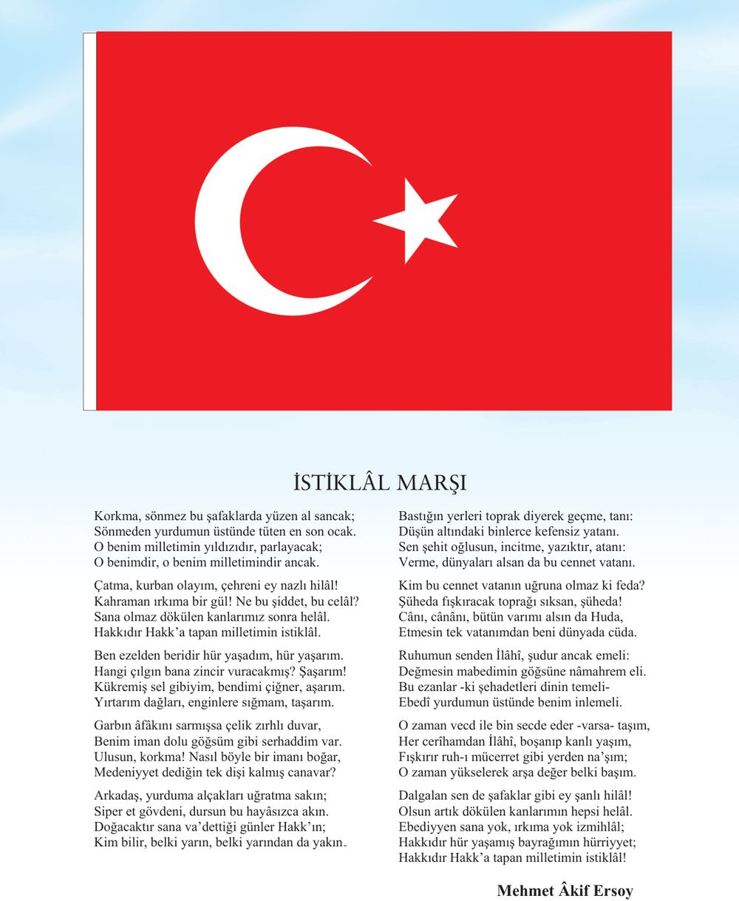

# İSTİKLÂL MARŞI

Korkma, sönmez bu şafaklarda yüzen al sancak;
Sönmeden yurdumun üstünde tüten en son ocak.
O benim milletimin yıldızıdır, parlayacak;
O benimdir, o benim milletimindir ancak.

Çatma, kurban olayım, çehreni ey nazlı hilâl!
Kahraman ırkıma bir gül! Ne bu şiddet, bu celâl?
Sana olmaz dökülen kanlarımız sonra helâl.
Hakkıdır Hakk'a tapan milletimin istiklâl.

Ben ezelden beridir hür yaşadım, hür yaşarım.
Hangi çılgın bana zincir vuracakmış? Şaşarım!
Kükremiş sel gibiyim, bendimi çiğner, aşarım.
Yırtarım dağları, enginlere sığmam, taşarım.

Garbın âfâkını sarmışsa çelik zırhlı duvar,
Benim iman dolu göğsüm gibi serhaddim var.
Ulusun, korkma! Nasıl böyle bir imanı boğar,
Medeniyet dediğin tek dişi kalmış canavar?

Arkadaş, yurduma alçakları uğratma sakın;
Siper et gövdeni, dursun bu hayâsızca akın.
Doğacaktır sana va'dettiği günler Hakk'ın;
Kim bilir, belki yarın, belki yarından da yakın.

Bastığın yerleri toprak diyerek geçme, tanı:
Düşün altındaki binlerce kefensiz yatanı.
Sen şehit oğlusun, incitme, yazıktır, atanı:
Verme, dünyaları alsan da bu cennet vatanı.

Kim bu cennet vatanın uğruna olmaz ki feda?
Şüheda fışkıracak toprağı sıksan, şüheda!
Cânı, cânânı, bütün varımı alsan da Huda,
Etmesin tek vatanımdan beni dünyada cüda.

Ruhumun senden ilâhî, şudur ancak emeli:
Değmesin mabedimin göğsüne nâmahrem eli.
Bu ezanlar -ki şehadetleri dinin temeli-
Ebedî yurdumun üstünde benim inlemeli.

O zaman vecd ile bin secde eder -varsa- taşim,
Her cerîhamdan ilâhî, boşanıp kanlı yaşım,
Fışkırır ruh-ı mücerret gibi yerden na'im;
O zaman yükselerek arşa değer belki başım.

Dalgalan sen de şafaklar gibi ey kanlı hilâl!
Olsun artık dökülen kanlarımın hepsi helâl.
Ebediyyen sana yok, Türk'e yok izmihlâl;
Hakkıdır hür yaşamış bayrağımın hürriyet;
Hakkıdır Hakk'a tapan milletimin istiklâl!

M. Âkif Ersoy

<!-- sayfa 3 -->

GENÇLİĞE HİTABE

Ey Türk gençliği! Birinci vazifen, Türk istiklâlini, Türk Cumhuriyetini, ilelebet muhafaza ve müdafaa etmektir.

Mevcudiyetinin ve istikbalinin yegâne temeli budur. Bu temel, senin en kıymetli hazinendir. İstikbalde dahi, seni bu hazineden mahrum etmek isteyecek dâhilî ve hâricî bedhahların olacaktır. Bir gün, istiklâl ve cumhuriyeti müdafaa mecburiyetine düşersen, vazifeye atılmak için, içinde bulunacağın vaziyetin imkân ve şeraitini düşünmeyeceksin! Bu imkân ve şerait, çok namüsait bir mahiyette tezahür edebilir. İstiklâl ve cumhuriyetine kastedecek düşmanlar, bütün dünyada emsali görülmemiş bir galibiyetin mümessili olabilirler. Cebren ve hile ile aziz vatanın bütün kaleleri zapt edilmiş, bütün tersanelerine girilmiş, bütün orduları dağıtılmış ve memleketin her köşesi bilfiil işgal edilmiş olabilir. Bütün bu şeraitten daha elîm ve daha vahim olmak üzere, memleketin dâhilinde iktidara sahip olanlar gaflet ve dalâlet ve hattâ hıyanet içinde bulunabilirler. Hattâ bu iktidar sahipleri şahsî menfaatlerini, müstevlîlerin siyasî emelleriyle tevhit edebilirler. Millet, fakr u zaruret içinde harap ve bîtap düşmüş olabilir.

Ey Türk istikbalinin evlâdı! İşte, bu ahval ve şerait içinde dahi vazifen, Türk istiklâl ve cumhuriyetini kurtarmaktır. Muhtaç olduğun kudret, damarlarındaki asil kanda mevcuttur.

Mustafa Kemal Atatürk

<!-- sayfa 4 -->

MUSTAFA KEMAL ATATÜRK

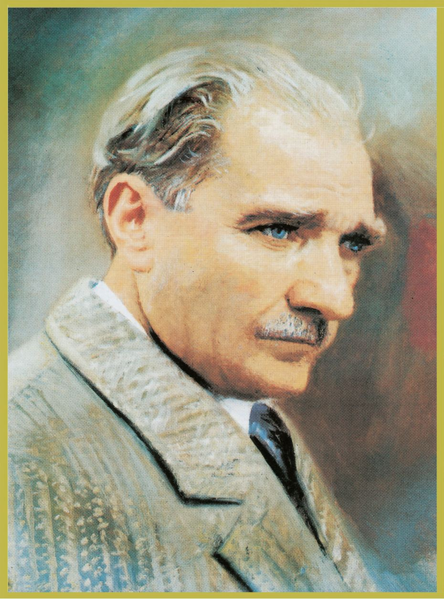
<!-- yer tutucu bulunamadı: sayfa sonuna eklendi -->

<!-- sayfa 5 -->

Verdiğiniz metin katmanı boş olduğu için (`<<< >>>` arası boş) dönüştürülecek bir içerik bulunmamaktadır. Lütfen metin katmanını içeren içeriği paylaşın, böylece kurallara uygun şekilde Markdown formatına çevirebilirim.

<!-- sayfa 6 -->

# INHALTSVERZEICHNIS

Organisationsschema 8

## LEKTION 1 | ICH UND DU!
A. Sich Vorstellen 11 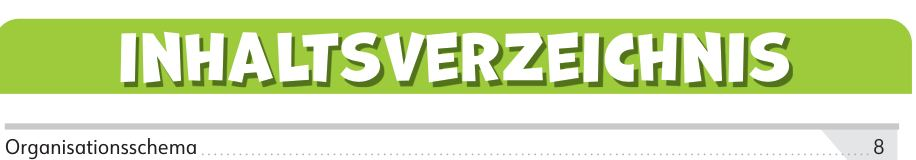
B. Das Alphabet 13
C. Begrüßen und Verabschieden 15
D. Nach dem Befinden fragen 17

## LEKTION 2 | DAS BIN ICH!
A. Das Alter und die Zahlen 21
B. Die Länder und die Sprachen 23
C. Die Herkunft und der Wohnort 25

## LEKTION 3 | MEINE FAMILIE
A. Die Familienmitglieder 31
B. Die Berufe von Familienmitgliedern 35

## LEKTION 4 | MEINE SCHULE
A. Die Schulsachen 41 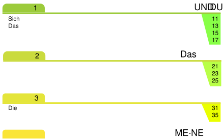
B. Das Klassenzimmer 44
C. Die Schulräume 46

## LEKTION 5 | DER SCHULALLTAG
A. Die Schulfächer 51
B. Die Wochentage und die Tageszeiten 54
C. Mein Stundenplan 57

## LEKTION 6 | SPORT
A. Die Sportarten 61 
B. Einzel- und Mannschaftssportarten 64
C. Mein Lieblingssport 66

Quellenverzeichnis 69 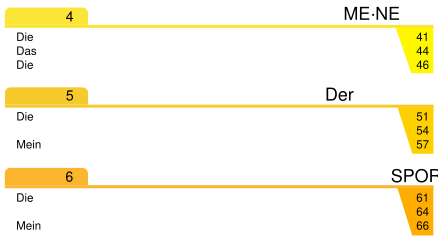
Lösungsschlüssel 69
Verwaltungskarte von Türkiye mit Nachbarstaaten und Seegrenzen 70
Die Karte der Türkischen Welt 71

<!-- sayfa 7 -->

# ORGANISATIONSSCHEMA

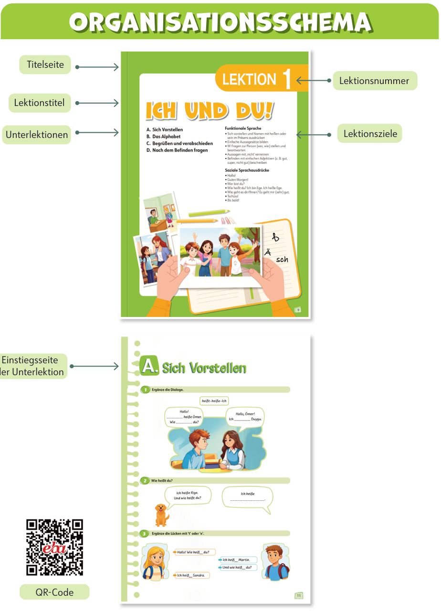

* Titelseite $\rightarrow$
* Lektionstitel $\rightarrow$
* Unterlektionen $\rightarrow$
* Lektionsnummer $\leftarrow$
* Lektionsziele $\leftarrow$

---

# A. Sich Vorstellen


1. Ergänze die Dialoge.
   * heiße-heiße-ich
   * Hallo! $\text{\_\_\_\_\_\_\_\_}$ Ömer. Wie $\text{\_\_\_\_\_\_\_\_}$ du?
   * Hallo, Ömer! Ich $\text{\_\_\_\_\_\_\_\_}$ Duygu.

2. Wie heißt du?
   * Ich heiße Rige. Und wie heißt du? $\text{\_\_\_\_\_\_\_\_}$ ich heiße $\text{\_\_\_\_\_\_\_\_}$

3. Ergänze die Lücken mit 'y' oder 'w'.
   * Hallo! Wie heißt $\text{\_\_\_\_}$ du?
   * Ich heißt $\text{\_\_\_\_}$ Martin.
   * Und wie heißt $\text{\_\_\_\_}$ du?
   * Ich heißt $\text{\_\_\_\_}$ Sandra.


QR-Code

<!-- sayfa 8 -->

# LEKTION 1

# ICH UND DU!

**A. Sich Vorstellen**
**B. Das Alphabet**
**C. Begrüßen und verabschieden**
**D. Nach dem Befinden fragen**

## Funktionale Sprache
* Sich vorstellen und Namen mit heißen oder sein im Präsens ausdrücken
* Einfache Aussagesätze bilden
* W-Fragen zur Person (wer, wie) stellen und beantworten
* Aussagen mit ‚nicht‘ verneinen
* Befinden mit einfachen Adjektiven (z. B. gut, super, nicht gut) beschreiben

## Soziale Sprachausdrücke
* Hallo!
* Guten Morgen!
* Wer bist du?
* Wie heißt du? Ich bin Ege. Ich heiße Ege.
* Wie geht es dir/Ihnen? Es geht mir (sehr) gut.
* Tschüss!
* Bis bald!

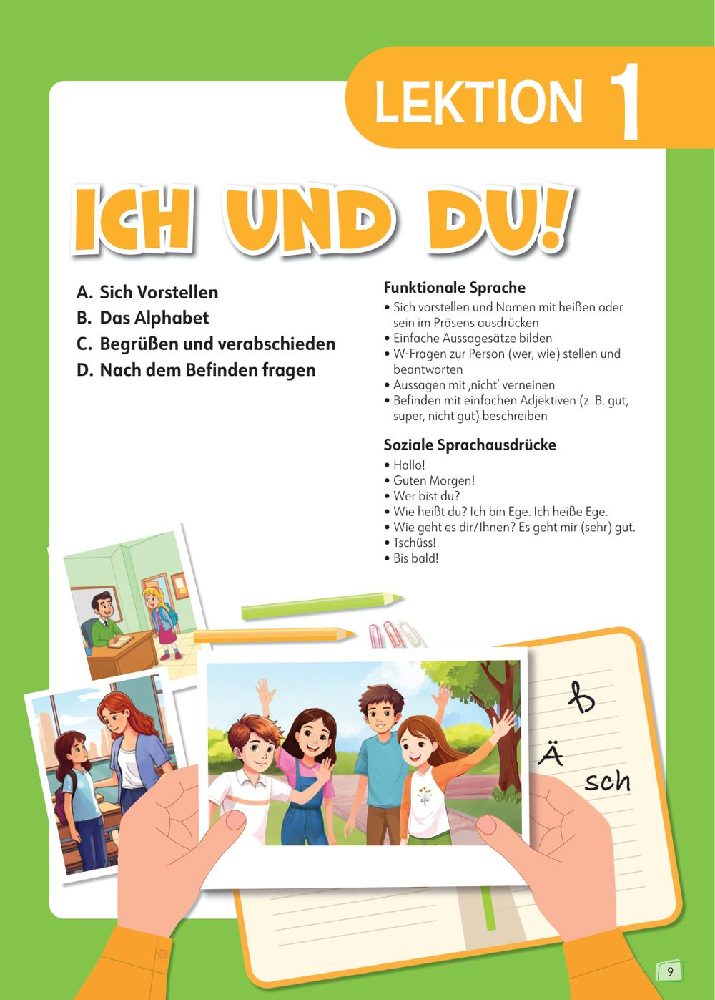

<!-- sayfa 9 -->

Girdiğiniz mesajda herhangi bir metin katmanı bulunmamaktadır. Lütfen dönüştürülmesini istediğiniz metni `<<< >>>` işaretleri arasına ekleyiniz.

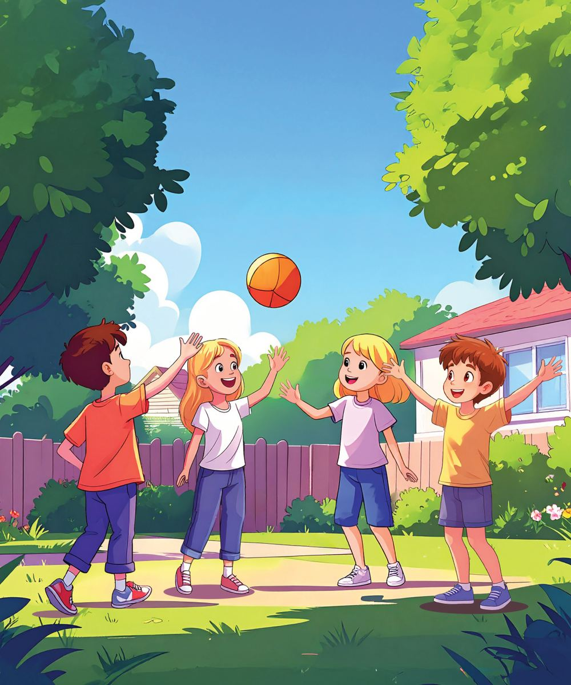
<!-- yer tutucu bulunamadı: sayfa sonuna eklendi -->

<!-- sayfa 10 -->

# A. Sich Vorstellen

1. Ergänze die Dialoge.

| heißt-heiße-Ich |
| :--- |

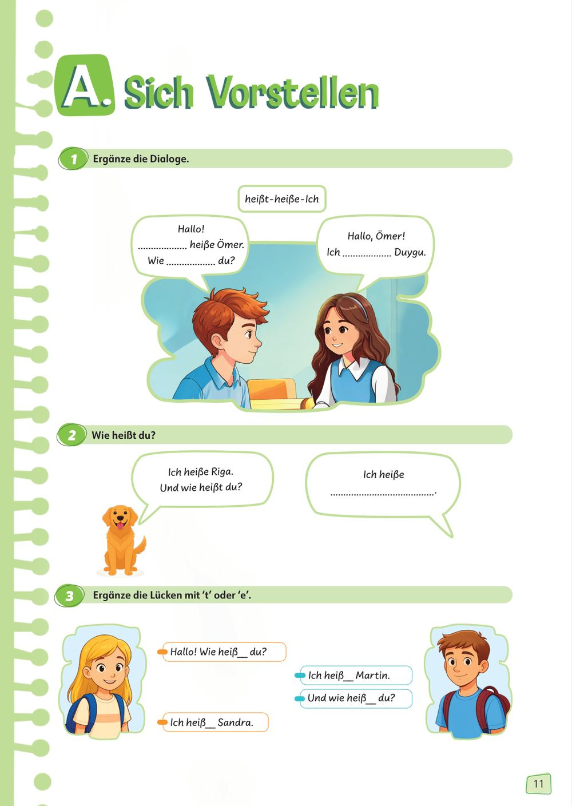

Hallo!
.................... heiße Ömer.
Wie ................... du?

Hallo, Ömer!
Ich ................... Duygu.

2. Wie heißt du?

Ich heiße Riga.
Und wie heißt du?

Ich heiße
.........................................

3. Ergänze die Lücken mit ‘t’ oder ‘e’.


Hallo! Wie heiß__ du?

Ich heiß__ Martin.

Und wie heiß__ du?

Ich heiß__ Sandra.

<!-- sayfa 11 -->

4 Bilde mit den gegebenen Wörtern zwei Sätze und eine Frage.

a)
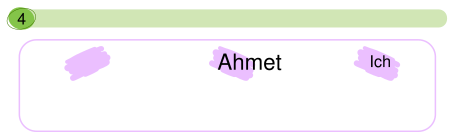
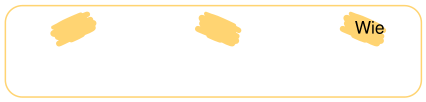

b)
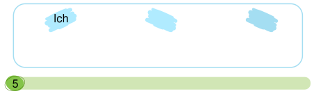

c)


5 Ergänze den Dialog.

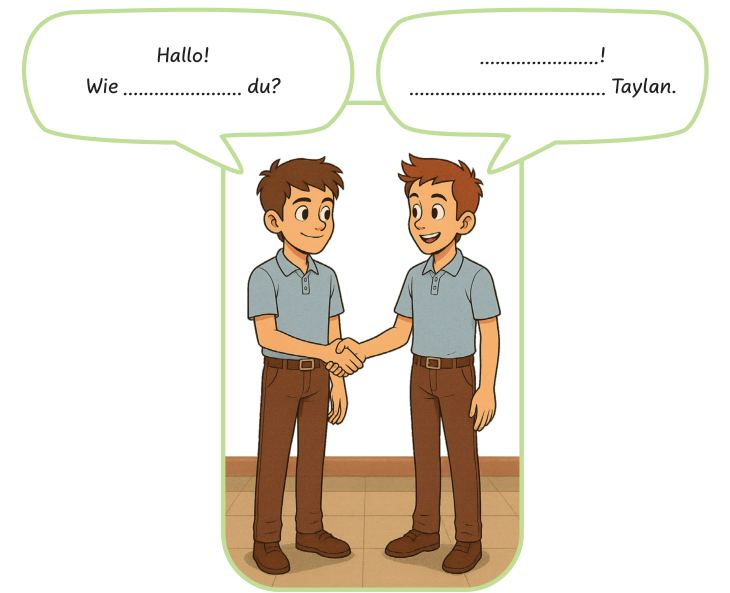

Hallo!
Wie ....................... du?

.......................!
...................................... Taylan.

<!-- sayfa 12 -->

# B. Das Alphabet

1 Folge den Buchstaben aus dem Alphabet und finde die richtige Tür.

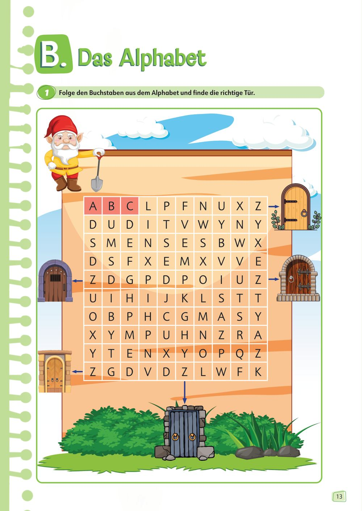

| A | B | C | L | P | F | N | U | X | Z |
|---|---|---|---|---|---|---|---|---|---|
| D | U | D | I | T | V | W | Y | N | Y |
| S | M | E | N | S | E | S | B | W | X |
| D | S | F | X | E | M | X | V | V | E |
| Z | D | G | P | D | P | O | I | U | Z |
| U | I | H | I | J | K | L | S | T | T |
| O | B | P | H | C | G | M | A | S | Y |
| X | Y | M | P | U | H | N | Z | R | A |
| Y | T | E | N | X | Y | O | P | Q | Z |
| Z | G | D | V | D | Z | L | W | F | K |

<!-- sayfa 13 -->

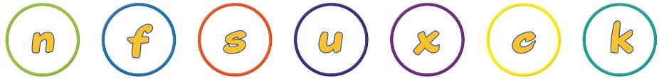

2 Ergänze die fehlenden Buchstaben im Alphabetwurm.

n f s u x c k

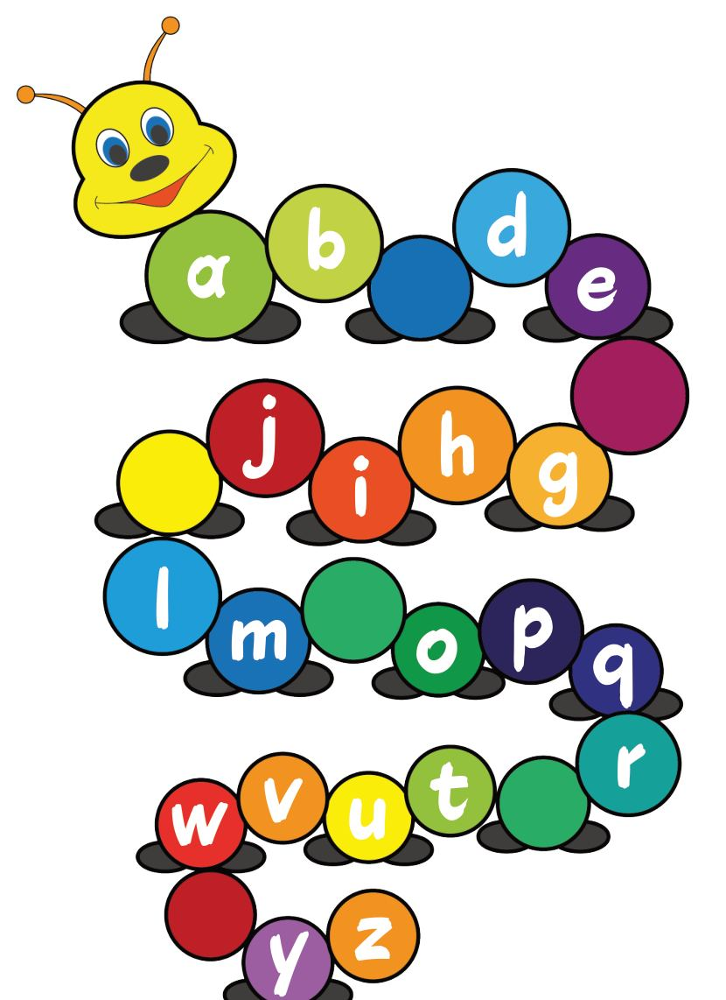

<!-- sayfa 14 -->

# C. Begrüßen und Verabschieden

1. Finde aus der Buchstabenschlange die Begrüßungen und Verabschiedungen. Schreibe sie in die richtigen Spalten.

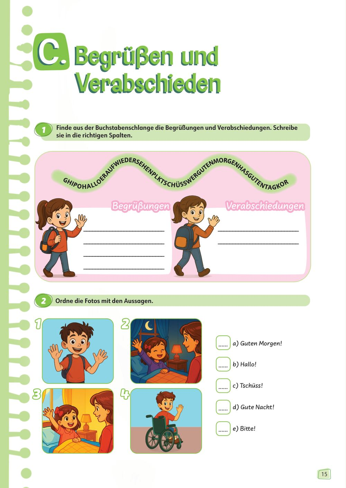

GHIPOHALLOERAUFWIEDERSEHENPLKTSCHÜSSWERGUTENMORGENHASGUTENTAGKOR

| Begrüßungen | Verabschiedungen |
| :--- | :--- |
| \_\_\_\_\_\_\_\_\_\_\_\_\_\_\_\_\_\_\_\_ | \_\_\_\_\_\_\_\_\_\_\_\_\_\_\_\_\_\_\_\_ |
| \_\_\_\_\_\_\_\_\_\_\_\_\_\_\_\_\_\_\_\_ | \_\_\_\_\_\_\_\_\_\_\_\_\_\_\_\_\_\_\_\_ |
| \_\_\_\_\_\_\_\_\_\_\_\_\_\_\_\_\_\_\_\_ | \_\_\_\_\_\_\_\_\_\_\_\_\_\_\_\_\_\_\_\_ |
| \_\_\_\_\_\_\_\_\_\_\_\_\_\_\_\_\_\_\_\_ | \_\_\_\_\_\_\_\_\_\_\_\_\_\_\_\_\_\_\_\_ |

2. Ordne die Fotos mit den Aussagen.

1 
2 
3 
4 

...... a) Guten Morgen!
...... b) Hallo!
...... c) Tschüss!
...... d) Gute Nacht!
...... e) Bitte!

<!-- sayfa 15 -->

# 3 Ergänze die Sprechblasen mit den richtigen Begrüßungen.

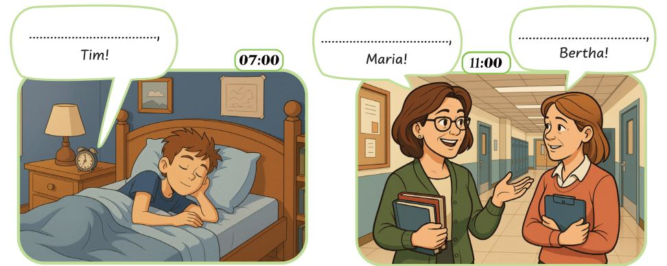

a)
......................................,
Tim!
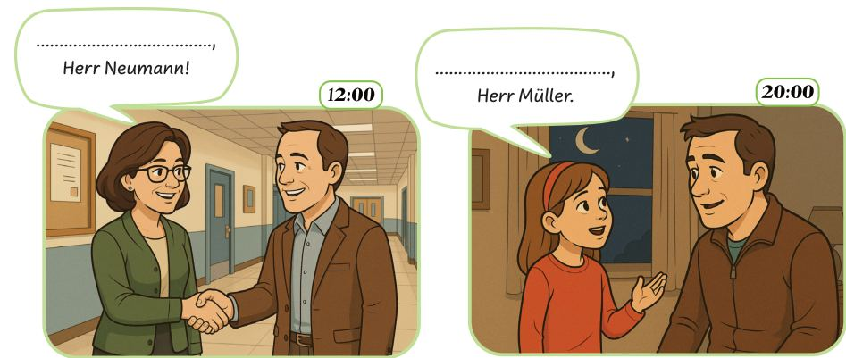

b)
......................................,
Maria!
......................................,
Bertha!

c)
......................................,
Herr Neumann!

d)
......................................,
Herr Müller.

<!-- sayfa 16 -->

# D. Nach dem Befinden fragen

1 Wie geht es Talya? Ordne zu.

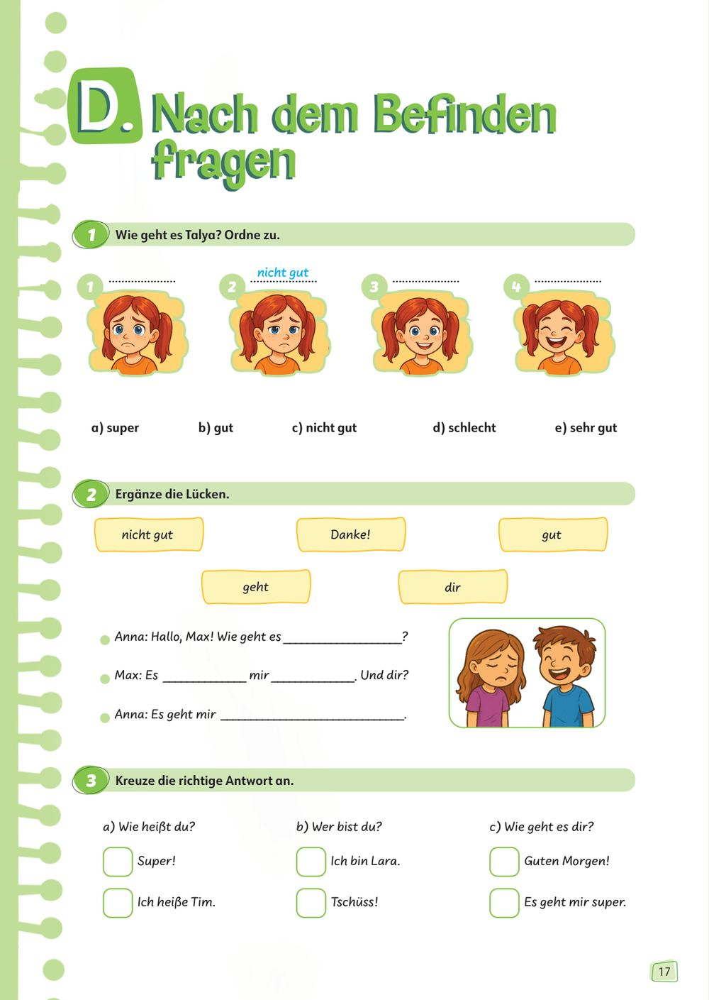

1 .....................
2 *nicht gut* .....................
3 .....................
4 .....................

a) super
b) gut
c) nicht gut
d) schlecht
e) sehr gut

2 Ergänze die Lücken.

| nicht gut | Danke! | gut |
| :--- | :--- | :--- |
| | geht | dir |


* Anna: Hallo, Max! Wie geht es ____________________?
* Max: Es ______________ mir ______________. Und dir?
* Anna: Es geht mir _______________________________.

3 Kreuze die richtige Antwort an.

a) Wie heißt du?
[ ] Super!
[ ] Ich heiße Tim.

b) Wer bist du?
[ ] Ich bin Lara.
[ ] Tschüss!

c) Wie geht es dir?
[ ] Guten Morgen!
[ ] Es geht mir super.

<!-- sayfa 17 -->

# 4 Ordne den Dialog und nummeriere.

| | |
| :--- | :--- |
| $\square$ Naja, es geht so. Tschüss, Sude. | $\square$ Wie geht es dir Sude? |
| $\square$ Ich heiße Engin, und wie heißt du? | $\boxed{1}$ <!-- KONTROL: Marker'da karşılığı yok, uydurma olabilir --> Hallo, wie heißt du? |
| $\square$ Gut, danke. Und wie geht es dir Engin? | $\square$ Tschüss Engin! |

 $\square$ Ich bin Sude. 
 

# 5 Schau die Bilder an und bilde 4 Dialoge.

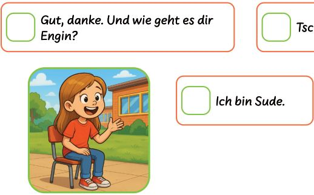
_____________________________
_____________________________
_____________________________
_____________________________

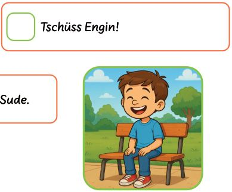
_____________________________
_____________________________
_____________________________
_____________________________

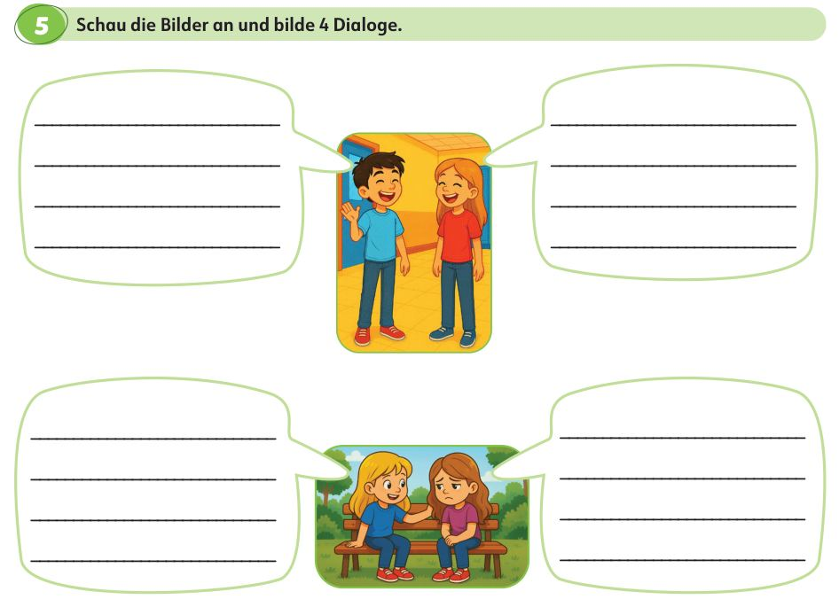
_____________________________
_____________________________
_____________________________
_____________________________

<!-- sayfa 18 -->

# LEKTION 2

# DAS BIN ICH!

**A. Das Alter und die Zahlen**
**B. Die Länder und die Sprachen**
**C. Die Herkunft und der Wohnort**

**Funktionale Sprache**
* Die Zahlen von 0-20 lernen
* Alter angeben und erfragen
* Die Länder und ihre Sprachen kennenlernen
* Herkunft und Wohnort mit kommen (aus) und wohnen (in) benennen
* Sprachen mit sprechen im Präsens nennen
* Einfache Aussagesätze mit passenden Personalpronomen bilden

**Soziale Sprachausdrücke**
* Wie alt bist du?
* Ich bin 10 Jahre alt.
* Woher kommst du?
* Ich komme aus Türkiye.
* Wo wohnst du?
* Ich wohne in Ankara.
* Welche Sprache sprichst du?
* Ich spreche Türkisch.

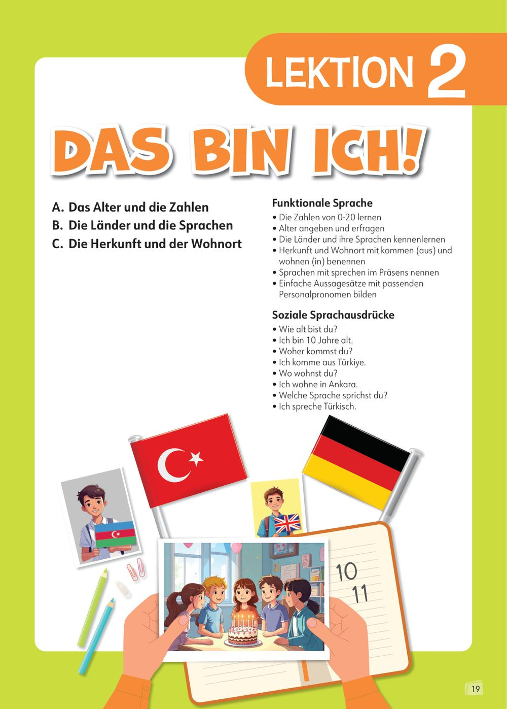

<!-- sayfa 19 -->

```

Görselde herhangi bir metin veya matematiksel ifade bulunmamaktadır. Sadece dört çocuktan oluşan bir illüstrasyon yer almaktadır.

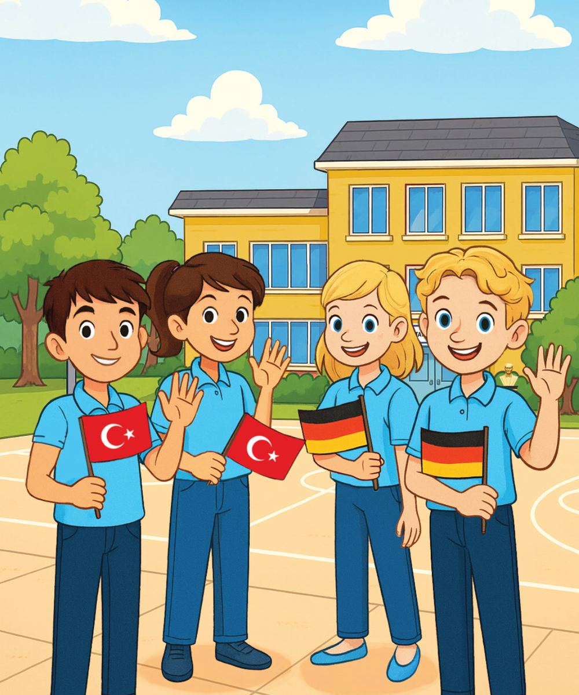

<!-- sayfa 20 -->

# A. Das Alter und die Zahlen

1 Schreibe die Zahlen in Worte.

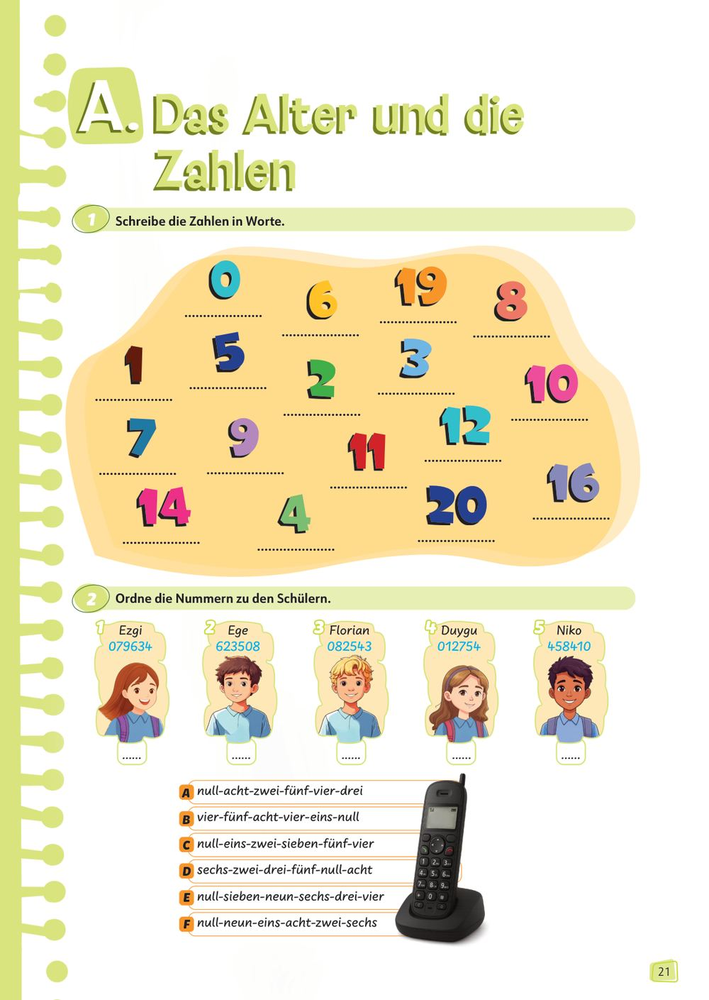

0 .....................
6 .....................
19 .....................
8 .....................
1 .....................
5 .....................
2 .....................
3 .....................
10 .....................
7 .....................
9 .....................
11 .....................
12 .....................
14 .....................
4 .....................
20 .....................
16 .....................

2 Ordne die Nummern zu den Schülern.

1 Ezgi
079634
......

2 Ege
623508
......

3 Florian
082543
......

4 Duygu
012754
......

5 Niko
458410
......

A null-acht-zwei-fünf-vier-drei
B vier-fünf-acht-vier-eins-null
C null-eins-zwei-sieben-fünf-vier
D sechs-zwei-drei-fünf-null-acht
E null-sieben-neun-sechs-drei-vier

<!-- sayfa 21 -->

# 3 Verbinde die Zahlen von 0 bis 20 und male das Bild.

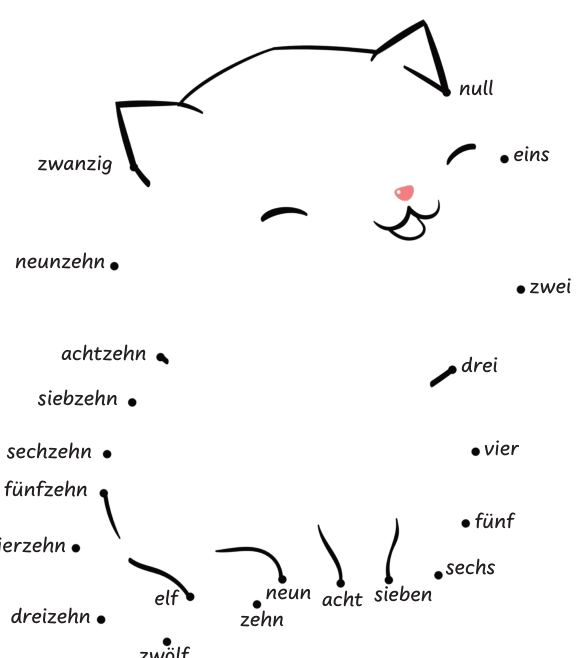

# 4 Ergänze die Sätze mit den gegebenen Zahlen wie im Beispiel.

| zwölf | neun | fünfzehn |
| :---: | :---: | :---: |
| zehn | elf | dreizehn |

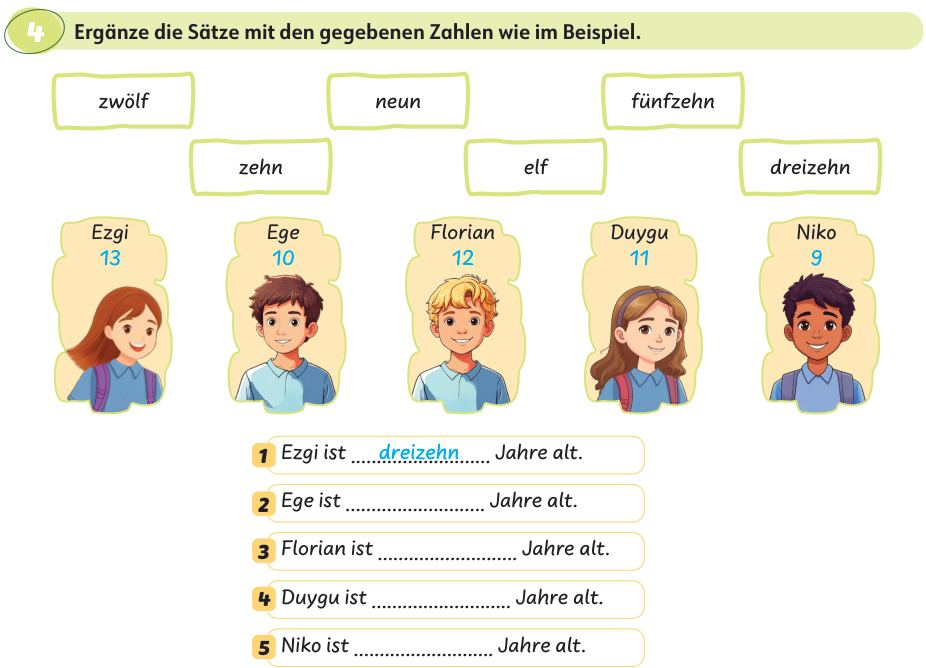

1 Ezgi ist dreizehn Jahre alt.
2 Ege ist ........................... Jahre alt.
3 Florian ist ........................... Jahre alt.
4 Duygu ist ........................... Jahre alt.

<!-- sayfa 22 -->

# B. Die Länder und die Sprachen

1 Verbinde die Flaggen mit den richtigen Ländern.

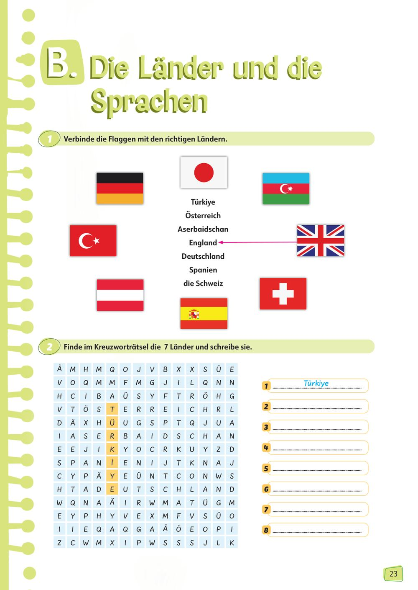

Türkiye
Österreich
Aserbaidschan
England
Deutschland
Spanien
die Schweiz

2 Finde im Kreuzworträtsel die 7 Länder und schreibe sie.

| Ä | M | H | M | Q | O | J | V | B | X | X | S | Ü | E |
|---|---|---|---|---|---|---|---|---|---|---|---|---|---|
| V | O | Q | M | M | F | M | G | J | I | L | Q | N | N |
| H | C | I | B | A | Ü | S | Y | F | T | R | Ö | H | G |
| V | T | Ö | S | T | E | R | R | E | I | C | H | R | L |
| D | Ä | X | H | Ü | U | G | S | P | T | Q | J | U | A |
| I | A | S | E | R | B | A | I | D | S | C | H | A | N |
| E | E | J | I | K | Y | O | C | R | K | U | Y | Z | D |
| S | P | A | N | İ | E | N | I | J | T | K | N | A | J |
| C | Y | P | Ä | Y | E | Ü | N | T | C | O | N | W | S |
| H | T | A | D | E | U | T | S | C | H | L | A | N | D |
| W | Q | N | A | Ä | I | R | W | M | A | T | Ü | G | M |
| E | Y | P | H | Y | V | E | X | M | F | V | S | Ü | O |
| I | I | E | Q | A | Q | G | A | Ä | Ö | E | O | P | I |

1 Türkiye
2 ..............................................................................
3 ..............................................................................
4 ..............................................................................
5 ..............................................................................
6 ..............................................................................
7 ..............................................................................
8 ..............................................................................

<!-- sayfa 23 -->

# 3 Verbinde die Sprachen mit den richtigen Flaggen wie im Beispiel.

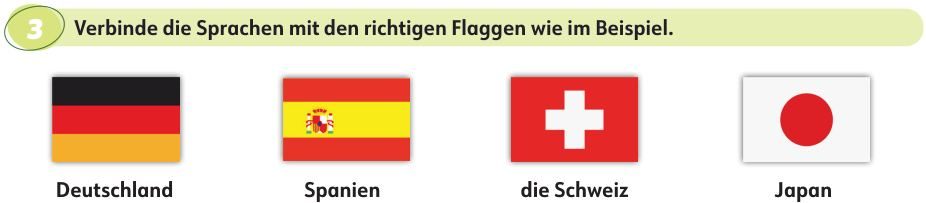

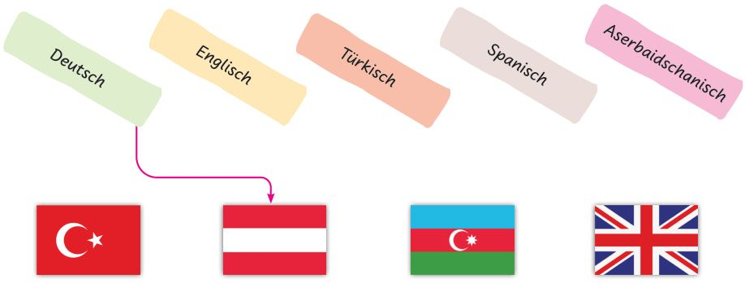

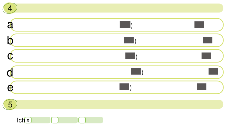

# 4 Ergänze die Lücken mit den Sprachen nach den gegebenen Flaggen.

a) Ich bin Yuri. Ich spreche Japanisch ( 🇯🇵 ) und ........................................ ( 🇩🇪 ).

b) Ich bin Aysen..Ich spreche ........................................ ( 🇹🇷 ) und ........................................ ( 🇬🇧 ).

c) Das ist Maria. Sie spricht ........................................ ( 🇪🇸 ) und ........................................ ( 🇯🇵 ).

d) Ich bin Herbert. Ich spreche ........................................ ( 🇩🇪 ) und ........................................ ( 🇬🇧 ).

e) Das ist Adil. Er spricht ........................................ ( 🇦🇿 ) und ........................................ ( 🇹🇷 ).

# 5 Kreuze das richtige Verb an.

a) Ich [X] spreche [ ] sprichst [ ] spricht Türkisch.

b) Ich [ ] komme [ ] kommst [ ] kommt aus Spanien.

c) Sie [ ] spreche [ ] sprichst [ ] spricht Japanisch und Englisch.

d) Edward [ ] komme [ ] kommt [ ] kommst aus England.

<!-- sayfa 24 -->

# C. Die Herkunft und der Wohnort

1. Woher kommen die Personen und welche Sprachen sprechen sie? Schreibe Sätze wie im Beispiel.

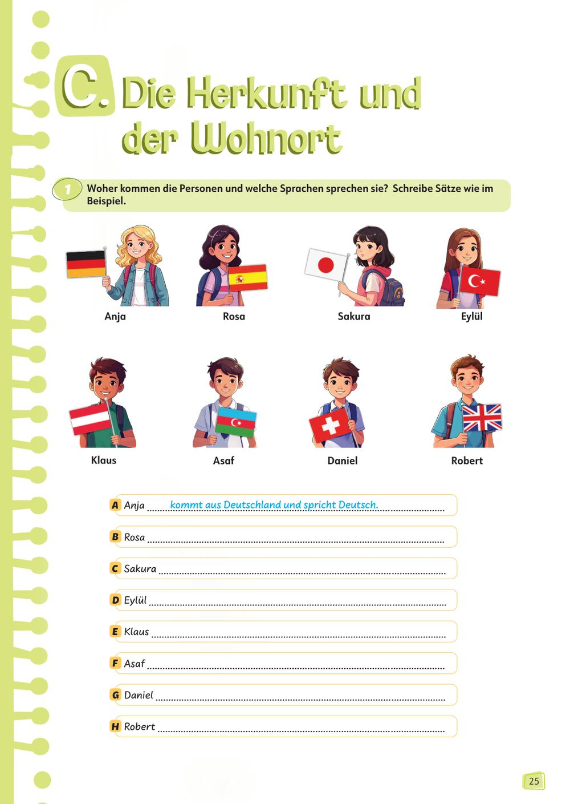

Anja (Alman bayrağı tutuyor)
Rosa (İspanya bayrağı tutuyor)
Sakura (Japonya bayrağı tutuyor)
Eylül (Türkiye bayrağı tutuyor)

Klaus (Avusturya bayrağı tutuyor)
Asaf (Azerbaycan bayrağı tutuyor)
Daniel (İsviçre bayrağı tutuyor)
Robert (Birleşik Krallık bayrağı tutuyor)

A Anja kommt aus Deutschland und spricht Deutsch.
B Rosa ...................................................................................................................
C Sakura ...............................................................................................................
D Eylül ...................................................................................................................
E Klaus ..................................................................................................................
F Asaf ...................................................................................................................
G Daniel ................................................................................................................
H Robert ...............................................................................................................

<!-- sayfa 25 -->

2 Sieh die Flagge an und schreibe das Land, die Stadt und die Sprache zur Flagge.

| England | Türkiye | Österreich | Ankara |
| :--- | :--- | :--- | :--- |
| Englisch | Wien | Japanisch | London |
| Spanien | die Schweiz | Bakü | Aserbaidschanisch |
| Türkisch | ~~Deutsch~~ | Spanisch | ~~Deutschland~~ |
| Madrid | Japanisch | Aserbaidschan | Deutsch |
| ~~Berlin~~ | Deutsch | Russisch | Zürich |

| FLAGGE | LAND | STADT | SPRACHE |
| :---: | :--- | :--- | :--- |
| ![flag_germany] | Deutschland | Berlin | Deutsch |
| ![flag_spain] | .............................................. | .............................................. | .............................................. |
| ![flag_switzerland] | .............................................. | .............................................. | .............................................. |
| ![flag_japan] | .............................................. | .............................................. | .............................................. |
| ![flag_turkey] | .............................................. | .............................................. | .............................................. |
| ![flag_austria] | .............................................. | .............................................. | .............................................. |
| ![flag_azerbaijan] | .............................................. | .............................................. | .............................................. |
| ![flag_england] | .............................................. | .............................................. | .............................................. |

3 Beantworte die Fragen und schreibe Sätze über dich.

a Wie heißt du? ________________________________________________________________.

b Woher kommst du? ___________________________________________________________.

c Welche Sprachen sprichst du? __________________________________________________.

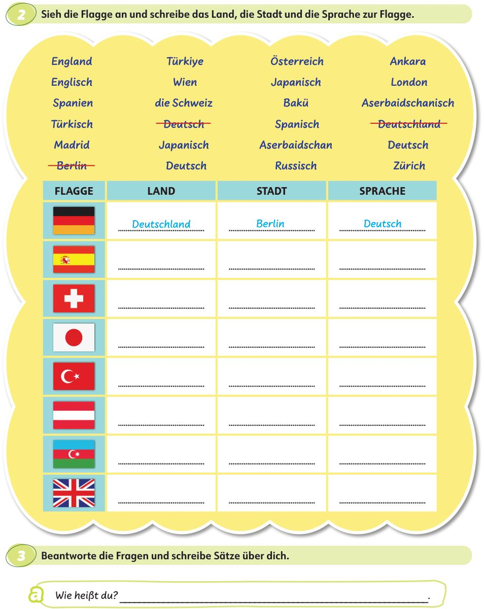
<!-- yer tutucu bulunamadı: sayfa sonuna eklendi -->

<!-- sayfa 26 -->

# 4 Wo wohnen die Kinder? Ergänze die Sätze. 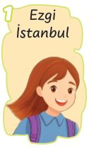

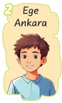 1 Ezgi İstanbul
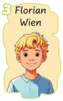 2 Ege Ankara
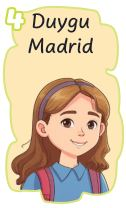 3 Florian Wien
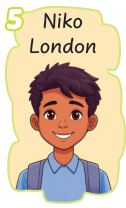 4 Duygu Madrid
 5 Niko London

A. Ezgi _wohnt in İstanbul_.
B. Ege ______________________________.
C. Florian ___________________________.
D. Duygu ___________________________.
E. Niko _____________________________.

# 5 Ordne die Satzteile und schreibe Sätze wie im Beispiel. 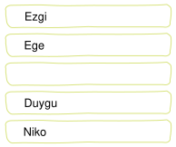

a)
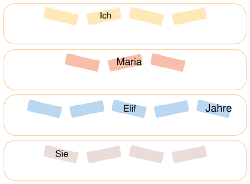 Spanien | Ich | aus | komme
...................................................................................................................................................
_Ich komme aus Spanien._
...................................................................................................................................................

b)
spricht | Maria | Spanisch
...................................................................................................................................................

c)
zwölf | alt | Elif | ist | Jahre
...................................................................................................................................................

d)
Sie | in | wohnt | Ankara
...................................................................................................................................................

<!-- sayfa 27 -->

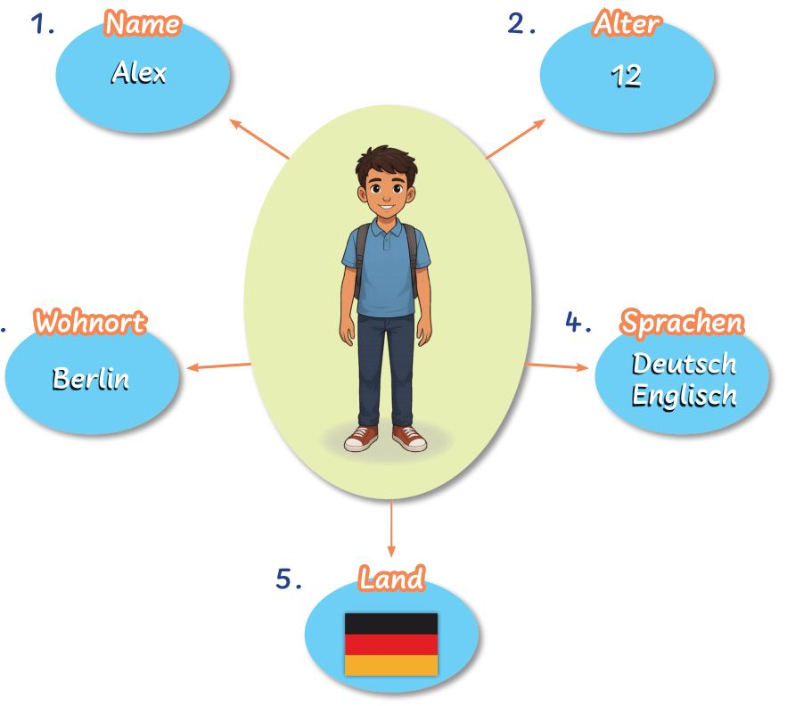 6 Stell Alex vor und ergänze die Sätze wie im Beispiel.

1. Name
Alex

2. Alter
12

3. Wohnort
Berlin

4. Sprachen
Deutsch
Englisch

5. Land
[Alman Bayrağı]

1 Er heißt Alex.
2 Er _________________________________________________.
3 Er _________________________________________________.
4 Er _________________________________________________.
5 Er _________________________________________________.

<!-- sayfa 28 -->

# LEKTION 3

# MEINE FAMILIE

**A. Die Familienmitglieder**
**B. Die Berufe von Familienmitgliedern**

**Funktionale Sprache**
* Familienmitglieder und Berufe benennen
* Personen mit einfachen Adjektiven beschreiben
* Feste Satzmuster nutzen
* Besitz/Beziehungen mit mein/dein (Possessivartikel) ausdrücken

**Soziale Sprachausdrücke**
* Wer ist das?
* Das ist meine Mutter.
* Wie heißt dein Bruder?
* Was ist dein Vater von Beruf?
* Mein Vater ist Lehrer.
* Ich habe zwei Geschwister.

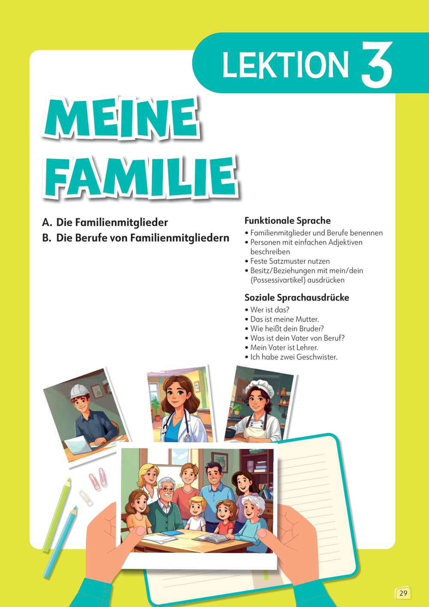

<!-- sayfa 29 -->

Girdiğiniz mesajda herhangi bir metin katmanı veya matematiksel içerik bulunmamaktadır. Lütfen dönüştürülmesini istediğiniz metni `<<< >>>` işaretleri arasına ekleyiniz.


<!-- yer tutucu bulunamadı: sayfa sonuna eklendi -->

<!-- sayfa 30 -->

# A. Die Familienmitglieder

1 Schau dir die Bilder aus dem Schülerbuch auf Seite 46 an und ergänze dann die Sätze.

Mutter | Großmutter | Großvater
---|---|---
Schwester | Bruder | Vater

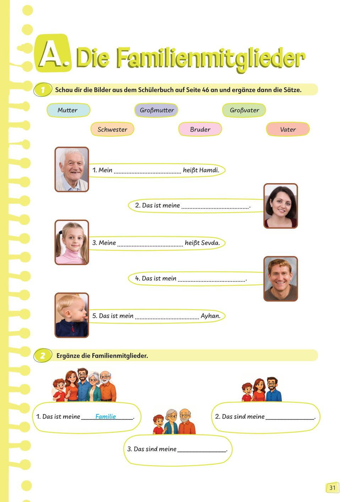
1. Mein .......................................... heißt Hamdi.

2. Das ist meine ........................................... 


3. Meine ......................................... heißt Sevda.

4. Das ist mein ........................................... 


5. Das ist mein ........................................ Ayhan.

2 Ergänze die Familienmitglieder.


1. Das ist meine \_\_\_\_\_\_ Familie \_\_\_\_\_\_


2. Das sind meine \_\_\_\_\_\_\_\_\_\_\_\_\_\_\_.


3. Das sind meine \_\_\_\_\_\_\_\_\_\_\_\_\_\_\_.

<!-- sayfa 31 -->

# 3 Ergänze die Sätze nach dem Familienstammbaum.

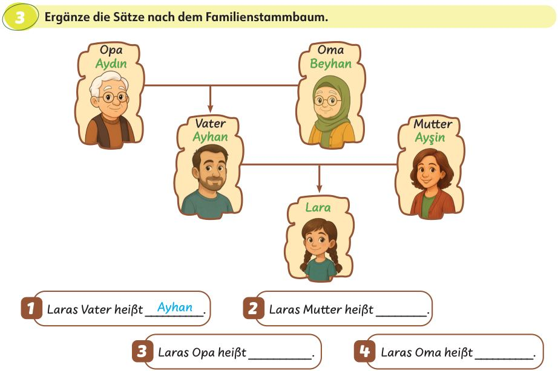

1 Laras Vater heißt Ayhan.
2 Laras Mutter heißt ________.
3 Laras Opa heißt ________.
4 Laras Oma heißt ________.

# 4 Finde die Familienmitglieder aus der Buchstabenschlange und schreibe sie wie im Beispiel.

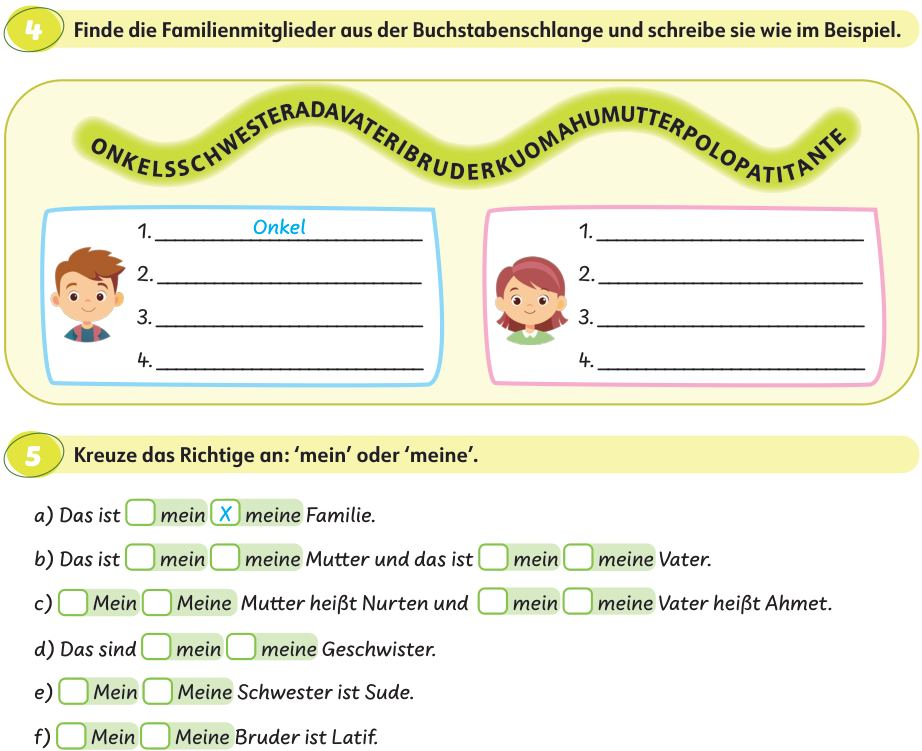

1. Onkel
2. ____________________________
3. ____________________________
4. ____________________________

1. ____________________________
2. ____________________________
3. ____________________________
4. ____________________________

# 5 Kreuze das Richtige an: ‘mein’ oder ‘meine’.

a) Das ist [ ] mein [X] meine Familie.
b) Das ist [ ] mein [ ] meine Mutter und das ist [ ] mein [ ] meine Vater.
c) [ ] Mein [ ] Meine Mutter heißt Nurten und [ ] mein [ ] meine Vater heißt Ahmet.
d) Das sind [ ] mein [ ] meine Geschwister.
e) [ ] Mein [ ] Meine Schwester ist Sude.

<!-- sayfa 32 -->

# 6 Beantworte die Fragen wie im Beispiel.

a Wie heißt dein Vater? *Mein Vater heißt...* __________________________.

b Wie heißt deine Mutter? ______________________________________________.

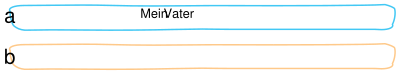
c Wie heißt deine Oma? ________________________________________________.

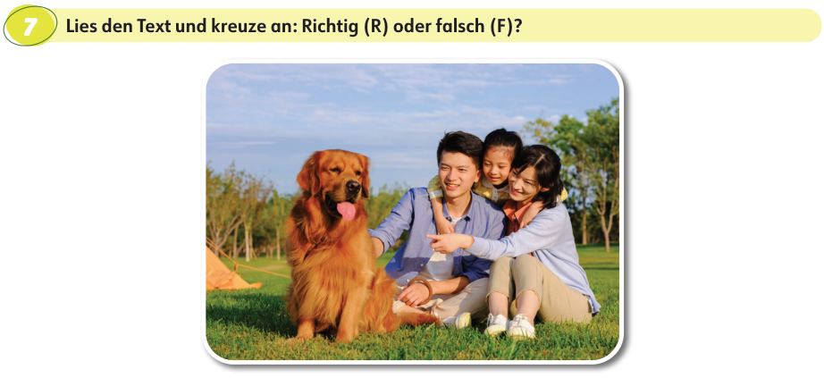
d Wie heißt dein Opa? __________________________________________.

# 7 Lies den Text und kreuze an: Richtig (R) oder falsch (F)?

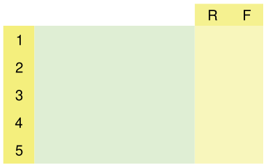

Das ist die Familie Lee. Familie Lee kommt aus Südkorea. Die Familie Lee wohnt in Ankara. Der Mann heißt Jiho. Die Frau heißt Harin. Sie haben ein Kind. Das Kind heißt Seo. Seo ist 11 Jahre alt. Der Hund Pako ist auch aus der Familie. Pako ist ein Hund.

| | | R | F |
|---|---|---|---|
| 1 | Die Familie kommt aus Südkorea. | | |
| 2 | Sie wohnen in Seoul. | | |
| 3 | Der Mann heißt Jiho. | | |
| 4 | Seo ist 10 Jahre alt. | | |
| 5 | Seo hat keine Schwester. | | |

<!-- sayfa 33 -->

 8 Lies die Texte und ergänze die Steckbriefe zu den Texten.

**Emmas Familie:**
Vater: Leo
Mutter: Julia
Schwester: Mia
Bruder: -

1. Ich bin Emma. Ich komme aus Deutschland. Ich habe eine tolle Familie. Mein Vater heißt Leo. Meine Mutter heißt Julia. Ich habe eine Schwester. Sie heißt Mia. Mia ist vier Jahre alt.

2. Ich heiße Inda. Das ist meine Familie. Ich habe einen Bruder. Mein Bruder heißt Ari. Meine Eltern heißen Fatimah und Ahmad.

**Indas Familie:**
Vater:
Mutter:
Schwester:
Bruder:

3. Ich bin Carla. Ich komme aus Mexico. Mein Vater heißt Pablo. Meine Mutter heißt Erica. Ich bin ein Einzelkind. Ich habe keine Geschwister.

**Carlas Familie:**
Vater:
Mutter:
Schwester:
Bruder:

4. Ich bin Tuana. Ich komme aus İstanbul. Mein Vater heißt Reşat. Meine Mutter heißt Zehra. Meine Schwester heißt Aliye. Mein Bruder heißt Okan.

**Tuanas Familie:**
Vater:
Mutter:
Schwester:
Bruder:

<!-- sayfa 34 -->

# B. Die Berufe von Familienmitgliedern

1. Ordne die Berufe den Bildern zu und nummeriere.

1. der Lehrer [......]
2. der Koch [......]
3. der Polizist [......]
4. die Architektin [......]
5. die Lehrerin [......]
6. der Ingenieur [......]

a. 
b. 
c. 
d. 
e. 

2. Ergänze die Buchstaben und schreibe die Berufe wie im Beispiel.

a) der P\_lizis\_ = *der Polizist*
b) der Le\_rer = \_\_\_\_\_\_\_\_\_\_\_\_\_\_\_\_\_\_\_
c) der\_och = \_\_\_\_\_\_\_\_\_\_\_\_\_\_\_\_\_\_\_\_\_
d) der Arc\_\_tekt = \_\_\_\_\_\_\_\_\_\_\_\_\_\_\_\_
f) die P\_lizis\_\_ \_ = \_\_\_\_\_\_\_\_\_\_\_\_\_\_\_
g) die Le\_rer\_\_ = \_\_\_\_\_\_\_\_\_\_\_\_\_\_\_\_\_
h) die\_öch\_n = \_\_\_\_\_\_\_\_\_\_\_\_\_\_\_\_\_\_\_
i) die Arc\_\_tekt\_n = \_\_\_\_\_\_\_\_\_\_\_\_\_\_\_

<!-- sayfa 35 -->

# 3 Löse das Kreuzworträtsel zum Thema: ‘Berufe’.


# 4 Finde die Wörter aus der Buchstabenschlange und schreibe sie.


1. _der Polizist_
2. ____________________________
3. ____________________________
4. ____________________________
5. ____________________________


1. _die Köchin_
2. ____________________________
3. ____________________________
4. ____________________________
5. ____________________________

<!-- sayfa 36 -->

# 5 Kreuze das Richtige an: ‘mein’ oder ‘meine’.

a) [X] Mein [ ] Meine Vater ist Polizist.  
b) [ ] Mein [ ] Meine Mutter ist Lehrerin.  
c) [ ] Mein [ ] Meine Bruder ist Ingenieur.  
d) [ ] Mein [ ] Meine Schwester ist Köchin.

# 6 Lies den Text und kreuze an: Richtig (R) oder falsch (F)?


Hallo, ich bin Atlas. Ich wohne in Aydın. Mein Vater ist Polizist und meine Mutter ist Polizistin. Mein Onkel ist ein Lehrer. Meine Tante ist Lehrerin. Mein Bruder ist Koch und meine Schwester ist Architektin.


| | | R | F |
|---|---|---|---|
| 1 | Sie heißt Lara. | | |
| 2 | Der Vater ist Polizist. | | |
| 3 | Die Mutter ist Lehrerin. | | |
| 4 | Der Onkel ist Lehrer. | | |
| 5 | Die Schwester ist Köchin. | | |


<!-- sayfa 37 -->

7 Schreibe zu Bild B einen Text wie im Bild A.


A


Ich bin Markus. Das ist meine Familie. Meine Mutter ist Ingenieurin. Mein Vater ist Koch. Meine Schwester ist Ärztin.

B


Ich bin Sedef. Das ist ...
__________________________
__________________________
__________________________
__________________________

<!-- sayfa 38 -->

# LEKTION 4

# MEINE SCHULE

**A. Die Schulsachen**
**B. Das Klassenzimmer**
**C. Die Schulräume**

**Funktionale Sprache**
* Schulgegenstände/Räume mit bestimmten/unbestimmten Artikeln benennen
* Besitz/Zugehörigkeit mit mein/dein zeigen; Besitz mit haben angeben
* Dinge mit sein + Adjektiv (Farbe/Größe) beschreiben
* Mit W-Fragen nach Dingen/Orten fragen (Was ist das? / Wo ist ...?)

**Soziale Sprachausdrücke**
* Was ist das?
* Wo ist die Schere?
* Wo ist die Kantine?
* Wie ist dein Buch?
* Das ist ein Heft.
* Mein Heft ist grün.
* Mein Vater ist Lehrer.
* Ich habe zwei Geschwister.


EBA
Überblick über die Lektion

<!-- sayfa 39 -->


<!-- sayfa 40 -->

# A. Die Schulsachen

1. Finde im Kreuzworträtsel 8 Schulsachen und schreibe sie.


| C | S | S | B | U | K | S | H | E | Ö | J | Ä | Q | D | K | Q |
|---|---|---|---|---|---|---|---|---|---|---|---|---|---|---|---|
| E | S | C | H | U | L | T | A | S | C | H | E | J | Ä | F | T |
| W | C | S | C | H | E | R | E | A | Ö | Z | R | Ö | K | E | M |
| B | Y | T | Ö | N | B | U | C | H | J | Q | U | H | Z | Ö | A |
| S | P | I | T | Z | E | R | Ö | Y | H | Ä | D | O | D | R | Y |
| V | V | F | T | L | R | A | D | I | E | R | G | U | M | M | I |
| Z | Z | T | P | Q | B | K | Ä | R | F | T | C | C | Ä | B | H |
| R | E | D | B | W | Y | Z | N | I | T | Y | I | N | P | F | Ö |
| Ä | U | M | E | X | K | K | O | R | C | D | Ö | Ö | P | E | Y |
| C | C | X | Ä | I | Y | M | R | A | Q | N | Ä | Q | C | Q | K |
| X | U | G | R | B | Ä | F | I | N | I | H | A | H | H | H | S |
| Ö | Ä | B | D | N | R | E | Ü | Z | C | M | G | R | E | H | M |
| Y | H | K | Ö | U | M | O | R | J | G | R | Q | T | N | Q | S |

1. Schultasche ............................................................
2. ........................................................................
3. ........................................................................
4. ........................................................................
5. ........................................................................
6. ........................................................................
7. ........................................................................
8. ........................................................................
9. ........................................................................

2. Ordne die Buchstaben in die richtige Reihenfolge und schreibe die Wörter.

1. e-h-c-s-a-t-S-c-h-u-l  Schultasche

2. t-f-e-H  ............................................................

3. n-e-h-c-p-p-ä-M  ....................................................

4. e-h-c-S-r-e  .........................................................

5. B-c-h-u  .............................................................

6. t-S-i-f-t  ...........................................................

7. z-e-r-S-p-i-t  .......................................................

8. b-e-r-K-l-e  .........................................................

<!-- sayfa 41 -->

# 3 Male die Tasche mit den entsprechenden Farben.


<!-- sayfa 42 -->

# 4 Bilde mit den Schulsachen Sätze und benutze die gegebenen Farben.

1. 
   grün ....................................................... *Das Buch ist grün.*

2. rot .......................................................

3. blau ......................................................

4. gelb ......................................................

# 5 Ordne die Schulsachen zu: der, die, das.

* ~~der Stift~~
* die Schultasche
* das Heft
* das Mäppchen
* der Spitzer
* die Schere
* der Kleber
* das Buch
* der Radiergummi


# 6 Kreuze das Richtige an: 'mein' oder 'meine'.


1. Das ist [ ] mein [X] meine Schultasche.
2. Das ist [ ] mein [ ] meine Buch.
3. Das ist [ ] mein [ ] meine Heft.
4. Das ist [ ] mein [ ] meine Stift..

# 7 Kreuze das Richtige an: 'dein' oder 'deine'.


1. Das ist [X] dein [ ] deine Kleber.
2. Das ist [ ] dein [ ] deine Schere.
3. Das ist [ ] dein [ ] deine Spitzer.
4. Das ist [ ] dein [ ] deine Mäppchen.

<!-- sayfa 43 -->

# B. Das Klassenzimmer

1 Ergänze die Buchstaben von den Schulsachen.


die T...f...l


das Kl...ss...nzimm...r


die L...ndk...rt...


der T...sc...


der St...hl

2 Lies die Sätze und kreise das passende Bild ein.

Die Tasche ist groß.
 

Das Klassenzimmer ist hell.
 

Der Stuhl ist alt.
 

Der Tisch ist klein.
 

<!-- sayfa 44 -->

# 3 Sieh dir das Bild an. Finde 10 Schulsachen. Kreise sie ein und schreibe sie wie im Beispiel.


1. das Buch
2. ..............................................................
3. ..............................................................
4. ..............................................................
5. ..............................................................
6. ..............................................................
7. ..............................................................
8. ..............................................................
9. ..............................................................
10. ..............................................................

<!-- sayfa 45 -->

# C. Die Schulräume

### 1 Verbinde die Schulräume mit den Bildern.

1. 
2. 
3. 
4. 
5. 
6. 

a) der Schulhof
b) das Lehrerzimmer
c) die Sporthalle
d) die Kantine
e) die Bibliothek
f) die Mensa
g) der Musikraum

### 2 Kreuze den richtigen Schulraum an.

a) In der $\square$ Musikraum $\text{\rlap{$\checkmark$}}\square$ Sporthalle machen wir Sport.
b) In der $\square$ Musikraum $\square$ Bibliothek lesen wir.
c) In dem $\square$ Musikraum $\square$ Bibliothek singen wir.
d) In der $\square$ Kantine $\square$ Sporthalle gibt es Sandwich und Ayran.
e) Auf dem $\square$ Musikraum $\square$ Schulhof spielen wir Fußball.

### 3 Welches ist dein Lieblingsraum? Schreibe in die Sprechblase wie im Beispiel.


......................................................................................

Mein Lieblingsraum ist die Kantine.

<!-- sayfa 46 -->

# 4 Finde im Kreuzworträtsel 5 Schulräume und schreibe sie.

| Ü | S | P | O | R | T | H | A | L | L | E | Ö |
|---|---|---|---|---|---|---|---|---|---|---|---|
| T | L | K | A | N | T | I | N | E | Ä | I | F |
| Ü | P | M | S | C | H | U | L | H | O | F | A |
| I | U | N | M | U | S | I | K | R | A | U | M |
| B | I | B | L | I | O | T | H | E | K | Y | O |
| K | B | T | R | F | H | Y | T | R | E | Ä | Y |
| Y | Ö | F | P | U | Y | Y | O | Z | W | F | R |
| W | W | K | J | X | C | Ü | Ö | I | I | E | E |
| H | D | K | V | Ä | G | B | T | M | U | C | A |
| V | Ü | C | G | N | X | P | Y | M | K | Z | R |
| Ä | X | Ä | P | H | E | O | U | E | I | Z | E |
| M | F | V | V | J | X | M | L | R | R | Ö | J |

1 ............................................................ *Sporthalle*
2 ............................................................
3 ............................................................
4 ............................................................
5 ............................................................
6 ............................................................

# 5 Lies den Text und beantworte die Fragen wie im Beispiel.


Ich bin Ela. Das ist meine Schule. Sie heißt Belkent Ortaokulu. Ich gehe in die Klasse 5/C. Meine Schule ist neu. Es gibt viele Räume: eine Kantine, zwanzig Klassen, zwei Sporthallen, ein Musikraum und eine Bibliothek. Die Bibliothek ist sehr groß. Hier gibt es tolle Bücher. Die Bibliothek ist mein Lieblingsraum. Im Musikraum singen wir. Im Lehrerzimmer sind die Lehrer. Mein Klassenzimmer ist groß und hell. Die Kantine ist nicht groß. Sie ist klein und dunkel.

a Wie heißt die Schule? _Die Schule heißt Belkent Ortaokulu_
b Ist die Schule von Ela alt? _____________________________________________
c Was ist Elas Lieblingsraum? ___________________________________________


<!-- yer tutucu bulunamadı: sayfa sonuna eklendi -->


<!-- yer tutucu bulunamadı: sayfa sonuna eklendi -->

<!-- sayfa 47 -->

 6 Lies den Text und schreibe einen Text wie im Beispiel.


*Hallo! Ich bin Ege. Ich gehe in die Klasse 5/C. Meine Schule ist toll. Sie ist klein und alt. Unser Klassenzimmer ist hell und groß. In der Schule gibt es viele Räume. Es gibt zwölf Klassen, eine Sporthalle, einen Musikraum und eine Bibliothek. Mein Lieblingsraum ist der Musikraum. Dort spiele ich Gitarre.*

---

Hallo! Ich bin ...
___________________________________________________________________________
___________________________________________________________________________
___________________________________________________________________________
___________________________________________________________________________
___________________________________________________________________________
___________________________________________________________________________
___________________________________________________________________________
___________________________________________________________________________
___________________________________________________________________________
___________________________________________________________________________
___________________________________________________________________________
___________________________________________________________________________

<!-- sayfa 48 -->

# LEKTION 5

# DER SCHULALLTAG

**A. Die Schulfächer**
**B. Die Wochentage und die Tageszeiten**
**C. Mein Stundenplan**

**Funktionale Sprache**
* Den Schultag mit Präsensformen von haben, sein, lernen, mögen, beginnen, enden beschreiben
* Zeitangaben (Wochentage/Uhrzeiten) korrekt einsetzen
* W-Fragen und Ja/Nein-Fragen zum Schulalltag stellen und beantworten
* Meinungen/Vorlieben mit finden/mögen äußern und den Tagesablauf mit temporalen Angaben beschreiben.

**Soziale Sprachausdrücke**
* Was hast du am Mittwoch?
* Ich habe am Mittwoch Mathe.
* Am Montag beginnt die Schule um acht Uhr.
* Mein Lieblingsfach ist Deutsch.


<!-- sayfa 49 -->


<!-- yer tutucu bulunamadı: sayfa sonuna eklendi -->

<!-- sayfa 50 -->

# A. Die Schulfächer

1 Schau die Bilder an und schreibe die Schulfächer.


1. Sozialkunde
2. ...............................................
3. ...............................................


4. ...............................................
5. ...............................................
6. ...............................................


7. ...............................................
8. ...............................................

<!-- sayfa 51 -->

# 2 Finde im Kreuzworträtsel 7 Schulfächer und schreibe sie.

| M | U | S | I | K | C | P | K | H | Q | Y | O |
|---|---|---|---|---|---|---|---|---|---|---|---|
| A | Z | P | F | X | R | Ö | A | D | O | Ü | D |
| X | S | O | Z | I | A | L | K | U | N | D | E |
| T | Ü | R | K | I | S | C | H | Y | K | V | G |
| M | A | T | H | E | T | G | A | N | Y | T | T |
| Ä | C | K | U | N | S | T | U | P | N | U | K |
| Y | N | A | M | G | C | C | M | L | V | L | R |
| F | X | J | C | L | K | I | U | Ö | N | Ä | D |
| L | S | K | Z | I | M | O | D | A | R | R | C |
| D | E | U | T | S | C | H | N | J | Q | Ä | K |
| J | S | V | F | C | U | F | V | Q | I | J | W |
| P | B | W | I | H | U | O | Y | E | P | C | D |


1 Mathe ..................................................
2 ........................................................
3 ........................................................
4 ........................................................
5 ........................................................
6 ........................................................
7 ........................................................
8 ........................................................

# 3 Setze die Buchstaben in die richtige Reihenfolge und schreibe sie.


1 kusMi = ...............................................
2 trpSo = ...............................................
3 scuhDet = .............................................
4 glschEni = ............................................
5 atmhekMaikt = ........................................
6 uKstn = ...............................................
7 zoilaSunkde = ........................................
8 rküschTi = ............................................

<!-- sayfa 52 -->

# 4 Sieh dir die Bilder an und ergänze die Sätze mit dem richtigen Lieblingsfach.


1. Ahmets Lieblingsfach ist Sport.

2. Metins Lieblingsfach ist __________________________.


3. Sevdas Lieblingsfach ist __________________________.

4. Petras Lieblingsfach ist __________________________.


# 5 Schreibe dein Lieblingsfach.

Mein ____________________________________________________.


# 6 Schreibe Sätze mit den gegebenen Schulfächern und Adjektiven.

1. Deutsch $\rightarrow$ ist $\rightarrow$ schön
2. Sport $\rightarrow$ ist $\rightarrow$ gut
3. Sozialkunde $\rightarrow$ ist $\rightarrow$ schwer
4. Türkisch $\rightarrow$ ist $\rightarrow$ lustig

1. Deutsch ist toll.
2. __________________________________________.
3. __________________________________________.
4. __________________________________________.

<!-- sayfa 53 -->

# B. Die Wochentage und Tageszeiten

1 Verbinde die Puzzleteile und notiere die Wochentage wie im Beispiel.

1. 

1. Mo $\rightarrow$ c. ntag $\quad$ 1 c Montag ............................

2. Die $\quad$ a. nstag $\quad$ 2 [ ] ............................

3. Mitt $\quad$ b. rstag $\quad$ 3 [ ] ............................

4. Donne $\quad$ c. ntag $\quad$ 4 [ ] ............................

5. Fre $\quad$ d. tag $\quad$ 5 [ ] ............................

6. Sams $\quad$ e. nntag $\quad$ 6 [ ] ............................

7. So $\quad$ f. woch

$\quad$ $\quad$ g. itag

<!-- sayfa 54 -->

# 2 Schreibe die Wochentage in der richtigen Reihenfolge.


# 3 Ordne die Tageszeiten den Bildern zu.


a.


b.


c.


d.


e.


1. $\square$ der Morgen
2. $\square$ der Vormittag
3. $\square$ der Mittag
4. $\square$ der Nachmittag
5. $\square$ der Abend
6. $\square$ die Nacht

<!-- sayfa 55 -->

# 4 Ordne die Buchstaben und schreibe die Tageszeiten richtig.

| | |
| :--- | :--- |
| Vmittorag | *Vormittag* ............................................. |
| Mgerno | ............................................. |
| Nchaittamg | ............................................. |
| beAnd | ............................................. |
| ittgMa | ............................................. |
| Nchat | ............................................. |

# 5 Ordne die Satzteile. Schreibe die richtige Reihenfolge wie im Beispiel.

1.  07:30 (2) gehe (4) zur Schule. (3) ich (1) Am Morgen

2.  11:30 (......) ich (......) Am Mittag (......) schwimme

3.  15:30 (......) Tennis (......) spiele (......) Am Nachmittag (......) ich

4.  19:30 (......) Am Abend (......) mache (......) ich (......) Hausaufgaben

# 6 Lies den Text und kreuze an: Richtig (R) oder falsch (F)?


Hallo! Ich bin İrem. Ich bin Schülerin und gehe in die Klasse 5/B. Am Morgen gehe ich zur Schule. Ich habe am Montag Mathe, Deutsch und Kunst. Kunst mag ich. Das ist mein Lieblingsfach. Am Mittag spiele ich auf dem Schulhof Basketball. Basketball ist toll. Am Nachmittag gehe ich in die Bibliothek. Hier lese ich. Am Abend gehe ich nach Hause. Ich mache meine Hausaufgaben.

| | | R | F |
| :--- | :--- | :---: | :---: |
| 1 | Sie heißt Meryem. | | |
| 2 | Sie ist Lehrerin. | | |
| 3 | İrems Lieblingsfach ist Kunst. | | |
| 4 | Am Nachmittag geht sie in die Bibliothek. | | |
| 5 | Sie spielt am Abend Basketball | | |

<!-- sayfa 56 -->

# C. Mein Stundenplan

 1 Schau die Stundenpläne an und nummeriere sie zu den Schülern.

1.

[...B...]
Ich bin Sabine. Ich habe am Montag und am Mittwoch Deutsch. Am Freitag habe ich Sport und Kunst. Dienstag und Donnerstag habe ich Mathe und Musik.

| Montag | Dienstag | Mittwoch | Donnerstag | Freitag |
| :--- | :--- | :--- | :--- | :--- |
| Sport | Türkisch | Sozialkunde | Musik | Sport |
| Englisch | Musik | Sport | Deutsch | Deutsch |
| Kunst | Kunst | Türkisch | Sozialkunde | Mathe |
**A**

2.

[......]
Ich bin Nurten. Ich habe am Montag und am Freitag Deutsch und Sozialkunde. Am Mittwoch habe ich Englisch und Musik. Am Dienstag und Donnerstag habe ich Mathe.

| Montag | Dienstag | Mittwoch | Donnerstag | Freitag |
| :--- | :--- | :--- | :--- | :--- |
| Deutsch | Mathe | Deutsch | Musik | Sport |
| Türkisch | Musik | Sport | Mathe | Kunst |
| Sport | Sozialkunde | Türkisch | Musik | Englisch |
**B**

3.

[......]
Ich bin Doruk. Ich habe am Mittwoch Sozialkunde. Sozialkunde ist toll. Am Montag habe ich Englisch und Sport. Am Dienstag habe ich Kunst und Türkisch. Am Donnerstag habe ich Deutsch und Sozialkunde. Am Freitag habe ich Mathe.

| Montag | Dienstag | Mittwoch | Donnerstag | Freitag |
| :--- | :--- | :--- | :--- | :--- |
| Deutsch | Deutsch | Türkisch | Sport | Sport |
| Türkisch | Musik | Sport | Sozialkunde | Kunst |
| Musik | Sozialkunde | Musik | Kunst | Englisch |
**C**

4.

[......]
Ich heiße Selen. Ich habe am Dienstag Musik und Deutsch. Am Montag und am Mittwoch habe ich Türkisch und Musik. Am Donnerstag habe ich Sozialkunde und Sport. Mein Lieblingstag ist Freitag. Am Freitag habe ich Englisch. Englisch ist

<!-- sayfa 57 -->

# 2 Ordne die Satzteile und schreibe Sätze wie im Beispiel.

1. Ich/am Dienstag/und/ Mathe/habe /Türkisch  *Ich habe am Dienstag Mathe und Türkisch.*

2. am Donnerstag/hat/Ali/ Sozialkunde/Kunst/und .....................................................................................................................

3. Basketball /spiele/Ich /am Sonntag .....................................................................................................................

4. Maria/und/am Montag/hat/ Deutsch/Sport .....................................................................................................................

# 3 Fülle deinen Stundenplan aus.


| Stunde | Montag | Dienstag | Mittwoch | Donnerstag | Freitag |
| :--- | :--- | :--- | :--- | :--- | :--- |
| | | | | | |
| | | | | | |
| | | | | | |
| | | | | | |
| | | | | | |
| | | | | | |
| | | | | | |
| | | | | | |

<!-- sayfa 58 -->

# LEKTION 6

# SPORT

**A. Die Sportarten**
**B. Die Einzel- und Mannschaftssportarten**
**C. Mein Lieblingssport**

**Funktionale Sprache**
* Vorlieben/Meinungen mit mögen und finden ausdrücken
* Nach Lieblingssport, Häufigkeit, Partnern fragen; Häufigkeiten angeben
* Sportaktivitäten im Präsens mit Zeitangaben beschreiben (Ich gehe am Wochenende schwimmen)

**Soziale Sprachausdrücke**
* Was ist dein Lieblingssport?
* Wie oft machst du Sport?
* Ich finde Tanzen super.
* Ich mag Mannschaftssportarte.
* Ich gehe am Wochenende schwimmen


<!-- sayfa 59 -->


<!-- yer tutucu bulunamadı: sayfa sonuna eklendi -->

<!-- sayfa 60 -->

# A. Die Sportarten

1 Ordne zu und nummeriere.

1 Rad fahren
2 Fußball
3 schwimmen
4 Karate
5 Basketball
6 Gymnastik
7 Tischtennis


<!-- sayfa 61 -->

# 2 Ordne die Wörter und schreibe Sätze wie im Beispiel.

1.  schwimmt/Maria *Maria schwimmt.*
2.  Fußball/spielen/Wir ___________________________
3. Karate/macht/Der Sportlehrer ___________________________
4. spielst/Du/Basketball ___________________________
5.  Ich/Tischtennis/spiele ___________________________

# 3 Schreibe die Sportnamen in die passenden Spalten.

![Spor ekipmanları ve spor isimleri görseli]

| spielen | machen | fahren |
| :--- | :--- | :--- |
| Handball | | |
| | | |
| | | |
| | | |
| | | |

<!-- sayfa 62 -->

 4 Trenne die Wörter, ordne sie und schreibe den Text richtig.

 halloichheißeegeichbinelfjahre
altichmachesportmein
lieblinssportistschwimmenich
schwimmegernundspielegern
basketballbasketballmachtspaß
ichreitenichtgern

Hallo, __________________________________________________________________
__________________________________________________________________________
__________________________________________________________________________
__________________________________________________________________________
__________________________________________________________________________

 5 Sieh die Bilder an und schreibe Sätze mit 'gern' oder 'nicht gern' wie im Beispiel.

 Mathilda spielt gern Basketball.
 Derya spielt nicht gern Basketball.

Eric ______________________________________________________.

 Mustafa __________________________________________.

Alex ______________________________________________________.

Seval ______________________________________________________.

<!-- sayfa 63 -->

# B. Einzel- und Mannschaftssportarten

1 Verbinde die Bilder mit den passenden Sportarten.


1
2
3
4
5
6
7
8
9
10
11

A
Einzelsport

B
Mannschaftssport

2 Ordne die Buchstaben und schreibe die Wörter richtig.

1 menwimsch _____________________________________.
2 terein __________________________________________.
3 zentan _________________________________________.

<!-- sayfa 64 -->

# 3 Ordne die Satzteile und schreibe Sätze wie im Beispiel.

1 Karate / Einzelsport / ist / ein /  *Karate ist ein Einzelsport.* ............................................................

2 ist / Fußball spielen / Mannschaftssport / ein / ........................................................................................

3 Karate / gern / machen / Wir / ...................................................................................................................

4 nicht gern / Tennis / Ich / spiele / ...........................................................................................................

# 4 Ergänze die Sätze mit den gegebenen Wörtern.

Fußball | Rad fahren | spiele
---|---|---
alleine | Gymnastik | zusammen


Ich bin Elisa. Ich spiele ______________gern. Ich spiele __________________mit Freunden. Mannschaftsspiele sind toll.


Ich bin Damla. Ich mache gern ___________________________.
Ich ______________nicht gern Basketball und Fußball. Ich mache gern ________________ Sport.

<!-- sayfa 65 -->

# C. Mein Lieblingssport

1. Ergänze die Sätze mit dem Lieblingssport der Kinder.


Ardas Lieblingssport ist______________________________________.


Nico mag__________________________________________________.


İlaydas Lieblingssport ist____________________________________.


Heike mag_________________________________________________.

2. Was ist dein Lieblingssport? Schreibe dein Lieblingssport.


___________________________________________________________.

<!-- sayfa 66 -->

 3 Finde im Kreuzworträtsel die Adjektive und markiere sie mit den entsprechenden Farben.

| GUT | INTERESSANT | SUPER |
| :---: | :---: | :---: |
| LANGWEILIG | LUSTIG | SPANNEND |

| L | U | S | T | I | G | D | Q | D | W | O | K | I |
|---|---|---|---|---|---|---|---|---|---|---|---|---|
| Ä | S | P | A | N | N | E | N | D | Q | U | K | Ä |
| G | Z | G | U | T | R | L | Q | V | Ü | F | R | C |
| G | V | R | T | E | H | Ü | K | O | Ä | H | H | V |
| S | U | P | E | R | I | J | S | V | C | Z | T | Z |
| P | T | W | G | E | Ä | B | A | L | K | P | H | B |
| I | Ü | Ä | B | S | O | O | G | L | Q | X | T | T |
| M | H | D | I | S | N | G | G | K | Z | T | N | H |
| V | L | B | L | A | N | G | W | E | I | L | I | G |
| S | U | U | J | N | A | A | Ä | K | G | Ä | B | O |
| N | F | T | U | T | J | L | C | Ö | Ü | Ä | P | R |


 4 Ergänze die passende Form von ‘finden’ wie im Beispiel.

1. Ich \_\_\_\_\_\_\_\_\_\_\_\_\_\_\_\_\_\_\_\_\_\_\_\_\_\_\_ finde \_\_\_\_\_\_\_\_\_\_\_\_\_\_\_\_\_\_\_\_\_\_\_\_\_\_\_ Tischtennis langweilig.

2. Er \_\_\_\_\_\_\_\_\_\_\_\_\_\_\_\_\_\_\_\_\_\_\_\_\_\_\_ Basketball super.

3. Wir \_\_\_\_\_\_\_\_\_\_\_\_\_\_\_\_\_\_\_\_\_\_\_\_\_\_\_ schwimmen lustig.

4. Du \_\_\_\_\_\_\_\_\_\_\_\_\_\_\_\_\_\_\_\_\_\_\_\_\_\_\_ Fußball spannend.


**finden**
ich \_\_\_\_\_\_\_\_\_\_ finde
du \_\_\_\_\_\_\_\_\_\_ findest
er/sie \_\_\_\_\_\_\_\_\_\_ findet
wir \_\_\_\_\_\_\_\_\_\_ finden
ihr \_\_\_\_\_\_\_\_\_\_ findet
sie \_\_\_\_\_\_\_\_\_\_ finden

<!-- sayfa 67 -->

# 5 Ordne die Satzteile und schreibe Sätze wie im Beispiel.


1. _Maria findet Tanzen super._
2. _________________________________________
3. _________________________________________


2. _________________________________________


3. _________________________________________

# 6 Lies den Text und kreuze an: Welche Antwort ist richtig?

Ich heiße Bianca. Ich mag schwimmen. Ahmet ist mein Freund. Ahmets Lieblingssport ist Tennis. Bahar ist meine Freundin. Bahars Lieblingssport ist Tanzen und Gymnastik. Sie tanzt sehr gut.


1. Wer mag schwimmen?

☐ Bianca  ☐ Ahmet  ☐ Bahar

2. Was ist Ahmets Lieblingssport?

☐ Karate  ☐ Tennis  ☐ Tanzen

3. Bahar ___________ sehr gut.

☐ tanzt  ☐ schwimmt  ☐ Tanzen

<!-- sayfa 68 -->

# QUELLENVERZEICHNIS


# LÖSUNGSSCHLÜSSEL


<!-- sayfa 69 -->

25°D 30°D 35°D 40°D 45°D 50°

ROMANYA
• Bükreş
• Sofya

UKRAYNA
RUSYA FEDERASYONU
HAZAR DENİZİ

BULGARİSTAN
NİST (Kısmen görünür)

KARADENİZ

GÜRCİSTAN
• Tiflis
• Batum

ERMENİSTAN
• Erivan

AZERBAYCAN
• Nahçıvan Ö.C. (Azerbaycan)

İRAN

IRAK
• Bağdat

SURİYE
• Şam

LÜBNAN
• Beyrut

GÜNEY KIBRIS RUM YÖNETİMİ
• Lefkoşa

KUZEY KIBRIS TÜRK CUMHURİYETİ

AKDENİZ

MISIR
• Nil N.
• Süveyş K.

FİLİSTİN
• Gazze Şeridi
• Batı Şeria
• Kudüs

İSRAİL
• Tel Aviv

BBYA (Kısmen görünür)


**TÜRKİYE'NİN MÜLKİ İDARE BÖLÜMLERİ İLE KARA VE DENİZ KOMŞULARI HARİTASI**

**Lejant:**
*   BAŞKENT (Ankara)
*   İL MERKEZİ
*   GÖL
*   AKARSU
*   ÜLKE SINIRI
*   ÖZERK BÖLGE SINIRI

**Harita Bilgileri:**
*   Harita Genel Müdürlüğü tarafından üretilmiştir.
*   Ölçek: 0 50 100 200 300 400 km

**Coğrafi Veriler ve Yer İsimleri (Harita Üzerinden):**
*   **Denizler:** EGE DENİZİ, MARMARA DENİZİ, AKDENİZ, KARADENİZ, HAZAR DENİZİ.
*   **Adalar/Yerler:** Gökçeada, Bozcaada.
*   **Akarsular:** Meriç N., Sakarya N., Kızılırmak N., Yeşilırmak N., Çoruh N., Aras N., Kura N., Fırat N., Dicle N., Ceyhan N., Seyhan N., Göksu N., Büyük Menderes N., Küçük Menderes N., Bakırçay N., Gediz N., Asi N.
*   **Göller:** Van Gölü, Tuz Gölü, Urumiye Gölü.
*   **İller/Merkezler:** Adana, Adıyaman, Afyonkarahisar, Ağrı, Amasya, Ankara, Antalya, Artvin, Aydın, Balıkesir, Bilecik, Bingöl, Bitlis, Bolu, Burdur, Bursa, Çanakkale, Çankırı, Çorum, Denizli, Diyarbakır, Edirne, Elâzığ, Erzincan, Erzurum, Eskişehir, Gaziantep, Giresun, Gümüşhane, Hakkâri, Hatay, Isparta, Mersin, İstanbul, İzmir, Kars, Kastamonu, Kayseri, Kırklareli, Kırşehir, Kocaeli, Konya, Kütahya, Malatya, Manisa, Kahramanmaraş, Mardin, Muğla, Muş, Nevşehir, Niğde, Ordu, Rize, Sakarya, Samsun, Siirt, Sinop, Sivas, Tekirdağ, Tokat, Trabzon, Tunceli, Şanlıurfa, Uşak, Van, Yozgat, Zonguldak, Aksaray, Bayburt, Karaman, Kırıkkale, Batman, Şırnak, Bartın, Ardahan, Iğdır, Yalova, Karabük, Kilis, Osmaniye, Düzce.

**Koordinatlar:**
25°D, 30°D, 35°D, 40°D, 45°D, 50°
45°D, 40°D, 35°D, 30°D, 25°D

<!-- sayfa 70 -->


**ÜRK DÜNYASI HARİTASI**

**Bağımsız Türk Devletleri**
**Türk Cumhuriyetleri, Türk Bölgeleri**
**Türk Toplulukları**

1 2 3 4 5 6 7 8 9 10
a b c ç d e f g h ı i j k l

km
500
1.000
1.500
2.000
250

**TÜRK CUMHURİYETLERİ, TÜRK BÖLGELERİ**
1 GAGAVUZ YERİ
2 KARAÇAY-ÇERKESYA
3 KABARDİN-BALKARYA C.
4 DAĞISTAN C.
5 ÇUVAŞİSTAN C.
6 TATARİSTAN C.
7 BAŞKURT C.
8 KARAKALPAKİSTAN C.
9 ALTAY C.
10 HAKASYA C.

**TÜRK TOPLULUKLARI**
**Avrupa'daki Türkler**
a Kosova Türkleri
b Yunanistan Türkleri
c Bulgaristan Türkleri
ç Romanya Türkleri
d Suriye Türkmenleri
e Irak Türkmenleri
f İran Türkleri
g Afganistan Türkmenleri
h Pakistan Türkmenleri
ı Hindistan Türkmenleri
i Çin H. C. Türkleri
j Moğolistan Türkleri
k Rusya Federasyonu Türkleri
l

**ÜLKE KISALTMALARI**
BEL - BELÇİKA
BH - BOSNA - HERSEK
HRV - HIRVATİSTAN
İSV - İSVİÇRE
KRD - KARADAĞ
KMKD - KUZEY MAKEDONYA
KOSOVA - KOSOVA
KSV - KUZEY MAKEDONYA (Not: Metinde KSV ve KMKD farklı verilmiş olabilir, görüntüye sadık kalınmıştır)
LİH - LİHTENŞTAYN
SRB - SIRBİSTAN
ARN - ARNAVUTLUK
GKRY - GÜNEY KIBRIS RUM YÖNETİMİ
KKTC - KUZEY KIBRIS TÜRK CUMHURİYETİ

---

**Harita Üzerindeki Diğer Bilgiler (Metin Katmanı Verileri):**

**Denizler ve Okyanuslar:**
Bering Denizi, Çukçi Denizi, Ohotsk Denizi, Japon Denizi, Doğu Denizi, Sarı Deniz, Güney Çin Denizi, Sulu Denizi, Umman Denizi, Hint Okyanusu, Kızıldeniz, Akdeniz, Ege Denizi, Adriyatik Denizi, Tiren Denizi, Baltık Denizi, Kuzey Denizi, Norveç Denizi, Barents Denizi, Kara Denizi, Hazar Denizi, Azak Denizi, Manş Denizi.

**Nehirler ve Göller:**
Nil N., Ganj N., İndus N., Fırat N., Dicle N., Volga N., Ural N., Obi N., Yenisey N., Lena N., Amur N., Tuna N., Don N., Volga N., Aral G., Baykal G., Ladoga G., Balkaş G., Onega G., Van G., Urumiye G., Hulun G., Tuz G.

**Şehirler:**
Londra, Paris, Berlin, Roma, Atina, Moskova, Kiev, Ankara, Bakü, Taşkent, Aşkabat, Bişkek, Duşanbe, Astana, Pekin, Tokyo, Yeni Delhi, İslamabad, Kâbil, Tahran, Bağdat, Şam, Kahire, Riyad, Muskat, Sana, Hartum, Dakar, Trablus, Tunus, Madrid.

**Ülkeler:**
RUSYA FEDERASYONU, UKRAYNA, BELARUS, POLONYA, ALMANYA, FRANSA, İSPANYA, İTALYA, YUNANİSTAN, TÜRKİYE, GÜRCİSTAN, AZERBAYCAN, ERMENİSTAN, İRAN, IRAK, SURİYE, LÜBNAN, İSRAİL, ÜRDÜN, SUUDİ ARABİSTAN, YEMEN, OMAN, BAE, KATAR, KUVEYT, AFGANİSTAN, PAKİSTAN, HİNDİSTAN, ÇİN H.C., MOĞOLİSTAN, KAZAKİSTAN, ÖZBEKİSTAN, TÜRKMENİSTAN, KIRGIZİSTAN, TACİKİSTAN, KUZEY KORE, GÜNEY KORE, JAPONYA.

**Koordinatlar:**
180° - 170°D - 160°D - 150°D - 140°D - 130°D - 120°D - 110°D - 100°D - 90°D - 80°D - 70°D - 60°D - 50°D - 40°D - 30°D - 20°D - 10°D - 0°
10°B - 20°B - 30°B - 40°B
