# Çoklu Yabancı Dil Eğitim Modeli Almanca 5.Sınıf Ders Kitabı

<!-- sayfa 0 -->

# MEHRSPRACHIGES FREMDSPRACHENPROGRAMM MITTELSCHULE (SEKUNDARSTUFE I)

# Deutschreise
## Erste Schritte
### 5. Klasse

#### Lehrbuch Für den Deutschunterricht

**Autoren**
Bekir YORULMAZ
Gülay AKBULUT
Hanife Aysun DEVECİ
Meltem KIRYAR
Selda İNCE
Sevgi ÇOBAN
Sibel YILMAZ


<!-- sayfa 1 -->

MİLLÎ EĞİTİM BAKANLIĞI YAYINLARI ...........................................................................................: 10360
DERS KİTAPLARI DİZİSİ .....................................................................................................................: 2304

Her hakkı saklıdır ve Millî Eğitim Bakanlığına aittir. Kitabın metin, soru ve şekilleri kısmen de olsa hiçbir surette alınıp yayımlanamaz.

**Editorin**
Dr. Serpil ŞENGÜL

**Grafikdesigner**
Büşra EREN
Eylem YILDIRIM
Gülseren KARATAŞ
Hatice YILDIRIM IŞIK
Nebi PALANCI
Yağmur YILDIRIM

**Multimediadesigner**
Aysun TONYA
Hasan ARLI
Hüseyin DURAN
Murat ERTAÇ
Osman Yasin KÜÇÜKBALLI
Vahide KÜÇÜKBALLI

**Fachberater für Curriculum-Entwicklung**
Dr. Mehmet AKCAALAN
Zeynep Nazife ÖNER

**Experte für Leistungsbewertung**
Ercan ARASTAMAN

**Beratungsfachkräftin**
Aylin SAZLI SAYICI

ISBN 978-975-11-9252-3
Millî Eğitim Bakanlığı Talim ve Terbiye Kurulunun 25.09.2025 tarih ve 141963929 sayılı yazısı ile eğitim aracı olarak kabul edilmiştir.
Kurulca bu kitabın kabul edilmiş olması ders kitabından yayınevi ve yazarın/yazarların sorumluluğunu kaldırmaz.

<!-- sayfa 2 -->

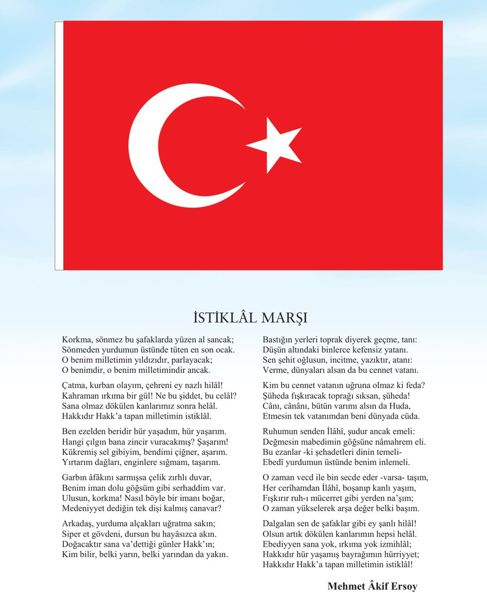

# İSTİKLÂL MARŞI

Korkma, sönmez bu şafaklarda yüzen al sancak;
Sönmeden yurdumun üstünde tüten en son ocak.
O benim milletimin yıldızıdır, parlayacak;
O benimdir, o benim milletimindir ancak.

Çatma, kurban olayım, çehreni ey nazlı hilâl!
Kahraman ırkıma bir gül! Ne bu şiddet, bu celâl?
Sana olmaz dökülen kanlarımız sonra helâl.
Hakkıdır Hakk'a tapan milletimin istiklâl.

Ben ezelden beridir hür yaşadım, hür yaşarım.
Hangi çılgın bana zincir vuracakmış? Şaşarım!
Kükremiş sel gibiyim, bendimi çiğner, aşarım.
Yırtarım dağları, enginlere sığmam, taşarım.

Garbın âfâkını sarmışsa çelik zırhlı duvar,
Benim iman dolu göğsüm gibi serhaddim var.
Ulusun, korkma! Nasıl böyle bir imanı boğar,
Medeniyet dediğin tek dişi kalmış canavar?

Arkadaş, yurduma alçakları uğratma sakın;
Siper et gövdeni, dursun bu hayâsızca akın.
Doğacaktır sana va'dettiği günler Hakk'ın;
Kim bilir, belki yarın, belki yarından da yakın.

Bastığın yerleri toprak diyerek geçme, tanı:
Düşün altındaki binlerce kefensiz yatanı.
Sen şehit oğlusun, incitme, yazıktır, atanı:
Verme, dünyaları alsan da bu cennet vatanı.

Kim bu cennet vatanın uğruna olmaz ki feda?
Şüheda fışkıracak toprağı sıksan, şüheda!
Cânı, cânânı, bütün varımı alsan da Huda,
Etmesin tek vatanımdan beni dünyada cüda.

Ruhumun senden ilâhî, şudur ancak emeli:
Değmesin mabedimin göğsüne nâmahrem eli.
Bu ezanlar -ki şehadetleri dinin temeli-
Ebedî yurdumun üstünde benim inlemeli.

O zaman vecd ile bin secde eder -varsa- taşim,
Her cerîhamdan ilâhî, boşanıp kanlı yaşım,
Fışkırır ruh-ı mücerret gibi yerden na'im;
O zaman yükselerek arşa değer belki başım.

Dalgalan sen de şafaklar gibi ey kanlı hilâl!
Olsun artık dökülen kanlarımın hepsi helâl.
Ebediyyen sana yok, Türk'e yok izmihlâl;
Hakkıdır hür yaşamış bayrağımın hürriyet;
Hakkıdır Hakk'a tapan milletimin istiklâl!

M. Âkif Ersoy

<!-- sayfa 3 -->

GENÇLİĞE HİTABE

Ey Türk gençliği! Birinci vazifen, Türk istiklâlini, Türk Cumhuriyetini, ilelebet muhafaza ve müdafaa etmektir.

Mevcudiyetinin ve istikbalinin yegâne temeli budur. Bu temel, senin en kıymetli hazinendir. İstikbalde dahi, seni bu hazineden mahrum etmek isteyecek dâhilî ve hâricî bedhahların olacaktır. Bir gün, istiklâl ve cumhuriyeti müdafaa mecburiyetine düşersen, vazifeye atılmak için, içinde bulunacağın vaziyetin imkân ve şeraitini düşünmeyeceksin! Bu imkân ve şerait, çok namüsait bir mahiyette tezahür edebilir. İstiklâl ve cumhuriyetine kastedecek düşmanlar, bütün dünyada emsali görülmemiş bir galibiyetin mümessili olabilirler. Cebren ve hile ile aziz vatanın bütün kaleleri zapt edilmiş, bütün tersanelerine girilmiş, bütün orduları dağıtılmış ve memleketin her köşesi bilfiil işgal edilmiş olabilir. Bütün bu şeraitten daha elîm ve daha vahim olmak üzere, memleketin dâhilinde iktidara sahip olanlar gaflet ve dalâlet ve hattâ hıyanet içinde bulunabilirler. Hattâ bu iktidar sahipleri şahsî menfaatlerini, müstevlîlerin siyasî emelleriyle tevhit edebilirler. Millet, fakr u zaruret içinde harap ve bîtap düşmüş olabilir.

Ey Türk istikbalinin evlâdı! İşte, bu ahval ve şerait içinde dahi vazifen, Türk istiklâl ve cumhuriyetini kurtarmaktır. Muhtaç olduğun kudret, damarlarındaki asil kanda mevcuttur.

Mustafa Kemal Atatürk

<!-- sayfa 4 -->

MUSTAFA KEMAL ATATÜRK


<!-- yer tutucu bulunamadı: sayfa sonuna eklendi -->

<!-- sayfa 5 -->

Verdiğiniz metin katmanı boş olduğu için (`<<< >>>` arası boş) dönüştürülecek bir içerik bulunmamaktadır. Lütfen metin katmanını içeren içeriği paylaşın, böylece talimatlarınıza uygun şekilde Markdown formatına çevirebilirim.

<!-- sayfa 6 -->

# INHALTSVERZEICHNIS

Organisationsschema ......................................................................................................................... 8
Die Symbole ........................................................................................................................................ 8

## LEKTION 1 | ICH UND DU!
A. Sich Vorstellen ............................................................................................................................. 11
B. Das Alphabet ............................................................................................................................... 14
C. Begrüßen und Verabschieden ................................................................................................... 17
D. Nach dem Befinden fragen ........................................................................................................ 21

## LEKTION 2 | DAS BIN ICH!
A. Das Alter und die Zahlen ............................................................................................................ 27
B. Die Länder und die Sprachen ..................................................................................................... 34
C. Die Herkunft und der Wohnort ................................................................................................... 38

## LEKTION 3 | MEINE FAMILIE
A. Die Familienmitglieder ............................................................................................................... 47 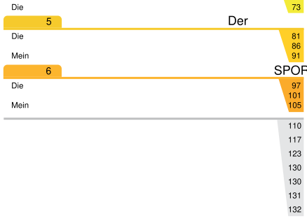
B. Die Berufe von Familienmitgliedern .......................................................................................... 55

## LEKTION 4 | MEINE SCHULE
A. Die Schulsachen .......................................................................................................................... 63 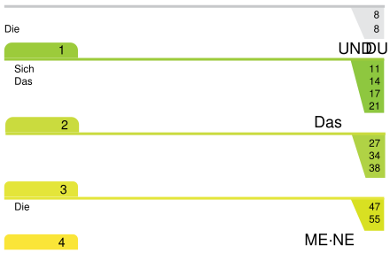
B. Das Klassenzimmer .................................................................................................................... 69
C. Die Schulräume ........................................................................................................................... 73

## LEKTION 5 | DER SCHULALLTAG
A. Die Schulfächer ........................................................................................................................... 81 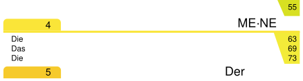
B. Die Wochentage und die Tageszeiten ...................................................................................... 86
C. Mein Stundenplan ........................................................................................................................ 91

## LEKTION 6 | SPORT
A. Die Sportarten ............................................................................................................................. 97
B. Einzel- und Mannschaftssportarten .......................................................................................... 101
C. Mein Lieblingssport ..................................................................................................................... 105

Transkriptionen ................................................................................................................................ 110
Grammatik im Überblick ................................................................................................................ 117
Wörterbuch ....................................................................................................................................... 123
Quellenverzeichnis .......................................................................................................................... 130
Lösungsschlüssel ............................................................................................................................. 130
Verwaltungskarte von Türkiye mit Nachbarstaaten und Seegrenzen .......................................... 131

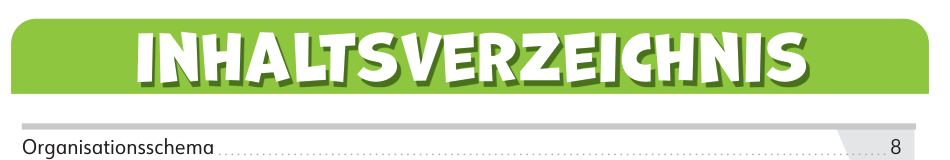
<!-- yer tutucu bulunamadı: sayfa sonuna eklendi -->

<!-- sayfa 7 -->

# ORGANISATIONSSCHEMA

| Titelseite | $\rightarrow$ | LEKTION 1 | Lektionsnummer |
| :--- | :---: | :---: | ---: |
| Lektionstitel | $\rightarrow$ | **ICH UND DU!** | |
| Unterlektionen | $\rightarrow$ | A. Sich Vorstellen<br>B. Das Alphabet<br>C. Begrüßen und verabschieden<br>D. Nach dem Befinden fragen | Lektionsziele |
| QR-Codes zur Lektion | $\rightarrow$ | | |

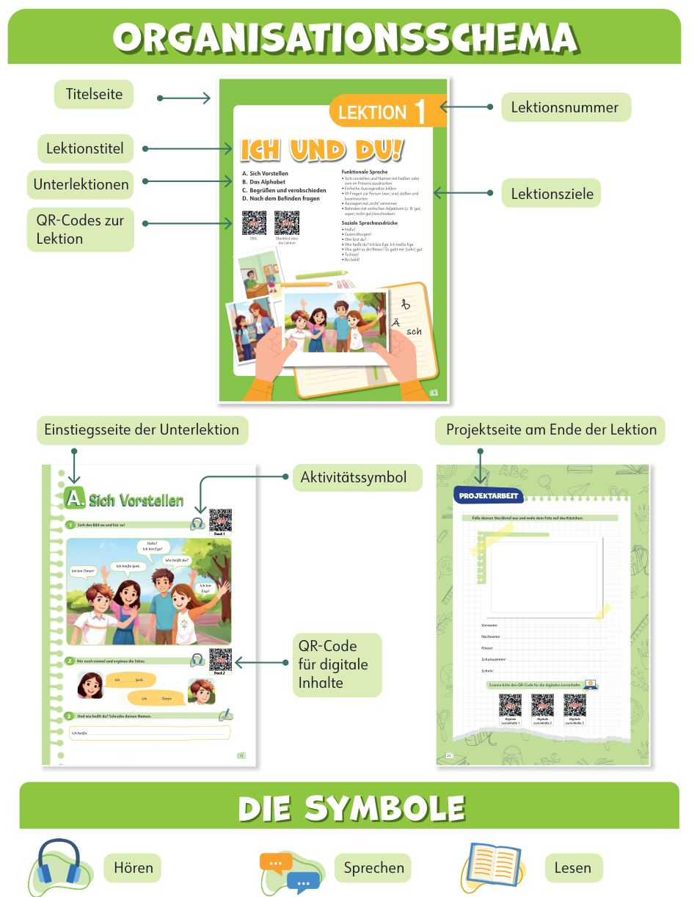

| Einstiegsseite der Unterlektion | Aktivitätssymbol | Projektseite am Ende der Lektion |
| :--- | :---: | ---: |
| | | |
| | QR-Code für digitale Inhalte | |

# DIE SYMBOLE

|  | Hören |  | Sprechen |  | Lesen |
| :--- | :---: | :--- | :---: | :--- | :---: |
|  | Schreiben |  | Sehen/ Ansehen |  | Gruppenarbeit |

PARTNERARBEIT KETTENSPIEL PANTOMIMESPIEL

<!-- sayfa 8 -->

# LEKTION 1

# ICH UND DU!

**A. Sich Vorstellen**
**B. Das Alphabet**
**C. Begrüßen und verabschieden**
**D. Nach dem Befinden fragen**

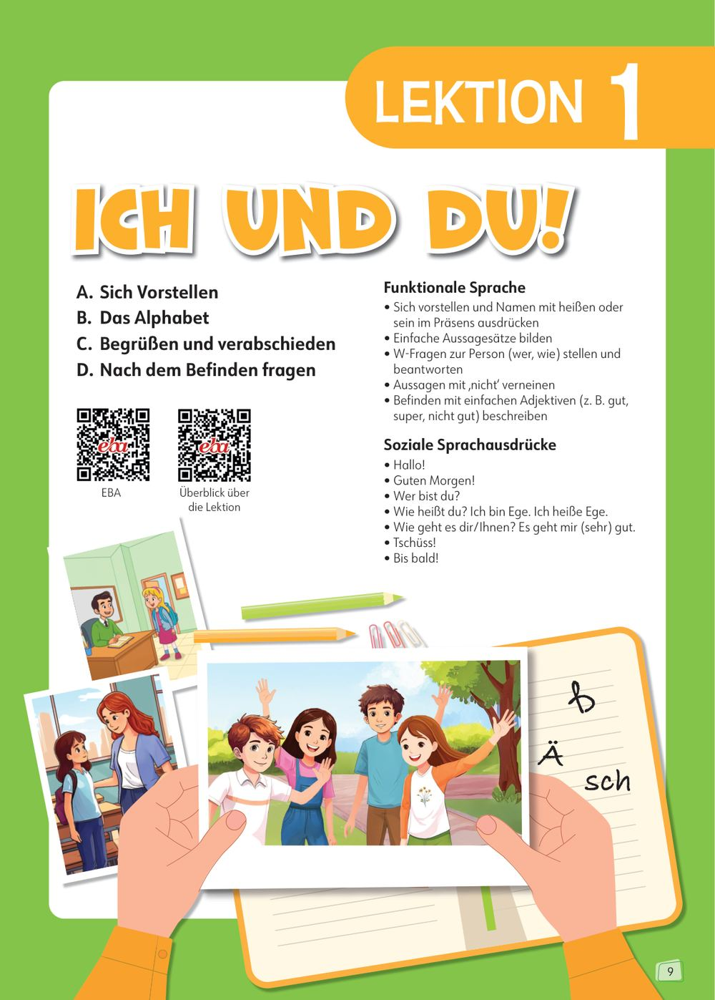

**Funktionale Sprache**
* Sich vorstellen und Namen mit heißen oder sein im Präsens ausdrücken
* Einfache Aussagesätze bilden
* W-Fragen zur Person (wer, wie) stellen und beantworten
* Aussagen mit ‚nicht‘ verneinen
* Befinden mit einfachen Adjektiven (z. B. gut, super, nicht gut) beschreiben

**Soziale Sprachausdrücke**
* Hallo!
* Guten Morgen!
* Wer bist du?
* Wie heißt du? Ich bin Ege. Ich heiße Ege.
* Wie geht es dir/Ihnen? Es geht mir (sehr) gut.
* Tschüss!
* Bis bald!

<!-- sayfa 9 -->

Girdiğiniz mesajda herhangi bir metin katmanı bulunmamaktadır. Lütfen dönüştürülmesini istediğiniz metni `<<< >>>` işaretleri arasına ekleyiniz.

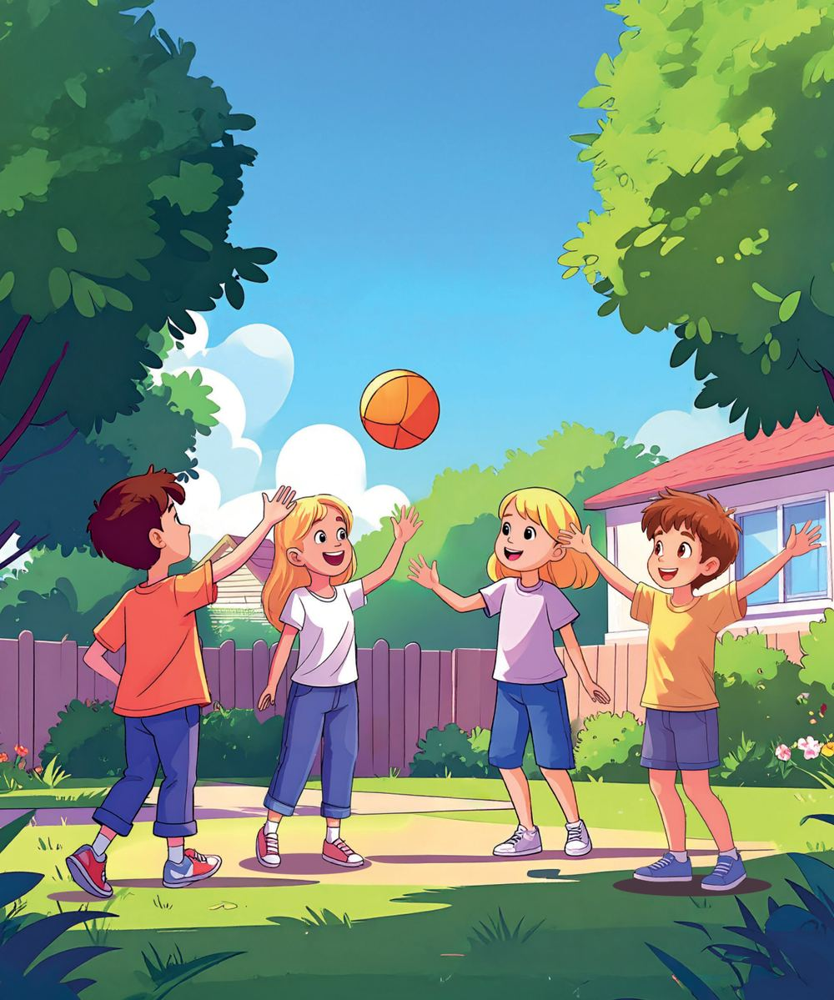
<!-- yer tutucu bulunamadı: sayfa sonuna eklendi -->

<!-- sayfa 10 -->

# A. Sich Vorstellen

1. Sieh das Bild an und hör zu!
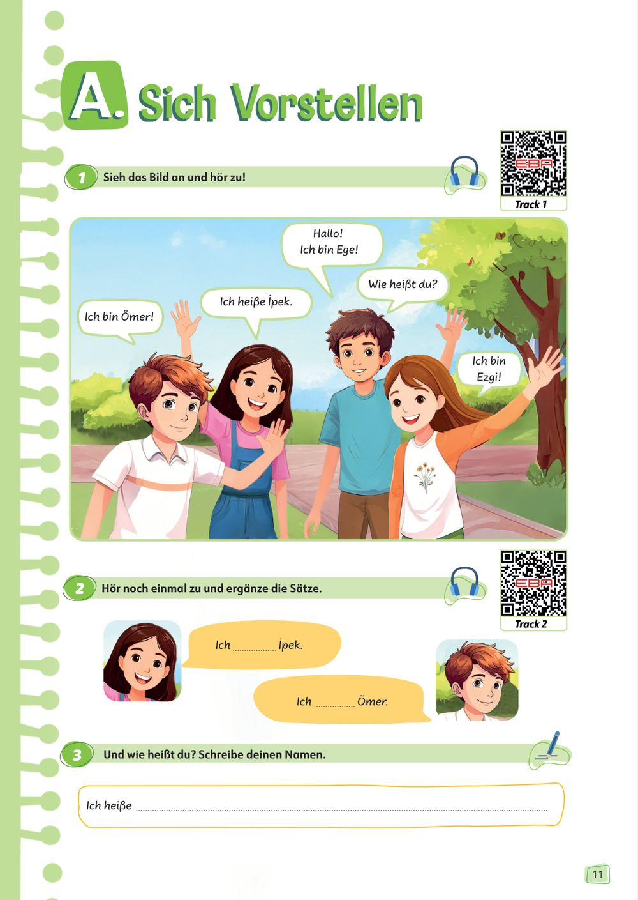

[QR Code]
Track 1

[Resim: Dört çocuk konuşuyor]
- Ich bin Ömer!
- Ich heiße İpek.
- Hallo! Ich bin Ege!
- Wie heißt du?
- Ich bin Ezgi!

2. Hör noch einmal zu und ergänze die Sätze.


[QR Code]
Track 2

[Resim: İpek] Ich ................... İpek.
[Resim: Ömer] Ich ................... Ömer.

3. Und wie heißt du? Schreibe deinen Namen.


Ich heiße ........................................

<!-- sayfa 11 -->

4 Hör zweimal zu und sing mit!

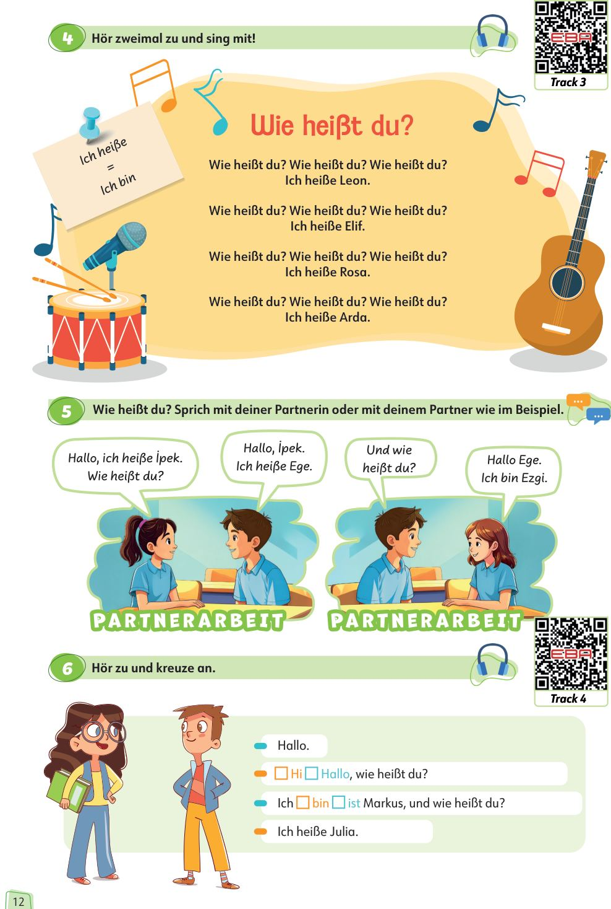

Track 3

| Ich heiße = Ich bin |
| :--- |

# Wie heißt du?

Wie heißt du? Wie heißt du? Wie heißt du?
Ich heiße Leon.

Wie heißt du? Wie heißt du? Wie heißt du?
Ich heiße Elif.

Wie heißt du? Wie heißt du? Wie heißt du?
Ich heiße Rosa.

Wie heißt du? Wie heißt du? Wie heißt du?
Ich heiße Arda.

5 Wie heißt du? Sprich mit deiner Partnerin oder mit deinem Partner wie im Beispiel.

| Hallo, ich heiße İpek. Wie heißt du? | Hallo, İpek. Ich heiße Ege. | Und wie heißt du? | Hallo Ege. Ich bin Ezgi. |
| :--- | :--- | :--- | :--- |
| **PARTNERARBEIT** | | **PARTNERARBEIT** | |

6 Hör zu und kreuze an.

Track 4

- Hallo.
- $\square$ Hi $\square$ Hallo, wie heißt du?
- Ich $\square$ bin $\square$ ist Markus, und wie heißt du?
- Ich heiße Julia.

<!-- sayfa 12 -->

# 7 Wer bist du? Hör zu und nummeriere wie im Beispiel.

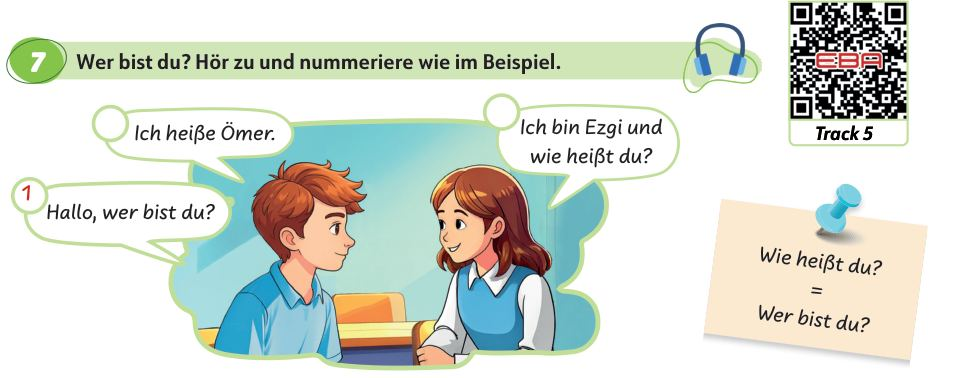

(QR Code)
Track 5

(Konuşma balonları)
- Ich heiße Ömer.
- Ich bin Ezgi und wie heißt du?
- 1 Hallo, wer bist du?

(Not kağıdı)
Wie heißt du?
=
Wer bist du?

# 8 Wie heißen die Kinder? Notiere die Namen.

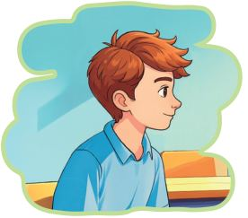
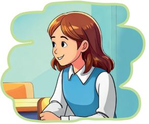

(Boşluklar)
..................................................
..................................................

# 9 Sprich mit deiner Partnerin oder mit deinem Partner wie im Beispiel.

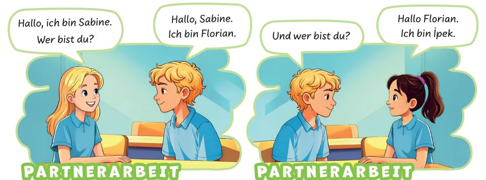

(Konuşma balonları)
- Hallo, ich bin Sabine. Wer bist du?
- Hallo, Sabine. Ich bin Florian.
- Und wer bist du?
- Hallo Florian. Ich bin İpek.

PARTNERARBEIT
PARTNERARBEIT

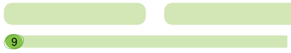
<!-- yer tutucu bulunamadı: sayfa sonuna eklendi -->

<!-- sayfa 13 -->

# B. Das Alphabet

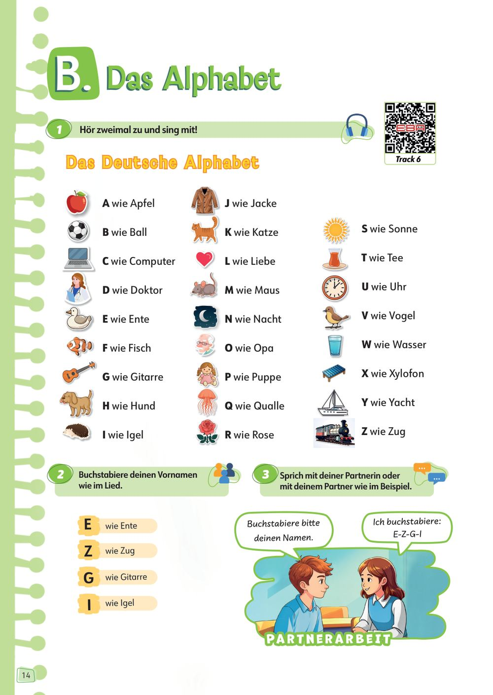
1 Hör zweimal zu und sing mit!


## Das Deutsche Alphabet

| | | |
| :--- | :--- | :--- |
| **A** wie Apfel | **J** wie Jacke | **S** wie Sonne |
| **B** wie Ball | **K** wie Katze | **T** wie Tee |
| **C** wie Computer | **L** wie Liebe | **U** wie Uhr |
| **D** wie Doktor | **M** wie Maus | **V** wie Vogel |
| **E** wie Ente | **N** wie Nacht | **W** wie Wasser |
| **F** wie Fisch | **O** wie Opa | **X** wie Xylofon |
| **G** wie Gitarre | **P** wie Puppe | **Y** wie Yacht |
| **H** wie Hund | **Q** wie Qualle | **Z** wie Zug |
| **I** wie Igel | **R** wie Rose | |


2 Buchstabiere deinen Vornamen wie im Lied.

| | |
| :--- | :--- |
| **E** | wie Ente |
| **Z** | wie Zug |
| **G** | wie Gitarre |
| **I** | wie Igel |


3 Sprich mit deiner Partnerin oder mit deinem Partner wie im Beispiel.

| | |
| :--- | :--- |
| Buchstabiere bitte deinen Namen. | Ich buchstabiere: E-Z-G-I |

<!-- sayfa 14 -->

# 4 Hör zu und markiere die Buchstaben.

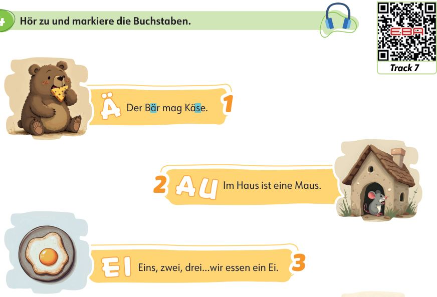

1 Ä Der Bär mag Käse.
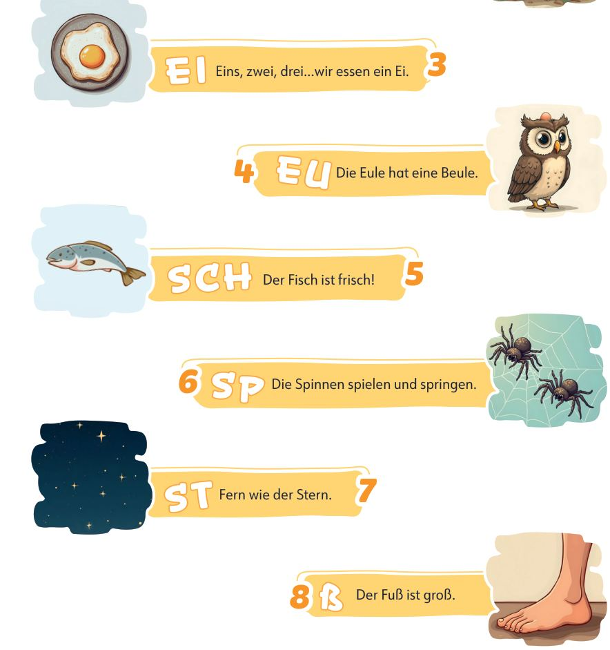

2 AU Im Haus ist eine Maus.


3 EI Eins, zwei, drei...wir essen ein Ei.


4 EU Die Eule hat eine Beule.


5 SCH Der Fisch ist frisch!


6 SP Die Spinnen spielen und springen.


7 ST Fern wie der Stern.


8 ß Der Fuß ist groß.


<!-- sayfa 15 -->

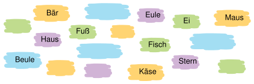
# 5 Ordne die Wörter auf die Notizblätter. 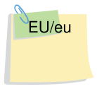


eins 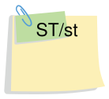 Bär 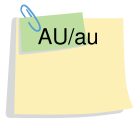 springen  Eule 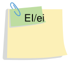 Ei 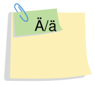 Maus
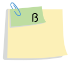 Haus  Fuß  zwei  Fisch  spielen
 Beule  Spinne  Maus  Stern  groß
 frisch  drei  Käse

---


**EU/eu**


**SP/sp**


**ST/st**


**AU/au**


**SCH/sch**


**EI/ei**


**Ä/ä**


**ß**

<!-- sayfa 16 -->

# C. Begrüßen und Verabschieden

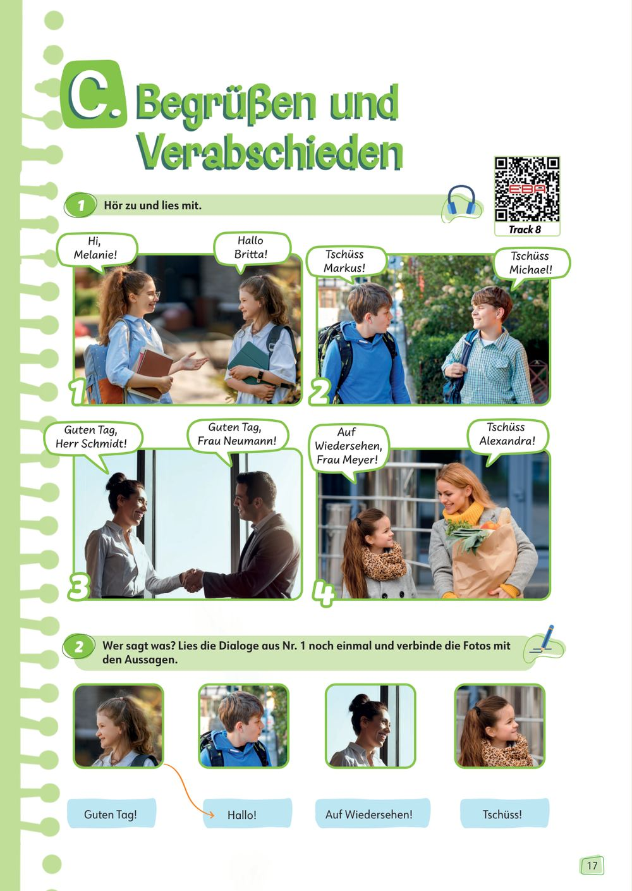

1. Hör zu und lies mit.


Hi, Melanie!
Hallo Britta!
1


Tschüss Markus!
Tschüss Michael!
2


Guten Tag, Herr Schmidt!
Guten Tag, Frau Neumann!
3


Auf Wiedersehen, Frau Meyer!
Tschüss Alexandra!
4


Track 8

2. Wer sagt was? Lies die Dialoge aus Nr. 1 noch einmal und verbinde die Fotos mit den Aussagen.


<!-- sayfa 17 -->

# 3 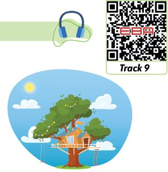 Hör zu und sprich nach. 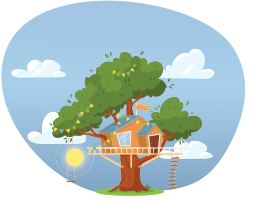

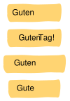
Guten Morgen!
Guten Tag!
Guten Abend!
Gute Nacht!

# 4  Lies die Dialoge und ordne sie zu den Fotos. 

1 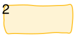
- Gute Nacht, Mama!
- Gute Nacht, Anja!

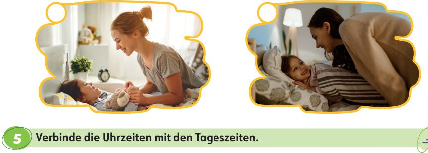

2 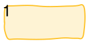
- Guten Morgen, Mama!
- Guten Morgen, Eva.

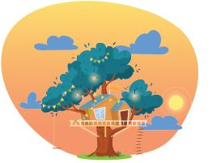

# 5 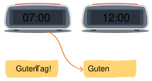 Verbinde die Uhrzeiten mit den Tageszeiten. 


07:00
12:00
23:30
20:00

Guten Tag!
Guten Morgen!
Guten Abend!
Gute Nacht!

<!-- sayfa 18 -->

# 6 Finde die gegebenen Wörter im Kreuzworträtsel! 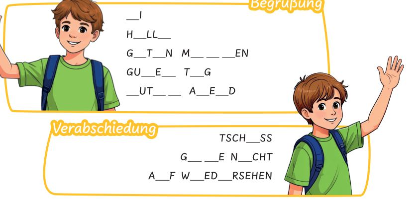

GUTEN TAG | TSCHÜSS | AUF WIEDERSEHEN
---|---|---
GUTEN MORGEN | GUTEN ABEND | HI | HALLO | GUTE NACHT

| R | D | C | I | Q | D | K | G | U | T | E | N | M | O | R | G | E | N |
|---|---|---|---|---|---|---|---|---|---|---|---|---|---|---|---|---|---|
| A | U | F | W | I | E | D | E | R | S | E | H | E | N | Ä | D | D | Q |
| F | T | X | G | R | R | T | H | V | C | J | I | B | D | P | G | S | S |
| A | H | G | U | T | E | N | A | C | H | T | Ä | C | S | V | V | Q | H |
| P | R | U | T | J | I | Q | L | V | Ü | J | L | H | J | M | A | O | K |
| R | Ü | T | E | A | P | A | L | X | S | O | Z | F | B | F | Q | S | X |
| U | C | E | N | W | G | B | O | Ö | S | C | J | Ü | Ö | E | P | I | J |
| Q | T | N | T | P | A | J | V | B | G | Y | R | F | Y | O | W | X | M |
| Z | R | A | A | E | B | S | U | C | Q | Ä | O | R | W | B | C | Q | S |
| L | Z | B | G | W | V | O | Q | Ä | J | D | V | K | Ö | D | C | I | L |
| T | H | E | H | B | T | K | D | H | J | F | Y | V | Ö | X | J | V | S |
| P | Y | N | I | B | P | B | B | M | T | S | U | G | L | A | L | W | A |
| E | T | D | N | T | H | Y | V | P | X | Ö | A | S | Y | V | E | Ü | B |

# 7 Ergänze die Wörter zur Begrüßung und Verabschiedung. 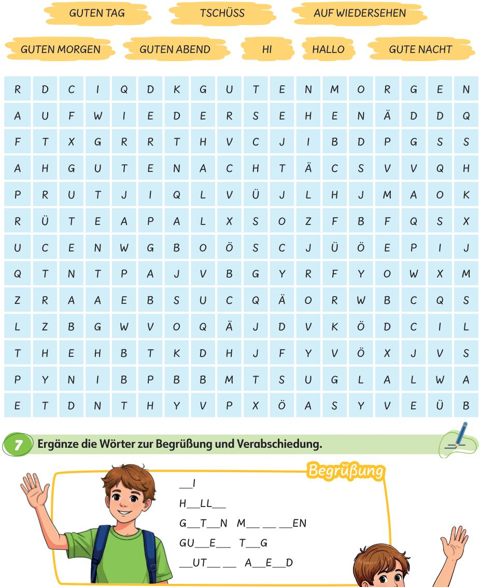

Begrüßung
_ I
H _ _ LL _
G _ T _ N   M _ _ _ _ EN
GU _ E    T _ G
_ _ UT        A _ E _ D

Verabschiedung
TSCH _ _ SS
G _ _ _ E N   _ _ CHT
A _ F W _ _ ED _ _ RSEHEN

<!-- sayfa 19 -->

# 8 Hör die Gespräche und verbinde die Aussagen.

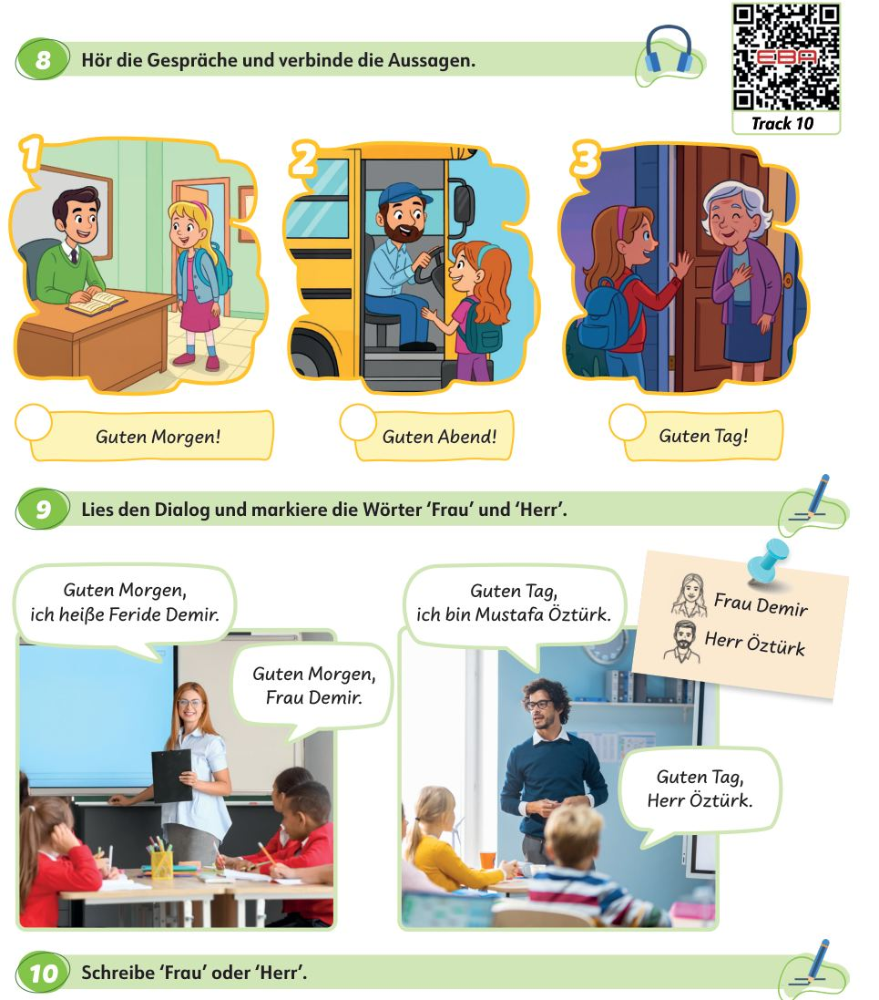

1
2
3

Guten Morgen!
Guten Abend!
Guten Tag!

# 9 Lies den Dialog und markiere die Wörter ‘Frau’ und ‘Herr’.

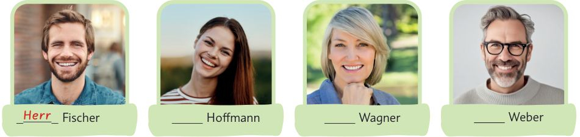

Guten Morgen, ich heiße Feride Demir.
Guten Morgen, Frau Demir.

Guten Tag, ich bin Mustafa Öztürk.
Guten Tag, Herr Öztürk.

Frau Demir
Herr Öztürk

# 10 Schreibe ‘Frau’ oder ‘Herr’.


Herr Fischer
_______ Hoffmann
_______ Wagner
_______ Weber

<!-- sayfa 20 -->

# D. Nach dem Befinden fragen

1. Wie geht es Tom, Florian und Ezgi? Hör das Gespräch, male die Smileys und schreibe die Wörter.

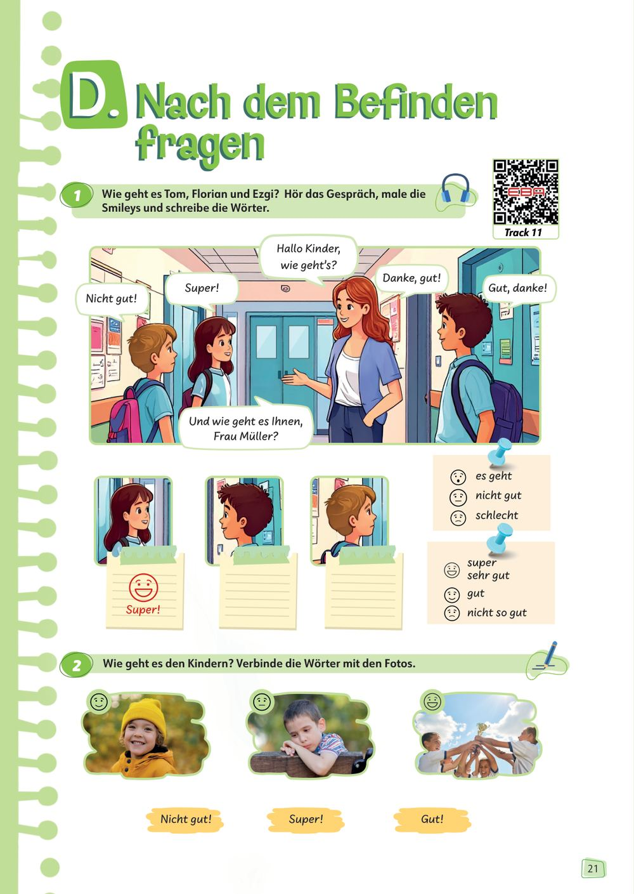

| | | |
| :--- | :--- | :--- |
| Hallo Kinder, wie geht's? | Danke, gut! | Gut, danke! |
| Nicht gut! | Super! | |
| | Und wie geht es Ihnen, Frau Müller? | |


(Ezgi'nin resmi)
(Smileys listesi: es geht, nicht gut, schlecht)
Super!


(Florian'ın resmi)


(Tom'un resmi)

(Smileys listesi: super, sehr gut, gut, nicht so gut)

2. Wie geht es den Kindern? Verbinde die Wörter mit den Fotos.


(Gülümseyen çocuk fotoğrafı)


(Üzgün çocuk fotoğrafı)


(Kupa tutan çocuklar fotoğrafı)

<!-- sayfa 21 -->

3 Sprich mit deiner Partnerin oder mit deinem Partner wie im Beispiel.

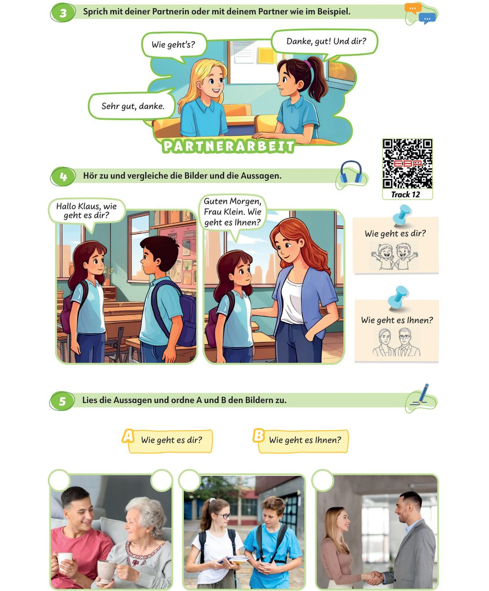

Wie geht's?
Danke, gut! Und dir?
Sehr gut, danke.

PARTNERARBEIT

4 Hör zu und vergleiche die Bilder und die Aussagen.


Track 12

Hallo Klaus, wie geht es dir?
Guten Morgen, Frau Klein. Wie geht es Ihnen?

Wie geht es dir?
Wie geht es Ihnen?

5 Lies die Aussagen und ordne A und B den Bildern zu.

A Wie geht es dir?
B Wie geht es Ihnen?


<!-- sayfa 22 -->

# 6 Hör zu und nummeriere die Gespräche wie im Beispiel.

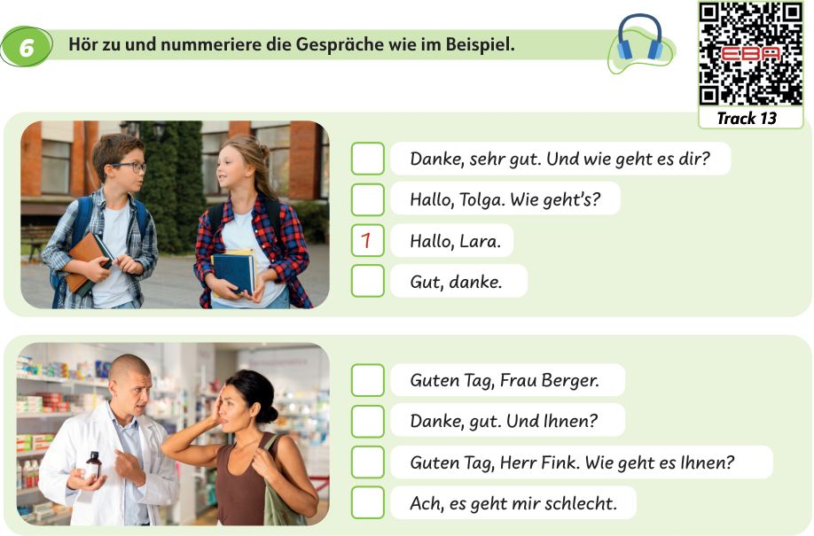

Track 13

$\square$ Danke, sehr gut. Und wie geht es dir?
$\square$ Hallo, Tolga. Wie geht's?
$\boxed{1}$ <!-- KONTROL: Marker'da karşılığı yok, uydurma olabilir --> Hallo, Lara.
$\square$ Gut, danke.

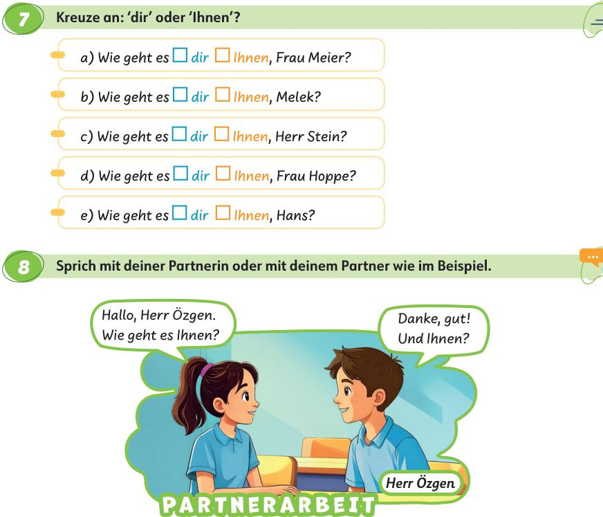

$\square$ Guten Tag, Frau Berger.
$\square$ Danke, gut. Und Ihnen?
$\square$ Guten Tag, Herr Fink. Wie geht es Ihnen?
$\square$ Ach, es geht mir schlecht.

# 7 Kreuze an: 'dir' oder 'Ihnen'?

a) Wie geht es $\square$ dir $\square$ Ihnen, Frau Meier?
b) Wie geht es $\square$ dir $\square$ Ihnen, Melek?
c) Wie geht es $\square$ dir $\square$ Ihnen, Herr Stein?
d) Wie geht es $\square$ dir $\square$ Ihnen, Frau Hoppe?
e) Wie geht es $\square$ dir $\square$ Ihnen, Hans?

# 8 Sprich mit deiner Partnerin oder mit deinem Partner wie im Beispiel.

Hallo, Herr Özgen.
Wie geht es Ihnen?

Danke, gut!
Und Ihnen?

Herr Özgen

<!-- sayfa 23 -->

# PROJEKTARBEIT

Fülle deinen Steckbrief aus und male dein Foto auf das Kästchen.

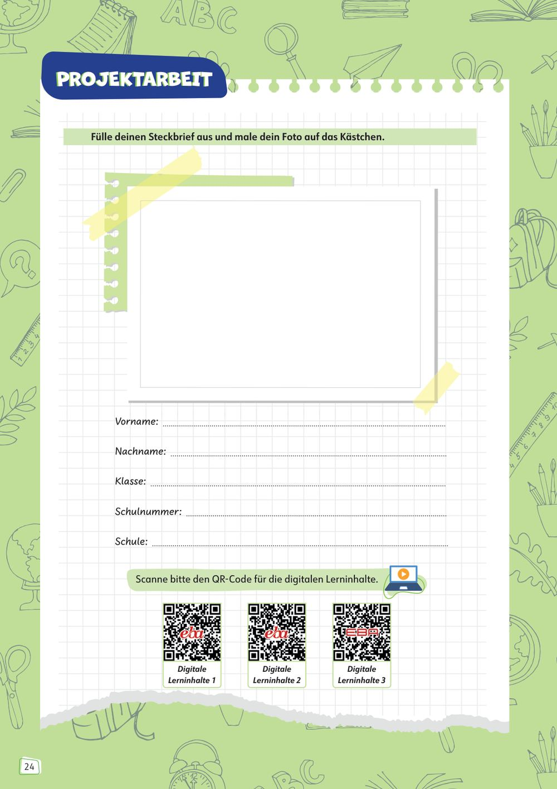

Vorname: ...........................................................................................................................................

Nachname: ..........................................................................................................................................

Klasse: ...............................................................................................................................................

Schulnummer: .....................................................................................................................................

Schule: ...............................................................................................................................................

Scanne bitte den QR-Code für die digitalen Lerninhalte. 

| Digitale Lerninhalte 1 | Digitale Lerninhalte 2 | Digitale Lerninhalte 3 |
| :---: | :---: | :---: |
| [QR Code] | [QR Code] | [QR Code] |

<!-- sayfa 24 -->

# LEKTION 2

# DAS BIN ICH!

**A. Das Alter und die Zahlen**
**B. Die Länder und die Sprachen**
**C. Die Herkunft und der Wohnort**

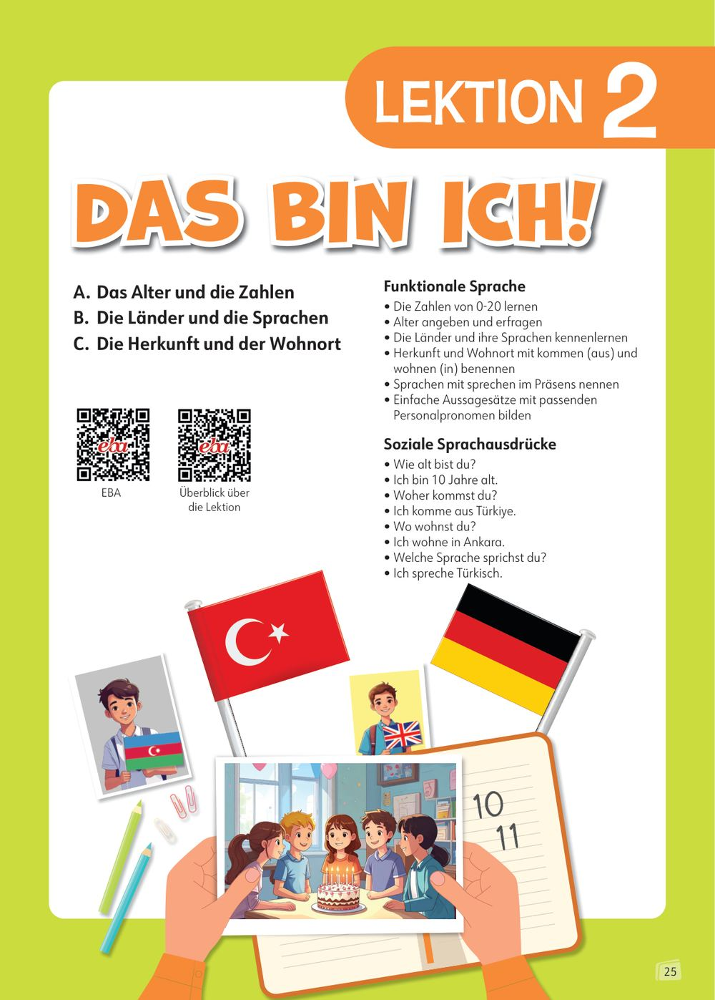

**Funktionale Sprache**
* Die Zahlen von 0-20 lernen
* Alter angeben und erfragen
* Die Länder und ihre Sprachen kennenlernen
* Herkunft und Wohnort mit kommen (aus) und wohnen (in) benennen
* Sprachen mit sprechen im Präsens nennen
* Einfache Aussagesätze mit passenden Personalpronomen bilden

**Soziale Sprachausdrücke**
* Wie alt bist du?
* Ich bin 10 Jahre alt.
* Woher kommst du?
* Ich komme aus Türkiye.
* Wo wohnst du?
* Ich wohne in Ankara.
* Welche Sprache sprichst du?
* Ich spreche Türkisch.

<!-- sayfa 25 -->

```

Görüntüde herhangi bir metin veya matematiksel ifade bulunmamaktadır; sadece dört çocuktan oluşan bir illüstrasyon yer almaktadır. Bu nedenle dönüştürülecek bir metin katmanı mevcut değildir.

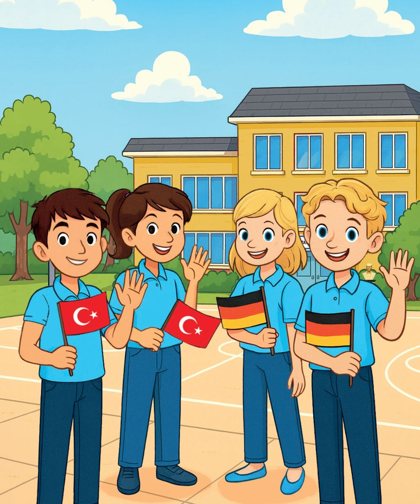
<!-- yer tutucu bulunamadı: sayfa sonuna eklendi -->

<!-- sayfa 26 -->

# A. Das Alter und die Zahlen

1. Suche im Bild die Zahl 3 und kreise sie ein.

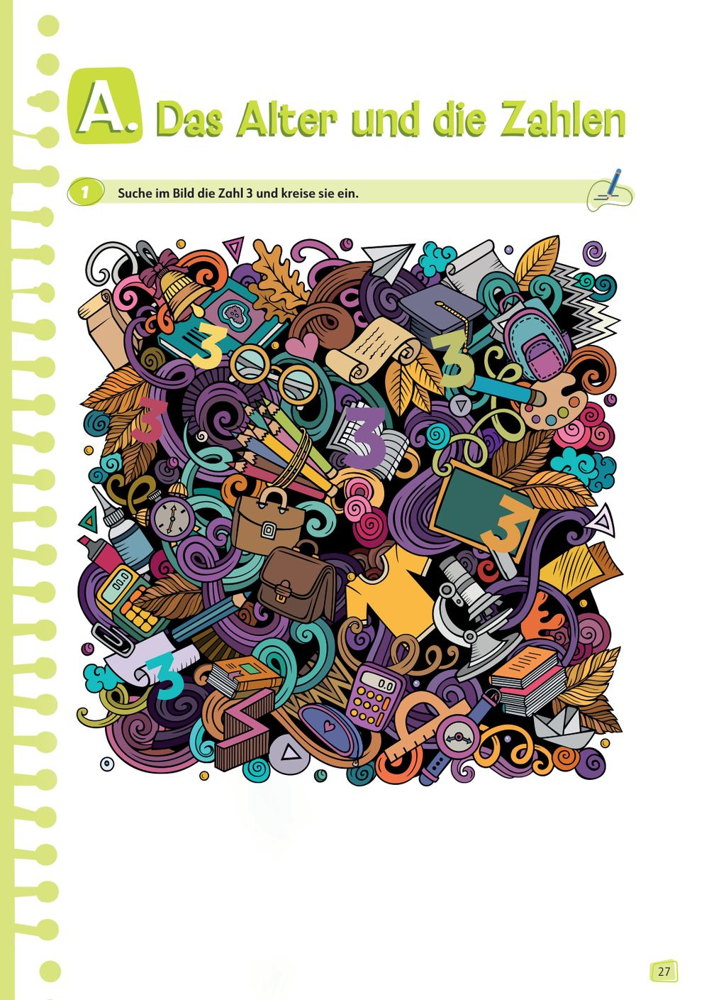

<!-- sayfa 27 -->

 Hör zu und sprich nach.  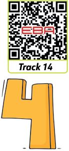

0
null

1
eins

2
zwei

3
drei

4
vier

5
fünf

6
sechs

7
sieben

8
acht

9
neun

10
zehn

11
elf

12
zwölf

 Finde die Zahlen und male sie wie im Beispiel. 

 0 
 1 
 2 
 3 
 4 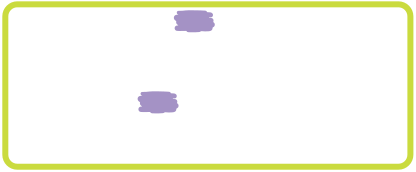
 5
 6
 7
 8
 9
 10
 11
 12

| | | | | |
| :--- | :--- | :--- | :--- | :--- |
| **null** | | **sechs** | | **drei** | **vier** |
| | **fünf** | | **sieben** | | |
| **zehn** | | **acht** | **elf** | | **sieben** |
| | | | **eins** | | **zwölf** |
| **eins** | **null** | | **drei** | | **neun** | **vier** |
| | | **zwei** | | | **neun** |
| | **zehn** | | **elf** | | **acht** |
| **fünf** | | **sechs** | | | **zwölf** |

<!-- sayfa 28 -->

# 4 Zähle die Sachen auf dem Bild und schreibe die Anzahl.

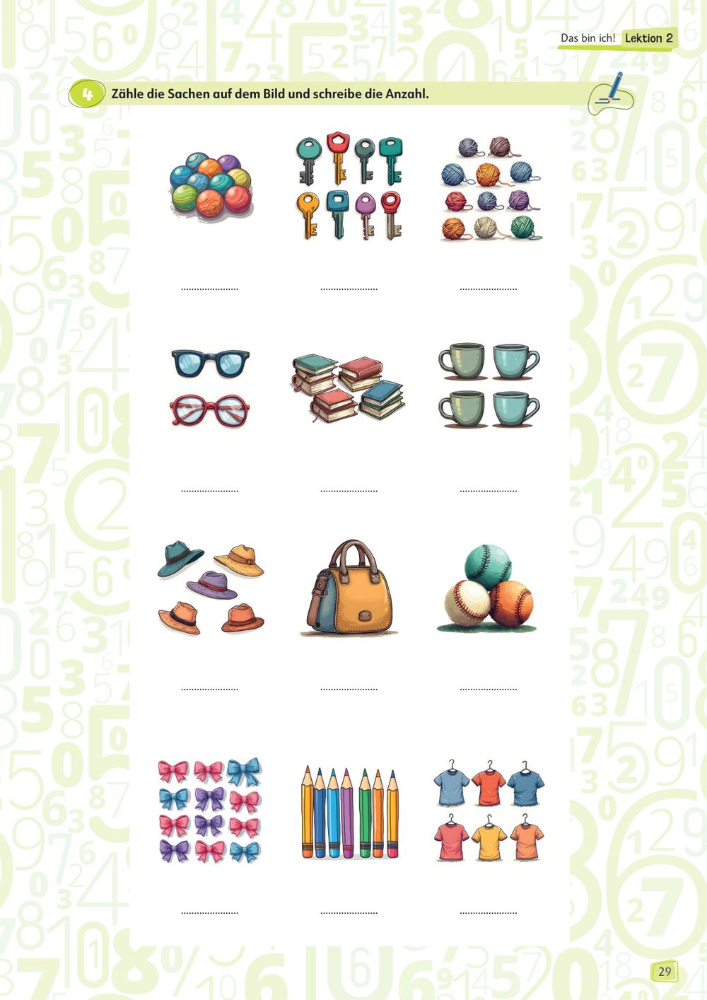

....................          ....................          ....................

<!-- sayfa 29 -->

# 5 Verbinde die Zahlen mit den Wörtern.

$0$ $\quad$ $9$ $\quad$ $10$

$12$ $\quad$ $2$ $\quad$ $4$ $\quad$ $1$

$11$ $\quad$ $8$

$5$ $\quad$ $3$ $\quad$ $7$ $\quad$ $6$

zwei $\quad$ vier
sechs $\quad$ elf
eins $\quad$ neun
fünf $\quad$ drei
zehn $\quad$ zwölf
acht $\quad$ null
sieben

# 6 Hör zu und wiederhole. 

$13 \xrightarrow[3]{1}$ <!-- KONTROL: Marker'da karşılığı yok, uydurma olabilir --> dreizehn
$14 \xrightarrow[4]{1}$ <!-- KONTROL: Marker'da karşılığı yok, uydurma olabilir --> vierzehn
$15 \xrightarrow[5]{1}$ <!-- KONTROL: Marker'da karşılığı yok, uydurma olabilir --> fünfzehn
$16 \xrightarrow[6]{1}$ <!-- KONTROL: Marker'da karşılığı yok, uydurma olabilir --> sechzehn
$17 \xrightarrow[7]{1}$ <!-- KONTROL: Marker'da karşılığı yok, uydurma olabilir --> siebzehn
$18 \xrightarrow[8]{1}$ <!-- KONTROL: Marker'da karşılığı yok, uydurma olabilir --> achtzehn
$19 \xrightarrow[9]{1}$ <!-- KONTROL: Marker'da karşılığı yok, uydurma olabilir --> neunzehn
$20$ zwanzig


| | | |
|---|---|---|
| 13 dreizehn | 14 vierzehn | 15 fünfzehn |
| 16 sechzehn | 17 siebzehn | 18 achtzehn |
| 19 neunzehn | 20 zwanzig | |

> sechzehn
> $\text{s}$ <!-- KONTROL: Marker'da karşılığı yok, uydurma olabilir --> geht weg
> siebzehn
> $\text{en}$ <!-- KONTROL: Marker'da karşılığı yok, uydurma olabilir --> geht weg

# 7 Zähle mit deiner Partnerin oder mit deinem Partner die Zahlen von $0$ bis $20$ wie im Beispiel.

Null, eins, zwei, drei, .............., zwanzig

<!-- sayfa 30 -->

# 8 Finde die Zahlen von 0 bis 20 im Kreuzworträtsel und markiere sie. 

| | | | | | | | | | | | | | | | |
|---|---|---|---|---|---|---|---|---|---|---|---|---|---|---|---|
| Ä | Ö | P | V | P | Z | W | A | N | Z | I | G | Ö | Q | A | B |
| J | D | Ü | I | X | Q | F | Ü | N | F | Z | E | H | N | I | K |
| S | B | V | E | D | S | F | H | V | K | S | Ü | E | I | N | S |
| O | T | I | R | R | I | N | S | V | D | I | Ä | S | T | Ö | Ü |
| U | C | E | Z | E | X | Q | B | U | J | E | W | Z | W | E | I |
| Z | D | R | E | I | M | B | M | Ö | F | B | G | S | A | S | Y |
| S | E | C | H | Z | E | H | N | Q | B | E | R | B | C | E | L |
| P | Z | K | N | E | U | N | Z | E | H | N | M | J | H | A | E |
| E | L | F | E | H | Z | W | Ö | L | F | A | Z | G | T | C | G |
| W | Ö | K | U | N | W | R | T | F | Ü | N | F | Z | Z | H | N |
| N | D | M | N | S | E | C | H | S | A | X | Ü | L | E | T | U |
| O | Y | Y | E | S | I | E | B | Z | E | H | N | X | H | V | L |
| H | Q | E | T | Z | E | H | N | Ö | V | A | F | M | N | S | L | 

# 9 Löse die Aufgaben und finde den richtigen Schlüssel für jede Kiste. 


$3 + 4 = ?$ <!-- KONTROL: Marker'da karşılığı yok, uydurma olabilir --> 
$2 + 8 = ?$ <!-- KONTROL: Marker'da karşılığı yok, uydurma olabilir -->
$11 + 2 = ?$ <!-- KONTROL: Marker'da karşılığı yok, uydurma olabilir -->
$10 + 9 = ?$ <!-- KONTROL: Marker'da karşılığı yok, uydurma olabilir -->

neunzehn dreizehn sieben zehn

<!-- sayfa 31 -->

# 10 Hör zu und ergänze die Lücken.


1 ................... Ezgi, willkommen!
2 ...................... Florian!
3 Wie alt bist du?
4 Ich bin .............. Jahre alt.

# 11 Ordne die Namen in die Tabelle: ‘Er’ oder ‘sie’?

~~Heike~~  Julia  Leo  Sandra
Thomas  ~~Martin~~  Jonas  Maria

| er | sie |
| :--- | :--- |
| Martin | Heike |

<!-- sayfa 32 -->

12 Hör zu und ergänze die Lücken.


Hallo. Ich bin Florian. Ich bin .............................. Jahre alt. Das ist Ege. Er ist .............................. Jahre alt. Das ist Eylül. Sie ist .............................. Jahre alt.

Ich bin
Du bist
Er/sie ist

13 Bilde Sätze und schreibe Informationen wie im Beispiel.


Duygu (11)
Niko (9)
Buse (12)

Ich heiße Duygu.
Ich bin 11 Jahre alt.

____________________
____________________

14 Sprich mit deiner Partnerin oder mit deinem Partner wie im Beispiel und ergänze die Sätze.


Ich heiße ...................... .
Ich bin ...................... Jahre alt.
Das ist ...................... .
Er ist ...................... Jahre alt.
Das ist ...................... .

<!-- sayfa 33 -->

# B. Die Länder und die Sprachen

1. Welche Länder kennst du? Kreise wie im Beispiel ein.


2. Hör zu und lies mit.


| | | | |
| :---: | :---: | :---: | :---: |
|  |  |  |  |
| die Schweiz | Aserbaidschan | Österreich | Deutschland |
|  |  |  |  |
| Türkiye | Japan | Spanien | England |
|  |  |  |  |

<!-- sayfa 34 -->

 3 Hör zu und sprich nach. 

|  |  |  |  |
| :---: | :---: | :---: | :---: |
| Deutsch | Aserbaidschanisch | Deutsch | Deutsch |

|  |  |  |  |
| :---: | :---: | :---: | :---: |
| Türkisch | Japanisch | Spanisch | Englisch |

|  |  |  |  |
| :---: | :---: | :---: | :---: |
| Russisch | Französisch | Italienisch | Chinesisch |

 4 Finde die Länder und schreibe sie. 


SPANIENDEUTSCHLANDASERBAIDSCHANDIESCHWEIZENGLANDÖSTERREICHTÜRKİYE

1. ___________________________ 5. ___________________________
2. ___________________________ 6. ___________________________
3. ___________________________ 7. ___________________________
4. ___________________________

<!-- sayfa 35 -->

 
5 Hör zu und ergänze.


Ich heiße Anja.
Ich komme aus
Deutschland. Ich
spreche ............... .


Ich bin Rosa. Ich komme
aus ........................ .
Ich spreche Spanisch.


Ich bin Gina.
Ich komme aus
..................... . Ich
spreche Japanisch.


Ich bin Eylül. Ich
komme aus
Türkiye. Ich
spreche Türkisch.


Ich bin Klaus. Ich komme
aus Österreich.
Ich spreche .................... .


Ich bin Asaf. Ich komme
aus Aserbaidschan.
Ich spreche .................... .


Ich heiße Daniel.
Ich komme aus der
Schweiz. Ich spreche
.................... .

 
Ich bin Robert.
Ich komme aus
..................... . Ich spreche
Englisch.

Türkiye-Türkisch    England-Englisch    Deutschland-Deutsch
die Schweiz-Deutsch    Spanien-Spanisch    Japan-Japanisch
Aserbaidschan-Aserbaidschanisch    Österreich-Deutsch

<!-- sayfa 36 -->

# 6 Hör zu und verbinde die Länder mit den passenden Sprachen wie im Beispiel.

| | | | |
| :--- | :--- | :--- | :--- |
| Spanisch | Italien | China | Deutsch |
| Deutsch | Russland | England | Englisch |
| Italienisch | die Schweiz | Aserbaidschan | Chinesisch |
| Türkisch | Türkiye | Deutschland | Französisch |
| Deutsch | Österreich | Japan | Aserbaidschanisch |
| Russisch | Spanien | Frankreich | Japanisch |


# 7 Ege stellt sich und seine Freunde vor. Lies den Text.


Ich heiße Ege. Ich bin 13 Jahre alt.
Ich spreche Türkisch und Deutsch.
Sabine ist 11 Jahre alt. Sie spricht Deutsch und Englisch.
Ömer ist 12 Jahre alt. Er spricht Türkisch, Aserbaidschanisch und Spanisch.

# 8 Lies Übung Nr. 7 noch einmal und kreuze an: Richtig (R) oder falsch (F)?

| | R | F |
| :--- | :---: | :---: |
| Ege spricht Japanisch. | | |
| Sabine spricht Englisch und Deutsch. | | |
| Ömer spricht Aserbaidschanisch. | | |

| Ich spreche |
| :--- |
| Du sprichst |
| Er/sie spricht |

# 9 Sprich mit deiner Partnerin oder mit deinem Partner wie im Beispiel.

| Ich bin Ege. Ich bin 12 Jahre alt. Ich spreche Deutsch, Spanisch und Türkisch. | Ich heiße İpek. Ich bin auch 12 Jahre alt. Ich spreche Türkisch, Englisch und Japanisch. |
| :--- | :--- |

<!-- sayfa 37 -->

# C. Die Herkunft und der Wohnort

1. Hör das Gespräch und lies mit.


Hallo İpek, wie geht es dir?
Hallo Sabine. Gut, danke und wie geht es dir?
Danke, auch gut. Woher kommst du İpek?
Ich komme aus Türkiye. Woher kommst du?
Ich komme aus Deutschland.

Track 22

2. Spiel mit deiner Partnerin oder mit deinem Partner wie im Beispiel.


Woher kommst du?
Ich komme aus ..........
KETTEN SPIEL
Woher kommst du?
......................

<!-- sayfa 38 -->

# 3 Hör zu und ergänze die Lücken.


**A**
Ich heiße Martina. Ich bin elf. Ich komme aus ..................... . Ich spreche Deutsch und ..................... .

**B**
Sie heißt Martina. Sie ist ....................... Jahre alt. Sie ....................... aus Österreich. Sie spricht ...................... und Englisch.


> ich komme
> du kommst
> er/sie kommt

# 4 Hör zu und verbinde die Länder mit den Kindern.


**Mara**


**Ali**

Türkiye | Spanien | Aserbaidschan | die Schweiz

**Julia**

**Meryem**

<!-- sayfa 39 -->

# 5 Hör zu und nummeriere die Städte wie im Beispiel. 

![BERLIN]
☐

![LONDON]
☐

![TOKIO]
☐

![WIEN]
☑ 1

![İSTANBUL]
☐

![BAKÜ]
☐

![ZÜRICH]
☐

![MADRID]
☐

# 6 Hör zu und verbinde die Städte mit den Ländern. 

| in der Schweiz | in Deutschland | in Aserbaidschan | in Spanien |
| :---: | :---: | :---: | :---: |

| İstanbul | Madrid | Wien | Zürich | Berlin | Bakü | London |
| :---: | :---: | :---: | :---: | :---: | :---: | :---: |

| in England | in Österreich | in Türkiye |
| :---: | :---: | :---: |

# 7 Spiel mit deiner Partnerin oder mit deinem Partner wie im Beispiel. 

**Woher kommst du und wo wohnst du?**

**Ich komme aus Österreich und ich wohne in Wien. Und du?**

| ich wohne |
| :--- |
| du wohnst |
| er/sie wohnt |

<!-- sayfa 40 -->

# 8 Wähle eine Stadt/ein Land und sprich mit deiner Partnerin oder mit deinem Partner wie im Beispiel.

| Ich komme aus İstanbul und ich wohne in Ankara. Und du? | Ich komme aus Aserbaidschan und ich wohne auch in Ankara. |
| :--- | :--- |

# PARTNERARBEIT

# 9 Lies die Texte und ergänze die fehlenden Informationen in die Tabelle.

| Er heißt Ali Çelik. Er kommt aus Türkiye. Er wohnt in Ankara. Er spricht Türkisch und Englisch. | Er heißt Markus Hoffmann. Er kommt aus Deutschland. Er wohnt in Berlin. Er spricht Deutsch und Spanisch. | Sie heißt Greta Schröder. Sie kommt aus Deutschland. Sie wohnt in Rom. Sie spricht Deutsch und Italienisch. |
| :--- | :--- | :--- |

| | | | |
| :---: | :---: | :---: | :---: |
| |  |  |  |
| **VORNAME** | Ali | | Greta |
| **NACHNAME** | | Hoffmann | |
| **LAND/HERKUNFT** | | Deutschland | |
| **WOHNORT** | Ankara | | |
| **SPRACHEN** | | | Deutsch und Italienisch |

<!-- sayfa 41 -->

# 10 Ergänze den Steckbrief von Ömer.


Ich heiße Ömer. Ich bin 12 Jahre alt.
Ich komme aus Türkiye.
Ich wohne in Ankara.
Ich spreche Türkisch und Deutsch.

NAME: ...............................................
ALTER: ...............................................
HERKUNFT: ......................................
WOHNORT: .......................................
SPRACHEN: ......................................

# 11 Ergänze die Lücken mit den Informationen aus den Steckbriefen.


NAME: Klaus
ALTER: 15
HERKUNFT: Deutschland
WOHNORT: Hamburg
SPRACHE: Deutsch, Englisch und Spanisch

Er heißt .................................. . Er ist .................................. Jahre alt. Er kommt aus ....................... .
Er wohnt .................................. . Er spricht .................................. .


NAME: Julia
ALTER: 13
HERKUNFT: Spanien
WOHNORT: London
SPRACHE: Spanisch und Englisch

Sie heißt .................................. . Sie ist .................................. Jahre alt. Sie kommt aus ................... .
Sie wohnt .................................. . Sie spricht .................................. .

<!-- sayfa 42 -->

 12 Verbinde die Antworten zu den Fragen wie im Beispiel.

1 Wie alt bist du?  $\rightarrow$ c Ich bin elf Jahre alt.
2 Wie heißt du? $\rightarrow$ a Ich heiße Serhat.
3 Woher kommt er? $\rightarrow$ d Er kommt aus Ankara.
4 Wo wohnst du? $\rightarrow$ f Ich wohne in Erzurum.
5 Woher kommst du? $\rightarrow$ b Ich komme aus Türkiye.
6 Wo wohnt Aslı? $\rightarrow$ e Sie wohnt in Çanakkale.
(g Ich bin Aslı.)

 13 Ordne die Sätze und schreibe den Dialog in der richtigen Reihenfolge wie im Beispiel.


Hallo, wie heißt du?
Hallo, ich heiße Kıvanç. Und du?
Ich heiße Aslı. Woher kommst du Kıvanç?
Wie geht es Ihnen?
Ich komme aus İzmir und wohne in Çanakkale. Wie alt bist du Aslı?
Ich bin elf Jahre alt. Und du?
Ich bin zwölf Jahre alt.

Aslı: Hallo, wie heißt du?
Kıvanç: __________________________________________________________
Aslı: _____________________________________________________________
Kıvanç: ___________________________________________________________
Aslı: _____________________________________________________________
Kıvanç: ___________________________________________________________

<!-- sayfa 43 -->

# PROJEKTARBEIT

Gestalte deinen eigenen Steckbrief.


Dein Bild

Vorname:
Familienname:
Alter:
Herkunft:
Wohnort:
Sprachen:

Scanne bitte den QR-Code für die digitalen Lerninhalte.

Digitale Lerninhalte 4
Digitale Lerninhalte 5
Digitale Lerninhalte 6

<!-- sayfa 44 -->

# LEKTION 3

# MEINE FAMILIE

**A. Die Familienmitglieder**
**B. Die Berufe von Familienmitgliedern**

 EBA
 Überblick über die Lektion

### Funktionale Sprache
* Familienmitglieder und Berufe benennen
* Personen mit einfachen Adjektiven beschreiben
* Feste Satzmuster nutzen
* Besitz/Beziehungen mit mein/dein (Possessivartikel) ausdrücken

### Soziale Sprachausdrücke
* Wer ist das?
* Das ist meine Mutter.
* Wie heißt dein Bruder?
* Was ist dein Vater von Beruf?
* Mein Vater ist Lehrer.
* Ich habe zwei Geschwister.


<!-- sayfa 45 -->

```

*(Not: Paylaştığınız görsel bir matematik ders kitabı sayfası değil, bir aile illüstrasyonudur. Görselde herhangi bir metin, matematiksel ifade veya şekil bulunmadığı için dönüştürülecek bir içerik yoktur.)*


<!-- yer tutucu bulunamadı: sayfa sonuna eklendi -->

<!-- sayfa 46 -->

# A. Die Familienmitglieder

1. Hör zu und sprich nach. 
Track 27


Die Familie von İpek.

1 Das bin ich!
2 die Mutter
3 der Vater
4 der Großvater
5 die Großmutter
6 der Onkel
7 die Tante
8 das Baby
9 die Schwester

2. Hör noch einmal zu und nummeriere die Texte wie im Beispiel. 
Track 28

( ) Das ist meine Mutter. Sie heißt Beyhan.
(1) Hallo ich bin İpek.
( ) Das ist mein Vater. Er ...
( ) Das ist mein Bruder Ayhan. Es ist ein Baby.
( ) Meine Tante heißt Lara.
( ) Metin ist mein Onkel.
( ) Meine Großmutter heißt Huriye.
( ) Mein Großvater heißt Hamdi.
( ) Meine Schwester heißt ...

<!-- sayfa 47 -->

# 3 Ergänze die Namen im Familienstammbaum nach Übung Nr. 2. 

der Großvater = der Opa
die Großmutter = die Oma

Großvater
[ ]

Großmutter
[ ]

Tante
[ ]

Onkel
[ ]

Vater
[ ]

Mutter
[ ]

Ich
[ ]

Schwester
[ ]

Bruder
[ ]

# 4 Die Familie von İpek. Verbinde die Satzteile. 

Mein Opa $\rightarrow$ heißt $\rightarrow$ Ayhan
Mein Vater $\rightarrow$ heißt $\rightarrow$ Huriye
Mein Onkel $\rightarrow$ heißt $\rightarrow$ Hamdi
Mein Bruder $\rightarrow$ heißt $\rightarrow$ Beyhan
Meine Oma $\rightarrow$ heißt $\rightarrow$ Lara
Meine Mutter $\rightarrow$ heißt $\rightarrow$ Sevda
Meine Tante $\rightarrow$ heißt $\rightarrow$ Okan

<!-- sayfa 48 -->

5  Zeichne deinen Familienstammbaum.

6  Sprich mit deiner Partnerin oder mit deinem Partner über deine Familie wie im Beispiel.

Das ist meine Familie.
Meine Mutter heißt Leyla,
mein Vater heißt Celal.
Meine Schwester heißt Elif.
Mein Bruder heißt...

Und das ist meine Familie.
Meine Mutter heißt...

<!-- sayfa 49 -->

# 7 Finde die Wörter im Kreuzworträtsel und schreibe sie.


| J | S | G | R | O | $\beta$ | M | U | T | T | E | R |
|---|---|---|---|---|---|---|---|---|---|---|---|
| A | E | F | W | B | R | U | D | E | R | M | P |
| F | N | X | G | R | R | T | H | V | C | J | I |
| E | D | B | A | T | M | R | P | N | O | M | G |
| J | V | S | L | G | B | M | U | C | N | T | R |
| R | L | T | E | A | S | A | B | X | K | R | O |
| S | C | H | W | E | S | T | E | R | E | U | $\beta$ |
| Q | T | N | T | P | S | J | G | A | L | F | V |
| Z | R | A | A | E | V | S | U | T | Q | Z | A |
| L | Z | B | G | W | A | O | Q | A | J | H | T |
| F | C | T | H | A | T | K | D | N | K | R | E |
| P | Y | N | I | B | E | B | B | T | T | L | R |
| M | U | T | T | E | R | Y | V | E | X | Ö | A |


$\beta = ss$ <!-- KONTROL: Marker'da karşılığı yok, uydurma olabilir -->

1. Mutter
2. \_\_\_\_\_\_\_\_\_\_\_\_\_\_\_\_
3. \_\_\_\_\_\_\_\_\_\_\_\_\_\_\_\_
4. \_\_\_\_\_\_\_\_\_\_\_\_\_\_\_\_
5. \_\_\_\_\_\_\_\_\_\_\_\_\_\_\_\_
6. \_\_\_\_\_\_\_\_\_\_\_\_\_\_\_\_
7. \_\_\_\_\_\_\_\_\_\_\_\_\_\_\_\_
8. \_\_\_\_\_\_\_\_\_\_\_\_\_\_\_\_

# 8 Ergänze die fehlenden Buchstaben.


Das ist mein
V\_ter.

Das ist meine
M\_tter.

Das ist mein
Br\_der.

<!-- sayfa 50 -->


9 Hör zu und sprich nach.  

ich
die Schwester
der Bruder

die Geschwister


die Geschwister
die Schwester
der Bruder

der Großvater = der Opa
die Großmutter = die Oma

die Großeltern


Großvater = Opa
Großmutter = Oma


10 Hör zu und ordne die Texte zu den Bildern.  


1


2


Ich heiße Hande. Das sind meine Geschwister. Mein Bruder heißt Ozan und meine Schwester heißt Sude.

Ich bin Melike. Das ist mein Opa Kamil. Und das ist meine Oma Nurten. Das sind meine Großeltern.

<!-- sayfa 51 -->

11 Lies die Texte und kreise die Wörter „mein“ mit blau, die Wörter „meine“ mit rot ein.


Hallo ich bin Defne. Ich bin zehn Jahre alt. Das ist meine Familie.

Defnes Familienalbum

Das ist mein Opa, mein Vater, mein Onkel. Und das hier ist mein Bruder Burak. Das ist meine Oma, meine Mutter und meine Tante. Da unten ist meine Schwester Kardelen.

12 Ergänze die Sätze mit den passenden Familienmitgliedern.

Das ist mein Opa, \_\_\_\_\_\_\_\_\_\_\_\_\_\_\_\_\_\_\_\_ , \_\_\_\_\_\_\_\_\_\_\_\_\_\_\_\_\_\_\_\_ , \_\_\_\_\_\_\_\_\_\_\_\_\_\_\_\_\_\_\_\_

Das ist meine Oma, \_\_\_\_\_\_\_\_\_\_\_\_\_\_\_\_\_\_\_\_ , \_\_\_\_\_\_\_\_\_\_\_\_\_\_\_\_\_\_\_\_ , \_\_\_\_\_\_\_\_\_\_\_\_\_\_\_\_\_\_\_\_

13 Lies die Sätze und kreuze an: Richtig (R) oder falsch (F)?

| | R | F |
| :--- | :---: | :---: |
| a) Defne ist zwölf Jahre alt. | [ ] | [ ] |
| b) Defne hat eine Tante. | [ ] | [ ] |
| c) Defne hat eine Schwester. | [ ] | [ ] |

<!-- sayfa 52 -->


# 14 Hör zu und ergänze die Lücken.


| Kartal |
| :---: |
| heißt |
| Bora |
| fünf |
| Schwester |
| Frau |
| Ankara |


*Das ist die Familie Kartal. Die Familie ________ kommt aus Türkiye. Sie wohnen in ________. Der Mann ________ Volkan. Die ________ heißt Esra. Das sind die Eltern. Das Baby heißt ________ und das Kind heißt Begüm. Der Hund heißt Riga. Er ist 5 Jahre alt. Die ________ heißt Gözde. Sie ist 15 Jahre alt. Die Schwester heißt Kübra, sie ist ________ Jahre alt.*

# 15 Hast du Geschwister? Sprich mit deiner Partnerin oder mit deinem Partner wie im Beispiel.


(Konuşma balonları)
* Hallo Sabine, hast du Geschwister?
* Hallo Ege, ja ich habe Geschwister. Und du? Hast du Geschwister Ezgi?
* Nein, Ich habe keine Geschwister.

(Not kağıdı)
* haben
* ich habe
* du hast

<!-- sayfa 53 -->


16 Hallo, ich bin Tom. Das ist meine Familie. Schreibe Sätze über meine Familie.


Hallo, ich bin Tom. Das ist meine Familie. Meine Oma heißt Petra.

Mein Opa heißt __________________________________________________________
________________________________________________________________________
________________________________________________________________________
________________________________________________________________________
________________________________________________________________________

17 Sprich mit deiner Partnerin oder mit deinem Partner über deine Familie.


Mein Vater heißt Ahmet. Er ist ....
Meine Mutter heißt Beyhan. Sie ist...

<!-- sayfa 54 -->

# B. Die Berufe von Familienmitgliedern

 Hör zu und sprich nach.

| | |
| :--- | :--- |
| der Lehrer | die Lehrerin |
| der Ingenieur | die Ingenieurin |
| der Architekt | die Architektin |
| der Koch | die Köchin |
| der Polizist | die Polizistin |
| der Arzt | die Ärztin |

Track 32

<!-- sayfa 55 -->


# 2 Welche Berufe hörst du? Hör zu und kreuze an.


Hallo, ich bin ein Arzt.


Hi, ich bin eine Köchin.


Hallo, ich bin eine Polizistin.


Hallo ich bin eine Lehrerin.


Hi, ich bin ein Ingenieur.


Hallo, ich bin eine Architektin.


# 3 Ergänze die fehlenden Buchstaben.


Der Ar_t
Die Leh_er_n
Der In_en_eur
Der Ko_h
Die Ar_hitekt_n
Die Pol_zi_tin

# 4 Verbinde die Berufe mit den Bildern.


der Arzt
der Architekt
die Lehrerin


der Koch
der Ingenieur
die Polizistin

<!-- sayfa 56 -->


<!-- yer tutucu bulunamadı: sayfa sonuna eklendi -->


<!-- yer tutucu bulunamadı: sayfa sonuna eklendi -->

<!-- sayfa 57 -->

8  Sprich mit deiner Partnerin oder mit deinem Partner über die Berufe von Familienmitgliedern.


Was ist dein Vater von Beruf? Mein Vater ist Arzt.
Mein Vater ist Lehrer von Beruf und was ist deine Mutter von Beruf?

PARTNERARBEIT

9 Lies die Texte und beantworte die Fragen.


Hi! Ich heiße Elif und ich bin Lehrerin. Ich komme aus Türkiye. Ich wohne in Ankara.

Hallo, ich heiße Okan und ich bin Polizist. Ich komme aus Türkiye. Ich wohne auch in Ankara.

1. Wie heißt die Frau?
__________________________

2. Was ist sie von Beruf?
__________________________

3. Wo wohnt sie?
__________________________

1. Wie heißt der Mann?
__________________________

2. Was ist er von Beruf?
__________________________

3. Wo wohnt er?
__________________________

<!-- sayfa 58 -->


10 Lies die Texte und beantworte die Fragen.

![Fotoğraf: Yaşlı bir kadın ve bir adam bahçede oturuyorlar.]

| Hallo, ich heiße Bahar und ich bin Rentnerin. Ich komme aus Türkiye. Ich wohne in Aydın. | Hallo, ich heiße Can und ich bin Rentner. Ich komme auch aus Türkiye. Ich wohne auch in Aydın. |
| :--- | :--- |
| 1. Wie heißt die Oma? <br> __________________________ <br><br> 2. Was ist sie von Beruf? <br> __________________________ <br><br> 3. Wo wohnt sie? <br> __________________________ | 1. Wie heißt der Opa? <br> __________________________ <br><br> 2. Was ist er von Beruf? <br> __________________________ <br><br> 3. Wo wohnt er? <br> __________________________ |

11 Sprich mit deiner Partnerin oder mit deinem Partner wie im Beispiel.

![Çizim: İki kız çocuk karşılıklı oturup konuşuyorlar.]

| Was ist deine Oma von Beruf? | Meine Oma ist Hausfrau. Und was ist deine Oma von Beruf? |
| :--- | :--- |
| Meine Oma ist Rentnerin. | |

PARTNERARBEIT

<!-- sayfa 59 -->


<!-- yer tutucu bulunamadı: sayfa sonuna eklendi -->

<!-- sayfa 60 -->

# LEKTION 4

# MEINE SCHULE

A. Die Schulsachen
B. Das Klassenzimmer
C. Die Schulräume

 EBA
 Überblick über die Lektion

## Funktionale Sprache
* Schulgegenstände/Räume mit bestimmten/ unbestimmten Artikeln benennen
* Besitz/Zugehörigkeit mit mein/dein zeigen; Besitz mit haben angeben
* Dinge mit sein + Adjektiv (Farbe/Größe) beschreiben
* Mit W-Fragen nach Dingen/Orten fragen (Was ist das? / Wo ist ...?)

## Soziale Sprachausdrücke
* Was ist das?
* Wo ist die Schere?
* Wo ist die Kantine?
* Wie ist dein Buch?
* Das ist ein Heft.
* Mein Heft ist grün.
* Mein Vater ist Lehrer.
* Ich habe zwei Geschwister.

<!-- sayfa 61 -->


<!-- sayfa 62 -->

# A. Die Schulsachen

1 Hör zu und sprich nach. 


1
die Schere


2
das Buch


3
die Schultasche


4
der Radiergummi


5
das Mäppchen


6
das Heft


7
der Stift


8
der Kleber


9
der Spitzer

Track 34

<!-- sayfa 63 -->

2 Was hat Ege in der Tasche? Hör zu und kreuze an.


Was ist in meiner Tasche?

das Mäppchen
der Kleber
die Schultasche
der Radiergummi
das Heft
das Buch
der Stift
der Spitzer
die Schere

Track 35

3 Was ist das? Sprich mit deiner Partnerin oder mit deinem Partner wie im Beispiel und benutze die Schulsachen aus Übung Nr. 2.


Was ist das?
Das ist ein Heft.
Und was ist das?
Das ist ...

PARTNERARBEIT

<!-- sayfa 64 -->

4 Ergänze die fehlenden Buchstaben.


das Mäppch__n
der Kl__b__r
die Sch__lt__sch__
der St__ft
Das H__ft
das B__ch
der Sp__tz__r
der Rad___rgumm___
die Sch__r__

5 Was ist in der Schultasche? Hör zu und kreuze an.


die Schere
das Buch
das Heft
das Mäppchen
der Radiergummi
der Stift
der Spitzer
der Kleber
die Schultasche

6 Welche Wörter passen nicht zu den Schulsachen? Kreise sie ein.

die Schere          der Spitzer          der Ball           das Heft
das Mäppchen         die Mutter           die Schultasche    der Kleber
der Radiergummi      das Buch             die Oma            der Stift

<!-- sayfa 65 -->

# 7 Hör zu und lies die Farben mit. 

| | rot | schwarz | lila | braun |
| :---: | :---: | :---: | :---: | :---: |
| | 1 | 2 | 3 | 4 |

| | weiß | gelb | grün | blau | orange |
| :---: | :---: | :---: | :---: | :---: | :---: |
| | 5 | 6 | 7 | 8 | 9 |

# 8 Verbinde die Farben mit den richtigen Namen wie im Beispiel. 

1 
2 
3 
4 
5 
6 
7 
8 
9 

◯ orange
◯ lila
◯ 3 blau
◯ gelb
◯ braun
◯ grün
◯ rot
◯ weiß
◯ schwarz

<!-- sayfa 66 -->

9 Sprich mit deiner Partnerin oder mit deinem Partner wie im Beispiel. Benutze bitte die Farben!


Das ist mein Heft.
Mein Heft ist rot.
Welche Farbe ist dein Heft? Zeig mir dein Heft!

Hier ist mein Heft. Mein Heft ist grün.


ich __ mein/e
du __ dein/e

10 Hör zu und ergänze die Lücken mit „mein“, „meine“, „dein“ oder „deine“. Achte auf die Artikel!


**In der Schule**

Ege: Hallo Ezgi! Wie geht es dir?
Ezgi: Hallo Ege! Mir geht es gut, danke. Und dir?
Ege: Auch gut. Was ist das? Ist das ________ Buch?
Ezgi: Ja, das ist ________ Buch. Es ist neu.
Ege: Oh, schön! Und das hier? Ist das ________ Bleistift?
Ezgi: Nein, das ist nicht mein Bleistift. Das ist ________ Bleistift, glaube ich.
Ege: Ach ja! Stimmt. Das ist ________ Bleistift. Und das ist meine Tasche. Sie ist groß.
Ezgi: Ja, deine Tasche ist groß! Ich mag deine Tasche. Das ist ________ Mäppchen. Und das ist mein Spitzer.
Ege: Super! Haben wir alle Sachen?
Ezgi: Ja, ich glaube schon.

<!-- sayfa 67 -->


11 Lies den Text und kreuze an: Richtig (R) oder falsch (F)?


Hallo! Ich heiße Nisa.
Das ist meine neue Schultasche.
In meiner Schultasche ist ein Bleistift. Er ist rot.
Ich habe ein Buch. Das Buch ist blau.
Ich habe auch eine Schere. Sie ist grün.


| | R | F |
| :--- | :---: | :---: |
| a) Nisas Bleistift ist rot. | | |
| b) Sie hat ein Heft. | | |
| c) Das Buch ist blau. | | |
| d) Nisa hat eine Schere. | | |
| e) Nisas Schere ist schwarz. | | |

12 Ich packe meine Schultasche ein. Sprich mit deiner Partnerin oder mit deinem Partner wie im Beispiel.

Hallo Ege! Was machst du?

Hallo Ezgi! Ich packe meine Schultasche ein. In der Schultasche ist ein Heft und ein Stift. Was machst du?

Ich packe meine Schultasche auch ein. In meiner Schultasche ist ein Heft, ein Buch, ein Spitzer und eine Schere.

PARTNERARBEIT

<!-- sayfa 68 -->

# B. Das Klassenzimmer

1 Hör zu und kreuze die Schulsachen von Ege an.


das Klassenzimmer
die Tafel
der Tisch
die Landkarte
der Stuhl

Hallo. Ich bin Ege. Ich liebe meine Schule und meine Klasse.
Das ist mein Klassenzimmer. In meiner Klasse gibt es eine
Tafel, eine Landkarte, Tische und Stühle.

<!-- sayfa 69 -->


2 Hör noch einmal zu und sprich nach.


das Klassenzimmer
die Landkarte
der Stuhl
der Tisch
die Tafel

3 Sprich mit deiner Partnerin oder mit deinem Partner wie im Beispiel.

das Klassenzimmer
der Stuhl
die Landkarte
die Tafel

Was ist das?
Das ist ein Tisch.

PARTNERARBEIT

4 Ergänze die Schulsachen im Kreuzworträtsel.

1 T _ _ _ L _ _ _ _ _ _ _
_ _ _ _ _ _ _ _ _ _ _ _
_ _ _ _ _ _ _ _ _ _ _ _
_ _ _ _ _ _ _ _ _ _ _ _
_ _ _ _ _ _ _ _ _ _ _ _
_ _ _ _ _ _ _ _ _ _ _ _
_ _ _ _ _ _ _ _ _ _ _ _
_ _ _ _ _ _ _ _ _ _ _ _
_ _ _ _ _ _ _ _ _ _ _ _
_ _ _ _ _ _ _ _ _ _ _ _
_ _ _ _ _ _ _ _ _ _ _ _
_ _ _ _ _ _ _ _ _ _ _ _
_ _ _ _ _ _ _ _ _ _ _ _
_ _ _ _ _ _ _ _ _ _ _ _
_ _ _ _ _ _ _ _ _ _ _ _
_ _ _ _ _ _ _ _ _ _ _ _
_ _ _ _ _ _ _ _ _ _ _ _
_ _ _ _ _ _ _ _ _ _ _ _
_ _ _ _ _ _ _ _ _ _ _ _
_ _ _ _ _ _ _ _ _ _ _ _
_ _ _ _ _ _ _ _ _ _ _ _
_ _ _ _ _ _ _ _ _ _ _ _
_ _ _ _ _ _ _ _ _ _ _ _
_ _ _ _ _ _ _ _ _ _ _ _
_ _ _ _ _ _ _ _ _ _ _ _
_ _ _ _ _ _ _ _ _ _ _ _
_ _ _ _ _ _ _ _ _ _ _ _
_ _ _ _ _ _ _ _ _ _ _ _
_ _ _ _ _ _ _ _ _ _ _ _
_ _ _ _ _ _ _ _ _ _ _ _
_ _ _ _ _ _ _ _ _ _ _ _
_ _ _ _ _ _ _ _ _ _ _ _
_ _ _ _ _ _ _ _ _ _ _ _
_ _ _ _ _ _ _ _ _ _ _ _
_ _ _ _ _ _ _ _ _ _ _ _
_ _ _ _ _ _ _ _ _ _ _ _
_ _ _ _ _ _ _ _ _ _ _ _
_ _ _ _ _ _ _ _ _ _ _ _
_ _ _ _ _ _ _ _ _ _ _ _
_ _ _ _ _ _ _ _ _ _ _ _
_ _ _ _ _ _ _ _ _ _ _ _
_ _ _ _ _ _ _ _ _ _ _ _
_ _ _ _ _ _ _ _ _ _ _ _
_ _ _ _ _ _ _ _ _ _ _ _
_ _ _ _ _ _ _ _ _ _ _ _
_ _ _ _ _ _ _ _ _ _ _ _
_ _ _ _ _ _ _ _ _ _ _ _
_ _ _ _ _ _

<!-- sayfa 70 -->

 5 Hör zu und kreuze die Adjektive an. 


alt


groß

neu

hell

dunkel

klein


**Adjektive:**
**groß-klein**
**hell-dunkel**
**neu-alt**


6 Hör zu und ergänze die Lücken mit den Adjektiven. 

a Meine Schule ist __________. Ich mag meine Schule. Mein Klassenzimmer ist __________. Es ist sehr schön.

b Jeden Tag nehme ich meine Schultasche. Meine Schultasche ist __________. In meiner Schultasche ist mein Buch und mein Stift.

c Am Morgen ist es __________. Die Sonne scheint. Am Abend ist es __________. Dann gehe ich nach Hause.


<!-- yer tutucu bulunamadı: sayfa sonuna eklendi -->


<!-- yer tutucu bulunamadı: sayfa sonuna eklendi -->


<!-- yer tutucu bulunamadı: sayfa sonuna eklendi -->


<!-- yer tutucu bulunamadı: sayfa sonuna eklendi -->

<!-- sayfa 71 -->

 7 Lies den Text von Ezgi und verbinde die Fragen mit den Antworten.

![Ezgi'nin resmi ve metni]
Hallo! Ich heiße Ezgi. Ich gehe in die Atatürk Mittelschule in Kuşadası. Meine Schule ist groß. Es gibt 20 Klassenzimmer in der Schule. Meine Deutschlehrerin heißt Frau Kozan. Jeden Tag haben wir Deutsch und Mathematik. Am Nachmittag mache ich meine Hausaufgaben im Klassenzimmer.

1 Wie heißt sie? $\rightarrow$ b Sie heißt Ezgi.
2 Wie heißt die Schule? $\rightarrow$ a Die Schule heißt Atatürk Mittelschule.
3 Wie heißt die Deutschlehrerin? $\rightarrow$ d Die Deutschlehrerin heißt Frau Kozan.
4 Wo macht Ezgi ihre Hausaufgabe? $\rightarrow$ c Ezgi macht ihre Hausaufgabe im Klassenzimmer.

 8 Ergänze die Lücken mit deinen Informationen. 

Hallo! Ich heiße \_\_\_\_\_\_\_\_\_\_\_\_\_\_\_\_\_\_\_\_\_\_\_. Ich gehe in die \_\_\_\_\_\_\_\_\_\_\_\_\_\_\_\_\_\_\_\_\_\_\_ Mittelschule in \_\_\_\_\_\_\_\_\_\_\_\_\_\_\_\_\_\_\_\_\_\_\_. Meine Schule ist \_\_\_\_\_\_\_\_\_\_\_\_\_\_\_\_\_\_\_\_\_\_\_. Es gibt \_\_\_\_\_\_\_\_\_\_\_\_\_\_\_\_\_\_\_\_\_\_\_ Klassenzimmer in der Schule. Mein/e Deutschlehrer/in heißt \_\_\_\_\_\_\_\_\_\_\_\_\_\_\_\_\_\_\_\_\_\_\_. Jeden Tag haben wir Deutsch und Mathematik.

<!-- sayfa 72 -->

# C. Die Schulräume

1. Hör zu und sprich nach. 


Track 43

der Musikraum
die Bibliothek
die Kantine
die Sporthalle
das Lehrerzimmer
der Schulhof

<!-- sayfa 73 -->

 2 Hör zu und verbinde die Namen mit den Bildern wie im Beispiel. 


| | | |
| :--- | :---: | :--- |
|  | Ege |  |
|  | Melis |  |
|  | Kemal |  |
|  | Seda |  |
|  | Eren |  |
|  | Nisa |  |

 Track 44

 3 Ergänze die Lücken mit den passenden Buchstaben. 

| | | |
| :---: | :---: | :---: |
|  |  |  |
| die Bibl__oth__k | die K__nt__ne | das Lehr__rz__mmer |
|  |  |  |
| die S__________rth__lle | der Sch__lh__f | der M__s__kr__um |
|  |  | |

<!-- sayfa 74 -->

4 Wo bin ich? Zeige mit Gesten und Mimik, in welchem Raum du bist. 


PANTOMIMESPIEL

5 Was macht man in diesen Schulräumen? Kreise die Aktivitäten wie im Beispiel ein.

Das ist die Bibliothek. Dort lese ich.
Das ist die Sporthalle. Dort mache ich Sport.
Das ist die Kantine. Dort esse ich.
Das ist der Musikraum. Dort singe ich.
Das ist der Schulhof. Dort spiele ich.

Hallo! Ich bin Ege. Das sind die Räume meiner Schule.

<!-- sayfa 75 -->

6 Hör zu und kreuze wie im Beispiel an: Richtig oder falsch.

| | R | F |
| :--- | :---: | :---: |
| a) In der Sporthalle machen wir Sport. | ✓ | |
| b) In der Sporthalle lesen wir. | | |
| c) In der Kantine gibt es viele Stühle und Tische. | | |
| d) In der Bibliothek singen wir. | | |
| e) Auf dem Schulhof spielen wir Fußball. | | |

7 Hör zu und lies mit.


Hallo! Ich bin Nisa. Meine Schule ist hell und schön. Ich bin in der Klasse 5/A. Unser Klassenzimmer ist groß. In der Schule gibt es viele Räume. Es gibt zehn Klassen: eine Sporthalle, einen Musikraum und eine Bibliothek. Mein Lieblingsraum ist der Musikraum.

8 Lies den Text noch einmal und verbinde die Fragen mit den Antworten.

1 Wie heißt sie? $\rightarrow$ d Sie heißt Nisa.
2 Wie ist die Schule? $\rightarrow$ a Die Schule ist hell und schön.
3 Ist Nisas Klassenzimmer groß? $\rightarrow$ b Ja, Nisas Klassenzimmer ist groß.
4 Ist Nisas Lieblingsraum die Sporthalle? $\rightarrow$ c Nein, Nisas Lieblingsraum ist der Musikraum.

9 Steckbrief: Schreib über deine Schule und deine Klasse.

Ich heiße ______________________________________.
Ich gehe in die Klasse __________________________.
Meine Schule heißt _____________________________.
Meine Schule ist in _____________________________.

<!-- sayfa 76 -->

# 10 Lies die Texte und ordne sie zu den Bildern.


1. Das ist die Yunus Emre Ortaokulu. Sie ist gelb, modern und schön. In der Schule sind neun Klassenzimmer, eine Bibliothek, ein Lehrerzimmer, ein Musikraum. Hier ist keine Kantine und kein Schulhof.

2. Das ist die Bostanlı Ortaokulu. In der Schule sind viele Klassenzimmer, eine Bibliothek, eine Kantine, eine Sporthalle und zwei Musikräume. Die Schule ist braun, alt und groß. Der Garten ist sehr schön. Hier spielen die Kinder.

3. Die Schule heißt Sazlı Ortaokulu. Sie ist lila, hell und modern. In der Schule sind zwei Bibliotheken und eine Kantine. Die Kantine ist klein. Hier ist keine Sporthalle und kein Musikraum. Der Garten ist schön und groß.

# 11 Lies die Texte noch einmal und beantworte die Fragen.

a Wie ist die Yunus Emre Ortaokulu? Die Yunus Emre Ortaokulu ist ..................... , ........................ und ........................ .

b Wie ist die Bostanlı Ortaokulu? Die Bostanlı Ortaokulu ist ........................ , ........................ und ........................ .

c Wie ist die Sazlı Ortaokulu? Die Sazlı Ortaokulu ist ........................................ und ........................ .

# 12 Male deine Schule und beschreibe sie.


Meine Schule heißt ........................................ .

Meine Schule ist ................................................................................ .

Der Garten ist ............................................................ .

<!-- sayfa 77 -->

# PROJEKTARBEIT

Gestalte eine Schulbroschüre oder ein Poster mit deinen Lieblingsräumen von deiner Schule.


Scanne bitte den QR-Code für die digitalen Lerninhalte.

| Digitale Lerninhalte 10 | Digitale Lerninhalte 11 | Digitale Lerninhalte 12 |
| :---: | :---: | :---: |
|  |  |  |

<!-- sayfa 78 -->

# LEKTION 5

# DER SCHULALLTAG

**A. Die Schulfächer**
**B. Die Wochentage und die Tageszeiten**
**C. Mein Stundenplan**

 EBA
 Überblick über die Lektion

### Funktionale Sprache
* Den Schultag mit Präsensformen von haben, sein, lernen, mögen, beginnen, enden beschreiben
* Zeitangaben (Wochentage/Uhrzeiten) korrekt einsetzen
* W-Fragen und Ja/Nein-Fragen zum Schulalltag stellen und beantworten
* Meinungen/Vorlieben mit finden/mögen äußern und den Tagesablauf mit temporalen Angaben beschreiben.

### Soziale Sprachausdrücke
* Was hast du am Mittwoch?
* Ich habe am Mittwoch Mathe.
* Am Montag beginnt die Schule um acht Uhr.
* Mein Lieblingsfach ist Deutsch.

<!-- sayfa 79 -->

```

(Not: Paylaştığınız görsel bir matematik ders kitabı sayfası değil, bir sınıf ortamını betimleyen bir illüstrasyondur. Görselde herhangi bir metin, matematiksel ifade veya soru bulunmamaktadır. Bu nedenle dönüştürülecek bir içerik mevcut değildir.)


<!-- yer tutucu bulunamadı: sayfa sonuna eklendi -->

<!-- sayfa 80 -->

# A. Die Schulfächer

 1 Hör zweimal zu und sing mit!

**LIEBLINGSFACH**

WAS IST DEIN LIEBLINGSFACH?
LIEBLINGSFACH, LIEBLINGSFACH
SPORT IST MEIN LIEBLINGSFACH
LIEBLINGSFACH, LIEBLINGSFACH
DEUTSCH, TÜRKISCH, ENGLISCH
WELCHES IST DEIN LIEBLINGSFACH?
MATHE, MUSIK, KUNST
WAS IST DEIN LIEBLINGSFACH?
HAST DU EIN LIEBLINGSFACH?
LIEBLINGSFACH, LIEBLINGSFACH
SPORT-SPORT-SPORT
ICH MAG SPORT
DAS IST MEIN LIEBLINGSFACH
LIEBLINGSFACH, LIEBLINGSFACH
SPORT IST MEIN LIEBLINGSFACH
LIEBLINGSFACH

<!-- sayfa 81 -->

 2 Hör zu und sprich nach. 

![QR Code]
Track 48


Sozialkunde


Türkisch


Kunst


Sport


Mathematik


Deutsch

Englisch

Musik

3 Welche Schulfächer hörst du? Hör zu und kreuze an. 


( ) Sozialkunde
( ) Kunst
( ) Mathe
( ) Englisch

( ) Türkisch
( ) Sport
( ) Deutsch
( ) Musik


![QR Code]
Track 49

<!-- sayfa 82 -->

4 Hör zu und ergänze die Lücken.


Hallo, ich bin Sabine. Ich bin 11 Jahre alt. Mein Lieblingsfach ist ________.

Hallo, ich bin Florian. Ich bin 11 Jahre alt. Mein Lieblingsfach ist ________.

Hallo, ich heiße Ege. Ich bin 12 Jahre alt. Mein Lieblingsfach ist ________.

Hallo, ich bin İpek. Ich bin 12 Jahre alt. Mein Lieblingsfach ist ________.

5 Was ist dein Lieblingsfach? Sprich mit deiner Partnerin oder mit deinem Partner wie im Beispiel.


Hallo Sabine, was ist dein Lieblingsfach?

Mein Lieblingsfach ist Mathe. Mathe ist interessant. Ege, was ist dein Lieblingsfach?

Mein Lieblingsfach ist Sport. Sport ist super!

Hallo Frau Hoffmann, mein Lieblingsfach ist Deutsch.

PARTNERARBEIT

<!-- sayfa 83 -->

# 6  Hör zu und ordne die Schulfächer zu den Bildern.

1 Musik
2 Englisch
3 Türkisch
4 Kunst
5 Mathe


$a^2 + b^2 = c^2$ <!-- KONTROL: Marker'da karşılığı yok, uydurma olabilir -->


# 7  Ergänze die Lücken mit den fehlenden Buchstaben!

| | |
| :--- | :--- |
| SOZIALKU__DE | E__GLISCH |
| MATHEM__TIK | TÜR__ISCH |
| S__ORT | DEUTS__H |
| MUSI | K__NST |

<!-- sayfa 84 -->

# 8 Finde aus dem Bild die Schulfächer und schreibe sie.

1. \_\_\_\_\_\_\_\_\_\_\_\_\_\_\_ 7. \_\_\_\_\_\_\_\_\_\_\_\_\_\_\_
2. \_\_\_\_\_\_\_\_\_\_\_\_\_\_\_ 8. \_\_\_\_\_\_\_\_\_\_\_\_\_\_\_
3. \_\_\_\_\_\_\_\_\_\_\_\_\_\_\_
4. \_\_\_\_\_\_\_\_\_\_\_\_\_\_\_
5. \_\_\_\_\_\_\_\_\_\_\_\_\_\_\_
6. \_\_\_\_\_\_\_\_\_\_\_\_\_\_\_

# 9 Welches Fach ist das? Spielt in der Klasse wie im Beispiel.  

1. Ist es Mathe?
2. Nein.
3. Ist es Musik?
4. Ja, es ist Musik.

PANTOMIMESPIEL

<!-- sayfa 85 -->

# B. Die Wochentage und die Tageszeiten

1. Hör zu und sprich nach. 


Track 52


SONNTAG
MONTAG
DIENSTAG
MITTWOCH
DONNERSTAG
FREITAG
SAMSTAG
WOCHENTAGE

2. Hör noch einmal zu und ergänze die fehlenden Buchstaben. 


Track 53

M _ N T _ G
D _ E N _ T A G
M _ T T _ O C H

D _ N N E R _ T A G
F R _ I T _ G
S A _ S T _ G
S _ N N T _ G

<!-- sayfa 86 -->

3 Hör zweimal zu und sing mit!

Track 54

OHH YEEE
MONTAAAAAAGGGG

Montag ist da, Montag ist da,
Hallo Montag, ja, ja, ja!
Dienstag ist da, Dienstag ist da,
Hallo Dienstag, ja, ja, ja!
Mittwoch ist da, Mittwoch ist da,
Hallo Mittwoch, ja, ja, ja!
Donnerstag ist da, Donnerstag ist da,
Hallo Donnerstag, ja, ja, ja!
Freitag ist da, Freitag ist da,
Hallo Freitag, ja, ja, ja!
Samstag ist da, Samstag ist da,
Hallo Samstag, ja, ja, ja!
Sonntag ist da, Sonntag ist da,
Hallo Sonntag, ja, ja, ja!

FREITAG
MONTAG
SONNTAG
DIENSTAG
DONNERSTAG
SAMSTAG
MITTWOCH


<!-- yer tutucu bulunamadı: sayfa sonuna eklendi -->

<!-- sayfa 87 -->

4 Hör zu und sprich nach.


1 der Morgen
2 der Vormittag
3 der Mittag
4 der Nachmittag
5 der Abend
6 die Nacht

DIE TAGESZEITEN

5 Lies den Text und kreuze das Richtige an.


Guten Morgen. Ich heiße Sabine. Ich bin Schülerin. Heute ist Montag. Ich gehe am Morgen um 8 Uhr zuerst in die Schule. Am Mittag lerne ich Gitarre. Meine Musiklehrerin Frau Aksoy spielt super Gitarre. Musik ist schön. Nachmittags um 16.00 Uhr gehe ich nach Hause. Mein Bruder Emre kommt später. Am Abend mache ich meine Hausaufgaben. Dann kommt Mittwoch. Am Mittwoch lerne ich Deutsch. Mein Deutschlehrer ist Herr Böll. Er ist lustig. Am Freitagnachmittag gehe ich schwimmen. Am Samstag und am Sonntag spiele ich Fußball und Basketball.

a Sabine geht am Morgen ☐ in die Schule ☐ nach Hause.
b Die Musiklehrerin heißt ☐ Frau Aksoy ☐ Frau Güneş.

<!-- sayfa 88 -->

 

# 6 Welche Tageszeiten hörst du? Kreuze an!

○ der Morgen
○ der Mittag
○ der Vormittag
○ der Nachmittag
○ der Abend
○ die Nacht


# 7 Finde die Wochentage im Kreuzworträtsel und schreibe sie.

| | | | | | | | | | | | | |
|---|---|---|---|---|---|---|---|---|---|---|---|---|
| U | T | S | P | S | Y | F | K | J | G | I | S | L |
| V | D | O | N | N | E | R | S | T | A | L | M | H |
| E | M | Y | B | D | I | E | N | S | T | A | G | C |
| Ü | K | Ç | D | S | M | I | T | T | W | O | C | H |
| B | N | G | M | O | N | T | A | G | Y | U | C | B |
| E | S | O | N | N | T | A | G | I | U | Ö | E | C |
| S | A | M | S | T | A | G | H | E | G | V | N | I |

1. \_\_\_\_\_\_\_\_\_\_\_\_\_\_\_
2. \_\_\_\_\_\_\_\_\_\_\_\_\_\_\_
3. \_\_\_\_\_\_\_\_\_\_\_\_\_\_\_
4. \_\_\_\_\_\_\_\_\_\_\_\_\_\_\_
5. \_\_\_\_\_\_\_\_\_\_\_\_\_\_\_
6. \_\_\_\_\_\_\_\_\_\_\_\_\_\_\_
7. \_\_\_\_\_\_\_\_\_\_\_\_\_\_\_


# 8 Welches Fach ist das? Spielt in der Klasse wie im Beispiel.

Montag - Dienstag - **BINGO** - Mittwoch - Donnerstag - **BINGO** - Freitag Samstag - **BINGO** - Sonntag - Montag - **BINGO** - Dienstag - Mittwoch - **BINGO** - Donnerstag - Freitag - **BINGO**

Montag | Dienstag | **BINGO**

KETTENSPIEL

<!-- sayfa 89 -->

9 Sprich mit deiner Partnerin oder mit deinem Partner über die Wochenaktivitäten wie im Beispiel.


İpeks Wochenaktivitäten

| Montag | Dienstag | Mittwoch | Donnerstag |
| :--- | :--- | :--- | :--- |
| zur Schule gehen | schwimmen | Hausaufgaben machen | Tennis spielen |

| Freitag | Samstag | Sonntag |
| :--- | :--- | :--- |
| Hausaufgaben machen | Hausaufgaben machen | Großeltern besuchen |


Hallo İpek, was machst du am Mittwoch?
Hallo Sabine, am Mittwoch mache ich Hausaufgaben.

PARTNERARBEIT

<!-- sayfa 90 -->

# C. Mein Stundenplan

 1 Hör zu und kreuze an.

| Montag | Dienstag | Mittwoch | Donnerstag | Freitag |
| :---: | :---: | :---: | :---: | :---: |
| $\text{\small \char"1F1F9\char"1F1F7}$ <!-- KONTROL: Marker'da karşılığı yok, uydurma olabilir --> | $\text{\small \char"1F30E}$ <!-- KONTROL: Marker'da karşılığı yok, uydurma olabilir --> | $\text{\small \char"1F1E9\char"1F1F3}$ <!-- KONTROL: Marker'da karşılığı yok, uydurma olabilir --> | $\text{\small \char"1F1F9\char"1F1F7}$ <!-- KONTROL: Marker'da karşılığı yok, uydurma olabilir --> | $\text{\small \char"1F1F7\char"1F1EC}$ <!-- KONTROL: Marker'da karşılığı yok, uydurma olabilir --> |
| $\text{\small \char"279C \char"221A \char"2%% \char"3A \char"1D7D \char"3D 1+2=?}$ <!-- KONTROL: Marker'da karşılığı yok, uydurma olabilir --> | $\text{\small \char"1F3CA}$ <!-- KONTROL: Marker'da karşılığı yok, uydurma olabilir --> | $\text{\small \char"279C \char"221A \char"2%% \char"3A \char"1D7D \char"3D 1+2=?}$ <!-- KONTROL: Marker'da karşılığı yok, uydurma olabilir --> | $\text{\small \char"1F1E9\char"1F1F3}$ <!-- KONTROL: Marker'da karşılığı yok, uydurma olabilir --> | $\text{\small \char"1F3A8}$ <!-- KONTROL: Marker'da karşılığı yok, uydurma olabilir --> |
| $\text{\small \char"1F3A8}$ <!-- KONTROL: Marker'da karşılığı yok, uydurma olabilir --> | $\text{\small \char"1F1EC\char"1F1F7}$ <!-- KONTROL: Marker'da karşılığı yok, uydurma olabilir --> | $\text{\small \char"1F3B5}$ <!-- KONTROL: Marker'da karşılığı yok, uydurma olabilir --> | $\text{\small \char"1F3CA}$ <!-- KONTROL: Marker'da karşılığı yok, uydurma olabilir --> | $\text{\small \char"1F30E}$ <!-- KONTROL: Marker'da karşılığı yok, uydurma olabilir --> |

 2 Ergänze die Lücken nach dem Stundenplan von Sabine.

Hallo, ich bin Sabine. Meine Klasse ist 5/A. Das ist mein Stundenplan. Am Montag habe ich zuerst Türkisch, dann \_\_\_\_\_\_ und Kunst. Am Dienstag habe ich \_\_\_\_\_\_, Sport und Englisch. Am Mittwoch habe ich Deutsch, Mathematik und \_\_\_\_\_\_. Am Donnerstag habe ich Türkisch, \_\_\_\_\_\_, und Sport. Am Freitag habe ich \_\_\_\_\_\_, Kunst und Sozialkunde.

<!-- sayfa 91 -->

# 3 Lies den Text noch einmal und kreuze an: Richtig (R) oder falsch (F)?

| | R | F |
| :--- | :---: | :---: |
| a) Sabine ist in der Klasse 7/A. | | |
| b) Am Montag hat sie Türkisch. | | |
| c) Am Dienstag hat sie Musik, Sport und Englisch. | | |
| d) Am Mittwoch hat sie Türkisch. | | |

# 4 Sprich mit deiner Partnerin oder mit deinem Partner wie im Beispiel.

**Was hast du am Montag?**
**Ich habe am Montag \_\_\_\_\_\_\_\_\_\_.**


# PARTNERARBEIT

# 5 Lies den Dialog und kreise die Wochentage ein.

**Sabine:** Hallo Ömer. Was hast du am Montag?
**Ömer:** Hallo Sabine. Ich habe Deutsch, Englisch und Sozialkunde.
**Sabine:** Hast du am Dienstag Kunst?
**Ömer:** Nein, ich habe am Dienstag zwei Stunden Mathe, eine Stunde Türkisch.
**Sabine:** Welche Fächer hast du am Donnerstag?
**Ömer:** Ich habe am Donnerstag Musik, Englisch und Deutsch. Mein Lieblingstag ist Freitag. Ich habe zwei Stunden Kunst und zwei Stunden Sport.
**Sabine:** Das ist super.

<!-- sayfa 92 -->


6 Lies die Texte und beantworte die Fragen.

---

1 
Ich bin Aziz. Ich komme aus Mardin. Ich bin 11 Jahre alt. Ich gehe in die Klasse 5-C. Meine Schule ist in Savur, Mardin. Meine Lieblingsfächer sind Sozialkunde, Mathe und Sport. Am Montag habe ich Sport. Ich spiele sehr gut Fußball. Fußball ist toll. Am Dienstag und am Freitag habe ich Sozialkunde. Am Mittwoch habe ich zwei Stunden Türkisch. Am Donnerstag habe ich Kunst und Musik. Mein Lieblingsraum in der Schule ist die Bibliothek. Hier lese ich Bücher über Biologie. Ich mag meine Schule.

Woher kommt Aziz? _________________________________________________

Wo ist die Schule von Aziz? _________________________________________

Was hat er am Montag? ______________________________________________

Was sind seine Lieblingsfächer? ______________________________________

Was ist sein Lieblingsraum? __________________________________________

---

2 
Ich bin Sümeyye. Ich bin 11 Jahre alt. Ich wohne in Eskişehir. Ich bin in der Klasse 5-A. In der Schule habe ich Türkisch, Mathe, Musik, Kunst, Sozialkunde und Sport. Meine Lieblingsfächer sind Sport und Kunst. Ich schwimme und male sehr gut. Mein Lieblingslehrer ist der Sportlehrer. Am Mittwoch habe ich zwei Stunden Kunst und zwei Stunden Sport. Das ist mein Lieblingstag. Am Nachmittag gehe ich schwimmen.

Wie alt ist Sümeyye? _______________________________________________

Wo wohnt sie? _____________________________________________________

Was hat sie am Mittwoch? ___________________________________________

Wer ist Sümeyyes Lieblingslehrer? ___________________________________

Was macht sie am Nachmittag? ________________________________________

<!-- sayfa 93 -->

# PROJEKTARBEIT

Frag deine Partnerin oder deinen Partner: Was machst du in der Woche?

| | MONTAG | DIENSTAG | MITTWOCH | DONNERSTAG | FREITAG | SAMSTAG | SONNTAG |
| :--- | :--- | :--- | :--- | :--- | :--- | :--- | :--- |
| **Okan** | schwimmen | | | | | | |
| **Sabine** | | | Gitarre spielen | | | | |
| **Emre** | | | | | | | Fußball spielen |
| **İpek** | | | | | ins Kino gehen | | |
| **Hilal** | | | | | | einkaufen | |

Scanne bitte den QR-Code für die digitalen Lerninhalte. 

| Digitale Lerninhalte 13 | Digitale Lerninhalte 14 | Digitale Lerninhalte 15 |
| :---: | :---: | :---: |
| [QR Code] | [QR Code] | [QR Code] |

<!-- sayfa 94 -->

# LEKTION 6

# SPORT

**A. Die Sportarten**
**B. Die Einzel- und Mannschaftssportarten**
**C. Mein Lieblingssport**


**Funktionale Sprache**
* Vorlieben/Meinungen mit mögen und finden ausdrücken
* Nach Lieblingssport, Häufigkeit, Partnern fragen; Häufigkeiten angeben
* Sportaktivitäten im Präsens mit Zeitangaben beschreiben (Ich gehe am Wochenende schwimmen)

**Soziale Sprachausdrücke**
* Was ist dein Lieblingssport?
* Wie oft machst du Sport?
* Ich finde Tanzen super.
* Ich mag Mannschaftssportarte.
* Ich gehe am Wochenende schwimmen

<!-- sayfa 95 -->


<!-- yer tutucu bulunamadı: sayfa sonuna eklendi -->

<!-- sayfa 96 -->

# A. Die Sportarten


Magst du Sport?

1. Hör zu und sprich nach.


Rad fahren
tanzen
Fußball
Handball
Basketball
schwimmen
Gymnastik
Karate

<!-- sayfa 97 -->

2 Hör zweimal zu und sing mit!


# Sport macht Spaß

Sport macht Spaß: drei-zwei-eins
Basketball spielen, BASKET!
Fußball spielen, TOR!
Rad fahren, Super!
Schwimmen, schwimm schnell!
Tennis, der Ball fliegt weit!
1-2-3 wir sind bereit!

3 Verbinde die Abbildungen mit den Sportarten.


4 Hör zu und kreuze an.


Ege:
☐ Basketball
☐ Gymnastik

Ezgi:
☐ schwimmen
☐ tanzen

Ömer:
☐ Tischtennis
☐ Fußball

<!-- sayfa 98 -->

5 Finde die Sportarten im Kreuzworträtsel und schreibe sie.

| P | C | Ö | B | A | S | K | E | T | B | A | L | L |
|---|---|---|---|---|---|---|---|---|---|---|---|---|
| F | W | D | O | O | C | P | Ü | T | G | R | V | O |
| B | U | I | V | Y | H | Ä | V | X | L | B | Z | D |
| P | T | Ö | Z | S | W | L | T | D | C | V | J | A |
| P | T | E | N | N | I | S | H | Ä | R | X | B | B |
| L | Ö | P | Q | P | M | Y | F | V | W | X | D | W |
| I | J | Ü | E | N | M | M | L | Q | P | G | O | I |
| K | A | R | A | T | E | S | N | E | E | R | J | T |
| T | A | N | H | A | N | D | B | A | L | L | G | S |
| Ü | Ü | T | E | N | Ö | S | P | E | W | K | Ä | Q |
| A | N | Z | B | Z | Z | Z | K | N | Ü | Q | W | D |
| S | E | D | I | E | U | G | Ä | G | B | Ü | V | E |
| A | J | Y | Z | N | Z | Ä | Z | B | D | Z | V | T |

1. *Handball*
2. \_\_\_\_\_\_\_\_\_\_\_\_\_\_\_
3. \_\_\_\_\_\_\_\_\_\_\_\_\_\_\_
4. \_\_\_\_\_\_\_\_\_\_\_\_\_\_\_
5. \_\_\_\_\_\_\_\_\_\_\_\_\_\_\_

6 Hör zu und ergänze die Sätze.

| | | | |
| :--- | :---: | :---: | :---: |
| **spielen** | a. 🏀 | b. ⚽ | c. 🏸 |
| **machen** | a. 🥋 | b. 🏋️ | |
| **fahren** | a. 🚲 | | |


| | | |
| :--- | :--- | :--- |
|  **İpek** | Ich \_\_\_\_\_\_\_\_\_\_\_\_\_\_\_\_\_\_\_\_\_\_\_\_\_\_\_\_\_\_\_\_\_\_\_\_\_\_\_\_\_\_\_\_\_\_\_\_\_\_\_\_\_\_\_\_\_\_\_\_\_\_\_\_\_\_\_\_\_\_\_\_\_\_\_\_\_. | Ich \_\_\_\_\_\_\_\_\_\_\_\_\_\_\_\_\_\_\_\_\_\_\_\_\_\_\_\_\_\_\_\_\_\_\_\_\_\_\_\_\_\_\_\_\_\_\_\_\_\_\_\_\_\_\_\_\_\_\_\_\_\_\_\_\_\_\_\_\_\_\_\_\_\_\_\_\_. |
| | Ich \_\_\_\_\_\_\_\_\_\_\_\_\_\_\_\_\_\_\_\_\_\_\_\_\_\_\_\_\_\_\_\_\_\_\_\_\_\_\_\_\_\_\_\_\_\_\_\_\_\_\_\_\_\_\_\_\_\_\_\_\_\_\_\_\_\_\_\_\_\_\_\_\_\_\_\_\_. | |
|  **Ege** | Ich \_\_\_\_\_\_\_\_\_\_\_\_\_\_\_\_\_\_\_\_\_\_\_\_\_\_\_\_\_\_\_\_\_\_\_\_\_\_\_\_\_\_\_\_\_\_\_\_\_\_\_\_\_\_\_\_\_\_\_\_\_\_\_\_\_\_\_\_\_\_\_\_\_\_\_\_\_. | Ich \_\_\_\_\_\_\_\_\_\_\_\_\_\_\_\_\_\_\_\_\_\_\_\_\_\_\_\_\_\_\_\_\_\_\_\_\_\_\_\_\_\_\_\_\_\_\_\_\_\_\_\_\_\_\_\_\_\_\_\_\_\_\_\_\_\_\_\_\_\_\_\_\_\_\_\_\_. |
| | Ich \_\_\_\_\_\_\_\_\_\_\_\_\_\_\_\_\_\_\_\_\_\_\_\_\_\_\_\_\_\_\_\_\_\_\_\_\_\_\_\_\_\_\_\_\_\_\_\_\_\_\_\_\_\_\_\_\_\_\_\_\_\_\_\_\_\_\_\_\_\_\_\_\_\_\_\_\_. | |
|  | Ich \_\_\_\_\_\_\_\_\_\_\_\_\_\_\_\_\_\_\_\_\_\_\_\_\_\_\_\_\_\_\_\_\_\_\_\_\_\_\_\_\_\_\_\_\_\_\_\_\_\_\_\_\_\_\_\_\_\_\_\_\_\_\_\_\_\_\_\_\_\_\_\_\_\_\_\_\_. | Ich \_\_\_\_\_\_\_\_\_\_\_\_\_\_\_\_\_\_\_\_\_\_\_\_\_\_\_\_\_\

<!-- sayfa 99 -->

# 7 Was machst du ‘gern’ oder ‘nicht gern’? Markiere in die Tabelle.

| | 😊 | ☹️ |
| :--- | :---: | :---: |
| a- Tennis spielen | ✓ | |
| b- tanzen | | X |
| c- Handball spielen | | |
| d- schwimmen | | |
| e- Radfahren | | |
| f - Basketball spielen | | |

# 8 Lies den Steckbrief von Ege und kreuze an.


Hallo, ich heiße Ege. Ich bin 11 Jahre alt.
Ich schwimme gern und spiele Basketball.
Basketball macht Spaß. Ich reite nicht gern.

1. Wie alt ist Ege? Ege ist □ neun Jahre alt □ elf Jahre alt □ zwölf Jahre alt.
2. Was macht Ege gern? Ege schwimmt und spielt gern □ Fußball □ Basketball.
3. Reitet Ege gern? Er □ tanzt □ schwimmt □ reitet nicht gern.

# 9 Spielt in der Klasse wie im Beispiel.


Spielst du Basketball?
Spielst du Volleyball?
Spielst du Tennis?
Spielst du Tischtennis?

PANTOMIMESPIEL

<!-- sayfa 100 -->

# B. Einzel- und Mannschaftssportarten

: 1 Hör zu und kreuze an. Welche Sportarten hörst du?

Track 62

## Einzelsportarten


## Mannschaftssportarten


<!-- sayfa 101 -->

# 2 Hör zu und schreibe für Ömer, Ezgi und İpek Sätze.


Handball
Ömer: ______________________________________________________.

Tanzen
Ezgi: ______________________________________________________.

Volleyball
İpek: ______________________________________________________.

# 3 Ordne die Sportarten und schreibe sie in die richtige Gruppe.


allein
__________
__________
__________
__________

zusammen
__________
__________
__________
__________

Fußball
Basketball
Volleyball
Handball

Gymnastik
Tanzen
Schwimmen
Karate

# 4 Kreuze die richtigen Sportarten für Einzelsport und Mannschaftssport an.


Einzelsport $\rightarrow$
 [ ]
 [ ]
 [ ]
 [ ]

Mannschaftssport $\rightarrow$
 [ ]
 [ ]
 [ ]
 [ ]

<!-- sayfa 102 -->

# 5 Hör zu und kreuze an. 

| | | |
| :--- | :--- | :--- |
| a.  | Schwimmen ist ein $\square$ Einzelsport $\square$ Mannschaftssport. <br> Ich schwimme gern $\square$ allein $\square$ zusammen. | |
| b. | Fußball spielen ist ein $\square$ Einzelsport $\square$ Mannschaftssport. <br> Ich spiele Fußball mit Freunden $\square$ allein $\square$ zusammen. | |
| c. | Radfahren ist ein $\square$ Einzelsport $\square$ Mannschaftssport. <br> Ich fahre $\square$ allein $\square$ zusammen. | |
| d. | Basketball spielen ist ein $\square$ Einzelsport $\square$ Mannschaftssport. <br> Ich spiele Basketball mit Freunden $\square$ allein $\square$ zusammen. | |

# 6 Lies den Dialog und kreuze an: Richtig (R) oder falsch (F)?

İpek: Hallo, Ege. Was spielst du gern?  
Ege: Hallo, İpek. Ich spiele gern Basketball.  
İpek: Ist Basketball ein Einzelsport?  
Ege: Nein, das ist ein Mannschaftssport. Wir spielen zusammen mit Freunden auf dem Sportplatz.  
İpek: Macht Basketball Spaß?  
Ege: Ja, das macht sehr Spaß. Und was machst du gern?  
İpek: Ich schwimme gern. Am Mittwoch schwimme ich im Schwimmbad..  
Ege: Schwimmst du allein?  
İpek: Ja, schwimmen ist ein Einzelsport.  
Ege: Super, viel Spaß!

| | |
| :--- | :--- |
| a) Ege spielt Basketball. | $\square$ R $\square$ F |
| b) Basketball ist ein Einzelsport. | $\square$ R $\square$ F |
| c) Basketball ist ein Mannschaftssport. | $\square$ R $\square$ F |
| d) Ege spielt allein. | $\square$ R $\square$ F |
| e) İpek schwimmt im Schwimmbad. | $\square$ R $\square$ F |
| f) Schwimmen ist ein Mannschaftssport. | $\square$ R $\square$ F |

<!-- sayfa 103 -->

7 Sportarten-Spiel. Spielt in der Klasse zu zweit. Fragt euch bei jeder Nummer gegenseitig Fragen wie im Beispiel.


START
1
2
3
4
5
6
7
8
ZIEL

Was ist das?
Basketball!
Basketball ist ein Mannschaftssport.


<!-- sayfa 104 -->

# C. Mein Lieblingssport


1. Hör zu und ordne die Fragen den Antworten zu. 

1. Hallo Ege. Was ist dein Lieblingssport?
A. Ich mag schwimmen. Mein Lieblingssport ist schwimmen.

2. Ezgi, und was ist dein Lieblingssport?
D. Nein, tanzen mag ich nicht.

3. Magst du auch tanzen?
B. Ich spiele Fußball auf dem Sportplatz.

4. Wo spielst du Fußball?
C. Ich spiele gern Fußball. Mein Lieblingssport ist Fußball.

| Frage: | $\rightarrow$ | 1. | 2. | 3. | 4. |
| :--- | :---: | :---: | :---: | :---: | :---: |
| Antwort: | $\rightarrow$ | | | | |

<!-- sayfa 105 -->


2 Sprich mit deiner Partnerin oder mit deinem Partner in der Klasse wie im Beispiel.

Ömer, welche Sportart ist das?
Das ist Schwimmen!
Das ist Tennis!
Das ist Basketball!

PARTNERARBEIT


3 Hör zu und sprich nach. 

Track 66

| | | |
| :---: | :---: | :---: |
| ![gut] gut | ![langweilig] langweilig | ![spannend] spannend |
| ![interessant] interessant | ![lustig] lustig | ![super] super |


**finden**
ich \_\_\_\_ finde
du \_\_\_\_ findest
er/sie \_\_\_\_ findet
wir \_\_\_\_ finden
ihr \_\_\_\_ findet
sie \_\_\_\_ finden

<!-- sayfa 106 -->

4 Sprich mit deiner Partnerin oder mit deinem Partner. 

a Wie findest du Karate?
Ich finde Karate __________ 🙂

b Wie findest du Gymnastik?
Ich finde Gymnastik _____________ 😀

c Wie findest du Fußball spielen?
Ich finde Fußball spielen sehr _____________ ☹️


5 Finde die Adjektive und schreibe sie. 

SUPERLUSTIGGUTLANGWEILIGINTERESSANTSPANNEND

| 1. super | 2. | 3. |
| :--- | :--- | :--- |
| 4. | 5. | 6. |

6 Hör zu und verbinde die Fragen mit den Antworten wie im Beispiel.


a Was machst du gern? $\rightarrow$ 2 Ich tanze gern.
b Wie findest du Basketball? $\rightarrow$ 4 Ich finde Basketball interessant.
c Wie ist Fußball? $\rightarrow$ 3 Fußball ist spannend.
d Wie ist Sport? $\rightarrow$ 1 Sport ist super.

<!-- sayfa 107 -->

# 7  Wähle die richtige Verbform und kreuze das Richtige an.

a. Wie $\square$ findet $\square$ findest du schwimmen?
b. Ich $\square$ finde $\square$ findet schwimmen super.
c. Du $\square$ finde $\square$ findest Fußball spannend.
d. Er $\square$ findet $\square$ finde Handball langweilig.
e. Sie $\square$ findest $\square$ findet Reiten gut.

# 8   Sprich mit deinen Partnern in der Klasse wie im Beispiel.

a. 
Wie findet ihr Sport?
Wir finden Sport super.

b. 
Was mögt ihr?
Wir mögen Fußball.

c. 
Findet ihr Basketball spannend?
 Ja, wir finden Basketball spannend.

PARTNERARBEIT

<!-- sayfa 108 -->

# PROJEKTARBEIT

Gestalte dein Sportprofil und zeichne oder male ein Bild zu deinem Lieblingssport.

## MEIN SPORTPROFIL


* Name: \_\_\_\_\_\_\_\_\_\_\_\_\_\_\_\_\_\_\_\_\_\_\_\_\_\_\_\_\_\_\_\_\_\_\_\_\_\_\_\_\_\_\_\_\_
* Alter: \_\_\_\_\_\_\_\_\_\_\_\_\_\_\_\_\_\_\_\_\_\_\_\_\_\_\_\_\_\_\_\_\_\_\_\_\_\_\_\_\_\_\_\_\_
* Land: \_\_\_\_\_\_\_\_\_\_\_\_\_\_\_\_\_\_\_\_\_\_\_\_\_\_\_\_\_\_\_\_\_\_\_\_\_\_\_\_\_\_\_\_\_
* Wohnort: \_\_\_\_\_\_\_\_\_\_\_\_\_\_\_\_\_\_\_\_\_\_\_\_\_\_\_\_\_\_\_\_\_\_\_\_\_\_\_\_\_\_\_\_\_
* Sprache: \_\_\_\_\_\_\_\_\_\_\_\_\_\_\_\_\_\_\_\_\_\_\_\_\_\_\_\_\_\_\_\_\_\_\_\_\_\_\_\_\_\_\_\_\_
* Lieblingssport: \_\_\_\_\_\_\_\_\_\_\_\_\_\_\_\_\_\_\_\_\_\_\_\_\_\_\_\_\_\_\_\_\_\_\_\_\_\_\_\_\_\_\_\_\_

Scanne bitte den QR-Code für die digitalen Lerninhalte.

| Digitale Lerninhalte 16 | Digitale Lerninhalte 17 | Digitale Lerninhalte 18 |
| :---: | :---: | :---: |
|  |  |  |

<!-- sayfa 109 -->

# TRANSKRIPTIONEN

**Track 1. (Seite 11)**
**Übung Nr. 1 - Sieh das Bild an und hör zu!**
Schüler 1: Ich bin Ömer.
Schülerin 2: Ich heiße İpek.
Schüler 3: Hallo! Ich bin Ege. Wie heißt du?
Schülerin 4: Ich bin Ezgi.

**Track 2. (Seite 11)**
**Übung Nr. 2 – Hör noch einmal zu und ergänze die Sätze.**
Schülerin 2: Ich heiße İpek.
Schüler 1: 4 Ich bin Ömer.

**Track 3. (Seite 12)**
**Übung Nr. 4 – Hör zweimal zu und sing mit!**
Wie heißt du? Wie heißt du? Wie heißt du? Ich heiße Leon.
Wie heißt du? Wie heißt du? Wie heißt du? Ich heiße Elif.
Wie heißt du? Wie heißt du? Wie heißt du? Ich heiße Rosa.
Wie heißt du? Wie heißt du? Wie heißt du? Ich heiße Arda.

**Track 4. (Seite 12)**
**Übung Nr. 6 - Hör zu und kreuze an.**
Person A: Hallo!
Person B: Hallo, wie heißt du?
Person A: Ich bin Markus und wie heißt du?
Person B: Ich heiße Julia.

**Track 5. (Seite 13)**
**Übung Nr. 7 – Wer bist du? Hör zu und nummeriere wie im Beispiel.**
Schüler 1: Hallo, wer bist du?
Schülerin 2: Ich bin Ezgi und wie heißt du?
Schüler 3: Ich heiße Ömer.

**Track 6. (Seite 14)**
**Übung Nr. 1 - Hör zweimal zu und sing mit!**
A wie Apfel | J wie Jacke | S wie Sonne
B wie Ball | K wie Katze | T wie Tee
C wie Computer | L wie Liebe | U wie Uhr
D wie Doktor | M wie Maus | V wie Vogel
E wie Ente | N wie Nacht | W wie Wasser
G wie Gitarre | P wie Puppe | Y wie Yacht
H wie Hund | Q wie Qualle | Z wie Zug.
I wie Igel | R wie Rose

**Track 7. (Seite 15)**
**Übung Nr.4 Hör zu und markiere die Buchstaben.**
Der Bär mag Käse.
Im Haus ist eine Maus.
Eins, zwei, drei... wir essen ein Ei.
Die Eule hat eine Beule.
Der Fisch ist frisch.
Die Spinnen spielen und springen.
Fern wie der Stern.
Der Fuß ist groß.

**Track 8. (Seite 17)**
**Übung Nr.1 Hör zu und lies mit.**
Dialog eins
Hi Melanie!
Hallo, Britta!
Dialog zwei
Tschüss, Markus!
Tschüss, Michael!
Dialog drei
Guten Tag, Herr Schmidt!
Guten Tag, Frau Neumann!
Dialog vier
Auf Wiedersehen, Frau Meyer!
Tschüss, Alexandra!

**Track 9. (Seite 18)**
**Übung Nr.3 Hör zu und sprich nach.**
Guten Morgen!
Guten Tag!
Guten Abend!
Gute Nacht!

**Track 10. (Seite 20)**
**Übung Nr. 8 Hör die Gespräche und verbinde die Aussagen.**
Dialog 1
Guten Morgen, Herr Kunz!
Guten Morgen, Ezgi!
Dialog 2
Guten Tag!

<!-- sayfa 110 -->

Dialog 3
Guten Abend, Frau Hoffmann!
Guten Abend, liebe Ezgi!

**Track 11. (Seite 21)**
**Übung Nr. 1 Wie geht es Tom, Florian und Ezgi?**
**Hör das Gespräch, male die Smileys und schreibe die Wörter.**
Lehrerin: Hallo Kinder, wie geht’s?
Schüler 1: Nicht gut!
Schülerin: Super!
Schüler 2: Gut, danke.
Schülerin: Und wie geht es Ihnen, Frau Müller!
Lehrerin: Danke, gut.

**Track 12. (Seite 22)**
**Übung Nr. 4 Hör zu und vergleiche die Bilder und die Aussagen.**
Dialog 1: Hallo Klaus, wie geht es dir?
Dialog 2: Guten Morgen, Frau Klein. Wie geht es Ihnen?

**Track 13. ( Seite 23)**
**Übung Nr 6 Hör zu und nummeriere die Gespräche wie im Beispiel.**
Dialog 1
Hallo, Lara.
Hallo, Tolga. Wie geht’s?
Danke, sehr gut. Und wie geht es dir?
Gut, danke.
Dialog 2
Guten Tag, Frau Berger 
Guten Tag, Herr Fink. „Wie geht es Ihnen?
Danke, gut. Und Ihnen?
Ach, es geht mir schlecht.

**Track 14. (Seite 28)**
**Übung Nr. 2 Hör zu und sprich nach.**
null, eins, zwei, drei, vier, fünf, sechs, sieben, acht, neun, zehn, elf, zwölf

**Track 15. (Seite 30)**
**Übung Nr 6 Hör zu und wiederhole.**
dreizehn, vierzehn, fünfzehn, sechzehn, siebzehn, achtzehn, neunzehn, zwanzig

**Track 16. (Seite 32)**
**Übung Nr. 10 Hör zu und ergänze die Lücken.**
Person 3: Wie alt bist du?  
Person 4: Ich bin 12 Jahre alt.

**Track 17. (Seite 33)**
**Übung Nr.12 Hör zu und ergänze die Lücken.**
Hallo, ich bin Florian. Ich bin 12 Jahre alt. 
Das ist Ege. Er ist 11 Jahre alt. 
Das ist Eylül. Sie ist 12 Jahre alt.

**Track18. (Seite 34)**
**Übung Nr. 2 Hör zu und lies mit.**
Die Schweiz, Aserbaidschan, Österreich, Deutschland, Türkiye, Japan, Spanien, England, Russland, Frankreich, Italien, China

**Track 19 . (Seite 35)**
**Übung Nr.3 Hör zu und sprich nach.**
Deutsch, Aserbaidschanisch, Deutsch, Deutsch, Türkisch, Japanisch, Spanisch, Englisch, Russisch, Französisch, Italienisch, Chinesisch

**Track 20. (Seite 36)**
**Übung Nr.5 Hör zu und ergänze.**
Schülerin 1: Nummer 1: Ich heiße Anja. Ich komme aus Deutschland. Ich spreche Deutsch.
Schülerin 2: Nummer 2: Ich bin Rosa. Ich komme aus Spanien. Ich spreche Spanisch.
Schülerin 3: Ich bin Gina. Ich komme aus Japan. Ich spreche Japanisch.
Schülerin 4: Ich bin Eylül. Ich komme aus Türkiye. Ich spreche Türkisch.   
Schüler 1: Ich bin Klaus. Ich komme aus Österreich. Ich spreche Deutsch.
Schüler 2: Ich bin Asaf. Ich komme aus Aserbaidschan. Ich spreche Aserbaidschanisch.
Schüler 3: Ich heiße Daniel. Ich komme aus der Schweiz. Ich spreche Deutsch.                                                 
Schüler 4: Ich bin Robert. Ich komme aus England. Ich spreche Englisch.

**Track 21.(Seite 37)**
**Übung Nr. 6 Hör zu und verbinde die Länder mit den passenden Sprachen wie im Beispiel.**
In Aserbaidschan spricht man Aserbaidschanisch.
In der Schweiz spricht man Deutsch.
In Türkiye spricht man Türkisch.
In Deutschland spricht man Deutsch.
In Österreich spricht man Deutsch.

<!-- sayfa 111 -->

In England spricht man Englisch.
In Spanien spricht man Spanisch.

Baku ist in Aserbaidschan.
London ist in England.

### Track 22. (Seite 38)
**Übung Nr.1 Hör das Gespräch und lies mit.**
Schülerin 1: Hallo İpek, wie geht es dir?
Schülerin 2: Hallo Sabine. Gut, danke und wie geht es dir?
Schülerin 1: Danke, auch gut. Woher kommst du İpek?
Schülerin 2: Ich komme aus Türkiye. Woher kommst du?
Schülerin 1: Ich komme aus Deutschland.

### Track 23. (Seite 39)
**Übung Nr.3 Hör zu und ergänze die Lücken.**
Dialog A: Ich heiße Martina. Ich bin 11. Ich komme aus Österreich. Ich spreche Deutsch und Englisch.
Dialog B: Sie heißt Martina. Sie ist 11 Jahre alt. Sie kommt aus Österreich. Sie spricht Deutsch und Englisch.

### Track 24.(Seite 39)
**Übung Nr. 4 Hör zu und verbinde die Länder mit den Kindern.**
Mara kommt aus Spanien.
Meryem kommt aus Türkiye.
Ali kommt aus Aserbaidschan.
Julia kommt aus der Schweiz.

### Track 25.(Seite 40)
**Übung Nr.5 Hör zu und nummeriere die Städte wie im Beispiel.**
Nummer eins ist Wien.
Nummer zwei ist Madrid.
Nummer drei ist London.
Nummer vier ist Berlin.
Nummer fünf ist Zürich.
Nummer sechs ist Tokio.
Nummer sieben ist İstanbul.
Nummer acht ist Bakü.

### Track 26. (Seite 40)
**Übung Nr.6 Hör zu und verbinde die Städte mit den Ländern.**
İstanbul ist in Türkiye. Madrid ist in Spanien.
Wien ist in Österreich.
Zürich ist in der Schweiz.
Baku ist in Aserbaidschan.
London ist in England.

### Track 27. (Seite 47)
**Übung Nr. 1 Hör zu und sprich nach.**
Hallo, ich bin İpek. Nr. 1 bin ich.
Nummer 2 ist meine Mutter. Sie heißt Beyhan.
Nummer 3 ist mein Vater. Er heißt Okan.
Nummer 4 ist mein Großvater. Er heißt Hamdi.
Nummer 5 ist meine Großmutter. Sie heißt Huriye.
Nummer 6 ist mein Onkel. Er heißt Metin.
Nummer 7 ist meine Tante. Sie heißt Lara.
Nummer 8 ist mein Bruder. Er heißt Ayhan und ist ein Baby.
Nummer 9 ist meine Schwester. Sie heißt Sevda.

### Track 28. (Seite 47)
**Übung Nr.2 Hör noch einmal zu und nummeriere die Texte wie im Beispiel.**
Hallo, ich bin İpek. Nr. 1 bin ich.
Nummer 2 ist meine Mutter. Sie heißt Beyhan.
Nummer 3 ist mein Vater. Er heißt Okan.
Nummer 4 ist mein Großvater. Er heißt Hamdi.
Nummer 5 ist meine Großmutter. Sie heißt Huriye.
Nummer 6 ist mein Onkel. Er heißt Metin.
Nummer 7 ist meine Tante. Sie heißt Lara.
Nummer 8 ist mein Bruder. Er heißt Ayhan und ist ein Baby.
Nummer 9 ist meine Schwester. Sie heißt Sevda.

### Track 29. (Seite 51)
**Übung Nr.9 Hör zu und sprich nach.**
Ich,
der Bruder,
die Schwester,
Das sind die Geschwister.
Die Großmutter,
der Großvater,
die Großeltern,
Das sind die Großeltern.

### Track 30. (Seite 51)
**Übung Nr. 10 Hör zu und ordne die Texte zu den Bildern.**
Ich heiße Hande. Das sind meine Geschwister. Mein Bruder heißt Ozan und meine Schwester heißt Sude.
Ich bin Melike. Das ist mein Opa Kamil. Und das ist meine Oma Nurten. Das sind meine Großeltern.

<!-- sayfa 112 -->

**Track 31. (Seite 53)**

**Übung Nr. 14 Hör zu und ergänze die Lücken.**

Das ist die Familie Kartal. Die Familie Kartal kommt aus Türkiye. Sie wohnen in Ankara. Der Mann heißt Volkan. Die Frau heißt Esra. Das sind die Eltern. Das Baby heißt Bora und das Kind heißt Begüm. Der Hund heißt Riga. Er ist 5 Jahre alt. Die Schwester heißt Gözde. Sie ist 15 Jahre alt. Die Schwester heißt Kübra. Sie ist fünf Jahre alt.

**Track 32. (Seite 55)**

**Übung Nr.1 Hör zu und sprich nach.**

der Lehrer  
die Lehrerin 
der Ingenieur
die Ingenieurin 
der Architekt
die Architektin
der Koch
die Köchin
der Polizist
die Polizistin 
der Arzt
die Ärztin 

**Track 33. (Seite56)**

**Übung Nr. 2 Welche Berufe hörst du? Hör zu und kreuze an.**

Person 1: Hallo, ich bin ein Arzt.
Person 2: Hallo, ich bin eine Lehrerin.
Person 3: Hi, ich bin Ingenieur.
Person 4: Hallo, ich bin eine Architektin.

**Track 34. (Seite 63)**

Die Schere
Das Buch
Die Schultasche
Der Radiergummi
Das Mäppchen
Das Heft
Der Stift
Der Kleber
Der Spitzer 

**Track 35 . (Seite 64)**

**Übung Nr. 2 Was hat Ege in der Tasche? Hör zu und kreuze an.**

Hallo! Ich bin Ege.
Ich bin zehn Jahre alt. 
Ich liebe meine Schule. 
Heute ist in meiner Schultasche ein Heft,  
ein Buch,
ein Stift,  
ein Spitzer,  
und ein Mäppchen.

**Track 36 . (Seite 65)**

**Übung Nr. 5 Was ist in der Schultasche? Hör zu und kreuze an.**

Das Buch,  
Das Heft,  
Der Radiergummi,  
Der Spitzer,  

**Track 37. (Seite 66)**

**Übung Nr. 7 Hör zu und lies die Farben mit!**

Hallo! Schau mal!
Da kommt ein Zug.
Der Zug hat viele Waggons.
Waggon Nummer 1 ist rot.
Waggon Nummer 2 ist schwarz.  
Waggon Nummer 3 ist lila.
Waggon Nummer 4 ist braun.
Waggon Nummer 5 ist weiß.
Waggon Nummer 6 ist gelb.
Waggon Nummer 7 ist grün.
Waggon Nummer 8 ist blau.
Waggon Nummer 9 ist orange. 

**Track 38. (Seite 67)**

**Übung Nr.10 Hör zu und ergänze die Lücken mit „mein“, „meine“, „dein“ oder „deine“. Achte auf die Artikel!**

In der Schule
Ege: Hallo Ezgi! Wie geht es dir?
Ezgi: Hallo Ege! Mir geht es gut, danke. Und dir?
Ege: Auch gut. Was ist das? Ist das dein Buch?
Ezgi: Ja, das ist mein Buch. Es ist neu.
Ege: Oh, schön! Und das hier? Ist das dein Bleistift?
Ezgi: Nein, das ist nicht mein Bleistift. Das ist dein Bleistift, glaube ich.

<!-- sayfa 113 -->

meine Tasche. Sie ist groß.
Ezgi: Ja, deine Tasche ist groß! Ich mag deine Tasche. Das ist mein Mäppchen. Und das ist mein Spitzer.
Ege: Super! Haben wir alle Sachen?
Ezgi: Ja, ich glaube schon.

**Track 39. (Seite 69)**
**Übung Nr.1 Hör zu und kreuze die Schulsachen von Ege an.**
Hallo! Ich bin Ege. Ich liebe meine Schule und meine Klasse
Das ist mein Klassenzimmer. In meiner Klasse gibt es eine Tafel, eine Landkarte, Tische und Stühle.

**Track 40. (Seite70)**
**Übung Nr.2 Hör noch einmal zu und sprich nach.**
Hallo! Ich bin Ege. Ich liebe meine Schule und meine Klasse.
Das ist mein Klassenzimmer. In meiner Klasse gibt es eine Tafel, eine Landkarte, Tische und Stühle.

**Track 41. (Seite 71)**
**Übung Nr.5 Hör zu und kreuze die Adjektive an.**
Die Schultasche ist neu.
Die Schultasche ist alt.
Das Klassenzimmer ist hell.
Das Klassenzimmer ist klein.
Das Klassenzimmer ist groß.

**Track 42. (Seite 71)**
**Übung Nr.6 Hör zu und ergänze die Lücken mit den Adjektiven.**
a) Meine Schule ist groß. Ich mag meine Schule. Mein Klassenzimmer ist hell. Es ist sehr schön.
b) Jeden Tag nehme ich meine Schultasche. Meine Schultasche ist klein. In meiner Schultasche ist mein Buch und mein Stift.
c) Am Morgen ist es hell. Die Sonne scheint. Am Abend ist es dunkel. Dann gehe ich nach Hause.

**Track 43. (Seite 73)**
**Übung Nr.1 Hör zu und sprich nach.**
Der Musikraum,
die Bibliothek,
die Kantine,
die Sporthalle,
das Lehrerzimmer,

**Track 44. (Seite 74)**
**Übung Nr.2 Hör zu und verbinde die Namen mit den Bildern wie im Beispiel.**
Hallo,ich heiße Ege. Ich bin in der Sporthalle. Ich spiele Basketball.,
Hallo, ich bin Melis. Ich bin auch in der Sporthalle. Ich spiele Fußball.,
Hallo, mein Name ist Kemal. Ich bin im Lehrerzimmer. Ich spreche mit den Lehrern.,
Hallo, ich bin Seda. Ich bin im Musikraum. Ich spiele Geige.,
Hallo, ich heiße Eren. Ich spiele auf dem Schulhof.,
Hallo, ich bin Nisa. Ich bin in der Kantine. Ich esse ein Sandwich.

**Track 45. (Seite 76)**
**Übung Nr.6 Hör zu und kreuze wie im Beispiel an: Richtig oder falsch.**
Hallo! Ich bin Ege.
In der Sporthalle machen wir Sport.
Wir laufen und springen in der Sporthalle.
In der Kantine gibt es viele Tische und Stühle.
In der Bibliothek lesen wir Bücher.
Auf dem Schulhof spielen wir Fußball.
Auf dem Schulhof spielt man.

**Track 46. (Seite 76)**
**Übung Nr.7 Hör zu und lies mit.**
Hallo! Ich bin Nisa.
Meine Schule ist hell und schön.
Ich bin in der Klasse 5 A.
Unser Klassenzimmer ist groß.
In der Schule gibt es viele Räume.
Es gibt zehn Klassen: eine Sporthalle, einen Musikraum und eine Bibliothek.
Mein Lieblingsraum ist der Musikraum.

**Track 47. (Seite 81)**
**Übung Nr.1 Hör zweimal zu und sing mit!**
WAS IST DEIN LIEBLINGSFACH?
LIEBLINGSFACH, LIEBLINGSFACH
SPORT IST MEIN LIEBLINGSFACH
LIEBLINGSFACH, LIEBLINGSFACH
DEUTSCH, TÜRKISCH, ENGLISCH
WELCHES IST DEIN LIEBLINGSFACH?
MATHE, MUSIK, KUNST
WAS IST DEIN LIEBLINGSFACH?

<!-- sayfa 114 -->

LIEBLINGSFACH, LIEBLINGSFACH
SPORT-SPORT-SPORT
ICH MAG SPORT
DAS IST MEIN LIEBLINGSFACH
LIEBLINGSFACH, LIEBLINGSFACH
SPORT IST MEIN LIEBLINGSFACH
LIEBLINGSFACH

**Track 48. (Seite 82)**
**Übung Nr. 2 Hör zu und sprich nach.**
1- Sozialkunde
2- Türkisch
3- Kunst
4- Sport
5- Mathematik
6- Deutsch
7- Englisch
8- Musik

**Track 49. (Seite 82)**
**Übung Nr.3 Welche Schulfächer hörst du? Hör zu und kreuze an!**
Kunst
Mathe
Englisch
Türkisch
Sport
Deutsch

**Track 50 . (Seite 83)**
**Übung Nr.4 Hör zu und ergänze die Lücken.**
Hallo, ich bin Sabine. Ich bin 11 Jahre alt. Mein Lieblingsfach ist Kunst.
Hallo, ich bin Florian. Ich bin 11 Jahre alt. Mein Lieblingsfach ist Deutsch.
Hallo, ich heiße Ege. Ich bin 12 Jahre alt. Mein Lieblingsfach ist Sport.
Hallo, ich bin İpek. Ich bin 12 Jahre alt. Mein Lieblingsfach ist Musik.

**Track 51. (Seite 84)**
**Übung Nr. 6 Hör zu und ordne die Schulfächer zu den Bildern.**
In diesem Fach singst du und hörst Lieder.
In diesem Fach sagst du: Hello, how are you?
In diesem Fach sagst du [Merhaba]
In diesem Fach malst du Bilder.
In diesem Fach sagst du: Hallo

**Track 52 (Seite 86)**
**Übung Nr.1 Hör zu und sprich nach.**
MONTAG
DIENSTAG
MITTWOCH
DONNERSTAG
FREITAG
SAMSTAG
SONNTAG

**Track 53. (Seite 86)**
**Übung Nr. 2 Hör noch einmal zu und ergänze die fehlenden Buchstaben.**
MONTAG
DIENSTAG
MITTWOCH
DONNERSTAG
FREITAG
SAMSTAG
SONNTAG

**Track 54 (Seite 87)**
**Übung Nr. 3 Hör zweimal zu und sing mit!**
Montag ist da, Montag ist da,
Hallo Montag, ja, ja, ja!
Dienstag ist da, Dienstag ist da,
Hallo Dienstag, ja, ja, ja!
Mittwoch ist da, Mittwoch ist da,
Hallo Mittwoch, ja, ja, ja!
Donnerstag ist da, Donnerstag ist da,
Hallo Donnerstag, ja, ja, ja!
Freitag ist da, Freitag ist da,
Hallo Freitag, ja, ja, ja!
Samstag ist da, Samstag ist da,
Hallo Samstag, ja, ja, ja!
Sonntag ist da, Sonntag ist da,
Hallo Sonntag, ja, ja, ja!

**Track 55 (Seite 88)**
**Übung Nr. 4 Hör zu und sprich nach.**
1-Der Morgen
2-Der Vormittag
3-Der Mittag
4- Der Nachmittag
5-Der Abend
6-Die Nacht

<!-- sayfa 115 -->

**Track 56 (Seite 89)**

**Übung Nr. 6 Welche Tageszeiten hörst du? Kreuze an!**

der Morgen,
der Vormittag,
der Nachmittag,
die Nacht

**Track 57 (Seite 91)**

**Übung Nr. 1 Hör zu und kreuze an!**

Sabine hat am Montag Türkisch und Kunst.
Sabine hat am Dienstag Sport und Englisch.
Sabine hat am Mittwoch Deutsch und Musik.
Sabine hat am Donnerstag Türkisch und Deutsch.
Sabine hat am Freitag Kunst und Sozialkunde.

**Track 58 (Seite 97)**

**Übung Nr. 1 Hör zu und sprich nach.**

Radfahren, tanzen, Fußball, Handball, Basketball, schwimmen, Gymnastik, Karate, Tischtennis, Volleyball

**Track 59 (Seite 98)**

**Übung Nr. 2 Hör zweimal zu und sing mit!**

Sport macht Spaß: drei-zwei-eins
Basketball spielen, BASKET!
Fußball spielen, TOR!
Rad fahren, Super!
Schwimmen, schwimm schnell!
Tennis, der Ball fliegt weit!
1-2-3 wir sind bereit!
Sport macht Spaß: drei-zwei-eins
Basketball spielen, BASKET!
Fußball spielen, TOR!
Rad fahren, Super!
Schwimmen, schwimm schnell!
Tennis, der Ball fliegt weit!
1-2-3 wir sind bereit!

**Track 60 (Seite 98)**

**Übung Nr. 4 Hör zu und kreuze an.**

Ege: Ich spiele gern Basketball.
Ezgi: Ich schwimme gern.
Ömer: Ich spiele gern Fußball.

**Track 61 (Seite 99)**

**Übung Nr. 6 Hör zu und ergänze die Sätze.**

İpek: Ich spiele gern Tennis.
Ich mache gern Karate.
Ich fahre gern Rad.
Ege: Ich spiele gern Basketball.
Ich spiele gern Fußball.
Ich mache gern Karate.
Ezgi: Ich spiele gern Fußball.
Ich spiele gern Tennis.
Ich fahre gern Rad.

**Track 62 (Seite 101)**

**Übung Nr. 1 Hör zu und kreuze an. Welche Sportarten hörst du?**

EINZELSPORTARTEN:
radfahren, reiten, Tennis, Karate, Tischtennis
MANNSCHAFTSSPORTARTEN:
Basketball, Fußball, Volleyball

**Track 63 (Seite 102)**

**Übung Nr. 2 Hör zu und schreibe für Ömer, Ezgi und İpek Sätze.**

Ömer: Ich spiele gern Handball.
Ezgi: Ich tanze gern.
İpek: Ich spiele gern Volleyball.

**Track 64 (Seite 103)**

**Übung Nr. 5 Hör zu und kreuze an.**

a) Schwimmen ist ein Einzelsport.
Ich schwimme gern allein.
b) Fußball spielen ist ein Mannschaftssport.
Ich spiele Fußball mit Freunden zusammen.
c) Radfahren ist ein Einzelsport.
Ich fahre allein.
d) Basketball spielen ist ein Mannschaftssport.
Ich spiele Basketball mit Freunden zusammen.

**Track 65 (Seite 106)**

**Übung Nr. 2 Hör zu und ordne die Fragen den Antworten zu.**

1. Hallo Ege. Was ist dein Lieblingssport?
-Ich spiele gern Fußball. Mein Lieblingssport ist Fußball.
2. Ezgi, und was ist dein Lieblingssport?
-Ich mag Schwimmen. Mein Lieblingssport ist Schwimmen.
3. Magst du auch tanzen?
-Nein, tanzen mag ich nicht.
4. Wo spielst du Fußball?
-Ich spiele Fußball auf dem Sportplatz

<!-- sayfa 116 -->

**Track 66 (Seite 106)**
**Übung Nr. 3 Hör zu und sprich nach.**
gut, langweilig, spannend, interessant, lustig, super

**Track 67 (Seite 107)**
**Übung Nr. 6 Hör zu und verbinde die Fragen mit den Antworten wie im Beispiel.**
a) Was machst du gern?
Ich tanze gern.
b) Wie findest du Basketball?
Ich finde Basketball interessant.
c) Wie ist Fußball?
Fußball ist spannend.
d) Wie ist Sport?
Sport ist super.

# GRAMMATIK IM ÜBERBLICK

## Grammatik im Überblick – Lektion 1

### 1. Verben im Präsens – regelmäßige und unregelmäßige Verben

| Personalpronomen | sein | heißen |
| :--- | :--- | :--- |
| ich | bin | heiße |
| du | bist | heißt |
| Sie | sind | heißen |

### 2. Satzbau – Aussagesätze

| Position I | Position II (Verb) | Position III (Ergänzung) |
| :--- | :--- | :--- |
| Ich | heiße | Ezgi. |
| Ich | bin | Ömer. |

### 3. Fragesätze – W-Fragen

| W-Wort | Verb (Position II) | Subjekt |
| :--- | :--- | :--- |
| Wie | heißt | du? |
| Wer | bist | du? |

**Das kann ich nach dieser Lektion:**
* Personalpronomen richtig verwenden: ich – du – Sie
* W-Fragen stellen und beantworten: Wie heißt du? – Ich heiße Okan. / Wer bist du? – Ich bin Okan.
* Nach dem Befinden fragen und antworten: Wie geht es dir? – Es geht mir gut.
* Das deutsche Alphabet buchstabieren: A–Z, Ä–Ö–Ü–ß
* Begrüßungen und Verabschiedungen verwenden: Hallo, Guten Tag, Tschüss ...

**Hinweis für Lehrkräfte:**
Diese Seite dient als zusammenfassende Übersicht nach der Lektion und eignet sich zur Wiederholung,

<!-- sayfa 117 -->

# Grammatik im Überblick – Lektion 2

### 1. Verben im Präsens – regelmäßige und unregelmäßige Verben

| Personalpronomen | kommen | wohnen | heißen | sprechen | sein |
| :--- | :--- | :--- | :--- | :--- | :--- |
| ich | komme | wohne | heiße | spreche | bin |
| du | kommst | wohnst | heißt | sprichst | bist |
| er/sie | kommt | wohnt | heißt | spricht | ist |

### 2. Satzbau – Aussagesätze

| Position I | Position II (Verb) | Position III (Ergänzung) |
| :--- | :--- | :--- |
| Ich | bin | Florian / 10 Jahre alt. |
| ich | heiße | Florian. |
| ich | spreche | Türkisch / Deutsch |
| ich | komme | aus Deutschland / aus ... |
| ich | wohne | in Ankara / in Berlin. |
| er/sie | ist | Florian / 10 Jahre alt. |
| er/sie | heißt | Florian. |
| er/sie | spricht | Deutsch / Türkisch |
| er/sie | kommt | aus Deutschland / Spanien |
| er/sie | wohnt | in Berlin |

### 3. Fragesätze – W-Fragen

| W-Wort | Verb (Position II) | Subjekt |
| :--- | :--- | :--- |
| Woher | kommst | du? |
| Wo | wohnst | du? |
| Wer | ist | sie/er? |
| Wie | heißt | sie/er? |
| Was | spricht | sie/er? |
| Woher | kommt | sie/er? |
| Wo | wohnt | sie/er? |

**Das kann ich nach dieser Lektion:**

* Personalpronomen richtig verwenden: ich – du – Sie – er – sie
* W-Fragen stellen und beantworten: z. B. Wie heißt er/sie? – Er/sie heißt ...
* Sagen, welche Sprachen man spricht: Ich spreche Deutsch/Englisch.
* Nach der Herkunft fragen und antworten: Woher kommst du? – Ich komme aus ...
* Nach dem Wohnort fragen und antworten: Wo wohnst du? – Ich wohne in ...

<!-- sayfa 118 -->

# Grammatik im Überblick – Lektion 3

## 1. Wichtige Strukturen zum Thema „Meine Familie“

| Struktur | Beispiel |
| :--- | :--- |
| Frage: Wer ist das? | Antwort: Das ist mein Vater / meine Mutter. |
| Frage: Hast du ein/e/en ...? | Antwort: Ich habe ein/e/en ... / Ich habe kein/e/en ... |
| Frage: Hat er/sie ein/e/en ...? | Antwort: Ja, er/sie hat ... / Nein, er/sie hat kein/e/en ... |
| Frage: Was macht er/sie? | Antwort: Er/sie ist Lehrer. |
| Frage: Was ist er von Beruf? | Antwort: Ahmets Vater ist Lehrer. |

## 2. Possessivpronomen im Nominativ

| Personalpronomen | Beispiel |
| :--- | :--- |
| ich | mein Vater, meine Mutter |
| du | dein Bruder, deine Schwester |
| er/sie | sein Vater, ihre Mutter |

## 3. Einfache Verben im Präsens

| Beispielsätze |
| :--- |
| Meine Mutter ist Lehrerin. |
| Mein Vater arbeitet im Büro. |
| Meine Schwester geht zur Schule. |

**Das kann ich nach dieser Lektion:**
* Ich kann meine Familie vorstellen.
* Ich kann Fragen zu Familienmitgliedern stellen und beantworten.
* Ich kann über Berufe sprechen.
* Ich kann Possessivpronomen im Nominativ korrekt verwenden.
* Ich kann einfache Sätze über Tätigkeiten und Berufe bilden.

**Hinweis für Lehrkräfte:**
Diese Seite dient als zusammenfassende Übersicht nach der Lektion und eignet sich zur Wiederholung, Festigung und als Referenz für das selbstständige Lernen.

<!-- sayfa 119 -->

# Grammatik im Überblick – Lektion 4

## 1. Verben im Präsens – regelmäßige und unregelmäßige Verben

| Personalpronomen | sein | haben | packen | zeigen | geben | nehmen |
| :--- | :--- | :--- | :--- | :--- | :--- | :--- |
| ich | bin | habe | packe | zeige | gebe | nehme |
| du | bist | hast | packst | zeigst | gibst | nimmst |
| er/sie/es | ist | hat | packt | zeigt | gibt | nimmt |

## 2. Satzbau – Aussagesätze

| Position I | Position II (Verb) | Position III (Ergänzung) |
| :--- | :--- | :--- |
| ich | heiße | Eren. |
| ich | habe | ein Buch / eine Schere. |
| ich | singe | ein Lied. |
| er/sie | heißt | Ege./ Seda. |
| er/sie | ist | Ege. / Seda. |
| er/sie | hat | einen roten Spitzer. |
| mein/dein Heft | ist | rot. |
| meine/deine Schere | ist | blau. |
| meine Schule | ist | groß. |

## 3. Fragesätze – W-Fragen

| W-Wort | Verb (Position II) | Subjekt |
| :--- | :--- | :--- |
| Wo | ist | der Stuhl? |
| Wo | ist | die Schere? |
| Wo | bin | ich? |
| Wie | heißt | du? |
| Wie | heißt | die Schule? |
| Wie | ist | dein Klassenzimmer? |
| Was | ist | das? |
| Was | nimmst | du mit? |
| Was | ist | in meiner Schultasche? |
| Was | machst | du? |

## 4. Imperativsatz

| Beispiel |
| :--- |
| Zeig mir dein Heft! |

**Das kann ich nach dieser Lektion:**
* Ich kann Schulmaterialien benennen.
* Ich kann Fragen zu Schulgegenständen stellen und beantworten.
* Ich kann einfache Aussagen mit ‚haben‘ und ‚sein‘ machen.
* Ich kann die Verben ‚geben‘ und ‚nehmen‘ konjugieren.

<!-- sayfa 120 -->

**Hinweis für Lehrkräfte:**
Diese Seite dient als zusammenfassende Übersicht nach der Lektion und eignet sich zur Wiederholung, Festigung und als Referenz für das selbstständige Lernen.

# Grammatik im Überblick – Lektion 5

## 1. Modalverben im Präsens

| Modalverben | haben | mögen | finden | beginnen |
| :--- | :--- | :--- | :--- | :--- |
| ich | hast | mag | finde | beginne |
| du | hat | magst | findest | beginnst |
| er/sie | hat | mag | findet | beginnt |
| wir | haben | mögen | finden | beginnen |
| ihr | habt | mögt | findet | beginnt |
| sie | haben | mögen | finden | beginnen |

## 2. Satzbau – Aussagesätze

| Position I | Position II (Verb) | Position III (Ergänzung) |
| :--- | :--- | :--- |
| Ich | habe | Englisch. |
| Ich | mag | Deutsch |
| Ich | finde | Mathe interessant. |
| Der Unterricht | beginnt | um 08.00 Uhr. |

## 3. Fragesätze – W-Fragen

| W-Wort | Verb (Position II) | Subjekt |
| :--- | :--- | :--- |
| Was | hast | du am Dienstag? |
| Welches Fach | magst | du? |
| Wie | findest | du Musik? |
| Wann | beginnt | der Unterricht? |

### Das kann ich nach dieser Lektion:
* Ich kann die Wochentage und Tageszeiten benennen.
* Ich kann meinen Stundenplan vorstellen.
* Ich kann sagen, wann der Unterricht beginnt und endet.
* Ich kann nach dem Lieblingsfach fragen und es nennen.
* Ich kann mit mögen und finden meine Meinung zu Fächern ausdrücken.
* Ich kann einfache W-Fragen und Ja-/Nein-Fragen zum Schulalltag stellen und beantworten.
* Ich kann einen Tagesablauf im Zusammenhang mit der Schule beschreiben.

**Hinweis für Lehrkräfte**
Diese Seite dient als zusammenfassende Übersicht nach Lektion 1 und eignet sich zur Wiederholung, Festigung und als Referenz für das selbstständige Lernen.

<!-- sayfa 121 -->

# Grammatik im Überblick – Lektion 6

## 1. Modalverben im Präsens

| Modalverben | mögen | finden |
| :--- | :--- | :--- |
| ich | mag | finde |
| du | magst | findest |
| er/sie | mag | findet |
| wir | mögen | finden |
| ihr | mögt | findet |
| sie | mögen | finden |

## 2. Satzbau – Aussagesätze

| Position I | Position II (Verb) | Position III (Ergänzung) |
| :--- | :--- | :--- |
| Mein Lieblingssport | ist | Basketball. |
| Ich | spiele | Fußball. |

## 3. Fragesätze – W-Fragen

| W-Wort | Verb (Position II) | Subjekt |
| :--- | :--- | :--- |
| Was | ist | dein Lieblingssport? |
| Was | spielst | du? |

**Das kann ich nach dieser Lektion:**

* Ich kann die Personalpronomen richtig verwenden: ich – du – er – sie – wir – ihr – sie (Plural)
* W-Fragen stellen und beantworten:
  - Was spielst du gern? Ich spiele gern Fußball.
  - Was ist dein Lieblingssport? – Mein Lieblingssport ist Basketball.
* Nach Vorlieben fragen und antworten :
  - Wie findest du Sport? – Ich finde Sport super.
  - Wie findet ihr Fußball? - Wir finden Fußball interessant.
* Verneinungen mit nicht:
  - Magst du auch Tanzen? Nein, Tanzen mag ich nicht.
* Adjektive:
  *İnteressant - lustig - super - gut - langweilig - spannend - schnell*

**Hinweis für Lehrkräfte**

Diese Seite dient als zusammenfassende Übersicht nach Lektion 1 und eignet sich zur Wiederholung, Festigung und als Referenz für das selbstständige Lernen.

<!-- sayfa 122 -->

# WÖRTERBUCH

**5. Klasse-Alphabetischer Wortschatz**
**Themen 1-6**

| Deutsch (mit Artikel) | Türkisch |
| :--- | :--- |
| **A** | |
| Abend (der) | akşam |
| Abendessen (das) | akşam yemeği |
| Alphabet (das) | alfabe |
| alt | eski, yaşlı |
| Alter (der) | yaş |
| Apfel (der) | elma |
| Aserbaidschan | Azerbaycan |
| Aserbaidschanisch | Azerice |
| arbeiten | bir işte çalışmak |
| Architekt (der) | mimar (erkek) |
| Architektin (die) | mimar (kadın) |
| Arzt (der) | doktor (erkek) |
| Ärztin (die) | doktor (kadın) |
| **B** | |
| Baby (das) | bebek |
| Ball (der) | top |
| Bär (der) | ayı |
| Beruf (der) | meslek |
| Begrüßung (die) | selamlaşma |
| besuchen | ziyaret etmek |
| Beule (die) | şişlik |
| Bibliothek (die) | kütüphane |
| blau | mavi |
| braun | kahverengi |
| Bruder (der) | erkek kardeş |
| Buch (das) | kitap |
| Buchstabe (der) | harf |
| buchstabieren | harflemek (harf harf söylemek), hecelemek |
| **C** | |
| China | Çin |
| Chinesisch | Çince |
| Computer (der) – die Computer (Pl.) | bilgisayar |


<!-- yer tutucu bulunamadı: sayfa sonuna eklendi -->

<!-- sayfa 123 -->

| D | |
| :--- | :--- |
| danke | teşekkürler |
| Deutsch | Almanca |
| Deutschland | Almanya |
| Deutschlehrer (der) | Almanca Öğretmeni (erkek) |
| Deutschlehrerin (die) | Almanca Öğretmeni (kadın) |
| Dienstag (der) | salı |
| Doktor (der) | doktor |
| Donnerstag (der) | perşembe |
| du | sen |
| dunkel | karanlık |

| E | |
| :--- | :--- |
| Ei (das) | yumurta |
| Einzelkind (das) | tek çocuk |
| einkaufen | alışveriş yapmak |
| Eltern (die) | ebeveynler |
| England | İngiltere |
| Englisch | İngilizce |
| Ente (die) | ördek |
| es geht | idare eder |
| Eule (die) | baykuş |

| F | |
| :--- | :--- |
| Fach (das) | ders |
| fahren | (taşıtla) gitmek, (taşıt) sürmek |
|  | |
| Familie (die) | aile |
| Familienmitglieder (die) | aile üyeleri |
| Familienstammbaum (der) | aile soy ağacı |
| fern | uzak |
| finden | bulmak, (bir şeyi) ... bulmak |
| Fisch (der) | balık |
| Frankreich | Fransa |
| Französisch | Fransızca |
| Frau (die) | kadın |
| Freitag (der) | cuma |
| Freizeit (die) | boş zaman |
| frisch | taze |
| Fußball (der) | futbol |

<!-- sayfa 124 -->

| G | |
| :--- | :--- |
| gehen | gitmek |
| gelb | sarı |
| Geschwister (die) | kardeşler |
| Gitarre (die) | gitar |
| groß | büyük |
| Großeltern (die) | büyükanne ve büyükbaba |
| grün | yeşil |
| gut | iyi |
| Gymnastik (die) | jimnastik |

| H | |
| :--- | :--- |
| haben | sahip olmak |
| Hallo (das) | merhaba |
| Handball (der) | hentbol |
| Haus (das) | ev |
| Hausaufgabe (die) | ev ödevi |
| Heft (das) | defter |
| heißen | adı ... olmak |
| hell | aydınlık |
| Herkunft (die) | Köken, geldiği yer |
| Herr (der) | bay |
| heute | bugün |
| Hi | selam |
| Hund (der) | köpek |

| I | |
| :--- | :--- |
| ich | ben |
| Igel (der) | kirpi |
| Ingenieur (der) | mühendis (erkek) |
| Ingenieurin (die) | mühendis (kadın) |
| interessant | ilginç |
| Italien | İtalya |
| Italienisch | İtalyanca |

| J | |
| :--- | :--- |
| Jacke (die) | ceket |
| Japan | Japonya |
| Japanisch | Japonca |


<!-- yer tutucu bulunamadı: sayfa sonuna eklendi -->

<!-- sayfa 125 -->

| K | |
| :--- | :--- |
| Kantine (die) | kantin |
| Karate (das) | karate |
| Katze (die) | kedi |
| Kind (das) | çocuk |
| Kino (das) | sinema |
| Klassenzimmer (das) | sınıf |
| Kleber (der) | yapıştırıcı |
| klein | küçük |
| Koch (der) | aşçı (erkek) |
| Köchin (die) | aşçı (kadın) |
| kommen | gelmek |
| Kunst (die) | resim dersi, sanat |

| L | |
| :--- | :--- |
| Land (das) | ülke |
| Landkarte (die) | harita |
| langweilig | sıkıcı |
| laufen | koşmak |
| Lehrer (der) | öğretmen (erkek) |
| Lehrerin (die) | öğretmen (kadın) |
| Lehrerzimmer (das) | öğretmenler odası |
| lernen | ders çalışmak, öğrenmek |
| lesen | okumak |
| Liebe (die) | sevgi, aşk |
| lila | eflatun |
| lustig | komik, eğlenceli |

| M | |
| :--- | :--- |
| machen | yapmak |
| Mann (der) | adam |
| Mathematik (die) (Mathe) | matematik |
| Maus (die) | fare |
| Mittwoch (der) | çarşamba |
| Montag (der) | pazartesi |
| Morgen (der) | sabah |
| Musik (die) | müzik |
| Musiklehrer (der) | müzik öğretmeni (erkek) |
| Musiklehrerin (die) | müzik öğretmeni (kadın) |
| Musikraum (der) | müzik odası |


<!-- yer tutucu bulunamadı: sayfa sonuna eklendi -->

<!-- sayfa 126 -->

| | |
| :--- | :--- |
| Mäppchen (das) | kalem kutusu |
| mögen | sevmek |

## N
| | |
| :--- | :--- |
| Nacht (die) | gece |
| Name (der) | isim |
| nehmen | almak |
| neu | yeni |
| nicht | değil |

## O
| | |
| :--- | :--- |
| Oma (die) | büyükanne |
| Onkel (der) | amca, dayı |
| Opa (der) | büyükbaba |
| orange | turuncu |

## Ö
| | |
| :--- | :--- |
| Österreich | Avusturya |

## P
| | |
| :--- | :--- |
| packen | paketlemek |
| Polizist (der) | polis (erkek) |
| Polizistin (die) | polis (kadın) |
| Puppe (die) | bebek (oyuncak) |

## Q
| | |
| :--- | :--- |
| Qualle (die) | denizanası |

## R
| | |
| :--- | :--- |
| Radiergummi (der) | silgi |
| Rad fahren | bisiklete binmek |
| reiten | ata binmek |
| Rentner (der) | emekli (erkek) |
| Rentnerin (die) | emekli (kadın) |
| Rose (die) | gül (çiçek) |
| rot | kırmızı |
| Russland | Rusya |
| Russisch | Rusça |

## S
| | |
| :--- | :--- |
| Samstag (der) | cumartesi |
| Schere (die) | makas |
| schlecht | kötü |
| schnell | hızlı |
| schön | güzel |


<!-- yer tutucu bulunamadı: sayfa sonuna eklendi -->

<!-- sayfa 127 -->

| | |
| :--- | :--- |
| Schulfach (das) | dersler |
| Schulhof (der) | okul bahçesi |
| Schultasche (die) | okul çantası |
| schwarz | siyah |
| schwer | zor |
| Schweiz (die) | İsviçre |
| Schwester (die) | kız kardeş |
| schwimmen | yüzmek |
| Schüler (der) | öğrenci (erkek) |
| Schülerin (die) | öğrenci (kız) |
| sehen | görmek, bakmak |
| sein | olmak |
| singen | şarkı söylemek |
| Sohn (der) | oğul |
| Sonne (die) | güneş |
| Sonntag (der) | pazar |
| Sozialkunde (die) | sosyal bilgiler |
| Spanien | İspanya |
| Spanisch | İspanyolca |
| spannend | heyecanlı |
| Spanien | İspanya |
| spanisch | İspanyolca |
| Sprache (die) | dil |
| spielen | oynamak |
| Spinne (die) | örümcek |
| Spitzer (der) | kalemtıraş |
| Sport (der) | spor |
| Sporthalle (die) | spor salonu |
| sprechen | konuşmak |
| springen | atlamak, zıplamak |
| Stern (der) | yıldız |
| Stift (der) | kalem |
| Stuhl (der) | sandalye |
| Stunde (die) | ders saati |
| Stundenplan (der) | ders programı |
| suchen | aramak, araştırmak |
| super | süper, harika |

<!-- sayfa 128 -->

| T | |
| :--- | :--- |
| Tafel (die) | tahta |
| Tag (der) | gün |
| Tante (die) | teyze, hala |
| tanzen | dans etmek |
| Tee (der) | çay (sıcak içecek) |
| Tennis (das) | tenis |
| Tisch (der) | masa |
| Tischtennis (das) | masa tenisi |
| Tochter (die) | kız evlat |
| Türkiye | Türkiye |
| Türkisch | Türkçe |

| U | |
| :--- | :--- |
| Uhr (die) | saat |
| und | ve |

| V | |
| :--- | :--- |
| Vater (der) | baba |
| Verabschiedung (die) | veda |
| Verkäufer (der) | satıcı (erkek) |
| Verkäuferin (die) | satıcı (kadın) |
| Vogel (der) | kuş |
| Volleyball (der) | voleybol |
| vorstellen | tanıtmak |

| W | |
| :--- | :--- |
| Wasser (das) | su |
| weiß | beyaz |
| Woche (die) | hafta |
| Wochentag (der) | haftanın günleri |
| wohnen | ikamet etmek, oturmak, yaşamak |
| Wohnort (der) | ikamet yeri (şehir) |

| X | |
| :--- | :--- |
| Xylophon (das) | ksilofon |

| Y | |
| :--- | :--- |
| Yacht (die) | yat (deniz taşıtı) |

| Z | |
| :--- | :--- |
| Zahl (die) | sayı |
| zeigen | göstermek |
| Zug (der) | tren |


<!-- yer tutucu bulunamadı: sayfa sonuna eklendi -->

<!-- sayfa 129 -->

# QUELLENVERZEICHNIS


# LÖSUNGSSCHLÜSSEL


<!-- sayfa 130 -->

25°D 30°D 35°D 40°D 45°D 50°D

ROMANYA • Bükreş
UKRAYNA
RUSYA FEDERASYONU
HAZAR DENİZİ

BULGARİSTAN • Sofya
KARADENİZ

GÜRCİSTAN • Tiflis
ERMENİSTAN • Erivan
AZERBAYCAN
NAHÇIVAN Ö.C. (AZERBAYCAN)

İRAN

IRAK • Bağdat

SÜRİYE • Şam
LÜBNAN • Beyrut

GÜNEY KIBRIS RUM YÖNETİMİ
KUZEY KIBRIS TÜRK CUMHURİYETİ • Lefkoşa

AKDENİZ

MISIR • Nil N. • Süveyş K.
BEYA
FİLİSTİN • Tel Aviv • Doğu Kudüs • Gazze Şeridi • Batı Şeria
İSRAİL


TÜRKİYE'NİN MÜLKİ İDARE BÖLÜMLERİ İLE KARA VE DENİZ KOMŞULARI HARİTASI

BAŞKENT
İL MERKEZİ
GÖL
AKARSU
ÜLKE SINIRI
ÖZERK BÖLGE SINIRI

0 50 100 200 300 400 km

45°D 40°D 35°D 30°D 25°D

EGE DENİZİ
MARMARA DENİZİ

Adana
Adıyaman
Afyonkarahisar
Ağrı
Amasya
Ankara
Antalya
Artvin
Aydın
Balıkesir
Bilecik
Bingöl
Bitlis
Bolu
Burdur
Bursa
Çanakkale
Çankırı
Çorum
Denizli
Diyarbakır
Edirne
Elâzığ
Erzincan
Erzurum
Eskişehir
Gaziantep
Giresun
Gümüşhane
Hakkâri
Hatay
Isparta
Mersin
İstanbul
İzmir
Kars
Kastamonu
Kayseri
Kırklareli
Kırşehir
Kocaeli
Konya
Kütahya
Malatya
Manisa
Kahramanmaraş
Mardin
Muğla
Muş
Nevşehir
Niğde
Ordu
Rize
Sakarya
Samsun
Siirt
Sinop
Sivas
Tekirdağ
Tokat
Trabzon
Tunceli
Şanlıurfa
Uşak
Van
Yozgat
Zonguldak
Aksaray
Bayburt
Karaman
Kırıkkale
Batman
Şırnak
Bartın
Ardahan
Iğdır
Yalova
Karabük
Kilis
Osmaniye
Düzce

Kızılırmak N.
Sakarya N.
Gediz N.
Büyük Menderes N.
Bakırçay N.
Küçük Menderes N.
Meriç N.
Aras N.
Kura N.
Çoruh N.
Yeşilırmak N.
Fırat N.
Dicle N.
Seyhan N.
Ceyhan N.
Göksu N.
Asi N.
Van Gölü
Tuz Gölü
Urumiye Gölü

Gökçeada
Bozcaada

<!-- sayfa 131 -->


# ÜRK DÜNYASI HARİTASI

**Bağımsız Türk Devletleri**
**Türk Cumhuriyetleri, Türk Bölgeleri**
**Türk Toplulukları**

1 2 3 4 5 6 7 8 9 10
km
500
1.000
1.500
2.000
250

180° 170°D 160°D 150°D 140°D 130°D 120°D 120°D 110°D 100°D 100°D 90°D 80°D 80°D 70°D 60°D 60°D 50°D 50°D 40°D 40°D 30°B 30°B 20°B 10°B 0° 10°B 20°B 30°B

---

### TÜRK CUMHURİYETLERİ, TÜRK BÖLGELERİ
1 GAGAVUZ YERİ
2 KARAÇAY-ÇERKESYA
3 KABARDİN-BALKARYA C.
4 DAĞISTAN C.
5 ÇUVAŞİSTAN C.
6 TATARİSTAN C.
7 BAŞKURT C.
8 KARAKALPAKİSTAN C.
9 ALTAY C.
10 HAKASYA C.

### TÜRK TOPLULUKLARI
**Avrupa'daki Türkler**
a Kosova Türkleri
b Yunanistan Türkleri
c Bulgaristan Türkleri
ç Romanya Türkleri
d Suriye Türkmenleri
e Irak Türkmenleri
f İran Türkleri
g Afganistan Türkmenleri
h Pakistan Türkmenleri
ı Hindistan Türkmenleri
i Çin H. C. Türkleri
j Moğolistan Türkleri
k Rusya Federasyonu Türkleri
l

### ÜLKE KISALTMALARI
| Kısaltma | Ülke |
| :--- | :--- |
| HRV | HIRVATİSTAN |
| KKTC | KUZEY KIBRIS TÜRK CUMHURİYETİ |
| LİH | LİHTENŞTAYN |
| İSV | İSVİÇRE |
| SRB | SIRBİSTAN |
| KRD | KARADAĞ |
| KSV | KOSOVA |
| ARN | ARNAVUTLUK |
| BEL | BELÇİKA |
| GKRY | GÜNEY KIBRIS RUM YÖNETİMİ |
| BH | BOSNA - HERSEK |
| KMKD | KUZEY MAKEDONYA |

---

**Coğrafi İsimler ve Şehirler (Harita Üzerinden):**

**Denizler ve Okyanuslar:**
Bering Denizi, Çukçi Denizi, Ohotsk Denizi, Japon Denizi, Doğu Denizi, Sarı Deniz, Güney Çin Denizi, Umman Denizi, Hint Okyanusu, Kızıldeniz, Akdeniz, Ege Denizi, Adriyatik Denizi, Tiren Denizi, Baltık Denizi, Kuzey Denizi, Norveç Denizi, Barents Denizi, Kara Denizi, Azak Denizi, Hazar Denizi.

**Nehirler ve Göller:**
Lena N., İndigirka N., Amur N., Obi N., Yenisey N., Volga N., Don N., Ural N., Dicle N., Fırat N., Nil N., Ganj N., İndus N., Tuna N., Peçora N., Ladoga G., Onega G., Balkaş G., Baykal G., Aral G., Van G., Urumiye G., Issık G.

**Ülkeler ve Bölgeler:**
RUSYA FEDERASYONU, KAZAKİSTAN, ÖZBEKİSTAN, TÜRKMENİSTAN, KIRGIZİSTAN, TACİKİSTAN, AFGANİSTAN, PAKİSTAN, HİNDİSTAN, ÇİN HALK CUMHURİYETİ, SİNCAN UYGUR ÖZERK BÖLGESİ, MOĞOLİSTAN, İRAN, IRAK, SURİYE, TÜRKİYE, AZERBAYCAN, GÜRCİSTAN, ARMENYA, UKRAYNA, BELARUS, POLONYA, ALMANYA, FRANSA, İSPANYA, İTALYA, YUNANİSTAN, MISIR, SUDAN, LİBYA, TUNUS, CEZAYİR, SAUDİ ARABİSTAN, YEMEN, OMAN, BAE, KATAR, KUVEYT, ÜRDÜN.

**Şehirler:**
Moskova, Astana, Taşkent, Aşkabat, Bişkek, Duşanbe, Bakü, Tiflis, Ankara, Bağdat, Tahran, İslamabad, Kâbil, Yeni Delhi, Pekin, Ulanbator, Londra, Paris, Berlin, Roma, Atina, Kahire, Riyad, Muskat, Sana, Dakka, Varşova, Kiev, Minsk, Stockholm, Helsinki, Oslo, Kopenhag, Brüksel, Amsterdam.
