# Çoklu Yabancı Dil Eğitim Modeli Almanca 5.Sınıf Öğretmen Kılavuz Kitabı

<!-- sayfa 0 -->

# MEHRSPRACHIGES FREMDSPRACHENPROGRAMM MITTELSCHULE (SEKUNDARSTUFE I)

# Deutschreise
## Erste Schritte
### 5. Klasse

#### Lehrerhandbuch Für den Deutschunterricht

**Autoren**
Bekir YORULMAZ
Gülay AKBULUT
Hanife Aysun DEVECİ
Meltem KIRYAR
Selda İNCE
Sevgi ÇOBAN
Sibel YILMAZ

<!-- sayfa 1 -->

MİLLÎ EĞİTİM BAKANLIĞI YAYINLARI ...............................................................................................: 10552
DERS KİTAPLARI DİZİSİ .........................................................................................................................: 2367

Her hakkı saklıdır ve Millî Eğitim Bakanlığına aittir. Kitabın metin, soru ve şekilleri kısmen de olsa hiçbir surette alınıp yayımlanamaz.

**Editorin**
Dr. Serpil ŞENGÜL

**Grafikdesigner**
Büşra EREN
Eylem YILDIRIM
Gülseren KARATAŞ
Hatice YILDIRIM IŞIK
Nebi PALANCI
Yağmur YILDIRIM

**Multimediadesigner**
Aysun TONYA
Hasan ARLI
Hüseyin DURAN
Murat ERTAÇ
Osman Yasin KÜÇÜKBALLI
Vahide KÜÇÜKBALLI

**Fachberater für Curriculum-Entwicklung**
Dr. Mehmet AKCAALAN
Zeynep Nazife ÖNER

**Experte für Leistungsbewertung**
Ercan ARASTAMAN

**Beratungsfachkräftin**
Aylin SAZLI SAYICI

ISBN 978-975-11-9735-1
Millî Eğitim Bakanlığı Talim ve Terbiye Kurulu Başkanlığının 19.02.2026 tarih ve 153923251 sayılı yazısı ile eğitim aracı olarak kabul edilmiştir.
Kurulca bu kitabın kabul edilmiş olması ders kitabından yayınevi ve yazarın/yazarların sorumluluğunu kaldırmaz

<!-- sayfa 2 -->

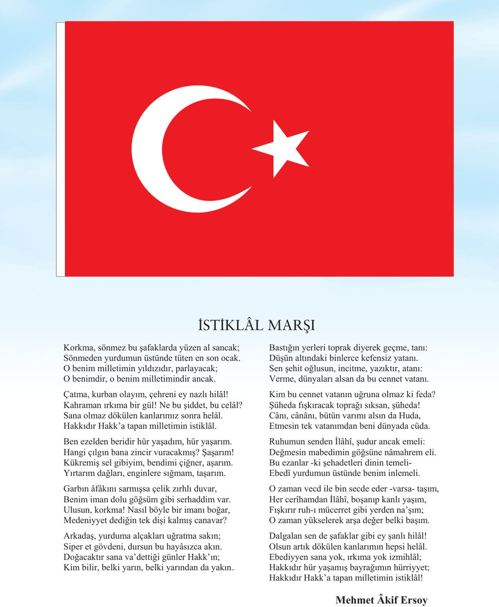

# İSTİKLÂL MARŞI

Korkma, sönmez bu şafaklarda yüzen al sancak;
Sönmeden yurdumun üstünde tüten en son ocak.
O benim milletimin yıldızıdır, parlayacak;
O benimdir, o benim milletimindir ancak.

Çatma, kurban olayım, çehreni ey nazlı hilâl!
Kahraman ırkıma bir gül! Ne bu şiddet, bu celâl?
Sana olmaz dökülen kanlarımız sonra helâl.
Hakkıdır Hakk'a tapan milletimin istiklâl.

Ben ezelden beridir hür yaşadım, hür yaşarım.
Hangi çılgın bana zincir vuracakmış? Şaşarım!
Kükremiş sel gibiyim, bendimi çiğner, aşarım.
Yırtarım dağları, enginlere sığmam, taşarım.

Garbın âfâkını sarmışsa çelik zırhlı duvar,
Benim iman dolu göğsüm gibi serhaddim var.
Ulusun, korkma! Nasıl böyle bir imanı boğar,
Medeniyet dediğin tek dişi kalmış canavar?

Arkadaş, yurduma alçakları uğratma sakın;
Siper et gövdeni, dursun bu hayâsızca akın.
Doğacaktır sana va'dettiği günler Hakk'ın;
Kim bilir, belki yarın, belki yarından da yakın.

Bastığın yerleri toprak diyerek geçme, tanı:
Düşün altındaki binlerce kefensiz yatanı.
Sen şehit oğlusun, incitme, yazıktır, atanı:
Verme, dünyaları alsan da bu cennet vatanı.

Kim bu cennet vatanın uğruna olmaz ki feda?
Şüheda fışkıracak toprağı sıksan, şüheda!
Cânı, cânânı, bütün varımı alsan da Huda,
Etmesin tek vatanımdan beni dünyada cüda.

Ruhumun senden ilâhî, şudur ancak emeli:
Değmesin mabedimin göğsüne nâmahrem eli.
Bu ezanlar -ki şehadetleri dinin temeli-
Ebedî yurdumun üstünde benim inlemeli.

O zaman vecd ile bin secde eder -varsa- taşkım,
Her cerîhamdan ilâhî, boşanıp kanlı yaşım,
Fışkırır ruh-ı mücerret gibi yerden na'şım;
O zaman yükselerek arşa değer belki başım.

Dalgalan sen de şafaklar gibi ey kanlı hilâl!
Olsun artık dökülen kanlarımın hepsi helâl.
Ebediyyen sana yok, Türk'e yok izmihlâl;
Hakkıdır hür yaşamış bayrağımın hürriyet;
Hakkıdır Hakk'a tapan milletimin istiklâl!

M. Âkif Ersoy

<!-- sayfa 3 -->

GENÇLİĞE HİTABE

Ey Türk gençliği! Birinci vazifen, Türk istiklâlini, Türk Cumhuriyetini, ilelebet muhafaza ve müdafaa etmektir.

Mevcudiyetinin ve istikbalinin yegâne temeli budur. Bu temel, senin en kıymetli hazinendir. İstikbalde dahi, seni bu hazineden mahrum etmek isteyecek dâhilî ve hâricî bedhahların olacaktır. Bir gün, istiklâl ve cumhuriyeti müdafaa mecburiyetine düşersen, vazifeye atılmak için, içinde bulunacağın vaziyetin imkân ve şeraitini düşünmeyeceksin! Bu imkân ve şerait, çok namüsait bir mahiyette tezahür edebilir. İstiklâl ve cumhuriyetine kastedecek düşmanlar, bütün dünyada emsali görülmemiş bir galibiyetin mümessili olabilirler. Cebren ve hile ile aziz vatanın bütün kaleleri zapt edilmiş, bütün tersanelerine girilmiş, bütün orduları dağıtılmış ve memleketin her köşesi bilfiil işgal edilmiş olabilir. Bütün bu şeraitten daha elîm ve daha vahim olmak üzere, memleketin dâhilinde iktidara sahip olanlar gaflet ve dalâlet ve hattâ hıyanet içinde bulunabilirler. Hattâ bu iktidar sahipleri şahsî menfaatlerini, müstevlîlerin siyasî emelleriyle tevhit edebilirler. Millet, fakr u zaruret içinde harap ve bîtap düşmüş olabilir.

Ey Türk istikbalinin evlâdı! İşte, bu ahval ve şerait içinde dahi vazifen, Türk istiklâl ve cumhuriyetini kurtarmaktır. Muhtaç olduğun kudret, damarlarındaki asil kanda mevcuttur.

Mustafa Kemal Atatürk

<!-- sayfa 4 -->

MUSTAFA KEMAL ATATÜRK

<!-- yer tutucu bulunamadı: sayfa sonuna eklendi -->

<!-- sayfa 5 -->

Verdiğiniz mesajda PDF metin katmanı boş görünüyor (`<<< >>>` arası boş). Sayfaya ait metin veya görsel içeriği paylaşmadığınız için herhangi bir çeviri yapamıyorum.

Lütfen işlenmesini istediğiniz **sayfanın görüntüsünü** veya **metin katmanını** paylaşın, ardından kurallarınıza uygun şekilde Markdown formatına dönüştürebilirim.

<!-- sayfa 6 -->

# INHALTSVERZEICHNIS

**Organisationsschema** ................................................................................................................................... 7

## LEKTION 1 | ICH AND DU!

A. Sich Vorstellen ........................................................................................................................................ 9
B. Das Alphabet .......................................................................................................................................... 12
C. Begrüßen und Verabschieden ............................................................................................................... 15
D. Nach dem Befinden fragen ................................................................................................................... 19

## LEKTION 2 | DAS BIN ICH!
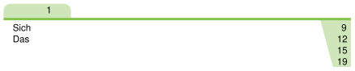
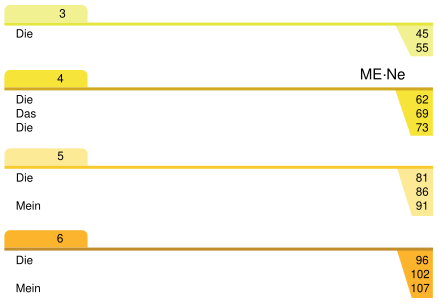
A. Das Alter und die Zahlen ....................................................................................................................... 24
B. Die Länder und die Sprachen ................................................................................................................ 31
C. Die Herkunft und der Wohnort .............................................................................................................. 36

## LEKTION 3 | MEINE FAMILIE
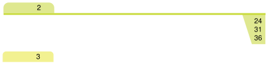
A. Die Familienmitglieder ........................................................................................................................... 45
B. Die Berufe von Familienmitgliedern ..................................................................................................... 55

## LEKTION 4 | MEINE SCHULE
A. Die Schulsachen ..................................................................................................................................... 62
B. Das Klassenzimmer ............................................................................................................................... 69
C. Die Schulräume ...................................................................................................................................... 73

## LEKTION 5 | DER SCHULALLTAG
A. Die Schulfächer ...................................................................................................................................... 81
B. Die Wochentage und die Tageszeiten .................................................................................................. 86
C. Mein Stundenplan ................................................................................................................................... 91

## LEKTION 6 | SPORT
A. Die Sportarten ........................................................................................................................................ 96
B. Einzel- und Mannschaftssportarten ...................................................................................................... 102
C. Mein Lieblingssport ................................................................................................................................ 107

**Verwaltungskarte von Türkiye mit Nachbarstaaten und Seegrenzen** .................................................... 114
**Die Karte der Türkischen Welt** ............................................................................................................... 115

<!-- sayfa 7 -->

# LEKTION 1

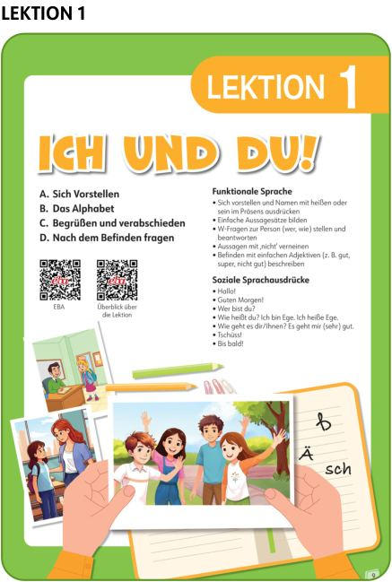

**A. Sich Vorstellen**
**B. Das Alphabet**
**C. Begrüßen und verabschieden**
**D. Nach dem Befinden fragen**

**Funktionale Sprache**
* Sich vorstellen und Namen mit heißen oder sein präsentieren
* Einfache Aussagesätze bilden
* Fragen zur Person (wer, wie) stellen und beantworten
* Befinden mit einfachen Adjektiven (z. B. gut, super, nicht gut) beschreiben

**Soziale Sprachausdrücke**
* Hallo!
* Guten Morgen!
* Wie geht es dir?
* Wie heißt du? Ich heiße ..., ich heiße ...
* Wie geht es dir/Ihnen? Es geht mir (sehr) gut.
* Tschüss!
* Bis bald!

# KOMPETENZEN:

## Hören
1. Die Schüler können einfache Begrüßungen und Verabschiedungen (z. B. Hallo, Guten Morgen, Tschüss) erkennen und verstehen.
2. Die Schüler können langsam gesprochene Selbstvorstellungen (Name) global verstehen.
3. Die Schüler können einfache Fragen zur Person (Wer?, Wie?) verstehen.
4. Die Schüler können buchstabierte Namen erkennen (Alphabet: E–G–E).
5. Die Schüler können einfache Aussagen und Verneinungen mit nicht sinngemäß verstehen.

## Sprechen
6. Die Schüler können sich vorstellen und nach dem Namen fragen: Ich heiße … / Ich bin …; Wie heißt du? Wer bist du?
7. Die Schüler können begrüßen und verabschieden (situationsangemessen: Hallo, Guten Tag, Tschüss …).
8. Die Schüler können nach dem Befinden fragen und reagieren: Wie geht es dir/Ihnen? – Es

9. Die Schüler können das Alphabet aufsagen und den eigenen Namen buchstabieren.
10. Die Schüler können sehr einfache Aussagesätze bilden und mit nicht verneinen (Es geht mit nicht…).

## Lesen
11. Die Schüler können kurze, einfache Texte/ Steckbriefe, Namensschilder und Sprechblasen zum Thema „Vorstellen & Grüße“ Satz für Satz verstehen.
12. Die Schüler können kurze Dialoge mit Frage–Antwort-Mustern (Name, Befinden) sinngemäß erfassen.
13. Die Schüler können Buchstaben–Wort-Zuordnungen aus dem Alphabet erkennen.

## Schreiben
14. Die Schüler können den eigenen Namen und 1–2 kurze Sätze zur Person schreiben: Ich heiße… Ich bin…
15. Die Schüler können einfache Frage–Antwort-Muster notieren (Wie heißt du? – Ich heiße …).
16. Die Schüler können Namen buchstabiert angeben und sehr kurze Sätze mit nicht verneinen.

<!-- sayfa 8 -->

# A. Sich Vorstellen

1. Sieh das Bild an und hör zu. 🎧

**Anleitung:**

1. Spielen Sie den Audio-Track 1 mit den kurzen Dialogen zur Vorstellung ab.
2. Lassen Sie die Schüler aufmerksam zuhören.
3. Fordern Sie die Klasse auf: „Sprecht die Sätze laut und deutlich nach: ‚Wie heißt du? – Ich heiße ... / Ich bin ...‘“
4. Wiederholen Sie die Übung mehrmals, bis die Aussprache sicher sitzt.

**Track 1:**
**Übung Nr.1. Sieh das Bild an und hör zu!**
Schüler 1: Ich bin Ömer.
Schülerin 2: Ich heiße İpek.
Schüler 3: Hallo! Ich bin Ege. Wie heißt du?
Schülerin 4: Ich bin Ezgi.

2. Hör noch einmal zu und ergänze die Sätze. 🎧

**Anleitung:**

1. Spielen Sie den Audio-Track 2 ab.
2. Fordern Sie die Schüler auf: „Hört aufmerksam zu und ergänzt die fehlenden Wörter in den Sätzen.“
3. Lassen Sie die Schüler die vollständigen Sätze laut wiederholen, um die Strukturen „Ich heiße ... / Ich bin ...“ einzuüben.
4. Vergleichen Sie die Lösungen gemeinsam im Plenum.
5. Fordern Sie die Schüler auf: „Ergänzt die Sätze auch mit eurem eigenen Namen.“

**Track 2:**
**Übung Nr.2. Hör noch einmal und ergänze die Sätze.**
Ich heiße İpek. Ich bin Ömer.

**Lösungsschlüssel:**
Ich heiße İpek. Ich bin Ömer.

3. Und wie heißt du? Schreibe deinen Namen.

**Anleitung:**

1. Erklären Sie die Struktur „Ich heiße ...“ und geben Sie Beispiele mit verschiedenen Namen.
2. Fordern Sie die Schüler auf: „Schreibt euren eigenen Namen in den Satz: Ich heiße ...“
3. Lassen Sie die Schüler ihre Sätze anschließend laut vorlesen.

**Lösungsschlüssel:**
Ich heiße... 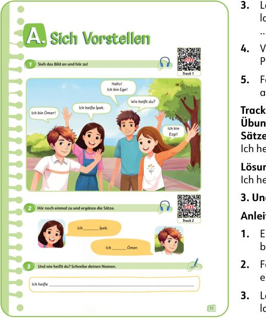 (Der Schüler/die Schülerin schreibt seinen/ihren eigenen Namen).

**Notizen:**

<!-- sayfa 9 -->

Lektion 1: Ich und Du

4. Hör zweimal zu und sing mit! 🎧

Anleitung:
1. Spielen Sie das Lied „Wie heißt du?“ auf dem Audio-Track 3 einmal vor.
2. Lassen Sie die Schüler aufmerksam zuhören und den Text im Buch mitverfolgen.
3. Spielen Sie das Lied noch einmal ab und fordern Sie die Schüler auf: „Singt jetzt gemeinsam mit!“
4. Weisen Sie die Klasse darauf hin: „Wiederholt dabei die Struktur: Ich heiße ...“
5. Lassen Sie zum Abschluss einzelne Schüler ihren eigenen Namen in das Lied einsetzen und vorsingen.

Track 3:
Übung Nr.4. Hör zweimal zu und sing mit!
Wie heißt du?
Wie heißt du? Wie heißt du? Wie heißt du?
Ich heiße Leon.
Wie heißt du? Wie heißt du? Wie heißt du?
Ich heiße Elif.
Wie heißt du? Wie heißt du? Wie heißt du?
Ich heiße Rosa.
Wie heißt du? Wie heißt du? Wie heißt du?
Ich heiße Arda.

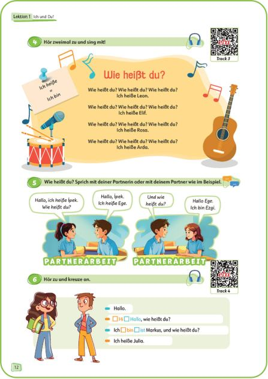

5. Wie heißt du? Sprich mit deiner Partnerin oder mit deinem Partner wie im Beispiel.

Anleitung:
1. Lesen Sie gemeinsam mit der Klasse die Beispieldialoge in den Sprechblasen.
2. Machen Sie den Dialog einmal im Plenum vor.
3. Bilden Sie Partnerpaare und fordern Sie die Schüler auf:
    * A: „Hallo, ich heiße...Wie heißt du?“
    * B: „Hallo ... Ich heiße...“
4. Lassen Sie die Übung mit wechselnden Partnern mehrfach wiederholen.
5. Achten Sie darauf, dass alle Schüler die Frage „Wie heißt du?“ und die Antwort „Ich heiße ...“ sicher anwenden.
6. Lassen Sie zum Abschluss einige Paare den Dialog vor der Klasse vorspielen.

Lösungsschlüssel:
Partnerarbeit

6. Hör zu und kreuze an.

Anleitung:
1. Spielen Sie den Audio-Track 4 ab.
2. Fordern Sie die Schüler auf: „Hört aufmerksam zu und entscheidet, welche Antwortmöglichkeit richtig ist. Kreuzt das Kästchen an.“
3. Weisen Sie darauf hin: „Achtet genau auf kleine Unterschiede im Hören (z. B. Hi oder Hallo, bin oder ist).“
4. Wiederholen Sie die Übung noch einmal, damit alle sicher ankreuzen können.
5. Kontrollieren Sie die Lösungen anschließend gemeinsam im Plenum.

Track 4:
Übung Nr.6. Hör zu und kreuze an.
A: Hallo!
B: Hallo, wie heißt du?
C: Ich bin Markus. Und wie heißt du?
D: Ich heiße Julia.

Lösungsschlüssel:
☐ Hallo, wie heißt du?
☐ Ich bin ist Markus, und wie heißt du?
☐ Ich heiße Julia.

<!-- sayfa 10 -->

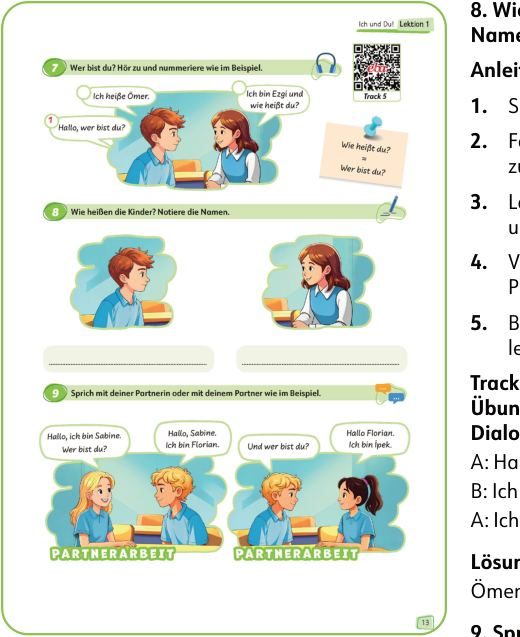

7. Wer bist du? Hör zu und nummeriere wie im Beispiel. 🎧

**Anleitung:**

1. Spielen Sie den Audio-Track 5 mit dem kurzen Dialog ab.
2. Fordern Sie die Schüler auf: „*Hört aufmerksam zu und ordnet die Sprechblasen in die richtige Reihenfolge.*“
3. Erklären Sie: „So lernt ihr, wie man sich vorstellt und nach dem Namen fragt.“
4. Lassen Sie die Schüler den Dialog anschließend zu zweit laut vorlesen.
5. Wiederholen Sie die Übung mehrmals, bis Reihenfolge und Aussprache sicher sind.

**Track 5:**
**Übung Nr.7. Wer bist du? Hör zu und ordne den Dialog.**
A: Hallo, wer bist du?
B: Ich bin Ezgi und wie heißt du?
A: Ich heiße Ömer.

**Lösungsschlüssel:**
Hallo, wer bist du?
Ich bin Ezgi.
Und wie heißt du?
Ich heiße Ömer.

8. Wie heißen die Kinder? Notiere die Namen. 🎧

**Anleitung:**

1. Spielen Sie den Audio-Track 5 noch einmal ab.
2. Fordern Sie die Schüler auf: „*Hört aufmerksam zu und achtet auf die Namen der Schüler.*“
3. Lassen Sie die Schüler die gehörten Namen unter die passenden Bilder schreiben.
4. Vergleichen Sie die Lösungen gemeinsam im Plenum.
5. Bitten Sie die Schüler, die Namen laut vorzulesen.

**Lösungsschlüssel:**
Ömer-Ezgi

9. Sprich mit deiner Partnerin oder mit deinem Partner wie im Beispiel.

**Anleitung:**

1. Machen Sie den Beispieldialog im Plenum vor: „Hallo, ich bin... Wer bist du?“
2. Fordern Sie die Schüler auf: „Übt den Dialog in Partnerarbeit.“
3. Achten Sie darauf, dass sich beide Partner nacheinander vorstellen und zurückfragen.
4. Gehen Sie durch die Klasse und hören Sie zu.
5. Lassen Sie zum Abschluss einige Paare ihren Dialog vor der Klasse vorspielen.

**Lösungsschlüssel:**
Partnerarbeit

**Notizen:**

<!-- sayfa 11 -->

# B. Das Alphabet

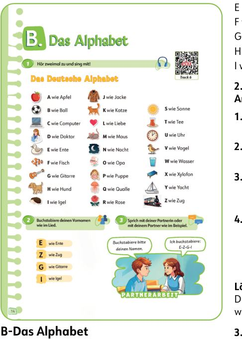

## 1. Hör zweimal zu und sing mit! 🎧

**Anleitung:**

1. Spielen Sie den Audio-Track 6 mit dem Alphabet-Lied ab.
2. Lassen Sie die Schüler zunächst aufmerksam zuhören und die Buchstaben sowie Bilder im Buch mitverfolgen.
3. Wiederholen Sie das Lied: „Singt jetzt gemeinsam mit und sprecht die Buchstaben laut und deutlich.“ Achten Sie besonders auf die richtige Aussprache der Buchstaben.
4. Wiederholen Sie die Übung mehrmals, bis sich die Schüler sicher fühlen.
5. Lassen Sie die Klasse zum Abschluss das Alphabet ohne Musik im Chor sprechen.

**Track 6:**
**Übung Nr.1. Hör das Alphabet-Lied und sing mit.**

| | | |
| :--- | :--- | :--- |
| A wie Apfel | J wie Jacke | S wie Sonne |
| B wie Ball | K wie Katze | T wie Tee |
| C wie Computer | L wie Liebe | U wie Uhr |
| D wie Doktor | M wie Maus | V wie Vogel |
| E wie Ente | N wie Nacht | W wie Wasser |
| F wie Fisch | O wie Opa | X wie Xylofon |
| G wie Gitarre | P wie Puppe | Y wie Yacht |
| H wie Hund | Q wie Qualle | Z wie Zug |
| I wie Igel | R wie Rose | |

## 2. Buchstabiere deinen Vornamen wie im Lied.

**Anleitung:**

1. Erinnern Sie die Schüler an das Alphabet-Lied aus der vorherigen Übung.
2. Machen Sie ein oder zwei Beispiele vor: „E wie Ente, Z wie Zug.“
3. Fordern Sie die Schüler auf: „Buchstabiert euren Vornamen und verbindet jeden Buchstaben mit einem passenden Beispielwort.“
4. Lassen Sie die Schüler in Partnerarbeit üben: Ein Schüler/eine Schülerin buchstabiert, das andere hört zu und wiederholt. Achten Sie darauf, dass die Schüler die Buchstaben klar und deutlich aussprechen.

**Lösungsschlüssel:**
Die Schüler buchstabieren ihren eigenen Namen wie auf dem Lied auf Nr. 1.

## 3. Sprich mit deiner Partnerin oder deinem Partner wie im Beispiel.

**Anleitung:**

1. Bilden Sie Partnerpaare.
2. Sagen Sie: „Fragt einander: ‚Buchstabiere bitte deinen Namen.‘“
3. Lassen Sie die Schüler ihre Namen laut buchstabieren, z. B.: „E–Z–G–I“.
4. Fordern Sie die Paare auf, danach die Rollen zu wechseln. Achten Sie darauf, dass die Schüler die Buchstaben klar und deutlich aussprechen und sich gegenseitig gut zuhören.

**Lösungsschlüssel:**
Partnerarbeit

**Notizen:**

<!-- sayfa 12 -->

# Ich und Du Lektion 1

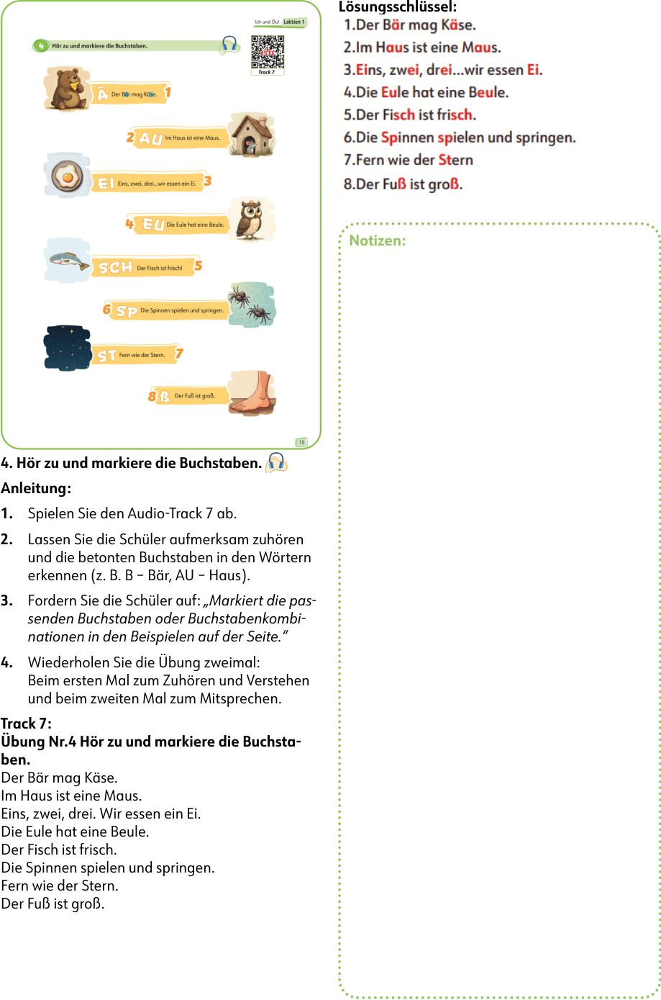

4. Hör zu und markiere die Buchstaben.

1. **BÄR** Der Bär mag Käse.
2. **AU** Im Haus ist eine Maus.
3. **EI** Eins, zwei, drei... wir essen ein Ei.
4. **EU** Die Eule hat eine Beule.
5. **SCH** Der Fisch ist frisch!
6. **SP** Die Spinnen spielen und springen.
7. **ST** Fern wie der Stern.
8. **B** Der Fuß ist groß.

Lösungsschlüssel:
1. Der **Bär** mag **Käse**.
2. Im **Haus** ist eine **Maus**.
3. **Eins**, **zwei**, **drei**... wir essen **Ei**.
4. Die **Eule** hat eine **Beule**.
5. Der **Fisch** ist **frisch**.
6. Die **Spinnen** spielen und **springen**.
7. Fern wie der **Stern**
8. Der **Fuß** ist **groß**.

Notizen:
__________________________________________________________________
__________________________________________________________________
__________________________________________________________________
__________________________________________________________________
__________________________________________________________________

---

**4. Hör zu und markiere die Buchstaben.** 🎧

**Anleitung:**

1. Spielen Sie den Audio-Track 7 ab.
2. Lassen Sie die Schüler aufmerksam zuhören und die betonten Buchstaben in den Wörtern erkennen (z. B. B – Bär, AU – Haus).
3. Fordern Sie die Schüler auf: „Markiert die passenden Buchstaben oder Buchstabenkombinationen in den Beispielen auf der Seite.“
4. Wiederholen Sie die Übung zweimal:
   Beim ersten Mal zum Zuhören und Verstehen und beim zweiten Mal zum Mitsprechen.

**Track 7:**
**Übung Nr.4 Hör zu und markiere die Buchstaben.**
Der Bär mag Käse.
Im Haus ist eine Maus.
Eins, zwei, drei. Wir essen ein Ei.
Die Eule hat eine Beule.
Der Fisch ist frisch.
Die Spinnen spielen und springen.
Fern wie der Stern.
Der Fuß ist groß.

<!-- sayfa 13 -->

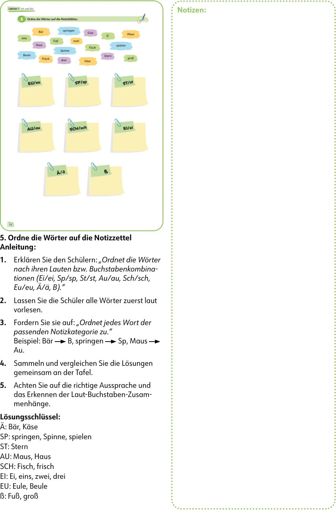

# 5. Ordne die Wörter auf die Notizzettel
## Anleitung:

1. Erklären Sie den Schülern: „Ordnet die Wörter nach ihren Lauten bzw. Buchstabenkombinationen (Ei/ei, Sp/sp, St/st, Au/au, Sch/sch, Eu/eu, Ä/ä, B).“
2. Lassen Sie die Schüler alle Wörter zuerst laut vorlesen.
3. Fordern Sie sie auf: „Ordnet jedes Wort der passenden Notizkategorie zu.“
   Beispiel: Bär $\rightarrow$ B, springen $\rightarrow$ Sp, Maus $\rightarrow$ Au.
4. Sammeln und vergleichen Sie die Lösungen gemeinsam an der Tafel.
5. Achten Sie auf die richtige Aussprache und das Erkennen der Laut-Buchstaben-Zusammenhänge.

**Lösungsschlüssel:**
Ä: Bär, Käse
SP: springen, Spinne, spielen
ST: Stern
AU: Maus, Haus
SCH: Fisch, frisch
EI: Ei, eins, zwei, drei
EU: Eule, Beule
ß: Fuß, groß

Notizen:

<!-- sayfa 14 -->

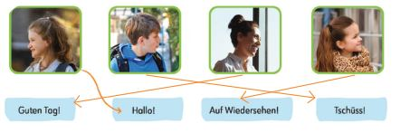

# C. Begrüßen und Verabschieden

## 1. Hör zu und lies mit. 

**Anleitung:**

1. Spielen Sie den Audio-Track 8 mit den kurzen Begrüßungs- und Abschieds-Dialogen ab.
2. Lassen Sie die Schüler aufmerksam zuhören und die Sprechblasen im Buch mitverfolgen.
3. Fordern Sie die Klasse auf: „Sprecht die Dialoge laut nach – zuerst gemeinsam im Chor, dann in Partnerarbeit.“
4. Achten Sie auf die richtige Aussprache und Intonation.
5. Lassen Sie zur Vertiefung kleine Rollenspiele durchführen, in denen die Schüler die Begrüßungen und Verabschiedungen in eigenen Situationen anwenden.

**Track 8:**

**Übung Nr.1 Hör die Gespräche und lies mit.**

**Dialog 1**
Hi Melanie!
Hallo, Britta!

**Dialog 2**
Tschüss, Markus!
Tschüss, Michael!

**Dialog 3**
Guten Tag, Frau Neumann!

**Dialog 4**
Auf Wiedersehen, Frau Meyer!
Tschüss, Alexandra!

## 2. Wer sagt was? Lies die Dialoge aus Nr.1 noch einmal und verbinde die Fotos mit den Aussagen.

**Anleitung:**

1. Wiederholen Sie gemeinsam mit den Schülern die Dialoge aus Aufgabe 1.
2. Lassen Sie die Schüler die Begrüßungen und Abschiede noch einmal hören und die Fotos genau betrachten.
3. Fordern Sie sie auf: „Ordnet die passenden Ausdrücke (Guten Tag! Hallo! Auf Wiedersehen! Tschüss!) den Bildern zu.“
4. Besprechen Sie die Ergebnisse im Plenum.
5. Lassen Sie die Schüler die Sätze laut sprechen.

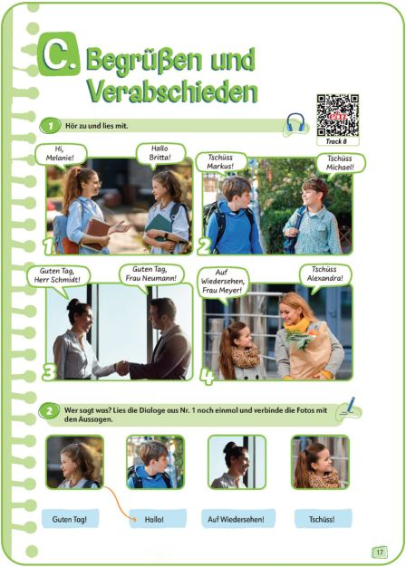

**Lösungsschlüssel:**

**Notizen:**

<!-- sayfa 15 -->

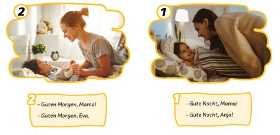

Lektion 1 Ich und Du!

3 Hör zu und sprich nach.
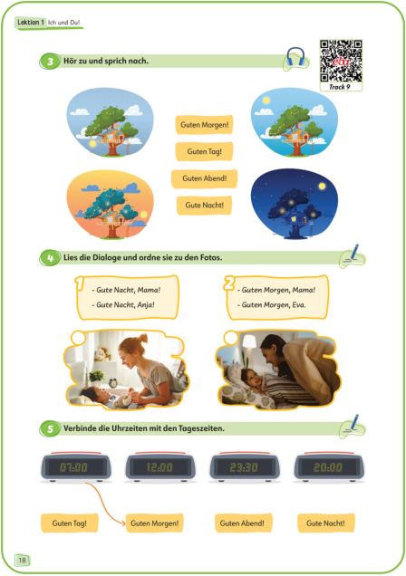

4 Lies die Dialoge und ordne sie zu den Fotos.
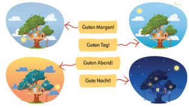

5 Verbinde die Uhrzeiten mit den Tageszeiten.

---

# 3. Hör zu und sprich nach! 🗣️
## Anleitung:
1. Spielen Sie den Audio-Track 9 mit den Grußformeln zu verschiedenen Tageszeiten ab (Guten Morgen! Guten Tag! Guten Abend! Gute Nacht!).
2. Lassen Sie die Schüler aufmerksam zuhören.
3. Fordern Sie die Klasse auf: „Sprecht die Ausdrücke laut im Chor nach.“
4. Weisen Sie die Schüler an: „Zeigt dabei auf das passende Bild (Morgen, Tag, Abend, Nacht).“
5. Wiederholen Sie die Übung mehrmals, bis die Aussprache sicher ist.
6. Lassen Sie zum Abschluss einzelne Schüler die Begrüßungen alleine oder in Partnerarbeit vorsprechen.

**Track 9:**
**Übung Nr.3 Hör zu und sprich nach.**
Guten Morgen!
Guten Tag!
Guten Abend!
Gute Nacht!

**Lösungsschlüssel:**

# 4.Lies die Dialoge und ordne sie zu den Fotos.
## Anleitung:
1. Zeigen Sie die beiden Fotos (Morgen/Nacht).
2. Fordern Sie die Schüler auf: „Lest die Dialoge laut vor und ordnet sie dem passenden Foto zu. Schreibt die Nummer ans Bild.“
3. Besprechen Sie die Ergebnisse gemeinsam im Plenum.

**Lösungsschlüssel:**

# 5. Verbinde die Uhrzeiten mit den Tageszeiten.
## Anleitung:
1. Zeigen Sie den Schülern die vier Uhren mit unterschiedlichen Uhrzeiten.
2. Fordern Sie die Schüler auf: „Lest die Uhrzeiten und überlegt, welche Tageszeit (Morgen, Tag, Abend, Nacht) dazu passt.“
3. Sagen Sie: „Verbindet die richtige Grußformel (Guten Morgen, Guten Tag, Guten Abend, Gute Nacht!) mit der entsprechenden Uhrzeit.“
4. Besprechen Sie die Ergebnisse gemeinsam im Plenum.
5. Lassen Sie die Schüler die Sätze laut vorlesen, z. B.:
    * „Es ist 7 Uhr. Guten Morgen!“
    * „Es ist 20 Uhr. Guten Abend!“

**Lösungsschlüssel:**
07:00 Guten Morgen 12:00 Guten Tag
23:30 Gute Nacht 20:00 Guten Abend

<!-- sayfa 16 -->

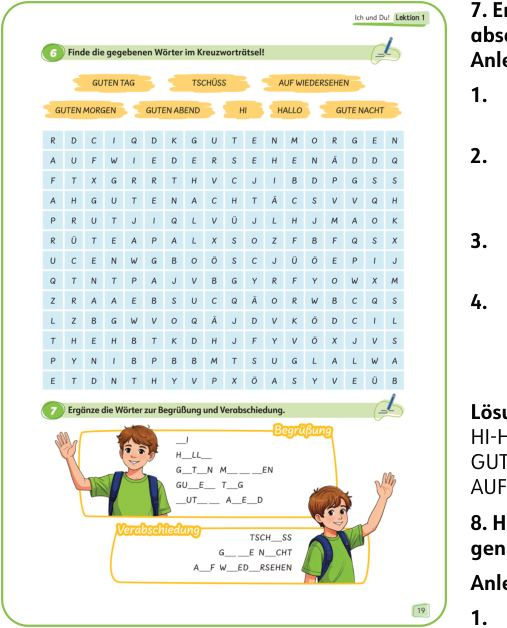

# 6. Finde die gegebenen Wörter im Kreuzworträtsel!
**Anleitung:**

1. Weisen Sie die Schüler auf das Kreuzworträtsel im Buch an.
2. Fordern Sie die Schüler auf: „Sucht die angegebenen Grußformeln (Guten Tag, Guten Morgen, Guten Abend, Gute Nacht, Hallo, Hi, Tschüss, Auf Wiedersehen).“
3. Weisen Sie darauf hin: „Die Wörter können waagerecht, senkrecht oder diagonal stehen.“ Sagen Sie: „Markiert die gefundenen Wörter im Rätsel.“
4. Kontrollieren Sie die Lösungen am Ende gemeinsam im Plenum.
5. Lassen Sie die Schüler die gefundenen Begriffe laut vorlesen.

**Lösungsschlüssel:**
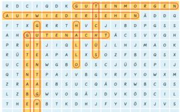

# 7. Ergänze die Wörter zur Begrüßung und Verabschiedung.
**Anleitung:**

1. Zeigen Sie den Schülern die unvollständigen Wörter zur Begrüßung und Verabschiedung.
2. Spielen Sie die bekannten Redemittel ab (z. B. Hallo, Guten Morgen, Tschüss, Auf Wiedersehen).
3. Fordern Sie die Schüler auf: „Ergänzt die fehlenden Buchstaben in den Lücken.“
4. Lassen Sie die Schüler die vollständigen Wörter gemeinsam laut vorlesen. Achten Sie dabei auf die richtige Aussprache und Betonung.

**Lösungsschlüssel:**
HI-HALLO-GUTEN MORGEN-GUTEN TAG-GUTEN ABEND TSCHÜSS-GUTE NACHT-AUF WIEDERSEHEN

# 8. Hör die Gespräche und verbinde die Aussagen.
**Anleitung:**

1. Spielen Sie den Audio-Track 10 ab.
2. Lassen Sie die Schüler die kurzen Dialoge mit Begrüßungen und Verabschiedungen aufmerksam anhören.
3. Fordern Sie die Schüler auf: „Ordnet die gehörten Aussagen den passenden Bildern zu.“
4. Weisen Sie darauf hin: „Verbindet die Grußformeln (Guten Morgen! Guten Tag! Guten Abend!) mit der richtigen Situation.“
5. Erklären Sie: „So übt ihr das Hörverstehen und die passenden Grußformeln für verschiedene Tageszeiten.“

**Track 10:**
**Übung Nr.8. Hör die Gespräche und verbinde die Aussagen.**

**Dialog 1**
Guten Morgen, Herr Kunz!
Guten Morgen, Ezgi!

**Dialog 2**
Guten Tag!
Guten Tag, Ezgi!

**Dialog 3**
Guten Abend, Frau Hoffmann! Guten Abend, liebe Ezgi!

**Lösungsschlüssel:**
1-Guten Morgen, Herr Kunz
2 Guten Tag
3 Guten Abend

<!-- sayfa 17 -->

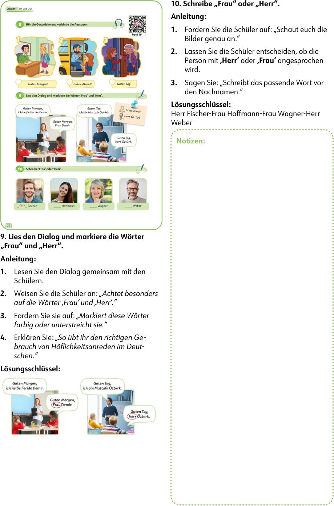

**9. Lies den Dialog und markiere die Wörter „Frau“ und „Herr“.**

**Anleitung:**

1. Lesen Sie den Dialog gemeinsam mit den Schülern.
2. Weisen Sie die Schüler an: *„Achtet besonders auf die Wörter ‚Frau‘ und ‚Herr‘.“*
3. Fordern Sie sie auf: *„Markiert diese Wörter farbig oder unterstreicht sie.“*
4. Erklären Sie: *„So übt ihr den richtigen Gebrauch von Höflichkeitsanreden im Deutschen.“*

**Lösungsschlüssel:**

**10. Schreibe „Frau“ oder „Herr“.**

**Anleitung:**

1. Fordern Sie die Schüler auf: *„Schaut euch die Bilder genau an.“*
2. Lassen Sie die Schüler entscheiden, ob die Person mit **Herr** oder **Frau** angesprochen wird.
3. Sagen Sie: *„Schreibt das passende Wort vor den Nachnamen.“*

**Lösungsschlüssel:**

Herr Fischer-Frau Hoffmann-Frau Wagner-Herr Weber

**Notizen:**

<!-- sayfa 18 -->

# D. Nach dem Befinden fragen

**D.Nach dem Befinden fragen**

**1. Wie geht es Tom, Florian und Ezgi? Hör das Gespräch, male die Smileys und schreibe die Wörter.** 👤

**Anleitung:**

1. Spielen Sie den Audio-Track 11 ab.
2. Lassen Sie die Schüler das Gespräch aufmerksam anhören.
3. Sagen Sie: „Ordnet die Antworten den Personen zu.“
4. Weisen Sie die Schüler an: „Malt die passenden Smileys an und schreibt die richtigen Wörter darunter (super, gut, nicht so gut, schlecht).“
5. Kontrollieren Sie die Lösungen im Plenum.

**Track 11:**
Übung Nr.1. Wie geht es Tom, Florian und Ezgi? Hör das Gespräch, male die Smileys und schreibe die Wörter.
Lehrerin: Hallo Kinder, wie geht’s?
Schüler 1: Nicht gut!
Schülerin: Super!
Schüler 2: Gut, danke.
Schülerin: Und wie geht es Ihnen, Frau Müller!
Lehrerin: Danke, gut.

**Lösungsschlüssel:**
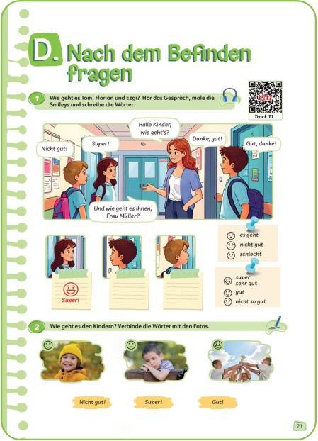

**2. Wie geht es den Schülern? Verbinde die Wörter mit den Fotos.**

**Anleitung:**

1. Fordern Sie die Schüler auf: „Schaut euch die Fotos der Schüler genau an.“
2. Lassen Sie die Schüler die Wörter (nicht gut, super, gut) lesen.
3. Sagen Sie: „Verbindet die Wörter mit den passenden Bildern.“
4. Kontrollieren Sie die Ergebnisse im Plenum.
5. Bitten Sie die Schüler, die Sätze laut zu sprechen:
* „Dem Schüler geht es nicht gut.“
* „Dem Schüler geht es super.“
* „Dem Schüler geht es gut.“

**Lösungsschlüssel:**
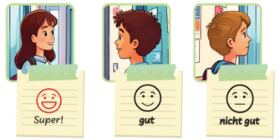

**Notizen:**

<!-- sayfa 19 -->

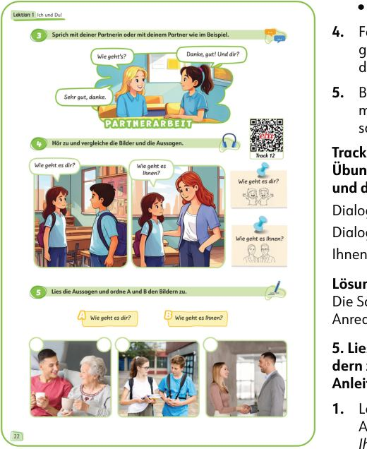

3. Sprich mit deiner Partnerin oder mit deinem Partner wie im Beispiel.

Anleitung:
1. Bilden Sie Zweierpaare.
2. Sagen Sie: „Fragt einander: ‚Wie geht’s?‘“
Lassen Sie die Partner antworten: „Danke, gut! Und dir?“
3. Fordern Sie die Schüler auf, die Dialoge mehrmals zu wiederholen.
4. Weisen Sie sie an, verschiedene Antworten zu verwenden (*nicht so gut, super, es geht*).
5. Achten Sie darauf, dass die Schüler die Höflichkeitsfloskeln deutlich und korrekt anwenden.

Lösungsschlüssel:
Partnerarbeit

4. Hör zu und vergleiche die Bilder und Aussagen.

Anleitung:
1. Spielen Sie den Audio-Track 12 ab.
2. Lassen Sie die Schüler aufmerksam zuhören.
3. Weisen Sie darauf hin:
„Achtet auf die beiden Anredeformen:
• „Wie geht es Ihnen?“ (formell)
4. Fordern Sie die Schüler auf: „Vergleicht die gehörten Sätze mit den Bildern und ordnet sie den passenden Szenen zu.“
5. Besprechen Sie im Plenum: „Wann benutzt man „du“ und wann „Sie”? (z. B. Freunde, Mitschüler vs. Erwachsene, Lehrkräfte).

Track 12:
Übung Nr. 4. Hör zu und vergleiche die Bilder und die Aussagen.
Dialog 1: Hallo Klaus. Wie geht es dir?
Dialog 2: Guten Morgen, Frau Klein. Wie geht es Ihnen?

Lösungsschlüssel:
Die Schüler sollen auf die formelle und informelle Anrede aufmerksam gemacht werden.

5. Lies die Aussagen und ordne A und B den Bildern zu

Anleitung:
1. Lesen Sie gemeinsam mit den Schülern die Aussagen: „Wie geht es dir?“ und „Wie geht es Ihnen?”.
2. Fordern Sie die Schüler auf: „Ordnet die Sätze den passenden Bildern zu.“
3. Erklären Sie: „‚Wie geht es dir?‘ benutzt ihr in vertrauten Situationen, ‚Wie geht es Ihnen?‘ in formellen Situationen.“
4. Lassen Sie die Schüler eigene Beispiele nennen.
5. Sagen Sie: „Übt die Dialoge jetzt in Partnerarbeit.“

Lösungsschlüssel:

<!-- sayfa 20 -->

# Ich und Du | Lektion 1

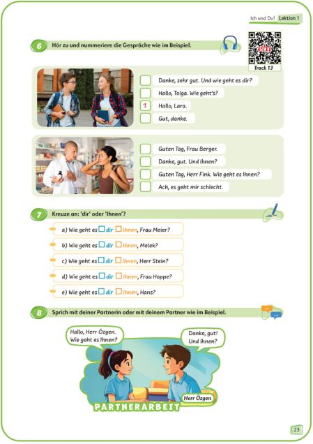

**6. Hör zu und nummeriere die Gespräche wie im Beispiel.** 🎧

**Anleitung:**
1. Spielen Sie den Audio-Track 13 ab.
2. Lassen Sie die Schüler die Gespräche aufmerksam anhören.
3. Fordern Sie die Schüler auf: „Lest die Sätze und ordnet sie den passenden Bildern zu.“
4. Spielen Sie den Audio-Track bei Bedarf mehrmals ab, damit die Zuordnung leichter fällt.
5. Sagen Sie zum Abschluss: „Spielt die Dialoge jetzt in Partnerarbeit nach.“

**Track 13:**
**Übung Nr.6. Hör zu und ordne die Gespräche.**
**Dialog 1:**
A: Hallo, Lara.
B: Hallo, Tolga. Wie geht’s?
A: Danke, sehr gut. Und wie geht es dir?
B: Gut, danke.

**Dialog 2:**
A: Guten Tag, Frau Berger.
B: Guten Tag, Herr Fink. Wie geht es Ihnen?
A: Danke, gut. Und Ihnen?
B: Ach, es geht mir schlecht.

**Lösungsschlüssel:**
**Dialog 1:**
- Hallo, Lara.
- Hallo, Tolga. Wie geht’s?
- Danke, sehr gut. Und wie geht es dir?
- Gut, danke.

**Dialog 2:**
- Guten Tag, Herr Fink. Wie geht es Ihnen?
- Guten Tag, Frau Berger. Danke, gut. Und Ihnen?
- Ach, es geht mir schlecht.

**7. Kreuze an: „dir“ oder „Ihnen“**

a) Wie geht es $\square$ dir $\square$ Ihnen, Frau Meier?
b) Wie geht es $\square$ dir $\square$ Ihnen, Mateo?
c) Wie geht es $\square$ dir $\square$ Ihnen, Herr Stein?
d) Wie geht es $\square$ dir $\square$ Ihnen, Frau Hoppe?
e) Wie geht es $\square$ dir $\square$ Ihnen, Hans?

**Anleitung:**
1. Erklären Sie den Schülern den Unterschied zwischen der informellen Anrede „du/dir“ und der formellen Anrede „Sie/Ihnen“.
2. Lassen Sie die Schüler die Sätze aufmerksam lesen und überlegen, ob die jeweilige Situation eine förmliche oder eine informelle Anrede erfordert.
3. Fordern Sie sie auf, die richtige Antwort (dir oder Ihnen) anzukreuzen.
4. Besprechen Sie zum Abschluss einige Beispiele gemeinsam im Plenum und lassen Sie die Schüler eigene Sätze mit „dir“ und „Ihnen“ bilden.

**Lösungsschlüssel:**
a-Ihnen b-dir c-Ihnen d-Ihnen e-dir

**8. Sprich mit deiner Partnerin oder mit deinem Partner wie im Beispiel.**

**Anleitung:**
1. Fordern Sie die Schüler auf, in Partnerarbeit eine Person höflich zu begrüßen und nach ihrem Befinden zu fragen.
2. Weisen Sie die Klasse an, sich am Dialogbeispiel im Bild zu orientieren.
3. Lassen Sie eine Schülerin oder einen Schüler die Rolle von „Herr Özgün“ übernehmen, während die Partnerin oder der Partner die Fragen stellt.
4. Bitten Sie danach die Paare, die Rollen zu tauschen.
5. Achten Sie darauf, dass die Schüler die formelle Anrede (Herr/Frau + Nachname) korrekt verwenden.

**Lösungsschlüssel:**
Partnerarbeit

<!-- sayfa 21 -->

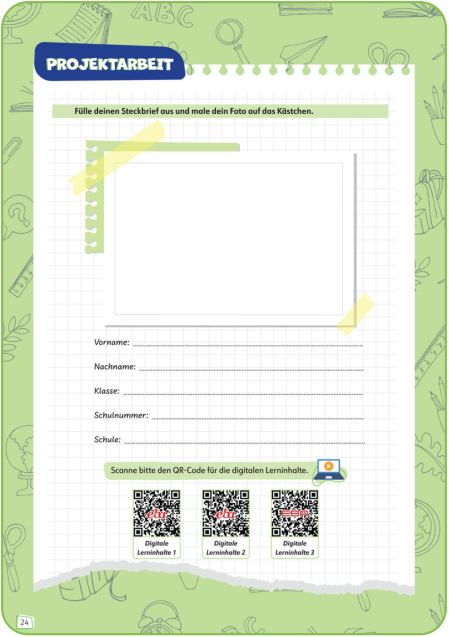

**PROJEKTARBEIT:**
**Anleitung:**

1. Zeigen Sie den Schülern die Seite.
2. Sagen Sie: „Heute machen wir eine Projektarbeit. Ihr erstellt euren Steckbrief.“
3. Lesen Sie die Überschrift laut vor.
Sagen Sie: „Füllt euren Steckbrief aus und malt euer Foto.“
4. Erklären Sie die Felder im Steckbrief.
„Hier schreibt ihr euren Vornamen.“
„Hier schreibt ihr euren Nachnamen.“
„Hier kommt eure Klasse.“
„Hier schreibt ihr eure Schulnummer.“
„Hier steht eure Schule.“
5. Machen Sie ein Beispiel an der Tafel.
Vorname: Ali
Nachname: Yılmaz
Klasse: 5A
Schulnummer: 123
Schule: Atatürk Mittelschule
6. Geben Sie den Schülern Zeit, die Felder selbstständig auszufüllen.
7. Sagen Sie: „Schreibt jetzt euren eigenen Steckbrief.“
8. Lassen Sie die Schüler ihr Foto zeichnen.
9. Sagen Sie: „Malt euer Gesicht oder ein kleines Bild von euch in das Kästchen.“
10. Sagen Sie: „Wer möchte seinen Steckbrief vorstellen?“
11. Die Arbeiten werden im Plenum präsentiert.

Notizen:

<!-- sayfa 22 -->

# LEKTION 2

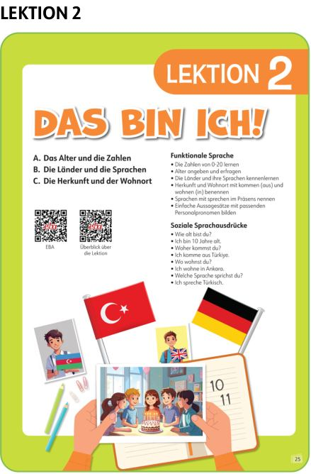

# KOMPETENZEN

## Hören

1. Die Schüler können die Zahlen $0\text{--}20$ <!-- KONTROL: Marker'da karşılığı yok, uydurma olabilir --> in langsamem Sprechtempo erkennen.
2. Die Schüler verstehen einfache Personendaten (Alter, Herkunft, Wohnort, Sprache), wenn klar und mit Pausen gesprochen wird.
3. Die Schüler erkennen Länder- und Sprachnamen in kurzen Hörtexten wieder.

## Sprechen

4. Die Schüler können Alter angeben und erfragen: Wie alt bist du? – Ich bin $10$ Jahre alt.
5. Die Schüler können Herkunft und Wohnort mit kommen (aus) und wohnen (in) nennen/erfragen.
6. Die Schüler können Sprachen mit sprechen im Präsens nennen: Ich spreche Türkisch/Deutsch.
7. Die Schüler bilden einfache Aussagesätze mit passenden Personalpronomen (ich, du, er/sie).
8. Die Schüler stellen sich kurz vor (Name, Alter, Herkunft, Wohnort, Sprache).
9. Die Schüler zählen sicher bis $20$.

## Lesen

10. Die Schüler verstehen kurze, einfache Sätze/Steckbriefe zu Personendaten (Alter, Herkunft, Wohnort, Sprache).
11. Die Schüler erkennen Ziffern und Zahlwörter $0\text{--}20$ <!-- KONTROL: Marker'da karşılığı yok, uydurma olabilir -->.
12. Die Schüler identifizieren Länder- und Sprachnamen in Listen, Karten oder Piktogrammen.

## Schreiben

13. Die Schüler schreiben kurze Sätze zu sich selbst: Ich bin ... Jahre alt. Ich komme aus ... Ich wohne in ... Ich spreche ...
14. Die Schüler vervollständigen Lückentexte zu kommen (aus), wohnen (in), sprechen (Präsens).
15. Die Schüler füllen einfache Formulare/Steckbriefe mit Personendaten aus.
16. Die Schüler schreiben Zahlen $0\text{--}20$ <!-- KONTROL: Marker'da karşılığı yok, uydurma olabilir --> korrekt.

<!-- sayfa 23 -->

# A. Das Alter und die Zahlen

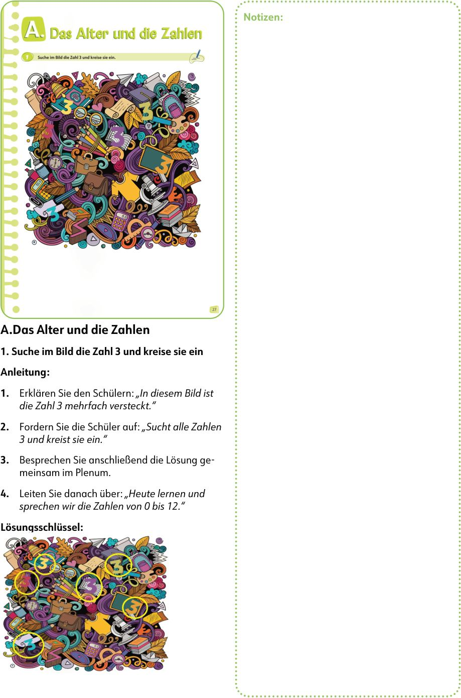

**1. Suche im Bild die Zahl 3 und kreise sie ein**

**Anleitung:**

1. Erklären Sie den Schülern: „In diesem Bild ist die Zahl 3 mehrfach versteckt.“
2. Fordern Sie die Schüler auf: „Sucht alle Zahlen 3 und kreist sie ein.“
3. Besprechen Sie anschließend die Lösung gemeinsam im Plenum.
4. Leiten Sie danach über: „Heute lernen und sprechen wir die Zahlen von 0 bis 12.“

**Lösungsschlüssel:**

**Notizen:**

<!-- sayfa 24 -->

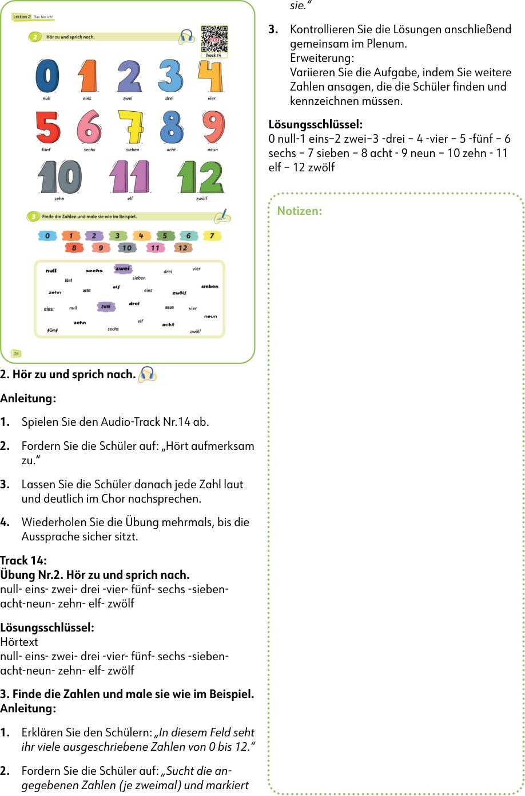

2. Hör zu und sprich nach. 🎧

**Anleitung:**

1. Spielen Sie den Audio-Track Nr.14 ab.
2. Fordern Sie die Schüler auf: „Hört aufmerksam zu.“
3. Lassen Sie die Schüler danach jede Zahl laut und deutlich im Chor nachsprechen.
4. Wiederholen Sie die Übung mehrmals, bis die Aussprache sicher sitzt.

**Track 14:**
**Übung Nr.2. Hör zu und sprich nach.**
null- eins- zwei- drei -vier- fünf- sechs -sieben- acht-neun- zehn- elf- zwölf

**Lösungsschlüssel:**
Hörtext
null- eins- zwei- drei -vier- fünf- sechs -sieben- acht-neun- zehn- elf- zwölf

3. Finde die Zahlen und male sie wie im Beispiel.

**Anleitung:**

1. Erklären Sie den Schülern: „In diesem Feld seht ihr viele ausgeschriebene Zahlen von $0$ bis $12$.“
2. Fordern Sie die Schüler auf: „Sucht die an sie.“
3. Kontrollieren Sie die Lösungen anschließend gemeinsam im Plenum.

**Erweiterung:**
Variieren Sie die Aufgabe, indem Sie weitere Zahlen ansagen, die die Schüler finden und kennzeichnen müssen.

**Lösungsschlüssel:**
$0$ null-$1$ eins–$2$ zwei–$3$ -drei – $4$ -vier – $5$ -fünf – $6$ sechs – $7$ sieben – $8$ acht - $9$ neun – $10$ zehn - $11$ elf – $12$ zwölf

**Notizen:**

<!-- sayfa 25 -->

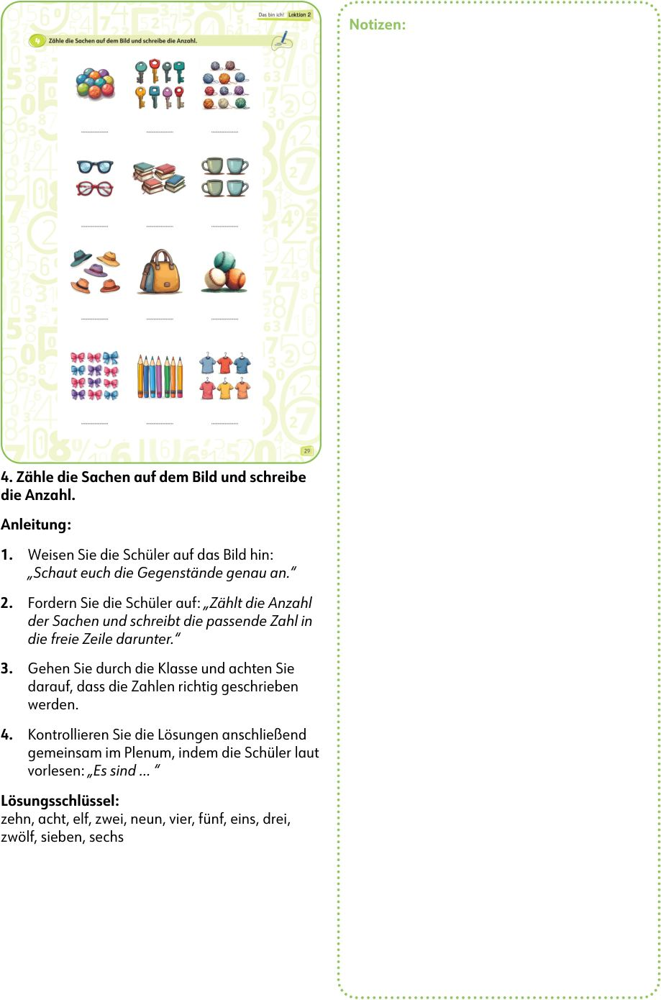

4. Zähle die Sachen auf dem Bild und schreibe die Anzahl.

| | | | |
| :---: | :---: | :---: | :---: |
| ![toplar] | ![şemsiyeler] | ![fincanlar] | |
| \_\_\_\_\_\_\_\_ | \_\_\_\_\_\_\_\_ | \_\_\_\_\_\_\_\_ | |
| ![gözlükler] | ![kitaplar] | ![fincanlar] | |
| \_\_\_\_\_\_\_\_ | \_\_\_\_\_\_\_\_ | \_\_\_\_\_\_\_\_ | |
| ![şapkalar] | ![çantalar] | ![elmalar] | |
| \_\_\_\_\_\_\_\_ | \_\_\_\_\_\_\_\_ | \_\_\_\_\_\_\_\_ | |
| ![kalpler] | ![kalemler] | ![yıldızlar] | |
| \_\_\_\_\_\_\_\_ | \_\_\_\_\_\_\_\_ | \_\_\_\_\_\_\_\_ | |

Anleitung:

1. Weisen Sie die Schüler auf das Bild hin: „Schaut euch die Gegenstände genau an.“
2. Fordern Sie die Schüler auf: „Zählt die Anzahl der Sachen und schreibt die passende Zahl in die freie Zeile darunter.“
3. Gehen Sie durch die Klasse und achten Sie darauf, dass die Zahlen richtig geschrieben werden.
4. Kontrollieren Sie die Lösungen anschließend gemeinsam im Plenum, indem die Schüler laut vorlesen: „Es sind ...“

Lösungsschlüssel:
zehn, acht, elf, zwei, neun, vier, fünf, eins, drei, zwölf, sieben, sechs

Notizen:

<!-- sayfa 26 -->

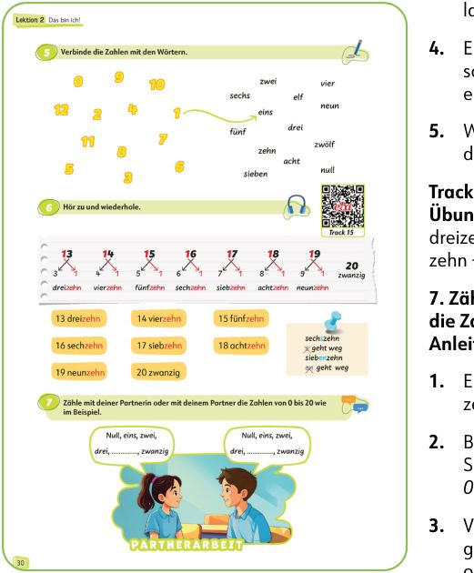

5. Verbinde die Zahlen mit den Wörtern.

**Anleitung:**

1. Weisen Sie die Schüler auf die Ziffern ($0$–$12$) links und die ausgeschriebenen Zahlwörter rechts hin.
2. Machen Sie ein Beispiel vor: „$1$ – eins“.
3. Fordern Sie die Schüler auf: „Verbindet jede Zahl mit dem passenden Wort.“
4. Lassen Sie die Übung selbstständig oder in Partnerarbeit durchführen.
5. Kontrollieren Sie die Lösungen anschließend gemeinsam im Plenum.

**Lösungsschlüssel:**
$0$ null – $1$ eins – $2$ zwei – $3$ drei – $4$ vier – $5$ fünf – $6$ sechs – $7$ sieben – $8$ acht – $9$ neun – $10$ zehn – $11$ elf – $12$ zwölf

6. Hör zu und wiederhole. 🎧

**Anleitung:**

1. Spielen Sie den Audio-Track Nr. $15$ ab.
2. Fordern Sie die Schüler auf: „Hört aufmerksam zu.“ laut und deutlich im Chor nachsprechen.
4. Erklären und üben Sie schwierige Stellen besonders: „sechzehn“ ohne s, „siebzehn“ ohne en.
5. Wiederholen Sie die Übung mehrmals, bis alle die Zahlen sicher sprechen können.

**Track 15:**
Übung Nr.$6$. Hör zu und wiederhole.
dreizehn – vierzehn – fünfzehn – sechzehn – siebzehn – achtzehn – neunzehn – zwanzig

7. Zähle mit deiner Partnerin / deinem Partner die Zahlen von $0$ bis $20$ wie im Beispiel.

**Anleitung:**

1. Erklären Sie den Schülern die Aufgabe und zeigen Sie das Beispiel in der Sprechblase.
2. Bilden Sie Partnerpaare und fordern Sie die Schüler auf: „Zählt gemeinsam die Zahlen von $0$ bis $20$ laut auf.“
3. Variieren Sie die Übung: Ein Partner zählt die geraden Zahlen, der andere die ungeraden – oder beide zählen gemeinsam im Chor.
4. Achten Sie währenddessen auf die korrekte Aussprache und die richtige Reihenfolge der Zahlen.
5. Wiederholen Sie die Übung bei Bedarf, bis alle Schüler sicher zählen können.

**Lösungsschlüssel:**
Partnerarbeit

**Notizen:**
..................................................................
..................................................................
..................................................................
..................................................................
..................................................................
..................................................................
..................................................................
..................................................................
..................................................................
..................................................................

<!-- sayfa 27 -->

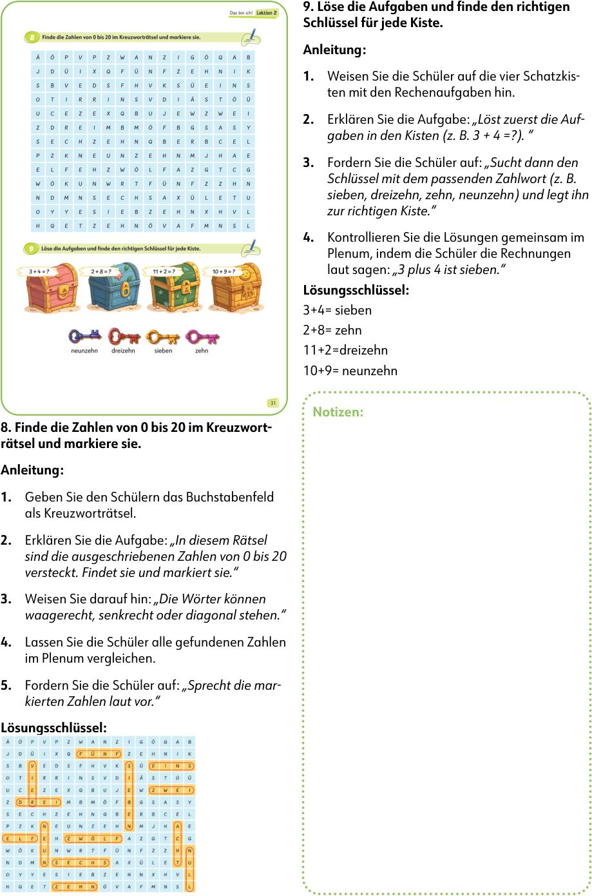

# 8. Finde die Zahlen von 0 bis 20 im Kreuzworträtsel und markiere sie.

## Anleitung:

1. Geben Sie den Schülern das Buchstabenfeld als Kreuzworträtsel.
2. Erklären Sie die Aufgabe: „In diesem Rätsel sind die ausgeschriebenen Zahlen von $0$ bis $20$ versteckt. Findet sie und markiert sie.“
3. Weisen Sie darauf hin: „Die Wörter können waagerecht, senkrecht oder diagonal stehen.“
4. Lassen Sie die Schüler alle gefundenen Zahlen im Plenum vergleichen.
5. Fordern Sie die Schüler auf: „Sprecht die markierten Zahlen laut vor.“

## Lösungsschlüssel:

# 9. Löse die Aufgaben und finde den richtigen Schlüssel für jede Kiste.

## Anleitung:

1. Weisen Sie die Schüler auf die vier Schatzkisten mit den Rechenaufgaben hin.
2. Erklären Sie die Aufgabe: „Löst zuerst die Aufgaben in den Kisten (z. B. $3 + 4 = ?$).“
3. Fordern Sie die Schüler auf: „Sucht dann den Schlüssel mit dem passenden Zahlwort (z. B. sieben, dreizehn, zehn, neunzehn) und legt ihn zur richtigen Kiste.“
4. Kontrollieren Sie die Lösungen gemeinsam im Plenum, indem die Schüler die Rechnungen laut sagen: „$3$ plus $4$ ist sieben.“

## Lösungsschlüssel:

$3+4=$ sieben  
$2+8=$ zehn  
$11+2=$ dreizehn  
$10+9=$ neunzehn

## Notizen:

<!-- sayfa 28 -->

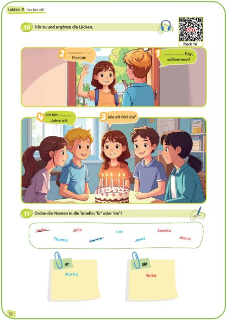

Wie alt bist du?
Ich bin 12 Jahre alt.

**11. Ordne die Namen in die Tabelle: „er“ oder „sie“?**

**Anleitung:**

1. Zeigen Sie den Schülern die Vornamen in der Aufgabe.
2. Erklären Sie: *„Ordnet die Namen nach dem passenden Pronomen: ‚er‘ für männliche Namen und ‚sie‘ für weibliche Namen.“*
3. Machen Sie ein Beispiel vor (z. B. Martin $\longrightarrow$ er, Heike $\longrightarrow$ sie).
4. Lassen Sie die Schüler die Namen in die richtige Spalte der Tabelle eintragen – selbstständig oder in Partnerarbeit.
5. Kontrollieren Sie die Ergebnisse anschließend gemeinsam im Plenum.

**Lösungsschlüssel:**
er: Martin - Thomas – Leo – Jonas
sie: Heike – Julia – Sandra – Maria

**10. Hör zu und ergänze die Lücken.**

**Anleitung:**

1. Spielen Sie den Audio-Track 16 mit dem kurzen Dialog ab.
2. Fordern Sie die Schüler auf: *„Achtet auf die fehlenden Wörter und Sätze und ergänzt die Lücken im Text passend.“*
3. Wiederholen Sie den Audio-Track bei Bedarf mehrmals, damit alle die richtigen Lösungen finden.
4. Vergleichen Sie die Antworten gemeinsam im Plenum.
5. Lassen Sie die Schüler die Dialoge anschließend in Partnerarbeit nachspielen.

**Track 16:**
**Übung Nr. 10 Hör zu und ergänze.**
A: Hallo Ezgi, willkommen!
B: Hallo, Florian.
A: Wie alt bist du?
B: Ich bin 12 Jahre alt.

**Lösungsschlüssel:**
Hallo Ezgi, willkommen.
Wie alt bist du?
Ich bin 12 Jahre alt.

**Notizen:**

<!-- sayfa 29 -->

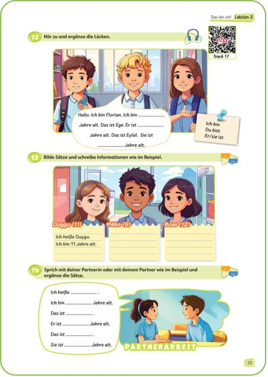

**Lösungsschlüssel:**
Hallo. Ich bin Florian. Ich bin 12 Jahre alt. Das ist Eylül. Sie ist 12 Jahre alt.

**13. Bilde Sätze und schreibe Informationen wie im Beispiel.**

**Anleitung:**

1. Weisen Sie die Schüler auf die Bilder der Schüler mit Namen und Alter hin.
2. Erklären Sie die Aufgabe: „Schreibt nach dem Beispiel eigene Sätze zu den anderen Schülern.“
3. Geben Sie ein Beispiel: „Ich heiße Duygu. Ich bin 11 Jahre alt.“
4. Fordern Sie die Schüler auf: „Schreibt jeweils: *Ich heiße ... / Ich bin ... Jahre alt.*“
5. Lassen Sie die Schüler ihre Sätze anschließend im Plenum vorlesen oder in Partnerarbeit austauschen.

**Lösungsschlüssel:**
Niko: Ich heiße Niko. Ich bin neun Jahre alt. Buse: Ich heiße Buse. Ich bin 12 Jahre alt.

**14. Sprich mit deiner Partnerin / deinem Partner und ergänze die Sätze.**

**Anleitung:**

Bilden Sie Partnerpaare.

Fordern Sie die Schüler auf: „Füllt die Satzanfänge mit euren eigenen Informationen aus.“

Weisen Sie auf die vorgegebenen Strukturen hin:

1. Ich bin ... Jahre alt.
2. Das ist ...
3. Er ist ... Jahre alt.
4. Sie ist ... Jahre alt.

Lassen Sie einen Schüler/eine Schülerin beginnen, das andere ergänzt oder antwortet.
5. Danach wechseln die Rollen.
6. Hören Sie den Partnergesprächen zu und korrigieren Sie bei Bedarf Aussprache oder Satzbildung.

**Lösungsschlüssel:**
Partnerarbeit

---

12. Hör zu und ergänze die Lücken.

**Anleitung:**

1. Spielen Sie den Audio-Track 17 ab, in dem sich drei Schüler vorstellen und ihr Alter nennen.
2. Fordern Sie die Schüler auf: „Hört aufmerksam zu und ergänzt die fehlenden Angaben im Text mit den richtigen Zahlen.“
3. Wiederholen Sie den Track bei Bedarf mehrmals, bis alle Lücken korrekt ausgefüllt sind.
4. Besprechen Sie die Lösungen anschließend gemeinsam im Plenum.

**Erweiterung:**
Lassen Sie die Schüler in Partnerarbeit ähnliche Sätze über ihr eigenes Alter sprechen, z. B.:
„Ich bin ... Jahre alt.“
„Das ist ... Er/Sie ist ... Jahre alt.“

**Track 17:**
Übung Nr.12. Hör zu und ergänze die Lücken.
Hallo, ich bin Florian. Ich bin 12 Jahre alt.
Das ist Ege. Er ist 11 Jahre alt. Das ist Eylül.
Sie ist 12 Jahre alt.

<!-- sayfa 30 -->

# B. Die Länder und die Sprachen

**1. Welche Länder kennst du? Kreise wie im Beispiel ein.**

**Anleitung:**

1. Zeigen Sie den Schülern die Europakarte mit verschiedenen Ländern.
2. Fordern Sie die Schüler auf: „*Nennt Länder, die ihr schon kennt, und kreist sie wie im Beispiel ein (z. B. Türkiye, Deutschland).*“
3. Ermuntern Sie die Schüler, eigene Erfahrungen einzubringen, z. B.:
„*Dort war ich schon im Urlaub.*“
„*Dort habe ich Verwandte.*“
4. Leiten Sie im Anschluss zum neuen Thema über: „*Heute lernen wir Länder und Sprachen kennen.*“

**2. Hör zu und sprich nach. 🎧**

**Anleitung:**

1. Spielen Sie den Audio-Track 18 mit den Ländernamen ab.
2. Fordern Sie die Schüler auf: „*Hört aufmerksam zu.*“
3. Stoppen Sie nach jedem Ländernamen und lassen Sie die Schüler den Namen laut nachsprechen.
4. Weisen Sie die Schüler an: „*Zeigt dabei auf die richtige Flagge.*“
5. Führen Sie die Übung zunächst im Chor, dann auch einzeln durch.
6. Lassen Sie die Schüler anschließend in Partnerarbeit üben:
    * Schüler A zeigt auf eine Flagge.
    * Schüler B sagt den passenden Ländernamen.

**Track 18:**
**Übung Nr.2. Hör zu und sprich nach.**

Die Schweiz, Aserbaidschan, Österreich, Deutschland, Türkiye, Japan, Spanien, England, Russland, Frankreich, Italien, China

**Lösungsschlüssel:**
**Hörtext:**
Die Schweiz, Aserbaidschan, Österreich, Deutschland, Türkiye, Japan, Spanien, England, Russland, Frankreich, Italien, China

**Notizen:**

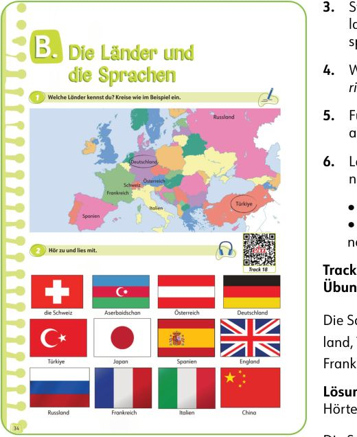
<!-- yer tutucu bulunamadı: sayfa sonuna eklendi -->

<!-- sayfa 31 -->

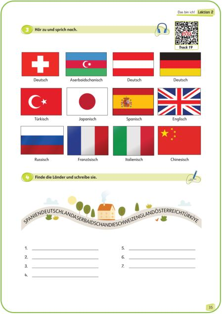

3. Hör zu und sprich nach. 

**Anleitung:**

1. Spielen Sie den Audio-Track 19 mit den Sprachennamen ab (z. B. Deutsch, Türkisch, Englisch, Spanisch ...).
2. Fordern Sie die Schüler: „Hört aufmerksam zu und sprecht die Sprachen laut nach, während ihr auf die passende Flagge zeigt.“
3. Führen Sie die Übung zuerst im Chor, dann einzeln oder in Partnerarbeit durch.

Erweiterung:
Stellen Sie Fragen wie:
„Welche Sprache spricht man in Spanien?“
– „Spanisch.“
„Welche Sprache spricht man in Türkiye?“
– „Türkisch.“

**Track 19:**
**Übung Nr.3. Hör zu und sprich nach.**
Deutsch, Aserbaidschanisch, Deutsch, Deutsch, Türkisch, Japanisch, Spanisch, Englisch, Russisch, Französisch, Italienisch, Chinesisch

**Lösungsschlüssel:**
Hörtext
Übung Nr.3. Hör zu und sprich nach.
Deutsch, Aserbaidschanisch, Deutsch, Deutsch, Türkisch, Japanisch, Spanisch, Englisch, Russisch, Französisch, Italienisch, Chinesisch

4. Finde die Länder und schreibe sie.

**Anleitung:**

1. Weisen Sie die Schüler auf das lange Wortband hin, in dem mehrere Ländernamen ohne Leerzeichen aneinander geschrieben sind (z.B.SpanienDeutschlandAserbaidschanSchweizEnglandÖsterreichTürkiye).
2. Fordern Sie die Schüler auf: „Findet die einzelnen Ländernamen im Wortband, trennt sie heraus und schreibt sie in die Liste.“
3. Machen Sie ein Beispiel vor, z. B.: „Spanien“.
4. Lassen Sie die Schüler anschließend selbstständig weiterarbeiten.
5. Vergleichen Sie am Ende die Lösungen gemeinsam im Plenum und lassen Sie die Schüler die Ländernamen laut vorlesen.

**Lösungsschlüssel:**
1.Spanien
2.Deutschland
3.Aserbaidschan
4.die Schweiz
5.England
6.Österreich
7.Türkiye

**Notizen:**

<!-- sayfa 32 -->

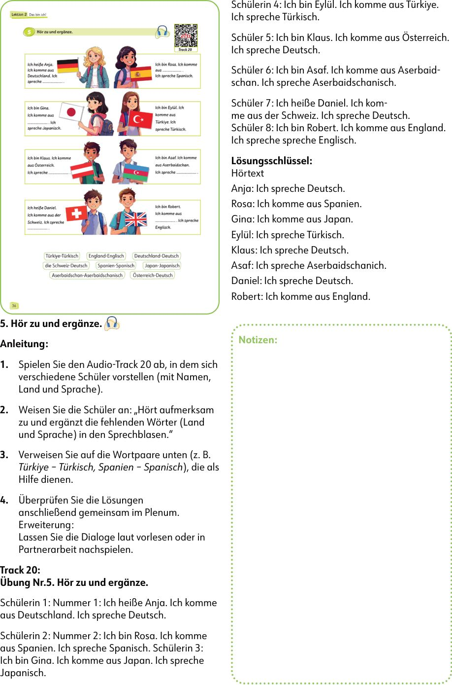

# Lektion 2 Das bin ich!

## 5 Hör zu und ergänze.

**Anleitung:**

1. Spielen Sie den Audio-Track 20 ab, in dem sich verschiedene Schüler vorstellen (mit Namen, Land und Sprache).
2. Weisen Sie die Schüler an: „Hört aufmerksam zu und ergänzt die fehlenden Wörter (Land und Sprache) in den Sprechblasen.“
3. Verweisen Sie auf die Wortpaare unten (z. B. *Türkiye – Türkisch, Spanien – Spanisch*), die als Hilfe dienen.
4. Überprüfen Sie die Lösungen anschließend gemeinsam im Plenum.

**Erweiterung:**
Lassen Sie die Dialoge laut vorlesen oder in Partnerarbeit nachspielen.

**Track 20:**
**Übung Nr.5. Hör zu und ergänze.**

Schülerin 1: Nummer 1: Ich heiße Anja. Ich komme aus Deutschland. Ich spreche Deutsch.

Schülerin 2: Nummer 2: Ich bin Rosa. Ich komme aus Spanien. Ich spreche Spanisch. Schülerin 3: Ich bin Gina. Ich komme aus Japan. Ich spreche

Schülerin 4: Ich bin Eylül. Ich komme aus Türkiye. Ich spreche Türkisch.

Schüler 5: Ich bin Klaus. Ich komme aus Österreich. Ich spreche Deutsch.

Schüler 6: Ich bin Asaf. Ich komme aus Aserbaidschan. Ich spreche Aserbaidschanisch.

Schüler 7: Ich heiße Daniel. Ich komme aus der Schweiz. Ich spreche Deutsch.

Schüler 8: Ich bin Robert. Ich komme aus England. Ich spreche spreche Englisch.

**Lösungsschlüssel:**
**Hörtext**
Anja: Ich spreche Deutsch.
Rosa: Ich komme aus Spanien.
Gina: Ich komme aus Japan.
Eylül: Ich spreche Türkisch.
Klaus: Ich spreche Deutsch.
Asaf: Ich spreche Aserbaidschanich.
Daniel: Ich spreche Deutsch.
Robert: Ich komme aus England.

**Notizen:**

<!-- sayfa 33 -->

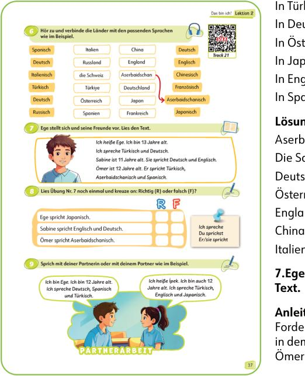

# 6. Hör zu und verbinde die Länder mit den passenden Sprachen wie im Beispiel. 🎧

**Anleitung:**

1. Spielen Sie den Audio-Track 21 ab, in dem verschiedene Länder und Sprachen genannt werden. Geben Sie ein Beispiel vor (z. B. Spanien – Spanisch).
2. Fordern Sie die Schüler auf: „Hört aufmerksam zu und verbindet jedes Land mit der passenden Sprache.“
3. Lassen Sie die Schüler anschließend selbstständig oder in Partnerarbeit weiterarbeiten.
4. Vergleichen Sie am Ende die Lösungen im Plenum und lassen Sie die Schüler die Wortpaare laut vorlesen.

**Track 21:**
**Übung Nr.6. Hör zu und verbinde die Länder mit den passenden Sprachen.**
In Aserbaidschan spricht man Aserbaidschanisch.
In Italien spricht man Italienisch.
In Russland spricht man Russisch.
In China spricht man Chinesisch.
In Frankreich spricht man Französisch.
In Türkiye spricht man Türkisch.
In Deutschland spricht man Deutsch.
In Österreich spricht man Deutsch.
In Japan spricht man Japanisch.
In England spricht man Englisch.
In Spanien spricht man Spanisch.

**Lösungsschlüssel:**
Aserbaidschan – Aserbaidschanisch
Die Schweiz – Deutsch, Türkiye – Türkisch
Deutschland – Deutsch,
Österreich – Deutsch, Japan – Japanisch
England – Englisch, Spanien – Spanisch
China – Chinesisch, Frankreich – Französisch
Italien – Italienisch, Russland - Russisch

# 7. Ege stellt sich und seine Freunde vor. Lies den Text.

**Anleitung:**
Fordern Sie die Schüler auf: „Lest den kurzen Text, in dem sich Ege und seine Freunde Sabine und Ömer vorstellen.“

Weisen Sie die Schüler darauf hin, besonders auf Alter und gesprochene Sprachen zu achten.

**Lösungsschlüssel:**
Lesen

# 8. Lies Übung Nr.7 noch einmal und kreuze an. Richtig (R) oder falsch (F)?

1. Fordern Sie die Schüler auf: „Lest die Aussagen und entscheidet: Richtig (R) oder falsch (F). Kreuzt die passende Lösung an.“
2. Kontrollieren Sie die Ergebnisse gemeinsam im Plenum.

**Lösungsschlüssel:**
Ege spricht Japanisch. (Falsch) Sabine spricht Englisch und Deutsch. (Richtig) Ömer spricht Aserbaidschanisch. (Richtig)

# 9. Sprich mit deiner Partnerin oder deinem Partner wie im Beispiel.

**Anleitung:**
1. Bilden Sie Partnerpaare.
2. Geben Sie die Anweisung: „Stellt euch gegenseitig vor, so wie im Beispiel.“
3. Schreiben Sie die Strukturen an die Tafel:
$Ich \ beh$ <!-- KONTROL: Marker'da karşılığı yok, uydurma olabilir -->
$/ Ich \ hh \ ß$ <!-- KONTROL: Marker'da karşılığı yok, uydurma olabilir -->

<!-- sayfa 34 -->

* Ich bin ... Jahre alt.
* Ich spreche ... (Sprachen).

4. Fordern Sie die Schüler auf, die Sätze mit eigenen Informationen (Name, Alter, Sprachen) zu ergänzen.

5. Erinnern Sie den Schülern: „Hört eurem Partner gut zu und stellt auch Fragen!“ Wie alt bist du? – Ich bin 12 Jahre alt. Welche Sprachen sprichst du? – Ich spreche...

6. Lassen Sie die Dialoge mehrfach üben und anschließend einige Paare vor der Klasse vorspielen.

**Lösungsschlüssel:**
Partnerarbeit

Notizen:

<!-- yer tutucu bulunamadı: sayfa sonuna eklendi -->

<!-- sayfa 35 -->

# C. Die Herkunft und der Wohnort

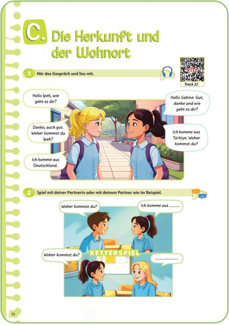

1. Hör das Gespräch und lies mit. 🎧

**Anleitung:**

1. Spielen Sie den Audio-Track 22 ab.
2. Fordern Sie die Schüler auf: „Hört aufmerksam zu und verfolgt dabei den Dialog im Buch.“
3. Weisen Sie auf die wichtigen Strukturen hin:
   Wie geht es dir? – Gut, danke. Und dir?
   Woher kommst du? – Ich komme aus ...
4. Wiederholen Sie den Track mehrfach:
   Erstes Hören – nur zuhören.
   Zweites Hören – mitlesen.
   Drittes Hören – mitsprechen.
5. Fordern Sie die Schüler auf: „Spielt den Dialog jetzt in Partnerarbeit nach.“
6. Ermutigen Sie die Schüler, die Sätze mit eigenen Angaben zu ergänzen (Name, Herkunft, evtl. Sprachen).

**Track 22:**
**Übung Nr.1. Hör das Gespräch und lies mit.**
A: Hallo İpek, wie geht es dir?
B: Hallo Sabine. Gut, danke und wie geht es dir?
B: Ich komme aus Türkiye. Woher kommst du?
A: Ich komme aus Deutschland.

**Lösungsschlüssel:**
Hörtext

2. Sprich mit deiner Partnerin oder deinem Partner wie im Beispiel.

**Anleitung:**

1. Schreiben Sie die Beispielsätze an die Tafel:
   * Woher kommst du?
   * Ich komme aus ...
   * Er/Sie kommt aus ...
2. Demonstrieren Sie das Spiel mit einem Schüler / einer Schülerin:
   * Lehrkraft: „Woher kommst du?“
   * Schüler/Schülerin: „Ich komme aus ...“
3. Leiten Sie nun das Kettenspiel an:
   Fordern Sie den nächsten Schüler / die nächste Schülerin auf: „Sag, woher du kommst, und nenne gleichzeitig den vorherigen Mitschüler.“
   Beispiel:
   Zweiter Schüler: „Ich komme aus ..., und er/sie kommt aus ...“
   Dritter Schüler: „Ich komme aus ..., er kommt aus ... und sie kommt aus ...“
   Vierter Schüler: „Ich komme aus ..., er kommt aus ..., sie kommt aus ... und er kommt aus ...“
4. Fahren Sie so fort, bis alle in der Gruppe an der Reihe waren.
5. Fordern Sie die letzte Person auf: „Wiederhole die ganze Kette und nenne alle Mitschülerinnen und Mitschüler in der richtigen Reihenfolge.“

**Lösungsschlüssel:**
Kettenspiel

**Notizen:**

<!-- sayfa 36 -->

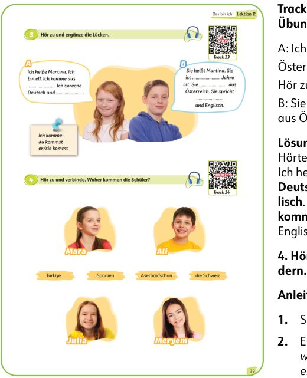

**Track 23:**
**Übung Nr. 3. Hör zu und ergänze die Lücken.**

A: Ich heiße Martina. Ich bin 11. Ich komme aus Österreich. Ich spreche Deutsch und Englisch.
Hör zu und ergänze die Lücken im B.
B: Sie heißt Martina. Sie ist 11 Jahre alt. Sie kommt aus Österreich. Sie spricht Deutsch und Englisch.

**Lösungsschlüssel:**
Hörtext A.
Ich heiße Martina. Ich bin elf. Ich komme aus Deutschland. Ich spreche Deutsch und Englisch. B. Sie heißt Martina. Sie ist 11 Jahre alt. Sie kommt aus Österreich. Sie spricht Deutsch und Englisch.

**4. Hör zu und verbinde die Länder mit den Kindern.** 🎧

**Anleitung:**
1. Spielen Sie den Audio-Track 24 ab.
2. Erklären Sie den Schülern: „Hört genau hin, wie sich die Schüler (Mara, Ali, Julia und Meryem) vorstellen und sagt, aus welchem Land sie kommen.“
3. Fordern Sie die Schüler auf: „Verbindet die Namen und Fotos mit den passenden Ländern.“ (Beispiel: Meryem – Türkiye).
4. Führen Sie die Übung in zwei Durchgängen durch:
Erstes Hören: nur zuhören und verstehen.
Zweites Hören: aktiv die Verbindungen herstellen.
5. Kontrollieren Sie die Lösungen am Ende gemeinsam im Plenum und lassen Sie die Schüler die Sätze laut sagen („Meryem kommt aus Türkiye.“).

**Track 24:**
**Übung Nr. 4. Hör zu und verbinde. Woher kommen die Schüler?**
Mara kommt aus Spanien.
Meryem kommt aus Türkiye.
Ali kommt aus Aserbaidschan.
Julia kommt aus der Schweiz.

**Lösungsschlüssel:**
Mara kommt aus Spanien.
Meryem kommt aus Türkiye.
Ali kommt aus Aserbaidschan.

<!-- sayfa 37 -->

# Lektion 2 Das bin ich!

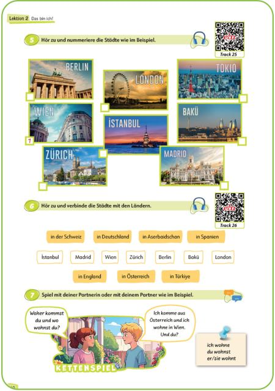

5. Hör zu und nummeriere die Städte wie im Beispiel. 🎧

**Anleitung:**

1. Spielen Sie den Audio-Track 25 ab und sagen Sie den Schülern: „Hört aufmerksam zu und merkt euch die Reihenfolge der Städtenamen.“
2. Fordern Sie die Schüler auf: „Nummeriert die Bilder der Städte in der Reihenfolge, in der ihr sie hört (1, 2, 3 ...).“
3. Führen Sie die Übung in zwei Durchgängen durch:
   Erstes Hören: Nur zuhören und die Städtenamen wiedererkennen.
   Zweites Hören: Die Bilder der Städte in der richtigen Reihenfolge nummerieren.
4. Kontrollieren Sie die Ergebnisse anschließend gemeinsam im Plenum, indem die Schüler die Lösungen laut vorlesen („1 – Berlin, 2 – London ...“).

**Track 25:**
Übung Nr.5. Hör zu und nummeriere die Städte wie im Beispiel.
Nummer eins ist Wien.
Nummer drei ist London.
Nummer vier ist Berlin.
Nummer fünf ist Zürich.
Nummer sechs ist Tokyo.
Nummer sieben ist İstanbul.
Nummer acht ist Bakü.

**Lösungsschlüssel:**
Nummer 1 – Wien
Nummer 2 – Madrid
Nummer 3 – London
Nummer 4 – Berlin
Nummer 5 – Zürich
Nummer 6 – Tokyo
Nummer 7 – İstanbul
Nummer 8 – Bakü

6. Hör zu und verbinde die Städte mit den Ländern. 🎧

**Anleitung:**

1. Spielen Sie den Audio-Track 26 ab und sagen Sie den Schülern: „Hört aufmerksam zu und achtet darauf, welche Stadt zu welchem Land gehört.“
2. Führen Sie die Übung in zwei Schritten durch:
   Erstes Hören: Nur zuhören und die Kombinationen Stadt – Land erkennen.
   Zweites Hören: Die Schüler ziehen die Verbindungen zwischen den Städten und den passenden Ländern.
3. Kontrollieren Sie die Ergebnisse anschließend im Plenum, indem die Schüler die Lösungen laut nennen („Berlin ist in Deutschland. Zürich ist in der Schweiz. ...“).

**Track 26:**
Übung Nr.6 Hör zu und verbinde die Städte mit den Ländern.
İstanbul ist in Türkiye.
Madrid ist in Spanien.
Wien ist in Österreich.
Zürich ist in der Schweiz.
Berlin ist in Deutschland.
Baku ist in Aserbaidschan.
London ist in England.

**Lösungsschlüssel:**
Hörtext

<!-- sayfa 38 -->

**Lösungsschlüssel:**
Kettenspiel: „Woher kommst du und wo wohnst du?

Ich komme aus Österreich und ich wohne in Wien.
Und du?“

Madrid ist in Spanien.
Wien ist in Österreich.
Zürich ist in der Schweiz.
Berlin ist in Deutschland.
Baku ist in Aserbaidschan.
London ist in England.

**7. Sprich mit deiner Partnerin oder mit deinem Partner wie im Beispiel.**

**Anleitung:**

1. Schreiben Sie die Beispielsätze an die Tafel:
    * Woher kommst du?
    * Ich komme aus ...
    * Ich wohne in ...
    * Er/Sie kommt aus ... und wohnt in ...

2. Demonstrieren Sie das Spiel mit einem Schüler / einer Schülerin. Stellen Sie die Frage: „Woher kommst du und wo wohnst du?“
Der Schüler / die Schülerin antwortet zum Beispiel:
„Ich komme aus Österreich und ich wohne in Wien.“

3. Nun macht der nächste Schüler weiter. Er stellt sich selbst vor und wiederholt zusätzlich die Information des Mitschülers:
„Ich komme aus Spanien und ich wohne in Madrid. Er kommt aus Österreich und er wohnt in Wien.“

4. Jeder/jeder weitere Schüler/Schülerin erweitert die Kette, indem er/sie die eigenen Angaben macht und alle vorherigen Mitschülerinnen und Mitschüler in der richtigen Reihenfolge wiederholt.

Beispiel:
Dritter Schüler:
„Ich komme aus Türkiye und ich wohne in Ankara. Sie kommt aus Spanien und sie wohnt in Madrid. Er kommt aus Österreich und er wohnt in Wien.“
Vierter Schüler:
„Ich komme aus Aserbaidschan und ich wohne in Baku. Er kommt aus Türkiye und er wohnt in Ankara. Sie kommt aus Spanien und sie wohnt in Madrid. Er kommt aus Österreich und er wohnt in Wien.“

So geht es reihum weiter, bis alle Schüler gesprochen haben.
Die letzte Schülerin / der letzte Schüler muss alle Informationen der Gruppe korrekt und in der richtigen Reihenfolge wiedergeben.

Notizen:

<!-- sayfa 39 -->

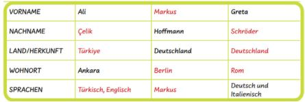

8. Wähle eine Stadt/ein Land und sprich mit deiner Partnerin oder deinem Partner wie im Beispiel.

Anleitung:

1. Fordern Sie die Schüler auf, sich in Partnerarbeit zusammenzufinden.
2. Jede/r wählt eine Stadt oder ein Land aus.
3. Geben Sie das Beispielschema an die Tafel:
   *Ich komme aus ... und ich wohne in...*
   *Und du?*

4. Ein Schüler/eine Schülerin beginnt mit einem vollständigen Satz.
5. Die Partnerin oder der Partner antwortet ebenfalls mit einem vollständigen Satz und ergänzt eigene Angaben.
6. Ermuntern Sie die Schüler, die Übung mehrmals mit unterschiedlichen Städten oder Ländern zu wiederholen, damit sich die Strukturen einprägen.
7. Lassen Sie einzelne Paare ihre Dialoge im Plenum vorspielen, um den Austausch zu sichern und den Wortschatz zu festigen.

Lösungsschlüssel:
Partnerarbeit

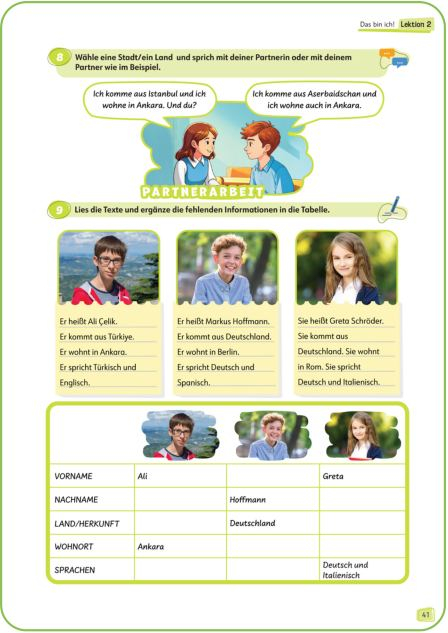

9. Lies die Texte und ergänze die fehlenden Informationen in die Tabelle.

Anleitung:

1. Fordern Sie die Schüler auf, die kurzen Texte über Ali, Markus und Greta aufmerksam zu lesen.
2. Weisen Sie darauf hin, dass die Schüler gezielt nach den folgenden Angaben suchen sollen:
   * Vorname und Nachname
   * Land/Herkunft
   * Wohnort
   * Sprachen
3. Lassen Sie die Schüler die Informationen aus den Texten entnehmen und in die Tabelle übertragen.
4. Lassen Sie die Schüler die Texte leise oder gemeinsam im Klassenverband lesen.
5. Sagen Sie den Schülern, dass sie die Informationen in die passende Spalte der Tabelle eintragen sollen.
6. Vergleichen Sie die Ergebnisse im Plenum. Einzelne Schüler können ihre Antworten laut vorlesen.

Lösungsschlüssel:

| VORNAME | Ali | Markus | Greta |
| :--- | :--- | :--- | :--- |
| NACHNAME | Çelik | Hoffmann | Schröder |
| LAND/HERKUNFT | Türkiye | Deutschland | Deutschland |
| WOHNORT | Ankara | Berlin | Rom |
| SPRACHEN | Türkisch, Englisch | Markus | Deutsch und Italienisch |

Notizen:

<!-- sayfa 40 -->

Lektion 2 Das bin ich!

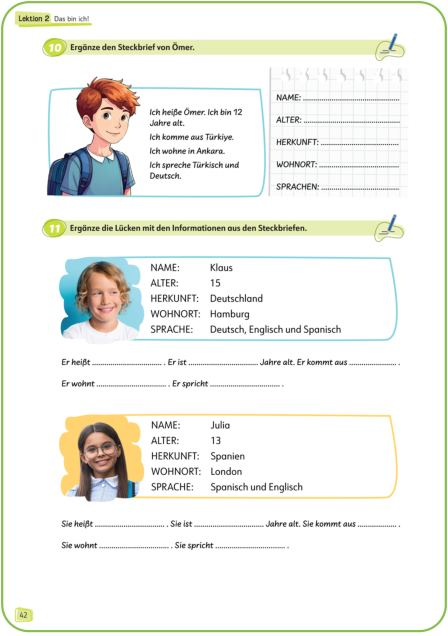

10 Ergänze den Steckbrief von Ömer.

Ich heiße Ömer. Ich bin 12 Jahre alt.
Ich komme aus Türkiye.
Ich wohne in Ankara.
Ich spreche Türkisch und Deutsch.

NAME: _________
ALTER: _________
HERKUNFT: _________
WOHNORT: _________
SPRACHEN: _________

11 Ergänze die Lücken mit den Informationen aus den Steckbriefen.

NAME: Klaus
ALTER: 15
HERKUNFT: Deutschland
WOHNORT: Hamburg
SPRACHE: Deutsch, Englisch und Spanisch

Er heißt _________. Er ist _________ Jahre alt. Er kommt aus _________.
Er wohnt _________. Er spricht _________.

NAME: Julia
ALTER: 13
HERKUNFT: Spanien
WOHNORT: London
SPRACHE: Spanisch und Englisch

Sie heißt _________. Sie ist _________ Jahre alt. Sie kommt aus _________.
Sie wohnt _________. Sie spricht _________.

42

SPRACHEN: Türkisch, Deutsch

11. Ergänze die Lücken mit den Informationen aus den Steckbriefen.
Anleitung:

1. Weisen Sie die Schüler an, die beiden Steckbriefe von Klaus und Julia aufmerksam zu lesen.

2. Erklären Sie, dass die fehlenden Angaben in den Übungssätzen direkt aus den Steckbriefen übernommen werden sollen.

3. Die Schüler ergänzen die Lücken mit den Informationen zu Namen, Alter, Herkunft, Wohnort und Sprachen.

4. Lassen Sie die Schüler zuerst die Steckbriefe still oder gemeinsam im Plenum lesen.

5. Geben Sie die Anweisung: Trägt die passenden Informationen in die Lückensätze ein.

6. Vergleichen Sie die Ergebnisse gemeinsam mit der Klasse. Einzelne Schüler können die vollständigen Sätze laut vorlesen.

Lösungsschlüssel:

Er heißt Klaus. Er ist 15 Jahre alt.
Er kommt aus Deutschland.
Er wohnt in Hamburg.
Er spricht Deutsch, Englisch und Spanisch.
Sie heißt Julia. Sie ist 13 Jahre alt.
Sie kommt aus Spanien.
Sie wohnt in London.
Sie spricht Spanisch und Englisch.

10. Ergänze den Steckbrief von Ömer.
Anleitung:

1. Bitten Sie die Schüler, den kurzen Text über Ömer aufmerksam zu lesen.

2. Erklären Sie, dass die Schüler die Informationen aus dem Text in den vorbereiteten Steckbrief auf der rechten Seite übertragen sollen.

3. Der Steckbrief enthält folgende Angaben, die ergänzt werden müssen:

* Name: Vor- und Nachname
* Alter: Zahl in Jahren
* Herkunft: Land
* Wohnort: Stadt
* Sprachen: Welche Sprachen Ömer spricht

4. Lassen Sie die Schüler den Text zu Ömer aufmerksam lesen.

5. Sagen Sie, dass sie die Angaben in den Steckbrief füllen sollen.

6. Vergleichen Sie die Ergebnisse gemeinsam im Plenum. Einzelne Schüler können den Steckbrief laut vorlesen.

Lösungsschlüssel:

NAME: Ömer ALTER: 12 HERKUNFT: Türkiye
WOHNORT: Ankara
SPRACHEN: Türkisch, Deutsch

Notizen:

<!-- sayfa 41 -->

# 12. Verbinde die Antworten zu den Fragen wie im Beispiel.

**Anleitung:**

1. Lenken Sie die Aufmerksamkeit der Schüler auf die Fragen zur Person (z. B. *Wer bist du? Wie heißt du? Wo wohnst du?*)
2. Erklären Sie, dass jede Frage mit einer passenden Antwort verbunden werden soll.
3. Zeigen Sie das Beispiel an der Tafel, damit die Schüler die Vorgehensweise verstehen.
4. Lassen Sie die Schüler zunächst alle Fragen und Antworten still oder gemeinsam laut lesen.
5. Sagen Sie, dass sie Linien zwischen den passenden Fragen und Antworten ziehen sollen.
6. Lösen Sie die Aufgabe gemeinsam im Plenum, indem die Schüler die Fragen vorlesen und andere die richtigen Antworten dazu nennen.

**Lösungsschlüssel:**
1.g
2.a
3.d
4.f
5.b
6.e

# 13. Ordne die Sätze und schreibe den Dialog in der richtigen Reihenfolge wie im Beispiel.

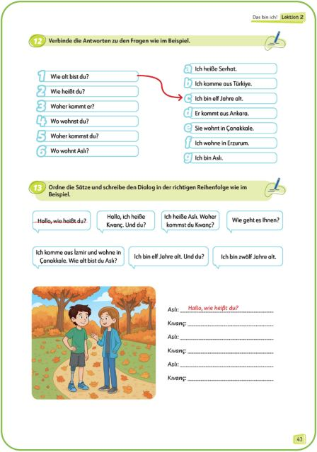

**Anleitung:**

1. Erklären Sie den Schülern, dass die Sätze eines Dialogs durcheinandergebracht wurden.
2. Die Aufgabe besteht darin, die Sätze in die richtige Reihenfolge zu bringen, sodass ein sinnvoller Gesprächsverlauf entsteht.
3. Weisen Sie darauf hin, dass dabei wichtige Redemittel geübt werden: Begrüßung, sich vorstellen, Alter und Herkunft nennen.
4. Lassen Sie die Schüler die durcheinanderstehenden Sätze aufmerksam lesen.
5. Fordern Sie sie auf, die Sätze logisch zu sortieren und so einen zusammenhängenden Dialog zu bilden.
6. Die Schüler schreiben den geordneten Dialog in ihr Heft oder in die vorgesehene Lücke ab.
7. Zum Abschluss lassen Sie die Schüler den Dialog in Partnerarbeit laut vorlesen oder vorspielen.

**Lösungsschlüssel:**
Aslı: Hallo, wie heißt du?
Kıvanç: Hallo, ich heiße Kıvanç. Und du?
Aslı: Ich heiße Aslı. Woher kommst du Kıvanç?
Kıvanç: Ich komme aus İzmir und wohne in Çanakkale. Wie alt bist du Aslı?
Aslı: Ich bin elf Jahre alt. Und du?
Kıvanç: Ich bin zwölf Jahre alt.

**Notizen:**

<!-- sayfa 42 -->

# PROJEKTARBEIT
## Anleitung

1. Erklären Sie die Aufgabe.
   Sagen Sie: „Heute gestaltet ihr euren eigenen Steckbrief. Ihr schreibt Informationen über euch und malt ein Bild.“

2. Zeigen Sie die Felder.
   Vorname $\rightarrow$ „Hier schreibt ihr euren Vornamen.“
   Familienname $\rightarrow$ „Hier schreibt ihr euren Nachnamen.“
   Alter $\rightarrow$ „Hier schreibt ihr, wie alt ihr seid.“
   Herkunft $\rightarrow$ „Hier schreibt ihr, woher ihr kommt.“
   Wohnort $\rightarrow$ „Hier schreibt ihr, wo ihr wohnt.“
   Sprachen $\rightarrow$ „Hier schreibt ihr, welche Sprachen ihr sprecht.“

3. Machen Sie ein Beispiel an der Tafel.
   Schreibe z. B.:
   Vorname: Ece
   Familienname: Ayhan
   Alter: 12
   Herkunft: Türkiye
   Wohnort: Aydın
   Sprachen: Türkisch, Deutsch, Englisch

4. Geben Sie den Schülern Zeit zum Arbeiten. 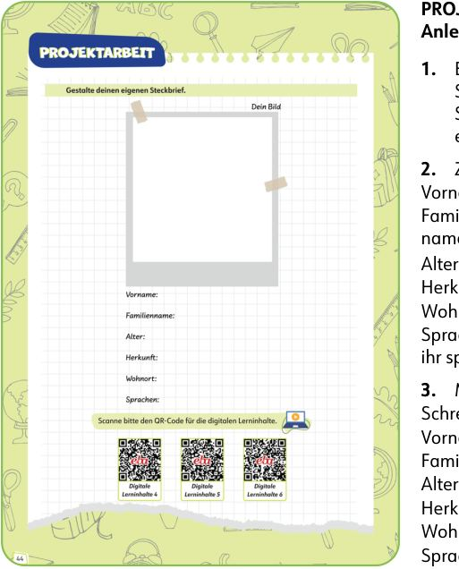

5. Sagen Sie: „Füllt jetzt euren Steckbrief aus. Malt euer Bild oben in das Kästchen.“

6. Lassen Sie die Schüler ihre Steckbriefe präsentieren. 
   Sagen Sie: „Kommt nach vorne und stellt euren Steckbrief vor: Ich heiße ... Ich bin ... Jahre alt. Ich wohne in...“

Notizen:

<!-- sayfa 43 -->

# LEKTION 3

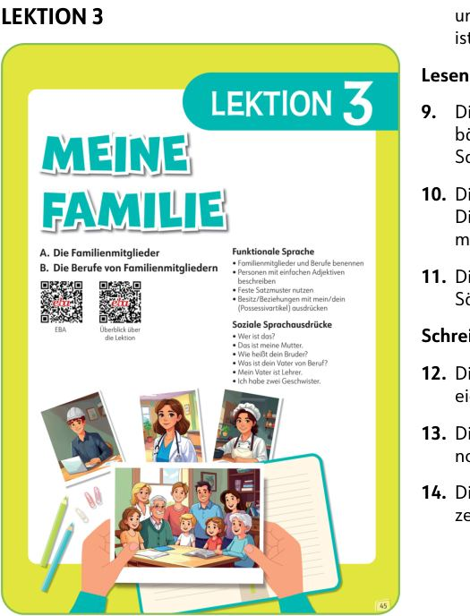

**KOMPETENZEN:**

## Hören

1. Die Schüler können kurze Dialoge über Familienmitglieder und Berufe global verstehen.
2. Die Schüler können einfache Fragen wie Wer ist das? Wie heißt ...? Was ist ... von Beruf? verstehen.
3. Die Schüler können Aussagen mit Possessivartikeln (mein/dein) sinngemäß erfassen.

## Sprechen

4. Die Schüler können Familienmitglieder benennen und mit einfachen Adjektiven beschreiben (Meine Mutter ist toll).
5. Die Schüler können Berufe nennen (Mein Vater ist Lehrer.).
6. Die Schüler können mit festen Satzmustern Personen vorstellen (Das ist meine Mutter. Sie heißt ...).
7. Die Schüler können Besitz/Beziehungen mit mein/dein ausdrücken (Das ist mein Bruder.) und beantworten (Wie heißt dein Bruder? Was ist dein Vater von Beruf?)

## Lesen

9. Die Schüler können kurze Steckbriefe/Stammbäume (Name–Beziehung–Beruf) Satz für Satz verstehen.
10. Die Schüler können einfache Sprechblasen/Dialoge zum Thema „Familie & Beruf“ sinngemäß erfassen.
11. Die Schüler können Possessivartikel in kurzen Sätzen erkennen.

## Schreiben

12. Die Schüler können einen Mini-Steckbrief zur eigenen Familie verfassen (2–4 Sätze).
13. Die Schüler können feste Satzmuster korrekt notieren (Das ist ... . Er/Sie ist ... .).
14. Die Schüler können mein/dein korrekt einsetzen (mein Bruder / deine Schwester).

<!-- sayfa 44 -->

# A. Die Familienmitglieder

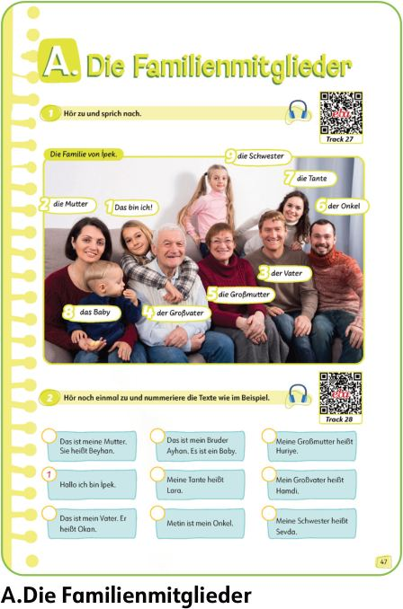

**1. Hör zu und sprich nach.** 🎧

**Anleitung:**

1. Spielen Sie den Audio-Track 27 ab und lassen Sie die Schüler aufmerksam zuhören.
2. Weisen Sie die Schüler an: „Schaut das Bild an und hört die Familienmitglieder von İpek!“
3. Lassen Sie die Schüler jedes gehörte Wort laut nachsprechen (z. B. „die Mutter“, „der Vater“, „die Schwester“).
4. Fordern Sie die Schüler auf, den bestimmten Artikel (der, die, das) deutlich mitzusprechen.
5. Wiederholen Sie die Übung mehrmals: Sagen Sie: „Sprecht alle zusammen im Chor nach!“
6. Sagen Sie danach: „Wiederhole du allein!“

**Track 27:**
**Übung Nr. 1 Hör zu und sprich nach.**
Hallo, ich bin İpek. Nr. 1 bin ich.
Nummer 2 ist meine Mutter. Sie heißt Beyhan
Nummer 3 ist mein Vater. Er heißt Okan.
Nummer 4 ist mein Großvater. Er heißt Hamdi.
Nummer 5 ist meine Großmutter. Sie heißt Huriye.
Nummer 6 ist mein Onkel. Er heißt Metin.
Nummer 7 ist meine Tante. Sie heißt Lara.
Nummer 8 ist mein Bruder. Er heißt Ayhan und ist ein Baby.
Nummer 9 ist meine Schwester. Sie heißt Sevda.

**Lösungsschlüssel:**
**Hörtext:**
**Übung Nr. 1 Hör zu und sprich nach.**
Hallo, ich bin İpek. Nr. 1 bin ich.
Nummer 2 ist meine Mutter. Sie heißt Beyhan
Nummer 3 ist mein Vater. Er heißt Okan.
Nummer 4 ist mein Großvater. Er heißt Hamdi.
Nummer 5 ist meine Großmutter. Sie heißt Huriye.
Nummer 6 ist mein Onkel. Er heißt Metin.
Nummer 7 ist meine Tante. Sie heißt Lara.
Nummer 8 ist mein Bruder. Er heißt Ayhan und ist ein Baby.
Nummer 9 ist meine Schwester. Sie heißt Sevda.

**2. Hör noch einmal zu und nummeriere die Texte wie im Beispiel.** 🎧

**Anleitung:**

1. Spielen Sie den Audio-Track 28 ab.
2. Fordern Sie die Schüler auf: „Hört genau zu und achtet darauf, in welcher Reihenfolge die Familienmitglieder genannt werden.“
3. Sagen Sie: „Nummeriert die Texte in der richtigen Reihenfolge!“
4. Wiederholen Sie den Track bei Bedarf, damit die Schüler sicher die richtige Reihenfolge erkennen.
5. Kontrollieren Sie die Lösungen gemeinsam im Plenum. Lesen Sie die Sätze laut vor und lassen Sie die Schüler nachsprechen.

**Track 28:**
**Übung Nr.2 Hör noch einmal und nummeriere die Texte.**
Hallo, ich bin İpek.
Nummer 1 bin ich.
Nummer 2 ist meine Mutter. Sie heißt Beyhan.
Nummer 3 ist mein Vater. Er heißt Okan.
Nummer 4 ist mein Großvater. Er heißt Hamdi.
Nummer 5 ist meine Großmutter. Sie heißt Huriye.
Nummer 6 ist mein Onkel. Er heißt Metin.

<!-- sayfa 45 -->

Nummer 7 ist meine Tante. Sie heißt Lara.
Nummer 8 ist mein Bruder. Er heißt Ayhan und ist ein Baby.
Nummer 9 ist meine Schwester. Sie heißt Sevda.

**Lösungsschlüssel:**
Hallo, ich bin İpek. Nummer 1 bin ich.
Nummer 2 ist meine Mutter. Sie heißt Beyhan.
Nummer 3 ist mein Vater. Er heißt Okan.
Nummer 4 ist mein Großvater. Er heißt Hamdi.
Nummer 5 ist meine Großmutter. Sie heißt Huriye.
Nummer 6 ist mein Onkel. Er heißt Metin.
Nummer 7 ist meine Tante. Sie heißt Lara.
Nummer 8 ist mein Bruder. Er heißt Ayhan und ist ein Baby.
Nummer 9 ist meine Schwester. Sie heißt Sevda.

Notizen:

<!-- yer tutucu bulunamadı: sayfa sonuna eklendi -->

<!-- sayfa 46 -->

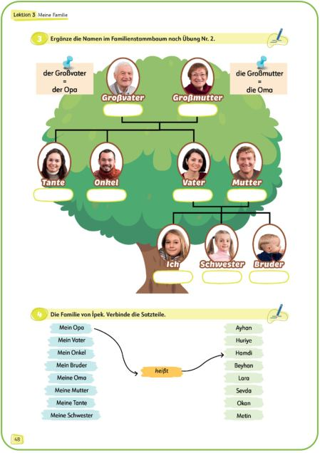

**3. Ergänze die Namen im Familienstammbaum nach Übung Nr. 2.**
**Anleitung:**

1. Sagen Sie zu den Schülern: „Schaut euch den Familienstammbaum an!“
2. Geben Sie den Arbeitsauftrag: „Tragt die Namen aus Übung 2 an die richtigen Stellen ein.“
3. Erinnern Sie die Schüler daran, die Familienwörter zu verwenden (*Großvater, Großmutter, Vater, Mutter, Tante, Onkel, Schwester, Bruder*).
4. Kontrollieren Sie anschließend gemeinsam im Plenum, indem Sie die Namen laut vorlesen lassen.
5. Fordern Sie die Schüler auf: „Lest bitte ganze Sätze: *Das ist mein Vater. Er heißt Murat.*“

**Lösungsschlüssel:**
Großvater: Hamdi.
Großmutter: Huriye.
Tante: Lara.
Onkel: Metin.
Vater: Okan.
Mutter: Beyhan.
Ich: İpek.
Schwester: Sevda.
Bruder: Ayhan.

**4. Die Familie von İpek. Verbinde die Satzteile.**
**Anleitung:**

1. Sagen Sie zu den Schülern: „Schaut euch die beiden Spalten an!“
2. Geben Sie den Arbeitsauftrag: „Verbindet die Satzanfänge links mit den richtigen Namen rechts.“
3. Erinnern Sie die Schüler: „Bildet vollständige Sätze: *Mein Opa heißt Hamdi. Meine Mutter heißt Beyhan.*“
4. Kontrollieren Sie die Lösungen im Plenum, indem die Schüler die Sätze laut vorlesen.
5. Wiederholen Sie wichtige Familienwörter (*Opa, Oma, Vater, Mutter, Bruder, Schwester, Onkel, Tante*).

**Lösungsschlüssel:**
Mein Opa heißt Hamdi.
Mein Vater heißt Okan.
Mein Onkel heißt Metin.
Mein Bruder heißt Ayhan.
Meine Oma heißt Huriye.
Meine Mutter heißt Beyhan.
Meine Tante heißt Lara.
Meine Schwester heißt Sevda.

**Notizen:**
..........................................................................................................................................................
..........................................................................................................................................................
..........................................................................................................................................................
..........................................................................................................................................................
..........................................................................................................................................................
................................................................................................................................

<!-- sayfa 47 -->

Meine Familie Lektion 3

6 Zeichne deinen Familienstammbaum.

6 Sprich mit deiner Partnerin oder mit deinem Partner über deine Familie wie im Beispiel.

Das ist meine Familie.
Meine Mutter heißt Leyla,
mein Vater heißt Celal.
Meine Schwester heißt Elif.
Mein Bruder heißt...

Und das ist meine Familie.
Meine Mutter heißt...

PARTNERARBEIT

49

# 5. Zeichne deinen Familienstammbaum.

## Anleitung:

1. Formulieren Sie den Schülern das Ziel: „Zeichnet euren Familienstammbaum und beschriftet die Personen.“
2. Aktivieren Sie den Wortschatz: Mutter, Vater, Bruder, Schwester, Oma, Opa, ich... und Possessivartikel mein/meine.
3. Zeigen Sie auf der Tafel ein Beispiel-Modell (ich in der Mitte, Linien zu den Verwandten; Namen darunter).
4. Die Schüler sollen auf das Feld zeichnen und beschriften (optional Alter/Beruf/Emoji).

**Lösungsschlüssel:**
individuelle Lösungen.

# 6. Sprich mit deiner Partnerin oder mit deinem Partner über deine Familie wie im Beispiel.

## Anleitung:

1. Sagen Sie zu den Schülern: „Schaut euch den Beispieldialog an!“
2. Fordern Sie die Schüler auf: „Bildet eigene Sätze über eure Familie. Fangt an mit: Das ist meine Familie. Meine Mutter heißt ..., mein Vater heißt ...“
3. Lassen Sie die Schüler in Partnerarbeit sprechen: Ein Schüler erzählt über seine Familie, das andere hört zu und antwortet anschließend mit den eigenen Sätzen.
4. Achten Sie darauf, dass die Schüler vollständige Sätze benutzen und die Familienmitglieder korrekt benennen.
5. Bitten Sie einige Paare, ihre Dialoge im Plenum vorzuspielen.

**Lösungsschlüssel:**
Partnerarbeit

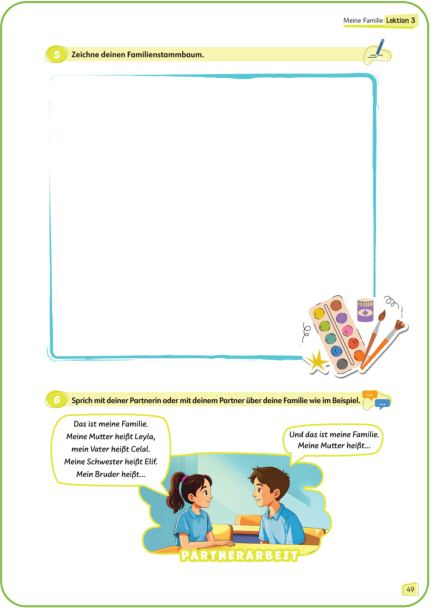

## Notizen:

<!-- sayfa 48 -->

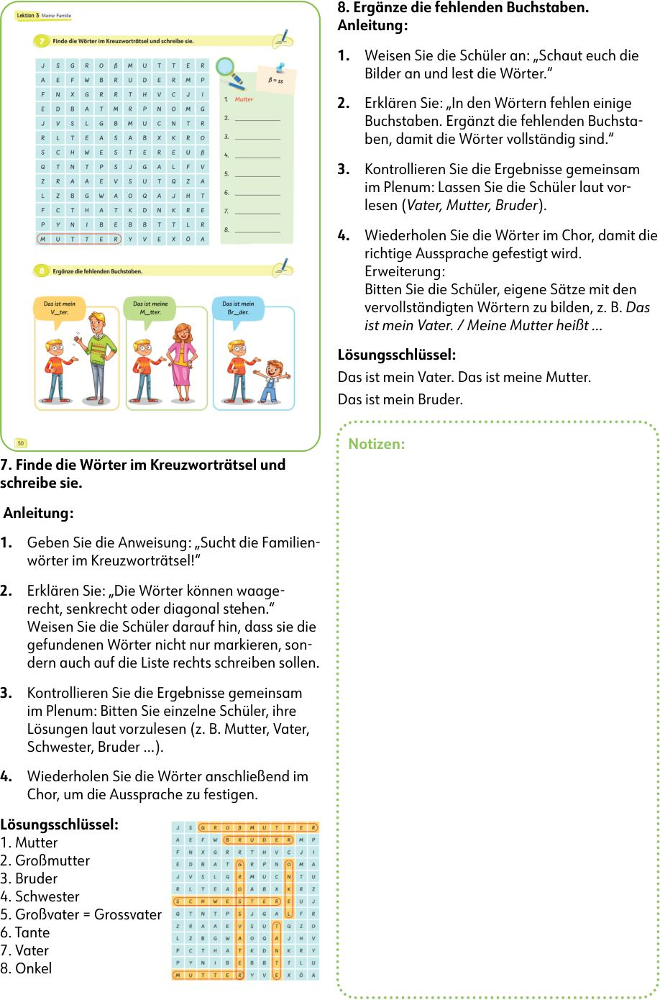

7. Finde die Wörter im Kreuzworträtsel und schreibe sie.

Anleitung:

1. Geben Sie die Anweisung: „Sucht die Familienwörter im Kreuzworträtsel!“
2. Erklären Sie: „Die Wörter können waagerecht, senkrecht oder diagonal stehen.“ Weisen Sie die Schüler darauf hin, dass sie die gefundenen Wörter nicht nur markieren, sondern auch auf die Liste rechts schreiben sollen.
3. Kontrollieren Sie die Ergebnisse gemeinsam im Plenum: Bitten Sie einzelne Schüler, ihre Lösungen laut vorzulesen (z. B. Mutter, Vater, Schwester, Bruder ...).
4. Wiederholen Sie die Wörter anschließend im Chor, um die Aussprache zu festigen.

Lösungsschlüssel:

1. Mutter
2. Großmutter
3. Bruder
4. Schwester
5. Großvater = Grossvater
6. Tante
7. Vater
8. Onkel

8. Ergänze die fehlenden Buchstaben.

Anleitung:

1. Weisen Sie die Schüler an: „Schaut euch die Bilder an und lest die Wörter.“
2. Erklären Sie: „In den Wörtern fehlen einige Buchstaben. Ergänzt die fehlenden Buchstaben, damit die Wörter vollständig sind.“
3. Kontrollieren Sie die Ergebnisse gemeinsam im Plenum: Lassen Sie die Schüler laut vorlesen (Vater, Mutter, Bruder).
4. Wiederholen Sie die Wörter im Chor, damit die richtige Aussprache gefestigt wird.

Erweiterung:
Bitten Sie die Schüler, eigene Sätze mit den vervollständigten Wörtern zu bilden, z. B. *Das ist mein Vater. / Meine Mutter heißt …*

Lösungsschlüssel:
Das ist mein Vater. Das ist meine Mutter.
Das ist mein Bruder.

Notizen:

<!-- sayfa 49 -->

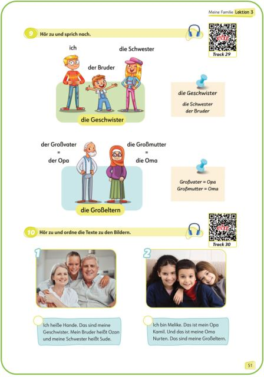

9. Hör zu und sprich nach. 🎧

Anleitung:
1. Spielen Sie den Audio-Track 29 ab.
2. Fordern Sie die Schüler auf: „Hört aufmerksam zu und schaut dabei auf die Bilder.“
3. Lassen Sie die Schüler die Begriffe nachsprechen: *der Bruder*, *die Schwester*, *die Geschwister*, *der Großvater/der Opa*, *die Großmutter/die Oma*, *die Großeltern*.
4. Wiederholen Sie die Wörter zuerst im Chor, dann einzeln. Achten Sie besonders auf die richtige Artikelverwendung (*der/die/das*).
5. Erklären Sie die Synonyme: *der Großvater = der Opa*, *die Großmutter = die Oma*

Erweiterung:
6. Bitten Sie die Schüler, eigene Sätze zu bilden, z. B. *Das ist mein Bruder. / Meine Großeltern wohnen in ....*
7. Lassen Sie Paare kleine Dialoge üben: „Wer ist das?“ – „Das ist meine Schwester.“

Track 29:
Übung Nr.9. Hör zu und sprich nach.
Ich - der Bruder - die Schwester
Das sind die Geschwister.
die Großmutter = die Oma
der Großvater = der Opa
Das sind die Großeltern.

10. Hör zu und ordne die Texte zu den Bildern. 🎧

Anleitung:
1. Spielen Sie den Audio-Track 30 ab.
2. Sagen Sie zu den Schülern: „Hört genau zu und schaut euch die beiden Bilder an.“
3. Beim ersten Hören achten die Schüler darauf, welche Personen beschrieben werden.
4. Beim zweiten Hören ordnen die Schüler die Texte den passenden Bildern zu, indem sie die Nummern eintragen.
5. Kontrollieren Sie die Lösungen gemeinsam im Plenum und lassen Sie die Schüler die Texte laut vorlesen.

Erweiterung:
Fordern Sie die Schüler auf, eigene kleine Sätze zu ihren Großeltern oder Geschwistern zu formulieren, z. B.:
*Das ist mein Bruder. Er heißt...*
*Das sind meine Großeltern. Sie heißen ...*

Track 30:
Übung Nr.10. Hör zu und ordne die Texte zu den Bildern.
1. Ich heiße Hande.
Das sind meine Geschwister.
Mein Bruder heißt Ozan und meine Schwester heißt Sude.
2. Ich bin Melike.
Das ist mein Opa Kamil.
Und das ist meine Oma Nurten.
Das sind meine Großeltern.

Lösungsschlüssel:

<!-- sayfa 50 -->

Lektion 3 Meine Familie

11. Lies die Texte und kreise die Wörter „mein“ mit blau, die Wörter „meine“ mit rot ein.

Anleitung:

1. Fordern Sie die Schüler auf: „Lest den Text von Defne aufmerksam.“
2. Geben Sie den Arbeitsauftrag: „Kreist alle Wörter mein mit **blau** und alle Wörter meine mit **rot** ein.“
3. Achten Sie darauf, dass die Schüler die Unterschiede erkennen:

   *mein* $\longrightarrow$ für männliche Personen oder neutrale Nomen (z. B. mein Opa, mein Vater, mein Onkel).
   *meine* $\longrightarrow$ für weibliche Personen oder im Plural (z. B. meine Mutter, meine Tante, meine Geschwister).

4. Gehen Sie anschließend die Lösungen gemeinsam durch und lassen Sie Beispiele laut vorlesen.

Erweiterung:
Bitten Sie die Schüler, eigene kurze Sätze zu bilden, z. B.: *Das ist mein Bruder. Das ist meine Schwester.*

Lösungsschlüssel:
Und das hier ist mein Bruder Burak.
Das ist meine Oma, meine Mutter und meine Tante. Da unten ist meine Schwester Kardelen.

12. Ergänze die Sätze mit den passenden Familienmitgliedern.

Anleitung:

1. Fordern Sie die Schüler auf: „Schaut euch die beiden Bilder genau an.“
2. Geben Sie den Arbeitsauftrag: „Vervollständigt die Sätze, indem ihr die fehlenden Familienmitglieder einsetzt.“
   Beispiel: Das ist mein Opa, mein Vater, mein Onkel, mein Bruder.
   Beispiel: Das ist meine Oma, meine Mutter, meine Tante, meine Schwester.
3. Achten Sie darauf, dass die Schüler die richtige Form mein (für männliche Personen) und meine (für weibliche Personen oder Plural) verwenden.
4. Lesen Sie die Lösungen gemeinsam im Plenum vor.

Erweiterung:
Lassen Sie die Schüler eigene Sätze bilden, z. B.: Das ist mein Vater, er heißt Murat. Das ist meine Schwester, sie heißt Ayşe.

Lösungsschlüssel:
Das ist mein Opa, mein Vater, mein Onkel, mein Bruder.
Das ist meine Oma, meine Mutter und meine Tante meine Schwester.

13. Lies die Sätze und kreuze an: Richtig (R) oder falsch (F)?

Anleitung:

Fordern Sie die Schüler auf: „Lest die drei Sätze über Defne aufmerksam.“
Geben Sie den Arbeitsauftrag: „Überlegt, ob die Aussage richtig oder falsch ist. Kreuze R (richtig) oder F (falsch) an.“
Erinnern Sie die Schüler daran, dass sie die Informationen aus Defnes Familienalbum (Übung 11) verwenden sollen.
Kontrollieren Sie die Lösungen gemeinsam im Plenum und lassen Sie die Schüler ihre Antworten begründen:

Defne ist zehn Jahre alt, nicht zwölf.
Ja, Defne hat eine Tante. Ja, Defne hat eine

<!-- sayfa 51 -->

Erweiterung:
Bitten Sie die Schüler, selbst richtige oder falsche Sätze zu Defne zu formulieren. Beispiel: Defne hat einen Onkel. (Richtig). Beispiel: Defne hat zwei Brüder. (Falsch)

**Lösungsschlüssel:**
Defne ist zwölf Jahre alt. (F) Defne hat eine Tante. (R) Defne hat eine Schwester. (R)

Notizen:

<!-- yer tutucu bulunamadı: sayfa sonuna eklendi -->

<!-- sayfa 52 -->

14 Hör zu und ergänze die Lücken.

Das ist die Familie Kartal. Die Familie kommt aus Türkiye. Sie wohnen in
Ankara. Der Mann Volkan. Die heißt Esra. Das sind die Eltern. Das Baby heißt
Bora und das Kind heißt Begüm. Der Hund heißt Riga. Er ist 5 Jahre alt. Die
heißt Gözde. Sie ist 15 Jahre alt. Die Schwester heißt Kübra, sie ist
Jahre alt.

15 Hast du Geschwister? Sprich mit deiner Partnerin oder mit deinem Partner wie im Beispiel.
(Kettenspiel)

14. Hör zu und ergänze die Lücken.
Anleitung:

1. Spielen Sie den Audio-Track 31 ab.
2. Fordern Sie die Schüler auf: „Lest den Text mit und hört aufmerksam zu.“
3. Aufgabe der Schüler: Ergänzen Sie die fehlenden Wörter im Text (Kartal, Ankara, heißt, Frau, Bora, Schwester, fünf).
4. Wiederholen Sie den Track bei Bedarf, damit alle die richtigen Wörter eintragen können.
5. Kontrollieren Sie die Lösungen gemeinsam im Plenum, indem einzelne Schüler den vollständigen Text laut vorlesen.
Erweiterung:
Lassen Sie die Schüler in Partnerarbeit eigene kurze Texte über ihre Familie schreiben, nach dem Muster:
„Meine Familie heißt...Wir wohnen in...Mein Vater heißt...Meine Mutter heißt...“

Track 31:
Übung Nr.14. Hör zu und ergänze die Lücken.
Das ist die Familie Kartal. Die Familie Kartal kommt aus Türkiye. Sie wohnen in Ankara. Der Mann heißt Volkan. Die Frau heißt Esra. Das sind heißt Begüm. Der Hund heißt Riga. Er ist 5 Jahre alt. Die Schwester heißt Gözde. Sie ist 15 Jahre alt. Die Schwester heißt Kübra. Sie ist fünf Jahre alt.

Lösungsschlüssel:
Das ist die Familie Kartal. Die Familie Kartal kommt aus Türkiye. Sie wohnen in Ankara. Der Mann heißt Volkan. Die Frau heißt Esra. Das sind die Eltern. Das Baby heißt Bora und der Schüler heißt Begüm. Der Hund heißt Riga. Er ist 5 Jahre alt. Die Schwester heißt Gözde. Sie ist 15 Jahre alt. Die Schwester heißt Kübra, sie ist fünf Jahre alt.

15. Hast du Geschwister? Sprich mit deiner Partnerin oder mit deinem Partner wie im Beispiel.
(Kettenspiel)

Anleitung:

1. Bilden Sie mit der Klasse ein Kettenspiel. Beginnen Sie selbst und fragen Sie einen Schüler oder eine Schülerin: „Hast du Geschwister?“
2. Die Schülerin/der Schüler antwortet mit „Ja, ich habe ...“ oder „Nein, ich habe keine Geschwister“ und stellt dann die gleiche Frage an die nächste Person. So geht das Spiel der Reihe nach weiter, bis alle an der Reihe waren.
3. Weisen Sie die Schüler darauf hin, die Formen von „haben“ korrekt zu verwenden (ich habe, du hast).
4. Wiederholen Sie die Runde bei Bedarf oder variieren Sie mit Zusatzfragen, z. B.:
„Wie heißt dein Bruder?“
„Wie alt ist deine Schwester?“

Lösungsschlüssel:
Kettenspiel

Notizen:

<!-- sayfa 53 -->

**16 Hallo, ich bin Tom. Das ist meine Familie. Schreibe Sätze über meine Familie.**

**Anleitung:**

1. Lenken Sie die Aufmerksamkeit der Schüler auf das Familienbild von Tom.
2. Lesen Sie den Beispielsatz gemeinsam vor: „Hallo, ich bin Tom. Das ist meine Familie. Meine Oma heißt Petra.“
3. Fordern Sie die Schüler auf, weitere Sätze über die abgebildeten Familienmitglieder zu schreiben, z. B.:
   „Mein Opa heißt Peter.“
   „Mein Vater heißt Jens.“
   „Meine Mutter heißt Claudia.“
   „Meine Schwester heißt Lea.“
   „Mein Bruder heißt Finn.“
4. Achten Sie darauf, dass die Schüler die richtigen Artikel (mein/meine) verwenden.
5. Lassen Sie anschließend einige Schüler ihre Sätze laut vorlesen.

**Lösungsschlüssel:**
Hallo, ich bin Tom. Meine Oma heißt Petra. Mein Vater heißt Jens. Meine Mutter heißt Claudia. Mein Opa heißt Peter und meine Oma heißt Petra. Meine Schwester heißt Lea. Das Baby ist mein Bruder

**17. Sprich mit deiner Partnerin oder mit deinem Partner über deine Familie.**

**Anleitung:**

1. Fordern Sie die Schüler auf, in Partnerarbeit kurze Dialoge über ihre Familie zu führen.
2. Zeigen Sie auf die Sprechblasen im Beispiel: „Mein Vater heißt Ahmet. Er ist ...“ „Meine Mutter heißt Beyhan. Sie ist ...“
3. Erklären Sie, dass die Schüler eigene Familienmitglieder einsetzen sollen (Name + Alter oder Beruf).
4. Lassen Sie die Paare abwechselnd sprechen: Ein Schüler stellt ein Familienmitglied vor, das andere antwortet und ergänzt.
5. Achten Sie darauf, dass die Schüler die Pronomen er und sie richtig verwenden.
6. Zum Abschluss können einige Paare ihre Dialoge im Plenum vorspielen.

**Lösungsschlüssel:**
Partnerarbeit

**Notizen:**

<!-- sayfa 54 -->

# B. Die Berufe von Familienmitgliedern

**B.Die Berufe von Familienmitgliedern**

**1. Hör zu und sprich nach.** 🎧

**Anleitung:**

1. Spielen Sie den Audio-Track 32 mit den Berufsbezeichnungen ab.
2. Bitten Sie die Schüler, aufmerksam zuzuhören.
3. Wiederholen Sie die Wörter im Chor: zuerst die männlichen Formen (der Lehrer, der Ingenieur, der Arzt ...), dann die weiblichen Formen (die Lehrerin, die Ingenieurin, die Ärztin...).
4. Lassen Sie die Schüler dabei auf die passenden Bilder zeigen, um die Begriffe zu verknüpfen.
5. Wiederholen Sie die Übung mehrmals.

**Track 32:**
**Übung Nr.1. Hör zu und sprich nach.**
der Lehrer, die Lehrerin, der Ingenieur, die Ingenieurin, der Architekt, die Architektin, der Koch, die Köchin, der Polizist, die Polizistin, der Arzt, die Ärztin

**Lösungsschlüssel:**
**Hörtext:**
**Übung Nr.1. Hör zu und sprich nach.**
der Lehrer, die Lehrerin, der Ingenieur, die Ingenieurin, der Architekt, die Architektin, der Koch, die Köchin, der Polizist, die Polizistin, der Arzt, die Ärztin

**Notizen:**

<!-- sayfa 55 -->

**2. Welche Berufe hörst du? Hör zu und kreuze an.**

**Anleitung:**

1. Spielen Sie den Audio-Track 33 ab.
2. Die Schüler hören aufmerksam zu und achten darauf, welche Personen sich vorstellen.
3. Fordern Sie die Schüler auf, bei jeder gehörten Aussage das passende Bild anzukreuzen.
4. Spielen Sie den Track zweimal ab:
Beim ersten Mal hören die Schüler nur zu.
Beim zweiten Mal setzen sie die Kreuze bei den richtigen Bildern.
5. Kontrollieren Sie anschließend die Lösungen im Plenum, indem Sie die Aussagen wiederholen und die Schüler die richtigen Berufe laut nennen:
„Hallo, ich bin ein Arzt.“ – „Das ist der Arzt.“

**Track 33:**
Übung Nr.2. Welche Berufe hörst du? Hör zu und kreuze an

Person 1: Hallo, ich bin ein Arzt.
Person 2: Hallo, ich bin eine Lehrerin.
Person 3: Hi, ich bin Ingenieur.
Person 4: Hallo, ich bin eine Architektin.

**Lösungsschlüssel:**
Hallo, ich bin ein Arzt. Hallo, ich bin eine Lehrerin.
Hi, Ich bin Ingenieur. Hallo, ich bin eine Architektin.

**3. Ergänze die fehlenden Buchstaben.**

**Anleitung:**

1. Weisen Sie die Schüler an, die Wörter aufmerksam zu lesen und die fehlenden Buchstaben zu ergänzen.
2. Erklären Sie, dass es sich um die Berufe aus der vorherigen Übung handelt (Arzt, Lehrerin, Ingenieur, Koch, Architektin, Polizistin).
3. Lassen Sie die Schüler die Wörter laut vorlesen, nachdem sie die Buchstaben ergänzt haben.
4. Kontrollieren Sie die Lösungen gemeinsam an der Tafel, indem die Schüler die Wörter vollständig aufschreiben oder vorlesen.

**Lösungsschlüssel:**
Der Arzt
Die Lehrerin
Der Ingenieur
Der Koch
Die Architektin
Die Polizistin

**4. Verbinde die Berufe mit den Bildern.**

**Anleitung:**

1. Weisen Sie die Schüler an, sich die Bilder und die dazugehörigen Wörter (Arzt, Architekt, Lehrerin, Koch, Ingenieur, Polizistin) genau anzusehen.
2. Erklären Sie, dass die Schüler die Berufe den passenden Bildern zuordnen sollen, indem sie eine Linie ziehen.
3. Geben Sie ein Beispiel an der Tafel (z. B. „der Arzt $\rightarrow$ Bild 4“).
4. Lassen Sie die Schüler die Aufgabe selbstständig oder in Partnerarbeit lösen.
5. Im Anschluss lesen die Schüler die Lösungen laut vor: „Das ist der Arzt. / Das ist die Polizistin.“
6. Kontrollieren Sie die Ergebnisse gemeinsam im Plenum.

**Lösungsschlüssel:**

<!-- sayfa 56 -->

5. Lies den Text und kreise die Berufe ein.

Anleitung:
1. Fordern Sie die Schüler auf, den Text von Florian aufmerksam zu lesen.
2. Weisen Sie darauf hin, dass sie alle Berufe im Text (z. B. Lehrer, Polizistin, Arzt, Architektin, Köchin, Ingenieur) mit einem Kreis markieren sollen.
3. Erklären Sie, dass dadurch die neuen Vokabeln gefestigt und im Kontext wiederholt werden.
4. Anschließend können die Schüler laut vorlesen, welche Berufe sie gefunden haben: „Mein Vater ist Lehrer. Meine Mutter ist Polizistin. ...“
5. Kontrollieren Sie die Ergebnisse gemeinsam im Plenum und schreiben Sie die Berufe an die Tafel.

Lösungsschlüssel:
Hallo, ich bin Florian. Mein Vater arbeitet als **Lehrer**. Meine Mutter ist eine **Polizistin**. Mein Onkel ist ein **Arzt** und meine Tante ist eine **Architektin** von Beruf. Meine Schwester ist eine **Köchin** und mein Bruder ist ein **Ingenieur**.
Lehrer, Polizistin, Arzt, Architektin, Köchin, Ingenieur

6. Lies den Text noch einmal und ergänze die Berufe.

Anleitung:
1. Die Schüler lesen den Text von Florian aus Übung 5 erneut.
2. Sagen Sie den Schülern: „Ihre Aufgabe ist es, die fehlenden Berufsbezeichnungen in die Lücken einzutragen.“
3. Erklären Sie den Schülern, dass sie die Wörter genau wie im Text übernehmen sollen (Lehrer, Polizistin, Arzt, Architektin, Köchin, Ingenieur).
4. Geben Sie Zeit, den Text zu bearbeiten, und lassen Sie die Schüler dann ihre Lösungen vergleichen.
5. Zum Abschluss lesen einige Schüler den vervollständigten Text laut vor.

Lösungsschlüssel:
Ich bin Florian. Mein Vater arbeitet als **Lehrer**. Meine Mutter ist eine **Polizistin**. Mein Onkel ist ein **Arzt** und meine Tante ist eine **Architektin** von Beruf. Meine Schwester ist eine **Köchin** und mein Bruder ist ein **Ingenieur**.

7. Finde die Berufe im Kreuzworträtsel.

Anleitung:
1. Fordern Sie die Schüler auf, das Buchstabengitter, in dem die gelernten Berufe versteckt sind (z. B. Arzt, Lehrer, Ingenieur, Polizist, Köchin, Architekt, Lehrerin, Ärztin) anzusehen.
2. Geben Sie die Aufgabe: Findet die Wörter im Rätsel und schreibt es in die Lücken. Die Wörter können waagerecht, senkrecht oder diagonal stehen.
3. Zeigen Sie als Beispiel das markierte Wort „Architekt“.
4. Geben Sie den Schülern Zeit, alle Wörter zu suchen, und lassen Sie sie die gefundenen Begriffe laut vorlesen.
5. Zum Abschluss werden die Lösungen im Plenum kontrolliert, indem die Wörter gemeinsam im Rätsel markiert werden.

Lösungsschlüssel:
(Görüntüdeki harf tablosu metin olarak verilmemiştir, ancak çözüm anahtarı kısmında harfler dağınık halde bulunmaktadır.)
A hit kt K
h A t P li i t L h
i
I
i

<!-- sayfa 57 -->

Lektion 3 Meine Familie

8 Sprich mit deiner Partnerin oder mit deinem Partner über die Berufe von Familienmitgliedern.

Was ist dein Vater von Beruf? Mein Vater ist Arzt.
Mein Vater ist Lehrer von Beruf und was ist deine Mutter von Beruf?

PARTNERARBEIT

9 Lies die Texte und beantworte die Fragen.

Hi! Ich heiße Elif und ich bin Lehrerin. Ich komme aus Türkiye. Ich wohne in Ankara.

Hallo, ich heiße Murat und ich bin Polizist. Ich komme aus Türkiye. Ich wohne auch in Ankara.

1. Wie heißt die Frau?
2. Was ist sie von Beruf?
3. Wo wohnt sie?

1. Wie heißt der Mann?
2. Was ist er von Beruf?
3. Wo wohnt er?

58

8. Sprich mit deiner Partnerin oder mit deinem Partner über die Berufe von Familienmitgliedern.

Anleitung:

1. Lassen Sie die Schüler in Partnerarbeit arbeiten.

2. Sagen Sie den Schülern: Ein Schüler stellt eine Frage, zum Beispiel: „Was ist dein Vater von Beruf?“
Der Partner oder die Partnerin antwortet: „Mein Vater ist Arzt.“
Danach fragt das zweite Schüler zurück, zum Beispiel: „Und was ist deine Mutter von Beruf?“

3. Die Schüler wechseln die Rollen und stellen sich gegenseitig Fragen zu verschiedenen Familienmitgliedern (Vater, Mutter, Schwester, Bruder, Onkel, Tante ...).

Lösungsschlüssel:
Partnerarbeit

9. Lies die Texte und beantworte die Fragen.
Anleitung:

1. Lassen Sie die Schüler die kurzen Texte von Elif und Murat lesen.

2. Sagen Sie den Schülern, dass sie danach schriftlich beantworten sollen. Die Fragen zu beiden Personen lauten:
Wie heißt die Frau / der Mann?
Was ist sie/er von Beruf?
Wo wohnt sie/er?

3. Lösen Sie die erste Frage gemeinsam mit der Klasse als Beispiel (z. B. Die Frau heißt Elif.)

4. Lassen Sie die Schüler anschließend selbstständig oder in Partnerarbeit weiterarbeiten.

5. Überprüfen Sie zum Abschluss die Lösungen gemeinsam im Plenum.

Lösungsschlüssel:
1.Die Frau heißt Esra. 2.Sie ist Lehrerin von Beruf. 3.Sie wohnt in Ankara.

1.Der Mann heißt Selim. 2.Er ist Polizist von Beruf. 3.Er wohnt in Ankara.

Notizen:

<!-- sayfa 58 -->

# Meine Familie Lektion 3

**10 Lies die Texte und beantworte die Fragen.**

1. Wie heißt die Oma?
2. Was ist sie von Beruf?
3. Wo wohnt sie?

Hallo, ich heiße Bahar und ich bin Rentnerin. Ich komme aus Türkiye. Ich wohne auch in Aydın.

1. Wie heißt der Opa?
2. Was ist er von Beruf?
3. Wo wohnt er?

Hallo, ich heiße Can und ich bin Rentner. Ich komme auch aus Türkiye. Ich wohne auch in Aydın.

**11 Sprich mit deiner Partnerin oder mit deinem Partner wie im Beispiel.**

PARTNERARBEIT

was ist deine Oma von Beruf?
Meine Oma ist Rentnerin.

Meine Oma ist Hausfrau. Und was ist deine Oma von Beruf?

**59**

---

**Anleitung:**

1. Lassen Sie die Schüler die kurzen Texte von Bahar und Can aufmerksam durchlesen.
2. Geben Sie die Anweisung: Beantwortet die Fragen zu beiden Personen schriftlich:
    * Wie heißt die Oma/der Opa?
    * Was ist sie/er von Beruf?
    * Wo wohnt sie/er?
3. Schreiben Sie die erste Antwort als Beispiel an die Tafel (z. B. Die Oma heißt Bahar.)
4. Fordern Sie die Schüler auf, die restlichen Fragen selbstständig oder in Partnerarbeit zu beantworten.
5. Überprüfen Sie die Lösungen gemeinsam im Plenum.

**Lösungsschlüssel:**
1. Die Oma heißt Bahar. 2. Sie ist Rentnerin. 3. Sie wohnt in Aydın.
1. Der Opa heißt Can. 2. Er ist Rentner. 3. Er wohnt in Aydın.

**11. Sprich mit deiner Partnerin oder mit deinem Partner über Berufe in der Familie.**

**Anleitung:**

1. Teilen Sie die Klasse in Paare. Die Schüler sollen in Partnerarbeit arbeiten.
2. Sagen Sie: Sieht die Beispieldialoge im Buch an und wiederholt diese gemeinsam mit dem Partner (der Partnerin).
3. Sagen Sie den Schülern:
Stellt euch gegenseitig Fragen wie:
Was ist deine Oma von Beruf?
Was ist dein Opa von Beruf?
Was ist dein Vater/deine Mutter von Beruf?
4. Erinnern Sie die Schüler, dass Sie mit vollständigen Sätzen antworten sollen wie im Beispiel:
    * Meine Oma ist Rentnerin.
    * Mein Opa ist Lehrer.
5. Tauschen Sie die Rollen.

**Lösungsschlüssel:**
Partnerarbeit

**Notizen:**

<!-- sayfa 59 -->

**PROJEKTARBEIT**
**Anleitung:**

1. Erklären Sie die Aufgabe.
Sagen Sie: „Heute füllt ihr Steckbriefe für eure Familie aus. Ihr schreibt Informationen über euch, euren Vater, eure Mutter und euren Bruder oder eure Schwester.“

2. Zeigen Sie die Steckbrief-Felder.
* Name
* Alter
* Land
* Wohnort
* Beruf

3. Sagen Sie: „Hier schreibt ihr den Namen, das Alter, das Land, den Wohnort und den Beruf.“
Machen Sie ein Beispiel.

4. Schreiben Sie an die Tafel, z. B.:
Vater: Name: Ali, Alter: 40, Land: Türkiye, Wohnt in: Aydın, Beruf: Lehrer.

5. Dann schreiben Sie den Text darunter: „Das ist mein Vater. Er heißt Ali. Er ist 40 Jahre alt. Er ist Lehrer und wohnt in Aydın.“

6. Lassen Sie die Schüler selbstständig arbeiten.

7. Sagen Sie: „Füllt jetzt die Steckbriefe aus. Danach schreibt ihr die Texte unten.“

Präsentation.
Laden Sie einzelne Schüler ein, ihren Steckbrief der Klasse vorzustellen.

Notizen:

<!-- sayfa 60 -->

# LEKTION 4

**KOMPETENZEN**

**Hören**

1. Die Schüler verstehen langsam gesprochenen Ansagen Schulgegenstände und Schulräume.
2. Die Schüler erkennen Frage-Antwort-Muster zu *Was ist das? / Wie ist…?*
3. Die Schüler verstehen Besitzangaben mit *mein/dein* sowie *haben* in kurzen Hörtexten.
4. Die Schüler erfassen Beschreibungen mit *sein + Adjektiv* (Farbe/Größe).

**Sprechen**

5. Die Schüler benennen Schulgegenstände/Räume mit bestimmten und unbestimmten Artikeln: *die Schere, ein Heft.*
6. Die Schüler drücken Besitz/Zugehörigkeit mit *mein/dein* aus und gibt Besitz mit *haben* an: *Ich habe …*
7. Die Schüler beschreiben Dinge mit *sein + Adjektiv* (Farbe/Größe): *Das Buch ist grün/klein.*
8. Die Schüler stellen W-Fragen zu Dingen und
9. Die Schüler führen kurze Dialoge im Schulkontext (Klassenzimmer/Schulplan).

**Lesen**

10. Die Schüler verstehen kurze, einfache Texte/Listen zu Schulmaterialien und Räumen.
11. Die Schüler ordnen Beschriftungen/Piktogramme (z. B. Kantine, Bibliothek) korrekt zu.
12. Die Schüler erkennen Besitzformen (*mein/dein*) sowie *sein/haben* in einfachen Sätzen.

**Schreiben**

13. Die Schüler schreiben kurze Aussagesätze mit Artikeln: *Das ist eine Schere. Das ist das Klassenzimmer.*
14. Die Schüler verfassen Beschreibungen mit *sein + Adjektiv*: *Mein Heft ist grün.*
15. Die Schüler nutzen *mein/dein, haben* in eigenen Sätzen/Formularen: *Ich habe ein Lineal.*
16. Die Schüler bilden und beantwortet W-Fragen (*Was …? Wo …?*) schriftlich; vervollständigt Lückentexte.

<!-- sayfa 61 -->

# A. Die Schulsachen

6. das Heft
7. der Stift
8. der Kleber
9. der Spitzer

Notizen:

---

**A.Die Schulsachen**

**1.Hör zu und sprich nach.**
**Anleitung:**

1. Spielen Sie den Audio-Track 34 ab.
2. Die Schüler hören zu und achten beim ersten Mal nur auf die Aussprache.
3. Spielen Sie die Aufnahme noch einmal ab.
4. Die Schüler sprechen nach: zuerst im Chor, dann einzeln. Zeigen Sie beim Sprechen auf das passende Bild (1–9).
5. Lassen Sie die Schüler die Wörter mehrmals wiederholen, bis die Aussprache sicher ist.
6. Variieren Sie die Übung:
Fragen Sie: „Was ist das?“
Die Schüler antworten: „Das ist ...“

**Track 34:**
**Übung Nr.1 Hör zu und sprich nach.**

1. die Schere
2. das Buch
3. die Schultasche
4. der Radiergummi
5. das Mäppchen
6. das Heft
7. der Stift
8. der Kleber
9. der Spitzer

<!-- sayfa 62 -->

Hallo! Ich bin Ege. Ich bin zehn Jahre alt. Ich liebe meine Schule. Heute ist in meiner Schultasche ein Heft, ein Buch, ein Stift, ein Spitzer und ein Mäppchen.

**Lösungsschlüssel:**
In meiner Schultasche sind: das Heft, das Buch, der Stift, der Spitzer, das Mäppchen

### 3. Was ist das? Sprich mit deiner Partnerin oder mit deinem Partner wie im Beispiel und benutze die Schulsachen aus Übung Nr. 2.

**Anleitung:**

1. Zeigen Sie nacheinander auf verschiedene Schulsachen (z. B. Buch, Heft, Schere, Stift ...).
2. Fordern Sie die Schüler auf, sich gegenseitig Fragen und Antworten nach dem Muster zu stellen:
    * Frage: Was ist das?
    * Antwort: Das ist ein Heft.
3. Lassen Sie die Schüler in Partnerarbeit üben: Ein Schüler fragt, das andere antwortet. Danach tauschen sie die Rollen.
4. Ermuntern Sie die Schüler, möglichst viele verschiedene Schulsachen aus Übung 2 zu benutzen.
5. Wählen Sie zum Abschluss einige Paare aus, die den Dialog im Plenum vorspielen.

**Lösungsschlüssel:**
Partnerarbeit

---

**2. Was hat Ege in der Tasche? Hör zu und kreuze an.** 🎧

**Anleitung:**

1. Spielen Sie den Audio-Track 35 ab.
2. Ege zählt auf, welche Schulsachen er in seiner Tasche hat.
3. Die Schüler hören aufmerksam zu.
4. Lassen Sie die Schüler während des Hörens die richtigen Gegenstände ankreuzen (z. B. das Mäppchen, das Buch, der Stift ...).
5. Wiederholen Sie die Übung mindestens zweimal, damit alle Schüler sicher verstehen und korrekt ankreuzen.
6. Überprüfen Sie anschließend die Lösungen gemeinsam im Plenum:
   Fragen Sie: „Hat Ege eine Schere in der Tasche?“
7. Die Schüler antworten im Chor oder einzeln: „Ja“ oder „Nein“.
8. Bestätigen Sie die richtige Antwort, indem Sie selbst nochmals auf das passende Bild zeigen.

**Track 35:**
**Übung Nr. 2. Was hat Ege in der Tasche? Hör zu**

**Notizen:**
................................................................................................................................................................................................................................................................................................................................................................................................................................................................................................................................................................................................................................................................................................................................................................................................................................................................................................................................................................................

<!-- sayfa 63 -->

**4. Ergänze die fehlenden Buchstaben.**

**Anleitung:**

1. Zeigen Sie die Abbildung mit den Schulsachen.
2. Erklären Sie die Aufgabe: In den Wörtern fehlen einige Buchstaben. Machen Sie ein Beispiel vor: „das M_äppchen $\rightarrow$ das Mäppchen“.
3. Fordern Sie die Schüler auf, die fehlenden Buchstaben einzusetzen und die Wörter vollständig zu schreiben (z. B. „der Stift“, „das Buch“).
4. Lassen Sie die Schüler selbstständig arbeiten.
5. Kontrollieren Sie die Lösungen gemeinsam im Plenum.

**Erweiterung:**
Lassen Sie die Schüler die Wörter laut vorlesen.
Bitten Sie einige Schüler, die Gegenstände im Klassenzimmer zu zeigen und dazu zu sagen: „Das ist der Stift.“

**Lösungsschlüssel:**
das Mäppchen-der Kleber-die Schultasche-der Stift-das Heft-der Spitzer-das Buch-der Radiergummi-die Schere

**5. Was ist in der Schultasche? Hör zu und kreuze an.**

**Anleitung:**

1. Spielen Sie den Audio-Track 36 ab.
2. Sagen Sie den Schülern: „Hört genau zu!“
3. Lassen Sie die Schüler beim ersten Hören nur zuhören, ohne etwas anzukreuzen.
4. Spielen Sie den Track noch einmal.
5. Fordern Sie die Schüler auf: „Kreuzt die Schulsachen an, die ihr hört!“
6. Überprüfen Sie die Lösungen gemeinsam im Plenum.
Fragen Sie: „Welche Schulsachen habt ihr angekreuzt?“

**Erweiterung:**
Bitten Sie die Schüler, selbst über ihre Schultasche zu sprechen, z. B.: „In meiner Schultasche habe ich ein Heft und einen Stift.“
Lassen Sie einige Schüler ihre Beispiele im Plenum vortragen.

**Track 36:**
Übung Nr.5. Was ist in der Schultasche? Hör zu und kreuze an.
das Buch -das Heft -der Radiergummi -der Spitzer

**Lösungsschlüssel:**
das Buch-das Heft-der Radiergummi-der Spitzer

**6. Welche Wörter passen nicht zu den Schulsachen? Kreise sie ein.**

**Anleitung:**

1. Zeigen Sie den Schülern die Wortliste und sagen Sie: „Hier stehen Wörter. Manche sind Schulsachen, manche nicht.“
2. Erklären Sie die Aufgabe mit einem Beispiel: „Die Mutter passt nicht zu den Schulsachen. Kreise sie ein.“
3. Fordern Sie die Schüler auf, selbstständig zu arbeiten: „Lest die Wörter. Kreist die Wörter ein, die keine Schulsachen sind.“
4. Überprüfen Sie die Lösungen gemeinsam im Plenum. Fragen Sie: „Welche Wörter habt ihr eingekreist?“

**Lösungsschlüssel:**
der Ball-die Mutter-die Oma

<!-- sayfa 64 -->

# Lektion 4 Meine Schule

7. Hör zu und lies die Farben mit. 🎧

**Anleitung:**

1. Zeigen Sie den Schülern den Zug mit den bunten Waggons.
2. Sagen Sie: „Jeder Waggon hat eine Zahl und eine Farbe.“
3. Spielen Sie den Audio-Track 37 ab.
4. Erstes Hören: „Hört gut zu und folgt mit dem Finger den Waggons.“
5. Zweites Hören: „Sprecht die Farben laut nach: rot, schwarz, lila ...“
6. Lassen Sie die Klasse die Farben gemeinsam im Chor und anschließend einzeln lesen.

**Erweiterung: (Partnerarbeit)**
Führen Sie eine Partnerübung durch:
Schüler A nennt eine Zahl (z. B. „7“).
Schüler B antwortet mit der passenden Farbe („grün“).

**Track 37:**
**Übung Nr.7. Hör zu und lies die Farben mit!**
Hallo! Schau mal!
Da kommt ein Zug.
Der Zug hat viele Waggons.
Waggon Nummer 2 ist schwarz.
Waggon Nummer 3 ist lila.
Waggon Nummer 4 ist braun.
Waggon Nummer 5 ist weiß.
Waggon Nummer 6 ist gelb.
Waggon Nummer 7 ist grün.
Waggon Nummer 8 ist blau.
Waggon Nummer 9 ist orange.

**Lösungsschlüssel:**
**Hörtext:**
Übung Nr.7. Hör zu und lies die Farben mit!
Hallo! Schau mal!
Da kommt ein Zug.
Der Zug hat viele Waggons.
Waggon Nummer 1 ist rot.
Waggon Nummer 2 ist schwarz.
Waggon Nummer 3 ist lila.
Waggon Nummer 4 ist braun.
Waggon Nummer 5 ist weiß.
Waggon Nummer 6 ist gelb.
Waggon Nummer 7 ist grün.
Waggon Nummer 8 ist blau.
Waggon Nummer 9 ist orange.

8. Verbinde die Farben mit den richtigen Namen wie im Beispiel.

**Anleitung:**

1. Zeigen Sie den Schülern die neun Farbkleckse mit den Zahlen 1–9.
2. Weisen Sie auf das Beispiel hin: „3 – blau“.
3. Erklären Sie die Aufgabe: „Verbindet die Farbnamen mit den passenden Farbklecksen. Zieht Linien.“
4. Kontrollieren Sie anschließend im Plenum: Stellen Sie Fragen: „Welche Zahl ist grün?“ Lassen Sie die Schüler antworten: „Nummer 4 ist grün.“

**Erweiterung: (Partnerarbeit)**
Führen Sie eine Partnerübung durch:
Schüler A fragt: „Welche Farbe ist Nummer 7?“
Schüler B antwortet: „Nummer 7 ist braun.“

**Lösungsschlüssel:**
1-schwarz, 2-weiß, 3-blau, 4-grün, 5-rot, 6-gelb, 7-braun, 8-lila, 9-orange

<!-- sayfa 65 -->

# Meine Schule Lektion 4

9 Sprich mit deiner Partnerin oder deinem Partner wie im Beispiel.
Benutze die Farben!

Das ist mein Heft. Mein Heft ist rot. Welche Farbe ist dein Heft? Zeig mir dein Heft!

Hier ist mein Heft. Mein Heft ist grün.

**PARTNERARBEIT**

10 Hör zu und ergänze die Lücken mit „mein“, „meine“, „dein“ oder „deine“. Achte auf die Artikel!

track 38

In der Schule

Ege: Hallo Ezgi! Wie geht es dir?
Ezgi: Hallo Ege! Mir geht es gut, danke. Und dir?
Ege: Auch gut. Was ist das? Ist das ___ Buch?
Ezgi: Ja, das ist ___ Buch. Es ist neu.
Ege: Oh, schön! Und das hier? Ist das ___ Bleistift?
Ezgi: Nein, das ist nicht ___ Bleistift. Das ist ___ Bleistift, glaube ich.
Ege: Ach ja! Stimmt. Das ist ___ Bleistift. Und das ist ___ Tasche. Sie ist groß.
Ezgi: Ja, ___ Tasche ist groß! Ich mag ___ Tasche. Das ist ___ Mäppchen. Und das ist ___ Spitzer.
Ege: Super! Haben wir alle Sachen?
Ezgi: Ja, ich glaube schon.

67

---

9. **Sprich mit deiner Partnerin oder deinem Partner über die Farben.**

**Anleitung:**

1. Bilden Sie Paare.
2. Jede Schülerin und jeder Schüler nimmt ein Heft oder ein anderes Schulmaterial zur Hand.
3. Leiten Sie den Dialog ein und machen Sie ein Beispiel vor:
    * „Das ist mein Heft. Mein Heft ist rot.“
    * „Welche Farbe ist dein Heft?“
    * „Mein Heft ist grün.“
4. Fordern Sie die Paare auf, denselben Dialog zu üben.
    * A sagt einen Satz mit mein/meine.
    * B antwortet mit dein/deine.
5. Variieren Sie die Übung mit anderen Materialien (Buch, Stift, Schultasche) und Farben.
6. Lassen Sie zum Abschluss einige Paare ihren Dialog vor der Klasse vorspielen.

**Lösungsschlüssel:**
Partnerarbeit

10. **Hör zu und ergänze die Lücken mit „mein“, „meine“, „dein“ oder „deine“. Achte auf die Artikel!**

**Anleitung:**

1. Spielen Sie den Audio-Track 38 ab.
2. Die Schüler hören den Dialog und lesen gleichzeitig mit.
3. Lenken Sie die Aufmerksamkeit der Schüler auf die Possessivpronomen (*mein/meine, dein/deine*) in Verbindung mit den Artikeln (*der, die, das*).
4. Fordern Sie die Schüler auf, die fehlenden Wörter in den Lücken zu ergänzen.
5. Kontrollieren Sie die Ergebnisse gemeinsam im Plenum. Lesen Sie den Dialog vor, lassen Sie die Schüler die Lücken ergänzen und korrigieren.

**Erweiterung:**
Lassen Sie die Paare den Dialog nachspielen. Ermutigen Sie die Schüler, eigene Mini-Dialoge mit Schulsachen zu bilden, z. B.: „Das ist mein Heft.“ – „Das ist deine Tasche.“

**Track 38:**
**Übung Nr.10. Hör zu und ergänze die Lücken mit ‘mein’, ‘meine’, ‘dein’ oder ‘deine’. Achte auf die Artikel!**

**In der Schule**

Ege: Hallo Ezgi! Wie geht es dir?
Ezgi: Hallo Ege! Mir geht es gut, danke. Und dir?
Ege: Auch gut. Was ist das? Ist das dein Buch?
Ezgi: Ja, das ist mein Buch. Es ist neu.
Ege: Oh, schön! Und das hier? Ist das dein Bleistift?
Ezgi: Nein, das ist nicht mein Bleistift. Das ist dein Bleistift, glaube ich.
Ege: Ach ja! Stimmt. Das ist mein Bleistift. Und das ist meine Tasche. Sie ist groß.
Ezgi: Ja, deine Tasche ist groß! Ich mag deine Tasche. Das ist mein Mäppchen. Und das ist mein Spitzer.
Ege: Super! Haben wir alle Sachen?
Ezgi: Ja, ich glaube schon.

**Lösungsschlüssel:**
Ege: Hallo Ezgi! Wie geht es dir?
Ezgi: Hallo Ege! Mir geht es gut, danke. Und dir?
Ege: Auch gut. Was ist das? Ist das dein Buch?
Ezgi: Ja, das ist mein Buch. Es ist neu.
Ege: Oh, schön! Und das hier? Ist das dein Bleistift?

<!-- sayfa 66 -->

Ezgi: Nein, das ist nicht **mein** Bleistift. Das ist **dein** Bleistift, glaube ich.
Ege: Ach ja! Stimmt. Das ist mein Bleistift. Und das ist meine Tasche. Sie ist groß.
Ezgi: Ja, **deine** Tasche ist groß! Ich mag **deine** Tasche. Das ist mein Mäppchen. Und das ist **mein** Spitzer.
Ege: Super! Haben wir alle Sachen?
Ezgi: Ja, ich glaube schon.

 

Notizen:

<!-- sayfa 67 -->

**Lektion 4 Meine Schule**

**11 Lies den Text und kreuze an: Richtig (R) oder falsch (F)?**

Hallo! Ich heiße Nisa.
Das ist meine neue Schultasche.
In meiner Schultasche ist ein Bleistift. Er ist rot.
Ich habe ein Buch. Das Buch ist blau.
Ich habe auch eine Schere. Sie ist grün.

a) Nisas Bleistift ist rot.  [ R ] [ F ]
b) Sie hat ein Heft.        [ R ] [ F ]
c) Das Buch ist blau.       [ R ] [ F ]
d) Nisa hat eine Schere.    [ R ] [ F ]
e) Nisas Schere ist schwarz.[ R ] [ F ]

**12 Ich packe meine Schultasche ein. Sprich mit deiner Partnerin oder mit deinem Partner wie im Beispiel.**

**PARTNERARBEIT**

Hallo Ege! Was machst du?
Ich packe meine Schultasche auch ein. In meiner Schultasche ist ein Heft, ein Buch, ein Spitzer und eine Schere.

Hello Ege! Ich packe meine Schultasche ein. In der Schultasche ist ein Heft und ein Stift, lass machst du?

68

---

**11. Lies den Text und kreuze an: Richtig (R) oder falsch (F)?**

**Anleitung:**

1. Lassen Sie die Schüler den kurzen Text von Nisa aufmerksam lesen.
2. Zeigen Sie anschließend auf die Aussagen (a–e) und erklären Sie die Aufgabe: Wenn die Aussage zum Text passt, kreuzen die Schüler R an. Wenn die Aussage nicht passt, kreuzen sie Fan.
3. Fordern Sie die Schüler auf, ihre Antworten einzutragen.
4. Besprechen Sie die Ergebnisse im Plenum: Lesen Sie jede Aussage laut vor. Lassen Sie die Klasse gemeinsam antworten: „richtig“ oder „falsch“.

**Lösungsschlüssel:**

a. Nisas Bleistift ist rot. (R)
b. Sie hat ein Heft. (F)
c. Das Buch ist blau. (R)
d. Nisa hat eine Schere. (R)
e. Nisas Schere ist schwarz. (F)

**12. Ich packe meine Schultasche ein. Sprich mit deiner Partnerin oder mit deinem Partner wie im Beispiel.**

**Partnerarbeit**

**Anleitung:**

1. Bildet Paare und erklärt die Aufgabe.
2. Lassen Sie die Schüler den Dialog nach dem Beispiel sprechen:
    * Schüler A fragt: „Was machst du?“
    * Schüler B antwortet: „Ich packe meine Schultasche ein. In meiner Schultasche ist ...“
3. Erinnern Sie die Schüler daran, Wörter aus der letzten Übung zu verwenden (Heft, Stift, Schere, Buch, Mäppchen usw.).
4. Lassen Sie die Paare die Rollen wechseln.
5. Wählen Sie am Ende ein oder zwei Paare aus, die ihren Dialog vor der Klasse vorspielen.

**Lösungsschlüssel:**
Partnerarbeit

**Notizen:**
......................................................................................................................................................
......................................................................................................................................................
......................................................................................................................................................
......................................................................................................................................................
......................................................................................................................................................

<!-- sayfa 68 -->

**Lösungsschlüssel:**
das Klassenzimmer(x), die Tafel(x), die Landkarte(x), der Tisch(x), der Stuhl(x)

**Notizen:**

---

# B.Das Klassenzimmer

**1.Hör zu und kreuze die Schulsachen von Ege an.** 🎧

**Anleitung:**

1. Spielen Sie den Audio-Track 39 ab.
2. Fordern Sie die Schüler auf, genau auf die genannten Gegenstände (Tafel, Landkarte, Tische, Stühle) zu achten.
3. Lassen Sie die Schüler die passenden Schulsachen im Bild ankreuzen.
4. Wiederholen Sie den Hörtext noch einmal, damit auch schwächere Lernende alle Wörter sicher erfassen.
5. Vergleichen Sie anschließend die Lösungen gemeinsam im Plenum: Lesen Sie die Wörter laut vor und lassen Sie die Klasse bestätigen („Richtig!“ / „Nein!“).

**Track 39:**
Übung Nr.1. Hör zu und kreuze die Schulsachen von Ege an.
Hallo! Ich bin Ege. Ich liebe meine Schule und meine Klasse. Das ist mein Klassenzimmer. In meiner Klasse gibt es eine Tafel, eine Landkarte, Tische

<!-- sayfa 69 -->

Lektion 4 Meine Schule

2. Hör noch einmal zu und sprich nach.

Anleitung:

1. Spielen Sie den Audio-Track 40 ab.
2. Fordern Sie die Schüler auf, aufmerksam zuhören.
3. Lassen Sie die Klasse die Wörter laut nachsprechen – zuerst im Chor, dann einzeln oder in kleinen Gruppen.
4. Zeigen Sie währenddessen auf die passenden Bilder (Klassenzimmer, Landkarte, Stuhl, Tisch, Tafel), um die Verbindung zu verdeutlichen.
5. Wiederholen Sie die Übung mehrmals, bis die Aussprache sicher sitzt.

Track 40:
Übung Nr.2. Hör zu und kreuze die Schulsachen von Ege an.

Hallo! Ich bin Ege.
Ich liebe meine Schule und meine Klasse.
Das ist mein Klassenzimmer.
In meiner Klasse gibt es eine Tafel, eine Landkarte, Tische und Stühle.

Lösungsschlüssel:
die Tafel-die Landkarte-Tische-Stühle

3. Sprich mit deiner Partnerin oder deinem Partner über die Klassenzimmersachen.

Anleitung:

1. Bilden Sie Partnerpaare in der Klasse.
2. Geben Sie das Dialogbeispiel vor:
    * Schüler A fragt: „Was ist das?“
    * Schüler B antwortet: „Das ist ein Tisch.“
3. Fordern Sie die Schüler auf, die vorgegebenen Wörter (das Klassenzimmer, der Stuhl, die Landkarte, die Tafel) in ihren Dialogen zu benutzen.
4. Lassen Sie die Rollen nach einigen Durchgängen wechseln: Schüler B fragt, Schüler A antwortet.
5. Ermuntern Sie die Paare, unterschiedliche Objekte zu üben und laut zu sprechen.
6. Wählen Sie zum Abschluss einige Paare aus, die ihre Dialoge vor der Klasse vorspielen.

Lösungsschlüssel:
Partnerarbeit

4. Ergänze die Schulsachen im Kreuzworträtsel

Anleitung:

1. Weisen Sie die Schüler an, die Bilder genau zu betrachten.
2. Erklären Sie: Jede Zahl im Kreuzworträtsel gehört zu einem Bild (z. B. 1 = Tafel, 2 = Landkarte ...).
3. Fordern Sie die Schüler auf, die passenden Wörter in die Kästchen zu schreiben. Betonen Sie, dass die Rechtschreibung und die Großschreibung das Nomen wichtig sind.
4. Üben Sie die Wörter gegebenenfalls noch einmal gemeinsam an der Tafel (Tafel, Landkarte, Klassenzimmer, Stuhl, Tisch).
5. Lassen Sie die Schüler das Rätsel selbstständig lösen.
6. Vergleichen Sie die Lösungen zum Schluss gemeinsam im Plenum.

Lösungsschlüssel:

<!-- sayfa 70 -->

5. Hör zu und kreuze die Adjektive an. 🎧

Anleitung:

1. Spielen Sie den Audio-Track 41 ab.
2. Fordern Sie die Schüler auf, genau zuzuhören.
Die Schüler hören Adjektive wie groß, klein, hell, dunkel, neu, alt.
3. Lassen Sie die Schüler das passende Bild ankreuzen, das zum gehörten Adjektiv passt (z. B. „alt“ $\rightarrow$ alter Rucksack, „neu“ $\rightarrow$ neuer Rucksack).
4. Wiederholen Sie die Wörter im Plenum: Die Schüler sprechen die Adjektive laut nach.

Erweiterung:
Machen Sie eine Zusatzübung im Klassenzimmer: Zeigen Sie auf verschiedene Gegenstände und lassen Sie die Schüler passende Adjektive dazu sagen (z. B. „Die Tafel ist groß. Der Radiergummi ist klein.“)

Track 41:
Übung Nr.5 Hör zu und kreuze die Adjektive an.
Die Schultasche ist neu.
Die Schultasche ist alt.
Das Klassenzimmer ist hell.
Das Klassenzimmer ist klein.
Das Klassenzimmer ist groß.
Das Klassenzimmer ist dunkel.

Lösungsschlüssel:
Die Schultasche ist neu.
Die Schultasche ist alt.
Das Klassenzimmer ist hell.
Das Klassenzimmer ist klein.
Das Klassenzimmer ist groß.
Das Klassenzimmer ist dunkel.

6. Hör zu und ergänze die Lücken mit den Adjektiven. 🎧

Anleitung:

1. Spielen Sie den Audio-Track 42 ab.
2. Lassen Sie die Schüler die gehörten Sätze aufmerksam anhören und die passenden Adjektive in die Lücken einsetzen (groß, klein, hell, dunkel, neu, alt).
3. Lesen Sie die Sätze anschließend gemeinsam im Plenum vor und vergleichen Sie die Lösungen.
4. Fordern Sie die Schüler auf, die vollständigen Sätze laut vorzulesen.

Erweiterung:
Zeigen Sie auf verschiedene Gegenstände im Klassenraum und lassen Sie die Schüler diese mit den gelernten Adjektiven beschreiben (z. B. „Der Tisch ist groß.“ – „Das Heft ist neu.“)

Track 42:
Übung Nr.6. Hör zu und ergänze die Lücken mit den Adjektiven.

A: Meine Schule ist groß. Ich mag meine Schule. Mein Klassenzimmer ist hell. Es ist sehr schön.
B: Jeden Tag nehme ich meine Schultasche. Meine Schultasche ist klein. In meiner Schultasche sind mein Buch und mein Stift.
C: Am Morgen ist es hell. Die Sonne scheint. Am Abend ist es dunkel. Dann gehe ich nach Hause.

Lösungsschlüssel:
a) Meine Schule ist groß. Ich mag meine Schule. Mein Klassenzimmer ist hell. Es ist sehr schön.
b) Jeden Tag nehme ich meine Schultasche. Meine Schultasche ist klein. In meiner Schultasche sind mein Buch und mein Stift.
c) Am Morgen ist es hell. Die Sonne scheint. Am Abend ist es dunkel. Dann gehe ich nach Hause.

<!-- sayfa 71 -->

Lektion 4 Meine Schule

7 Lies den Text von Ezgi und verbinde die Fragen mit den Antworten.

Anleitung:

1. Bitten Sie die Schüler, den Text von Ezgi leise oder gemeinsam laut zu lesen.
2. Erklären Sie schwierige Wörter kurz (z. B. Hausaufgabe, Klassenzimmer).
3. Stellen Sie sicher, dass die Schüler den Inhalt verstehen: Ezgi stellt ihre Schule, ihre Lehrerin und ihren Tagesablauf vor.
4. Danach sollen die Schüler die Fragen (1–4) mit den passenden Antworten (a–d) verbinden.
5. Überprüfen Sie die Lösungen im Plenum, indem die Schüler abwechselnd die Fragen vorlesen und die richtigen Antworten dazu nennen.

Lösungsschlüssel:
1- b 2-a 3-d 4-c

8 Ergänze die Lücken mit deinen Informationen.

Anleitung:

1. Erklären Sie den Schülern dass sie jetzt einen ähnlichen Text wie Ezgi schreiben, aber mit ihren eigenen Daten.
2. Lesen Sie den Text einmal laut vor und zeigen Sie dabei die Lücken. Geben Sie Beispiele: „Hallo! Ich heiße Mert. Ich gehe in die Yunus-Emre-Mittelschule in İzmir.“
3. Achten Sie darauf, dass die Schüler folgende Angaben einsetzen:
* Name
* Name und Ort der Schule
* Adjektiv zur Schule (z. B. groß, klein, schön)
* Zahl der Klassenzimmer
* Name des Deutschlehrers / der Deutschlehrerin
4. Lassen Sie die Schüler ihre Texte einzeln ausfüllen.
5. Danach können sie in Partnerarbeit ihren Text gegenseitig vorlesen.

Lösungsschlüssel:
Hallo! Ich heiße [Name]. Ich gehe in die [Schulname] Grundschule in [Wohnort]. Meine Schule ist [Adjektiv]. Es gibt [Zahl der Kassenzimmer] in der Schule. Mein/e Deutschlehrer/in heißt [Lehrer/in Name]. Jeden Tag haben wir Deutsch und Mathematik.

Notizen:

<!-- sayfa 72 -->

# C. Die Schulräume

## 1. Hör zu und sprich nach.
**Anleitung:**

1. Spielen Sie den Audio-Track 43 ab.
2. Zeigen Sie auf die Räume im Bild und lassen Sie die Schüler benennen: „Was ist das?“ – „Das ist die Bibliothek.“
3. Lassen Sie einzelne Schüler die Wörter wiederholen.
4. Machen Sie eine kleine Bewegung dazu, z. B.
    * Sporthalle $\rightarrow$ Hampelmann machen
    * Kantine $\rightarrow$ „essen“-Bewegung
    * Bibliothek $\rightarrow$ „lesen“-Bewegung

**Erweiterung: (Spiel)**
Zeig mir den Raum!
Sagen Sie: „Zeig mir die Sporthalle!“ $\rightarrow$ Schüler zeigen.

**Track 43:**
**Übung Nr.1 Hör zu und sprich nach.**
der Musikraum
die Bibliothek
die Kantine
das Lehrerzimmer.
der Schulhof.

**Lösungsschlüssel:**
**Hörtext**
**Übung Nr.1 Hör zu und sprich nach.**
der Musikraum
die Bibliothek
die Kantine
die Sporthalle
das Lehrerzimmer.
der Schulhof

**Notizen:**

<!-- sayfa 73 -->

Ich spiele Basketball.
**Melis:** Hallo, ich bin Melis. Ich bin auch in der Sporthalle. Ich spiele Fußball.
**Kemal:** Hallo, mein Name ist Kemal. Ich bin im Lehrerzimmer. Ich spreche mit den Lehrern.
**Seda:** Hallo, ich bin Seda. Ich bin im Musikraum. Ich spiele Geige.
**Eren:** Hallo, ich heiße Eren. Ich bin auf dem Schulhof.
**Nisa:** Hallo, ich bin Nisa. Ich bin in der Kantine. Ich esse ein Sandwich.

**Lösungsschlüssel:**

### 3. Ergänze die Lücken mit den passenden Buchstaben.
**Anleitung:**

1. Zeigen Sie die Bilder und die unvollständigen Wörter.
2. Erklären Sie, dass in jedem Wort Buchstaben fehlen und die Schüler diese ergänzen sollen.
3. Machen Sie ein Beispiel vor:
Die Bibl_oth_k $\rightarrow$ Die Bibliothek.
4. Lassen Sie die Schüler die Wörter selbstständig vervollständigen.
5. Überprüfen Sie die Lösungen im Plenum, indem Sie die Wörter laut vorlesen lassen.
**Erweiterung:**
Die Schüler können die Räume mit einem Satz beschreiben (z. B. „Das ist die Bibliothek. Dort lese ich.“)

**Lösungsschlüssel:**
die Bibliothek-die Kantine-das Lehrerzimmer die Turnhalle-der Schulhof-der Musikraum

<!-- sayfa 74 -->

**4. Wo bin ich? Zeige mit Gesten und Mimik, in welchem Raum du bist. (Pantomimespiel)**

**Anleitung:**

1. Erklären Sie die Regeln: Ein Schüler stellt pantomimisch einen Raum dar, der andere rät.
2. Machen Sie ein Beispiel mit einem Schüler: Sie spielen eine Geste vor, die Klasse errät gemeinsam.
3. Ein Schüler spielt pantomimisch vor der Klasse, die Gruppe ruft gemeinsam die Antworten.
   Erweiterung: (Partnerarbeit)
   Die Schüler spielen abwechselnd die Räume pantomimisch vor und fragen/spekulieren dazu.

**Lösungsschlüssel:**
Pantomime-Spiel

**5. Was macht man in diesen Schulräumen? Schau die Bilder an und kreise die Aktivitäten ein.**

**Anleitung:**

1. Bitten Sie die Schüler, die fünf Bilder aufmerksam zu betrachten und die Sätze leise oder gemeinsam laut zu lesen. men (Bibliothek, Sporthalle, Kantine, Musikraum, Schulhof) und die Satzschablone „Das ist … . Dort … ich.“
3. Stellen Sie sicher, dass die Schüler den Inhalt verstehen: Ege zeigt die Räume seiner Schule und sagt, was man dort macht (lesen, Sport machen, essen, singen, spielen).
4. Lassen Sie die Schüler anschließend die erwähnten Aktivitäten einkreisen.

**Lösungsschlüssel:**
Bibliothek: Dort lese ich
Sporthalle: Dort mache ich Sport.
Kantine: Dort esse ich.
Musikraum: Dort singe ich.
Schulhof: Dort spiele ich.

**Notizen:**

<!-- sayfa 75 -->

# Lektion 4 Meine Schule

6 Hör zu und kreuze wie im Beispiel an: Richtig oder falsch. 🎧

**Anleitung:**

1. Weisen Sie die Schüler darauf hin, dass sie beim Hören genau zuhören sollen.
2. Erklären Sie die Aufgabe: „Hört den Text und entscheidet: Ist der Satz richtig oder falsch?“
3. Spielen Sie den Audio-Track 45 ab. Die Schüler hören aufmerksam zu, ohne zu markieren.
4. Spielen Sie den Audio-Track erneut. Die Schüler hören noch einmal und setzen Kreuze bei R (richtig) oder F (falsch).
5. Kontrollieren Sie die Lösungen im Plenum. Lesen Sie jede Aussage vor, die Klasse antwortet gemeinsam „richtig“ oder „falsch“. Kreuzen Sie die richtige Lösung an der Tafel.

**Track 45:**
**Übung Nr.6. Hör zu und kreuze wie im Beispiel an: Richtig oder falsch.**

a) In der Sporthalle machen wir Sport. [ ]
b) In der Sporthalle lesen wir. [ ]
c) In der Kantine gibt es viele Stühle und Tische. [ ]
d) In der Bibliothek singen wir. [ ]
e) Auf dem Schulhof spielt man. [ ]

Hallo! Ich bin Ege. Ich gehe in die Schule. Meine Schule ist groß. Es gibt viele Räume. In der Sporthalle machen wir Sport.

In der Kantine essen wir. Es gibt viele Stühle und Tische in der Kantine. In der Bibliothek lesen wir Bücher. Ich mag Bücher lesen. Im Schulhof spiele ich Fußball. Wir rennen, lachen und spielen dort. Ich mag meine Schule!

**Lösungsschlüssel:**
a. In der Sporthalle machen wir Sport. (R)
b. In der Sporthalle lesen wir. (F)
c. In der Kantine gibt es viele Stühle und Tische. (R)
d. In der Bibliothek singen wir. (F)
e. Auf dem Schulhof spielt man. (R)

7 Hör zu und lies mit. 📖

**Anleitung:**

1. Spielen Sie den Audio-Track 46 ab.
2. Die Schüler hören aufmerksam zu und folgen dabei im Text mit dem Finger.
3. Lesen Sie den Text nach dem Hören gemeinsam mit der Klasse laut vor (Chorlesen).
4. Anschließend können einzelne Schüler den Text abschnittsweise vorlesen.

**Erweiterung:**
Stellen Sie Verständnisfragen (z. B. „Wie heißt das Mädchen?“, „Wie ist die Schule?“)

**Track 46:**
**Übung Nr.7. Hör zu und lies mit.**

Hallo! Ich bin Nisa. Meine Schule ist hell und schön. Ich bin in Klasse 5 A. Unser Klassenzimmer ist groß. In der Schule gibt es viele Räume. Es gibt zehn Klassen, eine Sporthalle, einen Musikraum und eine Bibliothek. Mein Lieblingsraum ist der Musikraum.

**Lösungsschlüssel:**
**Hörtext**
**Übung Nr.7. Hör zu und lies mit.**
Hallo! Ich bin Nisa. Meine Schule ist hell und schön. Ich bin in Klasse 5 A. Unser Klassenzimmer ist groß. In der Schule gibt es viele Räume. Es gibt zehn Klassen, eine Sporthalle, einen Musikraum und eine Bibliothek. Mein Lieblingsraum ist der Musikraum.

8 Lies den Text noch einmal und verbinde die Fragen mit den Antworten.

1. Wie heißt sie? $\rightarrow$ Die Schule ist hell und schön.
2. Wie ist die Schule? $\rightarrow$ Ja, Nisa Klassenzimmer ist groß.
3. Ist Nisa Klassenzimmer groß? $\rightarrow$ Nein, Nisa Lieblingsraum ist der Musikraum.
4. Ist Nisa Lieblingsraum die Sporthalle? $\rightarrow$ Sie heißt Nisa.

9 Steckbrief: Schreib über deine Schule und deine Klasse.

Ich heiße \_\_\_\_\_\_\_\_\_\_\_\_\_\_\_\_\_\_\_\_\_\_\_\_\_\_
Ich gehe in die Klasse \_\_\_\_\_\_\_\_\_\_\_\_\_\_\_\_\_\_
Meine Schule heißt \_\_\_\_\_\_\_\_\_\_\_\_\_\_\_\_\_\_\_\_
Meine Schule ist in \_\_\_\_\_\_\_\_\_\_\_\_\_\_\_\_\_\_\_\_

<!-- sayfa 76 -->

**8. Lies den Text noch einmal und verbinde die Fragen mit den Antworten.**

**Anleitung:**

1. Die Schüler lesen die Fragen (1–4) und die Antworten (a–d).
2. Stellen Sie den Schülern die Aufgabe: Jede Frage mit der richtigen Antwort durch eine Linie verbinden.
3. Lassen Sie die Schüler die Lösungen zuerst alleine oder in Partnerarbeit finden.
4. Besprechen Sie die Ergebnisse im Plenum.

**Lösungsschlüssel:**
1-d 2-a 3-b 4-c

**9. Steckbrief: Schreib über deine Schule und deine Klasse.**

**Anleitung:**

1. Lassen Sie die Schüler den Steckbrief mit ihren eigenen Informationen ausfüllen:
Sie schreiben ihren Namen, ihre Klasse, den Namen der Schule und den Ort.
2. Erklären Sie die Satzanfänge und geben Sie ein Beispiel an der Tafel:
* Ich heiße Ece.
* Ich gehe in die Klasse 5B.
* Meine Schule heißt Atatürk-Schule.
* Meine Schule ist in Ankara.
3. Danach arbeiten die Schüler selbstständig.
**Erweiterung:**
Die Schüler lesen ihren Steckbrief einem Partner vor („Partnerinterview“).
Einige Schüler können ihren Steckbrief auch laut vor der Klasse präsentieren.

**Lösungsschlüssel:**
Ich heiße [Name].
Ich gehe in die Klasse [Klasse].
Meine Schule heißt [Schulname].
Meine Schule ist in [Wohnort].

**Notizen:**

<!-- yer tutucu bulunamadı: sayfa sonuna eklendi -->

<!-- sayfa 77 -->

# Meine Schule Lektion 4

10. Lies die Texte und ordne sie zu den Bildern.

**Anleitung:**

1. Zeigen Sie den Schülern die drei Bilder von Schulen und drei kurze Texte.
2. Geben Sie die Aufgabe: Sie lesen die Texte aufmerksam und entscheiden, welcher Text zu welchem Bild passt.
3. Lassen Sie die Schüler zuerst gemeinsam einen Text laut lesen und wichtige Wörter markieren (z. B. gelb, braun, groß, Bibliothek, Kantine).
4. Sagen Sie, dass sie anschließend die Texte den Bildern zu ($1 \rightarrow$ <!-- KONTROL: Marker'da karşılığı yok, uydurma olabilir --> links, $2 \rightarrow$ <!-- KONTROL: Marker'da karşılığı yok, uydurma olabilir --> Mitte, $3 \rightarrow$ <!-- KONTROL: Marker'da karşılığı yok, uydurma olabilir --> rechts) zuordnen sollen.
5. Kontrollieren Sie die Ergebnisse im Plenum: Ein Schüler liest den Text vor, die Klasse sagt gemeinsam, welches Bild gemeint ist.

**Lösungsschlüssel:**

11. Lies die Texte noch einmal und beantworte die Fragen.

**Anleitung:**

1. Lassen Sie die Schüler die Fragen lesen.
2. Sagen Sie, dass sie die Fragen mit vollständigen Sätzen beantworten sollen.
3. Geben Sie an der Tafel ein Beispiel:
Frage: Wie ist die Yunus Emre Mittelschule?
Antwort: Die Yunus Emre Mittelschule ist gelb, modern und schön.
4. Lassen Sie die Schüler die anderen Fragen selbstständig bearbeiten.
5. Kontrollieren Sie die Ergebnisse im Plenum.

**Lösungsschlüssel:**

a. Yunus Emre Mittelschule ist gelb, modern und schön.
b. Die Bostanlı Mittelschule ist braun, alt und groß.
c. Die Sazlı Mittelschule ist lila, hell und modern.

12. Male deine Schule und beschreibe sie.

**Anleitung:**

1. Zeigen Sie den Schülern die Seite.
2. Sagen Sie: „Heute malen und beschreiben wir unsere Schule.“
3. Lesen Sie einen Beispieltext laut vor:
*Meine Schule heißt Atatürk Mittelschule. Sie ist groß und modern. Es gibt viele Klassenräume, eine Bibliothek und eine Sporthalle. Der Garten ist schön und grün.*
4. Sagen Sie: „Lest den Text leise mit.“
5. Stellen Sie den Schülern Fragen zum Text:
* „Wie heißt die Schule?“
* „Wie ist die Schule?“
* „Welche Räume gibt es?“
* „Wie ist der Garten?“
6. Kontrollieren Sie die Antworten im Plenum.

**Lösungsschlüssel:**
individuelle Lösungen

<!-- sayfa 78 -->

# PROJEKTARBEIT

**Anleitung:**

1. Erklären Sie die Aufgabe.
2. Sagen Sie: „Heute gestaltet ihr eine Schulbroschüre oder ein Poster. Thema sind eure Lieblingsräume in der Schule.“
3. Zeigen Sie Beispiele. Schreiben Sie an die Tafel:
    * „Mein Lieblingsraum ist die Bibliothek. Dort lese ich gern.“
    * „Ich mag die Sporthalle. Dort mache ich Sport.“
4. Geben Sie eventuell Materialien. Verteilen Sie Stifte, Farben oder Hefte.
5. Sagen Sie: „Malt und schreibt in das Kästchen euren Lieblingsraum.“
6. Formulieren Sie klare Sätze. Sagen Sie: „Schreibt mindestens 2–3 Sätze: ‚Das ist die ... Dort ... ich.‘“
7. Lassen Sie die Schüler kreativ arbeiten.
8. Gehen Sie herum, helfen Sie bei Wortschatz und Rechtschreibung.

**Präsentation**
Sagen Sie: „Zeigt eure Poster der Klasse und lest eure Sätze laut vor.“

Notizen:

<!-- sayfa 79 -->

# LEKTION 5

*Montag beginnt die Schule um acht Uhr.*

**KOMPETENZEN**

**Hören**

1. Die Schüler können einfache Fragen und Aussagen zum Stundenplan verstehen (*Was hast du am Mittwoch?*).
2. Die Schüler können Uhrzeiten sowie Beginn/Ende-Angaben global verstehen (*um acht Uhr; beginnt/endet*).
3. Die Schüler können kurze Meinungsäußerungen zu Fächern verstehen (*Ich mag ... / Mein Lieblingsfach ist ...*).

**Sprechen**

4. Die Schüler können den eigenen Schultag mit *haben/sein/lernen/mögen/beginnen/enden* im Präsens beschreiben.
5. Die Schüler können nach Fächern und Zeiten fragen und antworten: *Was hast du am ...? – Ich habe ...*
6. Die Schüler können Ja/Nein-Fragen bilden und beantworten: *Hast du heute Sport? – Ja/Nein.*
8. Die Schüler können Meinungen/Vorlieben äußern: *Mein Lieblingsfach ist Deutsch. Ich mag Mathe / Ich finde Mathe schwer.*
9. Die Schüler können den Tagesablauf kurz mit temporalen Angaben berichten: *morgens ..., am Nachmittag ...*

**Lesen**

10. Die Schüler können einfache Stundenpläne/Aushänge zum Schulalltag Satz für Satz verstehen.
11. Die Schüler können Wochentage und Uhrzeiten in kurzen Texten erkennen.
12. Die Schüler können Frage-Antwort-Muster (Fächer/Zeiten) sinngemäß erfassen.

**Schreiben**

13. Die Schüler können 3–5 Sätze zum eigenen Stundenplan schreiben (*Ich habe am Mittwoch ...*).
14. Die Schüler können kurze Frage-Antwort-Paare notieren (*Was hast du am ...? – Ich habe ...*).
15. Die Schüler können Uhrzeiten korrekt schreiben (*um 8 Uhr; 8:15*).

<!-- sayfa 80 -->

# A. Die Schulfächer

**A.Die Schulfächer**

**1.Hör zweimal zu und sing mit!** 🎧

**Anleitung:**

1. Spielen Sie den Audio-Track 47 einmal vollständig ab, damit die Schüler die Melodie und den Rhythmus des Liedes kennenlernen.
2. Lesen Sie den Liedtext gemeinsam mit der Klasse laut vor, um Strukturen und Vokabular vorzubereiten.
3. Spielen Sie das Lied erneut und lassen Sie die Schüler aktiv mitsingen.
4. Wiederholen Sie einzelne Strophen, bis die Schüler sicher mitsingen können.
5. Achten Sie darauf, dass die Schüler die Strukturen wie „Mein Lieblingsfach ist ...“ deutlich und vollständig sprechen.
6. Führen Sie Gesten oder Bewegungen für bestimmte Fächer ein (z. B. für Sport eine Armbewegung, für Musik Trommelbewegungen), um die Übung zu unterstützen.
7. Lassen Sie die Schüler anschließend in Partnerarbeit kurze Dialoge führen: „Mein Lieblingsfach ist Mathe. Und dein Lieblingsfach?“

**Track 47:**
**Übung Nr.1. Hör zweimal zu und sing mit!**
WAS IST DEIN LIEBLINGSFACH?
LIEBLINGSFACH, LIEBLINGSFACH
SPORT IST MEIN LIEBLINGSFACH
LIEBLINGSFACH, LIEBLINGSFACH
DEUTSCH, TÜRKISCH, ENGLISCH
WELCHES IST DEIN LIEBLINGSFACH?
MATHE, MUSIK, KUNST
WAS IST DEIN LIEBLINGSFACH?
HAST DU EIN LIEBLINGSFACH?
SPORT-SPORT-SPORT
ICH MAG SPORT
DAS IST MEIN LIEBLINGSFACH
LIEBLINGSFACH, LIEBLINGSFACH
SPORT IST MEIN LIEBLINGSFACH LIEBLINGSFACH

**Lösungsschlüssel:**
**Lied**
WAS IST DEIN LIEBLINGSFACH?
LIEBLINGSFACH, LIEBLINGSFACH
SPORT IST MEIN LIEBLINGSFACH
LIEBLINGSFACH, LIEBLINGSFACH
DEUTSCH, TÜRKISCH, ENGLISCH
WELCHES IST DEIN LIEBLINGSFACH?
MATHE, MUSIK, KUNST
WAS IST DEIN LIEBLINGSFACH?
HAST DU EIN LIEBLINGSFACH?
SPORT-SPORT-SPORT
ICH MAG SPORT
DAS IST MEIN LIEBLINGSFACH
LIEBLINGSFACH, LIEBLINGSFACH
SPORT IST MEIN LIEBLINGSFACH LIEBLINGSFACH

<!-- sayfa 81 -->

**Track 48:**
**Übung Nr.2. Hör zu und sprich nach.**
Sozialkunde - Türkisch - Kunst - Sport - Mathematik - Deutsch -Englisch - Musik

**3. Welche Schulfächer hörst du? Hör zu und kreuze an.** 

**Anleitung:**
1. Spielen Sie den Audio-Track 49 ab.
2. Lassen Sie die Schüler beim ersten Hören nur zuhören, ohne etwas anzukreuzen.
3. Spielen Sie den Track noch einmal. Jetzt kreuzen die Schüler die Fächer an, die sie gehört haben.
4. Vergleichen Sie die Ergebnisse gemeinsam im Plenum. Lesen Sie die Wörter laut vor, und die Klasse wiederholt sie.
5. Machen Sie eine Zusatzrunde: Fragen Sie „Welches Fach hast du gehört?“ und die Schüler antworten im ganzen Satz: „Ich habe Mathe gehört.“

**Track 49:**
**Übung Nr.3. Welche Schulfächer hörst du? Hör zu und kreuze an.**
Kunst - Mathe - Englisch - Türkisch - Sport – Deutsch

**Lösungsschlüssel:**
Kunst-Mathematik-Englisch-Türkisch-Sport- Deutsch

**Notizen:**
__________________________________________________________________
__________________________________________________________________
__________________________________________________________________
__________________________________________________________________
__________________________________________________________________
__________________________________________________________________
__________________________________________________________________
__________________________________________________________________
__________________________________________________________________

<!-- sayfa 82 -->

4. Hör zu und ergänze die Lücken. 🎧

**Anleitung:**

1. Spielen Sie den Audio-Track 50 ab.
2. Die Schüler hören die kurzen Selbstvorstellungen der Schüler (Name, Alter, Lieblingsfach). Beim ersten Hören konzentrieren sich die Schüler nur auf das Zuhören.
3. Beim zweiten Hören ergänzen die Schüler die Lücken in den Texten mit dem passenden Fach.
4. Überprüfen Sie die Lösungen im Plenum. Lesen Sie die Sätze gemeinsam vor: „Mein Lieblingsfach ist ...“. Machen Sie eine Erweiterung:
Die Schüler schreiben selbst einen kurzen Steckbrief (Name, Alter, Lieblingsfach) und lesen ihn in der Klasse vor.

**Track 50:**
**Übung Nr.4 Hör zu und ergänze die Lücken.**
Sabine: Hallo, ich bin Sabine. Ich bin 11 Jahre alt. Mein Lieblingsfach ist Kunst.
Florian: Hallo, ich bin Florian. Ich bin 11. Mein Lieblingsfach ist Deutsch.
Ege: Hallo, ich heiße Ege. Ich bin 12. Mein Lieblingsfach ist Sport.
İpek: Hallo, ich bin İpek. Ich bin 12 Jahre alt. Mein Lieblingsfach ist Musik.

**Lösungsschlüssel:**
Hallo, ich bin Sabine. Ich bin 11 Jahre alt. Mein Lieblingsfach ist Kunst.
Hallo, ich bin Florian. Ich bin 11. Mein Lieblingsfach ist Deutsch.
Hallo, ich heiße Ege. Ich bin 12. Mein Lieblingsfach ist Sport.
Hallo, ich bin İpek. Ich bin 12 Jahre alt. Mein Lieblingsfach ist Musik.

5. Was ist dein Lieblingsfach? Sprich mit deiner Partnerin oder deinem Partner wie im Beispiel.

**Anleitung:**

1. Teilen Sie die Klasse in Partnerpaare ein.
2. Die Schüler sprechen im Dialog miteinander.
3. Sie fragen und antworten nach dem Muster:
* „Was ist dein Lieblingsfach?“
* „Mein Lieblingsfach ist ...“
4. Ermutigen Sie die Schüler, verschiedene Schulfächer zu nennen und kurze Kommentare hinzuzufügen (z. B. „Sport ist super!“, „Mathe ist interessant“).
5. Lassen Sie die Partner nach einigen Durchgängen die Rollen wechseln.
6. Führen Sie eine kurze Präsentation durch: Einige Paare tragen ihren Dialog vor der Klasse vor.

**Lösungsschlüssel:**
Partnerarbeit

**Notizen:**

<!-- sayfa 83 -->

In diesem Fach sagst du: Hello, how are you?
In diesem Fach sagst du [Merhaba] In diesem Fach malst du Bilder.
In diesem Fach sagst du: Hallo.

Lösungsschlüssel:

7. Ergänze die Lücken mit den fehlenden Buchstaben.

Anleitung:

1. Weisen Sie die Schüler darauf hin, dass in den Fachwörtern Buchstaben fehlen.
2. Bitten Sie die Schüler, die Wörter genau anzuschauen und die fehlenden Buchstaben einzusetzen, sodass vollständige Wörter entstehen (z. B. Sozialkunde, Englisch, Kunst).
3. Geben Sie bei Bedarf ein Beispiel an der Tafel, z. B.: MUSI_ $\rightarrow$ MUSIK
4. Lassen Sie die Schüler die Aufgabe zunächst selbstständig lösen.

Vergleichen Sie anschließend die Lösungen gemeinsam im Plenum. Fragen Sie dabei gezielt nach:

* „Welches Wort ist das?“ – „Das ist Mathematik.“
* „Wie schreibt man Sport?“ – „S-P-O-R-T.“

Lösungsschlüssel:

| | |
| :--- | :--- |
| **SOZIALKUNDE** | **ENGLISCH** |
| **MATHEMATIK** | **TÜRKISCH** |
| **SPORT** | **DEUTSCH** |
| **MUSIK** | **KUNST** |

6. Hör zu und ordne die Schulfächer zu den Bildern. 

Anleitung:

1. Spielen Sie den Audio-Track 51 ab.
2. Die Schüler hören die Schulfächer. Während des Hörens achten die Schüler auf die Wörter und verbinden sie mit den passenden Bildern. Beim ersten Hören konzentrieren sich die Schüler nur auf das Zuhören.
3. Beim zweiten Hören ordnen sie die Fächer den Bildern zu, indem sie die richtige Zahl eintragen.
4. Kontrollieren Sie die Lösungen gemeinsam im Plenum. Fragen Sie dazu:
„Welches Fach ist das?“ – „Das ist Mathematik.“
„Und welches Fach ist hier?“ – „Das ist Kunst.“
5. Als Erweiterung können die Schüler selbst kleine Sätze formulieren, z. B.:
„Mein Lieblingsfach ist Musik.“
„Ich finde Mathe interessant.“

Track 51:
Übung Nr.6. Hör zu und ordne die Schulfächer zu den Bildern.

<!-- sayfa 84 -->

Lösungsschlüssel:
1.DEUTSCH 2.SPORT 3.ENGLISCH 4.MUSIK
5.MATHEMATIK 6.SOZIALKUNDE 7.TÜRKISCH
8.KUNST

9. Welches Fach ist das? Spielt in der Klasse wie im Beispiel.

Anleitung:
1. Erklären Sie den Schülern die Spielregeln: Ein Schüler spielt pantomimisch ein Schulfach vor, die anderen erraten es.
2. Geben Sie ein Beispiel vor, damit die Klasse die Idee versteht.
3. Ein Schüler zeigt z. B. Bewegungen für Sport. Die Klasse fragt: „Ist es Mathe?“ – „Ist es Musik?“
4. Der Spieler antwortet mit „Ja“ oder „Nein“. Wählen Sie nacheinander mehrere Schüler aus, die pantomimisch ein Fach darstellen.
5. Achten Sie darauf, dass alle Schüler beteiligt werden – sowohl beim Darstellen als auch beim Fragenstellen.
6. Wiederholen Sie typische Fragen gemeinsam mit der Klasse:
„Ist es ...?“
„Ja, es ist ...“ / „Nein, es ist nicht ...“
7. Am Ende können Sie die Schüler ihre Lieblingsfächer pantomimisch darstellen lassen.

Lösungsschlüssel:
Pantomimespiel

8. Finde aus dem Bild die Schulfächer und schreibe sie.

Anleitung:
1. Weisen Sie die Schüler darauf hin, dass sich in dem Schneckenhaus verschiedene Schulfächer verstecken.
2. Bitten Sie die Schüler, die Wörter aufmerksam zu suchen und herauszuschreiben.
Geben Sie bei Bedarf ein Beispiel:
„Ich sehe Deutsch.“ $\rightarrow$ Die Schüler schreiben: Deutsch.
3. Lassen Sie die Schüler alle gefundenen Fächer in die nummerierten Linien eintragen.
4. Vergleichen Sie anschließend die Ergebnisse gemeinsam im Plenum und schreiben Sie die vollständige Liste an die Tafel.
5. Wiederholen Sie die Fächer mündlich mit der Klasse. Bitten Sie die Schüler, die Wörter laut vorzulesen.

Erweiterung:
Lassen Sie die Schüler kleine Sätze mit den Fächern bilden, z. B.:
„Mein Lieblingsfach ist Musik.“
„Wir haben morgen Mathe.“

Notizen:

<!-- sayfa 85 -->

# B. Die Wochentage und die Tageszeiten

## 1. Hör zu und sprich nach. 🎧

### Anleitung:

1. Hören Sie gemeinsam mit den Schülern den Audio-Track 52.
2. Die Schüler sehen das Riesenrad mit den sieben Wochentagen.
3. Die Schüler sprechen die Wörter laut nach, zuerst im Chor, dann einzeln.
4. Wiederholen Sie die Wochentage in der richtigen Reihenfolge mehrmals, damit die Aussprache sicher wird.
5. Üben Sie anschließend kleine Fragen und Antworten, z. B.:
„Welcher Tag ist heute?“ – „Heute ist Montag.“
„Welcher Tag ist morgen?“ – „Morgen ist Dienstag.“
6. Lassen Sie die Schüler auch die Wochentage im Kreis zeigen und laut sprechen.

**Track 52:**
**Übung Nr.1. Hör zu und sprich nach.**
Montag – Dienstag – Mittwoch – Donnerstag – Freitag – Samstag – Sonntag

**Lösungsschlüssel:**
**Hörtext**
**Übung Nr.1. Hör zu und sprich nach.**
Montag – Dienstag – Mittwoch – Donnerstag – Freitag - Samstag -Sonntag

## 2. Hör noch einmal zu und ergänze die fehlenden Buchstaben. 🎧

### Anleitung:

1. Spielen Sie den Audio-Track 52 erneut ab.
2. Die Schüler hören die Wochentage und ergänzen die fehlenden Buchstaben in den Lücken.
3. Kontrollieren Sie die Ergebnisse gemeinsam im Plenum.
4. Lassen Sie die Schüler die vollständigen Wörter noch einmal laut vorlesen.
5. Als Erweiterung können die Schüler eigene kleine Sätze bilden:

**Track 53:**
**Übung Nr.2. Hör noch einmal zu und ergänze die fehlenden Buchstaben.**
Montag - Dienstag - Mittwoch - Donnerstag - Freitag – Samstag - Sonntag

**Lösungsschlüssel:**
Montag-Dienstag-Mittwoch-Donnerstag-Freitag-Samstag-Sonntag

**Notizen:**

<!-- sayfa 86 -->

Mittwoch ist da, Mittwoch ist da, Hallo Mittwoch, ja, ja, ja!
Donnerstag ist da, Donnerstag ist da, Hallo Donnerstag, ja, ja, ja! Freitag ist da, Freitag ist da, Hallo Freitag, ja, ja, ja!
Samstag ist da, Samstag ist da, Hallo Samstag, ja, ja, ja!
Sonntag ist da, Sonntag ist da, Hallo Sonntag, ja, ja, ja!

**Lösungsschlüssel:**
Lied

---------------------------------------------------------------------------
Notizen:

<!-- sayfa 87 -->

# 4. Hör zu und sprich nach. 🎧

## Anleitung:

1. Spielen Sie den Audio-Track 55 ab.
2. Die Schüler hören aufmerksam zu und schauen die Bilder an.
3. Nach dem ersten Hören zeigen die Schüler mit dem Finger auf die passende Abbildung (z. B. „der Morgen“, „der Mittag“).
4. Hören Sie die Audiodatei noch einmal.
5. Die Schüler sprechen die Wörter laut nach.
6. Üben Sie die Wörter im Chor und danach einzeln oder in kleinen Gruppen, damit die Aussprache gesichert wird.
7. Wiederholen Sie die Tageszeiten in der richtigen Reihenfolge (1–6). Die Schüler sprechen dabei gemeinsam.

**Track 55**
**Übung Nr.4. Hör zu und sprich nach.**
die Nacht - der Morgen - der Abend - der Vormittag - der Nachmittag - der Mittag

**Lösungsschlüssel:**
**Hörtext:**

die Nacht - der Morgen - der Abend - der Vormittag - der Nachmittag - der Mittag

# 5. Lies den Text und kreuze das Richtige an.

## Anleitung:

1. Lesen Sie den Text gemeinsam mit der Klasse laut vor. Achten Sie darauf, dass die Schüler dem Text mit den Augen folgen.
2. Lassen Sie anschließend einzelne Schüler den Text erneut vorlesen, damit die Aussprache geübt wird.
3. Geben Sie den Schüler Zeit, die Fragen und Antwortmöglichkeiten (a–c) still zu lesen.
4. Die Schüler entscheiden, welche Antwort richtig ist, und kreuzen diese an.
5. Kontrollieren Sie die Lösungen im Plenum. Lesen Sie jede Frage vor und lassen Sie die Klasse gemeinsam antworten.

**Lösungsschlüssel:**
a. Sabine geht am Morgen in die Schule.
b. Die Musiklehrerin heißt Frau Aksoy.
c. Der Deutschlehrer heißt Herr Böll.

| Notizen: |
| :--- |
| |

<!-- sayfa 88 -->

6. Welche Tageszeiten hörst du? Kreuze an!

Anleitung:

1. Spielen Sie den Audio-Track 56 einmal komplett ab. Die Schüler hören aufmerksam zu, ohne etwas anzukreuzen.
2. Spielen Sie den Hörtext noch einmal ab.
3. Jetzt kreuzen die Schüler die genannten Tageszeiten (z. B. der Morgen, der Nachmittag) an.
4. Lesen Sie die Wörter anschließend gemeinsam im Plenum laut vor und lassen Sie die Schüler ihre Antworten vergleichen.
5. Wiederholen Sie schwierige Wörter noch einmal chorisch, damit die Aussprache gefestigt wird.

Track 56:
Übung Nr. 6 Welche Tageszeit hörst du? Kreuze an.
der Morgen - der Vormittag - der Nachmittag - die Nacht

Lösungsschlüssel:
der Morgen-der Mittag-der Vormittag
der Nachmittag-der Abend-die Nacht

7. Finde die Wochentage im Kreuzworträtsel und schreibe sie.

Anleitung:

1. Weisen Sie die Schüler auf das Kreuzworträtsel hin und erklären Sie die Aufgabe.
2. Die Schüler suchen die sieben Wochentage (Montag, Dienstag, Mittwoch, Donnerstag, Freitag, Samstag, Sonntag) im Buchstabengitter. Während der Suche schreiben die Schüler die gefundenen Wochentage in die vorgegebenen Zeilen.
3. Gehen Sie anschließend die Lösungen gemeinsam im Plenum durch. Lesen Sie die Wörter laut vor und lassen Sie die Schüler wiederholen.

Lösungsschlüssel:

8. Welches Fach ist das? Spielt in der Klasse wie im Beispiel.

Anleitung:

1. Erklären Sie den Schülern den Ablauf des Kettenspiels. Ein Schüler nennt einen Wochentag, das nächste Schüler ergänzt mit dem darauffolgenden Tag.
2. Die Schüler sprechen nacheinander, sodass eine Kette der Wochentage entsteht.
3. Nach einigen Tagen kommt das Wort „Bingo“. Das Schüler, das an der Reihe ist, sagt „Bingo“ und beginnt dann eine neue Kette mit einem beliebigen Wochentag.
4. Achten Sie darauf, dass alle Schüler eingebunden werden und die Reihenfolge der Wochentage richtig bleibt.
5. Wiederholen Sie das Spiel mehrmals, damit die Schüler die Wochentage sicher festigen.

Lösungsschlüssel:
Kettenspiel

<!-- sayfa 89 -->

* Schüler B antwortet: „Am Mittwoch mache ich Hausaufgaben.“

9. Fordern Sie die Schüler auf, den Dialog nach dem Beispiel fortzuführen und verschiedene Wochentage sowie Aktivitäten zu verwenden.

10. Lassen Sie die Paare die Rollen wechseln, sodass beide Fragende und Antwortende sind.

11. Ermutigen Sie die Schüler, vollständige Sätze zu sprechen und auch andere Aktivitäten aus ihrem Alltag einzubauen.

12. Am Ende können einige Paare ihren Dialog vor der Klasse vorspielen.

**Lösungsschlüssel:**

Partnerarbeit
Was machst du am Montag?
Am Montag gehe ich zur Schule.
Was machst du am Dienstag?
Am Dienstag schwimme ich.
Was machst du am Mittwoch?
Ich mache am Mittwoch Hausaufgaben.
Was machst du am Donnerstag?
Am Donnerstag spiele ich Tennis.
Was machst du am Sonntag?
Am Sonntag besuche ich Großeltern.

| Notizen: |
| :--- |
| |
| |
| |
| |
| |
| |
| |
| |
| |
| |
| |
| |
| |
| |
| |
| |
| |
| |
| |
| |
| |
| |
| |
| |
| |
| |
| |
| |
| |
| |
| |
| |
| |
| |
| |
| |
| |
| |
| |
| |
| |
| |
| |
| |
| |
| |
| |
| |
| |
| |
| |
| |
| |
| |
| |
| |
| |
| |
| |
| |
| |
| |
| |
| |
| |
| |
| |
| |
| |
| |
| |
| |
| |
| |
| |
| |
| |
| |
| |
| |
| |
| |
| |
| |
| |
| |
| |
| |
| |
| |
| |
| |
| |
| |
| |
| |
| |
| |
| |
| |
| |
| |
| |
| |
| |
| |
| |
| |
| |
| |
| |
| |
| |
| |
| |
| |
| |
| |
| |
| |
| |
| |
| |
| |
| |
| |
| |
| |
| |
| |
| |
| |
| |
| |
| |
| |
| |
| |
| |
| |
| |
| |
| |
| |
| |
| |
| |
| |
| |
| |
| |
| |
| |
| |
| |
| |
| |
| |
| |
| |

<!-- yer tutucu bulunamadı: sayfa sonuna eklendi -->

<!-- sayfa 90 -->

# C. Mein Stundenplan

**1. Hör zu und kreuze an.** 🎧

**Anleitung:**

1. Hören Sie mit den Schülern den Audio-Track 57.
2. Die Schüler achten beim Hören genau auf die genannten Schulfächer und die entsprechenden Wochentage im Stundenplan.
3. Lassen Sie die Schüler beim ersten Hören nur zuhören, ohne etwas anzukreuzen.
4. Beim zweiten Hören kreuzen die Schüler die Fächer im Stundenplan an, die genannt werden.
5. Kontrollieren Sie die Lösungen anschließend gemeinsam im Plenum: Fragen Sie nach („Welches Fach ist am Montag?“ – „Am Montag ist Türkisch.“).
6. Wiederholen Sie mit der Klasse die Wochentage und Schulfächer laut, um die Aussprache zu festigen.
7. Optional können die Schüler in Partnerarbeit ihren eigenen Stundenplan vorstellen: „Am Dienstag habe ich Mathematik und Englisch.“

**Track 57:**
Übung Nr.1. Hör zu und kreuze an.
Sabine hat am Montag Türkisch, und Kunst.
Sabine hat am Dienstag Sport und Englisch.
Sabine hat am Mittwoch Deutsch und Musik.
Sabine hat am Donnerstag Türkisch, Deutsch.
Sabine hat am Freitag Kunst und Sozialkunde.

**Lösungsschlüssel:**
Sabine hat am Montag Türkisch und Kunst.
Sie hat am Dienstag Sport und Englisch.
Sie hat am Mittwoch Deutsch und Musik.
Am Donnerstag hat sie Türkisch und Deutsch. Sabine hat am Freitag Kunst und Sozialkunde.

**2. Ergänze die Lücken nach dem Stundenplan von Sabine.**

**Anleitung:**

1. Geben Sie den Schülern den Lückentext von Sabine.
2. Die Schüler orientieren sich am Stundenplan aus der vorigen Aufgabe und ergänzen die fehlenden Fächer in den Text.
3. Lassen Sie die Schüler den Text still lesen und die Lücken füllen.
4. Danach vergleichen Sie die Lösungen gemeinsam im Plenum. Lesen Sie den Text laut vor, damit die Aussprache geübt wird.

**Lösungsschlüssel:**
Hallo, ich bin Sabine. Meine Klasse ist 5/A. Das ist mein Stundenplan. Am Montag habe ich zuerst Türkisch, dann **Mathe** und Kunst. Am Dienstag habe ich **Sozialkunde**, Sport und Englisch. Am Mittwoch habe ich Deutsch, Mathematik und **Musik**. Am Donnerstag habe ich Türkisch, **Deutsch** und Sport. Am Freitag habe ich **Englisch**, Kunst und Sozialkunde.

Notizen:

<!-- sayfa 91 -->

Lektion 5 Der Schultag

3 Lies den Text noch einmal und kreuze an: Richtig (R) oder falsch (F)?

a) Sabine ist in der Klasse 7/A.  R  F
b) Am Montag hat sie Türkisch.  R  F
c) Am Dienstag hat sie Musik, Sport und Englisch.  R  F
d) Am Mittwoch hat sie Türkisch.  R  F

4 Sprich mit deiner Partnerin oder mit deinem Partner wie im Beispiel.

Was hast du am Montag?
Ich habe am Montag __________.

PARTNERARBEIT

5 Lies den Dialog und kreise die Wochentage ein.

Sabine: Hallo Ömer. Was hast du am Montag?
Ömer: Hallo Sabine. Ich habe Deutsch, Englisch und Sozialkunde.
Sabine: Hast du am Dienstag Kunst?
Ömer: Nein, ich habe am Dienstag zwei Stunden Mathe, eine Stunde Türkisch.
Sabine: Welche Fächer hast du am Donnerstag?
Ömer: Ich habe am Donnerstag Musik, Englisch und Deutsch. Mein Lieblingstag ist Freitag. Ich habe zwei Stunden Kunst und zwei Stunden Sport.
Sabine: Das ist super.

92

2. Sagen Sie, dass das Ziel der Übung darin besteht, die Wochentage mit den passenden Schulfächern zu verbinden.

3. Lassen Sie die Schüler Partnerpaare bilden.

4. Ein Schüler stellt die Frage „Was hast du am Montag?“ – der andere Schüler antwortet mit einem Fach, z. B. „Ich habe am Montag Mathe.“

5. Lassen Sie die Rollen wechseln, damit beide Schüler Fragen stellen und antworten.

6. Lenken Sie den Fokus darauf, dass die Schüler alle Wochentage und verschiedene Schulfächer in ihren Dialogen verwenden.

7. Lassen Sie zum Abschluss einige Paare ihren Dialog vor der Klasse vorspielen.

Lösungsschlüssel:
Partnerarbeit

5. Lies den Dialog und kreise die Wochentage ein.

Anleitung:

1. Geben Sie den Schülern den Auftrag, den Dialog zwischen Sabine und Ömer aufmerksam zu lesen.

2. Sagen Sie, dass sie besonders auf die genannten Wochentage achten sollen.

3. Lassen Sie die Schüler die Wochentage im Text markieren oder einkreisen.

4. Vergleichen Sie nach dem Lesen die Ergebnisse gemeinsam im Plenum.

5. Lesen Sie den Dialog anschließend gemeinsam laut, damit die Schüler auch die richtige Aussprache üben.

6. Lassen Sie einzelne Paare den Dialog nachspielen.

Lösungsschlüssel:

<!-- sayfa 92 -->

# Der Schulalltag Lektion 5

6 Lies die Texte und beantworte die Fragen.

1 Ich bin Aziz. Ich komme aus Mardin. Ich bin 11 Jahre alt. Ich gehe in die Klasse 5-C. Meine Schule ist in Savur, Mardin. Meine Lieblingsfächer sind Sozialkunde, Mathe und Sport. Am Montag habe ich Sport. Ich spiele sehr gut Fußball. Es ist mein Hobby. Am Dienstag und am Freitag habe ich Sozialkunde. Am Mittwoch habe ich zwei Stunden Türkisch. Am Donnerstag habe ich Kunst und Musik. Mein Lieblingsraum in der Schule ist die Bibliothek. Hier lese ich Bücher über Biologie. Ich mag meine Schule.

Woher kommt Aziz? _________________________________________________
Wo ist die Schule von Aziz? _________________________________________
Was hat er am Montag? ______________________________________________
Was sind seine Lieblingsfächer? ______________________________________
Was ist sein Lieblingsraum? __________________________________________

2 Ich bin Sümeyye. Ich bin 11 Jahre alt. Ich wohne in Eskişehir. Ich bin in der Klasse 5-A. In der Schule habe ich Türkisch, Mathe, Musik, Kunst, Sozialkunde und Sport. Meine Lieblingsfächer sind Sport und Kunst. Ich schwimme und male sehr gut. Mein Lieblingslehrer ist der Sportlehrer. Am Mittwoch habe ich zwei Stunden Kunst und zwei Stunden Sport. Das ist mein Lieblingstag. Am Nachmittag gehe ich schwimmen.

Wie alt ist Sümeyye? _______________________________________________
Wo wohnt sie? _____________________________________________________
Was hat sie am Mittwoch? ___________________________________________
Wer ist Sümeyyes Lieblingslehrer? ___________________________________
Was macht sie am Nachmittag? _______________________________________

93

Sie hat am Mittwoch Kunst und Sport.
Der Lieblingslehrer ist der Sportlehrer.
Sie geht am Nachmittag schwimmen.

Notizen:
____________________________________________________________________
____________________________________________________________________
____________________________________________________________________
____________________________________________________________________
____________________________________________________________________
____________________________________________________________________
____________________________________________________________________
____________________________________________________________________
____________________________________________________________________

<!-- sayfa 93 -->

# PROJEKTARBEIT

**Anleitung:**

1. Zeigen Sie den Schülern die Tabelle mit den Wochentagen und Namen.
2. Erklären Sie, dass in einigen Feldern bereits Aktivitäten stehen und dass die Tabelle durch Partnergespräche vervollständigt werden soll.
3. Lassen Sie die Schüler in Paaren Fragen stellen und beantworten, z. B.:
    * „Was machst du am Montag?“
    * „Was machst du am Wochenende?“
4. Fordern Sie die Schüler auf, die Antworten in die Tabelle einzutragen.
5. Lassen Sie die Schüler anschließend ihre fertigen Sätze vorlesen, z. B.:
    * „Murat schwimmt am Montag.“
    * „Sabine spielt am Mittwoch Gitarre.“
6. Vergleichen Sie die Ergebnisse im Plenum und wiederholen Sie die richtigen Sätze gemeinsam.

Notizen:
__________________________________________________________________
|                                                                |
|                                                                |
|                                                                |
|                                                                |
|                                                                |
|                                                                |
|                                                                |
|                                                                |
|                                                                |
|                                                                |
|                                                                |
|                                                                |
|                                                                |
|                                                                |
|                                                                |
|                                                                |
|                                                                |
|                                                                |
|                                                                |
|

<!-- sayfa 94 -->

**LEKTION 6**

**SPORT**

A. Die Sportarten
B. Die Einzel- und Mannschaftssportarten
C. Mein Lieblingssport

**Funktionale Sprache**
* Vorlieben/Meinungen mit mögen und finden ausdrücken
* Nach Lieblingssport, Häufigkeit, Partnern fragen; Häufigkeit, Partnern
* Sportaktivitäten im Präsens mit Zeitangaben beschreiben (Ich gehe am Wochenende schwimmen)

**Soziale Sprachausdrücke**
* Wie oft treibst du Sport?
* Wo machst du Sport?
* Ich finde Tennis super.
* Ich mag Mannschaftssportarten.
* Ich gehe am Wochenende schwimmen

**EBA**
Überblick über die Lektion

**Lesen**
8. Die Schüler verstehen kurze Texte/Listen/Plakate zu Sportarten, Trainingszeiten und Vorlieben.
9. Die Schüler erkennen Aussagen mit mögen/finden und Zeitangaben in einfachen Mitteilungen.

**Schreiben**
10. Die Schüler schreiben kurze Sätze zu eigenen Vorlieben: Ich mag Basketball. Ich finde Schwimmen toll.
11. Die Schüler beschreiben eigene Sportroutine mit Zeitangabe: Ich spiele am Montag Tennis.
12. Die Schüler vervollständigen Lückentexte/Dialoge zu mögen, finden und Zeitangaben.

Die Schüler erstellen einen einfachen Wochenplan (Sport + Tag/Partner).

---

**KOMPETENZEN**

**Hören**
1. Die Schüler erkennen Sportarten und einfache Meinungen/Präferenzen (mit mögen, finden) in kurzen Hörtexten.
2. Die Schüler verstehen Fragen nach Lieblingssport, Häufigkeit und Partnern (Was...? Wie oft...?).
3. Die Schüler erfassen Zeitangaben (z. B. am Wochenende, nach der Schule, montags).

**Sprechen**
4. Die Schüler drücken Vorlieben/Meinungen mit mögen und finden aus: Ich mag... / Ich finde ... super/langweilig.
5. Die Schüler beantworten und stellt Fragen zu Lieblingssport, Häufigkeit und Partnern (Was ist dein Lieblingssport?).
6. Die Schüler beschreiben Sportaktivitäten im Präsens mit Zeitangaben: Ich gehe am Wochenende schwimmen.
7. Die Schüler nutzen kurze Dialoge zur Verabredung: Kommst du mit? – Ja, gern / Nein.

<!-- sayfa 95 -->

# A. Die Sportarten

**A.Die Sportarten**

**1.Hör zu und sprich nach.** 🎧

**Anleitung:**

1. Spielen Sie den Audio-Track 58 ab, in der die Sportarten genannt werden.
2. Lassen Sie die Schüler aufmerksam zuhören und die Wörter den Bildern zuordnen.
3. Fordern Sie die Schüler auf, die Wörter nachzusprechen – zuerst gemeinsam im Chor, danach einzeln oder in kleinen Gruppen.
4. Zeigen Sie währenddessen auf die passenden Bilder (z. B. Fußball, Handball, Schwimmen), um die Verbindung zwischen Wort und Bild zu verdeutlichen.
5. Wiederholen Sie die Übung mehrmals, damit die Aussprache gefestigt wird.
6. Erweitern Sie die Aufgabe, indem die Schüler kurze Fragen und Antworten üben,

**Track 58:**
**Übung Nr.1. Hör zu und sprich nach.**
Rad fahren - tanzen - Fußball - Handball - Basketball - schwimmen - Gymnastik - Karate Tischtennis – Volleyball

**Lösungsschlüssel:**
Hörtext
Übung Nr.1. Hör zu und sprich nach.
Rad fahren - tanzen - Fußball - Handball - Basketball - schwimmen - Gymnastik - Karate Tischtennis – Volleyball

**Notizen:**

<!-- sayfa 96 -->

2. **Hör zweimal zu und sing mit!** 🎧

**Anleitung:**

1. Spielen Sie den Audio-Track 59 ab. Die Schüler hören ein Lied, in dem verschiedene Sportarten genannt werden.
2. Lesen Sie den Text gemeinsam laut vor, damit die Schüler die Aussprache der Sportarten üben.
3. Singen Sie das Lied mehrmals mit der Klasse, zunächst langsam, dann in normalem Tempo.
4. Motivieren Sie die Schüler, passende Bewegungen oder Gesten zu den Sportarten zu machen (z. B. Schwimmbewegungen, Tennisschlag, Radfahrbewegungen).

**Track 59:**
**Übung Nr.2. Hör zweimal zu und sing mit!**
Sport macht Spaß: drei-zwei-eins Basketball spielen, BASKET!
Fußball spielen, TOR!
Rad fahren, Super!
Schwimmen, schwimm schnell! Tennis, der Ball fliegt weit!
1-2-3 wir sind bereit!
Sport macht Spaß: drei-zwei-eins Basketball spielen, BASKET!
Fußball spielen, TOR!
Rad fahren, Super!
Schwimmen, schwimm schnell! Tennis, der Ball fliegt weit!
1-2-3 wir sind bereit!

**Lösungsschlüssel:**
Lied

3. **Verbinde die Abbildungen mit den Sportarten.**

**Anleitung:**

1. Zeigen Sie den Schülern die Abbildungen oben (Fußball, Fahrrad, Schwimmen, Basketball, Reiten, Tanzen).
2. Erklären Sie, dass die Schüler die Bilder mit den passenden Sportarten verbinden sollen.
3. Lassen Sie die Schüler die Wörter unten lesen und gemeinsam mit den Bildern vergleichen. Geben Sie ein Beispiel vor, z. B.: „Das ist ein Ball – das ist Fußball.“
4. Lassen Sie die Schüler anschließend die restlichen Sportarten selbstständig verbinden.
5. Kontrollieren Sie die Ergebnisse im Plenum, indem die Schüler die Sportarten laut benennen: „Das ist ein Fahrrad – Rad fahren.“ „Das ist ein Pferd – reiten.“

**Lösungsschlüssel:**

4. **Hör zu und kreuze an.** 🎧

**Anleitung:**

1. Spielen Sie den Audio-Track 60 zweimal ab.
2. Während des Hörens achten die Schüler auf die Sportarten, die Ege, Ezgi und Ömer nennen.
3. Lassen Sie die Schüler die fehlenden Wörter in die Sätze eintragen und das passende Kästchen ankreuzen.
4. Kontrollieren Sie die Lösungen im Plenum, indem Sie die Schüler die Sätze laut vorlesen lassen:

<!-- sayfa 97 -->

„Ege: Ich spiele gern Basketball.“
„Ezgi: Ich schwimme.“
„Ömer: Ich spiele Tischtennis.“

5. Lesen Sie die Sätze danach gemeinsam laut, damit die richtige Aussprache geübt wird.

**Track 60:**
**Übung Nr.4. Hör zu, ergänze die Sportarten und kreuze an.**

Ege: Ich spiele gern Basketball.
Ezgi: Ich schwimme gern.
Ömer: Ich spiele gern Fußball.

**Lösungsschlüssel:**
Ege: Ich spiele gern Basketball.
Ezgi: Ich schwimme gern.
Ömer: Ich spiele gern Fußball.

Notizen:

<!-- yer tutucu bulunamadı: sayfa sonuna eklendi -->

<!-- sayfa 98 -->

Sport Lektion 6

**Lösungsschlüssel:**
1. Handball 2. Basketball 3. Tennis
4. Karate 5. Schwimmen

**5. Finde die Sportarten im Kreuzworträtsel und schreibe sie.** 🎧

**Anleitung:**

1. Weisen Sie die Schüler darauf hin, dass im Buchstabengitter verschiedene Sportarten versteckt sind.
2. Erklären Sie, dass die Wörter waagerecht, senkrecht oder diagonal stehen können.
3. Lassen Sie die Schüler zuerst still suchen und die gefundenen Sportarten mit dem Stift einzukreisen.
4. Schreiben die Schüler die Wörter anschließend in die Liste rechts (1–5).
5. Vergleichen Sie die Lösungen im Plenum, indem die Schüler nacheinander vorlesen: „Handball, Basketball, Fußball, Karate, Tennis.“
6. Sprechen Sie die Sportarten gemeinsam laut nach, um die Aussprache zu festigen.
7. Erweitern Sie die Übung, indem die Schüler zu jeder Sportart einen Satz bilden, z. B.: „Ich spiele gern Fußball.“ „Basketball ist mein Lieblingssport.“

**6. Hör zu und ergänze die Sätze.**

**Anleitung:**

1. Erklären Sie den Schülern, dass sie in dieser Übung Sätze mit den Verben *spielen*, *machen* und *fahren* ergänzen.
2. Spielen Sie den Audio-Track 61 ab.
3. Die Schüler hören zu und ergänzen die fehlenden Wörter in den Sätzen von İpek, Ege und Ezgi.
4. Lassen Sie die Schüler die Sätze vollständig aufschreiben, z.B.: „Ich spiele Basketball.“ „Ich mache Karate.“
5. Überprüfen Sie die Lösungen im Plenum.
6. Lesen Sie die fertigen Sätze gemeinsam laut, sodass die Schüler Aussprache und Satzbau festigen.
7. Variieren Sie die Übung, indem die Schüler eigene Sätze mit *spielen*, *machen*, *fahren* und anderen Sportarten erfinden, z. B.: „Ich spiele Volleyball.“ „Ich mache Gymnastik.“

**Track 61**
**Übung Nr.6. Hör zu und ergänze die Sätze.**
İpek: Ich spiele gern Tennis. Ich mache gern Karate. Ich fahre gern Rad.
Ege: Ich spiele gern Basketball. Ich spiele gern Fußball. Ich mache gern Karate.

<!-- sayfa 99 -->

Ich fahre gern Rad.

**Lösungsschlüssel:**
İpek: Ich spiele gern Tennis. Ich mache gern Karate. Ich fahre gern Rad.
Ege: Ich spiele gern Basketball. Ich spiele gern Fußball. Ich mache gern Karate.
Ezgi: Ich spiele gern Fußball. Ich spiele gern Tennis. Ich fahre gern Rad.

Notizen:
................................................................................................................................................................................................................................................................................................................................................................................................................................................................................................................................................................................................................................................................................................................................................................................................................................................................................................................................................................................................................................................................................................................................................................................................................................................................................................................................................................................................................

<!-- yer tutucu bulunamadı: sayfa sonuna eklendi -->

<!-- sayfa 100 -->

ketball.“
„Und was machst du nicht gern?“ – „Ich tanze nicht gern.“

**Lösungsschlüssel:**
Individuelle Lösung.

**8. Lies den Steckbrief von Ege und kreuze an.**

**Anleitung:**

1. Bitten Sie die Schüler, den Steckbrief von Ege aufmerksam zu lesen.
2. Lenken Sie die Aufmerksamkeit auf die wichtigen Informationen: Alter, Hobbys und Vorlieben.
3. Erklären Sie, dass die Schüler die richtigen Antworten durch Ankreuzen markieren sollen.
4. Lassen Sie die Schüler zuerst still arbeiten und anschließend ihre Lösungen mit der Partnerin oder dem Partner vergleichen.
5. Lesen Sie den Steckbrief gemeinsam laut, damit die Schüler Aussprache und Satzmelodie üben.
6. Besprechen Sie die Antworten im Plenum, indem Sie die Fragen vorlesen und die Klasse gemeinsam antworten lässt.
7. Ermuntern Sie die Schüler, im Anschluss eigene Steckbriefe zu formulieren, z. B.: „Hallo, ich heiße ... Ich bin ... Jahre alt. Ich ... gern. Ich ... nicht gern.“

**Lösungsschlüssel:**
Ege ist neunzehn Jahre alt. Er schwimmt und spielt gern Basketball. Er reitet nicht gern.

**9. Spielt in der Klasse wie im Beispiel.**

**Anleitung:**

1. Zeigen Sie den Schülern das Bild mit dem Pantomime-Spiel und erklären Sie die Spielidee.
2. Bestimmen Sie, dass ein Schüler pantomimisch eine Sportart darstellt, ohne zu sprechen.
3. Erklären Sie, dass die anderen Schüler Fragen stellen sollen, z. B.:
    * „Spielst du Basketball?“
    * „Spielst du Volleyball?“
4. Achten Sie darauf, dass die Fragen im richtigen Fragemuster gestellt werden.
Spielenden schlüpfen, sodass alle mindestens einmal darstellen und raten dürfen.
6. Hören Sie bei den Dialogen zu und unterstützen Sie die Schüler sprachlich, wenn nötig.

**Lösungsschlüssel:** Pantomimespiel

| Notizen: |
| :--- |
| |
| |
| |
| |
| |
| |
| |
| |
| |
| |
| |
| |
| |
| |
| |
| |
| |
| |
| |
| |
| |
| |
| |
| |
| |
| |
| |
| |
| |
| |
| |
| |
| |
| |
| |
| |
| |
| |
| |
| |
| |
| |
| |
| |
| |
| |
| |
| |
| |
| |
| |
| |
| |
| |
| |
| |
| |
| |
| |
| |
| |
| |
| |
| |
| |
| |
| |
| |
| |
| |
| |
| |
| |
| |
| |
| |
| |
| |
| |
| |
| |
| |
| |
| |
| |
| |
| |
| |
| |
| |
| |
| |
| |
| |
| |
| |
| |
| |
| |
| |
| |
| |
| |
| |
| |
| |
| |
| |
| |
| |
| |
| |
| |
| |
| |
| |
| |
| |
| |
| |
| |
| |
| |
| |
| |
| |
| |
| |
| |
| |
| |
| |
| |
| |
| |
| |
| |
| |
| |
| |
| |
| |
| |
| |
| |
| |
| |
| |
| |
|

<!-- yer tutucu bulunamadı: sayfa sonuna eklendi -->

<!-- sayfa 101 -->

**B. Einzel- und Mannschaftssportarten**

**1. Hör zu und kreuze an. Welche Sportarten hörst du?** 🎧

**Anleitung:**

1. Zeigen Sie den Schülern das Arbeitsblatt mit den Bildern zu Einzel- und Mannschaftssportarten.
2. Erklären Sie, dass die Schüler beim Zuhören die passenden Sportarten ankreuzen sollen.
3. Hören Sie den Audio-Track 62 gemeinsam an.
4. Währenddessen markieren die Schüler die gehörten Sportarten.
5. Vergleichen Sie anschließend die Lösungen im Plenum.
6. Besprechen Sie die Unterscheidung: Welche Sportarten macht man allein? (z. B. Radfahren, Reiten, Turnen) – Welche spielt man im Team? (z. B. Fußball, Basketball, Volleyball).
7. Lassen Sie die Schüler weitere Beispiele nennen und eigene Erfahrungen einbringen („Ich spiele ...“, „Ich mache ...“).
8. Wiederholen Sie einzelne Wörter chorisch, damit Aussprache und Betonung gefestigt

**Track 62:**
**Übung Nr.1. Hör zu und kreuze an. Welche Sportarten hörst du?**
Einzelsportarten:
Rad fahren - reiten - Tennis -Karate -Tischtennis
Mannschaftssportarten:
Basketball - Fußball - Volleyball – Handball

**Lösungsschlüssel:**

**Notizen:**

<!-- sayfa 102 -->

2. Hör zu und schreibe für Ömer, Ezgi und İpek Sätze. 

Anleitung:
1. Zeigen Sie den Schülern das Arbeitsblatt mit den drei Figuren (Ömer, Ezgi und İpek).
2. Erklären Sie, dass die Schüler beim Hören von dem Audio-Track 63 Sätze zu den Sportarten aufschreiben sollen.
3. Spielen Sie den Audio-Track 63 ab.
4. Lassen Sie die Schüler die fehlenden Sätze notieren, wie z. B.:
    * „Ömer spielt Handball.“
    * „Ezgi tanzt gern.“
    * „İpek spielt Volleyball.“
5. Vergleichen Sie die Ergebnisse im Plenum und korrigieren Sie gemeinsam.
6. Lesen Sie die vollständigen Sätze noch einmal laut, damit Wortschatz und Aussprache gefestigt werden.

Track 63:
Übung Nr.2. Hör zu und schreibe zu Ömer, Ezgi und İpek Sätze.
Ömer: Hallo, ich heiße Ömer. Ich spiele gern
Ezgi: Hallo, ich heiße Ezgi. Ich tanze gern.
İpek: Hallo, ich heiße İpek. Ich spiele gern Volleyball.

Lösungsschlüssel:
Ömer: Ich spiele gern Handball.
Ezgi: Ich tanze gern.
İpek: Ich spiele gern Volleyball.

3. Ordne die Sportarten und schreibe sie in die richtige Gruppe.

Anleitung:
1. Zeigen Sie den Schülern die Abbildung mit den beiden Gruppen: „allein“ und „zusammen“.
2. Erklären Sie, dass die Schüler die Sportarten den passenden Gruppen zuordnen sollen.
3. Lassen Sie die Schüler überlegen, welche Sportarten man allein und welche man in einer Mannschaft spielt.
4. Geben Sie Beispiele:
    * allein: Gymnastik, Tanzen, Schwimmen, Karate
    * zusammen: Fußball, Basketball, Volleyball, Handball.
5. Überprüfen Sie die Lösungen im Plenum und besprechen Sie kurz, warum eine Sportart zu der einen oder anderen Gruppe gehört.
6. Lesen Sie die Sportarten gemeinsam laut vor, damit die richtige Aussprache geübt wird.
7. Erweitern Sie die Übung, indem die Schüler eigene Sätze bilden, z. B.: „Ich schwimme gern allein.“ „Wir spielen zusammen Handball.“

Lösungsschlüssel:

| allein | zusammen |
| :--- | :--- |
| Gymnastik | Fußball |
| Tanzen | Basketball |
| Schwimmen | Volleyball |
| Karate | Handball |

4. Kreuze die richtigen Sportarten für Einzelsport und Mannschaftssport an.

Anleitung:
1. Zeigen Sie den Schülern die Bilder mit den

<!-- sayfa 103 -->

2. Erklären Sie, dass sie entscheiden sollen, ob es sich um Einzelsport oder Mannschaftssport handelt.

3. Lassen Sie die Schüler die Kästchen ankreuzen:
    * Einzelsport: Schwimmen, Radfahren
    * Mannschaftssport: Fußball, Volleyball

4. Überprüfen Sie die Ergebnisse gemeinsam im Plenum.

5. Lesen Sie die Sportarten laut mit der Klasse, damit die richtige Aussprache geübt wird.

**Lösungsschlüssel:**

**Notizen:**

<!-- sayfa 104 -->

# 5. Hör zu und kreuze an. 🎧

**Anleitung:**

1. Leiten Sie die Übung mit den Begriffen Einzelsport und Mannschaftssport ein und wiederholen Sie kurz deren Bedeutung.
2. Bitten Sie die Schüler, den Audio-Track 64 aufmerksam zu verfolgen.
3. Während des Hörens markieren die Schüler die richtigen Kästchen.
4. Vergleichen Sie die Lösungen gemeinsam im Plenum und sprechen Sie die Sportarten laut nach.
5. Ermutigen Sie die Schüler, eigene Sätze zu bilden, z. B.:
   „Ich schwimme gern allein.“
   „Ich spiele Basketball zusammen mit meinen Freunden.“

**Track 64:**
**Übung Nr. 5 Hör zu und kreuze an.**
A: Schwimmen ist ein Einzelsport. Ich schwimme gern allein.
B: Fußball spielen ist ein Mannschaftssport. Ich spiele Fußball mit Freunden zusammen.
C: Radfahren ist ein Einzelsport. Ich fahre allein.
D: Basketball spielen ist ein Mannschaftssport. Ich spiele Basketball mit Freunden zusammen.

**Lösungsschlüssel:**
a) Schwimmen ist ein Einzelsport. Ich schwimme gern allein.
b) Fußball spielen ist ein Mannschaftssport. Ich spiele Fußball mit Freunden zusammen.
c) Radfahren ist ein Einzelsport. Ich fahre allein.
d) Basketball spielen ist ein Mannschaftssport. Ich spiele Basketball mit Freunden zusammen.

# 6. Lies den Dialog und kreuze an: Richtig (R) oder Falsch (F)?

**Anleitung:**

1. Führen Sie die Schüler in den Dialog ein und erklären Sie, dass sie besonders auf die Aussagen über Basketball und Schwimmen achten sollen.
2. Lassen Sie den Dialog von zwei Schülern oder von der Lehrkraft und einem Schüler laut lesen. Achten Sie dabei auf die richtige Betonung.
3. Bitten Sie die Schüler, die Aussagen a–f still zu lesen und dann im Dialog nachzuschlagen, ob sie richtig (R) oder falsch (F) sind.
4. Überprüfen Sie die Antworten im Plenum, indem die Schüler begründen, warum eine Aussage richtig oder falsch ist.
5. Ermuntern Sie die Schüler, eigene Dialoge nach dem Muster „Was spielst du gern?“ – „Ich spiele …“ zu erfinden und diese in Partnerarbeit vorzutragen.

**Lösungsschlüssel:**

<!-- sayfa 105 -->

Lektion 6 Sport

7. Sportarten-Spiel. Spielt in der Klasse zu zweit. Fragt euch bei jeder Nummer gegenseitig Fragen wie im Beispiel.

Anleitung:

1. Erklären Sie den Schülern das Spielbrett mit den Sportarten. Jedes Feld zeigt eine Sportart (z. B. Basketball, Fußball, Tischtennis).
2. Bilden Sie Paare: Die Schüler arbeiten zu zweit. Ein Schüler zeigt mit dem Finger oder mit einer Spielfigur auf ein Feld.
3. Fragen und Antworten:
Ein Schüler fragt: „Was ist das?“
Das andere Schüler antwortet: „Das ist ... .“ und ergänzt: „... ist ein Mannschaftssport / Einzelsport.“ Wie zum Beispiel:
* „Das ist Volleyball.
* Volleyball ist ein Mannschaftssport.“
4. Wechseln Sie dann die Rollen, sodass beide Schüler Fragen und Antworten üben.

Variation
Die Lehrkraft kann das Spiel wie ein kleines Brettspiel gestalten, indem die Schüler Würfel benutzen und ihre Spielfigur weiterziehen.

Abschluss: Im Plenum können einige Paare ihre Dialoge vorspielen. Wie z. B.

* Basketball
A: Was ist das?
B: Das ist Basketball. Basketball ist ein Mannschaftssport.

* Fußball
A: Was ist das?
B: Das ist Fußball. Fußball ist ein Mannschaftssport.

* Tischtennis
A: Was ist das?
B: Das ist Tischtennis. Tischtennis ist ein Einzelsport.

* Volleyball
A: Was ist das?
B: Das ist Volleyball. Volleyball ist ein Mannschaftssport.

* Tanzen
A: Was ist das?
B: Das ist Tanzen. Tanzen ist ein Einzelsport.

* Karate

A: Was ist das?
B: Das ist Karate. Karate ist ein Einzelsport.

* Radfahren
A: Was ist das?
B: Das ist Radfahren. Radfahren ist ein Einzelsport.

* Schwimmen
A: Was ist das?
B: Das ist Schwimmen. Schwimmen ist ein Einzelsport.

Lösungsschlüssel:
Sportarten-Spiel

Notizen:

<!-- sayfa 106 -->

# C. Mein Lieblingssport

**Track 65:**
**Übung Nr.1. Hör zu und ordne die Fragen den Antworten zu.**

1. **Hallo Ege. Was ist dein Lieblingssport?** -Ich spiele gern Fußball. Mein Lieblingssport ist Fußball.
2. **Ezgi, und was ist dein Lieblingssport?** -Ich mag Schwimmen. Mein Lieblingssport ist Schwimmen.
3. **Magst du auch tanzen?** -Nein, tanzen mag ich nicht.
4. **Wo spielst du Fußball?** -Ich spiele Fußball auf dem Sportplatz.

**Lösungsschlüssel:**
1-C 2-A 3-D 4-B

**Notizen:**
................................................................................................................................................................................................................................................................................................................................................................................................................................................................................................................................................................................................................................................................................................................................................................................................................................................................................................................................................................................................................................................................................................................................

<!-- sayfa 107 -->

Lektion 6: Sport

2. Sprich mit deiner Partnerin oder mit deinem Partner in der Klasse wie im Beispiel. 🎧

Anleitung:

1. Zeigen Sie den Schülern das Bild mit den Sportgeräten.
2. Sagen Sie die Frage „Was ist das?“ und lassen Sie die Schüler antworten.
3. Fragen Sie zusätzlich: „Welche Sportart ist das?“ und achten Sie auf die vollständigen Antworten.
4. Lassen Sie die Schüler in Partnerarbeit üben: Ein Schüler fragt „Was ist das?“ oder „Welche Sportart ist das?“, das andere antwortet.
5. Achten Sie darauf, dass die Schüler die Wörter deutlich aussprechen.
6. Wechseln Sie nach einigen Runden die Rollen, damit jeder Schüler sowohl fragen als auch antworten kann.
7. Schließen Sie die Aufgabe ab, indem einige Paare ihre kurzen Dialoge vor der Klasse vorspielen.

Lösungsschlüssel:
Partnerarbeit

3. Hör zu und sprich nach.

Anleitung:

1. Spielen Sie den Audio-Track 66 ab.
2. Zeigen Sie den Schülern die Tabelle mit den Smileys und den Adjektiven (gut, langweilig, spannend, interessant, lustig, super).
3. Sagen Sie die Konjugationen des Verbs finden laut vor (ich finde, du findest, er/sie findet ...) und lassen Sie die Schüler nachsprechen.
4. Fragen Sie einzelne Schüler: „Wie findest du ...?“ und geben Sie Beispiele, z. B.
    * „Wie findest du Basketball?“
    * „Ich finde Basketball spannend.“
5. Lassen Sie die Schüler in Partnerarbeit ähnliche Fragen und Antworten üben.
6. Achten Sie darauf, dass die Schüler die Adjektive mit den passenden Emotionen verbinden.
7. Wiederholen Sie die Übung im Plenum, indem mehrere Schüler ihre Antworten laut vorlesen.

Track 66:
Übung Nr.3. Hör zu und sprich nach.
gut - langweilig - spannend - interessant - lustig - super

Lösungsschlüssel:
Hörtext
Übung Nr.3. Hör zu und sprich nach.
gut - langweilig - spannend - interessant - lustig - super

Notizen:

<!-- yer tutucu bulunamadı: sayfa sonuna eklendi -->

<!-- sayfa 108 -->

Lösungsschlüssel:
a. Wie findest du Karate? Ich finde Karate gut.
b. Wie findest du Gymnastik? Ich finde Gymnastik lustig.
c. Wie findest du Fußball spielen? Ich finde Fußball spielen sehr spannend.

5. Finde die Adjektive und schreibe sie.
Anleitung:
1. Zeigen Sie den Schülern das Bild mit den vielen Buchstaben.
2. Erklären Sie, dass sich darin Adjektive verstecken (z. B. super, lustig, gut, langweilig, interessant, spannend).
3. Lesen Sie die Adjektive einmal laut vor und lassen Sie die Schüler nachsprechen.
4. Lassen Sie die Schüler die Wörter im Buchstabenschlauch finden und in die Tabelle unten eintragen.
5. Fragen Sie nach jedem gefundenen Wort: „Was bedeutet lustig?“ oder „Findest du Fußball spannend?“ – so üben die Schüler, die Adjektive im Kontext zu verwenden.
6. Wiederholen Sie die sechs Wörter im Plenum, sodass die Aussprache und das Schriftbild gesichert werden.
7. Ermutigen Sie die Schüler, eigene kleine Sätze mit den gefundenen Adjektiven zu bilden, z. B.:
* „Ich finde Tennis super.“
* „Fußball ist spannend.“
* „Mathe ist manchmal langweilig.“

Lösungsschlüssel:
| 1. super | 2. lustig | 3. gut |
| :--- | :--- | :--- |
| 4. langweilig | 5. interessant | 6. spannend |

6. Hör zu und verbinde die Fragen mit den Antworten wie im Beispiel. 
Anleitung:
1. Sagen Sie den Schülern, dass sie die Fragen und Antworten hören und richtig verbinden sollen.
2. Lesen Sie die Fragen (a–d) und Antworten (1–4) zuerst einmal laut vor.

<!-- sayfa 109 -->

3. Spielen Sie den Audio-Track 67 ab.

4. Lassen Sie die Schüler aufmerksam zuhören, während der Audio-Track 67 abgespielt wird.

5. Fordern Sie die Schüler auf, die passenden Linien zu ziehen:

6. Kontrollieren Sie die Ergebnisse gemeinsam im Plenum.

7. Fragen Sie einzelne Schüler: „Was machst du gern?“ oder „Wie findest du Basketball?“ und lassen Sie sie mit eigenen Antworten reagieren.

8. Ermutigen Sie, auch andere Sportarten einzusetzen, z. B.:
„Ich spiele gern Fußball.“
„Mein Lieblingssport ist Schwimmen.“
„Ich finde Tennis spannend.“

**Track 67:**
Übung Nr.6. Hör zu und verbinde die Fragen mit den Antworten wie im Beispiel.

A: Was machst du gern?
Ich tanze gern.
B: Wie findest du Basketball?
Ich finde Basketball interessant.
C: Wie ist Fußball?
Fußball ist spannend.
D: Wie ist Sport?
Sport ist super.

**Lösungsschlüssel:**
a- 2 b- 4 c- 3 d- 1

Notizen:
..................................................................
..................................................................
..................................................................
..................................................................

**7. Wähle die richtige Verbform und kreuze das Richtige an.**

**Anleitung:**

1. Sagen Sie den Schülern, dass sie die richtige Verbform von ‚finden‘ auswählen sollen.

Erklären Sie kurz die Personalformen:
ich $\rightarrow$ finde
du $\rightarrow$ findest
er/sie/es $\rightarrow$ findet
wir $\rightarrow$ finden
ihr $\rightarrow$ findet
sie/Sie $\rightarrow$ finden

2. Lesen Sie die Sätze (a–e) nacheinander laut vor.

3. Lassen Sie die Schüler die richtige Form ankreuzen.

4. Kontrollieren Sie die Ergebnisse gemeinsam im Plenum:

5. Fragen Sie anschließend einzelne Schüler: „Wie findest du ...?“ und bitten Sie sie, eigene Antworten zu geben, z. B.:
* „Ich finde Basketball super.“
* „Ich finde Tennis langweilig.“

<!-- sayfa 110 -->

**Lösungsschlüssel:**
Wie findest du schwimmen?
Ich finde schwimmen super.
Du findest Fußball spannend.
Er findet Handball langweilig.
Sie findet Reiten gut.

**8. Sprich mit deinen Partnern in der Klasse wie im Beispiel.**

**Anleitung:**

1. Zeigen Sie den Schülern die drei Beispiele (a–c) auf der Seite.
2. Lesen Sie die Sprechblasen mit den Schülern gemeinsam laut vor.
3. Erklären Sie, dass sie nun selbst in Partnerarbeit ähnliche Dialoge führen sollen.
4. Sagen Sie:
„Fragen Sie wie im Beispiel:
* Wie findet ihr Sport?
* Was mögt ihr?
* Findet ihr Basketball spannend?

„Antworten Sie im Plural mit wir:
* Wir finden ...
* Wir mögen ...“

5. Lassen Sie die Schüler in Paaren oder Kleingruppen üben.
6. Gehen Sie im Klassenraum herum und hören Sie zu, korrigieren Sie gegebenenfalls.
7. Bitten Sie einige Paare, ihre Dialoge vor der Klasse vorzutragen.
8. Variieren Sie die Aufgabe, indem die Schüler auch andere Sportarten einsetzen, z. B.:
* „Wie findet ihr Schwimmen?“ – „Wir finden Schwimmen super.“
* „Was mögt ihr?“ – „Wir mögen Tennis.“

**Lösungsschlüssel:**
Partnerarbeit

**Notizen:**

<!-- yer tutucu bulunamadı: sayfa sonuna eklendi -->

<!-- sayfa 111 -->

# PROJEKTARBEIT

Gestalte dein Sportprofil und zeichne oder male ein Bild zu deinem Lieblingssport. Anleitung:

1. Erklären Sie den Schülern die Aufgabe: Sie sollen ein persönliches Sportprofil gestalten.
2. Sagen Sie: „Schreiben Sie Ihren Namen, Ihr Alter, Ihr Land, Ihren Wohnort, Ihre Sprache und Ihren Lieblingssport in die Tabelle.“
3. Lassen Sie die Schüler außerdem ein Bild zu ihrem Lieblingssport malen oder ein Symbol (Ball, Fahrrad, Tennisschläger usw.) zeichnen.
4. Ermutigen Sie die Schüler, Farben zu verwenden und kreativ zu sein.
5. Gehen Sie im Klassenraum herum und helfen Sie bei der Rechtschreibung oder beim Finden der Wörter.
6. Bitten Sie anschließend einige Schüler, ihr Sportprofil der Klasse vorzustellen. Zum Beispiel:
    * „Ich heiße Ayşe.
    * Ich bin elf Jahre alt.
    * Ich komme aus Türkiye.
    * Ich wohne in İzmir.
    * Ich spreche Türkisch.
    * Mein Lieblingssport ist Volleyball.“
7. Hängen Sie die fertigen Sportprofile im Klassenzimmer auf, sodass eine „Sportgalerie“ entsteht.

Notizen:

<!-- sayfa 112 -->

Verdiğiniz metin katmanı boş olduğu için (`<<< >>>` arası boş) dönüştürülecek bir içerik bulunmamaktadır. Lütfen metin katmanını içeren içeriği paylaşın, böylece kurallarınıza uygun şekilde Markdown formatına çevirebilirim.

<!-- sayfa 113 -->

50°D 45°D 40°D 35°D 30°D 25°D
25°D 30°D 35°D 40°D 45°D 50°D

# TÜRKİYE'NİN MÜLKİ İDARE BÖLÜMLERİ İLE KARA VE DENİZ KOMŞULARI HARİTASI

**Lejant:**
* BAŞKENT (Ankara)
* İL MERKEZİ
* GÖL
* AKARSU
* ÜLKE SINIRI
* ÖZERK BÖLGE SINIRI

**Ölçek:**
0 50 100 200 300 400 km

Harita Genel Müdürlüğü tarafından üretilmiştir.

---

**İller Listesi:**
Adana, Adıyaman, Afyonkarahisar, Ağrı, Amasya, Ankara, Antalya, Artvin, Aydın, Balıkesir, Bilecik, Bingöl, Bitlis, Bolu, Burdur, Bursa, Çanakkale, Çankırı, Çorum, Denizli, Diyarbakır, Edirne, Elâzığ, Erzincan, Erzurum, Eskişehir, Gaziantep, Giresun, Gümüşhane, Hakkâri, Hatay, Isparta, Mersin, İstanbul, İzmir, Kars, Kastamonu, Kayseri, Kırklareli, Kırşehir, Kocaeli, Konya, Kütahya, Malatya, Manisa, Kahramanmaraş, Mardin, Muğla, Muş, Nevşehir, Niğde, Ordu, Rize, Sakarya, Samsun, Siirt, Sinop, Sivas, Tekirdağ, Tokat, Trabzon, Tunceli, Şanlıurfa, Uşak, Van, Yozgat, Zonguldak, Aksaray, Ardahan, Batman, Bayburt, Bilecik, Bingöl, Bitlis, Burdur, Çanakkale, Çankırı, Çorum, Denizli, Diyarbakır, Edirne, Elâzığ, Erzincan, Erzurum, Eskişehir, Gaziantep, Giresun, Gümüşhane, Hakkâri, Hatay, Isparta, Mersin, İstanbul, İzmir, Kars, Kastamonu, Kayseri, Kırklareli, Kırşehir, Kocaeli, Konya, Kütahya, Malatya, Manisa, Kahramanmaraş, Mardin, Muğla, Muş, Nevşehir, Niğde, Ordu, Rize, Sakarya, Samsun, Siirt, Sinop, Sivas, Tekirdağ, Tokat, Trabzon, Tunceli, Şanlıurfa, Uşak, Van, Yozgat, Zonguldak, Aksaray, Batman, Şırnak, Bartın, Ardahan, Iğdır, Yalova, Karabük, Kilis, Osmaniye, Düzce, Kırıkkale, Karaman.

**Komşu Ülkeler ve Bölgeler:**
* ROMANYA (Bükreş)
* BULGARİSTAN (Sofya)
* GÜRCİSTAN (Tiflis)
* ERMENİSTAN (Erivan)
* NAHÇIVAN Ö.C. (AZERBAYCAN)
* İRAN
* IRAK (Bağdat)
* SURİYE (Şam)
* LÜBNAN (Beyrut)
* KUZEY KIBRIS TÜRK CUMHURİYETİ
* GÜNEY KIBRIS RUM YÖNETİMİ (Lefkoşa)
* İSRAİL (Tel Aviv)
* FİLİSTİN (Gazze Şeridi, Batı Şeria, Kudüs)
* MISIR

**Denizler ve Göller:**
* KARADENİZ
* EGE DENİZİ
* MARMARA DENİZİ
* AKDENİZ
* HAZAR DENİZİ

**Akarsular ve Diğer Coğrafi Unsurlar:**
* Meriç N.
* Tuna N.
* Sakarya N.
* Kızılırmak N.
* Yeşilırmak N.
* Çoruh N.
* Aras N.
* Kura N.
* Fırat N.
* Dicle N.
* Seyhan N.
* Ceyhan N.
* Asi N.
* Göksu N.
* Büyük Menderes N.
* Küçük Menderes N.
* Bakırçay N.
* Gediz N.
* Nil N.
* Süveyş K.
* Van Gölü
* Tuz Gölü
* Urumiye Gölü
* Gökçeada
* Bozcaada

<!-- sayfa 114 -->

<!-- yer tutucu bulunamadı: sayfa sonuna eklendi -->
