# Çoklu Yabancı Dil Eğitim Modeli İngilizce Dersi 5.Sınıf Ders Kitabı (1.Kitap)

<!-- sayfa 0 -->

T.C. MİLLÎ EĞİTİM BAKANLIĞI
ORTAOKUL VE İMAM HATİP ORTAOKULU
DERS KİTABI

# MultiEnglish

YEAR 5
A2

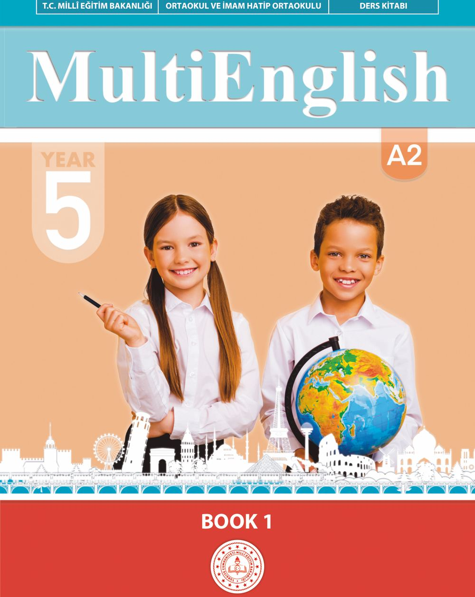

# BOOK 1

<!-- sayfa 1 -->

MULTILINGUAL LANGUAGE PROGRAMME
LOWER SECONDARY SCHOOL AND İMAM HATIP
LOWER SECONDARY SCHOOL

# MultiEnglish
## Year 5 / A2
### Student's Book 1

**AUTHORS**

Aysel BERKET
Ayşe BAŞ
Eda Burcu ÇETİNKAYA
Fatma DEMİRCAN
Gonca AKISKALI
Murat ERTAÇ
Nursen SUNAR
Selma YANKUNCU
Şevika Ömür ÖZKAN ERGÜNEN

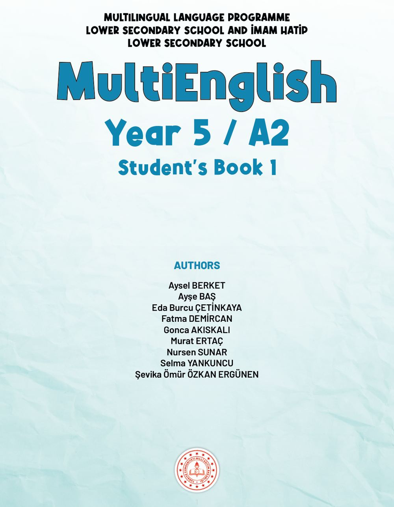
<!-- yer tutucu bulunamadı: sayfa sonuna eklendi -->

<!-- sayfa 2 -->

MİLLÎ EĞİTİM BAKANLIĞI YAYINLARI ...................................................................: 10354
DERS KİTAPLARI DİZİSİ ......................................................................................: 2298

Her hakkı saklıdır ve Millî Eğitim Bakanlığına aittir. Kitabın metin, soru ve şekilleri kısmen de olsa hiçbir surette alınıp yayımlanamaz.

**Editor**
Dr. Kamile HAMİLOĞLU

**Visual Designers**
Bahadır UYSAL
Hülya ARSLAN
Kadriye EROĞLU
Mehmet Mirza IŞIK
Nafize AĞIR
Suna AYDIN
Tolga TANYEL

**Multimedia Designers**
Aysun TONYA
Fatih UÇAR
Kevser YARDIMCI
Özlem VAYİÇ

**Curriculum Development Specialists**
Dr. Mehmet AKCAALAN
Dr. Orhan YİĞİTOĞLU
Fatma KELEŞ

**Assessment and Evaluation Specialist**
Dr. Sibel AYDOĞAN

**Guidance Specialists**
Serkan İLHAN
Sevgi CEVİZ

ISBN 978-975-11-9173-1

Millî Eğitim Bakanlığı Talim ve Terbiye Kurulunun 14.08.2025 tarih ve 138247582 sayılı

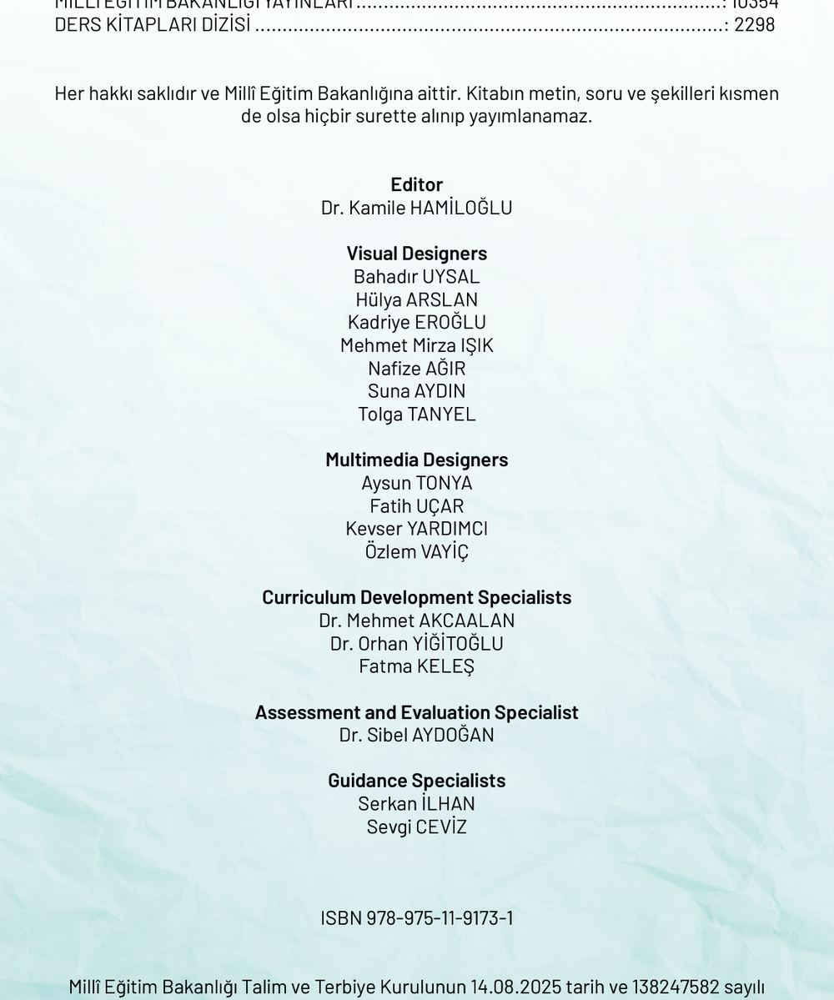
<!-- yer tutucu bulunamadı: sayfa sonuna eklendi -->

<!-- sayfa 3 -->

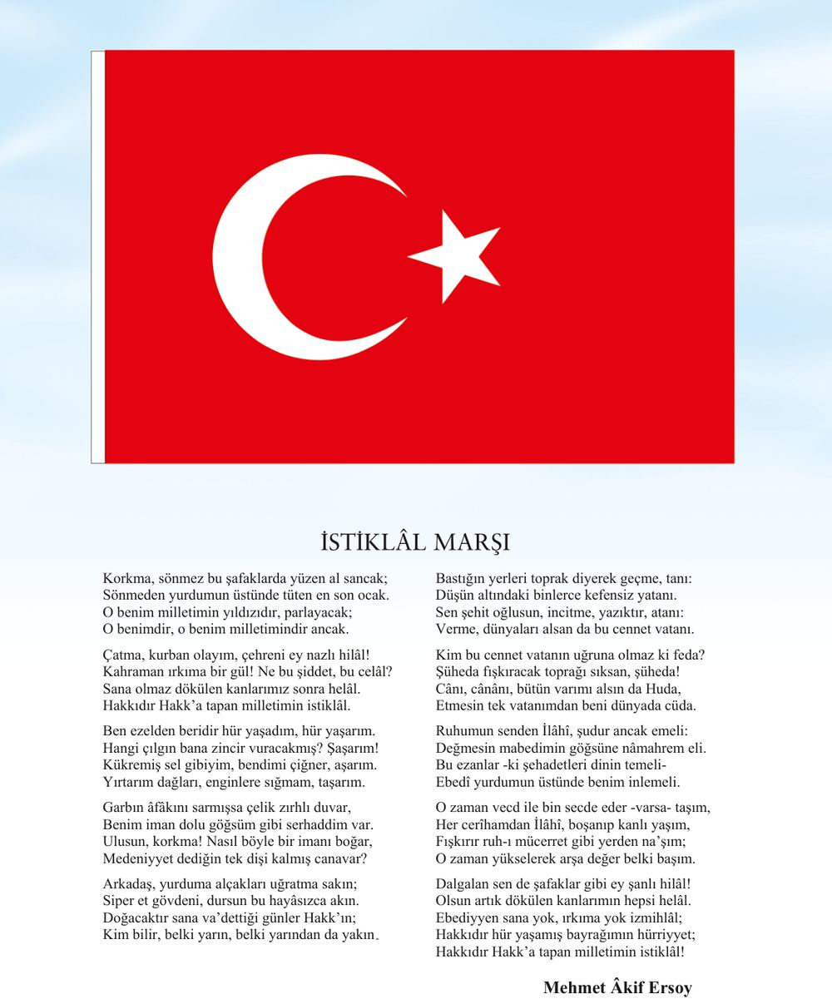

# İSTİKLÂL MARŞI

Korkma, sönmez bu şafaklarda yüzen al sancak;  
Sönmeden yurdumun üstünde tüten en son ocak.  
O benim milletimin yıldızıdır, parlayacak;  
O benimdir, o benim milletimindir ancak.  

Çatma, kurban olayım, çehreni ey nazlı hilâl! 
Kahraman ırkıma bir gül! Ne bu şiddet, bu celâl? 
Sana olmaz dökülen kanlarımız sonra helâl. 
Hakkıdır Hakk’a tapan milletimin istiklâl. 

Ben ezelden beridir hür yaşadım, hür yaşarım. 
Hangi çılgın bana zincir vuracakmış? Şaşarım! 
Kükremiş sel gibiyim, bendimi çiğner, aşarım. 
Yırtarım dağları, enginlere sığmam, taşarım. 

Garbın âfâkını sarmışsa çelik zırhlı duvar,  
Benim iman dolu göğsüm gibi serhaddim var. 
Ulusun, korkma! Nasıl böyle bir imanı boğar, 
Medeniyet dediğin tek dişi kalmış canavar? 

Arkadaş, yurduma alçakları uğratma sakın; 
Siper et gövdeni, dursun bu hayâsızca akın. 
Doğacaktır sana va’dettiği günler Hakk’ın; 
Kim bilir, belki yarın, belki yarından da yakın 

Bastığın yerleri toprak diyerek geçme, tanı:  
Düşün altındaki binlerce kefensiz yatanı. 
Sen şehit oğlusun, incitme, yazıktır, atanı: 
Verme, dünyaları alsan da bu cennet vatanı. 

Kim bu cennet vatanın uğruna olmaz ki feda? 
Şüheda fışkıracak toprağı sıksan, şüheda! 
Cânı, cânânı, bütün varımı alsın da Huda, 
Etmesin tek vatanımdan beni dünyada cüda. 

Ruhumun senden ilâhî, şudur ancak emeli: 
Değmesin mabedimin göğsüne nâmahrem eli. 
Bu ezanlar -ki şehadetleri dinin temeli-  
Ebedî yurdumun üstünde benim inlemeli. 

O zaman vecd ile bin secde eder -varsa- taşım, 
Her cerîhamdan ilâhî, boşanıp kanlı yaşım, 
Fışkırır ruh-ı mücerret gibi yerden na’şım; 
O zaman yükselerek arşa değer belki başım. 

Dalgalan sen de şafaklar gibi ey kanlı hilâl! 
Olsun artık dökülen kanlarımın hepsi helâl. 
Ebediyyen sana yok, Türk'e yok izmihlâl; 
Hakkıdır hür yaşamı bayrağımın hürriyet;  
Hakkıdır Hakk’a tapan milletimin istiklâl! 

**Mehmet Âkif Ersoy**

<!-- sayfa 4 -->

# GENÇLİĞE HİTABE

Ey Türk gençliği! Birinci vazifen, Türk istiklâlini, Türk Cumhuriyetini, ilelebet muhafaza ve müdafaa etmektir.

Mevcudiyetinin ve istikbalinin yegâne temeli budur. Bu temel, senin en kıymetli hazinendir. İstikbalde dahi, seni bu hazineden mahrum etmek isteyecek dâhilî ve hâricî bedhahların olacaktır. Bir gün, istiklâl ve cumhuriyeti müdafaa mecburiyetine düşersen, vazifeye atılmak için, içinde bulunacağın vaziyetin imkân ve şeraitini düşünmeyeceksin! Bu imkân ve şerait, çok namüsait bir mahiyette tezahür edebilir. İstiklâl ve cumhuriyetine kastedecek düşmanlar, bütün dünyada emsali görülmemiş bir galibiyetin mümessili olabilirler. Cebren ve hile ile aziz vatanın bütün kaleleri zapt edilmiş, bütün tersanelerine girilmiş, bütün orduları dağıtılmış ve memleketin her köşesi bilfiil işgal edilmiş olabilir. Bütün bu şeraitten daha elîm ve daha vahim olmak üzere, memleketin dâhilinde iktidara sahip olanlar gaflet ve dalâlet ve hattâ hıyanet içinde bulunabilirler. Hattâ bu iktidar sahipleri şahsî menfaatlerini, müstevlîlerin siyasî emelleriyle tevhit edebilirler. Millet, fakr u zaruret içinde harap ve bîtap düşmüş olabilir.

Ey Türk istikbalinin evlâdı! İşte, bu ahval ve şerait içinde dahi vazifen, Türk istiklâl ve cumhuriyetini kurtarmaktır. Muhtaç olduğun kudret, damarlarındaki asil kanda mevcuttur.

Mustafa Kemal Atatürk

<!-- sayfa 5 -->

Görüntüde herhangi bir metin veya matematiksel ifade bulunmamaktadır. Sadece Mustafa Kemal Atatürk'ün bir portresi yer almaktadır.

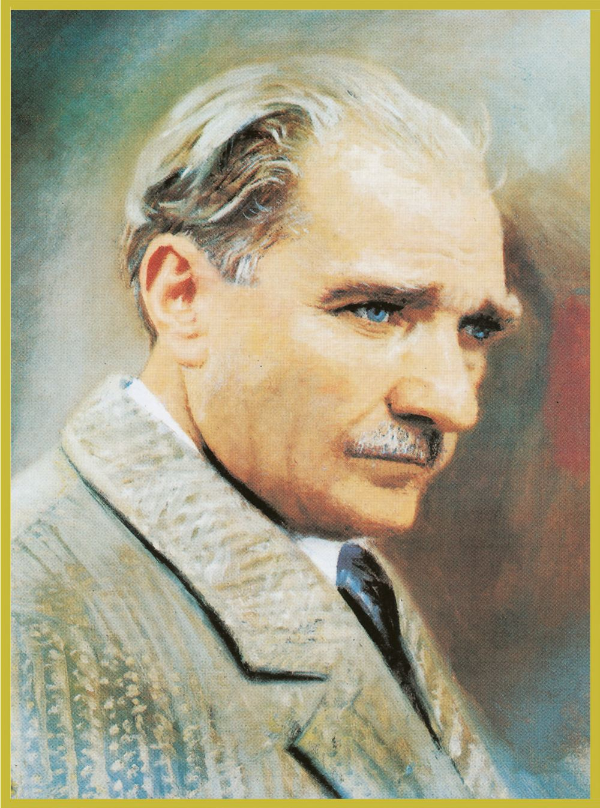
<!-- yer tutucu bulunamadı: sayfa sonuna eklendi -->

<!-- sayfa 6 -->

Henüz bir görsel veya PDF metin katmanı paylaşmadınız. Lütfen dönüştürülmesini istediğiniz sayfayı (görsel veya metin içeriğiyle birlikte) gönderin. 

Veriyi gönderdiğinizde, belirttiğiniz kurallara (LaTeX kullanımı, Markdown yapısı, şekil gösterimi vb.) harfiyen uyarak işlemi gerçekleştireceğim.

<!-- yer tutucu bulunamadı: sayfa sonuna eklendi -->

<!-- sayfa 7 -->

# CONTENTS

Table of Contents ........................................................ 8
About the Book .......................................................... 12
Icons ................................................................... 14
Revision 1 .............................................................. 15
Revision 2 .............................................................. 21
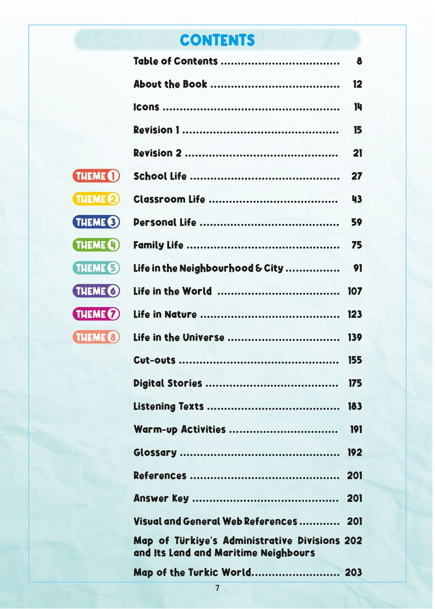 THEME 1 School Life .......................................... 27
 THEME 2 Classroom Life ....................................... 43
 THEME 3 Personal Life ........................................ 59
 THEME 4 Family Life .......................................... 75
 THEME 5 Life in the Neighbourhood & City ..................... 91
 THEME 6 Life in the World .................................... 107
 THEME 7 Life in Nature ....................................... 123
 THEME 8 Life in the Universe ................................. 139
Cut-outs ................................................................ 155
Digital Stories ......................................................... 175
Listening Texts ......................................................... 183
Warm-up Activities ...................................................... 191
Glossary ................................................................ 192
References .............................................................. 201
Answer Key .............................................................. 201
Visual and General Web References ....................................... 201
Map of Türkiye's Administrative Divisions and Its Land and Maritime Neighbours 202

<!-- sayfa 8 -->

# TABLE OF CONTENTS

| THEME NO | MAIN THEME | SUB-THEMES | FUNCTIONS AND GRAMMARING | VOCABULARY SELECTION-USE | PRONUNCIATION SELECTION-USE | LISTENING & WATCHING - COMPREHENSION |
| :--- | :--- | :--- | :--- | :--- | :--- | :--- |
| REVISION | Revision 1 | -Daily routines and activities at school -Favourite school subjects and classroom activities now and in the past -Time -Seasons of the year -Physical appearances and personality -Clothing and clothing preferences | -Describing daily routines and activities at school -Describing past states or conditions of things or people -Expressing preference -Telling the time -Telling the preferences about favourite school subjects/lessons -Describing abilities or skills someone had in the past -Describing physical appearance, preferences for clothing | -Vocabulary for daily routines and activities at school -Vocabulary for favourite school subjects -Vocabulary for time and seasons of the year -Vocabulary for physical appearances and personality -Vocabulary for clothing and clothing preferences | | School subjects Listening for details |
| REVISION | Revision 2 | -Family members' jobs -Family members' long-lasting habits -Family members' errands -Places for services in the neighbourhood -Comparisons | -Describing completed actions -Expressing preferences -Describing one person, animal, place, or thing -Giving advice or suggestions -Describing prohibition -Comparing multiple items or choices | -Vocabulary for family members' jobs -Vocabulary for family members' long-lasting habits -Vocabulary for family members' errands -Vocabulary for places for services in the neighbourhood | | People with different jobs talking about their jobs/routines Listening for specific information/details |
| THEME 1 | School Life | -School rules -People, roles and responsibilities at school -School routines -National days and celebrations | -Giving commands: Imperatives -Describing routines, facts, habits, general truths, and permanent situations: The Simple Present Tense -Permission: "Can" -Obligation and prohibition: "Must" -Indicating who is involved: Personal Pronouns -Asking about things, time, and people: Wh- questions -Articles: "a, an, the" | -Vocabulary for school rules -Vocabulary for people at school -Vocabulary for roles and responsibilities at school -Vocabulary for school routines | Intonation of positive statements | The first day of Year 5 Listening for gist/specific information/details |
| THEME 2 | Classroom Life | -Classroom rules and instructions -Roles, responsibilities, relationships in the classroom -Daily and study routines and activities in the classroom -Cardinal numbers 100-500 -Ordinal numbers 1-50 | -Describing the responsibilities of different roles, daily routines and study routines: The Simple Present Tense -Confirming general truths: Question Tags -Expressing the presence of something or somebody: "There is/are" -Making polite requests: "Shall" -Object/Demonstrative Pronouns -Expressing the frequency of actions: Adverbs of Frequency -Describing obligation in the past or at present: "have/had to" -Asking about time of actions: "What time" | -Vocabulary for classroom rules -Vocabulary for classroom instructions -Vocabulary for roles in the classroom -Vocabulary for responsibilities, daily and study routines in the classroom -Vocabulary for school subjects -Vocabulary for timetables -Vocabulary for cardinal numbers 100-500 -Vocabulary for ordinal numbers 1-50 | Intonation of negative statements | A conversation in the classroom Listening for gist/specific information/details |
| THEME 3 | Personal Life | -Body parts and physical appearance and (features) -Clothing and dressing -Personality traits | -Actions happening now: The Present Progressive Tense -Confirming ongoing actions: Question tags -Comparing two people or things: Comparative adjectives (regular/irregular) -Replacing nouns to indicate possession: Possessive pronouns -Showing ownership in relation to nouns: Possessive Adjectives -Indicating relationships or possession: Possessive ('s) | -Vocabulary for body parts and physical appearance -Vocabulary for clothing and dressing -Vocabulary for personal traits | Intonation of questions and question tags | The magic wardrobe Listening for gist/specific information/details |
| THEME 4 | Family Life | -Family members' jobs and workplaces -Daily and job routines of family members -Different types of houses | -Describing planned future actions: The Present Progressive Tense for Future -Describing scheduled future events: The Simple Present Tense for Future -Expressing future decisions, predictions, and promises: The Simple Future Tense -Indicating intentions, plans, and predictions based on evidence: "Be going to Future Tense" -Asking about a place or location: "Where?" | -Vocabulary for family members, their jobs, workplaces, daily and job routines -Vocabulary for different types of houses and parts of the house | Target sounds: a, b | A family conversation about football training and jobs Listening for gist/specific information/details |

TABLE OF CONTENTS

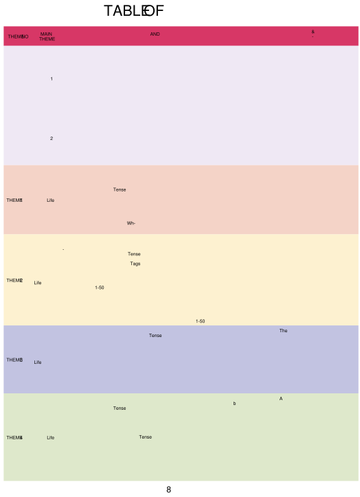
<!-- yer tutucu bulunamadı: sayfa sonuna eklendi -->

<!-- sayfa 9 -->

# TABLE OF CONTENTS

| READING-COMPREHENSION | SPEAKING-EXPRESSION | WRITING-EXPRESSION | CLIL & CULTURE | PROJECTS | REFLECTION | EVALUATION |
| :--- | :--- | :--- | :--- | :--- | :--- | :--- |
| “Show and Tell” day Reading for details | *The speaking skill is incorporated into all sections of the theme.*  Clothing preferences Sharing personal information | Social Language Expressions Finding out the suitable expression for different situations | | | | |
| A Day at the Seaside Scanning Reading for details | *The speaking skill is incorporated into all sections of the theme.*  Talking about daily routines Interacting in pairs | Grouping the healthy/unhealthy food Differentiating food categories | | | | |
| E-mails Skimming Scanning Reading for details | *The speaking skill is incorporated into all sections of the theme.*  Dialogues about people, places, rules, responsibilities, and routines at school, Interacting in pairs/groups | A comparison of school routines Sharing personal information | Interesting rules in different countries | How to make a dream school Presenting a poster | Time to check your progress Reflecting on the learning process | Rating scales about the learning outcomes |
| A weekly school magazine Skimming Scanning Reading for details | *The speaking skill is incorporated into all sections of the theme.*  Dialogues about school subjects, time, roles, responsibilities, and rules at school Sharing personal information in pairs/groups | A weekly school magazine Producing and presenting a written material | Interesting school activities in different countries | How to make a dream classroom Presenting a poster | Time to check your progress Reflecting on the learning process | Rating scales about the learning outcomes |
| Fashion corner Skimming Scanning Reading for details | *The speaking skill is incorporated into all sections of the theme.*  Dialogues about body parts, physical appearance, personality traits, and clothing Exchanging information in pairs/groups | Introducing a celebrity Describing a person’s features | Facts about our body | How to create your favourite character Presenting a poster | Time to check your progress Reflecting on the learning process | Rating scales about the learning outcomes |
| An e-mail from Maya to Scott Skimming Scanning Reading for details | *The speaking skill is incorporated into all sections of the theme.*  Dialogues about family members’ jobs, workplaces, daily and job routines Talking about jobs in pairs/groups | -The dream house -Describing your dream house | Different jobs | How to make a family tree Presenting a poster | Time to check your progress Reflecting on the learning process | Rating scales about the learning outcomes |

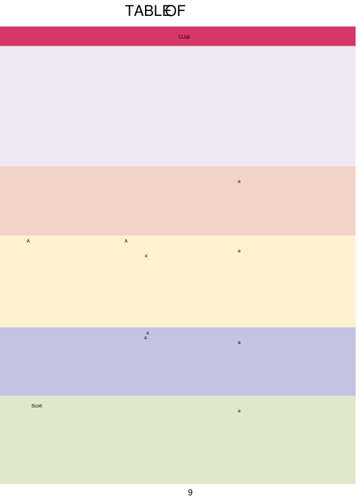
<!-- yer tutucu bulunamadı: sayfa sonuna eklendi -->

<!-- sayfa 10 -->

| THEME NO | MAIN THEME | SUB-THEMES | FUNCTIONS AND GRAMMARING | VOCABULARY SELECTION-USE | PRONUNCIATION | LISTENING & WATCHING - COMPREHENSION |
| :--- | :--- | :--- | :--- | :--- | :--- | :--- |
| THEME 5 | Life in the Neighbourhood&City | -Attractions and recreational places, services, and transportation in the neighbourhood and the city | -Describing states or conditions in the past: The Simple Past Tense (was/were) -Narrating completed actions or events in the past: The Simple Past Tense (regular/irregular verbs) -Confirming past actions or events: Question tags -Expressing actions or states: Gerunds&infinitives -Connecting clauses, phrases, or words: Conjunctions -Combining ideas to provide additional details or context: Compound sentences -“Something, anything” -Adjectives and adverbs | -Vocabulary for attractions and recreational places in the neighbourhood & the city -Vocabulary for services in the neighbourhood and the city -Vocabulary for transportation tools in the neighbourhood and the city -Vocabulary for transportation in the neighbourhood and the city | Target sounds: c, d | Two children talking about their trips Listening for gist/specific information/details |
| THEME 6 | Life in the World | -Continents, countries, nationalities, and languages -Different cuisines from the world -Food festivals from different parts of the world | -Indicating recent action, experience, and experience over time: The Present Perfect Tense -Describing the highest or lowest degree of something: Superlative adjectives (regular, irregular) -Indicating the amount or number of something: Quantifiers | -Vocabulary for continents -Vocabulary for countries -Vocabulary for nationalities and languages -Vocabulary for different cuisines from the world -Vocabulary for food festivals -Verbs for food festivals | Target sounds: e, f | An interview with a chef Listening for gist/specific information/details |
| THEME 7 | Life in Nature | -Animals in nature and habitats -Daily activities and nature -Activities in nature | -Describing ongoing or interrupted actions in the past: The Past Progressive Tense -Contrasting an ongoing action with a completed action in the past: Past Progressive vs. The Simple Past Tense -Describing abilities or possibilities in the past and showing politeness: “Could” -Giving suggestions: “Should” -Describing assistance, indicating future intentions: “Will” -Seeking specific information about time, place, reason, or manner: Wh- questions -Expressing necessity and lack of need: “Need & Needn’t” | -Vocabulary for animals and natural habitats -Vocabulary for daily activities and nature -Vocabulary for nature/outdoor activities | Target sounds: g, h | A Strange Dream Listening for gist/specific information/details |
| THEME 8 | Life in the Universe | -Planets in the solar system -Facts about planets -Earth as a planet -Extreme weather conditions | -Describing general truths, facts, or habitual actions: Zero conditional -Describing possible or likely outcomes in the future: Conditional 1 -Expressing a condition in a negative form indicating something will happen only if the condition is not fulfilled: "Unless" -Introducing a condition to describe potential actions, situations, or consequences, often expressing possibility or uncertainty: "If" | -Vocabulary for planets in the solar system -Vocabulary for facts about planets -Vocabulary for the Earth as a planet | Target sounds: i, j | In the Science Lab Listening for gist/specific information/details |

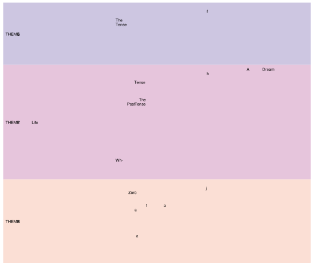
<!-- yer tutucu bulunamadı: sayfa sonuna eklendi -->

<!-- sayfa 11 -->

| READING-COMPREHENSION | SPEAKING-EXPRESSION | WRITING-EXPRESSION | CLIL & CULTURE | PROJECTS | REFLECTION | EVALUATION |
| :--- | :--- | :--- | :--- | :--- | :--- | :--- |
| Wrong Destination Skimming Scanning Reading for details | *The speaking skill is incorporated into all sections of the theme.*  Dialogues about attractions, recreational places, services, transportation in the neighbourhood and the city Interacting in pairs/groups | Dream holiday destination Describing a person’s dream holiday destination | Interesting transportation tools around the world | How to make your dream city Presenting a poster | Time to check your progress Reflecting on the learning process | Rating scales about the learning outcomes |
| Me Around the World Skimming Scanning Reading for details | *The speaking skill is incorporated into all sections of the theme.*  Dialogues about continents, countries, nationalities, different cuisines from the world, food festivals from different parts of the world Interacting in pairs/groups | Travel experiences Describing a person’s own travel experiences | Different cuisines around the world | How to prepare a favourite dessert or meal Presenting a poster | Time to check your progress Reflecting on the learning process | Rating scales about the learning outcomes |
| Endangered Animals Skimming Scanning Reading for details | *The speaking skill is incorporated into all sections of the theme.*  Dialogues about animals in nature and habitats, daily activities and nature, activities in nature Interacting in pairs/groups | -An environmental problem -Expressing causes and solutions of an environmental problem | Amazing rainforests | How to spend a day in nature Presenting a project | Time to check your progress Reflecting on the learning process | Rating scales about the learning outcomes |
| Vacation Reflections Skimming Scanning Reading for details | *The speaking skill is incorporated into all sections of the theme.*  Dialogues about Earth as a planet, planets in the solar system, extreme weather conditions and planet facts Interacting in pairs/groups | -Story completion -Creating a story about an action happened in the past | Facts about Planets | How to create a planet poster | Time to check your progress | Rating scales about the learning outcomes |

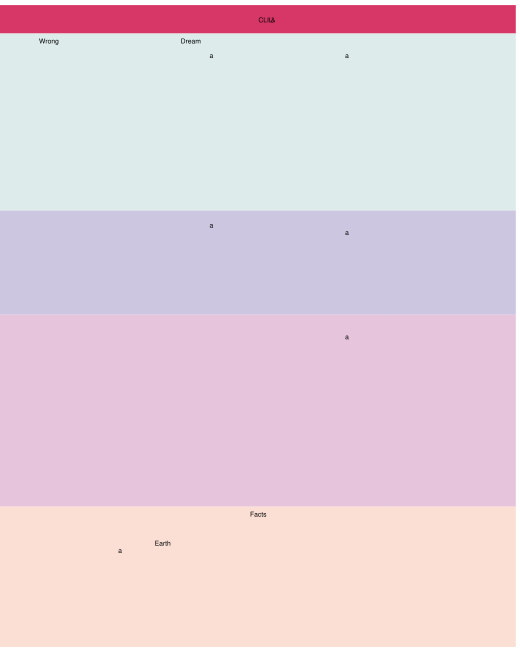
<!-- yer tutucu bulunamadı: sayfa sonuna eklendi -->

<!-- sayfa 12 -->

# ABOUT THE BOOK

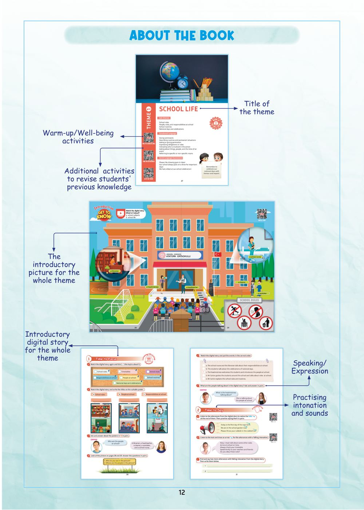

* Title of the theme
* Warm-up/Well-being activities
* Additional activities to revise students' previous knowledge
* The introductory picture for the whole theme
* Introductory digital story for the whole theme
* Speaking/Expression Practising intonation and sounds

<!-- sayfa 13 -->

# Target vocabulary in use
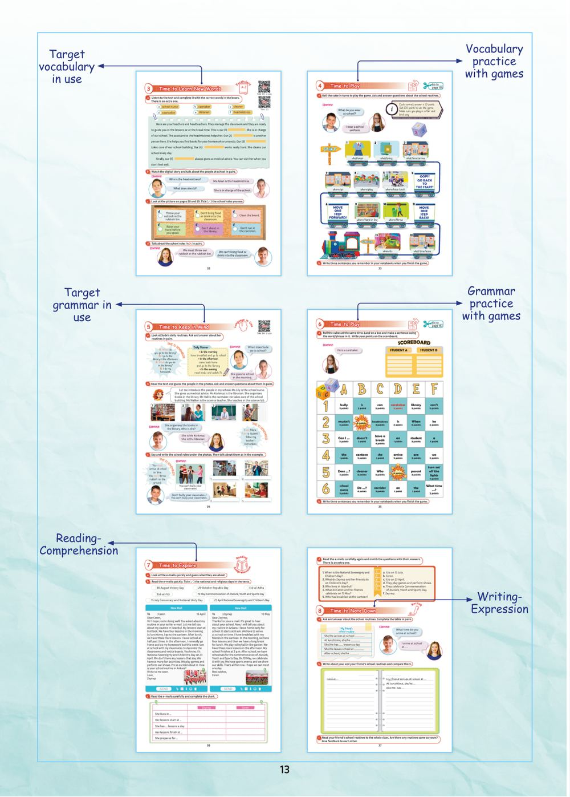

# Vocabulary practice with games

# Target grammar in use

# Grammar practice with games

# Reading-Comprehension

# Writing-Expression

<!-- sayfa 14 -->

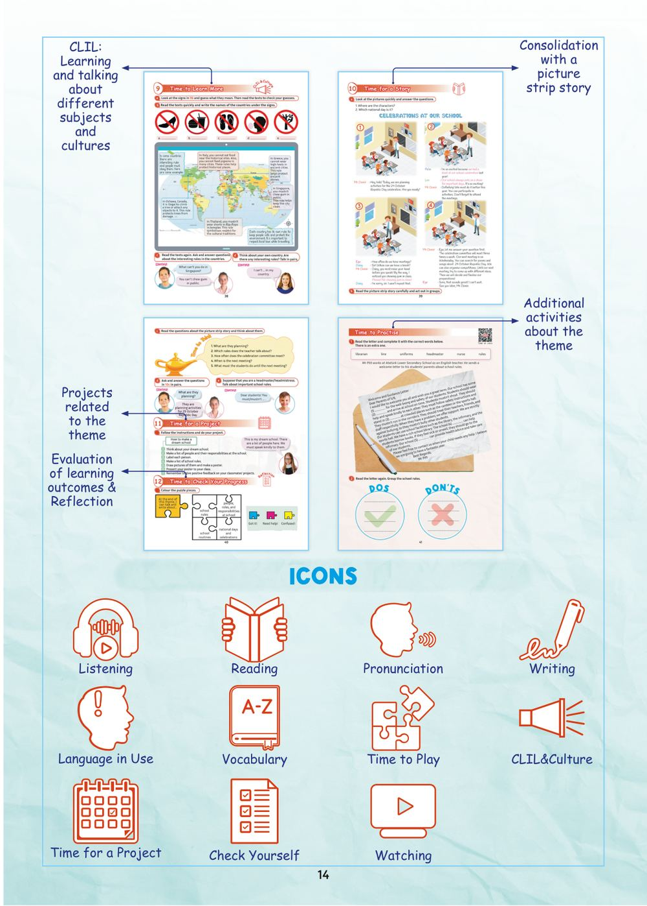

Learning and talking about different subjects and cultures $\rightarrow$ 

 $\rightarrow$ Consolidation with a picture strip story

 $\rightarrow$ Additional activities about the theme

Projects related to the theme $\rightarrow$ 

Evaluation of learning outcomes & Reflection $\rightarrow$ 

# ICONS

Listening

Reading

Pronunciation

Writing

Language in Use

Vocabulary

Time to Play

CLIL&Culture

<!-- sayfa 15 -->

# REVISION 1

### Sub-themes
* Daily routines and activities at school
* Favourite school subjects and classroom activities
* Time and seasons of the year
* Physical appearances and personality
* Clothing and clothing preferences

### Functional Language
* Describing daily routines and activities at school
* Describing past states or conditions of things or people
* Expressing preference
* Telling the time
* Telling the preferences about favourite school subjects/lessons
* Describing abilities or skills someone had in the past
* Describing physical appearance, preferences for clothing

### Social Language Expressions
* It's raining cats and dogs!
* Let's break the ice!
* I'm sorry to hear that!
* It fits like a glove!
* Feel free to use this!

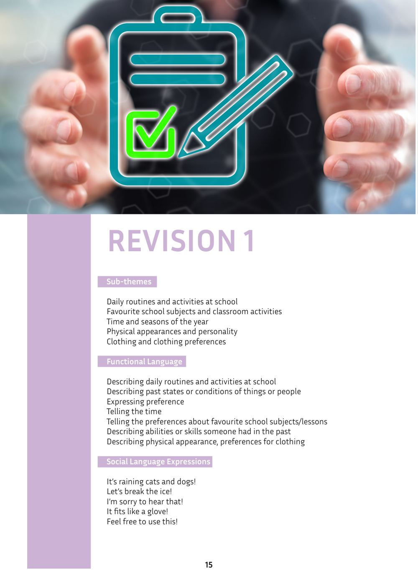
<!-- yer tutucu bulunamadı: sayfa sonuna eklendi -->

<!-- sayfa 16 -->


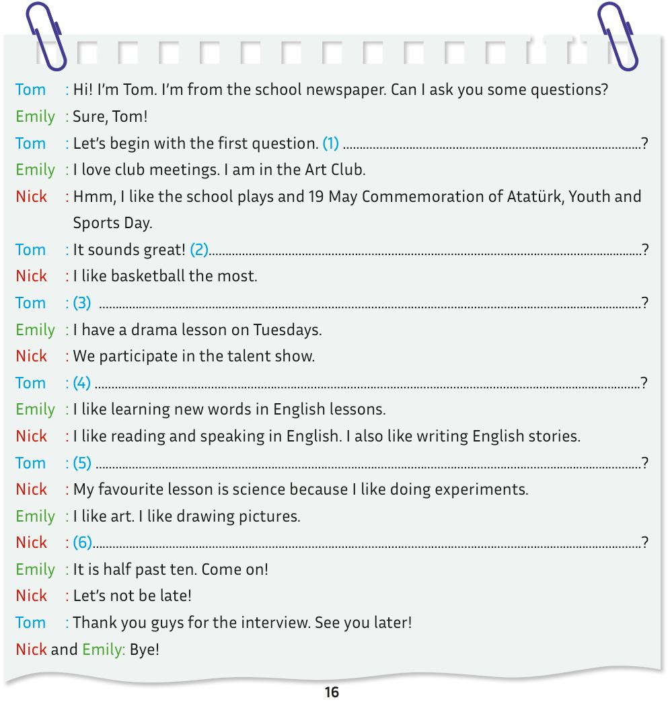
a. What is your favourite lesson?
b. What do you like doing in English lessons?
c. What is the time now?
d. What time do you get up?
e. What is your favourite school activity?
f. What do you do at school on Tuesdays?
g. Which sports do you like the most?

Tom : Hi! I'm Tom. I'm from the school newspaper. Can I ask you some questions?
Emily : Sure, Tom!
Tom : Let's begin with the first question. (1) ...........................................................................................?
Emily : I love club meetings. I am in the Art Club.
Nick : Hmm, I like the school plays and 19 May Commemoration of Atatürk, Youth and Sports Day.
Tom : It sounds great! (2)........................................................................................................................?
Nick : I like basketball the most.
Tom : (3) .....................................................................................................................................................?
Emily : I have a drama lesson on Tuesdays.
Nick : We participate in the talent show.
Tom : (4) .....................................................................................................................................................?
Emily : I like learning new words in English lessons.
Nick : I like reading and speaking in English. I also like writing English stories.
Tom : (5) .....................................................................................................................................................?
Nick : My favourite lesson is science because I like doing experiments.
Emily : I like art. I like drawing pictures.
Nick : (6).....................................................................................................................................................?
Emily : It is half past ten. Come on!
Nick : Let's not be late!
Tom : Thank you guys for the interview. See you later!

<!-- sayfa 17 -->

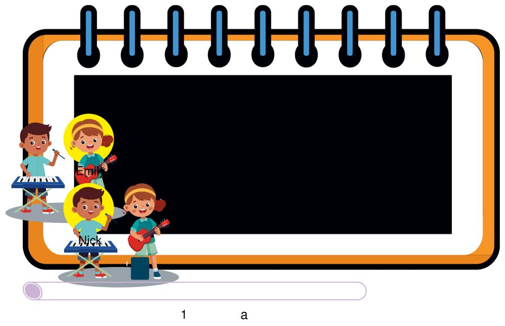 2 Read the dialogue on page 16 and fill in the table.

| | favourite school activities | things they do on Tuesdays | things they like doing in English lessons | their favourite lessons |
| :--- | :--- | :--- | :--- | :--- |
| Emily | club meetings | | | |
| Nick | | | | |

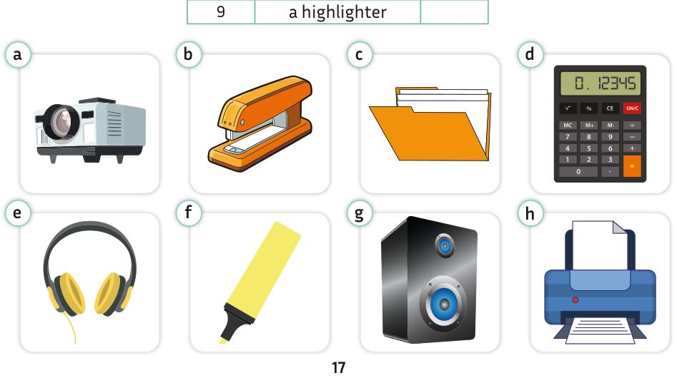 3 Match the objects with the pictures. There is an extra object.

| | |
| :--- | :--- |
| 1 | a folder |
| 2 | a stapler |
| 3 | a printer |
| 4 | headphones |
| 5 | a projector |
| 6 | a rubbish bin |
| 7 | a calculator |
| 8 | a speaker |
| 9 | a highlighter |

| | | | |
| :---: | :---: | :---: | :---: |
| a | b | c | d |
| | | | |
| e | f | g | h |

<!-- sayfa 18 -->

 4 Reorder the words and write classroom instructions.

USE
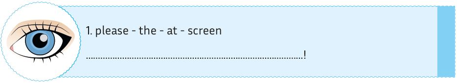 talk • write • listen • read • look • check

1. please - the - at - screen
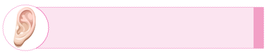 ............................................................!

2. carefully - please
 ............................................................!

3. with - peers - your - please
 ............................................................!

4. down - this - please
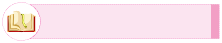 ............................................................!

5. please - this
 ............................................................!

6. please - answers - your
............................................................!

<!-- sayfa 19 -->

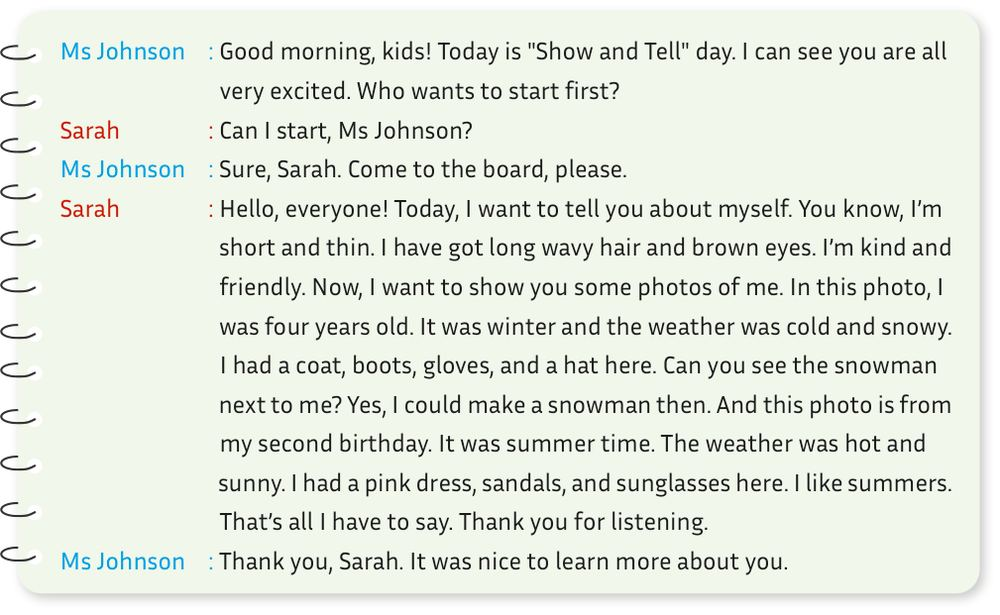 Read the text and choose the correct option.

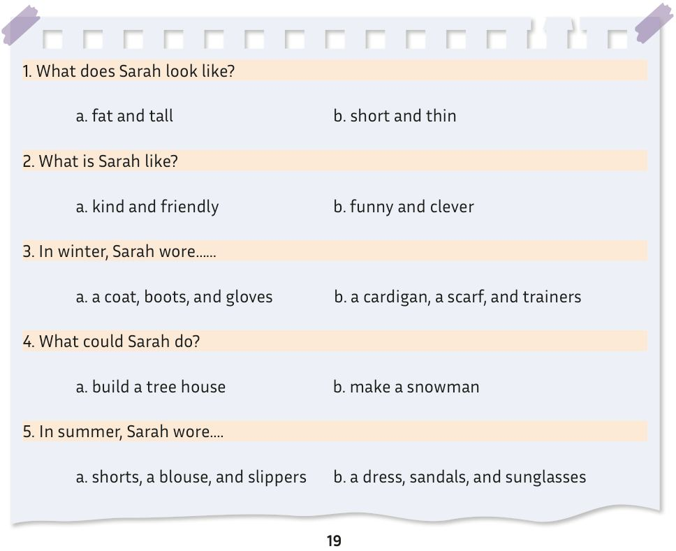
Ms Johnson : Good morning, kids! Today is "Show and Tell" day. I can see you are all very excited. Who wants to start first?
Sarah : Can I start, Ms Johnson?
Ms Johnson : Sure, Sarah. Come to the board, please.
Sarah : Hello, everyone! Today, I want to tell you about myself. You know, I’m short and thin. I have got long wavy hair and brown eyes. I’m kind and friendly. Now, I want to show you some photos of me. In this photo, I was four years old. It was winter and the weather was cold and snowy. I had a coat, boots, gloves, and a hat here. Can you see the snowman next to me? Yes, I could make a snowman then. And this photo is from my second birthday. It was summer time. The weather was hot and sunny. I had a pink dress, sandals, and sunglasses here. I like summers. That’s all I have to say. Thank you for listening.
Ms Johnson : Thank you, Sarah. It was nice to learn more about you.

1. What does Sarah look like?
   a. fat and tall                                          b. short and thin

2. What is Sarah like?
   a. kind and friendly                              b. funny and clever

3. In winter, Sarah wore......
   a. a coat, boots, and gloves                b. a cardigan, a scarf, and trainers

4. What could Sarah do?
   a. build a tree house                            b. make a snowman

5. In summer, Sarah wore....
   a. shorts, a blouse, and slippers
   b. a dress, sandals, and sunglasses

<!-- sayfa 20 -->

6 Look at the words in the box and talk about them.

| | | | |
| :--- | :--- | :--- | :--- |
| like | trainers | summer | |
| love | flip-flops | autumn | |
| want | gloves | winter | |
| dislike | a scarf | spring | |
| hate | a hoodie | | |
| prefer | a raincoat | | |
| | a dress | | |
| | shorts | | |

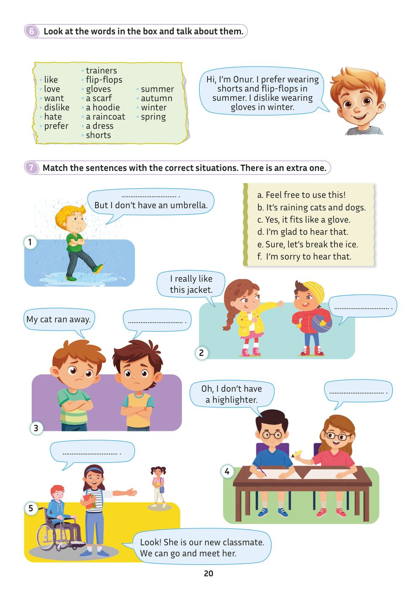
Hi, I’m Onur. I prefer wearing shorts and flip-flops in summer. I dislike wearing gloves in winter.

7 Match the sentences with the correct situations. There is an extra one.

............................... .
But I don't have an umbrella.

a. Feel free to use this!
b. It's raining cats and dogs.
c. Yes, it fits like a glove.
d. I'm glad to hear that.
e. Sure, let's break the ice.
f. I'm sorry to hear that.

1

2
I really like this jacket.
...............................

3
My cat ran away.
...............................

4
Oh, I don't have a highlighter.
...............................

5
...............................
Look! She is our new classmate

<!-- sayfa 21 -->

# REVISION 2

## Sub-themes

* Family members’ jobs
* Family members’ long-lasting habits
* Family members’ errands
* Places for services in the neighbourhood
* Life on the seaside
* Sea/marine animals and their habitats
* Activities of sea/marine animals
* Dangers for sea/marine animals
* Types of houses by the water
* Healthy and unhealthy food

## Functional Language

* Describing completed actions
* Expressing preferences
* Describing one person, animal, place, or thing
* Giving advice or suggestions
* Describing prohibition
* Comparing multiple items or choices

## Social Language Expressions

* Don’t worry!
* That’s great!

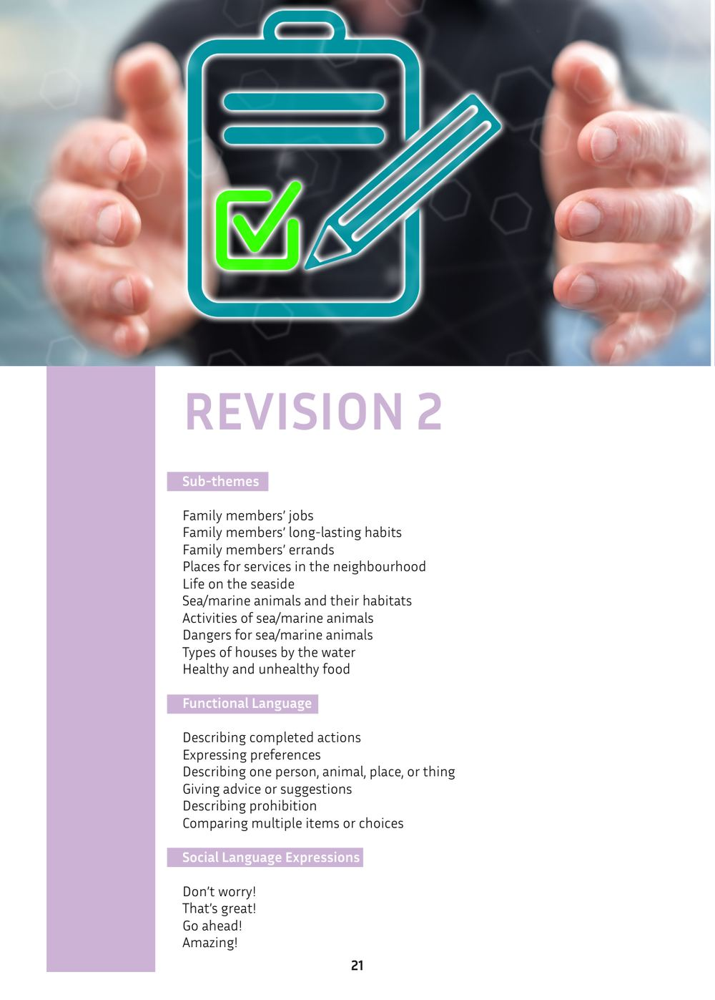
<!-- yer tutucu bulunamadı: sayfa sonuna eklendi -->

<!-- sayfa 22 -->

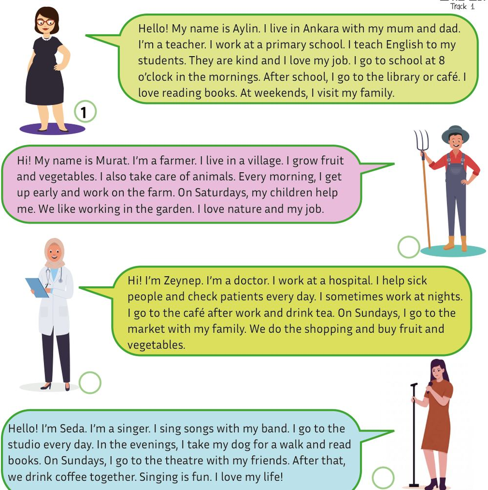 Listen to the texts and number them.

Track 1

Hello! My name is Aylin. I live in Ankara with my mum and dad. I’m a teacher. I work at a primary school. I teach English to my students. They are kind and I love my job. I go to school at 8 o’clock in the mornings. After school, I go to the library or café. I love reading books. At weekends, I visit my family.

Hi! My name is Murat. I’m a farmer. I live in a village. I grow fruit and vegetables. I also take care of animals. Every morning, I get up early and work on the farm. On Saturdays, my children help me. We like working in the garden. I love nature and my job.

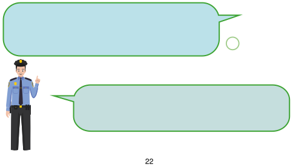 Hi! I’m Zeynep. I’m a doctor. I work at a hospital. I help sick people and check patients every day. I sometimes work at nights. I go to the café after work and drink tea. On Sundays, I go to the market with my family. We do the shopping and buy fruit and vegetables.

Hello! I’m Seda. I’m a singer. I sing songs with my band. I go to the studio every day. In the evenings, I take my dog for a walk and read books. On Sundays, I go to the theatre with my friends. After that, we drink coffee together. Singing is fun. I love my life!

Hi! I’m Ali. I’m a police officer. I work at a big police station in İzmir. I wear a uniform. I help people and keep the city safe. I start work early in the mornings. I love my job. It’s sometimes hard but I enjoy helping others.

<!-- sayfa 23 -->

2 Match the sentences from the text with the jobs. There is an extra one.

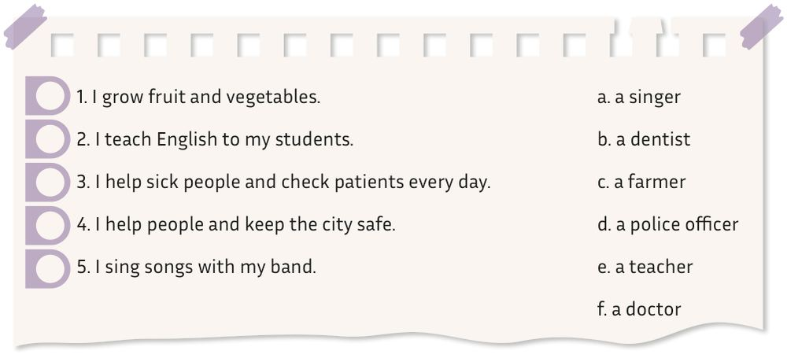

1. I grow fruit and vegetables.                                     a. a singer
2. I teach English to my students.                                  b. a dentist
3. I help sick people and check patients every day.                 c. a farmer
4. I help people and keep the city safe.                            d. a police officer
5. I sing songs with my band.                                       e. a teacher
                                                                     f. a doctor

3 Match the jobs with the sentences. There is an extra sentence.

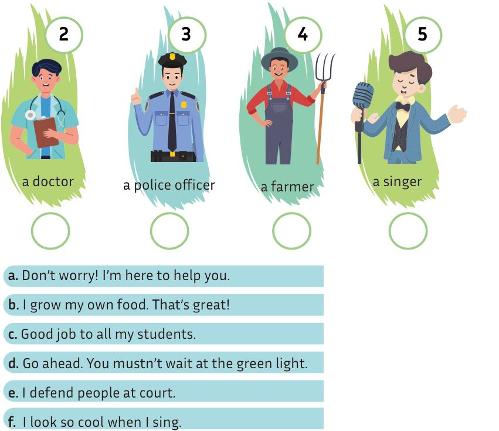

1 a teacher
2 a doctor
3 a police officer
4 a farmer
5 a singer

a. Don't worry! I'm here to help you.
b. I grow my own food. That's great!
c. Good job to all my students.
d. Go ahead. You mustn't wait at the green light.
e. I defend people at court.

<!-- sayfa 24 -->

4 Read the clues and match the places. There is an extra one.

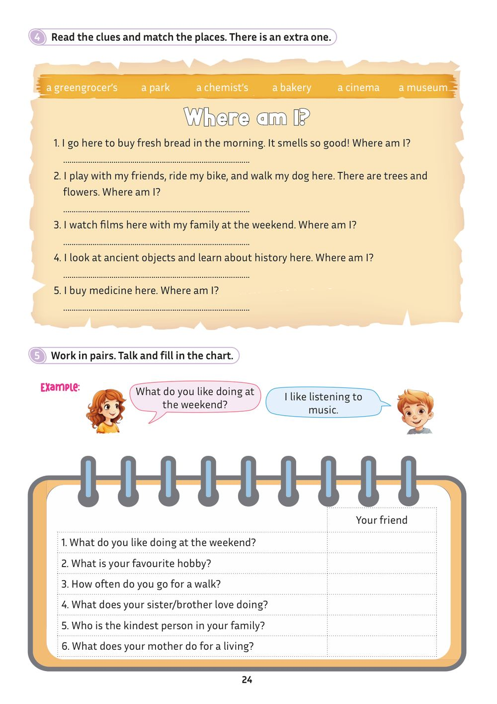

a greengrocer's | a park | a chemist's | a bakery | a cinema | a museum

# Where am I?

1. I go here to buy fresh bread in the morning. It smells so good! Where am I?
.........................................................................................

2. I play with my friends, ride my bike, and walk my dog here. There are trees and flowers. Where am I?
.........................................................................................

3. I watch films here with my family at the weekend. Where am I?
.........................................................................................

4. I look at ancient objects and learn about history here. Where am I?
.........................................................................................

5. I buy medicine here. Where am I?
.........................................................................................

5 Work in pairs. Talk and fill in the chart.

Example:
What do you like doing at the weekend?
I like listening to music.

| | Your friend |
| :--- | :--- |
| 1. What do you like doing at the weekend? | |
| 2. What is your favourite hobby? | |
| 3. How often do you go for a walk? | |
| 4. What does your sister/brother love doing? | |
| 5. Who is the kindest person in your family? | |

<!-- sayfa 25 -->

a. A fishing day
b. Living by the sea
c. A day at the seaside

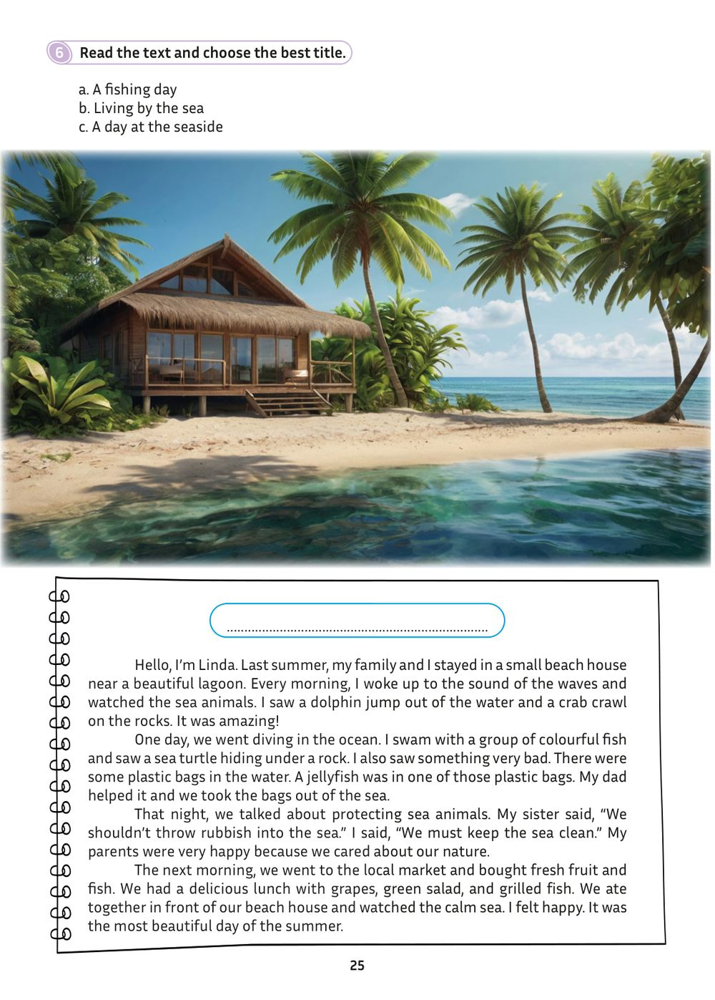

Hello, I’m Linda. Last summer, my family and I stayed in a small beach house near a beautiful lagoon. Every morning, I woke up to the sound of the waves and watched the sea animals. I saw a dolphin jump out of the water and a crab crawl on the rocks. It was amazing!

One day, we went diving in the ocean. I swam with a group of colourful fish and saw a sea turtle hiding under a rock. I also saw something very bad. There were some plastic bags in the water. A jellyfish was in one of those plastic bags. My dad helped it and we took the bags out of the sea.

That night, we talked about protecting sea animals. My sister said, “We shouldn’t throw rubbish into the sea.” I said, “We must keep the sea clean.” My parents were very happy because we cared about our nature.

The next morning, we went to the local market and bought fresh fruit and fish. We had a delicious lunch with grapes, green salad, and grilled fish. We ate together in front of our beach house and watched the calm sea. I felt happy. It was ..........................................................................

6 Read the text and choose the best title.

<!-- sayfa 26 -->

7. Read the text on page 25 again and answer the questions.

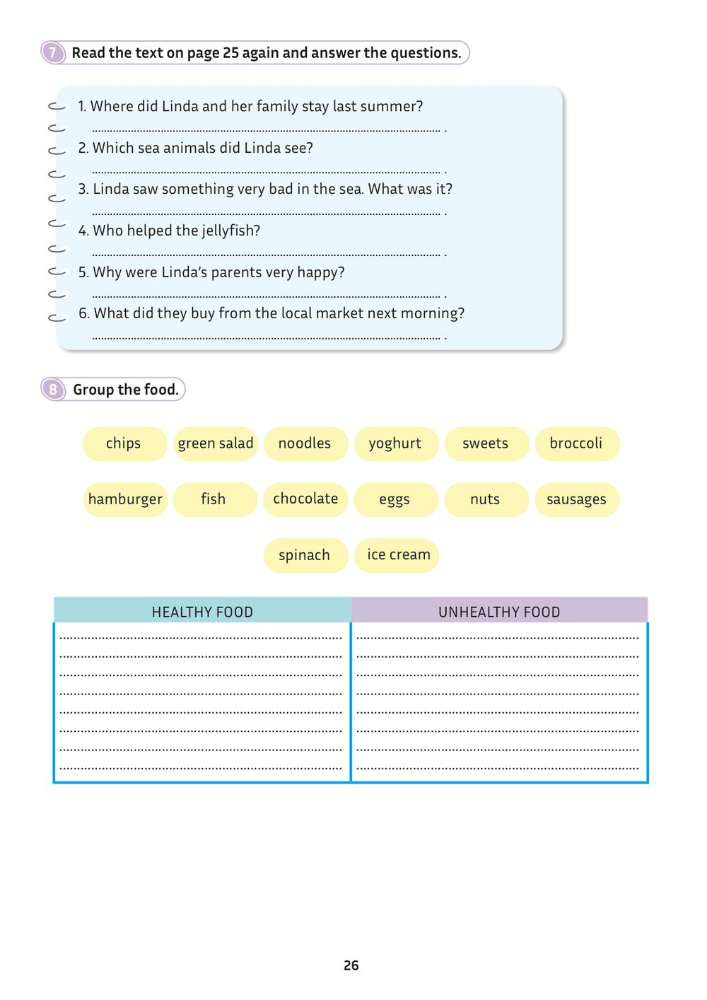
1. Where did Linda and her family stay last summer?
    ..................................................................................................................... .
2. Which sea animals did Linda see?
    ..................................................................................................................... .
3. Linda saw something very bad in the sea. What was it?
    ..................................................................................................................... .
4. Who helped the jellyfish?
    ..................................................................................................................... .
5. Why were Linda’s parents very happy?
    ..................................................................................................................... .
6. What did they buy from the local market next morning?
    ..................................................................................................................... .

8. Group the food.

chips
green salad
noodles
yoghurt
broccoli
sweets
hamburger
fish
chocolate
eggs
nuts
sausages
spinach
ice cream

| HEALTHY FOOD | UNHEALTHY FOOD |
| :--- | :--- |
| ................................................................ | ................................................................ |
| ................................................................ | ................................................................ |
| ................................................................ | ................................................................ |
| ................................................................ | ................................................................ |
| ................................................................ | ................................................................ |
| ................................................................ | .................

<!-- sayfa 27 -->

# SCHOOL LIFE

## THEME 1

### Sub-themes
* School rules
* People, roles, and responsibilities at school
* School routines
* National days and celebrations

### Functional Language
* Giving commands
* Describing routines and permanent situations
* Asking or giving permission
* Expressing obligations or rules
* Indicating who is involved in the action
* Asking about things, people, and the time of an event
* Referring to specific or non-specific nouns

### Social Language Expressions
* Please! No chewing gum in class!
* Our school always puts on a show for important days!
* We had a blast at our school celebration!

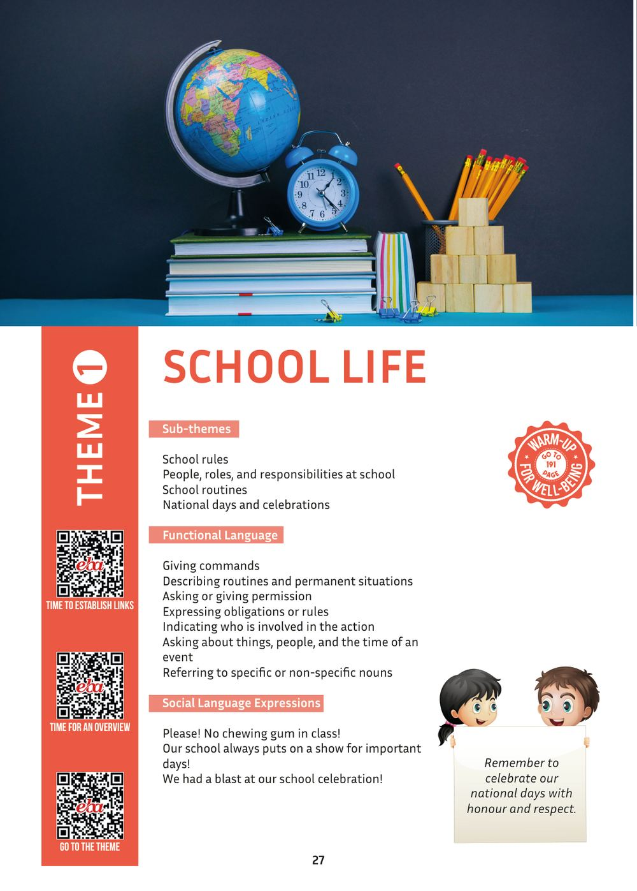

**TIME TO ESTABLISH LINKS**

**TIME FOR AN OVERVIEW**

WARM-UP
GO TO PAGE 191
FOR WELL-BEING

Remember to celebrate our national days with honour and respect.

<!-- sayfa 28 -->

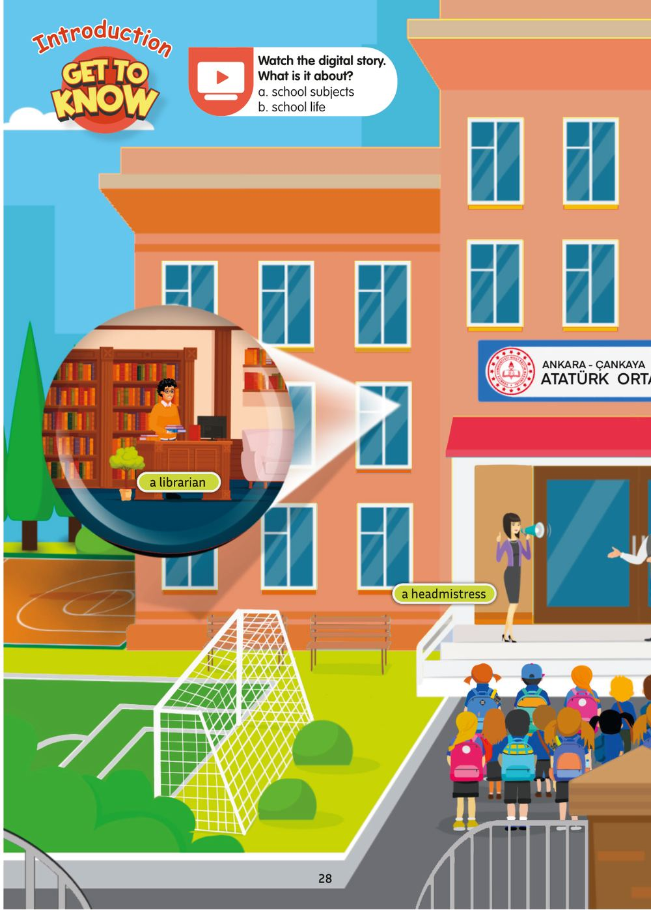 Watch the digital story.
What is it about?
a. school subjects
b. school life

<!-- sayfa 29 -->

DIGITAL STORY

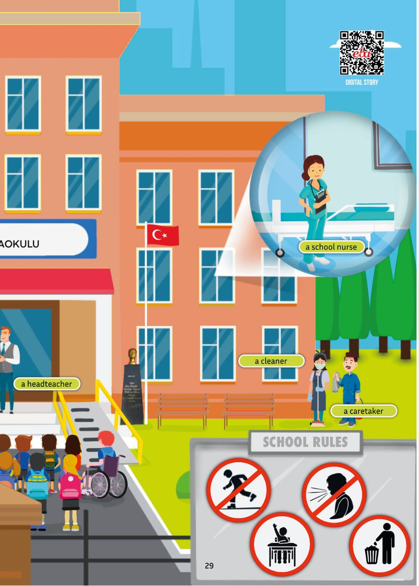

<!-- sayfa 30 -->

# 1 Time to Focus
Listening Comprehension

**a** Watch the digital story again and tick ($\checkmark$) the topics about it.

*   [ ] School rules
*   [ ] Timetables
*   [ ] School clubs
*   [ ] Responsibilities at school
*   [ ] People at school
*   [ ] School routines
*   [ ] National days and celebrations

**b** Watch the digital story and write the titles on the suitable poster.

**a** School rules
...........................................
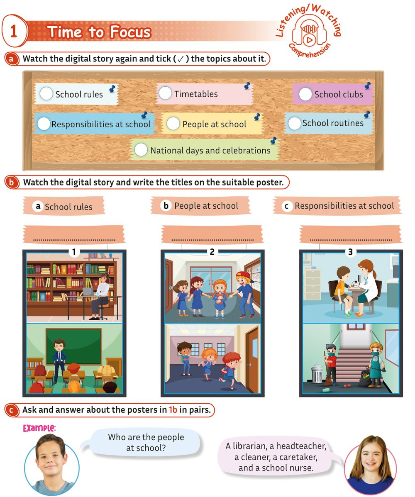

**b** People at school
...........................................
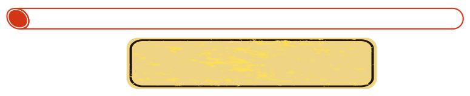

**c** Responsibilities at school
...........................................

**c** Ask and answer about the posters in 1b in pairs.

Example:
Who are the people at school?

A librarian, a headteacher, a cleaner, a caretaker, and a school nurse.

**d** Look at the picture on pages 28 and 29. Answer the questions in pairs.

1. Who do you see in the picture?
2. Where are the people in the picture?

<!-- sayfa 31 -->

*Watch the digital story and put the events in the correct order.*

*   a. The school nurse and the librarian talk about their responsibilities at school.
*   b. The students talk about the celebrations of national days.
*   1 c. The headmistress welcomes the students and introduces the people at school.
*   d. Mr Carter guides the students around the school and talks about roles at school.
*   e. Mr Carter explains the school rules and routines.

**f** What are the people talking about in the digital story? Ask and answer in pairs.

*Example:*

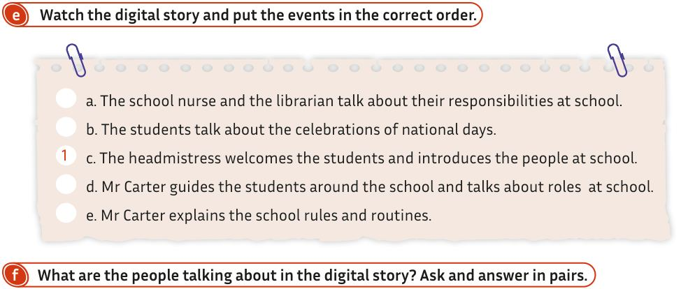

**2 Time to Say**

*Pronunciation*

**a** Listen to the utterances from the digital story to notice the falls $\searrow$ at the end of them. Then practise saying them in pairs.

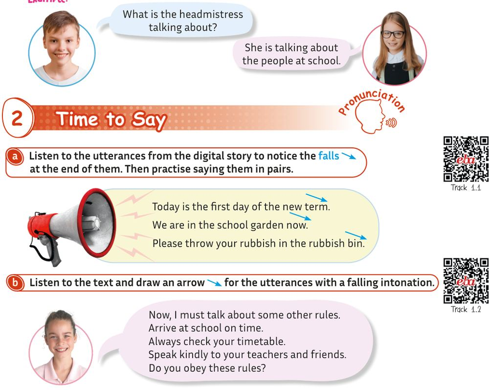

**b** Listen to the text and draw an arrow $\searrow$ for the utterances with a falling intonation.

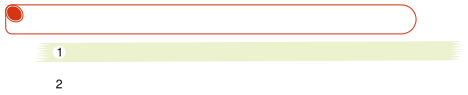

**c** Find and say two more utterances with falling intonation from the digital story. Then write them below.

1 __________________________________________________________________________
__________________________________________________________________________

<!-- sayfa 32 -->

# 3 Time to Learn New Words

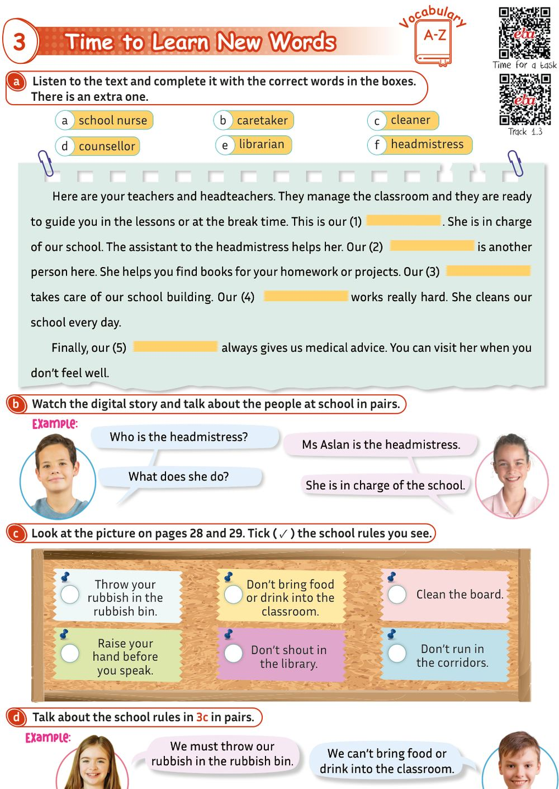

**a** Listen to the text and complete it with the correct words in the boxes. There is an extra one.

a school nurse
b caretaker
c cleaner
d counsellor
e librarian
f headmistress

Here are your teachers and headteachers. They manage the classroom and they are ready to guide you in the lessons or at the break time. This is our (1) \_\_\_\_\_\_\_\_\_\_. She is in charge of our school. The assistant to the headmistress helps her. Our (2) \_\_\_\_\_\_\_\_\_\_ is another person here. She helps you find books for your homework or projects. Our (3) \_\_\_\_\_\_\_\_\_\_ takes care of our school building. Our (4) \_\_\_\_\_\_\_\_\_\_ works really hard. She cleans our school every day.

Finally, our (5) \_\_\_\_\_\_\_\_\_\_ always gives us medical advice. You can visit her when you don't feel well.

**b** Watch the digital story and talk about the people at school in pairs.

**Example:**

Who is the headmistress?
Ms Aslan is the headmistress.

What does she do?
She is in charge of the school.

**c** Look at the picture on pages 28 and 29. Tick ($\checkmark$) the school rules you see.

| | | |
| :--- | :--- | :--- |
| $\bigcirc$ Throw your rubbish in the rubbish bin. | $\bigcirc$ Don't bring food or drink into the classroom. | $\bigcirc$ Clean the board. |
| $\bigcirc$ Raise your hand before you speak. | $\bigcirc$ Don't shout in the library. | $\bigcirc$ Don't run in the corridors. |

**d** Talk about the school rules in **3c** in pairs.

**Example:**

We must throw our rubbish in the rubbish bin.

We can't bring food or drink into the classroom.

<!-- sayfa 33 -->

# 4 Time to Play

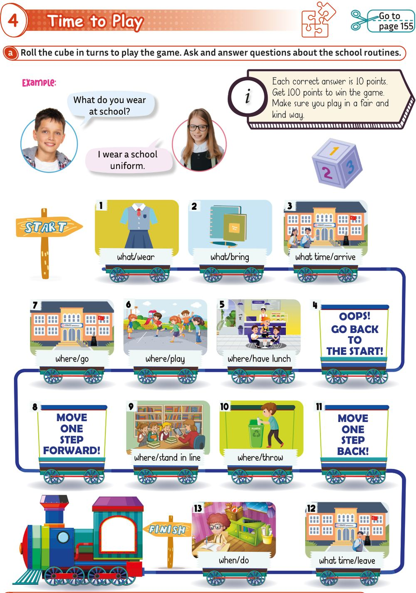

**a** Roll the cube in turns to play the game. Ask and answer questions about the school routines.

**Example:**

What do you wear at school?
I wear a school uniform.

i Each correct answer is 10 points.
Get 100 points to win the game.
Make sure you play in a fair and kind way.

START
1 what/wear
2 what/bring
3 what time/arrive
4 OOPS! GO BACK TO THE START!
5 where/have lunch
6 where/play
7 where/go
8 MOVE ONE STEP FORWARD!
9 where/stand in line
10 where/throw
11 MOVE ONE STEP BACK!
12 what time/leave
13 when/do
FINISH

<!-- sayfa 34 -->

# 5 Time to Keep in Mind

Language Use
Time for a task

**a** Look at Sude's daily routines. Ask and answer about her routines in pairs.

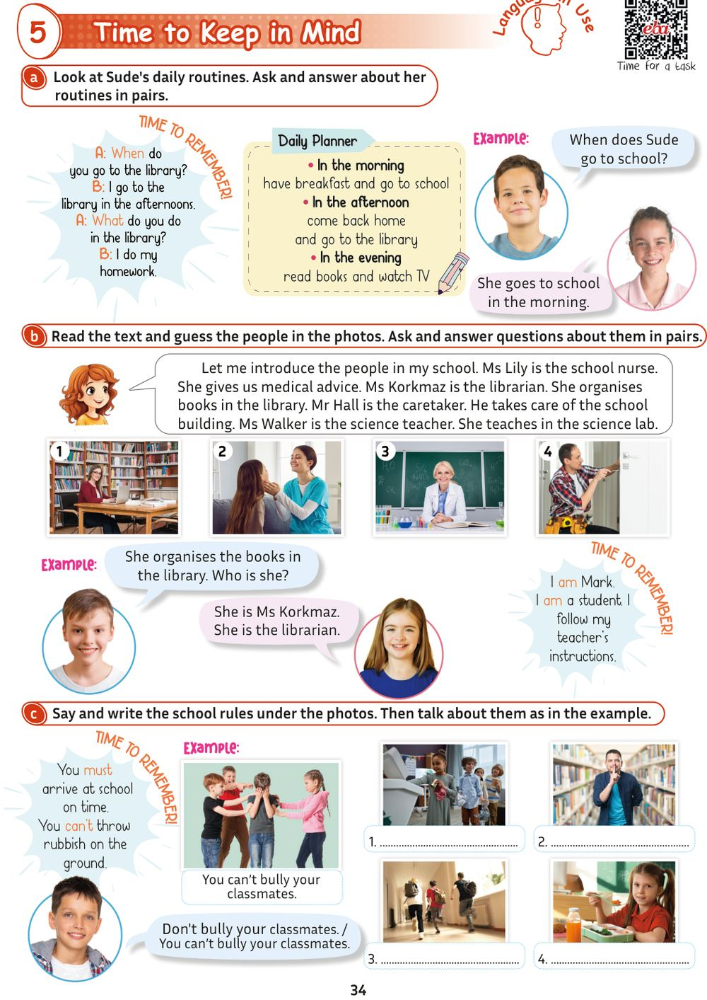

TIME TO REMEMBER!
A: When do you go to the library?
B: I go to the library in the afternoons.
A: What do you do in the library?
B: I do my homework.

Daily Planner
* **In the morning** have breakfast and go to school
* **In the afternoon** come back home and go to the library
* **In the evening** read books and watch TV

Example:
When does Sude go to school?
She goes to school in the morning.

**b** Read the text and guess the people in the photos. Ask and answer questions about them in pairs.

Let me introduce the people in my school. Ms Lily is the school nurse. She gives us medical advice. Ms Korkmaz is the librarian. She organises books in the library. Mr Hall is the caretaker. He takes care of the school building. Ms Walker is the science teacher. She teaches in the science lab.

1 
2 
3 
4 

Example:
She organises the books in the library. Who is she?
She is Ms Korkmaz. She is the librarian.

TIME TO REMEMBER!
I am Mark. I am a student. I follow my teacher's instructions.

**c** Say and write the school rules under the photos. Then talk about them as in the example.

TIME TO REMEMBER!
You must arrive at school on time.
You can't throw rubbish on the ground.

Example:

You can't bully your classmates.

1 ...................................................
2 ...................................................

Don't bully your classmates. /

<!-- sayfa 35 -->

# 6 Time to Play

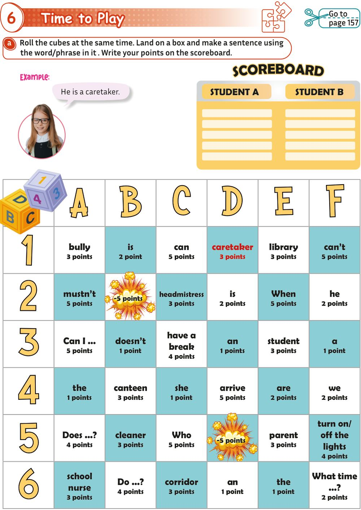

a Roll the cubes at the same time. Land on a box and make a sentence using the word/phrase in it . Write your points on the scoreboard.

Example:
He is a caretaker.

# SCOREBOARD

| STUDENT A | STUDENT B |
| :--- | :--- |
| | |
| | |
| | |
| | |
| | |

| | A | B | C | D | E | F |
| :--- | :--- | :--- | :--- | :--- | :--- | :--- |
| **1** | bully 3 points | is 2 point | can 5 points | caretaker 3 points | library 3 points | can’t 5 points |
| **2** | mustn’t 5 points | -5 points | headmistress 3 points | is 2 points | When 5 points | he 2 points |
| **3** | Can I ... 5 points | doesn’t 1 point | have a break 4 points | an 1 points | student 3 points | a 1 point |
| **4** | the 1 points | canteen 3 points | she 1 point | arrive 5 points | are 2 points | we 2 points |
| **5** | Does ...? 4 points | cleaner 3 points | Who 5 points | -5 points | parent 3 points | turn on/ off the lights 4 points |
| **6** | school nurse 3 points | Do ...? 4 points | corridor 3 points | an 1 point | the 1 point | What time ...? 2 points |

<!-- sayfa 36 -->

# 7 Time to Explore

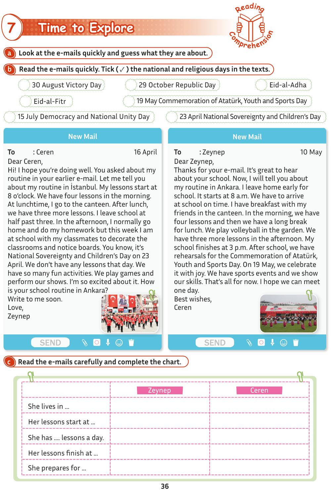

**a** Look at the e-mails quickly and guess what they are about.

**b** Read the e-mails quickly. Tick ($\checkmark$) the national and religious days in the texts.

*   30 August Victory Day
*   29 October Republic Day
*   Eid-al-Adha
*   Eid-al-Fitr
*   19 May Commemoration of Atatürk, Youth and Sports Day
*   15 July Democracy and National Unity Day
*   23 April National Sovereignty and Children’s Day

| New Mail | New Mail |
| :--- | :--- |
| **To**: Ceren   16 April    Dear Ceren,   Hi! I hope you’re doing well. You asked about my routine in your earlier e-mail. Let me tell you about my routine in İstanbul. My lessons start at 8 o’clock. We have four lessons in the morning. At lunchtime, I go to the canteen. After lunch, we have three more lessons. I leave school at half past three. In the afternoon, I normally go home and do my homework but this week I am at school with my classmates to decorate the classrooms and notice boards. You know, it’s National Sovereignty and Children’s Day on 23 April. We don’t have any lessons that day. We have so many fun activities. We play games and perform our shows. I’m so excited about it. How is your school routine in Ankara?   Write to me soon.   Love,   Zeynep      [SEND] | **To**: Zeynep   10 May    Dear Zeynep,   Thanks for your e-mail. It’s great to hear about your school. Now, I will tell you about my routine in Ankara. I leave home early for school. It starts at 8 a.m. We have to arrive at school on time. I have breakfast with my friends in the canteen. In the morning, we have four lessons and then we have a long break for lunch. We play volleyball in the garden. We have three more lessons in the afternoon. My school finishes at 3 p.m. After school, we have rehearsals for the Commemoration of Atatürk, Youth and Sports Day. On 19 May, we celebrate it with joy. We have sports events and we show our skills. That’s all for now. I hope we can meet one day.   Best wishes,   Ceren      [SEND] |

**c** Read the e-mails carefully and complete the chart.

| | Zeynep | Ceren |
| :--- | :--- | :--- |
| She lives in ... | | |
| Her lessons start at ... | | |
| She has .... lessons a day. | | |
| Her lessons finish at ... | | |

<!-- sayfa 37 -->

c Read the e mails carefully again and match the questions with their answers. There is an extra one.

| | | |
| :--- | :--- | :--- |
| 1. When is the National Sovereignty and Children's Day? | 1 | a. It is on 15 July. |
| 2. What do Zeynep and her friends do on Children's Day? | 2 | b. Ceren. |
| 3. Who lives in İstanbul? | 3 | c. It is on 23 April. |
| 4. What do Ceren and her friends celebrate on 19 May? | 4 | d. They play games and perform shows. |
| 5. Who has breakfast at the canteen? | 5 | e. They celebrate Commemoration of Atatürk, Youth and Sports Day. |
| | | f. Zeynep. |

# 8 Time to Note Down Writing

a Ask and answer about the school routines. Complete the table in pairs.

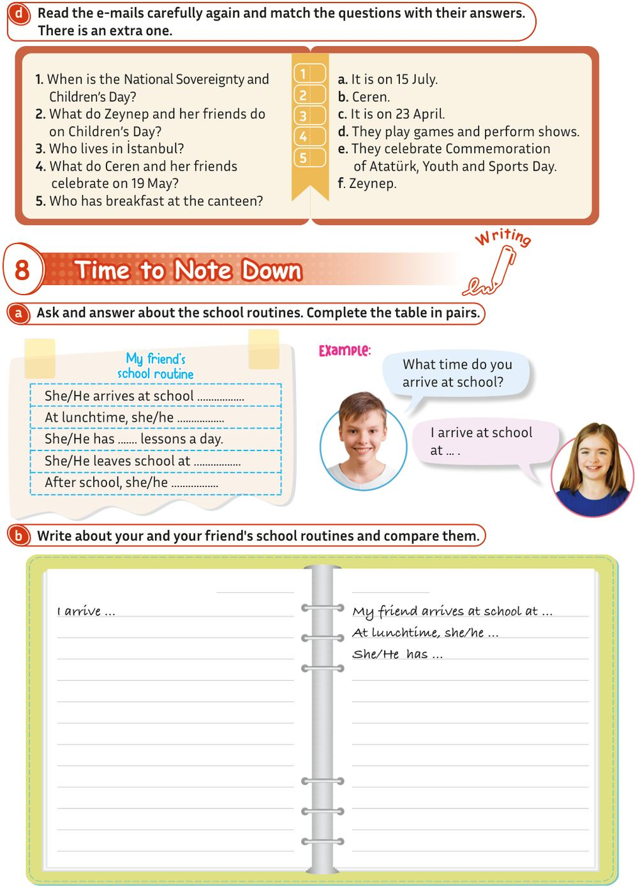

**My friend's school routine**
- She/He arrives at school ................
- At lunchtime, she/he ....................
- She/He has ....... lessons a day.
- She/He leaves school at ................
- After school, she/he ....................

**Example:**
- What time do you arrive at school?
- I arrive at school at ... .

b Write about your and your friend's school routines and compare them.

| I arrive ... | My friend arrives at school at ... At lunchtime, she/he ... She/He has ... |
| :--- | :--- |
| | |
| | |
| | |
| | |
| | |
| | |
| | |
| | |
| | |
| | |

<!-- sayfa 38 -->

# 9 Time to Learn More 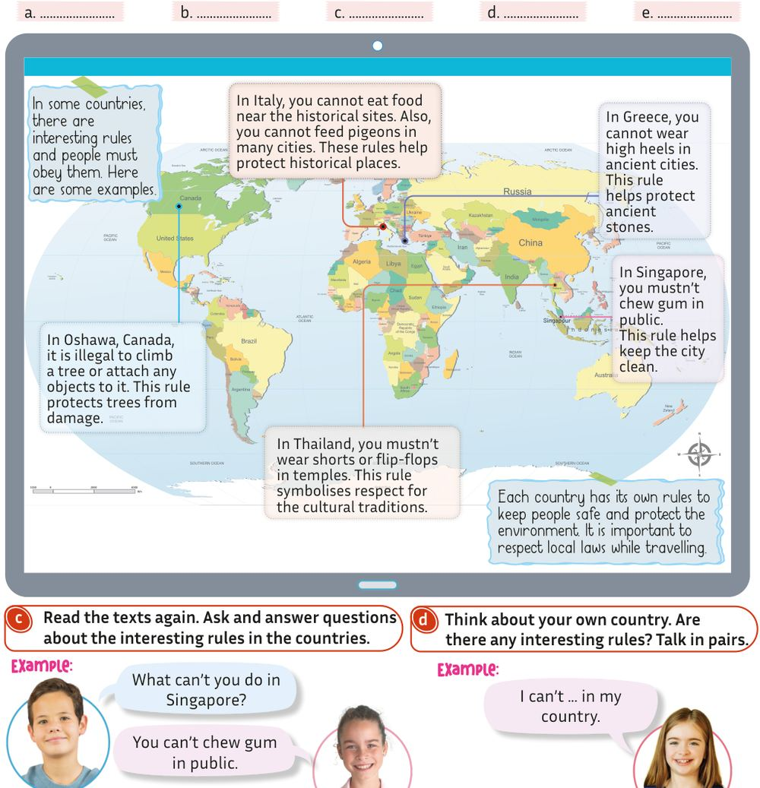

**a.** Look at the signs in **9b** and guess what they mean. Then read the texts to check your guesses.

**b.** Read the texts quickly and write the names of the countries under the signs.

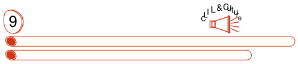
a. .......................
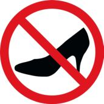
b. .......................
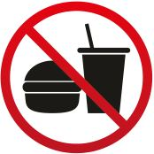
c. .......................

d. .......................

e. .......................

> In some countries, there are interesting rules and people must obey them. Here are some examples.
>
> In Italy, you cannot eat food near the historical sites. Also, you cannot feed pigeons in many cities. These rules help protect historical places.
>
> In Greece, you cannot wear high heels in ancient cities. This rule helps protect ancient stones.
>
> In Singapore, you mustn't chew gum in public. This rule helps keep the city clean.
>
> In Thailand, you mustn't wear shorts or flip-flops in temples. This rule symbolises respect for the cultural traditions.
>
> In Oshawa, Canada, it is illegal to climb a tree or attach any objects to it. This rule protects trees from damage.
>
> Each country has its own rules to keep people safe and protect the environment. It is important to respect local laws while travelling.

**c.** Read the texts again. Ask and answer questions about the interesting rules in the countries.

**d.** Think about your own country. Are there any interesting rules? Talk in pairs.

**Example:**
What can't you do in Singapore?
You can't chew gum in public.

**Example:**
I can't ... in my country.

<!-- sayfa 39 -->

# 10 Time for a Story

**a** Look at the pictures quickly and answer the questions.

1. Where are the characters?
2. Which national day is it?

## CELEBRATIONS AT OUR SCHOOL

**1**
Mr Demir : Hey, kids! Today, we are planning activities for the 29 October Republic Day celebration. Are you ready?

**2**
Pelin : I'm so excited because we had a blast at our school celebration last year!
Leo : Our school always puts on a show for important days. It's so exciting!
Mr Demir : Definitely! We must do it better this year. You can participate in activities. Don't forget to attend the meetings.

**3**
Ege : How often do we have meetings?
Daisy : Sir! When can we have a break?
Mr Demir : Daisy, you must raise your hand before you speak! By the way, I noticed you chewing gum in class. Please! No chewing gum in class!
Daisy : I'm sorry sir I won't repeat that

**4**
Mr Demir : Ege, let me answer your question first. The celebration committee will meet three times a week. Our next meeting is on Wednesday. You can search for poems and songs about 29 October Republic Day. We can also organise competitions. Until our next meeting, try to come up with different ideas. Then we will decide and finalise our preparations!
Ege : Sure, that sounds great! I can't wait.

<!-- sayfa 40 -->

# Time to Think

1. What are they planning?
2. Which rules does the teacher talk about?
3. How often does the celebration committee meet?
4. When is the next meeting?
5. What must the students do until the next meeting?

---

d Ask and answer the questions in 10c in pairs.

**Example:**

What are they planning?
They are planning activities for 29 October Republic Day.

e Suppose that you are a headmaster/headmistress. Talk about important school rules.

**Example:**
Dear students! You must/mustn't ... .

---

# 11 Time for a Project

Follow the instructions and do your project.

### How to make a dream school
1. Think about your dream school.
2. Make a list of people and their responsibilities at the school.
3. Label each person.
4. Make a list of school rules.
5. Draw pictures of them and make a poster.
6. Present your poster to your class.
7. Remember to give positive feedback on your classmates' projects.

This is my dream school. There are a lot of people here. We must speak kindly to them.

---

# 12 Time to Check Your Progress

Colour the puzzle pieces.

At the end of this theme, I can talk and write about...
- school rules
- people, roles, and responsibilities at school
- national days

# Reflection

- Got it!
- Need help!
- Confused!

<!-- sayfa 41 -->

# Time To Practise

1 Read the letter and complete it with the correct words below. There is an extra one.

| librarian | line | uniforms | headmaster | nurse | rules |
| :--- | :--- | :--- | :--- | :--- | :--- |

Mr Pitt works at Atatürk Lower Secondary School as an English teacher. He sends a welcome letter to his students’ parents about school rules.

Welcome and Guidance Letter
Dear Parents of 5/B,
I would like to welcome you all and wish you a great term. Our school has some
(1) ................... for the well-being and safety of our students. Students should wear
(2) ................... and arrive at school on time. Students mustn’t shout. They should
help and speak kindly to each other. They must follow safety instructions and
stand in (3) ................... at crowded places such as the canteen or the sports hall.
They mustn’t run in the corridors. They should treat their teachers, friends, and
staff respectfully. When they have a problem, we offer support. We are strictly
against bullying, so they mustn’t bully other students.
Our students can use school facilities such as the library, the infirmary, and the
sports hall. We have a rich school library. The school (4) ................... can help
students borrow books. If they feel sick or unwell, they should go to the
infirmary. Our school (5) ................... can provide health advice and take care
of our students.
Please feel free to contact us when your child needs any help. I believe
we are going to have a fantastic year.
Best Regards,
Mr Pitt

2 Read the letter again. Group the school rules.

# DOS
....................................
....................................
....................................
....................................
....................................

# DON'TS
....................................
....................................
....................................
....................................
....................................

<!-- sayfa 42 -->

3 Write about Sam’s school routines.

| | |
| :--- | :--- |
| 07:30 | get up |
| 08:00 | have breakfast |
| 08:30 | arrive at school |
| 12:00 | have lunch |
| 15:00 | come back home |
| 16:00 | meet friends |
| 18:30 | have dinner |
| 19:00 | do homework |
| 21:00 | read a book |
| 22:00 | brush teeth and go to bed |

Sam gets up at half past seven.
__________________________________________________________________
__________________________________________________________________
__________________________________________________________________
__________________________________________________________________
__________________________________________________________________
__________________________________________________________________
__________________________________________________________________

4 Ask and answer about Sam’s routines in pairs.

Example:
What time does Sam get up?
He gets up at half past seven in the morning.

5 Listen to the sentences and draw $\nearrow$ for each sentence.

Example:
I would like to welcome you all.

1. Do not bully others.
2. Follow the instructions carefully.
3. Being punctual is important at our school.
4. Everyone wears a uniform at school.

Track 1.4

<!-- sayfa 43 -->

# CLASSROOM LIFE

## THEME ②

### Sub-themes
* Classroom rules and instructions
* Daily and study routines
* Activities in the classroom
* Cardinal numbers 100-500
* Ordinal numbers 1-50

### Functional Language
* Describing the responsibilities of different roles in a classroom and daily routines and study routines in a classroom
* Confirming general truths, actions, or habits
* Expressing the presence of something or somebody
* Making polite offers, suggestions, or requests
* Replacing nouns that receive the action in a sentence
* Replacing nouns to indicate specific things
* Expressing the frequency of actions or events
* Describing general and impersonal obligation
* Asking about time of actions

### Social Language Expressions
* That's fantastic!
* Can I be excused?
* Sorry, I don't get it! Could you explain again?

 WARM-UP FOR WELL-BEING GO TO PAGE 191

 TIME TO ESTABLISH LINKS

 TIME FOR AN OVERVIEW

 Show respect by obeying classroom rules and listening to your teachers.

<!-- sayfa 44 -->

 Watch the digital story.
What is it about?
a. classroom life
b. technology in the classroom

<!-- sayfa 45 -->

DIGITAL STORY

<!-- sayfa 46 -->

# 1 Time to Focus
Listening Comprehension

**a Watch the digital story again and tick ($\checkmark$) the topics about it.**

*   School subjects
*   Classroom rules
*   Timetables
*   After school activities
*   Responsibilities in the classroom
*   Study routines and activities
*   School friends

**b Watch the digital story and write the titles on the correct poster.**

**a Classroom rules and instructions**
**b Responsibilities in the classroom**
**c Study routines in the classroom**

1-....................

2-....................

3-....................

**c Ask and answer about the posters in 1b.**

*Example:*

What do we have to do in the classroom?
We have to take notes.

**d Look at the picture on pages 44 and 45. Answer the questions in pairs.**

1. Which school subjects do you see?
2. Which classroom rules do the students obey?

<!-- sayfa 47 -->

Look at the sentences from the digital story. What are they talking about?

**Murat**
We can prepare our presentation in the IT lesson.

**Emre**
We have to take care of the classroom objects and keep the classroom tidy.

**Teacher**
In each group, there will be a monitor. I can always help, too.
Take notes during the presentations and ask questions.

**Example:**
What is Emre talking about?
He is talking about responsibilities in the classroom.

## 2 Time to Say
**Pronunciation**

a Listen to the utterances from the digital story. Notice the rises $\nearrow$ and falls $\searrow$ in the sentences. Then practise saying them in pairs.

You can't work individually.
You shouldn't ask me for extra time.
You shouldn't be late.

b Listen to the text. Draw a rising $\nearrow$ or falling arrow $\searrow$ for each sentence.

I'm a student at Atatürk Lower Secondary School. It isn't a big school. So, there aren't many students. I have got some close friends at school. We aren't in the same class. We only meet at the break time.

c Find and say two more utterances with rising and falling intonations from the digital story. Then write them below.

<!-- sayfa 48 -->

# 3 Time to Learn New Words

[A-Z]
[QR Code]
Track 2.3
Time for a task

**a** Listen to the text and complete it with the correct phrases in the boxes. There is an extra one.

a clean their desks
b discuss in pairs
c match the pictures
d complete their worksheets
e arrive on time
f take their seats
g present their work
h bring their materials

**b** Take turns to say the instructions in **3a**. Then act them in pairs.

*Example:*

Take your seat.

**c** Look at the picture on pages 44 and 45. Tick ($\checkmark$) the school subjects you see.

$\square$ Information Technology
$\square$ Religion and Morals
$\square$ English Reading
$\square$ Social Studies
$\square$ Turkish
$\square$ Music
$\square$ Visual Arts
$\square$ Tales and Legends

**d** Talk about the school subjects in **3c** in pairs.

*Example:*

Do you like IT lessons?
Yes, I do.

**e** Look at the picture on pages 44 and 45. Write the numbers.

| Cardinal Numbers | | Ordinal Numbers |
| :--- | :--- | :--- |
| 500 ............................ | | $1^{\text{st}}$ <!-- KONTROL: Marker'da karşılığı yok, uydurma olabilir --> first |
| 450 ............................ | | $2^{\text{nd}}$ <!-- KONTROL: Marker'da karşılığı yok, uydurma olabilir --> ............................ |
| 400 ............................ | | $3^{\text{rd}}$ <!-- KONTROL: Marker'da karşılığı yok, uydurma olabilir --> ............................ |
| 350 ............................ | | $4^{\text{th}}$ <!-- KONTROL: Marker'da karşılığı yok, uydurma olabilir --> ............................ |
| 300 ............................ | | $5^{\text{th}}$ <!-- KONTROL: Marker'da karşılığı yok, uydurma olabilir --> ............................ |
| 250 ............................ | | $6^{\text{th}}$ <!-- KONTROL: Marker'da karşılığı yok, uydurma olabilir --> ............................ |
| 200 ............................ | | $7^{\text{th}}$ <!-- KONTROL: Marker'da karşılığı yok, uydurma olabilir --> ............................ |
| | | $8^{\text{th}}$ <!-- KONTROL: Marker'da karşılığı yok, uydurma olabilir --> ............................ |
| | | $9^{\text{th}}$ <!-- KONTROL: Marker'da karşılığı yok, uydurma olabilir --> ............................ |
| | | $10^{\text{th}}$ <!-- KONTROL: Marker'da karşılığı yok, uydurma olabilir --> ............................ |
| | | $20^{\text{th}}$ <!-- KONTROL: Marker'da karşılığı yok, uydurma olabilir --> ............................ |

<!-- sayfa 49 -->

# 4 Time to Play

**a Read the instructions on the sticky notes and play “Sam Says” game.**

> Choose a student as Sam.
> Sam gives instructions to the whole class.
> Do the instructions beginning with “Sam says.”
> The students who do not follow Sam’s instructions are out of the game.
> The last student is the winner of the game. She/He can be the new “Sam”.
> Make sure you play in a fair and kind way.

**Example:**

<!-- sayfa 50 -->

# 5 Time to Keep in Mind

**a Read the dialogue and talk about the classroom instructions. Then act them out as a whole class.**

**TIME TO REMEMBER!**
This is the list of our classroom rules. You **have to** follow the instructions. Do your best!

**Mr Kaya:** Good morning, class! Before we start our lesson, look at the board, please. These are the rules you have to obey in our classroom.
**Aysu:** What are they, Mr Kaya?
**Mr Kaya:** First, don't forget to arrive on time and take your seats before the teacher comes.
**Class:** OK, sir!
**Mr Kaya:** Always bring your materials. That is an important point. Follow your teachers instructions and raise your hand before you speak.

**Example:**
Don't forget to arrive on time.
You have to arrive on time.

---

**b Look at the notes. Ask and answer about them in pairs.**

7 p.m. do homework

11 a.m. Religion and Morals lesson finish

1 p.m. have lunch

4.30 p.m. arrive home

**TIME TO REMEMBER!**
**A:** What time does the Robotic Coding lesson start?
**B:** It starts at 10 o'clock in the morning.

**Example:**
**What time do you do your homework?**
**I do my homework at 7 p.m.**

---

**c Follow the path and make question tags in turns.**

**START**
We usually wear uniforms.

**We usually wear uniforms, don't we?**

**FINISH**
They usually discuss in pairs.

**Mr Right sometimes gives us homework.**

**You always listen to your teacher.**

**She never takes notes during the lessons.**

**TIME TO REMEMBER!**
We always have to follow these classroom rules, **don't we?**

---

**d Read the dialogue and circle the correct word in bold.**

**Sue:** Hey, mate! You know, **there is** a Science exam at 11 o'clock. You have got some books about **your/it**, haven't you?
**Beth:** Yes, I have.
**Sue:** Can you lend **it/them** to **me/her**?
**Beth:** Of course. Here you are.

**TIME TO REMEMBER!**
**There are** Maths and IT exams after break time. **Shall we** do a quick review together?

<!-- sayfa 51 -->

# 6 Time to Play

**a** Roll the cube. Make sentences and act the instructions. Reach the finish point first to win the game. Work in pairs.

**Example:**

I have to raise my hand before speaking and follow the instructions.

**START**
Say 2 things you have to do in the classroom.
Say 2 things an assistant to the headmaster does.
Move one step forward!
Say 2 things you have to do before leaving the classroom.
Say 1 thing a counsellor does.
Oops! GO BACK TO START!
Say 2 things you do at school.
Say 2 things you have to do before the lesson starts.
Say 2 things you have to do during a lesson.
Move one step back!
Count from $390$ to $400$.
Say 1 thing a caretaker does.
Say 2 things you do in a Music lesson.
Say 2 things you do in an Art lesson.
Count down from $500$ to $495$.

**FINISH**

Go to page 159

<!-- sayfa 52 -->

# 7 Time to Explore

**a Look at the page below quickly. Where is it from?**
a. a school magazine
b. a newspaper

**b Read the texts quickly and write the topics in the boxes.**

| | | |
| :--- | :--- | :--- |
| | | |
| | | |

---

# ATATÜRK LOWER SECONDARY SCHOOL WEEKLY MAGAZINE
**11 January**

### Golden Rules!

**Be on time :** (1) Arrive early, go to the classroom quietly, and take your seat.
**Be kind&helpful :** Share your ideas, give examples, and (2) respect your classmates.
**Follow the instructions :** Listen to your teacher, repeat after the teacher, copy from the board, do more practice, and finish your exercises.
**Stay organised :** (3) Bring your materials every day.
**Keep it clean :** (4) Do not throw rubbish around and keep your classroom tidy.

### NEWS FROM OUR SCHOOL

Are you ready for the school trip?
We have a trip to Troy Museum
Place: Çanakkale this Saturday, on 1st February!

📍 Place : Troy Museum
📅 Date : 01/02
🕒 Start : 9.00 a.m.
🕓 Finish : 4.00 p.m.

### STAR STUDENT OF THE WEEK

This week's star student is Eymen because he always follows the rules. (5) He is also helpful and kind to his classmates.

Hi, I am Eymen. I'm a student in year 5. I like all the school subjects but my favourite is Robotic Coding. I can design my own robot in this lesson! It gives me pleasure.

### QUOTE OF THE WEEK

Educating the mind without educating the heart is no education at all.
Aristotle

### Special thanks to the people at our school!

### FUN CORNER

**Riddle**
You're running in a race and you pass the person in the 2nd place. What place do you finish the race in?

<!-- sayfa 53 -->

c Read the underlined sentences in the school magazine on page 52 and match them with their similar meanings.

a. A good student is always nice to his or her friends.
b. You have to put your things into your school bag every day.
c. You have to listen to your peers and treat them respectfully.
1 d. You have to attend the class on time.
e. You have to keep your classroom clean.

d Talk about the “Golden Rules” in the school magazine in pairs.

What do the students have to do?
They have to arrive at school early.

8 Time to Note Down
Writing

a Prepare a weekly magazine page for your classroom in groups.

.................................................. SCHOOL MAGAZINE

Rules in My Classroom

People at Our School

STAR STUDENT OF THE WEEK

FUN CORNER

QUOTE OF THE WEEK

Our Favourite Lessons

<!-- yer tutucu bulunamadı: sayfa sonuna eklendi -->

<!-- sayfa 54 -->

# 9 Time to Learn More

**a Read the paragraphs and match them with the photos. There is an extra one.**

| A | B | C |
| :--- | :--- | :--- |
| Students are responsible for cleaning their own desks and seats in all countries. In Japan, it's a bit different. Students are also responsible for cleaning the whole classroom. Every day, they participate in a "clean-up time" activity. They have to tidy up their classroom, corridors, and even their playground. This rule helps them learn responsibility and the value of teamwork. | In some Spanish schools, younger students always take short naps in their classrooms. They call it "siesta." The siesta lasts 20-30 minutes. It helps students get recharged and focused in the afternoon. Studies show that short naps improve memory and support learning. | In Mexico, students have to take off their shoes before entering the classroom. Some students wear their slippers and others prefer walking around with their socks. This rule usually helps keep the classrooms clean and comfortable. It also creates a relaxing and homely atmosphere. So, students feel more comfortable during their lessons. |

**b Read the texts again and tick ($\checkmark$) the correct paragraph (A-B-C) for each sentence.**

| | | A | B | C |
| :--- | :--- | :---: | :---: | :---: |
| 1 | Students don't wear shoes in their classrooms. | | | |
| 2 | Students take care of the whole classroom. | | | |
| 3 | Students sleep around thirty minutes at school. | | | |
| 4 | Taking naps can improve the students' memory. | | | |
| 5 | Cleaning their classroom helps students become more responsible. | | | |
| 6 | Students feel like at home. | | | |

<!-- sayfa 55 -->

# 10 Time for a Story

**a Look at the pictures quickly and answer the questions.**

1. Where are the children?
2. What are they doing?

Daisy : Hey, mate. What's up?
Leo : Ugh! I'm stuck on this English problem!
Daisy : Hmm, I see.
Leo : Hey, you know the rules about words in English, don't you? Maybe you can help me.
Daisy : I have no idea. You should talk to the teacher about it.
Leo : Okay, but it's break time.
Daisy : Yeah, I guess she is in the classroom. You can go and check.

Leo : Ms Cooper, can you look at my worksheet? Sorry, I don't get it. Could you explain again?
Ms Cooper : Of course. Look at the screen. You have to follow these rules and instructions. You can also practise it from your coursebook at home.
Leo : Thank you, ma'am. Can I be excused now?
Ms Cooper : Sure, you can leave the classroom.

Daisy : Welcome again, mate.
Leo : Hi.
Daisy : Got it now?
Leo : Yeah, I have to study more.
Daisy : You're right.

Leo : What are you doing on this laptop, Daisy?
Daisy : I'm studying for my Robotic Coding project. I have to finish it until the 24th of this month. Would you like to see it?
Leo : Sure! Oh, that's fantastic!
Daisy : Can we take a break now?
Leo : Yeah, that's fine! Let's go to the canteen.
Daisy : OK.

STUCK ON A PROBLEM

<!-- sayfa 56 -->

**Time to Think**

1. Which lesson does Leo have a problem with?
2. Who does Leo ask for help first?
3. What does Ms Cooper advise Leo to do at home?
4. Which school subject is Daisy studying for?
5. What is the deadline for Daisy's project?

c Read the questions about the picture strip story and think about them.

d Ask and answer the questions in **10c** in pairs.

**Example:**

Which lesson does Leo have a problem with?
He has a problem with English lesson.

---

# 11 Time for a Project

Follow the instructions and do your project.

**How to make a dream classroom**

1. Think about your dream classroom.
2. List the rules, study routines, and responsibilities for it.
3. Draw pictures of them.
4. Create a poster with your list and drawings.
5. Present your poster to your class.
6. Remember to give positive feedback on your classmates' projects.

This is my dream classroom. We have Art lessons every day. We have to clean our desks after the lessons.

---

# 12 Time to Check Your Progress

Colour the bricks.

| | | |
| :--- | :--- | :--- |
| classroom rules and instructions | roles, responsibilities, and relationships in the classroom | |
| daily and study routines and | cardinal | ordinal |

**Reflection**

| | |
| :--- | :--- |
|  | Got it! |
| | Need help! |

At the end of this theme, I can talk and...

<!-- sayfa 57 -->

# Time To Practise

1. Read the text quickly and write a suitable title for it.

[____________________________________________________]

It is important to arrive at the classroom on time and bring your materials. You have to enter the classroom quietly and take your seat before the lesson starts. You have to listen to the teacher carefully, take notes, and copy from the board during the lessons. When you have a question, you have to raise your hand. It is important to work in pairs or in groups during the lessons. You can discuss the topic and check your answers together when you finish the exercise.
Remember to clean your desk, pack your things, and leave the classroom tidy after the lessons. You want to be successful, don’t you? So, you have to follow the rules, do your homework regularly, and study for your lessons.

2. Read the text again and write three examples in each category.

| Classroom Rules | Study Tips |
| :--- | :--- |
| • __________________________ | • __________________________ |
| • __________________________ | • __________________________ |
| • __________________________ | • __________________________ |

3. Ask and answer questions about the classroom rules and study tips in the text.

Example:

What do we have to do before the lesson starts?

We have to enter the classroom quietly and take our seats.

4. Listen to the text and draw ↗️ and ↘️ for each sentence.

Many people think talking to a counsellor is easy but it can be difficult for some. Some people do not feel like the counsellor understands them. They are too worried or shy to share their feelings. Counsellors help these people. They listen carefully and support them. Counsellors give advice and help people find solutions to their problems. Maybe they do not help you with every problem. However, talking to a counsellor can make you happy and...

<!-- sayfa 58 -->

5 Talk about the people at your school.

Example:
What does a teacher do at school?
She/He teaches new things to the students.

6 Look at the roles in Activity 5. Imagine you are one of them. Talk about the things you can do.

Example:
I'm a counsellor. I can help students.

7 Find the correct pattern. Follow the numbers find the correct exit.

| START | one hundred | one hundred and twenty-five | one hundred and fifty | three hundred and twenty-one | three hundred and six |
| :--- | :--- | :--- | :--- | :--- | :--- |
| four hundred and fifty-two | four hundred and ninety | one hundred and seventy-five | two hundred | two hundred and eleven | 1st exit |
| one hundred and nine | two hundred and sixty-three | four hundred and four | two hundred and twenty-five | one hundred and thirteen | |
| three hundred and twenty-five | three hundred | two hundred and seventy-five | two hundred and fifty | two hundred and thirty-six | 2nd exit |
| three hundred and fifty | three hundred and seventy-five | four hundred | four hundred and twenty-five | one hundred and thirty-eight | |
| one hundred and twelve | two hundred and eighty-seven | three hundred and three | four hundred and fifty | four hundred and seventy-five | 3rd exit |

8 Write three numbers important for you in your notebooks. Ask and answer in pairs. What do these numbers symbolise?

Is it your school number?
No, it's the number of 115

<!-- sayfa 59 -->

# PERSONAL LIFE

## Sub-themes
* Body parts and physical appearance
* Clothing and dressing
* Personality traits

## Functional Language
* Describing actions happening now
* Confirming ongoing actions
* Comparing two people or things
* Replacing nouns to indicate possession
* Showing ownership in relation to nouns
* Indicating relationships or possession

## Social Language Expressions
* Hold on! I’ll be back in a jiffy!
* It’s not fair!
* I’m not sure!
* That’s cool!

---

**THEME 3**

TIME TO ESTABLISH LINKS

TIME FOR AN OVERVIEW

WARM-UP FOR WELL-BEING
GO TO PAGE 191

Speak kindly and don't show off.

<!-- sayfa 60 -->

**Watch the digital story.**
**What is it about?**
a. physical appearance and clothes
b. clothes shop in the city

<!-- sayfa 61 -->

DIGITAL STORY

wavy blonde hair
short and plump
tall

<!-- sayfa 62 -->

# 1 Time to Focus
Listening Comprehension

**a Watch the digital story again and tick ($\checkmark$) the topics about it.**

| | | |
| :--- | :--- | :--- |
| $\square$ body parts | $\square$ weather conditions | $\square$ school clubs |
| $\square$ physical appearance | $\square$ personality traits | $\square$ clothing and dressing |

**b Watch the digital story and complete the sentence correctly.**

Alice and Melis find $\dots\dots\dots\dots\dots\dots\dots\dots\dots\dots\dots\dots\dots\dots\dots$
* $\bigcirc$ a. a treasure chest.
* $\bigcirc$ b. an old wardrobe.
* $\bigcirc$ c. their teacher's clothes.

**c Watch the digital story and match the titles with the pictures.**

| a. Physical Features | b. Clothing | c. Personality Traits |
| :--- | :--- | :--- |

1. $\dots\dots\dots\dots\dots\dots\dots\dots\dots\dots\dots\dots\dots\dots\dots$

2. $\dots\dots\dots\dots\dots\dots\dots\dots\dots\dots\dots\dots\dots\dots\dots$

3. $\dots\dots\dots\dots\dots\dots\dots\dots\dots\dots\dots\dots\dots\dots\dots$

**d Ask and answer about 1c in pairs.**

Example:

What is Alice wearing?
She is wearing a red dress.

**e Look at the picture on pages 60 and 61. Answer the questions in pairs.**

1. What are the people doing?
2. How many clothes do you see in the shop windows?

<!-- sayfa 63 -->

1 Look at the sentences from the digital story. What are the children talking about?

Alice
There is a purple jacket, a pair of black socks, and an orange blouse here.
There are silver earrings, rings, and a necklace.

Melis
Your hands and feet are getting bigger now.
Oh, don't be so shy. Be brave.

What is Alice talking about?
She is talking about clothing.

## 2 Time to Say

**Pronunciation**

a Listen to the utterances from the digital story. Notice the **rises** and **falls** in each sentence. Then practise saying them in pairs.

You are kidding, aren't you?
Is there a mirror here?
Whose clothes can they be?

Track 3.1

b Listen to the dialogue and draw a rising $\nearrow$ or falling arrow $\searrow$ for each sentence.

Track 3.2

Maya : Is Lily wearing a red coat today?
Mustafa : No, she isn't. She is wearing a yellow raincoat and brown boots. She is carrying a small handbag, isn't she?
Maya : Yes, she is. She looks beautiful with a friendly smile on her face. What do you think about her?
Mustafa : I think she is nice and clever.

c Find and say two more utterances with falling and rising intonations from the digital story.

<!-- sayfa 64 -->

# 3 Time to Learn New Words

a Listen to the text and complete it with the correct words in the boxes. There is an extra one.

a a headscarf
b a belt
c trousers
d a hoodie
e an umbrella
f flip-flops
g trainers
h boots
i a shirt
j a coat

I'm Beyza. Today, I am wearing (1) \_\_\_\_\_\_\_\_\_\_ and leggings. The weather is a little cold, so I am wearing (2) \_\_\_\_\_\_\_\_\_\_. I usually wear (3) \_\_\_\_\_\_\_\_\_\_ because they are comfortable. I don't like (4) \_\_\_\_\_\_\_\_\_\_ but I wear them on rainy days. In summer, I usually wear a T-shirt, (5) \_\_\_\_\_\_\_\_\_\_, and shorts because the weather is very hot. In spring and autumn, I usually take (6) \_\_\_\_\_\_\_\_\_\_ with me. When I go out, I like wearing a dress and (7) \_\_\_\_\_\_\_\_\_\_. I sometimes wear a skirt and (8) \_\_\_\_\_\_\_\_\_\_ for a more casual look. I also have a pair of (9) \_\_\_\_\_\_\_\_\_\_ for formal events.

b Ask and answer about Beyza's clothing in pairs.

Example:

What's Beyza wearing today?

c Watch the digital story again. Tick the body parts you hear.

☐ hand
☐ feet
☐ arm
☐ neck
☐ toe
☐ eye
☐ chin
☐ ear
☐ heart
☐ nose
☐ teeth
☐ finger
☐ face
☐ back
☐ bone
☐ head
☐ skin
☐ tongue

d Talk about the changes in Melis and Alice's bodies.

Example:

Alice's hands and feet are getting bigger.

e Watch the digital story again. Circle the words about physical appearance and personality traits.

ugly • clever • nervous • weak • blonde
chubby • tidy • tall • dark • lazy
noisy • plump • rude • quiet • old
serious • wavy • worried • sweet
curly • naughty

Physical Appearance
..................................................................
..................................................................

Personality Traits
..................................................................
..................................................................

f Group the given adjectives in 1e.

She is wearing a hoodie and leggings.

<!-- sayfa 65 -->

# 4 Time to Play

**a** Choose a card and take turns to ask questions about the character on your friend’s card. Then try to guess who she/he is.

**Example:**

Is it male or female?
Has he got fair hair?
Male.
Yes, he has got fair hair.

| YAĞIZ | GÜL | SAM |
| :--- | :--- | :--- |
| Age : 13 | Age : 45 | Age : 12 |
| Weight : 40 kg | Weight : 50 kg | Weight : 38 kg |
| Height : 157 cm | Height : 162 cm | Height : 143 cm |
| Personality : brave, cool | Personality : helpful, polite | Personality : clever, kind |

| LIAM | CANAN | HANDE |
| :--- | :--- | :--- |
| Age : 9 | Age : 13 | Age : 18 |
| Weight : 30 kg | Weight : 60 kg | Weight : 47 kg |
| Height : 140 cm | Height : 148 cm | Height : 171 cm |
| Personality : friendly, tidy | Personality : shy, lazy | Personality : funny, happy |

| MERT | ESRA | VINCENT |
| :--- | :--- | :--- |
| Age : 16 | Age : 12 | Age : 12 |
| Weight : 51 kg | Weight : 39 kg | Weight : 52 kg |
| Height : 165 cm | Height : 145 cm | Height : 159 cm |
| Personality : careful, creative | Personality : nice, tidy | Personality : brave, helpful |

| LILY | SUZAN | ALİ |
| :--- | :--- | :--- |
| Age : 16 | Age : 13 | Age : 62 |
| Weight : 52 kg | Weight : 55 kg | Weight : 80 kg |
| Height : 173 cm | Height : 143 cm | Height : 161 cm |

<!-- sayfa 66 -->

# 5 Time to Keep in Mind

**a Look at the picture. Ask and answer in pairs.**

**Example:**

Helen isn't running, is she?
No, she isn't. She is reading a book.

**TIME TO REMEMBER!**
A: My brother is playing football in the garden, isn't he?
B: Yes, he is.

**b Look at the pictures and compare them.**

**Example:**

1 Mike / Ethan
Mike is stronger than Ethan. He can carry heavy things.

2 
A dog / A cat

3 
Ayşe / Nazlı

4 
Car A / Car B

**TIME TO REMEMBER!**
I'm taller than my brother. I can play basketball better.

**c Read the sentences from the digital story and rewrite them.**

**TIME TO REMEMBER!**
I have got long straight dark hair and brown eyes.

Melis : (1) Your hands and feet are getting bigger now.
Alice : (2) You are taller and your hair is longer and darker than usual.
Melis : (3) Your hair... It's shorter and lighter. You've got curly fair hair now.
Alice : (4) Look at my eyes! I have got hazel eyes now.
Melis : (5) My bones are getting bigger and I feel stronger. (6) Look at my eyebrows and eyelashes! They look lighter.

**Example:**
1. Alice has got bigger hands and feet now.
2. ........................................................................
3. ........................................................................
4. ........................................................................
5. ........................................................................
6. ........................................................................

**d Ask and answer about the pictures below.**

**TIME TO REMEMBER!**
A: Whose coat is it? Is it your coat?
B: No, it isn't mine. It can be Ceylin's.

Ceren / Eren / Ada / Kayra / Emir

**Example:**

Look at that pink dress.

<!-- sayfa 67 -->

# 6 Time to Play

**a Take turns and flip over a coin. Reach the finish first and win the game.**

**Example:**
 They are watching TV.

| | |
| :--- | :--- |
| □ | Say what they are doing in the picture. |
| □ | Make sentences with have/has got. |
| □ | Compare the people and things. |

 1
 2
 3
 4
 5
 6
 7
 8
 9
 10
 11
 12
 13
 14
 15
 16
 17

 START
 Go 1 box
 Go 2 boxes
 FINISH

<!-- sayfa 68 -->

# 7 Time to Explore

**a** Look at the photos below quickly. What do they look like?
**b** Read the text quickly and complete it with the words in the box. There is an extra one.

| brunette | tall | eyes | ear | creative | strong | casual |
| :--- | :--- | :--- | :--- | :--- | :--- | :--- |

Today, I’m writing about two celebrities, Anna Marc and Magic Bright. Let’s start with Anna Marc. She is a famous fashion designer. She is short and slim. She is only 48 kilogrammes. She has got long (1) .................................... hair and bright blue (2) .................................... . She is always careful about her job. I think she is helpful and more (3) .................................... than many other fashion designers. She designs beautiful clothes. She shares posts about her daily life and work on her page. She always wears fashionable clothes. She is wearing her special yellow dress today. She looks more attractive in it. I love her and her designs so much.

Now it’s time to learn about Magic Bright. He is a famous basketball player. He is taller and younger than the other players in his team. He is 1.93 metres (4) .................................... and 85 kilogrammes. He is a (5) .................................... and good-looking man with brown eyes and dark hair. He rarely gets angry during the matches. He is more polite and funnier than many players in his team. He is a bit shy. He never wears a suit or tie. He always wears 6) .................................... clothes like trousers, a T-shirt, and a jacket. He is wearing a white T-shirt, jeans, and trainers today. He hates thick clothes. We can’t see a jumper, gloves, or a scarf on him. I sometimes watch his matches. I’m lucky to see his games.

**c** Read the text carefully and complete the chart.

| | Eye colour | Hair | Height | Weight | Personal traits | Clothing |
| :--- | :--- | :--- | :--- | :--- | :--- | :--- |
| **Anna** | | | | | | |
| **Magic** | | | | | | |

**d** Ask and answer about the chart in 7c.

*Example:*

What colour eyes has Anna got?
She has got bright blue eyes.

<!-- sayfa 69 -->

Read the text on page 68 carefully and tick ($\checkmark$) T (True) or F (False). Correct the false sentences.

| | T | F |
| :--- | :---: | :---: |
| 1. Anna Marc is short and slim with brunette hair and blue eyes. | $\square$ | $\square$ |
| 2. Anna Marc is more nervous than many other fashion designers. | $\square$ | $\square$ |
| 3. Magic Bright is older than the other players in his team. | $\square$ | $\square$ |
| 4. Magic Bright doesn't get angry easily. | $\square$ | $\square$ |
| 5. Magic Bright always wears a suit and a tie. | $\square$ | $\square$ |

# 8 Time to Note Down 
*Writing*

**a** Think about your favourite celebrity. Write down her/his features. Then ask questions to note down about your friend’s favourite celebrity.

### My Favourite Celebrity
| Physical Appearance | Clothing | Personality |
| :--- | :--- | :--- |
| $\text{\_\_\_\_\_\_\_\_\_\_\_\_\_\_\_\_}$ | $\text{\_\_\_\_\_\_\_\_\_\_\_\_\_\_\_\_}$ | $\text{\_\_\_\_\_\_\_\_\_\_\_\_\_\_\_\_}$ |
| $\text{\_\_\_\_\_\_\_\_\_\_\_\_\_\_\_\_}$ | $\text{\_\_\_\_\_\_\_\_\_\_\_\_\_\_\_\_}$ | $\text{\_\_\_\_\_\_\_\_\_\_\_\_\_\_\_\_}$ |
| $\text{\_\_\_\_\_\_\_\_\_\_\_\_\_\_\_\_}$ | $\text{\_\_\_\_\_\_\_\_\_\_\_\_\_\_\_\_}$ | $\text{\_\_\_\_\_\_\_\_\_\_\_\_\_\_\_\_}$ |
| $\text{\_\_\_\_\_\_\_\_\_\_\_\_\_\_\_\_}$ | $\text{\_\_\_\_\_\_\_\_\_\_\_\_\_\_\_\_}$ | $\text{\_\_\_\_\_\_\_\_\_\_\_\_\_\_\_\_}$ |

### Your Friend's Favourite Celebrity
| Physical Appearance | Clothing | Personality |
| :--- | :--- | :--- |
| $\text{\_\_\_\_\_\_\_\_\_\_\_\_\_\_\_\_}$ | $\text{\_\_\_\_\_\_\_\_\_\_\_\_\_\_\_\_}$ | $\text{\_\_\_\_\_\_\_\_\_\_\_\_\_\_\_\_}$ |
| $\text{\_\_\_\_\_\_\_\_\_\_\_\_\_\_\_\_}$ | $\text{\_\_\_\_\_\_\_\_\_\_\_\_\_\_\_\_}$ | $\text{\

<!-- sayfa 70 -->

# 9 Time to Learn More

**a Look at the pictures quickly and choose the correct heading.**

TRADITIONAL CLOTHES | DAILY ROUTINES | FACTS ABOUT OUR BODY

.............................................................................

**BONES**
When we are born, we have 270 bones in our body. As we get older, this number drops to 206. This is because these bones also grow and join together.

**BRAIN**
The human brain weighs nearly 1.4 kilogrammes and works much faster than we think. It's bigger than many organs in the body. The brain has got about 86 billion nerve cells. Our brain keeps working even in our sleep.

**EYES**
Brown is the most common eye colour in the world. About 80% of people have got brown eyes. Green eye colour is very rare. Only 2-3% of the world's population have got green eyes. What colour are your eyes? Is it rare or common?

**HEART**
Our heart can pump around 5 litres of blood in a minute. Other organs use it. The heart continuously beats and this keeps us alive. Whose heart beats faster, a child's or an adult's? What do you think? If your answer is a child's, you are right. A child's heart beats faster than an adult's because their metabolism works harder.

**b Read the text above and match the pictures with the correct definitions.**

a ○ 
c ○ 

1. The organ that is responsible for vision.
2. The organ that beats non-stop to keep us alive.
3. The hard structures that support and protect our body.
4. The organ that controls our body and keeps working day and night.

b ○ 
d ○ 

**c Read the texts again carefully. Ask and answer about your body in pairs.**

*Example:*

 How many bones are there in an adult's body?
 There are 206 bones.

<!-- sayfa 71 -->

# 10 Time for a Story

**a Look at the pictures quickly and answer the questions.**

1. Where are the children?
2. What type of clothing do they find?

# A RED HAT

Leo : Hey, look over there! There's a red hat on the floor. Whose hat can it be?
Pelin : It looks very old, doesn't it? Maybe it belongs to a teacher.
Leo : It is bigger than my head!
Pelin : That's cool. Let's find whose hat it is.
Ege : I'm not sure about it. We can't touch it.

Pelin : You can try it on. It looks good on you.
Leo : Whoa! It is so big. I can't see anything.
Pelin : Haha, you look so funny.
Leo : Hold on! There is a name inside the hat. It says Henry Cooper.
Ege : This name sounds so familiar to me. Who can it be?
Leo : I have no idea. Maybe he is a student at our school.
Pelin : Let's ask our teacher. She might know something about this name.
Ege : Good idea. Let's go, Pelin. We'll be back in a jiff!
Ege : Hi, Ms Larson. Do you know the name Henry Cooper?
Ms Larson : Sure, I do! He was a student in our school a while ago.
Pelin : Okay! That's him. This hat is Henry's.
Ege : He doesn't even know where his hat is. It's not fair!
Ms Larson : Don't worry, kids. I can give the hat back to him.
Ege : Thanks a lot Ms Larson Mystery solved!

<!-- sayfa 72 -->

c Read the questions about the picture strip story and think about them.

**Time to Think**
1. What colour is the hat?
2. Is the hat old or new?
3. Whose hat is it?
4. Who tries on the hat?
5. What do they do with the hat?

d Ask and answer the questions in 10c in pairs.

Example:

What colour is the hat?
It is red.

# 11 Time for a Project

Follow the instructions and do your project.

**How to create your favourite character**
1. Think about your favourite character.
2. It can be a real person, a cartoon character, etc.
3. Draw your character’s picture on a poster.
4. Add clothing and accessories to your character.
5. Label the body parts and physical appearance of your character.
6. Write about the personal traits of your character.
7. Present your poster to your class.
8. Remember to give positive feedback on your classmates’ projects.

This is my favourite character. 
She/He has got short curly dark hair. She/He is so funny.
She/He wears a uniform.

# 12 Time to Check Your Progress

Colour the legos.

At the end of this theme, I can talk and write about...
- personality
- body parts
- clothing and dressing

- Got it!
- Need help!

<!-- sayfa 73 -->

# Time To Practise

1. Read the information cards and match them with the people. There is an extra one.

1. I am Caner. I am 9. I am short and slim. I am weak but brave. I'm a funny and helpful child. I have got short curly brown hair and blue eyes. I am wearing a green T-shirt and blue shorts. My trainers are red and white. I like wearing casual clothes.

2. I am Mehmet. I am 14 years old. I am of medium height. I am clever. I am a cool and friendly boy. I have got short blond hair and blue eyes. I am wearing a grey jumper, brown trousers, and red trainers. I have got blue sunglasses and a brown bag.

3. I am Cihan. I am 42. I am tall. I am strong and hardworking. I am a serious man. I have got short straight dark hair and brown eyes. I am wearing a dark blue suit, a blue tie, and black shoes. I have got a brown handbag. I haven't got a moustache or a beard.

2. Read the information cards in **Activity 1** and complete the chart.

| | Age | Physical Appearance | Personality Traits | Clothing |
| :--- | :---: | :---: | :---: | :---: |
| Caner | 9 | | | |
| Mehmet | | | | |
| Cihan | | | | |

3. Look at the chart in 2. Ask and answer about the people.

**Example:**
Who is younger?
Mehmet is younger than Cihan, but he is older than Caner.

4. Read the text about Robo and draw it.

Meet the robot, Robo. It has got a shiny round head and a huge square body. Robo has got two long blue arms and two grey hands with two long fingers. Its arms can move up and down. Robo has two big bright round eyes. It has got a mouth but no ears. Robo has got two short grey legs. It makes a beep beep sound.

<!-- sayfa 74 -->

[Track 3.4]

Emir : Hey, Seda. What are you doing?
Seda : Hi, Emir. I'm studying for my English exam.
Emir : You are still studying, aren't you? When are you taking a break?
Seda : In twenty minutes. Then I'm meeting my friends at Sun Café.
Emir : You're meeting them at 3 p.m., aren't you?
Seda : Yes, we're going to have some coffee. Do you want to join us?
Emir : Sure, it sounds fun. See you there.

6 Look at the picture and write. What are the people doing?

Example:
Can is playing the guitar. He is wearing a black suit.

__________________________________________________________________
__________________________________________________________________
__________________________________________________________________
__________________________________________________________________
__________________________________________________________________
__________________________________________________________________
__________________________________________________________________
__________________________________________________________________

<!-- sayfa 75 -->

# FAMILY LIFE

## THEME 4

### Sub-themes
* Family members’ jobs and workplaces
* Daily and job routines of family members
* Different types of houses

### Functional Language
* Describing planned future actions
* Describing scheduled future events
* Expressing future decisions, predictions, or promises
* Indicating intentions, plans, or predictions
* Asking about a place or location
* Organising adverbs correctly to modify verbs, adjectives, or other adverbs
* Linking actions or events to show timing
* Indicating that the subject and object of a verb are the same

### Social Language Expressions
* I'm on top of the world!
* I can't wait to change the decoration of my room!
* What's wrong with you?
* I'm just kidding!
* I'm so tired!

Spend time with your family and support each other.

---

**TIME TO ESTABLISH LINKS**

**TIME FOR AN OVERVIEW**

 WARM-UP GO TO PAGE 191 FOR WELL-BEING

<!-- sayfa 76 -->

Watch the digital story.
**What is it about?**
a. family members' jobs
b. family members' hobbies

a musician
a receptionist
a nurse
a chemist

<!-- sayfa 77 -->

DIGITAL STORY

<!-- sayfa 78 -->

# 1 Time to Focus
Listening Comprehension

**a Watch the digital story again and tick ($\checkmark$) the topics about it.**

* $\square$ family members
* $\square$ family events
* $\square$ popular jobs
* $\square$ types of houses
* $\square$ jobs
* $\square$ workplaces
* $\square$ job routines

**b Watch the digital story and write the correct title for each category.**

1. Jobs | 2. Job routines | 3. Workplaces | 4. Types of houses

| a | b |
| :--- | :--- |
|  |  |
| an airport | to fly planes |
| a music studio | to write songs and sing |
| a hospital | to help doctors |
| a hotel | to welcome guests |

| c | d |
| :--- | :--- |
|  |  |
| a pilot | a caravan |
| a nurse | a bungalow |
| a musician | a skyscraper |
| a receptionist | |

**c Ask and answer about the family members from the digital story in pairs.**

Example:
 Who is a receptionist?  Mehmet's dad is a receptionist.
 Where does he work?  He works at a hotel.

**d Look at the picture on pages 76 and 77. Answer the questions in pairs.**

1. Where are the family members?
2. How many people do you see?

<!-- sayfa 79 -->

e. Watch the digital story carefully and put the events in the correct order.

    a. Cousin Tuna tells about the type of house he will stay in.
    b. Mehmet's dad talks about his daily routine.
    c. Mehmet's grandpa tells about his workplace.
    d. Mehmet's mum talks about her job.
    e. Mehmet's grandma tells about her job routine.

f. What are the people talking about in the digital story? Ask and answer in pairs.

Example:
What is Mehmet's dad talking about?
He is talking about his daily routine.

# 2 Time to Say
Pronunciation

a. Listen to the dialogue from the digital story and pay attention to the words with the coloured letters. Then practise saying them in pairs.

Track 4.1
Mehmet : Is Uncle Arif at home?
Aunt : He is on the way to the airport. Pilots usually have busy schedules. He is flying to Paris tonight. He won't be back home before Monday.
Mehmet : So, he's not available either.

b. Match the sentences from the digital story with the same sounds.

| banana | football | e-mail | granny | bungalow | afternoon | climb | chair |
| :---: | :---: | :---: | :---: | :---: | :---: | :---: | :---: |
|  |  |  |  |  |  |  |  |

1. Let's call A $\text{a}$ <!-- KONTROL: Marker'da karşılığı yok, uydurma olabilir -->unt Esra and ask her. \_\_\_\_\_\_\_\_\_\_\_\_\_\_\_\_\_\_\_\_\_\_\_\_\_\_\_ afternoon
2. My d $\text{a}$ <!-- KONTROL: Marker'da karşılığı yok, uydurma olabilir -->d will be at work. \_\_\_\_\_\_\_\_\_\_\_\_\_\_\_\_\_\_\_\_\_\_\_\_\_\_\_\_\_\_\_\_\_\_\_\_\_\_\_\_\_\_\_\_\_
3. It is at the new concert h $\text{a}$ <!-- KONTROL: Marker'da karşılığı yok, uydurma olabilir -->ll in the city. \_\_\_\_\_\_\_\_\_\_\_\_\_\_\_\_\_\_\_\_\_\_\_\_\_\_\_\_\_\_\_\_\_\_\_\_
4. I w $\text{a}$ <!-- KONTROL: Marker'da karşılığı yok, uydurma olabilir -->ke up early in the morning. \_\_\_\_\_\_\_\_\_\_\_\_\_\_\_\_\_\_\_\_\_\_\_\_\_\_\_\_\_\_\_\_\_\_\_\_\_\_\_\_\_\_\_
5. I'm so b $\text{u}$ <!-- KONTROL: Marker'da karşılığı yok, uydurma olabilir -->sy, Mehmet. \_\_\_\_\_\_\_\_\_\_\_\_\_\_\_\_\_\_\_\_\_\_\_\_\_\_\_\_\_\_\_\_\_\_\_\_\_\_\_\_\_\_\_\_\_\_\_\_\_\_
6. What $\text{a}$ <!-- KONTROL: Marker'da karşılığı yok, uydurma olabilir -->bout you? \_\_\_\_\_\_\_\_\_\_\_\_\_\_\_\_\_\_\_\_\_\_\_\_\_\_\_\_\_\_\_\_\_\_\_\_\_\_\_\_\_\_\_\_\_\_\_\_\_\_\_\_\_\_\_\_
7. He's on the w $\text{a}$ <!-- KONTROL: Marker'da karşılığı yok, uydurma olabilir -->y to the $\text{a}$ <!-- KONTROL: Marker'da karşılığı yok, uydurma olabilir -->irport. \_\_\_\_\_\_\_\_\_\_\_\_\_\_\_\_\_\_\_\_\_\_\_\_\_\_\_\_\_\_\_\_\_\_\_\_\_\_\_\_\_\_\_
8. Don't doub $\text{t}$ <!-- KONTROL: Marker'da karşılığı yok, uydurma olabilir --> it, Mehmet! \_\_\_\_\_\_\_\_\_\_\_\_\_\_\_\_\_\_\_\_\_\_\_\_\_\_\_\_\_\_\_\_\_\_\_\_\_\_\_\_\_\_\_\_\_\_\_\_\_

c. Listen to the words in 2b and check your answers.

d. Read the tongue twister and try to say it as fast as you can.

Track 4.2
My grandson and granddaughter will bake a big apple cake and bring it to my birthday party.

<!-- sayfa 80 -->

# 3 Time to Learn New Words

**a** Listen to the text and complete it with the boxes. There is an extra one.

a an explorer
b a farmer
c a boss
d a pilot
e a chemist
f a musician
g a businesswoman
h a driver

There are many different kinds of jobs around us. Some people work indoors, while others work outdoors. For example (1) \_\_\_\_\_\_\_\_\_\_\_\_\_\_\_\_ , (2) \_\_\_\_\_\_\_\_\_\_\_\_\_\_\_\_ , (3) \_\_\_\_\_\_\_\_\_\_\_\_\_\_\_\_ , or an artist generally work inside the buildings. The place can be an office or a studio. Their workplace is usually more controlled and comfortable. However, it's not the same for (4) \_\_\_\_\_\_\_\_\_\_\_\_\_\_\_\_ , (5) \_\_\_\_\_\_\_\_\_\_\_\_\_\_\_\_ , or (6) \_\_\_\_\_\_\_\_\_\_\_\_\_\_\_\_ . They are not usually in a building but in a vehicle during working hours. So, we can say that they don't stay in one place all day. The farmer drives a tractor in the field and the pilot flies the plane in the air. Is it better to work outdoors? Maybe, who knows? For me, (7) \_\_\_\_\_\_\_\_\_\_\_\_\_\_\_\_ 's job is the most interesting one in the world. Explorers don't have a single workplace. They travel around the world, explore the jungles, or even dive into the deep sea. They also meet new people. It must be an amazing career. What is the most interesting job for you?

**b** Ask and answer about the jobs in the text in pairs.

**Example:**

Where does a farmer work?
A farmer works in the field.

**c** Look at the picture on page 76 and 77. Tick ($\checkmark$) the people you see.

$\square$ an artist
$\square$ a nurse
$\square$ a customer
$\square$ a cook
$\square$ a dentist
$\square$ a receptionist
$\square$ a coach
$\square$ a pilot
$\square$ a manager
$\square$ an engineer

**d** Ask and answer about the jobs from the digital story in pairs.

**Example:**
What is Mehmet's uncle's job?
He is a pilot.

<!-- yer tutucu bulunamadı: sayfa sonuna eklendi -->

<!-- sayfa 81 -->

Draw lines to make sentences. Then talk about jobs, job routines, and workplaces.

1. An artist $\rightarrow$ paints pictures $\rightarrow$ at an art gallery.
2. A farmer $\rightarrow$ grows fruits $\rightarrow$ on a farm.
3. A businesswoman $\rightarrow$ works in her office $\rightarrow$ in the city.
4. An engineer $\rightarrow$ designs bridges and roads $\rightarrow$ at a construction site.
5. A bus driver $\rightarrow$ drives a bus $\rightarrow$ at a company.
6. A mechanic $\rightarrow$ fixes cars $\rightarrow$ at a garage.

Example:

An artist paints pictures at an art gallery.

# 4 Time to Play

a Look at the reflections and think about what they are doing. Take turns to share your answers. Get 10 points for each correct guess.

Example:

There is a teacher in the first photo. She is teaching his students.

1

2

3

4

5

6

7

8

9

10

11

12

<!-- sayfa 82 -->

# 5 Time to Keep in Mind

**Language Use**
**Time for a task**

**a Watch the digital story and talk about the family members in pairs. Where will they be?**

**TIME TO REMEMBER!**
A: Where will your cousin work after graduation?
B: I will work as a doctor in a hospital.

**Example:**
Where will Mehmet play football?

He'll play football in the stadium.

**b Listen to Bilge's weekend plans and complete her planner. Then ask and answer about her plans in pairs.**

**WEEKEND PLANNER**

| SATURDAY | SUNDAY |
| :--- | :--- |
| **Morning** | **Morning** |
| going jogging at the beach | .................................... |
| **Afternoon** | **Afternoon** |
| .................................... | .................................... |
| .................................... | .................................... |
| **Evening** | **Evening** |
| .................................... | .................................... |
| .................................... | .................................... |

**Example:**
What's Bilge doing on Saturday morning?

She's going jogging at the beach.

**TIME TO REMEMBER!**
I am going to my tennis lesson on Sunday morning.

**Track 4.4**

**c Look at the tickets and talk about them.**

**TIME TO REMEMBER!**
The plane leaves for New York at 9 a.m.

**Example:**

The plane leaves at 7 a.m.

**TRAVEL TICKET**
07:00

**TRAVEL TICKET**
11:00

**TRAVEL TICKET**
08:00

**JAZZ FESTIVAL**
10:00

**CINEMA TICKET**
12:00

**d Match the halves of the sentences and talk about Fatih's holiday plans.**

1. He's going to ride his bike ...
2. He's going to set up his tent ...
3. He's going to swim in the lake ...
4. He's going to read his books ...
5. He's going to take photos of his brother ...

a. when he gets hot.
b. while he's playing football.
c. while he's resting in the tent.
d. while the sun is shining.
e. when he arrives the campsite.

**TIME TO REMEMBER!**
Mary is going to take a lot of photos while she is in Italy next summer.

<!-- sayfa 83 -->

# TIME TO REMEMBER!
You will fix the car **yourself** tomorrow.

e Complete the text with the correct words in the box. There is an extra one.

| herself | himself | myself | ourselves | themselves |
| :--- | :--- | :--- | :--- | :--- |

This Saturday, we’re so busy at home. I will feed our family pet **myself** when I wake up. My dad will clean our garage (1) \_\_\_\_\_\_\_\_\_\_ after breakfast. Then we have things to do at the basement. While my mum is cleaning the place (2) \_\_\_\_\_\_\_\_\_\_, I and my little brother will tidy up the shelves (3) \_\_\_\_\_\_\_\_\_\_. Housework is fun with cooperation!

## 6 Time to Play
a Play the game in pairs. Take turns and flip over a coin. Talk about Kuzey's monthly planner as in the example.

He's going to see the dentist on 1st November.
He will invite Alp to his house on 2nd November.

| Monday | Tuesday | Wednesday | Thursday | Friday | Saturday | Sunday |
| :--- | :--- | :--- | :--- | :--- | :--- | :--- |
| | | | | | | 1 Don't forget the dentist! |
| 2 Invite Alp, maybe? | 3 | 4 Attention! Football training! | 5 | 6 What about buying new clothes? | 7 | 8 |
| 9 Reservation at the restaurant! | 10 | 11 | 12 Tickets for the concert! | 13 | 14 Cooking with mum, why not? | 15 Remember to finish the project! |
| 16 | 17 Remember to call grandpa! | 18 | 19 | 20 Not sure? Having a haircut? | 21 | 22 |
| 23 Possibly, start a diet? | 24 | 25 Mum's birthday party! | 26 | 27 Maybe, watching a film? | 28 | 29 Don't forget the school trip! |
| 30 Remember to feed th\_\_\_\_\_\_\_\_\_\_! | | | | | | |

<!-- yer tutucu bulunamadı: sayfa sonuna eklendi -->

<!-- sayfa 84 -->

# 7 Time to Explore

a Look at the pictures quickly and guess. What is the e-mail about?
b Read Maya's e-mail quickly and answer the questions.
1. When will Maya's family move into their new house?
2. Can you find and underline five different types of houses in the e-mail?
c Look at the pictures and write the types of houses from the e-mail.

1 [____________________] 2 [____________________] 3 [____________________] 4 [____________________] 5 [____________________]

d Read Maya's e-mail carefully and complete it with the sentences below.

a. We are going to do the laundry there.
b. He is going to turn it into a game room.
c. I'm attaching a photo of our new house for you.
d. I will decorate it myself with posters.

---
✉️ New e-mail

**From :** Maya  **To :** Scott

Hey mate! I can't wait to tell you all about what's going on lately. My family is moving into a new house next month and we are so excited! You know, our current house is a small flat in the city centre. We are all tired of living among apartment houses and skyscrapers. When we first saw our new house, we couldn't believe how big it was. It has everything we need, a bungalow in the countryside!

I'm planning to make the attic my own room.
(1)………………………………….…………………………………. When it's finished, I will have a quiet place to study and relax. I will spend most of my time there, especially while I am doing homework, listening to music, or drawing pictures.

In our garden, we are going to build a cabin for my dad. He likes woodworking and he will use the cabin as his special space. He uses a lot of tools and equipment. He will store his items there. It will be a small and cosy cabin. I'm happy he will have a place to enjoy himself.

We will have a laundry room, too. (2)………………………………….…………………………………. It's a simple room but we will also use it as a storage room.

My twin brother, Marcus, is excited because our new house has a basement.
(3)………………………………….…………………………………. I will sometimes visit him but he usually prefers playing video games by himself.

We will also have an extra guest room for my grandparents and friends who visit us. Anyone staying there will feel at home.

Finally, we are going to hire a tiny house or maybe a caravan by the seaside during the summer. It will be a cute place and we will stay there during our holiday.

It's going to be a busy month for all of us. (4)………………………………….…………………………………. Would you like to come and spend a weekend with us after we move in?

<!-- sayfa 85 -->

Read the e mail on page 84 again and circle the correct words/phrases in bold.

1. Maya’s family is tired of living in **a flat/a cave house**.
2. **Maya/Marcus** will design a room to study and relax.
3. In the garden, Maya’s dad will have **a garage/a cabin**.
4. **The patio/the laundry room** is also going to be the storage room.
5. Maya’s twin brother is going to have a game room **in the basement/in the corridor**.
6. The new house will have **a study room/a guest room** for the visitors of the family.

# 8 Writing
## Time to Note Down

**a** Think about your dream house and take notes about it.

Is it big or small? ........................................................
What type of a house is it? ..........................................
How many rooms? .......................................................
How many floors? ........................................................

Tick ($\checkmark$) extra places.
* [ ] a garage
* [ ] a guest room
* [ ] stairs
* [ ] an attic
* [ ] a basement
* [ ] a laundry room
* [ ] a patio
* [ ] a garden

**b** Look at your notes in **8a** and describe your dream house.

My dream house is ...
It is ...
It has got ...
It hasn't got ...

<!-- sayfa 86 -->

# 9 Time to Learn More

**a** Look at the photos quickly and guess what they are about.

**b** Read the text and write the names of the jobs under the photos.

1 
2 
3 
4 
5 

### DIFFERENT JOBS

“What do you want to be when you grow up?” People often answer this question with jobs like doctor, teacher, or engineer, but some people dream of doing something extraordinary and fun. Here are some of these exciting jobs. Maybe you’ll want to try them in the future.

Ice sculptors make amazing art out of ice! They use special equipment to turn ice into beautiful figures, like animals or castles. It’s like creating magic from frozen water!

Line standers wait in lines for you. If there’s a long wait for tickets, events, or sales, you can hire a line stander to hold your spot.

Professional sleepers test beds for comfort! They sleep on different beds to test if they are soft and cosy. Best job ever! Sleeping all day long!

Water slide testers try the best slides at water parks. They slide down to check if the slides are fast and safe. Splashing into the water is a part of the job!

Private island caretakers look after a whole island! They clean up beaches, plant flowers, and make sure everything is OK. Who wouldn’t love working on a beautiful island?

**c** Ask and answer questions about the jobs in the text in pairs.

Example:
 What does an ice sculptor do?  She/He makes amazing art out of ice. 

**d** Search about the interesting jobs in your country. Talk about them in the class.

 I think being a toy designer is an interesting career. 

<!-- sayfa 87 -->

# 10 Time for a Story

**a Look at the pictures quickly and answer the questions.**

1. Where are the girls?
2. What is Pelin looking at?

## THE NEW ROOM

Daisy : Hey, Pelin! You look terrible. *What's wrong with you?*
Pelin : Hi, Daisy. *I'm so tired.*
Daisy : You moved into your new flat at the weekend, right?
Pelin : Yeah, but we're all out of energy.
Daisy : Poor you! I will get you some fruit juice. That will help.

Daisy : Oh, what are you looking at?
Pelin : Look, it's a home decoration magazine.
Daisy : Wow! Cool designer!
Pelin : Haha! Stop making fun of me.
Daisy : I'm just kidding! Are you planning to redecorate your room?
Pelin : Yes. *I'm on top of the world! I can't wait to change the decoration of my room!*

Daisy : What will you change first, then?
Pelin : The colour of the walls! I need a new lamp, too. I will also get some new posters from the bookshop.
Daisy : I love the idea of posters! What kind of posters will you get?
Pelin : I want some music posters, such as popular bands.
Daisy : That sounds amazing! You're going to have the best room ever!
Pelin : Listen, I have an idea. How about coming to my house on Sunday? We will spend the day painting my room.
Daisy : Oh, really? I'm in!
Pelin : Great. Maybe, we can also do some "Do It Yourself" projects like painting some picture frames or making a photo wall.

<!-- sayfa 88 -->

Read the questions about the picture strip story and think about them.

# Time to Think

1. How does Pelin feel?
2. What is the magazine about?
3. What will Pelin change in her room?
4. Will Daisy go to Pelin’s new house?
5. When will the girls paint the room?

d Ask and answer the questions in 10c in pairs.
Example:
How does Pelin feel?
She feels tired.

e Imagine you are inviting your friend to your house at the weekend. Talk in pairs as in the example.
Example:
Will you come to my house for breakfast this Saturday?
Yeah, that’s a great idea!

# 11 Time for a Project
Follow the instructions and do your project.

## How to make a family tree
1. Think about your family members.
2. Draw a big tree.
3. Draw your family members in the tree and label them.
4. Write each person’s job and workplace.
5. Present your poster to the class.
6. Remember to give positive feedback on your classmates’ projects.

My father is a doctor and he works at a hospital. My mother is ...

# 12 Time to Check Your Progress
Colour the dart circles.

# Reflection
At the end of this theme, I can talk and write about...
- family members' jobs and workplaces
- daily and job routines of family members
- different types of houses

| Got it! | Need help! | Confused! |
| :---: | :---: | :---: |
| ○ | ○ | ○ |

<!-- sayfa 89 -->

# Time To Practise

1 Read the text carefully and complete the blanks with the tasks from the to-do list.

Hi, I am Victoria. This weekend, I am going to have a surprise party for my husband, Joseph. He is starting a new job as a manager at a factory. We will celebrate his new career with our big family. On Saturday morning, Joseph is going to go to work. First, I am going to clean all the house myself. Our children are going to (1) __________________________. They will use lights and flowers. Then I am going to go to the supermarket and (2) __________________________. I will also buy a present from the music shop. My mum works as a cook at a restaurant. She is going to (3) __________________________ and prepare sandwiches herself. The guest list is ready. My niece is going to (4) __________________________ by e-mail. We are going to have twenty guests at the party. My dad is a great piano player. So, he is going to (5) __________________________. I am sure he will play popular songs for us. When my husband comes back home, we will welcome him to the garden all together. It will be a nice Saturday evening.

**To-Do List**
* [ ] make a cake
* [ ] organise the music
* [ ] decorate the house
* [ ] send invitation cards
* [ ] do shopping

2 Read the text again in Activity 1 and complete the sentences about Victoria’s plans.

| | |
| :--- | :--- |
|  | 1 Victoria is going to go to the supermarket. |
|  | 2 The children ............................................................................ . |
|  | 3 Victoria's mum .......................................................................... . |
|  | 4 Victoria's niece ........................................................................ . |
|  | 5 Victoria's dad ........................................................................... . |

<!-- sayfa 90 -->

3 Listen to the poem and underline the words with the letters **a** and **b**. Then read it aloud in the class.

4 Write predictions about your future. What will you do in 20 years?

5 Ask and answer about your predictions in Activity 4 in pairs.

*Example:*
Will you live in another city?
Yes, I will.

<!-- sayfa 91 -->

# THEME 5
# LIFE IN THE NEIGHBOURHOOD & CITY

## Sub-themes
Attractions and recreational places, services
Transportation in the neighbourhood and the city

## Functional Language
Describing states or conditions that existed in the past
Narrating completed actions or events in the past
Confirming or seeking agreement about past actions or events
Expressing actions or states in different grammatical functions.
Connecting clauses, phrases, or words
Combining ideas to provide additional details or context
Referring to unspecified or general objects, actions, or ideas
Differentiating between describing nouns and modifying verbs

## Social Language Expressions
The museum is within walking distance from our house.
Come on, pick up the pace!
Let’s hop on the bus!
Don’t hope off the bus here!

 WARM-UP GO TO PAGE 191 FOR WELL-BEING

 TIME TO ESTABLISH LINKS

 TIME FOR AN OVERVIEW

Give your seat to someone in need on public

<!-- sayfa 92 -->

# GET TO KNOW

Watch the digital story.
What is it about?
a. services and transportation
b. life in the city

a theatre

a train

an amusement park

an aeroplane

a motorbike

a helicopter

<!-- sayfa 93 -->

DIGITAL STORY

a museum

an ambulance

a bridge

a coach

a petrol station

a ship

<!-- sayfa 94 -->

# 1 Time to Focus
Listening Comprehension

**a Watch the digital story again and tick ($\checkmark$) the topics about it.**

*   Attractions in the city
*   Personality traits
*   Clothing and dressing
*   Services in the neighbourhood
*   Recreational places in the city
*   Transportation tools in the city

**b Watch the digital story carefully and put the places in the correct order.**

**c Look at the order of places in 1b and talk about Olivia's İstanbul trip in pairs. Use question tags in your questions and answers.**

| | | |
| :--- | :--- | :--- |
| Bookshop | Miniatürk | **Example:** |
| Topkapı Palace | Galata Tower | Olivia went to the airport first, didn't she? |
| Airport | Cinema | Yes, she did. |
| | Café | |

**d Watch the digital story and put the events in the correct order.**

1. Olivia tells about services in the city during their walk around the streets.
2. Olivia talks about attractions and recreational places in İstanbul.
3. Olivia and Ann choose a place in the neighbourhood to meet and talk about Olivia's holiday.

<!-- sayfa 95 -->

Example:

What is Olivia talking about?
She is talking about attractions and recreational places in İstanbul.

f Ask and answer about attractions and recreational places in your neighbourhood and city.

Example:

Is there an amusement park in your neighbourhood?
Yes, there is.

# 2 Time to Say
Pronunciation

a Listen to the dialogue and pay attention to the words with the coloured letters. Then practise saying them in pairs.

Track 5.1

| | |
| :--- | :--- |
| Leyla | : I went to a **c**lassi**c**al musi**c** **c**on**c**ert with my **d**ad last night . It was at the **c**on**c**ert hall and the place was so **c**ool! |
| Ben | : Really? I **d**idn't know there was one here. |
| Leyla | : Yeah, it's behin**d** the **c**inema. It was very **c**row**d**e**d** insi**d**e but I enjoye**d** a lot. It was fas**c**inating! |
| Ben | : That soun**d**s ni**c**e! Why **d**on't we **c**heck out the upcoming **c**on**c**erts? We **c**an go together next time. |
| Leyla | : Good i**d**ea! |

b Find and circle the images including the sounds “c, d”.

c Find words with the letters “c, d” from the digital story. Say them with the correct sounds. Then write them below.

1. ____________________

<!-- sayfa 96 -->

# 3 Time to Learn New Words

a Listen to the text and complete it with the correct words in the boxes. There is an extra one.

a aeroplanes
b a boat
c lorries
d bus
e underground
f motorbikes

There are lots of transportation tools in the city. Each vehicle has got different features.
Cars and (1) \_\_\_\_\_\_\_\_\_\_ travel through traffic. (2) \_\_\_\_\_\_\_\_\_\_ fly high above and take you to distant places quickly. (3) \_\_\_\_\_\_\_\_\_\_ help people carry their goods. A (4) \_\_\_\_\_\_\_\_\_\_, a train, or an (5) \_\_\_\_\_\_\_\_\_\_ can take many people to their destinations at the same time. Some people use public transportation tools while others prefer private transportation tools. Now tell me, which one is your favourite?

b Watch the digital story carefully again. Talk about favourite transportation tools in İstanbul.

Example:

People in İstanbul generally use ...

c Look at the picture on pages 92 and 93. Group the transportation tools you see.

| in the airport | on the motorway | on the railway | on the sea |
| :--- | :--- | :--- | :--- |
| | | | |
| | | | |
| | | | |

d Talk about attractions and recreational places from the digital story in pairs.

Example:
The first place where they went was the Topkapı Palace. They went to Miniatürk after visiting the palace.

<!-- sayfa 97 -->

# 4 Time to Play

**a Follow the instructions and play the game in pairs.**

> **i**
> * Put the cards face down on the desk/table.
> * Choose a card randomly and don't show it to your friend.
> * Try to describe the transportation tool on your card.
> * When your friend finds the answer or passes her/his turn, switch roles.
> * Each correct answer is 10 points.
> * Make sure you play in a fair and kind way.

# SCOREBOARD

| STUDENT A | STUDENT B |
| :--- | :--- |
| | |
| | |
| | |
| | |

**Example:**

Boy: It goes on land. It is big.
Girl: Is it a van?

<!-- sayfa 98 -->

# 5 Time to Keep in Mind

**a** Listen to the part from the digital story and complete it with the words in the box. There is an extra one.

| got | found | were | took | passed | walked | was |
| :--- | :--- | :--- | :--- | :--- | :--- | :--- |

**TIME TO REMEMBER!**
A: When did Olivia walk around the streets of Taksim?
B: She walked there in the afternoon.

At the bus station, we (1) **took** the bus to the Galata Tower. It (2) ................ so tall and beautiful. We took photos in front of the tower. Then we (3) ................ on the lift to the top and watched the view of Golden Horn. It was incredible. We (4) ................ around the streets of Taksim in the afternoon. I bought a book about the city from a bookshop to remember this amazing trip. While we were walking around the streets, we got lost. We (5) ................ by a petrol station, a hospital, and a chemist's but we couldn't find our way. Then we (6)................ a tourist information desk. They told us to get onto the boat on the Bosphorus to return to our hotel.

**Example:**

We took the bus to the Galata Tower, didn't we?

**b** Say each sentence in **5a** with a question tag.

**c** Use the words/phrases with the same colours to make sentences.

| the | He | visiting | wanted | to | we | was | who |
| :--- | :--- | :--- | :--- | :--- | :--- | :--- | :--- |
| **hotel** | **He** | **visiting** | **wanted** | **to** | **we** | **was** | **who** |
| listen | where | I | planning | to | the man | whose | go to |
| **listen** | **where** | **I** | **planning** | **to** | **the man** | **whose** | **go to** |
| walking | was | the | museum | songs | enjoyed | which | I |
| **walking** | **was** | **the** | **museum** | **songs** | **enjoyed** | **which** | **I** |
| I am | in the | city | centre | the | singer | last | summer |
| **I am** | **in the** | **city** | **centre** | **the** | **singer** | **last** | **summer** |
| suggested | were | around | the city | | | | |
| **suggested** | **were** | **around** | **the city** | | | | |

**TIME TO REMEMBER!**
A: The first place **where** we went was the Topkapı Palace.
B: **Visiting** the Topkapı Palace is my dream.

**Example:**

I wanted to listen to the singer whose songs were great.

**d** Look at the pictures. Talk about them in pairs.

**TIME TO REMEMBER!**
A: Where is the hotel?
B: It is near the fire station.

**Example:**

Where is the police station?

<!-- sayfa 99 -->

Read the text and circle the correct words in bold.

Living in the city is different from living in the countryside in many ways. You can travel **easy/easily** from one place to another in the city but there is always **something/anything** noisy, such as traffic or many people around. The country is **quiet/quietly**. People live **peaceful/peacefully** there and they don't need **something/anything** more than nature, family, and a calm life.

TIME TO REMEMBER!
He is a careful driver. He drives carefully. He never does anything dangerous in traffic.

# 6 Time to Play

## Complete the story on your cards in pairs.

* Cut out the cards on page 163 and choose a story card randomly.
* Each player adds a sentence to the story.
* The next player has to add a sentence to the story, continuing from the previous one.
* Go on until the story reaches a funny or interesting ending.

Example:

STORY CARD 1
Yesterday, we went to the beach. We saw a dolphin swimming in the water...

Go to page 163

<!-- sayfa 100 -->

# 7 Time to Explore

a Look at the blog post below quickly and guess what it is about.

b Read the blog post quickly and answer the questions.

1. When did Jess and his family move to a new neighbourhood?
2. Can you underline three different places?

c Read the blog post carefully. Complete the text with the words below.

**WRONG DESTINATION**

Last year, I moved with my family to a new neighbourhood, (1) \_\_\_\_\_\_\_\_\_\_ we found a cosy house on a nice street. There was a bank opposite our house. I decided to explore the neighbourhood myself. It was early in the afternoon (2) \_\_\_\_\_\_\_\_\_\_ I started to walk. First, I saw a man (3) \_\_\_\_\_\_\_\_\_\_ dog was so cute.

I saw a playground (4) \_\_\_\_\_\_\_\_\_\_ kids were playing on the swings. It was fantastic but I went on walking. I turned a corner and walked into a street (5) \_\_\_\_\_\_\_\_\_\_ had colourful houses. I passed a café (6) \_\_\_\_\_\_\_\_\_\_ strawberry muffins looked delicious. It was about seven p.m. (7) \_\_\_\_\_\_\_\_\_\_ I noticed the time. Why didn't I let my parents know? It was a bad decision and I behaved badly!

I decided to return home but I got lost! It was really dark (8) \_\_\_\_\_\_\_\_\_\_ I found our home. My parents were in front of the door. I told them everything. It was a little scary but I'll never forget the adventure.

d Look at the picture above and write the names of the places.

<!-- sayfa 101 -->

# 8 Time to Note Down

**a** Think about your dream holiday destination. Ask and answer questions to complete the table in groups.

| | Favourite destination | How can I go there? | Interesting buildings & recreational places |
| :--- | :--- | :--- | :--- |
| Me | | | |
| My Friend, ... | | | |
| My Friend, ... | | | |
| My Friend, ... | | | |

**b** Suppose that you were on a holiday with your family. Write a blog post about it. Then read it to the whole class and give feedback to each other.

Hello, everyone! I arrived ...........................................................
..................................................................................................................
..................................................................................................................
..................................................................................................................
..................................................................................................................
..................................................................................................................
..................................................................................................................
..................................................................................................................
..................................................................................................................
..................................................................................................................

DON'T FORGET TO MENTION!
* Where did you go?
* When did you go?
* Which transportation tools did you use?
* Which attractions and recreational places did you see?

<!-- sayfa 102 -->

# 9 Time to Learn More

**a** Look at the photos in **9b** quickly and guess what they are about.
**b** Read the texts quickly and write the transportation tools under the photos.

1 \_\_\_\_\_\_\_\_\_\_\_\_\_\_\_\_\_\_\_\_

2 \_\_\_\_\_\_\_\_\_\_\_\_\_\_\_\_\_\_\_\_

3 \_\_\_\_\_\_\_\_\_\_\_\_\_\_\_\_\_\_\_\_

4 \_\_\_\_\_\_\_\_\_\_\_\_\_\_\_\_\_\_\_\_

5 \_\_\_\_\_\_\_\_\_\_\_\_\_\_\_\_\_\_\_\_

| **A** Coco Taxi | **D** Amfibus |
| :--- | :--- |
| **Taxis in Havana, Cuba**   These yellow taxis look like coconuts. You can see them in Havana and Varadero. They are faster and less expensive than regular taxis. Local people use the black taxis and tourists use the yellow ones. They are like scooters but they have got back seats for two people behind the driver. They also have got very unusual shapes. | **A bus-boat hybrid in Rotterdam, the Netherlands**   These vehicles function as both coaches and boats. A tour company launched them in Rotterdam, the Netherlands in 2011. Then they expanded to other European countries like Germany and Portugal. |

| **B** Trishaws | **E** Norry A Bamboo Train |
| :--- | :--- |
| **Vibrant three-wheelers in Malacca, Malaysia**   You can see Trishaws in Cambodia, Vietnam, and other Asian countries. Malaysia is the best place to experience this public transportation. In Malacca, almost every trishaw turned into a three-wheeled party bike. | **A bamboo train in Cambodia**   This bamboo train is not a modern locomotive. The passengers sit on a bamboo platform and it moves on the old railway tracks in Cambodia. |

| **C** Schwebebahn |
| :--- |
| **A suspension railway in Wuppertal, Germany**   Think about the London underground train system. Now, think of the London Underground train system upside down. A German engineer invented Schwebebahn in 1901 and it is the oldest electric railway in the world. About 85,000 local people use these trains every day! |

**c** Read the texts again. Ask and answer about the transportation tools above.

*Example:*

Which transportation tool can you use in Cambodia?

Bamboo train.

<!-- sayfa 103 -->

# 10 Time for a Story

a Look at the pictures quickly and answer the questions.
1. Where are they?
2. Which transportation tool do they use?

## A DAY IN THE CITY

Leo : The museum is within walking distance from our house. Why are we taking the bus? We could just walk through the park and be there quickly.
Pelin : Well, I don't feel like walking! Also, the bus stop is right next to the bakery. We can grab a snack first. Let's hop on the bus!
Leo : You can grab a snack. I still remember the last time.
Pelin : Come on! I didn't buy a lot of snacks.

Pelin : Oh, no! I forgot again! I need to return my book to the library!
Leo : Too late! You can throw it out of the window when we pass the library!
Pelin : Haha! That's not a bad idea.
Leo : Do not! I wasn't serious!

Pelin : Okay, let's go!
Leo : Wait! Don't hop off the bus here! This isn't our stop! It is the sports stadium stop!
Pelin : Oops, sorry!
Leo : You don't know where we're going, do you?
Pelin : I'm just following the vibes.

Leo : Come on, pick up the pace!
Pelin : Why are we running? The museum isn't so far.
Leo : I just want to get there before you get us lost again.
Pelin : Duh, when did we get lost?
Leo : Last week! You made us take the underground. After an hour, we ended up on the same street that we started our journey!
Pelin : Yeah but that was an adventure.
Leo : No, that was a waste of time! Now, let's go before you decide to take a boat there.

<!-- sayfa 104 -->

c Read the questions about the picture strip story and think about them.

# Time to Think
1. Who bought snacks last time?
2. Why did they take the bus?
3. What did Pelin forget?
4. Where did Pelin want to hop off the bus?
5. Think about three places that they mentioned during their journey. What were they?

d Ask and answer the questions in 10c in pairs.

Example:
Who bought snacks last time?
Pelin bought snacks last time.

## 11 Time for a Project
Follow the instructions and do your project.

### How to make a dream city
1. Think about your dream city.
2. Make a list of attractions and recreational places in it.
3. Label each place.
4. Make a list of transportation tools in it.
5. Draw and create buildings in it.
6. Express how transportation functions in your city.
7. Make a poster.
8. Present your poster to the class.
9. Remember to give positive feedback on your classmates' project.

This is my dream city. There are lots of shops and transportation tools in it.

## 12 Time to Check Your Progress

Colour the puzzle pieces.

At the end of the theme, I can talk and write about ...

attractions and recreational

transportation in the neighbourhood and the city

Got it!
Need help!
Confused!

<!-- sayfa 105 -->

# Time To Practise

1. Look at the picture and guess what it is about.

2. Read the dialogue carefully. Complete the blanks with the suitable words below. There is an extra one.

| where | when | which | who | why | whose | who |
| :--- | :--- | :--- | :--- | :--- | :--- | :--- |

**Detective Knowsalot**: We need to find (1) .................. the suspect went after he left the **bookshop**.
**Detective Littleriddle**: I’m not sure. We know that people last saw him near the **amusement park**.
**Detective Knowsalot**: All right! Do you remember (2) .................. he arrived at the **airport**?
**Detective Littleriddle**: It was around 3 p.m. yesterday. He got there before the helicopter landed.
**Detective Knowsalot**: I wonder (3) .................. he decided to fly out of the country so quickly.
**Detective Littleriddle**: Maybe, he was trying to escape. We should check the camera footage from the **museum**, too! There was an unusual person near the exit (4) .................. outfit seemed suspicious.
**Detective Knowsalot**: That’s interesting. Did anyone see (5) .................. that person was?
**Detective Littleriddle**: I think it was someone (6) .................. worked at the **café** inside the museum.
**Detective Knowsalot**: I’m sure camera footage will show us something important.
**Detective Littleriddle**: Exactly! Let’s wait and see!

3. Read the dialogue again to match the places in bold in **Activity 2** with the sentences below.

a. You can buy books there. [..........]
b. You can get on an aeroplane there. [..........]
c. You can ride bumper cars, a big wheel, and a ghost train. [..........]

<!-- sayfa 106 -->

4 Suppose that you are Detective Knowsalot. Ask and answer questions in pairs to find the suspect.

Example:

Where did the people see the suspect?
At the ...

5 Look at the pictures. Notice /c/ and /d/ sounds and group them below.

C
...................................    ................................... 
...................................    ................................... 
................................... 

D
...................................    ................................... 
...................................    ................................... 
...................................

6 Draw your city map. Then describe the places and services in it.

Example:

The cafe is next to the cinema. You can get there by bus.

<!-- sayfa 107 -->

# THEME 6

# LIFE IN THE WORLD

## Sub-themes
* Continents, countries, nationalities, and languages
* Different cuisines from the world
* Food festivals from different parts of the world

## Functional Language
* Indicating recent actions and experiences
* Describing the highest or lowest degree of something
* Indicating the amount or number of something

## Social Language Expressions
* I have a sweet tooth and eat a lot of chocolate!
* It’s the icing on the cake!
* Each cuisine is a different kettle of fish!
* Those sandwiches sell like a hotcakes!

TIME TO ESTABLISH LINKS

TIME FOR AN OVERVIEW

WARM-UP
GO TO PAGE 191
FOR WELL-BEING

Respect your country and its history by learning about its culture

<!-- sayfa 108 -->

Watch the digital story.
What is it about?
a. food culture
b. food festivals

<!-- sayfa 109 -->

# THE ANCHOVY FESTIVAL

DIGITAL STORY

<!-- sayfa 110 -->

# 1 Time to Focus
Listening Comprehension

**a Watch the digital story again and tick ($\checkmark$) the topics about it.**

*   Nationalities
*   Planets
*   Countries
*   Physical Appearances
*   Different Cuisines from the World
*   Classroom Rules
*   Food Festivals

**b Watch the digital story carefully. Match the festivals with the countries. There is an extra one.**

*   Pizzafest
*   The Dumpling Festival
*   The Ikura Festival
*   The National Cherry Festival
*   Orange Blossom Festival
*   Chocolate Festival

**c Ask and answer about the festivals in 1b in pairs.**

Example:

Have you ever been to the Pizzafest in Italy?

No, I have never been there.

**d Watch the digital story and put the events in the correct order.**

1.  Chef Maksut talks about some food from Turkish cuisine.
2.  Chef Maksut gives the recipe for “Crispy Anchovies with Spicy Sauce”.
3.  The host introduces the food festival and the Chef Maksut to the audience.
4.  Chef Maksut gives information about a tradition of French people.

<!-- sayfa 111 -->

Example:

What is the host talking about?
The host is introducing the food festival and the Chef Maksut.

f Ask and answer about food festivals in your city or country in pairs.
Example:

Have you ever been to a food festival in your city or country?
Yes, I have been to ...

# 2 Time to Say
Pronunciation

a Listen to the part from the digital story and pay attention to the words with the coloured letters. Then practise saying them in pairs.

Hello, w**e**lcom**e** to Tast**e**s of the World! I'm your host, Ms Brooks. I have already visit**e**d many **f**ood **f**estivals around the world. I have tast**e**d a lot of amazing dish**e**s in di**ff**er**e**nt countri**e**s and contin**e**nts to discov**e**r the most **e**xciting **f**lavours. Today, I'm at the Anchovy **F**estival in Türkiye.

b Look at the pictures and group the words including the sounds "e, f". Then practise saying them in pairs.

[Resimler: Türk kahvesi, yarış arabası, sokak yemekleri festivali, yumurta, bütün tavuk, salata, pasta]

e
...................................    ...................................
...................................    ...................................
...................................    ...................................
...................................    ...................................

f
...................................    ...................................
...................................    ...................................

c Read the tongue twister and try to say it as fast as you can.

Eager foxes fetch eleven fresh eggs every evening.

d Find words with the letters “e, f” from the digital story. Say them with the correct sounds. Then write them below.

1

<!-- sayfa 112 -->

# 3 Time to Learn New Words

**a** Listen to the text and complete it with the correct words in the boxes. There is an extra one.

a soda water | b steak | c jam | d omelette | e onion | f lemon | g mushrooms

Do you have guests for dinner and you don't know what to cook? Imagine a meal with a delicious (1) \_\_\_\_\_\_\_\_\_\_ , a crispy toast, and (2) \_\_\_\_\_\_\_\_\_\_ with cream on your plate. Add a sweet touch of jam and mix it with garlic and (3) \_\_\_\_\_\_\_\_\_\_ sauce. Also, enjoy a glass of cold (4) \_\_\_\_\_\_\_\_\_\_ and finish with a mint-scented sweet treat. Please, don't forget to add a slice of (5) \_\_\_\_\_\_\_\_\_\_ to your drink! Do you think you can't cook or prepare all of these? All right! A quick (6) \_\_\_\_\_\_\_\_\_\_ will be more than enough!

**b** Watch the digital story. Ask and answer about the ingredients of “Crispy Anchovies with Spicy Sauce”.

Example:
What are the ingredients of “Crispy Anchovies with Spicy Sauce”?
There are ...

**c** Listen to the recipe from the digital story and circle the correct words in bold.

1. First, **prepare/wash up** a large ice bath.
2. Then, put the pot on the cooker and **boil/freeze** some water.
3. **Barbecue/Cook** the fish in the boiled water for about six minutes.
4. Next, **put/serve** the fish into the ice bath to cool.
5. **Put/Cut** off the anchovies heads and remove the bones.
6. **Fry/Mix** spices, a little oil, some lemon juice, garlic, and a glass of water in a bowl.
7. **Roast/Marinade** the fish with this mixture.
8. After that, **grill/bake** them for about five minutes.
9. **Place/Serve** them with a few fried onions and mushrooms.

**d** Talk about the steps of the recipe in 3c in pairs.

Example:
What is the first step of the recipe?
First, prepare a large...

<!-- sayfa 113 -->

# 4 Time to Play

**a** Play the game in groups. Put the nationality cards on the correct countries.

| Türkiye | [Dünya simgesi] | Brazil |
| :--- | :---: | :--- |
| [Dünya simgesi] | Germany | [Dünya simgesi] |
| the USA | [Dünya simgesi] | England |

| Kazakhstan | [Dünya simgesi] | Kyrgyzstan |
| :--- | :---: | :--- |
| [Dünya simgesi] | Russia | [Dünya simgesi] |
| Ireland | [Dünya simgesi] | Portugal |

| Turkmenistan | [Dünya simgesi] | Italy |
| :--- | :---: | :--- |
| [Dünya simgesi] | China | [Dünya simgesi] |
| Australia | [Dünya simgesi] | Spain |

| Japan | [Dünya simgesi] | Uzbekistan |
| :--- | :---: | :--- |
| [Dünya simgesi] | Azerbaijan | [Dünya simgesi] |
| France | [Dünya simgesi] | Turkish Republic of Northern Cyprus |

**b** Ask and answer about countries and nationalities.

**Example:**

Where are you from?
I am from Türkiye. I'm Turkish.

<!-- sayfa 114 -->

# 5 Time to Keep in Mind

**a Read the weekly shopping list. Ask and answer about the food and drinks in pairs.**

**TIME TO REMEMBER!**
A: What is in the shopping list?
B: There is *some/a little/a lot of* cheese.

Time for our weekly shopping list! Let's write all I need. First, I need both strawberries and grapes. I will buy a few pears, too. Hmm, there is no milk at home, so I will get some milk. One bottle is enough. I mustn't forget bread and rice, either. Cheese? No, I don't need any cheese.

**Example:**

What do they need?
They need both strawberries and grapes.

**b Ask and answer about the food and drinks in pairs.**

**USE**
* delicious
* cold
* healthy
* good
* spicy
* sweet
* salty

**TIME TO REMEMBER!**
It's *the best* fish *I have ever tasted* in my life.

**Example:**

What is the best food you have ever eaten?
Kebab is the best food I've ever eaten.

**c Look at the pictures and talk about them in pairs.**

**TIME TO REMEMBER!**
A: How long have you been a chef?
B: I have been a chef for twenty years.

**Example:**

How long have you played the guitar?
I have played the guitar

<!-- sayfa 115 -->

# 6 Time to Play

Roll the cubes. Ask and answer questions about the pictures.

**Example:**

Have you ever organised a surprise birthday party?

Yes, I have already organised a surprise birthday party for my mum.

<!-- sayfa 116 -->

# 7 Time to Explore

**a** Look at Sarah's article quickly and guess what it is about.

**b** Read the text quickly. Tick ($\checkmark$) the countries and continents in it.

| | | | | | |
| :--- | :--- | :--- | :--- | :--- | :--- |
| $\bigcirc$ China | $\bigcirc$ Spain | $\bigcirc$ Russia | $\bigcirc$ Ireland | $\bigcirc$ Australia | $\bigcirc$ South America |
| $\bigcirc$ Asia | $\bigcirc$ Africa | $\bigcirc$ Europe | $\bigcirc$ France | $\bigcirc$ Argentina | $\bigcirc$ Canada |
| $\bigcirc$ Italy | $\bigcirc$ Brazil | $\bigcirc$ Japan | $\bigcirc$ Türkiye | $\bigcirc$ Antarctica | $\bigcirc$ Portugal |

**10 April**  **www.newstoday.com**

# Me Around the World

I have travelled to many countries across the continents. So far, I have visited fifteen countries, including those in Europe, Asia, and Africa.

I have seen the beautiful landscapes of Ireland and explored the busy streets of Japan. I have also been to Türkiye and taken photos of Ephesus. I have tasted the most delicious croissants at French cafés. My favourite destination is Italy because of its culture and history. I have met many people from different nations and I have learned so much about their cultures and traditions. I have already made friends in every country I have visited and I keep in touch with them regularly. Travelling has helped me understand the world better and appreciate different lifestyles. I have only been to three continents but I hope to visit more in the future. Next year, I am planning to go to South America where I want to explore Brazil and Argentina. Neither of these countries is small, so I will need a lot of time for this trip.

**c** Read the text carefully and write the countries.

1. She has seen the beautiful landscapes there. \_\_\_\_\_\_\_\_\_\_
2. She has explored the busy streets of it. \_\_\_\_\_\_\_\_\_\_
3. She ate the most delicious croissants there. \_\_\_\_\_\_\_\_\_\_
4. She took the photos of Ephesus. \_\_\_\_\_\_\_\_\_\_

<!-- sayfa 117 -->

**Example:**

Which cities/countries have you been to so far?
I have been to ...

# 8 Time to Note Down Writing

**a** Think about the countries and cities you have visited. Ask and answer questions in pairs.

**Example:**

Have you ever been to Ankara?
No, I have never been to Ankara.

**b** Write about your own travel experiences. Then share them with your classmates and give feedback to each other.

Date: \_\_\_\_\_\_\_\_\_\_\_\_\_\_\_\_
Date: \_\_\_\_\_\_\_\_\_\_\_\_\_\_\_\_

<!-- sayfa 118 -->

# 9 Time to Learn More

**a Read the texts quickly. Write the names of the continents under the photos.**

1

2

3

4

5

### Different Cuisine Around the World
*Let's have a look at some of the most popular dishes of from different continents!*

| North America | Europe | Asia |
| :--- | :--- | :--- |
| **North America** North American cuisine is a blend of different cultures and influences. In the United States, hamburgers, hot dogs, and fried chicken are popular foods. Mexican cuisine, with tacos and burritos, has a major influence on the food culture of the continent. | **Europe** Europe offers different types of dishes. In France, croissants are popular while fish and chips are more common in England. Italy is famous for its pasta, pizza, and gelato. Germany is known for sausages and pretzels. Portuguese people like bacalao and custard tarts. | **Asia** There are some of the world's most delicious dishes in Asia. In China, dishes such as dumplings, Pekin ducks, and fried rice are the main food sources. Azerbaijan is also famous for several dishes like dovga and bozbash. Azerbaijani people cook dovga four seasons as a side dish. They serve bozbash as a main dish with meatballs or lamb in it. |

| Antarctica |
| :--- |
| **Antarctica** Antarctica does not have any traditional food as there are not many permanent residents. People living there feed on canned food, dried goods, and sometimes local seafood such as fish or krill. |

**b Read the texts again and write True (T) or False (F). Correct the false sentences.**

| | T | F |
| :--- | :---: | :---: |
| 1. There are a lot of permanent residents in Antarctica. | ☐ | ☐ |
| 2. Azerbaijani people can serve bozbash with meatballs in it. | ☐ | ☐ |
| 3. Portugal is known for codfish and croissants. | ☐ | ☐ |
| 4. Tacos and burritos are popular in Mexico. | ☐ | ☐ |
| 5. Mexican cuisine has an important role in the continent's food culture. | ☐ | ☐ |

**c Think about famous dishes in your country. Talk about them in pairs.**

*Example:*

What is the most famous dish you have ever tried in Türkiye?

I have tried kebab in Adana. It is one of the most famous di...

<!-- sayfa 119 -->

# 10 Time for a Story

**a Look at the pictures quickly. Where are the children?**

### AT THE CHOCOLATE SHOP

Daisy : I have a sweet tooth and eat a lot of chocolate! Honestly, it’s the best part of my day.
Leo : You and your chocolate! You’ve probably eaten an entire chocolate shop by now!
Pelin : I’ve never seen anyone survive on chocolate alone. How do you do it?
Daisy : Oh, that is so easy for me! By the way, these sandwiches look really good today.
Leo : Those sandwiches sell like hotcakes! I’ve noticed they disappear in seconds.
Pelin : This is definitely the icing on the cake! So delicious!
Leo : Each cuisine is a different kettle of fish, though. Have you tried that chocolate pasta in the chocolate shop?
Daisy : Chocolate pasta! That would be a dream! I’ve never had anything like that.

Daisy : All right, tell me the after-school plans! Dessert tour?
Leo : Wait, I thought we were playing soccer?
Pelin : Nope, we’ve already decided, it’s dessert tour time!
Daisy : I am craving for a chocolate fountain!
Leo : A chocolate fountain? Have you ever found one?
Pelin : I haven’t found one yet.
Leo : What a shame! Also, I’ve never tried chocolate

Pelin : Okay, what are we getting? Cupcakes or lava cake?
Leo : I have seen people grab cupcakes as soon as they're out.
Daisy : What about lava cake? It’s calling me! I’ve heard it’s amazing.
Pelin : Have you tried the triple layer chocolate cake? That’s the real deal.
Leo : Yes, I have but I haven’t eaten it for three weeks. It feels like ages!
Daisy : I’ve made up my mind, too. Chocolate for everyone!

<!-- sayfa 120 -->

**Time to Think**

1. Who likes chocolate the most among the characters?
2. Where have they decided to go after school?
3. Which desserts have they mentioned?
4. How long has it been since Leo last had the triple layer chocolate cake?
5. Has Leo ever tried chocolate pizza?

---

**d** Ask and answer the questions in **10c** in pairs.

*Example:*

"Who is fond of chocolate the most among the characters?"
"Daisy is fond of chocolate the most."

**e** Suppose that you are organising a birthday party for your best friend. Ask about your friend's favourite desserts, snacks, etc. Talk in pairs as in the example.

*Example:*

"Which desserts or snacks do you like?"
"I like chocolate cake!"

---

# 11 Time for a Project

**Follow the instructions and do your project.**

**How to prepare a favourite dessert or meal**
1. Think about your favourite dessert or meal.
2. Make a list of ingredients you need.
3. Label each ingredient.
4. Prepare and cook it by yourself.
5. Record the steps of the recipe.
6. Take photos of the steps and make a poster.
7. Present your poster to the class.
8. Remember to give positive feedback on your classmates' projects.

"My favourite dessert/meal is ... There are ... in it."

---

# 12 Time to Check Your Progress

**Colour the bricks.**

| | |
|---|---|
| continents, countries, nationalities, and languages | Got it! |
| different food festivals from... | Need help! |

At the end of this theme I...

<!-- sayfa 121 -->

# Time To Practise

1. Read the text and circle the correct option in bold.

# Healthy Eating

Hello! I'm Dr Sağlam. Today, I want to inform you about healthy eating.

First of all, you should eat **(1) a lot of**/any fruit and vegetables every day. They give you vitamins and help your body stay strong. Try to eat **(2) a little**/some apples, oranges, carrots, and tomatoes. Even **(3) a few**/much strawberries or bananas in the morning can be a good start.

You don't need **(4) both/any** fast food. Burgers, fries, and fried chicken have **(5) a lot of**/no fat and salt. They make you feel tired and ill. You only need **(6) very/a little** sugar in your diet. Avoid cakes, biscuits, and chocolate. They are not good for your body.

When you are thirsty, you can drink **(7) either**/neither water or soda water. **(8) Either/Both** are good for you. Water keeps you hydrated and milk gives you calcium for strong bones. But **(9) neither**/either fizzy drinks nor energy drinks are healthy. They have too **(10) many/much** sugar and can hurt your teeth.

All people, young and old, need to eat healthy food. Some people like meat, and some don't. That's okay. You can stay healthy with or without meat. If you don't eat meat, just eat **(11) a few**/no eggs, beans, or nuts to get protein.

Remember that eating well doesn't mean eating too much. Just the right amount of food is enough. Try to eat slowly and enjoy your meals.

Thank you for reading. Take care of your body and it will take care of you!

2. Read the text again and group the words below.

| | | | | |
| :--- | :--- | :--- | :--- | :--- |
| apple | sugar | meat | egg | salt |
| carrot | biscuit | water | burger | milk |

### Countable

### Uncountable

3. Ask and answer in pairs.

**Example:**

How much fruit should we eat?
We should eat a lot of fruit.

<!-- sayfa 122 -->

4 Listen to the text and notice the words beginning with the letters 'e', 'f'. Write them down and practise saying them in pairs.

5 Write about the best/funniest/most exciting day you have ever had.

<!-- sayfa 123 -->

# LIFE IN NATURE

## THEME 7

### Sub-themes
* Animals in nature and habitats
* Daily activities and nature
* Activities in nature

### Functional Language
* Describing ongoing or interrupted actions in the past
* Contrasting an ongoing action with a completed action in the past
* Describing abilities or possibilities in the past
* Showing politeness and indirectness
* Giving recommendations and suggestions
* Describing assistance or making promises for future actions
* Expressing curiosity, seeking specific information about time, place, reason, or manner
* Indicating future intentions, offers, and promises
* Expressing necessity, obligation, and the lack of requirement or need

### Social Language Expressions
* Animals are all around us!
* Pick up litter!
* Use less energy!
* Plant trees!
* Save water!

TIME TO ESTABLISH LINKS

TIME FOR AN OVERVIEW

WARM-UP
GO TO PAGE 191
FOR WELL-BEING

Plant trees, breath easily and live

<!-- sayfa 124 -->

Watch the digital story.
What is it about?
a. animals in danger
b. animals in nature

ducks
a fish
a rabbit
a frog
a whale
a monkey
an elephant
a tiger
a zebra

<!-- sayfa 125 -->

DIGITAL STORY

<!-- sayfa 126 -->

# 1 Time to Focus
Listening Comprehension

**a** Watch the digital story again and tick ($\checkmark$) Duru's dream.

**b** Match the titles with the categories. Then draw lines to match the animals with their habitats and activities from the digital story.

1. Animals in nature | 2. Habitats | 3. Activities in nature

| .... | a polar bear | a frog | a bird | a camel | a fish | a zebra | a parrot | a dolphin |
| :--- | :---: | :---: | :---: | :---: | :---: | :---: | :---: | :---: |
| | | | | | | | | |

| .... | flying | chirping | fishing | swimming | sunbathing | walking | hiking |
| :--- | :---: | :---: | :---: | :---: | :---: | :---: | :---: |

| .... | a desert | a lake | the Arctic | a wetland | a forest | a rainforest | a savanna | an ocean |
| :--- | :---: | :---: | :---: | :---: | :---: | :---: | :---: | :---: |

**c** Ask and answer about the habitats and activities from the digital story in pairs.

*Example:*

What was the camel doing in the desert?
It was walking in the desert.

**d** Look at the picture on pages 124 and 125. Answer the questions in pairs.

1. Which animals do you see?
2. Where are the animals?

<!-- sayfa 127 -->

e Find words with the letters “g, h”... from the digital story.
Then ask and answer about them in pairs.

a. Animals in nature
b. Habitats
c. Activities in nature

1
2
3

1. Were they also enjoying the view too?
2. I flew over the forest with the parrots and reached the Arctic.
3. Suddenly, I saw a monkey.

Example:
What is Jasmine talking about first?
She is talking about the activities in nature.

# 2 Time to Say
Pronunciation

a Listen to the dialogue from the digital story and pay attention to the words with the coloured letters. Then practise saying them in pairs.

Duru : Alper, I had the most amazing dream last night. Do you want to hear it?
Alper : Sure! What happened?
Duru : Well, in my dream, I was jogging and collecting leaves in a tropical rainforest. It was boiling hot and I could hear birds chirping while I was running. Suddenly, I saw a monkey swinging from a tree!

Track 7.1

b Match the sentences from the digital story with the words.

hiking | elephant | high | frog | giraffe

1. They passed the grassland. ____________________ frog
2. It was like nature's magic. ____________________
3. It was boiling hot. ____________________
4. Two dolphins were swimming playfully. ____________________
5. It was such an unusual sight. ____________________

c Listen to the words in 2b and check your answers.

d Read the tongue twister and try to say it as fast as you can.

Giraffes were going through the grassy garden while hippos were happily hopping by the river.

Track 7.2

<!-- sayfa 128 -->

# 3 Time to Learn New Words

[A-Z]
[QR Code]
Time for a task
Track 7.3

**a** Listen to the text and complete it with the correct words in the boxes. There is an extra one.

a `dolphins` b `ducks` c `monkeys` d `whales` e `penguins` f `bears`

Welcome, kids. I am Ms Kahraman. I work here as a park ranger. Today, I will guide you around the national park. In the first zone here, there are animals you can see on a farm. You can't feed the (1) \_\_\_\_\_\_\_\_\_\_ or rabbits. You will see some wild animals in the second zone. You can normally see them in a temperate forest or a savanna. You can take photos of lions, zebras, and (2) \_\_\_\_\_\_\_\_\_\_. Be careful! You mustn't disturb the animals. In the last zone of the national park, you will see some animals like (3) \_\_\_\_\_\_\_\_\_\_, (4) \_\_\_\_\_\_\_\_\_\_, and (5) \_\_\_\_\_\_\_\_\_\_. They live in oceans. Always stay at a safe distance from the animals. Let's start our tour now. I hope you enjoy it.

**b** Ask and answer about the animals in the text in pairs.

Example:

Where do whales live?

They live in oceans.

**c** Look at the pictures on page 124 and 125. Tick ($\checkmark$) the animals you see.

$\square$ an insect $\square$ a bee $\square$ a fish $\square$ a snake
$\square$ a tiger $\square$ a whale $\square$ a polar bear $\square$ a zebra

**d** Find the words in each wheel and circle them.

[Word Wheel Image]

<!-- sayfa 129 -->

e Complete the charts with the words on the wheels in 3d.

| Animals | | | |
| :--- | :--- | :--- | :--- |
| **Names** | **Land habitats** | **Water habitats** | **Activities in nature** |
| | | | |

f Watch the digital story again and talk about the animals.

*Example:*

Birds were in the rainforest. They were chirping.

# 4 Time to Play 

a Take turns to play the game in pairs. Step on a leaf and say. Which animal lives in that habitat?

*Example:*

A jaguar lives in a rainforest.

[Oyun alanı görseli: Yapraklar üzerinde habitat isimleri bulunmaktadır:]
- a rainforest
- a grassland
- a desert
- the Arctic
- a savanna
- an ocean
- a river
- a forest
- a lake
- a wetland
- a mountain
- a farm
- the sky
- a sea
- a tropical forest

<!-- sayfa 130 -->

# 5 Time to Keep in Mind

**a Listen to the utterances from the digital story and match the halves of the sentences.**

1. They were hiking to the savanna ...
2. They were walking slowly towards the lake ...
3. The camels jumped into the lake ...
4. Some fish were swimming in the lake ...
5. A whale jumped out of the water ...

| | | |
| :--- | :--- | :--- |
| **1** | **e** | **a.** while two ducks were having a picnic with a few rabbits beside them. |
| **2** | | **b.** while I was looking at the camels. |
| **3** | | **c.** while I was looking for shelter. |
| **4** | | **d.** when we reached there. |
| **5** | | **e.** when I saw them. |

**Example:**

What were the elephant, tiger, and zebra doing when you saw them?
They were hiking to the savanna when I saw them.

> **TIME TO REMEMBER!**
> The children **were swimming** when the rain started.

---

**b Ask and answer questions about in the pictures in pairs. What could you do when you were 5 years old?**

**Example:**

Could you swim when you were 5?
Yes, I could swim well.

> **TIME TO REMEMBER!**
> I **couldn't** climb trees but I **could** ride a bike when I was young.

---

**c Listen to the teacher and put a tick ($\checkmark$) or cross ($\text{X}$) on the checklist below. Then talk about it.**

**Example:**

You need to ask your parents for permission.

> **TIME TO REMEMBER!**
> I **will** help you with your English project. You **needn't** worry about it.

---

**d Follow the route and talk about the environment.**

**Example:**
We should recycle.

> **TIME TO REMEMBER!**
> We **should** protect the habitats of animals. We **shouldn't** destroy them.

<!-- sayfa 131 -->

# 6 Time to Play

**a** Paste the tangram pieces on the correct places. Then ask and answer about the picture in pairs.

**Example:**

What was Mike doing in the park?
He was flying a kite.

<!-- sayfa 132 -->

# 7 Time to Explore

### a Look at the picture quickly and answer the questions.

1. Where are the speakers?
2. What are they doing?

### b Read the interview quickly and choose a suitable title.

| Farm Animals | Endangered Animals | Sea Animals |
| :--- | :--- | :--- |

**Radio host**: Today, we have a well-known guest, Doctor Sayar. You know, she is a biologist. Welcome to our programme, Doctor Sayar!

**Doctor Sayar**: Hi! Thank you so much for inviting me. It’s nice to be here.

**Host**: We’re pleased to have you. You work hard to **protect** endangered animals. Could you tell us how these species became endangered in the past? What happened?

**Doctor Sayar**: Unfortunately, humans were **destroying** their habitats for a long time. They cut down forests and polluted the animals’ homes. While this was happening, many species became extinct. They no longer **exist**. Some animals are still in danger.

**Host**: That’s really bad! Could you give examples of some **endangered** species?

**Doctor Sayar**: There are many of them. Giant pandas, African elephants, snow leopards, Indian tigers, and others ...

**Host**: Is there any hope for those animals today?

**Doctor Sayar**: Sure, there is. There are many projects for **habitat** restoration. Governments are making laws for this. The programmes on the media are also educating people.

**Host**: Great to hear that! What else should we do? Any advice for our listeners?

**Doctor Sayar**: People need to understand how important these species are. We shouldn’t hunt or kill the animals. We shouldn’t buy things made from animals in danger. We should plant more trees. We shouldn’t cut them down. Saving animals is all about working together.

**Host**: That’s really a good advice. One last question. Do you think these endangered species will survive in the future?

**Doctor Sayar**: I hope they will. We need to take action all together.

**Host**: Thank you, Doctor Sayar. We’re grateful for your participation.

### c Read the interview carefully and match the words in bold with their meanings. There is an extra one.

1. protect &nbsp;&nbsp;&nbsp;&nbsp;&nbsp;&nbsp;&nbsp;&nbsp;&nbsp;&nbsp;&nbsp;&nbsp;&nbsp;&nbsp;&nbsp;&nbsp;&nbsp;&nbsp;&nbsp;&nbsp;&nbsp;&nbsp;&nbsp;&nbsp;&nbsp;&nbsp;&nbsp;&nbsp;&nbsp;&nbsp;&nbsp;&nbsp;&nbsp;&nbsp;&nbsp;&nbsp;&nbsp;&nbsp;&nbsp;&nbsp;&nbsp;&nbsp;&nbsp;&nbsp;&nbsp; a. to live, or to live in difficult conditions
2. destroy &nbsp;&nbsp;&nbsp;&nbsp;&nbsp;&nbsp;&nbsp;&nbsp;&nbsp;&nbsp;&nbsp;&nbsp;&nbsp;&nbsp;&nbsp;&nbsp;&nbsp;&nbsp;&nbsp;&nbsp;&nbsp;&nbsp;&nbsp;&nbsp;&nbsp;&nbsp;&nbsp;&nbsp;&nbsp;&nbsp;&nbsp;&nbsp;&nbsp;&nbsp;&nbsp;&nbsp;&nbsp;&nbsp;&nbsp;&nbsp;&nbsp;&nbsp;&nbsp;&nbsp;&nbsp;&nbsp;&nbsp; b. to keep something or somebody safe from injury, damage, or loss
3. exist &nbsp;&nbsp;&nbsp;&nbsp;&nbsp;&nbsp;&nbsp;&nbsp;&nbsp;&nbsp;&nbsp;&nbsp;&nbsp;&nbsp;&nbsp;&nbsp;&nbsp;&nbsp;&nbsp;&nbsp;&nbsp;&nbsp;&nbsp;&nbsp;&nbsp;&nbsp;&nbsp;&nbsp;&nbsp;&nbsp;&nbsp;&nbsp;&nbsp;&nbsp;&nbsp;&nbsp;&nbsp;&nbsp

<!-- sayfa 133 -->

Read the interview on page 132 again. Then ask and answer about Doctor Sayar's advices.

**Example:**
(Görselde bir kız ve bir erkek çocuk konuşuyor)
**Girl:** What should/shouldn't we do to protect animals?
**Boy:** We shouldn't hunt or kill animals.

# 8 Time to Note Down

**a** Think about an environmental problem. Take notes about the causes of and solutions to that problem.

Problem : .........................................................................................................
..................................................................................................................................

Causes : .........................................................................................................
..................................................................................................................................
..................................................................................................................................
..................................................................................................................................

Solutions : ..................................................................................................................................................................................
...........................................................................................................................................................................................................
...........................................................................................................................................................................................................
...........................................................................................................................................................................................................

**b** Look at your notes in **8a**. Write a paragraph about the environmental problem, its causes, and solutions.

............................................................. is a big problem for our environment.

Its causes are .......................................................................................................................
.......................................................................................................................................................
................................................................................

<!-- yer tutucu bulunamadı: sayfa sonuna eklendi -->

<!-- sayfa 134 -->

# 9 Time to Learn More

**a** Look at the picture in the text quickly and guess what the text is about.
**b** Read the text quickly and write the layers of the rainforest under the photos.

1 
2 
3 
4 

# AMAZING RAINFORESTS

*Rainforests are warm and wet places. They exist near the Equator, in countries like South America, Africa, Australia, and Southeast Asia. Rainforests are important because they are home to many animals and plants. They are also good for the Earth's climate.*

A rainforest has four layers:

**The emergent layer** is the very top layer. The tallest trees rise above the other trees. This layer gets the most sunlight. The weather is generally windy. Some different kinds of birds, butterflies, and other insects live here.

---------------------------------------------------------------------------

**The canopy layer** is just below the emergent layer. It is the main layer in the rainforest. Most animals live here. You can see birds, bees, tree frogs, monkeys, and snakes in the canopy.

**The understory layer** is below the canopy. It is dark, wet, and cool here. So, the trees and plants are usually small. Snakes, insects, ants, and even jaguars live in the understory.

**The forest floor** is the bottom layer of the rainforest. It has little sunlight because of the thick layers above. Larger animals, some reptiles, and many big spiders live on the forest floor. Some people live here, too.

*Each layer of the rainforest supports different types of plants and animals. They form a rich ecosystem together.*

**c** Read the text carefully. Ask and answer about rainforests in pairs.

**Example:**

Which animals live on the forest floor?
Larger animals, some reptiles, and many big spiders live there.

<!-- sayfa 135 -->

# 10 Time for a Story

**a Look at the pictures quickly and answer the questions.**

1. Where are the children?
2. What are they doing?

## A SCIENCE PROJECT

**1**
(Resim: Çocuklar sınıfta masaların başında oturuyorlar.)

**Ege**: Hey, guys! We need to finish the poster for our science project about the environment.
**Daisy**: Yeah, it's time to start. The deadline is Thursday. Any ideas?
**Leo**: I think we should start by putting this slogan on the poster. "Pick up litter!"
**Pelin**: Good idea. People should understand the importance of keeping our environment clean.

**2**
(Resim: Çocuklar konuşurken düşünce balonlarında su tasarrufu ve enerji tasarrufu temaları var.)

**Daisy**: We need to remind people to save water, mates.
**Ege**: We can say "Turn off the tap!" or "Save water, save life!"
**Leo**: I like them both! Could we add something about using electricity? How about saying "Use less energy!"?
**Daisy**: Simple but effective!
**Pelin**: We should write "Plant trees!" on the poster, too. It's important to make the world greener.
**Daisy**: You're right, Pelin.

**3**
(Resim: Çocuklar panda resmi çiziyorlar.)

**Leo**: We could also write "Save animals!" or "Animals are all around us!" and draw a picture of a cute animal to catch attention!
**Pelin**: Perfect! It should be an endangered species.
**Daisy**: A panda, maybe. We need to make the poster colourful, so that everyone will want to look at it.
**Leo**: I agree! If we make it eye-catching, more...

**4**
(Resim: Hazırlanan posterin görüntüsü.)

**Ege**: One more thing... We should write "Plant the seeds for a better future!" at the bottom of it to inspire people.
**Pelin**: This is going to be a great poster! It's time to work on it now.

<!-- sayfa 136 -->

**Time to Think**

1. What is the project about?
2. What is the deadline for the project?
3. What is the first slogan on the poster?
4. Which animal will they draw on the poster?
5. What will they write on the poster last?

d Ask and answer the questions in **10c** in pairs.

**Example:**

What is the project about?
It is about protecting the environment.

e Think and find some extra slogans for the science project in the picture strip story. Then share your slogans in the class.

**Example:**

Go Green, Live Clean!

# 11 Time for a Project

Follow the instructions and do your project.

**How to spend a day in nature**
1. Imagine that you're a nature explorer.
2. Write a blog page about a day you spent in nature.
3. Write about the animals you saw and some fun activities you enjoyed.
4. Don't forget to draw a picture of your favourite moment.
5. Present your project to your class.
6. Remember to give positive feedback on your classmates' projects.

I was in a tropical forest with my family last Saturday. I had a great time. I saw many animals and took photos.

# 12 Time to Check Your Progress

Colour the legos.

| At the end of this theme, I can talk and write about... | | |
| :--- | :--- | :--- |
| animals in nature | habitats | daily activities |
| activities in | | |

Got it!

Need help!

<!-- sayfa 137 -->

# Time To Practise

1. Look at the picture below quickly. What is the text about?

2. Read the text quickly and match the questions with Burak's answers. There is an extra one.

| | |
|---|---|
| **a.** How many fish did you catch? | **d.** Did you jump into the water? |
| **b.** Where were you last Sunday? | **e.** What did you do then? |
| **c.** How did you get back home? | **f.** Did you stay there all night? |

---

www.newstoday.com $\quad$ 17 April

*Burak, a fourteen-year-old boy, is not only a professional swimmer but also a young hero. He saved his best friend’s life.*

The Journalist : (1)______________________________________________________
Burak: Murat and I were on a boat. We were fishing on the lake in the morning. Murat had a new camera. He was taking photos of a big fish when our boat suddenly overturned!
The Journalist : (2)______________________________________________________
Burak: No, we didn’t jump actually. We both fell into the lake. I was worried because Murat couldn’t swim well. 
The Journalist : (3) ______________________________________________________
Burak: I reached Murat and grabbed him. We swam together to a little island nearby. 
The Journalist : (4)______________________________________________________
Burak: Yes, we did. Our mobile phones were wet, so we couldn’t call our parents. It was getting dark and we were really tired. Murat could sleep for a few hours but I couldn’t. 
The Journalist : (5)______________________________________________________
Burak: The next morning, a fisherman found us while he was fishing on his boat. He took us home. We were lucky!

---

3. Read the text in Activity 2 carefully and put the events in the correct order.

- ( ) The boat overturned.
- ( ) The boys fell into the water. 
- ( ) They spent the night on an island.
- (1) The boys were fishing on the lake.
- ( ) A fisherman saved the boys.

<!-- sayfa 138 -->

4 Read the sentences and tick ( ✓ ) True (T) or False (F). Then correct the false sentences.

| | T | F |
| :--- | :---: | :---: |
| 1. You needn’t wear a life jacket when you’re on a boat. | [ ] | [ ] |
| ......................................................................................................................................................... | | |
| 2. You should keep your phone safe from water with a waterproof bag. | [ ] | [ ] |
| ......................................................................................................................................................... | | |
| 3. You should always be careful when you’re on a boat. | [ ] | [ ] |
| ......................................................................................................................................................... | | |
| 4. You need to help your friends when they’re in danger. | [ ] | [ ] |
| ......................................................................................................................................................... | | |
| 5. You shouldn’t keep calm and wait for help when you’re lost. | [ ] | [ ] |
| ......................................................................................................................................................... | | |

5 Listen to the “Thank you” message from Murat to Burak. Then find and write the words with the letters “g” and “h”.

| give | huge |
| :--- | :--- |
| | |
| | |

6 Imagine you’re lost with one of your friends. Ask and answer questions to take notes about the event in pairs.

Example:
Where were you?
We were in a forest.

1. Where? ............................................................ in a forest
2. When? .............................................................
3. With who? ........................................................
4. What were you doing? .....................................
5. How did you turn back? ...................................

7 Look at your notes in Activity 6. Write about your adventure for the school magazine. Then read it to your class and give feedback to each other.

We were in a ..........................................................................................................................................................
It was .......................................................................................................................................................................

<!-- sayfa 139 -->

# THEME 8

# LIFE IN THE UNIVERSE

## Sub-themes
* Planets in the solar system
* Facts about planets
* Earth as a planet
* Extreme weather conditions

## Functional Language
* Describing general truths, facts, or habitual actions
* Describing possible or likely outcomes based on a condition
* Expressing a condition in a negative form
* Introducing a condition to describe potential actions, situations, or consequences

## Social Language Expressions
* Big as Jupiter, small as Mercury!
* Blue like the oceans, green like the trees!
* Home is here Earth is!
* The sun is burning today!

TIME TO ESTABLISH LINKS

TIME FOR AN OVERVIEW

 WARM-UP FOR WELL-BEING GO TO PAGE 191

How can we protect our Earth if we don’t keep it clean?

<!-- sayfa 140 -->

# GET TO KNOW

Watch the digital story.
What is it about?
a. planets
b. spaceships

pollution

a desert

<!-- sayfa 141 -->

an asteroid
a compass
continents
a dwarf planet
a comet

SOUTH
WEST
EAST
DIGITAL STORY

<!-- sayfa 142 -->

# 1 Time to Focus
Listening Comprehension

**a Watch the digital story again and tick ($\checkmark$) the topics about it.**

**b Write the correct titles from 1a for each category.**

**(1)**
Mercury Venus Earth Mars
Jupiter Saturn Uranus Neptune

**(2)**
habitable recycling
population pollution

**(3)**
| the biggest planet | the closest planet to the Sun | the farthest planet from the Sun | the most tilted planet | the only habitable planet | the hottest planet | the red planet | the planet with the most rings |
| :--- | :--- | :--- | :--- | :--- | :--- | :--- | :--- |

**c Ask and answer about the facts from the digital story in pairs.**

Example:

Which planet is the biggest in the solar system?
Jupiter is the biggest planet.

**d Look at the picture on pages 140 and 141. Answer the questions in pairs.**

1. Which elements do you know about space?
2. How many planets are there? What are their names?

<!-- sayfa 143 -->

*   Students tell the facts about Jupiter and Venus.
*   Students tell the facts about other planets and the Sun.
*   Students talk about the Earth as a planet.
1. Mr Stern asks the students the names of the planets in the solar system.

f  What are the people talking about in the digital story? Ask and answer in pairs.

Example:

What is Mr Stern talking about?
He's talking about the names of the planets.

# 2 Time to Say
Pronunciation

a Listen to the dialogue from the digital story and pay attention to the words with the coloured letters. Then practise saying them in pairs.

Mr Stern : Which planet is the bi**g**gest in the solar system, Kuzey?
Kuzey : Ju**p**iter! It's massive. I hope I can see **i**t one day and just travel around **i**t! **I**ts s**i**ze is much bigger than Earth's. How **i**ncredible!

Track 8.1

b Find and circle the images including the sounds “i, j”.

c  Read the tongue twister and say it as fast as you can.

Jupiter’s journey jumps in the light, lighting the night; it’s so bright.

<!-- sayfa 144 -->

# 3 Time to Learn New Words

**a Listen to the text and complete it with the correct words in the boxes. There is an extra one.**

| | | | | |
| :--- | :--- | :--- | :--- | :--- |
| a space | b the Sun | c the Earth | d a stone | e asteroids |
| f stars | g galaxy | h the Moon | i comets | |

Hi, everyone. Welcome to the TV show, “Space explorers”. I’m Ms Cooper. Today, we will take a journey through (1) \_\_\_\_\_\_\_\_\_\_ in our programme.

First, imagine you’re looking at the sky. (2) \_\_\_\_\_\_\_\_\_\_ shines brightly, right? Our planet, (3) \_\_\_\_\_\_\_\_\_\_ orbits the Sun while (4) \_\_\_\_\_\_\_\_\_\_ revolves around the Earth.

That’s amazing, isn’t it? Out there, (5) \_\_\_\_\_\_\_\_\_\_ and (6) \_\_\_\_\_\_\_\_\_\_ travel through space. We can sometimes see them from the Earth. At night, (7) \_\_\_\_\_\_\_\_\_\_ twinkle in the sky.

They always remind us how big the Milky Way (8) \_\_\_\_\_\_\_\_\_\_ is. Space is full of many other wonders. Let’s get started now and have a deep look at all these elements.

**b Ask and answer about the text in 3a in pairs.**

*Example:*

What do you know about asteroids?

They travel through space.

**c Listen to the utterances from the digital story and complete them with the correct words. There is an extra one.**

1. The Earth is the only \_\_\_\_\_\_\_\_\_\_ planet.
2. If there is \_\_\_\_\_\_\_\_\_\_, there is life.
3. We should \_\_\_\_\_\_\_\_\_\_ trees.
4. If we \_\_\_\_\_\_\_\_\_\_ the use of pivate cars, the city air will be cleaner.
5. If there is no Sun, we can’t \_\_\_\_\_\_\_\_\_\_.

* plant
* exist
* atmosphere
* habitable
* water
* reduce

**d Look at the picture on pages 140 and 141. Tick ($\checkmark$) the people you see.**

<!-- sayfa 145 -->

# 4 Time to Play

**a** Take turns to play the game. Roll the cube and say one fact about the planet you land on. If you land on an asteroid, follow the instructions on it.

**Example:**

Mercury is the smallest planet in our solar system.

Mercury
Wait 2 Turns
Venus
Go To Mars
Earth
Go Back To Start
Mars
Sun
Jupiter
Wait a turn!
Saturn
Uranus
Go Back To Jupiter
Neptune

<!-- sayfa 146 -->

# 5 Time to Keep in Mind

**a Choose the correct picture and complete the sentences. Then talk about them.**

TIME TO REMEMBER!
If you put some water in the freezer, it turns into ice.

1. If you heat water, ...

3. If you heat ice, ...

2. If you mix red and blue, ...

4. If you don't water a plant, ...

Example:

If you heat water, it boils.

**b Listen to the utterances from the digital story and match the halves of the sentences. Then talk about them. There is an extra one.**

1. If we reduce the use of private cars, ...  [1] [b]
2. If we plant more trees, ...               [2]
3. If we take precautions against climate change, ... [3]
4. If we don't look after Earth, ...         [4]

a. we won't see extreme weather conditions.
b. the city air will be cleaner.
c. we will have trouble in the future.
d. we won't live on Mars.
e. the air will become cleaner.

Example:

What will happen if we reduce the use of private cars?
If we reduce the use of private cars, the city air will be cleaner.

TIME TO REMEMBER!
If we use solar enegy, it will be better for our environment.

**c Read the text about astronauts and rewrite the safety instructions.**

Astronauts work in one of the most dangerous environments: space. (1) If they follow the safety rules, they will be safe. (2) If astronauts wear special spacesuits, the extreme temperatures won't harm them. (3) If they have enough food and water, they can complete the mission. (4) Finally, if they follow the protocol, astronauts won't have accidents in space.

Example:
(1) Unless they follow the safety rules, they won't be safe.
(2) ...................................................................................................................................................... .
(3) ...................................................................................................................................................... .
(4) ...................................................................................................................................................... .

TIME TO REMEMBER!
Unless we plant more trees, the air quality will get worse.

<!-- sayfa 147 -->

# 6 Time to Play

 Go to page 173

**a Take a card and play the “Clues Game”.**

> **i**
> * Work in two groups.
> * Describe the word on the top of the card using the clue words below.
> * Don’t forget to use “if” or “unless”.
> * Guess as many words as possible in one minute.
> * Make sure you play in a fair and kind way.

**Example:**

 If you heat ice, it turns into this form.  It is liquid!

| liquid | a plastic | recycle | the Sun |
| :---: | :---: | :---: | :---: |
|  |  |  |  |
| heat ice turn into form | reduce recycle pollute environment | group items pollution rise | the sky hot bright |

| a star | ice | solar energy | Mars |
| :---: | :---: | :---: | :---: |
|  |  |  |  |
| the sky bright night | freeze water turn into form | use renewable dirty environment | discover water not live there |

| temperature | an astronaut | gas | rings |
| :---: | :---: | :---: | :---: |
|  |  |  |  |
| fall the weather cold | travel space job | heat water turn into | Saturn see amazing particles |

<!-- sayfa 148 -->

# 7 Time to Explore

**a Look at the photos quickly and answer the questions.**

1. What are these two places?
2. How is the weather there?

**b Read the travel magazine quickly and complete the text with the words in the box. There is an extra one.**

| environment - the Sun - weather - disaster - continent - snow |
| :--- |

***

| Travel Magazine | 15th June |
| :--- | :--- |

# VACATION REFLECTIONS

*In this issue of our magazine, two readers, Brian and Sandra, share their experiences from their journeys in two extreme places: the hot desert in South Africa and the cold (1) \_\_\_\_\_\_\_\_\_\_ , Antarctica. Read their comments to find out the challenges of these unique climates and the unforgettable memories.*

**Brian**
The desert was incredible! I have never experienced such a hot place before. During the day, the temperature was rising every hour. The place had a strange beauty besides its extreme (2) \_\_\_\_\_\_\_\_\_\_ conditions. It was peaceful and quiet - just me, endless sand, and the wind. **(A) If you want to enjoy the desert, you need to be ready for the heat.** The Earth's tilt makes it incredibly hot, so you feel the extreme climate. **(B) If you don’t want to be tired and weak, just drink water.** A lot of water! I learned to respect the (3) \_\_\_\_\_\_\_\_\_\_ there. By the end, I was looking forward to cooler weather but honestly, I wouldn’t change the experience for anything.

**Sandra**
Antarctica was unbelievable! The cold hit me when I stepped off the plane. **(C) Unless you wear suitable clothes, you will freeze within a few minutes.** The temperature was so low but I got used to it. The view was amazing with huge glaciers, endless (4) \_\_\_\_\_\_\_\_\_\_ , and the penguins! The silence was great, too. **(D) If you want to see the wildlife, you must endure the cold weather but it’s worth it.** It was hard to stay outside for long, with the freezing wind and low temperatures. I missed the warmth of

<!-- sayfa 149 -->

c Read the magazine on page 148 carefully and choose the sentences with similar meanings to the ones in bold.

| | |
| :--- | :--- |
| **A** | a. If you're not ready for the heat, you can't enjoy the desert. b. Unless you enjoy the desert, you are ready for the heat. |
| **B** | a. If you feel tired and weak, don't drink water. b. Unless you drink water, you will feel tired and weak. |
| **C** | a. You should wear suitable clothes to freeze in just a few minutes. b. If you don't wear suitable clothes, you will freeze in just a few minutes. |
| **D** | a. You must endure the cold weather to see the wildlife. b. If you see the wildlife, you mustn't endure the cold weather. |

# 8 Writing
## Time to Note Down

**a** Read the questions and think about them. Then ask and answer in pairs.

| Have you ever been somewhere with exreme weather conditions? | How was the weather? |
| :--- | :--- |
| **How did you feel?** | **What did you do?** |

**b** Read the beginning of the story and write the rest of it.

Last summer, we had an incredible day. I was having a picnic by the seaside with my family. Suddenly, the sky got dark and a storm broke out.
__________________________________________________________________
__________________________________________________________________
__________________________________________________________________
__________________________________________________________________
__________________________________________________________________

<!-- yer tutucu bulunamadı: sayfa sonuna eklendi -->

<!-- sayfa 150 -->

# 9 Time to Learn More

**a Read the texts quickly and write the names of the planets.**

| Pluto | Saturn | Mars | Jupiter |
| :---: | :---: | :---: | :---: |

1

It is the largest planet in the solar system. It has no solid surface like the Earth. If you look at it through telescope, you can see some of its moons. This planet has a very strong magnetic field. There are many moons around it. It has 95 known moons but astronomers are still finding new ones. (a) \_\_\_\_\_\_\_\_\_\_\_\_\_\_\_\_. Scientists name them the Galilean moons. You can see the red spot on this planet. It is a massive storm.

2

It is the second largest planet in the solar system. It is also a gas giant, and like Jupiter, it has no solid surface. (b) \_\_\_\_\_\_\_\_\_\_\_\_\_\_\_\_. They consist of ice and rock particles. If only we could study these rings, we can learn more about them. The planet's rings are one of the most notable features in the solar system.

3

It is the fourth planet from the Sun and is often called the "Red Planet". It's because of its reddish colour. The planet gets that colour from iron oxide, or rust, on its surface. It is smaller than Earth but has many interesting features, like mountains and valleys. There is even a giant volcano on this planet, Olympus Mons. (c) \_\_\_\_\_\_\_\_\_\_\_\_\_\_\_\_.

4

It was once the ninth planet, but in 2006, the International Astronomical Union (IAU) called it a "dwarf planet". This is because it is much smaller than the other space objects. (d) \_\_\_\_\_\_\_\_\_\_\_\_\_\_\_\_. Its surface is very cold.

**b Read the texts carefully and complete them with the sentences below.**

- [ ] A. The planet is famous for its beautiful rings.
- [ ] B. This dwarf planet is made of rock and ice.
- [ ] C. It's the largest volcano in the solar system.
- [ ] D. Galileo Galilei discovered the first four moons of this planet in 1610.

**c Think about the planets in the solar system. Ask and answer in pairs.**

**Example:**

What can you say about the Earth?
It is the only habitable planet.

<!-- sayfa 151 -->

# 10 Time for a Story

**a Look at the pictures quickly and answer the questions.**

1. Where are the children?
2. What are they talking about?

# SAVE THE EARTH

**Leo**: This is the first time I have ever seen the ocean. It looks so deep and endless like space!
**Daisy**: Yeah, mate. It seems big as Jupiter but small as Mercury. The ocean is wide but the Milky Way is so enormous that the Earth looks just a tiny planet in it.
**Leo**: Sure, but it’s special because it’s the only habitable planet.
**Daisy**: That’s why we should protect it.

**Leo**: Look at all the plastic.
**Daisy**: Pollution harms our planet. It affects the seas, the oceans, the air, and even the climate.
**Leo**: You’re right. It’s mid-March and the sun is burning today. It’s too hot.
**Daisy**: The temperature of Earth is always rising because of climate change.
**Leo**: If it continues like that, it will be a major disaster for our nature.
**Daisy**: I wish everyone realised how serious the situation is.

**Leo**: I know what to do. Let’s start a campaign to save our world.
**Daisy**: What is your idea? What can we do?
**Leo**: Let’s go home and prepare a poster.
**Daisy**: But first, let's pick up this waste.
**Leo**: OK, mate.

**Daisy**: “Blue like the oceans, green like the trees. Home is here Earth is! Stop Pollution and Fight for Our Planet!”
**Leo**: The poster looks so wonderful. It can help people understand why we have to protect our world.
**Daisy**: Let’s put it up on the notice board in our school. We should tell everyone to take action or we won’t exist anymore Unless we

<!-- sayfa 152 -->

# Time to Think

1. What are the children looking at?
2. What is the reason for high temperatures?
3. What is Daisy’s wish for climate change?
4. Why do the children start a campaign?
5. Which slogans do they write on the poster?

---

**d** Ask and answer the questions in 10c in pairs.

**Example:**
*   What are the children looking at?
*   They are looking at the ocean.

**e** What should you do to save the world? Talk in pairs.

**Example:**
*   What should you do to save the world?
*   We should ...

---

## 11 Time for a Project

Follow the instructions and do your project.

### How to create a planet poster
1. Make a drawing of all the planets.
2. Label the planets.
3. Choose one of the planets.
4. Find some interesting facts about the planet.
5. Write about its size, temperature, and unique features.
6. Present your poster to the class.
7. Remember to give positive feedback on your classmates' project.

Mercury is the smallest planet in the solar system. It is also the closest planet to the Sun.

---

## 12 Time to Check Your Progress

Colour the dart circles.

At the end of this theme, I can talk and write about...
* planets in the solar system
* facts about planets
* extreme weather conditions on earth
* as a planet

<!-- sayfa 153 -->

# Time to Practise

1 Read the text. Choose the correct options below to complete the text.

Hello, I’m Nick. I work as an astronaut. Our job includes working in space and doing experiments in the space (1) $\text{\color{red}{................}}$ <!-- KONTROL: Marker'da karşılığı yok, uydurma olabilir -->. My day always starts early, at 6 a.m. I wash my face with no-rinse soap. Then I have a quick breakfast with freeze-dried food such as scrambled eggs. I go outside for a spacewalk after breakfast. Exercise is very important in (2) $\text{\color{red}{................}}$ <!-- KONTROL: Marker'da karşılığı yok, uydurma olabilir -->. Unless we exercise at least for an hour, we can’t stay healthy here. Later, we check all the (3) $\text{\color{red}{................}}$ <!-- KONTROL: Marker'da karşılığı yok, uydurma olabilir --> and start our work. We conduct scientific (4) $\text{\color{red}{................}}$ <!-- KONTROL: Marker'da karşılığı yok, uydurma olabilir -->. If the equipment is broken, we fix it. We don’t need to fix them every day. In the afternoon, we have meetings with mission control on Earth. We can grow plants, study the body changes or test new technology here. After finishing our work, we have dinner and relax. We sometimes talk to our families on (5) $\text{\color{red}{................}}$ <!-- KONTROL: Marker'da karşılığı yok, uydurma olabilir -->. We don’t forget to write in the daily journal. Finally, we get ready for sleep. We secure ourselves in our sleeping bags. If we don’t do it, we float away.

| | a | b | c | d |
|---|---|---|---|---|
| 1 | telescope | station | energy | environment |
| 2 | space | air | atmospehere | the sky |
| 3 | equipment | letters | information | aliens |
| 4 | magazines | galaxies | programmes | experiments |
| 5 | Mars | the Sun | Earth | Venus |

2 Complete the sentences about astronauts in your own words.

1. If they exercise at least for an hour, ..................................................................................................
2. If the equipment is broken ...................................................................................................................

Time to check

<!-- sayfa 154 -->

Example:

What happens if astronauts do not exercise?
Astronauts can't stay healthy if they do not exercise at least for an hour.

4. Search some interesting facts about astronauts. Then write a short paragraph and read it for the whole class.

Astronauts' bones and muscles weaken while they are in space. .................................................................................................................................................................................................................................................................................................................................................................................................................................................................................................................................................................................................................................................................................................................................................................................................................................................................................................................................................................................................................................................................................................................................................................................................................................................................................................................................................................................................................................................................

<!-- sayfa 155 -->

CUT-OUTS

THEME 1
Page 33
Time to Play

<!-- sayfa 156 -->

Verdiğiniz metin katmanı boş olduğu için (`<<< >>>` arası boş) dönüştürülecek bir içerik bulunmamaktadır. Lütfen metin katmanını içeren içeriği paylaşın, böylece talimatlarınıza uygun şekilde Markdown formatına çevirebilirim.

<!-- sayfa 157 -->

Page 35
Time to Play

<!-- sayfa 158 -->

Verdiğiniz metin katmanı boş olduğu için (`<<< >>>` arası boş) dönüştürülecek bir içerik bulunmamaktadır. Lütfen metin katmanını içeren içeriği paylaşın, böylece talimatlarınıza uygun şekilde Markdown formatına çevirebilirim.

<!-- sayfa 159 -->

Page 51
Time to Play

<!-- sayfa 160 -->

Verdiğiniz metin katmanı boş olduğu için (`<<< >>>` arası boş) dönüştürülecek bir içerik bulunmamaktadır. Lütfen metin katmanını içeren içeriği paylaşın, böylece talimatlarınıza uygun şekilde Markdown formatına çevirebilirim.

<!-- sayfa 161 -->

Page 97
Time to Play

<!-- sayfa 162 -->

Verdiğiniz mesajda PDF metin katmanı boş görünüyor (`<<< >>>` arası boş). Lütfen dönüştürülmesini istediğiniz metni veya görseli paylaşın. Metni paylaştığınızda kurallara uygun şekilde Markdown formatına çevirebilirim.

<!-- sayfa 163 -->

Page 99
Time to Play

**STORY CARD 1**
Yesterday, we went to the beach. We saw a dolphin swimming in the water ...

**STORY CARD 2**
I went to a bookshop last weekend. I wanted to buy a science magazine. I saw a man who put a book in his bag. Then he walked towards the car park ...

**STORY CARD 3**
Last summer, my father and I went to a zoo in Istanbul. Suddenly, we heard the alarm and everyone was in panic ...

**STORY CARD 4**
Last weekend, my cousins and I went to the village where our grandparents live. We went hiking in the forest and it was very enjoyable. We noticed a dog that was close to us ...

<!-- sayfa 164 -->

Verdiğiniz metin katmanı boş olduğu için (`<<< >>>` arası boş) dönüştürülecek herhangi bir içerik bulunmamaktadır. Lütfen metin katmanını içeren içeriği paylaşın, böylece talimatlarınıza uygun şekilde Markdown formatına çevirebilirim.

<!-- sayfa 165 -->

Page 113
Time to Play

<!-- sayfa 166 -->

Verdiğiniz metin katmanı boş olduğu için (`<<< >>>` arası boş) dönüştürülecek bir içerik bulunmamaktadır. Lütfen metin katmanını içeren içeriği paylaşın, böylece kurallarınıza uygun şekilde Markdown formatına çevirebilirim.

<!-- sayfa 167 -->

Page 115
Time to Play

<!-- sayfa 168 -->

Verdiğiniz metin katmanı boş olduğu için (`<<< >>>` arası boş) dönüştürülecek herhangi bir içerik bulunmamaktadır. Lütfen metin katmanını içeren içeriği paylaşın, böylece talimatlarınıza uygun şekilde Markdown formatına çevirebilirim.

<!-- sayfa 169 -->

Page 131
Time to Play

<!-- sayfa 170 -->

Verdiğiniz metin katmanı boş olduğu için (`<<< >>>` arası boş) dönüştürülecek bir içerik bulunmamaktadır. Lütfen metin katmanını içeren içeriği paylaşın, böylece talimatlarınıza uygun şekilde Markdown formatına çevirebilirim.

<!-- sayfa 171 -->

Page 145
Time to Play

<!-- sayfa 172 -->

Verdiğiniz metin katmanı boş olduğu için (`<<< >>>` arası boş) dönüştürülecek bir içerik bulunmamaktadır. Lütfen metin katmanını içeren içeriği paylaşın, böylece talimatlarınıza uygun şekilde Markdown formatına çevirebilirim.

<!-- sayfa 173 -->

Page 147
Time to Play

| liquid | a plastic | recycle |
| :---: | :---: | :---: |
|  |  |  |
| heat ice turn into form | reduce recycle pollute environment | group items pollution rise |

| the Sun | a star | ice |
| :---: | :---: | :---: |
|  |  |  |
| the sky hot bright | the sky bright night | freeze water turn into form |

| solar energy | Mars | temperature |
| :---: | :---: | :---: |
|  |  |  |
| use renewable dirty environment | discover water not live there | fall the weather cold |

| an astronaut | gas | rings |
| :---: | :---: | :---: |
|  |  |  |
| travel space job | heat water turn into | Saturn see amazing particles |

<!-- sayfa 174 -->

Verdiğiniz metin katmanı boş olduğu için (`<<< >>>` arası boş) dönüştürülecek bir içerik bulunmamaktadır. Lütfen metin katmanını içeren içeriği paylaşın, böylece talimatlarınıza uygun şekilde Markdown formatına çevirebilirim.

<!-- sayfa 175 -->

# DIGITAL STORIES

## THEME 1
## SCHOOL LIFE

### Scene 1
Headmistress: Welcome, everyone! I am very excited to see so many new faces at our school this year. We are ready to help our new students. My name is Ms Aslan and I am the headmistress. I am in charge of the school. Today is the first day of the new term. We are here to welcome and guide you. This is Mr Carter. He is a headteacher and also your English teacher. You will meet your teachers in class. This year, we have sixty students in year 5. Let me introduce the school to you. We are in the school garden now. You can play basketball, football, and volleyball here. This man over there is Mr Yapıcı. He is our caretaker. He takes care of the school building. The woman next to him is Ms Pak. She is the cleaner. She cleans the whole school. You must use the toilets carefully. Please, throw your rubbish in the rubbish bin. Don’t leave your classrooms dirty.
Students: Yes, Ma’am.
Headmistress: Now, it is time to enter the school building. Walk in the corridor slowly, please.

### Scene 2
Headmistress: Mr Carter will guide you around school today. Follow his instructions and stand in line.
Mr Carter: Hello, boys and girls. Are you ready to see your school? You can ask questions and take notes. Don’t forget to raise your hand before you speak.
Students: OK, Sir.
Student 1: Who is she, Mr Carter?
Mr Carter: She is the school nurse. She takes care of our health and gives us medical advice.
Nurse Buse: Hey, kids. I am Nurse Buse Keskin. I take care of students’ health in this...
Mr Demir: Welcome children. I am Mr Demir.
Student 2: Can I ask a question?
Mr Demir: Sure.
Student 2: What do you do, Mr Demir?
Mr Demir: I am the librarian and this is our school library. You can borrow books here. You can also help me organise the books. You mustn’t shout in the library. We don’t make noise here.
Mr Carter: One more thing…Don’t run in the corridor.
Students: OK, Sir.

### Scene 3
Mr Carter: Let’s go and see the canteen.
Student 3: When can we come here, Mr Carter?
Mr Carter: You can eat here during the breaks but you cannot bring food or drink into the classroom.
Student 1: Can we see our classroom, Mr Carter?
Mr Carter: Of course. It’s upstairs. Follow me. Look at the noticeboards, kids. We decorate them to celebrate and announce the national days. Do you know these important days?
Student 3: Yes. 29 October Republic Day, 23 April National Sovereignty and Children’s Day, 30 August Victory Day, and…
Student 4: 19 May Commemoration of Atatürk, Youth and Sports Day and 15th July Democracy and National Unity Day.
Mr Carter: Well done, kids! We celebrate these national days with joy. Do your best to show your respect and love to our country!
Students: Sure, Mr Carter!
Student 1: We are proud to be the children of a strong and free nation.
Mr Carter: That’s it!

### Scene 4
Mr Carter: Now, I need to talk about some other rules. Please, arrive at school on time

DIGITAL STORIES

<!-- sayfa 176 -->

your materials. Always try to do your tasks in class. Follow your teachers’ instructions. Speak kindly to your teachers and friends. Don’t bully your classmates. Always help and support them. Participate in the activities and enjoy your learning. Please don’t forget to follow all safety instructions.
Students: Thank you, Sir!

# THEME 2
## CLASSROOM LIFE

### Scene 1
Teacher: Hi kids! Please, sit down. How are you doing today?
Students: Fine. How about you?
Teacher: Thanks. I’m your English teacher, Ms Adams. We are together in the first lesson before the Visual Arts lesson. We always read and review books in this lesson. You work quietly in different groups to do and finish some tasks. You cannot do the tasks individually. You must present your work to the class. Then we discuss in groups and share our ideas as a whole class. Take notes during the presentations and ask questions. Before we start with today’s reading, shall we go over some important classroom rules? Can anyone tell me a classroom rule? Raise your hand to speak, please.
Emre: We have to take care of the classroom objects and keep the classroom tidy.
Teacher: That’s right, Emre. Never leave rubbish in the classroom, kids! OK? What else?
Ayla: We have to return to our seats before the teacher arrives.
Teacher: Thank you, Ayla. Also, you have to attend lessons and do your homework regularly. Don’t forget to bring your materials. Listen to me carefully and follow the rules because they always help us learn well together.
Teacher: Look at the screen, please. This is a list of books. Read and write it down, please. There are about 150 pages in the books. You have to read and review one of them as a group?
Teacher: There are four students in each group.
Demir: What is the deadline to finish our tasks, madam?
Teacher: On the 21st of April. You shouldn’t ask me for extra time. Now, let’s have groups of 4. In each group, there will be a monitor. I can always help you, too.

### Scene 2
Jess: We have to share the task. Ms Adams wants us to work as a group, doesn’t she?
Luke: Yes, sure mate. Shall we decide on our duties then?
Murat: First, let’s choose our book and then organise a study plan. When can we meet to study?
Hailey: What about the fourth break after Robotic Coding lessons.
Luke: What time is the fourth break?
Hailey: At about 11 a.m.
Jess: That’s OK for me.
Murat: We can prepare our presentation in the IT lessons.
Jess: Great idea, Murat.

### Scene 3
Teacher: Are you ready, kids? I want to remind you of some details about your task. Please, arrive at your project meeting on time. You shouldn’t be late. Be kind and helpful to each other.
Luke: Don’t worry, madam.
Teacher: You can pair up with your friend and check each other’s work. You follow my instructions, don’t you?
Murat: Sure, Ms Adams. We’ll do our best.
Hailey: Can I study alone, Jess?
Jess: I’m not sure. You can ask her about it but I think we have to study together.
Teacher: Pack your things and leave the classroom, please. See you next lesson.
Students: See you, Ms Adams.

<!-- sayfa 177 -->

# PERSONAL LIFE

## Scene 1

**Melis:** Hey Alice, are you ready?  
**Alice:** Hey, Melis. Ready for what?  
**Melis:** You’re kidding, aren’t you? We must clean the old drama room in the school.  
**Alice:** Oh, is it today? This cleaning job seems so boring.  
**Melis:** Come on, Alice.  
**Alice:** Okay.

## Scene 2

**Alice:** I can’t see anything. Please turn on the lights.  
**Melis:** Okay. Hey, look at this brown wardrobe. Let’s look inside. It may be full of treasures.  
**Alice:** Are you serious? It looks very old. It can fall. I’m nervous about it. Be careful!  
**Melis:** It’s too heavy.  
**Alice:** Haha, it’s full of old clothes! Whose clothes can they be?  
**Melis:** They can be actors’ and actresses’ costumes. Let’s try on some of them.  
**Alice:** Hmm, I’m not sure.  
**Melis:** Oh, don’t be shy. Be brave. Let’s get dressed.  
**Alice:** OK. Let’s see what's inside. There is a purple jacket, a pair of black socks, and an orange blouse here.  
**Melis:** There’s also a jumper and yellow trousers. Oh look, there’s a swimming costume, too.  
**Alice:** Look at this jewellery. There are silver earrings, rings, and a necklace. Look! This bracelet is so nice.  
**Melis:** I want to wear this grey suit and tie. It fits me very well. Haha! This green hat is so funny, isn’t it? Whose hat can it be?  
**Alice:** I think it can be a clown’s. I’m wearing a long red dress. It looks so pretty. I’m feeling a bit different. I feel something strange in my body.  
**Melis:** Me too! Look at yourself! Your body is changing. Your hands and feet are getting bigger now. Your hair… It’s shorter and lighter. You’ve got curly fair hair now.  
**Alice:** You’re right, we’re changing. Is there a mirror here?  
**Melis:** Look, there it is.  
**Alice:** We look like somebody else. My ears, eyes, nose, teeth, and skin are different. I’m looking different from head to toe. Look at my eyes! I have got hazel eyes, now.  
**Melis:** Yes, you’re right. My bones are getting bigger and I feel stronger. Look at my eyebrows and eyelashes! They look lighter.  
**Alice:** I think these clothes are magical.  
**Melis:** That’s cool! Let’s try on more!  
**Alice:** All right. I’m wearing a pink skirt, blue tights, a white cardigan, and black shoes. I wonder how I look.  
**Melis:** You look pretty. Take these sunglasses. They fit you very well.  
**Alice:** Thank you!  
**Melis:** It’s my turn now. I’m wearing blue trousers, a large white T-shirt, colourful flats, and a watch.  
**Alice:** You look good. Take this. This handbag is mine and this bag is yours. It’s like we’re walking down at a fashion show, aren’t we?  
**Melis:** Yeah, we’re lucky to find this wardrobe. I’m very happy to be here with you.  
**Alice:** Me, too. Now, we have to take off these clothes and wear ours immediately! The bell can ring soon, and we must clean the whole room.  
**Melis:** Yes, you’re right. Let’s get started.

# THEME 4
## FAMILY LIFE

## Scene 1

**Mehmet:** Hey, Daddy. What’s up?  
**Dad:** I’m so busy, Mehmet. I’m cooking dinner for the whole family. I’m following a new recipe. What about you?  
**Mehmet:** Not that bad. I’m going to my football training tomorrow afternoon.  
**Dad:** Oh, where will it be?  
**Mehmet:** At the stadium, of course.

<!-- sayfa 178 -->

Mehmet: Well, the coach wants to talk to a parent or a family member. Can you come with me?
Dad: I am so sorry Mehmet. You know, I’m a receptionist. I wake up early and start work in the morning. I’m going to welcome our guests and answer their questions.
Mehmet: What a pity! I’ll try my mum, then.
Dad: Good idea, son.

## Scene 2

Mehmet: Mummy! Where are you?
Mum: Come in Mehmet. I’m in the study room.
Mehmet: What are you doing?
Mum: I’m checking my e-mails, honey. Any problem?
Mehmet: Yes, mum. Can you take me to my football training tomorrow afternoon? Dad will be at work. What about you?
Mum: I’d love to, but I can’t dear.
Mehmet: Why not?
Mum: I’m going to take care of my patients at the clinic all day. I’m going to check and clean their teeth. It will be a tiring day for this dentist mum!
Mehmet: Take it easy. I’ll go and try granny, then.
Mum: Grandma is resting on the porch with grandad. Go on.

## Scene 3

Grandpa: Hello, sweetheart! Are you OK?
Mehmet: Yes, grandpa. Do you have plans for tomorrow?
Grandpa: I’m going to go to work as usual.
Mehmet: At the chemist’s?
Grandpa: That’s right. We are the duty chemist this Saturday. I’m going to sell medicine and also finish my work in the lab.
Mehmet: Oh. Will you come to my football training with me tomorrow, Granny?
Grandma: My sweet grandchild! I’ll be at the hospital. You know nurses. I will be taking care of patients and helping the doctors treat them.
Mehmet: Hi, Auntie. It s me, your favourite nephew.
Aunt: Hey, Mehmet. Great to hear from you.
Mehmet: You, too. How is it going at the music studio in the caravan?
Aunt: Brilliant! We’re performing at the Autumn Music Festival next month. It is at the new concert hall in the city. We are writing new songs and singing them the whole day.
Mehmet: Cool! Can you take me to my football training tomorrow?
Aunt: I’m so busy, love. I can’t make it.
Mehmet: Oh, no! Is Uncle Arif at home?
Aunt: He’s on the way to the airport. Pilots usually have busy schedules. He’s flying to Paris tonight. He won’t be back home before Monday.
Mehmet: So, he’s not available either.
Aunt: I’m afraid, not! See you, Mehmet.
Cousin: Here I am!
Mehmet: Yay! Welcome, Cousin Tuna!
Grandma: It’s lovely to see you.
Cousin Tuna: Thanks, Grandma. I’m going to London next Monday. The journalists in my news company will be there. We’re going to stay in a skyscraper.
Grandma: Wow! So exciting.
Cousin Tuna: Yeah! I’m going to interview some businessmen, take their photos and write new stories about them in the newsroom. That’s why I’m here. I want to all see you before I leave.
Mehmet: Will you spend the weekend with us or am I dreaming?
Cousin Tuna: Of course I will, mate! Why are you thinking otherwise?
Mehmet: Can you take me to my football training tomorrow, Tuna?
Cousin Tuna: Where is it? At a gym or a sports centre?
Mehmet: No, at the stadium.
Cousin Tuna: Don’t doubt it, Mehmet! I always have time to watch great footballers!
Mehmet: Yuppie! You’re my hero!

<!-- sayfa 179 -->

# THEME 5
## LIFE IN THE NEIGHBOURHOOD AND CITY

### Scene 1
**Ann:** Hello.
**Olivia:** Hey, Ann. What’s up?
**Ann:** Great, thanks. How was your holiday? I’m so curious. Tell me everything that you did there.
**Olivia:** It was amazing. I have so much to tell you. I can’t wait for the school day. Do you want to meet me at the park today?
**Ann:** That’s a great idea. Where are we meeting?
**Olivia:** How about the park where we met last time?
**Ann:** Which park do you mean? I can’t remember.
**Olivia:** The park next to the theatre.
**Ann:** Oh, got it. What time will we meet?
**Olivia:** At half past three. Is it okay for you?
**Ann:** Okay, see you, then.
**Olivia:** See you.

### Scene 2
**Ann:** You went to İstanbul for your holiday, didn’t you?
**Olivia:** Yeah, we went to İstanbul by aeroplane with my cousins. We met them at the airport. It was an amazing city.
**Ann:** Now, tell me about your trip.
**Olivia:** We visited so many places. The first place where we went was the Topkapı Palace. It was within walking distance of our hotel. We saw the thrones, swords, and clothes of the Sultans in the palace. I felt like I was in a history lesson. It was so cool.
**Ann:** That sounds amazing! Visiting the Topkapı Palace is my dream. What did you do next?
**Olivia:** We went to a popular miniature park, Miniatürk after the palace. I saw the models of remarkable places in Türkiye such as Fairy Chimneys, Atatürk’s Mausoleum, The Blue Mosque, and the Bosphorus Bridge there. People in İstanbul generally use their own cars, or motorbikes or get on buses but the...
**Ann:** Wow! I love Miniatürk. It was crowded, wasn’t it?
**Olivia:** Not really. After Miniatürk, we went to a café where we ate the most delicious baklava. It was near the train station. Then I went to the cinema with my sister when our parents were in a concert hall.
**Ann:** Nice, what else?
**Olivia:** At the bus station, we took the bus to go to the Galata Tower. It was so tall and beautiful. We took photos in front of the tower. Then we got on the lift to the top and watched the view of Golden Horn. It was incredible. We walked around the streets of Taksim in the afternoon. I bought a book about the city from a bookshop to remember this amazing trip. While we were walking around the streets, we got lost. We passed by a petrol station, a hospital, and a chemist’s but we couldn’t find our way. Then we found a tourist information desk. They told us to get onto a boat on the Bosphorus to return to our hotel. We passed through a big bridge. When we reached the port, we saw that our hotel was across the street. There was a post office and a gallery behind our hotel. My sister sent a postcard to her best friend from there.
**Ann:** What a crazy day! Did you buy anything else?
**Olivia:** Yeah, I went to a shopping centre and bought some souvenirs. There were so many toy helicopters, lorries, ships, vans, and ambulances at the shops. I bought a miniature train with a railway station for my little cousins. I think it’s so cute. I hope my cousins will love it. I have something for you, too. Here is your present!
**Ann:** Oh, a lorry! That’s very kind of you. You didn’t forget my lorry collection. Thanks a million, bestie!
**Oliva:** You’re welcome!
**Ann:** You did lots of things there. I want to plan a trip to İstanbul for the next holiday for sure!
**Olivia:** You should definitely go there. There’s so much to see and do.

<!-- sayfa 180 -->

# THEME 6
## LIFE IN THE WORLD

### Scene 1
**Host (Speaker):** Hello, welcome to Tastes of the World! I’m your host, Ms Brooks. I have already visited many food festivals around the world. I have tasted a lot of amazing dishes in different countries and continents to discover the most exciting flavours. Today, I’m at The Anchovy Festival in Türkiye. I’m meeting Chef Maksut. He is a world-famous famous chef. He’s going to cook one of the most delicious dishes of the Turkish cuisine. Let’s hunt for flavour!

### Scene 2
**Host (Speaker):** Hi, Chef Maksut! It’s so great to be here with you today.
**Chef Maksut:** Hello, Ms Brooks! I’m very happy to have you here in Türkiye. Welcome! Turkish people are fans of your show.
**Host (Speaker):** How long have you been a chef?
**Chef Maksut:** I have been a chef for twenty years. Cooking has been a passion of mine since my childhood.
**Host (Speaker):** So, you have taken part in many food festivals around the world, haven’t you?
**Chef Maksut:** Exactly! I have been at Pizzafest in Italy, the Dumpling Festival in China, the Ikura Festival in Japan, the National Cherry Festival and the Maine Lobster Festival in the USA.
**Host (Speaker):** Have you ever been to the Fig Festival in Türkiye?
**Chef Maksut:** Yes, I have! It’s a lovely festival with fresh figs with music, food and local traditions.
**Host (Speaker):** Great! Have you ever been to the Orange Blossom Festival in Türkiye?
**Chef Maksut:** Sure, it’s the first and the greatest street event in Türkiye. I have tasted Turkish kebab and orange jam there. They were the best.
**Host (Speaker):** What was the sweetest... France, indeed. French people have thrown it as a tradition since 1994. They celebrate it with a party.
**Host (Speaker):** Well, I’ve heard so much about Turkish food. I’ve never tried it before and I’m excited about it. Can you tell us about the meal you’ve prepared today?

### Scene 3
**Chef Maksut:** Of course! Today, I’m going to tell you how to make crispy anchovies with spicy sauce. It is one of my newest recipes. First, prepare a large ice bath. Then put the pot on the cooker and boil some water. Cook the fish in the boiling water for about six minutes. Next, put the fish into the ice bath to cool. Cut off the anchovies’ heads and remove the bones from the fish. Mix spices, a little oil, some lemon juice, garlic, and a glass of water in a bowl. Marinade the fish with this mixture. After that, grill them for about five minutes. Serve them with a few fried onions and mushrooms. Enjoy your meal!
**Host (Speaker):** Hmm! It’s the best fish I’ve ever tasted in my life. It’s even better than the steak!
**Chef Maksut:** I’m glad to hear that.

### Scene 4
**Host (Speaker):** Thanks Chef. There’s a big crowd here and I can’t wait to taste different kinds of anchovy dishes at the other food stands.
**Chef Maksut:** Of course. You should try fried and roasted anchovies, too.
**Host (Speaker):** Thank you! I’m very pleased to meet you, Chef.
**Chef Maksut:** Me, too.

# THEME 7
## LIFE IN NATURE

### Scene 1
**Duru:** Alper, I had the most amazing dream last night. Do you want to hear it?
**Alper:** Sure! What happened?
**Duru:** In my dream, I was jogging and

<!-- sayfa 181 -->

chirping while I was running. Suddenly, I saw a monkey swinging from a tree!
Alper: That sounds incredible! Who were you with? Were you on your own?
Duru: I was alone at first. Then I met a group of animals, an elephant, a zebra, and a tiger. They were hiking to the savanna when I saw them. It was such an unusual sight.
Alper: Hiking animals? Were they also enjoying the view too? Haha!
Duru: Believe it or not, they passed the grassland and I could follow them.
Alper: Where were they going? Into the forest?
Duru: No, they were going to the desert. It was dry and the sand was hot. The temperature was high. Suddenly, the animals disappeared. Then I saw two camels. They were walking slowly towards the lake while I was looking at them.
Alper: Did you follow them?
Duru: Of course, I did. They passed by a snake and then jumped into the lake when we reached there. It was so cool. Some fish were swimming in the lake while two ducks were having a picnic with a few rabbits beside them. A frog family was also sunbathing on the wetland. They were all in the mud.
Alper: Haha! Are you making this up Duru?
Duru: Could you listen? The story is not over.
Alper: All right then, go on. What happened next?
Duru: In a second, I found myself standing by a huge ocean. Suddenly, a storm broke out and the wind was fierce. A whale jumped out of the water while I was looking for shelter. Right next to it, two dolphins were swimming playfully. It was magical!
Alper: That’s fantastic!
Duru: Definitely, it was like nature's magic. A few minutes later, I was flying with a group of colourful parrots.
Alper: Wow! That’s mad!
Duru: Yeah. I flew over the forest with the parrots and reached the Arctic. It was absolutely freezing. There was ice everywhere and we were starving! happily. They fed us with fish. We were all tired by the end of the day.
Alper: What a fantastic story! You should write about your dream for your English project.
Duru: Good idea, but it’s too long.
Alper: You needn’t worry about that. I will help you write it.
Duru: You’re such a great friend, Alper. Thanks a million!

# THEME 8
## LIFE IN THE UNIVERSE

### Scene 1
Mr Stern: Hello, everyone! Today, we will talk about the solar system. Are you ready?
Evelyn: Yes, Mr Stern! I love space. It’s fascinating to look at up the sky think about all the stars and planets out there. Sometimes, I wonder if other galaxies, like the Milky Way, have planets too.
Mr Stern: Great! Evelyn, can you tell us the names of some planets?
Evelyn: Of course! Mercury, Venus, Earth, Mars, Jupiter, Saturn, Uranus, and Neptune.
Mr Stern: Well done! Kuzey, which planet is the biggest in the solar system?
Kuzey: Jupiter! It’s massive. I hope I can see it one day and even travel around it! Its size is much bigger than Earth. How incredible!
Mr Stern: That’s right. Jupiter is enormous! It has the largest diameter of all the planets. Vivian, do you know which planet is the hottest?
Vivian: Venus! It’s really hot because of its thick atmosphere made of gas. The temperature there is so high. It can melt solid metal.
Mr Stern: Good job! Venus is a dangerous place because its temperature can rise to extreme levels. What is special about Earth, Thiago?
Thiago: Earth is the only habitable with water, life, and a healthy environment. Animals, plants, and people live here. It has a large population. It is also unique because it has

<!-- sayfa 182 -->

Mr Stern: Excellent! We must protect the Earth. What can we do to help?
Evelyn: Unless we recycle and reduce plastic use, we won’t be able to prevent pollution on Earth.
Kuzey: We should also plant trees. Trees provide oxygen and help reduce harmful gases. If we plant more trees, the air will become cleaner.
Vivian: We can also walk, ride bikes, or use public transport. Cars cause air pollution, which affects the Earth’s atmosphere. If we reduce the use of private cars, the city air will be cleaner.
Mr Stern: Great ideas! Now, let’s talk about climate change and global warming. If we take precautions against climate change, we won’t see extreme weather conditions. What can we do about it, Vivian?
Vivian: Global warming causes climate change. If we use solar energy, it will be better for the environment.
Mr Stern: Right! Solar power is a clean and renewable source of energy. Now, let’s turn back to space. Do you know Mercury, Kuzey?
Kuzey: Yeah, it is the closest planet to the Sun. Mercury orbits the Sun in just 88 days.
Vivian: Wow! Then let me tell you about the farthest planet from the Sun. It is Neptune.
Mr Stern: Excellent! Thiago, which planet is red?
Thiago: Mars! It’s often called the Red Planet because of its colour, which comes from iron oxide, or dust, on its surface. Some recent studies suggest there may be liquid water below its surface!
Mr Stern: Why not? If astronauts discover water on Mars, they will explore it more and even build habitats for humans in the future! What about Saturn, Vivian?
Vivian: Saturn has beautiful rings made of ice and rocks. They surround the planet like a giant and sparkling belt.
Mr Stern: That’s true and let’s forget Uranus. It has a very unusual tilt about $98$ degrees. Now, let’s talk about the centre of our solar system. What is the Sun, Evelyn?
on Earth. If there is no Sun, we can t exist.
Mr Stern: Well done! The solar system is amazing each planet has its own characteristics.
We must always protect the Earth while exploring space. If we don’t look after Earth, we will have troubles in the future. See you next lesson!

<!-- sayfa 183 -->

# LISTENING TEXTS

## REVISION 1

**Track 1**  
**Page 16**  
**1. Listen to the dialogue and complete it. There is an extra one.**

Tom: Hi! I’m Tom. I’m from the school newspaper. Can I ask you some questions?  
Emily: Sure, Tom!  
Tom: Let’s begin with the first question. What is your favourite school activity?  
Emily: I love club meetings. I am in the Art Club.  
Nick: Hmm, I like the school plays and the 19 May Commemoration of Atatürk Youth and Sports Day.  
Tom: It sounds great! Which sports do you like the most?  
Nick: I like basketball the most.  
Tom: What do you do at school on Tuesdays?  
Emily: I have a Drama lesson on Tuesdays.  
Nick: We participate in the talent show.  
Tom: What do you like doing in English lessons?  
Emily: I like learning new words in English lessons.  
Nick: I like reading and speaking in English. I also like writing English stories.  
Tom: What is your favourite lesson?  
Nick: My favourite lesson is Science because I like doing experiments.  
Emily: I like Art. I like drawing pictures  
Nick: What is the time now?  
Emily: It is half past ten. Come on!  
Nick: Let’s not be late!  
Tom: Thank you guys for the interview. See you later!  
Nick and Emily: Bye!

## REVISION 2

**Track 1**  
**Page 22**  
**1. Listen to the texts and number them.**

1. with my mum and dad. I’m a teacher. I work at a primary school. I teach English to my students. They are kind and I love my job. I go to school at 8 o’clock in the mornings. After school, I go to the library or café. I love reading books. At weekends, I visit my family.  
2. Hi! I’m Ali. I’m a police officer. I work at a big police station in İzmir. I wear a uniform. I help people and keep the city safe. I start work early in the mornings. I love my job. It’s sometimes hard but I enjoy helping others.  
3. Hi! I’m Zeynep. I’m a doctor. I work at a hospital. I help sick people and check patients every day. I sometimes work at nights. I go to the café after work and drink tea. On Sundays, I go to the market with my family. We do the shopping and buy fruit and vegetables.  
4. Hi! My name is Murat. I’m a farmer. I live in a village. I grow fruit and vegetables. I also take care of animals. Every morning, I get up early and work on the farm. On Saturdays, my children help me. We like working in the garden. I love nature and my job.  
5. Hello! I’m Seda. I’m a singer. I sing songs with my band. I go to the studio every day. In the evenings, I take my dog for a walk and read books. On Sundays, I go to the theatre with my friends. After that, we drink coffee together. Singing is fun. I love my life!

# THEME 1  
# SCHOOL LIFE

**Track 1.1**  
**Page 31**  
**Activity 2**  
**Time to Say**  
**a. Listen to the utterances from the digital story to notice the falls at the end of them. Then practise saying them in pairs.**

Today is the first day of the new term. We are in the school garden now.

<!-- sayfa 184 -->

Track 1.2
Page 31
Activity 2
Time to Say
b. Listen to the text and draw an arrow for the utterances with a falling intonation.

Now, I must talk about some other rules.
Arrive at school on time. Always check your timetable. Speak kindly to your teachers and friends. Do you obey these rules?

Track 1.3
Page 32
Activity 3
Time to Learn New Words
a. Listen to the text and complete it with the correct words in the boxes. There is an extra one.

Here are your teachers and headteachers. They manage the classroom and they are ready to guide you in the lessons or at break time. This is our headmistress. She is in charge of our school. The assistant to the headmistress helps her. Our librarian is another important person here. She helps you find books for your homework or reading. Our caretaker takes care of our school building. Our cleaner works really hard. She cleans our school every day. Finally, our school nurse always gives us medical support. You can visit her when you don’t feel well.

Track 1.4
Page 42
Time to Practise
Activity 5
Listen to the sentences and draw a falling arrow for each sentence.

I would like to welcome you all.
1. Do not bully others.
2. Follow the instructions carefully.
3. Being punctual is important at our school.
4. Everyone wears a uniform at school.
5. Students arrive at school at 8 a.m.

THEME 2
CLASSROOM LIFE

Track 2.1
Page 47
Activity 2
Time to Say
a. Listen to the utterances from the digital story. Notice the rises and falls in the sentences. Then practise saying them in pairs.

You can’t work individually. You shouldn’t ask me for extra time. You shouldn’t be late.

Track 2.2
Page 47
Activity 2
Time to Say
b. Listen to the text. Draw a rising or falling arrow for each sentence.

I’m a student at Atatürk Lower Secondary School. It isn’t a big school. So, there aren’t many students. I have some close friends at school. We aren’t in the same class. We only meet at the break time.

Track 2.3
Page 48
Activity 3
Time to Learn New Words
a. Listen to the text and complete it with the correct phrases in the boxes. There is an extra one.

Students have to arrive on time for lessons. When the students come in, they must take their seats quickly. They should not forget to bring their materials. Students can discuss in pairs to practise their lessons. When the teacher asks, the students present their work to the class and complete their worksheets. At the end of the lesson, students have to clean their desks.

<!-- yer tutucu bulunamadı: sayfa sonuna eklendi -->

<!-- sayfa 185 -->

Track 2.4
Page 57
Time to Practise
Activity 4
Listen to the text and draw a rising or falling 
arrow for each sentence.

Many people think talking to a counsellor 
is easy but it can be difficult for some. 
Some people do not feel like the counsellor 
understands them. They are too worried 
or shy to share their feelings. Counsellors 
help these people. They listen carefully and 
support them. Counsellors give advice and 
help people find solutions to their problems. 
Maybe they do not help you with every 
problem However, talking to a counsellor can 
make you happy and relaxed.

# THEME 3
## PERSONAL LIFE

Track 3.1
Page 63
Activity 2
Time to Say
a. Listen to the utterances from the digital 
story. Notice the rises and falls in each 
sentence. Then practise saying them in 
pairs.

You are kidding, aren’t you? 
Is there a mirror here?
Whose clothes can they be? 

Track 3.2
Page 63
Activity 2 
Time to Say
b. Listen to the dialogue and draw a rising or 
falling arrow for each sentence.

Maya	    : Is Lily wearing a red coat today?
Mustafa  : No, she isn’t. She is wearing a 
	       yellow raincoat and brown boots. 
	       She is carrying a small handbag, 
	       isn’t she?
Maya	    : Yes, she is. She looks beautiful with 
Mustafa  : I think she is nice and clever. 

Track 3.3
Page 64
Activity 3
Time to Learn New Words
a. Listen to the text and complete it with the 
correct words in the boxes. There is an extra 
one. 

I’m Beyza. Let me tell you about my usual 
clothing. Today, I am wearing a hoodie and 
leggings. The weather is a little cold, so I 
am wearing a coat. I usually wear trainers 
because they are comfortable. I don’t like 
boots, but I wear them on rainy days. In 
summer, I usually wear a T-shirt, flip-flops, 
and shorts because the weather is very 
hot. In spring and autumn, I usually take 
an umbrella with me. When I go out, I like 
wearing a dress and a belt. I sometimes wear 
a skirt and a shirt for a more casual look. 
I also have a pair of trousers for formal events. 

Track 3.4
Page 74
Time to Practise
Activity 5
Listen to the dialogue and draw a rising or 
falling arrow for each sentence.

Emir	 : Hey, Seda. What are you doing?
Seda	 : Hi, Emir. I’m studying for my English 
	  exam.
Emir	 : You are still studying, aren’t you? 
	  When are you taking a break? 
Seda	 : In twenty minutes. Then I’m meeting 
	  with my friends at Sun Café. 
Emir	 : You’re meeting them at 3 p.m., aren’t 
	  you?
Seda	 : Yes, we’re going to have some coffee. 
	  Do you want to join us?
Emir	 : Sure, it sounds fun. See you there.

<!-- yer tutucu bulunamadı: sayfa sonuna eklendi -->

<!-- sayfa 186 -->

# FAMILY LIFE

**Track 4.1**
**Page 79**
**Activity 2**
**Time to Say**
**a.** Listen to the dialogue from the digital story and pay attention to the words with the coloured letters. Then practise saying them in pairs.

Mehmet : Is Uncle Arif at home?
Aunt : He is on the way to the airport. Pilots usually have busy schedules. He is flying to Paris tonight. He won’t be back home before Monday.
Mehmet : So, he’s not available either.

**Track 4.2**
**Page 79**
**Activity 2**
**Time to Say**
**c.** Listen to the words in 2b and check your answers.

1. afternoon
2. granny
3. football
4. e-mail
5. bungalow
6. banana
7. chair
8. climb

**Track 4.3**
**Page 82**
**Activity 3**
**Time to Learn New Words**
**a.** Listen to the text and complete it with the correct words in the boxes. There is an extra one.

There are many different kinds of jobs around us. Some people work indoors while others work outdoors. For example, a boss, a businesswoman, a musician, or an artist generally work inside the buildings. The place can be an office or a studio. Their workplace is usually more controlled and comfortable. However, it’s not the same for a farmer, a driver, or a pilot. They are not usually in a one place all day. The farmer drives a tractor in the field and the pilot flies the plane in the air. Is it better to work outdoors? Maybe, who knows? For me, an explorer’s job is the most interesting one in the world. Explorers don’t have a single workplace. They travel around the world, explore the jungles, or even dive into the deep sea. They also meet new people. It must be an amazing career. What is the most interesting job for you?

**Track 4.4**
**Page 82**
**Activity 3**
**Time to Keep in Mind**
**b.** Listen to Bilge’s weekend plans and complete her planner. Then ask and answer about her plans in pairs.

Hi, my name’s Bilge. I always write my plans on my weekend planner. This Saturday, I’m going jogging at the beach in the morning. My mum is coming with me, of course. I’m visiting my grandmother at three o’clock in the afternoon. We are going to plant flowers in her balcony. How nice! I’m planning to read my book in the evening. It is better to do relaxing things after a busy day.
Sunday is my favourite. I’m having a big breakfast with my family in our garden. That’s going to be an amazing morning. Then I’m going to Ada’s birthday party at half past two in the afternoon. Ada is my best friend and I’m so excited for the party. In the evening, I’m practising English with my sister, Defne. She is very helpful and kind to me. That’s all for this weekend. It’s time to sleep now.

**Track 4.5**
**Page 90**
**Time to Practise**
**Activity 3**
Listen to the poem and underline the words with the letters “a” and “b”. Then read it aloud in the class.

JOBS

<!-- sayfa 187 -->

An artist paints with his brush,
Making pictures that are bright.
The driver of a bus drives on the street,
A taxi and a lorry, where the ways meet.
A businessman works all day,
In the office, making pay.
An officer, at the police station to catch,
Protecting the streets, with duty to watch.
A footballer plays the game,
Running fast and feeling brave.

# THEME 5
## LIFE IN THE NEIGHBOURHOOD AND CITY

**Track 5.1**
**Page 95**
**Activity 2**
**Time to Say**
**a.** Listen to the dialogue and pay attention to the words with the coloured letters. Then practise saying them in pairs.

**Leyla**: I went to a classical music concert with my dad last night. It was at the concert hall and the place was so cool!
**Ben**: Really? I didn’t know there was one here.
**Leyla**: Yeah, it’s behind the cinema. I was very crowded inside but I enjoyed a lot. It was fascinating!
**Ben**: That sounds nice! Why don’t we check out the upcoming concerts? We can go together the next time.
**Leyla**: Good idea!

**Track 5.2**
**Page 96**
**Activity 3**
**Time to Learn New Words**
**a.** Listen to the text and complete it with the correct words in the boxes. There is an extra one.

There are lots of transportation tools in the city! Each vehicle has got different features. Cars and motorbikes travel through traffic. Aeroplanes fly high above and take underground can take many people to their destinations at the same time. Some people use public transportation tools while other people prefer private transportation tools. Now tell me, which one is your favourite?

**Track 5.3**
**Page 98**
**Activity 5**
**Time to Keep in Mind**
**a.** Listen to the part from the digital story and complete it with the words in the box. There is an extra one.

At the bus station, we took the bus to the Galata Tower. It was so tall and beautiful. We took photos in front of the tower. Then we got on the lift to the top and watched the view of Golden Horn. It was incredible. We walked around the streets of Taksim in the afternoon. I bought a book about the city from a bookshop to remember this amazing trip. While we were walking around the streets, we got lost. We passed by a petrol station, a hospital, and a chemist’s but we couldn’t find our way. Then we found a tourist information desk. They told us to get onto a boat on the Bosphorus to return to our hotel.

# THEME 6
## LIFE IN THE WORLD

**Track 6.1**
**Page 111**
**Activity 2**
**Time to Say**
**a.** Listen to the part from the digital story and pay attention to the words with the coloured letters. Then practise saying them in pairs.

Hello, welcome to Tastes of the World! I’m your host, Ms Brooks. I have already visited many food festivals around the world. I have tasted a lot of amazing dishes in different countries and continents to discover the most exciting flavours. Today, I’m at the

<!-- sayfa 188 -->

Page 112
Activity 3
Time to Learn New Words
a. Listen to the text and complete it with the correct words in the boxes. There is an extra one.

Do you have guests for dinner and you don’t know what to cook? Imagine a meal where a delicious steak, a crispy toast, and mushrooms with cream on your plate. Add a sweet touch of jam and mix it with a garlic and onion sauce. Also, enjoy a glass of cold soda water and finish with a mint scented sweet treat. Please, don’t forget to add a slice of lemon to your drink! Do you think you can’t cook or prepare all these? All right, a quick omelette will be more than enough!

Track 6.3
Page 112
Activity 3
Time to Learn New Words
c. Listen to the recipe from the digital story and circle the correct words in bold.

Today, I'm going to tell you how to make crispy anchovies with spicy sauce. It is one of my newest recipes. First, prepare a large ice bath. Then put the pot on the cooker and boil some water. Cook the fish in the boiled water for about six minutes. Next, put the fish into the ice bath to cool. Cut off the anchovies heads and remove the bones from the fish. Mix spices, a little oil, some lemon juice, garlic, and a glass of water in a bowl. Marinade the fish with this mixture. After that, grill them for about five minutes. Serve them with a few fried onions and mushrooms. Enjoy your meal!

Page 122
Time to Practise
Activity 4
Listen to the text and notice the words beginning with the letters “e, f”. Write them down and practice saying them in pairs.

This morning, I prepared breakfast for my family. I fried four eggs in a pan. I used some flour to make pancakes. I served them with some fruit juice and espresso. Everybody enjoyed the meal.

# THEME 7
# LIFE IN NATURE

Track 7.1
Page 127
Activity 2
Time to Say
a. Listen to the dialogue from the digital story and pay attention to the words with the coloured letters. Then practise saying them in pairs.

Duru : Alper, I had the most amazing dream last night. Do you want to hear it?
Alper : Sure! What happened?
Duru : Well, in my dream, I was jogging and collecting leaves in a tropical rainforest. It was boiling hot and I could hear birds chirping while I was running. Suddenly, I saw a monkey swinging from a tree!

Track 7.2
Page 127
Activity 2
Time to Say
c. Listen to the words in 2b and check your answers.

1. frog
2. giraffe
3. hiking
4. elephant
5. high

<!-- sayfa 189 -->

Page 128
Activity 3
Time to Learn New Words
a. Listen to the text and complete it with the correct words in the boxes. There is an extra one.

Welcome, kids. I am Ms Kahraman. I work here as a park ranger. Today, I will guide you around the national park. In the first zone here, there are animals you can see on a farm. You can’t feed the ducks or rabbits. You will see some wild animals in the second zone. You can normally see them in a temperate forest or a savanna. You can take photos of lions, zebras, and bears. Be careful! You mustn’t disturb the animals. In the last zone of the national park, you will see some animals like whales, dolphins, and penguins. They live in oceans. Always stay at a safe distance from the animals. Let’s start our tour now. I hope you enjoy it.

Track 7.4
Page 130
Activity 5
Time to Keep in Mind
a. Listen to the utterances from the digital story and match the halves of the sentences.

1. They were hiking to the savanna when I saw them.
2. They were walking slowly towards the lake while I was looking at the camels.
3. The camels jumped into the lake when we reached there.
4. Some fish were swimming in the lake while two ducks were having a picnic with a few rabbits beside them
5. A whale jumped out of the water while I was looking for shelter.

Page 130
Activity 5
Time to Keep in Mind
c. Listen to the teacher and put a tick or cross on the checklist below .Then talk about it.

Dear students, we are going on a school trip to the national park next Saturday. I want to remind you of some important points. You need to ask your parents for permission first. They will sign a permission paper before the trip. They needn’t call me or other teachers. They can send a text message about their questions. Let’s come to the trip day. You needn’t wear your school uniform but you need to choose a suitable clothing. You can wear casual clothes and trainers. Don’t forget to put on a hat. There is one more point, kids. You needn’t bring any food or drinks. We will have lunch together at a nice restaurant there. It will be nice to see many animals. I hope you enjoy your trip.

Track 7.6
Page 138
Time to Practise
Activity 5
Listen to the “Thank you” message from Murat to Burak. Then find and write the words with the letters “g” and “h”.

Hey Burak, I just wanted to give you a huge thank you for everything. When our boat suddenly flipped and I fell into the lake, I was horribly scared. You grabbed me and helped us reach that little island. It was a hard, long night. I’m so glad you stayed strong. We were super lucky that the fisherman found us! Greatly grateful.

<!-- sayfa 190 -->

# LIFE IN THE UNIVERSE

**Track 8.1**  
Page 143  
Activity 2  
**Time to Say**  
a. Listen to the dialogue from the digital story and pay attention to the words with the coloured letters. Then practise saying them in pairs.

Mr Stern : Which planet is the biggest in the solar system, Kuzey?  
Kuzey : Jupiter! It's massive. I hope I can see it one day and just travel around it! Its size is much bigger than Earth's. How incredible!

**Track 8.2**  
Page 144  
Activity 3  
**Time to Learn New Words**  
a. Listen and complete the text with the correct words in the boxes. There is an extra one.

Hi, everyone. Welcome to the TV show “Space explorers”. I’m Ms Cooper. Today, we will take a journey through space in our programme. First, imagine you’re looking at the sky. The Sun shines brightly, right? Our planet Earth orbits the Sun while the Moon revolves around the Earth. That’s amazing, isn’t it? Out there, asteroids and comets travel through the space. We can sometimes see them from the Earth. At night, stars twinkle above in the sky. They always remind us how big the Milky Way galaxy is. Space is full of many other wonders. Let’s get started now and have a deep look at all these elements.

**Track 8.3**  
Page 144  
Activity 3  
**Time to Learn New Words**  
a. Listen to the text and complete it with the correct words in the boxes. There is an extra

1. The Earth is the only habitable planet.  
2. If there is water, there is life.  
3. We should plant trees.  
4. If we reduce the use of private cars, the city air will be cleaner.  
5. If there is no Sun, we can’t exist.

**Track 8.4**  
Page 146  
Activity 5  
**Time to Keep in Mind**  
b. Listen to the utterances from the digital story and match the halves of the sentences. Then talk about them. There is an extra one.

1. If we reduce the use of private cars, the city air will be cleaner.  
2. If we plant more trees, the air will become cleaner.  
3. If we take precautions against climate change, we won’t see extreme weather conditions.  
4. If we don’t look after Earth, we will have trouble in the future.

**Track 8.5**  
Page 154  
**Time to Practise**  
Activity 5  
**Listen to the poem. Underline the words with the letter “j”. Circle the words with the letter “i”.**

JOURNEY TO JUPITER  
On a journey, we are,  
Through the space so far.  
We travel to Jupiter on a star;  
There is a giant storm spin in the sky.  
Moon revolves, and comets fly,  
With the joy in our hearts, we can drift on high.  
Jupiter’s rings shine bright and so clear,  
In the endless space, we have no fear.

<!-- sayfa 191 -->

# WARM-UP ACTIVITIES

## THEME 1 - SCHOOL LIFE

**One Word Story:**
Make a circle as a whole class. A (volunteer) student begins to tell a story with one sentence. Each student in the circle establishes story with adding just “one word”. The activity is complete when students think that they have a coherent story.

## THEME 2 - CLASSROOM LIFE

**Machine Game:**
Form groups of 4 or 5. Work together with your group members and become different parts of objects. When groups are ready, ask and try to guess the objects/machine.

## THEME 3 - PERSONAL LIFE

**Copy Circle:**
Make a circle as a whole class. One (volunteer) student does an action and makes a sound. The next student copies the movement and the sound. Then adds his/her action and sound. The group continues to copy and add a few rounds.

## THEME 4 - FAMILY LIFE

**Freeze Frame:**
2 students begin to improvise a scene with dialogue and physical action. A student randomly shouts “freeze” and taps one of the student’s shoulders. The student sits down, and another student takes his/her place. The new student starts a new dialogue with former student

## THEME 5 - LIFE IN THE NEIGHBOURHOOD AND CITY

**Star Numbers:**
A (volunteer) student draws a star to the whiteboard and write numbers to each side of the star. Each number means something about that student’s life. When numbers are complete, students in the class ask questions and guess what numbers stand for.

## THEME 6 - LIFE IN THE WORLD

**Two Truths and a Lie:**
A (volunteer) student tells three things (two true statements and a lie) about herself/himself. Other students try to find the lie. When a student finds the lie, he/she swaps places and tells three things.

## THEME 7 - LIFE IN NATURE

**Object Game:**
Divide the class into two teams. A (volunteer) runs to the middle of the class, becomes an object and shouts its name. (I am a tree!) Another student in the team runs and becomes something else in the same picture. (I am a bench near the tree!) Students should be fast. Whoever finishes the picture first wins!

## THEME 8 - LIFE IN THE UNIVERSE

**Fruit Basket:**
Make a big circle. Divide students into 3 or 4 groups by giving them fruit names. You can call two of the fruit names, these groups must run and swap places. When you shout, “fruit basket”, all students must swap places in the room.

<!-- sayfa 192 -->

# GLOSSARY

n: **noun**  v: **verb**  adj: **adjective**  adv: **adverb**

## THEME 1
## SCHOOL LIFE

**attend (v):** to go to school, a class, or an event
**boy (n):** a male child or young person
**bring (v):** to take something or someone with you to a place
**bully (v):** someone who hurts or frightens others on purpose
**caretaker (n):** a person who looks after a school building
**celebration (n):** a special event to mark a happy occasion
**classmate (n):** a student in the same class as you
**classroom (n):** a room where students have lessons
**cleaner (n):** someone whose job is to clean places
**counsellor (n):** a person trained to help students with problems
**decide (v):** to choose something after thinking about it
**do tasks (v):** to complete jobs or activities you are given
**enter (v):** to go into a place
**fix problems (v):** to solve or repair things that are wrong
**follow safety instructions (v):** to do what safety rules tell you to do
**girl (n):** a female child or young person
**give health advice (v):** to tell someone what to do to stay healthy
**guide (v):** to help someone go in the right direction or make good choices
**have a break (v):** to stop working or studying for a short time to rest
**headmaster (n):** the man in charge of a school
**headmistress (n):** the woman in charge of a school
**headteacher (n):** the person in charge of a school (man or woman)
**learn (v):** to get knowledge or a skill by... [text cut off]
charge of a library
**make decisions (v):** to choose what to do after thinking about it
**make noise (v):** to create sound, often loud or unwanted
**man (n):** an adult male human
**manage (v):** to control or be in charge of something
**noticeboard (n):** a board where notices and information are displayed
**obey rules (v):** to do what the rules say
**offer support (v):** to say or show you are ready to help someone
**organise books: (v)** to arrange books in a tidy or planned way
**participate in (v):** to take part in an activity
**prepare: (v)** to get ready for something
**provide (v):** to give something that is needed
**raise your hand: (v)** to lift your hand to show you want to speak
**responsibility (n):** something you must do or take care of
**school nurse (n):** a person at school who helps with health problems
**shout (v):** to speak very loudly
**student (n):** someone who studies at school or college
**support classmates (v):** to help other students in your class
**take care of (v):** to look after someone or something
**teach (v):** to help someone learn by giving information
**teacher (n):** someone whose job is to teach students
**throw rubbish (v):** to put waste in the bin
**use:** to do something with an object or tool
**wear a uniform (v):** to have special clothes for school or work on your body

## THEME 2
## CLASSROOM LIFE

**assistant (n):** someone who helps another person in their job
**assistant to the headmaster (n):** a person who helps the headmaster with school duties

<!-- yer tutucu bulunamadı: sayfa sonuna eklendi -->

<!-- sayfa 193 -->

school lessons
**check: (v)** to look at something carefully to make sure it’s correct
**complete (v):** to finish doing something
**copy (v):** to write or make something exactly the same
**counsellor (v):** someone who helps students with personal or school problems
**dictionary (n):** a book or app with words and their meanings
**discuss (n):** to talk about something with others
**do practice (v):** to repeat something to get better at it
**finish your task (v):** to complete your work or duty
**follow the rules:** to do what the rules say
**give examples (v):** to show something by using specific cases
**helper (n):** someone who gives help to another person
**Information Technology (IT) (n):** the study or use of computers and software
**match (v):** to put things that go together in pairs
**monitor (n):** a student who helps the teacher with simple tasks
**on time:(adv)** not late; at the right time
**organise (v):** to arrange or plan things well
**pair (n):** two people or things that go together
**present (v):** to give or show something, often in front of a group
**presentation (n):** a talk or display to show information to others
**raise your hand (v):** to lift your hand to show you want to speak or ask something
**Religion and Morals (n):** a school subject about beliefs, values, and moral issues
**remind (v):** to help someone remember something
**repeat (v):** to say or do something again
**responsibility:** something you must do or take care of
**responsible for (adj):** in charge of something; having a duty
**return (v):** to give something back
**review (v):** to look at something again to check or study
**Robotic Coding (n):** writing instructions for screen (n): the part of a computer or TV you look at
**seat (n):** a place to sit
**share (v):** to give part of something to others
**smart board (n):** an electronic board you can write on and use with a computer
**stand in line (v):** to form a row of people waiting for something
**study alone/individually (v):** to learn without other people
**study for exams (v):** to prepare and learn before a test
**subject (n):** a topic studied in school, like Maths or Science
**take notes (v):** to write down important information
**Tales and Legends (v):** old stories, often with imaginary events or heroes
**tidy (v):** to clean and put things in order
**turn on/off (v):** to start or stop a machine or device
**Visual Arts (n):** school subject about drawing, painting, and other art forms
**write down (v):** to put information on paper or a screen

# THEME 3
## PERSONAL LIFE

**attractive (adj):** having the power to attract interest or admiration
**back (n):** the rear part of the human body from neck to hips
**beard (n):** hair that grows on the lower part of a man's face
**belt:** a strip of flexible material worn around the waist to support clothes
**blond(e):** a person having yellowish hair
**bracelet (n):** an accessory worn around the wrist
**brave (adj):** showing no fear of dangerous or difficult situations
**bright (adj):** shiny
**brunette (n):** a woman with dark brown hair
**cardigan (n):** a piece of clothing often made of wool
**chin (n):** the lower part of the face below the mouth
**creative (adj):** having the ability to produce new and original ideas

<!-- sayfa 194 -->

eyelash (n): one of the hairs growing at the edge of the eyelid
finger (n): one of the five seperate parts at the end of your hand
flipflops (n): a type of sandal that you can wear on your foot
get dressed (v): to put clothes on oneself
gloves (n): coverings for the hands with separate sections for each finger and thumb
good-looking (adj): being attractive
handbag (n): a small bag carried by a woman to hold personal items
heart (n): the organ in the chest that pumps blood
height (n): the measurement of how tall someone or something is
helmet (n): protective headgear, often used in sports or motorcycling
hoodie (n): a sweatshirt or jacket with a hood
jacket (n): a short coat
jewellery (n): accessories such as rings or necklaces worn as decoration
jumper (n): a piece of clothing that covers the top of your body
knee (n): the joint between the thigh and the lower leg
leggings (n): a piece of clothing covering the legs, typically worn by women
moustache (n): hair grown on the upper lip
naughty (adj): behaving badly or disobediently
necklace (n): a piece of jewelry worn around the neck
personality trait (n): characteristics and qualities that help define you as an individual
physical appearance (n): the way someone looks on the outside
plump (adj): slightly overweight
pyjamas (n): loose-fitting clothes worn for sleeping
ring (n): a band worn on a finger, often as jewelry
scarf: a length of fabric worn around the neck or head for warmth
shoulder (n): the joint between the arm and the body
silver (n): a shiny grey
skin (n): the outer covering of the body
slippers (n): soft shoes that you wear indoors
swimming costume (n): a clothing that you wear for swimming
tie (n): a long piece of cloth worn around the neck
tights (n): tightfitting legwear covering from the waist to the toes
tongue (n): the soft thing inside your mouth that you move and use for tasting and speaking
try on (v): to put on clothing to check the fit or look
wardrobe (n): a person's collection of clothes

# THEME 4
## FAMILY LIFE

act (v): to perform a part in a play or film
actor (n): a person who performs on the stage, on television or in films, especially as a profession
airport (n): a place where planes land and take off and that has buildings for passengers to wait in
artist (n): a person who creates works of art, especially paintings or drawings
attic (n): a room or space just below the roof of a house, often used for storing things
basement (n): a room or rooms in a building, partly or completely below the level of the ground
boss (n): a person who is in charge of other people at work and tells them what to do
bungalow (n): a house built all on one level, without stairs
businessman (n): a man who works in business, especially at a high level
businesswoman (n): a man who works in business, especially at a high level
cabin (n): a small house or shelter, usually made of wood
caravan (n): a road vehicle without an engine that is pulled by a car, designed for people to live and sleep in, especially when they are on holiday
chemist (n): a person whose job is to prepare and sell medicines, and who works in a shop
chemist’s (n): a shop that sells medicines and usually also soap, make-up, etc.
clinic (n): a building or part of a hospital where people can go for special medical

<!-- yer tutucu bulunamadı: sayfa sonuna eklendi -->

<!-- sayfa 195 -->

**company (n):** a business organization that makes money by producing or selling goods or services
**concert hall (n):** a large building in which concerts are performed
**construction site (n):** a piece of land on which a house or other building is being built
**corridor (n):** a long passage in a building with doors on the sides
**cook (n):** someone who prepares and cooks food
**countryside (n):** land outside towns and cities, with fields, trees, etc.
**customer (n):** a person who buys goods or services
**dentist (n):** a person who treats people's teeth
**doctor (n):** a person who treats people who are ill
**driver (n):** someone who drives a vehicle
**engineer (n):** someone who designs or builds machines or structures
**explorer (n):** a person who travels to unknown places to discover things
**factory (n):** a building where things are made in large amounts
**farm (n):** land used for growing crops or raising animals
**farmer (n):** someone who owns or works on a farm
**fix cars or machines (v):** to repair vehicles or equipment when they are broken
**floor (n):** all the rooms that are on the same level of a building
**footballer (n):** someone who plays football, especially as a job
**gallery (n):** a room or building for showing works of art
**guest room (n):** a bedroom for people who are visiting
**gym (n):** a place with equipment for doing physical exercise
**hospital (n):** a place where sick or injured people are treated
**interview (n):** a meeting where someone is asked questions
**journalist (n):** someone who writes news stories for newspapers, TV, or online
**kitchen (n):** a room where food is prepared

**laundry room (n):** a room where clothes are washed
**manager (n):** a person who is in charge of part of a business or team
**mechanic (n):** a person who repairs machines, especially car engines
**musician (n):** someone who plays a musical instrument or writes music
**newsroom (n):** a place where news is prepared for broadcasting or publishing
**nurse (n):** a person trained to care for sick or injured people
**office (n):** a room or building where people work at desks
**patio (n):** a flat area outside a house where people sit or eat
**pilot (n):** a person who flies an aircraft
**porch (n):** a covered area at the entrance of a building
**receptionist (n):** a person whose job is to deal with people arriving at or phoning a hotel, an office building, a doctor's surgery, etc.
**restaurant (n):** a place where you can buy and eat a meal
**sculptor (n):** a person who makes sculptures as art
**seaside (n):** the area near the sea, especially for holidays
**shop (n):** a place where you buy things
**skyscraper (n):** a very tall building in a city
**sports centre (n):** a building with places to do sports
**stadium (n):** a large place for sports, with seats for people to watch
**stairs (n):** a set of steps between two levels of a building
**storage room (n):** a room used to keep things that are not in use
**studio (n):** a room where artists, musicians, or photographers work
**teacher (n):** someone whose job is to teach students
**tiny house (n):** a very small home, often on wheels
**travel (v):** to go from one place to another, often far away
**treat (v):** to give medical care or try to cure someone
**workplace (n):** the place where you do your work or tests

<!-- sayfa 196 -->

# THEME 5
# LIFE IN THE NEIGHBOURHOOD AND CITY

**aeroplane (n):** a powered aircraft with fixed wings for flying
**airport (n):** a place where aircraft land and take off and where there are buildings for passengers
**ambulance (n):** a vehicle that takes sick or injured people to hospital
**amusement park (n):** a large park with rides, shows and other entertainment
**attractions (n):** places or things that people visit for enjoyment or interest
**bakery (n):** a shop or factory where bread and cakes are made or sold
**boat (n):** a small vehicle for traveling on water
**bookshop (n):** a shop that sells books
**bridge (n):** a structure built to cross water, roads, or valleys
**bus (n):** a large vehicle that carries passengers by road, usually along a fixed route
**bus station (n):** a place where buses start or end their journeys
**café (n):** a small restaurant where simple meals and drinks are sold
**car (n):** a road vehicle with an engine, used for transporting people
**car park (n):** an area where cars can be parked
**castle (n):** a large strong building, often in the past defended by walls
**cinema (n):** a building where films are shown
**city (n):** a large and important town
**coach (n):** a comfortable bus used for long journeys
**concert hall (n):** a large building for concerts or musical performances
**department store (n):** a large shop divided into sections selling different types of goods
**destination (n):** the place someone is going to
**fire station (n):** the building where firefighters and their equipment are kept
**gallery (n):** a building where paintings or other objects of art are shown
**garage (n):** a building for keeping a car or repairing cars

**helicopter (n):** a type of aircraft that flies using rotating blades above it
**hospital (n):** a building where people receive medical treatment
**hotel (n):** a building where people pay to stay and eat
**journey (n):** the act of traveling from one place to another
**library (n):** a building where books may be read or borrowed
**lorry (n):** a large vehicle used for transporting goods by road
**motorbike (n):** a vehicle with two wheels and an engine, that one person rides
**motorway (n):** a large road for fast traffic, connecting cities
**museum (n):** a building where historical, scientific, or artistic objects are kept and shown
**neighbourhood (n):** a district or area in a town or city
**park (n):** a large public area with grass, trees, and open space for recreation
**petrol station (n):** a place where vehicles can get petrol/gas
**platform (n):** a raised area next to railway tracks where passengers get on and off trains
**playground (n):** an outdoor area for children to play
**police station (n):** the building where police officers work
**post office (n):** a place where letters and packages are sent and received
**railway (n):** the system of tracks and trains for transporting people or goods by train
**railway station (n):** a place where trains stop to pick up and drop off passengers
**recreational place (n):** an area or facility where people go for enjoyment and relaxation
**restaurant (n):** a place where meals are served and eaten
**seat (n):** something you sit on; a place where someone sits
**service (n):** facility on a motorway with petrol, food, toilets, etc.
**ship (n):** a large boat used for traveling long distances on water
**shop (n):** a building or part of a building where goods are sold

<!-- sayfa 197 -->

sports stadium (n): a large open area with rows of seats, where sports events are held
station (n): a place where public transport stops so passengers can get on or off
swimming pool (n): a large structure filled with water for swimming
theatre (n): a building where plays, films, or shows are performed
tool (n): an object used to help perform tasks
train (n): a series of connected carriages that travel on rails
train station (n): another term for railway station
transportation (n): the process or system of moving people or goods from one place to another
underground (n): a train system that runs below the ground
van (n): a medium-sized road vehicle for carrying goods or people
zoo (n): a place where live animals are kept for the public to look at

## THEME 6
## LIFE IN THE WORLD

Africa (n): the continent south of Europe and the Middle East
American (n): relating to the United States of America or its people
Antarctica (n): the continent around the South Pole, mostly covered by ice
Asia (n): the continent east of Europe and Africa
Australia (n): a country and continent between the Indian and Pacific Oceans
Australian (n): relating to Australia or its people
Azerbaijan (n): a country in the Caucasus region of Eurasia
Azerbaijani (Azeri) (n): relating to Azerbaijan or its people or their language
bake: to cook food in an oven, usually without additional fat
barbecue (n): a method of cooking food over an open flame or grill
boil (v): to heat a liquid until it starts to bubble and vaporize
bowl (n): a round, deep dish used for serving
Canada (n): a country in North America, north of the United States
celebrate (v): to mark an event with festivities or special actions
chef (n): a professional cook, especially the chief cook in a restaurant
cherry (n): a small, round fruit that is red or black when ripe
China (n): a country in East Asia, the most populous in the world
continent (n): one of the large landmasses on Earth
cooker (n): an appliance used to cook food
country (n): a nation with its own government and borders
cream (n): the fatty part of milk, often used in cooking and for desserts
crowd (n): a large group of people gathered together
cuisines (n): styles or types of cooking, especially from different countries
cup (n): a small, typically handle-equipped container used for drinking liquids
delicious (adj): tasting very good, full of flavour
dessert (n): a sweet course typically eaten at the end of a meal
dish (n): a type of food or meal, or the container used to serve it
dumpling (n): a small ball of dough, often filled with meat or vegetables
England (n): a country in the United Kingdom, located in Europe
Europe (n): a continent that includes countries like France, Germany, and Spain
event (n): an organized activity, such as a party or concert
food festivals (n): events where different types of food are showcased and celebrated
France (n): a country in Europe known for its culture, art, and cuisine
French (n): relating to France, its language, or its people
fried (n): cooked in hot oil or fat
fry (n): to cook food in hot oil or fat
garlic: a strong-smelling bulb used in cooking for flavour
Germany (n): a country in Central Europe known for its history and culture

<!-- sayfa 198 -->

grape (n): a small, round fruit that grows in clusters on vines
grill (n): a method of cooking food over direct heat, often on a metal rack
grilled (adj): cooked on a grill
healthy (n): good for your health
Ireland (n): an island and country located to the west of Great Britain
Italy (n): a country in southern Europe known for its art, food, and history
jam (n): a sweet spread made from fruit and sugar
Japan (n): an island country in East Asia
join (v): to become part of a group or activity
Kazakh (Russian) (n): the language or people of Kazakhstan
Kazakhstan (n): a large country in Central Asia
knife: a sharp-edged utensil used for cutting
Kyrgyz (Russian) (n): relating to Kyrgyzstan or its people
Kyrgyzstan (n): a country in Central Asia
lobster (n): a large, edible shellfish
marinate (v): to soak food in a flavourful liquid before cooking
meal: an occasion when food is eaten, typically consisting of multiple courses
meat: the flesh of animals eaten as food
mix: to combine two or more ingredients or substances
mushroom: a type of fungus that is edible and used in cooking
nationality: the state of belonging to a particular country
New Zealand: a country in the South Pacific, southeast of Australia
North America: the continent that includes the United States, Canada and Mexico
omelette (n): a dish made from eggs
onion (n): a vegetable with a strong flavour and smell, used in cooking
pear (n): a sweet, green or yellow fruit with a rounded base and narrow top
plate (n): a flat dish used to serve food
Portugal (n): a country in Southern Europe
roasted (adj): cooked with dry heat, typically in an oven
Russia (n): the largest country in the world, located across both Europe and Asia
salty (adj): having the taste of salt
serve (v): to present or offer food or drinks to others
snack (n): a small portion of food eaten between meals
South America (n): a continent that includes countries like Brazil, Argentina, and Peru
Spain (n): a country in Southern Europe
spicy (adj): containing hot flavours, often from chili peppers
stand (n): a structure for displaying goods
steak (n): a thick slice of meat, typically beef, cooked by grilling or frying
sweet (adj): having a sugary taste
taste (n): the sense that allows one to experience flavours when eating or drinking
The USA (n): the United States of America, a large country in North America
toast (n): slices of bread browned by heat
tradition: a belief or custom passed down through generations
Turkish (n): relating to Turkey, its people, or their language
Turkish Cypriot (n): relating to the Turkish-speaking community in Cyprus
Turkish Republic of Northern Cyprus:(n) a self-declared state in northern Cyprus
Turkmen (n): relating to Turkmenistan or its people
Uzbek (n): relating to Uzbekistan or its people
Uzbekistan (n): a country in Central Asia
wash up: to clean dishes, utensils, and other items after a meal
world (n): the earth and all of its inhabitants and features

# THEME 7
## LIFE IN NATURE

bear (n): a large, strong wild animal with thick fur
bee (n): an insect that makes honey and can sting
butterfly (n): an insect with large, colorful wings
camel (n): a large animal with a long neck and one or two humps
camping (n): staying in a tent for fun, usually outdoors
chirp (v): (especially of a bird) to make a short high sound or sounds

<!-- sayfa 199 -->

collect (v): to gather things together
cut down (v): to make a tree fall by cutting it
cycling (n): the activity of riding a bicycle
desert (n): a large, dry area with very little rain
destroy (v): to damage something so badly that it no longer exists
dolphin (n): a smart sea animal that looks like a fish but is a mammal
dry (adj): with no water or moisture
duck (n): a bird that swims and has a short neck and webbed feet
elephant (n): a very large animal with big ears and a long trunk
endangered (adj): at risk of disappearing forever
enjoy the view (v): to take pleasure in looking at a beautiful scene
exist (v): to be real or to live
feed (v): to give food to someone or something
frog (n): a small animal that jumps and lives near water
habitat (n): the natural place where an animal or plant lives
have a barbecue (v): to cook and eat food outdoors on a grill
high (adj): being a large distance from the ground
hiking (n): walking long distances in nature for fun
hunt (n): to chase and kill animals for food or sport
ice (n): frozen water
insect (n): a small animal with six legs and a body in three parts
jogging (n): running slowly for exercise
kill (v): to make a person or animal die
lake (n): a large area of water surrounded by land
land (n): the solid part of the earth's surface
monkey (n): an animal with a long tail that climbs trees
mountain (n): a very high hill, often with a peak
mud (n): wet, soft earth
nature (n): everything in the world not made by people (plants, animals, etc.)
ocean (n): a large body of salt water that covers most of the Earth
pick (v): to take something, like a flower or fruit, from a plant
plant (n): a living thing that grows in the earth and has leaves
protect (v): to keep someone or something safe from harm
rabbit (n): a small animal with long ears and soft fur
rainforest (n): a thick forest in a hot, wet area
reach (v): to arrive at a place or goal
recycle (v): to use something again so it’s not wasted
river (n): a long, flowing body of water
sand (n): small grains found on beaches and in deserts
savanna (n): a flat, grassy area with few trees, often in Africa
save (v): to stop something or someone from being hurt or lost
sea (n): a large area of salty water, smaller than an ocean
sky (n): the space above the earth where clouds and the sun appear
snake (n): a long, thin animal with no legs
species (n): a group of similar animals or plants
spider (n): a small animal with eight legs that makes webs
storm (n): bad weather with strong winds, rain, or thunder
sunbathing (n): lying in the sun to get warm or a tan
swing (v): to move back and forth
temperature (n): how hot or cold something is
the Arctic (n): the cold area around the North Pole
tiger (n): a large wild cat with orange fur and black stripes
wet (adj): covered with or full of water
wetland (n): land that is often covered with water, like a swamp
whale (n): a very large sea animal that breathes air
wide (adj): having a large distance from side to side
wild (adj): living or growing in nature, not by humans
wind (n): moving air

<!-- sayfa 200 -->

# LIFE IN THE UNIVERSE

**asteroid (n):** a small rocky body orbiting the Sun
**atmosphere (n):** an envelope of gases that surround a planet
**change (v):** to make or become different
**climate (n):** the characteristic pattern of weather in a region over a long time
**comet (n):** a small body of ice and dust that orbits the Sun
**connect (v):** to join or link together
**deep (adj):** being a long way down from the top or surface
**diameter (n):** the distance through a circle or sphere, passing through its center
**disaster (n):** a sudden event causing great damage or loss
**discover (v):** to find something that was not known or seen before
**dust (n):** fine, dry particles of matter in the air or on surfaces
**dwarf (n):** a small planet
**Earth (n):** the third planet from the Sun, our home planet
**enormous (adj):** extremely large in size, quantity, or degree
**environment (n):** the surroundings or conditions in which plants, animals or people live
**exist (v):** to have actual being or reality
**explore (v):** to travel or examine something new to learn about it
**freeze (v):** to turn into ice
**galaxy (n):** a big system of billions of stars, planets, and gas bound by gravity
**glacier (n):** a large, slow-moving mass of ice on land
**habitable (adj):** suitable for living
**heat (n):** a form of energy that makes things warm or hot
**light (n):** brightness that makes things visible
**liquid (n):** a state of matter with definite volume but no fixed shape; flows easily
**moon (n):** a natural body that orbits a planet
**movement (n):** the act or process of changing position or location
**orbit (n):** the path taken by one object around another under the influence of does not produce its own light
**plant(n):** a living organism that grows in earth and usually has leaves, stems, roots
**pollution (n):** unwanted substances or energy in the environment that cause harm
**population (n):** all the people or organisms living in a particular place
**prevent (v):** to stop something from happening or arising
**protect (v):** to keep someone or something safe from harm or damage
**provide (v):** to give or make available something needed or wanted
**recent (adj):** having happened or begun a short time ago
**recycle (v):** to convert waste into reusable material
**reduce (v):** to make something smaller in size, amount, or degree
**ring (n):** a circular band or shape
**rise (v):** to increase in level
**save (v):** to conserve resources
**size (n):** the physical dimensions of something
**smoke (n):** the visible particles released when a substance burns
**solar system (n):** the Sun and all the objects (planets, asteroids, comets) bound by its gravity
**solid (n):** a state of matter with definite shape and volume
**source (n):** the origin or starting point of something
**space (n):** the big, empty region beyond Earth's atmosphere
**stone (n):** a piece of rock; a hard solid mineral matter
**surface (n):** the outer layer or top of something
**temperature (n):** the degree of hotness or coldness measured in degrees
**the Milky Way:** the galaxy that contains our Solar System
**the Moon (n):** Earth’s natural satellite orbiting our planet
**the Sun (n):** the star at the centre of our Solar System
**tilt (v):** to cause to lean, slope, or incline; the angle of inclination
**valley (n):** a low area between hills or

<!-- sayfa 201 -->

# REFERENCES

Millî Eğitim Bakanlığı. (2025). *Multilingual Foreign Language Educational Model: The English Language Curriculum (Years 5, 6, 7, 8), The Century of Türkiye Education Model*. Ankara: MEB

Hornby, A. S. (2015). *Oxford Advanced Learner's Dictionary* ($9^{\text{th}}$ <!-- KONTROL: Marker'da karşılığı yok, uydurma olabilir --> ed.). Oxford University Press.

The references in this section have been prepared following the principles and formatting rules of the APA Style $6^{\text{th}}$ <!-- KONTROL: Marker'da karşılığı yok, uydurma olabilir --> Edition.

# ANSWER KEY

Answer Key

# VISUAL AND GENERAL WEB REFERENCES

Visual and General Web References

<!-- sayfa 202 -->

50°D
45°D
40°D
35°D
30°D
25°D

45°
40°
35°
30°
25°

ROMANYA
UKRAYNA
RUSYA FEDERASYONU
HAZAR DENİZİ
AZERBAYCAN
ERMENİSTAN
GÜRCİSTAN
NAHÇIVAN Ö.C. (AZERBAYCAN)
İRAN
IRAK
SURİYE
LÜBNAN
KUZEY KIBRIS TÜRK CUMHURİYETİ
GÜNEY KIBRIS RUM YÖNETİMİ
AKDENİZ
MISIR
FİLİSTİN
İSRAİL
BULGARİSTAN
YUNANİSTAN
EGE DENİZİ
KARADENİZ
MARMARA DENİZİ

Adana
Adıyaman
Afyonkarahisar
Ağrı
Amasya
Ankara
Antalya
Artvin
Aydın
Balıkesir
Bilecik
Bingöl
Bitlis
Bolu
Burdur
Bursa
Çanakkale
Çankırı
Çorum
Denizli
Diyarbakır
Edirne
Elâzığ
Erzincan
Erzurum
Eskişehir
Gaziantep
Giresun
Gümüşhane
Hakkâri
Hatay
Isparta
Mersin
İstanbul
İzmir
Kars
Kastamonu
Kayseri
Kırklareli
Kırşehir
Kocaeli
Konya
Kütahya
Malatya
Manisa
Kahramanmaraş
Mardin
Muğla
Muş
Nevşehir
Niğde
Ordu
Rize
Sakarya
Samsun
Siirt
Sinop
Sivas
Tekirdağ
Tokat
Trabzon
Tunceli
Şanlıurfa
Uşak
Van
Yozgat
Zonguldak
Aksaray
Ardahan
Batman
Bayburt
Bartın
Bingöl
Bitlis
Bolu
Burdur
Bursa
Çanakkale
Çankırı
Çorum
Denizli
Diyarbakır
Edirne
Elâzığ
Erzincan
Erzurum
Eskişehir
Gaziantep
Giresun
Gümüşhane
Hakkâri
Hatay
Isparta
Mersin
İstanbul
İzmir
Kars
Kastamonu
Kayseri
Kırklareli
Kırşehir
Kocaeli
Konya
Kütahya
Malatya
Manisa
Kahramanmaraş
Mardin
Muğla
Muş
Nevşehir
Niğde
Ordu
Rize
Sakarya
Samsun
Siirt
Sinop
Sivas
Tekirdağ
Tokat
Trabzon
Tunceli
Şanlıurfa
Uşak
Van
Yozgat
Zonguldak
Aksaray
Karaman
Kırıkkale
Batman
Şırnak
Bartın
Ardahan
Iğdır
Yalova
Karabük
Kilis
Osmaniye
Düzce

Kızılırmak N.
Aras N.
Fırat N.
Meriç N.
Sakarya N.
Gediz N.
Büyük Menderes N.
Bakırçay N.
Küçük Menderes N.
Yeşilırmak N.
Çoruh N.
Kura N.
Dicle N.
Seyhan N.
Ceyhan N.
Göksu N.
Asi N.
Nil N.
Süveyş K.

Van Gölü
Tuz Gölü
Urumiye Gölü

Sofya
Bükreş
Tiflis
Erivan
Lefkoşa
Beyrut
Şam
Tel Aviv
Gazze Şeridi
Batı Şeria
Kudüs
Doğu Kudüs

Gökçeada
Bozcaada

TÜRKİYE'NİN MÜLKİ İDARE BÖLÜMLERİ İLE KARA VE DENİZ KOMŞULARI HARİTASI

| | | |
|---|---|---|
| ● BAŞKENT | ● İL MERKEZİ | ● GÖL |
| --- ÜLKE SINIRI | --- ÖZERK BÖLGE SINIRI | --- AKARSU |

Ankara
Elâzığ

0 100 200 300 400 km

Harita Genel Müdürlüğü tarafından üretilmiştir.

<!-- sayfa 203 -->

<!-- yer tutucu bulunamadı: sayfa sonuna eklendi -->

<!-- sayfa 204 -->

# Bu kitaba sığmayan daha neler var!

[eba logo]
www.eba.gov.tr

Teknoloji Yolculuğumuz

* GÖKMEN
* GÖKBEY
* Sondaj ve Sismik Arama Gemisi
* Yüksek Hızlı Tren
* Turbofan Motoru
* İstanbul Havalimanı
* Mikro Uydu Fırlatma Sistemi
* TÜRKSAT
* KAAN
* İnsansız Hava Aracı
* Yerli ve Milli Otomobil
* TCG Anadolu

**BU DERS KİTABI MİLLÎ EĞİTİM BAKANLIĞINCA ÜCRETSİZ OLARAK VERİLMİŞTİR. PARA İLE SATILAMAZ.**
