# Din Kültürü Ve Ahlak Bilgisi 4.Sınıf Ders Kitabı

<!-- sayfa 0 -->

İLKOKUL

# DİN KÜLTÜRÜ VE AHLAK BİLGİSİ

# 4.
## sınıf

DERS KİTABI

### YAZARLAR
Elif Emine DİRLİK
Hatice Büşra PAKSOY
Hulusi YİĞİT
Kübra KAZAN
Zehra EREZ

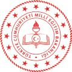

DEVLET KİTAPLARI

<!-- sayfa 1 -->

MİLLÎ EĞİTİM BAKANLIĞI YAYINLARI NO ........................................................... 9243
DERS KİTAPLARI DİZİSİ NO ................................................................................. 1929

Her hakkı saklıdır ve Millî Eğitim Bakanlığına aittir. Kitabın metin, soru ve
şekilleri kısmen de olsa hiçbir surette alınıp yayımlanamaz.

# HAZIRLAYANLAR

**Editör**
Şeyma KARATEPE

**Dil Uzmanı**
Hilal ARSLAN KUTLU
Gülsüm SİVRİ

**Görsel Tasarımcı**
Faize ULUSOY

**Çoklu Ortam Tasarımcısı**
Abdullah TAŞKIRAN

**Program Geliştirme Uzmanı**
Hasan TOPAL

**Ölçme ve Değerlendirme Uzmanı**
Şerife ERTUĞRUL

**Rehberlik Uzmanı**
Esra DEMİR

ISBN 978-975-11-7795-7

Millî Eğitim Bakanlığı Talim ve Terbiye Kurulunun 02/06/2023 tarih ve 29 sayılı Kurul kararı ile 
2024-2025 öğretim yılından itibaren 5 (beş) yıl süre ile Ders Kitabı olarak kabul edilmiştir.
Kurulca bu kitabın kabul edilmiş olması ders kitabından yayınevi ve yazarın sorumluluğunu

<!-- sayfa 2 -->

# İSTİKLÂL MARŞI

Korkma, sönmez bu şafaklarda yüzen al sancak;
Sönmeden yurdumun üstünde tüten en son ocak.
O benim milletimin yıldızıdır, parlayacak;
O benimdir, o benim milletimindir ancak.

Çatma, kurban olayım, çehreni ey nazlı hilâl!
Kahraman ırkıma bir gül! Ne bu şiddet, bu celâl?
Sana olmaz dökülen kanlarımız sonra helâl.
Hakkıdır Hakk’a tapan milletimin istiklâl.

Ben ezelden beridir hür yaşadım, hür yaşarım.
Hangi çılgın bana zincir vuracakmış? Şaşarım!
Kükremiş sel gibiyim, bendimi çiğner, aşarım.
Yırtarım dağları, enginlere sığmam, taşarım.

Garbın âfâkını sarmışsa çelik zırhlı duvar,
Benim iman dolu göğsüm gibi serhaddim var.
Ulusun, korkma! Nasıl böyle bir imanı boğar,
Medeniyyet dediğin tek dişi kalmış canavar?

Arkadaş, yurduma alçakları uğratma sakın;
Siper et gövdeni, dursun bu hayâsızca akın.
Doğacaktır sana va’dettiği günler Hakk’ın;
Kim bilir, belki yarın, belki yarından da yakın

Bastığın yerleri toprak diyerek geçme, tanı:
Düşün altındaki binlerce kefensiz yatanı.
Sen şehit oğlusun, incitme, yazıktır, atanı:
Verme, dünyaları alsan da bu cennet vatanı.

Kim bu cennet vatanın uğruna olmaz ki feda?
Şüheda fışkıracak toprağı sıksan, şüheda!
Cânı, cânânı, bütün varımı alsın da Huda,
Etmesin tek vatanımdan beni dünyada cüda.

Ruhumun senden İlâhî, şudur ancak emeli:
Değmesin mabedimin göğsüne nâmahrem eli.
Bu ezanlar -ki şehadetleri dinin temeli-
Ebedî yurdumun üstünde benim inlemeli.

O zaman vecd ile bin secde eder -varsa- taşım,
Her cerîhamdan İlâhî, boşanıp kanlı yaşım,
Fışkırır ruh-ı mücerret gibi yerden na’şım;
O zaman yükselerek arşa değer belki başım.

Dalgalan sen de şafaklar gibi ey şanlı hilâl!
Olsun artık dökülen kanlarımın hepsi helâl.
Ebediyyen sana yok, ırkıma yok izmihlâl;
Hakkıdır hür yaşamış bayrağımın hürriyyet;
Hakkıdır, Hakk'ın Türk milleti istiklâl!

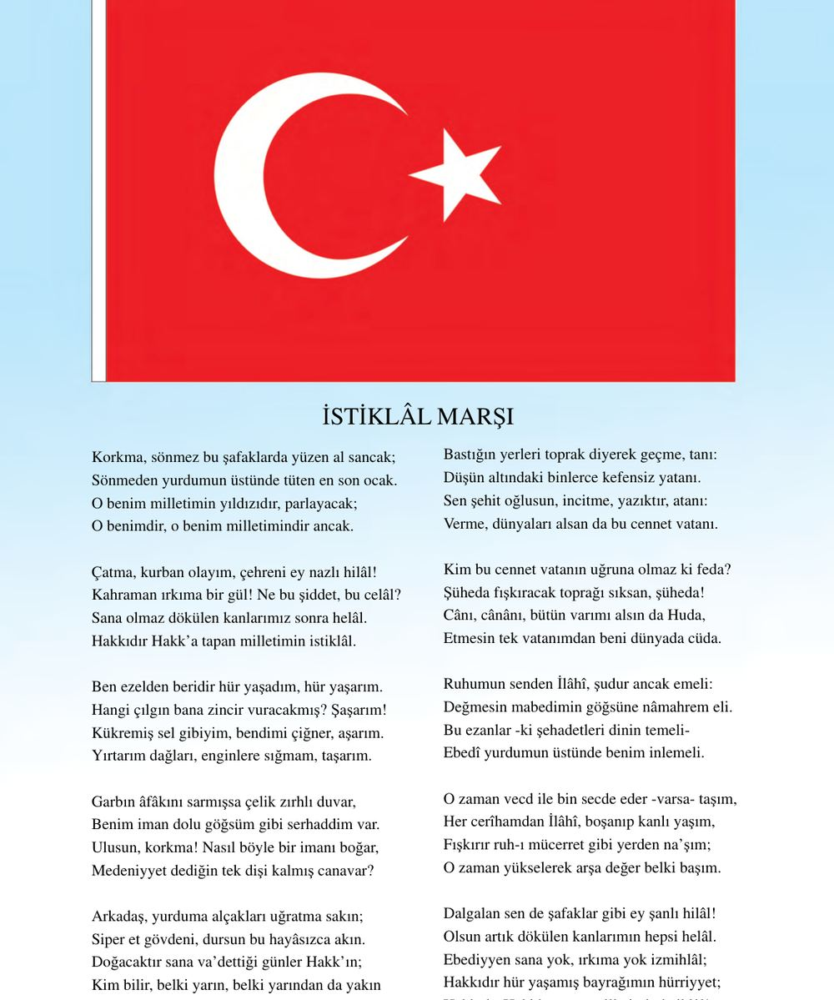
<!-- yer tutucu bulunamadı: sayfa sonuna eklendi -->

<!-- sayfa 3 -->

GENÇLİĞE HİTABE

Ey Türk gençliği! Birinci vazifen, Türk istiklâlini, Türk Cumhuriyetini, ilelebet muhafaza ve müdafaa etmektir.

Mevcudiyetinin ve istikbalinin yegâne temeli budur. Bu temel, senin en kıymetli hazinendir. İstikbalde dahi, seni bu hazineden mahrum etmek isteyecek dâhilî ve hâricî bedhahların olacaktır. Bir gün, istiklâl ve cumhuriyeti müdafaa mecburiyetine düşersen, vazifeye atılmak için, içinde bulunacağın vaziyetin imkân ve şeraitini düşünmeyeceksin! Bu imkân ve şerait, çok namüsait bir mahiyette tezahür edebilir. İstiklâl ve cumhuriyetine kastedecek düşmanlar, bütün dünyada emsali görülmemiş bir galibiyetin mümessili olabilirler. Cebren ve hile ile aziz vatanın bütün kaleleri zapt edilmiş, bütün tersanelerine girilmiş, bütün orduları dağıtılmış ve memleketin her köşesi bilfiil işgal edilmiş olabilir. Bütün bu şeraitten daha elîm ve daha vahim olmak üzere, memleketin dâhilinde iktidara sahip olanlar gaflet ve dalâlet ve hattâ hıyanet içinde bulunabilirler. Hattâ bu iktidar sahipleri şahsî menfaatlerini, müstevlîlerin siyasî emelleriyle tevhit edebilirler. Millet, fakr u zaruret içinde harap ve bîtap düşmüş olabilir.

Ey Türk istikbalinin evlâdı! İşte, bu ahval ve şerait içinde dahi vazifen, Türk istiklâl ve cumhuriyetini kurtarmaktır. Muhtaç olduğun kudret, damarlarındaki asil kanda mevcuttur.

Mustafa Kemal Atatürk

<!-- sayfa 4 -->

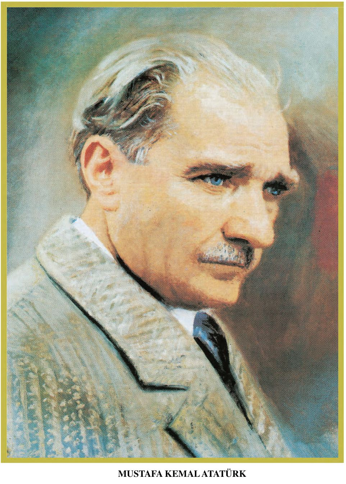

MUSTAFA KEMAL ATATÜRK

<!-- sayfa 5 -->

Verdiğiniz metin katmanı boş olduğu için (`<<< >>>` arası boş) dönüştürülecek bir içerik bulunmamaktadır. Lütfen metin katmanını içeren içeriği paylaşın, böylece talimatlarınıza uygun şekilde Markdown formatına çevirebilirim.

<!-- sayfa 6 -->

Organizasyon Şeması ............................................................................................................................................................................................................................... 8

### 1. ÜNİTE: GÜNLÜK HAYATTAKİ DİNÎ İFADELER
1. Günlük Konuşmalarda Dinî İfadeler ................................................................................................................................................................................................... 12
2. Dilek ve Dualarda Geçen Dinî İfadeler ........................................................................................................................................................................................... 25
3. Bir Dua Tanıyorum: Sübhaneke Duası ve Anlamı ........................................................................................................................................................................ 27
ÜNİTEMİZİ DEĞERLENDİRELİM .......................................................................................................................................................................................................................... 28

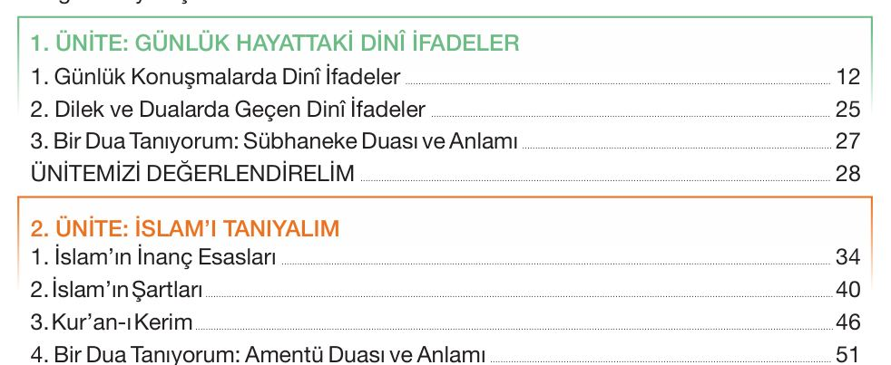
### 2. ÜNİTE: İSLAM'I TANIYALIM
1. İslam'ın İnanç Esasları ....................................................................................................................................................................................................................................... 34
2. İslam'ın Şartları ..................................................................................................................................................................................................................................................... 40
3. Kur'an-ı Kerim ......................................................................................................................................................................................................................................................... 46
4. Bir Dua Tanıyorum: Amentü Duası ve Anlamı ........................................................................................................................................................................................ 51
ÜNİTEMİZİ DEĞERLENDİRELİM .......................................................................................................................................................................................................................... 52

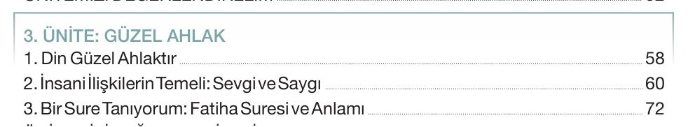
### 3. ÜNİTE: GÜZEL AHLAK
1. Din Güzel Ahlaktır .................................................................................................................................................................................................................

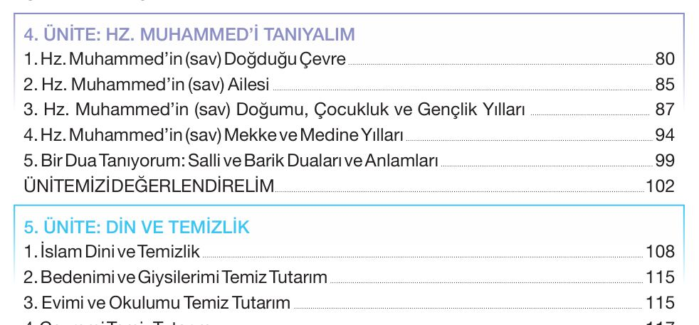
<!-- yer tutucu bulunamadı: sayfa sonuna eklendi -->

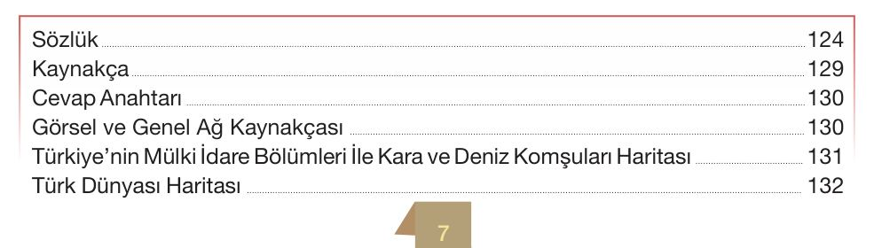
<!-- yer tutucu bulunamadı: sayfa sonuna eklendi -->

<!-- sayfa 7 -->

# Ünite Kapağı

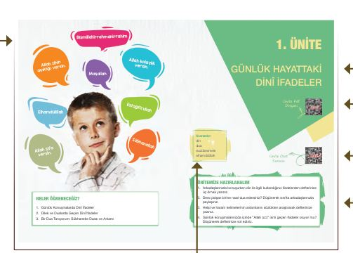

# Kavramlar

# Motivasyon Sorusu

# Ünite Metni

# Etkinlik Kutusu

## GÜNLÜK HAYATTAKİ DİNÎ İFADELER

### 1. Günlük Konuşmalarda Dinî İfadeler

Bir arkadaşınıza selam verirken hangi ifadeleri kullanıyorsunuz?

Günlük hayatımızda sabahtan akşama kadar birçok şey yaparız. Okula gider, derslerimizi dinler, arkadaşlarımızla oyun oynar, ailemizle vakit geçiririz. Bunları yaparken çevremizdekilerle iletişim içerisinde oluruz. Kelimeler ve cümleler, iletişimimizi sağlayan en önemli unsurlardır. Hayatımızın akışı içerisinde konuşmalarımızda kaynağını dinden alan kelime ve ifadelere de yer veririz. Bunlara dinî ifadeler denir. Bismillah, elhamdülillah, sübhanallah, estağfirullah, maşallah, inşallah bu ifadelerdendir.

### Allah (cc) ve Peygamber

Dikkatle baktığımızda evrende mükemmel bir düzenin var olduğunu görürüz. Gece ve gündüzün birbiri ardınca gelmesi, güneşin dünyayı ısıtması, çiçeklerin rengârenk açması, balıkların denizde yüzmesi, kuşların gökyüzünde uçması bu düzenin örneklerindendir. Evrendeki bu düzen, kendi başına var olamaz. Her şeyi yaratan, yüce bir varlığın olması gerekir. Bu varlık, Yüce Allah’tır. Allah (cc), kâinatın ve bütün varlıkların yaratıcısı olan tek ve yüce varlığın özel ismidir.$^1$ <!-- KONTROL: Marker'da karşılığı yok, uydurma olabilir --> O, her şeyi yaratan ve koruyandır. O’nun ortağı, dengi ve benzeri yoktur.

Bize sayısız nimet veren, her yaptığımızı gören, bizi seven ve en iyi bilen Yüce Allah’tır. Allah’ın (cc) yüceliğini hayatımızın her anında hisseder, günlük konuşmalarımızda O’nu anarak bazı ifadeler kullanırız. Örneğin sınava hazırlanan bir arkadaşımıza “Allah zihin açıklığı versin.”, hastalanan bir yakınımıza “Allah şifa versin.”, sevinçli bir haber alınca “Allah’a şükürler olsun.” deriz.

* (cc) ifadesi “Cellecelalüh” şeklinde okunur. “Allah’ın şanı yücedir.” anlamına gelir.
$^1$ <!-- KONTROL: Marker'da karşılığı yok, uydurma olabilir --> MEB Dinî Terimler Sözlüğü, s. 16. 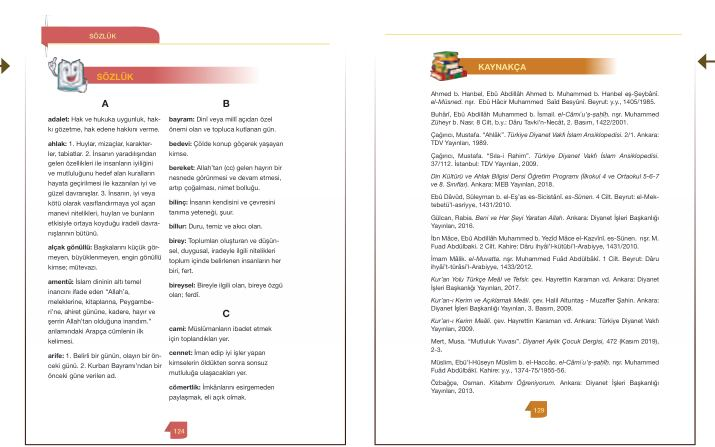

> **BİLGİ KUTUSU**
>
> Din; Yüce Allah tarafından peygamberler aracılığıyla akıl sahibi insanlara gönderilen, onları kendi tercihleriyle dünya ve ahiret mutluluğuna ulaştıran ilahi kurallardır. (bkz. MEB Dinî Terimler Sözlüğü, s. 59-60.)

## 1. ÜNİTE SONU DEĞERLENDİRME

**A. Aşağıdaki ifadelerden doğru olanların başına “D”, yanlış olanların başına “Y” yazınız.**

1. ( ) “Sübhanallah” diyerek Allah’ın (cc) bütün eksikliklerden uzak olduğunu kabul ederiz.
2. ( ) Haram, Allah’ın (cc) yapılmasını kesin olarak yasakladığı söz ve davranışlardır.
3. ( ) Allah’a (cc) teşekkürümüzü “Estağfirullah” ifadesiyle dile getiririz.
4. ( ) Maşallah, “Allah (cc) sizi her türlü kaza ve beladan korusun.” anlamına gelen bir duadır.
5. ( ) Bir yakınımız yolculuğa çıkarken ona “Allah’a (cc) emanet ol.” diyerek dua ederiz.

**B. Yukarıda verilen ifadelerden uygun olanlarıyla cümleleri tamamlayınız.**

inşallah, Allah şifa versin, helal, estağfirullah, teşrik tekbiri, sallallahü aleyhi vesellem

1. ........................................, Kurban Bayramı’nda farz namazların ardından okunur.
2. Yüce Allah’ın yapılmasına veya yenilip içilmesine izin verdiği şeylere ............................... denir.
3. Bir işin güzel bir şekilde sonuçlanmasını istediğimizde ............................. deriz.
4. Hz. Peygamber’in ismi anılınca ........................................ ifadesiyle ona selam göndeririz.
5. Hasta bir arkadaşımızı ziyaret ettiğimizde ........................................ diyerek ona dua ederiz.

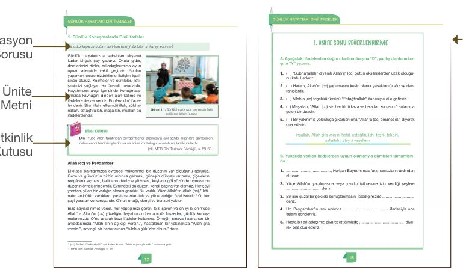

# Sözlük

### A
**adalet:** Hak ve hukuka uygunluk, hakkı gözetme, hak edene hakkını verme.
**ahlak:** 1. Huylar, mizaçlar, karakterler, tabiatlar. 2. İnsanın yaradılışından gelen özellikleri ile insanların iyiliğini ve mutluluğunu hedef alan kuralların hayata geçirilmesi ile kazanılan iyi ve güzel davranışlar. 3. İnsanın, iyi veya kötü olarak vasıflandırmaya yol açan manevi nitelikleri, huyları ve bunların etkisiyle ortaya koyduğu iradeli davranışlarının bütünü.
**alçak gönüllü:** Başkalarını küçük görmeyen, büyüklenmeyen, engin gönüllü kimse; mütevazı.
**amentü:** İslam dininin altı temel inancını ifade eden “Allah’a, meleklerine, kitaplarına, Peygamberine, ahiret gününe, kadere, hayır ve şerrin Allah’tan olduğuna inandım.” anlamındaki Arapça cümlenin ilk kelimesi.
**arife:** 1. Belirli bir günün, olayın bir önceki günü. 2. Kurban Bayramı’ndan bir önceki güne verilen ad.

### B
**bayram:** Dinî veya millî açıdan özel önemi olan ve topluca kutlanan gün.
**bedevi:** Çölde konup göçerek yaşayan kimse.
**bereket:** Allah’tan (cc) gelen hayrın bir nesnede görünmesi ve devam etmesi, artıp çoğalması, nimet bolluğu.
**bilinç:** İnsanın kendisini ve çevresini tanıma yeteneği, şuur.
**billur:** Duru, temiz ve akıcı olan.
**birey:** Toplumları oluşturan ve düşünsel, duygusal, iradeyle ilgili nitelikleri toplum içinde belirlenen insanların her biri, fert.
**bireysel:** Bireyle ilgili olan, bireye özgü olan; ferdî.

### C
**cami:** Müslümanların ibadet etmek için toplandıkları yer.
**cennet:** İman edip iyi işler yapan kimselerin öldükten sonra sonsuz mutluluğa ulaşacakları yer.
**cömertlik:** İmkânlarını esirgemeden paylaşmak, eli açık olmak.

# Kaynakça

Ahmed b. Hanbel, Ebû Abdillâh Ahmed b. Muhammed b. Hanbel eş-Şeybânî. *el-Musned*. nşr. Ebû Hâcir Muhammed Saîd Besyûnî. Beyrut: y.y., 1405/1985.
Buhârî, Ebû Abdillâh Muhammed b. İsmail. *el-Câmiu’ṣ-ṣahîh*. nşr. Muhammed Züheyr b. Nasr. 8 Cilt, b.y.: Dâru Tavki’n-Necât, 2. Basım, 1422/2001.
Çağırıcı, Mustafa. “Ahlâk”. *Türkiye Diyanet Vakfı İslam Ansiklopedisi*. 2/1. Ankara: TDV Yayınları, 1989.
Çağırıcı, Mustafa. “Sıla-i Rahim”. *Türkiye Diyanet Vakfı İslam Ansiklopedisi*. 37/112. İstanbul: TDV Yayınları, 2009.
*Din Kültürü ve Ahlak Bilgisi Dersi Öğretim Programı (İlkokul 4 ve Ortaokul 5-6-7 ve 8. Sınıflar)*. Ankara: MEB Yayınları, 2018.
Ebû Dâvûd, Süleyman b. el-Eş’as es-Sicistânî. *es-Sünen*. 4 Cilt. Beyrut: el-Mektebetü’l-asriyye, 1431/2010.
Gülcan, Rabia. *Beni ve Her Şeyi Yaratan Allah*. Ankara: Diyanet İşleri Başkanlığı Yayınları, 2016.
İbn Mâce, Ebû Abdillâh Muhammed b. Yezîd Mâce el-Kazvînî. *es-Sünen*. n...

<!-- sayfa 8 -->

# ETKİNLİK KUTULARI

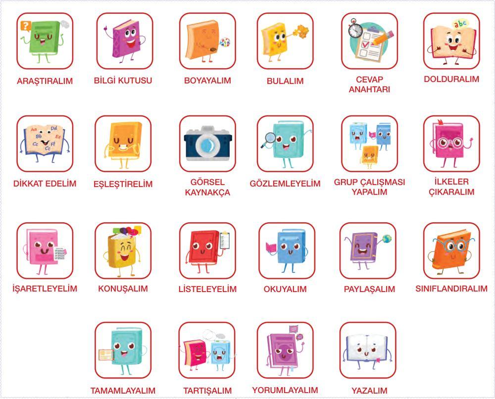

ARAŞTIRALIM
BİLGİ KUTUSU
BOYAYALIM
BULALIM
CEVAP ANAHTARI
DOLDURALIM
DİKKAT EDELİM
EŞLEŞTİRELİM
GÖRSEL KAYNAKÇA
GÖZLEMLEYELİM
GRUP ÇALIŞMASI YAPALIM
İLKELER ÇIKARALIM
İŞARETLEYELİM
KONUŞALIM
LİSTELEYELİM
OKUYALIM
PAYLAŞALIM
SINIFLANDIRALIM
TAMAMLAYALIM
TARTIŞALIM
YORUMLAYALIM
YAZALIM

Kitabınızda işlenen konunun daha iyi anlaşılmasına katkı sağlayacak çeşitli etkinlikler yer almaktadır.

## KISALTMALAR

| | | | |
| :--- | :--- | :--- | :--- |
| as | : aleyhisselam | Hz. | : Hazreti |
| b. | : bin, binti (oğlu, kızı) | MEB | : Millî Eğitim Bakanlığı |
| bk. | : bakınız. | ra | : radıyallahüanh |
| C: | : cilt | s. | : sayfa |
| cc: | : cellecelalüh | sav | : Sallallahü aleyhi vesellem |
| çev. | : çeviren | TDV | : Türkiye Diyanet Vakfı |
| ed. | : editör | thk. | : tahkik |
| haz. | : hazırlayan | vd. | : ve diğerleri |

Kitap genelinde kullanılan metinlerin imla ve noktalamasında aslına sadık kalınmıştır

<!-- sayfa 9 -->

Bismillahirrahmanirrahîm

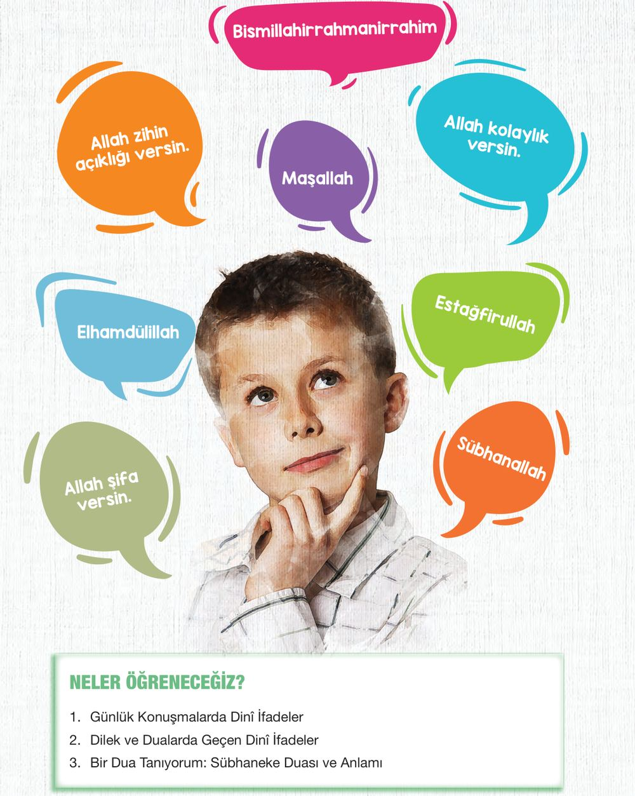

* Allah zihin açıklığı versin.
* Maşallah
* Allah kolaylık versin.
* Elhamdülillah
* Estağfirullah
* Allah şifa versin.
* Sübhanallah

## NELER ÖĞRENECEĞİZ?

1. Günlük Konuşmalarda Dinî İfadeler
2. Dilek ve Dualarda Geçen Dinî İfadeler
3. Bir Dua Tanıyorum: Sübhaneke Duası ve Anlamı

<!-- sayfa 10 -->

# 1. ÜNİTE
# GÜNLÜK HAYATTAKİ DİNÎ İFADELER

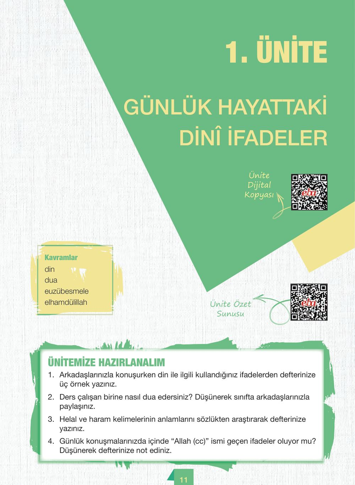: Ünite Dijital Kopyası

**Kavramlar**
din
dua
euzübesmele
elhamdülillah

: Ünite Özet Sunusu

## ÜNİTEMİZE HAZIRLANALIM

1. Arkadaşlarınızla konuşurken din ile ilgili kullandığınız ifadelerden defterinize üç örnek yazınız.
2. Ders çalışan birine nasıl dua edersiniz? Düşünerek sınıfta arkadaşlarınızla paylaşınız.
3. Helal ve haram kelimelerinin anlamlarını sözlükten araştırarak defterinize yazınız.
4. Günlük konuşmalarınızda içinde “Allah (cc)” ismi geçen ifadeler oluyor mu? Düşünerek defterinize not ediniz.

<!-- sayfa 11 -->

# 1. Günlük Konuşmalarda Dinî İfadeler

*Bir arkadaşınıza selam verirken hangi ifadeleri kullanıyorsunuz?*

Günlük hayatımızda sabahtan akşama kadar birçok şey yaparız. Okula gider, derslerimizi dinleriz. Arkadaşlarımızla oyun oynar, ailemizle vakit geçiririz. Bunları yaparken çevremizdekilerle iletişim içerisinde oluruz. Kelimeler ve cümleler iletişimimizi sağlayan en önemli unsurlardır. Hayatımızın akışı içerisinde konuşmalarımızda kaynağını dinden alan kelime ve ifadelere de yer veririz. Bunlara dinî ifadeler denir. Bismillah, elhamdülillah, sübhanallah, estağfirullah, maşallah, inşallah bu ifadelerdendir.

> Görsel 1.1: Günlük hayatımızda çevremizle farklı şekillerde iletişim kurarız.

***

> **BİLGİ KUTUSU**
>
> *Din; Yüce Allah tarafından peygamberler aracılığıyla akıl sahibi insanlara gönderilen, onları kendi tercihleriyle dünya ve ahiret mutluluğuna ulaştıran ilahi kurallardır.*
>
> (bk. MEB Dinî Terimler Sözlüğü, s. 59-60.)

***

## Allah (cc) ve Peygamber

Dikkatle baktığımızda evrende mükemmel bir düzenin var olduğunu görürüz. Gece ve gündüzün birbiri ardınca gelmesi, güneşin dünyayı ısıtması, çiçeklerin rengârenk açması, balıkların denizde yüzmesi, kuşların gökyüzünde uçması bu düzenin örneklerindendir. Evrendeki bu düzen, kendi başına var olamaz. Her şeyi yaratan, yüce bir varlığın olması gerekir. Bu varlık, Yüce Allah’tır. Allah (cc),* kâinatın ve bütün varlıkların yaratıcısı olan tek ve yüce varlığın özel ismidir.$^1$ <!-- KONTROL: Marker'da karşılığı yok, uydurma olabilir --> O, her şeyi yaratan ve koruyandır. O’nun ortağı, dengi ve benzeri yoktur.

Bize sayısız nimet veren, her yaptığımızı gören, bizi seven ve en iyi bilen Yüce Allah’tır. Allah’ın (cc) yüceliğini hayatımızın her anında hisseder, günlük konuşmalarımızda O’nu anarak bazı ifadeler kullanırız. Örneğin sınava hazırlanan bir arkadaşımıza “Allah zihin açıklığı versin.”, hastalanan bir yakınımıza “Allah şifa versin.”, sevinçli bir haber alınca “Allah’a şükürler olsun.” deriz.

***
\* (cc) ifadesi “Cellecelalüh” şeklinde okunur. “Allah’ın şanı yücedir.” anlamına gelir.

<!-- yer tutucu bulunamadı: sayfa sonuna eklendi -->

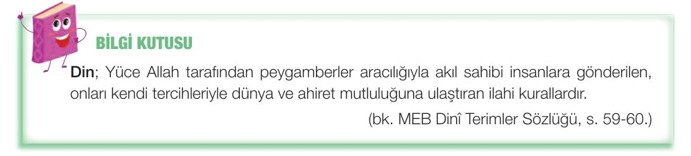
<!-- yer tutucu bulunamadı: sayfa sonuna eklendi -->

<!-- sayfa 12 -->

Yüce Allah; bütün evreni yaratan, idare edip yöneten ve yarattığı varlıkları gözetendir. Bunun için de insanlara hem bu dünyada hem de ahirette mutluluğa kavuşmanın yollarını gösteren rehberler göndermiştir. Bu rehberlere peygamber denir. Yüce Allah; insanları çok sevdiği, onların iyi ve güzel davranışlarda bulunmalarını istediği için peygamberler göndermiştir.

Peygamberler; hayatın her alanında bize örnek olur, nasıl ibadet edeceğimizi ve nasıl iyi bir insan olacağımızı öğretirler. Peygamberlerin rehberlikleri sayesinde Yüce Allah’ı daha iyi tanırız. Ayrıca peygamberlerin söz ve davranışlarını öğrenip uygulamak bize mutluluk getirir. Bizler de onları sevgi ve saygıyla anarız.

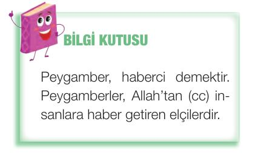

> **BİLGİ KUTUSU**
>
> Peygamber, haberci demektir. Peygamberler, Allah’tan (cc) insanlara haber getiren elçilerdir.

## Besmele

İslam dini, emir ve tavsiyeleriyle hayatımıza yön verir. Güzel davranışları emreder, kötü davranışlardan sakındırır. Yemek yemek, okula gitmek, ders çalışmak, uyumak gibi günlük hayatta yaptığımız işlerde Allah’ın (cc) adını, yüceliğini anmamızı tavsiye eder. Allah’ın (cc) adını anarak yaptığımız işin, O’nun izniyle gerçekleştiğini hatırlatan ifadelerden biri de besmeledir.

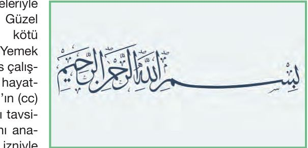
Görsel 1.2: Besmele hattı

Besmele, “Rahman ve Rahîm olan Allah’ın adıyla” anlamına gelen “Bismillâhir-rahmânirraḥîm” ifadesinin adıdır. Bazen kısaca Bismillah da denir. “Eûzü billâhi mine’ş-şeytâni’r-racîm” ifadesiyle birlikte söylenirse buna **euzübesmele** denir. Euzübesmele, “Kovulmuş şeytanın şerrinden Allah’a sığınırım. Rahman ve Rahîm olan Allah’ın adıyla.” anlamına gelir.$^2$ <!-- KONTROL: Marker'da karşılığı yok, uydurma olabilir --> Yüce Allah, Kur’an-ı Kerim’de “**Yaratan Rabbinin adıyla oku!**”$^3$ <!-- KONTROL: Marker'da karşılığı yok, uydurma olabilir --> buyurmuştur. Bu emir, söz ve davranışların başlangıcında besmele çekilmesine işaret eder.

Hz. Muhammed (sav)$^*$; konuşurken ya da bir iş yaparken besmele çekmiş, bizlere de bunu tavsiye etmiştir.$^4$ <!-- KONTROL: Marker'da karşılığı yok, uydurma olabilir --> Bir işe besmeleyle başlayınca “Biz bu işi Allah’ın (cc) adıyla, O’nun rızası için ve O’nun izniyle yapıyoruz.” demek isteriz. Bu sözle

---
$^2$ <!-- KONTROL: Marker'da karşılığı yok, uydurma olabilir --> bk. MEB Dinî Terimler Sözlüğü, s. 81.
$^3$ <!-- KONTROL: Marker'da karşılığı yok, uydurma olabilir --> Alak suresi, 1. ayet.
$^4$ <!-- KONTROL: Marker'da karşılığı yok, uydurma olabilir --> bk. Tirmizi, Deavât, 35; Ebu Davud, Et’ime, 15.

$^*$ (sav) ifadesi “Sallallahü aleyhi vesellem” sözünün kısaltılmış hâlidir ve “Allah (cc) ona salat ve selam eyle-

<!-- sayfa 13 -->

Allah’a (cc) olan sevgimizi ve bağlılığımızı ifade ederiz. Bütün nimetlerin O’ndan olduğunu kabul ederiz. Yüce Allah’ın yardımının her an yanımızda olduğunu hissederiz.

Günlük hayatta yapılan bir işin başlangıcında besmele çekmek, Allah’a (cc) inanın ve bağlılığın samimi bir ifadesidir. Bu nedenle evden çıkarken, sınava girerken, yemeğe başlarken, yatarken, elbisemizi giyerken besmele çekeriz. Abdest alırken ve Kur’an okumaya başlarken Allah’ın (cc) adını anarız. Kur’an-ı Kerim’den bir bölüm okumak istediğimizde ilk yapmamız gereken “Eûzü billâhi mine’ş-şeytâni’r-racîm-Bismillâhirraḥmânirraḥîm” demektir.

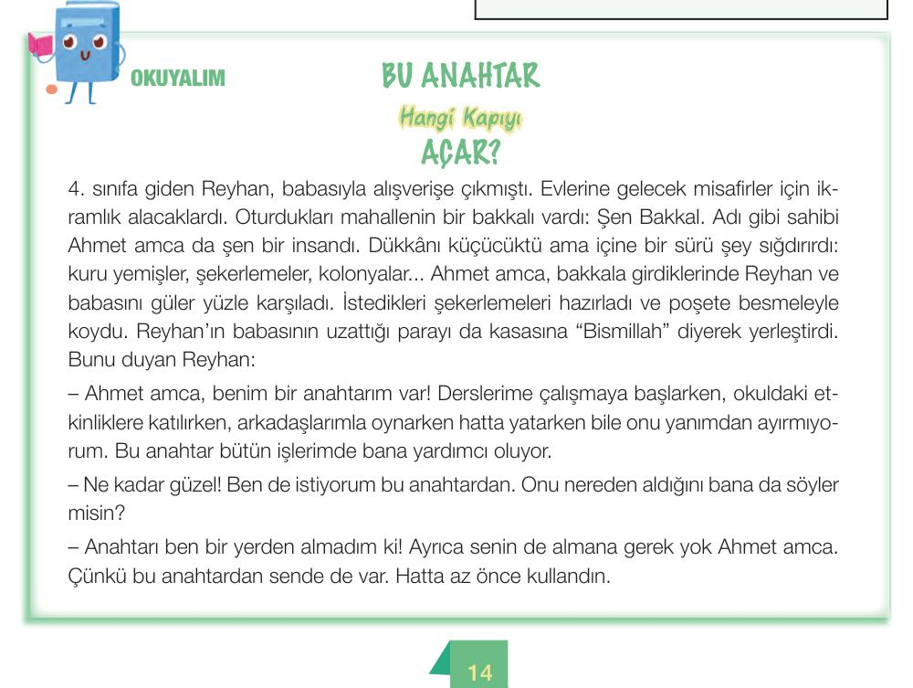
> **BİLGİ KUTUSU**
> 
> Besmele, Kur’an-ı Kerim’in içinden bir cümledir ve surelerin başında euzübesmele okunur.

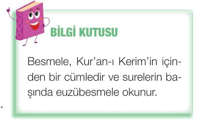
Görsel 1.3: Ders çalışmaya başlarken besmele çekeriz.

# OKUYALIM

## BU ANAHTAR Hangi Kapıyı AÇAR?

4. sınıfa giden Reyhan, babasıyla alışverişe çıkmıştı. Evlerine gelecek misafirler için ikramlık alacaklardı. Oturdukları mahallenin bir bakkalı vardı: Şen Bakkal. Adı gibi sahibi Ahmet amca da şen bir insandı. Dükkânı küçücüktü ama içine bir sürü şey sığdırırdı: kuru yemişler, şekerlemeler, kolonyalar... Ahmet amca, bakkala girdiklerinde Reyhan ve babasını güler yüzle karşıladı. İstedikleri şekerlemeleri hazırladı ve poşete besmeleyle koydu. Reyhan’ın babasının uzattığı parayı da kasasına “Bismillah” diyerek yerleştirdi. Bunu duyan Reyhan:

– Ahmet amca, benim bir anahtarım var! Derslerime çalışmaya başlarken, okuldaki etkinliklere katılırken, arkadaşlarımla oynarken hatta yatarken bile onu yanımdan ayırmıyorum. Bu anahtar bütün işlerimde bana yardımcı oluyor.

– Ne kadar güzel! Ben de istiyorum bu anahtardan. Onu nereden aldığını bana da söyler misin?

– Anahtarı ben bir yerden almadım ki! Ayrıca senin de almana gerek yok Ahmet amca. Çünkü bu anahtardan sende de var. Hatta az önce kullandın.

<!-- sayfa 14 -->

Ahmet amca bunu duyunca gülümseyerek cebinden bakkalının anahtarını çıkardı:
– Bende bir anahtar var ama bu bakkalın kapısını açıyor. Sen hangi anahtardan bahsediyorsun, anlayamadım.
Merak eden Ahmet amcayı daha fazla bekletmek istemeyen Reyhan, anahtarının ne olduğunu ona anlattı:
– Benim anahtarımın adı, besmele. Az önce poşete şekerleri doldurmadan önce yaptığın gibi ben de işlerime besmeleyle başlıyor ve Allah’ın adını anıyorum.
– Aferin sana! Besmeleyle başlanan iş bereketli olur. O yüzden ben de bakkalımı her sabah erkenden besmeleyle açarım. Peki, sen bu anahtarını başka ne zaman kullanıyorsun?
– Sabah yataktan kalkarken, ellerimi yıkarken, evden çıkarken, sınıfa girerken, sınavlara çalışırken, yemek yerken besmele anahtarımı kullanıyorum. Günlük hayatta yaptığım işlere Allah’ın adını anarak başladığımda o iş benim için daha kolaylaşıyor. Besmele anahtarı, kapıları teker teker açıyor. 
Ahmet amca, Reyhan’ın bu sözlerini mutlulukla dinledi. Mahalledeki arkadaşlarına da besmele anahtarından bahsetmesi için onu sıkı sıkı tembihledi.

(Bu kitap için yazılmıştır.)

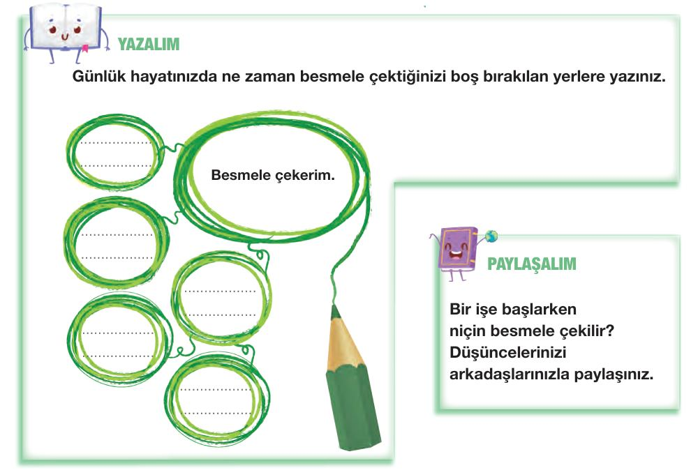

## YAZALIM

**Günlük hayatınızda ne zaman besmele çektiğinizi boş bırakılan yerlere yazınız.**

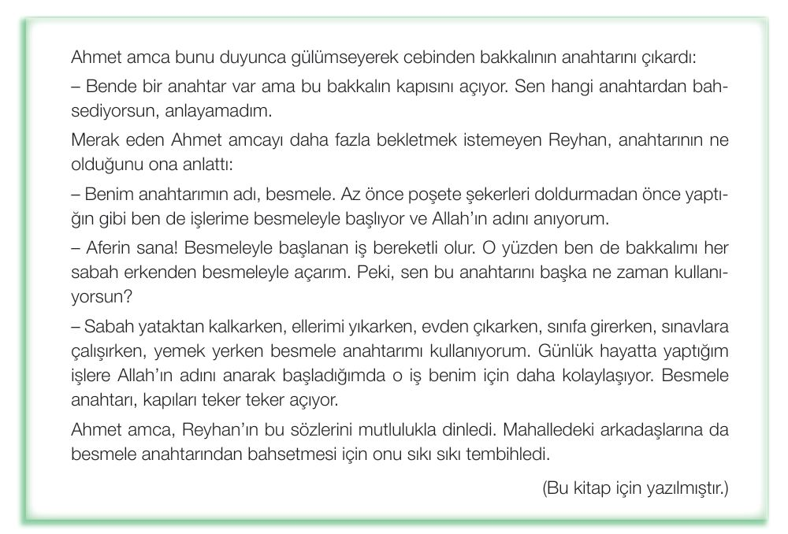

Besmele çekerim.
..................
..................
..................
..................
..................
..................
..................
..................
..................
..................

### PAYLAŞALIM

Bir işe başlarken niçin besmele çekilir? Düşüncelerinizi arkadaşlarınızla paylaşınız.

<!-- sayfa 15 -->

# Selam

İnsanlar bir topluluk içinde yaşamlarını sürdürür. Evde, mahallede, okulda, iş yerinde, camide birbirleriyle karşılaşırlar. Bizler de günlük yaşantımızda arkadaşlarımız, öğretmenlerimiz, komşularımızla karşılaşır ve onlarla iletişim kurarız. İletişimin ilk adımı selamlaşmadır. Selamlaşma, karşımızdakine “Benden sana zarar gelmez.” mesajını vermek ve onun güven içinde olmasını dilemektir.

Selamlaşmak için çeşitli ifadeler kullanılabilir. İslam dininde selamlaşma; karşılaşan iki kişiden birinin diğerine “Selamünaleyküm” demesi, diğerinin de buna “Aleykümselam” diye karşılık vermesidir. Bu ifadeler, “Selam sizin üzerinize olsun, Allah (cc) sizi her türlü kaza ve beladan korusun.” anlamlarına gelen bir duadır.

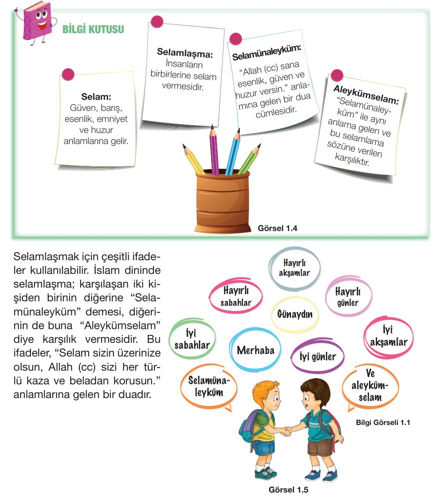

**BİLGİ KUTUSU**

* **Selam:** Güven, barış, esenlik, emniyet ve huzur anlamlarına gelir.
* **Selamlaşma:** İnsanların birbirlerine selam vermesidir.
* **Selamünaleyküm:** “Allah (cc) sana esenlik, güven ve huzur versin.” anlamına gelen bir dua cümlesidir.
* **Aleykümselam:** “Selamünaleyküm” ile aynı anlama gelen ve bu selamlamaya sözüne verilen karşılıktır.

Görsel 1.4

<!-- sayfa 16 -->

Selamlaşma, insanların birbirlerine duyduğu güvenin ilk adımıdır. Kalplerde sevgi duygusunu ortaya çıkarır ve birçok kırgınlığı giderir. Toplumda huzur ve mutluluk ortamı oluşturur. Hz. Muhammed (sav), insanların birbirleriyle selamlaşmasını tavsiye etmiş ve şöyle buyurmuştur: “Siz iman etmedikçe cennete giremezsiniz, birbirinizi sevmedikçe de iman etmiş olmazsınız. Yaptığınız zaman birbirinizi seveceğiniz bir şey söyleyeyim mi? Aranızda selamı yayınız.”$^5$ <!-- KONTROL: Marker'da karşılığı yok, uydurma olabilir -->

İslam dininde selamlaşmak dinî bir görevdir. Selamlaşan Müslümanlar, birbirlerinin iyiliği için Allah’a (cc) dua etmiş olurlar. Yüce Allah, Kur’an-ı Kerim’de “**Size bir selam verildiği zaman ondan daha güzeliyle veya aynı selamla karşılık verin...**”$^6$ <!-- KONTROL: Marker'da karşılığı yok, uydurma olabilir --> buyurarak bu duanın karşılıklı olmasını emretmiştir.

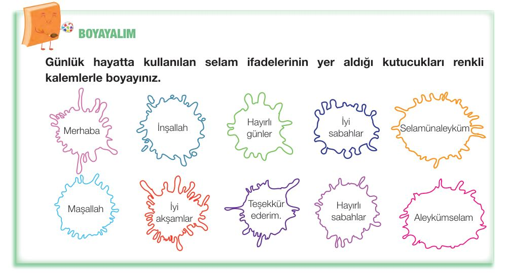

### BOYAYALIM

**Günlük hayatta kullanılan selam ifadelerinin yer aldığı kutucukları renkli kalemlerle boyayınız.**

* Merhaba
* İnşallah
* Hayırlı günler
* İyi sabahlar
* Selamünaleyküm
* Maşallah
* İyi akşamlar
* Teşekkür ederim.
* Hayırlı sabahlar
* Aleykümselam

Eve geldiğimizde ev halkına, sınıfa girdiğimizde sınıftakilere, evimize gelen misafirlere selam veririz. Böylece karşımızdakine iyi niyet ve sevgi dileklerimizi iletiriz. Birbirimize güvenir, aramızdaki sevgi ve dostluk bağını güçlendiririz. Bu nedenle selamlaşmayı önemsemeli; evde, okulda, sınıfta, mahallede karşılaştığımız insanlara selam vermeyi unutmamalıyız.

**Görsel 1.6:** Arkadaşlarımızla selamlaşmak, saygı ve nezaketin göstergesidir.

---
$^5$ <!-- KONTROL: Marker'da karşılığı yok, uydurma olabilir --> Müslim İman 93

<!-- sayfa 17 -->

**YORUMLAYALIM**

Hz. Peygamber, Enes b. Malik’e (ra)* verdiği bir öğütte şöyle buyurmuştur: “Yavrucuğum! Ailenin yanına girdiğin zaman selam ver. Bu, senin ve ailen için bereket olur.”
(Tirmizi, İsti’zân, 10.)

**Bu hadisi selamın önemi açısından yorumlayınız.**

---

# Hamt ve Şükür

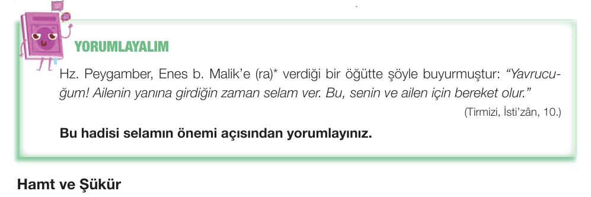

İhtiyaç duyduklarında çevremizdeki insanlara yardım ederiz. Ailemize, arkadaşlarımıza, komşularımıza iyiliklerde bulunuruz. Hoşumuza giden bir durumla karşılaştığımızda böyle davranan kimseye teşekkür etmek isteriz.

Evrendeki bütün güzellikler, Allah’ın (cc) yaratmasıyla var olur. Yüce Allah, bütün nimetleri gönderen, herkesi yaratan ve yaşatandır. Her türlü övgü ve teşekkür de O’na aittir.

Allah’ın (cc) vermiş olduğu sayısız nimeti fark ederek söz ve davranışlarımızla O’na teşekkür etmeye şükür denir. Allah’a (cc) teşekkür etmek için günlük hayatımızda kullandığımız bazı dinî ifadeler vardır. Hamt, bu ifadelerden biridir. İyilik, güzellik, övme ve yüceltme anlamlarına gelir. Hamt, her işte Allah’ı (cc) hatırlama ve O’nun yüceliğinin farkında olmaktır. Allah’a (cc) teşekkürümüzü “Allah’a hamdolsun.” ve “Allah’a şükürler olsun.” ifadeleriyle dile getiririz. Günlük dilimizde kullandığımız diğer şükür ifadesi ise “Elhamdülillah.”tır. Elhamdülillah, elimizde bulunan ve bulunmasını istediğimiz her türlü nimetten dolayı “Şükür Allah’adır (cc), övgü ve yücelik Allah’a (cc) aittir.” anlamlarına gelir.$^7$ <!-- KONTROL: Marker'da karşılığı yok, uydurma olabilir -->

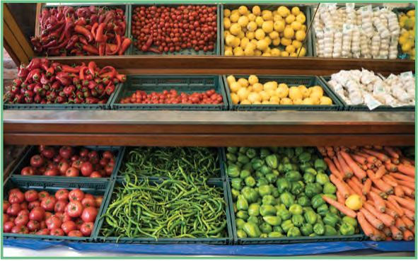
Görsel 1.7: Verdiği nimetler için Yüce Allah’a şükretmeliyiz.

Nimetlerinden faydalandığımız için Yüce Allah’a minnettar olur, O’na hamdederiz. Yemeğimizi bitirdiğimizde ve su içtikten sonra “Allah’a şükür.” veya “Elhamdülillah!” deriz. Böylece Allah’a (cc) bize verdiği yiyecek ve içecekler için teşekkür etmiş oluruz.

---
* (ra) ifadesi “radıyallahüanh” sözünün kısaltılmış hâlidir ve “Allah ondan razı olsun” anlamına gelir.

<!-- sayfa 18 -->

Birisi bize “Nasılsın?” diye sorduğunda “Şükürler olsun.”, “Hamdolsun.” veya “Elhamdülillah.” diyerek cevap veririz. Böylece sağlıklı olduğumuzu ve bunun için Allah’a (cc) şükrettiğimizi belirtiriz. Ödevlerimizi tamamladığımızda, evimize sağlıcakla ulaştığımızda, sahip olduğumuz nimetleri hatırladığımızda Allah’a (cc) şükrederiz.

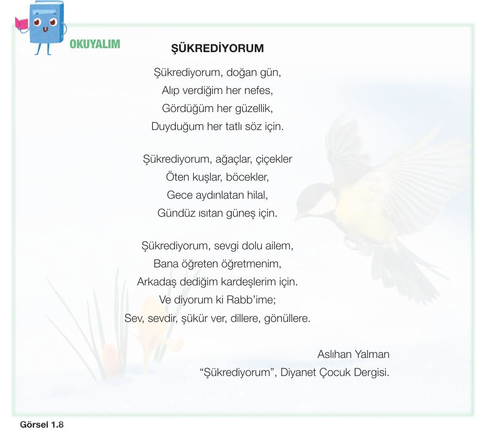
**DİKKAT EDELİM**

“Öyleyse yalnız beni anın ki ben de sizi anayım. Bana şükredin, sakın nankörlük etmeyin.”
(Bakara suresi, 152. ayet.)

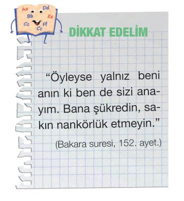
**OKUYALIM**

# ŞÜKREDİYORUM

Şükrediyorum, doğan gün,
Alıp verdiğim her nefes,
Gördüğüm her güzellik,
Duyduğum her tatlı söz için.

Şükrediyorum, ağaçlar, çiçekler
Öten kuşlar, böcekler,
Gece aydınlatan hilal,
Gündüz ısıtan güneş için.

Şükrediyorum, sevgi dolu ailem,
Bana öğreten öğretmenim,
Arkadaş dediğim kardeşlerim için.
Ve diyorum ki Rabb’ime;
Sev, sevdir, şükür ver, dillere, gönüllere.

Aslıhan Yalman
“Şükrediyorum”, Diyanet Çocuk Dergisi.

Görsel 1.8

<!-- sayfa 19 -->

# Estağfirullah ve Sübhanallah

İnsanlar, günlük hayatta istemeden de olsa Allah’ın (cc) hoşnut olmayacağı davranışlarda bulunabilir. Hata işleyen bir insan, sergilediği davranıştan pişman olur. Aynı şeyi bir daha yapmamaya karar vererek Allah’tan (cc) bağışlanma diler. Estağfirullah, hata ve günahlarımızdan pişman olup Allah’tan (cc) bizi affetmesini isterken kullandığımız bir dua cümlesidir. “Allah’tan (cc) bağışlanma dilerim.” anlamına gelir. Estağfirullah duasıyla insan, Allah’ı (cc) ve O’nun yüceliğini tanır. Hata ve günahlarını bir daha işlemeyeceğine söz verir. Allah’ın (cc) yardımına ve affına sığınır.

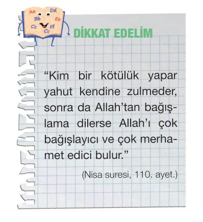

Çevremizdeki insanlara karşı zaman zaman hatalı davranışlarda bulunabilir, onları rahatsız edecek sözler söyleyebiliriz. Bu durumda yaptığımız yanlışın farkına varıp karşımızdaki kişiden özür dileriz. Bunun gibi, Allah’ın (cc) hoşnut olmadığı bir davranışta bulunduğumuzda da O’ndan bizi affetmesini dileriz. Yüce Allah da bize, hem diğer insanlara hem kendisine karşı yaptığımız hatalardan dönmemizi ve bağışlanma dilememizi emreder. Bizler nasıl ki çevremizdeki insanlara yaptığımız yanlışa karşılık özür diliyorsak Yüce Allah’ın hoşnut olmadığı bir davranışta bulunduğumuzda da O’ndan bağışlanma dileriz.

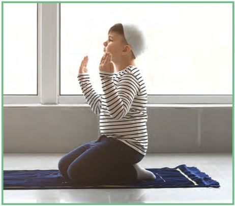

Dünyadaki her canlı, yaşamını sürdürebilmek için bir başkasına ihtiyaç duyar. Bir tohumun yeşerebilmesi için toprağa ekilmesi gerekir. Kuşların beslenmek için bitkilere, balıkların yaşamak için suya ihtiyacı vardır. Allah (cc) ise hiçbir şeye muhtaç olmayan tek varlıktır. Bütün bunları bilmek, Allah’ın (cc) yüceliğini anlamamızı sağlar. Allah’ın (cc) yüceliğini ve büyüklüğünü ifade etmek için “Sübhanallah” ifadesini kullanırız.

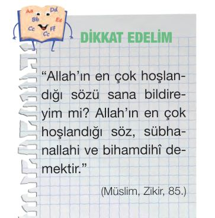

Görsel 1.9: Yüce Allah'tan bağışlanma dilemek için "Estağfirullah" ifadesiyle dua edilir.

<!-- sayfa 20 -->

Sübhanallah, Allah’ın (cc) bütün eksiklerden ve kusurlardan uzak olduğu anlamına gelen bir dua cümlesidir. “Sübhanallah” diyerek her zaman Allah’ın (cc) büyüklüğünü hatırlar, O’nun hiçbir şeye muhtaç olmadığını ve bütün eksikliklerden uzak olduğunu kabul ederiz.

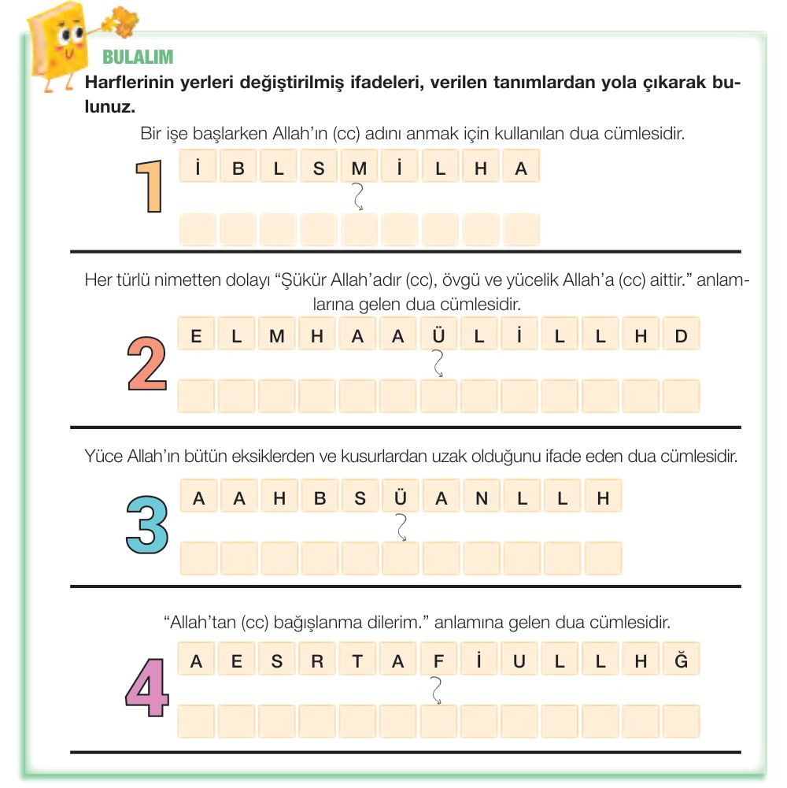
Görsel 1.10: Evrendeki her şeyi Yüce Allah yaratmıştır.

***

**BULALIM**
Harflerinin yerleri değiştirilmiş ifadeleri, verilen tanımlardan yola çıkarak bulunuz.

1. Bir işe başlarken Allah’ın (cc) adını anmak için kullanılan dua cümlesidir.
   İ B L S M İ L H A
   \_\_\_\_\_\_\_\_\_\_\_\_\_\_\_

2. Her türlü nimetten dolayı “Şükür Allah’adır (cc), övgü ve yücelik Allah’a (cc) aittir.” anlamlarına gelen dua cümlesidir.
   E L M H A A Ü L İ L L H D
   \_\_\_\_\_\_\_\_\_\_\_\_\_\_\_\_\_\_\_\_\_\_

3. Yüce Allah’ın bütün eksiklerden ve kusurlardan uzak olduğunu ifade eden dua cümlesidir.
   A A H B S Ü A N L L H
   \_\_\_\_\_\_\_\_\_\_\_\_\_\_\_\_\_\_\_\_\_

4. “Allah’tan (cc) bağışlanma dilerim.” anlamına gelen dua cümlesidir.
   A E S R T A F İ U L L H Ğ
   \_\_\_\_\_\_\_\_\_\_\_\_\_\_\_\_\_\_\_\_\_\_\_

<!-- sayfa 21 -->

# Tekbir ve Salavat

“Allahüekber.” ifadesine tekbir denir. Tekbir, Allah’ın (cc) her şeyden yüce olduğunun ifadesidir ve “Allah en büyüktür.” anlamına gelir. Allah’ın (cc) büyüklüğünü, yüceliğini anmak için söylenir. Müslümanlar, namaz kılmaya tekbirle başlar.

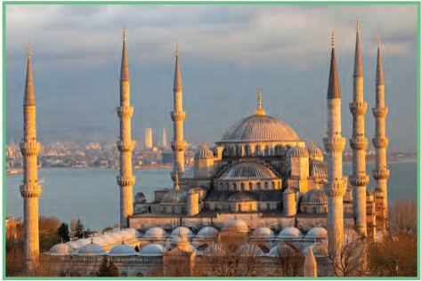

Günlük hayatta da “Allahüekber.” sözünü sıklıkla duyarız. Her namaz vaktinde minarelerden okunan ezan, “Allahüekber.” sözüyle başlar. Güzel bir haber alınca mutluluğumuzu “Allahüekber.” diyerek dile getirir ve Allah’ın (cc) büyüklüğünü anarız.

Hz. Muhammed’i (sav) anmak ve ona selam göndermek için okunan dualara salavat denir. Bu duaları okumaya, salatüselam ya da salavat getirmek denir. Müslümanlar, Hz. Muhammed’e (sav) olan sevgilerini göstermek istediklerinde onun için dua eder ve ona selam gönderirler. Yüce Allah, Kur’an-ı Kerim’de “Şüphesiz Allah ve melekleri, Peygamber’e salat ediyorlar. Ey iman edenler! Siz de ona salat edin, selam verin.”$^8$ <!-- KONTROL: Marker'da karşılığı yok, uydurma olabilir --> buyurmuş ve Müslümanlardan Hz. Muhammed’e (sav) salavat getirmelerini istemiştir.

Salavat getiren kişi, Hz. Muhammed’i (sav) andığı gibi Yüce Allah’ı da hatırlar. Onları hatırlamanın mutluluğunu yaşar. Kendilerine örnek bir peygamber gönderdiği için Allah’a (cc) şükreder. Hz. Peygamber, “Günlerinizin en faziletlisi cuma günüdür. Bu sebeple o gün bana çokça salatüselam getiriniz, zira sizin salatüselamlarınız bana sunulur.”$^9$ <!-- KONTROL: Marker'da karşılığı yok, uydurma olabilir --> buyurmuş, kendisine salavat getirmenin önemini vurgulamıştır.

**Görsel 1.11:** Minarelerden her gün Allahüekber nidalarını duyarız.

---

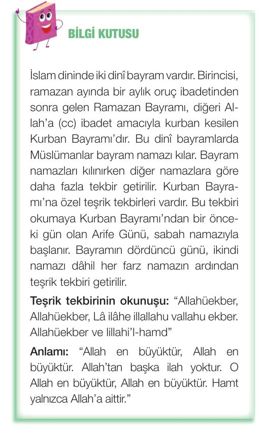
## BİLGİ KUTUSU

İslam dininde iki dinî bayram vardır. Birincisi, ramazan ayında bir aylık oruç ibadetinden sonra gelen Ramazan Bayramı, diğeri Allah’a (cc) ibadet amacıyla kurban kesilen Kurban Bayramı’dır. Bu dinî bayramlarda Müslümanlar bayram namazı kılar. Bayram namazları kılınırken diğer namazlara göre daha fazla tekbir getirilir. Kurban Bayramı’na özel teşrik tekbirleri vardır. Bu tekbiri okumaya Kurban Bayramı’ndan bir önceki gün olan Arife Günü, sabah namazıyla başlanır. Bayramın dördüncü günü, ikindi namazı dâhil her farz namazın ardından teşrik tekbiri getirilir.

**Teşrik tekbirinin okunuşu:** “Allahüekber, Allahüekber, Lâ ilâhe illallahu vallahu ekber. Allahüekber ve lillahi’l-hamd”

**Anlamı:** “Allah en büyüktür, Allah en büyüktür. Allah’tan başka ilah yoktur. O Allah en büyüktür, Allah en büyüktür. Hamt yalnızca Allah’a aittir.”

<!-- sayfa 22 -->

Hz. Peygamber’e salavat getirilirken çeşitli ifadeler kullanılır. Bu ifadelerden biri “Allahümme salli alâ Muhammedin ve alâ âli Muhammed”dir. Bu söz, “Allah’ım, Hz. Muhammed’e ve onun ailesine rahmet et.” anlamına gelir. Hz. Peygamber’in ismi anılınca “Sallallahü aleyhi vesellem” diyerek salavat getirmiş oluruz. Sallallahü aleyhi vesellem, “Allah’ın salat ve selamı onun üzerine olsun.” demektir. Allah’ın (cc) Hz. Peygamber’e salat etmesi, ona rahmetini göndermesi anlamına gelir.

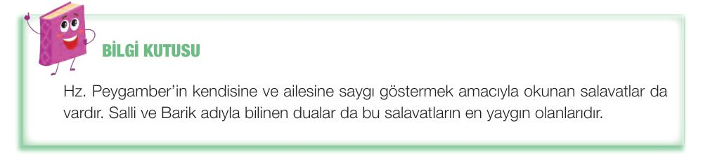

Görsel 1.12: Muhammed Sallallahü aleyhi vesellem yazan bir hat görseli.

---

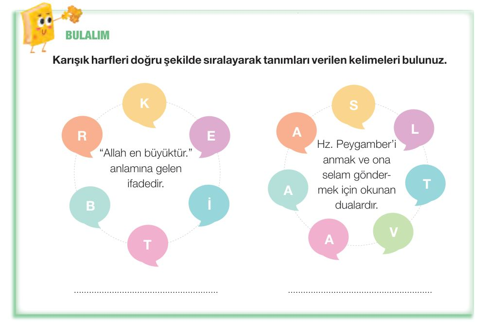
**BİLGİ KUTUSU**

Hz. Peygamber’in kendisine ve ailesine saygı göstermek amacıyla okunan salavatlar da vardır. Salli ve Barik adıyla bilinen dualar da bu salavatların en yaygın olanlarıdır.

---

**BULALIM**

**Karışık harfleri doğru şekilde sıralayarak tanımları verilen kelimeleri bulunuz.**

(K) (E)
“Allah en büyüktür.” anlamına gelen ifadedir.
(R) (İ)
(B) (T)

(S) (L)
Hz. Peygamber’i anmak ve ona selam göndermek için okunan dualardır.
(A) (T)
(A) (V)
(A)

.........................................................
.........................................................

<!-- sayfa 23 -->

# Sevap ve Günah

İbadetlerimiz ve güzel davranışlarımız için Allah’ın (cc) bize verdiği ödüle sevap denir. Namaz kılmak, oruç tutmak gibi ibadetleri yerine getirmek sevap kazanmamızı sağlar. Büyüklerimize saygılı davranmak, karşılaştığımız insanlara selam vermek, hasta yakınlarımızı ziyaret etmek sevap olan davranışlardır. Yemeğe besmeleyle başlamak, verdiği nimetler için Allah’a (cc) şükretmek, Hz. Peygamber’e salavat getirmek de sevaptır. Bu davranışlar, Allah’ın (cc) rızasını ve sevgisini kazanmamızı sağlar.

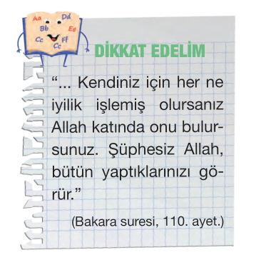

**DİKKAT EDELİM**
“... Kendiniz için her ne iyilik işlemiş olursanız Allah katında onu bulursunuz. Şüphesiz Allah, bütün yaptıklarınızı görür.”
(Bakara suresi, 110. ayet.)

Sevabın karşıtı günahtır. İslam dininin emir ve yasaklarına aykırı olarak yapılan söz, iş ve davranışlara günah denir. Anne babaya kötü davranmak, yalan söylemek, insanlarla alay etmek, insanlara iftira etmek ve çevreyi kirletmek günah olan davranışlardandır. Bu davranışlardan uzak durmamız gerekir.

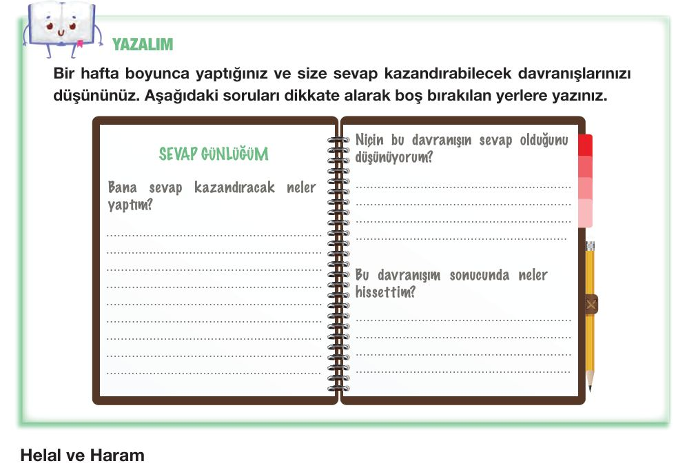

## YAZALIM

Bir hafta boyunca yaptığınız ve size sevap kazandırabilecek davranışlarınızı düşününüz. Aşağıdaki soruları dikkate alarak boş bırakılan yerlere yazınız.

| SEVAP GÜNLÜĞÜM | |
| :--- | :--- |
| **Bana sevap kazandıracak neler yaptım?** | **Niçin bu davranışın sevap olduğunu düşünüyorum?** |
| ........................................................... | ........................................................... |
| ........................................................... | ........................................................... |
| ........................................................... | ........................................................... |
| ........................................................... | ........................................................... |
| ........................................................... | ........................................................... |
| ........................................................... | ...........................................................

<!-- sayfa 24 -->

Allah’ın (cc) yapılmasını kesin olarak yasakladığı söz ve davranışlara haram denir. Yüce Allah, Kur’an-ı Kerim’de “… O ümmi Peygamber’e uyanlar (var ya)! İşte o Peygamber onlara iyiliği emreder, onları kötülükten meneder, onlara temiz şeyleri helal, pis şeyleri haram kılar…”$^{10}$ <!-- KONTROL: Marker'da karşılığı yok, uydurma olabilir --> buyurmuş, kötü ve zararlı şeyleri haram kılmıştır. Günlük hayatta haram sözcüğü “haram lokma yemek, hakkını haram etmek, İslam dinine göre haramdır.” gibi ifadelerde de karşımıza çıkar.

## 2. Dilek ve Dualarda Geçen Dinî İfadeler

*Bir arkadaşınız size yardım ettiğinde ona neler söylersiniz?*

Günlük yaşantımızda ailemizle, arkadaşlarımızla veya çevremizdeki insanlarla görüşür ve konuşuruz. Bazen güzel haberler alır, seviniriz bazen kötü haberleri duyar, üzülürüz. Bu gibi durumlarda karşımızdaki insana çeşitli dileklerde bulunur ve dua ederiz. **Dua**, “seslenmek, istemek, yardım talep etmek” anlamlarına gelir. Terim olarak ise Yüce Allah’a yönelerek istekleri O’na iletmektir.$^{11}$ <!-- KONTROL: Marker'da karşılığı yok, uydurma olabilir --> Kabul olmasını istediğimiz şeyleri kelimelerle ifade etmektir. Günlük hayatta kullandığımız dilek ve dua cümleleri, çevremizdeki insanlara duyduğumuz sevginin göstergesidir.

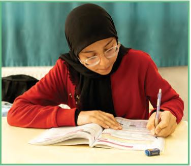
> Görsel 1.13: Ders çalışırken “İnşallah başarılı olurum” demek bir duadır.

Günlük konuşmalarımızdaki dilek ve dua cümlelerinde bazı dinî ifadelere yer veririz. Bu ifadelerde Yüce Allah’ı hatırlar ve O’nun adını yüceltiriz. İsteklerimizin gerçekleşmesi için Allah’ın (cc) yardımını dileriz.

Bir kişiden iyilik gördüğümüzde bu iyilik karşısındaki hoşnutluğumuzu ifade etmek için “Allah razı olsun.” deriz. Bir yolculuğa çıkarken ya da bir yakınımızı yolcu ederken “Allah’a emanet ol.” ifadesini kullanırız. Hasta bir arkadaşımızı ziyaret ettiğimizde “Allah şifa versin.” diyerek Allah’ın (cc) yardımıyla sağlığına kavuşması için ona dua ederiz. Bir işin gerçekleşmesini ve hayırlı bir şekilde sonuçlanmasını istediğimizde “İnşallah.” deriz. Örneğin derslerimizde başarılı olmak istediğimizde “Çok çalışacağım ve inşallah derslerimden iyi notlar alacağım.” dememiz bir duadır. Çünkü gereken çabayı gösterdikten sonra o işin, Allah’ın (cc) dilemesiyle gerçekleşeceğine inanırız. Güzel bir haber duyduğumuzda veya iyi bir durumla karşılaştığımızda “Maşallah.” deriz. Maşallah, “Allah dileyince her şey olur.” anlamına gelen bir duadır. Bu duayla bir şeyi beğendiğimizi ifade ederiz.

***

$^{10}$ <!-- KONTROL: Marker'da karşılığı yok, uydurma olabilir --> Araf suresi 157. ayet

<!-- sayfa 25 -->

PAYLAŞALIM

| DURUM | İFADE |
| :--- | :--- |
| Ders çalışan birine | “Allah zihin açıklığı versin.” |
| Alışveriş yaptığımız bakkala | “Allah bereket versin.” |
| Uyumaya giden birine | “Allah rahatlık versin.” |
| Yakını ölen birine | “Allah rahmet eylesin.” |
| Bir işle meşgul olan birine | “Allah kolaylık versin.” |
| Çalışan veya işe giden birine | “Hayırlı işler.” |

sözlerini kullanırız.

**Dilimizde niçin içinde “Allah (cc)” adı geçen bu kadar ifade vardır?**
**Düşüncelerinizi arkadaşlarınızla paylaşınız.**

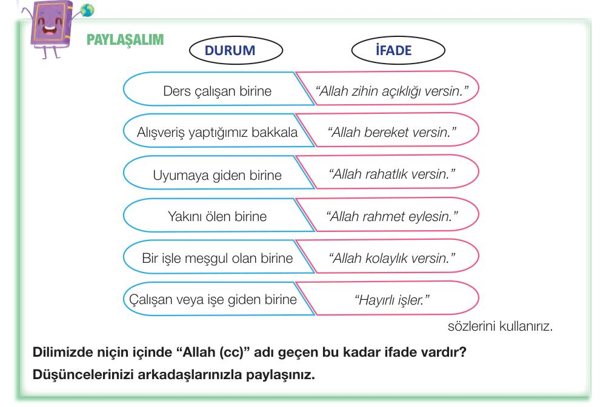
Günlük dilde kullandığımız bütün bu dilek ve dualar, Allah’a (cc) olan bağlılığımızın ifadesidir. Bu ifadeler, hayatın her anında Yüce Allah’ı hatırlamamızı sağlar. Kendimiz için istediğimiz güzel bir şeyi başkaları için de dilememiz, çevremizdeki insanlarla güzel iletişim kurmamıza yardımcı olur. Hz. Peygamber, *“Bir kimsenin din kardeşinin arkasından ettiği dua kabul olunur...”*$^{12}$ <!-- KONTROL: Marker'da karşılığı yok, uydurma olabilir --> buyurmuş ve kendimiz için dua ettiğimiz gibi çevremizdeki insanlardan da dua almamızı tavsiye etmiştir.

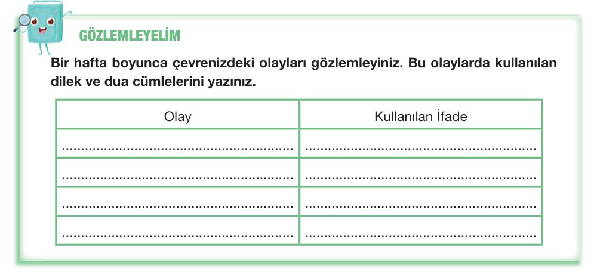
## GÖZLEMLEYELİM

**Bir hafta boyunca çevrenizdeki olayları gözlemleyiniz. Bu olaylarda kullanılan dilek ve dua cümlelerini yazınız.**

| Olay | Kullanılan İfade |
| :--- | :--- |
| ............................................................. | ............................................................. |
| ............................................................. | ............................................................. |
| ............................................................. | ............................................................. |
| ............................................................. | ............................................................. |
| ............................................................. | ............................................................. |
| ............................................................. | ............................................................. |
| ............................................................. | .............................................................

<!-- sayfa 26 -->

# 3. Bir Dua Tanıyorum: Sübhaneke Duası ve Anlamı

*Sübhaneke duasıyla ilgili neler biliyorsunuz?*

Hz. Muhammed (sav), Yüce Allah’a nasıl dua edileceğini Müslümanlara öğretmiştir. Hz. Peygamber'in öğrettiği dualardan biri Sübhaneke duasıdır.$^{13}$ <!-- KONTROL: Marker'da karşılığı yok, uydurma olabilir --> Bu duayı bilmek önemlidir. Çünkü her namazda, başlangıç tekbirinden sonra Sübhaneke duası okunur. Cenaze namazlarında da okunan bu duayla Allah’ı (cc) saygı ve övgüyle anar, O’nun yüceliğini ifade ederiz.

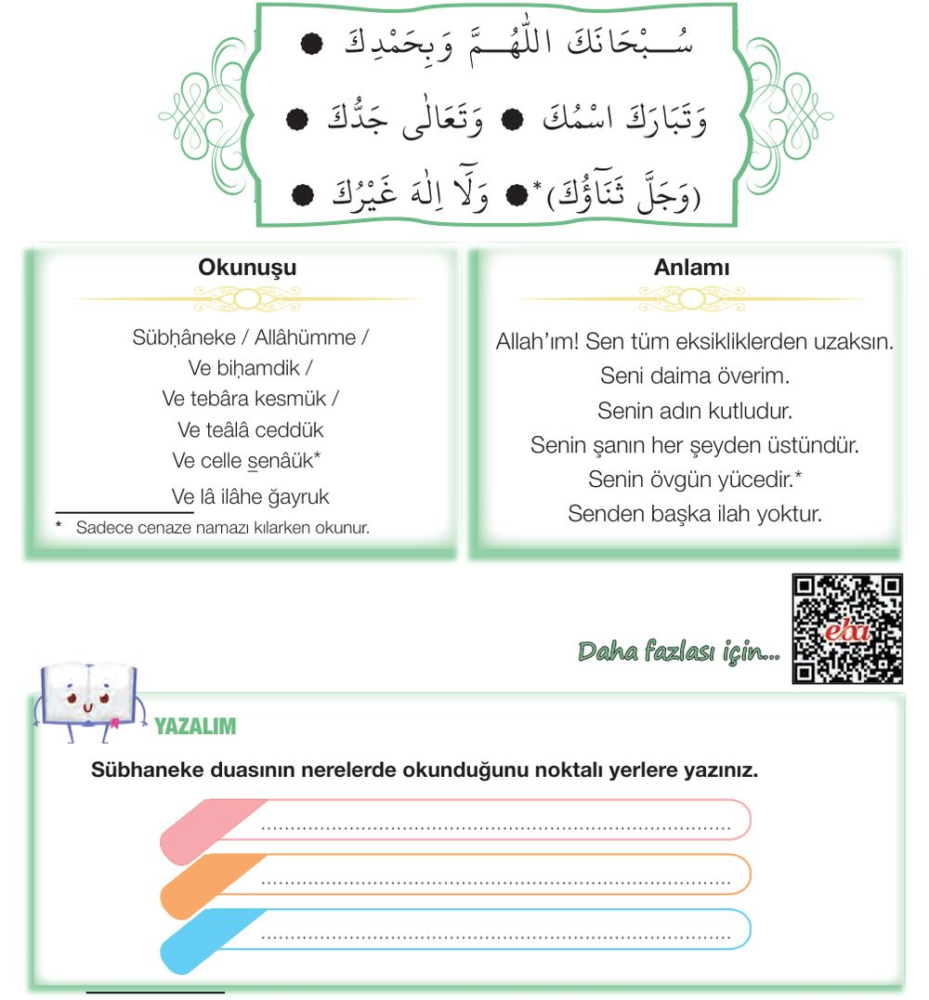

| Okunuşu | Anlamı |
| :--- | :--- |
| Sübhâneke / Allâhümme /   Ve bihamdik /   Ve tebâra kesmük /   Ve teâlâ ceddük   Ve celle senâuk*   Ve lâ ilâhe ğayruk | Allah’ım! Sen tüm eksikliklerden uzaksın.   Seni daima överim.   Senin adın kutludur.   Senin şanın her şeyden üstündür.   Senin övgün yücedir.*   Senden başka ilah yoktur. |

\* Sadece cenaze namazı kılarken okunur.

*Daha fazlası için...*

**YAZALIM**

**Sübhaneke duasının nerelerde okunduğunu noktalı yerlere yazınız.**

..................................................................................................................................
..................................................................................................................................
..................................................................................................................................

<!-- sayfa 27 -->

# 1. ÜNİTE SONU DEĞERLENDİRME

**A. Aşağıdaki ifadelerden doğru olanların başına “D”, yanlış olanların başına “Y” yazınız.**

1. ( ) “Sübhanallah” diyerek Allah’ın (cc) bütün eksikliklerden uzak olduğunu kabul ederiz.
2. ( ) Haram, Allah’ın (cc) yapılmasını kesin olarak yasakladığı söz ve davranışlardır.
3. ( ) Allah’a (cc) teşekkürümüzü “Estağfirullah” ifadesiyle dile getiririz.
4. ( ) Maşallah, “Allah (cc) sizi her türlü kaza ve beladan korusun.” anlamına gelen bir duadır.
5. ( ) Bir yakınımız yolculuğa çıkarken ona “Allah’a (cc) emanet ol.” diyerek dua ederiz.

inşallah, Allah şifa versin, helal, estağfirullah, teşrik tekbiri, sallallühü aleyhi vesellem

**B. Yukarıda verilen ifadelerden uygun olanlarıyla cümleleri tamamlayınız.**

1. ........................................, Kurban Bayramı’nda farz namazların ardından okunur.
2. Yüce Allah’ın yapılmasına veya yenilip içilmesine izin verdiği şeylere ............................... denir.
3. Bir işin güzel bir şekilde sonuçlanmasını istediğimizde ............................. deriz.
4. Hz. Peygamber’in ismi anılınca ........................................ ifadesiyle ona selam göndeririz.
5. Hasta bir arkadaşımızı ziyaret ettiğimizde ........................................ diyerek ona dua ederiz.

<!-- yer tutucu bulunamadı: sayfa sonuna eklendi -->

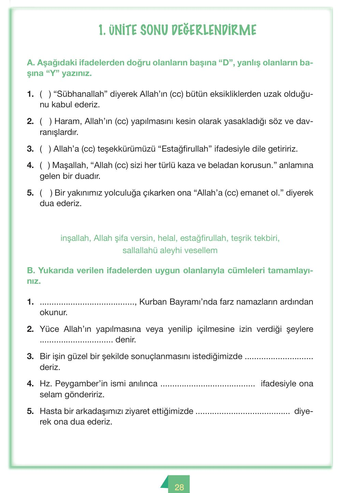
<!-- yer tutucu bulunamadı: sayfa sonuna eklendi -->

<!-- sayfa 28 -->

C. Aşağıdaki soruları dikkatle okuyunuz ve doğru seçeneği işaretleyiniz.

1. Öğretmen, öğrencilere “Günlük dilde kullandığınız selamlaşma ifadeleri hangileridir?” diye sormuştur.
**Esra:** Hayırlı sabahlar
**Halit:** Estağfirullah
**Fatma:** Selamünaleyküm
**Mehmet:** İyi günler

Buna göre hangi öğrencinin verdiği cevap **yanlıştır**?
A) Esra
B) Halit
C) Fatma
D) Mehmet

2. I. Alışveriş yaptığımız bakkala “Allah zihin açıklığı versin.” diyerek ona dua ederiz.
II. Bir kişiden iyilik gördüğümüzde hoşnutluğumuzu ifade etmek için “Allah razı olsun.” deriz.
III. Uyumaya giden birine “Allah rahatlık versin.” diyerek dua ederiz.
IV. Bir işle meşgul olan birine “Allah’a şükürler olsun.” dersek güzel bir dilekte bulunuruz.

Verilen bilgilerden hangileri doğrudur?
A) I. ve II.
B) I. ve III.
C) II. ve III.
D) II. ve IV.

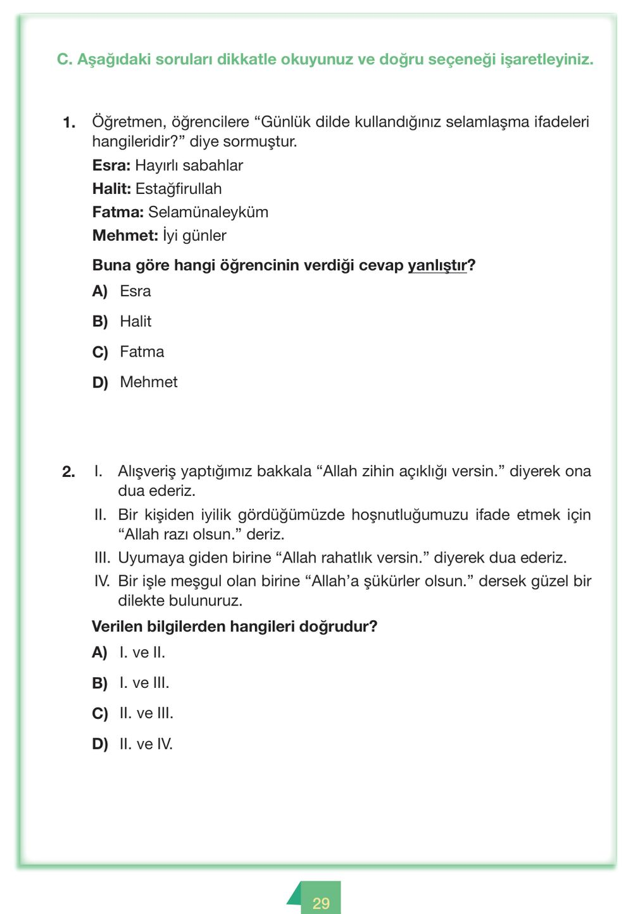
<!-- yer tutucu bulunamadı: sayfa sonuna eklendi -->

<!-- sayfa 29 -->

3. • Allah’ın (cc) tüm varlıklardan üstün olduğunu ifade etmeye - - - - denir.
• Müslümanlar, Hz. Muhammed’e (sav) olan sevgilerini ve saygılarını göstermek için - - - - duasını okurlar.

**Verilen cümlelerde noktalı yerlere sırasıyla aşağıdaki ifadelerden hangileri gelmelidir?**

A) tekbir-salavat
B) hamt-şükür
C) helal-haram
D) selam-besmele

4. Günlük hayatta bir işe başlarken Allah’ın (cc) adını anmak, O’na olan inancın ve bağlılığın samimi bir ifadesidir. Bu nedenle evden çıkarken yemeğe başlarken elbisemizi giyerken abdest alırken ve ders çalışırken - - - - deriz.

**Verilen paragrafta noktalı yere aşağıdaki ifadelerden hangisi gelmelidir?**

A) Estağfirullah
B) Sübhanallah
C) Sallallahü aleyhi vesellem
D) Bismillâhirraḥmânirraḥîm

5. I. Namazlarda başlangıç tekbirinden sonra okunur.
II. Hz. Peygamber’e ve ailesine dua içerir.
III. Cenaze namazlarında okunur.

**Yukarıdaki cümlelerden hangisi/hangileri Sübhaneke duasıyla ilgilidir?**

A) Yalnız I.
B) I. ve II.
C) I. ve III.
D) II. ve III.

<!-- yer tutucu bulunamadı: sayfa sonuna eklendi -->

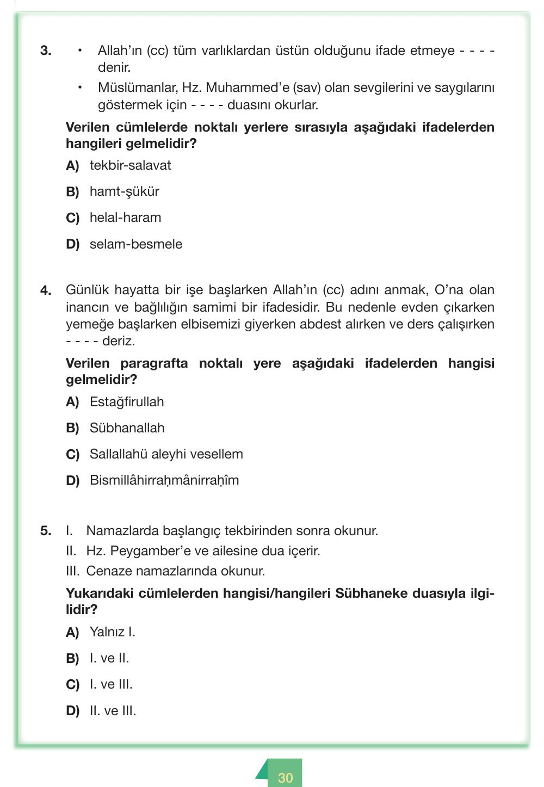
<!-- yer tutucu bulunamadı: sayfa sonuna eklendi -->

<!-- sayfa 30 -->

D. Aşağıdaki soruları cevaplayınız.

1. Selamlaşmak insan ilişkilerine nasıl katkıda bulunur? Yorumlayınız.
..........................................................................................................................................
..........................................................................................................................................
..........................................................................................................................................
..........................................................................................................................................

2. Sevap ve günah olan davranışlara ikişer tane örnek veriniz.
..........................................................................................................................................
..........................................................................................................................................
..........................................................................................................................................
..........................................................................................................................................

3. Allah’a (cc) şükrümüzü belirtmek için hangi ifadeleri kullanırız? Yazınız.
..........................................................................................................................................
..........................................................................................................................................

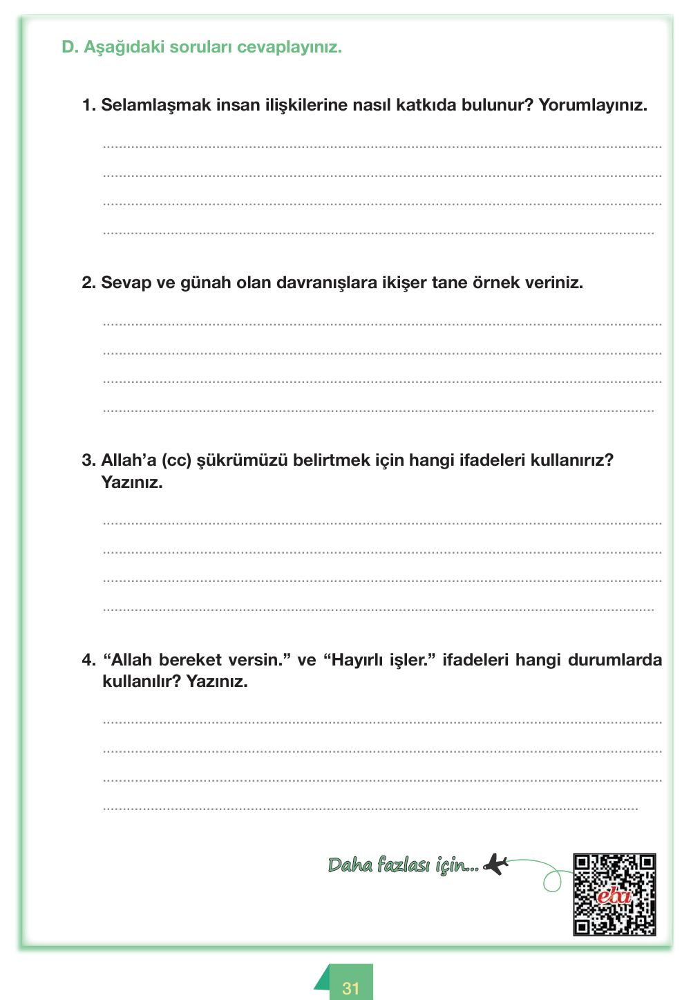
<!-- yer tutucu bulunamadı: sayfa sonuna eklendi -->

<!-- sayfa 31 -->

# NELER ÖĞRENECEĞİZ?

1. İslam’ın İnanç Esasları
2. İslam’ın Şartları
3. Kur’an-ı Kerim
4. Bir Dua Tanıyorum: Amentü Duası ve Anlamı

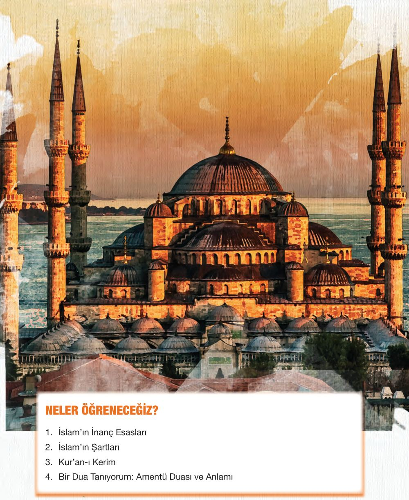
<!-- yer tutucu bulunamadı: sayfa sonuna eklendi -->

<!-- sayfa 32 -->

# 2. ÜNİTE

# İSLAM’I TANIYALIM

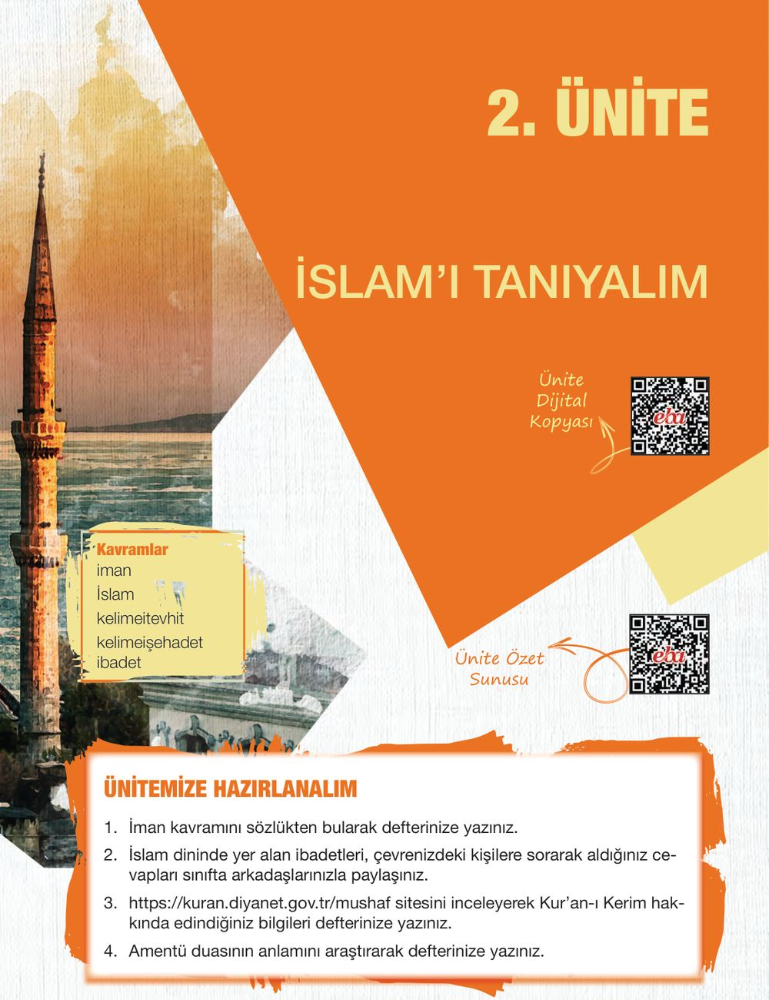: Ünite Dijital Kopyası metninin yanında/yakınında

: Ünite Özet Sunusu metninin yanında/yakınında

### Kavramlar
iman
İslam
kelimeitevhit
kelimeişehadet
ibadet

## ÜNİTEMİZE HAZIRLANALIM

1. İman kavramını sözlükten bularak defterinize yazınız.
2. İslam dininde yer alan ibadetleri, çevrenizdeki kişilere sorarak aldığınız cevapları sınıfta arkadaşlarınızla paylaşınız.
3. https://kuran.diyanet.gov.tr/mushaf sitesini inceleyerek Kur’an-ı Kerim hakkında edindiğiniz bilgileri defterinize yazınız.
4. Amentü duasının anlamını araştırarak defterinize yazınız.

<!-- sayfa 33 -->

# 1. İslam’ın İnanç Esasları

*İmanın şartları denilince aklınıza neler geliyor?*

**İman**, insanın yaratıcısı Yüce Allah ile arasındaki bağdır. İman; “inanma, tasdik etme, güvende olma ve bir şeyin doğruluğunu kabul etme” anlamlarına gelir. İman; insanın, Yüce Allah’tan Hz. Muhammed’e (sav) indirilen bütün bilgi, mesaj ve hükümlerin doğruluğunu hiçbir şüphe duymadan kabul etmesidir.$^1$ <!-- KONTROL: Marker'da karşılığı yok, uydurma olabilir --> İman; kulun Allah’a (cc), dayanıp güvenmesidir.

Kişi; iman etmekle Yüce Allah’ın varlığını, birliğini, O’nun eşi ve benzeri olmadığını kabul eder. Yüce Allah’a inanan bir insan; meleklere, kitaplara, peygamberlere, ahiret gününe, kadere ve kazaya da iman etmelidir. İmanın şartları olarak da bilinen bu inanç esaslarına bir bütün hâlinde iman etmek, mümin olmanın gereğidir. Mümin, İslam inanç esaslarını şüphe duymadan kabul eder.

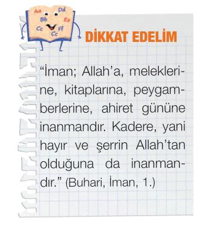
> **DİKKAT EDELİM**
>
> “İman; Allah’a, meleklerine, kitaplarına, peygamberlerine, ahiret gününe inanmandır. Kadere, yani hayır ve şerrin Allah’tan olduğuna da inanmandır.” (Buhari, İman, 1.)

## İslam’ın İnanç Esasları

| | | | | | |
| :---: | :---: | :---: | :---: | :---: | :---: |
| Allah'a (cc) iman | Meleklere iman | Kitaplara iman | Peygamberlere iman | Ahirete iman | Kader ve kazaya iman |
| 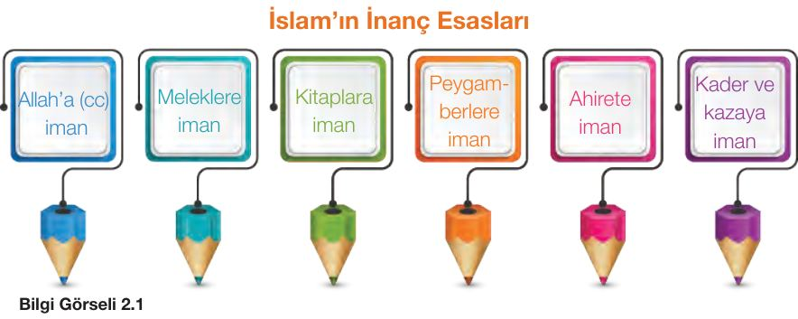 |  |  |  |  |  |

**Bilgi Görseli 2.1**

İman, insanın dünya hayatında karşılaştığı sorunları çözmede ona güç verir. Kişinin duygu, düşünce ve davranışlarını etkiler, sosyal hayatına yön verir. İman, insanın bu dünyada yaptığı her şeye anlam katan en büyük hazinesidir. Allah’a (cc) samimi bir şekilde iman eden insan, inancının gereklerini en iyi şekilde yerine getirmeye çabalar. Böylelikle maddi ve manevi sorunlar karşısında ümitsizliğe düşmez.

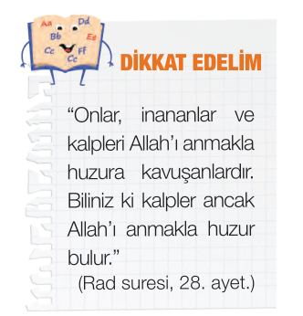
> **DİKKAT EDELİM**
>
> “Onlar, inananlar ve kalpleri Allah’ı anmakla huzura kavuşanlardır. Biliniz ki kalpler ancak Allah’ı anmakla huzur bulur.” (Rad suresi, 28. ayet.)

<!-- sayfa 34 -->

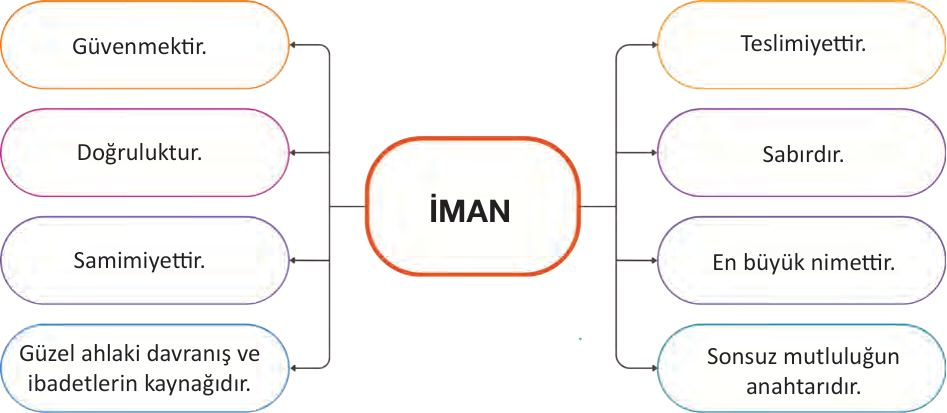

**Bilgi Görseli 2.2**

| | İMAN | |
| :--- | :---: | :--- |
| Güvenmektir. | | Teslimiyettir. |
| Doğruluktur. | | Sabırdır. |
| Samimiyettir. | | En büyük nimettir. |
| Güzel ahlaki davranış ve ibadetlerin kaynağıdır. | | Sonsuz mutluluğun anahtarıdır. |

# Allah’a (cc) İman

İslam dininin temelini Allah’a (cc) iman oluşturur. İslam’a göre Allah (cc) tektir, O’nun bir eşi ve benzeri yoktur. Yüce Allah, bizleri yoktan var etmiştir. Her şeyin yaratıcısı Allah (cc)’tır. O, her şeyi bir ölçü ve dengeye göre yaratmıştır. Kur’an-ı Kerim’de “Allah, O’ndan başka ilah yoktur; diridir, her şeyin varlığı O’na bağlı ve dayalıdır. Ne uykusu gelir ne de uyur. Göklerde ve yerde ne varsa hepsi O’nundur...”$^{2}$ <!-- KONTROL: Marker'da karşılığı yok, uydurma olabilir --> buyrularak Allah’ın (cc) eşsiz ve yaratılmışlara benzemez olduğu bildirilmektedir.

İman eden kişi, Yüce Allah’ı bütün isim ve sıfatlarıyla tanır. O’na bağlanır. Allah’a (cc) bağlanan insan, hayatını bu doğrultuda düzenler. Sadece O’na kulluk eder ve yalnızca O’ndan yardım ister. **Kelimeitevhit**, imanın dile ve kalbe yansıyan en özlü biçimidir. Peygamberler, tevhit inancının temsilcileri olarak bütün insanları tevhite çağırmışlardır.

**Görsel 2.1: Kelimeitevhit Arapça hattı**

**Okunuşu:** Lâ ilâhe illallah / Muḥammedürrasulüllâh
**Anlamı:** Allah’tan başka ilah yoktur. Muhammed, Allah’ın Resulü’dür.

<!-- sayfa 35 -->

# BİLGİ KUTUSU

Allah'ın (cc) tekliğini, birliğini ifade eden kavram tevhittir. İslam dininin temelini ise bu tevhit inancı oluşturur. Tevhit kavramının zıddı şirktir. Şirk, “Allah'tan (cc) başka ilahlar edinmek ve bu ilahlara kulluk etmek” anlamına gelir.

(bk. Mevlüt Özler, “Tevhid”, TDV İslam Ansiklopedisi, Türkiye Diyanet Vakfı Yayınları, C 41, s. 18.)

# YÜCE ALLAH

       (Not: Görseldeki simetrik yerleşim düzenine göre)

Başlangıcı ya da sonu olmayandır.
Eşi ve benzeri olmayandır.

Her şeyi işitendir.

Her şeyi bilendir.

Her şeyi görendir.

Her şeye gücü yetendir.

Kâinatı yoktan var edendir.

**Bilgi Görseli 2.3**

# YORUMLAYALIM

## İnsan: Allah’ın Yarattığı En Güzel Varlık

Büyük teyze ellerini küçük beyaz bir havluyla kurulayarak içeri girdi. Ben odada resim yaparken o da akşam için yemek pişirmiş. Annem de böyledir. Sanki elini kolunu birkaç kez oynatır ve yemek bir anda hazır olur. Büyük teyze yemeğin yanında bir de sürpriz hazırlamış bana. Akşam yemeğinde görebileceğimi söyledi. Bence görülecek değil, yenebilecek bir şeydir. Havluyu kucağına koyup pencerenin önündeki koltuğa oturdu. Sol tarafında kalan menekşeleri sevdi. Sehpanın örtüsü biraz kaymıştı, onu düzeltti.

— Sen de çiçekleri sever misin evladım? Bak annenin çiçekleri ne güzel büyümüş.
— Çiçekleri severim ama sulama işini annem yapıyor. Ben ne kadar su vermek gerektiğini bilmiyorum.
— Annen sana da öğretir. Toprağı kurudukça sulamak lazım. Böceklenmesine de izin vermeyeceksin. Işığa göre yerini ayarlayacaksın. Arada bir vitamin vermek de iyi olur fakat en önemlisi çiçekleri seveceksin. Seversen hem daha güzel açar hem de daha güzel kokar.

**Görsel 2.2**

<!-- sayfa 36 -->

— Çiçekler onları sevdiğimizi anlarlar mı?
— Anlamaz mı yavrum, Allah’ın yarattığı her şey sevgiden anlar. Bak hayvanlar bile kendilerini sevene daha çok bağlanır. Babaannem, bir defa ekmek veren eli unutmazlar, derdi. Çiçekler de öyledir, her canlı öyledir.
— Allah çiçekleri sevdiği için mi hepsi rengârenk ve güzel kokuyor? Allah sevdiği için mi çiçekler bu kadar güzel?
— Tabii yavrum. Allah güzel olduğu için yarattıkları da güzel. Hepsinde ayrı bir güzellik, hikmet var.
— Ben de bu menekşe kadar güzel olmak isterdim.
— Sen ondan da güzelsin yavrum. Sen insansın. İnsan, Allah’ın yarattığı en güzel varlıktır. Allah’ın en çok sevdiği varlıktır.
— Ama benim bu kadar güzel bir rengim yok ki.
— Senin de kırmızı kırmızı yanakların var ya güzel kızım.
— ...

Rabia Gülcan
*Beni ve Her Şeyi Yaratan Allah (Kısaltılmıştır.)*

**Bu hikâyeden yola çıkarak Allah’a (cc) iman etmekle sevgi arasındaki ilişkiyi yorumlayınız.**

...................................................................................................................................
...................................................................................................................................
...................................................................................................................................
...................................................................................................................................
...................................................................................................................................

## Meleklere İman

Meleklere iman, İslam dininde yer alan inanç esaslarından biridir. Yaratılışı insanlardan farklı olan ve gözle görülmeyen varlıklara iman etmektir. Melekler, diğer canlılar gibi Allah (cc) tarafından yaratılmış varlıklardır. Yüce Allah’ın verdiği çeşitli görevleri sorgusuz sualsiz yerine getirirler. Yüce Allah, Kur’an-ı Kerim’de **“Allah, ‘Benden başka ilah yoktur. Öyle ise bana karşı gelmekten sakının.’ diye (insanla-**

Görsel 2.3: Meleklerin tabiat olaylarını gerçekleştirmek gibi birçok görevi vardır.

<!-- sayfa 37 -->

**ile melekleri kullarından dilediğine indirir.”³** ayetiyle meleklerin vahyi getirme görevine işaret etmiştir. Melekler, Allah’a (cc) iman eder ve daima O’nu anarlar. Müminlerin bağışlanmasını diler ve Allah’ın (cc) izniyle onları koruyup gözetirler. Meleklerin varlığına iman eden kişi, korunduğuna inanır.

> 
> ### BİLGİ KUTUSU
> Vahiy; peygamberler aracılığıyla insanlara, hayatın hangi ilkelere göre yönlendirilmesi ve nelere uyulup nelerden sakınılması gerektiğini bildiren ilahi bilgidir.
> (bk. MEB Dinî Terimler Sözlüğü, s. 376.)

## Kitaplara İman

Yüce Allah; peygamberlerine gönderdiği vahiy aracılığıyla insanlara doğru yolu gösterir, onları iyi ve güzel olana yönlendirir. Bu vahiylerin yer aldığı kitaplara ilahi kitaplar denir. İslam dininde Yüce Allah’ın sözlerinin yer aldığı ilahi kitaplara inanmak, iman esaslarındandır. Kitaplara iman, Yüce Allah’ın gönderdiği tüm ilahi kitaplara iman etmektir. Kur’an-ı Kerim’de **“Ey iman edenler! Allah’a, Peygamberi’ne, Peygamberi’ne indirdiği kitaba ve daha önce indirdiği kitaba iman edin...”⁴** buyrulmuştur. Kıyamete kadar geçerli olan ve tüm insanlığa gönderilen son ilahi kitap Kur’an-ı Kerim’dir.

Görsel 2.4: Kur’an-ı Kerim son ilahi kitaptır.

## Peygamberlere İman

Peygamber; O’nun emir ve yasaklarını, inanç, ibadet, ahlak esaslarını öğretmesi için Yüce Allah’ın insanlar arasından seçtiği kişidir.⁵ Aralarında ayrım gözetmeksizin tüm peygamberlere iman etmek, İslam inanç esaslarındandır. Müslümanlar, Yüce Allah’ın ilk insan ve ilk peygamber Hz. Âdem’den son peygamber Hz. Muhammed’e (sav) kadar gönderdiği bütün peygamberlere inanırlar. Allah (cc), Kur’an-ı Kerim’de şöyle buyurur: **“Her ümmetin bir pey-**

Görsel 2.5: Muhammed (sav) ismi yazılı hat.

***

³ Nahl suresi, 2. ayet.
⁴ Nisa suresi, 136. ayet.

<!-- sayfa 38 -->

**gamberi vardır...”$^6$ <!-- KONTROL: Marker'da karşılığı yok, uydurma olabilir -->** Allah (cc), peygamberleri insanlara rehber olmaları için seçmiştir. Peygamberler, gönderildikleri toplumları tevhit inancına çağırmış ve onlara ibadetlerin nasıl yapılacağını öğretmişlerdir. Yüce Allah tarafından gönderilen tüm peygamberler, güzel ahlaki davranışlarla bulundukları topluma örnek olmuşlardır.

## Ahirete İman

Ahiret, dünya hayatındaki söz ve davranışların sonuçlarının alınacağı ve değerlendirileceği ölümden sonraki hayata denir.$^7$ <!-- KONTROL: Marker'da karşılığı yok, uydurma olabilir --> Bütün insanlar, öldükten sonra ahiret gününde tekrar diriltilecektir. Ahiret gününe inanmak İslam inanç esaslarındandır. Kur’an-ı Kerim’de **“... Allah’a ve ahiret gününe inananlar var ya, işte onlara büyük bir mükâfat vereceğiz.”$^8$ <!-- KONTROL: Marker'da karşılığı yok, uydurma olabilir -->** ayetiyle ahirete inananların öldükten sonra ödüllendirileceği vurgulanmıştır. İnsanlar, hayatta yapıp ettiklerinin karşılığını ahirette alırlar. Ahirete iman, kişinin yaptıklarının sorumluluğunu almasını sağlar. Ahiret gününe inanan bir kimse, dünya hayatında, söz ve davranışlarında iyiyi, güzeli olanı yapmaya çaba gösterir. Ahiret hayatında mükâfatını alacağına inandığı için dünya hayatında Allah (cc) rızasına uygun olarak yaşamaya çalışır.

**Görsel 2.6:** “Ölümü en çok hatırlayanları ve ölümden sonrası için en güzel şekilde hazırlananları. İşte onlar en akıllı olanlardır.” (İbni Mace, Zühd, 31.)

## Kader ve Kazaya İman

Allah’ın (cc), her şeyi bir ölçüye göre yaratmasına ve bilmesine kader; yeri ve zamanı geldiğinde bildiği şeylerin gerçekleşmesine kaza denir. Allah’ın (cc) belirlemiş olduğu kader sayesinde evrendeki her şey bir ölçü ve düzenle işlemektedir. Kader ve kazaya iman etmek, İslam inanç esaslarından biridir. Kader ve kazaya iman eden kişi, yaratılan her şeyin Yüce Allah’ın iradesiyle gerçekleştiğini bilir. Bu durum Kur’an-ı Kerim’de **“... O’nun ilmi dışında bir yaprak bile düşmez. O, yerin karanlıkları içindeki tek bir taneyi dahi bilir. Yaş ve kuru ne varsa hepsi apaçık bir kitap-**

**Görsel 2.7:** Yüce Allah tabiatı bir ölçüye göre yaratmıştır.

---
$^6$ <!-- KONTROL: Marker'da karşılığı yok, uydurma olabilir --> Yunus suresi, 47. ayet.
$^7$ <!-- KONTROL: Marker'da karşılığı yok, uydurma olabilir --> bk. MEB Dinî Terimler Sözlüğü, s. 8

<!-- sayfa 39 -->

tadır.”⁹ ayetiyle açıklanmaktadır. Kader ve kaza, Allah’ın (cc), insanları bir şey yapmaya veya yapmamaya zorlaması anlamına gelmez. İyiyi veya kötüyü tercih etmek insanın iradesindedir. Kader ve kazaya iman eden insan, yaptığı davranışlardan sorumlu olduğunu bilir ve buna göre davranır.

**YAZALIM**

**Aşağıdaki karekoddan İmanın Şartları ilahisini dinleyiniz ve ilahinin sözlerini noktalı yerlere yazınız.**

**BİLGİ KUTUSU**

Farz; İslam dininde mükelleflerden yapılması kesinlikle istenen ve terk edilmesi günah olan fiiller, emirlerdir. Farzların yapılmasında büyük sevaplar vardır. Beş vakit namaz kılmak, ramazan ayında oruç tutmak farz olan ibadetlerdendir.

(MEB Dinî Terimler Sözlüğü, s. 85.)

## 2. İslam’ın Şartları

*İslam’ın şartları denilince aklınıza neler geliyor?*

İslam dini, iman ve ibadet esaslarıyla insanlara iyiliği emredip onları kötülükten sakındırır. İnsanların güzel ahlak sahibi olmalarını amaçlar. **İslam** kelimesi; “barış, güven, teslimiyet ve kurtuluşa erme” gibi anlamlara gelir. İslam, ilk peygamber Hz. Âdem’den son peygamber Hz. Muhammed’e (sav) kadar peygamberler aracılığıyla gönderilen ilahi dinlerin ortak adıdır.¹⁰ Kur’an-ı Kerim’de **“Şüphesiz Allah katında din İslam’dır...”¹¹** buyrularak Yüce Allah’ın katında tek geçerli dinin İslam olduğu bildirilmiştir.

***

⁹ Enam suresi, 59. ayet.
¹⁰ bk. MEB Dinî Terimler Sözlüğü, s. 176

<!-- sayfa 40 -->

> **BİLGİ KUTUSU**
>
> **İbadet**, Allah'ın (cc) insanlara emrettiği ve insanların da Allah'a (cc) karşı yapmakla yükümlü oldukları tüm davranışlardır.
>
> (MEB Dinî Terimler Sözlüğü, s. 153.)

Allah (cc), müminlerden ibadet etmelerini ve O'nun rızasına uygun hareket etmelerini ister. Müminler de bu emir ve yasaklara uyarak imanın gerekliliklerini yerine getirmiş olurlar. Allah (cc) rızası gözetilerek yapılan bütün işler birer ibadettir.

Hz. Peygamber, İslam dininin esaslarını şu şekilde açıklamıştır: *"İslam beş şey üzerine kurulmuştur: Allah'tan başka bir ilah olmadığına, Hz. Muhammed'in Allah'ın elçisi olduğuna şehadet etmek, namaz kılmak, zekât vermek, hacca gitmek, oruç tutmaktır."*$^{12}$ <!-- KONTROL: Marker'da karşılığı yok, uydurma olabilir -->. Bu esaslar, İslam'ın şartları olarak da bilinir. İnsan, bu ibadet esaslarını yerine getirerek daha iyi bir kul olmaya çalışır.

Kelimeişehadet ile İslam'a giren insan, namaz ile Yüce Allah'ın huzuruna çıkar ve O'na bağlılığını gösterir. Zekât ile Allah'ın (cc) verdiği nimetlere olan şükrünü yerini getirir. Oruç ile nefsini bütün aşırılıklardan arındırmaya çalışır. Hac ile İslam'ın birlik ve beraberlik ruhunu hisseder. Bütün bu ibadetler; yalnızca Allah'a (cc) kulluk etmek, O'na saygı göstermek ve O'nun emirlerini yerine getirmek amacıyla yapılır. İman eden mümin, ibadetler vasıtasıyla Yüce Allah ile iletişim kurar. İbadet ederek Yüce Allah'a karşı görevlerini yerine getirir ve verilen nimetler için O'na şükreder. Allah'ın (cc) emir ve yasaklarına uygun yaşayan insan, böylece dünya ve ahiret mutluluğunu elde eder.

**Bilgi Görseli 2.4**

<!-- sayfa 41 -->

**Bilgi Görseli 2.5**

| Yüce Allah; | • sabredenleri,   • tövbe edenleri,   • affedenleri,   • güçsüzleri koruyanları,   • adil olanları,   • alçak gönüllü olanları,   • iyilik edenleri,   • dürüst olanları,   • şükredenleri,   • Hz. Muhammed’i (sav) sevenleri | çok sever. |
| :--- | :---: | ---: |

## Kelimeişehadet Getirmek

Kelimeişehadet, şahitlik etmek demektir. Kelimeişehadet, bir Müslüman’ın Yüce Allah’a ve O’nun Resulü Hz. Muhammed’e (sav) inandığını dili ile ifade etmesidir. Bu yolla insan, Hz. Peygamber’in bildirdiği iman esaslarını da kabul etmiş olur. Kelimeişehadeti kalben inanarak söyleyen kişi Müslüman olur. Bu, kalpte var olan imanın dil ile onaylanması demektir.

**Görsel 2.8:** Hasan Çelebi’nin kelimeişehadet hattı
**Okunuşu:** “Eşhedü ellâ ilâhe illallah / Ve eşhedü enne Muḥammeden abdühû ve rasûlüh”
**Anlamı:** “Ben şehadet ederim ki Allah’tan (cc) başka ilah yoktur. Yine şehadet ederim ki Hz. Muhammed (sav), O’nun kulu ve elçisidir.”

## Namaz Kılmak

Namaz, Müslümanların günde beş vakit kıbleye yönelerek yerine getirdikleri farz ibadettir. Namaz ibadeti, İslam’ın şartları arasında yer alır. Yüce Allah, Kur’an-ı Kerim’de **“Sabır ve namaz ile Allah’tan yardım isteyin. Şüphesiz o (sabır ve namaz), Allah’a saygıdan kalbi ürperenler dışında herkese zor ve ağır gelen bir görevdir.”$^{13}$ <!-- KONTROL: Marker'da karşılığı yok, uydurma olabilir -->** buyurarak müminlere namaz kılmalarını emretmiştir.

**Görsel 2.9:** “... Namaz dinin direğidir...” (Tirmizi, İman, 8.)

<!-- sayfa 42 -->

Namaz, kulun Allah’a (cc) en yakın olduğu andır. İnsan, namaz ibadeti ile yaratıcısıyla bağ kurar. Kişi, namaz sırasında sevgi, saygı ve derin bir huzurla Yüce Allah’a sığınır. Böylece ruhunun ihtiyacı olan manevi huzura kavuşur. Namaz kılan insan, Allah’ın (cc) ona vermiş olduğu nimetlerin şükrünü yerine getirir. Namaz sayesinde duygu ve davranışlarını iyiye yönlendirir, kötülüklerden uzaklaşır.

**Zekât Vermek**

Zekât; dinen zengin olan Müslümanların, her yıl mallarının bir kısmını ibadet niyetiyle ihtiyaç sahiplerine vermesidir.$^{14}$ <!-- KONTROL: Marker'da karşılığı yok, uydurma olabilir --> Zekât, mal ile yerine getirilen bir ibadettir. Kur’an-ı Kerim’de **“İman edip iyi işler yapan, namaz kılan ve zekât verenler var ya, onların mükâfatları Rab’leri katındadır. Onlara korku yoktur, onlar üzüntü de çekmezler.”**$^{15}$ <!-- KONTROL: Marker'da karşılığı yok, uydurma olabilir --> buyrularak zekâtın mükâfatının Allah (cc) katında olduğu bildirilmiştir.

İslam’ın şartlarından olan zekât, farz bir ibadettir. Zekât verenler; Allah’ın (cc) emrini yerine getirmenin, ihtiyaç sahiplerini sevindirmenin mutluluğuna erişir. Zekât, insana paylaşma ve yardımlaşma bilincini kazandırır. İnsanı bencillik gibi kötü duygulardan uzaklaştırır. İnsanlar arasındaki bağı güçlendirir. Zekât, toplumdaki dayanışmanın temelini oluşturur.

**DİKKAT EDELİM**

“Kişi; kendisi için istediğini, kardeşi için de istemedikçe iman etmiş olmaz.”
(Buhari, İman, 7.)

**LİSTELEYELİM**

Namaz ibadeti insana neler kazandırır? Listeleyiniz.

<!-- sayfa 43 -->

# Oruç Tutmak

Oruç; sorumluluk çağına gelmiş Müslümanların ibadet niyetiyle tan yerinin ağarmasından, güneşin batışına kadar yeme, içme ve orucu bozan her türlü davranıştan uzak durmasıdır.$^{16}$ <!-- KONTROL: Marker'da karşılığı yok, uydurma olabilir --> Oruç, İslam’ın beş temel şartından biridir. Yüce Allah, Kur’an-ı Kerim’de “... **Öyleyse içinizden kim bu aya (ramazana) ulaşırsa onu oruçla geçirsin...**”$^{17}$ <!-- KONTROL: Marker'da karşılığı yok, uydurma olabilir --> buyurarak Müslümanların ramazan ayında oruç tutmalarını emretmiştir.

Oruç tutarken insan, yeme içmeden uzak durduğu gibi kötü davranışlardan da uzak durmalıdır. Güzel ahlaki davranışlar ile tüm insanlara örnek olmalıdır. Oruç sayesinde insan, kendisine verilen nimetlerin kıymetini bilir. Açlık ve susuzluk çekenlerin hâlini anlar ve böylece israftan sakınır. Ayrıca ruhen temizlenerek başkalarına karşı da güzel duygular beslemeye başlar ve onları incitmekten kaçınır.

## Hacca Gitmek

Hac, imkânı olan Müslümanların yılın belli günlerinde Arafat’ta vakfe yaparak ve Kâbe’yi tavaf ederek yaptıkları ibadettir. Yüce Allah, “... **Yolculuğuna gücü yetenlerin haccetmesi, Allah’ın insanlar üzerinde bir hakkıdır...**”$^{18}$ <!-- KONTROL: Marker'da karşılığı yok, uydurma olabilir --> ayetiyle gücü yeten müminlere hac yapmalarını emretmiştir. Hac ibadeti, İslam’ın şartlarındanındır.

Hac, Müslümanların bir araya gelerek kardeşlik duygularını pekiştirdiği bir ibadettir. Müslümanlar, hac ibadeti sayesinde sosyal ve ekonomik farklılıkların önemsiz olduğunun bilincine varır. Allah (cc) katında her Müslümanın eşit olduğunu fark eder,

> **DİKKAT EDELİM**
> 
> “Oruç bir kalkandır, sakın bir kimse oruçluyken cahillik edip de kötü söz söylemesin. Birisi sataşır veya kötü söz söyleyecek olursa ‘Ben oruçluyum, ben oruçluyum.’ desin...”
> (Buhari, Savm, 9.)

**Görsel 2.10:** “Oruç, sabrın yarısıdır.” (İbni Mace, Siyam, 44.)

**Görsel 2.11:** “... (Allah tarafından) kabul edilmiş haccın karşılığı ancak cennettir.” (Buhari, Umre, 1.)

---
$^{16}$ <!-- KONTROL: Marker'da karşılığı yok, uydurma olabilir --> bk. MEB Dinî Terimler Sözlüğü, s. 290.
$^{17}$ <!-- KONTROL: Marker'da karşılığı yok, uydurma olabilir --> Bakara suresi 185. ayet
$^{18}$ <!-- KONTROL: Marker'da karşılığı yok, uydurma olabilir --> ...

<!-- sayfa 44 -->

kibir gibi kötü duygulardan arınır. Hac ibadeti; dil, ırk ve kültür farkı olan Müslü-
manları bir araya getirerek İslam’ın birlik ve beraberlik ruhunu artırır. Dolayısıyla
hac ibadetinin bireysel olduğu kadar toplumsal önemi de vardır.

# BULALIM

**Aşağıdaki ifadelerin doğru ya da yanlış olduğuna karar veriniz. Doğru cevapların
sizi hangi şekle götüreceğini bulunuz.**

<!-- sayfa 45 -->

# 3. Kur’an-ı Kerim

*Kur’an-ı Kerim hakkında neler biliyorsunuz?*

Kur’an-ı Kerim, İslam dininin temel kaynağı ve ilahi kitapların sonuncusudur. Hz. Muhammed (sav), Kur’an-ı Kerim’in mesajlarını en iyi anlayan ve insanlara açıklayan kişidir. Yüce Allah, Kur’an-ı Kerim’de **“Ant olsun ki içlerinden, kendilerine Allah’ın ayetlerini okuyan, onları arındıran, onlara kitap ve hikmeti öğreten bir peygamber göndermekle Allah; müminlere büyük bir lütufta bulunmuştur...”**$^{19}$ <!-- KONTROL: Marker'da karşılığı yok, uydurma olabilir --> buyurarak Hz. Peygamber’in bu yönünü haber vermiştir.

Kur’an-ı Kerim, Müslümanlara gönderilmiş bir hayat rehberidir. O, müminlerin kalplerine bir şifadır. İnsanları iyi ve güzel olana çağırır. İnsanlara öğütler verir ve onları kötülükler konusunda uyarır. İnsanların bu dünyaya gönderiliş amacını bildirerek hayatlarına anlam katar.

Kur’an-ı Kerim, Hz. Peygamber’e yirmi üç yıl boyunca olay ve durumlara göre tedri-cen (kısım kısım) indirilmiştir. Bu sayede, inen ayetlerin anlaşılması ve uygulanması daha kolay olmuştur. Kur’an-ı Kerim’in dili, Arapçadır. Bunun sebebi Hz. Muhammed’in (sav) yaşadığı toplumun dilinin Arapça olmasıdır. Böylece Kur’an-ı Kerim’in doğru anlaşılması ve diğer toplumlara aktarılması kolaylaşmıştır.

Kur’an-ı Kerim, tüm insanlığa gönderilmiştir ve asla değişikliğe uğramamıştır. Kur’an-ı Kerim, kıyamete kadar Yüce Allah’ın koruması altındadır. Nitekim Yüce Allah şöyle buyurmuştur: **“Şüphesiz, o Kur’an’ı biz indirdik biz! Onun koruyucusu da elbette biziz.”**$^{20}$ <!-- KONTROL: Marker'da karşılığı yok, uydurma olabilir -->

Kur’an-ı Kerim’in okunması ibadettir. Kişi, Kur’an-ı Kerim’i okuyarak Allah’ın (cc) mesajlarını doğru bir şekilde anlamaya ve uygulamaya çalışır. Yüce Allah’ın ona yol gösterdiğini bilir. Böylece kendisini güvende hisseder.

***

$^{19}$ <!-- KONTROL: Marker'da karşılığı yok, uydurma olabilir --> Al-i İmran suresi 164. ayet

<!-- sayfa 46 -->

# Kur’an-ı Kerim’in İç Düzeni

Kur’an-ı Kerim’in kendine özel bir iç düzeni vardır. Kur’an-ı Kerim cüz, sure ve ayetlerden oluşur.

## Ayet

Kur’an-ı Kerim’de yer alan her cümleye ayet denir. İlk inen ayetler, Alak suresinin ilk beş ayetidir. Ayetler, ayet numaralarının yazılı olduğu yuvarlak şekillerle birbirinden ayrılır. Bu işaretlere durak denir. Ayetler farklı uzunluklarda olabilir. Bir harften oluşan ayetler olduğu gibi bir sayfa uzunluğunda ayet de vardır. Bazı ayetlerin özel isimleri bulunur. Örneğin Bakara suresinin 255. ayeti “Ayetel-kürsi” olarak ifade edilir.

## Sure

Sure; Kur’an-ı Kerim’in her biri diğerinden besmele ile ayrılmış, farklı sayılarda ayet içeren bölümleridir.$^{21}$ <!-- KONTROL: Marker'da karşılığı yok, uydurma olabilir --> Surelerin başı ve sonu vahiy doğrultusunda Hz. Peygamber tarafından belirlenmiştir. Kur’an’da toplam 114 sure bulunmaktadır.

Kur’an-ı Kerim’deki her surenin bir ismi vardır. Sureler, isimlerini kendi içerisinde yer alan bir kelime, kişi ya da anlatılan olaydan alır. Örneğin Yusuf suresinde Hz. Yusuf Peygamber’den bahsedilmektedir.

<!-- sayfa 47 -->

# BİLGİ KUTUSU

**En kısa sure:**
Kevser suresi

**İlk sure:**
Fatiha suresi

**En uzun sure:**
Bakara suresi

**Son sure:**
Nâs suresi

Bilgi Görseli 2.7

---

# ARAŞTIRALIM

### ARI, ADINA İNEN SUREYİ ANLATIYOR

Ben küçücük bir bal arısıyım. Allah’ın (cc) yarattığı şu kocaman dünyada, onun içindeki milyonlarca, milyarlarca canlının en küçüklerinden biriyim.

Yüce Allah, insanlara gönderdiği son kutsal kitabında bana özel bir yer ve önem vererek benden bahsetmektedir. Hazreti Muhammed (sav) de Allah’ın (cc) emri gereği Kur’an-ı Kerim’den bir sureye benim adımı vermiştir. Bunu öğrenince çok mutlu oldum.

Görsel 2.15

<!-- sayfa 48 -->

Bizler de bu emre boyun eğerek mükemmel bir geometrik plan ve matematiksel oranla hareket ederiz. Önce altıgen şeklindeki bal mumu hücrelerinden oluşan mimarlık harikası peteği meydana getiririz. Sonra türlü türlü çiçeklerden yorucu çabalar sonucu elde ettiğimiz bitki öz sularını kendi gövdemizde binbir beceriyle bala dönüştürürüz. Sonra bu balı peteğin her odacığına özenle doldururuz. Bu işi diğer arı kardeşlerimizle iş bölümüyle ve hiç hata yapmadan gücümüzle çalışarak yaparız. Rabb’imiz bize öğrettiğinden beri lezzetli, aynı zamanda da şifa kaynağı olan balı yapmak için gece gündüz çalışıp didiniyoruz. Dünyanın sonuna kadar da hiç durmadan çalışacağız.
...

Osman Özbağçe
*Kitabımı Öğreniyorum (Kısaltılmıştır.)*

> Bu surenin adı nedir? Araştırınız.

# Cüz

Kur’an-ı Kerim’in yirmi sayfadan oluşan her bölümüne cüz denir.$^{22}$ <!-- KONTROL: Marker'da karşılığı yok, uydurma olabilir --> Kur’an-ı Kerim otuz cüzden oluşur. Her cüz, sayfanın sol kenarında bulunan ve “cüz gülü” denilen işaretlerle belirtilmiştir. Böylece her cüz birbirinden ayrılmış olur. Kur’an-ı Kerim’in bu şekilde bölünmesi, okurken ve ezberlerken müminlere kolaylık sağlar.

**BİLGİ KUTUSU**

**Hatim:** Kur’an-ı Kerim’i başından sonuna kadar okumaya denir.
**Hafız:** Kur’an-ı Kerim’i başından sonuna kadar ezberleyen kimseye denir.

**Görsel 2.16:** Cüz Gülü

<!-- sayfa 49 -->

Sayfa numarası: 261 Cüz numarası: 14

Sure adı: Hicr suresi
Cüz numarası: 14. cüz
Ayet numarası: 5

Besmele
Ayet: Hicr suresi 1. ayet

Bilgi Görseli 2.8
Görsel 2.17

---

# YAZALIM

| | | | |
| :---: | :---: | :---: | :---: |
| 1 Kur'an-ı Kerim | 2 Kelimeişehadet Getirmek | 3 Sure | 4 Kader ve Kazaya İman |
| 5 Zekât Vermek | 6 Allah'a (cc) İman | 7 Hacca Gitmek | 8 Kelimeitevhit |
| 9 Peygamberlere İman | 10 Oruç Tutmak | 11 Ahirete İman | 12 Cüz |
| 13 Meleklere İman | 14 Ayet | 15 Namaz Kılmak | 16 Kitaplara İman |

Verilen soruları tablodaki kutucuklarda yer alan ifadeleri dikkate alarak cevaplandırınız. Bu kutucuklardaki numaraları uygun yerlere yazınız.

1. İslam inanç esaslarının yer aldığı kutucuklar hangileridir?
..................................................................................................................................
..................................................................................................................................
..................................................................................................................................
..................................................................................................................................

2. İbadet ile ilgili olan ifadeler nelerdir?
..................................................................................................................................
................................................................................

<!-- yer tutucu bulunamadı: sayfa sonuna eklendi -->

<!-- sayfa 50 -->

3. 2 ve 6 numaralı kutucuklardaki ifadeler arasındaki ilişkiyi kısaca açıklayınız.
..................................................................................................................................
..................................................................................................................................

4. Kur'an-ı Kerim'in iç düzeniyle ilişkili olan ifadeler hangileridir?
..................................................................................................................................
..................................................................................................................................

# 4. Bir Dua Tanıyorum: Amentü Duası ve Anlamı

> Amentü duasını daha önce duydunuz mu?

Amentü, “İnandım.” manasına gelir ve imanın şartlarını ifade eder. Amentü duasında imanın şartları sıralanır. Bir mümin, Amentü duasını okuyarak imanını dile getirir. Ayrıca Amentü duası, bir Müslümanın neye inandığını bilmesi açısından önemlidir.

| Okunuşu | Anlamı |
| :--- | :--- |
| 1. Âmentü billâhi / Ve melâiketihî / Ve kütübihî / Ve rusülihî | 1. Allah'a, meleklerine, kitaplarına, Peygamberi'ne, ahiret gününe, kadere, hayır ve şerrin Allah'tan geldiğine inandım. Öldükten sonra diriliş haktır. |
| 2. Velyevmilâḫiri / Ve bilḳaderi ḫayrihî ve şerrihî minallâhi Teâlâ | 2. Allah'tan başka ilah olmadığına, Hz. Muhammed'in O'nun kulu ve elçisi olduğuna şahitlik ederim. |
| 3. Velba‘sü ba‘delmevti haḳḳun | |
| 4. Eşhedü ellâ ilâhe illallâh / Ve eşhedü enne Muḥammeden abdühû ve rasûlüh | |

<!-- yer tutucu bulunamadı: sayfa sonuna eklendi -->

<!-- yer tutucu bulunamadı: sayfa sonuna eklendi -->

<!-- sayfa 51 -->

# 2. ÜNİTE SONU DEĞERLENDİRME

**A. Aşağıdaki ifadelerden doğru olanların başına “D”, yanlış olanların başına “Y” yazınız.**

1. ( ) Bir Müslümanın, İslam inanç esaslarını şüphe duymadan kabul etmesi gereklidir.
2. ( ) Ahirete iman, İslam’ın şartlarından biridir.
3. ( ) İslam dininin temel kaynağı ve ilahi kitapların sonuncusu Kur’an-ı Kerim’dir.
4. ( ) Kur’an-ı Kerim’de 114 ayet bulunur.
5. ( ) Hac, imkânı olan Müslümanların yılın belli günlerinde Arafat’ta vakfe yaparak ve Kâbe’yi tavaf ederek yaptıkları ibadettir.

**İslam, iman, kelimeitevhit, farz, kelimeişehadet, ibadet**

**B. Yukarıda verilen ifadelerden uygun olanlarıyla cümleleri tamamlayınız.**

1. Yüce Allah’tan Hz. Muhammed’e (sav) indirilen bütün bilgi, mesaj ve hükümlerin doğruluğunu hiçbir şüphe duymadan kabul etmeye ......................... denir.
2. Allah’ın (cc) insanlara emrettiği ve insanların da Allah’a (cc) karşı yapmakla yükümlü oldukları tüm davranışlara ......................... denir.
3. Allah’ın (cc) bir ve tek olduğunu, O’ndan başka ilah olmadığını ve Hz. Muhammed’in (sav) Allah’ın (cc) Resulü olduğunu ifade eden kavrama ......................... denir.
4. ........................., “Ben şehadet ederim ki Allah’tan (cc) başka ilah yoktur. Yine şehadet ederim ki Hz. Muhammed (sav), Allah’ın (cc) kulu ve elçisidir.” anlamına gelir.
5. İlk peygamber Hz. Âdem’den son peygamber Hz. Muhammed’e (sav) kadar peygamberler aracılığıyla gönderilen ilahi dinler ......................... kavramıyla ifade edilir.

<!-- yer tutucu bulunamadı: sayfa sonuna eklendi -->

<!-- yer tutucu bulunamadı: sayfa sonuna eklendi -->

<!-- sayfa 52 -->

**C. Aşağıdaki soruları dikkatle okuyunuz ve doğru seçeneği işaretleyiniz.**

1. “... Hiçbir ümmet yoktur ki aralarında bir uyarıcı gelip geçmiş olmasın.”
(Fatır suresi, 24. ayet.)

**Verilen ayet, aşağıdaki İslam inanç esaslarından hangisiyle ilişkilidir?**

A) Peygamberlere iman
B) Meleklere iman
C) Kitaplara iman
D) Ahirete iman

2. Hayatı da ölümü de yaratan Allah’tır (cc). Canlı olan her şey dünyaya gelmekte, yaşamakta ve ölmektedir. Sonbahar geldiğinde ağaçların yaprakları sararıp dökülmeye başlar; ilkbaharla birlikte ağaçlar yeşerir, çiçeklenip meyve verir. İnsanlar da böyledir. Her insan bir gün ölecektir. Ancak ölüm bir son değil, yeni ve farklı bir hayatın başlangıcıdır.

**Verilen paragraf aşağıdaki imanın şartlarından hangisine örnek olarak verilebilir?**

A) Kitaplara iman
B) Peygamberlere iman
C) Meleklere iman
D) Ahirete iman

3. I. Namaz kılmak
II. Hacca gitmek
III. Ahirete inanmak
IV. Oruç tutmak

**Yukarıdaki ifadeler İslam’ın şartlarına göre sınıflandırıldığında hangisi dışarıda kalır?**

A) I.
B) II.
C) III.
D) IV.

<!-- yer tutucu bulunamadı: sayfa sonuna eklendi -->

<!-- sayfa 53 -->

4.
• Kur’an-ı Kerim’de yer alan her cümleye - - - - denir.
• Kur’an-ı Kerim’in yirmi sayfadan oluşan her bölümüne - - - - denir.
• Kur’an-ı Kerim’in, her biri diğerinden besmele ile ayrılmış farklı uzunluklardaki bölümlerine - - - - denir.

**Verilen cümlelerde noktalı yerlere sırasıyla aşağıdaki kavramlardan hangileri getirilmelidir?**

A) cüz - ayet - sure
B) ayet - sure - cüz
C) sure - cüz - ayet
D) ayet - cüz - sure

5.
Âmentü billâhi .........................................................................(I) Ve rusülihî
Velyevmilâḫiri .........................................................(II) ḫayrihî ve şerrihî
minallâhi Teâlâ Velba‘sü ba‘delmevti haḳkun ........................................................
.........................................................................(III) Ve eşhedü enne Muḥammeden
abdühû ve rasûlüh

**Verilen tabloda numaralı yerlere sırasıyla aşağıdaki ifadelerden hangileri getirilmelidir?**

| | I | II | III |
| :--- | :--- | :--- | :--- |
| **A)** | Eşhedü ellâ ilâhe illallâh | Ve bilḳaderi | Ve melâiketihî Ve kütübihî |
| **B)** | Ve melâiketihî Ve kütübihî | Eşhedü ellâ ilâhe illallâh | Ve bilḳaderi |
| **C)** | Ve melâiketihî Ve kütübihî | Ve bilḳaderi | Eşhedü ellâ ilâhe illallâh |
| **D)** | Ve bilḳaderi | Ve melâiketihî Ve kütübihî | Eşhedü enlâ ilâhe illallah |

<!-- yer tutucu bulunamadı: sayfa sonuna eklendi -->

<!-- yer tutucu bulunamadı: sayfa sonuna eklendi -->

<!-- sayfa 54 -->

**D. Aşağıdaki soruları cevaplayınız.**

1. İslam’ın ve imanın şartlarını yazınız.
..........................................................................................................................................
..........................................................................................................................................
..........................................................................................................................................
..........................................................................................................................................

2. Ahirete inanmanın insanın hayatına etkisi nelerdir? Yorumlayınız.
..........................................................................................................................................
..........................................................................................................................................
..........................................................................................................................................
..........................................................................................................................................

3. Kur’an-ı Kerim’in iç düzenini, okuma kolaylığı açısından değerlendiri-
niz. 
..........................................................................................................................................
..........................................................................................................................................
................

<!-- yer tutucu bulunamadı: sayfa sonuna eklendi -->

<!-- sayfa 55 -->

# NELER ÖĞRENECEĞİZ?

1. Din Güzel Ahlaktır
2. İnsani İlişkilerin Temeli: Sevgi ve Saygı

<!-- yer tutucu bulunamadı: sayfa sonuna eklendi -->

<!-- sayfa 56 -->

# 3. ÜNİTE
# GÜZEL AHLAK

Ünite Dijital Kopyası 

Kavramlar
ahlak
saygı
sevgi

Ünite Özet Sunusu 

## ÜNİTEMİZE HAZIRLANALIM

1. Niçin güzel ahlak sahibi olmalıyız? Cevabınızı arkadaşınızla paylaşınız.
2. Sevgimizi başkalarına hangi davranışlarla gösterebiliriz? Defterinize not ediniz.
3. Öğretmenlerinizle ilişkilerinizde hangi ilkelere dikkat etmelisiniz? Sınıfta paylaşınız.
4. Fatiha suresinin anlamını kuran.diyanet.gov.tr adresinden bularak okuyunuz.

<!-- sayfa 57 -->

# 1. Din Güzel Ahlaktır

“Kendin için istemediğin bir şeyi başkası için de isteme.” sözüyle anlatılmak istenen sizce nedir?

Sosyal hayatta ilişkilerin huzur ve güven içerisinde olmasını başkalarına yönelik davranışlarımız belirler. Davranışlarımız huylarımızın, kişiliğimizin ve değerlerimizin bir yansımasıdır. Ahlak dediğimizde de insanın sürekli yaparak alışkanlık edindiği davranışların tamamını anlarız. İnsanın iyi veya kötü olarak nitelendirilen huy ve davranışlarına **ahlak** denir.$^1$ <!-- KONTROL: Marker'da karşılığı yok, uydurma olabilir --> İnsanın ahlaki davranışları; söyledikleri, yaptıkları, insanlarla ilişkisi, canlı ve cansız tüm varlıklara davranışlarıyla ortaya çıkar. Bu davranışlar güzelse o kişi için ahlaklı veya güzel ahlaklı, kötüyse ahlaksız veya kötü ahlaklı ifadelerini kullanırız.

Din; insanlara iyiyi ve doğruyu öğreten, dünyada iyi işler yapıp karşılığının Allah’tan (cc) beklendiği kurallar bütünüdür. Dolayısıyla dinin en temel amacı, Allah’a (cc) iman ettikten sonra dünya hayatında güzel işler yaparak ahlakı güzelleştirmektir. Hz. Peygamber, “Ben güzel ahlakı tamamlamak için gönderildim.”$^2$ <!-- KONTROL: Marker'da karşılığı yok, uydurma olabilir --> sözüyle tüm peygamberlerle gelen inanç ve güzel ahlak zincirinin son halkası olduğunu ifade etmiştir. Hz. Muhammed (sav), her konuda Müslümanlar için en güzel örnektir. Bu yüzden o, güzel ahlakın tamamlayıcısıdır. “Sen elbette yüce bir ahlak üzeresin.”$^3$ <!-- KONTROL: Marker'da karşılığı yok, uydurma olabilir --> ayetiyle Allah (cc), Hz. Peygamber’in ahlakının en üstün ahlak olduğunu bildirmiştir. Ayrıca Yüce Allah, “**Ant olsun, Allah’ın Resulü’nde sizin için Allah’a ve ahiret gününe kavuşmayı uman, Allah’ı çok zikreden kimseler için güzel bir örnek vardır.**”$^4$ <!-- KONTROL: Marker'da karşılığı yok, uydurma olabilir --> buyurur. Hz. Peygamber’in, söz ve davranışlarıyla Müslümanlar için en güzel örnek olduğunu insanlara haber verir.

***

1 bk. Mustafa Çağrıcı, “Ahlâk”, TDV İslam Ansiklopedisi, C 2, s. 1.
2 İmam Malik, Hüsnü’l-Hulk, 8.
3 Kalem suresi 4 ayet

<!-- sayfa 58 -->

İnsanın güzel ahlak sahibi olması ve ahlakını hem bireysel hem de toplumsal hayatına yansıtması, İslam’ın üzerinde önemle durduğu bir konudur. İman edenlerin güzel işler yapması Kur’an-ı Kerim’de birçok ayette sıkça vurgulanır. **“İman edip yararlı iş yapanlara gelince onlar cennetliklerdir. Onlar orada devamlı kalırlar.”**⁵ buyuran Yüce Allah, imanıyla birlikte güzel davranışlarda bulunanları överek onların ahirette cennete kavuşacaklarını müjdeler.

İnsan, ahlaki değerleri benimsedikçe iyi davranışlar sergiler ve güzel ahlaka ulaşır. İslam dini, insanın güzel ahlak sahibi olabilmesi için temel ahlaki ilkeleri hayatına dâhil etmesini ister. Müslümanın adalet, doğruluk, güven, merhamet, sabır, yardımseverlik ve cömertlik gibi ahlaki değerleri benimseyerek güzel ahlak sahibi olması İslam’ın temel amaçlarındandır.

**BULALIM**

**Aşağıda mealleri verilen ayetlerdeki ahlaki değerleri bulup karşısındaki kutucuklara yazınız.**

| Ahlaki Değer | Ayet Mealleri |
| :--- | :--- |
| | “Öyle ise emrolunduğun gibi dosdoğru ol...” (Hud suresi, 112. ayet.) |
| | “... Allah için şahitlik yaparak adaleti titizlikle ayakta tutan kimseler olun...” (Nisa suresi, 135. ayet.) |
| | “Ey iman edenler! Sabrederek ve namaz kılarak Allah’tan yardım dileyin...” (Bakara suresi, 153. ayet.) |
| | “... Rabbim! Tıpkı beni küçükken koruyup yetiştirdikleri gibi sen de anne babama merhamet et.” (İsra suresi, 24. ayet.) |

<!-- sayfa 59 -->

# 2. İnsani İlişkilerin Temeli: Sevgi ve Saygı

“Yaratılanı severim, Yaradan’dan ötürü.” sözünden ne anlıyorsunuz?

İnsan; ailesiyle, arkadaşlarıyla, diğer insanlarla ve dünyadaki varlıklarla bir arada yaşar. Onlarla bağ kurar, etkileşime geçer ve paylaşımlarda bulunur. Kişinin çevresindeki insanlarla ve dünyadaki varlıklarla ilişkileri uyumlu olmalıdır. Bu uyum, sevgi ve saygı gibi bazı değerlere bağlıdır.

**Sevgi;** kişinin varlıklara yönelmesi, bağlanması, ilgi duyması ve yaklaşmasıdır. **Saygı** ise kişinin varlıklara ölçülü, özenli ve dikkatli davranarak değer vermesidir. Sevgi ve saygı birbirini besleyen iki değerdir. İnsan, başkalarını sevdikçe onlara saygı göstermeye de başlar. Saygılı oldukça da sevilir.

Sevgi, insanın doğuştan sahip olduğu bir duygudur. Bu duygu insana Yüce Allah tarafından verilmiştir. Bebeklik ve çocukluk döneminde insan, sevgiyi anne babasından, yakın çevresinden alır ve sevgi yoluyla güven duymayı öğrenir. İlerleyen yaşlarında sevgisini etrafına yansıtmaya başlar. Böylece sevgi, küçük yaşlardan itibaren gelişen ve yaşanan bir duygu olur.

**Görsel 3.1:** Hediyeleşmek, sevginin göstergelerinden biridir.

<!-- sayfa 60 -->

# OKUYALIM

**Aşağıdaki metni okuyarak sevdiğiniz bir arkadaşınıza onu sevdiğinizi söyleyi- niz.**

Bir adam, Hz. Peygamber’le beraberken yanlarından başka bir kişi geçti. Hz. Peygam- ber’in yanındaki adam, “Ey Allah’ın Resulü, bu karşımızdan geçen kişiyi ben çok seviyo- rum.” dedi. Hz. Peygamber, adama “Onu sevdiğini kendisine söyledin mi?” diye sordu. Adam ise “Hayır, söylemedim.” diye cevap verdi. Hz. Peygamber, adama “Ona sevdiğini söyle.” dedi. Adam da o geçen kişiye yetişerek “Seni Allah için seviyorum.” dedi. O kişi de adama “Allah da seni çok sevsin.” diye karşılık verdi.

(bk. Ebu Davud, Edeb, 112-113.)

Sevgi, insana Allah (cc) tarafından verilmiş bir nimettir. Bu nimet sayesinde insan; kendisiyle, ailesiyle ve çevresiyle güzel ilişkiler kurar. Sevgi, kişide ve toplumda karşılık buldukça gelişir. Sevgi sevgiyi besler. Sevginin somutlaşması için dav- ranışlara dönüşmesi gerekir. Sevdiğimizi açıkça söylemek, sevdiklerimize vakit ayırmak, insanlarla imkânlarımızı paylaşmak, fedakârlık yapmak, güler yüzlü olmak, selamlaşmak, hediyeleşmek gibi davranışlar sevgiyi besleyip geliştirir. Sev- gi sayesinde insan; merhametli, şefkatli, yardımsever ve güler yüzlü olur. İnsani ilişkiler bu değerlerle iyileşir, güzelleşir, ahlak temelli bir toplum ortaya çıkar.

Saygı, insanın kendisine ve kendisi dışındaki varlıklara verdiği değeri ifa- ede eden güzel ahlak özelliğidir. Say- gılı olmak; değer vermek, anlamaya çalışmak, incitmemek, haklara özen göstermek gibi davranışları içerir. İs- lam; insanın kendisine, başkalarına ve yaşadığı dünyaya saygılı davranma- sını öğütler. “Sizden biri, kendisi için istediğini Müslüman kardeşi için de istemedikçe gerçek anlamda iman et- miş olamaz.”$^6$ <!-- KONTROL: Marker'da karşılığı yok, uydurma olabilir --> sözüyle Hz. Peygamber, saygılı davranmanın en temel ölçütü- nü bizlere hatırlatmaktadır. Bizi inciten ve kızdıran söz veya davranışın, baş- kalarında da aynı olumsuzluklara se- bep olacağı daima hatırda tutulmalıdır.

**Saygı Ağı**
* Kendine Saygı
* Anne-Babaya Saygı
* Öğretmenlere Saygı
* Kutsala Saygı
* Topluma Saygı
* Çevreye Saygı

Bilgi Görseli 3.3

<!-- sayfa 61 -->

Günlük hayatta insanlarla ilişkilerimizde saygılı davranmak selamlaşma ile başlar. Selamlaşan insan, başkalarının varlığını dikkate aldığını ifade eder. Selamlaşma ile başlayan saygılı ilişkiler ağı; kendine, çevreye, anne babaya, büyüklere, kutsal değerlere ve topluma saygı ile çeşitlilik kazanır.

Sevgi ve saygıyı, bir duvarın taşlarını sağlamlaştıran harç gibi düşünebiliriz. İnsanları bir arada tutan, birlik ve beraberliklerini koruyan sevgi ve saygıdır. Sevgi ve saygı, insanları yakınlaştırarak onların birbirlerine merhametle davranmalarını sağlar.

> **Görsel 3.2:** Selamlaşmak, insanlarla ilişkilerimizi güzelleştirir.

---

### İLKELER ÇIKARALIM

İslam dini, insanlarla ilişkilere selamlaşarak başlanılmasına önem vermiştir. “Size bir selam verildiği zaman, ondan daha güzeliyle veya aynı selamla karşılık verin...” (Nisa suresi, 86. ayet.) ayeti ile Yüce Allah, selam vermenin yanında selama güzel bir karşılık verilmesini de emreder. Hz. Peygamber’in, selam yaygınlaştırıldıkça insanların aralarındaki sevgi ve saygının artacağını buyurması da selamın önemli olduğunu gösterir. (bk. Müslim, İman, 93.) Selamlaşmak iyi ilişkileri başlatan bir davranıştır. Komşumuzla karşılaştığımızda selamlaşmamak, aslında birbirimizi görmezden gelmek demektir. Selam verince aramızda bir iletişim başlar. Böylece komşumuzun bir sıkıntısından haberdar olur veya onun bir mutluluğunu paylaşırız. Bu yüzden selamlaşmak gibi güzel bir işi başlatan olmak için yarışmalı, karşımızdakinden beklemeden selam vermeye çalışmalıyız.

......................................................................................................................
......................................................................................................................
......................................................................................................................

**Metinden değerlerimizle ilgili ilkeler çıkarınız.**

![boş satır 1]
......................................................................................................................
![boş satır 2]
......................................................................................................................
![boş satır 3]
......................................................................................................................

<!-- sayfa 62 -->

# Anne ve Babayla İlişkiler

Güzel ahlakın şekillendiği ve olgunlaştığı yer ailedir. İnsan, dünyaya geldiğinde anne ve babasının ilgisine muhtaçtır. Annenin bin türlü zahmete sabrederek çocuğunu karnında taşıması, doğduktan sonra anne babanın ilgi ve şefkatle çocuklarını büyütmesi onlara bir ömür sevgi ve saygıyla davranmaya yeter de artar. Çünkü annemiz ve babamız, doğumumuzdan itibaren sevgiyle, fedakârlıkla ve merhametle ihtiyaçlarımızı gidermeye çalışır ve bizim hayırlı evlatlar olmamız için uğraşır.

Anne ve babaya iyi davranmak ve onların haklarını gözetmek, İslam dininin üzerinde özenle durduğu bir konudur. Hem Kur’an-ı Kerim’de hem de hadislerde evladın anne ve babasına nasıl davranması gerektiğine dair ölçüler konmuştur. Bir ayette şöyle buyrulmaktadır: **“İnsana, anne ve babasına iyi davranmasını emrettik...”** $^7$ <!-- KONTROL: Marker'da karşılığı yok, uydurma olabilir --> İyi davranmak, onlara güzel sözler söylemek, onların gönüllerini hoş edecek davranışlarda bulunmaktır. Hz. Peygamber de “Rabbin hoşnutluğu, anne babanın hoşnutluğuna bağlıdır...”$^8$ <!-- KONTROL: Marker'da karşılığı yok, uydurma olabilir --> sözüyle anne ve babanın gönlünü hoş tutmanın, Allah’ın (cc) rızasına ulaşmanın bir yolu olduğunu ifade etmiştir.

*Görsel 3.3: Değerler eğitimi ailede başlar.*

Güzel ahlak sahibi olmamız ve sorumluluk bilinci geliştirmemizde aile büyüklerimizle olan ilişkilerimiz önemli bir yere sahiptir. Anne ve babamızla birlikte ailemizin tüm fertlerine güzel davranmak, ev işlerine yardımcı olmak, derslerimize çalışmak, vaktinde uyumak ve kalkmak, kötü sözlerden uzak durmak, israftan kaçınmak, ailemizin maddi imkânlarını zorlayacak isteklerde bulunmamak, zamanımızı yararlı işlerle değerlendirmek gibi davranışlar sorumluluk duygusu kazanmamızı sağlar. Ayrıca bu davranışlar, aile büyüklerimizin de bize olan sevgi ve güvenini artırır.

Aile hayatı içerisinde kardeşler arasındaki ilişkilerin insanın ahlaki gelişimine önemli katkısı vardır. Kardeşlerin birbirlerine sevgi, saygı, arkadaşlık, merhamet ve yardımlaşma gibi değerlerle davranmaları onların olgunlaşmasını sağlar. Kar-

---
7 Ahkaf suresi, 15. ayet.
8 bk. Tirmizi, Birr, 3.

<!-- sayfa 63 -->

deşler birbirlerinin sevincine ortak olur, birbirleriyle zorluklarda yardımlaşırlar. Küçük kardeşler büyüklerine saygıyla, büyük kardeşler de küçüklerine sevgiyle yaklaşırlar. “Küçüğüne merhamet etmeyen, büyüğüne saygı göstermeyen bizden değildir.”⁹ buyuran Hz. Muhammed (sav), küçüklerin ve büyüklerin birbirlerine nasıl davranması gerektiğini haber vermiştir.

Kardeşler, bir vücudun birbirini tamamlayan organları gibidir. Nasıl ki bir vücudun organları aynı değilse ve her birinin farklı görevleri varsa kardeşlerin de aynı özelliklere sahip olması gerekmez. Aynı anne babanın çocukları olsalar da kardeşlerin kişilik özellikleri ve yetenekleri birbirinden farklıdır. Bir ailede farklı özelliklere sahip bireylerin olması ailenin tüm fertlerini olumlu etkiler. Bu özellikler dikkate alınmadığında kardeşler arasında kıskançlık ve çekişme başlar, ailenin huzuru bozulur. Aile büyüklerinin, kardeşler arasında dengeli ve adil davranmaya özen göstermesi bu nedenle çok önemlidir.

Allah’ın (cc) ve Hz. Peygamber’in belirlediği ilkelerle aile hayatını düzenlemeye çalışan insan, hem kendi iç dünyasında hem de aile içerisinde huzura ulaşır. Ailesinde huzurlu olan birey, topluma ve ülkesine faydalı işler yapar.

Görsel 3.4: Kardeşler birbirlerine yardımcı olurlar.

**Bilgi Görseli 3.4**

*   bağlılıktır.
*   yardımlaşmaktır.
*   paylaşmaktır.
*   güvenmektir.
*   sorumluluktur.
*   inanmaktır.

**Kardeşlik**

---

## LİSTELEYELİM

**Verilen ayetlerden hareketle anne babaya nasıl davranılması gerektiğini listeleyiniz.**

“Rabbin, sadece kendisine kulluk etmenizi ve anne babanıza iyi davranmanızı emretti. Onlardan biri veya ikisi senin yanında yaşlanırsa onlara ‘Öf’ bile deme! Onları azarlama! İkisine de gönül alıcı güzel sözler söyle. Onlara merhametle ve alçak gönüllülükle kol kanat ger. ‘Rabbim! Onlar nasıl küçüklükte beni şefkatle eğitip yetiştirdilerse şimdi sen de onlara merhamet göster.’ diyerek dua et.”

(İsra suresi, 23-24. ayetler.)

.........................................................................................................................................
.........................................................................................................................................
.........................................................................................................................................

<!-- sayfa 64 -->

TAMAMLAYALIM

**Aşağıdaki hikâyeyi Betül'ün yazacağı mesajla tamamlayalım.**

> “
> Salgın günleriydi. Salgından olumsuz etkilenmesinler diye 65 yaş üstü bü-
> yüklere sokağa çıkma kısıtlaması uygulanıyordu. Betül de derslerini tüm gün 
> çevrim içi evden takip etmişti. Dersler bitip akşam olunca bir arkadaşından 
> video paylaşımı geldi. Arkadaşı, paylaştığı videonun altına gülme sembolleri 
> de eklemişti. Betül videoyu açıp izledi. Videoda hastaneye gitmek için so-
> kağa çıkmış yaşlı bir amca vardı. Yaşlı amcayı sokakta yakalayan bir genç, 
> onunla alay ederek ve sokağa çıkma yasağıyla korkutarak konuşuyordu. 
> Yaşlı amca da büyük bir mahcubiyetle o alaycı gence durumunu anlatmaya 
> çalışıyordu. Videoyu izledikten sonra Betül'ün gözleri doldu, boğazı dü-
> ğümlendi. Yaşlı amcanın mahcup hâli gözünün önünden gitmiyordu. Yaşlı 
> amcayı izni olmadan kameraya çekerek onunla alay etmeyi bir insan niçin 
> yapar? Sosyal medyada etkileşim oluşturmak için yaşlılarla alay etmeyi bir 
> insan nasıl kabul eder? Bu sorular Betül'ün vicdanının sesiydi. Betül, bu 
> duygularla kendisine bu videoyu komik simgelerle gönderen arkadaşına bir 
> mesaj yazmaya karar verdi.
> ”

**Sizce Betül, arkadaşının bu videoyu paylaşmasına karşılık nasıl bir mesaj yazmış olabilir?**

...................................................................
...................................................................
...................................................................
...................................................................
...................................................................
...................................................................
...................................................................
...................................................................
...................................................................

Görsel 3.5: İnternette yapılan paylaşımlarda da güzel ahlak ilkeleri geçerlidir.

<!-- sayfa 65 -->

# Akraba ve Komşularla İlişkiler

Akrabalar, anne ve babamızın soyları yoluyla ailemiz içerisinde yer alan yakınlarımızdır. Aile dediğimizde akrabaları da kapsayan bir kavramdan bahsederiz. Tüm akrabalarımız ailemizin bir parçasıdır. Sevgi ve saygı, anne ve babamızla ilişkilerimizde olduğu kadar akrabalarımızla ilişkilerimizde de önemlidir. Akrabalarımız sevinçlerimizi paylaşır, sıkıntılarımızda destekçilerimiz olur. Bayramlarda, düğünlerde, başarılarımızda mutluluğumuzu akrabalarla paylaşırız. Hastalıklarda ve cenazelerde yanı başımızda akrabalarımız yer alır ve bizlere destek olur.

Bireysel ve sosyal gelişimimize akrabalarımızla kurulan güzel ilişkilerin önemli etkisi vardır. Çocukluk dönemimizden itibaren akrabalarımızla kurduğumuz ilişkiler sevgi ve güven duygumuzu geliştirir. Zor zamanlarımızda bize yalnız olmadığımızı hissettirir.

İslam dini, akrabalık ilişkilerinde Allah’ın (cc) rızasını gözeten, güzel ahlaka dayanan ve yardımlaşmayı esas alan bir denge gözetir. İslam’ın güzel ahlak ilkeleri arasında sılayırahim ifadesi akrabalık ilişkilerini tarif eder. Sılayırahim; akrabalık bağlarını yaşatmayı, akrabaların birbirini ziyaret etmesi ve iyi ilişkiler kurmasını ifade eden ahlak terimidir.$^{10}$ <!-- KONTROL: Marker'da karşılığı yok, uydurma olabilir --> Kur’an-ı Kerim’de Yüce Allah; akraba hakkını gözetmeyi, akrabaya yardımda bulunmayı ve cömert davranmayı emretmiştir. **“Şüphesiz Allah; adaleti, iyilik yapmayı, akrabaya (yakınlara) yardım etmeyi emreder...”$^{11}$ <!-- KONTROL: Marker'da karşılığı yok, uydurma olabilir -->** Hz. Muhammed (sav) de akraba ilişkilerine daima özen göstermiş, akrabalarını ziyaret ederek onların ihtiyaçlarını sormuştur. Müminlere de bu şekilde davranmalarını öğütlemiştir.

---
$^{10}$ <!-- KONTROL: Marker'da karşılığı yok, uydurma olabilir --> Mustafa Çağrıcı, “Sıla-i Rahim”, TDV İslam Ansiklopedisi, C. 37, s. 112.

<!-- yer tutucu bulunamadı: sayfa sonuna eklendi -->

<!-- sayfa 66 -->

“... Kim Allah’a ve ahiret gününe inanıyorsa akraba ilişkilerini sürdürsün...”$^{12}$ <!-- KONTROL: Marker'da karşılığı yok, uydurma olabilir --> sözüyle Hz. Peygamber, akrabalık bağlarını yaşatmak gerektiğini buyurmuştur. Ayrıca akrabasını Allah (cc) rızası için gözetmenin, kişiyi cennete ulaştıran$^{13}$ <!-- KONTROL: Marker'da karşılığı yok, uydurma olabilir --> davranışlardan biri olduğunu hatırlatmıştır.

**BULALIM ve YAZALIM**

Aşağıdaki tabloda aile ve akrabalıkla ilgili ifadeler yer almaktadır. Anlamını bilmediğiniz ifadeleri sözlükten bulunuz. Bildiğiniz başka ifadeler varsa bunları tablonun altına yazınız.

| | | | | | | |
| :--- | :--- | :--- | :--- | :--- | :--- | :--- |
| abla | anneanne | büyükanne | dede | görümce | kayınpeder | teyze kızı |
| ağabey | baba | büyükbaba | dünür | yenge | kaynana | teyze oğlu |
| amca | babaanne | damat | elti | hala | kız kardeş | yeğen |
| amca kızı | bacanak | dayı | enişte | hala kızı | kuzen | torun |
| amca oğlu | bacı | dayı kızı | erkek kardeş | hala oğlu | nine | .................... |
| anne | baldız | dayı oğlu | gelin | kardeş | teyze | .................... |
| | | | | | | .................... |
| | | | | | | .................... |
| | | | | | | .................... |
| | | | | | | .................... |

Mahallemizde, sokağımızda veya apartmanımızda birlikte yaşadığımız insanlar, bizim en yakın sosyal çevremizdir. Akrabalar soy bakımından yakınımız olduğu gibi komşularımız da bizim sosyal yakınlarımızdır. Komşularla ilişkilerimiz, hayatımızın önemli bir parçasıdır. Komşulara misafirliğe gider, onlarla sohbet eder, dertleşiriz. Komşu çocuklarıyla arkadaşlık ederiz. Bayramlarda, düğünlerde veya cenazelerde yanı başımızda komşularımız yer alır. Komşuluk, insanlara kaynaşmayı, paylaşmayı ve yardımlaşmayı öğretir.

> Görsel 3.7: Paylaşmak, komşuluk ilişkilerimizi geliştirir.

***

$^{12}$ <!-- KONTROL: Marker'da karşılığı yok, uydurma olabilir --> Buhari Edep 85

<!-- sayfa 67 -->

Sosyal hayatta aile ve akraba ilişkilerinden sonra komşuluk ilişkileri önemlidir. İslam dini, bu konuda özenli davranılmasını tavsiye etmiştir. Yüce Allah, "... Ana babaya, akrabaya, yetimlere, yoksullara, yakın komşuya, uzak komşuya, yanınızdaki arkadaşa, yolcuya, elinizin altındakilere iyilik edin..."$^{14}$ <!-- KONTROL: Marker'da karşılığı yok, uydurma olabilir --> buyurur. İnsanın, sosyal hayatta bir arada yaşadığı kişilere iyilikte bulunması gerektiğini bildirir. Komşularla iyi ilişkiler geliştirmenin ve komşuyu gözetmenin inceliklerini Müslümanlara her fırsatta anlatan Hz. Peygamber, "... Allah katında komşuların en hayırlısı, komşusuna karşı en güzel davranandır."$^{15}$ <!-- KONTROL: Marker'da karşılığı yok, uydurma olabilir --> sözüyle hayırlı komşu olmayı öğütlemiştir.

Karşılıklı hoşgörü ve anlayış içerisinde geliştirilen komşuluk ilişkileri zor zamanlarda insanı rahatlatır. Komşuluk ilişkilerinde özenli davranılmalı ve ilişkileri yıpratacak bazı yanlış tutumlardan kaçınılmalıdır. Gürültü yaparak komşumuzu rahatsız etmek, çat kapı ziyarete gitmek, komşumuzun hâlini hatırını sormamak, ihtiyacı olmasına rağmen yardımına koşmamak gibi davranışlar komşuluk ilişkilerini yıpratır. Hz. Peygamber, "... Allah’a ve ahiret gününe iman eden kişi komşusuna eziyet etmesin..."$^{16}$ <!-- KONTROL: Marker'da karşılığı yok, uydurma olabilir --> buyurarak komşuya kötü davranmayı yasaklamıştır.

### YORUMLAYALIM

Hz. Aişe, bir gün Hz. Peygamber'e şöyle sordu: "Ey Allah'ın Resulü! İki komşum var, ikramda bulunurken önce hangisinden başlayayım?" Hz. Peygamber, "Kapısı sana en yakın olandan." cevabını verdi.

(Buhari, Hibe, 16.)

**Komşuluk ilişkileri açısından Hz. Peygamber'in cevabını yorumlayınız.**

---

### TARTIŞALIM

**Aşağıda komşuluk hakkında atasözleri yer almaktadır. Bu atasözlerinin anlamlarını atasözleri ve deyimler sözlüklerinden araştırarak arkadaşlarınızla tartışınız.**

| Ev alma, komşu al. | Gülme komşuna, gelir başına. | Hayır dile komşuna, hayır gele başına. | Komşu hakkı, Allah hakkı gibidir. |
| :--- | :--- | :--- | :--- |
| **Komşu komşunun külüne muhtaçtır.** | **Komşuda pişer, bize de düşer.** | **Kurt, komşusunu yemez.** | |

<!-- sayfa 68 -->

# Arkadaşlarla İlişkiler

Arkadaşlarımız; birlikte vakit geçirdiğimiz, oyun oynayıp eğlendiğimiz, güzellikleri ve zorlukları paylaştığımız ve birbirimizden çok şey öğrendiğimiz yakınlarımızdır. Okulda, mahallede ve iş hayatında günlük hayatımızın önemli bir zamanını arkadaşlarımızla geçiririz. Arkadaşlık; aralarında sevgi, güven ve fedakârlık bağıyla bağlanan ve ortak değerleri olan insanların kurduğu yakınlıktır. Arkadaşlık bağı, iki kişi arasında sevgi ve güven duygusuyla kurulur.

**Görsel 3.8:** Arkadaşlık, sevinç ve üzüntüleri paylaşmaktır.

---

## OKUYALIM

Huyu, sözü ve davranışları çok güzel bir insan varmış. Bu güzel insan, yaşadığı toplumda dürüstlüğüyle, adaletiyle ve merhametiyle tanınırmış. Onu tanıyan tüm insanlar, ona çok güvenir, ondan kimseye zarar gelmeyeceğini bilirlermiş. Aralarında anlaşmazlıklar olduğunda bu güzel insana danışır ve onun verdiği tavsiyelerle sorunlarını çözerlermiş. Bu güzel insanın çok yakın bir arkadaşı varmış. Arkadaşı da kendisi gibi güzel ahlak sahibi biriymiş. Güzel insan ve arkadaşı birbirlerini çok sever, birbirlerine güvenirlermiş. En zor zamanlarda birbirlerine destek olurlarmış. Günün birinde zorunlu bir yolculuğa çıkmışlar. Bu yolculuğun özellikle toplumdaki kötü insanlar tarafından bilinmemesi için gizli olması gerekiyormuş. Kötü insanlar, onları yakalamak için peşlerine düşmüşler. Güzel insan ve arkadaşı bir mağaraya dinlenmek ve gizlenmek için sığınmışlar. Onlar mağaradayken kötü insanlar mağaranın çok yakınına gelmişler. Sesleri çok yakından geliyormuş. Kötü insanlar, güzel insana bir kötülük yapacak diye arkadaşı endişelenmeye başlamış. Güzel insan da arkadaşını “Endişelenme, Yüce Allah bizimle beraberdir.” diyerek teselli etmiş. Kötü insanlar, onları bulamadan oradan ayrılmışlar. Güzel insan Hz. Peygamber ve arkadaşı Hz. Ebu Bekir, uzun ve zorlu yolculuğa devam ederek ulaşmak istedikleri yere sağ salim varmışlar.

**Görsel 3.9:** Güzel insan ve arkadaşı bir mağaraya sığınmışlardı

(Bu kitap için yazılmıştır.)

<!-- sayfa 69 -->

Arkadaşlarımızın, davranışlarımız üzerinde önemli bir etkisi vardır. Güzel huyları olan kişilerle kurduğumuz arkadaşlıklar, bizim de huyumuzu güzelleştirir. İstenmeyen, kötü huyları olan kişilerle yapılan arkadaşlıklar da insanı yanlış davranışlara sürükleyebilir. “Kişi, arkadaşından bellidir.” atasözü bu durumun en öz ifadesidir. Bu yüzden arkadaş seçiminde güzel davranışları olan, güzel sözler söyleyen ve sorumluluklarının farkında olan insanları tercih etmek gerekir. “Kişi sevdiği ile beraberdir.”$^{17}$ <!-- KONTROL: Marker'da karşılığı yok, uydurma olabilir --> buyuran Hz. Peygamber, beraber olduğumuz kişileri veya bulunduğumuz ortamları seçerken dikkatli olmamız gerektiğini ifade etmiştir.

TAMAMLAYALIM

Arkadaşınızda bulunmasını istediğiniz beş özelliği, verilen kelimelerden seçerek cümleleri tamamlayınız.

| dürüst | kavgacı | güvenilir | kıskanç | samimi |
| :---: | :---: | :---: | :---: | :---: |
| öfkeli | sevecen | adil | komik | cimri |

1. Arkadaşımın ....................... olmasını isterim.
2. Arkadaşımın ....................... olmasını isterim.
3. Arkadaşımın ....................... olmasını isterim.
4. Arkadaşımın ....................... olmasını isterim.
5. Arkadaşımın ....................... olmasını isterim.

Kur’an-ı Kerim’de, arkadaşlarımızla ve diğer insanlarla ilişkilerimizde bazı kurallara uyulması gerektiği hatırlatılır. Alay etmemek, kötü lakaplar takmamak, kötü zanda bulunmamak, kusurları araştırmamak ve dedikodu yapmamak$^{18}$ <!-- KONTROL: Marker'da karşılığı yok, uydurma olabilir --> gibi kurallar, başta arkadaşlarla olmak üzere tüm insanlarla ilişkilerde dikkat edilmesi gereken önemli uyarılardır. Arkadaşlarımızla yaşanan sorunlar, genellikle bu kurallara özen gösterilmemesinden kaynaklanır. Şayet arkadaşlar arasında bu veya başka nedenlerle sorunlar yaşanıyor ve dargınlıklar oluşuyorsa bu dargınlıkları da düzeltmek gerekir. Çünkü Yüce Allah, “Müminler ancak kardeştirler. Öyleyse kardeşlerinizin arasını düzeltin...”$^{19}$ <!-- KONTROL: Marker'da karşılığı yok, uydurma olabilir --> buyurmuştur. Hz. Peygamber

***

17 Buhari, Edeb, 96.
18 bk Hucurat suresi 11-12 ayetler

<!-- sayfa 70 -->

de Müslümanın üç günden fazla küs kalmaması gerektiği$^{20}$ <!-- KONTROL: Marker'da karşılığı yok, uydurma olabilir --> konusunda insanları uyararak dargınlıkların giderilmesini tavsiye etmiştir.

## Öğretmenlerle İlişkiler

Çocukluk ve gençlik yıllarımızın büyük bölümü okul ortamında geçer. Okul, bizi hayata hazırlayan ve sosyal ilişkilerimizi şekillendiren bir yerdir. Okulda arkadaşlarımız ve öğretmenlerimizle ilişkiler kurarız. Bu ilişkiler, ahlaki değerler üzerinden geliştirildiği takdirde iyi özellikler kazanırız.

Öğretmenler; bilgimizi ve görgümüzü geliştiren, hayatımıza rehberlik eden insanlardır. Onlar adaletli, merhametli ve sabırlı davranarak bizlere örnek olurlar.

Allah’ın (cc) isimlerinden olan Rab kelimesinin, “eğiten ve terbiye eden” anlamı vardır. Allah (cc), insanı yarattığında ona isimleri öğretmiş$^{21}$ <!-- KONTROL: Marker'da karşılığı yok, uydurma olabilir --> ve öğrenme kabiliyeti vermiştir. Bu yüzden insanın Yüce Allah’a saygı göstermesi en önemli sorumluluğudur. Allah (cc), insanın doğru yolda olması için ona peygamberler göndermiştir. Peygamberler de insana iman, ibadet ve ahlak üzerine yaşamayı öğretmiştir. Hz. Peygamber, “... Şüphesiz, ben muallim (eğitimci) olarak gönderildim.”$^{22}$ <!-- KONTROL: Marker'da karşılığı yok, uydurma olabilir --> sözüyle peygamberlerin aynı zamanda toplumlara doğruları öğretenler olduğuna işaret etmiştir.

Öğretmenlerle ilişkide sevgi ve saygıyla davranmak, hem insani hem de dinî bir sorumluluktur. Daha iyi yetişmemiz için öğretmenlerimizin verdiği tavsiyelere uymalıyız. Onları üzen ve inciten söz ve davranışlardan kaçınmalıyız. Böylece öğretmenlerimizle kuracağımız iyi ilişkiler bizim ahlakımızın güzelleşmesini sağlayacaktır.

---
$^{20}$ <!-- KONTROL: Marker'da karşılığı yok, uydurma olabilir --> bk. Buhari, Edeb, 62.
$^{21}$ <!-- KONTROL: Marker'da karşılığı yok, uydurma olabilir --> bk. Bakara suresi, 31. ayet

<!-- sayfa 71 -->

# 3. Bir Sure Tanıyorum: Fatiha Suresi ve Anlamı

*Fatiha suresi nerelerde okunur?*

Kur’an-ı Kerim’in ilk suresi olan Fatiha suresi, Mekke’de indirilmiştir. Fatiha; “açmak, açıklığa kavuşturmak, başlamak” gibi anlamlara gelir. Besmele ile birlikte yedi ayetten oluşan Fatiha suresi, namazların her rekâtında okunur. Allah (cc) ile kul ilişkisini kısa ve açık bir şekilde özetleyen bu sure, hamt ve övgünün Yüce Allah’a ait olduğunu açıklar. Surede Allah’ın (cc); Rab, Rahman, Rahîm, Mâlik gibi isim ve sıfatlarıyla anılması gerektiği bildirilir. Bu sureyi okuyan bir Müslüman, yalnızca Allah’a (cc) kul olduğunu ve sadece O’ndan yardım isteyeceğini açıklamış ve bunun için Allah’a (cc) söz vermiş olur. Bu sözden sonra kul, Allah’ın (cc) razı olacağı bir hayat yaşamak için dua eder. Bu yönleriyle Fatiha suresi, insanlara Allah’ı (cc) bilmeyi, O’na sığınarak kulluk etmeyi öğretir.

| Okunuşu | Anlamı |
| :--- | :--- |
| 1. Bismillâhirrahmânirrahîm | 1. Rahman ve Rahîm olan Allah’ın adıyla. |
| 2. Elhamdülillâhi rabbilâlemîn | 2. Hamt (övme ve övülme) âlemlerin Rabbi olan Allah’adır. |
| 3. Errahmânirrahîm | 3. O, Rahman ve Rahîm’dir. |
| 4. Mâliki yevmiddîn | 4. Hesap gününün sahibidir. |
| 5. İyyâke na’budü ve iyyâke nesteîn | 5. Yalnızca sana kulluk eder ve yalnızca senden yardım dileriz. |
| 6. İhdinassırâtalmüstakîm | 6. Bizleri doğru yola ilet. |
| 7. Sırâtallezîne en’amte aleyhim / Gayril-mağdûbi aleyhim veleddâllîn | 7. Kendilerine nimet verdiklerinin yoluna, gazaba uğramışların ve sapmışların yoluna değil. |

<!-- yer tutucu bulunamadı: sayfa sonuna eklendi -->

<!-- yer tutucu bulunamadı: sayfa sonuna eklendi -->

<!-- sayfa 72 -->

dualardan sonra

sevinçli ve sıkıntılı zamanlarda

vefat etmiş bir kimsenin ardından

Fatiha suresi okur.

namazların her rekâtında
gece yatmadan önce
hastalıklardan Allah’a (cc) sığınmak için

Bilgi Görseli 3.5

# EŞLEŞTİRELİM
Fatiha suresinin okunuşunu anlamlarıyla eşleştiriniz.

| Okunuşu | Anlamı |
| :--- | :--- |
| Bismillâhirraḥmânirraḥîm | Hesap gününün sahibidir. |
| Elḥamdülillâhi rabbilâlemîn | O, Rahman ve Rahîm’dir. |
| İyyâke na’budü ve iyyâke nesteîn | Rahman ve Rahîm olan Allah’ın adıyla |
| Mâliki yevmiddîn | Yalnızca sana kulluk eder ve yalnızca senden yardım dileriz. |
| Erraḥmânirraḥîm | Bizleri doğru yola ilet. |
| İhdinassırâtalmüstaḳîm | Hamt (övme ve övülme) âlemlerin Rabbi olan Allah’adır. |
| Sırâtalleẕîne en’amte aleyhim / Ğayrilmağdûbi aleyhim veleddâllîn | Kendilerine nimet verdiklerinin yoluna, gazaba uğramışların ve sapmışların yoluna değil. |

<!-- sayfa 73 -->

# 3. ÜNİTE SONU DEĞERLENDİRME

**A. Aşağıdaki ifadelerden doğru olanların başına “D”, yanlış olanların başına “Y” yazınız.**

1. ( ) Din, insanların güzel ahlak sahibi olması için kurallar koyar.
2. ( ) Sadece bana hediye veren kişilerle arkadaşlık ederim.
3. ( ) Fatiha suresi, Kur’an-ı Kerim’in son suresidir.
4. ( ) Akrabalarımızın sevinçli ve hüzünlü zamanlarında yanlarında olmak gerekir.
5. ( ) Sevgi ve saygı, toplumda güzel ahlakın yaygınlaşmasını sağlar.

*Fatiha, ahlak, saygı, selam, rehberlik, sevgi*

**B. Yukarıda verilen ifadelerden uygun olanlarıyla cümleleri tamamlayınız.**

1. İnsanın iyi veya kötü olarak nitelendirilen huy ve davranışlarına ........................ denir.
2. ........................, bir kimseye veya bir şeye karşı dikkatli ve ölçülü davranma duygusudur.
3. Size bir ........................ verildiği zaman ondan daha güzeliyle veya aynıyla karşılık verin.
4. Öğretmenler; bilgimizi ve görgümüzü geliştiren, hayatımıza ...................... eden insanlardır.
5. ........................ namazların her rekâtında okunur.

<!-- yer tutucu bulunamadı: sayfa sonuna eklendi -->

<!-- yer tutucu bulunamadı: sayfa sonuna eklendi -->

<!-- sayfa 74 -->

C. Aşağıdaki soruları dikkatle okuyunuz ve doğru seçeneği işaretleyiniz.

1. **Aşağıdakilerden hangisi insanlarla ilişkilerimizde sevgiyi geliştiren davranışlardan biri $\underline{\text{değildir}}$ <!-- KONTROL: Marker'da karşılığı yok, uydurma olabilir -->?**

   A) Hediyeleşmek
   B) Kavga etmek
   C) Sevdiğini söylemek
   D) Selamlaşmak

2. Sevgi ve saygıyı, bir duvarı sağlamlaştıran harç gibi düşünebiliriz. İnsanları bir arada tutan, birlik ve beraberliklerini koruyan duygu sevgi ve saygıdır. Sevgi ve saygı, insanları yakınlaştırarak onların birbirlerine merhametle davranmalarını sağlar.

   **Metinde vurgulanan $\underline{\text{ana düşünce}}$ <!-- KONTROL: Marker'da karşılığı yok, uydurma olabilir --> aşağıdakilerden hangisidir?**

   A) Duvarın sağlam olması için harç kullanılmalıdır.
   B) Hz. Peygamber, güzel ahlak sahibidir.
   C) Sevgi ve saygı, insanların birlik ve beraberliğini güçlendirir.
   D) Güvenli bir toplum için dürüstlük önemlidir.

3. **Aşağıdaki kavramların hangisi “akrabalık bağlarını yaşatmak ve akrabalarla iyi ilişkiler kurmak” $\underline{\text{anlamına gelir}}$ <!-- KONTROL: Marker'da karşılığı yok, uydurma olabilir -->?**

   A) Sılayırahim
   B) Ahlak
   C) Adalet
   D) Cömertlik

<!-- yer tutucu bulunamadı: sayfa sonuna eklendi -->

<!-- sayfa 75 -->

**4.** “Hayır dile komşuna, hayır gele başına.” **atasözünde aşağıdakilerden hangisi anlatılmaktadır?**

A) Komşularımızın isteklerine “Hayır!” demeliyiz.
B) Komşumuzun çocuklarıyla arkadaşlık etmeliyiz.
C) Komşumuzun iyiliğini istemeliyiz.
D) Komşumuza ziyarete gitmeliyiz.

**5.**

I. Bismillâhirrahmânirrahîm
II. Elḥamdülillâhi rabbilâlemîn
III. Errahmânirrahîm
IV. Mâliki yevmiddîn
V. İyyâke na’budü ve iyyâke nesteîn
VI. Sırâtalleẕîne en’amte aleyhim / Ğayrilmağdûbi aleyhim veleddâllîn
VII. İhdinassırâtalmüstaḳîm

**Numaralandırılarak verilen ifadelerden hangi ikisinin yeri değişirse Fatiha suresinin okunuşu doğru olur?**

A) I. ve II.
B) III. ve IV.
C) V. ve VI.
D) VI. ve VII.

<!-- yer tutucu bulunamadı: sayfa sonuna eklendi -->

<!-- yer tutucu bulunamadı: sayfa sonuna eklendi -->

<!-- sayfa 76 -->

**D. Aşağıdaki soruları cevaplayınız.**

1. Güzel ahlak sahibi olmak insana neler kazandırır? Örneklerle açık-
layınız.
..........................................................................................................................................
..........................................................................................................................................
..........................................................................................................................................
..........................................................................................................................................

2. Ailenizle ilişkilerinizin iyi olması için nelere dikkat edersiniz? Açıkla-
yınız.
..........................................................................................................................................
..........................................................................................................................................
..........................................................................................................................................
..........................................................................................................................................

3. Kur’an-ı Kerim’e göre, insanlarla ilişkilerde dikkat edilmesi gereken 
beş olumlu davranış yazınız. 
..........................................................................................................................................
................................................................................

<!-- yer tutucu bulunamadı: sayfa sonuna eklendi -->

<!-- sayfa 77 -->

# NELER ÖĞRENECEĞİZ?

1. Hz. Muhammed’in (sav) Doğduğu Çevre
2. Hz. Muhammed’in (sav) Ailesi
3. Hz. Muhammed’in (sav) Doğumu, Çocukluk ve Gençlik Yılları
4. Hz. Muhammed’in (sav) Mekke ve Medine Yılları
5. Bir Dua Tanıyorum: Salli ve Barik Duaları ve Anlamları

<!-- yer tutucu bulunamadı: sayfa sonuna eklendi -->

<!-- sayfa 78 -->

# 4. ÜNİTE

# HZ. MUHAMMED’İ TANIYALIM

: Ünite Dijital Kopyası

**Kavramlar**
* cahiliye
* Kâbe
* el-Emin
* mevlit
* Ehlibeyt

: Ünite Özet Sunusu

## ÜNİTEMİZE HAZIRLANALIM

1. Güvenilir bir insanda bulunması gereken özellikler nelerdir? Arkadaşlarınızla tartışınız.
2. Her yıl milyonlarca Müslüman, Mekke ve Medine şehirlerini niçin ziyaret eder? Araştırınız.
3. Hz. Muhammed'in (sav) başka hangi isimlerinin olduğunu araştırarak sınıfta arkadaşlarınızla paylaşınız.
4. Salli ve Barik dualarının okunuşunu ve anlamlarını araştırarak defterinize not alınız.

<!-- sayfa 79 -->

# 1. Hz. Muhammed’in (sav) Doğduğu Çevre

*Hz. Peygamber’in doğduğu çevre hakkında bilgi sahibi olmak sizce neden önemlidir?*

Yüce Allah, insanların doğru ve güzel yaşamayı öğrenmeleri için onlara yol gösterecek peygamberler göndermiştir. Hz. Muhammed (sav), Allah’ın (cc) insanlara gönderdiği son peygamberdir. Onun hayatı bütün insanlığa bir örnektir.

Hz. Muhammed’in (sav) hayatını anlamak, onun doğduğu çevreyi iyi tanımakla mümkündür. O, Arap Yarımadası’nda bulunan Mekke şehrinde dünyaya gelmiştir. Mekke, Müslümanlar için çok önemli bir şehirdir. Yeryüzünde Allah’a (cc) ibadet amacıyla yapılmış ilk mabet olan Kâbe, bu şehirde yer almaktadır. **Kâbe**, Müslümanların kıblesidir.

Tarih boyunca doğal afetler ve savaşlar nedeniyle yıkılan Kâbe’nin yeri ve konumu zamanla unutulmuştu. Daha sonra Yüce Allah, Hz. İbrahim’e Kâbe’nin yerini bildirdi ve ona Kâbe’yi yeniden inşa etmesini emretti. Hz. İbrahim de bu emri yerine getirerek oğlu Hz. İsmail ile Kâbe’nin inşasını tamamladı. Böylece Kâbe, yeniden insanların dua ve ibadet ettikleri bir merkez hâline geldi.

Kâbe’nin inşası ile Mekke şehirleşmeye başlamıştır. Hz. Muhammed’e (sav) peygamberlik görevinin Mekke’de verilmesi, Kur’an-ı Kerim’in burada indirilmeye başlaması, farz olan hac ibadetinin burada gerçekleştirilmesi Mekke’yi önemli bir şehir hâline getirmiştir.

**KÂBE**

* Yeryüzünde inşa edilen ilk mabettir.
* İlk defa Hz. Âdem tarafından inşa edildiği rivayet edilmiştir.
* Tüm Müslümanların birlik ve beraberliğinin sembolüdür.
* Müslümanların kıblesi olduğu için namaz kılarken Kâbe’ye yönelmek gerekir.

Görsel 4.1

<!-- sayfa 80 -->

**Görsel: 4.2:** Hz. Muhammed'in (sav) hayatında önemli yeri olan Mekke ve Medine şehirleri, Arap Yarımadası'nda yer alır.

---

# OKUYALIM

## HZ. İBRAHİM’İN DUASI

Peygamberlerin atası Hz. İbrahim, bir gün eşi Hacer ve oğlu Hz. İsmail’i Allah’ın (cc) yönlendirmesiyle kimsenin yaşamadığı Mekke’ye, ıssız bir vadiye yerleştirmişti. Burada hayatlarını sürdürmeye çalışan anne ve oğul, yanlarına aldıkları yiyecek ve içecekler tükenince çaresiz kaldı. Ne yapacağını bilemeyen Hz. Hacer, iki tepe arasında oğluna su bulmak için defalarca koştu. Kuş uçmaz, kervan geçmez bu yerde sesini duyurabilecek hiç kimse yoktu. Ancak Yüce Allah’ın, kendilerini asla yalnız bırakmayacağını biliyordu. Bir süre sonra oğlu İsmail’in bulunduğu yerden billur gibi bir suyun aktığını görünce Allah’a (cc) şükretti. Bu akan suya daha sonra “zemzem” adı verildi.

Issız ve kimsesiz vadi, artık zemzem suyu ile bir yaşam alanına dönüşmüştü. Başka şehirlerden insanlar buraya yerleşmeye başladı. Mekke adı verilen bu şehirde büyüyen Hz. İsmail, babası Hz. İbrahim ile Kâbe’yi yeniden inşa etti. Her ikisi de insanları bu evin etrafında birlik olmaya, Allah’ın (cc) adını anmaya davet etti. Böylece Mekke, tevhit inancının merkezi oldu.

Kâbe’nin inşası tamamlanınca Hz. İbrahim ve oğlu Hz. İsmail, şöyle dua ettiler: “… Ey Rabbimiz! Bizden bunu kabul buyur, şüphesiz sen işitensin, bilensin. Ey Rabbimiz! Bizi sana teslim olanlardan eyle, soyumuzdan da sana teslim olacak bir ümmet çıkar. Bize ibadet usullerimizi göster, tövbemizi kabul et. Şüphesiz tövbeleri kabul eden, merhameti bol olan yalnız sensin. Soyumuzdan, onlara senin ayetlerini okuyacak, kitabı ve hikmeti öğretecek, onları arındıracak bir elçi çıkar Rabbimiz! Çünkü yalnız sensin kudret ve hikmet sahibi.” (Bakara suresi, 127-129. ayetler)

<!-- sayfa 81 -->

Yıllar sonra Hz. İsmail, Mekke’de evlendi ve bir aile kurdu. Zamanla onun soyundan gelenler arttı ve Kureyş kabilesi olarak adlandırıldı. Bu kabile güçlenerek Mekke’ye hâkim oldu. Hz. Muhammed’in (sav) ailesi de Kureyş kabilesine mensuptu. Allah’ın (cc) elçisi, Son Peygamber Hz. Muhammed (sav) tüm insanlığa rehber oldu.

(Bu kitap için yazılmıştır.)

Görsel 4.3

## Mekke’de Dinî Hayat

Mekkeliler, Hz. İsmail’in vefatından sonra zamanla tek Allah (cc) inancından uzaklaşmıştı. Kâbe’yi kutsal kabul etmelerine rağmen Allah (cc) ve ahiret inancı konusunda yanlış düşüncelere sapmışlardı. Kendi elleriyle taş, ağaç ya da bazı madenlerden putlar yapıp satıyorlar, yaptıkları bu putlar için şenlikler düzenliyorlardı. Mekke dışından gelenler de kendi putlarını Kâbe’ye getirerek dua ediyor ve isteklerini ondan diliyor, putları Allah’a (cc) ortak koşuyorlardı.

Mekkelilerin çoğunluğu Hz. İbrahim ve oğlu Hz. İsmail’den kalan doğru inancı unutmuştu. Onlar, Allah’a (cc) şirk koşan putperest bir toplum hâline gelmiş, dünya hayatının geçici zevklerine aldanmışlardı. Öldükten sonra yeniden dirilmeye ve ahiretin varlığına da inanmıyorlardı. Bu nedenle yaşamlarında bir sorumluluk duygusu taşımıyor, haksızlık ve zulme göz yumuyorlardı.

Allah’ın (cc) haram kıldığı her davranış, onlarda sıradan hâle gelmişti. İçki içmek, hırsızlık yapmak, kumar oynamak, gasbetmek, yetim malı yemek ve kan dökmek gibi kötü davranışlar toplumda yaygınlaşmıştı. Güçsüz ve kimsesizler, zengin kabilelerin kölesi oluyordu. Kadınlara ve kız çocuklarına hiç değer verilmiyordu.

<!-- sayfa 82 -->

Kız ve erkek çocukları arasında ayrım yapılıyor, kız çocuğuna sahip aileler toplumdan dışlanıyordu. Bu durum, onları kız çocuklarını öldürmeye kadar varan kötülüklere sevk ediyordu. Bilgisizlikleri yüzünden iyiliklerin ve güzelliklerin yayılmasına engel oluyor, doğru ve yanlışı ayırt edemiyorlardı. Çünkü cahilce yaptıkları bu davranışlar onlar için doğru görünüyordu. Bu yüzden İslam öncesi bu döneme Cahiliye Dönemi denilmektedir.

> **BİLGİ KUTUSU**
>
> **Cahiliye;** Hz. Muhammed’in (sav) peygamberliğinden önce, insanların yaşadıkları ve özünde, putlara tapma, soyla övünme, hukuksuzluk, kibir ve zayıfları ezme gibi olumsuzlukları barındıran sosyal ve kültürel ortama denir.
>
> (bk. MEB Dinî Terimler Sözlüğü, s. 44.)

Cahiliye Dönemi’nde Arabistan’da en yaygın inanç putperestlikti. Ancak bu bozulmuş düzene üzülen ve yeryüzünde iyiliğin hâkim olmasını isteyen insanlar da vardı. Hanif adı verilen ve sayıca az olan bu insanlar; Hz. İbrahim’in dinine bağlı, Allah’a (cc) karşı gelmekten korkan, puta tapmayı reddeden, sapkınlıklardan uzak duran kişilerdi. Onlar, içlerinde bulundukları toplumun düzelmesi için ellerinden geleni yaparlardı.

### Mekke’de Sosyal ve Ekonomik Hayat

Mekke’de insanların bir kısmı yerleşik hayat yaşardı. Bu kişiler medeni (şehirli) olarak adlandırılırdı. Bir kısım insanlar da çölde yaşamlarını sürdürür, bunlara da bedevi adı verilirdi. Şehir hayatı yaşayanlar, geçimlerini ticaret ve tarımla sağlarken göçebe hayatı yaşayan bedeviler, genellikle hayvancılıkla ilgilenirdi.

İslam öncesi Mekke’de sosyal yapı kabile anlayışına dayanırdı ve Arap toplumu, kabileler hâlinde yaşardı. Birbirine sıkı sıkıya bağlı olan ve yardımlaşan topluluk anlamına gelen kabile, aynı soydan gelen insanlardan oluşurdu. Her kabile kendisini üstün görür, insanların toplumdaki değeri hangi kabileye bağlı olduğuyla ölçülürdü. Buna da kabilecilik denirdi. Bu anlayış, kabileler arasında çekişmelere, çekişmeler de sürekli savaşlara sebep olurdu. Savaşlar, intikam ve kan davalarına dönüşür, kabileler arasındaki çekişmeler bitmek bilmezdi.

<!-- sayfa 83 -->

Mekke toplumunda köle ticareti yaygındı. Köleler, özgürlükleri elinden alınmış yoksul insanlardan oluşurdu. Bir eşya gibi pazarlarda alınır ve satılırlardı. Haksızlığa uğrayanlar için ne bir mahkeme vardı ne de adil bir yönetici bulunurdu.

Mekke, önemli ticaret yolları üzerinde bulunan bir şehirdi. Burada yılın belli zamanlarında panayırlar düzenlenirdi. Farklı bölgelerden gelen insanlar ticaret yapmak ve Kâbe’yi ziyaret etmek için Mekke’ye gelirdi. Mekkeliler de Arabistan dışındaki bölgelere ticaret için kervanlarla yolculuğa çıkardı.

Arap toplumunda kültürel hayat çok gelişmişti. İnsanlar, şiir ve anlatım yeteneğine çok önem verirdi. Şairler ve sanatçılar büyük ilgi görür, kahraman olarak sayılırdı. Hatta o dönemde şiir yarışmaları düzenlenir, beğenilen şiirler Kâbe duvarına asılırdı. Zengin kabile reisleri, kendilerini ve atalarını en iyi temsil eden şairlere büyük ödüller verirdi. Böylece duygular ve düşünceler, zafer ve yenilgiler şiirle anlatılır; bu bilgiler diğer nesillere şiirle aktarılırdı.

Görsel 4.4: İslam öncesi Mekke'de yılın belli zamanlarında panayırlar düzenlenirdi. (Temsili resim)

***

# YAZALIM

Verilen tabloya Hz. Muhammed'in (sav) doğduğu ortamın dinî, sosyal ve ekonomik özelliklerini kısaca yazınız.

| DİNÎ | SOSYAL | EKONOMİK |
| :--- | :--- | :--- |
| • ................................. | • ................................. | • ................................. |
| • ................................. | • ................................. | • ................................. |
| • ................................. | • ................................. | • ................................. |
| • ................................. | • ................................. | • ................................. |
| • ................................. | • ................................. | • ................................. |
| • ................................. | • ................................. | • ................................. |
| • ................................. | • .................

<!-- sayfa 84 -->

# 2. Hz. Muhammed’in (sav) Ailesi

*Hz. Muhammed’in (sav) ailesi hakkında neler biliyorsunuz?*

İnsanın içinde doğup büyüdüğü ve ilk eğitimini aldığı en küçük topluluk aile-dir. Ailenin insan hayatını anlamlandırmada önemli görevleri vardır. Peygamber-ler de tıpkı bizler gibi bir ailede doğup büyümüşlerdir. Son peygamber olan Hz. Muhammed’in (sav) hayatını daha iyi anlamak, onun aile büyüklerini tanımakla mümkündür.

Hz. Muhammed (sav), Hz. İbrahim’in kabul olun-muş duasıdır. Nitekim Hz. İbrahim, kendi soyun-dan insanları iyiliğe çağırıp kötülükten sakındı-ran bir peygamber gelmesi için Allah’a (cc) dua et-mişti.$^1$ <!-- KONTROL: Marker'da karşılığı yok, uydurma olabilir --> Hz. Muhammed (sav), Hz. İbrahim’in oğlu Hz. İsmail’in soyundan gelen son pey-gamberdir. Hz. Muhammed’in (sav) kabilesinin adı Kureyş, sülalesinin adı da Haşimoğullarıdır. Haşimoğulları ailesi, Mekke’de saygınlığı olan, Kâbe’nin iş ve hizmetlerini yürüten bir ailedir.

**Hz. Muhammed’in (sav) dedesi Abdülmuttalib**, Mekke’nin ileri gelenlerinden-di. Cömertliği ve misafirperverliğiyle bilinirdi. Merhametli ve adil bir yöneticiydi. Akrabalık ilişkilerini güçlü tutmaya çalışırdı. Kâbe’yi korur, yanlış uygulamalara müsaade etmezdi. Her zaman insanlara faydalı olmak için çalışırdı. Abdülmutta-lib, yeri unutulan zemzem kuyusunun nerede olduğunu bulmak için de çabalıyor-du. Gördüğü bir rüya neticesinde kuyuyu buldu. Mekke’nin susuzluk problemine çare oldu ve böylece Kâbe’ye dışarıdan gelen hacıların da su ihtiyacı karşılandı.

Abdülmuttalib, güler yüzlü ve çocukları seven bir dedeydi. Torunu Hz. Muham-med’i (sav) şefkat ve merhametle bağrına basardı. Gittiği yerlere torununu da götürür, ona özel ilgi gösterirdi. Hz. Muhammed (sav) de dedesine her zaman saygılı davranırdı.

**Hz. Muhammed’in (sav) babası Abdullah;** Mekke’de fazileti ile tanınan, herkes tarafından sevilen bir kişiydi. Abdülmuttalib’in en küçük oğluydu. Ticaretle uğra-şırdı. Evliliğinden kısa bir süre sonra Şam bölgesinde ticaret yapmak için çıktığı bir yolculukta rahatsızlandı. Hz. Muhammed’in (sav) doğumuna birkaç ay kala Medine yakınlarında vefat etti. Dolayısıyla Hz. Muhammed (sav), bir yetim olarak dünyaya geldi.

**Hz. Muhammed’in (sav) annesi Âmine,** Zühreoğullarından Vehb’in kızıydı. Bu aile, Mekke’de tanınan ve bilinen bir aileydi. Âmine, üstün ahlaka sahip ve saygı duyulan bir hanımdı. Hz. Muhammed (sav), altı yaşındayken akrabalarını ziyaret etmek için annesiyle birlikte Medine’ye doğru yolculuğa çıktı. Hz. Muhammed’in (sav) annesi Âmine bu yolculuktan dönerken rahatsızlanarak vefat etti.

<!-- sayfa 85 -->

Yetim ve öksüz büyüyen Hz. Muhammed’i (sav) dedesi Abdülmuttalib yanına aldı. Torununa gözü gibi bakan Abdülmuttalib, onu hep el üstünde tuttu. Fakat iki yıl sonra o da rahatsızlanarak vefat etti.

**Hz. Muhammed’in (sav) amcası Ebu Talib**, Haşimoğulları ailesinin reisiydi. Sözüne değer verilen ve saygı duyulan bir kimseydi. Yeğeni Hz. Muhammed’i (sav) çok sever, ona kendi çocuğu gibi ilgi gösterirdi. Abdülmuttalib, vefat etmeden önce Hz. Muhammed’i (sav) ona emanet etti. Ebu Talib, eşi Fatıma ile birlikte Hz. Muhammed’i (sav) kendi çocuklarından ayırt etmeden yetiştirdi. Hz. Muhammed (sav) de onlara her işlerinde yardım edip sevgi ve saygı gösterdi. Amcaları Zübeyr, Abbas ve Hamza da Hz. Muhammed’e (sav) hayatı boyunca destek oldu ve onu yalnız bırakmadı.

**Hz. Muhammed’in (sav) sütannesi Halime** de onun hayatında önemli yere sahipti. Çünkü Hz. Muhammed (sav), hayatının ilk yıllarını sütannesiyle geçirmişti. O dönemde yeni doğan bebekler, sağlıklı büyümeleri için şehirden uzak yerlerde yaşayan sütannelere verilirdi. Hz. Muhammed (sav) de dört yaşına kadar sütannesi Halime’nin yanında kaldı. Süt kardeşleri Şeyma, Abdullah ve Üneyse ile güzel zamanlar geçirdi.

"Sizin en hayırlınız, ailesine karşı en hayırlı olanınızdır. Ben de aileme karşı en hayırlı olanınızım."
(Tirmizi, Menâkıb, 63.)

---

# EŞLEŞTİRELİM
**Aşağıdaki tabloda, Hz. Muhammed’in (sav) aile bireyleri ile onlara ait isimleri eşleştiriniz.**

| İsimler | | Roller |
| :--- | :---: | :--- |
| 1. EBU TALİB | | Babası |
| 2. HALİME | | Dedesi |
| 3. ÂMİNE | | Sütannesi |
| 4. ABDULLAH | | Annesi |
| 5. FATIMA | | Amcası |
| 6. ABDÜLMUTTALİB | | |

<!-- sayfa 86 -->

# 3. Hz. Muhammed’in (sav) Doğumu, Çocukluk ve Gençlik Yılları

*Hz. Muhammed’in (sav) çocukluk yılları hakkında neler biliyorsunuz?*

## Hz. Muhammed’in (sav) Doğumu

571 yılının Nisan ayıydı. Hicri takvime göre Rebiyülevvel ayının on ikisi, Pazartesi günüydü. Abdülmuttalib, bir torun bekliyordu. Fakat yakın zamanda kaybettiği oğlu Abdullah’ı hatırladıkça da çok üzülüyordu. Hz. Muhammed’in (sav) doğum haberini alınca Abdülmuttalib, heyecanla evine koştu. Onun doğumu bütün ailede sevinçle karşılandı. Annesi Âmine, minik yavrusunu heyecanla kucağına aldı. Gördüğü bir rüya üzerine oğlunun isminin Muhammed olmasını istedi. Bu ismi beğenen Abdülmuttalib, torununu Kâbe’ye götürdü. Güzel ve sağlıklı bir torun verdiği için Allah’a (cc) şükretti. Mutlulukla Kureyşlilere ziyafet verdi ve yoksulları doyurdu. Orada bulunan halka, torununun isminin Muhammed olacağını söyledi. Bu ismi Allah’ın (cc) ve insanların onu övmesi için verdiğini belirtti.

Görsel 4.5: Muhammed (sav) isminin Arapça yazılışı

---

**KONUŞALIM**

### MİNİCİK KUŞLAR FİLLERE KARŞI

Hz. Muhammed (sav) doğmadan kısa bir süre önce Kâbe’nin çevresinde büyük bir olay yaşanmıştı. Ebrehe adında, Habeşli zalim bir komutan Kâbe’yi yıkmak istemiş, bunun için fillerden oluşan büyük bir ordu hazırlamıştı. Ebrehe; Kâbe’yi ziyarete gelen insanları kıskanıyor, onlara engel olmak istiyordu. O kadar zalimdi ki insanların eşyalarını gasbederek alıyordu. Hz. Muhammed’in (sav) dedesi Abdülmuttalib’in iki yüz devesine de el koymuştu.

Cesur ve güçlü Abdülmuttalib, korkusuzca Ebrehe’nin karşısına çıkmış, develerini geri almak istemişti. Ebrehe, Mekke’nin lideri olan Abülmuttalib’den “Kâbe’ye zarar verme!” demesini beklerken birden “Develerim nerede?” sorusunu duyunca çok şaşırmıştı. Merak da etmiyor değildi, neden böyle davrandığını. Çünkü biliyordu onun Kâbe’yi nasıl sevdiğini. Ama Abdülmuttalib, zekice cevap vererek onun kalbine korku tohumlarını ekmişti:

— Ben develerin sahibiyim, Kâbe ise Allah’ındır. Allah, elbette orayı zalimlere karşı koruyacaktır.

<!-- sayfa 87 -->

Bu cevaptan sonra Ebrehe’nin sinirleri daha da gerilmiş, eli ayağı titremesiydi. Abdülmutta-
lib’in sözleri kulağında yankılanıyordu. Ama ne olursa olsun Kâbe’yi yıkacaktı. Ordusuna
seslendi ve hemen harekete geçmelerini emretti. Abdülmuttalib de develerini alarak
Mekke’ye döndü. Halkını büyük bir felakete karşı uyardı. Onlara Kâbe’den uzak bir yerde
beklemelerini söyledi. Çünkü biliyordu ki Allah (cc), zalimlere fırsat vermeyecekti.
Öyle de oldu. Fil ordusu, Kâbe’ye yaklaşınca en öndeki fil birden yere çöktü. Diğer filler
de onu taklit ettiler. Askerler tüm uğraşlarına rağmen fili yerinden kaldıramadılar. Zavallı
hayvan bile anlamıştı Kâbe’nin ne kadar önemli ve değerli olduğunu. Fakat Ebrehe bir
türlü anlamak istemiyordu. O sırada minicik kuşlardan oluşan bir kalabalık gökyüzünü
kapladı. Kocaman fillere karşı Kâbe’yi korumaları için Allah (cc) tarafından görevlendi-
rilmiş bu küçücük kuşlar, ayaklarıyla ve gagalarıyla taşıdıkları taşları ordunun üstüne fır-
latıyordu. Böylece darmadağın olan zalimler anlamışlardı Kâbe’nin sahibinin Allah (cc)
olduğunu. Ve anlamışlardı güçlü olanın değil, Allah’ın (cc) yanında olanın kazanacağını...

(Bu kitap için yazılmıştır.)

**Bu metinden çıkarılabilecek mesajları arkadaşlarınızla konuşunuz.**

**BİLGİ KUTUSU**

**Mevlit**, Arapçada “doğum günü” anlamına gelir. Kültürümüzde Hz. Muhammed’in
(sav) doğumu ile ilgili yazılmış eserlere de mevlit adı verilir. Ayrıca Müslümanlar, Hz.
Peygamber’in doğduğu geceyi yani Rebiyülevvel ayının 12. gecesini Mevlit Kandili
olarak kutlamaktadır. Bu gecede camilerde özel programlar düzenlenir, bol bol salavat
duası okunur ve Hz. Peygamber dünyaya geldiği için Allah’a (cc) şükredilir.

(bk. MEB Dinî Terimler Sözlüğü, s. 237.)

## Sütanneye Verilmesi

Arap halkı arasında yeni doğan bebeklerin sütanneye verilmesi geleneği vardı.
Mekke’nin havasının sıcak ve kurak oluşu, bebeklerin sağlığını olumsuz etkiliyor-
du. Çocuklarının sağlıklı büyümesini ve daha güzel Arapça öğrenmesini isteyen
aileler, şehirden uzak yaşayan sütannelere ihtiyaç duyardı.

Hz. Muhammed (sav) doğduğu zaman Mekke’de kıtlık ve kuraklık hâkimdi.
Sütannelik, ücret karşılığında yapılan bir iş olduğu için evlerinin geçimini sağla-
mak isteyen kadınlar, zengin ailelerin çocuklarına sütannelik yapmak için yarışır-
dı. Abdülmuttalib de torunu için bir sütanne bulmak istiyordu. Ancak sütanneler

<!-- sayfa 88 -->

Hz. Muhammed’in (sav) yetim olmasını sebep göstererek onu almak istemiyor-
lardı. Sonunda Sadoğulları kabilesinden Halime isimli yoksul bir hanım bu görevi
kabul etti. Halime ve eşi Haris, Hz. Muhammed’i (sav) alarak köylerine döndüler.
Böylece Hz. Muhammed (sav), hayatının ilk yıllarını sütannesi Halime ile geçirdi.

Hz. Muhammed (sav), süt kardeşleriyle birlikte köyün temiz ve berrak havasında
güzel bir çocukluk dönemi geçirdi. Sütannesi Halime ve eşi Haris, onu çocukla-
rından ayırmadan sevgi ve şefkatle büyüttü. Bu sevimli misafirin geldiği ilk gün-
den itibaren Halime’nin evinden bolluk ve bereket eksik olmadı.

# OKUYALIM

**RAHMET GÜLİSTANI**

Gönüller sultanıdır,
Gül gider Peygambere.
Rahmet gülistanıdır,
Gül gider Peygambere.

Sevgi durmaz kafeste,
Kanat vurur âheste.
Dillerden deste deste,
Gül gider Peygambere.

Bu aşka kim dayanır?
Güneşle ay uyanır,
Şafak ala boyanır,
Gül gider Peygambere.
...

Bestami Yazgan
*Diyanet Çocuk Dergisi’nden, Rahmet Gülistanı,*
*(Kısaltılmıştır.)*

## Annesinin Vefatı

Mekke’de o dönemde salgın hastalık olması nedeniyle Hz. Muhammed (sav), sü-
tannesinin yanında uzun süre kaldı. Dört yaşındayken annesi onu yanına aldı. Altı
yaşına geldiğinde oğlunu, Medine’de bulunan dayılarını ziyarete götürmek istedi.
Hz. Muhammed (sav), burada hem babasının kabrini ziyaret edecek hem de ak-
rabalarıyla tanışma imkânı bulacaktı. Yardımcıları Ümmü Eymen de bu yolculukta
onlara eşlik etti. Medine’de akrabalarıyla güzel zaman geçiren Hz. Muhammed
(sav), yeni arkadaşlar edindi ve burada yüzmeyi öğrendi.

Medine’den ayrılmalarından kısa bir süre sonra Âmine rahatsızlandı. Mekke ve
Medine arasında bulunan Ebva köyünde vefat etti. Annesinin vefatı Hz. Muham-
med’i (sav) çok üzdü. Küçük yaşta babasını ve annesini kaybetmenin acısını de-
rinden hissetti. Ümmü Eymen, Hz. Muhammed’i (sav) teselli ederek Mekke’ye
götürdü ve dedesi Abdülmuttalib’e teslim etti.

<!-- sayfa 89 -->

# Dedesi Abdülmuttalib’in Yanında

Hz. Muhammed (sav), artık çok sevdiği dedesine emanetti. Abdülmuttalib, torununa karşı çok iyilikseverdi. Ona bir yetişkin gibi davranır, Kâbe’nin köşesinde yer alan özel gölgeliğine torunundan başkasını oturtmazdı. Onsuz yemek yemez, onun daima yanında olmasını isterdi. Hz. Muhammed (sav) de dedesinin yanında kendini güvende hisseder, onun yanından bir an olsun ayrılmazdı. Ancak dedesiyle geçirdiği güzel günler kısa sürdü. Hz. Muhammed (sav) sekiz yaşına geldiğinde Abdülmuttalib vefat etti. Hz. Muhammed (sav), anne ve babasından sonra çok sevdiği dedesini de kaybetmişti. Bundan sonraki hayatını amcasının yanında geçirecekti.

## Amcası Ebu Talib’in Evinde

Dedesi vefat edince Hz. Muhammed’i (sav), amcası Ebu Talib yanına aldı. Kardeşinin ve babasının emaneti olan yeğenini, kendi çocuklarından ayırmadan şefkatle büyüttü. Yaşadığı üzüntüleri unutması için eşi Fatıma ile elinden gelen gayreti gösterdi ve ona sıcak bir aile ortamı sunmaya çalıştı. Hz. Muhammed (sav) de kendisine gösterilen bu ilgi ve samimiyete karşılık onlara sevgi ve saygı gösterdi. Ayrıca onlara ev işlerinde yardım etti, çobanlık yaparak amcasına destek olmaya çalıştı.

Ebu Talib, Mekke’de söz sahibi biriydi. Geçimini ticaret yaparak sağlardı. Maddi durumu iyi olmasa da cömert ve merhametli bir insandı. Hayatı boyunca Hz. Muhammed’i (sav) koruyup kolladı.

Hz. Muhammed (sav) zeki bir çocuktu. On iki yaşındayken amcasıyla birlikte ticaret için Suriye, Yemen, Habeşistan gibi bölgelere gitti. Bu yolculukta hem amcasına yardımcı oluyor hem de gittiği yerleri tanıyor ve ticareti öğreniyordu. Gençlik çağına geldiğinde ise işi iyice öğrenip tek başına yolculuklara çıkmaya başladı. Arap Yarımadası’nın doğusu başta olmak üzere, birçok bölgeye ticari seyahatlerde bulundu.

## Güvenilir Muhammed (sav)

Hz. Muhammed’in (sav), yaşadığı toplumun çirkin âdetlerinden uzak, temiz bir yaşantısı vardı. O; hiçbir zaman putlara tapmamış, Cahiliye âdetlerini uygulamıştı. Yüce Allah onu her türlü yanlış inançtan korumuştu.

Hz. Muhammed (sav), küçüklüğünden beri akıllı ve yumuşak huyluydu. Kendi emeğiyle kazanır, az ile yetinirdi. Misafirlere ikramda bulunur, akraba ziyaretini ihmal etmezdi. Komşularına da aynı şekilde davranırdı. Her zaman faydalı işlerde öncü olurdu.

Hz. Muhammed (sav); kavminin en üstün ahlaklısı, en güvenilir ve en doğru sözlüsüydü. Şaka dahi olsa yalan söylemekten kaçınırdı. İnsanlar, en değerli

<!-- sayfa 90 -->

eşyalarını ona emanet etmekten çekinmezdi. O da emanete en güzel şekilde sahip çıkardı. Bu nedenle halk arasında onun için “güvenilir” anlamına gelen **el-emin** ifadesi kullanılırdı.

OKUYALIM

## EN EMİN İNSAN

Kâbe’nin selden zarar gören kısımları inşa ediliyordu. Her şey tamamlandı fakat bir problem vardı. Kâbe’de kutsal kabul edilen ve cennetten geldiğine inanılan Hacerülesved’i yani siyah taşı yerine kim koyacaktı? Herkes kendi kabilesini buna layık görüyordu. Düşündüler, tartıştılar fakat bir türlü işin içinden çıkamadılar. Tartışma giderek büyüdü. İçlerinden birisi onlara bir fikir sundu.

“Kâbe’nin kapısından ilk giren kişi hakem olsun, onun dediğine herkes uysun.” dedi. Orada bulunanlar bu fikre razı oldu. Ve merakla gelecek kişiyi beklemeye başladılar.

Hz. Muhammed (sav) kapıdan giren ilk kişi oldu. Onu gören insanlar sevinçten ne yapacağını bilemedi. Çünkü Hz. Muhammed (sav), adaletsizlik yapmaz, herkes için en doğru kararları verirdi. Çünkü o el-Emin’di.

Hz. Muhammed (sav), sorunu dinledikten sonra hemen bir örtü istedi ve örtüyü yere serdi. Taşı da bunun üzerine koydu. Daha sonra kabile temsilcilerine, bir ucundan tutarak örtüyü taşımalarını söyledi. En son aşamada Hz. Muhammed (sav), taşı yerine kendi elleriyle yerleştirmişti. Böylece Hacerülesved, hep birlikte yerine konulmuş oldu. Herkes de bu durumdan memnun oldu.

(Bu kitap için yazılmıştır.)

Görsel 4.6

## Hz. Muhammed (sav), Hilfülfudul’a Katılıyor

O dönemde Mekke şehrinin ortamı çok kötüydü. Yerli halk ve Mekke’ye dışarıdan gelen tüccarlar, şehrin huzur ve güvenliğinin bozulmasından şikâyetçiydi. Fakir ve güçsüzler, zenginler tarafından eziliyor, büyük haksızlığa uğruyordu. Zulme uğrayanların hakkını almak için başvuracağı hiçbir kurum yoktu.

Hz. Muhammed (sav) ise cesur ve adil bir gençti. İçinde yaşadığı toplumun yanlış uygulamalarından uzak duruyor ve Mekke’deki bu kötü gidişatı bir şekilde

<!-- sayfa 91 -->

durdurmak istiyordu. O ve Mekke’nin ileri gelenleri, zayıfların hakkını korumak ve güvenliği yeniden sağlamak için bir topluluk kurdular. “Hilfülfudul” yani “Erdemliler Birliği” adını verdikleri bu topluluk, dürüst ve ahlaklı kişilerden oluşuyordu. Alınan kararlar sonrası Mekke halkının ve dışarıdan gelen yabancıların hakları Erdemliler Birliği tarafından korunacak, malları gasbedilenlere hakları iade edilecekti. Ayrıca Mekke’nin yeniden güvenli ve huzurlu bir şehir olması sağlanacaktı. Hz. Muhammed (sav), bu topluluğa katılarak iyilik hareketinin öncülerinden biri olmuştu.

> **KONUŞALIM**
>
> **Sınıfınızda bir iyilik hareketi başlatmak isteseydiniz neler yapardınız?**

## Hz. Muhammed’in (sav) Evliliği ve Çocukları

Hz. Muhammed (sav), ticaret hayatında kendini geliştirmiş, samimiyeti ve dürüstlüğüyle herkesin güvenini kazanmıştı. O dönemde insanlar, kervanlarını emanet edecek ve kendileri için iyi kazanç sağlayacak güvenilir kişilere ihtiyaç duyuyordu. Bu kişilerden biri de Mekke’nin zeki, güzel, ahlaklı ve zengin hanımefendisi Hz. Hatice’ydi.

Hz. Muhammed’in (sav) güvenilir bir kimse olduğunu bilen Hz. Hatice, onunla ticari ortaklık yapmaya karar vermişti. Hz. Muhammed (sav), Hz. Hatice’nin kervanlarını emanet aldıktan sonra Suriye’ye yolculuğa çıktı ve kârlı bir ticaret ile Mekke’ye döndü. Bu ortak iş vesilesiyle Hz. Muhammed’i (sav) daha yakından tanıyan Hz. Hatice, onun ahlakından ve kişiliğinden çok etkilendi. Çok geçmeden Hz. Muhammed (sav) ile Hz. Hatice evlenerek güzel bir yuva kurdular. Evlendiğinde yirmi beş yaşında olan Hz. Muhammed (sav), amcası Ebu Talib’in evinden ayrıldı. Birbirlerine derin sevgi ve saygı ile bağlı olan bu çift, sade ve mutlu bir hayat yaşadı. Zamanla bu güzel aile genişledi ve Kâsım, Zeynep, Rukiye, Ümmü Gülsüm, Fatıma ve Abdullah dünyaya geldi. Kâsım ve Abdullah çok küçük yaşta vefat ettiler. Bu durum, Hz. Peygamber ve eşinin büyük üzüntü yaşamasına sebep olsa da onlar, sabır ve şükürle Allah’tan (cc) gelene teslim oldular.

Hz. Muhammed (sav), evlendikten sonra amcasını da unutmadı. Çocukluk ve gençlik döneminde kendisine sahip çıkan amcası Ebu Talib’in geçim yükünü hafifletmek ve ona destek olmak istiyordu. Bu nedenle amcasının oğlu Hz. Ali’yi beş yaşındayken yanına aldı ve onun bakımını üstlendi. Hz. Ali de Hz. Muhammed’in (sav) yanında olmaktan çok mutluydu.

> **BİLGİ KUTUSU**
>
> Hz. Peygamber’in -Hz. Fatıma hariç- bütün çocukları o hayattayken vefat etmiştir.

<!-- sayfa 92 -->

# LİSTELEYELİM

**Hz. Muhammed’in (sav) erdemli davranışlarını listeleyiniz.**

....................................................................................................
....................................................................................................
....................................................................................................
....................................................................................................
....................................................................................................

# OKUYALIM

## MUTLULUK YUVASI

Dedelerimiz, Peygamber Efendimizin evine “Hane-i Saadet” derlerdi. Yani “Mutluluk Yuvası”. Çünkü her ailenin örnek alması gereken mutluluk orada yaşanırdı.

Peygamber Efendimiz, mükemmel bir aile reisiydi. Aile bireylerini çok severdi. Onlar da Peygamber Efendimizi çok sever, onunla vakit geçirmekten hoşlanırlardı. Akşamları bir araya gelerek sohbet ederlerdi. Peygamber Efendimiz, onlara ibretlik hikâyeler anlatırdı. Sevgi dolu sözler söyler, hâl ve hatırlarını sorardı.

Hane-i Saadet’te yaşayan çocuklar birbirlerini çok severdi. Kendi aralarında oyunlar oynarlardı. Peygamber Efendimiz de zaman zaman oyunlarına katılır, onlara tatlı şakalar yapardı.

...

Peygamber Efendimiz, aile bireyleri arasında asla ayrım yapmazdı. Kız çocuklarının sevilmediği bir toplumda o, bütün çocuklara değer verirdi.

Görsel 4.7

<!-- sayfa 93 -->

...

Peygamber Efendimiz, zor ve sıkıntılı zamanlarında da aile bireylerinin yanında olurdu. Dertlerini dinler, güzel sözlerle onları teselli eder, elleriyle gözyaşlarını silerdi. Kimse dertleriyle tek başına bırakılmazdı. Dayanışma içinde yaşadıklarından ailede hiç kimse kendisini yalnız hissetmezdi.

...

Peygamber Efendimiz, aile bireylerinin görüşlerini önemserdi. Bir konuda karar vermesi gerektiğinde onlara da danışır, fikirlerini alırdı. Önerilerine kulak verirdi. Onlarla konuşurken güzelce konuşur, sözleri bitinceye kadar dinler, asla sözlerini kesmezdi.

...

Musa Mert

Diyanet Çocuk Dergisi’nden, *Mutluluk Yuvası* (Kısaltılmıştır.)

# 4. Hz. Muhammed’in (sav) Mekke ve Medine Yılları

*Hz. Muhammed’in (sav) peygamberlik dönemiyle ilgili neler biliyorsunuz?*

Hz. Muhammed (sav) kırk yaşlarındaydı. İçinde bulunduğu toplumun yaşam tarzından rahatsız oluyor, gördüğü yanlış uygulamalara çok üzülüyordu. Bu nedenle insanlardan uzak kalarak Hira Dağı’nda derin düşüncelere dalıyordu. Hz. Muhammed (sav), 610 yılının Ramazan ayında yine burada bulunduğu bir sırada, Cebrail (as) isimli vahiy meleği ona Alak suresinin ilk beş ayetini vahyetti.

Hz. Muhammed (sav), yaşadıkları karşısında çok heyecanlandı ve başından geçenleri eşi Hz. Hatice’ye anlattı. Hz. Hatice, onu teselli ettikten sonra akrabası Varaka b. Nevfel’in yanına götürdü. Varaka, Hz. Muhammed’e (sav) Yüce Allah’ın kendisini peygamberlikle görevlendirdiğini söyledi.

### İlk Müslümanlar

Yüce Allah, ilk vahiyle birlikte insanları İslam dinine davet etmesi için Hz. Muhammed’i (sav) peygamber olarak görevlendirdi. Hz. Peygamber de bu görevine en yakınlarını İslam’a çağırarak başladı. Eşi Hz. Hatice, amcasının oğlu Hz. Ali, evlatlığı Hz. Zeyd ve yakın arkadaşı Hz. Ebu Bekir ilk Müslümanlardan oldular.

### İslam’a Açık Davet

Hz. Muhammed (sav), İslam’a davetini üç yıl boyunca gizli olarak yürüttü. Yüce Allah ona İslam’ı herkese duyurmasını emredince o, bütün Mekkelileri Safa Tepesi’nin bulunduğu yere çağırdı. Onları Allah’tan (cc) başka ilah olmadığına iman etmeye ve kendisinin de Allah’ın (cc) Peygamberi olduğuna inanmaya davet etti. Bu davete olumlu cevap verenler olduğu gibi, şiddetle karşı çıkanlar da oldu. Karşı çıkanlar arasında Ebu Cehil, Hz. Peygamber’in amcası Ebu Leheb ve Ebu Süfyan ...

<!-- sayfa 94 -->

gibi Mekke’nin ileri gelenleri vardı. Bu kişiler, sürekli Hz. Peygamber’in ve Müslümanların aleyhinde çalışmalar yürüttüler. Müslümanları İslam’dan vazgeçirmek için onlara türlü eziyet ve işkenceler uyguladılar.

Zaman geçtikçe Müslümanlara yönelik baskı ve zulümler de arttı. Hz. Peygamber onlara, Habeşistan’a sığınabileceklerini, oranın adil bir yöneticiye sahip olduğunu bildirdi. Müşriklerin baskılarından kurtulmak isteyen Müslümanlar, Habeşistan’a hicret ettiler. Müşrikler, onları geri getirmek için girişimde bulundularsa da başarılı olamadılar. Bunun üzerine Mekke’de kalan Müslümanları, daha ağır bir şekilde baskı altına aldılar. Üç yıl boyunca onları ekonomik ve sosyal yönden zayıflatmaya çalıştılar. Müşriklerin, Müslümanları baskıladığı ve dışladığı bu döneme Boykot Dönemi denir.

## Taif Yolculuğu

Müşriklerin baskıları devam ederken Hz. Peygamber, peş peşe üzücü olaylar yaşadı. Hüzün Yılı adı verilen bu dönemde çok sevdiği eşi Hz. Hatice’yi ve Mekke’deki en büyük destekçisi olan amcası Ebu Talib’i kaybetti. Hz. Peygamber, yaşadığı sıkıntılara rağmen Allah’tan (cc) aldığı mesajı bütün insanlara duyurmalıydı. Bunun için ilk olarak Hz. Zeyd ile Taif şehrine gitti. Orada bulunan insanlara İslam’ı anlattı. Ancak onlar bu daveti kabul etmediler. Hz. Peygamber’e ve Hz. Zeyd’e hakaret ederek onları taş yağmuruna tuttular ve şehirden uzaklaştırdılar.

## İsra ve Miraç

Art arda yaşadığı bu sıkıntılardan sonra Hz. Muhammed’e (sav) Yüce Allah tarafından isra ve miraç mucizeleri verildi. İsra; Hz. Peygamber’in bir gece Mekke’deki Mescid-i Haram’dan Kudüs’teki Mescid-i Aksa’ya götürülmesi, miraç ise buradan Yüce Allah’ın huzuruna çıkarılmasıdır.

## Medine’ye Hicret

Hz. Peygamber, müşriklerin her türlü çirkin saldırısına rağmen Mekke’ye gelenlere İslam’ı anlatıyordu. Bunlar arasında Medine’den gelen on kişilik bir grup vardı. Bu grup, İslam’ı kabul ederek Medine’ye döndü ve oradakilere İslam’ı anlattı. Bunun üzerine Hz. Peygamber de, ashabından Musab bin Umeyr’i Medine’ye İslam’ı anlatması için görevlendirdi. Bu nedenle Musab bin Umeyr, İslam tarihinde ilk öğ...

Görsel 4.8: Hz. Peygamber, Mekke’den Medine’ye hicret etmiştir.

<!-- sayfa 95 -->

İki yıl içinde Medine’den daha büyük gruplar, Müslüman olmak için Mekke’ye gelmeye başladı. Onlar, Hz. Peygamber’e iki konuda söz verdiler: Allah’ın (cc) emir ve yasaklarına uymak ve Hz. Peygamber’i Medine’de her türlü tehlikeden korumak. Böylece Habeşistan’dan sonra Medine, Mekkeli Müslümanlar için yeni bir hicret yurdu oldu. Küçük gruplar hâlinde Mekke’den Medine’ye göçler başladı. Son olarak Hz. Peygamber, 622 yılında Mekke’den Medine’ye hicret etti.

> 
> **BİLGİ KUTUSU**
>
> İslam tarihinde Hicret olayı, hicri takvimin başlangıcı olarak kabul edilir. Hicret ile Medine’de İslam devleti kurulmuş, Müslümanlar müşriklerin baskı ve eziyetlerinden kurtularak daha da güçlü hâle gelmişlerdir.

## Mescid-i Nebevi (Peygamber Mescidi)

Hz. Muhammed (sav), Medine’de büyük bir coşku ve sevinçle karşılandı. Burada ilk iş olarak Mescid-i Nebevi’yi inşa etti. Hz. Peygamber’in evi de bu mescidin bitişiğindeydi. Mescid-i Nebevi, bir ibadet merkezi olmasının yanında eğitim ve yönetim merkezi olarak da kullanılıyordu. Mescid-i Nebevi’de Suffe adıyla bir bölüm ayrıldı. Bu bölümde sahabiler, Hz. Peygamber’den eğitim alıyor ve onun sohbetinde bulunuyorlardı.

## Medine İslam Toplumu

Medine, hicretin ardından farklı bir yapıya kavuştu. İlk olarak şehirde huzur ve güven ortamı oluşturuldu. Mekke’den gelen Müslümanlar ile Medineli Müslümanlar, Hz. Peygamber tarafından kardeş ilan edildi. Ensar-Muhacir Kardeşliği adı verilen bu tarihî olay, dünyada benzerine rastlanılmayacak bir kardeşlik uygulamasıydı. Ayrıca farklı inançlara sahip insanlarla bir arada güven içinde yaşamak amacıyla Medine Sözleşmesi yapıldı. Bu anlaşma gereği Medine’ye yapılan herhangi bir saldırıya hep birlikte karşı konulacak, böylece toplumsal birlik ve beraberlik sağlanmış olacaktı.

Görsel 4.9: Mescid-i Nebevi’nin günümüzdeki görüntüsü.

<!-- sayfa 96 -->

# BİLGİ KUTUSU

**Ensar:** Mekke’den Medine’ye göç eden Müslümanlara kucak açıp onları misafir eden, sahip oldukları her şeyi onlarla paylaşan Medineli Müslümanlardır.
(bk. MEB Dinî Terimler Sözlüğü, s. 76.)

**Muhacir:** Mekkeli müşriklerin her türlü baskısından kurtulmak ve her türlü tehlikeden korunmak amacıyla Mekke’den Medine’ye hicret eden Müslümanlardır.
(bk. MEB Dinî Terimler Sözlüğü, s. 243.)

## Bedir, Uhud ve Hendek Savaşları

Medine’de Müslümanların varlığı ve güçlenmesi Mekkeli müşrikleri oldukça rahatsız ediyordu. Bu nedenle müşrikler, 624 yılında Müslümanlara yönelik ilk saldırılarını gerçekleştirdi. Bedir Savaşı adı verilen bu olayda Müslümanlar, müşrikleri büyük bir bozguna uğrattı. Bu yenilgiyi kabullenemeyen müşrikler, 625 yılında Uhud Savaşı’yla tekrar saldırıya geçti. Her iki taraf da kayıplar verdiği için savaştan tam bir sonuç alamadı. 627 yılında büyük bir orduyla Medine’ye gelen müşrikler, Müslümanlar tarafından kazılan derin hendekler nedeniyle şehri kuşatamadan döndü. Bu olay tarihte Hendek Savaşı olarak adlandırılır.

## Hudeybiye Barış Antlaşması

628 yılında, Hz. Peygamber ve yanındaki Müslümanlar, umre yapmak için Mekke’ye gittiler ancak müşrikler Müslümanların şehre girmelerine izin vermedi. Bunun üzerine Hudeybiye bölgesinde yapılan karşılıklı görüşmeler sonucunda Hudeybiye Barış Antlaşması imzalandı. Bu antlaşma ile Müslümanlardan umre ibadetini gelecek sene yapmaları ve 10 yıl müşriklerle savaşmamaları istendi. Bu antlaşma müşriklerin zayıfladığını, Müslümanların ise siyasi alanda güçlendiğini gösteren bir dönüm noktası oldu ve Mekke’nin fethini kolaylaştırdı.

## Mekke’nin Fethi

Müşrikler, Hudeybiye’de verdikleri sözü tutmayıp iki yıl sonra anlaşmayı bozdular. Bunun üzerine Hz. Peygamber, güçlenmiş ordusuyla Mekke’ye ilerledi. 630 yılında savaşmadan Mekke’yi fethetti. Müşrikler, Müslümanlara yaptıklarının benzerinin kendilerine yapılacağını düşündü. Fakat Hz. Peygamber, onların hepsini affetti ve bu sayede birçok insan Müslüman oldu. Kâbe putlardan temizlenerek eski hâline getirildi. Mekke artık Allah’a (cc) ortak koşan müşriklerin değil, Allah’ın (cc) varlığına ve birliğine ibadet eden Müslümanların şehri oldu.

<!-- sayfa 97 -->

# Veda Haccı ve Veda Hutbesi

Mekke’nin Fethi’nden sonra Hz. Peygam- ber, 632 yılında ilk ve son haccını gerçekleş- tirme için Medine’den Mekke’ye gitmeye karar verdi. Ona eşlik eden yüz binden fazla Müslümana haccın nasıl yapılacağını aşama aşama öğretti. Daha sonra bütün Müslüman- ların Arafat Dağı’nın yakınında toplanmasını istedi. Burada insanlara Veda Hutbesi’ni okudu. Bu hutbesinde “can, mal, din doku- nulmazlığı”, İslam esaslarının korunup eski inançlarına dönülmemesi gerektiği gibi konu- lar üzerinde durdu .

Ömrünü Allah’ın (cc) dinini insanlara anlat- mak için geçiren Hz. Muhammed (sav), Veda Haccı’ndan kısa bir süre sonra rahatsızlan- dı ve Medine’de vefat etti. Hz. Peygamber, Mescid-i Nebevi’de yaşadığı evine defnedildi. Bugün kabri; Mescid-i Nebevi’nin içerisinde, yeşil kubbenin altındadır.

**Görsel 4.10:** Hz. Peygamber’in kabri, Mescid-i Nebevi’nin içerisinde yer alan yeşil kubbenin altındaki Ravza-i Mutahhara’da bulunmaktadır.

---

### SINIFLANDIRALIM

**Aşağıdaki olayları Mekke ve Medine Dönemi’ne göre sınıflandırınız.**

1. İlk vahyin gelişi
2. Hz. Hatice’nin vefatı
3. Taif yolculuğu
4. Mekke’nin Fethi
5. İsra ve miraç mucizesi
6. Hz. Peygamber’in vefatı
7. Habeşistan’a Hicret
8. Mescid-i Nebevi’nin inşası
9. Veda Haccı

| MEKKE DÖNEMİ | MEDİNE DÖNEMİ |
| :--- | :--- |
| | |
| | |

<!-- yer tutucu bulunamadı: sayfa sonuna eklendi -->

<!-- sayfa 98 -->

# 5. Bir Dua Tanıyorum: Salli ve Barik Duaları ve Anlamları

Salavat duası hakkında neler biliyorsunuz?

Hz. Muhammed’in (sav), Allah (cc) katındaki derecesinin artmasını istemek ve Yüce Allah’ın ona bolluk, bereket, rahmet ve mağfiret vermesini dilemek için yapılan dua cümlesine salavat duası adı verilir.$^2$ <!-- KONTROL: Marker'da karşılığı yok, uydurma olabilir --> Salavat duası, Müslümanların Hz. Peygamber’e olan saygı ve sevgisinin bir ifadesidir. Salli ve Barik duaları da salavat dualarındandır. Bu ifadelerle, Hz. Peygamber ve onun ailesi için dua edilir.

Yüce Allah, Kur’an-ı Kerim’de Müslümanlara Hz. Muhammed (sav) için dua edilmesini emretmiştir.$^3$ <!-- KONTROL: Marker'da karşılığı yok, uydurma olabilir --> Hz. Peygamber de bir hadisinde *“Kıyamet günü insanların bana en yakını, bana en çok salavat getirendir.”* $^4$ <!-- KONTROL: Marker'da karşılığı yok, uydurma olabilir --> buyurarak salavat duasının önemine vurgu yapmıştır.

Müslümanlar sadece Hz. Peygamber için değil, onun ailesi için de dua ederler. Çünkü Hz. Peygamber’i sevmek, onun aile fertlerini sevmeyi ve onları saygıyla anmayı gerektirir. Hz. Peygamber’in aile fertlerini ifade etmek için **Ehlibeyt** kavramı kullanılır. “Ev halkı” anlamına gelen Ehlibeyt; özel anlamda Hz. Muhammed (sav), Hz. Fatıma, Hz. Ali, Hz. Hasan ve Hz. Hüseyin için kullanılır.

Salli ve Barik dualarında Hz. İbrahim ve ailesi de anılır. Çünkü Hz. İbrahim, Kâbe’yi inşa ederken kendinden sonra gelecek nesil için dua etmişti. Müslümanlar da her namazda bu duaları okurlar.

**DOLDURALIM**

**Ehlibeyt kavramı kimlerden oluşmaktadır? Verilen diyagramda boş bırakılan yerleri doldurunuz.**

**EHLİBEYT**

............................................................
............................................................
............................................................
............................................................
............................................................

---
$^2$ <!-- KONTROL: Marker'da karşılığı yok, uydurma olabilir --> bk. MEB, Dinî Terimler Sözlüğü, s. 321.
$^3$ <!-- KONTROL: Marker'da karşılığı yok, uydurma olabilir --> bk. Ahzab suresi, 56. ayet

<!-- sayfa 99 -->

| Okunuşu | Anlamı |
| :--- | :--- |
| Allâhümme salli / Alâ Muḥamme- din / Ve alâ âli-Muḥammed Kemâ salleyte / Alâ İbrâhîme / Ve alâ âli-İbrâhîm İnneke ḥamîdümmecîd    Allâhümme bârik / Alâ Muḥam- medin / Ve alâ âli-Muḥammed Kemâ bârakte / Alâ İbrâhîme / Ve alâ âli-İbrâhîm İnneke ḥamîdümmecîd | Allah’ım, Hz. Muhammed’e ve ailesine tıpkı Hz. İbrahim’e ve ai- lesine salat ettiğin gibi salat et. Şüphesiz sen, en çok övülen ve en yüce olansın.    Allah’ım, Hz. Muhammed’i ve ai- lesini tıpkı Hz. İbrahim’i ve ailesini bereketli kıldığın gibi bereketli kıl. Şüphesiz sen, en çok övülen ve en yüce olansın. |

  

*Daha fazlası için...*

<!-- sayfa 100 -->

# DOLDURALIM

Salli ve Barik dualarının okunuşları ayrı tablolarda karışık olarak verilmiştir. Her bir duanın okunuş sırasının nasıl olduğunu belirtmek için tablonun altındaki kutucukları uygun harflerle doldurunuz.

## Allahümme Salli Duası

| | |
| :--- | :--- |
| A. | Muḥammedin Ve alâ |
| B. | İnneke |
| C. | Ve alâ âli-İbrâhîm |
| D. | salli Alâ |
| E. | âli-Muḥammed |
| F. | Kemâ salleyte |
| G. | Allâhümme |
| H. | Alâ İbrâhîme |
| I. | ḥamîdümmecîd |

| | |
| :---: | :---: |
| | | | | | | |

## Allahümme Barik Duası

| | |
| :--- | :--- |
| A. | âli-Muḥammed |
| B. | İnneke |
| C. | Kemâ bârakte |
| D. | ḥamîdümmecîd |
| E. | Muḥammedin Ve alâ |
| F. | Ve alâ âli-İbrâhîm |
| G. | Allâhümme |
| H. | bârik Alâ |
| I. | Alâ İbrâhîme |

| | | | | | | | | |
| :---: | :---: | :---: | :---: | :---: | :---: | :---: | :---: | :---: |
| | | | | | | | | |

<!-- sayfa 101 -->

# 4. ÜNİTE SONU DEĞERLENDİRME

## A. Aşağıdaki ifadelerden doğru olanların başına “D”, yanlış olanların başına “Y” yazınız.

1. ( ) Cahiliye Dönemi’nde kız ve erkek çocukları arasında adaletli davranılmıştır.
2. ( ) Hüzün Yılı adı verilen dönemde Hz. Peygamber, eşi Hz. Hatice ve amcası Ebu Talib’i kaybetmiştir.
3. ( ) Mescid-i Nebevi, Hz. Peygamber’in Medine’ye hicret ettikten sonra inşa ettiği bir mescittir.
4. ( ) Ensar, Mekke’den Medine’ye hicret eden Müslümanlara denir.
5. ( ) Salavat duası, Müslümanların Hz. Peygamber’e olan saygı ve sevgisinin bir ifadesidir.

Mekke, hicret, Hacerülesved, Taif, Habeşistan, salavat

## B. Yukarıda verilen ifadelerden uygun olanlarıyla cümleleri tamamlayınız.

1. …………………, Müslümanların Mekke’de uğradıkları şiddet ve zulümden kurtulmak için ilk göç ettikleri yerdir.
2. Kâbe, Hz. İbrahim ve oğlu tarafından ……………….. şehrinde inşa edilmiştir.
3. Hz. Muhammed’e (sav) duyulan sevgi ve saygıyı göstermek için kullanılan ifadelere .............................. adı verilir.
4. Hz. Peygamber’in Mekke’den Medine’ye göç etmesine ……………….. denir.
5. …………………..., Hz. Peygamber’in Kâbe hakemliği yaptığı esnada yerine yerleştirilmesine yardımcı olduğu siyah taştır.

<!-- yer tutucu bulunamadı: sayfa sonuna eklendi -->

<!-- sayfa 102 -->

### C. Aşağıdaki soruları dikkatle okuyunuz ve doğru seçeneği işaretleyiniz.

1. **Aşağıdakilerden hangisi İslam öncesi Mekke’nin dinî özellikleriyle ilgilidir?**

   A) Şiir sanatı
   B) Hitabet yeteneği
   C) Putperestlik
   D) Panayırların kurulması

2. **Öğretmen; öğrencilere Hz. Muhammed (sav) ile ilgili neler bildiklerini sormuş, öğrenciler de şu şekilde cevap vermiştir:**
   **Zeynep:** Mekke’de dünyaya gelmiştir.
   **Hasan:** Son peygamberdir.
   **Fatma:** Medine’de vefat etmiştir.
   **Emir:** Yirmi beş yaşında ilk vahyi almıştır.
   **Buna göre hangi öğrencinin verdiği bilgi $\underline{\text{yanlıştır}}$ <!-- KONTROL: Marker'da karşılığı yok, uydurma olabilir -->?**

   A) Zeynep
   B) Hasan
   C) Fatma
   D) Emir

3. **Aşağıdaki ifadelerden hangisi Salli ve Barik dualarının son cümle-sidir?**

   A) Ve alâ âli-Muḥammed
   B) Ve alâ âli-İbrâhîm
   C) Kemâ salleyte Alâ İbrâhîme
   D) İnneke ḥamîdummecîd

<!-- yer tutucu bulunamadı: sayfa sonuna eklendi -->

<!-- sayfa 103 -->

4. I. Habeşistan’a hicret edilmesi
   II. Medine Sözleşmesi’nin imzalanması
   III. Ensar ve Muhacir Kardeşliği’nin sağlanması

   **Yukarıda verilenlerden hangisi/hangileri Hz. Peygamber’in, Medine’de toplumsal birlik ve beraberliğin sağlanması için yaptığı uygulamalardandır?**

   **A)** Yalnız I.
   **B)** I. ve II.
   **C)** II. ve III.
   **D)** I, II. ve III.

5. Hz. Peygamber, Mekke’nin Fethi esnasında orada bulunan halka “Ey Mekkeliler! Benim size şimdi nasıl muamele edeceğimi düşünüyorsunuz?” diye sordu. Mekkeliler, hep bir ağızdan “Senden hayır bekliyoruz.” diye cevap verdiler. Bunun üzerine Hz. Peygamber, daha önce kendisine her türlü eziyet ve düşmanlığı yapan insanlara şöyle seslendi: “Bugün size geçmişte yaptıklarınızdan dolayı bir ceza yok, haydi gidin, hepiniz serbestsiniz.” buyurdu.

   **Bu metinde Hz. Peygamber’in hangi özelliği vurgulanmıştır?**

   **A)** Merhameti
   **B)** Yardımseverliği
   **C)** Çalışkanlığı
   **D)** Güvenilirliği

6. **Aşağıdakilerden hangisi Ensar-Muhacir Kardeşliği’nin amaçları arasında yer almaz?**

   **A)** Birlik ve beraberliği desteklemek
   **B)** Yeni şehirlerin keşfedilmesini sağlamak
   **C)** Maddi ve manevi yardımlaşmayı sağlamak
   **D)** Din kardeşliğinin önemini vurgulamak

<!-- yer tutucu bulunamadı: sayfa sonuna eklendi -->

<!-- sayfa 104 -->

# D. Aşağıdaki soruları cevaplayınız.

1. Kâbe’nin Müslümanlar açısından önemi nedir? Maddeler hâlinde yazınız.
..........................................................................................................................................
..........................................................................................................................................
..........................................................................................................................................
..........................................................................................................................................

2. Cahiliye Dönemi nedir? Hangi uygulamalar nedeniyle bu döneme Cahiliye adı verilmiştir? Açıklayınız.
..........................................................................................................................................
..........................................................................................................................................
..........................................................................................................................................
..........................................................................................................................................

3. Hz. Muhammed (sav), hangi davranışları nedeniyle el-Emin olarak anılmıştır? Açıklayınız.
..........................................................................................................................................
................................................................................

<!-- yer tutucu bulunamadı: sayfa sonuna eklendi -->

<!-- sayfa 105 -->

# NELER ÖĞRENECEĞİZ?

1. İslam Dini ve Temizlik
2. Bedenimi ve Giysilerimi Temiz Tutarım
3. Evimi ve Okulumu Temiz Tutarım
4. Çevremi Temiz Tutarım

<!-- yer tutucu bulunamadı: sayfa sonuna eklendi -->

<!-- sayfa 106 -->

# 5. ÜNİTE

## DİN VE TEMİZLİK

: Ünite Dijital Kopyası

**Kavramlar**
abdest
taharet

: Ünite Özet Sunusu

### ÜNİTEMİZE HAZIRLANALIM

1. İslam dininin temizliğe verdiği önemi vurgulayan ayet ve hadis örnekleri bulup defterinize yazınız.
2. “Aslan yattığı yerden belli olur.” atasözünden ne anlıyorsunuz? Düşüncelerinizi arkadaşlarınızla paylaşınız.
3. Temiz olmayan bir evde ne gibi sorunlar yaşanabilir? Büyüklerinizle konuşunuz.
4. Sınıfınızı temiz tutmak için neler yapabilirsiniz? Düşüncelerinizi sınıfta arkadaşlarınızla paylaşınız.

<!-- sayfa 107 -->

# 1. İslam Dini ve Temizlik

Temizliğin kişiye faydaları nelerdir?

Temizlik; vücudumuzun, kıyafetlerimizin ve çevremizin her türlü kir ve pislikten arındırılmasıdır. İslam dini, taharet kavramı ile ifade ettiği temizliği hayatın ve ibadetinin merkezine koymuştur. Taharet; “temizlik, temizlenme ve temiz olmak” demektir.$^1$ <!-- KONTROL: Marker'da karşılığı yok, uydurma olabilir -->

İslam; toplumun huzurlu, mutlu ve sağlıklı olmasını amaçlar. İnsanların kendi öz bakımlarının gerektirdiği vücut ve giysi temizliğine özen göstermelerinin yanında, bulundukları çevrenin temizliğine de dikkat etmelerini ister. Hz. Muhammed (sav), temizlik konusunda hassasiyet göstermiş, “Temizlik imanın yarısıdır.”$^2$ <!-- KONTROL: Marker'da karşılığı yok, uydurma olabilir --> buyurarak Müslümanlara temiz olmayı öğütlemiştir.

> **Temizlik ikiye ayrılır:**
>
> **Maddi Temizlik:** Bedenin, elbisenin ve namaz kılınacak yerin gözle görülür kirli ve pis şeylerden arındırılmasıdır. Yüce Allah, Kur’an-ı Kerim’de “Elbiseni tertemiz tut.” buyurur. (Müddessir suresi, 4. ayet.)
>
> **Manevi Temizlik:** İslam’ın yasakladığı kötü davranış ve düşüncelerden uzaklaşarak kalbi arındırmaktır. Yüce Allah, Kur’an-ı Kerim’de “Her türlü pislikten uzak dur.” buyurur. (Müddessir suresi, 5. ayet.)

**Bilgi Görseli 5.1**

Maddi temizlik, kişinin sağlığı ve kendisine duyduğu saygı açısından önemlidir. Temiz olmak için yemekten önce ve sonra eller, ağız yıkanır. Ayrıca düzenli banyo yapılır. Temizlik, kişinin toplumsal saygınlığını artırdığı gibi toplumun huzurunu da sağlar. Temiz olmayan ortamlarda mikroplar, zararlı bakteriler, virüsler çok hızlı artar ve bunun sonucunda insanlar arasında hastalıklar yayılır. Salgın hâlini alan hastalıklar, toplumun düzenini bozarak insanlar arasında huzursuzluğa sebep olur.

**Görsel 5.1:** Elleri yıkamak temizlik için önemlidir.

---
$^1$ <!-- KONTROL: Marker'da karşılığı yok, uydurma olabilir --> bk. MEB Dinî Terimler Sözlüğü, s. 346.
$^2$ <!-- KONTROL: Marker'da karşılığı yok, uydurma olabilir --> Müslim, Taharet, 1.

<!-- yer tutucu bulunamadı: sayfa sonuna eklendi -->

<!-- sayfa 108 -->

Hz. Peygamber de “Allah temizdir, temizliği ve temiz olanları sever.”³ hadisiyle insanların temizliğe dikkat etmeleri hâlinde Allah’ın (cc) sevgisini kazanabileceklerine işaret etmiştir.

Maddi temizliğe olduğu kadar manevi temizliğe de özen göstermek gerekir. Yüce Allah’ın rızasını kazanma niyetiyle yapılan salih ameller, kişinin manen temiz, güzel huylu ve ahlaklı olmasını sağlar. Güzel ahlak sahibi kimse, her zaman doğruyu söyler ve adaletli davranır. Kendisine verilen emanete sahip çıkar. İnsanlara saygı ve sevgi ile yaklaşır. Her türlü kötü düşünce ve davranıştan uzak durarak iyiliğin yaygınlaşması için çaba gösterir. Hz. Peygamber, “Kul bir hata işlerse kalbine siyah bir nokta konulur. Şayet o; günahtan vazgeçer, bağışlanma diler, tövbe edip Allah’a dönerse kalbi parlar. Eğer bunları yapmaz günah ve hataya devam ederse siyah nokta artar ve bütün kalbini kaplar...”⁴ hadisiyle manevi kirlerden arınmanın önemini vurgulamıştır.

# OKUYALIM

## TEMİZLİĞİ SEVERİM

Sabah erken kalkarım,
Elimi yüzümü yıkarım.
Temizliği çok sever,
Herkese anlatırım.

Yemekten önce ve sonra,
Dışarıda oynayınca
Her kirli olduğunda
Yıkarım elimi sabunla.

Her zaman doğruyu söylerim.
Arkadaşlarımla iyi geçinirim.
Temiz tutarım kalbimi,
Güzel ahlak bulur beni.

Temizlik imandandır.
İbadetlerimizde şarttır.
Rabbimizin çok sevdiği,
Temiz olan insandır.

(Bu kitap için yazılmıştır.)

# DİKKAT EDELİM

“... Allah’ım! Günahlarımı kar ve dolu suyu ile temizle ve beyaz elbiseyi kirden arındırdığın gibi kalbimi hatalardan arındır. Benimle hatalarımın arasını da doğu ile batının arasını açtığın gibi aç. Allah’ım! Tembellikten, bunaklık derecesinde yaşlılıktan, günahtan ve borçlu kalmaktan sana sığınırım.”

(Tirmizi, Zikir, 49.)

Görsel 5.2

<!-- sayfa 109 -->

# BİLGİ KUTUSU
İyi, güzel, yararlı iş ve davranışa salih amel denir.

# DİKKAT EDELİM
“İman eden kadın olsun erkek olsun kim salih amel işlerse onlara güzel bir hayat yaşatacağız. Onların sevaplarını, yaptıklarının kat kat fazlasıyla vereceğiz.”
(Nahl suresi, 97. ayet.)

# LİSTELEYELİM
**Verilen ayetlerde vurgulanan davranışları listeleyiniz.**

* “... Rabbim! Gireceğim yere dürüstlükle girmemi sağla, çıkacağım yerden de dürüstlükle çıkmamı sağla...” (İsra suresi, 80. ayet.)

» ..................................................................................................................................
» ..................................................................................................................................

* “Şüphesiz Allah; adaleti, iyilik yapmayı, yakınlara yardım etmeyi emreder. Hayâsızlığı, fenalığı da yasaklar...” (Nahl suresi, 90. ayet.)

Görsel 5.3

# BULALIM
**Manevi temizliğe örnek olabilecek güzel davranışları bularak yuvarlak içine alınız.**

<!-- sayfa 110 -->

İbadet ve temizlik arasında yakın bir ilişki vardır. İbadetler, insanı manevi yönden temizler. Aynı zamanda ibadetleri yerine getirmek için maddi temizliğe ihtiyaç duyulur. Örneğin namaz kılmak için abdest almak gerekir. Abdest, bazı ibadet ve amellerin yerine getirilmesinden önce yapılan dinî temizliğe denir.$^5$ <!-- KONTROL: Marker'da karşılığı yok, uydurma olabilir --> Abdest almak, hem maddi hem de manevi kirlerden temizlenmeyi sağlar. Müslüman; bedeninin, elbisesinin ve namaz kılacağı yerin temizliğini sağladıktan sonra namaza niyet ederken kalbini de her türlü kötü düşünceden arındırır.

> ### DİKKAT EDELİM
> “Ey iman edenler! Namaz kılmaya kalkacağınız zaman yüzlerinizi, dirseklere kadar ellerinizi yıkayın; başlarınızı mesh edin, ayaklarınızı da topuk kemiklerine kadar (yıkayın)...”
>
> (Maide suresi, 6. ayet.)

# SINIFLANDIRALIM

Aşağıdaki örnekleri maddi ve manevi temizliğe göre sınıflandırınız.

| | | | |
| :--- | :--- | :--- | :--- |
| Namaz kılınan yeri temizlerim. | Canlılara merhametli davranırım. | Odamı ve eşyalarımı düzenli tutarım. | Dürüst ve güvenilir olurum. |
| | | | |
| Ellerimi ve yüzümü yıkarım. | Dişlerimi fırçalarım. | Hata yaptığımda özür dilerim. | |

......................
......................
......................
......................
......................
......................
......................

<!-- sayfa 111 -->

# OKUYALIM

Bugün çok ama çok mutlu-
yum. O kadar heyecanlıyım 
ki erkenden kalktım. Çünkü 
bugün dedemle birlikte ca-
mileri ziyaret edeceğiz.  
Dedem bana, Rabbimize 
ibadet ederken temiz 
olmamız 
gerekti-
ğini, bu temizliği 
de abdest alarak 
sağlayacağımı 
söyledi. 
Namazdan önce abdest 
almanın farz olduğunu, eğer 
doğru bir şekilde abdest almaz-
sam kılacağım namazın kabul olma-
yacağını da ondan öğrendim. 
İstanbul’un birçok camisini ziyaret et-
tikten sonra öğle namazını kılmak için 
Süleymaniye Camisi’ne geldik. Cami-
nin önünde abdest almak için sıra sıra 
çeşmeler vardı. Dedem çeşmelerden bi-
rinin önündeki oturağa oturdu.
– Abdest almaya hazır mısın güzel yav-
rum? 
– Hazırım, dedeciğim. 
– O zaman gel yanıma otur ve ben ne yapıyorsam onu tekrarla.
Dedemin hareketlerini tekrarladım. Dedem “Hadi yavrum, tekrar abdest al da baka-
lım öğrenmiş misin?” dedi. Tekrar abdest aldım. Dedem gülümsedi ve “Aferin! Ne 
de güzel abdest aldın. Hiç hata yapmadın.” diyerek beni tebrik etti.  
Ezan da okunmak üzere. Peki, siz abdest almayı biliyor musunuz? İsterseniz ben 
de size öğreteyim. 
Haydi, abdesti birlikte alalım!  

(Bu kitap için yazılmıştır.)

Görsel 5.5

<!-- sayfa 112 -->

# Abdestin Alınışı

Abdestin alınış sırası şöyledir:

1. 
Önce “Euzübesmele” çekiyoruz, sonra da “Niyet ettim Allah rızası için abdest almaya.” diyerek niyet ediyoruz.
Görsel 5.6

2. 
Ellerimizi yıkıyoruz.
Görsel 5.7

3. 
Ağzımızı üç kez su ile çalkalıyoruz.
Görsel 5.8

4. 
Burnumuzu üç kez su ile yıkıyoruz.
Görsel 5.9

5. 
Yüzümüzü üç kez yıkıyoruz.

<!-- sayfa 113 -->

# 6

Önce sağ, sonra sol kolumuzu dirseklerimizle birlikte üç kez yıkıyoruz.
Görsel 5.11

# 7

Başımızın dörtte birini mesh ediyoruz.
Görsel 5.12

# 8
Ellerimizi ıslatarak kulaklarımızı ve kulaklarımızın arkasını temizliyoruz.
Görsel 5.13

# 9
Boynumuzu mesh ediyoruz.
Görsel 5.14

# 10
Önce sağ, sonra sol ayağımızı topuklarla birlikte yıkıyoruz.

<!-- sayfa 114 -->

# 2. Bedenimi ve Giysilerimi Temiz Tutarım

*Beden temizliği ve temiz giyinmek neden önemlidir?*

Beden temizliği, vücudun belirli aralıklarla koku ve kirden arındırılmasıdır. Günlük hayatımızın bir parçası olarak bedenimizin temizliğine dikkat etmemiz gerekir. Bunun için sabah uyandığımızda elimizi, yüzümüzü yıkar; saçlarımızı tararız. Yemeklerden sonra dişlerimizi fırçalarız. Düzenli olarak banyo yapar, tırnaklarımızı keseriz.

Görsel 5.16: Saçlar düzenli olarak taranmalıdır.

Görsel 5.17: Kirlenen eller sabunla yıkanmalıdır.

Görsel 5.18: Dişleri fırçalamak, temizliğin önemli bir parçasıdır.

Bedenini temiz tutan bir insanın, elbisesinin temizliğine de dikkat etmesi gerekir. Çünkü beden temizliği ile elbise temizliği birbirini tamamlar. Biri olmadığında diğeri eksik kalır. İnsanın kişisel temizliğine dikkat etmesi, sosyal yaşantısını da etkileyerek toplumdaki saygınlığını ve öz güvenini arttırır.

Görsel 5.19: Elbiseler temiz ve düzenli tutulmalıdır.

# 3. Evimi ve Okulumu Temiz Tutarım

*Yaşadığınız ortamın temiz olması için neler yapıyorsunuz?*

Toplum içinde birlikte yaşamanın bazı kuralları vardır. **Ortak yaşam alanlarını temiz ve düzenli tutmak** bu kurallardandır. Evde ailemizle, okulda arkadaşlarımızla, sokakta diğer insanlarla aynı ortamı paylaşırız. Bir arada yaşadığımız ortamların temizliği, hepimizin ortak görevidir.

Zamanımızın büyük bir bölümünü evimizde ve okulumuzda geçiririz. Bu ortamlar, en çok kullandığımız yaşam alanlarıdır. Evdeki yaşamı kolaylaştırmak, temiz ve huzurlu bir hayat sağlamak için ailede her bireye olduğu gibi bize de düşen görev ve sorumluluklar vardır. Öncelikle kendi eşyalarımızı ve odamızı temiz ve düzenli tutmalıyız.

<!-- sayfa 115 -->

Yatağımızı toplamalı; kitap, defter ve giysilerimizi düzenli bir şekilde yerlerine koymalıyız. Dışarıdan eve geldiğimizde elimizi ve yüzümüzü yıkayarak beden temizliğimizi yapmalıyız. Temiz kıyafetler giymeliyiz. Ev işlerini aile büyüklerimizle birlikte yapmalı, örneğin sofranın kurulmasına ve kaldırılmasına yardımcı olmalıyız. Bütün bunları alışkanlık hâline getirmek, ailemizle aramızdaki saygı ve sevgi bağlarını güçlendirir. Düzenli ve tertipli olmak, yaşanılan evde hayatı önemli ölçüde kolaylaştırır. Hz. Peygamber de ev işlerinde ailesine yardımcı olmuştur.$^6$ <!-- KONTROL: Marker'da karşılığı yok, uydurma olabilir --> Müslümanların temizliğe gereken özeni göstermelerini vurgulamış, evlerin ve civarlarının da temiz tutulmasını$^7$ <!-- KONTROL: Marker'da karşılığı yok, uydurma olabilir --> öğütlemiştir.

**Görsel 5.21:** Sınıfın temizliği, öğrenmeyi kolaylaştırır.

Ortak kullandığımız alanlardan biri de okuldur. Temizliğe evlerimizde dikkat ettiğimiz kadar okulda da özen göstermeliyiz. Okuldaki alanların temiz ve düzenli tutulması, oluşabilecek hastalıkları ve bu hastalıkların yayılmasını önler. Böylece sağlıklı ve huzurlu bir eğitim ortamı sağlanmış olur.

### Okul içinde yerine getirmemiz gereken bazı sorumluluklar

 
 
 

6 bk. Buhari, Nafakât, 8.

<!-- sayfa 116 -->

# İŞARETLEYELİM

Aşağıda belirtilenleri ne kadar sıklıkla yapıyorsunuz? Uygun kutucuğu ($\checkmark$) ile işaretleyiniz.

| | Her Zaman | Bazen | Hiçbir Zaman |
| :--- | :---: | :---: | :---: |
| Yemekten önce ve sonra ellerimi yıkarım. | | | |
| Günde iki defa dişlerimi fırçalarım. | | | |
| Dışarıdan eve gelince ellerimi yıkarım. | | | |
| Her gün saçlarımı tararım. | | | |
| Sınıfımı havalandırırım. | | | |
| Düzenli olarak tırnaklarımı keserim. | | | |
| Tuvaletten çıktıktan sonra ellerimi sabunlarım. | | | |
| Kitap ve defterlerimi düzenli tutarım. | | | |
| Sabah kalkınca odamı havalandırırım. | | | |
| Yatağımı toplarım. | | | |
| Ev işlerinde aileme yardım ederim. | | | |
| Çöpleri çöp kutusuna atarım. | | | |

## 4. Çevremi Temiz Tutarım

Yaşadığınız çevrenin temiz kalması için neler yapıyorsunuz?

Bütün canlıların hayatları boyunca ilişkilerini sürdürdüğü dış ortama çevre denir. Çevrenin korunmasına yönelik yapılan her faaliyet, tüm canlılar için sağlıklı ve huzurlu bir ortam oluşmasını sağlar. Allah (cc), evrendeki her şeyi bir ölçü ve düzen içerisinde yaratmış, insanların faydasına sunmuştur. İnsanlardan da bu ölçü ve düzeni korumasını istemiştir.$^8$ <!-- KONTROL: Marker'da karşılığı yok, uydurma olabilir -->

$^8$ <!-- KONTROL: Marker'da karşılığı yok, uydurma olabilir --> bk. Rahman suresi, 7-10. ayetler.

<!-- yer tutucu bulunamadı: sayfa sonuna eklendi -->

<!-- sayfa 117 -->

Çevremizi temiz tutmak, bizim vatandaşlık görevimizdir. Yaşam alanlarını korumak, doğaya sahip çıkmak herkesin sorumluluğudur. Kişinin evinde ve özel kullanım alanlarında temizliğe gösterdiği özeni diğer yerlerde de sürdürmesi gerekir. Çünkü insanlarla birlikte yaşadığımız ortamları kirletmek, bir başka kişinin temiz ve güzel bir çevrede yaşamasını engeller. Dolayısıyla çevreyi temiz tutmalı ve başka canlıların yaşamını tehlikeye atan sebepleri ortadan kaldırmalıyız.

Çevre kirliliği, çevreyi ve canlıları olumsuz yönde etkileyen zararlı maddelerin hava, su ve toprağa yoğun bir şekilde karışmasıyla oluşur. Çevre kirliliği, doğaya ve orada yaşamını sürdüren tüm canlılara zarar verir.

Görsel 5.22: Atıklar uygun kutulara atılmalıdır.

---

# YAZALIM

Verilen görselleri inceleyiniz. Aşağıdaki soruların cevaplarını noktalı yerlere yazınız.

Görsel 5.23

Görsel 5.24

1. Bu iki görsel arasındaki temel farklar nelerdir?
.......................................................................................................................
........................................................................................................................

2. İki görsel arasındaki farkları ortadan kaldırmak için neler yapılmalıdır?
.......................................................................................................................
........................................................................................................................

3. Bu görsellere isim verilmesi gerekse siz nasıl bir isim tercih ederdiniz?
.......................................................................................................................
................................................................................................

<!-- sayfa 118 -->

Hz. Muhammed (sav), çevre temizliğine çok önem vermiş ve Müslümanlara çevrelerini temiz tutmalarını öğütlemiştir.$^9$ <!-- KONTROL: Marker'da karşılığı yok, uydurma olabilir --> Bir Müslüman, özellikle kul hakkından sakınmak, insanların ve canlıların hakkını gözetmek amacıyla çevre temizliğine dikkat etmelidir. Bu nedenle biz de sokağımızdan başlayarak yaşadığımız her alanı temiz kullanmalı ve herhangi bir kirlilik gördüğümüzde bunu ortadan kaldırmaya yönelik sorumluluklar üstlenmeliyiz. Tabiatı korumalı, diğer canlılara zarar vermemeliyiz. Çevremizi güzelleştirmek için gereken çabayı göstermeliyiz. Böylece hem Allah’ın (cc) emrini yerine getirmiş hem de tüm canlıların temiz bir ortamda yaşamasına katkıda bulunmuş oluruz.

# DİKKAT EDELİM
“... Rahatsız edici bir şeyi yoldan kaldırmak sadakadır.”
(Buhari, Cihad, 128.)

## GRUP ÇALIŞMASI YAPALIM
* Sınıfta dört gruba ayrılınız ve dört farklı atık türü belirleyiniz.
* Her atık grubu için belirlenmiş çöp poşetlerini paylaşınız.
* Teneffüslerde gruplar hâlinde koridorları, sınıfları ve bahçeyi dolaşarak gördüğünüz atıkları, türüne göre uygun poşetlerde toplayınız.
* Tüm atıkları topladıktan sonra gruplar hâlinde fotoğraf çekiliniz.
* Çekilen fotoğrafları sınıf panosunda sergileyiniz.

Görsel 5.25: Atıkları ayrıştırarak çevremize katkı sağlayabiliriz.

<!-- sayfa 119 -->

# 5. ÜNİTE SONU DEĞERLENDİRME

A. Aşağıdaki ifadelerden doğru olanların başına “D”, yanlış olanların başına “Y” yazınız.

1. ( ) Namaza başlamadan önce abdest almak gerekir.
2. ( ) Saçlarımızı taramak manevi temizliktir.
3. ( ) Bahçedeki su birikintilerini arkadaşımızın üzerine sıçratmalıyız.
4. ( ) Evin temizliğini sadece aile büyükleri yapmalıdır.
5. ( ) Temizliğin diğer adı taharettir.

çevre, beden, abdest, maddi, salih amel, manevi

B. Yukarıda verilen ifadelerden uygun olanlarıyla cümleleri tamamlayınız.

1. Bazı ibadet ve amellerin yerine getirilmesinden önce yapılan dinî temizliğe ............... denir.
2. Bedenin, elbisenin ve namaz kılınacak yerin, gözle görülür kirli ve pis şeylerden arındırılmasına ............... temizlik denir.
3. ............... temizliği, vücudun belirli aralıklarla koku ve kirden arındırılmasıdır.
4. Evreni ve canlıları olumsuz yönde etkileyen zararlı maddelerin hava, su ve toprağa yoğun bir şekilde karışmasıyla ........................... kirliliği oluşur.
5. Yüce Allah’ın rızasını kazanmak için yapılan her güzel iş ve davranışa ............... denir.

<!-- yer tutucu bulunamadı: sayfa sonuna eklendi -->

<!-- sayfa 120 -->

**C. Aşağıdaki soruları dikkatle okuyunuz ve doğru seçeneği işaretleyiniz.**

1. **Namazdan önce maddi ve manevi temizlik açısından aşağıdakilerden hangisinin yapılmasına gerek yoktur?**
   A) Ütülü elbise giymek
   B) Namaz kılınan yeri temiz tutmak
   C) Abdest almak
   D) Kalbi, kötü düşüncelerden arındırmak

2. I. Dişlerimi düzenli fırçalarım.
   II. Arkadaşıma karşı dürüst davranırım.
   III. Yemekten önce ve sonra ellerimi yıkarım.
   IV. İhtiyaç duyduklarında insanlara yardım ederim.
   **Yukarıdakilerden hangisi manevi temizlikle ilgilidir?**
   A) I. ve II.
   B) II. ve III.
   C) II. ve IV.
   D) III. ve IV.

3. İslam dininde temizlik - - - - kavramı ile ifade edilir. - - - - sözlükte; “temizlik, temizlenme ve temiz olmak” anlamlarına gelmektedir.
   **Yukarıdaki cümlede noktalı yerlere hangi ifade getirilmelidir?**
   A) Niyet
   B) Rahmet
   C) Fetanet
   D) Taharet

<!-- yer tutucu bulunamadı: sayfa sonuna eklendi -->

<!-- sayfa 121 -->

**4.** Ayşe, arkadaşlarına abdestin alınış sırasını göstermek için sırasıyla şunları yapmıştır:

1. Abdest almaya niyet ediyoruz.
2. Ellerimizi yıkıyoruz.
3. Ağzımızı su ile iyice çalkalıyoruz.
4. Burnumuza su alıp burnumuzu temizliyoruz.
5. Yüzümüzü yıkıyoruz
6. Başımızın dörtte birini mesh ediyoruz.
7. Kollarımızı dirseğimizle birlikte yıkıyoruz.
8. Ellerimizi ıslatarak kulaklarımızı ve kulaklarımızın arkasını temizliyoruz.
9. Boynumuzu mesh ediyoruz.
10. Ayaklarımızı topuklarımızla birlikte yıkıyoruz.

**Buna göre Ayşe’nin abdesti doğru alması için hangilerinin yerini değiştirmesi gerekir?**

**A)** 2. ve 6.
**B)** 6. ve 7.
**C)** 7. ve 8.
**D)** 8. ve 9.

**5.**
I. Kâğıt ve cam atıkları geri dönüşüm kutularına atmak
II. Günde iki kez dişleri fırçalamak
III. Yemekten sonra elleri yıkamak
IV. Yerlere çöp atmamak

**Yukarıdakilerden hangisi çevre temizliği ile ilgili $\underline{\text{değildir}}$ <!-- KONTROL: Marker'da karşılığı yok, uydurma olabilir -->?**

**A)** I. ve II.
**B)** I. ve IV.
**C)** II. ve III.
**D)** II. ve IV.

<!-- yer tutucu bulunamadı: sayfa sonuna eklendi -->

<!-- sayfa 122 -->

D. Aşağıdaki soruları cevaplayınız.

1. “Allah temizdir, temizliği ve temiz olanları sever.” (Tirmizi, Edeb, 41) hadisini, İslam’ın temizliğe verdiği önem açısından değerlendiriniz.
..........................................................................................................................................
..........................................................................................................................................
..........................................................................................................................................
..........................................................................................................................................

2. İbadet ile temizlik arasındaki ilişkiyi yorumlayınız.
..........................................................................................................................................
..........................................................................................................................................
..........................................................................................................................................
..........................................................................................................................................

3. Sınıfımızı temiz tutmak için nelere dikkat etmeliyiz? Yazınız.
..........................................................................................................................................
................................................................................

<!-- yer tutucu bulunamadı: sayfa sonuna eklendi -->

<!-- sayfa 123 -->

# SÖZLÜK

## A

**adalet:** Hak ve hukuka uygunluk, hakkı gözetme, hak edene hakkını verme.

**ahlak:** 1. Huylar, mizaçlar, karakterler, tabiatlar. 2. İnsanın yaradılışından gelen özellikleri ile insanların iyiliğini ve mutluluğunu hedef alan kuralların hayata geçirilmesi ile kazanılan iyi ve güzel davranışlar. 3. İnsanın, iyi veya kötü olarak vasıflandırmaya yol açan manevi nitelikleri, huyları ve bunların etkisiyle ortaya koyduğu iradeli davranışlarının bütünü.

**alçak gönüllü:** Başkalarını küçük görmeyen, büyüklenmeyen, engin gönüllü kimse; mütevazı.

**amentü:** İslam dininin altı temel inancını ifade eden “Allah’a, meleklerine, kitaplarına, Peygamberi’ne, ahiret gününe, kadere, hayır ve şerrin Allah’tan olduğuna inandım.” anlamındaki Arapça cümlenin ilk kelimesi.

**arife:** 1. Belirli bir günün, olayın bir önceki günü. 2. Kurban Bayramı’ndan bir önceki güne verilen ad.

## B

**bayram:** Dinî veya millî açıdan özel önemi olan ve topluca kutlanan gün.

**bedevi:** Çölde konup göçerek yaşayan kimse.

**bereket:** Allah’tan (cc) gelen hayrın bir nesnede görünmesi ve devam etmesi, artıp çoğalması, nimet bolluğu.

**bilinç:** İnsanın kendisini ve çevresini tanıma yeteneği, şuur.

**billur:** Duru, temiz ve akıcı olan.

**birey:** Toplumları oluşturan ve düşünsel, duygusal, iradeyle ilgili nitelikleri toplum içinde belirlenen insanların her biri, fert.

**bireysel:** Bireyle ilgili olan, bireye özgü olan; ferdî.

## C

**cami:** Müslümanların ibadet etmek için toplandıkları yer.

**cennet:** İman edip iyi işler yapan kimselerin öldükten sonra sonsuz mutluluğa ulaşacakları yer.

**cömertlik:** İmkânlarını esirgemeden paylaşmak, eli açık olmak.

<!-- yer tutucu bulunamadı: sayfa sonuna eklendi -->

<!-- sayfa 124 -->

# Ç

**çevre:** İnsanların ve diğer canlıların hayatları boyunca ilişkilerini sürdürdükleri ve karşılıklı olarak etkileşim içinde bulundukları fiziki, biyolojik, sosyal, ekonomik ve kültürel ortamdır.

**çevrim içi:** Bilgisayar sisteminde sunucuya bağlı ve çalışır durumda olma.

# D

**dilek:** Bir kimsenin dilediği şey, istek, talep, temenni, rica.

# E

**emin:** Güvenilir, inanılır, itimat edilir (kimse).

**emniyet:** Tehlikeden uzak bulunmak, güvenlik.

**esas:** Bir şeyin özünü oluşturan ana öge, temel olarak alınan, başlıca, ana.

**esenlik:** Esen olma durumu, sağlık, afiyet, sıhhat, selamet.

**ezan:** Namaz vaktini bildirmek için müezzinin yüksek sesle yaptığı çağrı.

# F

**farz:** İslam dininde kesinlikle yapılmasının emredildiği şeyler.

**fedakârlık:** Özverili olmak, karşılık beklemeden iyilik yapmak.

# G-Ğ

**günah:** Allah’ın (cc) emir ve yasaklarına aykırı davranışlar.

**güven:** Korku, çekinme ve kuşku duymadan inanma ve bağlanma duygusu.

# H

**harç:** Bir yapıda tuğla veya taşların örgüsünü sağlamlaştırmak, duvarları sıvamak için kullanılan malzeme.

**hanif:** İslam öncesi dönemde Hz. İbrahim’in tebliğ ettiği dine tabi olanlara verilen ad.

**hicret:** 1. Bir yerden başka bir yere göç etme. 2. Miladi 622 tarihinde Hz. Muhammed’in (sav) Mekke’den Medine’ye göçü.

**hitabet:** Etkili söz söyleme sanatı.

**huy:** İnsanın yaradılış ve ruh özelliklerinin bütünü, mizaç, alışkanlık.

**hüküm:** Karar verme, idare etme.

# I

**ırk:** Soy, kalıtımsal olarak ortak fiziksel ve fizyolojik özelliklere sahip insanlar topluluğu.

<!-- sayfa 125 -->

# İ

**ibadet:** Kulun, Allah’a (cc) karşı sevgi, saygı ve bağlılığını gösteren duygu, düşünce ve davranış biçimleri.

**ikram:** Bir şeyi hediye olarak verme, sunma.

**ilahi:** Allah’la (cc) ilgili, Allah’a (cc) ait.

**iletişim:** Duygu, düşünce veya bilgilerin başkalarına aktarılması.

**ilke:** Temel düşünce, temel inanç.

**imkân:** Yararlanılan uygun şart veya durum, olanak.

**irade:** Bir şeyi yapıp yapmamaya karar verme gücü.

# J-K

**Kâbe:** Mekke’de bulunan, Müslümanlarca kıble olarak kabul edilen ve hac ibadeti yapılırken tavaf edilen kutsal yer.

**kabile:** Aynı soya mensup aileler topluluğu, boy, aşiret.

**kabir:** Mezar.

**kâinat:** Evren, dünya.

**kervan:** Uzak yerlere yolcu ve ticaret eşyası taşıyan yük hayvanı katarı.

**kibir:** Büyüklenme, büyüklük taslama, kendini üstün görme, böbürlenme.

**köle:** 1. Savaşta tutsak alınan, yabancı ülkelerden zorla kaçırılıp özgürlükten yoksun bırakılan veya başkasından satın alınan kimse, kul, esir. 2. Birinin emri altında bulunan, özgür olmayan kimse.

**kul:** Allah’ın (cc) yarattığı her şey, mahluk.

**kutsal:** Dinen saygı duyulan şey.

**kültür:** Bir topluma veya halk topluluğuna özgü düşünce ve sanat eserlerinin bütünü.

# L

**lakap:** Bir kişiye kendi ismi dışında sonradan verilen isim.

# M

**mabet:** Bir dine inananların ibadet etmelerine mahsus yer, tapınak, ibadethane.

**mahcubiyet:** Utangaçlık.

**Mâlik:** Allah’ın (cc) güzel isimlerinden biri. Tüm varlıkların, her şeyin sahibi.

**mesaj:** Yazı veya sözle anlatılması amaçlanan duygu, düşünce.

**Mescid-i Haram:** Mekke’de Kâbe’nin de içinde bulunduğu alanı çevreleyen büyük mescid.

**mesh:** 1. Silme, sıvazlama. 2. Abdest alırken ıslak eli başın veya boynun üzerine sürme.

<!-- sayfa 126 -->

**mikrop:** Sadece mikroskopla görülebilen ve çeşitli hastalıklara sebep olan tek hücreli canlılar.

**minnettar:** Birinden gördüğü iyiliğe karşı kendini borçlu sayan, gönül borcu olan kimse.

**mucize:** Peygamberlerin, Allah’ın izniyle peygamberliklerini ispat için yaptıkları, akılla açıklanması mümkün olmayan olağanüstü iş, harikulade hâl ve davranış.

**mükâfat:** Ödül.

**mükellef:** Akli dengesi yerinde, ergenlik çağına ulaşmış, dinin emir ve yasakları karşısında sorumlu bulunan erkek ve kadın.

**müşrik:** Yüce Allah’a ortak, eş koşan kimse.

# N

**namaz:** 1. Allah’a (cc) imandan sonra her Müslümanın yerine getirmesi gereken İslam’ın beş temel esasından biri. 2. Tekbir ile başlayıp selam ile son bulan, Hz. Peygamber’in yapıp öğrettiği belirli fiil, söz ve dualarla yerine getirilen ibadet.

**nefis:** 1. Kişi, zat, varlığın kendisi. 2. Arzu, istek, tutku. 3. Öz varlık, kişilik.

**nida:** Çağırma, bağırma, seslenme.

# O-Ö

**öğüt:** Bir kimseye doğru yolu göstermek, yapması ve yapmaması gereken şeyler üzerine dikkatini çekmek için söylenen söz, verilen fikir, nasihat.

**öf:** Usanç, bezginlik, tiksinti gibi duyguları anlatan bir ünlem.

**öksüz:** Annesi ölmüş olan.

# P

**panayır:** Belli zamanlarda ve genellikle küçük yerleşim birimlerinde kurulan, sergi niteliğini de taşıyan büyük pazar.

**put:** Bazı ilkel toplumlarda doğaüstü güç ve etkisi olduğuna inanılan canlı veya cansız nesne.

**putperest:** Puta tapan.

# R

**Rab:** “Yetiştiren, besleyen, büyüten, olgunlaştıran” anlamında Yüce Allah’ın ismi.

**Rahîm:** “Yaratmış olduğu bütün varlıklara karşılıksız rızık veren, yarattıklarını koruyan, esirgeyen, bağışlayan ve merhamet eden; ahirette ise sadece mümin kullarına şefkat edecek olan” anlamında Yüce Allah’ın en güzel isimlerinden biri.

**Rahman:** “Dünyada, bütün canlılara şefkat gösteren, merhamet eden, her türlü nimeti sürekli veren; rahmeti sonsuz olan” anlamında Allah’ın (cc) en

<!-- sayfa 127 -->

 **Ravza-i Mutahhara:** 1. Hz. Peygamber’in kabrinin bulunduğu yer. 2. Hz. Peygamber’in Medine’deki mescidinde, kabri ile minberi arasındaki “tertemiz gül bahçesi” anlamına gelen bölüm.

**rehber:** Birinin doğruyu bulmasına yardımcı olan, yol gösteren kimse veya şey, delil.

**rehberlik:** Rehber olma durumu, yol gösterme, kılavuzluk.

**rıza:** Hoşnutluk, razı olma, istek.

# S

**salgın:** Bir hastalığın yaygınlaşması ve birçok kimseye bulaşması.

**salavat:** Hz. Muhammed’e (sav) saygı bildirmek için okunan dua, salat.

**selam:** Bir kimseyle karşılaşıldığında, birinin yanına gidildiğinde veya yanından uzaklaşıldığında kendisine söz ve işaretle bir nezaket gösterisi yapma.

**sıfat:** Bir adı, nitelik ve nicelik bakımından niteleyen, belirten kelime; ön ad.

**sorumluluk:** Kişinin, kendi davranışlarını veya kendi yetki alanına giren herhangi bir olayın sonuçlarını üstlenmesi.

**soy:** Aynı ırktan, aynı kandan olan geçmiş ve yaşayan nesiller topluluğu, kuşaklar.

**sülale:** Soy, sop.

# Ş

**şifa:** Hastalıktan kurtulma, iyileşme.

# T

**talep:** Bir kimseden bir şeyi yapmasını veya yapmamasını isteme.

**tavaf:** Hac ve umre ibadetini yapacak kişinin Kâbe’nin etrafında yedi kez dönmesi.

# U-Ü-V

**vefat:** Ölüm.

**vicdan:** Kişiyi kendi davranışları hakkında bir yargıda bulunmaya iten, kişinin kendi ahlak değerleri üzerine kendiliğinden yargılama yapmasını sağlayan güç.

# Y

**yetim:** Babası ölmüş olan.

# Z

**zan:** Sanı, kesin olmayan bilgi, kuşku.

**zemzem:** Kâbe yakınındaki kuyudan çıkan, Müslümanların büyük değer verdiği su.

**zulüm:** Adalete aykırı davranma, hak edene hakkını vermeme, haksızlık, adaletsizlik.

<!-- sayfa 128 -->

# KAYNAKÇA

Ahmed b. Hanbel, Ebû Abdillâh Ahmed b. Muhammed b. Hanbel eş-Şeybânî. *el-Müsned*. nşr. Ebû Hâcir Muhammed Saîd Besyûnî. Beyrut: y.y., 1405/1985.

Buhârî, Ebû Abdillâh Muhammed b. İsmail. *el-Câmiʿu’ṣ-ṣaḥiḥ*. nşr. Muhammed Züheyr b. Nasr. 8 Cilt, b.y.: Dâru Tavki’n-Necât, 2. Basım, 1422/2001.

Çağırıcı, Mustafa. “Ahlâk”. *Türkiye Diyanet Vakfı İslam Ansiklopedisi*. 2/1. Ankara: TDV Yayınları, 1989.

Çağırıcı, Mustafa. “Sıla-i Rahim”. *Türkiye Diyanet Vakfı İslam Ansiklopedisi*. 37/112. İstanbul: TDV Yayınları, 2009.

*Din Kültürü ve Ahlak Bilgisi Dersi Öğretim Programı (İlkokul 4 ve Ortaokul 5-6-7 ve 8. Sınıflar)*. Ankara: MEB Yayınları, 2018.

Ebû Dâvûd, Süleyman b. el-Eş’as es-Sicistânî. *es-Sünen*. 4 Cilt. Beyrut: el-Mektebetü’l-asriyye, 1431/2010.

Gülcan, Rabia. *Beni ve Her Şeyi Yaratan Allah*. Ankara: Diyanet İşleri Başkanlığı Yayınları, 2016.

İbn Mâce, Ebû Abdillâh Muhammed b. Yezîd Mâce el-Kazvînî. *es-Sünen*. nşr. M. Fuad Abdülbaki. 2 Cilt. Kahire: Dâru ihyâi’l-kütübi’l-Arabiyye, 1431/2010.

İmam Mâlik. *el-Muvatta*. nşr. Muhammed Fuâd Abdülbâkî. 1 Cilt. Beyrut: Dâru ihyâi’t-türâsi’l-Arabiyye, 1433/2012.

*Kur’an Yolu Türkçe Meâl ve Tefsir*. çev. Hayrettin Karaman vd. Ankara: Diyanet İşleri Başkanlığı Yayınları, 2017.

*Kur’an-ı Kerim ve Açıklamalı Meâli*. çev. Halil Altuntaş - Muzaffer Şahin. Ankara: Diyanet İşleri Başkanlığı Yayınları, 3. Basım, 2009.

*Kur’an-ı Kerim Meâli*. çev. Hayrettin Karaman vd. Ankara: Türkiye Diyanet Vakfı Yayınları, 2009.

Mert, Musa. “Mutluluk Yuvası”. *Diyanet Aylık Çocuk Dergisi*, 472 (Kasım 2019), 2-3.

Müslim, Ebü’l-Hüseyn Müslim b. el-Haccâc. *el-Câmiʿu’ṣ-ṣaḥiḥ*. nşr. Muhammed Fuâd Abdülbâkī. Kahire: y.y., 1374-75/1955-56.

Özbağçe, Osman. *Kitabımı Öğreniyorum*. Ankara: Diyanet İşleri Başkanlığı

<!-- sayfa 129 -->

Serinsu, Ahmet Nedim (ed.). *Dinî Terimler Sözlüğü (İmam-Hatip ve Anadolu İmam-Hatip Lisesi Öğrencileri İçin)*. Ankara: Millî Eğitim Bakanlığı Yayınları, 2009.

Şener, Abdülkadir. “Abdest”. *Türkiye Diyanet Vakfı İslam Ansiklopedisi*. 1/68. İstanbul:1988.

Şentürk, Lütfi – Yazıcı, Seyfettin. *İslam İlmihali*, Ankara: Diyanet İşleri Başkanlığı Yayınları, 2012.

Tirmizî, Ebû Îsâ Muhammed b. Îsâ. *es-Sünen*, thk. Ahmed Muhammed Şâkir. 5 Cilt. Mısır: Matbaatü Mustafa el-Bâbî el-Halebî, 1395/1975.

*Türk Dil Kurumu Türkçe Sözlük*. Ankara: Türk Dil Kurumu Yayınları, 2006.

Yalman, Aslıhan. “Şükrediyorum”. *Diyanet Aylık Çocuk Dergisi*, 472 (Kasım 2019), 42.

Yazgan, Bestami. “Rahmet Gülistanı”. *Diyanet Aylık Çocuk Dergisi*, 393 (Nisan 2013), 6.

*Yazım Kılavuzu*. Ankara: Türk Dil Kurumu Yayınları, 27. Baskı, 2012.

Bu Kitapta, İSNAD Atıf Sistemi 2. Edisyon’dan yararlanılmıştır.

Ünite Sonu Değerlendirme Cevap Anahtarı 

Görsel Kaynakça ve Genel Ağ Kaynakçası 

<!-- yer tutucu bulunamadı: sayfa sonuna eklendi -->

<!-- sayfa 130 -->

: Türkiye'nin mülki idare bölümleri, kara ve deniz komşuları, nehirler, göller ve şehirlerin yer aldığı detaylı bir harita.

# TÜRKİYE'NİN MÜLKİ İDARE BÖLÜMLERİ İLE KARA VE DENİZ KOMŞULARI HARİTASI

**Şehirler:**
Adana, Adıyaman, Afyonkarahisar, Ağrı, Amasya, Ankara, Antalya, Artvin, Aydın, Balıkesir, Bilecik, Bingöl, Bitlis, Bolu, Burdur, Bursa, Çanakkale, Çankırı, Çorum, Denizli, Diyarbakır, Edirne, Elâzığ, Erzincan, Erzurum, Eskişehir, Gaziantep, Giresun, Gümüşhane, Hakkâri, Hatay, Isparta, Mersin, İstanbul, İzmir, Kars, Kastamonu, Kayseri, Kırklareli, Kırşehir, Kocaeli, Konya, Kütahya, Malatya, Manisa, Kahramanmaraş, Mardin, Muğla, Muş, Nevşehir, Niğde, Ordu, Rize, Sakarya, Samsun, Siirt, Sinop, Sivas, Tekirdağ, Tokat, Trabzon, Tunceli, Şanlıurfa, Uşak, Van, Yozgat, Zonguldak, Aksaray, Bayburt, Karaman, Kırıkkale, Batman, Şırnak, Bartın, Ardahan, Iğdır, Yalova, Karabük, Kilis, Osmaniye, Düzce.

**Komşu Ülkeler ve Bölgeler:**
* ROMANYA
* UKRAYNA
* RUSYA FEDERASYONU
* GÜRCİSTAN
* ERMENİSTAN
* AZERBAYCAN
* NAHÇIVAN Ö.C. (AZERBAYCAN)
* İRAN
* IRAK
* SURİYE
* LÜBNAN
* GÜNEY KIBRIS RUM YÖNETİMİ
* KUZEY KIBRIS TÜRK CUMHURİYETİ
* İSRAİL
* FİLİSTİN
* MISIR
* LİBYA
* YUNANİSTAN
* BULGARİSTAN

**Denizler ve Göller:**
* KARADENİZ
* EGE DENİZİ
* AKDENİZ
* MARMARA DENİZİ
* HAZAR DENİZİ
* Van Gölü
* Tuz Gölü
* Urumiye Gölü

**Nehirler:**
* Meriç N.
* Tuna N.
* Sakarya N.
* Kızılırmak N.
* Yeşilırmak N.
* Büyük Menderes N.
* Küçük Menderes N.
* Gediz N.
* Bakırçay N.
* Çoruh N.
* Kura N.
* Aras N.
* Fırat N.
* Dicle N.
* Seyhan N.
* Ceyhan N.
* Göksu N.
* Asi N.
* Nil N.

**Koordinatlar:**
$25^\circ\text{D}$ <!-- KONTROL: Marker'da karşılığı yok, uydurma olabilir -->, $30^\circ\text{D}$ <!-- KONTROL: Marker'da karşılığı yok, uydurma olabilir -->, $35^\circ\text{D}$ <!-- KONTROL: Marker'da karşılığı yok, uydurma olabilir -->, $40^\circ\text{D}$ <!-- KONTROL: Marker'da karşılığı yok, uydurma olabilir -->, $45^\circ\text{D}$ <!-- KONTROL: Marker'da karşılığı yok, uydurma olabilir -->, $50^\circ\text{D}$ <!-- KONTROL: Marker'da karşılığı yok, uydurma olabilir -->
$35^\circ\text{K}$ <!-- KONTROL: Marker'da karşılığı yok, uydurma olabilir -->, $40^\circ\text{K}$ <!-- KONTROL: Marker'da karşılığı yok, uydurma olabilir -->

**Harita Lejantı:**
* BAŞKENT (Ankara)
* İL MERKEZİ
* GÖL
* AKARSU
* ÜLKE SINIRI
* ÖZERK BÖLGE SINIRI

**Ölçek:**
0 - 100 - 200 - 300 - 400 km

Harita Genel Müdürlüğü tarafından üretilmiştir.

<!-- sayfa 131 -->

<!-- yer tutucu bulunamadı: sayfa sonuna eklendi -->
