# Din Kültürü Ve Ahlak Bilgisi 5.Sınıf Ders Kitabı

<!-- sayfa 0 -->

ORTAOKUL VE İMAM HATİP ORTAOKULU

# DİN KÜLTÜRÜ VE AHLAK BİLGİSİ

# 5. SINIF
## DERS KİTABI

**YAZARLAR**

Dr. Saliha ÖZDEĞİRMENCİ
Elif KOYUNCU
Erol ÇAM
Hatice Büşra PAKSOY
Hatice DÜLGEROĞLU
Hulusi YİĞİT
Kübra KAZAN
Sinan ÖZYURT
Ubeydullah TAŞ

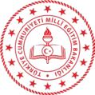

DEVLET KİTAPLARI

<!-- sayfa 1 -->

Millî Eğitim Bakanlığı Yayınları No .................................................................................... 9589
Ders Kitapları Dizisi No ....................................................................................................... 2010

Her hakkı saklıdır ve Millî Eğitim Bakanlığına aittir. Kitabın metin, soru ve şekilleri kısmen de olsa hiçbir surette alınıp yayımlanamaz.

**HAZIRLAYANLAR**

**Editör**
Şeyma KARATEPE

**Dil Uzmanı**
Hilal ARSLAN KUTLU
Mustafa BALCI

**Görsel Tasarımcı**
İzzettin Yılmaz BAŞKAR
Fatih ÇAM

**Çoklu Ortam Tasarımcısı**
Sinan ÇETİN

**Program Geliştirme Uzmanı**
Leyla AKIN

**Ölçme ve Değerlendirme Uzmanı**
Şafak Cansu CİRİT

**Rehberlik Uzmanı**
Murat AKIN

ISBN 978-975-11-8025-4

Millî Eğitim Bakanlığı Talim ve Terbiye Kurulu Başkanlığının 24.06.2026 tarih ve 162784200 sayılı yazısı ile eğitim aracı olarak kabul edilmiştir. Kurulca bu kitabın kabul

<!-- sayfa 2 -->

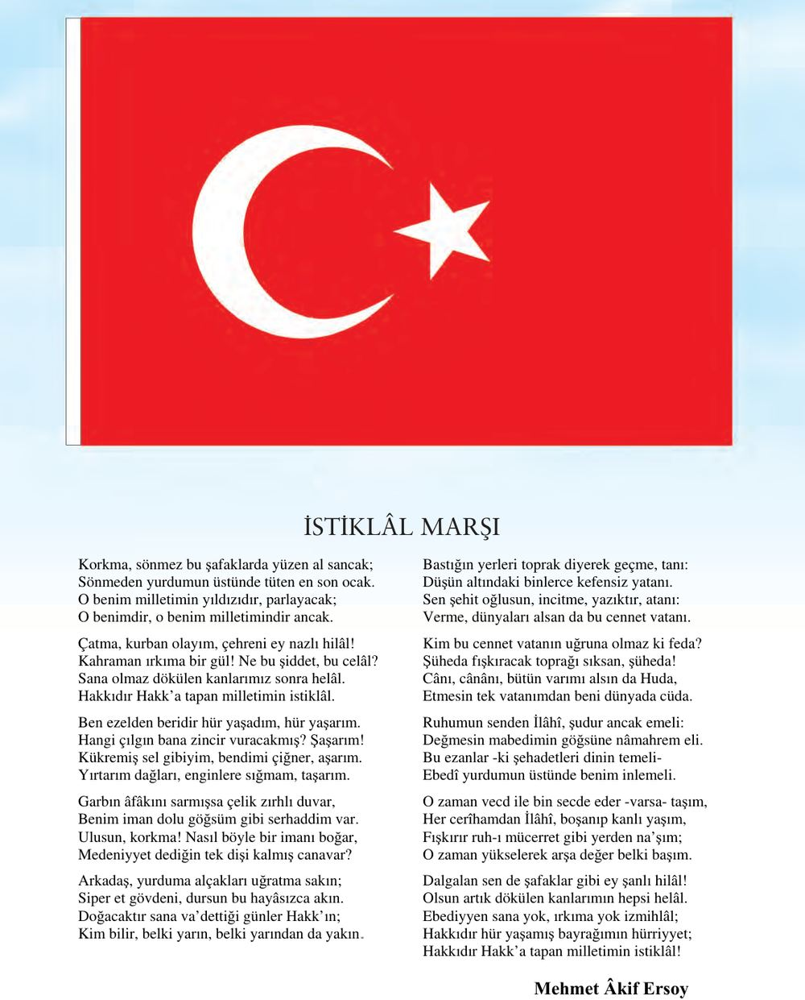

# İSTİKLÂL MARŞI

Korkma, sönmez bu şafaklarda yüzen al sancak;
Sönmeden yurdumun üstünde tüten en son ocak.
O benim milletimin yıldızıdır, parlayacak;
O benimdir, o benim milletimindir ancak.

Çatma, kurban olayım, çehreni ey nazlı hilâl!
Kahraman ırkıma bir gül! Ne bu şiddet, bu celâl?
Sana olmaz dökülen kanlarımız sonra helâl.
Hakkıdır Hakk’a tapan milletimin istiklâl.

Ben ezelden beridir hür yaşadım, hür yaşarım.
Hangi çılgın bana zincir vuracakmış? Şaşarım!
Kükremiş sel gibiyim, bendimi çiğner, aşarım.
Yırtarım dağları, enginlere sığmam, taşarım.

Garbın âfâkını sarmışsa çelik zırhlı duvar,
Benim iman dolu göğsüm gibi serhaddim var.
Ulusun, korkma! Nasıl böyle bir imanı boğar,
Medeniyet dediğin tek dişi kalmış canavar?

Arkadaş, yurduma alçakları uğratma sakın;
Siper et gövdeni, dursun bu hayâsızca akın.
Doğacaktır sana va’dettiği günler Hakk’ın;
Kim bilir, belki yarın, belki yarından da yakın

Bastığın yerleri toprak diyerek geçme, tanı:
Düşün altındaki binlerce kefensiz yatanı.
Sen şehit oğlusun, incitme, yazıktır, atanı:
Verme, dünyaları alsan da bu cennet vatanı.

Kim bu cennet vatanı uğruna olmaz ki feda?
Şüheda fışkıracak toprağı sıksan, şüheda!
Cânı, cânânı, bütün varımı alsın da Huda,
Etmesin tek vatanımdan beni dünyada cüda.

Ruhumun senden İlâhî, şudur ancak emeli:
Değmesin mabedimin göğsüne nâmahrem eli.
Bu ezanlar -ki şehadetleri dinin temeli-
Ebedî yurdumun üstünde benim inlemeli.

O zaman vecd ile bin secde eder -varsa- taşım,
Her cerîhamdan İlâhî, boşanıp kanlı yaşım,
Fışkırır ruh-ı mücerret gibi yerden na’şım;
O zaman yükselerek arşa değer belki başım.

Dalgalan sen de şafaklar gibi ey şanlı hilâl!
Olsun artık dökülen kanlarımın hepsi helâl.
Ebediyyen sana yok, ırkıma yok izmihlâl;
Hakkıdır hür yaşamış bayrağımın hürriyet;
Hakkıdır Hakk’a tapan milletimin istiklâl!

<!-- sayfa 3 -->

# GENÇLİĞE HİTABE

Ey Türk gençliği! Birinci vazifen, Türk istiklâlini, Türk Cumhuriyetini, ilelebet muhafaza ve müdafaa etmektir.

Mevcudiyetinin ve istikbalinin yegâne temeli budur. Bu temel, senin en kıymetli hazinendir. İstikbalde dahi, seni bu hazineden mahrum etmek isteyecek dâhilî ve hâricî bedhahların olacaktır. Bir gün, istiklâl ve cumhuriyeti müdafaa mecburiyetine düşersen, vazifeye atılmak için, içinde bulunacağın vaziyetin imkân ve şeraitini düşünmeyeceksin! Bu imkân ve şerait, çok namüsait bir mahiyette tezahür edebilir. İstiklâl ve cumhuriyetine kastedecek düşmanlar, bütün dünyada emsali görülmemiş bir galibiyetin mümessili olabilirler. Cebren ve hile ile aziz vatanın bütün kaleleri zapt edilmiş, bütün tersanelerine girilmiş, bütün orduları dağıtılmış ve memleketin her köşesi bilfiil işgal edilmiş olabilir. Bütün bu şeraitten daha elîm ve daha vahim olmak üzere, memleketin dâhilinde iktidara sahip olanlar gaflet ve dalâlet ve hattâ hıyanet içinde bulunabilirler. Hattâ bu iktidar sahipleri şahsî menfaatlerini, müstevlîlerin siyasî emelleriyle tevhit edebilirler. Millet, fakr u zaruret içinde harap ve bîtap düşmüş olabilir.

Ey Türk istikbalinin evlâdı! İşte, bu ahval ve şerait içinde dahi vazifen, Türk istiklâl ve cumhuriyetini kurtarmaktır. Muhtaç olduğun kudret, damarlarındaki asil kanda mevcuttur.

Mustafa Kemal Atatürk

<!-- sayfa 4 -->

```

*(Not: Paylaştığınız görsel bir matematik ders kitabı sayfası değil, Mustafa Kemal Atatürk'ün bir portre resmidir. Metin katmanı boş olduğu için dönüştürülecek bir içerik bulunmamaktadır.)*

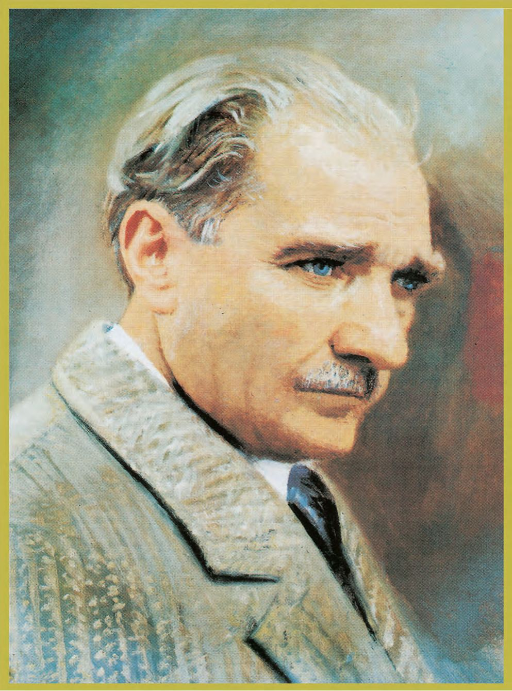
<!-- yer tutucu bulunamadı: sayfa sonuna eklendi -->

<!-- sayfa 5 -->

Verdiğiniz metin katmanı boş olduğu için (`<<< >>>` arası boş) dönüştürülecek herhangi bir içerik bulunmamaktadır. Lütfen metin katmanını içeren içeriği paylaşın, böylece talimatlarınıza uygun şekilde Markdown formatına çevirebilirim.

<!-- sayfa 6 -->

# İÇİNDEKİLER

**KİTABIN TANITIMI** ............................................................................................................................................ 9

## 1. ÜNİTE: ALLAH İNANCI
1.1. Evrendeki Mükemmel Düzen ................................................................................................................... 14
1.2. Allah'ın Varlığı ve Birliği .......................................................................................................................... 20
1.3. Allah'ın Güzel İsimleri ............................................................................................................................. 29
    1.3.1. Allah Rahman ve Rahîm'dir ........................................................................................................ 30
    1.3.2. Allah Her Şeyi Bilir ........................................................................................................................ 32
    1.3.3. Allah Her Şeyi Görür ve İşitir ..................................................................................................... 33
    1.3.4. Allah'ın Her Şeye Gücü Yeter ..................................................................................................... 33
1.4. Bir Sure Öğreniyorum: İhlas Suresi ........................................................................................................ 36
**1. Ünite Performans Görevi** .......................................................................................................................... 43
**Ünite Sonu Ölçme ve Değerlendirme Soruları** ....................................................................................... 47

## 2. ÜNİTE: NAMAZ
2.1. Allah'ın Huzurunda Olmak: Namaz İbadeti .......................................................................................... 56
    2.1.1. Namaz Çeşitleri ............................................................................................................................... 58
2.2. Namazın Kılınışı ........................................................................................................................................ 61
    2.2.1. Namazın Hazırlık Şartları .............................................................................................................. 62
    2.2.2. Namazın Kılınış Şartları ................................................................................................................. 67
2.3. Namaz İbadetinin İnsana Kazandırdıkları .............................................................................................. 77
2.4. Bir Dua Öğreniyorum: Tahiyyat Duası .................................................................................................... 81
**2. Ünite Performans Görevi** .......................................................................................................................... 83
**Ünite Sonu Ölçme ve Değerlendirme Soruları** ....................................................................................... 86

## 3. ÜNİTE: KUR'AN-I KERİM
3.1. Kur'an-ı Kerim'in İç Düzeni ...................................................................................................................... 94
3.2. Kur'an-ı Kerim'in Temel Özellikleri ........................................................................................................ 100
3.3. Kur'an-ı Kerim'in Ana Konuları ............................................................................................................... 106
    3.3.1. İnanç ................................................................................................................................................ 108
    3.3.2. İbadet .............................................................................................................................................. 109
    3.3.3. Ahlak ............................................................................................................................................... 110
    3.3.4. Sosyal Hayat ................................................................................................................................... 111
    3.3.5. Kıssalar ............................................................................................................................................ 111

<!-- sayfa 7 -->

3. Ünite Performans Görevi............................................................................................................................118
Ünite Sonu Ölçme ve Değerlendirme Soruları......................................................................................122

# 4. ÜNİTE: PEYGAMBER KISSALARI

4.1. Allah'ın Elçileri: Peygamberler..................................................................................................................128
4.2. Kur'an-ı Kerim'den Öğütler: Peygamber Kıssaları..............................................................................133
    4.2.1. Hz. Nuh ................................................................................................................................................134
    4.2.2. Hz. İbrahim ..........................................................................................................................................137
    4.2.3. Hz. Musa...............................................................................................................................................140
    4.2.4. Hz. İsa ....................................................................................................................................................143
    4.2.5. Peygamber Kıssalarında Verilen Mesajlar................................................................................145
4.3. Bir Sure Öğreniyorum: Kureyş Suresi ......................................................................................................149
4. Ünite Performans Görevi............................................................................................................................152
Ünite Sonu Ölçme ve Değerlendirme Soruları......................................................................................156

# 5. ÜNİTE: MİMARİMİZDE DİNÎ MOTİFLER

5.1. Dinin Mimarimize Etkisi..............................................................................................................................164
5.2. Camileri Tanıyalım.........................................................................................................................................171
5.3. Kültürümüzden Cami Örnekleri ................................................................................................................177
5. Ünite Performans Görevi............................................................................................................................183
Ünite Sonu Ölçme ve Değerlendirme Soruları......................................................................................186 

Sözlük ........................................................................................................................................................................192
Kaynakça..................................................................................................................................................................195
Cevap Anahtarı.......................................................................................................................................................196
Görsel ve Genel Ağ Kaynakçası.........................................................................................................................196
Türkiye’nin Mülki İdare Bölümleri ile Kara ve Deniz Komşuları Haritası............................................197
Türk Dünyası Haritası...........................................................................................................................................198

<!-- sayfa 8 -->

# KİTABIN TANITIMI

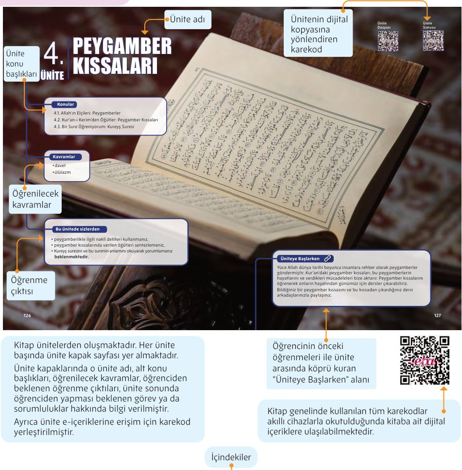

Ünite adı
Ünite konu başlıkları
Konular
Kavramlar
Öğrenilecek kavramlar
Öğrenme çıktısı
Üniteye Başlarken
Ünitenin dijital kopyasına yönlendiren karekod
Ünite Dosyası
Ünite Sunusu

4. ÜNİTE PEYGAMBER KISSALARI
4.1. Allah'ın Elçileri: Peygamberler
4.2. Kur'an-ı Kerim'den Öğütler: Peygamber Kıssaları
4.3. Bir Sure Öğreniyorum: Kureyş Suresi

Konular
4.1. Allah'ın Elçileri: Peygamberler
4.2. Kur'an-ı Kerim'den Öğütler: Peygamber Kıssaları
4.3. Bir Sure Öğreniyorum: Kureyş Suresi

Kavramlar
• davet
• ülülazm

Öğrenilecek kavramlar
• davet
• ülülazm

Bu ünitede sizlerden
• peygamberlikle ilgili naklî delilleri kullanmanız,
• peygamber kıssalarında verilen öğütleri sentezlemeniz,
• Kureyş suresini ve bu surenin anlamını okuyarak yorumlamanız beklenmektedir.

Öğrenme çıktısı

126

127

Üniteye Başlarken
Yüce Allah dünya tarihi boyunca insanlara rehber olarak peygamberler göndermiştir. Kur’an’daki peygamber kıssaları, bu peygamberlerin hayatlarını ve verdikleri mücadeleleri bize aktarır. Peygamber kıssalarını öğrenerek onların hayatından günümüz için dersler çıkarabiliriz.
Bildiğiniz bir peygamber kıssasını ve bu kıssadan çıkardığınız dersi arkadaşlarınızla paylaşınız.

Öğrencinin önceki öğrenmeleri ile ünite arasında köprü kuran “Üniteye Başlarken” alanı


Kitap ünitelerden oluşmaktadır. Her ünite başında ünite kapak sayfası yer almaktadır. Ünite kapaklarında o ünite adı, alt konu başlıkları, öğrenilecek kavramlar, öğrenciden beklenen öğrenme çıktıları, ünite sonunda öğrenciden yapması beklenen görev ya da sorumluluklar hakkında bilgi verilmiştir.
Ayrıca ünite e-içeriklerine erişim için karekod yerleştirilmiştir.

Kitap genelinde kullanılan tüm karekodlar akıllı cihazlarla okutulduğunda kitaba ait dijital içeriklere ulaşılabilmektedir.

İçindekiler

İÇİNDEKİLER

KİTABIN TANITIMI ..................................................................................................................................................9
1. ÜNİTE: ALLAH İNANCI
1.1. Evrendeki Mükemmel Düzen .....................................................................................................................14
1.2. Allah'ın Varlığı ve Birliği ..............................................................................................................................20
1.3. Allah'ın Güzel İsimleri ..................................................................................................................................29
1.3.1. Allah Rahman ve Rahîm'dir .......................................................................................................................30
1.3.2. Allah Her Şeyi Bilir .....................................................................................................................................32
1.3.3. Allah Her Şeyi Görür ve İşitir ....................................................................................................................33
1.3.4. Allah'ın Her Şeye Gücü Yeter ...................................................................................................................33
1.4. Bir Sure Öğreniyorum: İhlas Suresi ..........................................................................................................36

<!-- sayfa 9 -->

# Konu başlığı
Derse hazırlık ve ön değerlendirme yapılan “Konuya Başlarken” alanı

## 4.2. KUR’AN-I KERİM’DEN ÖĞÜTLER: PEYGAMBER KISSALARI

### Konuya Başlarken 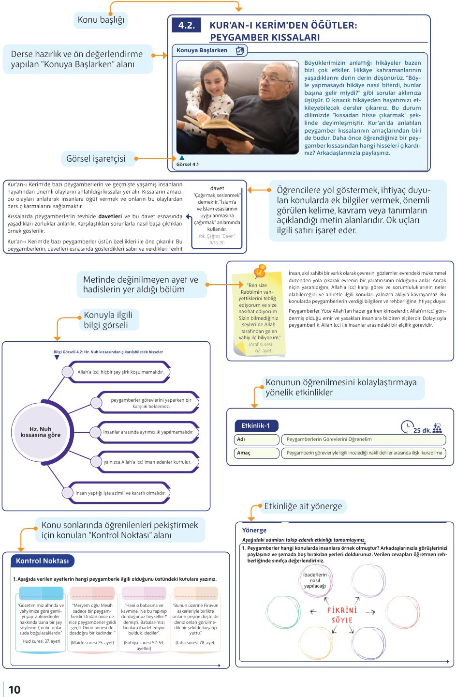

Büyüklerimizin anlattığı hikâyeler bazen bizi çok etkiler. Hikâye kahramanlarının yaşadıklarını derin derin düşünürüz. “Böyle yapmasaydı hikâye nasıl biterdi, bunlar başına gelir miydi?” gibi sorular aklımıza üşüşür. O kısacık hikâyeden hayatımızı etkileyebilecek dersler çıkarırız. Bu durum dilimizde “kıssadan hisse çıkarmak” şeklinde deyimleşmiştir. Kur’an’da anlatılan peygamber kıssalarının amaçlarından biri de budur. Daha önce öğrendiğiniz bir peygamber kıssasından hangi hisseleri çıkardınız? Arkadaşlarınızla paylaşınız.


**davet**
“Çağırmak, seslenmek” demektir. “İslam’a ve İslam esaslarının uygulanmasına çağırmak” anlamında kullanılır.
(bk. Çağrıcı, “Davet”, 9/16-19)

Kur’an-ı Kerim’de bazı peygamberlerin ve geçmişte yaşamış insanların hayatından önemli olayların anlatıldığı kıssalar yer alır. Kıssaların amacı, bu olayları anlatarak insanlara öğüt vermek ve onların bu olaylardan ders çıkarmalarını sağlamaktır.

Kıssalarda peygamberlerin tevhide davetleri ve bu davet esnasında yaşadıkları zorluklar anlatılır. Karşılaştıkları sorunlarla nasıl başa çıktıkları örnek gösterilir.

Kur’an-ı Kerim’de bazı peygamberler üstün özellikleri ile öne çıkarılır. Bu peygamberlerin, davetleri esnasında gösterdikleri sabır ve verdikleri tevhit...

---

İnsan, akıl sahibi bir varlık olarak çevresini gözlemler, evrendeki mükemmel düzenden yola çıkarak evrenin bir yaratıcısının olduğunu anlar. Ancak niçin yaratıldığını, Allah’a (cc) karşı görev ve sorumluluklarının neler olabileceğini ve ahiretle ilgili konuları yalnızca aklıyla kavrayamaz. Bu konularda peygamberlerin verdiği bilgilere ve rehberliğine ihtiyaç duyar.

Peygamberler, Yüce Allah’tan haber getiren kimselerdir. Allah’ın (cc) göndermiş olduğu emir ve yasakları insanlara bildiren elçilerdir. Dolayısıyla peygamberlik, Allah (cc) ile insanlar arasındaki bir elçilik görevidir.


“Ben size Rabbimin vahyettiklerini tebliğ ediyorum ve size nasihat ediyorum. Sizin bilmediğiniz şeyleri de Allah tarafından gelen vahiy ile biliyorum.”
(Araf suresi 62. ayet)

---

### Bilgi Görseli 4.2: Hz. Nuh kıssasından çıkarılabilecek hisseler


* Allah’a (cc) hiçbir şey şirk koşulmamalıdır.
* peygamberler görevlerini yaparken bir karşılık beklemez.
* insanlar arasında ayrımcılık yapılmamalıdır.
* yalnızca Allah’a (cc) iman edenler kurtulur.
* insan yaptığı işte azimli ve kararlı olmalıdır.

---

### Etkinlik-1

| Adı | Peygamberlerin Görevlerini Öğrenelim |
| :--- | :--- |
| **Amaç** | Peygamberin görevleriyle ilgili incelediği naklî deliller arasında ilişki kurabilme |
| **Süre** | 25 dk. |

#### Yönerge
Aşağıdaki adımları takip ederek etkinliği tamamlayınız.

1. Peygamberler hangi konularda insanlara örnek olmuştur? Arkadaşlarınızla görüşlerinizi paylaşınız ve şemada boş bırakılan yerleri doldurunuz. Verilen cevapları öğretmen rehberliğinde sınıfça değerlendiriniz.


* ibadetlerin nasıl yapılacağı
* FİKRİNİ SÖYLE

---

### Kontrol Noktası

1. Aşağıda verilen ayetlerin hangi peygamberle ilgili olduğunu üstündeki kutulara yazınız.

_____________
_____________
_____________
_____________

“Gözetimimiz altında ve vahyimize göre gemiyi yap. Zulmedenler hakkında bana bir şey söyleme. Çünkü onlar suda boğulacaklardır.”
(Hud suresi 37. ayet)

“Meryem oğlu Mesih sadece bir peygamberdir. Ondan önce de nice peygamberler geldi geçti. Onun annesi de dosdoğru bir kadındır…”
(Maide suresi 75. ayet)

“Hani o babasına ve kavmine, ‘Ne bu tapınıp durduğunuz heykeller?’ demişti. ‘Babalarımızı bunlara ibadet ediyor bulduk.’ dediler”.
(Enbiya suresi 52-53. ayetler)

“Bunun üzerine Firavun askerleriyle birlikte onların peşine düştü de deniz onları görülmedik bir şekilde kuşatıp yuttu.”
(Taha suresi 78. ayet)

<!-- sayfa 10 -->


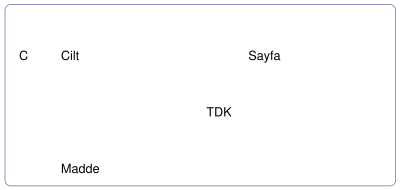

# Kısaltmalar

| | | | |
| :--- | :--- | :--- | :--- |
| as | : Aleyhisselam | MEB | : Millî Eğitim Bakanlığı |
| bk. | : Bakınız | ra | : Radıyallahüanh / anha |
| C | : Cilt | s. | : Sayfa |
| cc | : Cellecelalüh | sav | : Sallallahü aleyhi vesellem |
| çev. | : Çeviren | TDV | : Türkiye Diyanet Vakfı |
| ed. | : Editör | TDK | : Türk Dil Kurumu |
| haz. | : Hazırlayan | thk. | : Tahkik |
| Hz. | : Hazreti | vb. | : Ve benzeri |
| md. | : Madde | vd. | : Ve diğerleri |

# SÖZLÜK


**A-B**

**ahenk:** Bir bütünün parçaları arasında bulunan uygunluk, uyum.  
**asa:** Baston, değnek, uzun sopa.  
**ashab:** 1. Sahabe, arkadaş, dost, veli.  
2. Hz. Peygamber zamanında yaşamış, Müslüman olarak Hz. Peygamber’i çok kısa bir süre olsa da görmüş, onun sohbetinde bulunmuş ve yine Müslüman olarak ölmüş kimse.  
**atmosfer:** Yeri veya herhangi bir gök cismini saran gaz tabakası.  
**bereket:** 1. Bolluk, genişlik, nimet, bağış.  
2. Allah’ın (cc) karşılıksız vermesi.  
**bozgunculuk:** Bir toplulukta karşılıklı güvenin bozulmasına ve karışıklıkların çıkmasına sebep olma, fesat çıkarma.

**C-Ç**

**coğrafya:** Toprak parçası, yer, memleket.  
**cömert:** Para ve malını esirgemeden veren, eli açık.  
**çıkarım:** Belli önermelerin kabul edilen veya gerçek olan doğruluk veya yanlışlıklarından...

**F-G-Ğ**

**fazilet:** Ahlaki özelliklerin hepsine birden verilen isim, erdem.  
**fedakârlık:** Bir amaç uğruna veya gerçekleştirilmesi istenen herhangi bir şey için kendi çıkarlarından vazgeçme, özveri.  
**fetih:** Bir şehir veya ülkeyi savaşarak alma.  
**gaye:** Elde edilmesi gereken, ulaşılmak istenilen sonuç, amaç.  
**gözlem:** Bir nesnenin, olayın veya bir gerçeğin, niteliklerinin bilinmesi amacıyla, dikkatli ve planlı olarak ele alınıp incelenmesi.  
**gündem:** Yaşanan günlük olaylar.

**H-I-İ**

**hadis:** 1. Söz, haber. 2. Hz. Peygamber’in sözleri ve fiilleri. Sahabenin dine aykırı olmayan söz ve davranışlarının Hz. Peygamber tarafından onaylanması.  
**hakikat:** Yalan olmayan, doğru olan şey; gerçek.  
**hakkaniyet:** Hak ve adalete uygunluk.  
**hatip:** 1. Konuşmacı. 2. Camilerde hutbe okuyan kişi.

# KAYNAKÇA


1. Ahmed b. Hanbel, Ebû Abdillâh Ahmed b. Muhammed b. Hanbel eş-Şeybânî. el-Müsned. nşr. Ebû Hâcir Muhammed Saîd Besyûnî. Beyrut: y.y., 1405/1985.
2. Algül, Hüseyin. “Mescid-i Kubâ”, Türkiye Diyanet Vakfı İslâm Ansiklopedisi. 29/279. Ankara: TDV Yayınları, 2004.
3. Apaydın, H. Yunus. “Namaz”. İlmihal. 1/217-378. Ankara: TDV Yayınları, 18. Basım, 2012.
4. Aruçi, Muhammed. “Ülü’lazm”, Türkiye Diyanet Vakfı İslâm Ansiklopedisi. 242/294-295. Ankara: TDV Yayınları, 2012.
5. Avcı, Casim- Şentürk, Recep. “Kabile”, Türkiye Diyanet Vakfı İslâm Ansiklopedisi. 24/30-32. İstanbul: TDV Yayınları, 2001.
6. Aydın, Cansu. “Mevsimler Nasıl Oluşur?”. TÜBİTAK Bilim Genç. Erişim 9 Nisan 2026. https://bilimgenc.tubitak.gov.tr/makale/mevsimler-nasil-olusur
7. Aydın Gökduman, Nehir (ed.). Merhamet. Ankara: Diyanet İşleri Başkanlığı Yayınları, 3. Basım, 2017.
8. Aydınbaş, Esra. Kâinatta Harika Şeyler Oluyor. İstanbul: Diyanet İşleri Başkanlığı Yayınları, 2. Basım, 2023.
9. Bardakoğlu, Ali. “Temizlik”. İlmihal. 1/183-216. Ankara: TDV Yayınları, 18. Basım, 2012.
10. Başoğlu, Tuncay (ed.). Temel İslâm Ansiklopedisi. 6/295. İstanbul: İSAM Yayınları, 2021.
11. Beyhakî, Ebû Bekr Ahmed b. el-Hüseyn, Şuabü’l-iman. Beyrut: Dâru’l-Kütübi’l-İlmiyye, 1410.
12. Birışık, Abdulhamit. “Sûre”, Türkiye Diyanet Vakfı İslâm Ansiklopedisi. 37/538. İstanbul: TDV Yayınları, 2009.
13. Bolay, Süleyman Hayri. “Âlem”. Türkiye Diyanet Vakfı İslâm Ansiklopedisi. 2/357-360. İstanbul: TDV Yayınları, 1989.
14. Bozkurt, Nebi. “Mescid-i Aksâ”, Türkiye Diyanet Vakfı İslâm Ansiklopedisi. 29/268. Ankara: TDV Yayınları, 2004.
15. Bozkurt, Nebi – Küçükaşcı, Mustafa Sabri. “Mescid-i Nebevî”, Türkiye Diyanet Vakfı İslâm Ansiklopedisi. 29/281. Ankara: TDV Yayınları, 2004.

<!-- sayfa 11 -->

# 1. ÜNİTE | ALLAH İNANCI

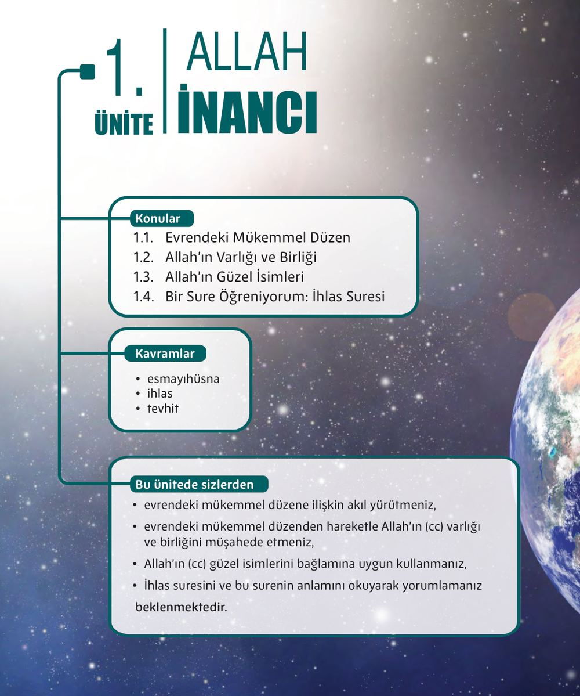

## Konular
1.1. Evrendeki Mükemmel Düzen
1.2. Allah'ın Varlığı ve Birliği
1.3. Allah'ın Güzel İsimleri
1.4. Bir Sure Öğreniyorum: İhlas Suresi

## Kavramlar
* esmayıhüsna
* ihlas
* tevhit

## Bu ünitede sizlerden
* evrendeki mükemmel düzene ilişkin akıl yürütmeniz,
* evrendeki mükemmel düzenden hareketle Allah'ın (cc) varlığı ve birliğini müşahede etmeniz,
* Allah'ın (cc) güzel isimlerini bağlamına uygun kullanmanız,
* İhlas suresini ve bu surenin anlamını okuyarak yorumlamanız beklenmektedir.

<!-- sayfa 12 -->

Dosyası
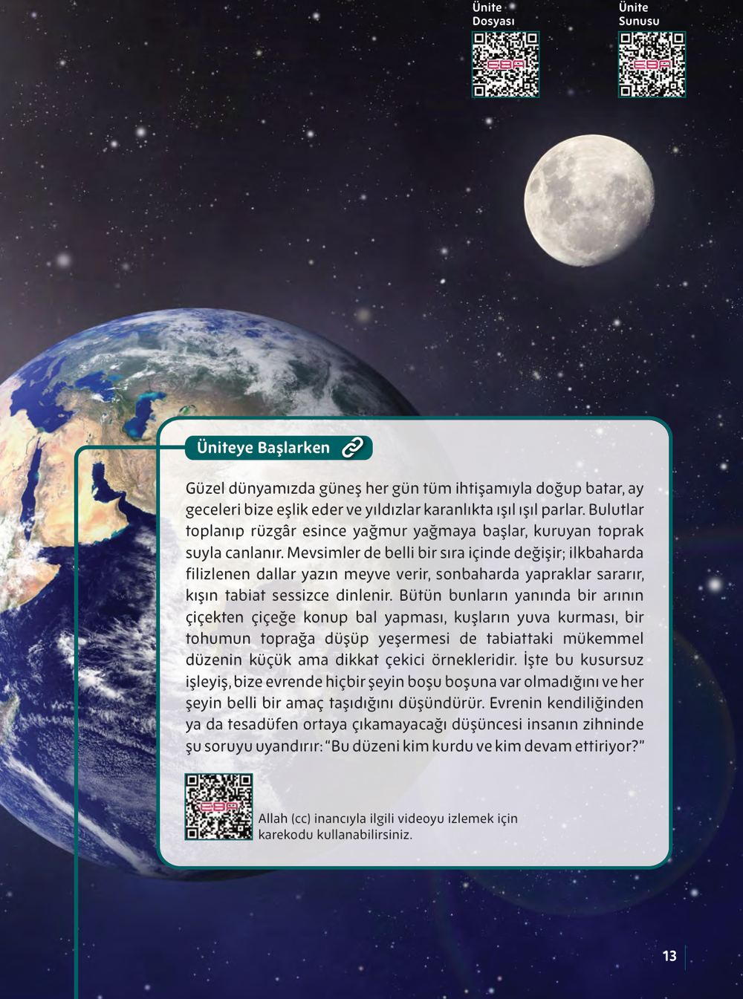
Sunusu


# Üniteye Başlarken

Güzel dünyamızda güneş her gün tüm ihtişamıyla doğup batar, ay geceleri bize eşlik eder ve yıldızlar karanlıkta ışıl ışıl parlar. Bulutlar toplanıp rüzgâr esince yağmur yağmaya başlar, kuruyan toprak suyla canlanır. Mevsimler de belli bir sıra içinde değişir; ilkbaharda filizlenen dallar yazın meyve verir, sonbaharda yapraklar sararır, kışın tabiat sessizce dinlenir. Bütün bunların yanında bir arının çiçekten çiçeğe konup bal yapması, kuşların yuva kurması, bir tohumun toprağa düşüp yeşermesi de tabiattaki mükemmel düzenin küçük ama dikkat çekici örnekleridir. İşte bu kusursuz işleyiş, bize evrende hiçbir şeyin boşu boşuna var olmadığını ve her şeyin belli bir amaç taşıdığını düşündürür. Evrenin kendiliğinden ya da tesadüfen ortaya çıkamayacağı düşüncesi insanın zihninde şu soruyu uyandırır: “Bu düzeni kim kurdu ve kim devam ettiriyor?”

 Allah (cc) inancıyla ilgili videoyu izlemek için karekodu kullanabilirsiniz.

<!-- sayfa 13 -->

# 1.1. EVRENDEKİ MÜKEMMEL DÜZEN

## Konuya Başlarken 

1. Aşağıdaki ifadelerin evrendeki düzen ve işleyişle ilişkisi ne olabilir? Düşüncelerinizi paylaşınız.
    * Gece ve gündüz
    * Mevsimler
    * Besin zinciri

2. Evrendeki düzen ve işleyişi daha iyi anlamak için aşağıdaki yöntemlerden hangileri size yardımcı olur? İşaretleyiniz.
    * [ ] Görsel incelemek
    * [ ] Video/belgesel izlemek
    * [ ] Tabiatı gözlemlemek
    * [ ] Kitap okumak


**âlem**
Düzenli ve uyumlu bir bütün olarak düşünülen bütün varlıklar; kâinat.
(bk. TDK Güncel Türkçe Sözlük, “evren”)

Evren, üzerinde yaşadığımız dünya ile tüm yıldız ve gezegenleri içine alan varlıklar bütünüdür. Bu varlıklar *âleminde* insan, akıl sahibi olması yönüyle diğer canlılardan ayrılır. Düşünen, sorgulayan ve akleden bir varlık olarak insan, her şeyi bilmek ve anlamak ister. Bunun için çevresini gözlemler, gördükleri üzerine düşünür. Gözlemleri hakkında araştırma yaparak olaylar arasında ilişki kurar.

İnsan ve evrenin işleyişi arasında bir benzerlik söz konusudur. İnsan vücudundaki her bir sistem birbiriyle etkileşime girerek vücudun sağlıklı bir şekilde çalışmasına ve vücut dengesinin korunmasına yardımcı olur. Evrendeki tabiat olaylarının gerçekleşmesi de doğal dengenin korunmasını sağlar. Örneğin insan susadığında su içer ve vücudundaki su dengesi korunur. Benzer şekilde yeryüzündeki varlıkların su ihtiyacının karşılanması için su döngüsü gerçekleşir. Bu süreç, evrendeki hiçbir şeyin tesadüfen olmadığını aksine her şeyin mükemmel bir düzen içinde gerçekleştiğini gösterir.

İnsan vücudunun ölçülü ve dengeli yapısı, evrende var olan düzenin ipuçlarını içerir. İnsan kendi vücudunu gözlemleyerek de mükemmel düzenle ilgili sorularına cevaplar bulabilir. Vücudun genel dengesine göre her bir organ, kendi görevine uygun olarak yaratılmıştır. Örneğin göz, kulak, burun gibi uzuvlar insanın ihtiyaçlarına göre yerleştirilip şekillendirilmiştir. Hayvanların bedenlerinin, onların yaşam şartlarına uygun olarak farklı farklı tasarlanmış olması da evrendeki düzenin varlığına işarettir. Havada, karada ve suda yaşayan canlıların her biri ihtiyaçlarını karşılayabilecek şekilde donatılmıştır.

Yaşadığımız evrende gezegenlerden insanlara, bitkilerden hayvanlara kadar her şey bir uyum ve denge içindedir. Bu dengenin farkında olan insan, günlük hayatta karşılaştığı olayları anlamaya çalışır. Öncelikle üzerinde yaşadığı toprağın ne işe yaradığını düşünür. Toprağın bir fabrika gibi tohumu nasıl ağaca dönüştürdüğünü ve bu ağacın nasıl meyve verdiğini gözlemler. Ekinlerin nasıl yeşerdiğini, kuşların nasıl uçtuğunu, balıkların nasıl yüzdüğünü merak eder. Yağmur ve karın nasıl yağdığını; ayın, güneşin, bulutların ve rüzgârın niçin var olduğunu sorgular İnsan varlıkların bir amaç için yaratıldığını fark eder

<!-- sayfa 14 -->

# Bilgi Görseli 1.1: Evrende gözlemlediğimiz mükemmel düzene örnekler

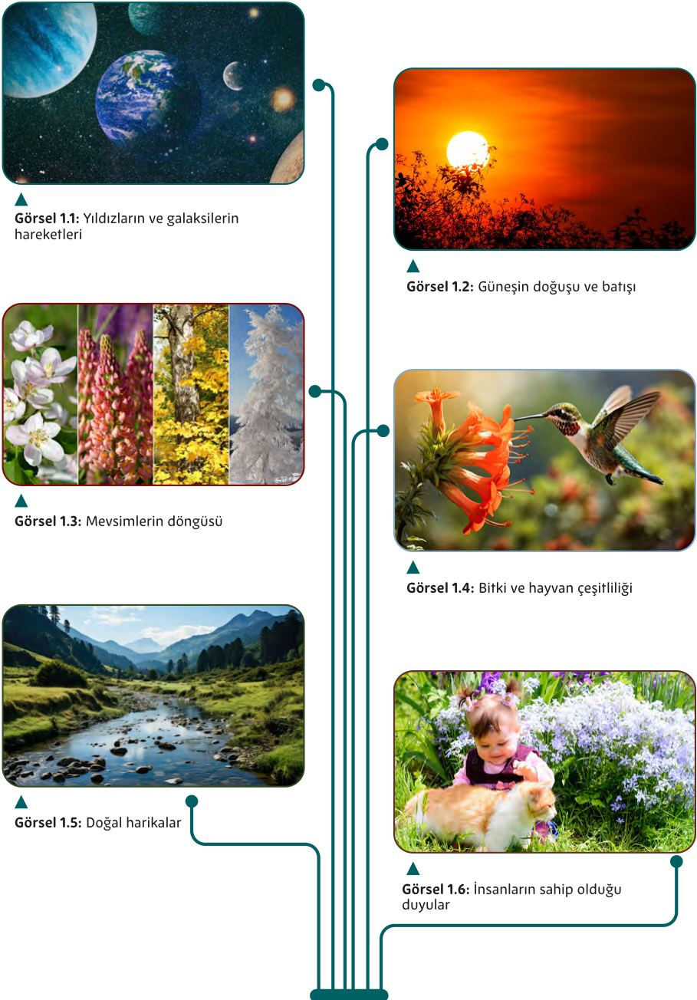

**Görsel 1.1:** Yıldızların ve galaksilerin hareketleri

**Görsel 1.2:** Güneşin doğuşu ve batışı

**Görsel 1.3:** Mevsimlerin döngüsü

**Görsel 1.4:** Bitki ve hayvan çeşitliliği

**Görsel 1.5:** Doğal harikalar

**Görsel 1.6:** İnsanların sahip olduğu duyular

<!-- sayfa 15 -->

# Etkinlik-1

15 dk. 

| Adı | Çevremizde Neler Oluyor? |
| :--- | :--- |
| **Amaç** | Evrendeki mükemmel düzene ilişkin gözlem yapabilme |
| **Malzemeler** | Not defteri, fotoğraf makinesi, telefon, tablet vb. |

## Ön Hazırlık
1. Bir hafta boyunca çevrenizi gözlemleyerek evrendeki düzen hakkında gözlem notu oluşturunuz.
2. Gördüğünüz doğal güzellikleri, ilginç tabiat olaylarını ya da canlıları fotoğraflayınız.
3. Gözlem not ve fotoğraflarınızı sınıfta paylaşmak için dosyalayınız.


## Yönerge
*Aşağıdaki adımları takip ederek etkinliği tamamlayınız.*

Dosyaladığınız fotoğrafları sınıfta sergileyiniz. Gözlemlerinizden yararlanarak aşağıdaki soruları cevaplayınız.

1. Gözlemlediğiniz tabiat olaylarından birini seçiniz. Bu olaydaki düzeni örnekteki gibi açıklayınız.

**Örnek:** Güneş, her sabah doğudan doğup her akşam batıdan batıyor. Her gün farklı bir açıdan Dünya'mıza ışık veriyor. Bu görevini de hiç aksatmadan düzenli olarak yerine getiriyor.

______________________________________________________________
______________________________________________________________
______________________________________________________________

2. Örnek verdiğiniz olayların düzenli bir şekilde devam etmesinin nedeni ne olabilir? Yazınız.

3. Evrende hiç aksamadan planlı bir şekilde devam eden olaylar neyin göstergesidir? Açıklayınız.

<!-- sayfa 16 -->

# Değerlendirme


## Etkinlik-2

15 dk. 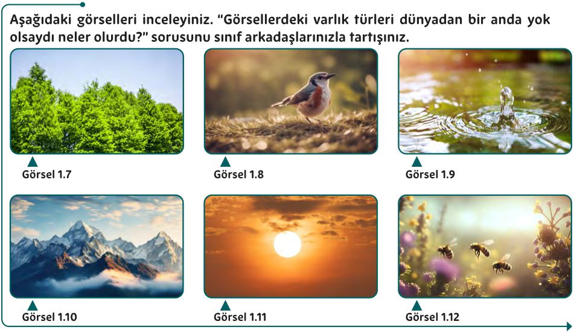

**Adı:** Olmasaydı Ne Olurdu?
**Amaç:** Evrendeki mükemmel düzene ilişkin akıl yürütebilme

## Yönerge

Aşağıdaki görselleri inceleyiniz. “Görsellerdeki varlık türleri dünyadan bir anda yok olsaydı neler olurdu?” sorusunu sınıf arkadaşlarınızla tartışınız.

| | | |
| :---: | :---: | :---: |
|  |  |  |
| Görsel 1.7 | Görsel 1.8 | Görsel 1.9 |
|  |  |  |
| Görsel 1.10 | Görsel 1.11 | Görsel 1.12 |

<!-- sayfa 17 -->

# Değerlendirme

1. Verilen görsellerin ortak özellikleri nelerdir?
__________________________________________________________________
__________________________________________________________________

2. Yaratılan her varlığın bir görevi var mıdır? Örnek vererek açıklayınız.
__________________________________________________________________
__________________________________________________________________

3. Bu etkinlikten hareketle evrende var olan düzen hakkındaki düşüncelerinizi yazınız.
__________________________________________________________________
__________________________________________________________________

# Kontrol Noktası

Aşağıdaki parçayı okuyunuz ve soruları cevaplandırınız.

### DÜNYA’YI KİM BOYADI?

Sınıfla birlikte sinemadaydık. Türkiye’deki zengin bitki örtüsünü anlatan bir belgesel seyrediyorduk. Bin bir tür çiçek, bitki, ağaç, meyve ve sebze vardı. Hiçbiri birbirine benzemiyordu ve her biri ayrı ayrı çok güzeldi. Rengârenk bir bahçenin içindeydik sanki.

Hayran hayran seyrederken belgeseldeki her şey birden gerçeğe dönüşüverdi. Bir bitki tüneline girdim. Tünelin çıkışında öyle parlak bir ışık vardı ki gözlerim kamaştı. Kapadım gözlerimi.

Geldiğim yer mis gibi kokuyordu. Hafif bir rüzgâr vuruyordu yüzüme ve burnuma harika kokular getiriyordu. Çiçek kokusuydu bu. Merakla gözlerimi açtım. Açtım ama sadece parlak bir ışık vardı. Hiçbir şey yoktu ortalıkta. Ayaklarım yere basıyordu ama yer bile görünmüyordu. Sadece hissediyordum.

Sonra bir adım attım ama ilerleyemedim. Bir yere çarptım. Gözlerimi iyice açtım yine de hiçbir şey görünmüyordu. Elimle yokladım, önümdeki bir ağaçtı. Ellerimle yoklayarak ağacın yanından yürümeye devam ettim. Her yer farklı bitkilerle, ağaçlarla ve çiçeklerle doluydu. Hepsini ayrı ayrı kokladım. Şimdiye kadar hiç bilmediğim güzellikte kokularla tanıştım ama bu kokuların kaynağını neden göremiyordum! Sonra biri seslendi.

“Renksiz diyara hoş geldin.”

O da ne demekti? Şaşkınlıktan cevap veremedim. Bir türlü göremediğim bu kişi konuşmaya devam etti.

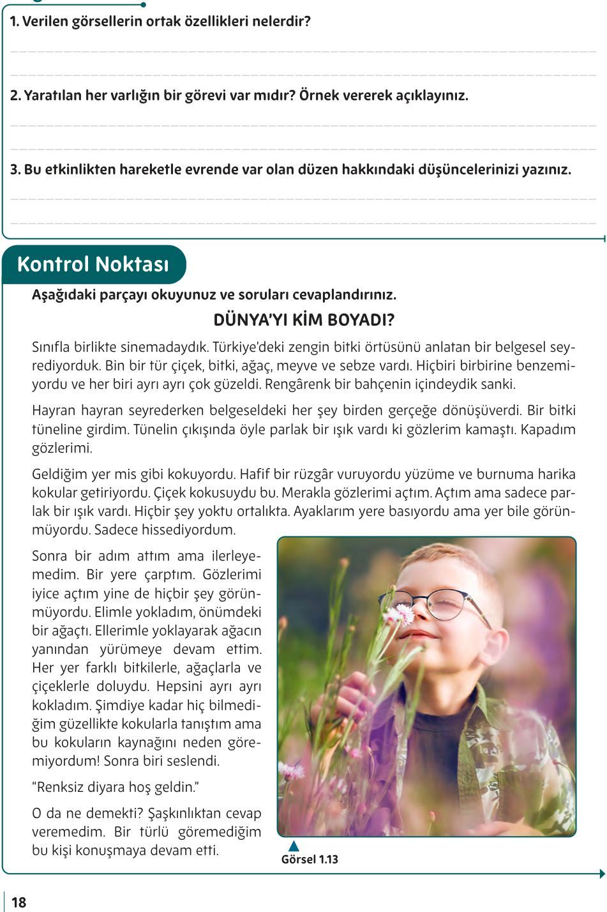

Gö l 1 13

<!-- sayfa 18 -->

“Burada, yaşadığın dünyadaki her şey var dostum! Tek fark, her şeyin renksiz olması...”
Nasıl olabilirdi böyle bir şey? Şimdiye kadar böyle bir şey olabilme ihtimali aklımın ucundan geçmemişti. Burada insanlar nasıl yaşıyorlardı? Hayvanlar için bile renkler çok önemliydi. Burada anne kuşlar yavrularının gagalarını nasıl görüyor, onları nasıl besliyorlardı?

Hatta bazı hayvanlar için renkler hayati öneme sahip... Mesela arılar insanlardan daha iyi bir renk görüşüne sahip oldukları için çiçeklerin bizim göremediğimiz renklerini bile fark edebiliyorlar. Böylece balözü bulabiliyorlar. Bazı böcekler morötesi ışınımları göremese avlarının peşine düşüp beslenemezler bile... O hâlde bu renksiz diyar hiç onlara göre değil. Hepimiz için renkler ne kadar önemliymiş meğer! Kırmızı ne güzel bir renkmiş, yeşil muhteşemmiş. “Renklerimi istiyorum ben, sarı, turuncu, mavi... Neredesiniz?” Hayal kırıklığı içinde renklerin isimlerini sayıklıyordum. Kaybettiğim renkleri bir bir ararken omzuma bir el dokundu.

“Hadi, film bitti, gidiyoruz.”

Öğretmenin sesiyle uyandığımda her şeyin bir rüya olduğunu anladım. Sinema salonundan çıktığımızda sanki gözleri ilk kez gören biri gibiydim. Her şey ne kadar güzeldi. Renkler, dünyamızdaki her şeye vücut veriyordu. Yeşilin tonları, mevsimlerin renkleri, dünyanın değişen elbiseleri... Ormandaki, göldeki, sokaktaki doğal resimler... Güneşin ışığı karşımdaki ağacın yapraklarının arasından altın gibi ışıldıyordu. Önümden uçan kelebeğin minicik kanadına mavinin her tonu ince bir nakış gibi nasıl işlenmişti? Bir kedi geçti önümden, kendi bembeyaz, gözleri ise masmavi... Peki ya bu harika renkleri algılayan gözlerimiz, beynimiz... Onları kim bu kadar mükemmel yaratmıştı? Işığı kim yaratmıştı? Işığın, gözlerimizin, renklerin ve her şeyin Yaratıcısına bir kez daha teşekkür ettim. O’nun gücüne bir kez daha hayran kaldım. O ve yarattığı her şey mükemmeldi.

Elbette gözleri görmeyen insanlara verdiği başka yetenekler de bu mükemmel dengenin bir parçasıydı. Gelişmiş kulakları ve müziğe yetenekleri... Duyarlılığı giderek gelişen parmak uçlarıyla onlar da dünyaya başka gözlerle bakıyorlardı.

(Esra Aydınbaş, *Kâinatta Harika Şeyler Oluyor*, 59-63)

**1. Bu parçada verilmek istenen mesajı bir cümle ile yazınız.**
__________________________________________________________________
__________________________________________________________________

**2. Bu parçada evrendeki düzenle ilgili hangi örnekler verilmiştir? Yazınız.**
__________________________________________________________________
__________________________________________________________________

**3. Okuduğunuz parçada evrendeki düzenin kaynağı hangi nedene bağlanmıştır? Açıklayınız.**
__________________________________________________________________
__________________________________________________________________

**4. Okuduğunuz parçanın kahramanı siz olsaydınız yaşadığınız olay karşısında hangi sonuca varırdınız? Açıklayınız.**
__________________________________________________________________
__________________________________________________________________


<!-- yer tutucu bulunamadı: sayfa sonuna eklendi -->

<!-- sayfa 19 -->

# 1.2. ALLAH’IN VARLIĞI VE BİRLİĞİ

## Konuya Başlarken 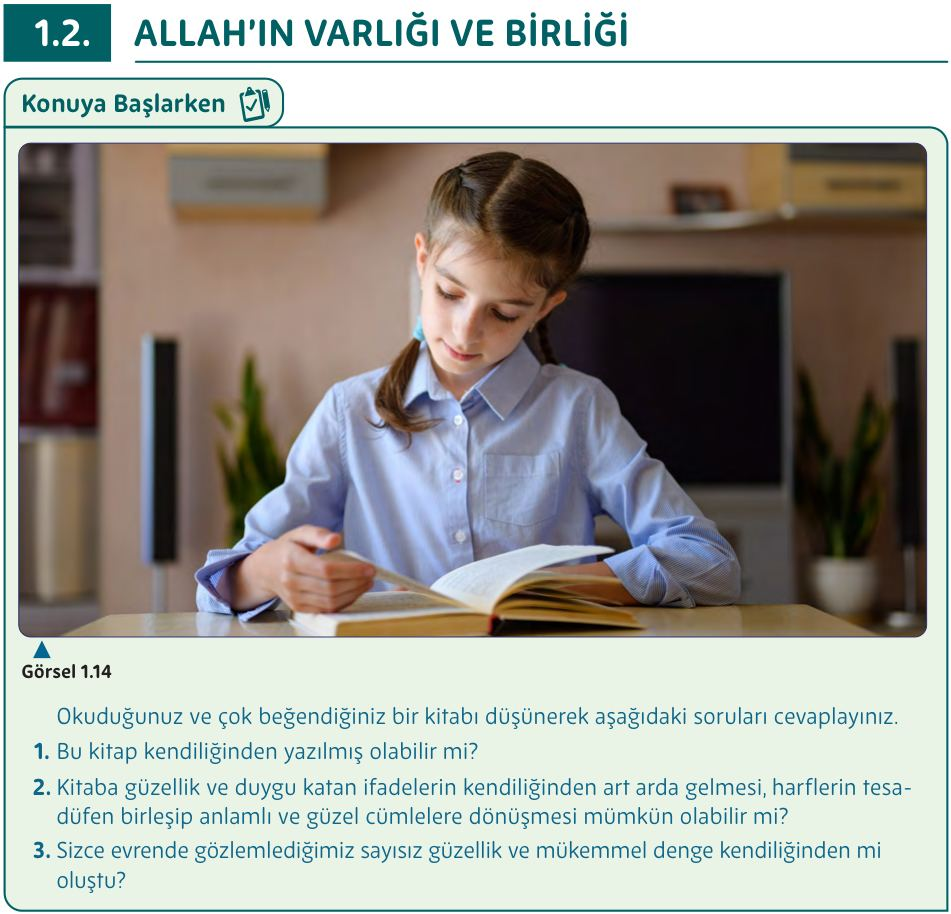


Okuduğunuz ve çok beğendiğiniz bir kitabı düşünerek aşağıdaki soruları cevaplayınız.
1. Bu kitap kendiliğinden yazılmış olabilir mi?
2. Kitaba güzellik ve duygu katan ifadelerin kendiliğinden art arda gelmesi, harflerin tesadüfen birleşip anlamlı ve güzel cümlelere dönüşmesi mümkün olabilir mi?
3. Sizce evrende gözlemlediğimiz sayısız güzellik ve mükemmel denge kendiliğinden mi oluştu?

| | |
| :--- | :--- |
| **kâinat**<br>Allah'ın (cc) yarattığı varlık ve olayların tamamıdır.<br>(bk. Bolay, "Âlem", 2/357-360) | İnsan, duyu organları sayesinde çevresini anlamaya çalışır. Evrendeki düzenin nasıl oluştuğu sorusuna da aklını kullanarak mantıklı cevaplar arar. Sonunda hiçbir varlığın kendi kendine ya da tesadüfen var olamayacağı hakikatine ulaşır. Her kitabın bir yazarı, her tablonun bir ressamı, her masanın bir ustası olduğunu düşünür. Böylece kâinattaki bu mükemmel düzenin de bir yaratıcısı ve sahibi olduğunu fark eder. Bu yüce yaratıcı ise Allah'tır (cc). O, tüm varlıkları mükemmel bir uyum içinde yoktan var etmiştir. Kur'an-ı Kerim'de de "**O, yaratıp şekillendiren, ahenk veren ve düzene koyandır.**"¹ buyrulur. Çevremizde gözlemlediğimiz ahenk ve düzen ancak O'nun eseridir. |
| **(cc)**<br>Cellecelalüh, "yüceler yücesi" demektir. | Bir şeyi yoktan var etmek, sadece Yüce Allah'a ait bir özelliktir. Hiçbir şey kendiliğinden ya da tesadüfen var olmamıştır. Kur'an-ı Kerim'de bu durum "**O, gökleri ve yeri örneksiz yaratandır. Bir işe hükmetti mi ona sadece 'Ol!' der, o da hemen oluverir.**"² ayetiyle ifade edilmiştir. |

<!-- sayfa 20 -->

> “Gerçekten biz, her şeyi bir ölçü ve dengede yarattık.”
> (Kamer suresi 49 ayet)

Yaşadığımız Dünya’yı gözlemlediğimizde Allah’ın (cc), yerdeki ve gökteki varlıkları birbiriyle uyum içinde yaratmış olduğunu görürüz. Gezegenlerin, Güneş ve Ay’ın belirli bir düzen içinde hareket etmesi bu uyuma işaret eder. Dünya’nın kendi ekseni etrafında dönmesi sonucunda gece ve gündüz oluşur. Dünya’nın Güneş etrafındaki dolanma hareketi ve eksen eğikliği nedeniyle mevsimler meydana gelir. Dünya’daki yaşamı mümkün kılan koşullar, Yüce Allah’ın yaratmasındaki mükemmelliği gösterir.³

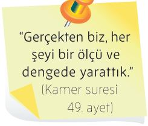

Kur’an-ı Kerim’de “Yeri döşeyen, onda oturaklı dağlar ve ırmaklar yaratan ve orada bütün meyvelerden çifter çifter yaratan O’dur. Geceyi de gündüzün üzerine O örtüyor. Şüphesiz bütün bunlarda düşünen bir toplum için ibretler vardır.”⁴ buyrularak Yüce Allah’ın evrene koyduğu düzene dikkat çekilir.

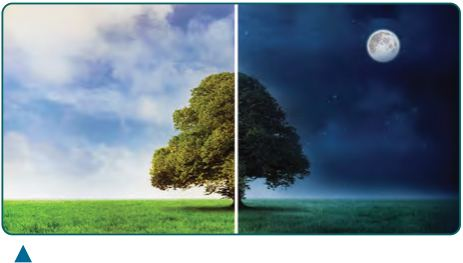

Allah (cc), her varlığa bulunduğu ortamda yaşamını sürdürebilecek ve ihtiyaçlarını karşılayabilecek özellikler vermiştir. Bu özellikler sayesinde tohumlar hangi meyve ağacı olacağını, arılar nasıl bal yapacağını, hayvanlar yavrularını nasıl koruyacağını bilir. Her mevsimde yaşanan tabiat olayları da bu duruma örnektir. Kışın yağan kar, toprağı korur ve yer altı sularının artmasını sağlar. Böylece bahar aylarında ekinlerin, bitkilerin ve ağaçların su ihtiyacı karşılanır. Yazın artan sıcaklık sayesinde ise ekinler ve diğer bitkiler olgunlaşır. Bu durum, Allah’ın (cc) eşsiz bir yaratıcı olmasının sonucudur.

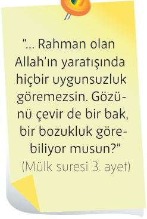

Allah (cc), evrenin yanı sıra insanı da mükemmel bir şekilde yaratmış, ona üstün özellikler vermiştir. Bu konu "... Onları yarattıklarımızın birçoğundan üstün kıldık."⁵ ayetiyle bildirilmiştir. Akılla donatılan insanın yeryüzünde sorumluluk sahibi bir varlık olması istenmiştir.

İnsan vücudu yaratılışın mükemmelliğini gösteren en güzel örneklerden biridir. Vücuttaki her organın bir görevi bulunmaktadır. Çoğu zaman fark etmesek de organlar bu görevlerini yerine getirerek varlığımızın devam etmesini sağlar. Diğer varlıklar için de bu durum geçerlidir. Hayatlarını suda ve karada sürdüren canlıların her biri, yaratılıştaki ahengin birer örneğidir.

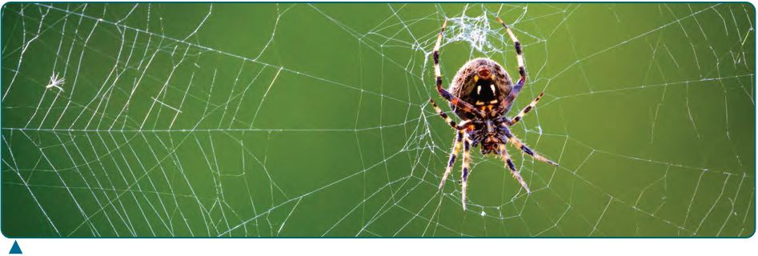

> "... Rahman olan Allah’ın yaratışında hiçbir uygunsuzluk göremezsin. Gözünü çevir de bir bak, bir bozukluk görebiliyor musun?"
> (Mülk suresi 3. ayet)

**Görsel 1.15:** Gece ve gündüzün birbiri ardına gelişi Yüce Allah’ın evrene koyduğu düzenin bir göstergesidir.

**Görsel 1.16:** Allah’ın (cc) evrene koyduğu mükemmel düzen, canlılardaki özelliklerle kendini gösterir.

<!-- sayfa 21 -->

# Etkinlik-3
25 dk.

| Adı | Evrenin Ahengine Yolculuk |
| :--- | :--- |
| **Amaç** | Evrendeki mükemmel düzenden hareketle Allah'ın (cc) varlığı ve birliğini müşahede edebilme |

## Ön Hazırlık
Karekodla verilen videoyu izleyiniz. Videoda dikkatinizi çeken konuları aşağıdaki alana not alınız.
_________________________________________________
_________________________________________________
_________________________________________________
_________________________________________________

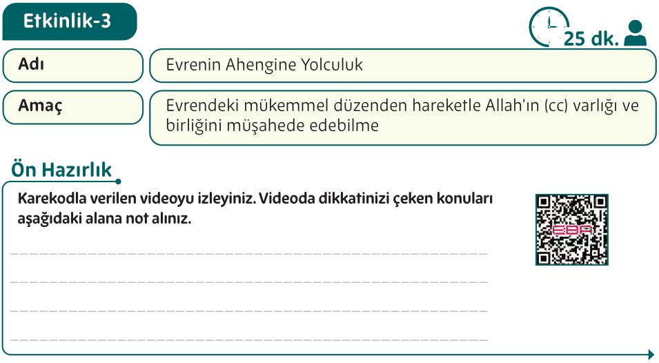

## Yönerge
Aşağıdaki adımları takip ederek etkinliği tamamlayınız.

1. Allah'ın (cc) varlığı ve birliğine işaret eden aşağıdaki konulardan hangilerini merak ediyorsunuz? İşaretleyiniz.

Gezegen Hareketleri  Tabiat Olayları  Canlılar Dünyası  İnsan Bedeninin İşleyişi
[ ]  [ ]  [ ]  [ ]


2. Allah'ın (cc) varlığı ve birliğiyle ilgili işaretlediğiniz konular hakkında sorular yazınız.
_______________________________________________________________
_______________________________________________________________
_______________________________________________________________
_______________________________________________________________

3. Aşağıda bilim ve teknoloji haftasında bir ortaokula konuk olan katılımcıların konuşmalarından bazı bölümler verilmiştir. Konuşma metinlerini inceleyiniz ve soruları cevaplayınız.

| Gök bilimci | Meteorolog |
| :--- | :--- |
| Dünya, kendi ekseni etrafında dönerken Güneş'in etrafında da belirli bir yörüngede düzenli biçimde dolanır. Bu hareketler, daha hızlı ya da daha yavaş gerçekleşseydi Dünya'daki yaşam koşulları zorlaşabilirdi. Bu düzenli hareketler sayesinde güzel gezegenimizde hayat güvenle devam eder. | Rüzgâr, yağış gibi doğa olayları belirli şartlarda gerçekleşir. Bu nedenle yağmurun ne zaman yağabileceğini ya da rüzgârın hangi yönden eseceğini tahmin edebiliriz. Hava olayları rastgele değil doğadaki denge ve döngülerle ilişkilidir. Bu denge; insanların, hayvanların ve bitkilerin yaşamını sürdürebilmesi için çok önemlidir. |

<!-- sayfa 22 -->

<div align="center">
<table style="border: none;">
<tr>
<td style="border: none; text-align: center;">
<div style="border: 1px solid black; padding: 10px; width: 300px; border-radius: 20px;">
Kuşların uçmayı sağlayan kanatları, balıkların yüzmeye yardımcı olan yüzgeçleri vardır. Bitkiler ışığa yönelerek büyür ve yaşadıkları ortama uyum sağlar. Her canlının yaşadığı çevreye uygun özellikleri bulunur ve canlılar birbirleriyle ilişki içinde yaşar. Bu durum, canlılar dünyasında bir düzen ve denge bulunduğunu gösterir.
<br><br>
<div style="background-color: #008000; color: white; padding: 5px 20px; border-radius: 15px; display: inline-block;">Biyolog</div>
</div>
</td>
<td style="border: none; text-align: center;">
<div style="border: 1px solid black; padding: 10px; width: 300px; border-radius: 20px;">
Kalbimiz durmadan kan pompalar, kan da besinleri vücudumuzun her yerine taşır. Akciğerlerimiz nefes almamızı sağlar, oksijenin vücudumuza girmesine yardımcı olur. Midemiz ve bağırsaklarımız yediğimiz besinleri sindirir. Beynimiz ve sinir sistemimiz, organlarımızın uyumlu çalışmasını yönetir. Biz fark etmesek de vücudumuz gece gündüz düzenli biçimde çalışmaya devam eder.
<br><br>
<div style="background-color: #0000FF; color: white; padding: 5px 20px; border-radius: 15px; display: inline-block;">Doktor</div>
</div>
</td>
</tr>
</table>
</div>

a) Konuşmacılardan hangileri merak ettiğiniz konulara değinmektedir? Belirtiniz.
_______________________________________________________________ 

b) Konuşmaları inceledikten sonra işaretlediğiniz konularla ilgili sorularınız hakkında neler öğrendiğinizi yazınız.
_______________________________________________________________
_______________________________________________________________
_______________________________________________________________
_______________________________________________________________

c) Konuşmalarda bahsedilen konuların Allah'ın (cc) varlığı ve birliği ile ilişkisini açıklayınız.
_______________________________________________________________
_______________________________________________________________
_______________________________________________________________
_______________________________________________________________

# Değerlendirme

**Evrendeki düzenle ilgili çıkarımlarınızdan yola çıkarak boşlukları uygun ifadelerle tamamlayınız.** 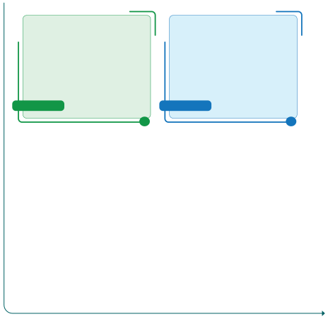

a) Evrende mükemmel bir ___________________________ vardır.
b) Varlıklar arasındaki ___________________________ evrendeki ahengin göstergesidir.
c) Evrendeki her şey bir ___________________________ ile yaratılmıştır.
ç) Tüm varlıkları ___________________________ yaratmıştır.
d) Evrendeki düzen kendi kendine kurulamaz çünkü ______________________________
_______________________________________________________________
e) Varlıkların bir yaratıcıya ihtiyaç duyduğunu düşünüyorum çünkü _____________________
_______________________________________________________________

<!-- sayfa 23 -->

Canlıların yaratılışı ile evrendeki yaşam koşulları arasında sıkı bir ilişki vardır. Örneğin insan nefes almak için temiz havaya ihtiyaç duyar; bir fidandan ağaca dönüşmek için toprağa, suya ve güneşe ihtiyaç duyar. Yeryüzü ve gökyüzü arasındaki bu mükemmel denge, Allah’ın (cc) varlığının ve birliğinin delillerinden biridir. Toprağı, tohumu, bitkiyi yaratan Allah (cc); havayı, atmosferi, Güneş'i de yaratmıştır. Evrendeki bu birlik ve düzen yalnızca bir ve tek olan Allah’ın (cc) eseridir.

Bu durum Kur'an-ı Kerim'de **“Ey insanlar! Allah'ın size olan nimetini hatırlayın. Allah'tan başka size göklerden ve yerden rızık veren bir yaratıcı var mı? O'ndan başka hiçbir ilah yoktur...”⁶** ayetiyle açıklanmıştır. Hz. Peygamber de bir hadisinde **“Yaratılmış her canlının yaratıcısı yalnızca Allah'tır.”⁷** buyurmuştur.

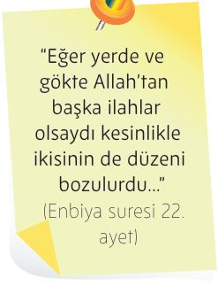

> “Eğer yerde ve gökte Allah'tan başka ilahlar olsaydı kesinlikle ikisinin de düzeni bozulurdu...”
> (Enbiya suresi 22. ayet)

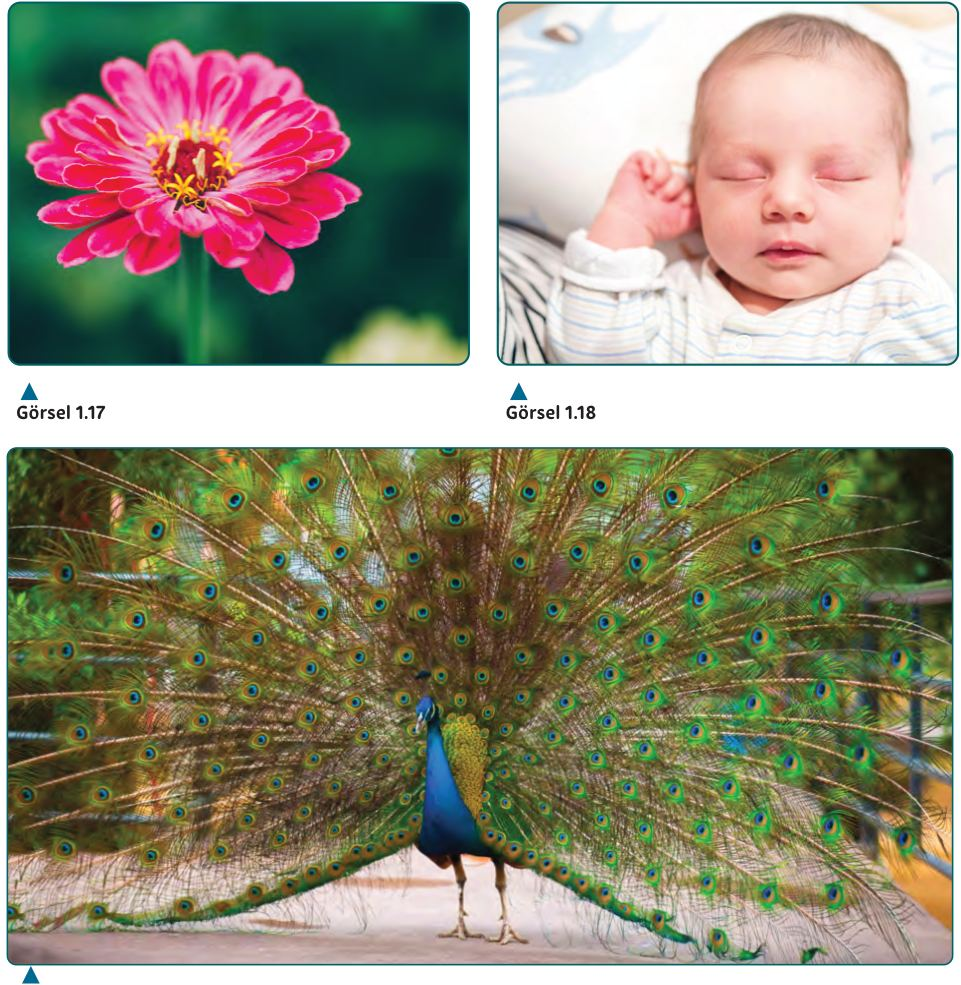

Görsel 1.17
Görsel 1.18


<!-- sayfa 24 -->


**şirk**
"Allah'a (cc) inanmakla birlikte başka varlıkları da tanrı kabul etmek, başka bir varlığı Allah'a (cc) denk görmek" demektir.
(bk. Sürmeli vd., "şirk", 342)

Yaşadığımız evrende duyu organlarımızla hissettiğimiz ya da hissedemediğimiz büyük küçük her varlık, Yüce Allah'ın emriyle meydana gelmiştir. Evrende var olan bu olağanüstü düzenin sebebi, Allah'ın (cc) bir ve tek olmasıdır. Allah'ın (cc) bir ve tek olduğuna, O'nun eşi ve benzerinin olmadığına inanmak, O'na hiçbir şey şirk koşmadan ibadeti yalnızca Allah (cc) için yapmak *tevhit* inancı olarak adlandırılır.$^8$ <!-- KONTROL: Marker'da karşılığı yok, uydurma olabilir -->

Tevhit, İslam'ın temel inanç esaslarından biridir ve İslam'ın özüdür. Bu nedenle tevhit; Müslümanların Allah'a (cc) olan bağlılıklarını, ibadetlerini ve hayat tarzlarını belirleyen bir unsurdur. Tevhit inancı olmadan İslam'dan bahsetmek mümkün değildir.

**Bilgi Görseli 1.2: Tevhidin tanımı**


| | |
| :--- | :--- |
| Allah'ın (cc) bir ve ibadet edilecek tek ilah olduğunu bilmektir. | Allah'ın (cc) eşi, benzeri ve ortağı olmadığını bilmektir. |
| **TEVHİT** | |
| Allah'ın (cc) her şeyi yoktan var ettiğini ve her şeyin sahibi olduğunu bilmektir. | Allah'ın (cc), hiçbir varlığa benzemeyeceğini bilmektir. |


Tevhit inancıyla ilgili videoyu izlemek için karekodu kullanabilirsiniz.

<!-- sayfa 25 -->

# Etkinlik-4


**Adı:** Bil Bakalım
**Amaç:** Evrendeki mükemmel düzenden hareketle Allah'ın (cc) varlığı ve birliğiyle ilgili incelediği konular hakkında çıkarım yapabilme

**Yönerge**
Aşağıdaki adımları takip ederek etkinliği tamamlayınız.

1. Tabloda verilen ayet ve hadisleri inceleyiniz. Her bir ayet ve hadisin hangi konuyla ilgili olduğunu aşağıdaki konu başlıkları arasından seçerek örnekteki gibi tabloya yazınız. Bir ayet veya hadis birden fazla konu ile eşleştirebilirsiniz.

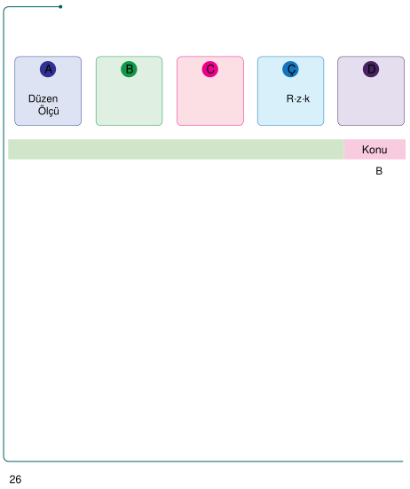

| **A** | **B** | **C** | **Ç** | **D** |
| :---: | :---: | :---: | :---: | :---: |
| Evrendeki Düzen ve Ölçü | Yaratılışta Kusursuzluk | Canlılar Dünyası | Beslenme ve Rızık | Tevhit İnancı |

| Ayetler ve Hadisler | Konu |
| :--- | :---: |
| “Güneş ve ay bir hesaba göre hareket etmektedir.” (Rahman suresi 5. ayet) | A, B |
| “Ve Rabbin bal arısına şöyle ilham etti: Dağlardan, ağaçlardan ve insanların kurdukları çardaklardan kendine yuvalar edin. (Nahl suresi 68. ayet) | |
| “Gece, gündüz, güneş ve ay Allah'ın varlığının delillerindendir...” (Fussilet suresi 37. ayet) | |
| “Tohumu ve çekirdeği çatlatan şüphesiz Allah’tır; O, ölüden diriyi çıkarır, diriden de ölüyü çıkarmaktadır…” (Enam suresi 95. ayet) | |
| “Allah’ım! Benim yaratılışımı güzel kıldığın gibi ahlakımı da güzelleştir.” (Ahmed bin Hanbel, *el-Müsned*, 1/403) | |
| “… Rahman'ın yaratışında hiçbir uyumsuzluk göremezsin. Gözünü çevir de bir bak, bir bozukluk görebiliyor musun? Sonra gözünü tekrar tekrar çevir de bak; (kusur arayan) göz aradığını bulamadan bitkin olarak sana dönecektir.” (Mülk suresi 3-4. ayetler) | |
| “Allah’tan başka ilah yoktur, O’nun ortağı da yoktur…” (Müslim, "Mesacid", 139) | |
| “Böylece onun (yağmurun) sayesinde sizin yararınıza hurma bahçeleri ve üzüm bağları meydana getirdik. Bunlarda sizin için birçok meyveler vardır ve siz onlardan yersiniz.” (Müminun suresi 19. ayet) | |

<!-- sayfa 26 -->

2. İncelediğiniz ayet ve hadisler size Allah (cc) hakkında neler düşündürüyor? Yazınız.
_______________________________________________________________
_______________________________________________________________
_______________________________________________________________

3. Tevhit inancı; Allah’tan (cc) başka ilah olmadığına inanmayı ifade eder. Bu inanç, insanın söz ve davranışlarına dikkat etmesini gerektirir.

Buna göre Allah’ın (cc) varlığına ve birliğine inanmak davranışlarınızı nasıl etkiler? Örnek cümleyi dikkate alarak düşüncelerinizi yazınız.
Örnek: *Yalnızca Allah’a (cc) dua ederim çünkü O (cc) beni yaratan, işiten ve görendir.*
_______________________________________________________________
_______________________________________________________________
_______________________________________________________________

4. Aşağıdakilerden hangileri Allah’ın (cc) varlığına ve birliğine inanan insanlardan oluşan bir toplumda bulunması gereken davranışlardandır? İşaretleyiniz.

• ( ...... ) Bir arkadaşı eşyasını emanet olarak verdiğinde onu korumak
• ( ...... ) Mahallede ihtiyacı olan birine, kimse görmeden yardım eli uzatmak
• ( ...... ) Çevreyi temiz tutmaya özen göstermek
• ( ...... ) Haksız olan kendi yakını olsa bile haklının yanında durmak
• ( ...... ) Birine söz verdiğinde şartlar zorlaşsa bile sözü tutmaya çalışmak

• ( ...... ) Hata yaptığında cezadan kaçmak için başkalarını suçlamak
• ( ...... ) Hayvanlara ve yuvalarına zarar vermemek


## Değerlendirme

> Sonraki sayfada yer alan tanılayıcı dallanmış ağaçta Allah’ın (cc) varlığı ve birliği ile ilgili ifadeler verilmiştir. En üstteki ifadeden başlamak şartıyla ifadelerin doğru ya da yanlış olduğuna karar vererek ilerleyiniz ve ulaştığınız tek çıkışı işaretleyiniz.

<!-- sayfa 27 -->


a.
Tevhit, Allah'ın (cc) var ve bir olduğunu kabul etmek demektir.

| | |
| :--- | :--- |
| **D** | **Y** |

| | |
| :--- | :--- |
| b. Tevhit, günlük hayatta kullandığımız selamlaşma ifadelerindendir. | c. Evrendeki mükemmel denge, Allah'ın (cc) birliğini gösterir. |

| | |
| :--- | :--- |
| **D** | **Y** |
| **D** | **Y** |

| | | | |
| :--- | :--- | :--- | :--- |
| ç. Canlılar yaşamak için Allah'a (cc) muhtaçtır. | d. Tevhit, İslam dininin temel inanç esaslarından biridir. | e. Varlıklar arasında bir uyum ve düzen vardır. | f. Kâinattaki varlıklar tesadüfen oluşmuştur. |

| | | | |
| :--- | :--- | :--- | :--- |
| **D** | **Y** | **D** | **Y** |
| **D** | **Y** | **D** | **Y** |
| **D** | **Y** | **D** | **Y** |
| **D** | **Y** | **D** | **Y** |

1. Çıkış 2. Çıkış 3. Çıkış 4. Çıkış 5. Çıkış 6. Çıkış 7. Çıkış 8. Çıkış

# Kontrol Noktası

**Aşağıdaki parçayı okuyunuz ve soruyu cevaplandırınız.**

**Her şey bizim için...**

ALLAH hiçbir şeye muhtaç değilken, biz bu kâinattaki her şeye ihtiyaç duyarız...
Güneş, ışığı ile bizim gündüzümüzü aydınlatır, Ay bizim gecelerimize bir kandil olur. Milyarlarca yıldız, geceleri gökyüzüne baktığımızda içimiz kararmasın diye parıldar. Yağmurlar bizim bahçelerimizi sular, kayalardan fışkıran pınarlar, bizim içimizi serinletir...
Dağlar bizim zeminimizi sağlamlaştırmak için çakılmıştır yeryüzüne...
Ormanlar bizim kirlettiğimiz havayı temizlemek için çalıştırılır gece gündüz. Sayısız ağacın sayısız dallarında sayısız yaprak, ciğerlerimize çektiğimiz havanın oksijenini artırmak için bir fabrika gibi işletilir…

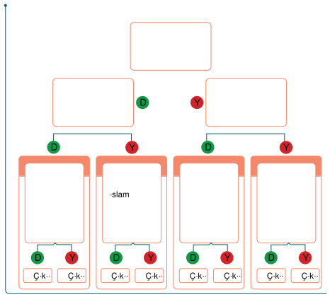

<!-- sayfa 28 -->

Ve bizim bunların hepsine ihtiyacımız vardır. Hiçbir şeye ihtiyacı olmayan Allah’ın, her şeye ihtiyacı olan kullarıyız biz. Bu kâinat bize çalışır, bize hizmet eder... İnekler bir süt fabrikası gibi çalışırken, arıların kime hizmet etmek için yaratıldığı “bal” gibi ortadadır. Tavuklara o benzersiz ambalajının içindeki yumurta, bizim için yaptırılır. Dağların madenleri sayısız hizmetimizi görür.

Daha insanoğlu dünyaya ayak basmadan önce, onsuz yapamayacağımız demiri, uzayın derinliklerinden meteor meteor yeryüzüne indirmiştir Allah… Bunların hepsine ihtiyacımız vardır bizim… Hiçbir şeye ihtiyacı olmayan Allah’ın, her şeye ihtiyacı olan kullarıyız biz...

Ve Allah her şeyi bizim için yaratmıştır… Peki ya bizi?

(Özkan Öze, Allah’ı Merak Ediyorum, 33-35)

**Bu parçadaki hangi ifadeler size Allah’ın (cc) var ve bir olduğunu hissettiriyor? Yazınız.**

_______________________________________________________________
_______________________________________________________________
_______________________________________________________________

# 1.3. ALLAH’IN GÜZEL İSİMLERİ

## Konuya Başlarken

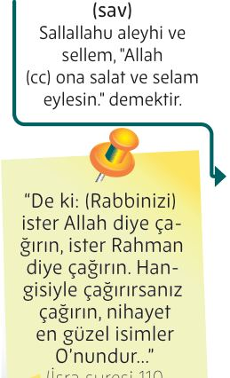

Yeryüzünde gözünüzün gördüğü tüm güzellikleri; rengârenk çiçekleri, ağaçları, nehirleri, hayvanları ve insanları yaratan Yüce Allah’tır. Bu güzelliklerin her biri, O'nun güzel isimlerinden birinin yansımasıdır.

Peki siz Allah'ın (cc) güzel isimlerinden hangilerini biliyorsunuz?

**Görsel 1.20**

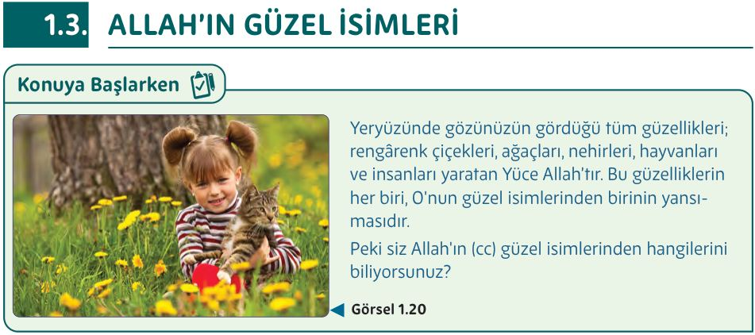

(sav)
Sallallahu aleyhi ve sellem, "Allah (cc) ona salat ve selam eylesin." demektir.

Yüce Allah’ın, O’nu en iyi şekilde tanımamıza ve anlamamıza yardımcı olacak güzel isimleri vardır. Bu isimlere **esmayıhüsna**$^{9}$ <!-- KONTROL: Marker'da karşılığı yok, uydurma olabilir --> denir. Esmayıhüsna, Allah’ın (cc) gücünü, mükemmelliğini ve benzersizliğini anlatan isimlerdir. Rahman, Rahîm, Kadir, Alîm, Basir ve Semi; Yüce Allah’ın güzel isimlerinden bazılarıdır.

Esmayıhüsna Arapçada "en güzel isimler" anlamına gelir. Kur’an-ı Kerim ve Hz. Muhammed’in (sav) hadisleri bize esmayıhüsna konusunda bilgiler verir. Bununla ilgili bir ayette "**Allah, kendisinden başka ilah olmayandır. En güzel isimler O’na mahsustur.**"$^{10}$ <!-- KONTROL: Marker'da karşılığı yok, uydurma olabilir --> buyrulmuştur. Hz. Muhammed (sav) de hadislerinde esmayıhüsnayı öğrenmenin önemini ifade etmiştir.$^{11}$ <!-- KONTROL: Marker'da karşılığı yok, uydurma olabilir -->

Esmayıhüsnayı öğrenmek, Allah’ın (cc) yüceliğini, merhametini ve adaletini daha iyi anlamamıza yardımcı olur. “En güzel isimler Allah’ındır, bu güzel isimlerle O’na dua edin...”$^{12}$ <!-- KONTROL: Marker'da karşılığı yok, uydurma olabilir --> ayetinden anlaşılacağı üzere Allah’ı (cc) güzel isimleriyle anmak ve O’na dua etmek gerekir.


“De ki: (Rabbinizi) ister Allah diye çağırın, ister Rahman diye çağırın. Hangisiyle çağırırsanız çağırın, nihayet en güzel isimler O’nundur...”

(İsra suresi 110)

<!-- sayfa 29 -->

# Araştıralım

1. Esmayıhüsna ifadesinin ne anlama geldiğini güvenilir kaynaklardan araştırınız.
2. Başta Rahman, Rahîm, Alîm, Kadir, Semi, Basir olmak üzere Allah'ın (cc) merak ettiğiniz isimlerinin anlamlarını araştırınız. Ulaştığınız bilgileri not ediniz.


## 1.3.1. Allah Rahman ve Rahîm'dir


**Görsel 1.21:** “Bismillâhirrahmânirrahîm” ifadesinin Arapça yazılışı

Allah'ın (cc) güzel isimlerinden biri Rahman'dır. Rahman, “yaratılmış bütün varlıklara şefkat gösteren, fark gözetmeksizin insanlara merhamet eden, sürekli nimetler veren, rahmeti sonsuz olan”$^{13}$ <!-- KONTROL: Marker'da karşılığı yok, uydurma olabilir --> anlamlarına gelir. Allah'ın (cc) güzel isimlerinden bir diğeri de Rahîm'dir. Rahîm, “yarattığı bütün varlıklara karşılık beklemeden nimetler veren, onları koruyan, esirgeyen, bağışlayan ve onlara merhamet eden Allah'ın (cc), ahirette kendisine inanan kullarına şefkat etmesi ve onları ödüllendirmesi”$^{14}$ <!-- KONTROL: Marker'da karşılığı yok, uydurma olabilir --> anlamlarına gelir. Böylece Allah'ın (cc) dünyada iyilik yapan kullarına ahirette özel ikramlarda bulunması Rahîm isminin bir yansımasıdır. Yüce Allah'ın merhametiyle ilgili Hz. Peygamber, kaybolan çocuğunu telaşla arayan ve her bulduğu çocuğu bağrına basan bir annenin durumunu arkadaşlarına anlatır ve şöyle devam eder: “Bu kadının çocuğunu ateşe atabileceğini düşünebilir misiniz? İşte Allah'ın kullarına merhameti bu annenin yavrusuna duyduğundan çok daha fazladır.”$^{15}$ <!-- KONTROL: Marker'da karşılığı yok, uydurma olabilir -->

Kur'an-ı Kerim'de Rahman ve Rahîm isimleri genellikle birlikte kullanılmıştır. **“İlahınız bir tek Allah'tır. O'ndan başka ilah yoktur. O, Rahman'dır, Rahîm'dir.”**$^{16}$ <!-- KONTROL: Marker'da karşılığı yok, uydurma olabilir --> ayeti buna örnektir. Ayrıca günlük hayatımızda sıklıkla “Bismillâhirrahmânirrahîm” ifadesini kullanırız. Bu ifadenin içinde Rahman ve Rahîm isimleri yer almaktadır. Bizler de yemek yerken, ders çalışırken veya bir işe başlarken besmele çekerek Allah'ın (cc) Rahman ve Rahîm olduğunu ifade eder, O'nun rahmetine...

<!-- sayfa 30 -->

# Etkinlik-5

15 dk. 

| Adı | Bir Yudum Merhamet |
| :--- | :--- |
| **Amaç** | Varlıklara karşı hassasiyet gösterme ve doğadaki tüm canlıların yaşam haklarına duyarlı olmanın önemini fark edebilme |

## Yönerge
**Aşağıdaki adımları takip ederek etkinliği tamamlayınız.**

**Aşağıdaki hikâyeyi okuyarak soruyu cevaplandırınız.**

Sevgili Peygamberimiz (s.a.s.) sahabilerine zaman zaman güzel hikâyeler anlatırdı. Onlar da acaba bu hikâyeden ne ders çıkarırız diye bunu dikkatle dinlerlerdi. Bu hikâyelerden biri şudur:

“Bir zamanlar adamın biri yolculuğa çıktı. Sıcak havada uzun bir yolculuktan sonra çok susadı. Nihayet bir su kuyusu buldu. Fakat kuyunun suyu bayağı derindeydi. Oradaki ipi beline bağlayarak kuyunun içine sarktı ve kana kana su içti. Tam dışarı çıktığı sırada bir köpeğin, susuzluktan dili bir karış dışarı çıkmış, solumakta olduğunu gördü. Hayvancağız su bulamadığı için nemli toprağı yalayıp duruyordu. Adam kendi kendine:

– Zavallı hayvan, o da benim gibi çok susamış, dedi. Köpeğe merhamet etti, onun hâline çok acıdı. Zahmetli ve yorucu da olsa tekrar kuyuya indi ve ayakkabısına su doldurup yukarı çıktı. Zavallı hayvana suyu verdi. Hayvancağız suyu kana kana içti. Sonra kendisine su veren adama teşekkür eder gibi baktı ve oradan uzaklaştı.

Bu adamın, bir köpeğe acıyıp su ikram etmesi Allah Teala’nın çok hoşuna gitti. Bu merhametli davranışı sebebiyle adamın günahlarını affetti ve ona cennet kapılarını açtı.

Hikâyenin sonunda sahabiler:

– Ey Allah’ın Resûlü! Biz de hayvanlara iyi davranınca sevap kazanır mıyız, diye sordular.

Sevgili Peygamberimiz:

– Canlı olan her varlığa yaptığınız iyilik karşılığında elbette sevap vardır, buyurdu.

[Nehir Aydın Gökduman (ed.), *Merhamet*, 43]

**Hikâyeden hareketle merhametli olmanın insana neler kazandırdığına örnekler veriniz.**

_______________________________________________________________ 
_______________________________________________________________

## Değerlendirme

1. **Canlıların yaşam haklarına duyarlı olduğunuzu hangi davranışlarla gösterebilirsiniz? Düşüncelerinizi sınıf arkadaşlarınızla paylaşınız.**
2. **Canlıların yaşam hakkına saygılı davranış örneklerini öğretmeninizin rehberliğinde canlandırınız.**

<!-- sayfa 31 -->

# 1.3.2. Allah Her Şeyi Bilir

Yüce Allah’ın güzel isimlerinden biri de Alîm’dir. Alîm, "Allah'ın (cc), gizli ve açık ne varsa her şeyi bilmesi"¹⁷ demektir. Allah (cc), bütün zaman ve mekânın yaratıcısı olduğu için O'nun ilmi zaman ve mekânla sınırlı değildir. Allah (cc) yaratılmışların bilmedikleri sırları ve gizlilikleri bilir. Allah'ın (cc) ilmi sonsuzdur.

İnsanın ilmi sınırlı olduğu için her şeyi bilmesi mümkün değildir. İnsan, sahip olduğu özellikleri doğru kullansa da ancak belli konularda bilgi sahibi olabilir. Yüce Allah ise her şeyi en ince ayrıntısına kadar bilir. Kâinatta O'nun bilgisi dışında hiçbir şey gerçekleşmez.

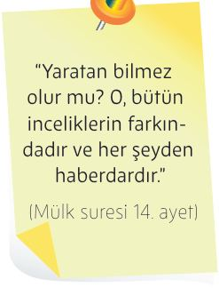

> "Yaratan bilmez olur mu? O, bütün inceliklerin farkındadır ve her şeyden haberdardır."
> (Mülk suresi 14. ayet)

**Bilgi Görseli 1.3: Allah'ın (cc) Alîm isminin açıklaması**


<!-- sayfa 32 -->

### 1.3.3. Allah Her Şeyi Görür ve İşitir

> **frekans**
> Ses, dalga vb.nin birim zamandaki titreşim sayısı; sıklık.
> (bk. TDK Güncel Türkçe Sözlük, “sıklık”)


Yüce Allah, insanı belirli özelliklere sahip olarak yaratmıştır. İnsan; görmek için göze, duymak için kulağa, anlamak için akla ihtiyaç duyar. “Sizler hiçbir şey bilmez bir durumdayken Allah sizi analarınızın karnından dışarı çıkardı; şükredesiniz diye size kulaklar, gözler, kalpler verdi.”$^{18}$ <!-- KONTROL: Marker'da karşılığı yok, uydurma olabilir --> ayetinde de buyrulduğu gibi bütün bunlar Allah'ın (cc) insana verdiği nimetlerdir. Ancak insan, kendisine verilen bu nimetleri belirli sınırlar içinde kullanabilir. Her şeyi gözümüzle göremeyiz, her sesi kulağımızla duyamayız. Mesela karanlık ortamda gözümüzle ancak sınırlı şeyleri görebiliriz. Kulağımız olmasına rağmen düşük ya da çok yüksek frekanslı bazı sesleri duyamayız.

Yüce Allah her şeyi gören Basir ve her şeyi duyan Semi’dir. O’nun görmek için göze, duymak için kulağa ihtiyacı yoktur. Bununla ilgili bir ayette “Şüphesiz Allah, hakkıyla işitendir, hakkıyla bilendir.”$^{19}$ <!-- KONTROL: Marker'da karşılığı yok, uydurma olabilir --> buyrulmaktadır. Başka bir ayette ise “… Allah onların yapmakta olduklarını eksiksiz görür.”$^{20}$ <!-- KONTROL: Marker'da karşılığı yok, uydurma olabilir --> buyrularak Yüce Allah'ın duymasının, görmesinin ve bilmesinin mükemmelliği anlatılmaktadır.

### 1.3.4. Allah’ın Her Şeye Gücü Yeter

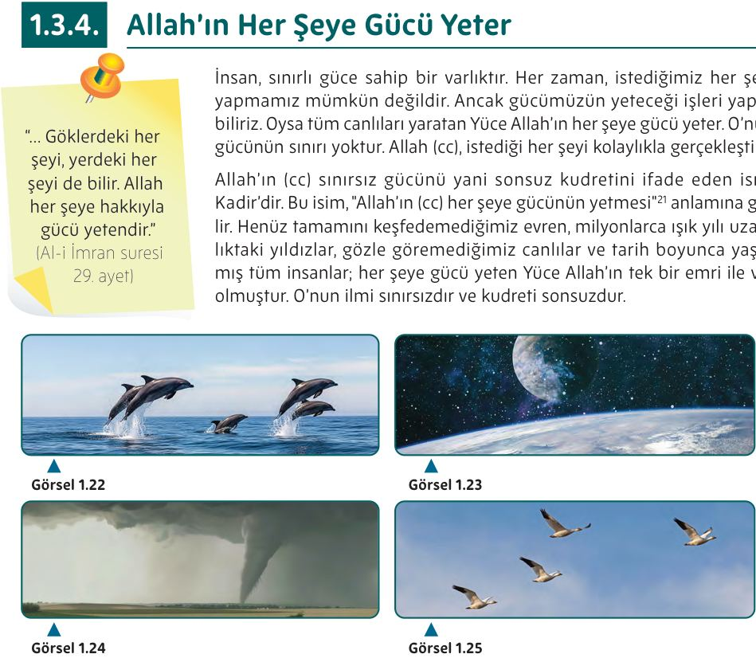

> “… Göklerdeki her şeyi, yerdeki her şeyi de bilir. Allah her şeye hakkıyla gücü yetendir.”
> (Al-i İmran suresi 29. ayet)

İnsan, sınırlı güce sahip bir varlıktır. Her zaman, istediğimiz her şeyi yapmamız mümkün değildir. Ancak gücümüzün yeteceği işleri yapabiliriz. Oysa tüm canlıları yaratan Yüce Allah’ın her şeye gücü yeter. O’nun gücünün sınırı yoktur. Allah (cc), istediği her şeyi kolaylıkla gerçekleştirir.

Allah’ın (cc) sınırsız gücünü yani sonsuz kudretini ifade eden ismi Kadir’dir. Bu isim, "Allah'ın (cc) her şeye gücünün yetmesi"$^{21}$ <!-- KONTROL: Marker'da karşılığı yok, uydurma olabilir --> anlamına gelir. Henüz tamamını keşfedemediğimiz evren, milyonlarca ışık yılı uzaklıktaki yıldızlar, gözle göremediğimiz canlılar ve tarih boyunca yaşamış tüm insanlar; her şeye gücü yeten Yüce Allah’ın tek bir emri ile var olmuştur. O’nun ilmi sınırsızdır ve kudreti sonsuzdur.

Görsel 1.22
Görsel 1.23

<!-- sayfa 33 -->

# Etkinlik-6

25 dk.

**Adı:** Esmayıhüsnayı Tanıyorum
**Amaç:** Allah'ın (cc) güzel isimlerini bağlamına uygun kullanabilme

## Yönerge
Aşağıdaki adımları takip ederek etkinliği tamamlayınız.

1. Aşağıdaki açıklamaları okuyunuz. Açıklamaların Allah'ın (cc) hangi güzel ismiyle ilgili olduğunu belirleyiniz. Belirlediğiniz ismi açıklamanın karşısına yazınız.

a. Allah (cc) gizli olanı da açık olanı da bilir. İnsanın kalbinden geçirdiklerinden, niyetinden ve yaptıklarından haberdardır. 

b. Allah'ın (cc), yarattığı bütün varlıklara şefkatle yaklaşması, insanlara çeşitli nimetler vermesi anlamına gelir. Güneşin doğması, yağmurun yağması gibi yeryüzündeki sayısız rızık tüm canlılar içindir. 

c. Allah (cc) söylenen her sözü ve yapılan her duayı işitir. İnsanın sesini yükseltmeden içinden geçirdiklerini bile duyar. Kişi her zaman Allah'a (cc) dua edebilir ve O'na sığınabilir. 

ç. Allah (cc) gizli olanı da açık olanı da görür. İnsan yalnız kaldığını düşünse bile yaptığı hiçbir şey O'ndan saklı kalmaz. Bu durum, kişinin doğru olanı yapmasını kolaylaştırır ve yanlıştan uzak durmasını sağlar. 

d. Allah'ın (cc) kullarını koruyup esirgemesi, hatasını fark edip tövbe edenleri bağışlaması ve iman eden kullarına özel ikramlarda bulunması anlamına gelir. Allah'ın (cc) merhameti sadece dünyayla sınırlı değildir, ahirette de devam eder. 

e. Allah'ın (cc) dilediği her şeyi yapmaya gücü yeter. Hiçbir şey O'nun dilemesine karşı duramaz. Evrenin ve canlıların yaratılışı, hayatın devam etmesi bunun en büyük göstergesidir. 

<!-- sayfa 34 -->

2. **Aşağıda Allah'ın (cc) isimlerinden bazıları verilmiştir. Soruları okuyunuz, her sorunun altındaki boşluğa ilgili olduğunu düşündüğünüz isimleri yazınız.**

| RAHMAN | RAHÎM | SEMİ |
| :---: | :---: | :---: |
| BASİR | ALÎM | KADİR |

a. Allah'ın (cc) merhametli oluşunu ifade eden isimleri hangileridir?
______________________________________________________________

b. “Allah (cc) her şeyden haberdardır.” cümlesini destekleyen isimler hangileridir?
______________________________________________________________

c. Besmelede geçen isimler hangileridir?
______________________________________________________________

ç. “Allah (cc) dilediğini yapmaya gücü yeten ve her şeyi bilen varlıktır.” cümlesi hangi isimlerle ilişkilendirilebilir?
______________________________________________________________

3. **Allah'ın (cc) yukarıda sözü edilen isimlerinin anlamlarını birer cümle ile ifade ediniz.**
________________________________________________________________
_______________________________________________________________
_______________________________________________________________
_______________________________________________________________
_______________________________________________________________
________________________________________________________________

# Değerlendirme

**Aşağıdaki dua örneğini inceleyiniz. Siz de Allah'ın (cc) güzel isimlerinin yer aldığı bir dua yazınız.**

Allah'ım, Ya Rahman, ya Rahîm... Bize sevginle merhamet et. Ya Alîm, kalbimizden geçenleri bilirsin, bize faydalı bilgi öğret, öğrendiklerimizi doğru şekilde kullanmayı nasip et. Ya Basir, yaptıklarımızı görürsün, bizi güzel davranışlara yönelt. Ya Semi, dualarımızı işitirsin, bizi hayırda birleştir, aramızdaki kırgınlıkları gider. Ya Kadir, senin için imkânsız yoktur, zorlandığımız işleri kolaylaştır. Başladığımız işleri tamamlamayı nasip et, bize hem dünyada hem de ahirette iyilik ver. Bizi şükreden kullarından eyle. Âmin.

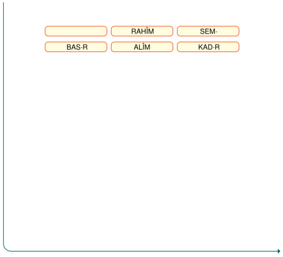
________________________________________________________________
________________________________________________________________
________________________________________________________________
________________________________________________________________
________________________________________________________________


<!-- sayfa 35 -->

# Kontrol Noktası

Aşağıda verilen ifadeler Allah'ın (cc) hangi güzel ismiyle ilgilidir? Noktalı yerlere yazınız.

1. (_______) Dilediğinde zor görünen işleri kolaylaştırmaya gücü yeter.
2. (_______) İnsanın içinden geçeni bile bilir. Hiçbir bilgi O'ndan gizli kalmaz.
3. (_______) Samimiyetle O'na yönelen kullarına özellikle merhamet eder ve onları korur.
4. (_______) Göklerde ve yerde olup biten, gizli ve açık her şeyi görür.
5. (_______) Fısıltıyla edilen duayı da kalpten geçen yakarışı da işitir.
6. (_______) Kendisine inanan ya da inanmayan ayırt etmeksizin herkese nimetler verir. 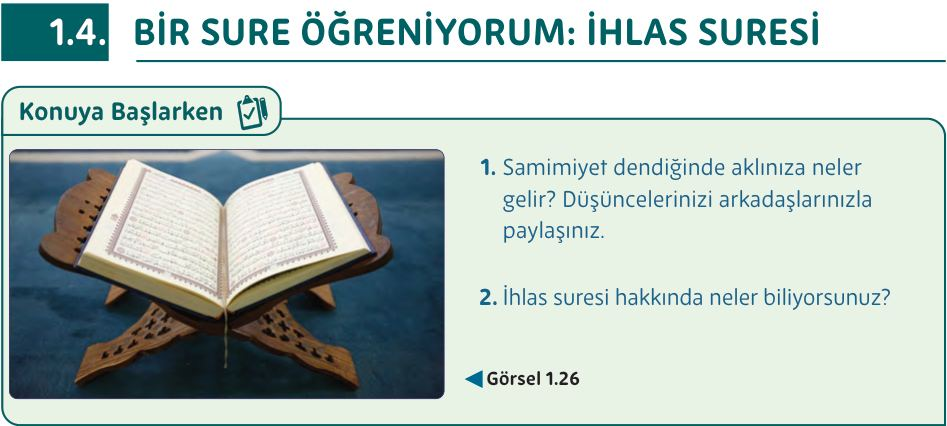

---

## 1.4. BİR SURE ÖĞRENİYORUM: İHLAS SURESİ 

### Konuya Başlarken 


1. Samimiyet dendiğinde aklınıza neler gelir? Düşüncelerinizi arkadaşlarınızla paylaşınız.
2. İhlas suresi hakkında neler biliyorsunuz?

◄ Görsel 1.26 

---

### İhlas Suresi


بِسْمِ اللّٰهِ الرَّحْمٰنِ الرَّح۪يمِ
قُلْ هُوَ اللّٰهُ اَحَدٌۚ $\text{\small ﴿١﴾}$ اَللّٰهُ الصَّمَدُۚ $\text{\small ﴿٢﴾}$ لَمْ يَلِدْ وَلَمْ يُولَدْۙ $\text{\small ﴿٣﴾}$ وَلَمْ يَكُنْ لَهُ كُفُوًا اَحَدٌ $\text{\small ﴿٤﴾}$

<!-- sayfa 36 -->

| Okunuşu | Anlamı |
| :--- | :--- |
| Bismillâhirrahmânirrahîm | Rahman ve Rahîm olan Allah’ın adıyla |
| 1. Kul hüvallâhü ehad | 1. De ki: "O, Allah’tır, tektir." |
| 2. Allâhüssamed | 2. Allah Samed’dir. (Hiçbir şeye muhtaç olmayandır.) |
| 3. Lem yelid ve lem yûled | 3. O, doğurmamış ve doğmamıştır. |
| 4. Ve lem yeküllehû küfüven ehad | 4. O’nun hiçbir dengi (eşi, benzeri) yoktur. |

İhlas suresini dinlemek için


İhlas suresi, Kur’an-ı Kerim’de yer alan kısa surelerden biridir. **İhlas**, “samimiyet, doğruluk, temizlik ve saflık” demektir. Ayrıca “insanın davranışlarında Allah’ın (cc) hoşnutluğunu gözetmesi, ikiyüzlülükten uzak olması ve samimi olması”$^{22}$ <!-- KONTROL: Marker'da karşılığı yok, uydurma olabilir --> anlamlarına gelir. Surenin adı buradan gelmektedir.

İhlas suresinde, Allah’ın (cc) güzel isimlerinden Ehad ve Samed yer alır. Ehad, Allah’ın (cc) bir ve tek olmasıdır.$^{23}$ <!-- KONTROL: Marker'da karşılığı yok, uydurma olabilir --> Samed ise Yüce Allah’ın hiçbir şeye muhtaç olmayıp bütün varlıkların kendisine muhtaç olduğunu ifade eden güzel ismidir.$^{24}$ <!-- KONTROL: Marker'da karşılığı yok, uydurma olabilir -->

Bütün varlıklar yaşamlarını sürdürebilmek için Allah’a (cc) muhtaçken Allah’ın (cc) varlığı hiçbir şeye bağlı değildir. O yemez, içmez ve varlığının devamı için bir şeye ihtiyaç duymaz. Doğmak, eş ya da çocuklara sahip olmak, hayatın son bulması gibi durumlar Allah (cc) için söz konusu değildir. O’nun gücü ve kudreti sınırsızdır. Bu nedenle Allah (cc), yarattığı hiçbir varlıkla kıyaslanamaz.

**Bilgi Görseli 1.4: İhlas suresinin temel konuları**
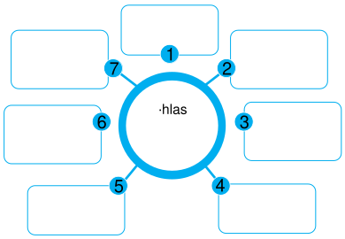

*   1: Allah'ın (cc) birliği (tevhit)
*   2: Allah'ın (cc) hiçbir şeye muhtaç olmadığı
*   3: Allah'ın (cc) dengi ve ortağının olmadığı
*   4: Allah'ın (cc) eşinin ve benzerinin olmadığı
*   5: Allah'a (cc) karşı samimiyet
*   6: Allah'ın (cc) varlığının sonsuz ve kendinden olduğu
*   7: Allah'a (cc) şirk koşmamak gerektiği

**İhlas suresinde ele alınır.**

<!-- sayfa 37 -->

# Etkinlik-7

15 dk.

**Adı:** Hangisi Doğru?
**Amaç:** İhlas suresini ve bu surenin anlamını okuyarak yorumlayabilme

## Yönerge
Aşağıdaki adımları takip ederek etkinliği tamamlayınız.

1. Aşağıda İhlas suresinin okunuşu ve anlamı karışık olarak verilmiştir. Ayetlerin doğru anlamının hangisi olduğunu yanındaki şekli işaretleyerek belirtiniz.

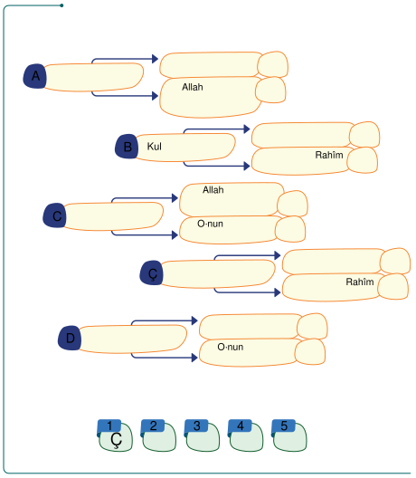
* **A** Allâhüssamed
    * De ki: "O, Allah'tır, tektir."
    * Allah Samed'dir. (Hiçbir şeye muhtaç olmayandır.)
* **B** Kul hüvallâhü ehad
    * De ki: "O, Allah'tır, tektir."
    * Rahman ve Rahîm olan Allah'ın adıyla
* **C** Ve lem yeküllehû küfüven ehad
    * Allah Samed'dir. (Hiçbir şeye muhtaç olmayandır.)
    * O'nun hiçbir dengi (eşi, benzeri) yoktur.
* **Ç** Bismillâhirrahmânirrahîm
    * O, doğurmamış ve doğmamıştır.
    * Rahman ve Rahîm olan Allah'ın adıyla
* **D** Lem yelid ve lem yûled
    * O, doğurmamış ve doğmamıştır.
    * O'nun hiçbir dengi (eşi, benzeri) yoktur.

2. Karışık olarak verilen harfleri İhlas suresinin okunuşunu oluşturacak şekilde sıralayınız.

| 1 | 2 | 3 | 4 | 5 |
| :---: | :---: | :---: | :---: | :---: |
| Ç | | | | |

<!-- sayfa 38 -->

# Değerlendirme

**İhlas suresinin anlamından hareketle ulaştığınız mesajları yazınız.**

__________________________________________________________________________________________
__________________________________________________________________________________________
__________________________________________________________________________________________
__________________________________________________________________________________________
__________________________________________________________________________________________
__________________________________________________________________________________________
__________________________________________________________________________________________
__________________________________________________________________________________________
__________________________________________________________________________________________
__________________________________________________________________________________________

## Etkinlik-8


| Adı | Bir Sure Biliyorum |
| :--- | :--- |
| **Amaç** | İhlas suresini, surenin anlamını değiştirmeyecek şekilde özetleyebilme |

### Yönerge
**Aşağıdaki adımları takip ederek etkinliği tamamlayınız.**

**Aşağıda karışık olarak verilen İhlas suresinin anlamını doğru bir bütün oluşturacak şekilde boş bırakılan kutulara yazınız.**

| Bismillâhirrahmânirrahîm | adıyla | olan |
| :--- | :--- | :--- |
| | Allah'ın | Rahman |
| | Rahîm | ve |
| | | |


| Kul hüvallâhü ehad | Allah'tır, | O, |
| :--- | :--- | :--- |
| | De ki: | tektir. |

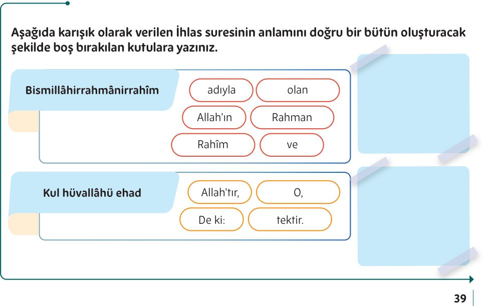

<!-- sayfa 39 -->

| Allâhüssamed | olmayandır. | muhtaç |
| :--- | :--- | :--- |
| | Samed'dir. | Allah |
| | Hiçbir şeye | |

| Lem yelid ve lem yûled | ve | doğurmamış |
| :--- | :--- | :--- |
| | O, | doğmamıştır. |

| Ve lem yeküllehû küfüven ehad | yoktur. | dengi |
| :--- | :--- | :--- |
| | O'nun | hiçbir |

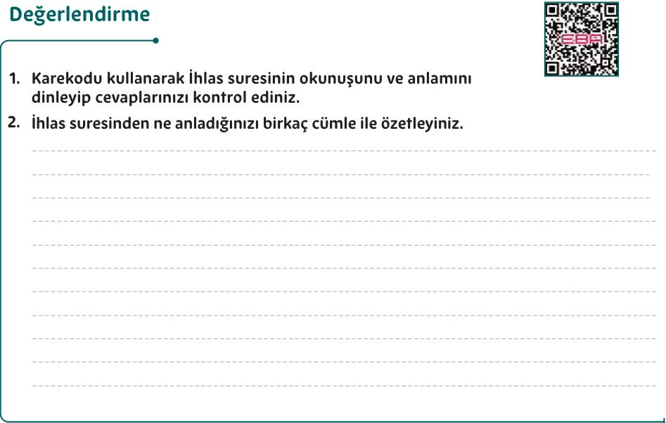

## Değerlendirme

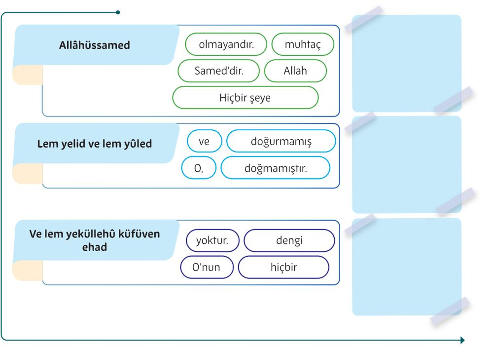

1. Karekodu kullanarak İhlas suresinin okunuşunu ve anlamını dinleyip cevaplarınızı kontrol ediniz.
2. İhlas suresinden ne anladığınızı birkaç cümle ile özetleyiniz.

----------------------------------------------------------------------------------------------------
----------------------------------------------------------------------------------------------------
----------------------------------------------------------------------------------------------------
----------------------------------------------------------------------------------------------------
----------------------------------------------------------------------------------------------------
----------------------------------------------------------------------------------------------------
----------------------------------------------------------------------------------------------------
----------------------------------------------------------------------------------------------------
----------------------------------------------------------------------------------------------------
----------------------------------------------------------------------------------------------------
----------------------------------------------------------------------------------------------------

<!-- sayfa 40 -->


<!-- yer tutucu bulunamadı: sayfa sonuna eklendi -->

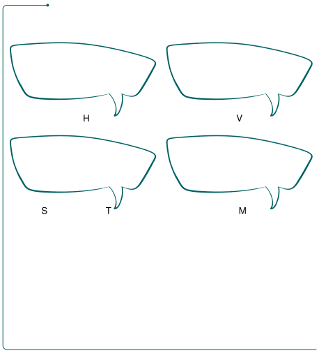
<!-- yer tutucu bulunamadı: sayfa sonuna eklendi -->

<!-- sayfa 41 -->

# Değerlendirme

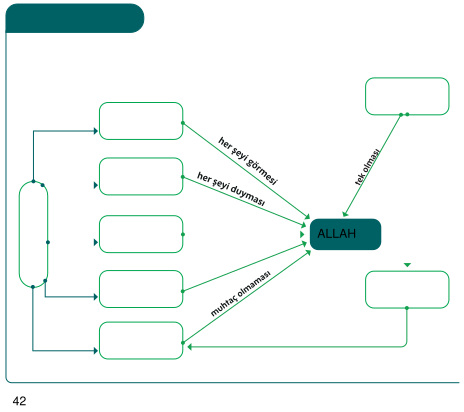

## Kontrol Noktası

Aşağıdaki kavram haritasında Allah'ın (cc) güzel isimleri arasındaki anlam ilişkisi gösterilmiştir. Kavram haritasını inceleyiniz ve boşluklara uygun sözcükleri yazınız.


<!-- sayfa 42 -->

# 1. ÜNİTE PERFORMANS GÖREVİ

| Amaç | Görev |
| :--- | :--- |
| • Evrendeki mükemmel düzene ilişkin akıl yürütebilme<br>• Evrendeki mükemmel düzenden hareketle Allah'ın (cc) varlığı ve birliğini müşahede edebilme<br>• Allah'ın (cc) güzel isimlerini bağlamına uygun kullanabilme | Bu çalışmadaki göreviniz, evrendeki mükemmel düzenle ilgili gözlemlerinizden hareketle Allah'ın (cc) varlığı ve birliğine dair çıkarımlar yapmanız; Allah'ın (cc) güzel isimlerini bu düzenle ilişkilendirerek açıklamanızdır. |

| Beceriler | Ürün |
| :--- | :--- |
| • Tümevarımsal Akıl Yürütme<br>• Müşahede Etme<br>• Dinî Kavramları Bağlamına Uygun Kullanma | Bilgi Görseli |

| Puanlama Yöntemi | Süre |
| :--- | :--- |
| Dereceli Puanlama Anahtarı ve Öz Değerlendirme Formu | Hazırlık: İki hafta<br>Sınıf İçi Performans: 40 dakika |

## Yönerge
**Aşağıdaki adımları takip ederek etkinliği tamamlayınız.**

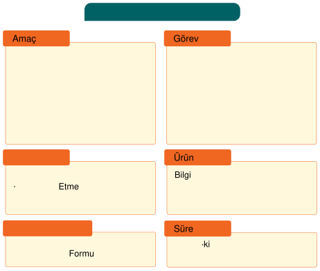

### Hazırlık Aşaması
1. Çevrenizde gerçekleşen doğa olaylarını, gökyüzünü, mevsimleri veya insan vücudundaki sistemleri inceleyiniz. Bu sistemlerdeki mükemmel düzeni gösteren en az üç örnek belirleyiniz.
2. Belirlediğiniz bu örneklerden yola çıkarak "Bu düzen kendi kendine oluşabilir mi?" veya "Bu uyum bize neyi anlatır?" gibi sorular sorunuz ve soruların cevaplarını araştırınız. Ulaştığınız bilgileri not alınız.
3. Gözlemlediğiniz bu mükemmel düzeni Allah'ın (cc) güzel isimleriyle eşleştiriniz. Hangi ismin, evrendeki hangi ayrıntıda tecelli ettiğini açıklayınız. Açıklamalarınızı bilgi görselinde kullanmak için not alınız.
4. Araştırmanızı ve gözlemlerinizi görsellerle (fotoğraf, çizim) destekleyebilirsiniz.
5. Bilgi görselini hazırlarken kullanacağınız renkli kâğıt, boya, yapıştırıcı, resim vb. malzemeleri hazırlayınız.


<!-- sayfa 43 -->

# Sınıf İçi Performans Aşaması

6. Araştırma notlarınıza dayalı bir bilgi görseli hazırlayınız.
7. Bilgi görselinizde her bir örnek için örneğin adı, kısa açıklaması, onunla ilişkili esmayıhüsnadan en az iki isim, kurulan ilişkinin açıklaması ve görseller yer almalıdır.


## Değerlendirme Ölçütleri


**Bu çalışmada ortaya koyduğunuz ürün aşağıdaki ölçütlere göre değerlendirilecektir:**

* **Tümevarımsal Akıl Yürütme:** Çevredeki olay ve varlıkları dikkatle gözlemleyerek örnekler belirleme
* **Müşahede Etme:** Evrendeki düzenden yola çıkarak Allah’ın (cc) varlığı ve birliği hakkında çıkarım yapma
* **Esmayıhüsnayı Bağlamına Uygun Kullanma:** Seçilen örnekleri konuyla ve Allah’ın (cc) güzel isimleriyle doğru ilişkilendirerek kullanma
* **Tasarım:** Ürünü görsel açıdan zengin, dikkat çekici ve özenli hazırlama

<!-- sayfa 44 -->

# DERECELİ PUANLAMA ANAHTARI

| Ölçütler | Geliştirilmesi Gerekir. (1) | Kabul Edilebilir. (2) | Yeterli (3) | Puan |
| :--- | :--- | :--- | :--- | :--- |
| Tümevarımsal Akıl Yürütme | Evrendeki düzene dair örnek bulunmamış veya verilen örnekler konuyla ilgisiz kalmıştır. | Evrendeki düzene dair en az bir, en fazla iki örnek verilmiş ancak örneklerin detayları yeterince açıklanmamıştır. | Evrendeki mükemmel düzene dair en az üç farklı ve özgün gözlem/ örnek (doğa, uzay, insan vb.) detaylıca sunulmuştur. | |
| Müşahede Etme | Evrendeki düzen ile Allah'ın (cc) varlığı ve birliği arasında bağ kurulmamıştır. | Evrendeki düzenin bir yaratıcıya işaret ettiği belirtilmiş ancak bu durum örneklerle ve açıklamalarla desteklenmemiştir. | Evrendeki hassas dengelerden yola çıkarak Allah'ın (cc) varlığına ve birliğine dair mantıklı çıkarımlar yapılmıştır. | |
| Dinî Kavramları Bağlamına Uygun Kullanma | Allah'ın (cc) güzel isimlerine yer verilmemiş veya isimler örneklerle hatalı ilişkilendirilmiştir. | Allah'ın (cc) güzel isimlerinden en az bir, en fazla iki tanesi kullanılmış ancak isimlerin anlamları ile seçilen örnekler arasındaki ilişki tam kurulamamıştır. | Seçilen örnekler, Allah'ın (cc) güzel isimleriyle doğru olarak ilişkilendirilmiştir. | |
| Tasarım | Bilgi görseli tasarımına özen gösterilmemiştir, içerik karmaşıktır veya görseller doğru kullanılmamıştır. | Bilgi görseli genel hatlarıyla düzenlidir, görseller konuyu kısmen desteklemektedir. | Bilgi görseli, görsel açıdan etkileyici, düzenli, yaratıcı ve konunun anlaşılmasını kolaylaştıracak şekilde tasarlanmıştır. | |
| **TOPLAM** | | | | |

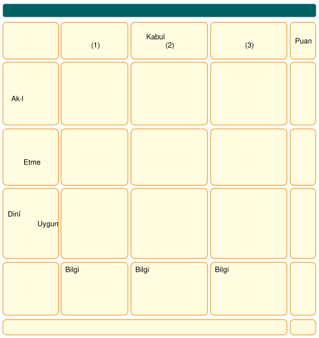
<!-- yer tutucu bulunamadı: sayfa sonuna eklendi -->

<!-- sayfa 45 -->

# ÖZ DEĞERLENDİRME FORMU

Bu form, kendi performansınızı değerlendirmeniz amacıyla hazırlanmıştır. Aşağıda verilen maddeleri dikkatlice okuyunuz ve her bir madde için size en uygun seçeneği (X) ile işaretleyiniz. Bu değerlendirme not verme amacıyla değil güçlü yönlerinizi ve geliştirilmesi gereken alanları belirlemek amacıyla kullanılacaktır.

| İFADELER | EVET | KISMEN | HAYIR |
| :--- | :---: | :---: | :---: |
| 1. Bilgi görselini hazırlamadan önce konuyla ilgili hazırlık yaptım.  |  |  |  |
| 2. Çalışma süresince ilgili ve istekliydim.  |  |  |  |
| 3. Elde ettiğim bilgileri doğru şekilde kaydettim.  |  |  |  |
| 4. Çalışmayı zamanında tamamladım.  |  |  |  |
| 5. Çalışmam sırasında yeni bilgiler edindim.  |  |  |  |


**Açıklama:** Çalışmayla ilgili görüşlerinizi dikkate alarak aşağıdaki soruları cevaplayınız. Öğretmeninizin çalışmanızla ilgili geri bildirimini "Öğretmenin Yorumu" bölümüne yazınız.

1. Çalışma sırasında şu noktaları kolaylıkla yaptım:
_______________________________________________________________
_______________________________________________________________

2. Çalışma sırasında şu kısımlarda zorlandım:
_______________________________________________________________
_______________________________________________________________

3. Çalışmayı yeniden yapacak olsaydım şunlara dikkat ederdim:
_______________________________________________________________
_______________________________________________________________

Öğretmenin Yorumu
_______________________________________________________________
_______________________________________________________________
_______________________________________________________________
_______________________________________________________________

<!-- sayfa 46 -->

# ÜNİTE SONU ÖLÇME VE DEĞERLENDİRME SORULARI


Aşağıdaki 1, 2 ve 3. soruları metinden hareketle cevaplayınız.

Arılar, bitkilerin üremesinde önemli bir rol oynayan canlılardır ve çiçeklerle olan ilişkileri ekosistemdeki dengenin korunmasına yardımcı olur. Arılar bal yaparken taşıdıkları polenlerle bitkilerin çoğalmasını sağlar. Bu nedenle arıların yokluğu bizim sadece balsız kalmamız anlamına gelmez, aynı zamanda birçok çiçekli bitki türünün de yeryüzünden silinmesi demektir. Bunun sonucunda bu bitkilerle beslenen otçul hayvan türleri yok olur. Sonra da bu hayvanlarla beslenen etçil hayvan türleri yok olur. Kısaca arılar olmazsa besin zincirinin en önemli halkası -yani çiçekli bitkiler- kopmuş olur ve açlık nedeniyle birçok canlının soyu tükenme tehlikesiyle karşı karşıya kalır. Tabii bu durumdan yine en çok etkilenecek olan insandır. Nasıl mı? Girdiğiniz bir süpermarkette sadece bal rafının boş kalacağını sanıyorsanız yanılıyorsunuz. Sebze, meyve, tahıl ve bakliyatların da içinde bulunduğu bitkisel ürünler ile hayvansal ürünlerin çoğu ulaşılamaz hâle gelecektir.

1. **Bu metinde anlatılmak istenen asıl düşünce nedir? Yazınız.**
_______________________________________________________________
_______________________________________________________________
_______________________________________________________________
_______________________________________________________________
_______________________________________________________________
_______________________________________________________________
_______________________________________________________________

2. **Bu metin aşağıdaki kavramlarla ilişkilendirilmek istense hangisi dışarıda kalır? İşaretleyiniz.**

| | Denge | | Tesadüf | | Ahenk |
|---|---|---|---|---|---|
| | İş birliği | | Uyum | | Döngü |


3. **İnsan evrendeki mükemmel düzenin devamlılığını sağlamak için sizce neler yapabilir? Birkaç cümle ile açıklayınız.**
_______________________________________________________________
_______________________________________________________________
_______________________________________________________________
_______________________________________________________________
_______________________________________________________________
_______________________________________________________________
_______________________________________________________________

<!-- sayfa 47 -->

**Aşağıdaki 4, 5 ve 6. soruları metinden yararlanarak cevaplayınız.**

Tüm gök cisimleri sürekli bir hareket hâlindedir. Her biri kendi etrafında dönerek bir yörünge boyunca yol alır ve Yüce Allah'ın evrene koyduğu muhteşem düzen sayesinde görevlerini yerine getirir. Çekim yasası adı verilen bu olayla gezegenler uzay boşluğunda belirli yörüngelerde hareket eder. Güneş'in çekim kuvveti ve gezegenlere yüklenen merkezkaç kuvveti arasındaki denge ile her bir cisim kendi yörüngesinde ilerler ve birbirlerine zarar vermez. Dünya'mızı çevreleyen atmosfer de tıpkı bir tavan gibi uzaydan gelen cisimlerin ve ışınların bize zarar vermesine engel olur. Karmaşık yapısına rağmen evrendeki varlıkların bu kadar sistemli hareket etmesi elbette ki Yüce Allah'ın var ve bir olmasının en önemli delillerinden biridir. Bu da bize tevhit inancının her alandaki yansımalarını açıkça göstermektedir.

**4. Bu metinde tevhit kavramı hangi örnekle açıklanmıştır? Yazınız.**

_______________________________________________________________
_______________________________________________________________
_______________________________________________________________
_______________________________________________________________
_______________________________________________________________
_______________________________________________________________
_______________________________________________________________
_______________________________________________________________

**5. Bu parçadan hareketle aşağıdaki ifadelerden hangilerine ulaşılabilir? İşaretleyiniz.**

| | | |
| :--- | :--- | :---: |
| a | Evren bir hareket ve değişim içindedir. | [ ] |
| b | Evrendeki varlıklar bir sistemin parçaları gibi görevlerini yerine getirmektedir. | [ ] |
| c | İnsanlar gözlem yoluyla Allah'ın (cc) varlığına ve birliğine ulaşamaz. | [ ] |
| ç | Evrenin büyüklüğü ve karmaşıklığı ilahi bir gücün varlığını gerekli kılar. | [ ] |
| d | Gök cisimlerinin hareketleri evrenin plansız işlediğinin göstergesidir. | [ ] |
| e | Evrendeki varlıklar birbiriyle etkileşim hâlindedir. | [ ] |
| f | Evrendeki düzen Allah'ın (cc) varlığı ve birliği konusunda birçok mesaj verir. | [ ] |

<!-- sayfa 48 -->

6. **Metinden yola çıkarak Yüce Allah'ın varlığını ve birliğini hissettiren durumlara örnekler veriniz.**

_______________________________________________________________ 
_______________________________________________________________ 
_______________________________________________________________ 
_______________________________________________________________ 
_______________________________________________________________ 
_______________________________________________________________ 
_______________________________________________________________ 
_______________________________________________________________

Aşağıdaki 7. soruyu verilen dörtlüklerden yararlanarak cevaplayınız.

7. **Dörtlükte açıklanan esmayı hüsnanın hangisi olduğunu karşısındaki boşluğa yazınız.**

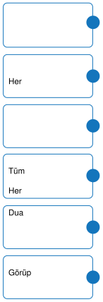
Rahmetiyle bizlere
Sonsuz nimetler verir.
Kullarına acıyıp
Şefkatini gösterir.
 [ ]

Kâinat bahçesinde
Sayısız nice eser.
Her biri Yaradan'ın
Gücünü temsil eder.
[ ]

İyilik yapanlara
Merhametle yaklaşır.
Ahirette onları
Nimetlerle donatır.
[ ]

Geçmiş ve geleceğin 
Tüm sırları O'ndadır.
Kusursuz ilmi ile
Her şeyi kuşatandır.
[ ]

Dua eden kulunu
Dinleyip işitendir.
Gönülden geçenleri 
Hikmetiyle bilendir.
[ ]

Yalnız değil hiç kimse
Görüp gözetendir O.
Gizli açık ne varsa 
[ ]

<!-- sayfa 49 -->

Aşağıdaki kutucuklarda İhlas suresindeki ayetlerin okunuşları ve anlamları verilmiştir. 8-14. soruları kutucuklardaki harfleri kullanarak cevaplayınız. Aynı kutucuğu birden fazla soru için kullanabilirsiniz.

| A | Kul hüvallâhü ehad (De ki: O, Allah birdir.) | B | Allâhüssamed (Allah Samed'dir.) |
|---|---|---|---|
| C | Lem yelid ve lem yûled (O, doğurmamış ve doğmamıştır.) | D | Ve lem yeküllehû küfüven ehad (O'nun hiçbir dengi -eşi, benzeri- yoktur.) |


8. Allah'tan (cc) başka ilah olmadığı vurgulanır. _______

9. Allah'ın (cc) herhangi bir ata ve soydan gelmediği, doğum, ölüm gibi sıfatlarla nitelendirilemeyeceği ifade edilir. ________

10. Allah'ın (cc) her şeyin sahibi olduğu ve her şeyin O'na muhtaç olduğu anlatılır. ________

11. Allah'ın (cc) bir ve tek olduğunu işaret eden ismine vurgu yapılır. ________

12. Allah'ın (cc) varlığının hiçbir güce dayanmadığı, kendinden olduğu vurgulanır. ________

13. İslam'ın temel prensiplerinden biri olan tevhit inancına dikkat çekilir. ________

14. Hiçbir şeyin Allah'a (cc) denk ve eşit olamayacağı ifade edilir. ________


Aşağıdaki 15-19. soruların doğru cevabını işaretleyiniz.

15. Ayşe, Allah'ın (cc) güzel isimlerinden öğrendiklerini pekiştirmek için günlük tutmaya başlamıştır. Günlüğüne yazdığı bazı bölümler aşağıda verilmiştir:

1. Gün: Kuşların yuva yapışını izledim. Allah'ın (cc) yarattığı her canlıya merhametiyle yaklaştığını, onları koruyup gözettiğini bir kez daha hissettim. O, gerçekten ______'dır.

2. Gün: Gök gürlediğinde ve şimşek çaktığında Allah'ın (cc) her şeye gücünün yettiğini daha iyi anladım. O, kendisine hiçbir şey zor gelmeyen sonsuz güç sahibi ______'dir.

3. Gün: Sessizce dua etsem bile Rabbimin beni duyduğunu bilmek çok güzel. O, kalbimden geçen istekleri bile işiten ______'dir.

Cümlelerdeki boşluklara uygun isimler yerleştirildiğinde aşağıdakilerden hangisi dışarıda kalır?

A) Basir
B) Kadir
C) Rahman
D) Semi

<!-- sayfa 50 -->

**16.** Tüm canlıları yaratan ve hayatın devamlılığını sağlayan Allah (cc), dünyayı da canlılar için yaşamaya elverişli hâle getirmiştir. Dağları ve denizleri mükemmel bir düzende yerleştirmiştir. Canlıların faydalanması için ırmakları ve ovaları yaratmıştır. Ekinlerin büyümesi için yağmuru ve güneşi yaratmıştır. Hayvanlara barınak ve besin olması için ağaçları, bitkilerin büyüyip yeşermesi için de toprağı var etmiştir.

**Bu paragraftan aşağıdakilerden hangisi çıkarılamaz?**

A) İnsana, evrendeki düzeni koruması emredilmiştir.
B) Varlıklara düzen veren Yüce Allah’tır.
C) Allah’ın (cc) yaratması sayesinde varlıklar hayat bulmuştur.
D) Yüce Allah, dünyayı canlılar için yaşanır kılmıştır.

**17.**
* Yüce Allah’ın yarattığı her şeye merhamet etmesi
* Güneş’in ışığıyla bütün varlıkları kucaklaması
* Kuşların bütün gün yuvalarına yiyecek taşıması
* Şefkatli annelerin, fedakâr babaların olması
* Yağmurun toprağın altındaki tohumları çatlatması
* Yıldızların ve Ay'ın gecelerimizi aydınlatması

**Bu ifadeler Yüce Allah’ın hangi güzel isminin kâinattaki yansımalarına örnektir?**

A) Alîm
B) Basir
C) Kadir
D) Rahman

**18.** **Kâinatın Not Defteri: Tesadüfe Yer Yok!**

Başınızı kaldırıp gökyüzüne hiç baktınız mı ya da eğilip yerdeki bir kar tanesini incelediniz mi? İlk bakışta küçük gibi görünen bu ayrıntılar bize çok şey söyler. Çünkü bilim insanları, kar tanelerindeki simetriyi ve gezegenlerin yörüngelerindeki hassas dengeyi incelerken evrende işleyen bir düzeni fark eder.

Örneğin Dünya, Güneş’e bugünkü konumundan biraz daha yakın olsaydı aşırı ısınır; biraz daha uzak olsaydı çok soğurdu. Demek ki her şey yerli yerinde ve ölçülüdür. Bu durum bana şu ayeti hatırlatıyor: “... Rahman’ın yaratışında hiçbir uyumsuzluk göremezsin. Gözünü çevir de bir bak, bir bozukluk görebiliyor musun?” (Mülk suresi 3. ayet)

Evrendeki bu muazzam tablo, fırçanın kendi kendine hareket etmediğinin en büyük kanıtlarından biri değil mi?


**Bu köşe yazısında yazar, evrendeki düzeni örnek göstererek aşağıdakilerden hangisini vurgulamaktadır?**

A) Evrendeki her varlığın bir gün son bulacağını
B) Tabiat olaylarının tesadüfen ve kendi kendine oluştuğunu
C) Kusursuz düzenin Allah’ın (cc) varlığını ve birliğini gösterdiğini
D) Doğadaki düzenin bilim insanlarının çalışmalarıyla kurulduğunu

<!-- sayfa 51 -->

19. Hz. Muhammed (sav), insanlara Allah'ın (cc) tek ilah olduğunu anlatırdı. Bazı müşrikler onu dinleyenlerin dikkatini dağıtmak için Allah'ın (cc) doğup doğmadığını ve çocuğu olup olmadığını sorarlardı. Hz. Peygamber (sav) bu sorulara İhlas suresindeki ayetlerle cevap verirdi.

**Müşriklerin sorduğu soruya doğrudan cevap veren ayet aşağıdakilerden hangisi olabilir?**

A) Kul hüvallahü ehad

B) Lem yelid ve lem yûled

C) Allâhüssamed

D) Ve lem yeküllehû küfüven ehad

<!-- sayfa 52 -->

# Sonnotlar

1. Âlâ suresi 2-3. ayetler.
2. Bakara suresi 117. ayet.
3. Topal, “Güneş Sistemini Tanıyalım: Dünya”; Aydın, “Mevsimler Nasıl Oluşur?”
4. Rad suresi 3. ayet.
5. İsra suresi 70. ayet.
6. Fatır suresi 3. ayet.
7. Buhari, "Tevhid", 18.
8. bk. Sürmeli vd., "tevhit", 365.
9. bk. Sürmeli vd., "Esmayıhüsna", 78.
10. Taha suresi 8. ayet.
11. bk. Müslim, "Zikr", 5.
12. Araf suresi 180. ayet.
13. bk. Sürmeli vd., "Rahman", 300.
14. bk. Sürmeli vd., "Rahîm", 299.
15. Müslim, "Tevbe", 22.
16. Bakara suresi 163. ayet.
17. bk. Sürmeli vd., "Alîm", 15.
18. Nahl suresi 78. ayet.
19. Şuara suresi 220. ayet.
20. Bakara suresi 96. ayet.
21. bk. Sürmeli vd., "Esmayıhüsna", 79.
22. bk. Sürmeli vd., "ihlas", 160.
23. bk. Sürmeli vd., "ahad", 7.
24. bk. Sürmeli vd., "Esmayıhüsna", 79-80.

<!-- sayfa 53 -->

# 2. ÜNİTE NAMAZ

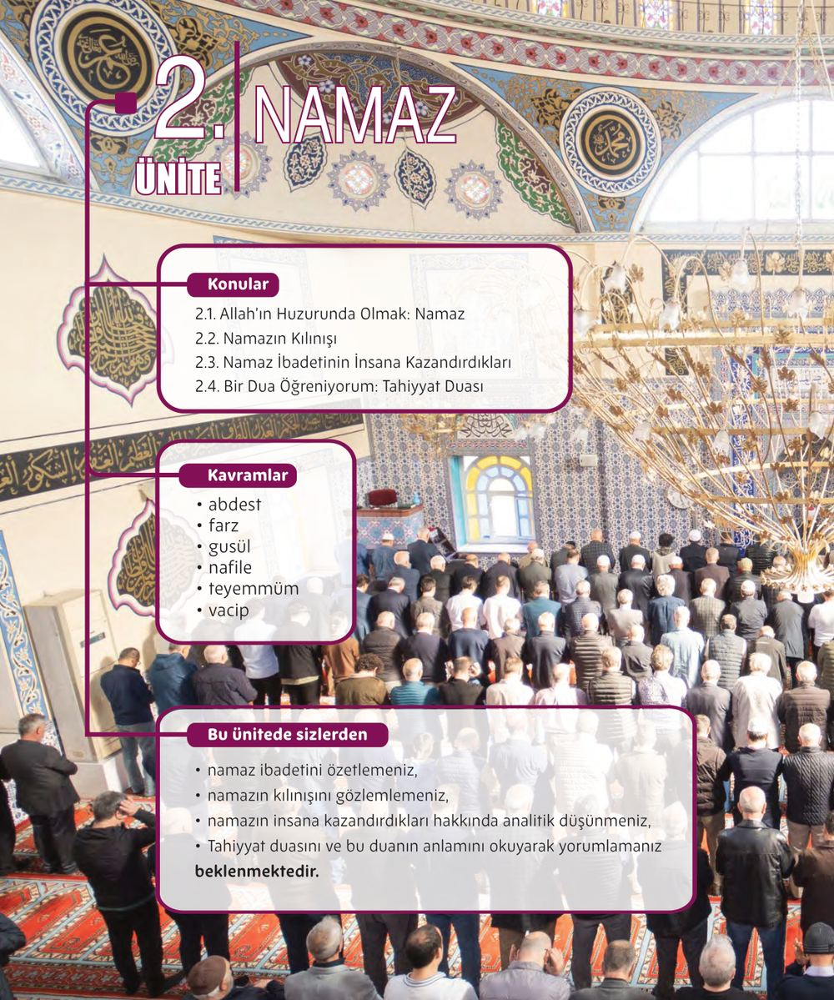

## Konular
2.1. Allah'ın Huzurunda Olmak: Namaz
2.2. Namazın Kılınışı
2.3. Namaz İbadetinin İnsana Kazandırdıkları
2.4. Bir Dua Öğreniyorum: Tahiyyat Duası

## Kavramlar
* abdest
* farz
* gusül
* nafile
* teyemmüm
* vacip

## Bu ünitede sizlerden
* namaz ibadetini özetlemeniz,
* namazın kılınışını gözlemlemeniz,
* namazın insana kazandırdıkları hakkında analitik düşünmeniz,
* Tahiyyat duasını ve bu duanın anlamını okuyarak yorumlamanız 
**beklenmektedir.**

<!-- sayfa 54 -->

Dosyası
Sunusu

# Üniteye Başlarken 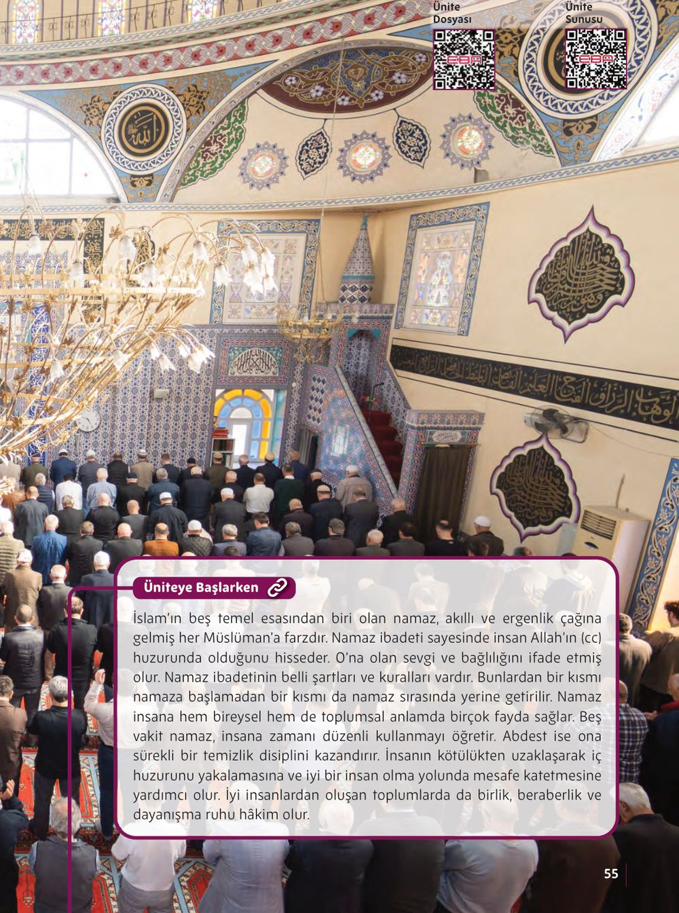

İslam’ın beş temel esasından biri olan namaz, akıllı ve ergenlik çağına gelmiş her Müslüman’a farzdır. Namaz ibadeti sayesinde insan Allah’ın (cc) huzurunda olduğunu hisseder. O’na olan sevgi ve bağlılığını ifade etmiş olur. Namaz ibadetinin belli şartları ve kuralları vardır. Bunlardan bir kısmı namaza başlamadan bir kısmı da namaz sırasında yerine getirilir. Namaz insana hem bireysel hem de toplumsal anlamda birçok fayda sağlar. Beş vakit namaz, insana zamanı düzenli kullanmayı öğretir. Abdest ise ona sürekli bir temizlik disiplini kazandırır. İnsanın kötülükten uzaklaşarak iç huzurunu yakalamasına ve iyi bir insan olma yolunda mesafe katetmesine yardımcı olur. İyi insanlardan oluşan toplumlarda da birlik, beraberlik ve dayanışma ruhu hâkim olur.

<!-- sayfa 55 -->

# 2.1. ALLAH'IN HUZURUNDA OLMAK: NAMAZ

## Konuya Başlarken

Hz. Peygamber İslam dininin beş temel esası olduğunu belirtmiştir.$^1$ <!-- KONTROL: Marker'da karşılığı yok, uydurma olabilir --> Müslüman kimliğinin oluşmasında ve dinî hayatın şekillenmesinde büyük öneme sahip olan bu esaslar; **kelimeişehadet getirmek, namaz kılmak, oruç tutmak, zekât vermek ve hacca gitmektir.** İslam'ın beş şartı da denen bu esaslardan biri olan namaz ibadeti hakkında neler biliyorsunuz?

| | |
| :--- | :--- |
| **ibadet** <br> Genel anlamda Yüce Allah'ın hoşnutluğunu kazandıracak her türlü tutum ve davranıştır. Özel anlamda ise Allah (cc) tarafından yapılması istenen ve belirli kuralları olan davranışları ifade eder. *(bk. Sinanoğlu, “İbadet”, 19/233-235)* | İnsan kendisine yapılan iyiliğe teşekkürle karşılık verir. Teşekkür, sözle ifade edilebileceği gibi davranışla da yerine getirilebilir. İyiliğe başka bir iyilikle karşılık vermek de bir tür teşekkür sayılır. Anne babamızın bizler için yaptıkları fedakârlıklara sorumluluklarımızı yerine getirerek karşılık verebiliriz. Bu da onlara teşekkürümüzü ifade etmenin bir yoludur. <br><br> İnsanın, kendisini en güzel şekilde yaratıp yaşatan Yüce Allah'a da teşekkür etmesi gerekir. Bunun yolu da Allah'a (cc) ibadet etmektir. İbadet aynı zamanda insanın yaratılış amacıdır. Kur'an-ı Kerim'de bu konuyla ilgili şöyle buyurulur: **“Ben cinleri ve insanları, ancak bana ibadet etsinler diye yarattım.”**$^2$ <!-- KONTROL: Marker'da karşılığı yok, uydurma olabilir --> İnsan ibadet sayesinde hem yaratılış gayesine uygun davranmış hem de verdiği nimetler için Allah'a (cc) teşekkür etmiş olur. |
| **namaz** <br> Arapça “salat” kelimesinin karşılığıdır. Sözlükte “yalvarmak, dua, rahmet, yardım” gibi anlamlara gelen salat; dinî bir terim olarak tekbirle başlayıp selamla biten, belirli hareket ve sözlerden oluşan bedenî ibadettir. *(bk. Başoğlu vd., “Namaz”, 6/295)* | 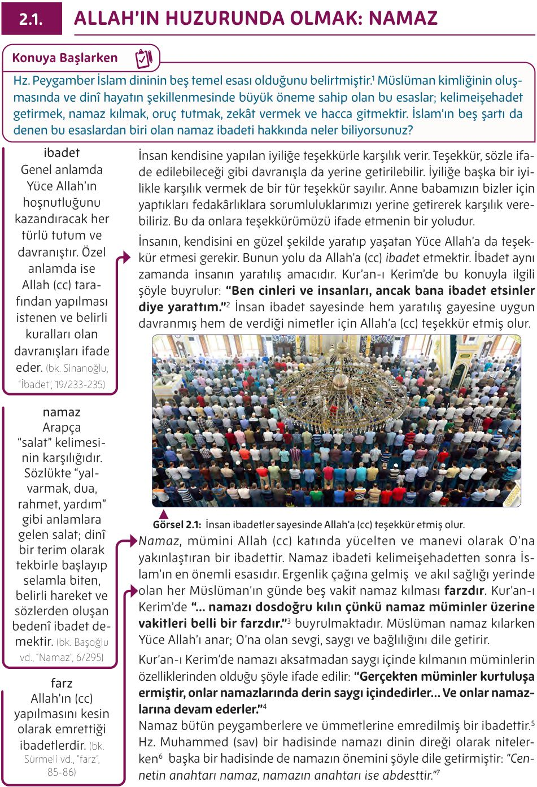 <br> *Görsel 2.1: İnsan ibadetler sayesinde Allah'a (cc) teşekkür etmiş olur.* |
| **farz** <br> Allah'ın (cc) yapılmasını kesin olarak emrettiği ibadetlerdir. *(bk. Sürmeli vd., “farz”, 85 86)* | *Namaz*, mümini Allah (cc) katında yücelten ve manevi olarak O’na yakınlaştıran bir ibadettir. Namaz ibadeti kelimeişehadetten sonra İslam'ın en önemli esasıdır. Ergenlik çağına gelmiş ve akıl sağlığı yerinde olan her Müslüman'ın günde beş vakit namaz kılması farzdır. Kur'an-ı Kerim'de “... namazı dosdoğru kılın çünkü namaz müminler üzerine vakitleri belli bir farzdır.”$^3$ <!-- KONTROL: Marker'da karşılığı yok, uydurma olabilir --> buyrulmaktadır. Müslüman namaz kılarken Yüce Allah'ı anar; O'na olan sevgi, saygı ve bağlılığını dile getirir. <br><br> Kur'an-ı Kerim'de namazı aksatmadan saygı içinde kılmanın müminlerin özelliklerinden olduğu şöyle ifade edilir: **“Gerçekten müminler kurtuluşa ermiştir, onlar namazlarında derin saygı içindedirler... Ve onlar namazlarına devam ederler.”**$^4$ <!-- KONTROL: Marker'da karşılığı yok, uydurma olabilir --> <br><br> Namaz bütün peygamberlere ve ümmetlerine emredilmiş bir ibadettir.$^5$ <!-- KONTROL: Marker'da karşılığı yok, uydurma olabilir --> Hz. Muhammed (sav) bir hadisinde namazı dinin direği olarak nitelerken$^6$ <!-- KONTROL: Marker'da karşılığı yok, uydurma olabilir --> başka bir hadisinde de namazın önemini şöyle dile getirmiştir: “Cen...” |

<!-- sayfa 56 -->

# Etkinlik-1

| Adı | Namaz Haritası |
| :--- | :--- |
| **Amaç** | Namaz ibadetiyle ilgili çözümleme yapabilme |

**20 dk.**

## Yönerge
Aşağıdaki adımları takip ederek etkinliği tamamlayınız.

1. Aşağıdaki kavram haritasında İslam'ın şartları ile namaz ibadeti arasındaki ilişki gösterilmiştir. Kavram haritasını inceleyiniz ve boşluklara uygun sözcükleri yazınız.


2. Tamamladığınız kavram haritasını öğretmeninizle birlikte değerlendiriniz.

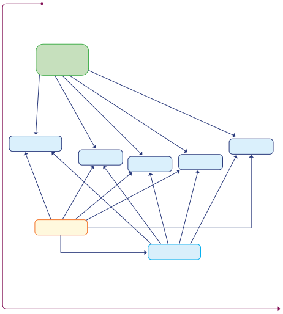
<!-- yer tutucu bulunamadı: sayfa sonuna eklendi -->

<!-- sayfa 57 -->

# Değerlendirme

Hazırladığınız kavram haritasından yararlanarak namaz ibadetinin İslam'daki yerini kısaca açıklayınız.
__________________________________________________________________________________________________
__________________________________________________________________________________________________
__________________________________________________________________________________________________
__________________________________________________________________________________________________

## 2.1.1. Namaz Çeşitleri

Namazlar; farz, vacip ve nafile olarak sınıflandırılır.

### Farz Namazlar

Farz namazlar Yüce Allah'ın, kılınmasını kesin olarak emrettiği namazlardır. Ergenlik çağına ulaşmış ve akıl sağlığı yerinde olan her Müslüman'ın günde beş vakit namaz kılması farzdır.$^8$ <!-- KONTROL: Marker'da karşılığı yok, uydurma olabilir --> Sabah, öğle, ikindi, akşam ve yatsı vakitlerinde kılınan bu namazların kasıtlı olarak terk edilmesi büyük günahtır. Unutma veya uyku gibi mazeret olarak kabul edilen sebeplerle vaktinde kılınamayan farz namazlar ilk fırsatta kaza edilmelidir.$^9$ <!-- KONTROL: Marker'da karşılığı yok, uydurma olabilir --> Haftada bir, camilerde cemaatle kılınması gereken cuma namazı da farz namazlardandır.$^{10}$ <!-- KONTROL: Marker'da karşılığı yok, uydurma olabilir --> Kadınlar cuma namazından sorumlu değildir. Fakat isterlerse kendilerine yer ayrılan camilerde bu namazı kılabilirler.$^{11}$ <!-- KONTROL: Marker'da karşılığı yok, uydurma olabilir --> Cuma namazı, Müslümanların haftada bir buluşmalarını, ortak gündem oluşturmalarını, tanışıp kaynaşmalarını sağlayan bir ibadettir. Farz namazlardan biri de vefat eden Müslümanlar defnedilmeden önce kılınan cenaze namazıdır.

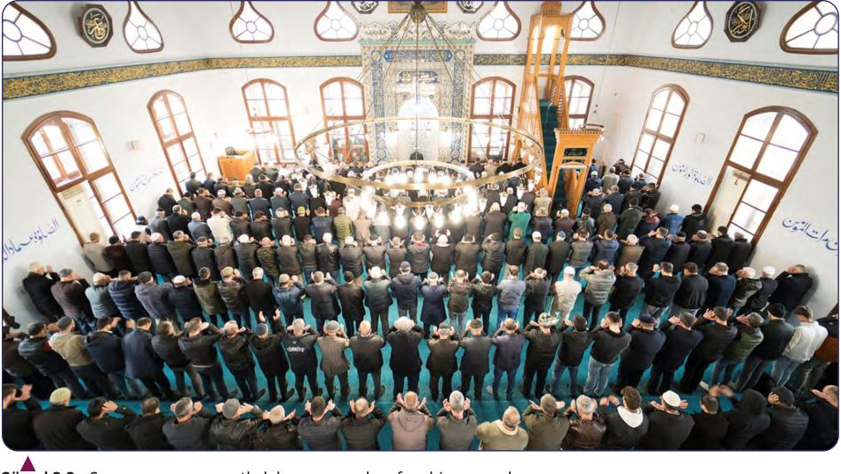


<!-- yer tutucu bulunamadı: sayfa sonuna eklendi -->

<!-- sayfa 58 -->

# Vacip Namazlar

Farz kadar açık ve kesin olmamakla birlikte kılınması emredilen namazlara **vacip** namaz denir. Ramazan ve Kurban Bayramlarında kılınan bayram namazları ve yatsı namazından sonra kılınan vitir namazı, vacip namazlara örnektir.$^{12}$ <!-- KONTROL: Marker'da karşılığı yok, uydurma olabilir -->


# Nafile Namazlar

Hz. Peygamber'in farz veya vacip olanlar dışında kıldığı namazlara **nafile** namazlar denir. Farz namazların öncesinde veya sonrasında kılınan namazlar, ramazan ayında yatsı ile vitir arasında kılınan teravih namazı, geceleri kılınan teheccüt namazı nafile namazlardandır. Nafile namazlara sünnet namaz da denir.$^{13}$ <!-- KONTROL: Marker'da karşılığı yok, uydurma olabilir -->


Namazın çeşitleriyle ilgili etkileşimli içerik için karekodu kullanabilirsiniz.

---

## Etkinlik-2

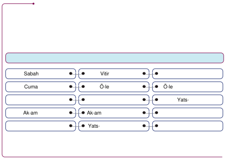

| Adı | Namaz Çeşitlerini Boyayalım |
| :--- | :--- |
| **Amaç** | Namazı farz, vacip ve nafile olarak sınıflandırabilme |
| **Malzemeler** | Sarı, mavi, kırmızı renklerde boya kalemleri |

### Yönerge

**Aşağıdaki adımları takip ederek etkinliği tamamlayınız.**

1. Aşağıdaki tabloda bazı namaz çeşitleri verilmiştir. Namaz çeşitlerinden

* farz olanların yazılı olduğu kutucukları maviye,
* vacip olanların yazılı olduğu kutucukları sarıya,
* sünnet olanların yazılı olduğu kutucukları kırmızıya boyayınız.

| HÜKÜMLERİ BAKIMINDAN NAMAZLARI SINIFLANDIRIYORUM |
| :--- |

| | | |
| :--- | :--- | :--- |
| Sabah Namazı | Vitir Namazı | Ramazan Bayramı Namazı |
| Cuma Namazı | Öğle Namazı | Öğle Namazının Sünnetleri |
| İkindi Namazı | Teheccüt Namazı | Yatsı Namazı |
| Akşam Namazı | Akşam Namazının Sünneti | Teravih Namazı |
| Kurban Bayramı Namazı | Yatsı Namazının Sünneti | İkindi Namazının Sünneti |

2. Boyadığınız kutucukların doğru olup olmadığını öğretmeninizle değerlendiriniz.

<!-- sayfa 59 -->

# Değerlendirme

1. Allah'ın (cc), kılınmasını kesin olarak emrettiği namazları hangi renge boyadınız?
_____________________________________________________________

2. Farz kadar kesin olmamakla birlikte kılınması emredilen namazları hangi renge boyadınız? Yazınız.
_____________________________________________________________

3. Hz. Peygamber'in kıldığı ve kılınmasını tavsiye ettiği namazları hangi renge boyadınız? Yazınız.
_____________________________________________________________

## Etkinlik-3


| Adı | Namaz Panosu |
| :--- | :--- |
| **Amaç** | Namaz ibadetini özetleyebilme |

### Yönerge
Aşağıdaki adımları takip ederek etkinliği tamamlayınız.

1. İslam’ın şartları arasında namazın yeri ve önemi hakkında öğrendiklerinizi en az üç cümle olacak şekilde defterinize yazınız.
2. Yazdığınız cümleleri sesli okuyarak arkadaşlarınızla paylaşınız.
3. Konuyu en iyi ifade ettiğini düşündüğünüz cümlenizi küçük bir kâğıda yazınız.
4. Cümlelerinizi, öğretmen rehberliğinde belirlenen panoya asarak “Namaz Panosu” oluşturunuz. 
5. Panoda yazılanları okuyunuz ve arkadaşlarınızla değerlendiriniz.

# Değerlendirme

1. Bu etkinlik, namaz hakkında neleri fark etmenizi sağladı? Arkadaşlarınızla paylaşınız.
2. Namaz panosunda en çok hangi ifadeler dikkatinizi çekti? Nedenini belirterek yazınız.
_____________________________________________________________
_____________________________________________________________

3. Bu etkinlikten sonra namazın, kişinin Allah'a (cc) olan sevgisine etkisi konusunda neler söyleyebilirsiniz? Bir slogan yazarak arkadaşlarınızla paylaşınız.
_____________________________________________________________
_____________________________________________________________

<!-- sayfa 60 -->

# Kontrol Noktası

Aşağıda namaz ibadetiyle ilgili bazı ifadeler verilmiştir. Bu ifadeleri okuyunuz ve doğru olanların başına (D), yanlış olanların başına (Y) yazınız. Yanlış olan ifadelerin altında verilen boşluklara doğrusunu yazınız.

1. [ ] Namaz, imanın altı temel esası arasında yer alır.
   ___________________________________________________________________________

2. [ ] Namaz kılan kişi Allah'a (cc) teşekkür etmiş olur.
   ___________________________________________________________________________

3. [ ] Günde beş vakit namaz kılmak ergenlik çağına gelmiş, akıllı her Müslüman'a farzdır.
   ___________________________________________________________________________

4. [ ] Namazlar farz, vacip ve nafile olmak üzere üç şekilde sınıflandırılır.
   ___________________________________________________________________________

5. [ ] Teravih, vacip namazlardan biridir.
   ___________________________________________________________________________

## 2.2. NAMAZIN KILINIŞI


### Konuya Başlarken

Namaz kılmaya niyetlenen bir kimsenin yapması gereken bazı hazırlıklar ve namaz içinde uyması gereken bazı kurallar vardır. Namaz kılmaya niyetlenen bir kişinin namaza başlamadan önce yapması gereken hazırlıklarla ilgili neler biliyorsunuz?

Hz. Peygamber; ibadetlerin en üstününün vaktinde kılınan namaz olduğunu belirtmiş,$^{14}$ <!-- KONTROL: Marker'da karşılığı yok, uydurma olabilir --> günde beş vakit namazın farz kılındığını bildirmiştir.$^{15}$ <!-- KONTROL: Marker'da karşılığı yok, uydurma olabilir --> Hz. Peygamber, “Namazı benden gördüğünüz gibi kılınız.”$^{16}$ <!-- KONTROL: Marker'da karşılığı yok, uydurma olabilir --> buyurmuş; namazların rekât sayılarını ve nasıl kılınacağını bizzat uygulayarak Müslümanlara öğretmiştir.


Namaz kılmaya başlamadan önce ve namaz kılarken yerine getirilmesi gereken bazı şartlar vardır. Bunlara namazın farzları denir. Bu farzlardan herhangi biri yerine getirilmezse namaz geçersiz olur. Namazın farzları; altısı namaza hazırlanırken, altısı da namazı kılarken olmak üzere toplam on iki tanedir. Namazın hazırlık şartlarına dışındaki farzlar, kılınış şartlarına içindeki farzlar da denir.$^{17}$ <!-- KONTROL: Marker'da karşılığı yok, uydurma olabilir -->

<!-- sayfa 61 -->

# 2.2.1. Namazın Hazırlık Şartları

Namaza hazırlanırken öncelikle **abdest** almak gerekir. Abdesti aldıktan sonra namaz esnasında giyilecek kıyafetlerin ve namazın kılınacağı yerin temizliğine özen gösterilmelidir. Yüce Allah’ın huzuruna her açıdan temiz bir şekilde çıkılmalıdır.

Vücudun gerekli yerlerinin örtülmesi ve vaktin girmesi namazın şartlarındandır. Vaktin girdiğini duyurmak için ezan okunur. Namaza başlamadan önce kıbleye yani Kâbe'ye yönelerek kılınacak namaza niyet edilir. Namazın dışındaki farzlar olarak nitelenen bu altı şart yerine getirildikten sonra namaza başlanır.

## NAMAZIN HAZIRLIK ŞARTLARI


1. **Hadesten Taharet**: Abdest alarak veya gerekliyse gusle namaza hazırlanmak
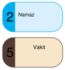
2. **Necasetten Taharet**: Namaz kılınan yeri, bedeni ve elbiseyi temiz tutmak
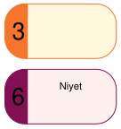
3. **Setriavret**: Namazda vücudun örtülmesi gereken yerlerini örtmek
4. **İstikbalikıble**: Kıbleye yani Kâbe'nin bulunduğu yöne doğru dönmek
5. **Vakit**: Kılınacak namazın vakti içinde olmak
6. **Niyet**: Kılınacak namaza niyet etmek

▲ Bilgi Görseli 2.1: Namazın Hazırlık Şartları

## Abdest

Başta namaz olmak üzere bazı ibadetleri yerine getirmeden önce yapılan dinî temizliktir. Namaz kılmadan önce abdest alınır. Hz. Peygamber, Müslümanlara her zaman abdestli olmayı tavsiye etmiştir. Çünkü abdest maddi temizliğin yanında manevi temizliğe de katkıda bulunur. Namazlardan önce abdest almak Müslümanlara temizlik bilinci ve alışkanlığı kazandırır.$^{18}$ <!-- KONTROL: Marker'da karşılığı yok, uydurma olabilir -->


Abdestin alınışını gösteren video için karekodu kullanabilirsiniz.

### ABDESTİN ALINIŞI

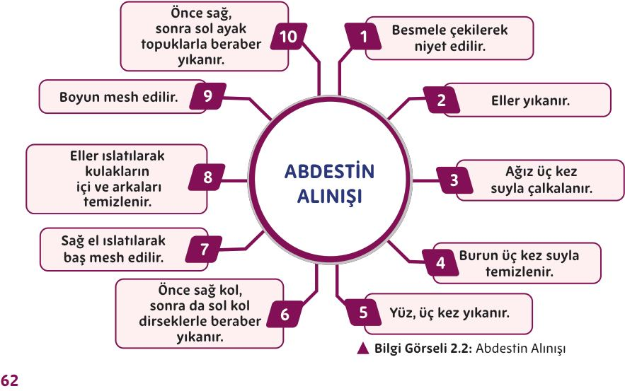
1. Besmele çekilerek niyet edilir.
2. Eller yıkanır.
3. Ağız üç kez suyla çalkalanır.
4. Burun üç kez suyla temizlenir.
5. Yüz, üç kez yıkanır.
6. Önce sağ kol, sonra da sol kol dirseklerle beraber...
7. Sağ el ıslatılarak baş mesh edilir.
8. Eller ıslatılarak kulakların içi ve arkaları temizlenir.
9. Boyun mesh edilir.
10. Önce sağ, sonra sol ayak topuklarla beraber yıkanır.

<!-- sayfa 62 -->

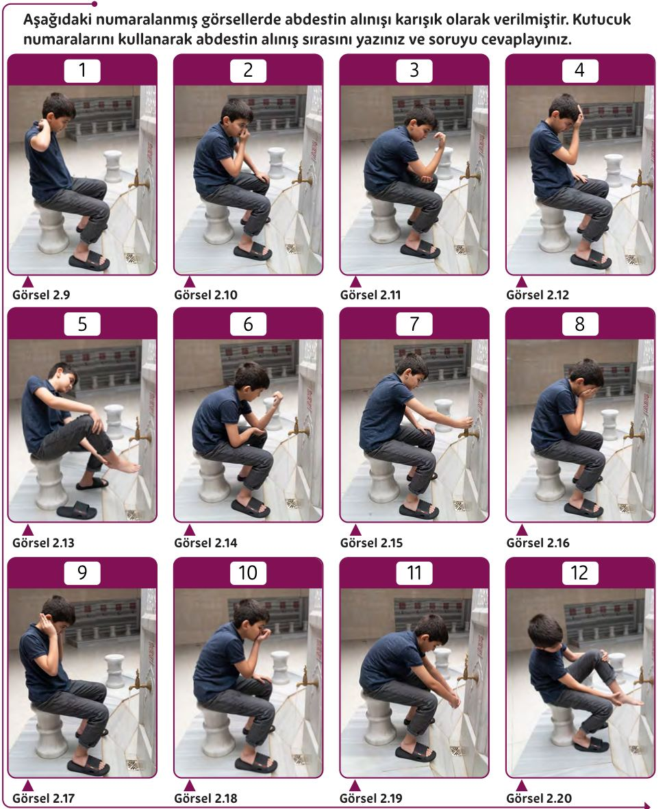

**Etkinlik-4**
15 dk.

| Adı | Abdestin Alınışı |
| :--- | :--- |
| **Amaç** | Abdestin alınışını açıklayabilme |

**Yönerge**


Aşağıdaki numaralanmış görsellerde abdestin alınışı karışık olarak verilmiştir. Kutucuk numaralarını kullanarak abdestin alınış sırasını yazınız ve soruyu cevaplayınız.

| 1 | 2 | 3 | 4 |
| :---: | :---: | :---: | :---: |
| Görsel 2.9 | Görsel 2.10 | Görsel 2.11 | Görsel 2.12 |

| 5 | 6 | 7 | 8 |
| :---: | :---: | :---: | :---: |
| Görsel 2.13 | Görsel 2.14 | Görsel 2.15 | Görsel 2.16 |

| 9 | 10 | 11 | 12 |
| :---: | :---: | :---: | :---: |
| Görsel 2.9* | Görsel 2.10* | Görsel 2.11* | Görsel 2.12* |

*(Not: Görüntüdeki son satırda görsel numaraları metin katmanında hatalı/eksik verilmiş olsa da görsel üzerindeki sıralama takip edilmelidir.)*

<!-- sayfa 63 -->

a) Abdestin alınış sırası

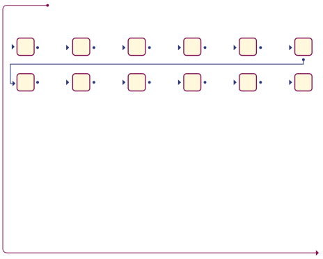

b) Abdest almanın kişisel temizlik ve bakımınıza katkıları nelerdir? Düşüncelerinizi yazınız.


__________________________________________________________________
__________________________________________________________________
__________________________________________________________________
__________________________________________________________________
__________________________________________________________________
__________________________________________________________________
__________________________________________________________________
__________________________________________________________________

# Değerlendirme

1. Abdest almanın kişisel temizlik ve bakımınıza katkılarıyla ilgili bir slogan yazınız.
Örnek: Abdest alıyoruz, temiz yaşıyoruz.
__________________________________________________________________

2. Namaz ile abdest arasındaki ilişkiyi kısaca açıklayınız.
__________________________________________________________________
__________________________________________________________________
__________________________________________________________________
__________________________________________________________________
__________________________________________________________________
__________________________________________________________________

<!-- sayfa 64 -->

# Abdestin Farzları


1. Yüzü yıkamak
2. Elleri ve kolları dirseklerle beraber yıkamak
3. Başı mesh etmek
4. Ayakları, topuklarla birlikte yıkamak

▲ Bilgi Görseli 2.3: Abdestin Farzları

# Abdesti Bozan Başlıca Durumlar


1. Tuvalet ihtiyacını gidermek
2. Yellenmek
3. Ağız dolusu kusmak
4. Bayılmak
5. Uyumak

▲ Bilgi Görseli 2.4 : Abdesti Bozan Başlıca Durumlar

# Gusül


Vücutta kuru yer kalmayacak şekilde tepeden tırnağa yıkanmaya boy abdesti veya **gusül** denir. Akıllı ve ergenlik çağına girmiş her Müslümanın bazı durumlarda boy abdesti alması farzdır. Gusül abdesti almak isteyen bir kimse önce niyet eder. Niyetten sonra üç defa suyla ağzını ve burnunu temizler. Son olarak tüm vücudunu kuru yer kalmayacak şekilde yıkar ve abdestini tamamlar.$^{20}$ <!-- KONTROL: Marker'da karşılığı yok, uydurma olabilir -->

## Guslün Farzları


1. Ağzı suyla çalkalamak
2. Burna su çekmek
3. Bütün vücudu kuru yer kalmayacak şekilde yıkamak

▲ Bilgi Görseli 2.5 : Guslün Farzları

# Teyemmüm

Teyemmüm, suyun bulunmadığı veya kullanılamadığı durumlarda temiz toprak veya toprak cinsinden bir maddeye eller sürülerek alınan abdesttir. Teyemmüm hem abdest hem de gusül yerine alınabilir. Abdesti bozan bir durum olduğunda veya suyu kullanmaya engel olan durum ortadan kalktığında teyemmüm bozulur. İslam dini suyun olmadığı veya kullanılamadığı durumlarda Müslümanların teyemmüm sayesinde abdest alabilmelerine imkân sağlamıştır.$^{19}$ <!-- KONTROL: Marker'da karşılığı yok, uydurma olabilir -->


<!-- yer tutucu bulunamadı: sayfa sonuna eklendi -->

<!-- sayfa 65 -->

# Teyemmümün Alınışı


**Görsel 2.3:** Besmele çekilerek niyet edilir ve eller toprağa sürülür.

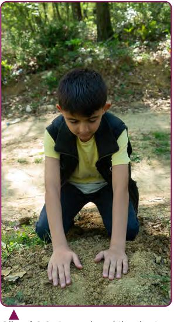
**Görsel 2.4:** Eller silkelenir.


**Görsel 2.5:** Yüz mesh edilir.


**Görsel 2.6:** Eller tekrar toprağa sürülür.


**Görsel 2.7:** Sağ kol dirseklere kadar mesh edilir.


**Görsel 2.8:** Sol kol dirseklere kadar mesh edilir.

# Teyemmümün Farzları

1. Niyet etmek
2. Elleri toprağa sürerek yüzü ve kolları mesh etmek


<!-- sayfa 66 -->

### 2.2.2. Namazın Kılınış Şartları

Namazın hazırlık şartlarını tamamladıktan sonra namaz esnasında uyulması gereken bazı farzlar vardır. Bunlara namazın kılınış şartları denir. Bu şartların ilki namaza tekbirle başlamaktır. Namaz kılarken ayakta durmak ve Kur’an-ı Kerim’den ayetler okumak da namazın farzlarındandır. Daha sonra rükû ve secde yapılmalıdır. Namazın sonunda ise Tahiyyat duasını okuyacak kadar oturulması gerekir. Namazın farzlarından biri eksik olursa namaz geçersiz sayılır. Ayrıca namazda konuşmak, bir şey yiyip içmek, kıble yönünden ayrılmak gibi durumlarda da namaz bozulur ve namazın tekrar kılınması gerekir.$^{21}$ <!-- KONTROL: Marker'da karşılığı yok, uydurma olabilir -->

# NAMAZIN KILINIŞ ŞARTLARI

| 1 | İftitah Tekbiri <br> Namaza "Allahüekber" diyerek başlamak | 2 | Kıyam <br> Namazda ayakta durmak | 3 | Kıraat <br> Namazda Kur'an okumak |
|---|---|---|---|---|---|
| 4 | Rükû <br> Elleri dizlere koyarak eğilmek | 5 | Secde <br> Alnı, burnu, avuç içlerini, dizleri ve ayak parmaklarını yere koyarak kapanmak | 6 | Kadeiahire (Son Oturuş) <br> Namazın sonunda Tahiyyat duasını okuyacak kadar oturmak |

▲ Bilgi Görseli 2.7: Namazın Kılınış Şartları

## Namazın Kılınışı

Akıllı olan ve ergenlik çağına girmiş her Müslüman’ın sabah, öğle, ikindi, akşam ve yatsı vakitlerinde günde beş defa namaz kılması farzdır. Hangi vakitlerde ve nasıl namaz kılınacağını Hz. Muhammed (sav) Müslümanlara öğretmiştir.

Namaz, rekât adı verilen bölümlerden oluşur. Rekât; namazın kıyam, kıraat, rükû ve iki secdeden ibaret her bir bölümüdür. İki rekâtlı bir namazın kılınışını öğrenen bir kimse, genel olarak namaz kılmayı öğrenir.$^{22}$ <!-- KONTROL: Marker'da karşılığı yok, uydurma olabilir --> İki rekâtlı namazın kılınışı, sabah namazının farzı esas alınarak şöyle anlatılabilir:

### Birinci Rekât
#### 1. Namaza başlama

Kıbleye dönülür ve "Niyet ettim Allah rızası için sabah namazının farzını kılmaya." denilerek niyet edilir. Erkekler ellerini kulak hizasına, kadınlar ise omuz hizasına kadar kaldırır. İftitah tekbiriyle yani "Allahüekber (Allah en büyüktür.)" diyerek namaza başlar.


Namaza başlama

<!-- sayfa 67 -->

# 2. Kıyam ve kıraat

Erkekler sağ eli, sol bileği kavrayacak şekilde göbek altında; kadınlar ise sağ eli sol elin üzerine koyarak göğüs üstünde bağlar. Bu şekilde ayakta durmaya “kıyam” denir. Kıyamda sırayla Sübhaneke duası, euzübesmele, Fatiha suresi ve kısa bir sure veya birkaç ayet okunur. Buna da “kıraat” denir.


# 3. Rükû

Kıyam bittikten sonra “Allahüekber” denilerek rükûya gidilir. Rükûda üç kez, “Sübhanne Rabbiye’l-azîm (Yüce olan Rabbim her türlü noksanlıktan münezzehtir.)” denir. “Semiallahü limen hamideh (Allah kendisine hamdedeni işitir.)” denilerek rükûdan kalkılır ve ayakta “Rabbenâ lekelhamd (Rabbimiz hamt senin içindir.)” denir.


# 4. Secde

“Allahüekber” denilerek secdeye varılır. Secdede üç kez “Sübhâne Rabbiye’l-a’lâ (Yüce olan Rabbim her türlü noksanlıktan münezzehtir.)” denir. “Allahüekber” denilerek oturulur. Tekrar “Allahüekber” denilerek secdeye gidilir. İkinci secdede yine üç defa “Sübhâne Rabbiye’l-a‘lâ” denir. “Allahüekber” denilerek ikinci rekât için ayağa kalkılır. Böylece bir rekât tamamlanmış olur.


## İkinci Rekât

Eller birinci rekâttaki gibi bağlanarak kıyamda yani ayakta durulur. Besmele çekilerek Fatiha suresi ile bir sure veya birkaç ayet okunur. Rükû ve secdeler yapılarak oturulur.

<!-- sayfa 68 -->

# 5. Son oturuş
Son oturuşa kadeiahire denir. Son oturuşta sırasıyla Tahiyyat, Salli, Barik ve Rabbena duaları okunur.


Görsel 2.31 Görsel 2.32 Görsel 2.33 Görsel 2.34

# 6. Selam
Baş önce sağa, sonra sola çevrilir ve her seferinde “Esselamü aleyküm ve rahmetullah (Allah'ın selamı ve rahmeti üzerine olsun.)” denilerek selam verilir ve namaz bitirilir.


Görsel 2.35 Görsel 2.36 Görsel 2.37 Görsel 2.38

Kılınacak namaz iki rekâttan fazla ise Tahiyyat duasını okuduktan sonra “Allahüekber” denilerek üçüncü rekâta kalkılır. Besmele çekilip Fatiha suresi okunur. Farz namazlarda Fatiha suresinden sonra başka bir sure veya ayet okunmadan rükû ve secde yapılır.

Akşam namazının farzında üçüncü rekâttan sonra son oturuş ve selam ile namaz bitirilir.

Dört rekâtlı farz namazlarda dördüncü rekât tıpkı üçüncü rekât gibi kılınarak son oturuş ve selam ile namaz tamamlanır.

Sünnet namazlarda ise namazın üçüncü ve dördüncü rekâtında da Fatiha suresinin ardından bir sure veya birkaç ayet okunarak aynı şekilde namaz bitirilir.

İkindi ve yatsı namazının dört rekâtlı sünnetlerinde, diğer namazlardan farklı olarak ilk oturuşta Tahiyyat duasından sonra Salli ve Barik duaları okunur. Üçüncü rekâta kalkınca önce Sübhaneke duası okunur.

<!-- sayfa 69 -->

Vitir namazının üçüncü rekâtının kılınması diğer namazlardan farklıdır. Fatiha suresi ve ek bir sure veya birkaç ayet okunduktan sonra namazın başlangıcında olduğu gibi tekbir getirilir, eller kaldırılarak yeniden bağlanır ve Kunut duaları okunur. Sonrasında diğer namazlarda olduğu gibi rükû, secde, son oturuş ve selamla namaz tamamlanır.


| VAKİTLER | İLK SÜNNET | FARZ | SON SÜNNET | VACİP | TOPLAM |
| :--- | :---: | :---: | :---: | :---: | :---: |
| SABAH | 2 | 2 | - | - | 4 |
| ÖĞLE | 4 | 4 | 2 | - | 10 |
| İKİNDİ | 4 | 4 | - | - | 8 |
| AKŞAM | - | 3 | 2 | - | 5 |
| YATSI | 4 | 4 | 2 | 3 | $10+3$ |

* Yatsı namazından sonra kılınan üç rekâtlık vacip namaz vitir namazıdır.
** Aynı renkle işaretlenmiş namazların kılınışları da aynıdır ancak niyetleri farklıdır.


# Etkinlik-5


| Adı | Haydi Namaza! |
| :--- | :--- |
| **Amaç** | Namazın kılınışını gözlemlemek için hazırlık ve kılınış şartlarını ölçüt olarak açıklayabilme |

## Yönerge
Aşağıdaki adımları takip ederek etkinliği tamamlayınız.

1. Aşağıdaki hikâyede Ali ve arkadaşlarının namaz kılma süreci anlatılmaktadır. Hikâyede bahsedilen namazın hazırlık ve kılınış şartlarını altını çizerek belirleyiniz.

<!-- sayfa 70 -->

# HAYDİ NAMAZA!

Ali birlikte ders çalışmak için arkadaşlarını cumartesi günü evlerine davet etti. Pazartesi sınavlar başlayacaktı. Her sınav döneminde arkadaşlarıyla bir araya gelip özellikle matematik dersine çalışırlardı. Ali’nin matematiği çok iyiydi ve arkadaşlarına yardımcı olmak onu mutlu ediyordu. Cumartesi saat 10’a doğru önce Ayşe ile Zeynep geldi. Sonra beşer dakika arayla Fatma ile Hasan içeri girdi. Aralarına en son katılan yine Mehmet oldu. Hemen ders çalışmaya koyuldular. Ali’nin annesi âdeti olduğu üzere yine poğaçalar, börekler hazırlamıştı. Yarım saatte bir kapıyı tıklayıp bir tabak uzatıyordu. Çocuklar, Zehra teyzelerinin lezzetli ikramlarına asla “Hayır!” diyemezler, hemen teneffüs verip hepsini bir güzel mideye indirirlerdi. Yine öyle yaptılar.

Ders çalışırken zamanın nasıl geçtiği anlaşılmıyordu. Poğaçalar börekleri, pastalar tatlıları kovalarken çalışmaya başlayalı neredeyse üç saat geçmişti. Mahalledeki camiden, çocukların her seferinde dinlemeye doyamadıkları öğle ezanının huzur veren sesi duyuldu. Ali, arkadaşlarına “Öğle ezanı okunuyor, isterseniz abdest alıp camiye gidebiliriz.” dedi. Bu teklif hepsinin hoşuna gitti. Abdestlerini alıp hemen caminin yolunu tuttular. Mehmet caddeden karşıya geçerken bir su birikintisine bastı. Paçasına bir miktar çamur bulaştı. Namaz kıldığı elbisenin temiz olması gerektiğini biliyordu. “Acaba çamurdaki su pis miydi?” diye aklından geçirdi. Hemen şadırvana gidip paçasını temizledi. Mehmet camiye de geç kalmıştı. Herkes sünnete durmuştu. Mehmet’in namaza başlaması da uzun sürdü. Hangi namazı kılacaklarını düşündü bir süre, sonra hatırlayıp niyet etti ve tekbir alıp ellerini göbeğinin üzerine bağladı.

Kızlar, hanımlar için ayrılan bölüme geçmişlerdi. Zeynep, arkadaşlarına uzun kollu hırkalarını giyip başörtülerini örtmeleri gerektiğini daha evdeyken hatırlatmıştı. Ayşe, “Kızlar, bu tarafa doğru namaza durmamız lazım.” diyerek kıbleyi gösterdi. Her işte aceleci olan Fatma hemen “Allahüekber!” diyerek ellerini kaldırıp göğsünün üzerinde bağladı.

Erkeklerden ayaktaki okumayı bitirip ellerini dizlerine koyarak öne doğru ilk eğilen Hasan oldu. Hasan, Fatiha’dan sonra genellikle kısa sureleri okumayı tercih ederdi. Yine öyle yaptı. Dizlerinin üzerine çökerek ellerini ve başını yere koyup üç defa “Sübhâne Rabbiye’l-a’lâ” dedi. Ali son oturuşta Tahiyyat, Salli, Barik ile Rabbena dualarını okudu. Selam verdiğinde müezzin kamete başlamıştı. Farz namazlardan önce namazın başlayacağını duyurmak için kamet getirilir. Kameti duyunca çocuklar aynı safta durarak imama uydular ve farzı cemaatle kıldılar. İki rekâtlık sünneti de kıldıktan sonra cemaatle birlikte tespih çekip dua ettiler.

Camiden çıkıp eve gittiklerinde Zehra Hanım sofrayı kurmuş, çocukları bekliyordu. Sofraya oturdular. Hasan, “Arkadaşlar bugün öğle namazını cemaatle kıldığımız gibi öğle yemeğini de cemaatle yiyoruz.” dedi. Mehmet, “Sadece onlar mı, sabahtan beri derse de cemaatle çalışmıyoruz muyuz?” deyince hep birlikte gülüşerek yemeklerini yemeye koyuldular.

Birlikte yapılan her işin ayrı bir tadının ve bereketinin olduğunu bir kez daha hisseden çocuklar birkaç saat daha ders çalıştılar, ikindi ezanı okunmadan vedalaşıp evlerinin yolunu tuttular.

(Bu metin yazar tarafından bu kitap için oluşturulmuştur)


<!-- yer tutucu bulunamadı: sayfa sonuna eklendi -->

<!-- sayfa 71 -->

2. Belirlediğiniz şartların hangi isimlerle beraber ifade edildiğini tabloda (X) ile işaretleyiniz.

| NAMAZIN ŞARTLARI | ALİ | AYŞE | FATMA | HASAN | MEHMET | ZEYNEP |
| :--- | :---: | :---: | :---: | :---: | :---: | :---: |
| Hadesten Taharet |  |  |  |  |  |  |
| Necasetten Taharet |  |  |  |  |  |  |
| Setriavret |  |  |  |  |  |  |
| İstikbalikıble |  |  |  |  |  |  |
| Vakit |  |  |  |  |  |  |
| Niyet |  |  |  |  |  |  |
| İftitah Tekbiri |  |  |  |  |  |  |
| Kıyam |  |  |  |  |  |  |
| Kıraat |  |  |  |  |  |  |
| Rükû |  |  |  |  |  |  |
| Secde |  |  |  |  |  |  |
| Kadeiahire |  |  |  |  |  |  |

## Değerlendirme

Namazın hazırlık ve kılınış şartlarını kısaca açıklayınız.
__________________________________________________________________
__________________________________________________________________
__________________________________________________________________
__________________________________________________________________
__________________________________________________________________
__________________________________________________________________
__________________________________________________________________
__________________________________________________________________
__________________________________________________________________


<!-- yer tutucu bulunamadı: sayfa sonuna eklendi -->

<!-- sayfa 72 -->

**Etkinlik-6**
15 dk.

| Adı | Namazın Vakitleri, Rekât Sayıları ve Kılınışı |
| :--- | :--- |
| **Amaç** | Namazın kılınışı hakkında topladığı bilgileri sınıflandırıp kaydedebilme |

## Yönerge

Aşağıdaki adımları takip ederek etkinliği tamamlayınız.

1. Aşağıdaki şemayı doldurunuz.


*   İki rekâtlık namazlar $\rightarrow$ 
*   Üç rekâtlık namazlar $\rightarrow$ 
*   Dört rekâtlık namazlar $\rightarrow$ 
*   Beş vakit namazın rekât sayıları $\rightarrow$
    *   ______ / ______ rekâttır.
    *   ______ / ______ rekâttır.
    *   ______ / ______ rekâttır.
    *   ______ / ______ rekâttır.
    *   ______ / ______ rekâttır.
*   **NAMAZ** (Merkez)
    *   Öğle namazının son sünnetinin kılınışı $\rightarrow$ 


2. Sıra arkadaşınızla eşleşiniz ve tamamladığınız şemayı karşılaştırınız.

## Değerlendirme

Tamamladığınız şemayı öğretmeninizin rehberliğinde değerlendiriniz. Eksiklerinizi tamamlayınız.

<!-- sayfa 73 -->

# Cemaatle Namaz

Namaz, hem tek başına hem de *cemaatle* kılınabilir. Ancak farz namazların cemaatle kılınması daha faziletlidir. İslam’da, birlik ve beraberliğin sağlanması için namazların cemaatle kılınması önemsenmiş hatta bazı namazları cemaatle kılmak emredilmiştir. Mesela cuma ve bayram namazlarının camilerde cemaatle kılınması gerekir. Farz namazların cemaatle kılınmasıyla ilgili Hz. Muhammed (sav) şöyle buyurmuştur:

“*Cemaatle kılınan namaz, tek başına kılınan namazdan yirmi yedi kat daha faziletlidir.*”$^{23}$ <!-- KONTROL: Marker'da karşılığı yok, uydurma olabilir --> Nafile namazlar genellikle tek başına kılınır. Ancak ramazan ayına has bir sünnet olan teravih namazını Müslümanlar cemaatle kılmayı tercih ederler.


Cuma günü, Müslümanlar için haftalık bir bayram ve buluşma günüdür. Cuma günü öğle vakti geldiğinde akıllı, ergenlik çağına gelmiş, sağlıklı, hür ve yolculuk hâlinde bulunmayan Müslüman erkeklerin camilerde toplanarak cuma namazını kılmaları farzdır.$^{24}$ <!-- KONTROL: Marker'da karşılığı yok, uydurma olabilir -->

Cuma namazı; dört ilk sünnet, iki farz ve dört de son sünnet olmak üzere toplam on rekâttır. Cuma namazının ilk sünnetinden sonra camide iç ezan okunur. İç ezan bittikten sonra imam minbere çıkar ve cuma namazının farzlarından biri olan hutbeyi okur.

Hutbe haftalık bir ders gibidir. Hutbede gündemle ilgili ayet ve hadisler okunarak cemaati aydınlatıcı bilgiler verilir. Hutbeden sonra müezzin kamet getirir ve imam cemaate cumanın iki rekâti̇klık farzını kıldırır. Dört rekâtlık son sünnet kılınarak cuma namazı tamamlanır.

---

**cemaat**
“İnsan topluluğu” demektir. Namazda imama uymak üzere bir araya gelen insanları ifade eder.
(bk. Sürmeli vd., “cemaat”, 47)

**teravih namazı**
Teravih, sadece ramazan ayında kılınan bir namazdır. Ramazan ayı boyunca yatsı namazının son sünnetinden sonra, vitir namazından önce kılınır.
(bk. Sürmeli vd., “teravih namazı”, 361)

**Görsel 2.39:** Ramazan ayı boyunca camilerde yatsı namazlarından sonra teravih namazı kılınır.


> “Ey iman edenler! Cuma günü namaz için çağrı yapıldığı zaman, hemen Allah’ın zikrine koşun ve alışverişi bırakın. Eğer bilirseniz bu sizin için daha hayırlıdır.”
> (Cuma suresi 9. ayet)

<!-- sayfa 74 -->

Müslümanların her yıl kutladıkları Ramazan ve Kurban Bayramları, onlar için mutluluk ve sevinç günleridir. Müslümanlar, bayramın ilk günü güneş doğduktan en az kırk beş dakika sonra camilerde toplanarak bayram namazını kılar. Bayram namazından sonra imam tarafından hutbe okunur. Namaz sonrası cemaat birbiriyle bayramlaşır.$^{25}$ <!-- KONTROL: Marker'da karşılığı yok, uydurma olabilir -->

Cemaatle kılınan namazlardan biri de cenaze namazıdır. Vefat eden Müslümanlar defnedilmeden önce cenaze namazı kılınarak onlar için dua edilir. Hz. Peygamber cenaze namazının Müslüman topluluğun üzerine düşen bir sorumluluk olduğunu ifade etmiştir. Müslümanlardan bir kısmının bu namazı kılmasıyla diğerlerinin üzerinden sorumluluk kalkmış olur. Bu namaz rükû ve secde yapılmadan sadece kıyamda durularak kılınan tek namazdır.

# Etkinlik-7

15 dk.

**Adı:** Namazı Bul Bakalım
**Amaç:** Namazın kılınışı hakkında topladığı bilgileri sınıflandırarak kaydedebilme

## Yönerge
*Aşağıdaki adımları takip ederek etkinliği tamamlayınız.*


1. Aşağıdaki tabloda hakkında bilgi verilen namazların isimlerini boş bırakılan yere yazınız.

| Namaz Hakkında Bilgi | Namazın Adı |
| :--- | :--- |
| 1 Haftada bir kere erkeklerin cemaatle kılması farz olan namazdır. | |
| 2 Güneş doğmadan önce kılınması gereken namazdır. | |
| 3 Ramazan ayına has olarak yatsıdan sonra kılınan namazdır. | |
| 4 Yılda iki defa cemaatle kılınan namazdır. | |
| 5 Her gün kılınan, üç rekâtlı vacip bir namazdır. | |
| 6 Vefat eden kişiye dua etmek maksadıyla kılınan namazdır. | |

2. Adını yazdığınız namazları cemaatle kılınması zorunlu olanlar ve olmayanlar şeklinde sınıflandırarak aşağıdaki tabloya yazınız.

| Cemaatle Kılınması Zorunlu Olan Namazlar | Cemaatle Kılınması Zorunlu Olmayan Namazlar |
| :--- | :--- |
| ______________________________<br>______________________________<br>______________________________ | ______________________________<br>______________________________<br>______________________________ |

<!-- sayfa 75 -->

# Değerlendirme

Cemaatle kılınması zorunlu olmayan namazlara, tabloya yazdıklarınızdan farklı örnekler veriniz.

__________________________________________________________________
___________________________________________________________________

# Kontrol Noktası

**A. Aşağıdaki tabloda namazın hazırlık şartlarının başına (H), kılınış şartlarının başına (K) yazınız.**

| No | | Şart | No | | Şart |
| :--- | :--- | :--- | :--- | :--- | :--- |
| 1 | [ ] | Setriavret | 7 | [ ] | Secde |
| 2 | [ ] | Niyet | 8 | [ ] | Kıyam |
| 3 | [ ] | İftitah Tekbiri | 9 | [ ] | Necasetten Taharet |
| 4 | [ ] | Rükû | 10 | [ ] | İstikbalikıble |
| 5 | [ ] | Hadesten Taharet | 11 | [ ] | Vakit |
| 6 | [ ] | Kadeiahire (Son Oturuş) | 12 | [ ] | Kıraat |

**B. Aşağıdaki tabloda namazla ilgili bazı bilgiler verilmiştir. Bu bilgileri okuyunuz ve doğru olanların başına (D), yanlış olanların başına (Y) yazınız. Yanlış olan ifadelerin altındaki boşluklara doğrusunu yazınız.**

1. [ ] Vefat eden Müslümanların cenaze namazı, defin işleminden önce kılınır.
___________________________________________________________________
___________________________________________________________________

2. [ ] Ramazan Bayramı boyunca kılınan bütün namazlara bayram namazı denir.
___________________________________________________________________
___________________________________________________________________

3. [ ] Akşam namazının farzı üç rekâttır.
___________________________________________________________________
___________________________________________________________________

4. [ ] Hadesten taharet, abdest alınarak yerine getirilir.
___________________________________________________________________
___________________________________________________________________

5. [ ] Gusül, suyun bulunmadığı veya kullanılamadığı yerde toprakla alınan abdesttir.
___________________________________________________________________
___________________________________________________________________


<!-- yer tutucu bulunamadı: sayfa sonuna eklendi -->

<!-- sayfa 76 -->

6 | Cuma namazının cemaatle kılınması şarttır.
  | __________________________________________________________________________

7 | Sabah namazının farzı dört rekâttır.
  | __________________________________________________________________________

8 | İftitah tekbiri, namaza başlarken elleri kulak hizasına kaldırıp "Allahüekber" demektir.
  | __________________________________________________________________________

9 | Elleri ve kolları dirseklerle beraber yıkamak abdestin farzlarından biridir.
  | __________________________________________________________________________

10 | Vitir namazı cemaatle kılınması gereken farz bir namazdır.
  | __________________________________________________________________________

# 2.3. NAMAZ İBADETİNİN İNSANA KAZANDIRDIKLARI

## Konuya Başlarken 

> İnsan namaz sayesinde kendisini yaratan Yüce Allah’a şükreder. Rabbinin kendisini her zaman, her yerde gördüğünün bilincinde olur. Kötülüklerden sakınmaya ve daima iyilik yapmaya çalışır. Allah'a (cc) dua ederek O'nun yardımını yanında hisseder. Peki, sizce insan niçin namaz kılar?


İnsan, günlük hayatın telaşı içinde varlık amacını unutabilir. Beş vakit namaz insanı varoluş amacı hakkında düşünmeye sevk eder. Namaz, günün belli vakitlerinde Yüce Allah’ın huzuruna çıkan insanın kulluk bilincini canlı tutmasını sağlar. Onun kötülüklerden uzaklaşmasına katkıda bulunur. Manevi arınma yanında abdest sayesinde insan, maddi olarak da temizlenir. Namazlardan önce abdest alan kişi düzenli bir temizlik alışkanlığı kazanır.

Namaz sayesinde insan kulluk görevini yerine getirmiş olmanın huzurunu yaşar. Namaz kılan insan Allah (cc) ile iletişim kurarak dua ve isteklerini doğrudan Rabbine iletir. Namaz, kişiye sevap kazandırır ve onun Allah (cc) katındaki kıymetini artırır. Bu ibadet, kişinin Allah'a (cc) olan bağlılığını pekiştirir. Namaz kılmak, Müslümanların manevi dünyalarını zenginleştirir ve onlara hayatın zorlukları karşısında dayanma gücü ve sabır verir.

Kur'an-ı Kerim'de beş vakit namaza devam edildiği takdirde iki namaz arasındaki küçük günahların silineceği ifade edilir.$^{26}$ <!-- KONTROL: Marker'da karşılığı yok, uydurma olabilir --> Hz. Peygamber de farz namazları insanın evinin önünden akıp giden bir ırmağa, namaz kılmayı da bu ırmakta her gün beş defa yıkanmaya benzetmiştir. Günde beş defa yıkanan kimsede kir kalmayacağı gibi beş vakit namaz kılan kimsenin de günahlarından arınacağını belirtmiştir.$^{27}$ <!-- KONTROL: Marker'da karşılığı yok, uydurma olabilir -->

<!-- sayfa 77 -->


**Görsel 2.40:** Namaz kılmak manevi dünyamızı zenginleştirir.

Kur’an-ı Kerim'de namazın, insanı her türlü kötülükten uzaklaştıracağı şu ifadelerle bildirilir: **“(Resul’üm!) Sana vahyedilen kitabı oku ve namazı dosdoğru kıl. Şüphe yok ki namaz, hayâsızlıktan ve kötülükten alıkoyar...”$^{28}$ <!-- KONTROL: Marker'da karşılığı yok, uydurma olabilir -->** Günde beş vakit kılınan namaz, insanı disiplinli olmaya, zamanı iyi kullanmaya ve düzenli yaşamaya alıştırır. Namaz, müminin Yüce Allah'a yaklaşmasını sağlayan en önemli vesiledir. Secde de Hz. Peygamber'in ifadesiyle kulun Allah'a (cc) en yakın olduğu andır.$^{29}$ <!-- KONTROL: Marker'da karşılığı yok, uydurma olabilir -->

İslam, cemaate büyük önem verir. Bu yüzden Müslümanlar, tarih boyunca şehirlerini bir araya gelip ibadet ettikleri camilerin etrafında kurmuşlardır. Camilerde tolan Müslümanlar birbirleriyle tanışır hem birlikte ibadet eder hem de üzüntü ve sevinçlerini paylaşırlar. Aynı safta omuz omuza vererek Allah (cc) katında eşit olduklarının bilincine ulaşırlar. Böylece müminler arasındaki ırk, renk, dil, sosyal statü gibi ayrımlar ortadan kalkar. Allah'a (cc) kulluk için aynı safta buluşan Müslümanlar arasında kardeşlik bilinci gelişir, yardımlaşma ve dayanışma artar. Bayramlarda camilerde buluşup bayramlaşır, cenazelerde birbirlerinin acısını paylaşırlar. Olağanüstü veya zor durumlarda da Müslümanlar burada toplanarak sorunlara çözüm üretirler. Mağdur ve muhtaçlar için yardım toplarlar. Hutbeler ve vaazlar sayesinde Müslümanlar bilgilenmiş olur. Çocuklar camilere giderek Kur'an okumayı öğrenir. Bu yüzden camiler, Müslümanlar için hayatın merkezinde...

<!-- sayfa 78 -->

# Etkinlik-8
30 dk.

| Adı | Namazın İnsana Kazandırdıkları |
| :--- | :--- |
| **Amaç** | Namazın insana kazandırdıkları hakkında analitik düşünebilme |

## Yönerge
Aşağıdaki adımları takip ederek etkinliği tamamlayınız.

### DÜŞÜN
Aşağıdaki soruların cevaplarını düşününüz.

Namaz kılan insan günde beş vakit Yüce Allah’ın huzuruna çıkar ve kulluk görevini yerine getirir.


1. Namaz kılan bir insanın diğer insanlara karşı davranışları sizce nasıl olmalıdır? Örnek vererek açıklayınız.

2. Namaz kılan bir insanın diğer canlılara karşı davranışları sizce nasıl olmalıdır? Örnek vererek açıklayınız.

3. Namaz kılan bir insan kendisini sizce nasıl hisseder? Örnek vererek açıklayınız.

4. Sizce namaz kılmak insanın gününü planlamasını nasıl etkiler? Örnek vererek açıklayınız.

5. Namaz kılan insanlardan oluşan bir topluluğun özellikleri sizce neler olmalıdır?


### EŞLEŞ
Sıra arkadaşınızla eşleşerek cevaplarınızı tartışınız.
____________________________________________________________________________________________________
____________________________________________________________________________________________________
____________________________________________________________________________________________________
____________________________________________________________________________________________________

### PAYLAŞ
Sıra arkadaşınızla ortak cevaplarınızı sınıfla paylaşınız.
____________________________________________________________________________________________________
____________________________________________________________________________________________________
____________________________________________________________________________________________________

<!-- sayfa 79 -->

# Değerlendirme

Sınıf arkadaşlarınızla yaptığınız tartışmadan yola çıkarak namaz kılmanın insana kazandırdıklarıyla ilgili düşüncelerinizi örnekteki gibi açıklayınız.

**Örnek:**
Namaz kılmak insanın ahlakını güzelleştirir. Namaz kılan insan, Allah'ın (cc) huzurunda olduğu bilinciyle davranışlarına çekidüzen verir.

_______________________________________________________________
_______________________________________________________________
_______________________________________________________________
_______________________________________________________________
_______________________________________________________________
_______________________________________________________________
_______________________________________________________________
_______________________________________________________________
_______________________________________________________________
_______________________________________________________________


# Kontrol Noktası

Namaz ibadetinin insana kazandırdıklarıyla ilgili aşağıdaki şemayı doldurunuz.


<!-- sayfa 80 -->

# 2.4. BİR DUA ÖĞRENİYORUM: TAHİYYAT DUASI

## Konuya Başlarken


Çocukların öğrendikleri ilk dualardan biri Tahiyyat duasıdır. Bu dua, İslam’ın temel esaslarının başında gelen kelimeişehadet ile biter. Tahiyyat duası hakkında neler biliyorsunuz?

Tahiyyat, “her türlü eksiklikten uzak olma ve kusursuzluk durumu, selamlama, sağlık ve esenlik temennisi” anlamlarına gelir.$^{31}$ <!-- KONTROL: Marker'da karşılığı yok, uydurma olabilir --> Tahiyyat duası namazlarda oturduğumuz zaman okunan bir duadır. Bu dua, Yüce Allah’a selam ve övgü ile başlar. Daha sonra Hz. Peygamber’e rahmet, bereket ve esenlik dileğiyle devam eder. Bütün müminlerin ve salih kulların selamlandığı dua, kelimeişehadet ile biter.

Hz. Peygamber, Tahiyyat duasını namazlarda okumuş ve okunuşunu Kur’an’dan bir sure öğretir gibi ashabına öğretmiştir.$^{32}$ <!-- KONTROL: Marker'da karşılığı yok, uydurma olabilir --> Bir hadiste “Selam (esenlik veren), bizzat Allah’ın (cc) kendisidir. Onun için namazda oturduğunuz vakit Tahiyyat’ı okuyun. Tahiyyat’ın sonundaki ‘Selam bize ve Allah’ın (cc) salih kullarına olsun.’ kısmını okuduğunuzda yerde ve gökte bulunan bütün varlıkları selamlamış olursunuz...”$^{33}$ <!-- KONTROL: Marker'da karşılığı yok, uydurma olabilir --> buyurmaktadır. Tahiyyat duasıyla Müslümanlar her gün beş vakit namazda selamlaşmanın önemini hatırlar. Müslümanlar namazlarında Tahiyyat duasını okuyarak Allah’ı (cc), O’nun salih kullarını ve bütün varlıkları selamlamış olurlar.


### Tahiyyat Duası

الَّتَّحِيَّاتُ لِلّٰهِ وَالصَّلَوَاتُ وَالطَّيِّبَاتُ
السَّلَامُ عَلَيْكَ أَيُّهَا النَّبِيُّ وَرَحْمَةُ اللّٰهِ وَبَرَكَاتُهُ
السَّلَامُ عَلَيْنَا وَعَلَى عِبَادِ اللّٰهِ الصَّالِحِينَ
أَشْهَدُ أَنْ لَا إِلٰهَ إِلَّا اللّٰهُ وَأَشْهَدُ أَنَّ مُحَمَّدًا عَبْدُهُ وَرَسُولُهُ

| Okunuşu | Anlamı |
| :--- | :--- |
| Ettehiyyâtü / Lillâhi / Vessalavâtü / Vettayyibât | Selam, rahmet ve bütün güzellikler, iyilikler Allah içindir. |
| Esselâmü aleyke / Eyyühennebiyyü / Veraḥmetullâhi ve berekâtuh | Ey Peygamber! Allah’ın rahmeti, bereketi ve selamı senin üzerine olsun. |
| Esselâmu aleynâ / Ve alâ ibâdillâhissâliḥîn | Selam, bize ve Allah’ın iyi kullarının üzerine olsun. |
| Eşhedü ellâ ilâhe illallâh / Ve eşhedü enne Muḥammeden abdühû ve rasûlüh | Tanıklık ederim ki Allah’tan başka ilah yoktur. Yine tanıklık ederim ki Muhammed O’nun kulu ve elçisidir. |

Tahiyyat duasını dinlemek için karekodu

<!-- sayfa 81 -->

# Etkinlik-9
 15 dk. 

| Adı | Tahiyyat Duası |
| :--- | :--- |
| **Amaç** | Tahiyyat duasını ve bu duanın anlamını okuyarak yorumlayabilme |

## Yönerge

1. Tahiyyat duasının anlamını okuyunuz.
2. Bu duanın içerdiği mesajlarla ilgili düşüncelerinizi arkadaşlarınızla paylaşınız.
3. Aşağıdaki satıra Tahiyyat duasının sizin için ne anlam ifade ettiğini bir cümleyle özetleyiniz.

__________________________________________________________
__________________________________________________________


## Değerlendirme

Tahiyyat duasından ne anlıyorsunuz? Yazınız.

____________________________________________________________
_____________________________________________________________
_____________________________________________________________


# Kontrol Noktası


Aşağıdaki ifadelerden Tahiyyat duası içinde yer alanların önündeki kutuyu (X) ile işaretleyiniz.

| | | | |
| :---: | :---: | :--- | :--- |
| 1 | [ ] | Selam, rahmet ve bütün güzellikler, iyilikler Allah içindir. | |
| 2 | [ ] | Allah'ım! Sen eksik sıfatlardan pak ve uzaksın. | |
| 3 | [ ] | Selam, bize ve Allah’ın iyi kullarının üzerine olsun. | |
| 4 | [ ] | Seni daima böyle tenzih eder ve överim. | |
| 5 | [ ] | Senin adın mübarektir. Varlığın her şeyden üstündür. | |
| 6 | [ ] | Ey Peygamber! Allah'ın rahmeti, bereketi ve selamı senin üzerine olsun. | |
| 7 | [ ] | Şüphesiz övülmeye layık yalnız sensin, şan ve şeref sahibi de sensin. | |

<!-- sayfa 82 -->

# 2. ÜNİTE PERFORMANS GÖREVİ

| Amaç | Görev |
| :--- | :--- |
| • Namaz ibadetini özetleyebilme<br>• Namazın kılınışını gözlemleyebilme<br>• Namazın insan hayatına etkileri hakkında analitik düşünebilme | Bu çalışmadaki göreviniz, namaz konulu bir dergi hazırlamaktır. |

| Beceriler | Ürün |
| :--- | :--- |
| • Özetleme<br>• Gözlemleme<br>• Dinî Konularda Analitik Düşünme | Dergi |

| Puanlama Yöntemi | Süre |
| :--- | :--- |
| Dereceli Puanlama Anahtarı ve Öz Değerlendirme Formu | Hazırlık: 2 hafta<br>Sınıf İçi Performans: 40 dakika |

## Yönerge

### Hazırlık Aşaması

1. Namaz hakkında hazırlayacağınız dergide yer alacak konuları ve yazı türlerini belirleyiniz.
2. Namaz ibadetinin önemi, namazın hazırlık ve kılınış şartları, namazın bireysel ve toplumsal faydaları gibi konularda yazı, inceleme, şiir, hikâye, röportaj vb. metinler kaleme alınız.

### Sınıf İçi Performans Aşaması

3. İki hafta boyunca hazırladığınız yazıları kullanarak derginizi oluşturunuz.
4. Derginizin düzenli ve özenli olmasına dikkat ediniz.

## Değerlendirme Ölçütleri

Bu çalışmada ortaya koyduğunuz ürün aşağıdaki ölçütlere göre değerlendirilecektir.

• **Özetleme:** Topladığı bilgileri çözümleyerek sınıflandırma ve kendi cümleleriyle ifade etme
• **Gözlemleme:** Ölçüt belirleyerek bilgi toplama ve topladığı bilgileri sınıflandırarak kaydetme
• **Dinî Konularda Analitik Düşünme:** Konuyla ilgili ulaşılan sonuçları gerekçeleriyle belirleme
• **İçerik:** Yönergede istenen bilgilere yer verme
• **Tasarım:** Dergiyi görsel açıdan zengin, dikkat çekici ve özenli hazırlama

<!-- sayfa 83 -->

# DERECELİ PUANLAMA ANAHTARI

| Ölçütler | Geliştirilmesi gerekir. (1) | Kabul edilebilir. (2) | Başarılı (3) | Puan |
| :--- | :--- | :--- | :--- | :--- |
| Özetleme | Namaz ibadetiyle ilgili çözümleme yaparak namazı farz, vacip ve nafile olarak sınıflandırmış ancak namaz ibadetinin önemini kendi cümleleri ile aktaramamıştır. | Namaz ibadetiyle ilgili çözümleme yaparak namazı farz, vacip ve nafile olarak sınıflandırmış ve namaz ibadetinin önemini kendi cümleleri ile kısmen aktarmıştır. | Namaz ibadetiyle ilgili çözümleme yaparak namazı farz, vacip ve nafile olarak sınıflandırmış ve namaz ibadetinin önemini kendi cümleleri ile aktarmıştır. | |
| Gözlemleme | Namazın hazırlık ve kılınış şartları net olarak açıklanamamış ve gözlemlere ilişkin açıklamalarla desteklenmemiştir. Namazın kılınışı hakkındaki bilgiler sınıflandırılarak farklı biçimlerde metinlerle (deneme, hikâye, şiir, inceleme, röportaj vb.) kaydedilememiştir. | Namazın hazırlık ve kılınış şartları kısmen açıklanmış ve gözlemlere ilişkin açıklamalarla desteklenmiştir. Namazın kılınışı hakkındaki eksiksiz ve doğru bilgiler sınıflandırılarak farklı biçimlerde metinlerle (deneme, hikâye, şiir, inceleme, röportaj vb.) kaydedilmiştir. | Namazın hazırlık ve kılınış şartları net olarak açıklanmış ve gözlemlere ilişkin açıklamalarla desteklenmiştir. Namazın kılınışı hakkındaki eksiksiz ve doğru bilgiler sınıflandırılarak farklı biçimlerde metinlerle (deneme, hikâye, şiir, inceleme, röportaj vb.) kaydedilmiştir. | |
| Dinî Konularda Analitik Düşünme | Namaz ile namazın insan hayatına yansımalarını ilişkilendirmiş ve bu konuda akıl yürütmüştür. Akıl yürütme ile ulaştığı çıkarımları tartışamamış ve namazın insana kazandırdıklarını gerekçeleriyle belirleyememiştir. | Namaz ile namazın insan hayatına yansımalarını ilişkilendirmiş ve bu konuda akıl yürütmüştür. Akıl yürütme ile ulaştığı çıkarımları tartışmıştır ancak namazın insana kazandırdıklarını gerekçeleriyle belirleyememiştir. | Namaz ile namazın insan hayatına yansımalarını ilişkilendirmiş ve bu konuda akıl yürütmüştür. Akıl yürütme ile ulaştığı çıkarımları tartışmış ve namazın insana kazandırdıklarını gerekçeleriyle belirlemiştir. | |
| İçerik | Hazırlanan dergide yönergede istenen bilgilerden en az üçü eksiktir. Fotoğraf kullanılmamıştır. | Namazın insana kazandırdıklarıyla ilgili araştırma yapılmış ve ulaşılan bilgilere yer verilmiştir. Ancak bu bilgilerden yapılan çıkarımlar yetersizdir. | Hazırlanan dergide yönergede istenen bilgiler tamamlanmıştır. Fotoğraflar içeriğe uygundur. | |
| Tasarım | Dergi görsel açıdan zengin, dikkat çekici ve özenli hazırlanmamıştır. | Dergi görsel açıdan zengindir. Ancak içerik dikkat çekici ve özenli hazırlanmamıştır. | Dergi görsel açıdan zengindir. İçeriği dikkat çekici ve özenli hazırlanmıştır. | |
| | | | | |
| **TOPLAM** | | | | |


<!-- yer tutucu bulunamadı: sayfa sonuna eklendi -->

<!-- sayfa 84 -->

# ÖZ DEĞERLENDİRME FORMU


| İFADELER | EVET | KISMEN | HAYIR |
| :--- | :---: | :---: | :---: |
| 1. Dergiyi hazırlamadan önce konuyla ilgili hazırlık yaptım. | | | |
| 2. Çalışma süresince ilgili ve istekliydim. | | | |
| 3. Elde ettiğim bilgileri doğru şekilde kaydettim. | | | |
| 4. Çalışmayı zamanında tamamladım. | | | |
| 5. Çalışmam sırasında namaz hakkında yeni bilgiler edindim. | | | |


**Açıklama:** Aşağıdaki soruları, çalışmayla ilgili görüşlerinizi dikkate alarak cevaplayınız.

1. Çalışma sırasında şu bilgileri öğrendim:
_______________________________________________________________
_______________________________________________________________

2. Çalışma sırasında şu kısımlarda zorlandım:
_______________________________________________________________
_______________________________________________________________

3. Çalışmayı yeniden yapacak olsaydım şunlara dikkat ederdim:
_______________________________________________________________
_______________________________________________________________

Öğretmenin Yorumu:
_______________________________________________________________
_______________________________________________________________
_______________________________________________________________
_______________________________________________________________

<!-- sayfa 85 -->

# ÜNİTE SONU ÖLÇME VE DEĞERLENDİRME SORULARI

Aşağıdaki 1 ve 2. soruyu bilgi görseline göre cevaplayınız.

[QR KOD]
Üniteyle İlgili
Daha Fazla Soru


NAMAZIN FARZLARI
- NAMAZIN HAZIRLIK ŞARTLARI
- NAMAZIN KILINIŞ ŞARTLARI

| NAMAZIN HAZIRLIK ŞARTLARI | NAMAZIN KILINIŞ ŞARTLARI |
| :--- | :--- |
| 1. Hadesten Taharet (abdest veya gerekliyse gusül alarak namaza hazırlanmak) | 1. İftitah Tekbiri (namaza “Allahüekber” diyerek başlamak) |
| 2. Necasetten Taharet (namaz kılınan yeri ve elbiseyi temiz tutmak) | 2. Kıyam (namazda ayakta durmak) |
| 3. Setriavret (namazda vücudun örtülmesi gereken yerlerini örtmek) | 3. Kıraat (namazda Kur’an okumak) |
| 4. İstikbalikıble (kıbleye yönelmek) | 4. Rükû (elleri dizlere koyarak eğilmek) |
| 5. Vakit (kılınacak namazın vakti içinde olmak) | 5. Secde (alın, burun, dizler ve elleri yere koyarak kapanmak) |
| 6. Niyet (kılınacak namaza niyet etmek) | 6. Kadeiahire (namazın sonunda Tahiyyat duasını okuyacak kadar oturmak) |

1. **Bu bilgi görseline göre aşağıdaki ifadelerden hangilerine ulaşılabilir? İşaretleyiniz.**

$\square$ a. Namazın farzları iki başlık altında ele alınır.
$\square$ b. Namaza hazırlık şartlarından bazıları yerine getirilmeden de namaz kılınabilir.
$\square$ c. Namazın kılınış şartlarının tamamı yerine getirilmelidir.
$\square$ ç. Namaza “Sübhanallah” denilerek başlanır.
$\square$ d. Rükû sırasında eller ve alın yere koyulur.
$\square$ e. Kılınacak namazın vakti girmiş olmalıdır.
$\square$ f. Namaz kılarken kıbleye yani Mescid-i Aksa’ya doğru dönmek gerekir.
$\square$ g. Namaz kılınan yerin ve kılan kişinin kıyafetinin temiz olması şarttır.
$\square$ ğ. Namazda Kur’an okumak farzdır.
$\square$ h. Namazda ayakta durmak kıyam kavramıyla ifade edilir.
$\square$ ı. Abdest alma imkânı olmayanlar, abdestsiz olarak da namaz kılabilirler.
$\square$ i. Namazın sonunda Tahiyyat duasını okuyacak kadar oturmak farzdır.
$\square$ j. Setriavret, kılınacak namaza niyet etmektir.

<!-- sayfa 86 -->

2. **Bu bilgi görselinden hareketle namazla temizlik arasındaki ilişkiyi kısaca açıklayınız.**
________________________________________________________________
________________________________________________________________
________________________________________________________________
________________________________________________________________
_________________________________________________________________

> Aşağıdaki kutucuklarda namazla ilgili bazı kavramlar verilmiştir. 3-8. soruları kutucuklardaki harfleri kullanarak cevaplayınız. Aynı kutucuğu birden fazla soru için kullanabilirsiniz.

| a <br> Kıyam | b <br> Secde | c <br> Teravih |
| :--- | :--- | :--- |
| ç <br> Niyet | d <br> Vitir | e <br> Rükû |
| f <br> Teheccüt | g <br> Cuma | ğ <br> İkindi |
| h <br> Kıraat | ı <br> Yatsı | i <br> Vakit |

3. **Namazın farzlarıyla ilgili ifadeler hangileridir?**
_________________________________________________________________

4. **Farz namazlar hangileridir?**
_________________________________________________________________

5. **Nafile namazlar hangileridir?**
_________________________________________________________________

6. **Namaz isimleri hangileridir?**
_________________________________________________________________

7. **Namazın hazırlık şartları hangileridir?**
_________________________________________________________________

8. **Namazın kılınış şartları hangileridir?**
_________________________________________________________________


<!-- yer tutucu bulunamadı: sayfa sonuna eklendi -->

<!-- sayfa 87 -->

Aşağıdaki 9, 10 ve 11. soruları metinden yararlanarak cevaplayınız. Cevapları boş bırakılan alanlara yazınız.

Namaz, ilk insandan itibaren emredilen bir ibadettir. Çünkü namaz, kulluğun özü ve esasıdır. Namazsız kulluk mümkün değildir. Namaz; Allah’ı (cc) anma, O’nu yüceltme, kıraat, dua, tekbir, tespih, şükür ve saygı başta olmak üzere pek çok ibadeti içinde barındırır. Namaz; dinin direği, müminin miracı, imanın göstergesidir. Namaz, ilk emredilen ve ahirette de sorgusu ilk yapılacak olan ibadettir. Namaz; insanı kötülüklerden ve haramlardan alıkoyar, kişinin hayatına çekidüzen vermesini sağlar. Özellikle cemaatle kılınan namazlar, sosyal kaynaşma ve dayanışmayı kuvvetlendirir, birlik ve beraberliği pekiştirir. Namaz, maddi ve manevi arınmaya vesile olur. Kur’an’da namaz kılınması emredilmiş, Hz. Peygamber de bu emri uygulayarak Müslümanlara örnek olmuştur.

9. Bu parçaya uygun olacağını düşündüğünüz bir başlık yazınız.
________________________________________________________________
________________________________________________________________
_________________________________________________________________

10. Namazın bir müminin hayatındaki yeri ne olmalıdır? Gerekçeleriyle açıklayınız.
________________________________________________________________
________________________________________________________________
________________________________________________________________
________________________________________________________________
________________________________________________________________
________________________________________________________________
________________________________________________________________
________________________________________________________________
_________________________________________________________________

11. Namazın faydaları nelerdir? Gerekçeleriyle açıklayınız.
________________________________________________________________
________________________________________________________________
________________________________________________________________
________________________________

<!-- sayfa 88 -->

**Aşağıdaki 12-16. soruların cevabını işaretleyiniz.**

**12.** Namaz ibadeti hüküm bakımından farz, vacip ve nafile olmak üzere üç başlıkta ele alınır. Beş vakit namaz ile cuma namazı farz namazlardandır. Vitir ve bayram namazları vacip, teravih namazı ise nafiledir.
**Buna göre aşağıdaki namazlardan hangisinin hükmü diğerlerinden farklıdır?**
A) Akşam
B) Bayram
C) Sabah
D) Yatsı

**13.** Ahmet arkadaşlarıyla parkta oynamak için evden çıktığında öğle ezanının okunduğunu duydu. Önce namazı kılıp sonra parka gitsem daha güzel olur, diye içinden geçiriyordu ki parkta buluşacağı arkadaşlarının şadırvana doğru yürüdüklerini fark etti. Hemen onlara yetişti, birlikte abdestlerini alarak camiye girdiler. Önce dört rekâtlık sünneti kıldılar. Müezzin kamet getirdi. İlk safta yerlerini aldılar. Niyet edip imamın ardından tekbir getirerek ellerini bağladılar. Dördüncü rekâtın sonunda oturdular. İmamla birlikte sağ ve sol omuzlarına doğru selam vererek namazı tamamladılar. İki rekâtlık son sünneti de kıldıktan sonra hep beraber parkın yolunu tuttular.
**Bu parçada namazın farzlarından hangisine doğrudan $\underline{\text{değinilmemiştir?}}$ <!-- KONTROL: Marker'da karşılığı yok, uydurma olabilir -->**
A) Secde
B) İftitah tekbiri
C) Kadeahire
D) Hadesten taharet

**14.** Namaz,
I. Allah'ı (cc) hatırlatır.
II. Allah'a (cc) şükretmenin bir yoludur.
III. toplumsal bütünleşmeye katkıda bulunur.
IV. Allah'a (cc) karşı kulluk görevidir.
V. maddi ve manevi kirlerden arındırır.
VI. cami cemaatinin yardımlaşma ve dayanışmasına vesile olur.

**Numaralanmış ifadelerden hangileri namazın bireysel faydalarıyla ilgilidir?**
A) I ve II
B) III ve VI
C) I, II ve III
D) I, II, IV ve V

<!-- sayfa 89 -->

15. Namaz ibadetiyle ilgili aşağıdakilerden hangisi **söylenemez?**
A) İslam’ın beş temel esasından biridir.
B) Farz, vacip ve nafile olarak sınıflandırılabilir.
C) Namazın farz olması için yirmi yaşını doldurmak gerekir.
D) Namazın farzlarından biri de abdest almaktır.

16. “Selam, rahmet ve bütün güzellikler, iyilikler Allah içindir.
Ey Peygamber! Allah’ın rahmeti, bereketi ve selamı senin üzerine olsun.
Selam, bize ve Allah’ın iyi kullarının üzerine olsun.
Tanıklık ederim ki Allah’tan başka ilah yoktur.
Yine tanıklık ederim ki Muhammed O’nun kulu ve elçisidir.”
**Anlamı verilen bu dua ile ilgili aşağıdakilerden hangisi söylenemez?**
A) Hz. Peygamber bu duayı namazlarda okumuştur.
B) Namazların başında tekbirden hemen sonra okunur.
C) İçinde kelimeişehadet yer alır.
D) Bu duanın adı Tahiyyat duasıdır.

<!-- sayfa 90 -->

# Sonnotlar

1. bk. Buhari, “İman”, 2.
2. Zariyat suresi, 56. ayet.
3. Nisa suresi 103. ayet.
4. Müminun suresi 1, 2 ve 9. ayetler.
5. bk. İbrahim suresi 40. ayet, Meryem suresi 29-31. ayetler, Yunus suresi 87. ayet.
6. bk. Tirmizi, “İman”, 8.
7. Tirmizi, “Taharet”, 1.
8. bk. Nisa suresi 103. ayet.
9. bk. Buhari, “Mevakitü’s-salat”, 37.
10. bk. Cuma suresi 9. ayet.
11. bk. Apaydın, “Namaz”, 1/292.
12. bk. Apaydın, “Namaz”, 1/224.
13. bk. Apaydın, “Namaz”, 1/224.
14. bk. Buhari, “Tevhid”, 48.
15. bk. Buhari, “İman”, 34.
16. Buhari, “Ezan”, 18.
17. bk. Apaydın, “Namaz”, 1/227.
18. bk. Bardakoğlu, “Temizlik”, 1/195.
19. bk. Bardakoğlu, “Temizlik”, 1/204.
20. bk. Bardakoğlu, “Temizlik”, 1/208.
21. bk. Apaydın, “Namaz”, 1/227.
22. bk. Apaydın, “Namaz”, 1/262-264.
23. Buhari, “Ezan”, 30.
24. bk. Apaydın, “Namaz”, 1/287, 288.
25. bk. Apaydın, “Namaz”, 1/287, 288.
26. bk. Hud suresi 114. ayet.
27. Buhari, “Mevakitü’s-salat”, 6.
28. Ankebut suresi 45. ayet.
29. bk. Müslim, “Salat”, 215.
30. bk. Apaydın, “Namaz”, 1/270, 271.
31. bk. Sürmeli vd., “tahiyye”, 347.
32. bk. Buhari, “İstizan”, 28.
33. Ahmed bin Hanbel, el-Müsned, I/411.

<!-- sayfa 91 -->

# 3. ÜNİTE KUR’AN-I KERİM

: 3. ÜNİTE KUR’AN-I KERİM

### Konular
3.1. Kur’an-ı Kerim’in İç Düzeni
3.2. Kur’an-ı Kerim’in Temel Özellikleri
3.3. Kur’an-ı Kerim’in Ana Konuları
3.4. Bir Sure Öğreniyorum: Kevser Suresi

### Kavramlar
* ayet
* cüz
* kıssa
* sure

### Bu ünitede sizlerden
* Kur’an-ı Kerim’in iç düzenini çözümlemeniz,
* Kur’an-ı Kerim’in temel özellikleri hakkında bilgi toplamanız,
* Kur’an-ı Kerim’in ana konuları hakkında ayet meallerine başvurmanız,
* Kevser suresini ve bu surenin anlamını okuyarak yorumlamanız
**beklenmektedir.**

<!-- sayfa 92 -->

Dosyası


Sunusu


# Üniteye Başlarken 

Okumayı öğrendiğimizde duyduğumuz o büyük heyecanı düşünün. Kâinatın en büyük kitabını tanımaya başlarken de aynı heyecanı hissederiz, değil mi? Kur'an-ı Kerim'in sayfalarını açtığımızda her cümlesinde ve her sayfasında bir düzenin varlığını keşfederiz. Yüce Allah'ın bizim için hangi güzellikleri yarattığını hatırlarız. O'na nasıl dua ve ibadet edeceğimizi öğreniriz. Kur'an-ı Kerim, bize iyilik ve güzellikleri gösterir, kötülük ve çirkinliklerden de uzak durmamızı öğütler. Ailemize, toplumumuza ve diğer varlıklara karşı görevlerimizi bildirir. Peki, siz Kur'an-ı Kerim'i birkaç cümleyle nasıl anlatırsınız?

<!-- sayfa 93 -->

# 3.1. KUR’AN-I KERİM’İN İÇ DÜZENİ

**Konuya Başlarken** 


1. Daha önce Kur’an-ı Kerim sayfası gördünüz mü? Gördüyseniz burada neler dikkatinizi çekti?
2. Görsel 3.1’i inceleyerek Kur’an’ın sayfa düzeniyle ilgili gördüklerinizi not ediniz.
3. Kur’an-ı Kerim’in sayfalarına dair neleri merak ettiğinizi arkadaşlarınızla paylaşınız.

---

|  |
| :--- |
| **الجزء الثلاثون** <br> **سورة النبأ** <br> ٥٨٣ <br> إِنَّ لِلْمُتَّقِينَ مَفَازًا 30 ۙ وَحَدَائِقَ وَأَعْنَابًا 31 ۙ وَكَوَاعِبَ أَتْرَابًا 32 ۙ وَكَأْسًا دِهَاقًا 33 ۙ لَا يَسْمَعُونَ فِيهَا لَغْوًا وَلَا كِذَّابًا 34 ۜ جَزَاءً مِنْ رَبِّكَ عَطَاءً حِسَابًا 35 ۚ رَبِّ السَّمَاوَاتِ وَالْأَرْضِ وَمَا بَيْنَهُمَا الرَّحْمَنِ لَا يَمْلِكُونَ مِنْهُ خِطَابًا 36 ۙ يَوْمَ يَقُومُ الرُّوحُ وَالْمَلَائِكَةُ صَفًّا لَا يَتَكَلَّمُونَ إِلَّا مَنْ أَذِنَ لَهُ الرَّحْمَنُ وَقَالَ صَوَابًا 37 ۚ ذَلِكَ الْيَوْمُ الْحَقُّ فَمَنْ شَاءَ اتَّخَذَ إِلَى رَبِّهِ مَآبًا 38 ۚ إِنَّا أَنْذَرْنَاكُمْ عَذَابًا قَرِيبًا يَوْمَ يَنْظُرُ الْمَرْءُ مَا قَدَّمَتْ يَدَاهُ وَيَقُولُ الْكَافِرُ يَا لَيْتَنِي كُنْتُ تُرَابًا 39 ٌيَنْظُرُ الْمَرْءُ مَا قَدَّمَتْ يَدَاهُ وَيَقُولُ الْكَفِرُ يَا لَيْتَنِي كُنْتُ تُرَابًا 40 |
| **سورة النازعات مكيّة وهي أربع عشرة آية** <br> بِسْمِ اللَّهِ الرَّحْمَنِ الرَّحِيمِ <br> وَالنَّازِعَاتِ غَرْقًا 1 ۙ وَالنَّاشِطَاتِ نَشْطًا 2 ۙ وَالسَّابِقَاتِ سَبْقًا 3 ۙ فَالْمُدَبِّرَاتِ أَمْرًا 4 ۙ فَالْسَّابِقَاتِ سَبْقًا 5 ۙ فَالْمُغَيِّرَاتِ غَدْقًا 6 ۙ يَوْمَ تَرْجُفُ الرَّاجِفَةُ 5 ۢ فَالْمُدَبِّرَاتِ أَمْرًا 4 ۙ فَالْسَّابِقَاتِ سَبْقًا 3 ۙ وَالنَّاشِطَاتِ نَشْطًا 2 ۙ وَالنَّازِعَاتِ غَرْقًا 1 ۙ يَوْمَ تَرْجُفُ الرَّاجِفَةُ 5 ۢ فَالْمُدَبِّرَاتِ أَمْرًا 4 ۙ فَالْسَّابِقَاتِ سَبْقًا 3 ۙ وَالنَّاشِطَاتِ نَشْطًا 2 ۙ وَالنَّازِعَاتِ غَرْقًا 1 ۙ يَوْمَ تَرْجُفُ الرَّاجِفَةُ 5 ۢ فَالْمُدَبِّرَاتِ أَمْرًا 4 ۙ فَالْسَّابِقَاتِ سَبْقًا 3 ۙ وَالنَّاشِطَاتِ نَشْطًا 2 ۙ وَالنَّازِعَاتِ غَرْقًا 1 ۙ يَوْمَ تَرْجُفُ الرَّاجِفَةُ 5 ۢ فَالْمُدَبِّرَاتِ أَمْرًا 4 ۙ فَالْسَّابِقَاتِ سَبْقًا 3 ۙ وَالنَّاشِطَاتِ نَشْطًا 2 ۙ وَالنَّازِعَاتِ غَرْقًا 1 ۙ يَوْمَ تَرْجُفُ الرَّاجِفَةُ 5 ۢ فَالْمُدَبِّرَاتِ أَمْرًا 4 ۙ فَالْسَّابِقَاتِ سَبْقًا 3 ۙ وَالنَّاشِطَاتِ نَشْطًا 2 ۙ وَالنَّازِعَاتِ غَرْقًا 1 ۙ يَوْمَ تَرْجُفُ الرَّاجِفَةُ 5 ۢ فَالْمُدَبِّرَاتِ أَمْرًا 4 ۙ فَالْسَّابِقَاتِ سَبْقًا 3 ۙ وَ


<!-- yer tutucu bulunamadı: sayfa sonuna eklendi -->

<!-- sayfa 94 -->

Kur'an-ı Kerim'in okunması ve ezberlenmesi ibadettir. İçindeki hükümler bütün insanlar için geçerlidir. Kur'an-ı Kerim, bu hükümlerin daha iyi kavranıp özümsenmesi için parça parça indirilmiştir. Bir bina nasıl tuğla tuğla inşa ediliyorsa, bir fidan nasıl yavaş yavaş boy atıyorsa Kur'an-ı Kerim de böyle tamamlanmıştır.

Kur'an-ı Kerim, 610 yılı Ramazan ayında indirilmeye başlanmış, vahiy meleği Cebrail tarafından bölümler hâlinde Hz. Muhammed'e (sav) bildirilmiştir. Tamamlanması yirmi üç yıl sürmüştür.

Kur'an-ı Kerim'in dili Arapçadır. Bunun sebebi Hz. Muhammed'in (sav) yaşadığı toplumun dilinin Arapça olmasıdır. Bu durum, Kur'an-ı Kerim'in doğru anlaşılmasını ve diğer toplumlara aktarılmasını kolaylaştırmıştır.

Hz. Muhammed (sav), Kur'an'ın nasıl anlaşılacağını ve yaşanacağını gösteren en güzel örnektir. O, aynı zamanda Kur'an-ı Kerim'in mesajlarını en iyi anlayan ve insanlara açıklayan kişidir. Konuyla ilgili Kur'an-ı Kerim'de şöyle buyrulur: **“Ant olsun, Allah, müminlere kendi içlerinden; onlara ayetlerini okuyan, onları arıtıp tertemiz yapan, onlara kitap ve hikmeti öğreten bir peygamber göndermekle büyük bir lütufta bulunmuştur...”**$^2$ <!-- KONTROL: Marker'da karşılığı yok, uydurma olabilir -->

Kur'an'ın pek çok güzel ismi bulunmaktadır: Furkan, Nur, Şifa, Zikir, Kelam bunlardan bazılarıdır.


Doğru ile yanlışı, iyi ile kötüyü ayırt eden
Furkan'dır.

İnsanlığın yolunu kıyamete kadar aydınlatacak
Nur'dur.

İnsana yaratıcısını ve kendini hatırlatacak
Zikir'dir.

Müminlerin kalplerine
Şifa'dır.

Yüce Allah'ın sözü
Kelam'dır.


<!-- sayfa 95 -->

Kur'an-ı Kerim'in kendine has bir düzeni vardır. Kur'an'ın iç düzenine ilişkin kavramlar ayet, sure ve cüzdür.

Ayet Durağı $\rightarrow$  $\leftarrow$ İhlas suresi 1. ayet

**Görsel 3.4:** İhlas suresi 1. ayet


**Görsel 3.5:** Fatiha suresi

Kur'an surelerini oluşturan harf, kelime veya cümlelere **ayet** denir.$^3$ <!-- KONTROL: Marker'da karşılığı yok, uydurma olabilir --> Ayetler, içlerinde ayet numaralarının yazılı olduğu küçük yuvarlak işaretlerle birbirinden ayrılır. Bu işaretlere durak adı verilir.$^4$ <!-- KONTROL: Marker'da karşılığı yok, uydurma olabilir -->

Ayetlerin uzunlukları birbirinden farklıdır. Bir harften oluşan ayetler olduğu gibi bir sayfa uzunluğunda ayet de vardır. Kur'an-ı Kerim'de özel isme sahip olan ayetler de mevcuttur. Örneğin Bakara suresinin 255. ayeti, Ayetel kürsi ismiyle ifade edilir. İlk inen ayetler Alak suresinin ilk beş ayetidir.

Hz. Muhammed (sav), peygamberliğinin yaklaşık 13 yılını Mekke'de, 10 yılını da Medine'de geçirmiştir. Bunun için Hz. Peygamber Mekke'deyken gelen ayetlere Mekki ayet, Medine'deyken gelen ayetlere de Medeni ayet denir.

Kur'an-ı Kerim'in Mekke'de inen ayetlerinde daha çok iman esasları, ahiret inancı ve ahlak ilkeleri anlatılır. Medine'de inen ayetlerde ise genellikle aile ve toplumu ilgilendiren konular yer alır.

Kur'an-ı Kerim'in ayetlerden oluşan bölümlerine **sure** denir.$^5$ <!-- KONTROL: Marker'da karşılığı yok, uydurma olabilir --> Sureler, birbirinden besmeleyle ayrılır. Kur'an-ı Kerim'in ilk suresi Fatiha, son suresi Nas suresidir.

Uzunluk ve kısalık açısından sureler, ayetler gibidir. Kur'an-ı Kerim'de uzun sureler olduğu gibi kısa sureler de vardır. Bakara suresi 286 ayetten oluşur ve Kur'an'ın en uzun suresidir. Buna karşılık bir satırlık sureler de vardır. Üç ayetten oluşan Kevser suresi, Kur'an'ın en kısa suresidir.

Kur'an-ı Kerim'de 114 sure bulunur. Bu sureler isimlerini ya içerisindeki bir kelimeden ya anlatılan olaydan ya da peygamber veya bir canlının isminden alır. Örneğin Yusuf suresinde Hz. Yusuf'un hayat hikâyesi anlatılır. Cuma suresinde cuma namazının Müslümanlara farz kılındığı belirtilir Nahl suresinde ise bal arısı anlamında “nahl”


**Görsel 3.6:** Nahl kelimesi “bal arısı” anlamına gelir.

<!-- sayfa 96 -->

Kur'an-ı Kerim, ayet ve surelerin yanında cüzler şeklinde de bölümlere ayrılmıştır. Cüz, Kur'an-ı Kerim'in yirmi sayfadan oluşan her bir bölümüdür.$^6$ <!-- KONTROL: Marker'da karşılığı yok, uydurma olabilir --> Her cüzün başlangıcında sayfanın kenarında semboller vardır. Bunlara *cüz gülleri* denir.


Kur'an-ı Kerim'de 30 cüz bulunur. Kur'an-ı Kerim'in cüzlere ayrılmış olması okunmasını ve hatmedilmesini kolaylaştırır. Böylelikle hafız olmak isteyenler ezberlerini daha rahat yapar.

> **hatim**
> Kur'an-ı Kerim'i başından sonuna kadar okumaktır.
> (bk. Sürmeli vd., “hatim”, 127-128)

> **hafız**
> Kur'an-ı Kerim'i baştan sona ezberleyen kişiye denir.
> (bk. Sürmeli vd., “hafız”, 114)

**Bilgi Görseli 3.2: Kur'an'ın iç düzeniyle ilgili kavramlar**


| | | |
| :--- | :--- | :--- |
| Kur'an-ı Kerim'in yirmi sayfadan oluşan her bir bölümü | $\rightarrow$ | Cüz |
| Kur'an-ı Kerim'in ayetlerden oluşan bölümleri | $\rightarrow$ | Sure |
| Kur'an surelerini oluşturan harf, kelime veya cümleler | $\rightarrow$ | Ayet |

---

**Etkinlik-1** $\quad$ ⏱️ 20 dk.

| Adı | Kur'an Sayfalarını Keşfedelim! |
| :--- | :--- |
| **Amaç** | Kur'an-ı Kerim'in iç düzenini çözümleyebilme |

**Yönerge**

Bir sonraki sayfada Kur'an-ı Kerim ile ilgili temel kavramların yer aldığı bir kavram haritası verilmiştir. Haritadaki boş bırakılan alanları, verilen kavramlar arasındaki anlam ilişkisini dikkate alarak uygun ifadelerle tamamlayınız.

<!-- sayfa 97 -->

# Değerlendirme

1. Aşağıdaki görseli inceleyiniz. Boşluklara oklarla gösterilen kavramın adını yazınız.


# 

______________
______________
______________
______________
______________
______________
______________
______________
______________
______________
______________
______________
______________
______________
______________
______________
______________
______________
______________
______________
______________
______________
______________
______________
______________
______________
______________
______________
______________
______________
______________
______________
______________
______________
______________
______________
______________
______________
______________
______________
______________
______________
______________
______________
______________
______________
______________
______________
______________
______________
______________
______________
______________
______________
______________
______________
______________
______________
______________
______________
______________
______________
______________
______________
______________
______________
______________
______________
______________
______________
______________
______________
______________
______________
______________
______________
______________
______________
______________
______________
______________
______________
______________
______________
______________
______________
______________
______________
______________
______________
______________
______________
______________
______________
______________
______________
______________

<!-- sayfa 98 -->

2. Ayet, sure ve cüz arasındaki ilişkiyi açıklayınız.

____________________________________________________________________________________________________
____________________________________________________________________________________________________
____________________________________________________________________________________________________
____________________________________________________________________________________________________
____________________________________________________________________________________________________
____________________________________________________________________________________________________

Ayet, sure ve cüz kavramlarıyla ilgili etkinliğe ulaşmak için karekodu kullanabilirsiniz. 

# Kontrol Noktası

Aşağıdaki tabloda iki parçaya ayrılmış cümleleri anlamlı bir bütün olacak şekilde eşleştiriniz.

| | | |
| :--- | :--- | :--- |
| 1 | Kur'an surelerini oluşturan harf, kelime veya cümlelere | gönderilen bir hidayet rehberidir. |
| 2 | Kur'an-ı Kerim'de ayetlerden oluşan bölümlere | cüz denir. |
| 3 | Kur'an-ı Kerim'in en uzun suresi | ayet denir. |
| 4 | Kur'an-ı Kerim'in en kısa suresi | anlamında kullandığımız bir dua cümlesidir. |
| 5 | Kur'an-ı Kerim'in yirmi sayfadan oluşan her bir bölümüne | Bakara suresidir. |
| 6 | Kur'an-ı Kerim insanları doğru yola iletmek için | sure denir. |
| | | Kevser suresidir. |


<!-- yer tutucu bulunamadı: sayfa sonuna eklendi -->

<!-- sayfa 99 -->

# 3.2. KUR’AN-I KERİM’İN TEMEL ÖZELLİKLERİ

**Konuya Başlarken**

1. Aşağıya Kur’an-ı Kerim kavramıyla ilgili zihninizde çağrışım yapan kelimeleri / kavramları bir dakika içinde yazınız.

| 1 | | 2 | |
|---|---|---|---|
| 3 | | 4 | |
| | 5 | | |

2. Verdiğiniz cevaplarla Kur’an-ı Kerim kavramının birlikte kullanıldığı birer cümle yazınız.

| 1 Cümle | |
|---|---|
| 2 Cümle | |
| 3 Cümle | |
| 4 Cümle | |
| 5 Cümle | |

Yüce Allah, ilk insan Hz. Âdem’den son peygamber Hz. Muhammed’e (sav) kadar gönderdiği tüm peygamberler aracılığıyla insanlara doğru yolu göstermiştir. Kur’an-ı Kerim de okunup anlaşılmak ve hayatın tüm alanlarında yaşanmak için indirilmiş yol göstericidir. İnsanlığı kötülükten alıkoyup iyiliğe yöneltmek için gönderilmiş son ilahi kitaptır. Kur’an-ı Kerim’i kendisine rehber edinen toplumlar tüm insanlığa örnek olur.

**Etkinlik-2**
30 dk.

| Adı | Kur'dan Öğrenelim |
|---|---|
| **Amaç** | Kur'an-ı Kerim'in temel özellikleri hakkında bilgi toplayabilme |


<!-- yer tutucu bulunamadı: sayfa sonuna eklendi -->


<!-- yer tutucu bulunamadı: sayfa sonuna eklendi -->

<!-- sayfa 100 -->

# Ön Hazırlık

İsra suresi 9 ve Nahl suresi 89. ayetlerin mealini araştırınız.

| Bulduğum bilgiler: | Kullandığım kaynaklar: |
| :--- | :--- |
| <br>..................................................<br>..................................................<br>..................................................<br>..................................................<br>..................................................<br>..................................................<br>..................................................<br>..................................................<br>..................................................<br>..................................................<br>..................................................<br>..................................................<br>..................................................<br>..................................................<br>.................................................. | <br>..................................................<br>..................................................<br>..................................................<br>..................................................<br>..................................................<br>..................................................<br>..................................................<br>..................................................<br>..................................................<br>..................................................<br


<!-- yer tutucu bulunamadı: sayfa sonuna eklendi -->


<!-- yer tutucu bulunamadı: sayfa sonuna eklendi -->


<!-- yer tutucu bulunamadı: sayfa sonuna eklendi -->

<!-- sayfa 101 -->

Bilgi Görseli 3.3: Kur’an-ı Kerim’in temel özellikleri


Kur’an-ı Kerim, insanları iyiye, doğruya ve güzele yönlendirir. Bu konu “... İyilik edin. Şüphesiz Allah iyilik edenleri sever.”⁷ ayetiyle ifade edilir. Kur’an-ı Kerim, Müslümanların birbirleriyle ilişkilerinde ahlaki değerlere uygun davranışlar sergilemelerini öğütler. Ayrıca Kur’an’da doğru sözlü olmak, büyüklere saygı göstermek, çevreyi temiz tutmak gibi pek çok iyi ve güzel davranış emredilir. Bütün bu iyi, doğru ve güzel davranışlar, Kur’an-ı Kerim’de salih amel olarak adlandırılmış ve salih amel işleyenlere mükâfat verileceği belirtilmiştir.⁸


“Size iki şey bırakıyorum. Onlara sımsıkı sarıldığınız sürece yolunuzu asla şaşmazsınız: Bunlar, Allah’ın Kitabı ve Peygamberinin sünnetidir.”
(İmam Malik, “Kader”, 3)

**Görsel 3.10:** Kur’an-ı Kerim, helal ve haramı, iyi ve kötüyü, doğru ve yanlışı ayırt etmeyi öğretir.

Kur’an-ı Kerim, insanları kötülüklerden sakındırır. Yasaklanan tutum ve davranışların neler olduğunu açıklar. Müslümanların bu davranışlardan uzak durması gerektiğini öğütler. Bu konu “Sizden, hayra çağıran, iyiliği emreden ve kötülükten meneden bir topluluk bulunsun İşte kurtuluşa erenler onlardır ”⁹ ayetiyle dile getirilir.

<!-- sayfa 102 -->

Kur'an-ı Kerim, dünya ve ahiret hayatına dair pek çok konuyu açıklayan bir kitaptır. Bir ayette "... Bunlar, gerçeği açıklayan kitabın ayetleridir."$^{10}$ <!-- KONTROL: Marker'da karşılığı yok, uydurma olabilir --> buyrularak bu duruma işaret edilir. Kur'an, insanlara bilmeleri gereken konuları açıklayarak yol gösterir. İnanç esasları, ibadetler, ahlaki değerler, kıssalar ve sosyal hayata dair düzenlemeler Kur'an'ın açıkladığı konulardan bazılarıdır.

Kur'an-ı Kerim insanlara hidayet rehberidir. Kur'an'ın yol göstericiliği "Bu, kendisinde şüphe olmayan kitaptır. Allah'a karşı gelmekten sakınanlar için yol göstericidir."$^{11}$ <!-- KONTROL: Marker'da karşılığı yok, uydurma olabilir --> ayetiyle ifade edilir. Kur'an, insanın yaratılışına, evrendeki mükemmel işleyişe, kâinatta hiçbir şeyin tesadüfen oluşmadığına dikkat çekerek Allah'a (cc) imana çağırır. Allah'ın (cc) verdiği nimetleri hatırlatarak insanları O'na şükretmeye teşvik eder. İnsan ilişkileri konusunda öğütler vererek toplumda birlik ve beraberlik ortamı oluşmasını sağlar.

Kur'an-ı Kerim; insanı, düşünmeye ve aklını kullanmaya yöneltir. İnsanın diğer varlıklardan ayrılmasını sağlayan en önemli özellik, akıllı ve düşünebilen bir varlık olmasıdır. Pek çok ayette insanlara "Ey akıl sahipleri!"$^{12}$ <!-- KONTROL: Marker'da karşılığı yok, uydurma olabilir --> diye seslenilir. Kâinatın yaratılışı, belli bir düzen içinde işleyişi, ölümden sonra yeniden diriliş gibi konularda Kur'an ayetleri önemli bilgiler verir ve Müslümanları bu konularda düşünmeye çağırır.


**Görsel 3.11:** Yüce Allah, insanı en güzel şekilde yaratmıştır.


Bilgi Görseli 3.4: Kur'an-ı Kerim'in Öğütleri


**Kur'an-ı Kerim'in öğütlerine uyan insanlar**

1. söz ve davranışlarında güvenilir olmaya çabalar.
2. tüm varlıklara karşı ölçülü davranır, hakkaniyeti gözetir.
3. kendisine ve çevresine karşı duyarlı davranır.
4. görevlerini tam ve zamanında yerine getirmeye özen gösterir.

<!-- sayfa 103 -->

# Etkinlik-3
20 dk.

| Adı | Kur'an'dan Öğrenelim |
| :--- | :--- |
| **Amaç** | Kur'an-ı Kerim'in temel özellikleri hakkında bilgi toplayabilme |

## Yönerge
**Sıra arkadaşınızla eşleşiniz ve aşağıdaki adımları takip ederek etkinliği arkadaşınızla tamamlayınız.**

1. **Aşağıdaki ayetleri okuyunuz.**
    * "Şüphesiz 'Rabbimiz Allah'tır.' deyip de sonra dosdoğru olanlar var ya, onların üzerine akın akın melekler iner ve derler ki: 'Korkmayın, üzülmeyin, size (dünyada iken) vadedilmekte olan cennetle sevinin!'" (Fussilet suresi 30. ayet)
    * "Allah'ın rahmeti sayesinde sen onlara karşı yumuşak davrandın. Eğer kaba, katı yürekli olsaydın, onlar senin etrafından dağılıp giderlerdi. Artık sen onları affet. Onlar için Allah'tan bağışlama dile..." (Al-i İmran suresi 159. ayet)

2. **Bu ayetlerden hareketle aşağıdaki örnek olaylar karşısında bir Müslüman'ın nasıl davranması gerektiği hakkında sıra arkadaşınızla belirlediğiniz ortak görüşleri ilgili boşluklara yazınız.**


| Bir arkadaşınız hastalandığında | Alışverişte satıcı para üstünü fazla verdiğinde |
| :--- | :--- |
| _____________________ <br> _____________________ <br> _____________________ <br> _____________________ <br> _____________________ <br> _____________________ <br> _____________________ <br> _____________________ <br> _____________________ <br> _____________________ <br> _____________________ <br> _____________________ <br> _____________________ <br> _____________________ <br> _____________________ <br> _____________________ <br> _____________________ <br> _____________________ <br> _____________________ <br> _____________________ <br> _____________________ <br> _____________________ <br> _____________________ <br> _____________________


<!-- yer tutucu bulunamadı: sayfa sonuna eklendi -->

<!-- sayfa 104 -->

# Değerlendirme

Bu etkinlikte paylaşılan örneklerden hareketle aşağıdaki cümleyi tamamlayınız.
İslam dini dürüstlük ve merhamete önem verir. Çünkü ___________________________________________________________________
___________________________________________________________________
___________________________________________________________________
___________________________________________________________________
___________________________________________________________________
___________________________________________________________________
___________________________________________________________________
___________________________________________________________________
___________________________________________________________________
___________________________________________________________________
___________________________________________________________________
___________________________________________________________________
___________________________________________________________________
___________________________________________________________________
___________________________________________________________________
___________________________________________________________________
___________________________________________________________________

Kur'an-ı Kerim'in özellikleri ile ilgili içeriğe ulaşmak için karekodu kullanabilirsiniz.


## Kontrol Noktası

Aşağıdaki ifadeleri kullanarak Kur'an-ı Kerim'in özellikleri hakkında kısa bir metin yazınız. Yazdığınız metin, aşağıda verilen ölçütlere göre değerlendirilecektir.


| iyiye, doğruya ve güzele yönlendirmek | kötülüklerden sakındırmak | yol göstermek | açıklayıcı olmak | insanları düşünmeye yöneltmek |
| :--- | :--- | :--- | :--- | :--- |

___________________________________________________________________
___________________________________________________________________
___________________________________________________________________
___________________________________________________________________
___________________________________________________________________
________________

<!-- sayfa 105 -->

# 3.3. KUR’AN-I KERİM’İN ANA KONULARI

> **Konuya Başlarken**
> Kur'an-ı Kerim'de Yüce Allah'a, kendimize, ailemize, bütün insanlara, diğer canlılara ve çevreye karşı görevlerimizle ilgili ayetler yer alır. Siz Kur'an-ı Kerim'de bahsedilen konular hakkında neler biliyorsunuz? Bildiklerinizi arkadaşlarınızla paylaşınız.


**Görsel 3.12:** Müslümanlar, İslam'ın ana konularını Kur'an-ı Kerim'den öğrenirler.

Kur'an-ı Kerim, insanlara doğru yolu gösteren mesajlar içerir. İnsana bireysel ve toplumsal hayatında rehberlik eder. İnsanın Allah'a (cc), yaşadığı topluma, çevresine karşı görev ve sorumluluklarını bildirir.

Kur'an-ı Kerim'de pek çok konuya yer verilir. İnanç, ibadet, ahlak, bireysel ve toplumsal hayatla ilgili düzenlemeler ile kıssalar bunların başlıcalarıdır.$^{13}$ <!-- KONTROL: Marker'da karşılığı yok, uydurma olabilir -->


| Etkinlik-4 | 20 dk. |
| :--- | :--- |
| **Adı** | Kur'an-ı Kerim'de Neler Var? |
| **Amaç** | Kur'an-ı Kerim'i, hayatı tüm yönleriyle ele alan bir ölçüt olarak kabul |

<!-- sayfa 106 -->

# Yönerge
Aşağıdaki adımları takip ederek etkinliği tamamlayınız.


1. Aşağıdaki “Benim Güzel Kitabım” başlıklı metni okuyunuz.

## BENİM GÜZEL KİTABIM

Kur’an-ı Kerim bizi iyiye ve güzele yönlendirir. O, hayatımıza anlam katan bir rehberdir. Kur’an-ı Kerim’de inanç, ibadet ve ahlak konularında ayetler bulunur. Önceki peygamberlerin hayatlarıyla ilgili olaylar anlatılır. Nuh Peygamber’in bir gemi yapıp kendisine inananları yanına alarak tufandan kurtuluşu bu olaylardan biridir. İçine atıldığı ateşin İbrahim Peygamber’i yakmaması, Yunus Peygamber’in balığın karnından kurtarılışı bu olaylara verilebilecek örneklerdendir.

Kur’an’da, gökyüzü ve yeryüzünün yaratılışı ile ilgili düşündürücü ve ders veren ayetler dikkatimizi çeker. “Güneş’i aydınlatıcı, Ay’ı ise aydınlık yapan, yılların sayısını ve hesaplamayı bilesiniz diye ona menziller belirleyen O’dur...” (Yunus suresi 5. ayet) ayeti bu konuda örnek gösterilebilir.

Kur’an-ı Kerim bize dünya hayatıyla ilgili nasihat ve tavsiyelerde bulunur. İyi ve güzel işler yapmamızı, anne babamıza iyi davranmamızı, her zaman doğru sözlü olmamızı öğütler. İman edenler için Yüce Allah’ın verdiği müjdelerden bahseder.

Kur’an’da nasıl dua edeceğimizi gösteren peygamber dualarına da yer verilir. Hz. Süleyman’ın şu duası bunlardan biridir: “Ey Rabbim! Gerek bana gerekse anne babama verdiğin nimete şükretmeye ve hoşnut olacağın iyi işler yapmaya beni muvaffak kıl. Rahmetinle beni iyi kullarının arasına kat!” (Neml suresi 19. ayet)

(Bu metin, yazar tarafından bu kitap için oluşturulmuştur.)

2. Metinde hangi mesajların verildiğini sınıf arkadaşlarınızla belirleyiniz.

3. Kur’an-ı Kerim’de ele alınan konuların, insanın bireysel ve toplumsal hayatıyla ilişkisi ne olabilir?
Görüşlerinizi gerekçeleriyle açıklayınız.


# Değerlendirme

| Bu etkinlikten önce Kur’an-ı Kerim’in ele aldığı konularla ilgili ne biliyordum? | Bu etkinlikle Kur’an-ı Kerim’in ele aldığı konularla ilgili neler öğrendim? | Bu etkinlikten sonra Kur’an-ı Kerim’in ele aldığı konularla ilgili başka neleri araştırmak isterim? |
| :--- | :--- | :--- |
| .................................................................................................................................................................................................................................................................................................................................................................................................................................................................................................................................................................................................................................................................................................................................................................

<!-- sayfa 107 -->

# 3.3.1. İnanç


İnanç, “itikat, iman, birine duyulan güven” anlamına gelir. Yüce Allah’ın, peygamberleri aracılığıyla bildirdiği esasları tereddütsüz kabul etmek, gerçek ve doğru olduğuna gönülden inanmaktır.$^{14}$ <!-- KONTROL: Marker'da karşılığı yok, uydurma olabilir -->

İslam dininin altı temel inanç esası vardır. Bu esasların temelini Allah’ın (cc) varlığına ve birliğine iman oluşturur. Allah (cc), bütün evreni yaratan, her şeyi gören, işiten ve her şeye gücü yetendir. Allah’a (cc) inanmak, mümin olmanın ilk şartıdır. Kur’an-ı Kerim’in birçok ayetinde Allah’ın (cc) birliği ve yüceliği vurgulanır.$^{15}$ <!-- KONTROL: Marker'da karşılığı yok, uydurma olabilir -->


Aralarında fark gözetmeksizin tüm peygamberlere iman etmek, İslam inanç esaslarındandır. Peygamberlere iman, Allah’ın (cc) insanlar arasından seçtiği kimselere ve onların Allah’tan (cc) getirdiği vahyin doğru olduğuna inanmaktır. Kur’an-ı Kerim’de “... Her millet için mutlaka bir uyarıcı (peygamber) bulunmuştur.”$^{16}$ <!-- KONTROL: Marker'da karşılığı yok, uydurma olabilir --> buyrularak her topluluğa peygamber gönderildiği belirtilir.

Peygamberler, Yüce Allah’tan aldıkları vahiyle insanlara doğru yolu gösterir, onları iyi ve güzel olana yönlendirir. Bu vahiylerin yer aldığı kitaplara ilahi kitaplar denir. Peygamberlere iman, Yüce Allah (cc) tarafından onlara indirilen ilahi kitaplara inanmayı da gerektirir.


İlahi kitaplar, peygamberlere vahiy yoluyla ulaşmıştır. Vahyi ulaştırmanın yollarından biri de vahiy meleğinin görevlendirilmesidir. Meleklere iman, İslam dininin inanç esaslarından biridir. Melekler, Allah (cc) tarafından yaratılmış varlıklardır. Yüce Allah’ın verdiği çeşitli görevleri sorgusuz sualsiz yerine getirirler. Bir ayette ilahi kitaplara ve meleklere iman hakkında şöyle buyrulur: “Peygamber, Rabbi tarafından kendisine indirilene iman etti, müminler de (iman ettiler). Her biri Allah’a, meleklerine, kitaplarına, peygamberlerine iman ettiler...”$^{17}$ <!-- KONTROL: Marker'da karşılığı yok, uydurma olabilir -->

Kur’an’da yer alan inanç esaslarından biri de ahirete imandır. Ahiret, dünya hayatındaki söz ve davranışların sonuçlarının alınacağı ve değerlendirileceği ölümden sonraki hayattır.$^{18}$ <!-- KONTROL: Marker'da karşılığı yok, uydurma olabilir --> Kur’an’da ahirete iman, Allah’a (cc) iman ile yan yana zikredilir. Kader ve kazaya iman da inanç esaslarındandır. Kur’an-ı Kerim’de Yüce Allah’ın her şeyi bir ölçüye göre yarattığı bildirilir.$^{19}$ <!-- KONTROL: Marker'da karşılığı yok, uydurma olabilir -->

İnanç esasları bir bütündür. Müslümanlar Kur’an’da yer alan inanç esaslarını hiçbir şüphe taşımadan gönülden kabul eder. Söz ve davranışlarında iyi ve güzel olanı yapmaya gayret eder, sorumluluklarının bilincinde...

<!-- sayfa 108 -->

# 3.3.2. İbadet

İbadet, “boyun eğme, itaat, saygı duyma” anlamlarına gelir. Allah’ın (cc) insanlara emrettiği ve insanların da yapmakla yükümlü oldukları tüm davranışlardır.$^{20}$ <!-- KONTROL: Marker'da karşılığı yok, uydurma olabilir --> Kur’an-ı Kerim’de insanın Allah’a (cc) ibadet etmek için yaratıldığı ifade edilir.$^{21}$ <!-- KONTROL: Marker'da karşılığı yok, uydurma olabilir -->

Kâinattaki tüm varlıklar, Allah’a (cc) ibadet eder. “Görmez misin göklerde ve yeryüzünde bulunanlar; güneş, ay, yıldızlar, dağlar, ağaçlar, hayvanlar ve insanların birçoğu hep O’na secde etmektedir!..”$^{22}$ <!-- KONTROL: Marker'da karşılığı yok, uydurma olabilir --> ayetiyle bu duruma işaret edilir.

Kur’an-ı Kerim’de namaz, oruç, zekât ve hac ibadetiyle ilgili pek çok ayet bulunur.$^{23}$ <!-- KONTROL: Marker'da karşılığı yok, uydurma olabilir --> Bununla birlikte anne babaya iyi davranmak,$^{24}$ <!-- KONTROL: Marker'da karşılığı yok, uydurma olabilir --> sadaka vermek,$^{25}$ <!-- KONTROL: Marker'da karşılığı yok, uydurma olabilir --> kurban kesmek,$^{26}$ <!-- KONTROL: Marker'da karşılığı yok, uydurma olabilir --> Kur’an okumak,$^{27}$ <!-- KONTROL: Marker'da karşılığı yok, uydurma olabilir --> dua etmek$^{28}$ <!-- KONTROL: Marker'da karşılığı yok, uydurma olabilir --> de ibadet sayılır.


Bilgi Görseli 3.5: Kur’an-ı Kerim’de anlatılan bazı ibadetler

| Görsel 3.14 | Görsel 3.15 | Görsel 3.16 |
| :--- | :--- | :--- |
| "Namazı dosdoğru kılın, zekâtı verin, Resüle itaat edin ki size merhamet edilsin." <br><br> (Nur suresi 56. ayet) | "... Öyle ise içinizden kim bu aya (ramazana) ulaşırsa onu oruçla geçirsin..." <br><br> (Bakara suresi 185. ayet) | "... Yolculuğuna gücü yetenlerin haccetmesi, Allah’ın insanlar üzerinde bir hakkıdır..." <br><br> (Al-i İmran suresi 97. ayet) |

Allah’ın (cc) rızasını kazanma amacı taşıyan davranışlar da ibadet kapsamında değerlendirilir. İnsanlara karşı güler yüzlü olmak, hasta birini ziyaret ederek hâlini sormak, biriyle karşılaştığında selam vermek, canlıları korumak bunlara örnektir. İbadet; Allah’a (cc) bağlılığın, samimiyet ve teslimiyetin ifadesidir. İman, ibadetler yoluyla kalbe yerleşir. İbadetlerde devamlılık, insanda ahlaki değerlerin yerleşmesini sağlar ve sorumluluk bilincini geliştirir.

<!-- sayfa 109 -->

# 3.3.3. Ahlak

Ahlak, “huy, mizaç, karakter” anlamlarına gelir. İnsanı iyi veya kötü olarak niteleyen özellikler, huylar ve bunların etkisiyle ortaya çıkan davranışlardır.$^{29}$ <!-- KONTROL: Marker'da karşılığı yok, uydurma olabilir -->

Kur’an-ı Kerim’in ana konularından biri de ahlaktır. Yüce Allah Kur’an-ı Kerim’de adaletle davranmayı ve iyilikte yarışmayı emreder. Konuyla ilgili bir ayette **“Allah şüphesiz adaleti, iyilik yapmayı, yakınlara bakmayı emreder; hayasızlığı, fenalığı ve haddi aşmayı yasak eder...”**$^{30}$ <!-- KONTROL: Marker'da karşılığı yok, uydurma olabilir --> buyrulur.


Görsel 3.17: İslam dini, güzel ahlakı öğretir.

İslam dininin temel amacı, insanların güzel ahlaka sahip olmasını sağlamaktır. Hz. Peygamber; sevgi, merhamet, şefkat, samimiyet, sadakat, kardeşlik gibi pek çok ahlaki değeri hayatında uygulayarak Müslümanlara örnek olmuştur. O; insanlara karşı şefkatli ve saygılı olmayı, anne babaya iyilik yapmayı, hastaları ziyaret etmeyi, hediyeleşmeyi, selamlaşmayı, kısaca hayata dair güzel olan her şeyi öğretmiştir. Bu konu Kur’an’da şöyle açıklanır: **“Nitekim kendi aranızdan, size ayetlerimizi okuyan, sizi her kötülükten arındıran, size Kitab’ı, hikmeti ve bilmediklerinizi öğreten bir peygamber gönderdik.”**$^{31}$ <!-- KONTROL: Marker'da karşılığı yok, uydurma olabilir -->

> Hz. Aişe’ye “Ey müminlerin annesi, bana Resulullah’ın ahlakını anlat.” dedim. O da şöyle dedi: “Sen Kur’an okumuyor musun? Resulullah’ın ahlakı Kur’an idi...” (Ebu Davud, “Tatavvu”, 26)

Bilgi Görseli 3. 6: Kur’an-ı Kerim’de tavsiye edilen ve yasaklanan davranışlar

KUR’AN-İ KERİM'DE


**TAVSİYE EDİLEN DAVRANIŞLAR**

| | | |
| :--- | :--- | :--- |
| İyilik yapmak | Güzel söz söylemek | |
|  | Sabretmek | |
| Yardımlaşmak | Adaletli olmak | |

**YASAKLANAN DAVRANIŞLAR**

| | | |
| :--- | :--- | :--- |
| Dedikodu yapmak | İftira atmak | |
|  | Cimri davranmak | |
| İsraf | Alay etmek | |

<!-- sayfa 110 -->

# 3.3.4. Sosyal Hayat

Kur’an-ı Kerim, hayatın tüm alanlarını düzenleyen, Müslümanlara toplum olarak nasıl yaşamaları gerektiğini bildiren bir kılavuzdur. Bu nedenle içerisinde sosyal hayatı konu edinen ayetler de bulunur. Böylece insanların birbirleriyle ilişkilerini ve toplum hayatını düzenler.

Örneğin **“Biz insana, ana-babasına iyilik etmesini tavsiye ettik...”$^{32}$ <!-- KONTROL: Marker'da karşılığı yok, uydurma olabilir -->** ayetiyle aile ilişkilerinin önemine işaret edilir. Başka bir ayette **“Ölçtüğünüzde ölçmeyi tam yapın, doğru terazi ile tartın. Bu daha hayırlı, sonuç bakımından daha güzeldir.”$^{33}$ <!-- KONTROL: Marker'da karşılığı yok, uydurma olabilir -->** buyrularak alışveriş esnasında dürüst olmanın önemi vurgulanır.


*Görsel 3.18: Kur’an-ı Kerim, aile bağlarına önem verir.*

Müslümanlar, bireysel ve toplumsal hayatlarında Kur’an’ı rehber edinirler. Bu sayede hayatlarının her alanına doğruluk, dürüstlük, adalet gibi ahlaki değerleri yansıtırlar.

# 3.3.5. Kıssalar

**Kıssa**, “hikâye etmek, anlatmak, haber vermek” anlamlarına gelir. Kur’an-ı Kerim’de geçmiş peygamberler ve kavimlerle ilgili ibret verici olayları ifade eder.$^{34}$ <!-- KONTROL: Marker'da karşılığı yok, uydurma olabilir -->

Kıssalarda, peygamberlerin örnek şahsiyetlerinden bahsedilir. Onların insanları tevhit inancına davet etmeleri, bu süreçte karşılaştıkları zorluklar anlatılır. Geçmiş milletlerin sergiledikleri tutum ve bunların sonucu gösterilir.

Kur’an-ı Kerim’in ana konuları arasında yer alan kıssalar, insanlara öğüt ve ders niteliğindedir. **“Ant olsun ki, onların kıssalarında akıl sahipleri için ibret vardır...”$^{35}$ <!-- KONTROL: Marker'da karşılığı yok, uydurma olabilir -->** ayetiyle Kur’an-ı Kerim’de kıssaların anlatılma amacı bildirilir.

Kur’an kıssalarının bir amacı da Hz. Peygamber’e inanmayanları uyarmak, Hz. Peygamber ve ilk Müslümanların yaşadığı sıkıntılara karşı onların dayanma gücünü artırmaktır. Bu durum Kur’an-ı Kerim’de **“(Ey Muhammed!) Peygamberlerin haberlerinden, kendileriyle senin kalbini pekiştirdiğimiz her bir haberi sana aktarıyoruz. Bunlarda sana hak, müminlere de bir öğüt ve hatırlatma gelmiştir.”$^{36}$ <!-- KONTROL: Marker'da karşılığı yok, uydurma olabilir -->** ayetiyle dile getirilir.

Kıssalar, geçmişte meydana gelen olayları haber vermekten ibaret değildir. Yaşadığımız döneme

<!-- sayfa 111 -->

# Etkinlik-5
![Saat simgesi] 20 dk. ![Kullanıcı simgesi]

| Adı | Kur'an'ın Ana Konularını Sınıflandırıyoruz |
| :--- | :--- |
| **Amaç** | Kur'an-ı Kerim'in ana konuları hakkında ayet meallerine başvurabilme |

## Ön Hazırlık

1. Aşağıda numaraları verilen ayetlerin meallerini bulunuz.
2. Bulduğunuz ayet meallerinde ele alınan ana konuyu belirleyiniz.

| Ayet Numarası | Ayet Meali |
| :--- | :--- |
| İsra suresi 35. ayet | • __________________________________________________________ |
| Hucurat suresi 10. ayet | • __________________________________________________________ |
| Rad suresi 28. ayet | • __________________________________________________________ |
| Bakara suresi 185. ayet | • __________________________________________________________ |
| Yusuf suresi 3. ayet | • __________________________________________________________ |


## Yönerge
*Aşağıdaki adımları takip ederek etkinliği tamamlayınız.*

1. Ayetlerde inanç, ibadet, ahlak, sosyal hayat ve kıssa konularının hangilerinden bahsedildiğini tespit ediniz. Aşağıdaki tabloda yer alan boşluklara ilgili konuya ait ayet numarasını yazınız.

### Kur'an-ı Kerim'in Ana Konuları

| İnanç | İbadet | Ahlak | Sosyal Hayat | Kıssa |
| :---: | :---: | :---: | :---: | :---: |
| [ ] | [ ] | [ ] | [ ] | [ ] |
| | | | | |
| | | | | |


<!-- sayfa 112 -->

2. İncelediğiniz ayet meallerinden yararlanarak Kur'an-ı Kerim'de bu konulara yer verilmesiyle ilgili çıkarımlarınızı örnekteki gibi yazınız.

• Kur'an'da inanç konulu ayetler, *iman esaslarını öğrenmemizi sağlar.*
• Kur'an'da ibadet konulu ayetler, _________________________________________________
________________________________________________________________________________
• Kur'an'da ahlak konulu ayetler, _________________________________________________
________________________________________________________________________________
• Kur'an'da sosyal hayat konulu ayetler, ___________________________________________
________________________________________________________________________________
• Kur'an'da peygamber kıssalarının yer alması, ______________________________________
________________________________________________________________________________

# Değerlendirme

 Aşağıda verilen örnek olaylardan birini seçiniz. Bu olayla ilgili Kur'an-ı Kerim'de hangi konudaki ayetlere başvurabileceğinizi ve neden bu ayetleri seçtiğinizi açıklayınız.

• Ramazan ayına ulaşan Mehmet, oruç ibadetini yerine getirmeye hazırlanır. Bu ibadetin kendisine sabır ve sorumluluk kazandıracağını düşünür.
• Meryem, sınıf arkadaşlarıyla yardımlaşarak bir proje hazırlar. İslam'ın müminler arasında kardeşliği ve dayanışmayı öğütlediğini hatırlar.
• Betül, kantinden tost alırken para üstünün fazla verildiğini fark eder. Kul hakkını gözetmenin önemini bildiği için fazla parayı geri verir.
• Salih, çok çalışmış olsa da sınav sırasında biraz heyecanlanır. "Allah'ım, ben elimden geleni yaptım, sen bana zihin açıklığı ver ve yardım et." diyerek dua eder.
• Hz. Zekeriya ile Hz. Yahya arasındaki güçlü aile bağını öğrenen Zeynep, aile içindeki sevgi ve saygının değerini anlar.

**Belirlediğim örnek durum:**
________________________________________________________________________________
________________________________________________________________________________
________________________________________________________________________________
________________________________________________________________________________

 **Bu duruma ilişkin açıklamam:**
________________________________________________________________________________
________________________________________________________________________________
________________________________________________________________________________
________________________________________________________________________________

<!-- sayfa 113 -->

# Kontrol Noktası

Aşağıdaki soruların cevaplarını ilgili alana yazarak renkli bölümdeki şifreyi bulunuz.

(Şifre kutucukları görselde yer almaktadır)

**Sorular**

1. Kur'an-ı Kerim'de anlatılan geçmiş peygamberler ve kavimlerle ilgili ibret verici olaylar
2. Ayetlerden oluşan bölümlere verilen ad
3. İçlerinde ayet numaralarının yazılı olduğu küçük yuvarlak işaretler
4. Allah'ın (cc) insanlara emrettiği ve insanların da yapmakla yükümlü oldukları tüm davranışlar
5. Allah'ın (cc) peygamberleri aracılığıyla bildirdiği esasları tereddütsüz kabul etmek

---

## 3.4. BİR SURE ÖĞRENİYORUM: KEVSER SURESİ

### Konuya Başlarken 

Kevser suresi, üç ayetten oluşur ve Kur'an-ı Kerim'in en kısa suresidir. Kevser suresi hakkında neler biliyorsunuz? Daha önce Kevser nehri ifadesini duydunuz mu?

Kevser suresi, adını ilk ayette geçen kevser kelimesinden alır. Kevser, "bolluk, bereket, maddi ve manevi çokluk, neslin çoğalması, iyilik ve hayır" gibi anlamlara gelir. Hz. Muhammed'in (sav) cennette müminlerle buluşacağı nehir veya havuza da kevser denir. Hz. Muhammed (sav) "O, Rabbimin bana vadettiği, cennette bir nehirdir."$^{37}$ <!-- KONTROL: Marker'da karşılığı yok, uydurma olabilir --> buyurarak kevseri açıklamıştır. 

<!-- sayfa 114 -->

# Kevser Suresi


| Okunuşu | Anlamı |
| :--- | :--- |
| Bismillâhirraḥmânirraḥîm | Rahman ve Rahîm olan Allah’ın adıyla |
| 1. İnnâ e’taynâ kelkevser | 1. Şüphesiz biz sana bitip tükenmez nimetler verdik. |
| 2. Fesalli lirabbike venḥar | 2. Şimdi sen Rabbin için namaz kıl ve kurban kes! |
| 3. İnne şânieke hüvel ebter | 3. Asıl soyu gelmeyecek olan, sana karşı nefret duyandır. |


Kevser suresini dinlemek için karekodu kullanabilirsiniz.

Cahiliye Dönemi’nde bir kişinin soyunun sadece erkek çocukları tarafından devam edeceği kabul edilirdi. Hz. Muhammed’in (sav) Hz. Hatice ile evliliğinden olan ilk çocuğu Kasım, küçük yaşta vefat etmişti. Bunun üzerine bazı müşrikler, Hz. Peygamber’in soyunun devam etmeyeceğini iddia ederek onu üzecek sözler söylediler. Hatta ondan bahsederken “nesli kesik” anlamına gelen “ebter” ifadesini kullandılar. Hz. Peygamber, müşriklerin bu aşağılayıcı sözlerine çok üzüldü. Bunun üzerine Yüce Allah, müşriklere bir cevap niteliğinde olan Kevser suresini indirdi. Kevser suresi, Hz. Peygamber için hem bir teselli hem de umut oldu.

Yüce Allah, Kevser suresiyle Hz. Muhammed’e (sav) pek çok nimet verdiğini müjdelemiştir. Bu nimetlerden biri de onun neslinin devam etmesidir. Hz. Peygamber’in soyu, kızı Hz. Fatıma’nın çocukları Hz. Hasan ve Hz. Hüseyin ile devam etmiştir. Böylelikle soyun yalnızca erkek çocuk tarafından devam edeceğine yönelik anlayış reddedilmiştir.$^{38}$ <!-- KONTROL: Marker'da karşılığı yok, uydurma olabilir -->

> **müşrik**
> Allah’a (cc) ortak koşan, birden fazla tanrı olduğuna inanan kimse.
> (bk. Sürmeli vd., “müşrik”, 268)


Kevser suresi, namaz sırasında Fatiha’dan sonra okunan surelerdendir. Allah’ı (cc) anmak ve O’nun verdiği nimetlere şükretmek amacıyla bu Kevser suresini...

<!-- sayfa 115 -->

# Etkinlik-6

15 dk.

| Adı | Kevser Suresini Öğreniyorum |
| :--- | :--- |
| **Amaç** | Kevser suresini ve bu surenin anlamını okuyarak yorumlayabilme |

## Yönerge
Aşağıdaki adımları takip ederek etkinliği tamamlayınız.

1. Aşağıda karışık olarak verilen Kevser suresinin okunuşunu doğru şekilde sıralayınız ve Kevser suresini doğru telaffuzuyla sesli okuyunuz.

| | |
| :--- | :--- |
| | Fesalli lirabbike |
| **1** | İnnâ e’taynâ kelkevser |
| | hüvel ebter |
| | venhar |
| | İnne şânieke |

2. Kevser suresinin anlamını okuyunuz ve çıkardığınız mesajları örnek cümleden yararlanarak boş bırakılan yere yazınız.


> • Allah (cc) insanlara pek çok nimet vermiştir.
> • __________________________________________________________________________
> • __________________________________________________________________________
> • __________________________________________________________________________

3. Kevser suresinin vermek istediği mesajlara uygun davranışlarda bulunmak için neler yapabilirsiniz? Örnekler veriniz.

__________________________________________________________________________________

<!-- sayfa 116 -->

# Değerlendirme

1. Size göre Kevser suresinin anlamını bilerek okumakla anlamını bilmeden okumak arasındaki fark nedir? Düşüncelerinizi açıklayınız.

---


**Etkinlik-7**
 15 dk.

| Adı | Büyüklerimle Konuşuyorum |
| :--- | :--- |
| **Amaç** | Kevser suresini kendi hayatı için anlamlı hâle getirebilme |

## Ön Hazırlık

Aşağıdaki Kevser suresiyle ilgili sorulardan yararlanarak aile büyüklerinizden biriyle röportaj yapınız ve cevapları aşağıdaki tabloya not alınız.

| Sorular | Cevaplar |
| :--- | :--- |
| 1. Kevser suresini hangi durumlarda okursunuz? | |
| 2. Kevser suresini okuduğunuzda ne hissedersiniz? | |


## Yönerge

Aşağıdaki adımları takip ederek etkinliği tamamlayınız.

1. Yaptığınız röportajı sınıf arkadaşlarınızla paylaşınız. 
2. Kevser suresini günlük hayatınızda hangi durumlarda okuyabilirsiniz? Örnekler veriniz. 

---

# Değerlendirme

Kevser suresini okumanın Allah’la (cc) bağınızı nasıl etkilediğini iki cümle ile özetleyiniz.

_________________________________________________________________________________________________
_________________________________________________________________________________________________
_________________________________________________________________________________________________
_________________________________________________________________________________________________

<!-- sayfa 117 -->

# Kontrol Noktası


**Kevser**
* ne demektir? [..........................................................................................................................................]
* suresinde nelerden bahsedilmektedir? [.........................................................................................................]
* suresini okuduğunuzda neler hissediyorsunuz? [...........................................................................................]

---

# 3. ÜNİTE PERFORMANS GÖREVİ

| Amaç | Görev |
| :--- | :--- |
| • Kur'an-ı Kerim'in iç düzenini çözümleyebilme<br>• Kur'an-ı Kerim'in temel özellikleri hakkında bilgi toplayabilme<br>• Kur'an-ı Kerim'in ana konuları hakkında ayet meallerine başvurabilme | Kur'an-ı Kerim'in sayfa düzeniyle ilgili kavramları belirlemek, temel özellikleriyle ilgili bilgilerinizi kaydetmek, ana konuları hakkında ayet meallerine başvurmak üzere Kur'an-ı Kerim bülteni hazırlamanızdır. |

| Beceriler | Ürün |
| :--- | :--- |
| • Çözümleme<br>• Bilgi Toplama<br>• Kur'an-ı Kerim Meallerine Başvurma | Kur'an-ı Kerim Bülteni |

| Puanlama Yöntemi | Süre |
| :--- | :--- |
| Dereceli Puanlama Anahtarı ve Öz Değerlendirme Formu | Hazırlık: 2 hafta<br>Sınıf İçi Performans: 40 dakika |


<!-- sayfa 118 -->

# Yönerge
Aşağıdaki adımları takip ederek etkinliği tamamlayınız.


### Hazırlık Aşaması
1. Kur'an-ı Kerim'in iç düzeni, temel özellikleri ve ana konuları hakkında bilgi toplayınız.
2. Farklı bülten örnekleri inceleyerek bir şablon belirleyiniz.
3. Kur'an-ı Kerim'in sayfa düzeni hakkında resim ve fotoğraflar bulunuz.

### Sınıf İçi Performans Aşaması
4. Topladığınız bilgilerden yararlanarak belirlediğiniz şablona uygun Kur'an-ı Kerim bülteni hazırlayınız.
**Görevinizi yaparken şunlara dikkat etmelisiniz:**
* Topladığınız bilgilerin doğru olmasına özen gösteriniz.
* Topladığınız bilgileri bültende doğru başlıklar altında sınıflandırınız.
* Yazım ve noktalama kurallarına uymaya dikkat ediniz.
* Bülteninizi resim ve fotoğraflarla zenginleştiriniz.
* Çalışmanızın sonunda hangi kaynaklardan yararlandığınızı belirtiniz.


# Değerlendirme Ölçütleri
Bu çalışmada ortaya koyduğunuz ürün aşağıdaki ölçütlere göre değerlendirilecektir.

* **Konu hakkında bilgi toplama:** Ayet, hadis, TDV İslam Ansiklopedisi, Dinî Terimler Sözlüğü, TDK Güncel Türkçe Sözlük'ten konu ile ilgili bilgiler toplanmalı.
* **Çözümleme:** Bilgiler başlıklarına göre çözümlenip sınıflandırılmalı.
* **Kur'an-ı Kerim Meallerine Başvurma:** Kur'an-ı Kerim'de yer alan ana konulara dair ayetlerin mealleri incelenmeli ve bu ayetlerde vurgulanan temel hususlar belirlenmeli.
* **Görsel Materyal Kullanımı:** Çalışmada resim ve fotoğraflardan yararlanılmalı.

<!-- sayfa 119 -->

# DERECELİ PUANLAMA ANAHTARI

| Ölçütler | Geliştirilmesi gerekir. (1) | Kabul edilebilir. (2) | Başarılı (3) | Puan |
| :--- | :--- | :--- | :--- | :--- |
| Çözümleme | Kur'an'ın sayfa düzeniyle ilgili kavramlar belirlenmemiştir. | Kur'an'ın sayfa düzeniyle ilgili bazı kavramlar belirlenmiş ve görsellerle ifade edilmiştir. | Kur'an'ın sayfa düzeniyle ilgili kavramlar belirlenmiş ve görsellerle ifade edilmiştir. | |
| Bilgi toplama | Kur'an-ı Kerim'in özellikleriyle ilgili bilgilerin kaynağı belirtilmemiştir. | Kur'an-ı Kerim'in özellikleriyle ilgili bazı bilgilerin kaynağı belirtilmemiştir. | Kur'an-ı Kerim'in özellikleriyle ilgili bilgilerin tamamının kaynağı belirtilmiştir. Belirtilen kaynaklar güvenilirdir. | |
| İçerik | Çalışmada Kur'an-ı Kerim'in temel özellikleri ve ana konuları hakkında ayetlere yer verilmemiştir. | Çalışmada Kur'an-ı Kerim'in temel özellikleri ve ana konuları hakkında ayetlere yer verilmiştir. Ancak konu yeterince detaylandırılmamıştır. | Çalışmada Kur'an-ı Kerim'in temel özellikleri ve ana konuları hakkında ayetlere yer verilmiştir. Ayetler konunun özüne uygun olarak seçilmiştir. | |
| Kur'an-ı Kerim Meallerine Başvurma | Kur'an-ı Kerim'in ana konularıyla ilgili ayetler içeriklerine göre sınıflandırılmamıştır. | İçeriklerine göre sınıflandırılan ayet meallerinden konuya uygun çıkarım yapılmamıştır. | İçeriklerine göre sınıflandırılan ayet meallerinden çıkarım yapılmış, bu çıkarımlara günlük hayatla ilişkili durumlarda yer verilmiştir. | |
| Sunma | Çalışmanın sunumunda bir düzen yoktur. Sunumun geneli dikkat çekici şekilde hazırlanmamıştır. | Çalışma belirli bir düzenle hazırlanmıştır. Hazırlanan görseller içerikle kısmen uyumludur. | Çalışma belirli bir düzenle hazırlanmıştır. Hazırlanan görseller içerikle uyumludur. Çalışmanın genelinde dikkat çekici ögelere yer verilmiştir. | |
| | | | **TOPLAM** | |


<!-- yer tutucu bulunamadı: sayfa sonuna eklendi -->

<!-- sayfa 120 -->

# ÖZ DEĞERLENDİRME FORMU

Bu form, kendi performansınızı değerlendirmeniz amacıyla hazırlanmıştır. Aşağıda verilen maddeleri dikkatlice okuyunuz ve her bir madde için size en uygun seçeneği (X) ile işaretleyiniz. Bu değerlendirme not verme amacıyla değil güçlü yönlerinizi ve geliştirilmesi gereken alanları belirlemek amacıyla kullanılacaktır.

| İFADELER | EVET | KISMEN | HAYIR |
| :--- | :---: | :---: | :---: |
| 1. Çalışmayı yapmadan önce konuyla ilgili bir ön hazırlık yaptım. | [ ] | [ ] | [ ] |
| 2. Çalışma süresince ilgili ve istekliydim. | [ ] | [ ] | [ ] |
| 3. Çalışmamı yazım kurallarına uyarak yazmaya çalıştım. | [ ] | [ ] | [ ] |
| 4. Çalışmanın bütününü kendim yaptım. | [ ] | [ ] | [ ] |
| 5. Çalışmam sırasında Kur'an-ı Kerim hakkında yeni bilgiler edindim. | [ ] | [ ] | [ ] |


**Açıklama:** Aşağıdaki soruları, çalışmayla ilgili görüşlerinizi dikkate alarak cevaplayınız. Öğretmeninizin çalışmanızla ilgili geri bildirimini “Öğretmenin Yorumu” bölümüne yazınız.

1. Çalışma sırasında şu noktaları kolaylıkla yaptım:
_______________________________________________________________
_______________________________________________________________

2. Çalışma sırasında şu kısımlarda zorlandım:
_______________________________________________________________
_______________________________________________________________

3. Çalışmayı yeniden yapacak olsaydım şunlara dikkat ederdim:
_______________________________________________________________
_______________________________________________________________

Öğretmenin Yorumu:
_______________________________________________________________
_______________________________________________________________
_______________________________________________________________
_______________________________________________________________
_______________________________________________________________
_______________________________________________________________
_______________________________________________________________
_______________________________________________________________


<!-- sayfa 121 -->

# ÜNİTE SONU ÖLÇME VE DEĞERLENDİRME SORULARI

Aşağıdaki soruyu grafik bilgiye göre cevaplayınız.


| Kur'an-ı Kerim'in |
| :--- |

| İç Düzeni | Temel Özellikleri | Ana Konuları |
| :--- | :--- | :--- |
| • Kur'an-ı Kerim'deki her bir cümleye ayet denir.<br>• Ayet numaralarının yazılı olduğu küçük yuvarlak işaretlere durak adı verilir.<br>• Sure, Kur'an-ı Kerim'in ayetlerden oluşan her bir bölümüdür.<br>• Cüz, Kur'an-ı Kerim'in yirmi sayfadan oluşan her bir bölümüdür.<br>• Her cüzün başlangıcında sayfanın kenarında cüz gülü bulunur. | • İnsanları iyiye, doğruya ve güzele yönlendirir.<br>• Kötülüklerden sakındırır.<br>• Dünya ve ahiret hayatına dair pek çok konuyu açıklar.<br>• İnsanlara yol gösterir.<br>• İnsanları düşünmeye ve aklını kullanmaya yöneltir. | • Kur'an ayetlerinin birçoğu, Allah'ın (cc) birliğini, eşi ve benzerinin olmadığını vurgular.<br>• Kur'an-ı Kerim'de namaz, oruç, zekât ve hac ibadetiyle ilgili pek çok ayet bulunur.<br>• Kur'an-ı Kerim'de insanlar iyiliğe teşvik edilir, kötülükten sakındırılır.<br>• Kur'an-ı Kerim'de bireysel ve toplumsal hayatı düzenleyen ayetler vardır.<br>• Bazı ayetlerde insanlara öğüt olması için geçmiş toplumların ve peygamberlerin hayatları anlatılır. |

1. Bu grafik bilgiye göre aşağıdaki ifadelerden hangilerine ulaşılabilir? İşaretleyiniz.

| | | |
| :--- | :--- | :--- |
| [ ] | a | Kur'an-ı Kerim ibadetleri öğretir. |
| [ ] | b | Kevser, "bolluk, bereket, neslin çoğalması, iyilik" gibi anlamlara gelir. |
| [ ] | c | Cüz gülü adı verilen semboller, cüz başlangıcına işaret eder. |
| [ ] | ç | Kur'an'da kıssalar insanların öğüt alması için anlatılır. |
| [ ] | d | Kur'an-ı Kerim'in başlıca konuları; inanç, ibadet, ahlak, sosyal hayat ve kıssalardır. |
| [ ] | e | Duraklar, ayetlerin bittiği yeri gösterir. |
| [ ] | f | Kur'an-ı Kerim ayet, sure, cüz şeklinde bölümlere ayrılmıştır. |
| [ ] | g | Kur'an-ı Kerim aile hayatına önem verir. |
| [ ] | ğ | Bakara suresi, Kur'an-ı Kerim'in en uzun suresidir. |
| [ ] | h | Kur'an-ı Kerim'in öğütlerine uyan insanlar, güzel davranışlar sergiler. |
| [ ] | ı | Sure, Kur'an-ı Kerim'in ayetlerden oluşan bölümleridir. |
| [ ] | i | Kur'an-ı Kerim'de İslam'ın inanç esasları anlatılır. |
| [ ] | j | Kur'an-ı Kerim iyiyi ve kötüyü, doğruyu ve yanlışı ayırt etmemizi sağlar. |

<!-- sayfa 122 -->

Aşağıdaki kutucuklarda Kur'an-ı Kerim'le ilgili bazı kavramlar verilmiştir. Soruları kutucuklardaki harfleri kullanarak cevaplayınız. Aynı kutucuğu birden fazla soru için kullanabilirsiniz.

| a <br> Sure | b <br> Hafız | c <br> Hatim |
| :--- | :--- | :--- |
| **ç** <br> Durak | **d** <br> Ayetel kürsi | **e** <br> Ayet |
| **f** <br> Bakara | **g** <br> Kevser | **ğ** <br> Cüz |

2. Kur'an-ı Kerim'in iç düzeniyle ilgili kavramlar hangileridir?
__________________________________________________________________

3. Kur'an-ı Kerim'in en kısa suresi hangisidir?
__________________________________________________________________

4. "Kur'an-ı Kerim'i başından sonuna kadar okumak" anlamına gelen kavram hangisidir?
__________________________________________________________________

5. Bakara suresinin 255. ayetine verilen özel isim hangisidir?
__________________________________________________________________

6. Kur'an-ı Kerim'in en uzun suresi hangisidir?
__________________________________________________________________

7. Kur'an-ı Kerim'i baştan sona ezberleyen kişiye verilen isim hangisidir?
__________________________________________________________________

Aşağıdaki soruların cevaplarını boş bırakılan alanlara yazınız.

8. Aşağıdaki tabloda Kur'an-ı Kerim'in temel özellikleriyle ilgili bazı ayetler verilmiştir. Bu ayetlerden hareketle Kur'an-ı Kerim'in temel özelliklerini sıralayınız.

| Ayetler | Ayet numaraları |
| :--- | :--- |
| "... Bunlar, gerçeği açıklayan kitabın ayetleridir." | Yusuf suresi 1. ayet. |
| "... Ey akıl sahipleri Allah'a karşı gelmekten sakının ki kurtuluşa eresiniz." | Maide suresi 100. ayet. |
| "Bu, kendisinde şüphe olmayan kitaptır. Allah'a karşı gelmekten sakınanlar için yol göstericidir." | Bakara suresi 2. ayet. |
| "... İyilik edin. Şüphesiz Allah iyilik edenleri sever." | Bakara suresi 195. ayet. |

__________________________________________________________________
__________________________________________________________________
__________________________________________________________________
__________________________________________________________________
__________________________________________________________________


<!-- yer tutucu bulunamadı: sayfa sonuna eklendi -->


<!-- yer tutucu bulunamadı: sayfa sonuna eklendi -->

<!-- sayfa 123 -->

**9-10. soruları verilen metinden hareketle cevaplayınız.**

### KUR'AN-I KERİM'DE NELER VAR?

Kur'an-ı Kerim, kâinatın ve bütün varlıkların yaratıcısı olan Yüce Allah'ın varlığını ve birliğini vurgular. Allah'a (cc), meleklerine, kitaplarına, peygamberlerine, ahiret gününe, kaza ve kadere imanı konu edinir. Yüce Allah'a duyulan sevgi ve bağlılığın ifadesi olarak namaz, oruç, zekât, hac gibi ibadetleri öğretir. Kur'an-ı Kerim, aile fertleri başta olmak üzere insanların birbirlerine karşı sorumluluklarını bildirir. Anne babaya iyi davranmak, verilen sözü yerine getirmek, merhametli olmak gibi güzel davranışları öğütler. Kur'an-ı Kerim dedikodu yapmak, yalan söylemek, iftira atmak gibi kötü davranışları ise yasaklar. İnsanların ders alması için peygamber hayatlarını ve geçmişte yaşayan toplumlarla ilgili ibret verici olayları anlatır.

**9. Kur'an-ı Kerim'de yer alan başlıca konuları sınıflandırınız.**

_______________________________________________________________
_______________________________________________________________
_______________________________________________________________

**10. Kur'an'ın öğütlerine uyan bir insandan hangi davranışlar beklenir? Yorumlayınız.**

**Aşağıdaki 11-15. soruların cevabını işaretleyiniz.**

**11. Selma, okul bahçesinde yere düşen bir arkadaşını görmüş ve ayağa kalkması için ona yardım etmiştir. Selma'nın bu davranışı aşağıdaki ayetlerden hangisiyle doğrudan ilişkilendirilebilir?**

A) “Doğrusu kitabı biz indirdik, onun koruyucusu elbette biziz.” (Hicr suresi 9. ayet)
B) “... İyilik edin. Şüphesiz Allah iyilik edenleri sever.” (Bakara suresi 195. ayet)
C) “... Bunlar, gerçeği açıklayan kitabın ayetleridir.” (Yusuf suresi 1. ayet)
D) “... Her millet için mutlaka bir uyarıcı (peygamber) bulunmuştur.” (Fatır suresi 24. ayet)

**12.**
I. Kelimeişehadetle son bulur.
II. Hz. Muhammed'e (sav) neslinin devam etmesiyle ilgili müjdeyi anlatır.
III. Namaz sırasında Fatiha'dan sonra okunan surelerdendir.
IV. Hz. İbrahim'e ve ailesine dua içerir.

**Numaralanmış cümlelerden hangileri Kevser suresiyle ilgilidir?**

A) I ve II
B) I ve IV
C) II ve III
D) III ve IV

<!-- sayfa 124 -->

**13.** Ahmet Öğretmen, Yüce Allah’ın (cc) insanlara emrettiği, insanların da yapmakla yükümlü oldukları tüm davranışlara ibadet denildiğini ve insanın Allah’a (cc) ibadet etmek için yaratıldığını söylemiştir. Bunun üzerine Harun söz alarak bu durumu ifade eden bir ayet okumuştur.

**Buna göre Harun'un okuduğu ayet aşağıdakilerden hangisi olabilir?**

A) "... Birbirinizin kusurunu araştırmayın. Biriniz diğerinizi arkasından çekiştirmesin..." (Hucurat suresi 12. ayet)

B) “Ölçtüğünüzde ölçmeyi tam yapın, doğru terazi ile tartın...” (İsra suresi 35. ayet)

C) “Sana bu Kur’an’ı vahyetmekle kıssaların en güzelini anlatıyoruz...” (Yusuf suresi 3. ayet)

D) “Ben cinleri ve insanları, ancak bana kulluk etsinler diye yarattım.” (Zariyat suresi 56. ayet)

**14.** Öğretmen, öğrencilere “Kur’an-ı Kerim’in sayfa düzeniyle ilgili neler öğrendiniz?” diye sormuştur.

**Meryem:** Kur’an-ı Kerim’deki her cümleye ayet denir.

**Eren:** Cüz gülü, ayet numaralarının yazılı olduğu küçük yuvarlak işaretlerdir.

**Elif:** Ayetlerden oluşan ve birbirinden besmeleyle ayrılan bölümlere sure adı verilir.

**Salih:** Kur’an-ı Kerim’in yirmi sayfadan oluşan her bir bölümüne cüz denir.

**Buna göre hangi öğrencinin verdiği cevap yanlıştır?**

A) Elif
B) Eren
C) Meryem
D) Salih

**15.**

| İnnâ e’taynâ kelkevser | I | lirabbike |
| :--- | :--- | :--- |
| II | İnne şânieke | III |

**Verilen tabloda numaralı yerlere sırasıyla aşağıdaki ifadelerden hangileri getirilmelidir?**

| | I | II | III |
| :--- | :--- | :--- | :--- |
| A) | Fesalli | venhar | hüvel ebter |
| B) | venhar | hüvel ebter | Fesalli |
| C) | Fesalli | hüvel ebter | venhar |
| D) | venhar | Fesalli | hüvel ebter |

### Sonnotlar

1. Hicr suresi 9. ayet.
2. Al-i İmran suresi 164. ayet.
3. bk. Sürmeli vd., “ayet”, s. 27.
4. bk. Sürmeli vd., “fasla”, s. 87.
5. bk. Birışık, “Süre”, 37/538.
6. bk. Sürmeli vd., “cüz”, s. 54.
7. Bakara suresi 195. ayet.
8. bk. Bakara suresi 277. ayet.
9. Al-i İmran suresi, 104. ayet.
10. Yusuf suresi 1. ayet.
11. Bakara suresi 2. ayet.
12. bk. Maide suresi 100. ayet, Talak suresi 10. ayet.
13. bk. Çağrıcı, “Kur’an”, 26/390-393.
14. bk. Sürmeli vd., “inanç”, 168-169.
15. bk. İhlas suresi 1-4. ayetler.
16. Fatır suresi 24. ayet.
21. bk. Zariyat suresi 56. ayet.
22. Hac suresi 18. ayet.
23. bk. Bakara suresi 43. ayet, Enam suresi 72. ayet, Enbiya suresi 73. ayet, Nur suresi 56. ayet.
24. bk. İsra suresi 23. ayet.
25. bk. Hadid suresi 18. ayet.
26. bk. Hac suresi 34. ayet.
27. bk. Enam suresi 155. ayet.
28. bk. Araf suresi 180. ayet.
29. bk. Sürmeli vd., “ahlak”, 9.
30. Nahl suresi 90. ayet.
31. Bakara suresi 151. ayet.
32. Ahkaf suresi 15. ayet.
33. İsra suresi 35. ayet.
34. bk. Sürmeli vd., “kıssa”, 204.
35. bk. Yusuf suresi 111. ayet.

<!-- sayfa 125 -->

# 4. ÜNİTE PEYGAMBER KISSALARI

**Konular**
4.1. Allah'ın Elçileri: Peygamberler
4.2. Kur'an-ı Kerim'den Öğütler: Peygamber Kıssaları
4.3. Bir Sure Öğreniyorum: Kureyş Suresi

**Kavramlar**
* davet
* ülülazm

**Bu ünitede sizlerden**
* peygamberlikle ilgili naklî delilleri kullanmanız,
* peygamber kıssalarında verilen öğütleri sentezlemeniz,
* Kureyş suresini ve bu surenin anlamını okuyarak yorumlamanız **beklenmektedir.**


<!-- yer tutucu bulunamadı: sayfa sonuna eklendi -->

<!-- sayfa 126 -->

Dosyası

Sunusu


# Üniteye Başlarken 🔗

Yüce Allah dünya tarihi boyunca insanlara rehber olarak peygamberler göndermiştir. Kur’an’daki peygamber kıssaları, bu peygamberlerin hayatlarını ve verdikleri mücadeleleri bize aktarır. Peygamber kıssalarını öğrenerek onların hayatından günümüz için dersler çıkarabiliriz.
Bildiğiniz bir peygamber kıssasını ve bu kıssadan çıkardığınız dersi arkadaşlarınızla paylaşınız.

<!-- sayfa 127 -->

# 4.1. ALLAH’IN ELÇİLERİ: PEYGAMBERLER

## Konuya Başlarken 

Biz konuşmayı, yürümeyi, yemek yemeyi, şakalaşmayı, yardımlaşmayı ailemizden öğreniriz. İlk öğretmenimiz ailemizdir. Sonra okula başlarız. Okuma, yazma, hesap yapma gibi becerileri okulda öğretmenlerimiz sayesinde öğreniriz. Onlar olmasaydı belki de bunların birçoğunu doğru bir şekilde yapamazdık. Peygamberler de dinî ve dünyevi konularda bize rehberlik yapmaları için Allah'ın (cc) görevlendirdiği öğretmenlerdir.

1. Yüce Allah insanlar için bu öğretmenleri göndermeseydi ne olurdu? Düşüncelerinizi paylaşınız.
2. Peygamberlerle ilgili bilgi edinmek için hangi kaynaklara başvurabilirsiniz?


"Ben size Rabbimin vahyettiklerini tebliğ ediyorum ve size nasihat ediyorum. Sizin bilmediğiniz şeyleri de Allah tarafından gelen vahiy ile biliyorum."
(Araf suresi 62. ayet)

İnsan, akıl sahibi bir varlık olarak çevresini gözlemler, evrendeki mükemmel düzenden yola çıkarak evrenin bir yaratıcısının olduğunu anlar. Ancak niçin yaratıldığını, Allah'a (cc) karşı görev ve sorumluluklarının neler olabileceğini ve ahiretle ilgili konuları yalnızca aklıyla kavrayamaz. Bu konularda peygamberlerin verdiği bilgilere ve rehberliğine ihtiyaç duyar.

Peygamberler, Yüce Allah'tan haber getiren kimselerdir. Allah'ın (cc) göndermiş olduğu emir ve yasakları insanlara bildiren elçilerdir. Dolayısıyla peygamberlik, Allah (cc) ile insanlar arasındaki bir elçilik görevidir.

## Etkinlik-1 
**25 dk.** 

| Adı | Peygamberlerin Görevlerini Öğrenelim |
| :--- | :--- |
| **Amaç** | Peygamberin görevleriyle ilgili incelediği naklî deliller arasında ilişki kurabilme |

## Ön Hazırlık

Ahzab suresinin 21 ve 39., Nahl suresinin 44 ve 125., Bakara suresinin 285., Enbiya suresinin 73., Fatır suresinin 24., Mümin suresinin 81., Yasin suresinin 21. ayetlerinin meallerini bulunuz ve inceleyiniz.

<!-- sayfa 128 -->

# Yönerge

*Aşağıdaki adımları takip ederek etkinliği tamamlayınız.*

1. İncelediğiniz ayetlerden peygamberlerin görevleriyle ilgili olanları belirleyiniz. Aşağıdaki tabloya örnekteki gibi yazınız.

| Ayet | Peygamberlerin Görevleri |
| :--- | :--- |
| Ahzab suresi 21. ayet | İnsanlara örnek olmak |
| | |
| | |
| | |
| | |
| | |
| | |

2. İncelediğiniz ayetlerden hangileri peygamberlerin görevleriyle ilgili benzer bilgiler vermektedir? Aşağıdaki tabloya örnekteki gibi yazınız.

| İlişki Kurduğum Ayetler | Benzerlikleri |
| :--- | :--- |
| “(Ey Muhammed!) Rabbinin yoluna hikmetle, güzel öğütle çağır ve onlarla en güzel şekilde mücadele et...” (Nahl suresi 125. ayet) <br><br> “Onları bizim emrimizle doğru yolu gösteren önderler yaptık ve kendilerine hayırlar işlemeyi, namazı dosdoğru kılmayı, zekâtı vermeyi vahyettik...” (Enbiya suresi 73. ayet) | İki ayet de peygamberlerin insanları doğru yola davet ettiklerinden bahsediyor. |
| | |
| | |


<!-- yer tutucu bulunamadı: sayfa sonuna eklendi -->

<!-- sayfa 129 -->

# Değerlendirme


Peygamberlerin, Allah’ın (cc) göndermiş olduğu mesajları insanlara bildirmenin yanında başka görevleri de vardır. Örneğin peygamberler, Allah’tan (cc) aldıkları emirleri insanlara açıklamış ve bu emirlerin nasıl uygulanacağı konusunda onlara yol göstermiştir. İyi, güzel ve doğru olanı anlatmış; insanları kötülüklerden sakındırmıştır. Ayrıca Allah’ın (cc) emrettiği şekilde yaşamış ve davranışlarıyla insanlara hayatın her alanında örnek olmuştur. Peygamberler; dürüstlük, adalet, yardımseverlik, merhamet, çalışkanlık gibi ahlaki ilkeleri önce kendi hayatlarında uygulamışlar, böylelikle insanlara rehberlik görevini yerine getirmişlerdir.

## Etkinlik-2


| Adı | Fikrini Söyle |
| :--- | :--- |
| **Amaç** | Peygamberlikle ilgili naklî delilleri kullanabilme |

### Yönerge
**Aşağıdaki adımları takip ederek etkinliği tamamlayınız.**

1. Peygamberler hangi konularda insanlara örnek olmuştur? Arkadaşlarınızla görüşlerinizi paylaşınız ve şemada boş bırakılan yerleri doldurunuz. Verilen cevapları öğretmen rehberliğinde sınıfça değerlendiriniz.


<!-- sayfa 130 -->

2. **Peygamberlerin görevlerinden yola çıkarak peygamberlerin insanların hayatındaki yeri ve önemiyle ilgili neler söyleyebilirsiniz? Açıklayınız.**
__________________________________________________________________________________________
__________________________________________________________________________________________
__________________________________________________________________________________________
__________________________________________________________________________________________
__________________________________________________________________________________________

3. **Aşağıdaki ayetlerin başına ilgili olduğu örnek duruma ait harfi yazarak ayetlerle örnek durumları eşleştiriniz.**

| Ayetler | Örnek Durumlar |
| :--- | :--- |
| $\square$ “Ben size gönderilmiş güvenilir bir peygamberim. Öyle ise Allah’a karşı gelmekten sakının ve bana itaat edin! Buna karşılık sizden hiçbir ücret istemiyorum. Benim ücretim ancak âlemlerin Rabbi olan Allah’a aittir.”<br>(Şuara suresi 145. ayet) | **a.** Hz. Nuh; kavmine putlara tapmayı terk etmemeleri hâlinde büyük bir felakete uğrayacaklarını söylemiş, bu felaketten yalnızca Allah’a (cc) iman edenlerin kurtulacağını bildirmiştir. |
| $\square$ “Biz, peygamberleri ancak müjdeleyiciler ve uyarıcılar olarak göndeririz...”<br>(Kehf suresi 56. ayet) | **b.** Hz. Muhammed (sav); peygamberlik görevini terk etmesi için kavmi tarafından teklif edilen para, mal ve makamı reddetmiş, bu görevi bir çıkar elde etmek üzere yapmadığını söylemiştir. |
| $\square$ “Ey Peygamber! Rabbinden sana indirilen tebliğ et. Eğer bunu yapmazsan onun verdiği peygamberlik görevini yerine getirmemiş olursun...”<br>(Maide suresi 67. ayet) | **c.** Hz. Eyyüb zorluklar karşısındaki sabrıyla, Hz. İbrahim doğruyu söylemekteki cesaretiyle, Hz. Nuh tevhide davet ederken gösterdiği kararlılığıyla insanlar için rol model olmuştur. |
| $\square$ “İbrahim’de ve onunla birlikte bulunanlarda sizin için güzel bir örnek vardır...”<br>(Mümtehine suresi 4. ayet) | **ç.** Hz. İbrahim, Allah’a (cc) şirk koşmamalarını söyleyerek putlara ve yıldızlara tapan Babil halkını tevhit inancına davet etmiştir. |
| $\square$ “... Şüphesiz ki sen doğru bir yola iletiyorsun; göklerdeki ve yerdeki her şeyin sahibi olan Allah’ın yoluna...”<br>(Şûra suresi 52-53. ayetler) | **d.** Hz. Şuayb, kavmine Allah’ın (cc) ölçü ve tartıda dürüst olmalarını istediğini bildirmiştir. |


<!-- yer tutucu bulunamadı: sayfa sonuna eklendi -->

<!-- sayfa 131 -->

# Değerlendirme

**Öğrendiklerinizden yararlanarak aşağıdaki cümleyi tamamlayınız.**

Allah (cc) peygamberler göndermiştir. Çünkü .................................................................................................................................................................................................................................................................................................................................................................................................................................................................................................................................................................................................................................................................................................................................................................................................................................................................................................................................................................................................................................................................................................................................................................................................................................................................................................................................................................................................................


<!-- yer tutucu bulunamadı: sayfa sonuna eklendi -->


<!-- yer tutucu bulunamadı: sayfa sonuna eklendi -->

<!-- sayfa 132 -->

# 4.2. KUR’AN-I KERİM’DEN ÖĞÜTLER: PEYGAMBER KISSALARI

## Konuya Başlarken


Büyüklerimizin anlattığı hikâyeler bazen bizi çok etkiler. Hikâye kahramanlarının yaşadıklarını derin derin düşünürüz. “Böyle yapmasaydı hikâye nasıl biterdi, bunlar başına gelir miydi?” gibi sorular aklımıza üşüşür. O kısacık hikâyeden hayatımızı etkileyebilecek dersler çıkarırız. Bu durum dilimizde “kıssadan hisse çıkarmak” şeklinde deyimleşmiştir. Kur’an’da anlatılan peygamber kıssalarının amaçlarından biri de budur. Daha önce öğrendiğiniz bir peygamber kıssasından hangi hisseleri çıkardınız? Arkadaşlarınızla paylaşınız.

Görsel 4.1

Kur’an-ı Kerim’de bazı peygamberlerin ve geçmişte yaşamış insanların hayatından önemli olayların anlatıldığı kıssalar yer alır. Kıssaların amacı, bu olayları anlatarak insanlara öğüt vermek ve onların bu olaylardan ders çıkarmalarını sağlamaktır.

Kıssalarda peygamberlerin tevhide davetleri ve bu davet esnasında yaşadıkları zorluklar anlatılır. Karşılaştıkları sorunlarla nasıl başa çıktıkları örnek gösterilir.


**davet**
“Çağırmak, seslenmek” demektir. “İslam’a ve İslam esaslarının uygulanmasına çağırmak” anlamında kullanılır.
(bk. Çağrıcı, “Davet”, 9/16-19)

Kur’an-ı Kerim’de bazı peygamberler üstün özellikleri ile öne çıkarılır. Bu peygamberlerin, davetleri esnasında gösterdikleri sabır ve verdikleri tevhit mücadelesinden övgüyle bahsedilir. Ülülazm denilen bu peygamberler Hz. Nuh, Hz. İbrahim, Hz. Musa, Hz. İsa ve Hz. Muhammed’dir (sav).¹


**ülülazm**
İnkârcılara karşı vermiş oldukları mücadelelerinin ve sabırlarının büyüklüğünden dolayı Kur’an-ı Kerim’de övülen beş büyük peygambere verilen isim.
(bk. Sürmeli vd., “ülülazim”, 372)

**Bilgi Görseli 4.1: Ülülazm peygamberlerin isimleri**

*   Hz. Muhammed (sav)
*   Hz. Nuh
*   Hz. İbrahim
*   Hz. Musa
*   Hz. İsa

**ÜLÜLAZM PEYGAMBERLER**

<!-- sayfa 133 -->

# 4.2.1. Hz. Nuh

> **kavim**
> Aralarında dil, kültür ve gelenek ortaklığı bulunan, aynı soydan gelen insan topluluğu.
> (bk. TDK Güncel Türkçe Sözlük, “kavim”).

Hz. Nuh, Kur’an-ı Kerim’de ismi en çok geçen peygamberlerden biridir. Kur’an-ı Kerim’de onun adına bir sure vardır. Diğer peygamberler gibi o da tevhit inancından uzaklaşan halkını uyarmak ve onları doğru yola davet etmek üzere gönderilir.

Hz. Nuh’un yaşadığı toplumda tevhit inancından sapmalar çoğalır, putlara tapanların sayısı artar. İnsanlar değer verip saygı gösterdikleri kimseler için putlar yaparak onlara ibadet etmeye başlar.$^2$ <!-- KONTROL: Marker'da karşılığı yok, uydurma olabilir --> Toplum ahlaki olarak da bozulur. İnsanlar arasında haksızlık ve zulüm çok yaygınlaşır. Bu yüzden Yüce Allah; insanları tekrar doğru yola davet etmesi, onlara emirlerini iletmesi ve kendini hatırlatması için peygamber olarak Hz. Nuh’u görevlendirir.


Hz. Nuh, kavmini yalnızca Allah’a (cc) iman etmeye davet eder, Allah’tan (cc) başkasına kulluk etmeme konusunda onları uyarır. Yüce Allah’ın verdiği nimetleri kavmine hatırlatır, kendisinin de onlara gönderilen bir uyarıcı olduğunu söyler. Onu dinlememeleri hâlinde kavminin büyük bir cezaya uğrayacağından endişe ettiğini onlara bildirir: “... Ben sizin için apaçık bir uyarıcıyım. Allah’tan başkasına ibadet ve kulluk etmeyin. Doğrusu ben sizin adınıza elem dolu bir günün azabından korkuyorum.”$^3$ <!-- KONTROL: Marker'da karşılığı yok, uydurma olabilir --> Ancak kavmi bu uyarı karşısında parmaklarını kulaklarına tıkayıp inanmamakta direnir ve peygamberlerine kibir gösterir.$^4$ <!-- KONTROL: Marker'da karşılığı yok, uydurma olabilir --> Onların bu kayıtsızlıklarına karşı Hz. Nuh gece gündüz insanları doğru ve güzel olana davet eder, onların kurtuluşu için mücadele verir. Onlara Allah’ın (cc) hoşnut olmadığı şeyleri yapmayı bırakmaları hâlinde bağışlanacaklarını$^5$ <!-- KONTROL: Marker'da karşılığı yok, uydurma olabilir --> ve kendilerine birçok nimetin verileceğini müjdeler;$^6$ <!-- KONTROL: Marker'da karşılığı yok, uydurma olabilir --> evrenin ve insanın yaratılışındaki mucizeleri açıklayarak Allah’ın (cc) varlığına deliller getirir.$^7$ <!-- KONTROL: Marker'da karşılığı yok, uydurma olabilir --> Kavminin ileri gelenleri ise Hz. Nuh’u ve ona inananları küçümseyerek bu daveti reddeder.$^8$ <!-- KONTROL: Marker'da karşılığı yok, uydurma olabilir --> Hz. Nuh’u peygamberlik yoluyla makam ve zenginlik istemekle suçlar, etrafındaki fakir kimseleri uzaklaştırması ve dışlaması şartıyla kendisine iman edeceklerini söyler. Hz. Nuh bu teklifi geri çevirir.$^9$ <!-- KONTROL: Marker'da karşılığı yok, uydurma olabilir -->


Hz. Nuh uzun yıllar boyunca kavmini hak dine çağırır. Onlara doğru ve güzel olanı anlatır. Ancak kavmi, onun öğütlerine kulak vermemekte ısrar eder ve ona meydan okur.$^{10}$ <!-- KONTROL: Marker'da karşılığı yok, uydurma olabilir --> Hz. Nuh buna karşılık Allah’ın (cc) kendisine verdiği peygamberlik görevini azim ve kararlılıkla sürdüreceğini söyler.$^{11}$ <!-- KONTROL: Marker'da karşılığı yok, uydurma olabilir -->

Hz. Nuh, kavminin inkârına çok üzülür. Yüce Allah inkârcıların tavırlarının değişmeyeceğini ve başlarına gelecek olan felaketin yaklaşmakta olduğunu haber verir.$^{12}$ <!-- KONTROL: Marker'da karşılığı yok, uydurma olabilir --> Hz. Nuh’a da bir gemi yapmasını emreder. Allah’ın (cc) bu emri, büyük bir tufanın olacağına işarettir.

<!-- sayfa 134 -->

Hz. Nuh, Allah’ın (cc) emrini yerine getirerek büyük bir gemi inşasına başlar, ancak bu esnada kavminin alaylarına ve hakaretlerine maruz kalır.$^{13}$ <!-- KONTROL: Marker'da karşılığı yok, uydurma olabilir --> Geminin yapımı sona erip şiddetli yağmurlar başlayınca kendisine emredildiği üzere gemiye, iman edenleri ve her hayvandan birer çifti bindirir.$^{14}$ <!-- KONTROL: Marker'da karşılığı yok, uydurma olabilir --> Sular yükselince Hz. Nuh bir baba olarak oğlunu da yanında ister ve onu da iman etmeye ve gemiye binmeye davet eder. Ancak oğlu, babasının bu davetini geri çevirir.$^{15}$ <!-- KONTROL: Marker'da karşılığı yok, uydurma olabilir --> Yeryüzü tamamen sular altında kalınca Hz. Nuh ve beraberindekiler dışında kimse kurtulamaz. Yüce Allah yeryüzüne “Suyunu yut!”, gökyüzüne “Suyunu tut!” diye emir verir; sular çekilir ve gemi Cudi Dağı’na oturur.$^{16}$ <!-- KONTROL: Marker'da karşılığı yok, uydurma olabilir -->

Tufan sona erince gemidekiler “… Ey Nuh! Sana ve seninle birlikte bulunanlardan birçok ümmete bizden esenlik ve bereketlerle (gemiden) in...”$^{17}$ <!-- KONTROL: Marker'da karşılığı yok, uydurma olabilir --> emriyle yeryüzüne dağılır, bereketli toprakları kendilerine yurt edinir. Bu büyük tufandan sonra yeryüzünde hayat yeniden başlar. Bu yüzden Hz. Nuh, insanlığın ikinci atası olarak kabul edilir.

Hz. Nuh, peygamberliği süresince karşılaştığı her türlü zorluğa rağmen sabır ve merhametle halkını doğru yola davet eder. Putlara tapmayı terk etmeleri konusunda onları açık bir şekilde uyarır. Kur’an’da Hz. Nuh’un tevhit mücadelesinde gösterdiği azim ve kararlılık övülür, zorluklar karşısındaki cesareti insanlara örnek gösterilir.


> **ümmet**
> Bir peygamberin anlattığı dine inananlardan oluşan topluluk [bk. TDK Güncel Türkçe Sözlük, “ümmet”]

## Bilgi Görseli 4.2: Hz. Nuh kıssasından çıkarılabilecek hisseler


* Allah'a (cc) hiçbir şey şirk koşulmamalıdır.
* peygamberler görevlerini yaparken bir karşılık beklemez.
* insanlar arasında ayrımcılık yapılmamalıdır.
* yalnızca Allah’a (cc) iman edenler kurtulur.
* insan yaptığı işte azimli ve kararlı olmalıdır.

<!-- sayfa 135 -->

# Etkinlik-3
**20 dk.**

**Adı:** Kıssadan Hisse: Azim ve Kararlılık
**Amaç:** Hz. Nuh kıssasındaki öğütleri inceleyebilme

## Yönerge
**Aşağıdaki adımları takip ederek etkinliği tamamlayınız.**

1. Arkadaşlarınızla gruplara ayrılınız. Her grupta eşit sayıda öğrenci olmasına dikkat ediniz.
2. Konuyla ilgili önceden belirlenmiş ayetlerin ve soruların yer aldığı kartlardan kura ile birer tane seçiniz.
3. Seçtiğiniz kartta yer alan ayetleri okuyunuz ve altındaki soruyu kendi aranızda 10 dakika boyunca tartışınız.
4. Süre bitince karttaki ayetleri ve soruyu okuyarak ulaştığınız cevapları öğretmeninizin rehberliğinde sınıfça değerlendiriniz.

---

| 1 | 2 | 3 |
| :--- | :--- | :--- |
| “Ant olsun, biz Nuh’u kavmine peygamber olarak gönderdik. Onlara şöyle dedi: ‘Ben sizin için apaçık bir uyarıcıyım. Allah’tan başkasına ibadet ve kulluk etmeyin. Doğrusu ben sizin adınıza elem dolu bir günün azabından korkuyorum.’ Kavminin inkâr eden ileri gelenleri, ‘Biz, senin ancak bizim gibi bir insan olduğunu görüyoruz. İlk bakışta sana uyanların da ancak en aşağılıklarımızdan ibaret olduğunu görüyoruz. Sizin bize karşı herhangi bir üstünlüğünüzü de görmüyoruz. Aksine sizin yalancı kimseler olduğunuzu sanıyoruz.’ dediler.” <br> (Hud suresi 25-27. ayetler) | “Nuh şöyle dedi: ‘Ey Rabbim! Gerçekten ben kavmimi gece gündüz (imana) davet ettim.’” <br> (Nuh suresi 5. ayet) <br><br> “Kuşkusuz sen onları bağışlasayın diye kendilerini her davet edişimde parmaklarını kulaklarına tıkadılar, elbiselerine büründüler, inanmamakta direndiler ve büyük bir kibir gösterdiler. Sonra ben onları açık açık davet ettim. Sonra, onlarla hem açıktan açığa hem de gizli gizli konuştum.” <br> (Nuh suresi 7-9. ayetler) | “Nuh'un haberini onlara oku. Hani o bir vakit kavmine şöyle demişti: ‘Ey kavmim! Eğer benim konumum ve Allah’ın ayetleriyle öğüt vermem size ağır geliyorsa (biliniz ki) ben sadece Allah’a dayanıp güvenmişim. Artık siz de (bana) ne yapacağınızı ortaklarınızla beraber kararlaştırın ki işiniz size dert olmasın! Bundan sonra bana hükmünüzü uygulayın, bana mühlet de vermeyin! Eğer yüz çeviriyorsanız sizden zaten hiçbir ücret istemedim. Benim ücretim, ancak Allah’a aittir. Bana Müslümanlardan olmam emredildi.’” <br> (Yunus suresi 71-72. ayetler) |
| **SORU** <br> Hz. Nuh, kavmini tevhide davet ederken karşılaştığı zorluklara karşı nasıl bir tavır almıştır? | **SORU** <br> Hz. Nuh, kavmini tevhide davet ederken nasıl bir yol izlemiştir? | **SORU** <br> Davetini reddeden kavmine karşı Hz. Nuh’un verdiği cevap, onun hangi ahlaki yönünü göstermektedir? |


<!-- yer tutucu bulunamadı: sayfa sonuna eklendi -->


<!-- yer tutucu bulunamadı: sayfa sonuna eklendi -->

<!-- sayfa 136 -->

# Değerlendirme

**Aşağıdaki cümleyi kendinize uygun şekilde tamamlayınız.**

Hz. Nuh kıssasından ben şu öğüdü aldım: ____________________________________
_________________________________________________________________
__________________________________________________________________
__________________________________________________________________
__________________________________________________________________

## 4.2.2. Hz. İbrahim

Tevhit mücadelesindeki sabrı ve azminden dolayı Kur’an-ı Kerim’de övülen peygamberlerden biri de Hz. İbrahim’dir. Surelerden biri onun adını taşır. Hz. İbrahim farklı ayetlerde ağırbaşlı, yumuşak huylu,$^{18}$ <!-- KONTROL: Marker'da karşılığı yok, uydurma olabilir --> kendisini Allah’a (cc) adayan,$^{19}$ <!-- KONTROL: Marker'da karşılığı yok, uydurma olabilir --> akıllı,$^{20}$ <!-- KONTROL: Marker'da karşılığı yok, uydurma olabilir --> dürüst,$^{21}$ <!-- KONTROL: Marker'da karşılığı yok, uydurma olabilir --> misafirperver,$^{22}$ <!-- KONTROL: Marker'da karşılığı yok, uydurma olabilir --> seçkin$^{23}$ <!-- KONTROL: Marker'da karşılığı yok, uydurma olabilir --> bir insan ve güzel bir örnek$^{24}$ <!-- KONTROL: Marker'da karşılığı yok, uydurma olabilir --> olarak anlatılır.

Hz. İbrahim putlara ve yıldızlara tapan Babil halkını tevhit inancına davet etmek üzere görevlendirilir. Ancak onun bu davetine ne babası Azer ne de kavmi kulak verir. Kur’an’da bu durum şöyle ifade edilir: “Hani o babasına ve kavmine, ‘Ne bu tapınıp durduğunuz heykeller?’ demişti. ‘Babalarımızı bunlara ibadet ediyor bulduk.’ dediler. İbrahim ‘Ant olsun, siz de atalarınız da apaçık bir sapıklık içindesiniz.’ dedi.”$^{25}$ <!-- KONTROL: Marker'da karşılığı yok, uydurma olabilir -->

Hz. İbrahim, kendine faydası veya zararı olmayan putlara tapmanın anlamsız ve faydasız olduğuna halkını ikna etmek için sabır ve cesaretle mücadele eder. Onları tek olan Allah’a (cc) kulluk etmeye çağırır. Ancak onlar atalarından kalma bu yanlış inancı sürdürmekten vazgeçmez. Bunun üzerine Hz. İbrahim, kavmine taptıkları putların ne kadar işe yaramaz olduklarını göstermek ister.$^{26}$ <!-- KONTROL: Marker'da karşılığı yok, uydurma olabilir --> Bir bayram günü halk, eğlence için şehirden ayrılınca Hz. İbrahim, gizlice putların bulunduğu yere gider. En büyük put dışındaki tüm putları kırarak baltayı sağlam kalan büyük putun boynuna asar.$^{27}$ <!-- KONTROL: Marker'da karşılığı yok, uydurma olabilir --> Halk şehre döndüğünde putların paramparça olduğunu görür ve öfkeyle Hz. İbrahim’e gelerek “... Sen mi yaptın bunu ilahlarımıza ey İbrahim!..”$^{28}$ <!-- KONTROL: Marker'da karşılığı yok, uydurma olabilir --> diye sorar. Hz. İbrahim sağlam kalan büyük putu ve boynundaki baltayı işaret ederek olanlardan bu putun sorumlu olabileceği cevabını verir.$^{29}$ <!-- KONTROL: Marker'da karşılığı yok, uydurma olabilir --> Bunun üzerine halk “... Bunların konuşmayacağını sen de bilirsin …”$^{30}$ <!-- KONTROL: Marker'da karşılığı yok, uydurma olabilir --> diyerek taptıkları putların faydasızlığını itiraf eder. Hz. İbrahim böylelikle onları inançlarının yanlışlığı ile yüzleştirir: “... Öyle ise siz, (hâlâ) Allah’ı bırakıp da size hiçbir fayda, hiçbir zarar veremeyecek şeylere mi tapacaksınız? Yazıklar olsun, size de Allah’ı bırakıp tapmakta olduklarınıza da! Hâlâ aklınızı başınıza almayacak mısınız?”$^{31}$ <!-- KONTROL: Marker'da karşılığı yok, uydurma olabilir -->


<!-- yer tutucu bulunamadı: sayfa sonuna eklendi -->

<!-- sayfa 137 -->


Hz. İbrahim’in bu sözlerinden ve yüzleştikleri gerçekten hoşlanmayan kavmi onu ateşe atarak cezalandırmak ister.$^{32}$ <!-- KONTROL: Marker'da karşılığı yok, uydurma olabilir --> Ancak Allah’ın “Ey ateş! İbrahim’e karşı serin ve esenlik ol.” emri üzerine ateş ona zarar vermez ve bir serinlik yurduna dönüşür.$^{33}$ <!-- KONTROL: Marker'da karşılığı yok, uydurma olabilir --> Bu olay Yüce Allah’ın yardımıyla gerçekleşen bir *mucizedir*.

Hz. İbrahim peygamberliği süresince zorluklara karşı kararlılıkla mücadele eder. Halkının, putları terk ederek Allah’ın (cc) birliğine iman etmesi için büyük bir çaba sarf eder. Onlara inançlarının yanlışlığını korkmadan gösterir.

Hz. İbrahim, Allah'a (cc) samimiyetle bağlanmış, hiçbir zaman O'na şirk koşanlardan olmamıştır. Kur'an'da, Hz. İbrahim'in *hanif* bir kimse olduğu hakkında Yüce Allah “İbrahim ne Yahudi idi ne de Hristiyan. Fakat o, hanif bir Müslüman'dı. Allah'a ortak koşanlardan da değildi.” buyurmuştur.$^{34}$ <!-- KONTROL: Marker'da karşılığı yok, uydurma olabilir -->

Hz. Muhammed (sav) bir hadisinde onun için “Şüphesiz Allah, İbrahim’i dost edindiği gibi beni de dost edindi. (Bu sebeple) kıyamet günü cennette benim yerim ile İbrahim’in yeri karşı karşıyadır...”$^{35}$ <!-- KONTROL: Marker'da karşılığı yok, uydurma olabilir --> demiştir. Hz. İbrahim Müslümanlar için kutsal olan Kâbe'yi oğlu Hz. İsmail'le beraber yeniden inşa etmiştir. Hz. Muhammed'in (sav) soyu da ona dayanır.


**hanif**
Doğruya ve hakka bağlanan, Allah'ın (cc) birliğine iman eden kimse.
(bk. Sürmeli vd., "hanif", 121).

**mucize**
Peygamberlerin, kendilerine inanmayan insanlara peygamberliklerini ispat etmek için Allah'ın (cc) izniyle gösterdikleri olağanüstü olaylar.
(bk. Sürmeli vd., "mucize", 242-243)

Görsel 4.3: Kâbe, dünyanın dört bir yanındaki Müslümanların yöneldiği kıbledir.

<!-- sayfa 138 -->

**Bilgi Görseli 4.3: Hz. İbrahim kıssasından çıkarılabilecek hisseler**


* en yakınları şirke bulaşmış olsa bile insan, bu en büyük günahı asla işlememelidir.
* insan, inandığı değerleri savunurken cesur ve kararlı olmalıdır.
* insan atalarını veya başkalarını körü körüne taklit etmemelidir.
* Yüce Allah dilerse imkânsız olduğunu düşündüğümüz şeyler gerçekleşebilir.


| Etkinlik-4 | 15 dk. |
| :--- | :--- |
| **Adı** | Kıssadan Hisse: Cesaret ve Kararlılık |
| **Amaç** | Hz. İbrahim kıssasında verilen öğütleri inceleyebilme |

### Yönerge

**Aşağıdaki adımları takip ederek etkinliği tamamlayınız.**

**Kitabınızdaki Hz. İbrahim başlıklı bölümden hareketle aşağıdaki soruları cevaplayınız. Cevaplarınızı boş bırakılan yerlere yazınız ve öğretmeninizin rehberliğinde sınıfça değerlendiriniz.**

1. Hz. İbrahim kıssasında bahsedilen konular nelerdir?
_________________________________________________________________

2. Hz. İbrahim, kavmini hangi konularda uyarmıştır?
_________________________________________________________________

3. Hz. İbrahim, kavmini belirttiğiniz konularda neden uyarmış olabilir? Düşüncelerinizi açıklayınız.
_________________________________________________________________


<!-- sayfa 139 -->

# Değerlendirme

Bu kıssada verilen üç öğüdü yazınız.
1. _______________________________________________________________
2. _______________________________________________________________
3. _______________________________________________________________

Bu kıssada Hz. İbrahim'in seçkin ahlakına iki örnek yazınız.
1. _______________________________________________________________
2. _______________________________________________________________

Bu kıssada Hz. İbrahim'le ilgili öğrendiğiniz bir yeni bilgi yazınız.
1. _______________________________________________________________

## 4.2.3. Hz. Musa


"Musa'nın annesine, 'Onu emzir, başına bir şey gelmesinden korktuğun zaman onu denize (Nil'e) bırak, korkma, üzülme. Çünkü biz onu sana döndüreceğiz ve onu peygamberlerden kılacağız.' diye ilham ettik."
(Kasas suresi 7. ayet)


Hz. Musa Kur'an-ı Kerim'de tevhit mücadelesindeki sabrı ve samimiyetiyle övülen ve ismi en çok geçen peygamberdir. Yüce Allah Hz. Musa'ya kutsal kitap olarak Tevrat'ı indirmiş ve onu İsrailoğulları'na uyarıcı olarak göndermiştir.

Hz. Musa'nın doğup büyüdüğü dönemde Mısır'ı Firavun adı verilen krallar yönetir. Ancak Firavun; İsrailoğulları'na düşmanlık eder, baskı ve zulümle onları ezer. Gördüğü bir rüya üzerine kendisine bir zarar gelmesinden korkunca İsrailoğulları'ndan dünyaya gelen erkek çocukların öldürülmesini emreder.$^{36}$ <!-- KONTROL: Marker'da karşılığı yok, uydurma olabilir --> Yüce Allah, Hz. Musa doğunca annesine oğlunu emzirmesini, başına bir şey gelmesinden endişe duyarsa onu bir sandığa koyarak nehre bırakmasını bildirir. Oğlunun kendisine döndürüleceğini ve peygamber olarak görevlendirileceğini müjdeler.$^{37}$ <!-- KONTROL: Marker'da karşılığı yok, uydurma olabilir --> Hz. Musa'nın annesi bu emre uyarak oğlunu bir sandıkla nehre bırakır. Kızına sandığı takip etmesini tembihler. Sandık, Firavun'un sarayına ulaşır. Firavun'un karısı Asiye nehirden çocuğu çıkarır ve evlat edinir.$^{38}$ <!-- KONTROL: Marker'da karşılığı yok, uydurma olabilir --> Hz. Musa sarayda büyümeye başlar, annesi de saraya sütanne olarak kabul edilir.$^{39}$ <!-- KONTROL: Marker'da karşılığı yok, uydurma olabilir --> Böylelikle Hz. Musa, kendisini öldürmek isteyen Firavun'un sarayında Allah'ın (cc) yardımıyla güven içinde büyür.

<!-- sayfa 140 -->

Olgunluk çağına gelince Hz. Musa, Mısır’dan ayrılarak Medyen şehrine gider. Orada bir kuyu başında hayvanlarını sulamak için yardım ettiği kimselerle anlaşarak yanlarında çobanlık yapmaya başlar.$^{40}$ <!-- KONTROL: Marker'da karşılığı yok, uydurma olabilir --> On yılın sonunda ailesini de yanına alarak Mısır’a dönmeye karar verir. Yolculuk esnasında Allah (cc) tarafından kendisine peygamberlik görevi verilir. Artık Hz. Musa, Firavun’u Allah’a (cc) şirk koşmaması için uyaracak bir elçidir.$^{41}$ <!-- KONTROL: Marker'da karşılığı yok, uydurma olabilir -->

Yüce Allah Hz. Musa’nın duası üzerine ona yardımcı olsun diye kardeşi Hz. Harun’u da peygamber olarak görevlendirir ve mucizeler ile onları destekleyeceğini bildirir.$^{42}$ <!-- KONTROL: Marker'da karşılığı yok, uydurma olabilir --> Hz. Musa, kardeşi Hz. Harun’la Firavun’a gider. Onu yumuşak bir üslupla tevhit inancına davet ederek ondan İsrailoğulları üzerindeki zulme son vermesini ister.$^{43}$ <!-- KONTROL: Marker'da karşılığı yok, uydurma olabilir --> Firavun ise bu daveti geri çevirir.$^{44}$ <!-- KONTROL: Marker'da karşılığı yok, uydurma olabilir --> Bununla kalmayıp İsrailoğulları üzerindeki baskı ve zulmünü gün geçtikçe artırır.$^{45}$ <!-- KONTROL: Marker'da karşılığı yok, uydurma olabilir --> Allah (cc) Hz. Musa’ya halkıyla birlikte Mısır’dan ayrılmasını emreder. Bunu haber alan Firavun, ordusuyla İsrailoğulları’nın peşine düşer. Kızıldeniz’in kıyısına geldiklerinde Allah (cc) Hz. Musa’ya asasını yere vurmasını emreder. Bu emri yerine getiren Hz. Musa, ikiye ayrılan deniz sularının arasından halkıyla beraber güvenle karşı kıyıya geçer. Onları takip eden Firavun ve ordusu ise deniz sularına kapılarak boğulur.$^{46}$ <!-- KONTROL: Marker'da karşılığı yok, uydurma olabilir --> Böylelikle Allah (cc) zalimlik yapanları cezalandırır, Hz. Musa ise bir peygamber ve öncü olarak halkını baskı ve zulümden kurtarır.


**Görsel 4.4:** Yüce Allah’ın emriyle ikiye yarıldığı rivayet edilen Kızıldeniz, Arap Yarımadası ile Afrika kıtası arasında yer alır.

Kızıldeniz’i geçtikten sonra İsrailoğulları Hz. Musa’nın önderliğinde Tur denilen bölgeye gelir. Hz. Musa, Allah’ın (cc) emri üzerine kardeşi Harun’u yerine vekil bırakarak bir süreliğine halkından ayrılır ve Tur Dağı’na çıkar. Döndüğünde ise onları yaptıkları bir buzağı heykeline tapınırken bulur.$^{47}$ <!-- KONTROL: Marker'da karşılığı yok, uydurma olabilir --> Hz. Harun İsrailoğulları’nı “… Ey kavmim! Siz bununla yalnızca imtihan edildiniz. Doğrusu sizin Rabbiniz ancak Rahman’dır. Öyleyse bana uyun ve emrime itaat edin.”$^{48}$ <!-- KONTROL: Marker'da karşılığı yok, uydurma olabilir --> diyerek uyarmış olsa da halkı onu dinlemez. Hz. Musa halkından seçtiği kimselerle tövbe ederek Allah’tan (cc) bağışlanma diler.$^{49}$ <!-- KONTROL: Marker'da karşılığı yok, uydurma olabilir -->

Hz. Musa İsrailoğulları’nın inatçı ve alaycı tavırlarına, çıkardıkları zorluklara rağmen peygambelliği süresince onlara sabırla yaklaşır. Doğru yola yönlendirmek üzere onlara rehberlik yapar. Hz. Musa, yalnızca Allah’ın (cc) emir ve yasaklarını bildiren bir elçi değil aynı zamanda halkını Fira-

<!-- sayfa 141 -->

**Bilgi Görseli 4.4: Hz. Musa kıssasından çıkarılabilecek hisseler**


* Allah'a (cc) hiçbir şey şirk koşulmamalıdır.
* insanlara doğru ve güzel olanı anlatırken yumuşak ve nazik bir üslup kullanılmalıdır.
* Allah (cc) zulüm ve haksızlık edenleri cezalandırır.
* peygamberler gönderildikleri toplumlara öncülük eder.
* Hz. Musa kıssasına göre


**Etkinlik-5**
15 dk.

| Adı | Kıssadan Hisse: Sorumluluk |
| :--- | :--- |
| **Amaç** | Hz. Musa kıssasında verilen öğütleri inceleyebilme |

**Yönerge**

**Aşağıdaki adımları takip ederek etkinliği tamamlayınız.**

**Kitabınızdaki Hz. Musa başlıklı bölümden hareketle aşağıdaki soruları cevaplayınız. Cevaplarınızı boş bırakılan yerlere yazınız ve öğretmeninizin rehberliğinde sınıfça değerlendiriniz.**

1. Hz. Musa'nın halkına karşı sorumlulukları nelerdir?
__________________________________________________________________
__________________________________________________________________

2. Hz. Musa sorumluluklarını yerine getirirken ne tür zorluklarla karşılaşmıştır?
__________________________________________________________________
__________________________________________________________________


<!-- sayfa 142 -->

3. Hz. Musa sorumluluklarını yerine getirirken nelere dikkat etmiştir?
__________________________________________________________________
__________________________________________________________________

4. Bu kıssadan aldığınız öğütler nelerdir?
__________________________________________________________________
__________________________________________________________________

## Değerlendirme

**Hz. Musa’nın sorumluluk anlayışını günlük hayatınızda hangi durumlarda örnek alabilirsiniz? iki örnek veriniz.**
___________________________ _______________________________________
__________________________________________________________________

### 4.2.4. Hz. İsa


Hz. İsa İsrailoğulları’na gönderilmiş bir peygamberdir. Hz. Meryem’in oğludur. Kur’an-ı Kerim’de Meryem oğlu İsa ve Mesih gibi isimlerle anılır. Hz. İsa’nın annesi Hz. Meryem, seçkin bir aileye mensuptur. Hz. Meryem güzel ahlakı, maddi ve manevi kötülüklerden uzak oluşu, kendini Allah’a (cc) ibadete adayışı ile hadislerde ve ayetlerde en çok övülen kadınlardan-dır.$^{50}$ <!-- KONTROL: Marker'da karşılığı yok, uydurma olabilir --> Kur’an-ı Kerim’de onun için Yüce Allah **“Ey Meryem! Allah seni seçti. Seni tertemiz yaptı ve seni dünya kadınlarına üstün kıldı.”**$^{51}$ <!-- KONTROL: Marker'da karşılığı yok, uydurma olabilir --> buyurmuştur. Surelerden biri de onun adını taşır. Hz. Meryem aynı zamanda Hz. Zekeriyya ve Hz. Yahya ile akrabadır. Hz. Zekeriyya’nın korumasında Beytimukaddes’in bir odasına yerleşir ve burada günlerini ibadetle geçirir.$^{52}$ <!-- KONTROL: Marker'da karşılığı yok, uydurma olabilir -->


> Beytimukaddes
> Müslümanların ilk kıblesi olan Mescid-i Aksa.
> (bk. Sürmeli vd., “Beytimukaddes”, 39)

Hz. İsa, İsrailoğulları’na rehberlik etmek üzere peygamber olarak görevlendirilir. Yüce Allah Hz. İsa’ya kutsal kitap olarak İncil’i gönderir.$^{53}$ <!-- KONTROL: Marker'da karşılığı yok, uydurma olabilir --> O, İsrailoğulları’na Allah’a (cc) karşı gelmekten sakınmalarını söyler, helal ve haramlar konusunda onları şöyle uyarır: **“Benden önce gelen Tevrat’ı doğrulayıcı olarak ve size haram kılınan bazı şeyleri helal kılmak için gönderildim...”**$^{54}$ <!-- KONTROL: Marker'da karşılığı yok, uydurma olabilir -->

İsrailoğulları Hz. İsa’nın anlattıklarına karşı çıkar ve onun peygamberliğini inkâr eder.$^{55}$ <!-- KONTROL: Marker'da karşılığı yok, uydurma olabilir --> Ancak Hz. İsa onlara boyun eğmez ve davetini sürdürür. Bunun üzerine İsrailoğulları onun toplum içinde bozgunculuk çıkardığını ileri sürerek Hz. İsa’ya tuzak kurar. Ancak onların bu tuzaklarını Allah (cc) boşa çıkarır ve peygamberini korur.$^{56}$ <!-- KONTROL: Marker'da karşılığı yok, uydurma olabilir -->

Kur’an-ı Kerim’e göre Hz. İsa’nın dünyaya gelişi mucizevi bir olaydır. O da tüm peygamberler gibi bir insandır ve Allah (cc) tarafından yaratılmıştır. Onun yaratılışı Hz. Adem’in yaratılışına benzetilir: **“Şüphesiz Allah katında (yaratılışları bakımından) İsa’nın durumu, Âdem’in durumu gibidir: Onu topraktan yarattı. Sonra ona ‘ol’ dedi. O da hemen oluverdi.”**$^{57}$ <!-- KONTROL: Marker'da karşılığı yok, uydurma olabilir --> Hz. İsa, kendisinden sonra Hz. Muhammed’in (sav) peygamber olacağını müjdelemiştir.$^{58}$ <!-- KONTROL: Marker'da karşılığı yok, uydurma olabilir --> Hz. Muhammed (sav) de onun için “Ben dünyada ve ahirette Meryem oğlu İsa’ya insanların en yakın olanıyım...” buyurmuştur.$^{59}$ <!-- KONTROL: Marker'da karşılığı yok, uydurma olabilir --> Hz. İsa, pey-


<!-- sayfa 143 -->

**Bilgi Görseli 4.5: Hz. İsa kıssasından çıkarılabilecek hisseler**


**Etkinlik-6**
15 dk.

| Adı | Kıssadan Hisse: Sabır |
| :--- | :--- |
| **Amaç** | Hz. İsa kıssasında verilen öğütleri inceleyebilme |

**Yönerge**

**Aşağıdaki adımları takip ederek etkinliği tamamlayınız.**

Kitabınızdaki Hz. İsa başlıklı bölümden hareketle aşağıdaki soruları cevaplayınız. Cevaplarınızı boş bırakılan yerlere yazınız ve öğretmeninizin rehberliğinde sınıfça değerlendiriniz.


| Sabır nedir? | Sabırlı insan nasıl davranır? |
| :--- | :--- |
| ____________________________<br>____________________________ | ____________________________<br>____________________________ |


| Hz. İsa kıssasından sabır ile ilgili bir örnek bulunuz. | Sabırlı insan nasıl davranmaz? |
| :--- | :--- |
| ____________________________<br>____________________________ | ____________________________<br>____________________________ |

<!-- sayfa 144 -->

# Değerlendirme

1. Aşağıdaki cümleyi kendinize uygun şekilde tamamlayınız.

Hz. İsa kıssasından ben şu öğüdü aldım: __________________________________
_______________________________________________________________
_______________________________________________________________

2. Karekodla verilen öz değerlendirme formunu doldurunuz. 


Peygamber kıssalarıyla ilgili etkinliğe ulaşmak için karekodu kullanabilirsiniz.

## 4.2.5. Peygamber Kıssalarında Verilen Mesajlar

Peygamber kıssalarında peygamberlerin insanları tevhide daveti konu edilir. Yüce Allah’ın, peygamberleri desteklemek için gönderdiği bazı mucizelere yer verilir. İyilik ve kötülüğün ne olduğu anlatılır. Böylece insanlar doğru yola teşvik edilir.$^{60}$ <!-- KONTROL: Marker'da karşılığı yok, uydurma olabilir --> Kıssalarda anlatılan bütün peygamberler, gönderildikleri toplumlara Allah’ın (cc) emir ve yasaklarına uygun bir hayat yaşamalarını, başkalarının haklarına saygı göstermelerini öğütler. Bu kıssalarda geçmişte yaşamış toplumların düştüğü hatalar hatırlatılır ve bu hataların tekrar edilmemesi gerektiğine dikkat çekilir.

**Bilgi Görseli 4.6: Peygamber kıssalarında verilen mesajlar**
▼

| | |
| :--- | :--- |
| peygamberlerin iyilik ve doğruluğu anlatmak için gösterdikleri çabayı örnek alabilir. | peygamberler gibi cesaret ve sabırla inancı uğruna mücadele edebilir. |
| | **Peygamber kıssaları sayesinde Müslümanlar,** |
| her insan gibi peygamberlerin de sıkıntılar çektiklerini ve acılar yaşadıklarını anlayabilir. | peygamberlerin güzel ahlakını kendi hayatında örnek alabilir. |


<!-- yer tutucu bulunamadı: sayfa sonuna eklendi -->

<!-- sayfa 145 -->

# Etkinlik-7
15 dk. 

| Adı | Kıssadan Hisse |
| :--- | :--- |
| **Amaç** | Peygamber kıssalarında verilen öğütleri sentezleyebilme |

## Yönerge
**Aşağıdaki adımları takip ederek etkinliği tamamlayınız.**

1. Dört grup oluşturunuz.
2. Tabloda bazı peygamber kıssalarıyla ilgili ipuçları verilmiştir. Verilen ipuçlarının hangi peygamber kıssasıyla ilgili olduğunu grup arkadaşlarınızla belirleyerek altındaki kutulara yazınız.
3. Her bir kıssadan aldığınız öğütleri yanındaki kutuya yazınız.


**1. Kıssa:**
| tufan | Cudi | ikinci ata |
| :---: | :---: | :---: |
| [ ] | | |

**2. Kıssa:**
| ateş | Hz. İsmail | Kâbe |
| :---: | :---: | :---: |
| [ ] | | |

**3. Kıssa:**
| rüya | Hz. Harun | Tur |
| :---: | :---: | :---: |
| [ ] | | |

**4. Kıssa:**
| Hz. Meryem | tuzak | Hz. Muhammed (sav) |
| :---: | :---: | :---: |
| [ ] | | |

<!-- sayfa 146 -->

# 4. Aşağıda verilen soruları aranızda tartışınız ve grupça uygun gördüğünüz cevapları yazınız. Verilen cevapları öğretmeninizin rehberliğinde sınıfça değerlendiriniz.

a. Bu öğütlerdeki ortak noktalar sizce nelerdir? Yazınız.
__________________________________________________________________________
__________________________________________________________________________
__________________________________________________________________________

b. Tespit ettiğiniz ortak noktalardan yola çıkarak kıssaların verdiği temel mesajı bir slogan şeklinde yazınız.
__________________________________________________________________________
__________________________________________________________________________
__________________________________________________________________________
__________________________________________________________________________


## Değerlendirme

**Sizi en çok etkileyen peygamber kıssasını sebebiyle birlikte yazınız.**

Beni en çok etkileyen kıssa ____________________ kıssasıdır. Çünkü ___________________
__________________________________________________________________________
__________________________________________________________________________
__________________________________________________________________________


## Kontrol Noktası

**1. Aşağıda verilen ayetlerin hangi peygamberle ilgili olduğunu üstündeki kutulara yazınız.**


| | | | |
| :--- | :--- | :--- | :--- |
| [ ] | [ ] | [ ] | [ ] |
| “Gözetimimiz altında ve vahyimize göre gemiyi yap. Zulmedenler hakkında bana bir şey söyleme. Çünkü onlar suda boğulacaklardır.” (Hud suresi 37. ayet) | “Meryem oğlu Mesih sadece bir peygamberdir. Ondan önce de nice peygamberler geldi geçti. Onun annesi de dosdoğru bir kadındır...” (Maide suresi 75. ayet) | “Hani o babasına ve kavmine, ‘Ne bu tapınıp durduğunuz heykeller?’ demişti. ‘Babalarımızı bunlara ibadet ediyor bulduk.’ dediler”. (Enbiya suresi 52-53. ayetler) | “Bunun üzerine Firavun askerleriyle birlikte onların peşine düştü de deniz onları görülmedik bir şekilde kuşatıp yuttu.” (Taha suresi 78. ayet) |

<!-- sayfa 147 -->

2. Aşağıdaki yapılandırılmış gridde kıssalarda geçen bazı isimlere ve kavramlara yer verilmiştir. Kutucuk numaralarını kullanarak soruları cevaplayınız.

| 1 | Firavun | 2 | Hanif | 3 | Sabır |
|---|---|---|---|---|---|
| 4 | Gemi | 5 | Hz. Zekeriyya | 6 | Sorumluluk |
| 7 | Babil | 8 | Azim | 9 | Beytülmakdis |
| 10 | Yağmur | 11 | Kızıldeniz | 12 | Cesaret |

a. Hz. Nuh kıssasında geçen kavramlar ve isimler hangileridir?
______________________________________________________________

b. Hz. İbrahim kıssasında geçen kavramlar ve isimler hangileridir?
______________________________________________________________

c. Hz. Musa kıssasında geçen kavramlar ve isimler hangileridir?
______________________________________________________________

ç. Hz. İsa kıssasında geçen kavramlar ve isimler hangileridir?
______________________________________________________________

d. Hz. Nuh hangi konularda kavmine örnek olmuştur?
______________________________________________________________

e. Hz. İbrahim hangi konularda kavmine örnek olmuştur?
______________________________________________________________

f. Hz. Musa hangi konularda kavmine örnek olmuştur?
______________________________________________________________

g. Hz. İsa hangi konularda kavmine örnek olmuştur?
______________________________________________________________

Peygamber kıssalarıyla ilgili etkinliğe ulaşmak için karekodu kullanabilirsiniz.


<!-- sayfa 148 -->

# 4.3. BİR SURE ÖĞRENİYORUM: KUREYŞ SURESİ


**Konuya Başlarken**

Hz. Muhammed (sav) Kur'an-ı Kerim'de bahsedilen ülülazm peygamberlerden biridir. Ailesi, Mekke'nin yerli halkı olan Kureyş kabilesine mensuptur. Kur'an'daki surelerden biri, ismini Kureyş kabilesinden almaktadır. Siz Kureyş suresi hakkında neler biliyorsunuz?

Kureyş kabilesi Mekke'de Kâbe'nin bakımını üstlenmiş, Kâbe'yi ziyaret etmek üzere gelen ziyaretçilere yemek ve su dağıtımı gibi hizmetleri yerine getirmiştir. Bu nedenle diğer kabileler tarafından büyük saygı görmüştür.$^{61}$ <!-- KONTROL: Marker'da karşılığı yok, uydurma olabilir -->


> **kabile**
> Aralarında kan bağı olan insanların oluşturduğu geniş aile.
> (bk. Avcı-Şentürk, "Kabile", 24/30-32)

## Kureyş Suresi

(Arapça Metin Görüntüsü)

| Okunuşu | Anlamı |
| :--- | :--- |
| Bismillâhirraḥmânirraḥîm | Rahman ve Rahîm olan Allah’ın adıyla |
| 1. Liîlâfi Ḳurayş | 1-4. Kureyş'e kolaylaştırıldığı, evet, kış ve yaz seyahatleri onlara kolaylaştırıldığı için onlar, kendilerini açlıktan doyuran ve her çeşit korkudan emin kılan şu evin (Kâbe'nin) Rabbine kulluk etsinler. |
| 2. Îlâfihim riḥleteşşitâi vessayf | |
| 3. Felya’büdû rabbe hâẕelbeyt | |
| 4. Elleẕî et’amehüm min cûivveâmenehüm min ḫavf | |

Kureyş suresini dinlemek için karekodu


<!-- sayfa 149 -->

**Bilgi Görseli 4.7: Kureyş suresinin temel konuları**


Kureyş suresinde Allah’ın (cc) verdiği nimetler hatırlatılır. Bu nimet ve lütuflar karşılığında insanın da Allah’a (cc) şükretmesi gerekir. İnsana yalnızca Allah’a ibadet ve kulluk etmesi emredilir. Kâbe’nin asıl sahibinin Yüce Allah olduğu hatırlatılarak tevhit inancına vurgu yapılır. Kureyş suresini okuyan bir Müslüman nimet verenin yalnızca Allah (cc) olduğunu ve yalnız O’na ibadet etmesi gerektiğini bilir. Kureyş suresi Kur’an-ı Kerim’deki kısa surelerden biridir ve namazlarda sıklıkla okunur.


Görsel 4.5: Kureyş suresinde Kâbe’nin Rabbine ibadet edilmesi emredilmiştir.

---

**Etkinlik-8**
15 dk.

| Adı | Kureyş Suresini Öğreniyorum |
| :--- | :--- |
| **Amaç** | Kureyş suresini ve bu surenin anlamını okuyarak yorumlayabilme |

**Yönerge**

*Aşağıdaki adımları takip ederek etkinliği tamamlayınız.*

1. Aşağıda karışık şekilde verilen Kureyş suresinin ayetlerini doğru şekilde sıralayarak numaralarını tabloya yazınız.

| 1 | Felya’büdû rabbe hâẕelbeyt | 2 | Îlâfihim riḥleteşşitâi vessayf |
| :--- | :--- | :--- | :--- |
| **3** | **Liîlâfi Ḳurayş** | **4** | **Elleẕî et’amehüm min cûivveâmenehüm min ḫavf** |

**Sıralama:** [ ] [ ] [ ] [ ]


<!-- sayfa 150 -->

2. Yaptığınız sıralamayı öğretmen rehberliğinde kontrol ediniz. Varsa hatalarınızı düzelterek sureyi sesli okuyunuz.

3. Kureyş suresinin anlamını inceleyerek çıkarabileceğiniz mesajları aşağıya listeleyiniz.
________________________________________________________________
________________________________________________________________

4. Kureyş suresinin vermek istediği mesajlara uygun davranışlarda bulunmak için neler yapabilirsiniz? Örnekler veriniz.
________________________________________________________________
_______________________________________________________________

## Değerlendirme

Kureyş suresinin anlamını iki cümle ile özetleyiniz.
___________________________________________________________
___________________________________________________________


# Kontrol Noktası

Tabloda Kureyş suresi ve anlamıyla ilgili bilgiler verilmiştir. Verilen bilgileri okuyarak doğru olanlar için (D), yanlış olanlar için (Y) harfini işaretleyiniz. Yanlış olan ifadelerin altındaki kutuya doğrusunu yazınız.

| | | | |
| :--- | :--- | :--- | :--- |
| **D** | **Y** | a. Surede Hz. İbrahim'in ailesi Kureyş'ten bahsedilir. |  |
| **D** | **Y** | b. Kureyş kabilesi geçimini hayvancılıkla sağlamıştır. |  |
| **D** | **Y** | c. Surede Allah'ın (cc) Kureyş'e verdiği nimetler hatırlatılır. |  |
| **D** | **Y** | ç. Kureyş suresinde tevhit inancına dikkat çekilir. |  |
| **D** | **Y** | d. Allah (cc) Kureyş kabilesinin güvenliğini sağlamıştır. |  |


<!-- yer tutucu bulunamadı: sayfa sonuna eklendi -->

<!-- sayfa 151 -->

# 4. ÜNİTE PERFORMANS GÖREVİ

| Amaç | Görev |
| :--- | :--- |
| • Peygamberlikle ilgili naklî delilleri kullanabilme<br>• Peygamber kıssalarını sentezleyebilme | Peygamber kıssalarıyla ilgili bir araştırma raporu hazırlamanızdır. |

| Beceriler | Ürün |
| :--- | :--- |
| • Akli/Naklî Delilleri Kullanma<br>• Sentezleme | Araştırma raporu |

| Puanlama Yöntemi | Süre |
| :--- | :--- |
| Dereceli Puanlama Anahtarı ve Öz Değerlendirme Formu | <br>Hazırlık: 2 hafta<br>Sınıf İçi Performans: 40 dakika |

## Yönerge

### Hazırlık Aşaması
1. Kur'an-ı Kerim'de anlatılan Hz. Yunus, Hz. Eyyüb, Hz. Süleyman, Hz. Davud, Hz. Salih kıssalarından istediğiniz üç tanesini seçiniz.
2. Seçtiğiniz kıssalarla ilgili güvenilir kaynaklardan (Kur'an-ı Kerim meali, TDV İslam Ansiklopedisi vb.) bilgi toplayınız.

### Sınıf İçi Performans Aşaması
3. Edindiğiniz bilgilere göre aşağıdaki soruları her kıssa için ayrı ayrı cevaplandırınız.


### Sorular

- Hakkında bilgi topladığınız peygamber hangi kavme gönderilmiştir?
- Peygamber olarak hangi görevleri yapmıştır? Kısaca açıklayınız.
- Kavmine hangi konularda örnek olmuştur? İki örnek veriniz.
- Kıssaya göre bu kavme neden peygamber gönderilmiş olabilir? Kısaca yorumlayınız.
- Kıssanın vermek istediği öğüt sizce nedir? Kısaca yazınız.

<!-- sayfa 152 -->


**4. Verdiğiniz cevaplardan yararlanarak bir araştırma raporu hazırlayınız. Yazdığınız raporda aşağıdaki hususlara dikkat ediniz.**

* Hangi peygamberlerin kıssalarını incelediğinizi belirtiniz.
* Kıssalardan hareketle peygamberlerin görevlerini açıklarken naklî delillere (ayetlere) yer veriniz.
* Kıssalarda verilen öğütlerden kendiniz için ilkeler çıkarınız. Bu ilkelere uygun yaşamak isteyen birinin ne yapması gerektiğine örnek veriniz.


## Değerlendirme Ölçütleri

**Bu çalışmada ortaya koyduğunuz ürün aşağıdaki ölçütlere göre değerlendirilecektir.**

* **Naklî delilleri kullanma:** Topladığı bilgileri açıklarken naklî delillere (ayetlere) yer verme
* **Sentezleme:** Topladığı bilgilerden yola çıkarak ilkeler oluşturma
* **İçerik:** Yönergede istenen bilgilere yer verme

<!-- sayfa 153 -->

# DERECELİ PUANLAMA ANAHTARI

| Ölçütler | Geliştirilmesi gerekir. (1) | Kabul edilebilir. (2) | Başarılı (3) | Puan |
| :--- | :--- | :--- | :--- | :--- |
| Naklî Delilleri Kullanma | Peygamberlerin görevleriyle ilgili naklî delillere (ayetlere) yer verilmemiştir. Peygamberlerin görevleri kaynaklarla desteklenmemiştir. | Naklî deliller (ayetler) kullanılmış ancak bu delillerle peygamberlerin görevleri arasındaki ilişki tam olarak kurulmamıştır. | Naklî deliller (ayetler) amaca uygun kullanılmış, bu delillerden yola çıkılarak peygamberlerin görevlerine dair tutarlı genellemeler yapılmıştır. | |
| Sentezleme | Peygamber kıssalarında verilen öğütler arasında ilişki kurulmamıştır. Günlük hayata dair özgün ilkeler ve örnekler sunulmamıştır. | Peygamber kıssalarındaki öğütler incelenerek bazı ilkeler oluşturulmuştur ancak bu ilkelerin uygulama örnekleri kısıtlı kalmıştır. | Farklı peygamber kıssalarındaki öğütler birleştirilerek özgün bir bütün oluşturulmuştur. Bu ilkelere uygun yaşam örnekleri net şekilde açıklanmıştır. | |
| İçerik | Yönergede belirtilen sorular (kavim, görev, peygamberlik nedeni) cevapsız bırakılmış, rapor taslağına uyulmamıştır. | İstenen bilgilerin büyük çoğunluğuna yer verilmiş ancak raporun bazı bölümleri (çıkarımlar veya örnekler) yüzeysel kalmıştır. | Seçilen üç kıssa da tüm detaylarıyla (kavim, görev, örnek olma vb.) incelenmiş, yönergedeki tüm içerik unsurları eksiksiz tamamlanmıştır. | |
| | | | **TOPLAM** | |


<!-- yer tutucu bulunamadı: sayfa sonuna eklendi -->

<!-- sayfa 154 -->

# ÖZ DEĞERLENDİRME FORMU


Bu form, kendi performansınızı değerlendirmeniz amacıyla hazırlanmıştır. Aşağıda verilen maddeleri dikkatlice okuyunuz ve her bir madde için size en uygun seçeneği (X) ile işaretleyiniz. Bu değerlendirme not verme amacıyla değil güçlü yönlerinizi ve geliştirilmesi gereken alanları belirlemek amacıyla kullanılacaktır.

| İFADELER | EVET | KISMEN | HAYIR |
| :--- | :---: | :---: | :---: |
| 1. Raporu yazmadan önce konuyla ilgili hazırlık yaptım. | | | |
| 2. Konuyla ilgili uygun kaynakları kullandım. | | | |
| 3. Elde ettiğim bilgileri doğru şekilde kaydettim. | | | |
| 4. Çalışmayı zamanında tamamladım. | | | |
| 5. Çalışmanın sonuçlarını yorumladım. | | | |


**Açıklama:** Aşağıdaki soruları, çalışmayla ilgili görüşlerinizi dikkate alarak cevaplayınız. Öğretmeninizin çalışmanızla ilgili geri bildirimini “Öğretmenin Yorumu” bölümüne yazınız.

1. Çalışma sırasında şu noktaları kolaylıkla yaptım:
_______________________________________________________________
_______________________________________________________________

2. Çalışma sırasında şu kısımlarda zorlandım:
_______________________________________________________________
_______________________________________________________________

3. Çalışmayı yeniden yapacak olsaydım şunlara dikkat ederdim:
_______________________________________________________________
_______________________________________________________________

Öğretmenin Yorumu:
_______________________________________________________________
_______________________________________________________________
_______________________________________________________________
_______________________________________________________________


<!-- yer tutucu bulunamadı: sayfa sonuna eklendi -->

<!-- sayfa 155 -->

# ÜNİTE SONU ÖLÇME VE DEĞERLENDİRME SORULARI


Aşağıda Kureyş kabilesiyle ve Kureyş suresinin anlamıyla ilgili bilgi görseli verilmiştir.


**Kureyş kabilesi hakkında bilgiler**
Kureyş kabilesi Mekke'nin yerlisidir. Kâbe'nin bakımıyla ilgilenmiş, Kâbe'yi ziyaret edenlerin ihtiyaçlarını karşılayan hizmetler sunmuşlardır.


**Kureyş suresinin temel konuları**
Allah (cc) Kureyşlilerin ticaretle geçinmelerini ve kendilerini güvende hissetmelerini sağlamıştır. Kureyş'e Kâbe'nin asıl sahibi olan Allah'a (cc) ibadet etmeleri emredilmiştir.


**Kureyş suresinin verdiği mesajlar**
Allah'ın (cc) verdiği nimetler için şükretmek gerekir. İnsan yalnızca Yüce Allah'a kulluk etmelidir. Kâbe'nin asıl sahibi Allah'tır (cc).


1. **Bu bilgi görseline göre aşağıdaki ifadelerden hangilerine ulaşılabilir? İşaretleyiniz.**

   - [ ] a. Kureyş kabilesi ticaret yaparken önemli tehlikeler atlatmıştır.
   - [ ] b. Kureyş suresinde tevhit inancı vurgulanır.
   - [ ] c. Kureyş kabilesi tarımla da ilgilenmiştir.
   - [ ] ç. Nimet veren yalnızca Allah'tır (cc) ve O'na şükretmek gerekir.
   - [ ] d. Kureyş suresi, ismini Mekke'de yaşayan bir kabileden alır.
   - [ ] e. İbadetler yalnızca Allah (cc) için yapılır.
   - [ ] f. Kureyş kabilesinin en önemli geçim kaynağı ticarettir.
   - [ ] g. Kureyş suresinde namaz ibadetine dikkat çekilir.

<!-- sayfa 156 -->

> Aşağıdaki tanılayıcı dallanmış ağaçta peygamber kıssalarıyla ilgili ifadeler verilmiştir.

2. **En üstteki ifadeden başlamak şartıyla ifadelerin doğru veya yanlış olduğuna karar vererek ilerleyiniz ve ulaştığınız tek çıkışı işaretleyiniz.**


a.
Kur'an'da kıssalar, tarihî olaylar hakkında bilgi vermek için anlatılmıştır.

 D  Y

 c.
Kıssaların ana konusu peygamberlerin tevhide davetidir.

b.
Kıssalara göre peygamberler görevlerini kolaylıkla yerine getirmiştir.

D Y

ç.
Hz. İsa kıssasını okuduğumuzda Allah (cc) için hiçbir şeyin imkânsız olmadığını görürüz.

d.
Hz. Musa, yalnızca bir peygamber değildir, halkına öncülük de etmiştir.

e.
Hz. Meryem, güzel ahlakı ve Allah'a (cc) olan bağlılığı ile Kur'an'da övülmüş tek kadındır.

f.
Kıssalarda iyi ve kötü örnekler anlatılmış, insanların bunlardan ders çıkarması istenmiştir.

D Y
D Y
D Y
D Y

1.Çıkış 2.Çıkış
3.Çıkış 4.Çıkış
5.Çıkış 6.Çıkış
7.Çıkış 8.Çıkış

<!-- sayfa 157 -->

# Aşağıdaki soruların cevaplarını boş bırakılan alanlara yazınız.

**3-6. soruları metinden hareketle cevaplayınız.**

Peygamberler, Yüce Allah’ın görevlendirdiği elçilerdir. Allah’ın (cc) mesajlarını insanlara ulaştırmış, emir ve yasaklarını açıklamışlardır. İnsanları Allah’a (cc) iman etmeye ve ibadetlerini yalnız O’nun için yapmaya davet etmişlerdir. Kur’an-ı Kerim’de bu durum, “Ant olsun ki biz her ümmete, ‘Allah’a kulluk edin, sahte tanrılardan uzak durun.’ diyen bir elçi gönderdik...” (Nahl suresi 36. ayet) ayetiyle ifade edilmiştir. Peygamberler, insanlara hem doğru yolu göstermiş hem de onları yanlışlardan sakındırmıştır. Bu yönleriyle peygamberler, iyilikler konusunda yol gösterici olmuş, kötülükler konusunda ise insanları uyarmışlardır. Nitekim Kur’an’da bu görev, “Biz seni ancak bütün insanlara müjdeleyici ve uyarıcı olarak gönderdik. Fakat insanların çoğu bilmezler.” (Sebe suresi 28. ayet) ayetiyle açıkça belirtilmiştir. Her peygamber, Allah’ın (cc) mesajlarını gönderildiği kavme tıpkı bir öğretmen gibi anlatmış ve üstün ahlakıyla onlara örnek olmuştur. Kur’an’da peygamberlerin ahlaki özelliklerine dikkat çekilmesi bunun bir göstergesidir. “Kitapta İsmail’i de an. Şüphesiz o, sözünde duran bir kimse idi. Bir resul, bir nebi idi.” (Meryem suresi 54. ayet) ayeti, peygamberlerin örnekliğini ortaya koymaktadır. Bu yönleriyle peygamberler sadece Allah’ın (cc) mesajlarını iletmekle kalmamış, hayatları boyunca sergiledikleri davranışlarla da insanlara rehberlik etmişlerdir. Dürüstlük, adalet, cömertlik, merhamet gibi değerlere dikkat ederek yaşamış, sözleriyle olduğu kadar yaşayışlarıyla da nasıl iyi bir insan olunacağını göstermişlerdir.

**3. Metinde verilen ayetler peygamberlerin hangi görevleriyle ilgilidir? Kısaca açıklayınız.**

________________________________________________________________
________________________________________________________________
________________________________________________________________
_________________________________________________________________

**4. Bir peygamberin sözünde durması onun Allah'tan (cc) getirdiği mesajların insanlar tarafından kabul edilmesini nasıl etkiler? Düşüncelerinizi açıklayınız.**

________________________________________________________________
________________________________________________________________ 
________________________________________________________________
________________________________________________________________

**5. Peygamberlerin sadece Allah’ın (cc) mesajlarını size getiren birer elçi değil aynı zamanda birer rehber ve örnek olduğunu metinde geçen ayetlerden birini kullanarak nasıl anlatırsınız? Cevabınızı bir konuşma metni şeklinde yazınız.**

**6. Metinde verilen Nahl suresi 36. ayette peygamberlerin insanları davet ettiği iki konu nedir? Ayetteki ifadeleri kullanarak yazınız.**

________________________________________________________________
________________________________________________________________

<!-- sayfa 158 -->

**Aşağıdaki 7-11. soruların cevabını işaretleyiniz.**

**7.** Din Kültürü ve Ahlak Bilgisi dersinde bir grup öğrenci peygamberlerin özellikleri ve görevleri hakkında şu ayetleri incelemiştir:

1. ayet: "Ben size Rabbimin vahyettiklerini tebliğ ediyorum ve size nasihat ediyorum. Sizin bilmediğiniz şeyleri de Allah tarafından gelen vahiy ile biliyorum." (Araf suresi 62. ayet)

2. ayet: "Kitapta İdris'i de an. Şüphesiz o doğru sözlü bir kimse, bir nebi idi." (Meryem suresi 56. ayet)

3. ayet: "(Resulüm!) De ki: 'İşte bu, benim yolumdur. Ben Allah'a çağırıyorum, ben ve bana uyanlar aydınlık bir yol üzerindeyiz...'" (Yusuf suresi 108. ayet)

**Bu üç ayeti birlikte değerlendirdiğinizde peygamberlerle ilgili ulaşılabilecek en kapsamlı yargı aşağıdakilerden hangisidir?**

A) Peygamberlerin temel görevi Allah'ın (cc) mesajlarını ezberlemektir.
B) Peygamberler insanları doğru yola davet eden rehberlerdir.
C) Peygamberler geçmişte yaşamış toplumlara öğüt vermişlerdir.
D) Hz. İdris, diğer peygamberlerden daha dürüst bir elçidir.

**8.** **Peygamber kıssalarında geçen bazı öğütler şunlardır:**

* Allah (cc) insanlarla konuşurken nazik olmamızı ister.
* Allah (cc) zulüm ve haksızlık edenleri cezalandırır.
* İnsan, inandığı doğruları kararlılıkla savunmalıdır.

**Aşağıdakilerden hangisi bu öğütleri dikkate alan birinin yapacağı davranışlardan değildir?**

A) Bir zorlukla karşılaştığında mücadele etmekten vazgeçer.
B) İnancını savunurken kararlı ve cesur davranır.
C) Başkalarının hakkını korumada özenli olur.
D) İnsanlarla konuşurken yumuşak bir üslup kullanır.

**9.** I. Hz. Salih Yüce Allah'ın kendilerine gönderilen deveyi korumalarını emrettiğini kavmine bildirmiştir.
II. Hz. Musa Firavun'a zulme son vermesini söylemiş, onu tevhide davet etmiştir.
III. Hz. Muhammed (sav) zorluklara sabredenlerin Allah (cc) tarafından ödüllendirileceklerini söylemiştir.

**Peygamberlerle ilgili verilen durumlarla aşağıdaki ayetler eşleştirildiğinde hangi ayet dışarıda kalır?**

A) "Şüphesiz biz seni, şahit, müjdeleyici ve uyarıcı olarak gönderdik." (Fetih suresi 8. ayet)
B) "... Peygamber'e düşen, sadece açık seçik duyurmaktır." (Nur suresi 54. ayet)
C) "... Ey kavmim! Allah'a kulluk edin, sizin O'ndan başka tanrınız yoktur..." (Araf suresi 59. ayet)
D) "Şüphesiz ki İbrahim çok yumuşak huylu ve pek sabırlı idi" (Tevbe suresi 114 ayet)

<!-- sayfa 159 -->

10. • “(Firavun'un imana yanaşmaması üzerine) Musa'ya, 'Kullarımı (İsrailoğulları'nı) geceleyin (Mısır'dan) yürütüp çıkar. Yakalanmaktan korkmaksızın, endişe etmeksizin onlara denizde kuru bir yol aç.' diye vahyettik.” (Taha suresi 77. ayet)

• “Nuh şöyle dedi: 'Ey Rabbim! Gerçekten ben kavmimi gece gündüz (imana) davet ettim.' “ (Nuh suresi 5. ayet)

• "... Ey kavmim! Siz bununla yalnızca imtihan edildiniz. Doğrusu sizin Rabbiniz ancak Rahman'dır. Öyleyse bana uyun ve emrime itaat edin.” (Taha suresi 90. ayet)

**Aşağıdakilerden hangisi bu ayetlerden çıkarılabilecek bir öğüt değildir?**

A) İnsanlar, davranışlarında peygamberlere uymalı, onların emirlerini dikkate almalıdır.

B) İnsan yaptığı işte kararlı olmalıdır.

C) Allah (cc) dilerse imkânsız görülen şeyler gerçekleşebilir.

D) İnsanlarla konuşurken nazik bir üslup kullanılmalıdır.

11. “Kureyş'e kolaylaştırıldığı, evet, kış ve yaz seyahatleri onlara kolaylaştırıldığı için onlar, kendilerini açlıktan doyuran ve her çeşit korkudan emin kılan şu evin (Kâbe'nin) Rabbine kulluk etsinler.” (Kureyş suresi 1-4. ayetler)

**Aşağıdakilerden hangisi Kureyş suresinin verdiği mesajlardandır?**

A) Kureyş geçimini ticaretin yanında başka kaynaklarla da sağlamıştır.

B) Allah (cc) sadece Kureyş'e nimetler vermiştir.

C) İbadetler yalnızca Yüce Allah içindir.

D) Ticaret yapmak Kureyş için kolay olmamıştır.

<!-- sayfa 160 -->

# Sonnotlar

1. Aruçi, “Ülü’l-azm”, 42/294.
2. bk. Nuh suresi 23. ayet.
3. Hud suresi 25-26. ayetler.
4. bk. Nuh suresi 7. ayet.
5. bk. Nuh suresi 10. ayet.
6. bk. Nuh suresi 11-12. ayetler.
7. bk. Nuh suresi 14-20. ayetler.
8. bk. Hud suresi 27. ayet.
9. bk. Hud suresi 29-30. ayetler.
10. bk. Hud suresi 32. ayet.
11. bk. Yunus suresi 71. ayet.
12. bk. Hud suresi 36-37. ayetler.
13. bk. Hud suresi 38. ayet.
14. bk. Hud suresi 40. ayet.
15. bk. Hud suresi 42-43. ayetler.
16. bk. Hud suresi 44. ayet.
17. Hud suresi 48. ayet.
18. bk. Tevbe suresi 114. ayet.
19. bk. Hud suresi 75. ayet.
20. bk. Sad suresi 45. ayet.
21. bk. Meryem suresi 41. ayet.
22. bk. Hicr suresi 51. ayet.
23. bk. Bakara suresi 130. ayet.
24. bk. Mümtehine suresi 4. ayet.
25. Enbiya suresi 52-54. ayetler.
26. bk. Enbiya suresi 57. ayet.
27. bk. Enbiya suresi 58. ayet.
28. Enbiya suresi 62. ayet.
29. bk. Enbiya suresi 63. ayet.
30. Enbiya suresi 65. ayet.
31. Enbiya suresi 66-67. ayetler.
32. bk. Enbiya suresi 68. ayet.
33. bk. Enbiya suresi 69-70. ayetler.
34. Al-i İmran suresi 67. ayet.
35. İbni Mace, “Sünnet”, 11.
36. bk. Kasas suresi 4. ayet.
37. bk. Kasas suresi 7. ayet.
38. bk. Kasas suresi 8-10. ayetler, Taha suresi 38-39. ayetler.
39. bk. Kasas suresi 12-13. ayetler.
40. bk. Kasas suresi 22-28. ayetler.
41. bk. Kasas suresi 29-30. ayetler.
42. bk. Kasas suresi 34-35. ayetler, Taha suresi 42. ayet.
43. bk. Taha suresi 43-47. ayetler.
44. bk. Taha suresi 56. ayet.
45. bk. Araf suresi 127. ayet.
46. bk. Taha suresi 77-78. ayetler.
47. bk. Taha suresi 80-88. ayetler.
48. Taha suresi 90. ayet.
49. bk. Araf suresi 149. ayet, Bakara suresi 54. ayet.
50. bk. Al-i İmran suresi 37. ayet, Maide suresi 75. ayet, Enbiya suresi 91. ayet, Tahrim suresi 12. ayet; Tirmizi, “Menakıb”, 61; Buhari, “Menakıbü’l-ensar”, 20.
51. Al-i İmran suresi 42. ayet.
52. bk. Al-i İmran suresi 37. ayet.
53. bk. Maide suresi 46. ayet, Meryem suresi 30. ayet.
54. Al-i İmran suresi 50. ayet.
55. bk. Al-i İmran suresi 52. ayet, Nisa suresi 156-157. ayetler.
56. bk. Al-i İmran suresi 54-55. ayetler.
57. Al-i İmran suresi 59. ayet.
58. bk. Saf suresi 6. ayet.
59. Buhari, “Enbiya”, 48.
60. Şengül, “Kıssa”, 25/499.
61. Yaşaroğlu, “Kureyş Suresi”, 26/444.

<!-- sayfa 161 -->

# 5. ÜNİTE MİMARİMİZDE DİNÎ MOTİFLER

## Konular
5.1. Dinin Mimarimize Etkisi
5.2. Camileri Tanıyalım
5.3. Kültürümüzden Cami Örnekleri

## Kavramlar
* cami
* mescit
* mimari

## Bu ünitede sizlerden
* dinin mimarimize etkisini çözümlemeniz,
* camilerin bölümlerini sınıflandırmanız,
* kültürümüzde yer alan cami örneklerinin özellikleri ile ilgili mukayese yapmanız **beklenmektedir.**


<!-- yer tutucu bulunamadı: sayfa sonuna eklendi -->

<!-- sayfa 162 -->

Dosyası


Sunusu


# Üniteye Başlarken 🔗

Camiler, Müslümanların ibadet mekânlarıdır. Müslümanlar camilerde bir araya gelir, aynı kıbleye yönelerek namaz kılar, Yüce Allah’a dua ederler. Bu sebeple camilerin en güzel şekilde inşası, tarih boyunca Müslümanların gündeminde olmuştur. Ülkemizde çok sayıda cami bulunur. Örneğin İstanbul’daki Süleymaniye Camii, Osmanlı padişahlarından Kanuni Sultan Süleyman’ın emriyle Mimar Sinan tarafından inşa edilmiştir. 1557’de büyük bir törenle açılan cami, günümüzde dünyanın her tarafından ziyaretçiyi ağırlamaya devam etmektedir.

Peki, siz evinize en yakın caminin adını biliyor musunuz? Bu caminin diğer binalardan farklı olarak hangi bölümleri dikkatinizi çekti? Sınıf arkadaşlarınızla

<!-- sayfa 163 -->

# 5.1. DİNİN MİMARİMİZE ETKİSİ

**Konuya Başlarken** ✅

Mimari, “mimarlıkla ilgili olan” anlamına gelir. Medeni yahut şehirli bir toplumun, zorunlu ihtiyaçlarını karşılamanın yanı sıra kültürel, sosyal, estetik ve dinî bakış açısını yansıtarak ortaya koyduğu yapım tekniği ve sanatıdır (bk. Mülâyim, “Mimari”, 30/91-95). Mimarinin sivil, dinî ve resmî mimari gibi türleri vardır. İslam’ın mimariye etkisi, Müslümanların kültür ve inançlarını, inşa ettikleri eserlere yansıtmasıyla ortaya çıkar. İslam’ın ibadet, temizlik, ilim ve yardımlaşma gibi temel ilkeleri doğrultusunda cami, mescit, medrese, külliye, imarethane, şifahane, kervansaray, çeşme, sebil gibi pek çok mimari eser inşa edilmiştir. Bu eserler, fiziksel ihtiyaçları karşılamanın yanında İslam’ın ibadete, sosyal dayanışmaya ve ilme verdiği değeri yansıtan önemli kültürel unsurlar hâline gelmiştir.

www.kulturportali.gov.tr adresinden farklı bölgelerde yer alan cami, çeşme, medrese, külliye, kervansaray gibi mimari eserleri inceleyiniz. İncelediğiniz eserlerde neler dikkatinizi çekti? Sınıfta arkadaşlarınızla paylaşınız.


İnsan, hayatı boyunca geçimini sağlamak, başka insanlarla ilişki kurmak, yaşadığı yeri imar etmek gibi pek çok faaliyette bulunur. Bu faaliyetler hem ihtiyaç hem de sorumluluğun gereğidir. Hayatın olağan akışı içerisinde yerine getirilen bu sorumluluklar sayesinde nesilden nesile aktarılan birikimler oluşur. İnsanın biriktirdiği maddi ve manevi değerlerin tamamını kültür olarak adlandırıyoruz. Toplumlar ortak duygu, düşünce, gelenek ve birikimlerini edebiyat, mimari, resim, müzik gibi birçok alanda kalıcı değerlere dönüştürerek kültürü oluşturur. İnsan, kültür sayesinde toprağa, şehre ve hayata tutunur ve bunu kendinden sonrakilere aktarır.


Din ve inanç, kültürün oluşmasını ve şekillenmesini önemli ölçüde etkiler. Kültür de dinin yaşanma biçimlerini şekillendirir. Bunun içindir ki kültür ve din suyla şekerin karışması gibi iç içedir. Hatta din kültürün özü, kültür ise dinin somut yansımasıdır. Hayatımızdaki birçok değerin kültürel boyutu olduğu kadar kaynağını dinden alan bir boyutu da vardır.

Kültürü oluşturan ögelerden biri olan mimari, insanın yaşadığı yeri imar etmesidir. Bu imar sürecini ihtiyaçlar kadar din ve inanç da etkiler. İnsanoğlunun ibadet etmek için mabetler inşa etmesi, yardımlaşma ve dayanışma için aşevleri, hastaneler, çeşmeler yapması din ve inancın mimariye etkisinin örnekleridir.

**mabet**
“İbadet edilen yer, ibadethane” anlamına gelir. İbadet etmek için inşa edilen yapılardır.
(bk. Sürmeli vd., “mabet”, 219)

Müslümanlar; yaşadıkları şehirlerde, bölgelerde mimari eserleri de kuşatacak şekilde pek çok kültürel eser ortaya koymuş, İslam’ın hayat anlayışını şehir mimarisine yansıtmışlardır. Bu anlayışa göre şehrin merkezinde cami vardır. İhtiyaç duyulan diğer yapılar camilerin etrafında yer alır.$^1$ <!-- KONTROL: Marker'da karşılığı yok, uydurma olabilir -->

Eğitimden sağlığa, yardımlaşmadan misafir ağırlamaya kadar pek çok ihtiyaç, İslam mimarisinde çeşitli yapıların ortaya çıkmasını sağlamıştır. Bu sayede dinî mimaride cami, çeşme, sebil, türbe, aşevi, imarethane, şifahane, kervansaray, medrese gibi eserleri imar eden Müslümanlar yaşadık-


**Görsel 5.1:** Müslümanlar cami merkezli şehirler kurmuşlardır.

<!-- sayfa 164 -->

Namaz, günde beş vakit her Müslüman'ın kılmakla sorumlu olduğu ibadettir. Hz. Peygamber "Namaz dinin direğidir." buyurmuştur.$^2$ <!-- KONTROL: Marker'da karşılığı yok, uydurma olabilir --> Namaz ibadeti sayesinde şehir mimarisinde camiler, mescitler ve namazgâhlar ortaya çıkmıştır. Namaz için temizlenmek yani abdestli olmak şarttır. Abdest almak ve temizlenmek için şadırvanlar, çeşmeler ve hamamlar imar edilmiştir. Zekât, sadaka ve infak İslam'ın en önemli ibadetlerindendir. Bu ibadetler sayesinde aşevleri, sebiller, yolda kalmışlar için kervansaraylar yapılmıştır. İlim öğrenmek ve öğretmek Müslümanlar için ibadet kadar önemlidir. Bu sebeple birçok merkezde medreseler, mektepler ve kütüphaneler inşa edilmiş ve yaygınlaşmıştır. Müslümanların yaşadığı şehirlerde ortaya çıkan mimari eserlere bakıldığında inanç ve ibadetlerin mekân tasarımını ve mimari yapı çeşitliliğini etkilediğini görürüz.


▲ **Görsel 5.2:** II. Bayezid Darüşşifası (Edirne)


▲ **Görsel 5.3:** Kasimiye Medresesi (Mardin)


▲ **Görsel 5.4:** Tophane'deki I. Mahmud Çeşmesi (İstanbul)


▲ **Görsel 5.5:** Köprülü Mehmet Paşa Kervansarayı (Bilecik)

Dinî mimari örnekleri arasında yer alan cami ve mescitler Müslümanların ibadet ettiği ve toplandığı yerlerdir. Çeşme ve sebiller insanların ve hayvanların su ihtiyacını karşıladığı yapılardır. Şadırvanlar abdest alınan mekânlardır. Medreseler, dinî ilimlerin, fen bilimlerinin ve sosyal bilimlerin tahsil edildiği eğitim kurumlarıdır. Kervansaraylar; yolcuların konakladığı, dinlendiği ve yeme-içme ihtiyaçlarını karşıladığı yapılardır. Külliyeler; merkezinde cami olan çevresi medrese, imarethane, aşevi gibi diğer yapılarla 


<!-- sayfa 165 -->

Dinî mimariye örnek olan bu eserlerin yapısı ve malzemeleri yapıldığı bölgenin iklim ve çevre koşullarından etkilenir. Bölgenin iklim ve coğrafya şartlarına bağlı olarak kimi yerlerde taş yapılar kimi yerlerde ahşap yapılar inşa edilmiştir.


▲ Görsel 5.7: Divriği Ulu Camii Dışı (Sivas)
▲ Görsel 5.8: Divriği Ulu Camii İçi (Sivas)


▲ Görsel 5.9: Mahmut Bey Camii Dışı (Kastamonu)
▲ Görsel 5.10: Mahmut Bey Camii İçi (Kastamonu)

İslam coğrafyasındaki mimari eserler, bir yapı olmanın ötesinde bir anlam taşır. Müslümanların en ince, en yüce ve en güzel duyguları, mimari eserlerde sanatkârların dokunuşlarıyla ortaya çıkar. Arap harflerinin çeşitli şekil ve tarzlarda güzel yazımıyla *hüsnühat* sanatı; duvarların, tabloların ve hatların kenarlarını desen desen süsleyen *tezhip* sanatı; el emeğiyle küçük resimlerin çizildiği *minyatür* sanatı; iç ve dış mekânları kaplayan porselen malzemelerin en güzel motiflerle işlendiği *çini* sanatı dinî mimariyle birlikte gelişen sanatlardan bazılarıdır. Bu sayede hat, tezhip, minyatür, çini gibi sanat dallarında eşsiz güzelliklerde eserler, medrese ve külliyeleri süslemiştir.

Yapı malzemesi ister taş ister ahşap olsun, **mahir** mimar ve ustaların elinde taşa ve ahşaba işlenen desenler, motifler ve süslemeler İslam sanatının en güzide örneklerini ortaya koymuştur. İslam coğrafyasında mimari eserlerde sıkça görülen geometrik desenler, süsleme ve simetrinin en estetik biçimlerinin yansımalarıdır. Tarihten günümüze kadar bu eserler hem ihtişamıyla hem kalıcılığıyla hem de güzellikleriyle insanları heye-


> **mahir**
> Uzman, işini iyi bilen, usta.
> (bk. TDK Güncel Türkçe Sözlük, "mahir")

<!-- sayfa 166 -->


▲ **Görsel 5.11:** Celi sülüs hüsnühat çalışması
Sanatçı: Betül Erikoğlu
Hüsnühat: Arap harfleriyle farklı üslup ve ölçülerde güzel yazı yazma sanatı. (bk. Derman, “Hat”, 16/427)

▲ **Görsel 5.12:** Zahriye sayfası tezhip çalışması
Sanatçı: Hüsna Kılıç
Tezhip: Levhaların, yazma kitapların, sayfaların yaldız ve boya ile bezenmesi, yaldızlanması ile yapılan süsleme sanatı. (TDK Güncel Türkçe Sözlük, “tezhip”)

▲ **Görsel 5.13:** “Sultanın İcadı Şahi Toplar” adlı minyatür çalışması
Sanatçı: Havva Bayraktar
Minyatür: Çoğunlukla eski yazma kitaplarda görülen, ışık, gölge ve hacim duygusu yansıtılmayan küçük, renkli resim sanatı. (TDK Güncel Türkçe Sözlük, “minyatür”)

▲ **Görsel 5.14:** “Bekleyiş” adlı çini çalışması
Sanatçı: Nesrin Yavuz
Çini: Kil toprağının pişirilmesiyle yapılan seramik ve porselenleri geometrik ve çiçek motifleriyle süsleme sanatı. (bk. Yetkin, “Çini”, 8/329)

<!-- sayfa 167 -->

# Etkinlik-1


| Adı | Gezi Notlarım |
| :--- | :--- |
| **Amaç** | Dinin mimarimize etkisini çözümleyebilme |

## Yönerge
**Aşağıdaki adımları takip ederek etkinliği tamamlayınız.**

1. **Aşağıdaki metni okuyunuz ve soruları cevaplayınız.**

### Gezi Notlarım

Bugün şehrimizdeki tarihî bir külliyeye okul gezimiz vardı. Öğretmenimiz külliyeyi gezerken dinin mimariye etkisine dair notlar almamızı istedi. Ben de dikkatimi çeken bazı konularda notlar aldım. Sonra da notlarımı şu şekilde düzenledim:

* Gezdiğim külliyenin merkezinde bir cami bulunuyor. Camilerin, Müslümanların ibadet etmek ve bir araya gelmek için kullandıkları önemli mekânlar olduğunu biliyorum. Caminin merkezde olmasının namazın İslam'daki önemini yansıttığını fark ediyorum.
* Caminin içine girdiğimde süslemeler beni çok etkiledi. Hat yazıları, geometrik desenler ve renkli cam süslemeleri camide huzurlu bir atmosfer oluşmasına yardımcı oluyor. Allah (cc), Hz. Muhammed (sav), La ilahe illallah gibi hat yazıları çok etkileyici. Bu güzel süslemelerin fotoğrafını çektim.
* Cami avlusunda bulunan şadırvan, abdest almak için yapılmış. Bu durum, namazdan önce temizliğin önemli olduğunu gösteriyor. Ayrıca çeşmeler ve sebiller, insanların ve hayvanların su ihtiyacını karşılamak amacıyla inşa edilmiş.
* Külliyenin içinde bir imarethane ve aşevi de bulunuyor. Bu yapıların, yardımlaşmanın İslam'daki önemini ortaya koyduğunu düşünüyorum.
* Külliyenin içinde bir de medrese var. Medresenin bulunması İslam'ın eğitim öğretime verdiği önemin bir göstergesi olmalı.

Bu gezi sayesinde İslam dininin mimariye nasıl yansıdığını daha iyi anladım.

(Bu metin, yazar tarafından bu kitap için oluşturulmuştur.)

<!-- sayfa 168 -->


▲ **Görsel 5.15:** II. Bayezid Külliyesi Camii (Edirne)

a. Okuduğunuz metne göre dinin mimariyi temizlik, dayanışma, eğitim vb. açılardan nasıl etkilediğini örneklerle açıklayınız.
• Temizlik: ______________________________________________________
• Dayanışma: ____________________________________________________
• İlim: _________________________________________________________

b. Müslümanlar dinin etkisiyle cami, medrese, imarethane, aşevi gibi yapılar inşa etmişlerdir. Bu yapıların inşa edilmesinin ortak amaçları neler olabilir? Düşüncelerinizi paylaşınız.

c. Öğrencinin gezi esnasında çektiği fotoğrafı inceleyiniz. Fotoğraftaki yapının süslemesinde kullanılan sanatlar sizce hangi duygularla ortaya çıkmıştır? Düşüncelerinizi paylaşınız.

**2. Din, sanat ve mimari arasındaki ilişki hakkında bir slogan yazınız.**
_____________________________________________________________


<!-- yer tutucu bulunamadı: sayfa sonuna eklendi -->

<!-- sayfa 169 -->

# Değerlendirme

Aşağıdaki ifadeleri okuyunuz. Doğru olan ifadeler için (D), yanlış olan ifadeler için (Y) harfini işaretleyiniz.

1. Camilerin mimari düzeni, Müslümanların ibadet anlayışını yansıtır. | D | Y
2. Camilerdeki mimari unsurlar birbiriyle ilişkisiz olarak yapılır. | D | Y
3. Külliyelerde yer alan imarethane, aşevi gibi yapılar Müslümanların dinî emirlere verdiği önemi gösterir. | D | Y
4. Dinî mimaride kullanılan sanatlar yalnızca estetik amaçla yapılmıştır. | D | Y
5. Hat, tezhip gibi sanatlar dinî eserlerde manevi anlamı güçlendirmek amacıyla kullanılmıştır. | D | Y
6. İslam mimarisinde sanat, ibadet mekânlarında manevi atmosfer oluşturma işlevi de görmüştür. | D | Y

Ülkemizdeki dinî mimari örneklerini incelemek için karekodu kullanabilirsiniz.


## Kontrol Noktası

Aşağıda tanılayıcı dallanmış ağaçta dinî mimari eserler ve İslam sanatlarıyla ilgili cümleler verilmiştir. En üstteki cümleden başlamak şartıyla ifadelerin doğru veya yanlış olduğuna karar vererek ilerleyiniz ve ulaştığınız tek çıkışı işaretleyiniz.


(Şekil içeriği metin olarak aşağıdadır)

a. Din ve inanç, kültürün şekillenmesini sağlar.
- (D) $\rightarrow$ b. Arap harflerinin çeşitli şekil ve tarzlarda güzel yazımıyla minyatür sanatı oluşmuştur.
    - (D) $\rightarrow$ ç. Çini, yazma kitaplarda sayfaların yaldız ve boya ile bezenmesi sanatıdır.
        - (D) $\rightarrow$ 1. Çıkış
        - (Y) $\rightarrow$ 2. Çıkış
    - (Y) $\rightarrow$ d. Müslümanlar cami, aşevi, şifahane inşa ederek yaşadıkları coğrafyayı güzelleştirmiştir.
        - (D) $\rightarrow$ 3. Çıkış
        - (Y) $\rightarrow$ 4. Çıkış
- (Y) $\rightarrow$ c. Cami ve mescitler Müslümanların ibadet ettiği ve toplandığı yerlerdir.
    - (D) $\rightarrow$ e. Mimaride kullanılan yapı malzemeleri, bölgenin iklim ve çevre koşullarına göre değişebilir.
        - (D) $\rightarrow$ 5. Çıkış
        - (Y) $\rightarrow$ 6. Çıkış
    - (Y) $\rightarrow$ f. Külliyeler, merkezinde cami olan ve diğer yapılarla kuşatılmış geniş merkezlerdir.
        - (D) $\rightarrow$ 7. Çıkış
        - (Y) $\rightarrow$ 8. Çıkış

<!-- sayfa 170 -->

# 5.2. CAMİLERİ TANIYALIM

> **Konuya Başlarken**
>
> Müslümanlar için cami, ibadethane olmanın yanında bir araya gelme ve buluşma noktasıdır. Bu özelliğiyle camiler Müslümanların dinî, sosyal ve kültürel hayatına etki eder. Yaşadığınız yerde bulunan bir camiyi ziyaret ediniz. Bu caminin fotoğrafını çekerek ya da resmini çizerek sınıf panosuna asınız.

“Toplayan, bir araya getiren” anlamlarına gelen *cami*; Müslümanların bir araya geldiği, birlikte ibadet ettiği, birbirleriyle duygusal ve sosyal iletişim kurduğu yerdir. Cami ile benzer anlamda kullanılan *mescit* ise “secde edilen yer” anlamına gelir. İslam’ın ilk yıllarında Müslümanların namaz kıldığı yerler için mescit ifadesinin kullanımı yaygındı. Cami ise içerisinde cuma namazı kılınan büyük mescitleri tarif etmek için kullanılmıştır.$^3$ <!-- KONTROL: Marker'da karşılığı yok, uydurma olabilir --> Aslında günümüzde de bu ayrım devam etmektedir. Okullarda, iş yerlerinde namaz kılmak için ayrılan mekânlara mescit ismini verirken cuma namazı kılınan daha geniş mekânları ise cami ismiyle ifade ederiz.


Hz. Peygamber Dönemi’nden günümüze kadar cami ve mescitler, hem Allah’a (cc) ibadet edilen hem de bulunduğu yerde Müslümanların yaşadığını simgeleyen mekânlar olarak görülür. Hz. Peygamber Mekke’den Medine’ye hicret yolculuğu esnasında Kubâ bölgesine geldiğinde buradaki Müslümanların birlikte namaz kıldığı yere mescit inşa ettirmiş ve kendisi de mescidin inşasında çalışmıştır. Burası Kubâ Mescidi olarak isimlendirilmiştir.$^4$ <!-- KONTROL: Marker'da karşılığı yok, uydurma olabilir -->

▲ Görsel 5.16: Mescid-i Nebevi (Medine)

Hz. Peygamber Medine’ye varınca hem kalacağı ev hem de ibadet mekânı olarak Müslümanlarla birlikte Mescid-i Nebevi’yi inşa etmiştir. Mescid-i Nebevi, sonraki dönemlerde inşa edilen cami ve mescitlere mimari açıdan örnek olmuştur.$^5$ <!-- KONTROL: Marker'da karşılığı yok, uydurma olabilir --> Hz. Ömer, Kudüs’ü fethettikten sonra Mescid-i Aksa’nın tarihsel yerini tespit ettirerek buraya büyük bir mescit yaptırmıştır.$^6$ <!-- KONTROL: Marker'da karşılığı yok, uydurma olabilir -->


▲ Görsel 5.17: Mescid-i Aksa (Kudüs/Filistin)

<!-- sayfa 171 -->

Müslüman hükümdarlar, kendi dönemlerinde fethettikleri veya yeni kurdukları şehirlerde camiler yaptırmışlar, bu yerlere İslam şehri kimliği kazandırmışlardır. İstanbul’u fetheden Fatih Sultan Mehmet, fethin bir sembolü olarak Ayasofya’yı camiye dönüştürmüş; Fatih Camii ve Külliyesi’ni yaptırarak İstanbul'un bir İslam şehri kimliği kazanmasını sağlamıştır. Dolayısıyla tarih boyunca Müslümanlar yeni bir şehre yerleştiklerinde veya yeni bir şehir kurduklarında camiler inşa ederek cami merkezli şehir mimarisini ortaya koymuşlardır.$^7$ <!-- KONTROL: Marker'da karşılığı yok, uydurma olabilir -->


▲ **Görsel 5.18:** Ayasofya Camii İstanbul'un fethinin simgesidir.

Cami ve mescitler, Allah'a (cc) ibadet edilen ve O'nun adının anıldığı mekânlardır. Kur'an-ı Kerim'de "**Şüphesiz mescitler, Allah'ındır. O hâlde, Allah ile birlikte başkasına da kulluk etmeyin.**"$^8$ <!-- KONTROL: Marker'da karşılığı yok, uydurma olabilir --> ayetiyle mescitlerin Yüce Allah'a kulluk edilen yerler olduğu vurgulanır.

Camiler Müslümanları birleştiren ve kaynaştıran yerlerdir. Buralarda toplumun her kesiminden insan bir araya gelir, sevinç ve hüzünlerini paylaşır. Müslümanlar günün beş vaktinde namaz vesilesiyle tevhit inancının gereği olarak bir ve tek olan Yüce Allah'a kulluk ederler. Cuma ve bayram namazları cemaatle kılınması zorunlu namazlardır. Müslümanlar, bu namazlar için camilere gider ve din kardeşleriyle bir araya gelmenin mutluluğunu yaşar. Böylece birbirlerinden haberdar olan Müslümanların arasındaki kardeşlik bağları güçlenir. Ramazan ayında kılınan teravih namazlarıyla oruçlu geçen günün gecelerinde namazlar ve dualarla bu ayın bereketi paylaşılır. Çocuklar; teravih, bayram ve cuma namazlarının cemaat coşkusu içerisinde camilerle tanışır. Namaz eğitimlerini bu yolla tamamlar ve camide nasıl davranılması gerektiğini öğrenirler. Camide namaz kılınırken namaz kılanların önünden geçmemek, konuşmamak ve cemaati rahatsız edecek davranışlardan uzak durmak cami kurallarındandır.

Camilerden bazıları; etrafında aşevi, imarethane, şifahane, türbe, hamam, kütüphane, medrese gibi yapıları da içerecek şekilde külliye olarak inşa edilmiştir. Eğitimden sağlığa, barınmadan sosyal yardımlara kadar birçok hizmet alanını kuşatan bu yapılar camilerin etrafında şekillenmiştir. Külliye tarzındaki camiler insanların maddi ve manevi tüm ihtiyaçlarını karşılayan ve hayatın bütünlüğünü yansıtan eserlerdir. Camilerin yanında kurulan medreselerle tarih boyunca Müslümanlar ilim öğrenmiş, böylece camiler birer eğitim merkezi olmuştur. Şifahanelerde hastalar tedavi edilmiş, aşevleriyle yoksulların yeme içme ihtiyacı karşılanmıştır. Görüldüğü üzere camiler, toplumun ihtiyaçlarını karşılayacak mekânlarla birlikte birçok alanda insanlara hizmet sunan merkezlerdir.


▲ **Görsel 5.19:** II. Bayezid Külliyesi (Edirne)

Mahallemizde ve şehrimizde farklı mimari özelliklerle yapılmış camiler görürüz. Bu camilerin içinde ve dışında ortak mimari yapılar ve bölümler vardır. Genellikle tüm camilerde yer alan ortak bölümler, yapının cami olduğunun göstergesidir. Mihrap, minber ve vaaz kürsüsü caminin

<!-- sayfa 172 -->


▲ Bilgi Görseli 5.1: Caminin iç bölümleri

---


**Vaaz Kürsüsü**
Camide vaaz ve dinî konularda ders vermek için imamın veya hatibin oturduğu yüksekçe yerdir.


**Mihrap**
Kâbe yönünü (kıble) gösteren ve imamın namaz kıldırırken durduğu yerdir.

**Minber**
İmamın veya hatibin hutbe okurken daha iyi görülmek ve sesini daha iyi duyurmak üzere çıktığı merdivenli, yüksekçe yerdir. Cuma ve bayram namazlarındaki hutbeler minbere çıkılarak verilir.

<!-- sayfa 173 -->


Bilgi Görseli 5.2: Caminin dış bölümleri


**Şadırvan**
Cami avlularında bulunan, üzeri kapalı veya açık abdest alma yeridir. Bazı camilerin şadırvanları kubbelidir.


**Şerefe**
Camilerde minarenin etrafını balkon gibi saran, müezzinin ezan okuduğu bölümdür.


**Kubbe**
Yarım küre biçiminde olan ve caminin üzerini örten bölümdür. Camilerin çatısı genellikle kubbe


**Minare**
Müezzinin ezan okuduğu, sela verdiği, şerefesi olan yüksek ve ince yapıdır.

<!-- sayfa 174 -->

# Etkinlik-2

 20 dk. 

| Adı | Caminin Bölümlerini Öğreniyoruz |
| :--- | :--- |
| **Amaç** | Camilerin bölümlerini sınıflandırabilme |

## Ön Hazırlık

Yaşadığınız yerin yakınındaki bir camiyi ziyaret ediniz ve caminin bölümlerini inceleyiniz.

## Yönerge

**Aşağıdaki adımları takip ederek etkinliği tamamlayınız.**

1. Aşağıdaki “Mahallemizdeki Cami” başlıklı hikâyeyi okuyunuz.
2. Metinde boş bırakılan yerleri caminin bölümlerine uygun şekilde doldurunuz.

### MAHALLEMİZDEKİ CAMİ

Zeynep, babasıyla camiye geldiği için çok heyecanlıydı. Önce etrafı şaşkınlıkla inceledi. Gördüğü her şeyi merak ediyordu. Camiye girmeden önce abdest alacağını söyleyen babasına sordu:

– Baba, bu yer neresi? Burada mı abdest alacaksın?

– Evet, camilerin avlularında .............................. adı verilen abdest alma yerleri vardır. Müslümanlar, burada abdestlerini alır ve ibadetlerini yerine getirmek için camiye giderler. Görüyor musun? Caminin üzerini örten yarım küre biçiminde yapıya da .............................. adı verilir.

– Peki, caminin yanında kuleye benzeyen yapı nedir? Neden böyle bir yer yapmışlar?

– O yüksek ve ince yapıya .............................. denir. Burada müezzin ezan okur, sela verir. Bu yapının etrafında kenarları korkuluklu bölüme ise .............................. adı verilir. Haydi, gel biraz da caminin içine bakalım!

Ayakkabılarını çıkarıp camiye girdiklerinde girintili çıkıntılı bir yer Zeynep'in dikkatini çekti. Hemen babasına dönerek

– Duvarın ortasında, üzerinde işlemeler olan yer ne kadar güzel! Peki burası niye yapılmış babacığım?

– İmamın namaz kılarken cemaatin önünde durduğu, kıble yönünü gösteren bu yere ..................... denir. Bütün camilerde bulunur. Şu merdivenli kısmı gördün mü? .............................. denilen bu bölüm cuma ve bayram namazlarında hutbe okumak için kullanılır. .............................. ise camide vaaz verip cemaati dinî konularda aydınlatan kişinin oturduğu yüksekçe yerdir.

Zeynep, sorularına sabırla cevap veren babasına teşekkür ettikten sonra,

– Başka camileri ziyaret ederiz değil mi babacığım? diye sordu. Babası:

– Tabii ki! Camiler, insanları kucaklayan ve kendisine gelenleri asla dışarıda bırakmayan bir yuvadır; siz çocuklar da bu yuvanın sevinci, neşesisiniz.

<!-- sayfa 175 -->

# 3. Ziyaret ettiğiniz caminin bölümlerini ilgili sütunlara yazarak sınıflandırınız.

| Caminin Adı:___________________________________________________________ |
| :--- |

| İç Bölümleri | Dış Bölümleri |
| :--- | :--- |
| _______________________________ | _______________________________ |
| _______________________________ | _______________________________ |
| _______________________________ | _______________________________ |
| _______________________________ | _______________________________ |
| _______________________________ | _______________________________ |
| _______________________________ | _______________________________ |
| _______________________________ | _______________________________ |
| _______________________________ | _______________________________ |
| _______________________________ | _______________________________ |
| _______________________________ | _______________________________ |


## Değerlendirme

| Bu etkinlikten önce caminin bölümleriyle ilgili ne biliyordum? | Bu etkinlikle caminin bölümleriyle ilgili neler öğrendim? | Bu etkinlikten sonra caminin bölümleriyle ilgili başka neleri araştırmak isterim? |
| :--- | :--- | :--- |
| __________________ <br> __________________ <br> __________________ <br> __________________ <br> __________________ <br> __________________ <br> __________________ <br> __________________ <br> __________________ <br> __________________ <br> __________________ <br> __________________ <br> __________________ <br> __________________ <br> __________________ <br> __________________ <br> __________________ <br> __________________ <br> __________________ <br> __________________ | __________________ <br> __________________ <br> __________________ <br> __________________ <br> __________________ <br> __________________ <br> __________________ <br> __________________ <br> __________________ <br> __________________ <br> __________________ <br> __________________ <br> __________________ <br> __________________ <br> __________________ <br> ________________


<!-- yer tutucu bulunamadı: sayfa sonuna eklendi -->

<!-- sayfa 176 -->

# 5.3. KÜLTÜRÜMÜZDEN CAMİ ÖRNEKLERİ

**Konuya Başlarken**

1. Kültürümüzde öne çıkan camilerden bildikleriniz nelerdir? Yazınız.

1 [___________________________] 2 [___________________________]
3 [___________________________] 4 [___________________________]
5 [___________________________]

2. Yazdığınız camilerin dikkatinizi çeken özellikleri nelerdir? Kısaca açıklayınız.

_______________________________________________________________
_______________________________________________________________
_______________________________________________________________
_______________________________________________________________
_______________________________________________________________
_______________________________________________________________

Dinî mimarinin odağında mabetler yer alır. Mabetler hem ibadet edilen hem de sosyal hayatın şekillendiği yerlerdir. İslam coğrafyasında mabet, camiler ve mescitlerdir.

Yeryüzünün ilk mabedi Kâbe'dir.$^9$ <!-- KONTROL: Marker'da karşılığı yok, uydurma olabilir --> İlk olarak kim tarafından yapıldığı kesin bilgiyle bilinmese de Hz. Âdem tarafından inşa edildiği kabul edilmektedir.$^{10}$ <!-- KONTROL: Marker'da karşılığı yok, uydurma olabilir --> Kâbe Müslümanların kıblesidir. Hz. İbrahim ve oğlu Hz. İsmail tarafından temel kalıntıları bulunarak yeniden inşa edilmiş ve bugünkü şeklini almıştır. Kâbe, Kur'an-ı Kerim'de "Beytullah" [Allah'ın (cc) evi] olarak anılır. Mescid-i Haram ise Kâbe'yi de içine alan geniş alana verilen isimdir. Kâbe, Suudi Arabistan'ın Mekke şehrindedir. Müslümanlar hac ve umre ibadeti sebebiyle dünyanın dört bir yanından Kâbe'ye gelir. Burada tanışıp kaynaşan Müslümanlar, birlikte dua ve ibadet ederek Yüce Allah'a kulluğun huzurunu yaşar...


<!-- yer tutucu bulunamadı: sayfa sonuna eklendi -->

<!-- sayfa 177 -->

Kudüs'te bulunan Beytülmakdis (kutsal ev), diğer adıyla Mescid-i Aksa, Müslümanların ilk kıblesidir. Kâbe'den sonra Yüce Allah'a ibadet etmek amacıyla yeryüzünde yapılan ikinci mescittir. Hz. Davud, Hz. Süleyman, Hz. İsa, Hz. Zekeriyya gibi birçok peygamberin hayat hikâyesi Mescid-i Aksa ile kesişmiştir.$^{11}$ <!-- KONTROL: Marker'da karşılığı yok, uydurma olabilir -->

Hz. Davud, Yüce Allah tarafından kendisine hem peygamberlik hem de hükümdarlık verilmiş biriydi. Yüce Allah'a adamak üzere Kudüs'te bir mabet yapmak istedi. Yerini belirleyip planlarını hazırladı.$^{12}$ <!-- KONTROL: Marker'da karşılığı yok, uydurma olabilir --> Ancak bu mabedin yapımı kendisine değil oğlu Hz. Süleyman'a nasip oldu. Hz. Süleyman'a da tıpkı babası gibi Allah (cc) tarafından peygamberlik ve hükümdarlık verilmişti. Hz. Süleyman, Yüce Allah'ın yardımıyla çok güçlü ve geniş coğrafyalara hâkim olan bir hükümdarlık dönemi yaşadı. Allah (cc) ona rüzgârı kullanma, kuşların dillerini bilme gibi pek çok özel yetenek vermişti.$^{13}$ <!-- KONTROL: Marker'da karşılığı yok, uydurma olabilir --> Bu sayede Hz. Süleyman adil ve merhametli bir hükümdar olarak halkını uzun yıllar yönetti. Onları bir ve tek olan Yüce Allah'a kulluğa çağırdı. Babasının yapmak istediği mabedi yani Beytülmakdis'i inşa etti. Burası o dönemin müminleri tarafından Yüce Allah'a kulluk edilen en önemli mekân hâline geldi.


▲ **Görsel 5.21:** Mescid-i Aksa Müslümanların ilk kıblesidir.

İsra ve miraç mucizeleri sırasında Hz. Muhammed'in (sav) uğradığı yerlerden biri de Mescid-i Aksa'dır. Hz. Peygamber'in bir gece Mescid-i Haram'dan Mescid-i Aksa'ya yaptığı yolculuğa isra, oradan göğe yükselmesine ise miraç denilir. Arapçada aksa “uzak” demektir. Mescid-i Aksa “uzak mescit” anlamına gelir. Mekke'deki Mescid-i Haram'a olan uzaklığı sebebiyle bu ismi almıştır.$^{14}$ <!-- KONTROL: Marker'da karşılığı yok, uydurma olabilir -->

Hz. Peygamber Dönemi'nde ilk Müslümanlar kıble değişikliği ayeti gelinceye kadar namazlarını Mescid-i Aksa'ya yönelerek kılmışlardır. Kıblenin Mescid-i Aksa'dan Mescid-i Haram'a çevrildiğini açıklayan ayetlerin gelmesiyle Müslümanlar namaz için Kâbe'ye yönelmişlerdir.$^{15}$ <!-- KONTROL: Marker'da karşılığı yok, uydurma olabilir --> Mescid-i Aksa'nın ilk kıble olması, Hz. Peygamber'in isra yolculuğunu Mescid-i Aksa'ya yapması bu mescidi Müslümanlar için önemli kılar. Ayrıca Hz. Peygamber “Sadece şu üç mescide yolculuk yapılır: Mescid-i Haram (Kâbe), Mescid-i Aksa ve bu mescidim (Mescid-i Nebevi).”$^{16}$ <!-- KONTROL: Marker'da karşılığı yok, uydurma olabilir --> buyurarak üç mescidi ziyaret etmenin ve buralarda namaz kılmanın kıymetli olduğunu vurgulamıştır.

<!-- sayfa 178 -->

Hz. Muhammed (sav), Mekke’den Medine’ye hicret ettikten sonra Medine’deki Müslümanlarla beraber bir mescit inşa etti. Bu mescidin hemen bitişiğine Hz. Peygamber’in kalacağı ev (oda) yapıldı. Hz. Peygamber’le özdeşleşip anılan bu mescide Mescid-i Nebi veya Nebevi ismi verildi. Mescid-i Nebevi, Hz. Peygamber’in Müslümanlarla birlikte ibadet ettiği bir yer olmanın yanı sıra birçok alanda (eğitim, öğretim, sosyal, askerî) Müslümanları bir araya getiren mekân olmuştur.

> **Mescid-i Nebevi (Mescid-i Nebi)**
> “Peygamber mescidi” anlamına gelir. Medine’de içerisinde Hz. Peygamber’in kabrinin de bulunduğu mescittir.
> (bk. Bozkurt - Küçükaşcı, “Mescid-i Nebevî”, 29/281)


Görsel 5.22: Hz. Muhammed’in (sav) kabri Mescid-i Nebevi’dedir.

İlk mescitlerden günümüze kadar Müslümanlar; yaşadıkları coğrafyalarda farklı mimari ve yapı özellikleri olan, her biri yerel kültür çeşitliliğini yansıtan ve dinî mimari alanında örnek teşkil eden binlerce eser ortaya koymuştur. Günümüzde de dünyanın farklı yerlerinde bulunduğu coğrafyanın özelliklerini yansıtan pek çok cami vardır. Bu camilere dönemine, işlevine ve yaptıranlarına göre farklı isimler verilmiştir.

İslam şehirlerinde cuma namazının kılındığı, Müslümanların bir merkezde toplandığı ve şehrin en büyük ibadethaneleri olarak inşa edilen camilere ulu cami ismi verilmiştir.$^{17}$ <!-- KONTROL: Marker'da karşılığı yok, uydurma olabilir --> Bu camilere cuma camisi ve cami-i kebir (büyük cami) de denilmiştir. Genellikle bulundukları şehrin veya yaptıranların ismiyle anılan bu camilerin çevresine insanlara fayda sağlaması için şifahane, medrese, kütüphane, hamam, çeşme gibi yapılar inşa edilmiştir. Böylece ulu camiler bulundukları şehrin en canlı merkezi olmuştur.

Ülkemizde yapılış tarihi itibarıyla bin yıla yaklaşan birçok ulu cami bulunmaktadır. Özellikle Anadolu’da Selçuklu ve Beylikler Dönemi’nde imar edilmiş ulu camiler ibadete açık bir şekilde günümüzde varlığını devam ettirmektedir. Tarihî bir miras olarak ayakta duran bu camiler arasında sayılan Diyarbakır Ulu Camii, Bursa Ulu Camii, Sivas Ulu Camii gibi yüzü aşkın ulu cami birçok şehrimizde karşımıza çık-


▲ Görsel 5.23: Ulu Cami (Diyarbakır)

<!-- sayfa 179 -->

Selatin camileri; Osmanlı Dönemi’nde padişahların, şehzadelerin veya diğer hanedan mensuplarının kendi imkânlarıyla yaptırdıkları camilerdir.$^{18}$ <!-- KONTROL: Marker'da karşılığı yok, uydurma olabilir --> Selatin, sultan kelimesinin çoğuludur. Genellikle birden fazla minareye sahip olan bu camiler, Osmanlı Dönemi’nde İstanbul, Bursa, Edirne gibi birçok şehirde yer alır. İstanbul’daki Sultanahmet, Süleymaniye, Fatih, Yavuz Sultan Selim ve Bayezid Camileri, Bursa’daki Yeşil Cami, Edirne’deki Selimiye Camii bu camilerin en güzel örneklerindendir.


▲ **Görsel 5.24:** Fatih Camii (İstanbul)

Mimari eserlerin iç yapılarında ve süslemelerinde dinin izlerini görmek mümkündür. Başta camiler olmak üzere pek çok yapının duvarlarında ebru ve tezhip ile süslenmiş hat yazıları bulunur. Medrese, şifahane, külliye gibi yapıların duvarları taşların incelikle işlenmesi ile inşa edilmiştir. Ayrıca çini sanatının en güzel örnekleri de yine dinî mimaride hayat bulur. Günümüze kadar gelen mimari eserler arasında Divriği Ulu Camii ve Darüşşifası taş işçiliğinin, İznik Yeşil Cami de çini sanatının en güzel örnekleri arasında yer alır.

## Yorumlayalım


▲ **Görsel 5.25:** Divriği Ulu Camii (Sivas)
▲ **Görsel 5.26:** Yıldırım Camii (Bursa)
▲ **Görsel 5.27:** Yeşil Cami (İznik)

**Yukarıda yer alan görselleri dikkatle inceleyiniz. Kullanılan sanatların caminin dinî ve estetik atmosferine katkısını yorumlayınız.**

<!-- sayfa 180 -->

**Etkinlik-3**
20 dk.

| Adı | Ülkemizdeki Camileri Öğreniyoruz |
| :--- | :--- |
| **Amaç** | Kültürümüzde yer alan cami örneklerinin özellikleriyle ilgili mukayese yapabilme |

### Ön Hazırlık

Konya’daki Alâeddin Camii, Diyarbakır’daki Ulu Cami, Bursa’daki Yeşil Cami, Edirne’deki Selimiye Camii’nin mimari özelliklerini, kültürel ve dinî açıdan önemini, süslemelerini genel ağdan araştırınız ve aşağıdaki tabloyu doldurunuz.

| Cami Adı | Mimari Özellikleri | Yapıldığı Dönem | Kültürel ve Dinî Önemi | Kullanılan Süslemeler |
| :--- | :--- | :--- | :--- | :--- |
| Alâeddin Camii (Konya) | | | | |
| Ulu Cami (Diyarbakır) | | | | |
| Yeşil Cami (Bursa) | | | | |
| Selimiye Camii (Edirne) | | | | |


### Yönerge

Aşağıdaki adımları takip ederek etkinliği tamamlayınız.

1. Araştırdığınız camilerin benzer ve farklı özelliklerini listeleyiniz.

| Benzer Özellikler | Farklı Özellikler |
| :--- | :--- |
| | |
| | |
| | |


2. Yukarıdaki camilerden birini seçiniz. Bu caminin yapıldığı dönem ile mimari özellikleri arasındaki ilişki ne olabilir? Seçtiğiniz bir cami üzerinden düşüncelerinizi açıklayınız.

__________________________________________________________________________________________
__________________________________________________________________________________________
__________________________________________________________________________________________
__________________________________________________________________________________________

<!-- sayfa 181 -->

# Değerlendirme

**Kültürümüzdeki cami örnekleri ile ilgili aşağıdaki ifadeleri inceleyiniz. İfadelere katılıp katılmadığınızı işaretleyiniz. Kararınızın sebebini kısaca açıklayınız.**

**a.** Farklı dönemlerde inşa edilen camilerde malzeme ve yapı biçimleri değişiklik göstermiştir.
Katılıyorum $\bigcirc$ Katılmıyorum $\bigcirc$
Sebebim: ____________________

**b.** Camilerin mimari yapısı değişse de bazı temel bölümler varlığını korumuştur.
Katılıyorum $\bigcirc$ Katılmıyorum $\bigcirc$
Sebebim: ____________________

**c.** İslam sanatındaki mimari anlayış, zaman içerisinde teknik ve estetik açıdan gelişmiştir.
Katılıyorum $\bigcirc$ Katılmıyorum $\bigcirc$
Sebebim: ____________________


Cami mimarisi örnekleri için karekodu kullanabilirsiniz.

## Kontrol Noktası

**Aşağıdaki tabloda iki parçaya ayrılmış cümleleri anlamlı bir bütün olacak şekilde eşleştiriniz.**

| | |
| :--- | :--- |
| 1. Camilerde bir araya gelen Müslümanlar, | “Beytullah” [Allah’ın (cc) evi] olarak anılır. |
| 2. Cuma namazının kılındığı ve şehrin en büyük | Hz. Peygamber’in kabrinin de bulunduğu mescittir. |
| 3. Kudüs’te bulunan Mescid-i Aksa | sevinç ve üzüntülerini birbirleriyle paylaşırlar. |
| 4. Kâbe, Kur’an-ı Kerim’de | ibadethaneleri olarak inşa edilen camilere ulu cami denir. |
| 5. Osmanlı Dönemi’nde hanedan mensuplarının | kendi imkânlarıyla yaptırdıkları camilere selatin camileri denir. |
| 6. Mescid-i Nebevi Medine’de içerisinde | Müslümanların ilk kıblesidir. |
| | sosyal hayatını etkiler. |

<!-- sayfa 182 -->

# 5. ÜNİTE PERFORMANS GÖREVİ

| Amaç | Görev |
| :--- | :--- |
| • Dinin mimarimize etkisini çözümleyebilme<br>• Camilerin bölümlerini sınıflandırabilme<br>• Kültürümüzdeki cami örneklerinin özellikleriyle ilgili mukayese yapabilme | Bu çalışmadaki göreviniz, yaşadığınız şehri ziyaret edecek turistler için bu şehirdeki camiler hakkında verilen yönergeye uygun bir tanıtım broşürü hazırlamanızdır. |

| Beceriler | Ürün |
| :--- | :--- |
| • Çözümleme<br>• Sınıflandırma<br>• Mukayese Yapma | Broşür |

| Puanlama Yöntemi | Süre |
| :--- | :--- |
| Dereceli Puanlama Anahtarı ve Öz Değerlendirme Formu | Hazırlık: 2 hafta<br>Sınıf İçi Performans: 40 dakika |

## Yönerge

### Hazırlık Aşaması
1. Yaşadığınız şehirde bulunan iki cami seçiniz.
2. Seçtiğiniz camileri ziyaret ederek bu camilerin mimari özellikleri, süslemeleri, kültürel ve dinî açıdan önemi hakkında bilgi toplayınız.
3. Camilerde yer alan mimari unsurların ve süslemelerin fotoğraflarını çekiniz.

### Sınıf İçi Performans Aşaması
4. Edindiğiniz bilgilerle bir tanıtım broşürü hazırlayınız. Hazırladığınız broşürde
* Camilerin isimlerine ve yapım tarihine yer veriniz.
* Seçtiğiniz camilerin kültürel ve dinî açıdan önemini kısaca açıklayınız.
* Camilerin içinde ve dışında yer alan mimari unsurlar ile süslemelerini fotoğraflarıyla tanıtınız.
* Camilerin benzer ve farklı özelliklerini belirleyiniz.
* Belirlenen özellikler arasındaki ilişkiyi açıklayınız.
* Benzerlik ve farklılıklara dayalı olarak kültürümüzde yer alan cami örnekleri hakkında çıkarım yapınız.

* Hazırladığınız broşürün görsel açıdan zengin, içeriğinin dikkat çekici ve özenli bir şekilde düzenlenmiş olmasına dikkat ediniz. Çalışmanızda bilgisayar kullanmayınız.

## Değerlendirme Ölçütleri

Bu çalışmada ortaya koyduğunuz ürün, aşağıdaki ölçütlere göre değerlendirilecektir:
* **Çözümleme:** Topladığı bilgiler arasındaki ilişkiyi belirleyerek çözümleme
* **Sınıflandırma:** Topladığı bilgileri sınıflandırma
* **Mukayese Yapma:** Topladığı bilgileri karşılaştırarak benzerlik ve farklılıklara dayalı çıkarım yapma
* **İçerik:** Yönergede istenen bilgilere yer verme


<!-- yer tutucu bulunamadı: sayfa sonuna eklendi -->

<!-- sayfa 183 -->

# DERECELİ PUANLAMA ANAHTARI

| Ölçütler | Geliştirilmesi gerekir. (1) | Kabul edilebilir. (2) | Başarılı (3) | Puan |
| :--- | :--- | :--- | :--- | :--- |
| Çözümleme | Caminin bölümleri tanıtılmış ancak bu bölümlerin hangi dinî ihtiyaçlar doğrultusunda inşa edildiğine dair açıklama yapılmamıştır. | Caminin bölümleri ile dinî ihtiyaçlar arasında ilişki kurulmuş ancak bazı bölümler eksik bırakılmıştır. | Caminin ana yapısının hangi dinî gereklilikler sonucunda ortaya çıktığı tespit edilmiştir. | |
| Sınıflandırma | Caminin bölümlerine ait görseller, içindeki ve dışındaki bölümler olarak sınıflandırılmamıştır. | Caminin bölümlerine ait görseller içindeki ve dışındaki bölümler olarak sınıflandırılmış ancak tüm bölümlere yer verilmemiştir. | Caminin bölümlerine ait görseller, içindeki ve dışındaki bölümler olarak sınıflandırılmış ve tüm bölümlere yer verilmiştir. | |
| Mukayese Yapma | Cami örneklerinin özelliklerini belirlemede eksiklikler vardır, benzerlik ve farklılıklara değinilmemiştir. Cami özellikleri arasında ilişki kurulmamış ve karşılaştırma sonucunda anlamlı bir çıkarım yapılmamıştır. | Cami örneklerinin temel özellikleri belirlenmiştir, benzerlik ve farklılıkların çoğuna değinilmiştir. Özellikler arasındaki ilişki genel hatlarıyla açıklanmış ancak özgün bir çıkarım yapılmamıştır. | Cami örneklerinin özellikleri tam olarak belirlenmiştir, benzerlik ve farklılıkları eksiksiz ortaya koyulmuştur. Bu özelliklerin birbiriyle ilişkisi açıklanmış ve karşılaştırma sonucunda kültürel mirasa dair tutarlı çıkarımlar yapılmıştır. | |
| İçerik | Hazırlanan dergide yönergede istenen bilgilerden en az üçü eksiktir. Fotoğraf kullanılmamıştır. | Hazırlanan dergide yönergede istenen bilgilerden ikisi eksiktir. İçeriğin bir kısmı fotoğraflarla desteklenmiştir. | Hazırlanan dergide yönergede istenen bilgiler tamamlanmıştır. Fotoğraflar içeriğe uygundur. | |
| Tasarım | Dergi görsel açıdan zengin, dikkat çekici ve özenli hazırlanmamıştır. | Dergi görsel açıdan zengindir. Ancak içerik dikkat çekici ve özenli hazırlanmamıştır. | Dergi görsel açıdan zengindir. İçeriği dikkat çekici ve özenli hazırlanmıştır. | |
| | | | **TOPLAM** | |


<!-- yer tutucu bulunamadı: sayfa sonuna eklendi -->

<!-- sayfa 184 -->

# ÖZ DEĞERLENDİRME FORMU

Bu form, kendi performansınızı değerlendirmeniz amacıyla hazırlanmıştır. Aşağıda verilen maddeleri dikkatlice okuyunuz ve her bir madde için size en uygun seçeneği (X) ile işaretleyiniz. Bu değerlendirme not verme amacıyla değil güçlü yönlerinizi ve geliştirilmesi gereken alanları belirlemek amacıyla kullanılacaktır.

| İFADELER | EVET | KISMEN | HAYIR |
| :--- | :---: | :---: | :---: |
| 1. Broşürü hazırlamadan önce konuyla ilgili hazırlık yaptım. | | | |
| 2. Çalışma süresince ilgili ve istekliydim. | | | |
| 3. Elde ettiğim bilgileri doğru şekilde kaydettim. | | | |
| 4. Çalışmayı zamanında tamamladım. | | | |
| 5. Çalışmam sırasında camiler hakkında yeni bilgiler edindim. | | | |


**Açıklama:** Aşağıdaki soruları, çalışmayla ilgili görüşlerinizi dikkate alarak cevaplayınız. Öğretmeninizin çalışmanızla ilgili geri bildirimini "Öğretmenin Yorumu" bölümüne yazınız.

1. Çalışma sırasında şu noktaları kolaylıkla yaptım:
_______________________________________________________________
_______________________________________________________________

2. Çalışma sırasında şu noktalarda zorlandım:
_______________________________________________________________
_______________________________________________________________

3. Çalışmayı yeniden yapacak olsaydım şunlara dikkat ederdim:
_______________________________________________________________
_______________________________________________________________

Öğretmenin Yorumu:
_______________________________________________________________
_______________________________________________________________
_______________________________________________________________
_______________________________________________________________


<!-- yer tutucu bulunamadı: sayfa sonuna eklendi -->

<!-- sayfa 185 -->

# ÜNİTE SONU ÖLÇME VE DEĞERLENDİRME SORULARI


Aşağıdaki 1. soruyu bilgi görseline göre cevaplayınız.


**ULU CAMİLER**
* Cuma camisi veya cami-i kebir de denilir.
* Müslümanlar cuma ve bayram namazlarını bu camilerde kılarlar.
* Birçoğu Anadolu Selçuklu ve Beylikler Dönemi'nden kalmıştır.
* Çevresinde medrese, şifahane, çeşme gibi yapılar inşa edilmiştir.
* Bursa Ulu Camii, Diyarbakır Ulu Camii, Divriği Ulu Camii, Konya Alâeddin Camii ve Tokat Ulu Camii ülkemizdeki ulu camilerden bazılarıdır.


**SELATİN CAMİLERİ**
* Selatin, "sultanlar" demektir.
* Padişah ve hanedan mensupları tarafından yaptırılmıştır.
* İstanbul, Edirne, Bursa gibi birçok şehirde inşa edilmiştir.
* Bu camilerin birden fazla minaresi vardır.
* Süleymaniye Camii, Şehzade Camii, Selimiye Camii, Sultanahmet Camii, Bayezid Camii ülkemizdeki selatin camilerinden bazılarıdır.

**1. Bu bilgi görseline göre aşağıdaki ifadelerden hangilerine ulaşılabilir? İşaretleyiniz.**

| | | |
| :--- | :--- | :---: |
| a | İşlevine, özelliklerine ve yaptıranlarına göre camilere farklı isimler verilmiştir. | |
| b | Minare ve kubbe, cami mimarisinin ana unsurlarındandır. | |
| c | Selatin camileri padişahlar veya hanedan mensupları tarafından yaptırılmıştır. | |
| ç | Büyük camilerde yalnızca cuma namazları kılınır. | |
| d | Camilerin iç süslemelerinde farklı sanat dallarından eserler görmek mümkündür. | |
| e | Ulu camiler halkın cuma ve bayram namazlarını bir arada kılması için yapılmıştır. | |
| f | Camilerin etrafına şifahane, çeşme gibi yapılar inşa edilmiştir. | |
| g | Sultanahmet Camii selatin camilerdendir. | |

<!-- sayfa 186 -->

Aşağıdaki kutucuklarda mimarimizdeki dinî motiflerle ilgili bazı kavramlar verilmiştir. Kutucuklardaki harfleri kullanarak 2-5. soruları cevaplayınız. Aynı kutucuğu birden fazla soru için kullanabilirsiniz.

| a <br> Minyatür | b <br> Minare | c <br> Minber |
| :--- | :--- | :--- |
| ç <br> Şadırvan | d <br> Hamam | e <br> Hüsnühat |
| f <br> Medrese | g <br> Tezhip | ğ <br> Kubbe |
| h <br> Vaaz kürsüsü | ı <br> Kervansaray | i <br> Mihrap |

2. Dinin mimari üzerindeki etkisine örnek gösterilebilecek yapılar hangileridir?
_______________________________________________________________
_______________________________________________________________

3. Caminin iç bölümüyle ilgili kavramlar hangileridir?
_______________________________________________________________
_______________________________________________________________

4. Caminin dış bölümüyle ilgili kavramlar hangileridir?
_______________________________________________________________
_______________________________________________________________

5. Mimari eserlerde kullanılan sanatlar hangileridir?
_______________________________________________________________
_______________________________________________________________


<!-- yer tutucu bulunamadı: sayfa sonuna eklendi -->


<!-- yer tutucu bulunamadı: sayfa sonuna eklendi -->


<!-- yer tutucu bulunamadı: sayfa sonuna eklendi -->


<!-- yer tutucu bulunamadı: sayfa sonuna eklendi -->

<!-- sayfa 187 -->

**Aşağıdaki 6, 7 ve 8. soruların cevaplarını boş bırakılan alanlara yazınız.**

**6-7. soruları aşağıdaki metinden hareketle cevaplayınız.**

### İSLAM VE ŞEHİR

İnsanlar, ihtiyaçlarını karşılamak ve birlikte yaşamak için şehirler imar etmiş; ortaya koydukları maddi ve manevi eserlerle yaşadıkları yerleri güzelleştirmişlerdir. Din ve inanç unsuru da mimari yapıları çeşitlendirerek şehirlerin mimarisini etkilemiştir. Müslümanların kurduğu şehirlerde ve ortaya koyduğu mimari eserlerde İslam’ın izlerini görmek mümkündür. Örneğin şehir merkezlerinde camiler inşa edilmiştir. Bu camilerin etrafında abdest almak, temizlenmek için şadırvan ve hamamlar yapılmıştır. İhtiyaç sahipleri için aşevleri, yolda kalmışlar için kervansaraylar, hastaların tedavisi için şifahaneler, ilim öğrenmek için medreseler kurulmuştur. Müslümanlar, İslam dininin sosyal hayat anlayışını kurdukları şehirlere yansıtmıştır.

**6. İslam dini, mimariyi nasıl etkilemiştir? Yorumlayınız.**
_______________________________________________________________
_______________________________________________________________
_______________________________________________________________
_______________________________________________________________

**7. Müslümanların, dinin etkisiyle inşa ettiği mimari eser çeşitlerine örnekler veriniz.**
_______________________________________________________________
_______________________________________________________________
_______________________________________________________________
_______________________________________________________________

**8. Aşağıdaki tabloda bazı ayetler ve hadisler verilmiştir. Bu ayet ve hadisler hangi mimari eserlerle ilişkilendirilebilir? Tabloda boş bırakılan yerlere yazınız.**

| Ayet ve Hadisler | İlişkili olduğu mimari eser türü |
| :--- | :--- |
| a “… (Ey müminler!) Siz hayır işlerinde yarışın…” (Bakara suresi 148. ayet) | |
| b “İlim için yola koyulan kimse, dönünceye kadar Allah yolundadır.” (Tirmizi, “İlim”, 2) | |
| c “Cemaatle kılınan namaz, tek başına kılınan namazdan yirmi yedi kat daha faziletlidir.” (Buhari, “Ezan”, 30) | |
| ç “Ey iman edenler! Namaz kılmaya kalkacağınız zaman yüzlerinizi, dirseklere kadar ellerinizi yıkayın; başlarınızı meshedin, ayaklarınızı da topuk kemiklerine kadar | |

<!-- sayfa 188 -->

# Aşağıdaki 9-13. soruların doğru cevabını işaretleyiniz.

9.


Babasıyla bayram namazına giden Muhsin, kalabalık nedeniyle caminin içine girememiş ve namazı cemaatin geri kalanıyla caminin avlusunda kılmıştır. Muhsin'in avludayken yukarıdaki görsellerde yer alan bölümlerden hangisini görmesi mümkün değildir?

A) I
B) II
C) III
D) IV

10. Müslümanların inşa ettikleri mimari eserlerde estetiğe önem verilmiş, süslemeler için farklı sanatlar kullanılmıştır. Örneğin hat sanatıyla camilerin duvarlarına Allah'ın (cc), Hz. Muhammed'in (sav), dört halifenin isimleri yazılmış; bu yazıların etrafı tezhiple süslenmiştir. Mihrap gibi bölümler, çeşitli geometrik desenlerle işlenmiştir. Medrese ve külliyelerde küçük resimlerin çizildiği minyatürler kullanılmıştır. Müslümanlar en güzel duygularını bu sanat dallarıyla imar ettikleri eserlere aktarmıştır.

Bu metin aşağıdaki hadislerden hangisiyle ilgilidir?

A) "Güzel söz sadakadır." (Buhari, "Cihad", 128)
B) "Temizlik imanın yarısıdır." (Müslim, "Taharet", 1)
C) "Şüphesiz ki Allah güzeldir, güzelliği sever..." (Müslim, "İman", 147)
D) "... Aranızda selamı yayın." (Müslim, "İman", 93)

11.


Yukarıda hakkında bilgiler verilen bu mescitlerin isimleri hangisinde doğru şekilde sıralanmıştır?

| I | II | III |
| :--- | :--- | :--- |
| • Yeryüzünün ilk mabedidir.<br>• Müslümanların kıblesidir.<br>• Kur'an'da Beytullah olarak anılır. | • Medine'de yapılmıştır.<br>• İsmi "peygamber mescidi" anlamına gelir.<br>• Yalnızca ibadet için değil eğitim, askerî ve idari işler için de kullanılmıştır. | • Müslümanların ilk kıblesidir.<br>• Hz. Davud ve Hz. Süleyman peygamberlerin hayatında önemli bir yer tutar.<br>• Miraç mucizesinin gerçekleştiği yerdir. |

| | I | II | III |
| :--- | :--- | :--- | :--- |
| A) | Kâbe | Mescid-i Nebevi | Mescid-i Aksa |
| B) | Mescid-i Aksa | Kâbe | Mescid-i Nebevi |
| C) | Mescid-i Nebevi | Mescid-i Aksa | Kâbe |

<!-- sayfa 189 -->

**12.** Mimar Sinan'ın "kalfalık eserim" dediği Süleymaniye Camii çevresinde mektep, medrese, şifahane, han, hamam, imaret, türbe ve dükkânlar yer alır. Caminin geniş bir iç avlusu, bir ana kubbesi ve dört minaresi vardır. İç kubbesi ve duvarları hüsnühat sanatının en güzel örnekleriyle, mihrabı çini panolarla ve vaaz kürsüsü sedef kakmalı ahşapla süslenmiştir.

**Bu paragraftan aşağıdakilerden hangisi çıkarılamaz?**

A) Süleymaniye; cami, medrese, şifahane gibi yapılardan oluşur.
B) Süleymaniye Camii, Mimar Sinan tarafından inşa edilmiştir.
C) Müslümanlar mimari yapılarda çeşitli sanatlar kullanmıştır.
D) Müslümanlar cemaatle namaz kılmak üzere camilerde bir araya gelir.

**13.**

| Mescit, "secde edilen yer" anlamına gelir ve camiler gibi ibadet mekânıdır. | Müslümanlar cuma ve bayram namazlarında camilerde bir araya gelip kaynaşırlar. |
| :--- | :--- |
| Cami ve mescitlerde uyulması gereken adap kuralları vardır. | Farklı mimari özelliklere sahip olsa da camilerin minare, mihrap gibi ortak mimari unsurları vardır. |

**Öğretmen derste yukarıdaki tabloyu vermiş, öğrencilerden cami ve mescitle ilgili doğru ifadelerin yer aldığı kutuları yeşile boyamalarını istemiştir. Kutular boyandığında ortaya çıkan şekil aşağıdakilerden hangisidir?**

A)


B)


C)


D)


<!-- yer tutucu bulunamadı: sayfa sonuna eklendi -->

<!-- sayfa 190 -->

# Sonnotlar

1. bk. Önkal - Bozkurt, “Cami”, 7/46-56
2. Beyhaki, Şuabü’l-iman, 3/39.
3. bk. Önkal - Bozkurt, “Cami”, 7/46.
4. bk. Algül, “Mescid-i Kubâ”, 29/279.
5. bk. Bozkurt - Küçükaşcı, “Mescid-i Nebevî”, 29/281.
6. bk. Önkal - Bozkurt, “Cami”, 7/48.
7. bk. Önkal - Bozkurt, “Cami”, 7/48.
8. Cin suresi 18. ayet.
9. bk. Al-i İmran suresi 96. ayet.
10. bk. Ünal, “Kâbe”, 24/16.
11. bk. Bozkurt, “Mescid-i Aksâ”, 29/268.
12. bk. Bozkurt, “Mescid-i Aksâ”, 29/268.
13. bk. Sebe suresi 12. ayet, Neml suresi 12. ayet.
14. bk. Bozkurt, “Mescid-i Aksâ”, 29/268.
15. bk. Bakara suresi 144. ayet.
16. bk. Tirmizi, “Salat”, 126; Nesai, “Mesacid”, 10.
17. Çam, “Ulucami”, 42/80.
18. bk. Önkal - Bozkurt, “Cami”, 7/56.

<!-- sayfa 191 -->

# SÖZLÜK

## A-B
**ahenk:** Bir bütünün parçaları arasında bulunan uygunluk, uyum.
**asa:** Baston, değnek, uzun sopa.
**ashab:** 1. Sahabe, arkadaş, dost, veli.
2. Hz. Peygamber zamanında yaşamış, Müslüman olarak Hz. Peygamber’i çok kısa bir süre olsa da görmüş, onun sohbetinde bulunmuş ve yine Müslüman olarak ölmüş kimse.
**atmosfer:** Yeri veya herhangi bir gök cismini saran gaz tabakası.
**bereket:** 1. Bolluk, genişlik, nimet, bağış.
2. Allah’ın (cc) karşılıksız vermesi.
**bozgunculuk:** Bir toplulukta karşılıklı güvenin bozulmasına ve karışıklıkların çıkmasına sebep olma, fesat çıkarma.

## C-Ç
**coğrafya:** Toprak parçası, yer, memleket.
**cömert:** Para ve malını esirgemeden veren, eli açık.
**çıkarım:** Belli önermelerin kabul edilen veya gerçek olan doğruluk veya yanlışlıklarından başka önermeler için sonuç çıkarma.

## D-E
**defnetmek:** Gömmek, mezara koymak.
**disiplin:** Kurallara titizlikle uymak, sıkı düzen.
**döngü:** Herhangi bir olayın birden fazla tekrarlanması.
**dua:** Allah’a (cc) yalvarma, bir şeyin olmasını veya olmamasını isteme.
**elçi:** Resul, peygamber, nebi.
**ergenlik:** Bir insanın çocukluk döneminden çıkıp dinî emirleri yerine getirme yaşı.
**esas:** Bir şeyin özünü oluşturan ana öge, temel.
**esenlik:** Esen olma durumu, sağlık, afiyet, sıhhat, selamet.
**estetik:** Güzellik duygusu ile ilgili olan.
**evren:** Gök varlıklarının bütünü; kâinat, cihan, âlem.

## F-G-Ğ
**fazilet:** Ahlaki özelliklerin hepsine birden verilen isim, erdem.
**fedakârlık:** Bir amaç uğruna veya gerçekleştirilmesi istenen herhangi bir şey için kendi çıkarlarından vazgeçme, özveri.
**fetih:** Bir şehir veya ülkeyi savaşarak alma.
**gaye:** Elde edilmesi gereken, ulaşılmak istenilen sonuç, amaç.
**gözlem:** Bir nesnenin, olayın veya bir gerçeğin, niteliklerinin bilinmesi amacıyla, dikkatli ve planlı olarak ele alınıp incelenmesi.
**gündem:** Yaşanan günlük olaylar.

## H-I-İ
**hadis:** 1. Söz, haber. 2. Hz. Peygamber’in sözleri ve fiilleri. Sahabenin dine aykırı olmayan söz ve davranışlarının Hz. Peygamber tarafından onaylanması.
**hakikat:** Yalan olmayan, doğru olan şey; gerçek.
**hakkaniyet:** Hak ve adalete uygunluk.
**hatip:** 1. Konuşmacı. 2. Camilerde hutbe okuyan kişi.
**hicret:** 1. Göç. 2. İslam takviminde tarih başı sayılan Hz. Muhammed’in (sav) Mekke’den Medine’ye göç etmesi.
**hidayet:** Doğru yolu gösterme, doğru yolu bulma, rehberlik yapma, irşat etme.
**hikmet:** Varlığın ve olayların amaçlarının kavranması, bilgelik.
**hüküm:** Bir şey hakkında verilen karar, yargı.
**hükümdarlık:** Bir devletin başkanı olarak hükmetme, emretme hakkını elinde bulundurma durumu.
**hür:** Herhangi bir kısıtlamaya, zorlamaya, şarta bağlı olmayan; özgür.
**ibret:** Ders alma, öğüt alma.
**ihtişam:** Göz alıcı ve gösterişli olma durumu, görkem.
**imam:** Cemaatle kılınan namazlarda en önde duran ve namaz kılınırken kendisine uyulan kimse

<!-- sayfa 192 -->

**imar:** Geliştirip güzelleştirme, bayındır hâle getirme, bakım yapma.

**imarethane:** 1. Osmanlılar Dönemi’nde yoksullara, yolculara, öğrencilere yardım etmek amacıyla kurulmuş hayır kurumu. 2. Aşevi, aşhane.

**infak:** Karşılıksız yardım, sadaka verme.

### J-K-L

**kâinat:** Evren, gök varlıklarının bütünü; cihan, âlem.

**kelam:** 1. Söz. 2. Allah’ın (cc) sıfatlarından biri. 3. Allah’ın (cc) varlığı, birliği, peygamberlik ve ahiret konularını araştıran ilim.

**kudret:** Allah’ın (cc) her şeye kadir olması, dilediği her şeyi yapması şeklinde tecelli eden sıfatı.

**lütuf:** 1. Bağış, iyilik etme, yardımda bulunma. 2. Nazik ve merhametli davranma. 3. Kulu, Allah’ın (cc) af ve rahmetine yaklaştıran, günahlara düşmekten uzaklaştıran her türlü ilahi yardım.

### M-N

**mağdur:** Haksızlığa uğramış kimse.

**manevi:** Gözle görülüp elle tutulamayan, madde ve cisimle ilgisi bulunmayan, inançla ilgili.

**mazeret:** Bir kusurun hoş görülmesini gerektiren sebep, özür.

**medrese:** 1. Ders yapılan yer, okul, mektep. 2. İslam tarihinde dinî ilimler ile sosyal ve fen bilimlerinin öğretildiği yüksek öğretim seviyesindeki eğitim öğretim kurumu, fakülte.

**mesh:** 1. Abdest alırken ıslak eli başın üzerine sürme. 2. Abdest alırken ıslak eli ayağa giyilen mestin üzerine sürme.

**mushaf:** Kur’an-ı Kerim.

**mübarek:** 1. Kutsal, 2. Uğurlu, 3. Çok saygı duyulan.

**müezzin:** Camilerde namaz vakitlerini bildirmek için belirli kurallara göre ezan okuyan din görevlisi.

**mümin:** İnanan, gönülden bağlanan, güven veren kimse.

**namazgâh:** Açıkta namaz kılmak üzere hazırlanmış olan ve kıble yönünde Kâbe’yi göstermek için dikili taş bulunan geniş alan.

**nimet:** 1. Yaşamak için gerekli her şey. 2. Allah’ın (cc) kullarına verdiği her çeşit iyilik.

**niyet:** Yapılan ibadetlerin geçerli olabilmesi için hangi ibadeti yapacağına kalben karar vererek bütün ibadetlerinde Allah’ın (cc) rızasını kastedip O’na yönelmek.

### O-Ö

**örf:** Bir toplumda, bir toplulukta eskiden kalmış olmaları dolayısıyla saygın tutulup kuşaktan kuşağa iletilen, yaptırım gücü olan kültürel kalıntılar, alışkanlıklar, bilgi, töre ve davranışlar; gelenek.

### P-R

**put:** Bazı ilkel toplumlarda kendisine tapılmak, ibadet edilmek üzere taş, ağaç, maden, toprak vb. şeylerden yapılmış olan heykel, resim ve oymalar.

**rahmet:** Birinin suçunu bağışlama, merhamet etme.

**rehber:** Birinin doğruyu bulmasına yardımcı olan, yol gösteren.

**rekât:** Namazın, ayakta durma, rükû ve iki secdenin tamamlanmasıyla oluşan bölümü.

**rızık:** 1. Allah (cc) tarafından herkese takdir edilen nimet. 2. Yiyecek, içecek şey, azık.

### S-Ş

**sabır:** 1. Kararlılık, cesaretli olma, acele etmeme. 2. Allah’a (cc) sığınıp güvenerek bela ve felaketlere direnç gösterme.

**salih:** Dinin emir ve yasaklarına uygun hareket eden, sorumluluk bilinci taşıyan, inancı ile amelleri arasında uygunluk bulunan samimi mümin.

**sentez:** 1. Birkaç şeyi bir bütün meydana gelecek şekilde birleştirme, terkip. 2. Birbiriyle ilgili fikir ve düşünceleri aralarında bir bağ kurarak bir bütün hâline koyma.

<!-- sayfa 193 -->

**simetri:** Bir doğru veya bir düzlemin iki tarafında bulunan şekillerin ölçü, düzen bakımından birbirinin aynı ve eşit olması durumu.
**sistem:** Bir bütünü meydana getiren parçaların tamamı.
**slogan:** Bir düşünceyi kolay hatırlanıp tekrarlanabilir bir biçimde ifade eden kısa, çarpıcı söz.
**somut:** 1. Gerçekte var olan. 2. Gözle görülür, elle tutulur olan.
**sorumluluk:** Kişinin kendi davranışlarını veya kendi yetki alanına giren herhangi bir olayın sonuçlarını üstlenmesi.
**statü:** Bir kimsenin, bir kurum veya bir toplum içindeki durumu.
**şan:** Herkesçe bilinme, tanınma durumu; ün.
**şefkat:** Koruma, acıma ve esirgeme duygusu ile karışık olan sevgi, sevecenlik.
**şeref:** Başkasının, birine gösterdiği saygının dayandığı manevi değer; onur.
**şükür:** Kulun, Allah’ın (cc) vermiş olduğu sayısız nimetlerin O’nun sonsuz iyilik ve bağışının sonucu olduğunu fark ederek kalbinin teşekkür duygusuyla dolması ve bunu diliyle ifade etmesi; tutum ve davranışlarıyla haramlardan kaçınarak ve farzları yerine getirerek Allah’a (cc) bağlanması.

### T-U-Ü 

**tabiat:** Kendi kuralları çerçevesinde sürekli gelişen, değişen canlı ve cansız varlıkların hepsi; doğa.
**tahsil:** İlim öğrenmek için okuma, öğrenim.
**tenzih:** 1. Arındırma, kötü şeylerden uzaklaştırma, kusur kondurmama. 2. Allah’ı (cc), şanına ve zatına layık olmayan şeylerden uzak ve yüce tutma; yaratılmışlara ait olan her türlü eksikliği Allah’a (cc) yakıştırmama.
**tesadüf:** Yalnızca ihtimallere bağlı olduğu düşünülen olaylar.
**teşvik:** Bir kimseyi bir şeyi yapma hususunda cesaretlendirme, gayrete getirme, heves ve istek verme.
**tufan:** Nuh Peygamber zamanında yağan ve bütün dünyayı su altında bırakan şiddetli yağmur.
**türbe:** Genellikle ünlü bir kimse için yaptırılan ve içinde o kimsenin mezarı bulunan yapı, mezar.
**uzuv:** Bir vücudu meydana getiren ve belli görevleri olan parçalardan her biri, organ.

### V-Y-Z 

**vaaz:** Din görevlilerinin cami ve mescitlerde Müslümanları eğitmek ve güzel olan şeylere yöneltmek amacıyla mübarek gün ve gecelerde Kur’an-ı Kerim ve hadislere dayanarak yaptıkları dinî konuşmalar.
**vahiy:** Peygamberler aracılığıyla insanlara, hayatın hangi ilkelere göre yönlendirilmesi ve nelere uyup nelerden sakınılması gerektiğini bildiren ilahi bilgi, bu bilginin gönderiliş tarzı.
**vesile:** Bir şeyin olmasına veya belli bir hâlde bulunmasına yol açan şey, sebep.
**yörünge:** Bir gök cisminin hareketi süresince izlediği yol.
**zerre:** Çok küçük parçacık.
**zulüm:** Baskı, şiddet, eziyet, işkence, haksızlık etme, haddi aşma.

<!-- sayfa 194 -->

# KAYNAKÇA

1. Ahmed b. Hanbel, Ebû Abdillâh Ahmed b. Muhammed b. Hanbel eş-Şeybânî. *el-Müsned*. nşr. Ebû Hâcir Muhammed Said Besyûnî. Beyrut: y.y., 1405/1985.
2. Algül, Hüseyin. “Mescid-i Kubâ”, *Türkiye Diyanet Vakfı İslâm Ansiklopedisi*. 29/279. Ankara: TDV Yayınları, 2004.
3. Apaydın, H. Yunus. “Namaz”. *İlmihal*. 1/217-378. Ankara: TDV Yayınları, 18. Basım, 2012.
4. Aruçi, Muhammed. “Ülü’lazm”, *Türkiye Diyanet Vakfı İslâm Ansiklopedisi*. 242/294-295. Ankara: TDV Yayınları, 2012.
5. Avcı, Casim- Şentürk, Recep. “Kabile”, *Türkiye Diyanet Vakfı İslâm Ansiklopedisi*. 24/30-32. İstanbul: TDV Yayınları, 2001.
6. Aydın, Cansu. “Mevsimler Nasıl Oluşur?”. *TÜBİTAK Bilim Genç*. Erişim 9 Nisan 2026. https://bilimgenc.tubitak.gov.tr/makale/mevsimler-nasil-olusur
7. Aydın Gökduman, Nehir (ed.). *Merhamet*. Ankara: Diyanet İşleri Başkanlığı Yayınları, 3. Basım, 2017.
8. Aydınbaş, Esra. *Kâinatta Harika Şeyler Oluyor*. İstanbul: Diyanet İşleri Başkanlığı Yayınları, 2. Basım, 2023.
9. Bardakoğlu, Ali. “Temizlik”. *İlmihal*. 1/183-216. Ankara: TDV Yayınları, 18. Basım, 2012.
10. Başoğlu, Tuncay (ed.). *Temel İslâm Ansiklopedisi*. 6/295. İstanbul: İSAM Yayınları, 2021.
11. Beyhakî, Ebû Bekr Ahmed b. el-Hüseyn, *Şuabü’l-iman*. Beyrut: Dâru’l-Kütübi’l-İlmiyye, 1410.
12. Birışık, Abdulhamit. “Sûre”, *Türkiye Diyanet Vakfı İslâm Ansiklopedisi*. 37/538. İstanbul: TDV Yayınları, 2009.
13. Bolay, Süleyman Hayri. “Âlem”. *Türkiye Diyanet Vakfı İslâm Ansiklopedisi*. 2/357-360. İstanbul: TDV Yayınları, 1989.
14. Bozkurt, Nebi. “Mescid-i Aksâ”, *Türkiye Diyanet Vakfı İslâm Ansiklopedisi*. 29/268. Ankara: TDV Yayınları, 2004.
15. Bozkurt, Nebi – Küçükaşcı, Mustafa Sabri. “Mescid-i Nebevî”, *Türkiye Diyanet Vakfı İslâm Ansiklopedisi*. 29/281. Ankara: TDV Yayınları, 2004.
16. Buhârî, Ebû Abdillâh Muhammed b. İsmail. *el-Câmiʿu’ṣ-ṣaḥîḥ*. nşr. Muhammed Züheyr b. Nasr. 8 Cilt. b.y.: Dâru Tavki’n-Necât, 2. Basım, 1422/2001.
17. Çağrıcı, Mustafa. “Davet”, *Türkiye Diyanet Vakfı İslâm Ansiklopedisi*. 9/16-19. İstanbul: TDV Yayınları, 1994.
18. Çağrıcı, Mustafa. “Kur’an”, *Türkiye Diyanet Vakfı İslâm Ansiklopedisi*. 26/390-393. Ankara: TDV Yayınları, 2002.
19. Çam, Nusret. “Ulucami”, *Türkiye Diyanet Vakfı İslâm Ansiklopedisi*. 42/80. İstanbul: TDV Yayınları, 2012.
20. Ebû Dâvud, Süleyman b. el-Eş’as es-Sicistânî. *es-Sünen*. 4 Cilt, Beyrut: 1409/1988.
21. Eyice, Semavi. “Cami”, *Türkiye Diyanet Vakfı İslâm Ansiklopedisi*. 7/56. İstanbul: TDV Yayınları, 1993.
22. *Kur’an Yolu Türkçe Meâl ve Tefsir*. çev. Hayrettin Karaman vd. Ankara: Diyanet İşleri Başkanlığı Yayınları, 2017.
23. *Kur’an-ı Kerim Meâli*. çev. Halil Altuntaş- Muzaffer Şahin. Ankara: Diyanet İşleri Başkanlığı Yayınları, 3. Basım, 2011.
24. *Kur’an-ı Kerim ve Açıklamalı Meâli*. çev. Hayrettin Karaman vd. Ankara: Türkiye Diyanet Vakfı Yayınları, 2009.
25. Millî Eğitim Bakanlığı. Talim ve Terbiye Kurulu. *İlkokul-Ortaokul ve İmam Hatip Ortaokulu Din Kültürü ve Ahlak Bilgisi Dersi Öğretim Programı güncelleme (4, 5, 6, 7 ve 8. Sınıflar)*. Ankara: 2026.
26. Millî Eğitim Bakanlığı Talim ve Terbiye Kurulu. *Türkiye Yüzyılı Maarif Modeli Öğretim Programları Ortak Metni*. Ankara: 2024.

<!-- sayfa 195 -->

27. Mülâyim, Selçuk. “Mimari”, *Türkiye Diyanet Vakfı İslâm Ansiklopedisi*. 30/91. Ankara: TDV Yayınları, 2020.

28. Müslim, Ebü’l-Hüseyn Müslim b. el-Haccâc. *el-Câmiʿu’ṣ-ṣahîḥ*. nşr. Muhammed Fuâd Abdülbâkī. Kahire: y.y., 1374-75/1955-56.

29. Nesâî, Ebû Abdurrahman Ahmed b. Şuayb b. Ali. *es-Sünen*. nşr. Abdülfettâh Ebû Ğudde. 8 Cilt. Halep: Mektebetü’l-matbuât el-İslâmiyye, 1406/1986.

30. Önkal, Ahmet- Avcı, Casim. “Cami”, *Türkiye Diyanet Vakfı İslâm Ansiklopedisi*. 7/48. İstanbul: TDV Yayınları, 1993.

31. Öze, Özkan. *Allah’ı Merak Ediyorum*. İstanbul: Uğurböceği Yayınları, 52. Basım, 2019.

32. Sürmeli, Mehmet vd. *Dinî Terimler Sözlüğü*. ed. Ahmet Nedim Serinsu. Ankara: Millî Eğitim Bakanlığı Yayınları, 2009.

33. Sinanoğlu, Mustafa. “İbadet”, *Türkiye Diyanet Vakfı İslâm Ansiklopedisi*. 19/233-235. İstanbul: TDV Yayınları, 1999.

34. Şengül, İdris. “Kıssa”, *Türkiye Diyanet Vakfı İslâm Ansiklopedisi*. 25/498-500. Ankara: TDV Yayınları, 2022.

35. Şentürk, Lütfi - Yazıcı, Seyfettin. *İslâm İlmihali*. Ankara: Diyanet İşleri Başkanlığı Yayınları, 2012.

36. Tirmizî, Ebû Îsâ Muhammed b. Îsâ b. Sevre. *es-Sünen*. thk. Ahmed Muhammed Şâkir. 5 Cilt. Mısır: 1395/1975.

37. Topal, Selçuk. “Güneş Sistemini Tanıyalım: Dünya”. TÜBİTAK Bilim Genç. Erişim 9 Nisan 2026. https://bilimgenc.tubitak.gov.tr/makale/gunes-sistemini-taniyalim-dunya

38. *Türk Dil Kurumu Türkçe Sözlük*. Ankara: Türk Dil Kurumu Yayınları, 2006.

39. Ünal, Sadettin. “Kâbe”, *Türkiye Diyanet Vakfı İslâm Ansiklopedisi*. 24/16. İstanbul: TDV Yayınları, 2001.

40. Yaşaroğlu, M. Kâmil. “Kureyş Suresi”, *Türkiye Diyanet Vakfı İslâm Ansiklopedisi*. 26/444-445. Ankara: TDV Yayınları, 2002.

41. *Yazım Kılavuzu*. Ankara: Türk Dil Kurumu Yayınları, 27. Baskı, 2012.

Bu kitapta, İSNAD Sonnot Atıf Sistemi’nden yararlanılmıştır.


Cevap Anahtarı

Görsel ve Genel Ağ Kaynakçası

<!-- sayfa 196 -->

45°D 40°D 35°D 30°D 25°D
50°D 45°D 40°D 35°D 30°D 25°D
40°K 35°K

UKRAYNA
RUSYA FEDERASYONU
HAZAR DENİZİ
ROMANYA
BULGARİSTAN
GÜRCİSTAN
AZERBAYCAN
ERMENİSTAN
NAHÇIVAN Ö.C. (AZERBAYCAN)
İRAN
IRAK
YUNANİSTAN
KARADENİZ
SİNOP
Kastamonu
Zonguldak
Bartın
Karabük
Bolu
Düzce
Sakarya
Kocaeli
İstanbul
Tekirdağ
Kırklareli
Edirne
Çanakkale
Balıkesir
Bursa
Bilecik
Yalova
Kütahya
Manisa
İzmir
Aydın
Muğla
Denizli
Antalya
Burdur
Isparta
Konya
Ankara
Eskişehir
Afyonkarahisar
Kırşehir
Çankırı
Kırıkkale
Aksaray
Nevşehir
Niğde
Kayseri
Sivas
Tokat
Çorum
Amasya
Yozgat
Samsun
Ordu
Giresun
Trabzon
Rize
Artvin
Ardahan
Kars
Erzincan
Erzurum
Bayburt
Gümüşhane
Erzurum
Muş
Bitlis
Van
Ağrı
Iğdır
Kars
Erzincan
Bingöl
Tunceli
Elâzığ
Malatya
Adıyaman
Şanlıurfa
Mardin
Batman
Siirt
Şırnak
Hakkâri
Diyarbakır
Gaziantep
Kahramanmaraş
Osmaniye
Hatay
Adana
Mersin
Karaman
Niğde
Kayseri
Sivas
Çorum
Amasya
Tokat
Ordu
Giresun
Trabzon
Rize
Artvin
Ardahan
Kars
Erzincan
Erzurum
Bayburt
Gümüşhane
Erzincan
Erzurum
Muş
Bitlis
Van
Ağrı
Iğdır
Kars
Erzincan
Erzurum
Bingöl
Tunceli
Elâzığ
Malatya
Adıyaman
Şanlıurfa
Mardin
Batman
Siirt
Şırnak
Hakkâri
Diyarbakır
Gaziantep
Kahramanmaraş
Osmaniye
Hatay
Adana
Mersin
Karaman
Niğde
Kayseri
Sivas
Çorum
Amasya
Tokat
Ordu
Giresun
Trabzon
Rize
Artvin
Ardahan
Kars
Erzincan
Erzurum
Bayburt
Gümüşhane
Erzincan
Erzurum
Muş
Bitlis
Van
Ağrı
Iğdır
Kars
Erzincan
Erzurum
Bingöl
Tunceli
Elâzığ
Malatya
Adıyaman
Şanlıurfa
Mardin
Batman
Siirt
Şırnak
Hakkâri
Diyarbakır
Gaziantep
Kahramanmaraş
Osmaniye
Hatay
Adana
Mersin
Karaman
Niğde
Kayseri
Sivas
Çorum
Amasya
Tokat
Ordu
Giresun
Trabzon
Rize


<!-- yer tutucu bulunamadı: sayfa sonuna eklendi -->

<!-- sayfa 197 -->


# TÜRK DÜNYASI HARİTASI

**Bağımsız Türk Devletleri**
**Türk Cumhuriyetleri, Türk Bölgeleri**
**Türk Toplulukları**

| km | 0 | 500 | 1.000 | 1.500 | 2.000 |
|---|---|---|---|---|---|
| | 250 | | | | |

**TÜRK CUMHURİYETLERİ, TÜRK BÖLGELERİ**
1 GAGAVUZ YERİ
2 KARAÇAY-ÇERKESYA
3 KABARDİN-BALKARYA C.
4 DAĞISTAN C.
5 ÇUVAŞİSTAN C.
6 TATARİSTAN C.
7 BAŞKURT C.
8 KARAKALPAKİSTAN C.
9 ALTAY C.
10 HAKASYA C.

**TÜRK TOPLULUKLARI**
**Avrupa'daki Türkler**
a Kosova Türkleri
b Yunanistan Türkleri
c Bulgaristan Türkleri
ç Romanya Türkleri
d Suriye Türkmenleri
e Irak Türkmenleri
f İran Türkleri
g Afganistan Türkmenleri
h Pakistan Türkmenleri
ı Hindistan Türkmenleri
i Çin H. C. Türkleri
j Moğolistan Türkleri
k Rusya Federasyonu Türkleri
l

**ÜLKE KISALTMALARI**
ARN ARNAVUTLUK
BEL BELÇİKA
BH BOSNA - HERSEK
GKRY GÜNEY KIBRIS RUM YÖNETİMİ
HRV HRVATİSTAN
İSV İSVİÇRE
KRD KARADAĞ
KKTC KUZEY KIBRIS TÜRK CUMHURİYETİ
KMKD KUZEY MAKEDONYA
KRD KARADAĞ
KSV KOSOVA
LİH LİHtenştayn
SRB SIRBİSTAN

---

**Harita Üzerindeki Bazı Yer İsimleri ve Koordinatlar (Metin Katmanından):**

**Denizler ve Okyanuslar:**
Bering Denizi, Ohotsk Denizi, Kara Denizi, Barents Denizi, Norveç Denizi, Akdeniz, Ege Denizi, Adriyatik Denizi, Tiren Denizi, Baltık Denizi, Kuzey Denizi, Manş Denizi, Umman Denizi, Kızıldeniz, Hazar Denizi, Karadeniz, Azak Denizi, Güney Çin Denizi, Doğu Çin Denizi, Japon Denizi, Sarı Deniz, Sulu Denizi.

**Ülkeler ve Bölgeler:**
RUSYA FEDERASYONU, SAHA (YAKUT) C., TUVA C., MOĞOLİSTAN, ÇİN HALK CUMHURİYETİ, SİNCAN UYGUR ÖZERK BÖLGESİ, KAZAKİSTAN, ÖZBEKİSTAN, KIRGIZİSTAN, TACİKİSTAN, AFGANİSTAN, PAKİSTAN, HİNDİSTAN, İRAN, IRAK, SURİYE, TÜRKİYE, AZERBAYCAN, GÜRCİSTAN, ARMENYA, NAHÇIVAN Ö.C., TÜRKMENİSTAN, KUZEY KIBRIS TÜRK CUMHURİYETİ, YUNANİSTAN, BULGARİSTAN, ROMANYA, MOLDOVA, UKRAYNA, BELARUS, POLONYA, ALMANYA, FRANSA, İSPANYA, PORTEKİZ, İTALYA, MISIR, SUDAN, LİBYA, CEZAYİR, TUNUS, FAS, SUUDİ ARABİSTAN, YEMEN, UMMAN, BİRLEŞİK ARAP EMİRLİKLERİ, KATAR, KUVEYT, ÜRDÜN, İSRAİL, FİLİSTİN.

**Şehirler:**
Moskova, Astana, Taşkent, Bişkek, Aşkabat, Bakü, Tiflis, Ankara, İstanbul, Bağdat, Tahran, Kâbil, İslamabad, Yeni Delhi, Pekin, Ulanbator, Berlin, Paris, Londra, Madrid, Roma, Atina, Sofya, Bükreş, Kiev, Varşova, Helsinki, Stockholm, Oslo, Kopenhag.

**Koordinat Sistemi:**
50°K, 40°K, 30°K, 20°K, 10°K
180°, 170°D, 160°D, 150°D, 140°D, 130°D, 120°D, 110°D, 100°D, 90°D, 80°D, 70°D, 60°D, 50°D, 40°D, 30°D, 20°D, 10°D, 0°, 10°B, 20°B, 30°B
