# Fen Bilimleri 3.Sınıf Ders Kitabı (1.Kitap)

<!-- sayfa 0 -->

T.C. MİLLÎ EĞİTİM BAKANLIĞI | İLKOKUL | DERS KİTABI

# FEN BİLİMLERİ
## 3. SINIF

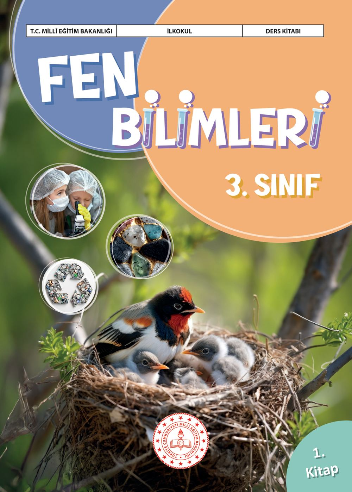
<!-- yer tutucu bulunamadı: sayfa sonuna eklendi -->

<!-- sayfa 1 -->

İLKOKUL

# FEN BİLİMLERİ

## 3. Sınıf

### Ders Kitabı
### 1. Kitap

**Yazarlar**

Dr. Nagihan ŞAHİN
Dr. Öznur TUNALI
Betül ALTUNTAŞ
Gürhan DİKMEN
Hüseyin GÜLEÇ
Nurgül GENÇ

<!-- sayfa 2 -->

Millî Eğitim Bakanlığı Yayınları No.................................................................................. 10760
Ders Kitapları Dizisi No..................................................................................................... 2510

**Editör**
Prof. Dr. Yasemin ÖZDEM YILMAZ
Dr. Öğr. Üyesi Zülfiye Melis DEMİR

**Dil Uzmanı**
Aylin ALTINBAŞ
Hatice MÜLKOĞLU

**Görsel Tasarımcı**
Evren SAVAŞ
Gülçen YILMAZ DÜZGÜN
Neşe ASLAN
Orhan ATEŞ
Selma TAŞCI

**Çoklu Ortam Tasarımcısı**
Dr. Halil KARDEŞ
Ali AYDIN
Ali HEMDE
Ayşe GÜNGÖR SÖNMEZ
Bünyamin TELLİ
Ercan YANDIMOĞLU
Eyüp Çağatay MERT
Fatih GÖNÜL
Hüseyin KURT
Latife Nur CANAN
Mehmet Emin TOPAK
Mehmet TOSUN
Muhammet Ali BÜYÜKTEKİN
Nuray AYDOĞDU
Orhan ÖZYURT
Selime KAYA
Tuğba BAŞBÖĞER
Yusuf Mehmet BAĞCI

**Program Geliştirme Uzmanı**
Hilal ALTINTAŞ

**Ölçme ve Değerlendirme Uzmanı**
Elif Ebru DOĞANGÜZEL

**Rehberlik Uzmanı**
Dr. Nilgün KORKMAZ

**Baskı**
Baskı Matbaanın Adı ve Ticaret Unvanı

ISBN 978-975-11-9891-4

<!-- sayfa 3 -->

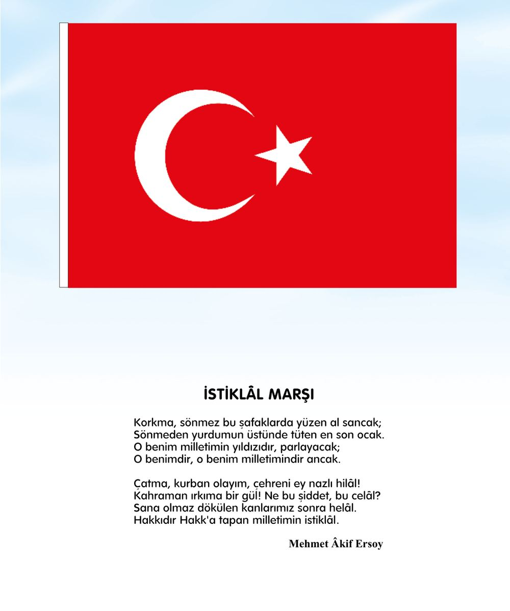

# İSTİKLÂL MARŞI

Korkma, sönmez bu şafaklarda yüzen al sancak;
Sönmeden yurdumun üstünde tüten en son ocak.
O benim milletimin yıldızıdır, parlayacak;
O benimdir, o benim milletimindir ancak.

Çatma, kurban olayım, cehren ey nazlı hilâl!
Kahraman ırkıma bir gül! Ne bu şiddet, bu celâl?
Sana olmaz dökülen kanlarımız sonra helâl.
Hakkıdır Hakk'a tapan milletimin istiklâl.

Mehmet Âkif Ersoy

<!-- sayfa 4 -->

ANDIMIZ

Türküm, doğruyum, çalışkanım.

İlkem küçüklerimi korumak, büyüklerimi saymak; yurdumu, milletimi özümden çok sevmektir.
Ülküm yükselmek, ileri gitmektir.

Ey Büyük Atatürk!

Açtığın yolda, gösterdiğin hedefe durmadan yürüyeceğime ant içerim.

Varlığım Türk varlığına armağan olsun.

Ne mutlu Türküm diyene!

<!-- sayfa 5 -->

MUSTAFA KEMAL ATATÜRK

<!-- yer tutucu bulunamadı: sayfa sonuna eklendi -->

<!-- sayfa 6 -->

Verdiğiniz metin katmanı boş olduğu için (`<<< >>>` arası boş) çevrilecek bir içerik bulunmamaktadır. Lütfen metin katmanını içeren içeriği paylaşın, böylece talimatlarınıza uygun şekilde Markdown formatına dönüştürebilirim.

<!-- sayfa 7 -->

# İÇİNDEKİLER

| | |
| :--- | ---: |
| KİTABIMIZI TANIYALIM | 8 |
| HAZIRLIK LİSTESİ | 10 |
| GÜVENLİK SEMBOLLERİ | 12 |

| | |
| :--- | ---: |
| **BİLİMSEL KEŞİF YOLCULUĞU** | **13** |
| BİLİMSEL BİLGİYE ULAŞMA YOLLARI | 16 |
| BİLİM İNSANLARININ ÖZELLİKLERİ | 26 |

| | |
| :--- | ---: |
| CANLILAR DÜNYASINA YOLCULUK | 39 |
| CANLILARIN SINIFLANDIRILMASI | 42 |
| DUYU ORGANLARININ İŞLEVLERİ | 58 |
| CANLILARIN YAŞAM DÖNGÜLERİ | 69 |

| | |
| :--- | ---: |
| YER BİLİMCİLER İŞ BAŞINDA | 81 |
| KAYAÇLAR, MADENLER VE MİNERALLER | 84 |
| FOSİL OLUŞUMU | 93 |

| | |
| :--- | ---: |
| MADDEYİ TANIYALIM, KARIŞTIRIP AYIRALIM | 105 |
| MADDENİN KATI, SIVI VE GAZ HÂLİ | 108 |
| KARIŞIMLAR VE KARIŞIMLARIN AYRILMASI | 118 |
| ATIKLARIN AYRIŞTIRILMASI | 127 |

| | |
| :--- | ---: |
| EKLER | 141 |
| SÖZLÜK | 151 |
| KAYNAKÇA | 153 |
| DEĞERLENDİRME FORMLARI | 155 |
| CEVAP ANAHTARI | 156 |
| GÖRSEL VE GENEL AĞ KAYNAKÇASI | 156 |
| TÜRKİYE'NİN MÜLKİ İDARE BÖLÜMLERİ İLE KARA VE DENİZ KOMŞULARI HARİTASI | 157 |
| TÜRK DÜNYASI HARİTASI | 158 |

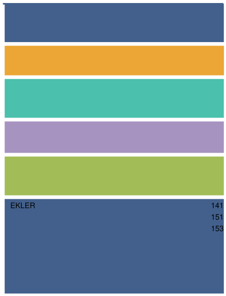
<!-- yer tutucu bulunamadı: sayfa sonuna eklendi -->

<!-- sayfa 8 -->

# KİTABIMIZI TANIYALIM

Kitabımız 8 üniteden oluşmaktadır. Bu ünitelerin 4 tanesi 1. kitapta bulunmaktadır.

## Kitapta kullanılan güvenlik sembollerinin açıklamaları

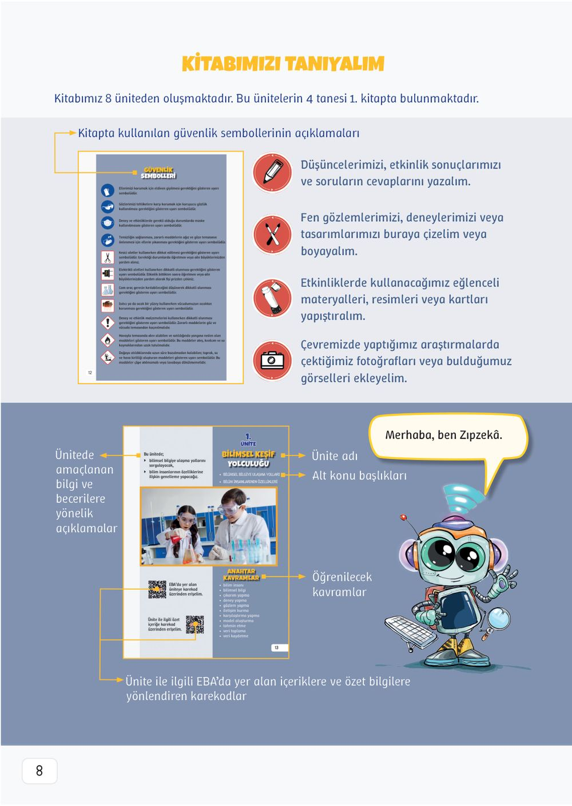

*    Düşüncelerimizi, etkinlik sonuçlarımızı ve soruların cevaplarını yazalım.
*    Etkinliklerde kullanacağımız eğlenceli materyalleri, resimleri veya kartları yapıştıralım.
*    Fen gözlemlerimizi, deneylerimizi veya tasarımlarımızı buraya çizelim veya boyayalım.
*    Çevremizde yaptığımız araştırmalarda çektiğimiz fotoğrafları veya bulduğumuz görselleri ekleyelim.

---

Ünitede amaçlanan bilgi ve becerilere yönelik açıklamalar $\rightarrow$

Bu ünitede;
* bilimsel bilgiye ulaşma yollarını sorgulayacağız,
* bilim insanlarının özelliklerine ilişkin genellemeler yapacağız.

$\rightarrow$ Ünite adı

$\rightarrow$ Alt konu başlıkları

$\rightarrow$ Öğrenilecek kavramlar

ANAH TAR KAVRAMLAR
* Bilim insanı
* Bilim ile ilgili çıkarım yapma
* Gözlem yapma
* Karşılaştırma yapma
* Model oluşturma
* Tahmin etme
* Veri toplama
* Veri güncelleme

$\rightarrow$ Ünite ile ilgili EBA'da yer alan içeriklere ve özet bilgilere yönlendiren karekodlar

<!-- sayfa 9 -->

* Üniteye dikkat çekmek için sorular soran, şaşırtan, bazen de düşündüren sayfalar
* Etkinlikler için yapılması gereken hazırlıklar

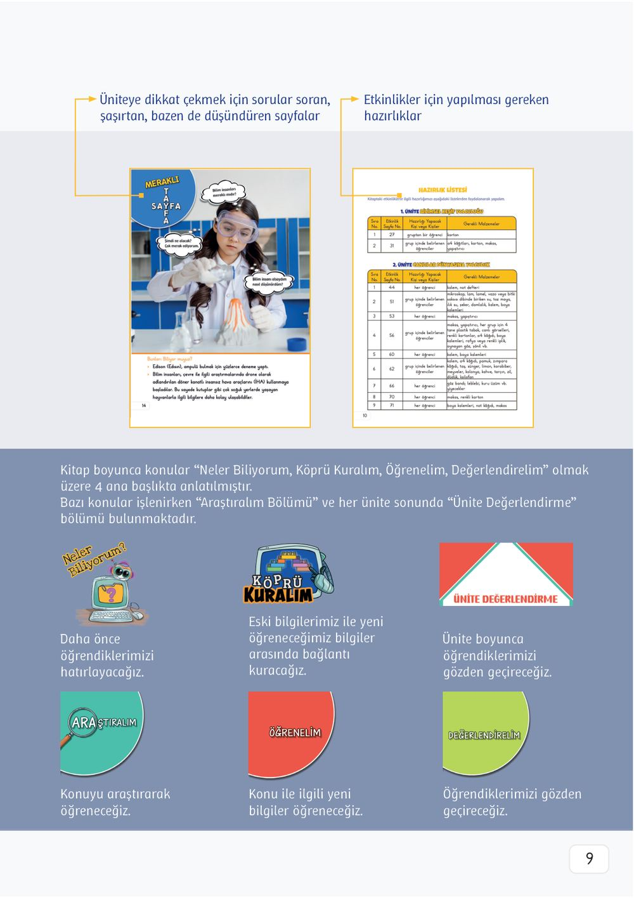

| HAZIRLIK LİSTESİ |
| :--- |
| Kütüphane etkinliklerinde ilgili hazırlığımızı aşağıdaki listeden faydalanarak yapalım. |

| 1. ÜNİTE İÇİN GEREKLİ MALZEMELER |
| :--- | :--- | :--- |
| **Sıra No.** | **Etkinlik Sayfa No.** | **Katılımcı Yapısı / Kişi veya Kişiler** | **Gerekli Malzemeler** |
| 1 | 27 | grubun bir öğrenci | karton |
| 2 | 31 | grup içinde belirlenen iki öğrenci | karton, karton, makas, yapıştırıcı |

| 2. ÜNİTE İÇİN GEREKLİ MALZEMELER |
| :--- | :--- | :--- | :--- |
| **Sıra No.** | **Etkinlik Sayfa No.** | **Katılımcı Yapısı / Kişi veya Kişiler** | **Gerekli Malzemeler** |
| 1 | 44 | her öğrenci | kalem, not defteri |
| 2 | 51 | grup içinde belirlenen iki öğrenci | bakliyat; bezelye, fasulye, mercimek, soya fasulyesi, mısır, tahıl, kuru baklagiller, kuru üzüm, badem, fındık, ceviz, kaju, fıstık, antep fıstığı, yer fıstığı, kabak çekirdeği, ay çekirdeği, susam, keten tohumu, çörek otu, chia tohumu, kenevir tohumu, susam, keten tohumu, çörek otu, chia tohumu, kenevir tohumu |
| 3 | 53 | her öğrenci | makas, yapıştırıcı |
| 4 | 56 | grup içinde belirlenen öğrenciler | makas, yapıştırıcı, grup için 4 tane plastik tabak, canlı görselleri, renkli kartonlar, el bağı, gözlükler, balonlar, yeşil renkli düğmeler, gri, siyah, mavi, turuncu, pembe, açık mavi, koyu mavi, gri, siyah, mavi, turuncu, pembe, açık mavi, koyu mavi, gri, siyah, mavi, turuncu, pembe, açık mavi, koyu mavi, gri, siyah, mavi, turuncu, pembe, açık mavi, koyu mavi, gri, siyah, mavi, turuncu, pembe, açık mavi, koyu mavi, gri, siyah, mavi, turuncu, pembe, açık mavi, koyu mavi, gri, siyah, mavi, turuncu, pembe, açık mavi, koyu mavi, gri, siyah, mavi, turuncu, pembe, açık mavi, koyu mavi, gri, siyah, mavi, turuncu, pembe, açık mavi, koyu mavi, gri, siyah, mavi, turuncu, pembe, açık mavi, koyu mavi, gri, siyah, mavi, turuncu, pembe, açık mavi, koyu mavi, gri, siyah, mavi, turuncu, pembe, açık

<!-- sayfa 10 -->

# HAZIRLIK LİSTESİ

Kitaptaki etkinliklerle ilgili hazırlığımızı aşağıdaki listelerden faydalanarak yapalım.

## 1. ÜNİTE: BİLİMSEL KEŞİF YOLCULUĞU

| Sıra No. | Etkinlik Sayfa No. | Hazırlığı Yapacak Kişi veya Kişiler | Gerekli Malzemeler |
| :--- | :--- | :--- | :--- |
| 1 | 27 | gruptan bir öğrenci | karton |
| 2 | 31 | grup içinde belirlenen öğrenciler | A4 kâğıtları, karton, makas, yapıştırıcı |

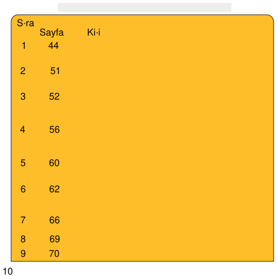

## 2. ÜNİTE: CANLILAR DÜNYASINA YOLCULUK

| Sıra No. | Etkinlik Sayfa No. | Hazırlığı Yapacak Kişi veya Kişiler | Gerekli Malzemeler |
| :--- | :--- | :--- | :--- |
| 1 | 44 | her öğrenci | kalem, not defteri |
| 2 | 51 | grup içinde belirlenen öğrenciler | mikroskop, lam, lamel, vazo veya bitki saksısı dibinde biriken su, damlalık, kalem, boya kalemleri |
| 3 | 52 | her öğrenci | makas, yapıştırıcı |
| 4 | 56 | grup içinde belirlenen öğrenciler | makas, yapıştırıcı, her grup için 4 tane plastik tabak, canlı görselleri, renkli kartonlar, A4 kâğıdı, boya kalemleri, rafya veya renkli iplik, oynayan göz, şönil vb. |
| 5 | 60 | her öğrenci | kalem, boya kalemleri |
| 6 | 62 | grup içinde belirlenen öğrenciler | kalem, A4 kâğıdı, pamuk, zımpara kâğıdı, taş, sünger, limon, karabiber, meyveler, kolonya, kahve, tarçın, zil, düdük, ksilofon |
| 7 | 66 | her öğrenci | göz bandı; leblebi, kuru üzüm vb. yiyecekler |
| 8 | 69 | her öğrenci | boya kalemleri |

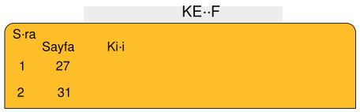
<!-- yer tutucu bulunamadı: sayfa sonuna eklendi -->

<!-- sayfa 11 -->

# 3. ÜNİTE: YER BİLİMCİLER İŞ BAŞINDA

| Sıra No. | Etkinlik Sayfa No. | Hazırlığı Yapacak Kişi veya Kişiler | Gerekli Malzemeler |
| :--- | :--- | :--- | :--- |
| 1 | 86 | her öğrenci | farklı türde kayaç görselleri |
| 2 | 87 | sınıf öğretmeni | farklı renk ve şekillerde çeşitli kayaçlar |
| | | her öğrenci | büyüteç |
| 3 | 103 | her öğrenci | makas, yapıştırıcı |

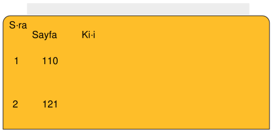

# 4. ÜNİTE: MADDEYİ TANIYALIM, KARIŞTIRIP AYIRALIM

| Sıra No. | Etkinlik Sayfa No. | Hazırlığı Yapacak Kişi veya Kişiler | Gerekli Malzemeler |
| :--- | :--- | :--- | :--- |
| 1 | 110 | her öğrenci | farklı niteliklerde üçer madde |
| 2 | 121 | her öğrenci | sürahi veya büyük şeffaf kap, süzgeç, elek, mıknatıs, plastik kaşık, peçete, havlu |

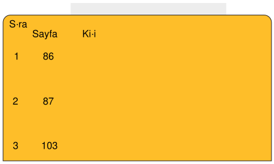

<!-- sayfa 12 -->

# GÜVENLİK SEMBOLLERİ

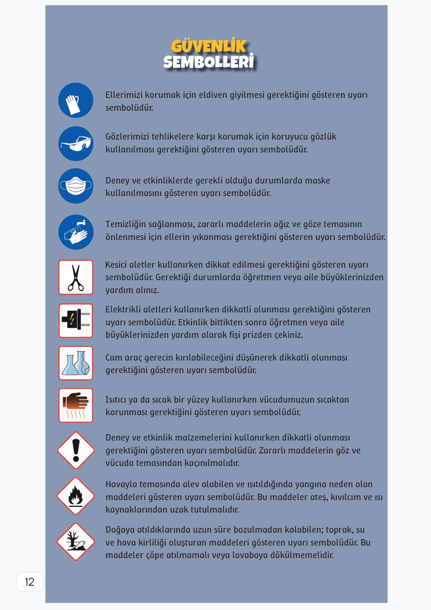 Ellerimizi korumak için eldiven giyilmesi gerektiğini gösteren uyarı sembolüdür.

 Gözlerimizi tehlikelere karşı korumak için koruyucu gözlük kullanılması gerektiğini gösteren uyarı sembolüdür.

 Deney ve etkinliklerde gerekli olduğu durumlarda maske kullanılmasını gösteren uyarı sembolüdür.

 Temizliğin sağlanması, zararlı maddelerin ağız ve göze temasının önlenmesi için ellerin yıkanması gerektiğini gösteren uyarı sembolüdür.

 Kesici aletler kullanırken dikkat edilmesi gerektiğini gösteren uyarı sembolüdür. Gerektiği durumlarda öğretmen veya aile büyüklerinizden yardım alınız.

 Elektrikli aletleri kullanırken dikkatli olunması gerektiğini gösteren uyarı sembolüdür. Etkinlik bittikten sonra öğretmen veya aile büyüklerinizden yardım alarak fişi prizden çekiniz.

 Cam araç gerecin kırılabileceğini düşünerek dikkatli olunması gerektiğini gösteren uyarı sembolüdür.

 Isıtıcı ya da sıcak bir yüzey kullanırken vücudumuzun sıcaktan korunması gerektiğini gösteren uyarı sembolüdür.

 Deney ve etkinlik malzemelerini kullanırken dikkatli olunması gerektiğini gösteren uyarı sembolüdür. Zararlı maddelerin göz ve vücuda temasından kaçınılmalıdır.

 Havayla temasında alev alabilen ve ısıtıldığında yangına neden olan maddeleri gösteren uyarı sembolüdür. Bu maddeler ateş, kıvılcım ve ısı kaynaklarından uzak tutulmalıdır.

 Doğaya atıldıklarında uzun süre bozulmadan kalabilen; toprak, su ve hava kirliliği oluşturan maddeleri gösteren uyarı sembolüdür. Bu maddeler çöpe atılmamalı veya lavaboya dökülmemelidir.

<!-- sayfa 13 -->

# ÜNİTE
# BİLİMSEL KEŞİF YOLCULUĞU

* BİLİMSEL BİLGİYE ULAŞMA YOLLARI
* BİLİM İNSANLARININ ÖZELLİKLERİ

Bu ünitede;
* bilimsel bilgiye ulaşma yollarını sorgulayacak,
* bilim insanlarının özelliklerine ilişkin genelleme yapacağız.

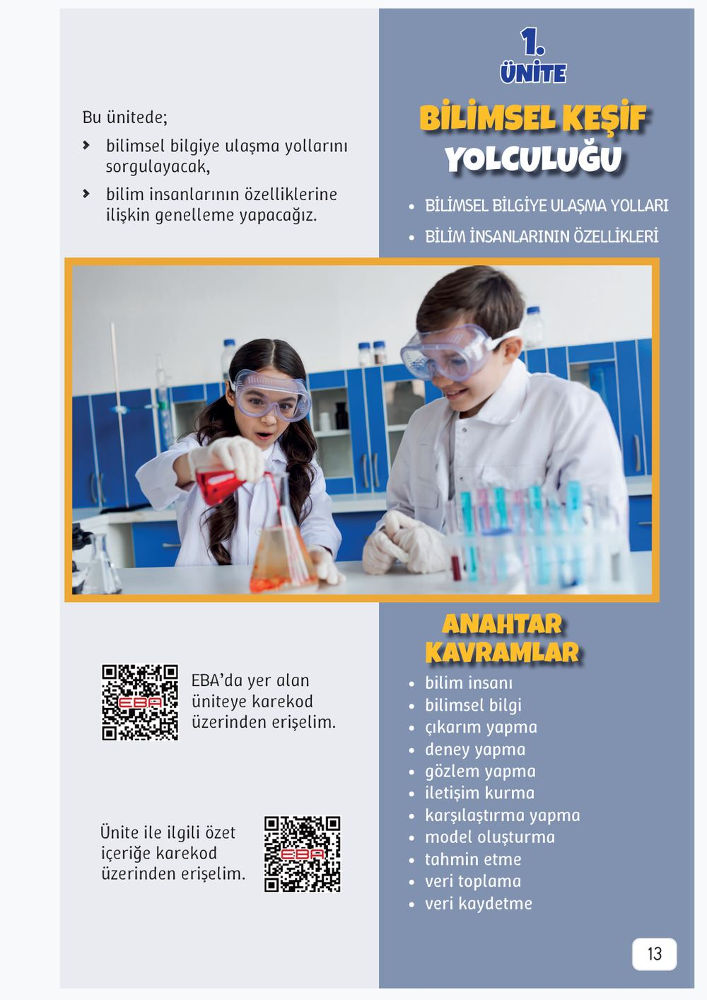

* EBA’da yer alan üniteye karekod üzerinden erişelim.
* Ünite ile ilgili özet içeriğe karekod üzerinden erişelim.

# ANAHTAR KAVRAMLAR

* bilim insanı
* bilimsel bilgi
* çıkarım yapma
* deney yapma
* gözlem yapma
* iletişim kurma
* karşılaştırma yapma
* model oluşturma
* tahmin etme
* veri toplama
* veri kaydetme

<!-- sayfa 14 -->

# MERAK SAYFASI

Bilim insanları meraklı mıdır?

Şimdi ne olacak? Çok merak ediyorum.

Bilim insanı olsaydım nasıl düşünürdüm?

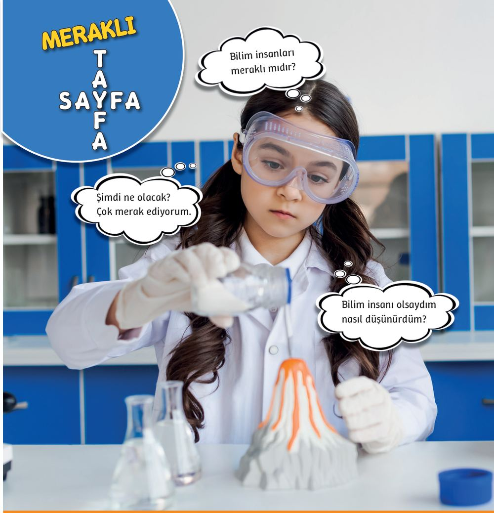

## Bunları Biliyor muyuz?

* Edison (Edisin), ampulü bulmak için yüzlerce deneme yaptı.
* Bilim insanları, çevre ile ilgili araştırmalarında drone olarak adlandırılan döner kanatlı insansız hava araçlarını (İHA) kullanmaya başladılar. Bu sayede kutuplar gibi çok soğuk yerlerde yaşayan...

<!-- sayfa 15 -->

![Bir çocuk laboratuvar ortamında deney yaparken düşünce balonları içinde sorular soruyor.]

Bir yanardağ gösterimi yapmak için hangi malzemeler gereklidir?

Deney yapımı ile ilgili doğru ve güvenilir bilgilere nasıl ulaşırım?

Yanardağlar neden patlar?

| ÜNİTE İLE İLGİLİ MERAK ETTİĞİN BİR SORU DA SENDEN |
| :--- |
| |
| |
| |
| |

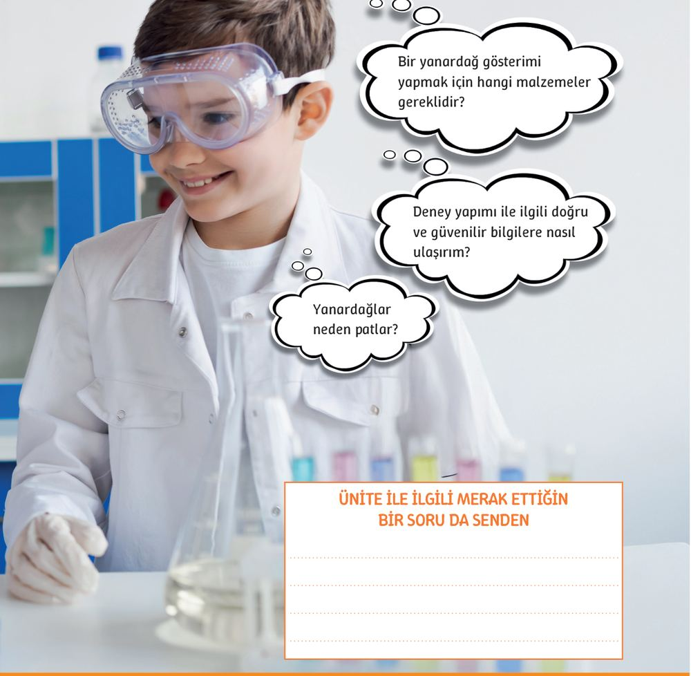

> Hawai'de (Havayi) bulunan dünyanın en büyük aktif yanardağı Mauna Loa (Mauna Loa), tam 38 yıl sonra yeniden lav püskürtmeye başladı.
> Bazı yanardağlardan çıkan lavlar, içlerindeki farklı maddeler nedeniyle mavi renkte görünebilir.

<!-- sayfa 16 -->

# BİLİMSEL BİLGİYE ULAŞMA YOLLARI

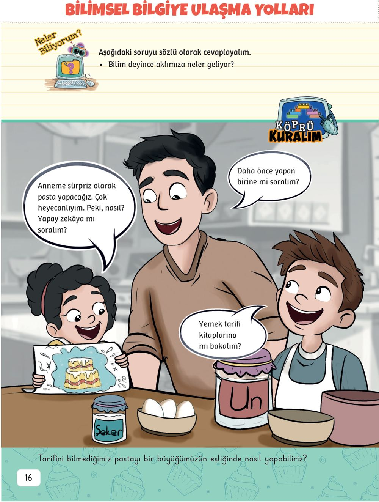: Neler Biliyorum? sorusunun olduğu, bilgisayar ve soru işareti içeren bir görsel.

Aşağıdaki soruyu sözlü olarak cevaplayalım.
* Bilim deyince aklımıza neler geliyor?

: Üç çocuğun mutfakta pasta yapma planı üzerine konuştuğu bir çizim. Çocuklardan biri: "Anneme sürpriz olarak pasta yapacağız. Çok heyecanlıyım. Peki, nasıl? Yapay zekâya mı soralım?", diğeri: "Daha önce yapan birine mi soralım?", üçüncüsü ise: "Yemek tarifi kitaplarına mı bakalım?" diye sormaktadır. Masada şeker, yumurta, un ve kaplar bulunmaktadır. Sağ üst köşede "KÖPRÜ KURALIM" yazan bir bilgisayar ikonu vardır.

<!-- sayfa 17 -->

# Meraklı Araştırmacı

1. Aşağıdaki konulardan merak ettiklerimizi seçelim ve yuvarlak içine alalım. Merak ettiğimiz farklı konular varsa boş alanlara yazalım.

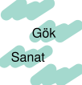

Besinler  Bitkiler  Hayvanlar  Çevre 
Beslenme  Ulaşım  Gök bilimi  Trafik 
Matematik 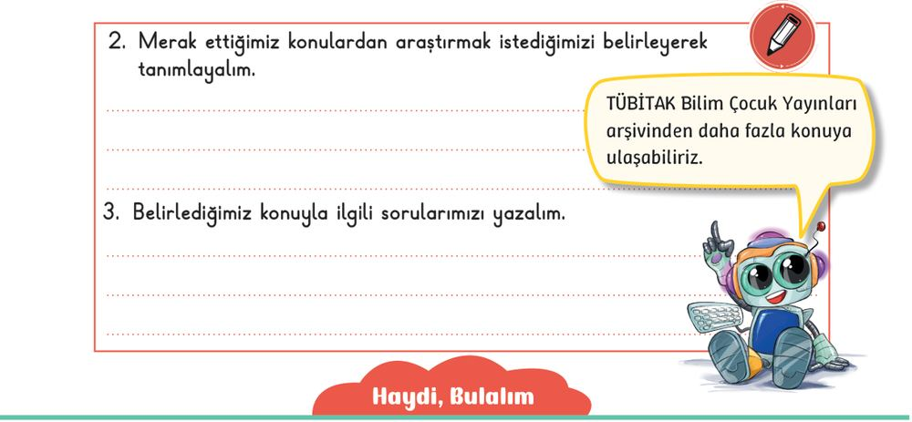 Müzik  Sanat  Spor 

2. Merak ettiğimiz konulardan araştırmak istediğimizi belirleyerek tanımlayalım.

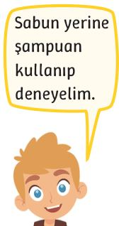
TÜBİTAK Bilim Çocuk Yayınları arşivinden daha fazla konuya ulaşabiliriz. 

3. Belirlediğimiz konuyla ilgili sorularımızı yazalım.

# Haydi, Bulalım

Asya ve Barış baloncuk yapan bir oyuncakla oynuyor, arkadaşları da çıkan baloncukları neşeyle patlatıyordu. Oyuncaktan çıkan baloncuklar bazen küçük bazen büyük oluyordu. Bazı balonlar çabuk patlarken bazıları daha geç patlıyordu. Acaba bunun nedeni neydi? Çocuklar sorunun cevabına yönelik fikirlerini söylediler:

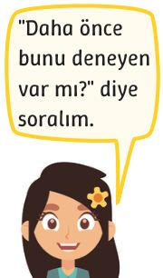
Konuyla ilgili kitap okuyalım. 

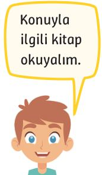
"Daha önce bunu deneyen var mı?" diye soralım. 

Sabun yerine şampuan kullanıp deneyelim.

Daha az su kullanıp deneyelim.

<!-- sayfa 18 -->

# ÖĞRENELİM

Araştırma sorularımızın cevabı ile ilgili bilimsel sorgulama yaparken
* tahmin etme
* gözlem yapma
* model oluşturma
* belge taraması
* deney yapma
* iletişim kurma

gibi yöntemlerden birini veya birkaçını kullanarak veri toplayabilir, kaydedebilir, çıkarım veya karşılaştırma yapabiliriz.

Bu araştırma yöntemlerini inceleyelim. Araştırma yaparken uygun yöntemleri kullanalım.

> Bir konu veya sorunun cevabı ile ilgili daha önceki bilgilerimizi düşünerek değerlendirmede bulunmaya **tahmin etme** denir. Elimizdeki bilgilerden yola çıkarak "Ben böyle olacağını düşünüyorum." demektir. Örneğin gökyüzüne baktık, gri bulutları gördük, rüzgârın estiğini fark ettik. "Yağmur yağabilir." diye düşündük. Bu, bir tahmindir.

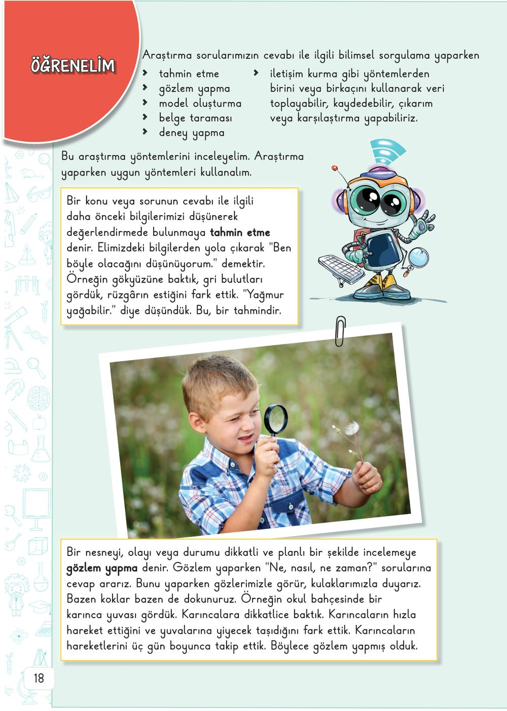

> Bir nesneyi, olayı veya durumu dikkatli ve planlı bir şekilde incelemeye **gözlem yapma** denir. Gözlem yaparken "Ne, nasıl, ne zaman?" sorularına cevap ararız. Bunu yaparken gözlerimizle görür, kulaklarımızla duyarız. Bazen koklar bazen de dokunuruz. Örneğin okul bahçesinde bir karınca yuvası gördük. Karıncalara dikkatlice baktık. Karıncaların hızla hareket ettiğini ve yuvalarına yiyecek taşıdığını fark ettik. Karıncaların hareketlerini üç gün boyunca takip ettik. Böylece gözlem yapmış olduk.

<!-- sayfa 19 -->

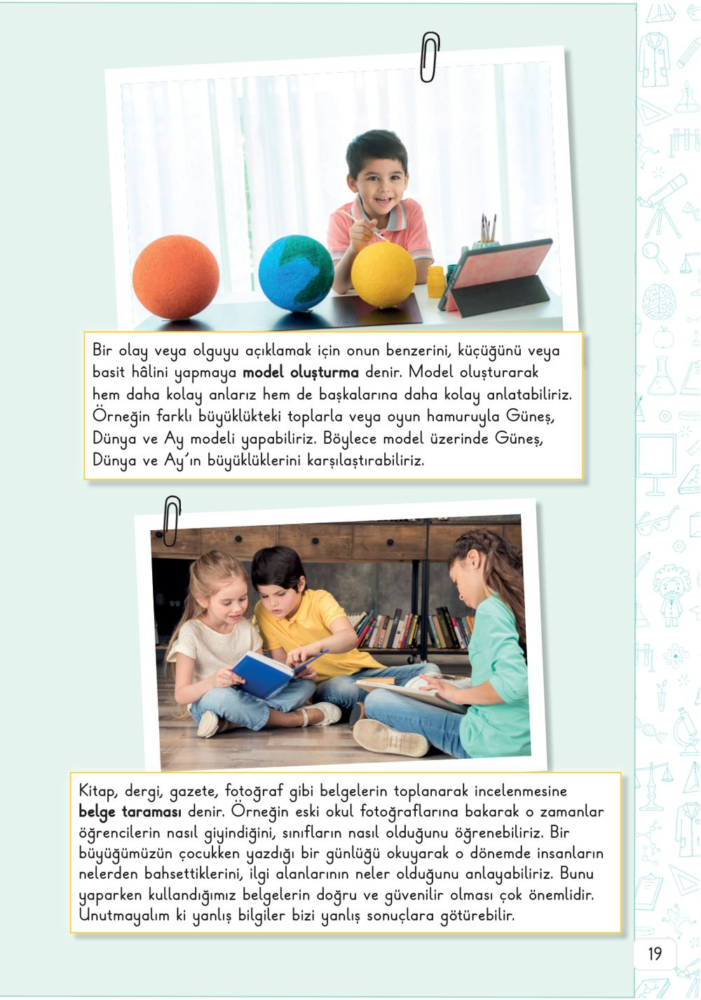

Bir olay veya olguyu açıklamak için onun benzerini, küçüğünü veya basit hâlini yapmaya **model oluşturma** denir. Model oluşturarak hem daha kolay anlarız hem de başkalarına daha kolay anlatabiliriz. Örneğin farklı büyüklükteki toplarla veya oyun hamuruyla Güneş, Dünya ve Ay modeli yapabiliriz. Böylece model üzerinde Güneş, Dünya ve Ay'ın büyüklüklerini karşılaştırabiliriz.

Kitap, dergi, gazete, fotoğraf gibi belgelerin toplanarak incelenmesine **belge taraması** denir. Örneğin eski okul fotoğraflarına bakarak o zamanlar öğrencilerin nasıl giyindiğini, sınıfların nasıl olduğunu öğrenebiliriz. Bir büyüğümüzün çocukken yazdığı bir günlüğü okuyarak o dönemde insanların nelerden bahsettiklerini, ilgi alanlarının neler olduğunu anlayabiliriz. Bunu yaparken kullandığımız belgelerin doğru ve güvenilir olması çok önemlidir.

<!-- sayfa 20 -->

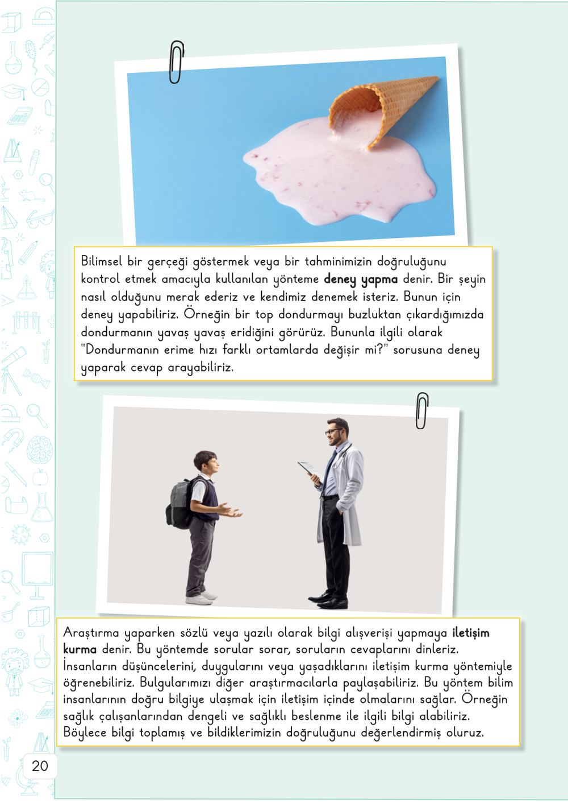

Bilimsel bir gerçeği göstermek veya bir tahminimizin doğruluğunu kontrol etmek amacıyla kullanılan yönteme **deney yapma** denir. Bir şeyin nasıl olduğunu merak ederiz ve kendimiz denemek isteriz. Bunun için deney yapabiliriz. Örneğin bir top dondurmayı buzluktan çıkardığımızda dondurmanın yavaş yavaş eridiğini görürüz. Bununla ilgili olarak "Dondurmanın erime hızı farklı ortamlarda değişir mi?" sorusuna deney yaparak cevap arayabiliriz.

Araştırma yaparken sözlü veya yazılı olarak bilgi alışverişi yapmaya **iletişim kurma** denir. Bu yöntemde sorular sorar, soruların cevaplarını dinleriz. İnsanların düşüncelerini, duygularını veya yaşadıklarını iletişim kurma yöntemiyle öğrenebiliriz. Bulgularımızı diğer araştırmacılarla paylaşabiliriz. Bu yöntem bilim insanlarının doğru bilgiye ulaşmak için iletişim içinde olmalarını sağlar. Örneğin sağlık çalışanlarından dengeli ve sağlıklı beslenme ile ilgili bilgi alabiliriz. Böylece bilgi toplamış ve bildiklerimizin doğruluğunu değerlendirmiş oluruz.

<!-- sayfa 21 -->

Bilimsel yöntemlerle elde ettiğimiz bilgilere **veri**, bilgi edinme işlemine **veri toplama** denir. Topladığımız verileri grafik, metin veya görsel kullanarak kaydedebiliriz. Aşağıdaki örneği inceleyelim.

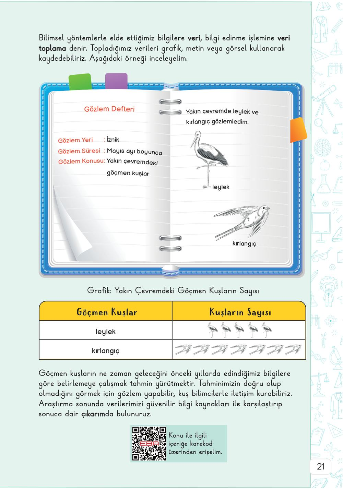

# Gözlem Defteri

**Gözlem Yeri**: İznik
**Gözlem Süresi**: Mayıs ayı boyunca
**Gözlem Konusu**: Yakın çevremdeki göçmen kuşlar

Yakın çevremde leylek ve kırlangıç gözlemledim.

leylek

kırlangıç

Grafik: Yakın Çevremdeki Göçmen Kuşların Sayısı

| Göçmen Kuşlar | Kuşların Sayısı |
| :--- | :--- |
| leylek |  |
| kırlangıç |  |

Göçmen kuşların ne zaman geleceğini önceki yıllarda edindiğimiz bilgilere göre belirlemeye çalışmak tahmin yürütmektir. Tahminimizin doğru olup olmadığını görmek için gözlem yapabilir, kuş bilimcilerle iletişim kurabiliriz. Araştırma sonunda verilerimizi güvenilir bilgi kaynakları ile karşılaştırıp sonuca dair **çıkarım**da bulunuruz.

 Konu ile ilgili içeriğe karekod

<!-- sayfa 22 -->

# ARAŞTIRALIM

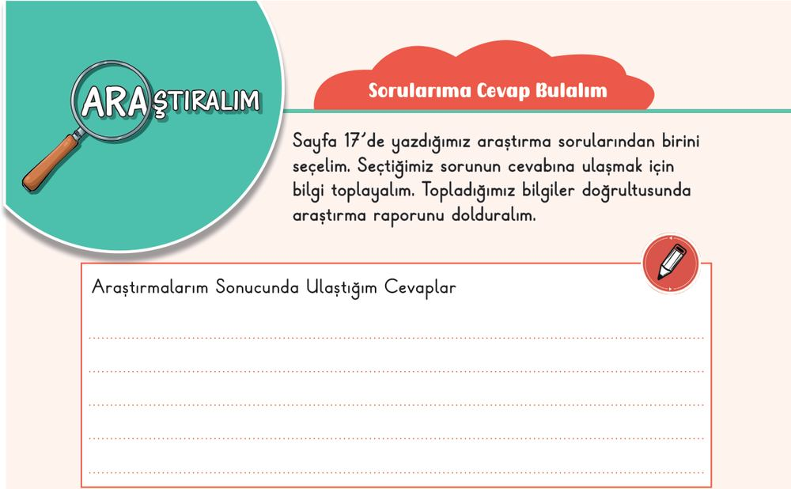

**Sorularıma Cevap Bulalım**

Sayfa 17’de yazdığımız araştırma sorularından birini seçelim. Seçtiğimiz sorunun cevabına ulaşmak için bilgi toplayalım. Topladığımız bilgiler doğrultusunda araştırma raporunu dolduralım.

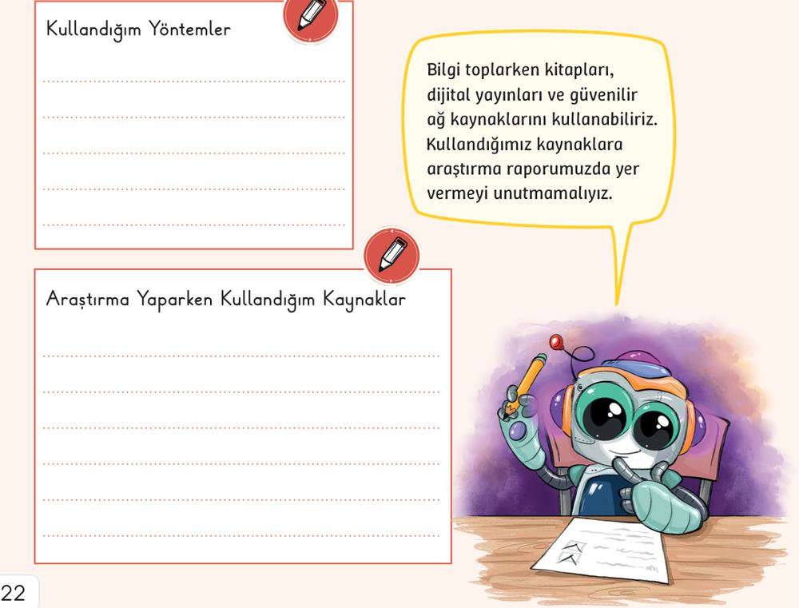

### Araştırmalarım Sonucunda Ulaştığım Cevaplar
__________________________________________________________________
__________________________________________________________________
__________________________________________________________________
__________________________________________________________________
__________________________________________________________________

### Kullandığım Yöntemler
__________________________________________________________________
__________________________________________________________________
__________________________________________________________________
__________________________________________________________________
__________________________________________________________________

> Bilgi toplarken kitapları, dijital yayınları ve güvenilir ağ kaynaklarını kullanabiliriz. Kullandığımız kaynaklara araştırma raporumuzda yer vermeyi unutmamalıyız.

### Araştırma Yaparken Kullandığım Kaynaklar
__________________________________________________________________
__________________________________________________________________
__________________________________________________________________
__________________________________________________________________
__________________________________________________________________

<!-- sayfa 23 -->

# Çıkarımlarım
(Boş çizgili alan)

# Görsellerim
(Boş alan)

## Tartışma Çemberim

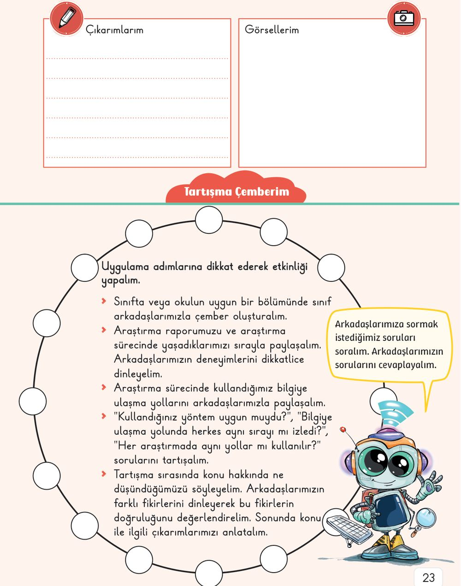

Uygulama adımlarına dikkat ederek etkinliği yapalım.

* Sınıfta veya okulun uygun bir bölümünde sınıf arkadaşlarımızla çember oluşturalım.
* Araştırma raporumuzu ve araştırma sürecinde yaşadıklarımızı sırayla paylaşalım. Arkadaşlarımızın deneyimlerini dikkatlice dinleyelim.
* Araştırma sürecinde kullandığımız bilgiye ulaşma yollarını arkadaşlarımızla paylaşalım.
* "Kullandığınız yöntem uygun muydu?", "Bilgiye ulaşma yolunda herkes aynı sırayı mı izledi?", "Her araştırmada aynı yollar mı kullanılır?" sorularını tartışalım.
* Tartışma sırasında konu hakkında ne düşündüğümüzü söyleyelim. Arkadaşlarımızın farklı fikirlerini dinleyerek bu fikirlerin doğruluğunu değerlendirelim. Sonunda konu ile ilgili çıkarımlarımızı anlatalım.

> Arkadaşlarımıza sormak istediğimiz soruları soralım. Arkadaşlarımızın sorularını cevaplayalım.

<!-- sayfa 24 -->

Aşağıdaki form, süreç içinde kendimizi değerlendirmemiz amacıyla hazırlanmıştır. Değerlendirme yaparken "Evet" veya "Hayır" seçeneklerinden uygun olanı işaretleyelim.

# ÖZ DEĞERLENDİRME FORMU

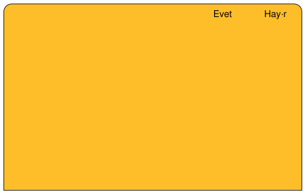

Adı soyadı: ............................................................
Sınıfı ve numarası: ...................................................

| Değerlendirilecek Davranışlar | Evet | Hayır |
| :--- | :---: | :---: |
| Merak ettiğim bilimsel bir konuyu tanımladım. | | |
| İlgili konu hakkında sorular sordum. | | |
| Sorularımı cevaplamaya yönelik bilgi topladım. | | |
| Araştırma sürecinde yaşadıklarımı açık ve anlaşılır bir şekilde anlattım. | | |
| Arkadaşlarımın paylaşımlarını dikkatlice dinledim. | | |
| Bilimsel bilgiye ulaşma yollarının uygunluğunu değerlendirdim. | | |
| Arkadaşlarımın sorularına cevap verdim. | | |
| Bilimsel bilgiye ulaşma yolları ile ilgili çıkarımda bulundum. | | |

Cevaplarımızın hepsinin "Evet" olması, bilimsel bilgiye ulaşma yollarını sorgulama becerisini kazandığımızı gösteriyor. "Hayır" cevaplarımız için öğretmenimiz ve arkadaşlarımızdan destek alabiliriz.

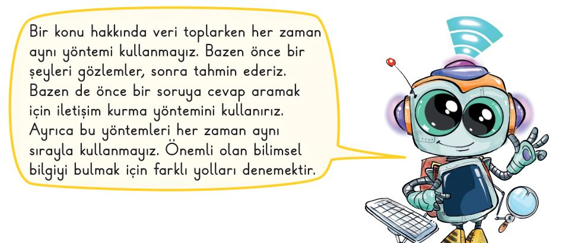

> Bir konu hakkında veri toplarken her zaman aynı yöntemi kullanmayız. Bazen önce bir şeyleri gözlemler, sonra tahmin ederiz. Bazen de önce bir soruya cevap aramak için iletişim kurma yöntemini kullanırız. Ayrıca bu yöntemleri her zaman aynı sırayla kullanmayız. Önemli olan bilimsel bilgiyi bulmak için farklı yolları denemektir.

<!-- sayfa 25 -->

İpek, merak ettiği konularla ilgili sorular ve bu sorulara uygun araştırma yöntemlerinin yer aldığı bir tablo hazırlamıştır. Şimdi İpek'in sorularının cevaplarına ulaşmak için hangi araştırma yöntemlerini kullanması gerektiğini işaretleyelim.

| Araştırma Soruları | YÖNTEMLER | | | | | |
| :--- | :---: | :---: | :---: | :---: | :---: | :---: |
| | Tahmin Etme | Belge Taraması | Gözlem Yapma | Model Oluşturma | Deney Yapma | İletişim Kurma |
| Işıksız ortamda bitki büyür mü? | | | | | | |
| Su nasıl buharlaşır? | | | | | | |
| Isıtılan buza ne olur? | | | | | | |
| Dünya, Ay ve Güneş'in birbirlerine göre büyüklükleri nasıldır? | | | | | | |
| Sıvı yağ ile su karışır mı? | | | | | | |
| Bir insan dakikada ortalama kaç kez göz kırpar? | | | | | | |

DEĞERLENDİRELİM

Doldurduğumuz tabloyu sıra arkadaşımızın tablosu ile karşılaştıralım. Soruları sözlü olarak cevaplayalım.

1. Seçtiğimiz yöntemler arasındaki benzerlik ve farklılıklar nelerdir?

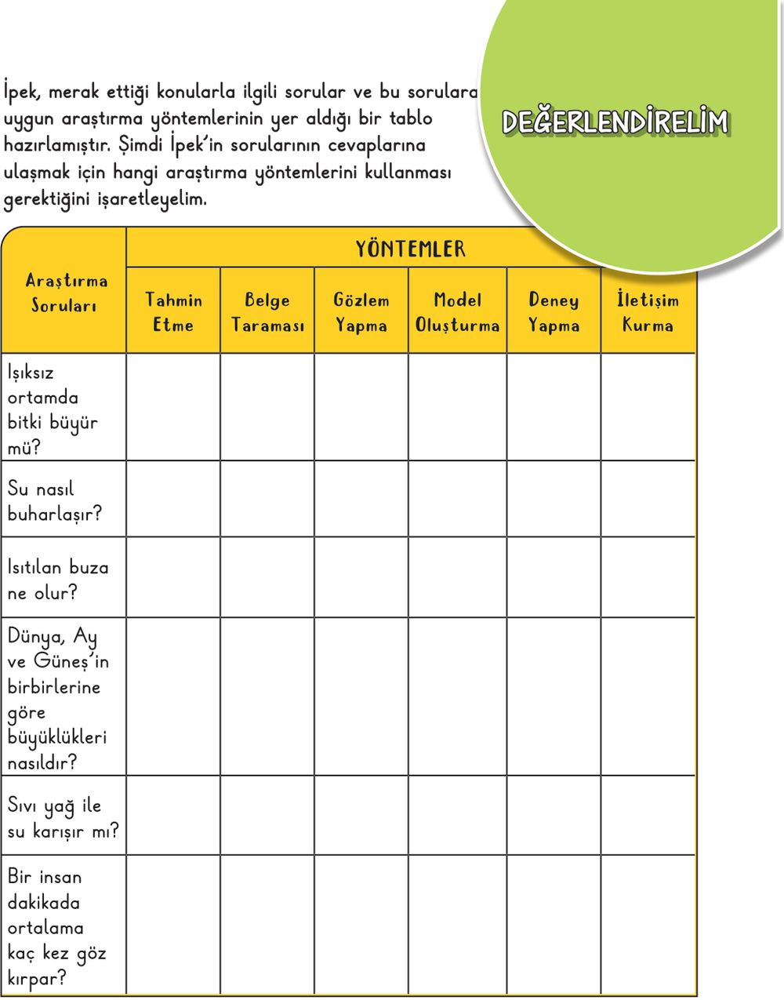
<!-- yer tutucu bulunamadı: sayfa sonuna eklendi -->

<!-- sayfa 26 -->

# BİLİM İNSANLARININ ÖZELLİKLERİ

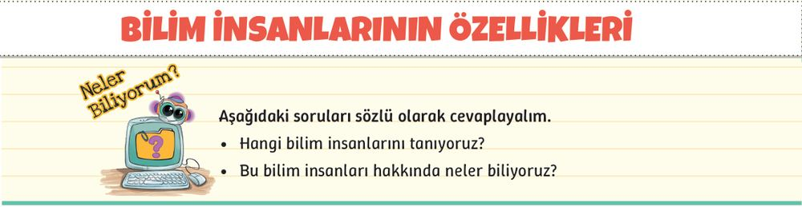

Aşağıdaki soruları sözlü olarak cevaplayalım.
* Hangi bilim insanlarını tanıyoruz?
* Bu bilim insanları hakkında neler biliyoruz?

Aşağıda Türk bilim insanı Aziz Sancar'ın hayatıyla ilgili bir gazete haberi verilmiştir. Haberi okuyalım, soruları sözlü olarak cevaplayalım.

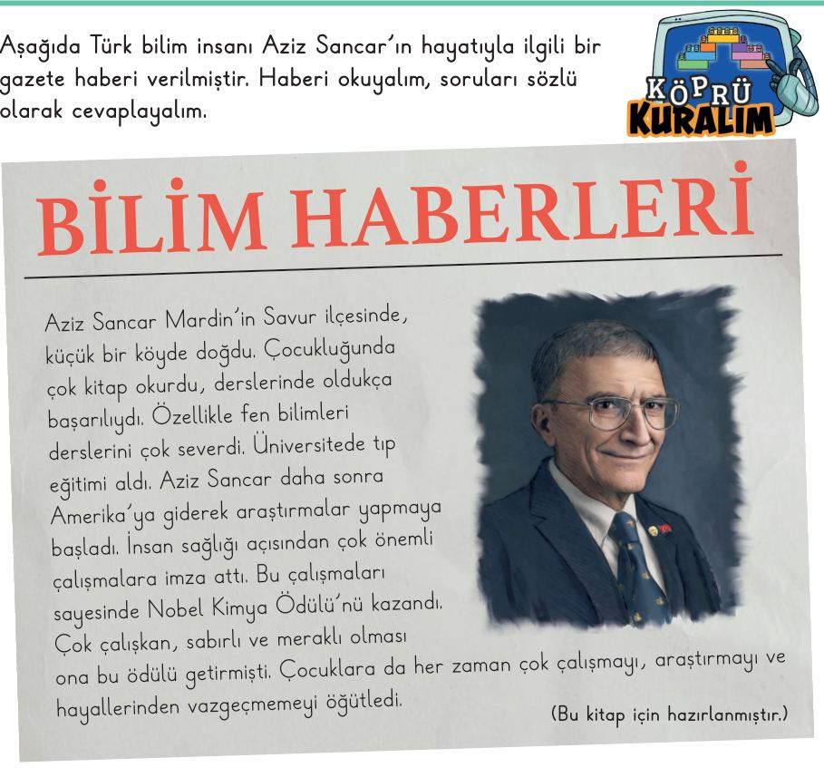

# BİLİM HABERLERİ

Aziz Sancar Mardin'in Savur ilçesinde, küçük bir köyde doğdu. Çocukluğunda çok kitap okurdu, derslerinde oldukça başarılıydı. Özellikle fen bilimleri derslerini çok severdi. Üniversitede tıp eğitimi aldı. Aziz Sancar daha sonra Amerika'ya giderek araştırmalar yapmaya başladı. İnsan sağlığı açısından çok önemli çalışmalara imza attı. Bu çalışmaları sayesinde Nobel Kimya Ödülü'nü kazandı. Çok çalışkan, sabırlı ve meraklı olması ona bu ödülü getirmişti. Çocuklara da her zaman çok çalışmayı, araştırmayı ve hayallerinden vazgeçmemeyi öğütledi.

(Bu kitap için hazırlanmıştır.)

1. Aziz Sancar, çocuklara hayallerinden vazgeçmemelerini öğütlemiştir. Peki, bizim gelecekle ilgili hayalimiz nedir?
2. Aziz Sancar'ın hedeflerine ulaşmasında hangi davranış ve özellikler ona yardımcı olmuştur?
3. Biz hangi alanlarda başarılı olmak istiyoruz?

Tanıdığımız başka Türk bilim insanları varsa söyleyelim. Bu kişiler hakkında...

<!-- sayfa 27 -->

# Bilim İnsanlarını Araştıralım

**Malzemeler:** karton

Uygulama adımlarına dikkat ederek etkinliği yapalım.

* Sınıf arkadaşlarımızla dört veya beş kişilik gruplar oluşturalım.
* Merak ettiğimiz bir bilim insanını seçerek onun hakkında bilgi toplayalım. 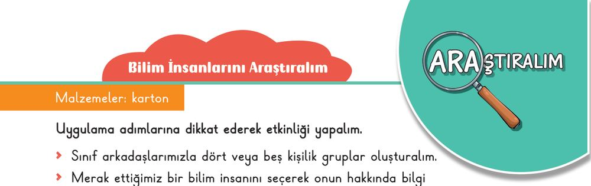
* Seçtiğimiz bilim insanlarının hangi alanda çalıştığını ve bu kişilerin özelliklerini araştıralım.
* Bilim insanı hakkında grupça edindiğimiz bilgileri kartonlara yazalım.
* Grubumuzun ortak çalışmasını sınıfımızda uygun bir yere asalım.
* Sınıfımızın bir galeri olduğunu hayal edelim. Grup arkadaşlarımızla galeri yürüyüşüne çıkalım. Diğer grupların çalışmalarını inceleyelim. 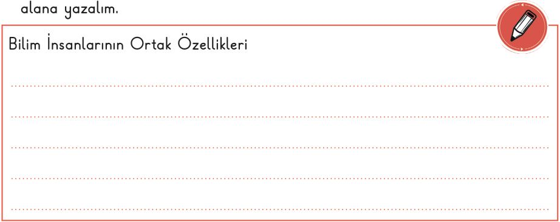
* Galeri yürüyüşü yaparken bilim insanlarının ortak özelliklerini belirleyerek ilgili alana yazalım.

Bilim İnsanlarının Ortak Özellikleri
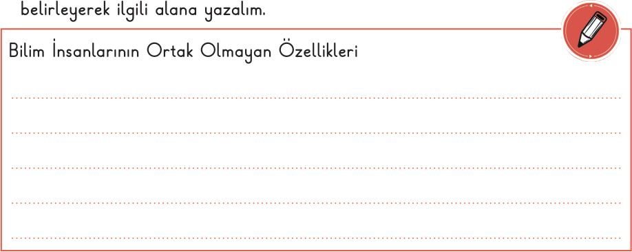
__________________________________________________________________
__________________________________________________________________
__________________________________________________________________
__________________________________________________________________
__________________________________________________________________

* Galeri yürüyüşünü tekrarlayalım. Bilim insanlarının ortak olmayan özelliklerini belirleyerek ilgili alana yazalım. 

Bilim İnsanlarının Ortak Olmayan Özellikleri
__________________________________________________________________
__________________________________________________________________
__________________________________________________________________
__________________________________________________________________
__________________________________________________________________

<!-- sayfa 28 -->

# Şimdi Önerme Zamanı

Edindiğimiz bilgilerden yola çıkarak "Bilim insanları" ile başlayan cümleleri örnekteki gibi tamamlayarak önermeler oluşturalım.

$\rightarrow$ bilimsel bilgiye ulaşmaya çalışırlar.

$\rightarrow$ __________________________________________________

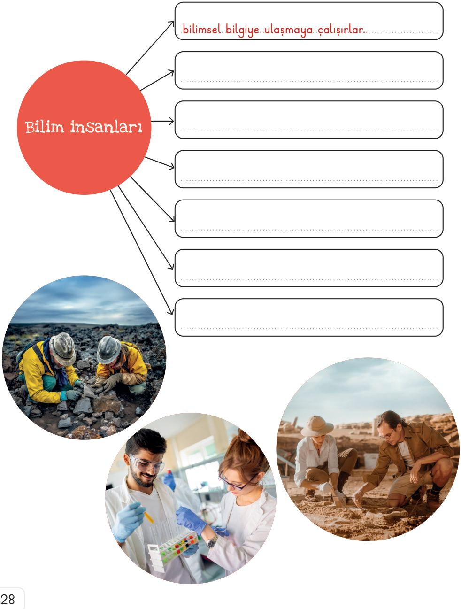

<!-- sayfa 29 -->

# ÖĞRENELİM

Bilim insanlarının ortak olan ve olmayan pek çok özelliği vardır.

## Bilim İnsanlarının Ortak Özellikleri

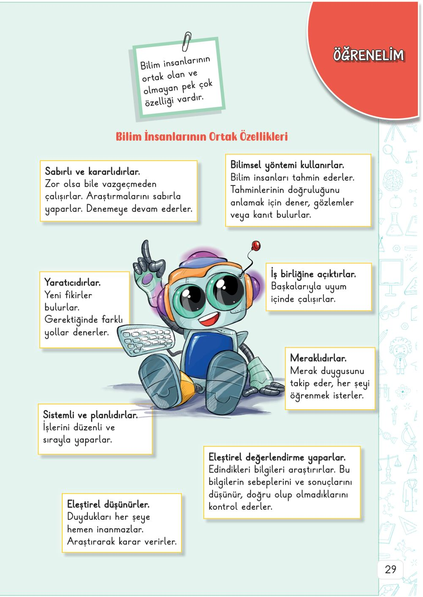

**Sabırlı ve kararlıdırlar.**
Zor olsa bile vazgeçmeden çalışırlar. Araştırmalarını sabırla yaparlar. Denemeye devam ederler.

**Bilimsel yöntemi kullanırlar.**
Bilim insanları tahmin ederler. Tahminlerinin doğruluğunu anlamak için dener, gözlemler veya kanıt bulurlar.

**Yaratıcıdırlar.**
Yeni fikirler bulurlar. Gerektiğinde farklı yollar denerler.

**İş birliğine açıktırlar.**
Başkalarıyla uyum içinde çalışırlar.

**Meraklıdırlar.**
Merak duygusunu takip eder, her şeyi öğrenmek isterler.

**Sistemli ve planlıdırlar.**
İşlerini düzenli ve sırayla yaparlar.

**Eleştirel değerlendirme yaparlar.**
Edindikleri bilgileri araştırırlar. Bu bilgilerin sebeplerini ve sonuçlarını düşünür, doğru olup olmadıklarını kontrol ederler.

**Eleştirel düşünürler.**
Duydukları her şeye hemen inanmazlar. Araştırarak karar verirler.

<!-- sayfa 30 -->

**Farklı fikirlere açıktırlar.**
Aynı konu hakkındaki farklı görüşleri dinlerler. Her görüşü kanıtlarıyla değerlendirirler.

**Duyarlıdırlar.**
İnsanı ve doğayı severler. Araştırmalarını yaparken çevrelerini korurlar.

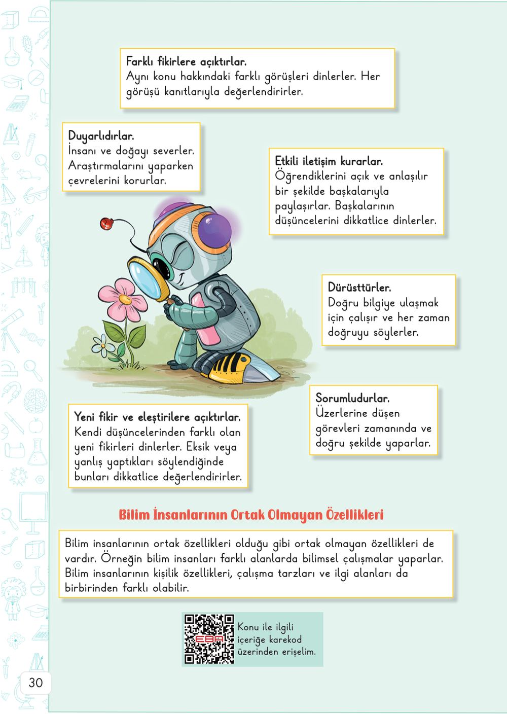

**Etkili iletişim kurarlar.**
Öğrendiklerini açık ve anlaşılır bir şekilde başkalarıyla paylaşırlar. Başkalarının düşüncelerini dikkatlice dinlerler.

**Dürüsttürler.**
Doğru bilgiye ulaşmak için çalışır ve her zaman doğruyu söylerler.

**Yeni fikir ve eleştirilere açıktırlar.**
Kendi düşüncelerinden farklı olan yeni fikirleri dinlerler. Eksik veya yanlış yaptıkları söylendiğinde bunları dikkatlice değerlendirirler.

**Sorumludurlar.**
Üzerlerine düşen görevleri zamanında ve doğru şekilde yaparlar.

# Bilim İnsanlarının Ortak Olmayan Özellikleri

Bilim insanlarının ortak özellikleri olduğu gibi ortak olmayan özellikleri de vardır. Örneğin bilim insanları farklı alanlarda bilimsel çalışmalar yaparlar. Bilim insanlarının kişilik özellikleri, çalışma tarzları ve ilgi alanları da birbirinden farklı olabilir.

Konu ile ilgili içeriğe karekod üzerinden erişelim

<!-- sayfa 31 -->

# PERFORMANS GÖREVİ

**Malzemeler:** A4 kâğıtları, karton, makas, yapıştırıcı ✂️

Aşağıdaki performans görevini yapalım.

## POSTERİMİZ

**Süre:** İki ders saati
**Konu:** Bilim insanlarının özellikleri
**Görev:** Bilim insanlarının özellikleri ile ilgili poster hazırlayalım. Daha sonra hazırladığımız posteri sınıf arkadaşlarımıza sunalım.

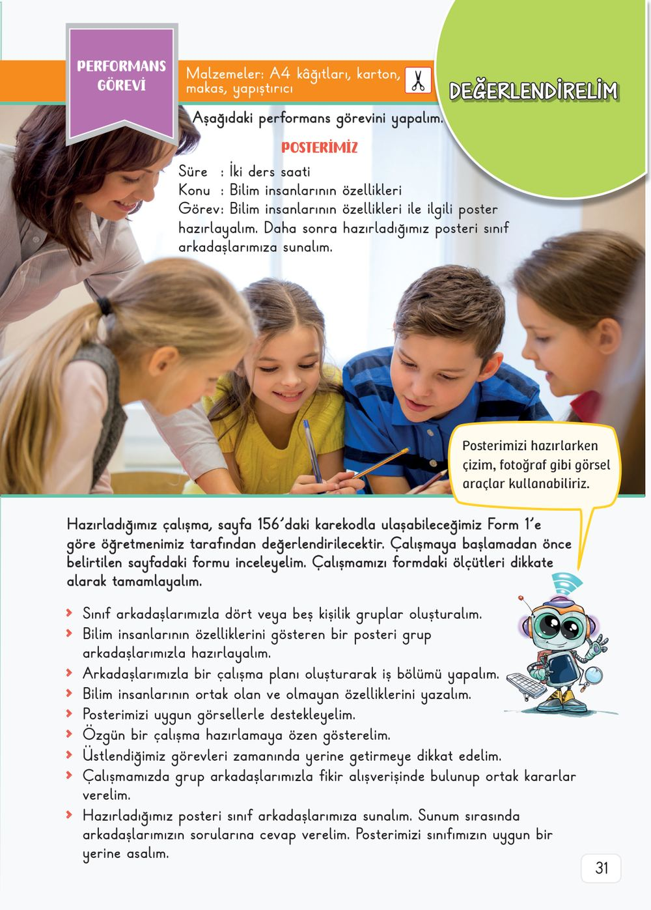

> Posterimizi hazırlarken çizim, fotoğraf gibi görsel araçlar kullanabiliriz.

Hazırladığımız çalışma, sayfa 156'daki karekodla ulaşabileceğimiz Form 1'e göre öğretmenimiz tarafından değerlendirilecektir. Çalışmaya başlamadan önce belirtilen sayfadaki formu inceleyelim. Çalışmamızı formdaki ölçütleri dikkate alarak tamamlayalım.

* Sınıf arkadaşlarımızla dört veya beş kişilik gruplar oluşturalım.
* Bilim insanlarının özelliklerini gösteren bir posteri grup arkadaşlarımızla hazırlayalım.
* Arkadaşlarımızla bir çalışma planı oluşturarak iş bölümü yapalım.
* Bilim insanlarının ortak olan ve olmayan özelliklerini yazalım.
* Posterimizi uygun görsellerle destekleyelim.
* Özgün bir çalışma hazırlamaya özen gösterelim.
* Üstlendiğimiz görevleri zamanında yerine getirmeye dikkat edelim.
* Çalışmamızda grup arkadaşlarımızla fikir alışverişinde bulunup ortak kararlar verelim.
* Hazırladığımız posteri sınıf arkadaşlarımıza sunalım. Sunum sırasında...

# DEĞERLENDİRELİM

<!-- sayfa 32 -->

# ÜNİTE DEĞERLENDİRME

1. Elif, Veli, Ece, Hakan ve Kübra'nın merak ettikleri konularla ilgili sorularını okuyalım. Bu sorulara cevap ararken bilimsel bilgiye ulaşmak için hangi yolları kullanabileceklerini düşünelim. Nedenleri ile yazalım.

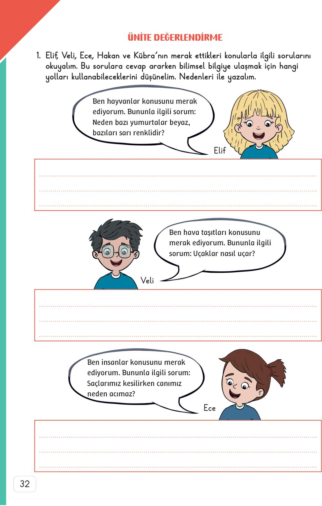
Elif: Ben hayvanlar konusunu merak ediyorum. Bununla ilgili sorum: Neden bazı yumurtalar beyaz, bazıları sarı renklidir?

__________________________________________________________________
__________________________________________________________________
__________________________________________________________________

Veli: Ben hava taşıtları konusunu merak ediyorum. Bununla ilgili sorum: Uçaklar nasıl uçar?

Ece: Ben insanlar konusunu merak ediyorum. Bununla ilgili sorum: Saçlarımız kesilirken canımız neden acımaz?

<!-- sayfa 33 -->

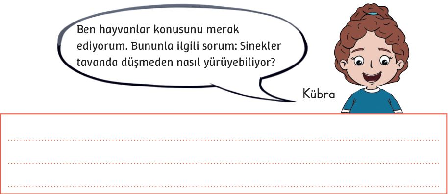

Ben hayvanlar konusunu merak ediyorum. Bununla ilgili sorum: Sinekler tavanda düşmeden nasıl yürüyebiliyor?
Kübra

--------------------------------------------------------------------------------

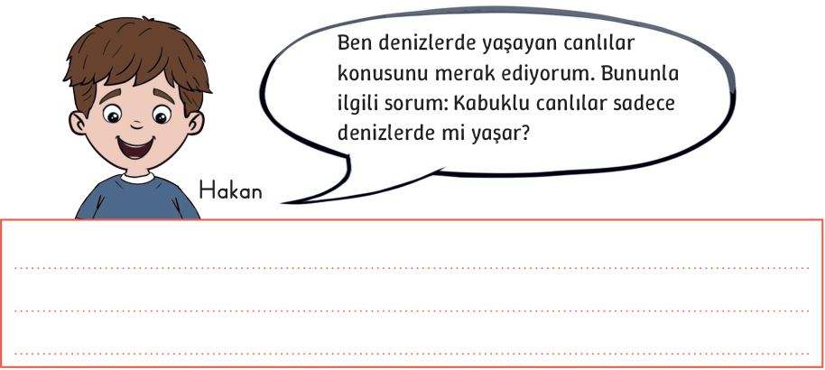

Hakan
Ben denizlerde yaşayan canlılar konusunu merak ediyorum. Bununla ilgili sorum: Kabuklu canlılar sadece denizlerde mi yaşar?

Merak ettiğimiz bir konuyu ve konuyla ilgili sorumuzu aşağıdaki ilgili alanlara yazalım.

| Merak Ettiğim Konu | Konu Hakkındaki Sorum |
| :--- | :--- |
| | |

Yazdığımız sorunun cevabını bulmak için bilimsel bilgiye ulaşma yollarından hangilerini kullanabiliriz? Neden?

<!-- sayfa 34 -->

2. Denizlerde yaşayan canlılar konusunu merak eden Hakan, denizler ve tatlı sularda birbirinden farklı çok sayıda canlının yaşadığını öğrendi. Bunların bir bölümünün de kabuklu canlılar olduğu bilgisine ulaştı.

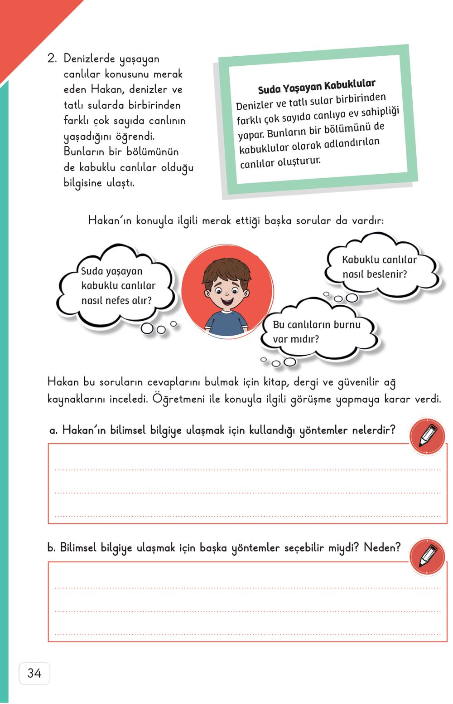
**Suda Yaşayan Kabuklular**
Denizler ve tatlı sular birbirinden farklı çok sayıda canlıya ev sahipliği yapar. Bunların bir bölümünü de kabuklular olarak adlandırılan canlılar oluşturur.

Hakan’ın konuyla ilgili merak ettiği başka sorular da vardır:

Suda yaşayan kabuklu canlılar nasıl nefes alır?

Kabuklu canlılar nasıl beslenir?

Bu canlıların burnu var mıdır?

Hakan bu soruların cevaplarını bulmak için kitap, dergi ve güvenilir ağ kaynaklarını inceledi. Öğretmeni ile konuyla ilgili görüşme yapmaya karar verdi.

a. *Hakan’ın bilimsel bilgiye ulaşmak için kullandığı yöntemler nelerdir?*

b. *Bilimsel bilgiye ulaşmak için başka yöntemler seçebilir miydi? Neden?*

<!-- sayfa 35 -->

3. Gök bilimine merakı olan Ali aşağıdaki bilgiye ulaşmıştır.

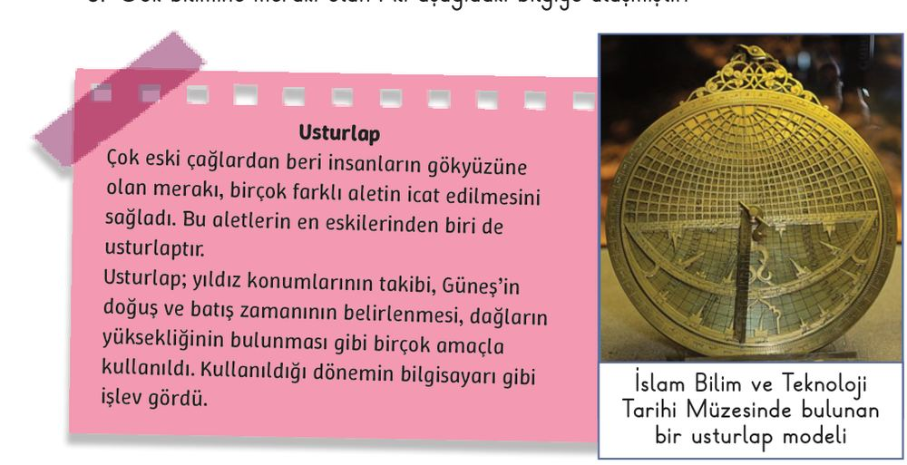

**Usturlap**
Çok eski çağlardan beri insanların gökyüzüne olan merakı, birçok farklı aletin icat edilmesini sağladı. Bu aletlerin en eskilerinden biri de usturlaptır.
Usturlap; yıldız konumlarının takibi, Güneş’in doğuş ve batış zamanının belirlenmesi, dağların yüksekliğinin bulunması gibi birçok amaçla kullanıldı. Kullanıldığı dönemin bilgisayarı gibi işlev gördü.

İslam Bilim ve Teknoloji Tarihi Müzesinde bulunan bir usturlap modeli

Ali usturlabı kullanan Türk bilim insanlarının kimler olduğunu çok merak ediyordu. Bu sorunun cevabını bulmak için araştırma yapmaya başladı. Buna göre

a. Ali'nin araştırmaları sonucunda hangi bilgilere ulaşmış olabileceğini yazalım.

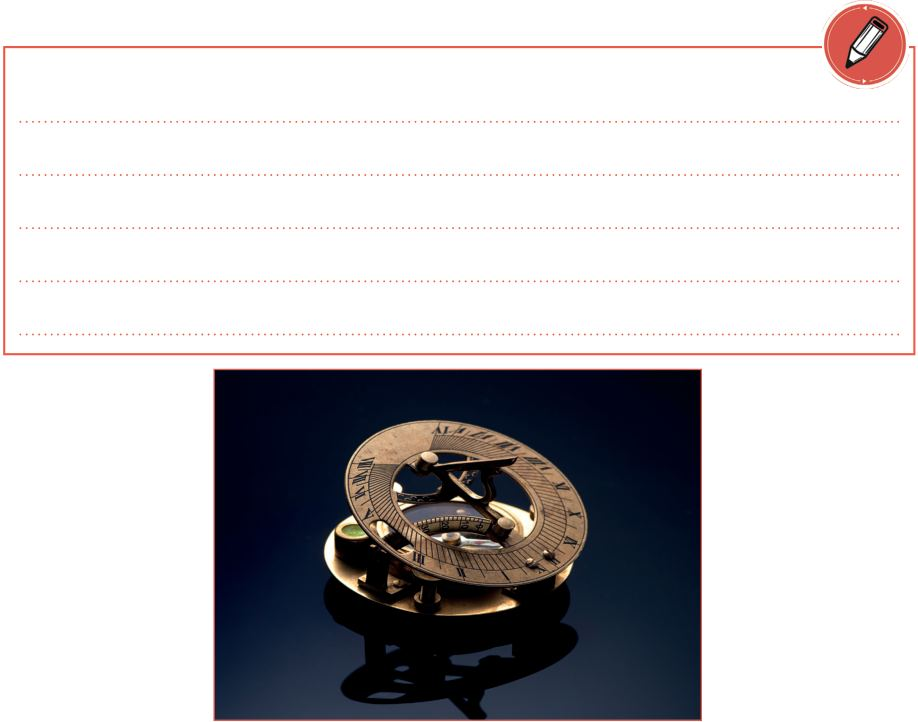

<!-- sayfa 36 -->

b. Usturlabı kullanan bilim insanlarından iki tanesini seçelim. Bu bilim insanları ile ilgili topladığımız bilgileri aşağıdaki bölümlere yazalım.

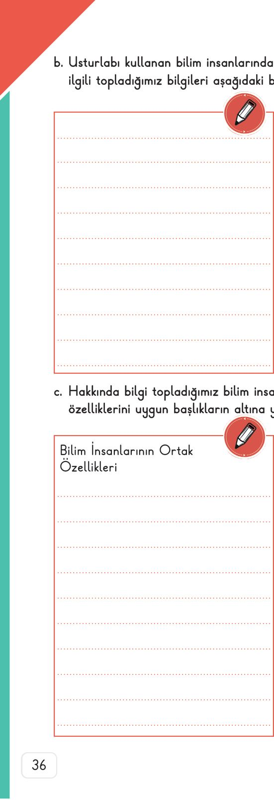 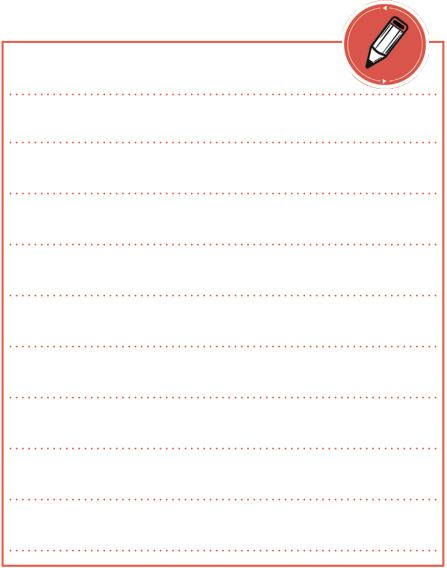

c. Hakkında bilgi topladığımız bilim insanlarının ortak olan ve ortak olmayan özelliklerini uygun başlıkların altına yazalım.

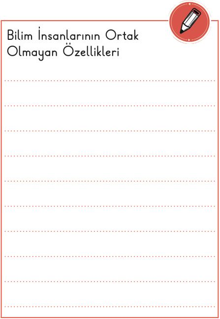

| Bilim İnsanlarının Ortak Özellikleri | Bilim İnsanlarının Ortak Olmayan Özellikleri |
| :--- | :--- |
|  |  |

<!-- sayfa 37 -->

4. Aşağıdaki bilim insanlarının ortak olan ve ortak olmayan özelliklerini ilgili alanlara yazalım.

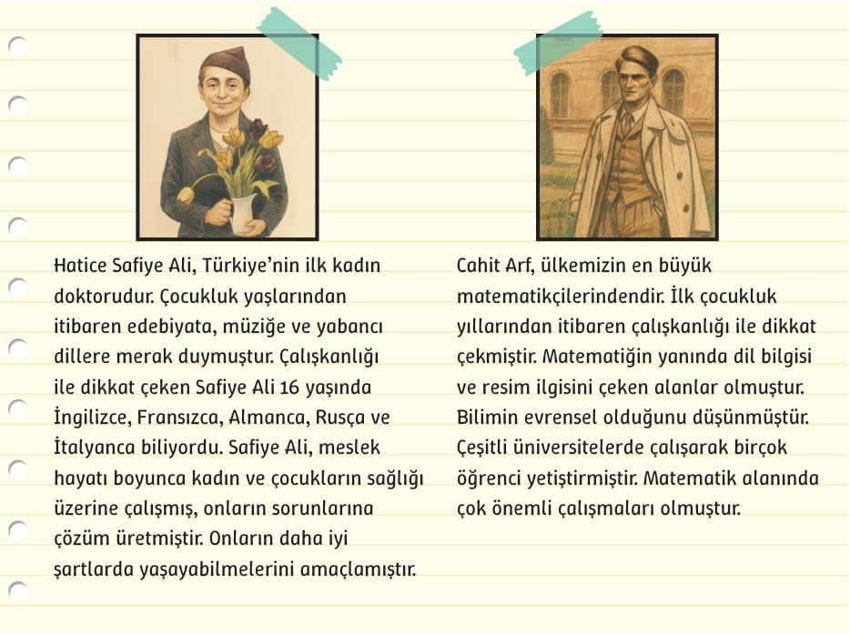
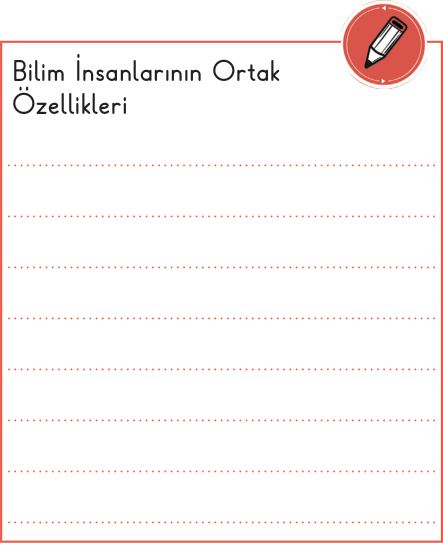
Hatice Safiye Ali, Türkiye’nin ilk kadın doktorudur. Çocukluk yaşlarından itibaren edebiyata, müziğe ve yabancı dillere merak duymuştur. Çalışkanlığı ile dikkat çeken Safiye Ali 16 yaşında İngilizce, Fransızca, Almanca, Rusça ve İtalyanca biliyordu. Safiye Ali, meslek hayatı boyunca kadın ve çocukların sağlığı üzerine çalışmış, onların sorunlarına çözüm üretmiştir. Onların daha iyi şartlarda yaşayabilmelerini amaçlamıştır.

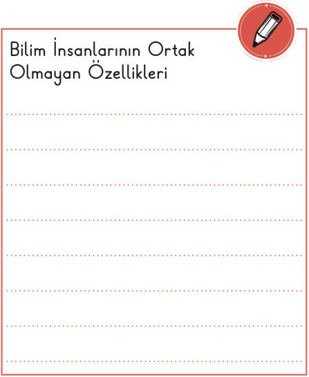
Cahit Arf, ülkemizin en büyük matematikçilerindendir. İlk çocukluk yıllarından itibaren çalışkanlığı ile dikkat çekmiştir. Matematiğin yanında dil bilgisi ve resim ilgisini çeken alanlar olmuştur. Bilimin evrensel olduğunu düşünmüştür. Çeşitli üniversitelerde çalışarak birçok öğrenci yetiştirmiştir. Matematik alanında çok önemli çalışmaları olmuştur.

| Bilim İnsanlarının Ortak Özellikleri | Bilim İnsanlarının Ortak Olmayan Özellikleri |
| :--- | :--- |
| | |
| | |
| | |
| | |
| | |
| | |
| | |
| | |
| | |
| | |

<!-- sayfa 38 -->

5. Bilim insanları ile ilgili aşağıda verilen önermeleri tamamlayalım.

a. Bilim insanı olmak için sahip olunması gereken özelliklere örnek olarak 
..........................................................................................................................................
..........................................................................................................................................
..........................................................................................................................................

b. Bilim insanları aradıkları yanıtları hemen bulamadıklarında araştırmaktan vazgeçmezler, 
..........................................................................................................................................
..........................................................................................................................................
..........................................................................................................................................

6. Bilim insanı olmak için neler yapabilirsiniz? 
..........................................................................................................................................
..........................................................................................................................................
..........................................................................................................................................
................

<!-- sayfa 39 -->

# 2. ÜNİTE
# CANLILAR DÜNYASINA YOLCULUK

• CANLILARIN SINIFLANDIRILMASI
• DUYU ORGANLARININ İŞLEVLERİ
• CANLILARIN YAŞAM DÖNGÜLERİ

Bu ünitede;
› canlıları sınıflandıracak,
› duyu organları aracılığıyla çevrenin algılanmasına ilişkin bilimsel çıkarımda bulunacak,
› canlıların yaşam döngüleri ile ilgili tümevarımsal akıl yürütme yapacağız.

 EBA’da yer alan üniteye karekod üzerinden erişelim.

 Ünite ile ilgili özet içeriğe karekod üzerinden erişelim.

# ANAHTAR KAVRAMLAR

• algı
• beslenme
• bitki
• boşaltım
• büyüme
• duyu organları
• hareket
• hayvan
• mantar
• mikroskopla görülebilen canlılar
• solunum
• tepki
• uyaran
• üreme
• yaşam döngüsü

<!-- sayfa 40 -->

# MERAK SAYFASI

Bitkiler hareket eder mi?
Bitki tohumları canlı mıdır?
Mikroskopta neler görebilirim?

## Bunları Biliyor muyuz?

> Okyanuslarda yaşayan canlıların bazıları devasa boyutlara ulaşabilirken bazıları $1\text{ cm}$'den bile küçük olabilir.
> Kar leoparlarının kocaman bir burun boşluğu vardır. Kar leoparları kış mevsiminde soluduğu havayı burun boşluğunda ısıtır.

<!-- sayfa 41 -->

Yılanlar çatal dilleriyle havanın kokusunu alabilir. Acaba kokunun hangi yönden geldiğini de anlayabilir mi?

Köygöçüren mantarı zehirli midir?

# ÜNİTE İLE İLGİLİ MERAK ETTİĞİN BİR SORU DA SENDEN

> Balıkların göz kapakları yoktur ve balıklar gözleri açık uyur. Böylece tehlikelere karşı tetikte olur.
> Yeşil renkli brokoliyi sarı renkli çiçekleri açmadan önce yeriz.
> Halk arasında yılanyastığı adıyla bilinen "Milleyha tirşiği" adlı bitki, bilim insanlarının incelemesiyle bilimsel kayıtlara girdi.

<!-- sayfa 42 -->

# CANLILARIN SINIFLANDIRILMASI

**Neler Biliyorum?**

Aşağıdaki varlıklardan canlı olanların harflerini boyayalım. Boyadığımız harflerden anlamlı bir sözcük oluşturup bunu şifre bölümüne yazalım. Şifre bölümünde oluşturduğumuz sözcük evcil bir hayvan türü olmalı. 

| E | Ö | P | İ |
|---|---|---|---|
| A | K | D | Y |

**ŞİFRE:** ____________________

**KÖPRÜ KURALIM**

Baktığımız, beslediğimiz veya çevremizde gördüğümüz bir canlının özelliklerini anlatalım.

<!-- sayfa 43 -->

# Canlıların Benzerlik ve Farklılıklarını Bulalım

Görseli inceleyelim. Görselde yer alan canlıların benzer ve farklı niteliklerini aşağıdaki ilgili alanlara yazalım.

| Benzer Nitelikler | Farklı Nitelikler |
| :--- | :--- |
| ............................................................ | ............................................................ |
| ............................................................ | ............................................................ |
| ............................................................ | ............................................................ |
| ............................................................ | ............................................................ |
| ............................................................ | ............................................................ |

<!-- yer tutucu bulunamadı: sayfa sonuna eklendi -->

<!-- sayfa 44 -->

Konu ile ilgili içeriğe karekod üzerinden erişelim.

# Şimdi Gözlem Zamanı

**Malzemeler:** kalem, not defteri

Arkadaşlarımızla okul bahçesinde gözlem yapalım. Gördüğümüz canlı ve cansız varlıklardan dörder tanesini gözlem formuna yazalım. Gözlem Formu'nu örnekteki gibi dolduralım. Formlarımızı arkadaşlarımızla karşılaştıralım. Merak ettiğimiz sorular varsa bu soruları not defterimize yazalım.

## GÖZLEM FORMU

Gözlem Tarihi: .................................................. Gözlem Yeri: ..................................................

| Özellikler | Varlıklar | Canlı | | | | | Cansız | | | |
| :--- | :--- | :---: | :---: | :---: | :---: | :---: | :---: | :---: | :---: | :---: |
| | **Serçe** | | | | | | | | | |
| Hareket ediyor mu? | ✓ | | | | | | | | | |
| Solunum yapıyor mu? | ✓ | | | | | | | | | |
| Büyüyor mu? | ✓ | | | | | | | | | |
| Besleniyor mu? | ✓ | | | | | | | | | |
| Ürüyor mu? | ✓ | | | | | | | | | |
| Boşaltım yapıyor mu? | ✓ | | | | | | | | | |
| Tepki veriyor mu? | ✓ | | | | | | | | | |

Gözlem sonuçlarımız ve kaydettiğimiz verilerden yola çıkarak canlıların ortak özelliklerini açıklayalım. Kendi cümlelerimizle tanımlayalım.

<!-- sayfa 45 -->

# ÖĞRENELİM

Çevremizde pek çok canlı ve cansız varlık vardır. Bütün canlılar büyür, beslenir, ürer, hareket eder, tepki verir, solunum ve boşaltım yapar. Canlı varlıkların ortak özelliklerini inceleyelim.

**Büyüme**
Yavru muhabbet kuşu doğduğu andan itibaren büyür ve gelişir.
Fasulye tohumu toprağa atıldıktan sonra büyümeye başlar.

**Beslenme**
Hayvanlar ve bitkiler büyümek, gelişmek ve hayatta kalabilmek için beslenir. Tay annesinden süt emer, civcivler ise yem yer. Bitkiler besinlerini kendileri üretir.

<!-- sayfa 46 -->

# Üreme

Kaz yumurtalarından kendilerine benzeyen yavrular çıkar.
Mısır tohumundan yeni mısırlar meydana gelir.

# Hareket etme

Kurt koşarak, leylek uçarak, bukalemun sürünerek hareket eder.

<!-- yer tutucu bulunamadı: sayfa sonuna eklendi -->

<!-- sayfa 47 -->

# Tepki verme
Kedi duyduğu sese, gördüğü harekete ses çıkararak, kuyruğunu sallayarak veya tüylerini kabartarak tepki verebilir. Böcekkapan bitkisi, üzerindeki tüylere konan veya dokunan avını kapanarak yakalayabilir.

# Boşaltım
Keçi idrar, dışkı ve terleme yoluyla vücudundaki atıkları atarak boşaltım yapar. Bitkiler terleme yoluyla ve yapraklarını dökerek boşaltım yapar.

# Solunum
Balıklar solungaçlarıyla solunum yapar. Ağaçlar yaprak

<!-- sayfa 48 -->

> Canlı varlıklardan ayçiçeği ve Türk çoban köpeğiyle ilgili bilgileri okuyalım.

Ayçiçeği

* Ayçiçeği tomurcukken gündüz Güneş’i takip eder. Gece de sabahki konumuna geri döner. Olgunlaşmış ayçiçeği ise sürekli doğuya doğru yönelir.
* Yapraklar ile solunum yapar.
* Ayçiçeği filizleri $160$ santimetreye kadar uzayarak, büyüyüp gelişebilir.
* Yeşil bölümleriyle Güneş ışığını kullanarak kendi besinini yapar.
* Ayçiçeğinin tohumları çekirdeklerdir. Çekirdekler çimlenerek çoğalır böylece yeni ayçiçekleri meydana gelir.
* Yapraklarından terleyerek ve kuruyan yapraklarını dökerek boşaltım yapar.
* Güneş ışığına tepki verir.

<!-- sayfa 49 -->

# Türk Çoban Köpeği Akbaş

* Yürüyerek ve koşarak hareket eder.
* Solunum yapar.
* 2-3 kilogramlık yavru akbaş, 80 kilograma kadar büyüyüp gelişebilir.
* Et ile beslenir.
* Kendisine benzeyen yavrular doğurur. Ortalama 10-15 yıl yaşar.
* İdrar, ter ve dışkı ile boşaltım yapar.
* Çevreden gelen uyarılara havlayarak, uluyarak tepki verir. Tehlikeli durumlarda sahibini ve sürüsünü korur.

 Çevremizden bir canlı seçip benzer özelliklerini söyleyelim.

<!-- sayfa 50 -->

# Canlıları Keşfedelim

Aşağıdaki metni okuyalım ve görselleri inceleyelim. Soruları metne göre cevaplayalım.

Melisa, annesi ve babası ile doğa yürüyüşüne çıktı. Yürüyüş boyunca karşılaştığı canlıların fotoğrafını çekti. Fotoğraflardan bir pano hazırlayarak okuldaki arkadaşlarına sunum yaptı.

1. Melisa hangi canlıların fotoğrafını çekmiştir?
..........................................................................................................................................
..........................................................................................................................................

2. Melisa hazırladığı panoda hangi canlının fotoğrafına daha çok yer vermiştir? Bu canlı ile daha önce doğada karşılaştık mı?
..........................................................................................................................................
..........................................................................................................................................

3. Bu canlının canlılık özelliklerinden hangilerini biliyoruz?
..........................................................................................................................................
..........................................................................................................................................

<!-- sayfa 51 -->

# Gözle Görünmeyenlerin Peşindeyim

**Malzemeler:** mikroskop, lam, lamel, vazo veya bitki saksısı dibinde biriken su, damlalık, kalem, boya kalemleri

> Çevremizde gözle görebildiğimiz ve göremediğimiz pek çok canlı vardır. Mikroskop, gözle göremediğimiz küçük canlıları büyüterek daha görünür hâle getiren alettir.

**Uygulama adımlarına dikkat ederek etkinliği yapalım.**

* Sınıf arkadaşlarımızla dört veya beş kişilik gruplar oluşturalım.
* Vazo veya saksı dibinde biriken sudan damlalık yardımıyla lam üzerine damlatalım.
* Lamın üzerine lameli kapatalım. Cam malzemeleri kullanırken dikkatli olalım.
* Gerekli durumlarda öğretmenimizden yardım alalım.
* Hazırladığımız örneği mikroskopta inceleyelim.
* Gördüğümüz canlıları Ekler bölümünde verilen Ek 1'e çizelim.

<!-- sayfa 52 -->

# Kim, Hangi Sınıfta?

**Malzemeler:** makas, yapıştırıcı 

Uygulama adımlarına dikkat ederek etkinliği yapalım.
* Sınıf arkadaşlarımızla iki kişilik gruplar oluşturalım.
* Ekler bölümünde verilen Ek 2'deki görselleri işaretli yerlerden keselim.
* Kestiğimiz görsellerdeki canlıların benzer ve farklı niteliklerini arkadaşlarımızla tartışalım. Görselleri buna göre gruplara ayıralım. 
* Arkadaşlarımızın fikirlerine saygı duyalım, yeni bilgi ve fikirlere açık olalım.
* Aşağıda ve yan sayfadaki boş alanları çalışma yaprağı olarak kullanalım. Bu alanı belirlediğimiz canlı grubu sayısına göre bölelim.
* Görselleri gruplayarak yapıştıralım.
* Her bir gruba isim verelim.

<!-- sayfa 53 -->

Aşağıdaki soruları yaptığımız etkinliğe göre cevaplayalım. 

1. Canlıları kaç gruba ayırdık? Adlarını yazalım.
..........................................................................................................................................
..........................................................................................................................................
..........................................................................................................................................

2. Canlıları niçin bu gruplara ayırdık?
..........................................................................................................................................
..........................................................................................................................................
..........................................................................................................................................

<!-- sayfa 54 -->

# ÖĞRENELİM

Canlıların belirli özelliklere göre gruplara ayrılmasına sınıflandırma denir. Bilim insanları için bu sınıflandırma çok önemlidir. Canlıları sınıflandırarak bir canlının neye benzediğini, nasıl beslendiğini veya nasıl bir ortamda yaşadığını daha kolay öğreniriz. Sınıflandırma, bilim insanlarının canlılar arasındaki benzerlik ve farklılıkları düzenlemesine ve canlıları daha iyi anlamasına olanak tanır. Bu bilgi Dünya'daki yaşamın çeşitliliğini ve geçmişini anlamak için gereklidir. Yıllar içinde farklı sınıflandırmalar yapılsa da özellikle mikroskobun keşfiyle sınıflandırma yenilenmiştir.

Canlıları benzerlik ve farklılıklarına göre dört grupta sınıflandırabiliriz:

* Mikroskopla görülebilen canlılar
* Hayvanlar
* Mantarlar
* Bitkiler

## Mikroskopla Görülebilenler

* Havada, suda, toprakta ve canlı vücudunda yaşayabilir.
* Çok küçük olan bu canlıları gözle göremeyiz.
* Onları mikroskopla görebilir hatta bazılarının hareketlerini inceleyebiliriz.

<!-- sayfa 55 -->

# Mantarlar

* Bahçe, park, orman, ağaç gövdesi, canlı vücudu gibi pek çok yerde yaşayabilir.
* Çeşitli renk, büyüklük ve şekilde olabilir.
* Özellikle nemli ortamları sever.
* Bazı mantarlar besin olarak yetiştirilir ve tüketilir. Bazıları ise zehirli olabilir.

# Bitkiler

* Kırlardaki papatyalar, ağaçlar, çimenler, kaktüsler; denizlerdeki yosunlar gibi birçok bitki çeşidi vardır.
* Kendi besinlerini kendileri üretir.
* Başka canlılar için besin kaynağıdır.

# Hayvanlar

* Farklı yerlerde yaşayabilir. Balık, ahtapot, yengeç suda; keçi, aslan, tavuk karada; kurbağa, ördek hem karada hem suda yaşayan canlılardandır.
* Beslenme şekilleri birbirinden farklıdır. Tavuk ot, kedi et, ayı ise hem et hem de ot yer.

Konu ile ilgili

<!-- sayfa 56 -->

# Panoda Canlıları Gruplayalım

**Malzemeler:** makas, yapıştırıcı, her grup için 4 tane tabak, canlı görselleri, renkli kartonlar, A4 kâğıdı, boya kalemleri, rafya veya renkli iplik, oynayan göz, şönil vb. 

Uygulama adımlarına dikkat ederek etkinliği yapalım. Ekler bölümünde verilen Ek 3 çalışma yaprağını etkinlik boyunca dolduralım.

* Sınıf arkadaşlarımızla dört kişilik gruplar oluşturalım.
* Canlıların sınıflandırılması ile ilgili bir pano hazırlayalım.
* Pano hazırlarken arkadaşlarımızla iş bölümü yapalım. Üstlendiğimiz görevleri zamanında yerine getirmeye dikkat edelim.
* Tabakların her birine canlıları sınıflandıracak şekilde isim verelim. Renkli kartondan hazırladığımız etiketlere isimleri yazalım. Etiketleri tabakların üst kısmına yapıştıralım.
* Tabaklarımıza yapıştırmak üzere gruplandırmalara uygun canlılar hazırlayalım. Bu canlıların görsellerini keserek yapıştırabilir veya kendimiz çizip boyayabiliriz. Oynayan göz yapıştırabilir veya iplik ve rafyalar ile süsleme yapabiliriz.
* Hazırladığımız panoyu sınıfın uygun bir yerine asalım.
* Grup arkadaşlarımızla diğer grupların panolarını inceleyelim. İncelerken sormak istediğimiz soruları not alalım.
* Not aldığımız sorularımızı diğer gruplara soralım.
* Diğer grupların bize sorduğu soruları cevaplayalım.
* Etkinlik sonunda sayfa 57'deki Akran Değerlendirme Formu'nu dolduralım. 

<!-- sayfa 57 -->

Aşağıdaki form, canlıların sınıflandırılmasına ilişkin yaptığımız etkinlikte arkadaşlarımızın grup içindeki davranışlarımızı değerlendirmemiz amacıyla hazırlanmıştır. Buna göre davranış ifadelerini okuyarak "Hiçbir zaman", "Bazen" veya "Her zaman" seçeneklerinden uygun olanı işaretleyelim.

# AKRAN DEĞERLENDİRME FORMU

Değerlendiren öğrencinin
Adı soyadı: ............................................................
Sınıfı ve numarası: ................................................
Grubunun adı veya numarası: ..................................

Grup arkadaşlarının
Adı soyadı: ............................................................
Adı soyadı: ............................................................
Adı soyadı: ............................................................

| Değerlendirilecek Davranışlar | Hiçbir zaman | | | Bazen | | | Her zaman | | |
| :--- | :---: | :---: | :---: | :---: | :---: | :---: | :---: | :---: | :---: |
| | 1. Arkadaşım | 2. Arkadaşım | 3. Arkadaşım | 1. Arkadaşım | 2. Arkadaşım | 3. Arkadaşım | 1. Arkadaşım | 2. Arkadaşım | 3. Arkadaşım |
| Arkadaşlarıyla iş birliği içinde çalıştı. | | | | | | | | | |
| Sorumluluklarını yerine getirdi. | | | | | | | | | |
| Etkinlik süresince fikir alışverişinde bulundu. | | | | | | | | | |
| Gerektiğinde arkadaşlarına yardımcı oldu. | | | | | | | | | |
| Arkadaşlarına saygılı davrandı. | | | | | | | | | |
| Zamanı etkili kullandı. | | | | | | | | | |

<!-- sayfa 58 -->

# DUYU ORGANLARININ İŞLEVLERİ

**Neler Biliyorum?**

Aşağıdaki soruyu sözlü olarak cevaplayalım.
• Duyu organlarımız nelerdir?

## KÖPRÜ KURALIM

Aşağıdaki tabloda duyu organları hem sağdan sola hem de yukarıdan aşağıya birer tane olacak şekilde dizilmiştir. Buna göre boş bırakılan kutulara gelmesi gereken duyu organlarının rakamlarını yıldızların içine yazalım.

**İPUCU:** Bulmacada öncelikle tek yıldızlı sıralardan başlayalım.

| | | | | |
| :---: | :---: | :---: | :---: | :---: |
| 4 | 1 | ⭐ | ⭐ | 3 |
| 3 | ⭐ | 1 | 2 | 5 |
| 1 | 5 | ⭐ | 4 | ⭐ |
| 2 | ⭐ | 5 | ⭐ | 4 |
| ⭐ | 2 | 4 | 3 | ⭐ |

<!-- sayfa 59 -->

Hayvan ve bitkilerin duyu organları ile ilgili bilgileri okuyalım.

# ÖĞRENELİM

Yusufçuğun gözleri otuz bine yakın bal peteği biçiminde küçük gözden oluşur. Bu gözler her yönden gelen görüntüleri toplayarak birleştirir. Yusufçuğun gözleri, insanlarınkine göre çok daha fazla rengi ayırt eder. Ayrıca önünden geçen böceğin kanat çırpışlarını da fark edebilir.

Kelebeğin başında her birinin ucunda minik birer topuz bulunan iki anten vardır. Bu antenler kelebeğin koku almasını sağlar. Kelebek, bacaklarında bulunan tat algılayıcıları sayesinde üzerine konduğu çiçeklerin bal özünün tadını alır. Bal özünü başının ön tarafında bulunan hortumla emer.

Bazı bitkilerin yaprakları gece kapanıp sabah yeniden açılır ancak küstüm otunun yaprakları en ufak bir temasta bile anında kapanır. Yapraklarına doğru üflenirse de aynı tepkiyi gösterir.

Böcek yiyen güneşgülü bitkisi, böcekleri yakalamak için uzun ve yapışkan tüylerini kullanır. Bir böceğin temasını hisseden bitki, yapraklarını uçlarından başlayıp içe doğru kıvırarak böceği hapseder ve yer.

Konu ile ilgili içeriğe karekod üzerinden erişelim.

<!-- sayfa 60 -->

# ARAŞTIRALIM

## Araştırma Raporum

**Malzemeler:** kalem, boya kalemleri

İlginç bulduğumuz bir veya iki hayvanı seçelim. Hayvanların duyu organlarıyla çevrelerini nasıl algıladıklarına ilişkin araştırma yapalım. Ulaştığımız veriler doğrultusunda araştırma raporunu dolduralım.

### Araştırmamla İlgili Elde Ettiğim Bilgiler 

..........................................................................................................................................................
..........................................................................................................................................................
..........................................................................................................................................................
..........................................................................................................................................................
..........................................................................................................................................................
..........................................................................................................................................................
..........................................................................................................................................................
................................................................

<!-- yer tutucu bulunamadı: sayfa sonuna eklendi -->

<!-- yer tutucu bulunamadı: sayfa sonuna eklendi -->

<!-- sayfa 61 -->

# Bilgiye Ulaşma Yollarım ve Kullandığım Yöntemler

__________________________________________________________________
__________________________________________________________________
__________________________________________________________________
__________________________________________________________________

# Kullandığım Kaynaklar

__________________________________________________________________
__________________________________________________________________
__________________________________________________________________
__________________________________________________________________

# Araştırmamıza Göre Hayvanların Çevrelerini Algılama Biçimleri

__________________________________________________________________
__________________________________________________________________
__________________________________________________________________
__________________________________________________________________
__________________________________________________________________
__________________________________________________________________
__________________________________________________________________
__________________________________________________________________

<!-- sayfa 62 -->

# Duyu İstasyonları

**Malzemeler:** kalem, A4 kâğıdı, pamuk, zımpara kâğıdı, taş, sünger, limon, karabiber, meyveler, kolonya, kahve, tarçın, zil, düdük, ksilofon

Uygulama adımlarına dikkat ederek etkinliği yapalım. Ekler bölümünde verilen Ek 4 çalışma yaprağını etkinlik boyunca dolduralım.

* Sınıf arkadaşlarımızla beş grup oluşturalım.
* Sınıfta beş istasyon için yer belirleyelim.
* Her istasyona bir duyu organımızın adını vererek bir kâğıda yazalım. Kâğıdı istasyonların bulunduğu yere koyalım.
* Aşağıda listelenen istasyonlara istenen malzemeleri koyalım.

| Göz İstasyonu | Deri İstasyonu | Dil İstasyonu |
| :--- | :--- | :--- |
| sınıftaki eşyalar | pamuk zımpara kâğıdı taş sünger | limon karabiber meyveler |
|  |  |  |
|  | | |

| Burun İstasyonu | Kulak İstasyonu |
| :--- | :--- |
| kolonya kahve tarçın | zil düdük ksilofon |
|  |  |
| |  |

[[SEKIL:robot resmi]]

> Listelere benzer maddeler ilave edebiliriz. Dokunduğumuz, kokladığımız ve tattığımız malzemeleri seçerken onların zarar verici olmamasına dikkat etmeliyiz.

<!-- sayfa 63 -->

* Gruplar hâlinde istasyonlara geçelim. İstasyondaki çalışmaları tamamlayıp saat yönünde ilerleyerek sıradaki istasyona geçelim. Etkinlikleri her birimiz uygulayalım.

| Kulak İstasyonu | Dil İstasyonu | Göz İstasyonu |
| :--- | :--- | :--- |
| Grubu bir gözünü kapatır. Diğer grup üyeleri ses çıkaran aletlerden birini çalar. Gözü kapalı olan grup üyesi aleti tahmin eder. | Grubu biri gözünü kapatır. Diğer grup üyeleri istasyondaki malzemelerden birini seçerek gözü kapalı arkadaşından tatmasını ister. Gözü kapalı olan grup üyesi malzemeyi tahmin eder. | Grustan bir kişi renk söyler. Diğer grup üyeleri de o renkteki eşyaları bulur. |

| Burun İstasyonu | Deri İstasyonu |
| :--- | :--- |
| Grustan biri gözünü kapatır. Diğer grup üyeleri istasyondaki malzemelerden birini seçerek gözü kapalı arkadaşından koklamasını ister. Gözü kapalı olan grup üyesi malzemeyi tahmin eder. | Grustan biri gözünü kapatır. Diğer grup üyeleri istasyondaki malzemelerden birini seçerek gözü kapalı arkadaşından dokunmasını ister. Gözü kapalı grup üyesi malzemeyi tahmin eder. |

* Etkinlik sonunda sayfa 64'teki Akran Değerlendirme Formu'nu dolduralım.
* Topladığımız verileri sınıfta paylaşalım.
* Duyu organlarımızın çevresel uyaranlara nasıl tepki verdiğini tartışalım.

Daha önce yaptığımız araştırma ve etkinlikleri düşünelim. Buna göre canlıların çevrelerini farklı biçimlerde algılamalarına ilişkin topladığımız verileri yorumlayarak değerlendirelim.

![Çizgili yazı alanı üzerinde kalem simgesi]

<!-- yer tutucu bulunamadı: sayfa sonuna eklendi -->

<!-- yer tutucu bulunamadı: sayfa sonuna eklendi -->

<!-- sayfa 64 -->

# DEĞERLENDİRELİM

Aşağıdaki form, duyu organları ile ilgili yaptığımız etkinlikte arkadaşlarımızın grup içindeki davranışlarını değerlendirmemiz amacıyla hazırlanmıştır. Buna göre davranış ifadelerini okuyalım. Arkadaşlarımız hakkındaki görüşlerimizi evet (E), bazen (B), hayır (H) seçeneklerinden uygun olanlar ile değerlendirelim.

## AKRAN DEĞERLENDİRME FORMU

**Değerlendiren öğrencinin**
Adı soyadı: ........................................................................
Sınıfı ve numarası: ..........................................................
Grubunun adı veya numarası: ...........................................

**Grup arkadaşlarının**
1. Adı soyadı: ...................................................................
2. Adı soyadı: ...................................................................
3. Adı soyadı: ...................................................................
4. Adı soyadı: ...................................................................
5. Adı soyadı: ...................................................................
6. Adı soyadı: ...................................................................
7. Adı soyadı: ...................................................................
8. Adı soyadı: ...................................................................
9. Adı soyadı: ...................................................................

| Değerlendirilecek Davranışlar | 1. Arkadaşım | 2. Arkadaşım | 3. Arkadaşım | 4. Arkadaşım | 5. Arkadaşım | 6. Arkadaşım | 7. Arkadaşım | 8. Arkadaşım | 9. Arkadaşım |
| :--- | :---: | :---: | :---: | :---: | :---: | :---: | :---: | :---: | :---: |
| Arkadaşlarıyla iş birliği içinde çalıştı. | | | | | | | | | |
| Sorumluluklarını yerine getirdi. | | | | | | | | | |
| Etkinlik süresince fikir alışverişinde bulundu. | | | | | | | | | |
| Gerektiğinde arkadaşlarına yardımcı oldu. | | | | | | | | | |
| Arkadaşlarına saygılı davrandı. | | | | | | | | | |
| Zamanı etkili kullandı. | | | | | | | | | |

<!-- yer tutucu bulunamadı: sayfa sonuna eklendi -->

<!-- sayfa 65 -->

İnsanlarda çevrelerini algılamak için beş duyu organı vardır. Bunlar: göz, kulak, burun, deri ve dildir.

# ÖĞRENELİM

Gözlerimiz çevredeki cisimleri renk, boyut, şekil gibi birçok özelliği ile algılamamızı sağlar.

Kulaklarımız çevremizden gelen sesleri tanımamızı sağlar. Dengemizi kurmamıza da yardımcı olur.

Dilimiz besinlerin acı, tatlı, ekşi olduğunu algılamamıza yarar. Dilimiz aynı zamanda konuşmamızı sağlayan duyu organıdır.

Derimiz ise bizi dıştan sararak korur. Yumuşak, sert, sıcak, soğuk, pürüzlü, az pürüzlü olma gibi özellikleri algılamamızı sağlar.

Burnumuz çevremizdeki farklı kokuları almamızı ve burnumuzdan giren havayı temizlememizi ve ısıtmamızı sağlar.

Duyu organlarımız çevredeki koku, tat, sıcaklık, renk gibi farklı durumları algılayarak çevremiz hakkında bilgi toplamamızı sağlar. Canlıların çevrelerini algıladıkları duyu organlarının çeşidi, sayısı, biçimi ve yetenekleri farklı

<!-- sayfa 66 -->

# Duyu Organları Birbirini Etkiler mi?

**Malzemeler:** göz bandı; leblebi, kuru üzüm vb. yiyecekler

Uygulama adımlarına dikkat ederek etkinliği yapalım.

## 1. Aşama

* Sınıf içinde bir arkadaşımızın gözünü göz bandı ile bağlayalım. Arkadaşımızdan burnunu eliyle kapatmasını isteyelim.
* Arkadaşımızdan verdiğimiz yiyecekleri tatmasını ve yiyeceğin ne olduğunu tahmin etmesini isteyelim.
* Arkadaşımız yediği yiyecekleri tahmin edebildi mi? Bunun nedeni ne olabilir? Yazalım.

## 2. Aşama

* Burnumuzu kapatarak kuru üzüm ve leblebiyi ayrı ayrı yiyelim.
* Burnumuzu kapatmadan kuru üzüm ve leblebiyi ayrı ayrı yiyelim.
* Kuru üzüm ve leblebinin tadını burnumuz kapalıyken mi yoksa açıkken mi daha iyi algıladığımızı nedeni ile yazalım.

 Bazı insanlar doğuştan duyu organlarını tam olarak kullanamayabilir veya sonradan duyu kaybı yaşayabilir. Bu durumda diğer duyu organları daha güçlü hâle gelebilir. Örneğin gözleri görmeyen biri, seslere veya kokulara daha duyarlı olabilir. Yanına gelen birini kokusundan veya ayak sesinden tanıyabilir.

<!-- sayfa 67 -->

Duyu organlarımız dünyayı keşfetmemize ve güven içinde yaşamamıza yardımcı olur. Duyu organlarımız sayesinde tehlikeleri önceden fark ederiz. Yangın alarmını duyduğumuzda hemen dışarı çıkarız. Sıcak bir şeye dokunduğumuzda derimiz acıyı algılamamızı sağlar ve elimizi anında çekeriz. Böylece yanmaktan kurtuluruz. Bizi tehlikelerden koruyan duyu organlarımızın sağlığını korumak için dikkat etmemiz gereken durumlar vardır.

# ÖĞRENELİM

* Televizyon, tablet vb. karşısında uzun süre kalmak ve bunları çok yakından izlemek, gözlerimizi ovuşturmak göz sağlığımızı bozabilir.
* Havlumuzu başkaları ile ortak kullanmak bazı hastalıklara neden olabilir.

* Bilmediğimiz maddeleri koklamak, havalandırılmamış ortamlarda bulunmak, burnumuza yabancı cisimler sokarak burnumuzu karıştırmak, burnumuzdaki kılları koparmaya çalışmak burun sağlığımıza zarar verebilir.

* Çok sıcak, soğuk ve acı besinler dilimize zarar verebilir.
* Diş sağlığımıza özen göstermek ve dişlerimizi düzenli fırçalamak dil sağlığımızı olumlu etkiler.

* Çok gürültülü ortamlarda bulunmak ve kulaklıkla yüksek sesli müzik dinlemek kulak sağlığımızı bozabilir.
* Sivri ve sert cisimlerle kulağımızı karıştırmak kulağımıza zarar verebilir.

* Uzun süre güneş altında kalmak; sivri, kesici veya çok sıcak maddelere dokunmak deri sağlığımıza zarar verebilir.
* Düzenli banyo yapmalı ve el temizliğimize özen göstermeliyiz.

# Duyu Organlarının Sağlığı

Hastalandığımızda uzman bir doktora başvurmalıyız. Belli aralıklarla doktor

<!-- sayfa 68 -->

Aşağıdaki form, duyu organlarımızın sağlığını koruma konusunda kendimizi değerlendirmemiz amacıyla hazırlanmıştır. Davranış ifadelerini okuyarak "Evet", "Bazen" veya "Hayır" seçeneklerinden uygun olanı işaretleyelim.

# ÖZ DEĞERLENDİRME FORMU

| Değerlendirilecek Davranışlar | Evet | Bazen | Hayır |
| :--- | :---: | :---: | :---: |
| 1. Kişisel eşyalarımı sadece kendim kullanırım. | | | |
| 2. Dişlerimi düzenli fırçalarım. | | | |
| 3. Kulaklıkla yüksek sesle müzik dinlemekten kaçınırım. | | | |
| 4. Ekran karşısında bana izin verilen süre kadar kalırım. | | | |
| 5. Burnumu karıştırmaktan kaçınırım. | | | |
| 6. Burun kıllarımı koparmaktan kaçınırım. | | | |
| 7. Düzenli olarak banyo yaparım. | | | |
| 8. Ekranı uygun uzaklıktan izlerim. | | | |
| 9. Bilmediğim maddeleri koklamaktan kaçınırım. | | | |
| 10. Güneş altında fazla kalmamaya dikkat ederim. | | | |
| 11. Çok acı yiyecek ve içecekleri tüketmekten kaçınırım. | | | |
| 12. Çok sıcak yiyecek ve içecekleri tüketmekten kaçınırım. | | | |
| 13. Çok soğuk yiyecek ve içecekleri tüketmekten kaçınırım. | | | |
| 14. Kulak çubuğu gibi cisimleri kulağımda kullanmaktan kaçınırım. | | | |

İşaretlediğimiz davranışların hepsinin "Evet" olması, duyu organlarımızın sağlığını korumaya dikkat ettiğimizi gösterir. "Bazen" ve "Hayır" seçeneklerini işaretlediğimiz davranışlarımız varsa duyu organlarımızın sağlığını korumaya dikkat etmeli, gerektiğinde öğretmenimiz ve ailemizden destek almalıyız.

<!-- yer tutucu bulunamadı: sayfa sonuna eklendi -->

<!-- sayfa 69 -->

# CANLILARIN YAŞAM DÖNGÜLERİ

**Aşağıdaki soruyu sözlü olarak cevaplayalım.**
* Yakın çevremizdeki bitki ve hayvanların yaşamları ile ilgili gözlemlerimiz nelerdir?

---

**Malzemeler:** boya kalemleri

Aşağıdaki görselde yer alan sayıları 1'den 25'e kadar sırayla birleştirerek görseli uygun renklerde boyayalım.

**Soruları sözlü olarak cevaplayalım.**

1. Yukarıdaki görselde özellikle Akdeniz sahillerinde görülen bir hayvanın yavrusu verilmiştir. Bu hayvanın adı nedir?
2. Noktaları birleştirerek oluşturduğumuz canlının üremesi, büyümesi, gelişmesi...

<!-- sayfa 70 -->

# Yaşam Döngülerinin Peşinde

**Malzemeler:** boya kalemleri, not kâğıdı, makas ✂️

Uygulama adımlarına dikkat ederek etkinliği yapalım.
* Ekler bölümünde verilen Ek 5’te ördek ve şeftalinin yaşam döngüsünün aşamalarını gösteren görseller verilmiştir.
* Görselleri uygun renklerle boyayalım ve işaretli yerlerden keselim.
* Görselleri aralarındaki çizgilerden katlayarak merdiven elde edelim.
* Ördek ve şeftalinin yaşam döngüsünü inceleyelim. Aralarındaki benzerlikleri aşağıdaki not kâğıdının "Bence" kısmına yazalım.

| Bence |
| :--- |
| |

* Dört veya beş kişilik gruplar oluşturalım.
* Bitki ve hayvanların yaşam döngüleri ile ilgili benzerliklerini grupta tartışalım. Canlıların yaşam döngüleri ile ilgili nasıl bir örüntü bulduğumuzu söyleyelim.

> Fikirlerimizin doğru mu, yanlış mı olduğunu belirlemeye çalışalım. Unutmayalım, ürettiğimiz her fikir değerlidir! Kendi fikrimiz kadar karşımızdakilerin fikirlerine de saygı gösterelim.

* Tartışma sonunda canlıların yaşam döngüleri ile ilgili nasıl bir genellemeye ulaştığımızı not kâğıdının "Bizce" kısmına yazalım.

| Bizce |
| :--- |
| |

* Kâğıdımızdaki "Bence" ve "Bizce" kısımlarını karşılaştıralım. Arkadaşlarımızla aynı veya farklı fikirlere sahip olabiliriz. Bilimsel bir bakış açısı ile tartıştığımızda

<!-- sayfa 71 -->

# ÖĞRENELİM

Canlıların yaşam döngülerinde bazı farklılıklar olabilir. Örneğin bir güvercin ve salatalığın yaşam döngüsünü inceleyelim.

Güvercin yumurtalarından yaklaşık yirmi günde yavrular çıkar.

Yavrular ilk başta anne ve babaları tarafından beslenir, bir aylık olduklarında ise artık kendileri yem yemeye başlar.

Güvercinler doğada 10 ila 15 yıl yaşayabilir. Güvercin yumurtalarından yeni güvercinler çıkar. Böylece yeni bir yaşam döngüsü başlar.

<!-- sayfa 72 -->

Salatalığın ortasında tohumları vardır.

Salatalık tohumları ilkbaharda toprağa atılır ve tohumun filizlenip bir fide hâline gelmesi beklenir. Görselde görüldüğü gibi bazen de bardaklara koyularak küçük bir fide hâline getirilir. Fide biraz büyüyünce toprağa alınır.

Bu küçük fide zamanla büyüyüp uzamaya başlar. Dal ve yaprakları çoğalır. Sarı çiçeklerinden minik salatalıklar oluşur.

Salatalıklar iyice büyüyünce dallarından toplanır ve yemeye hazır hâle gelir. Olgunlaşmış salatalıkların ortasındaki tohumlar zamanla kuruyarak sertleşir. Bu tohumlar sonbaharda bir kenara ayrılır. İlkbahar gelince ekilir. Böylece yeni bir yaşam döngüsü başlar.

Her canlı doğar, büyür, çoğalır ve ölür. Bu yaşam döngüsü her canlıda gözlenir.

Konu ile ilgili içeriğe karekod üzerinden erişelim.

<!-- sayfa 73 -->

# PERFORMANS GÖREVİ

Aşağıdaki performans görevini yapalım.

## YAŞAM DÖNGÜSÜ

**Süre :** İki ders saati
**Konu :** Yaşam döngüsü
**Görev :** Bir bitki veya hayvanın yaşam döngüsü ile ilgili özgün görseller oluşturalım. Bu bitki veya hayvanın yaşam döngüsünü konu alan bir rol oynayalım.

Hazırladığımız çalışma, sayfa 156'daki karekodla ulaşabileceğimiz Form 2'ye göre öğretmenimiz tarafından değerlendirilecektir. Çalışmaya başlamadan önce bu formu inceleyelim. Çalışmamızı, formda yazan ölçütlere dikkat ederek tamamlayalım.

**Malzemeler:** A4 kâğıtları, karton, iplik, şönil, el işi kâğıtları, makas, yapıştırıcı ✂️

![Görselde el işi kağıtları, makas ve çeşitli süsleme malzemeleriyle yapılan çalışmalar görülmektedir.]

* Performans görevimizin konusu ile ilgili bir bitki veya hayvan belirleyelim.
* Belirlediğimiz bitki veya hayvanın yaşam döngüsü ile ilgili araştırma yapalım.
* Yaşam döngüsünün aşamalarını gösteren özgün görseller oluşturalım. Bunun için fotoğraf yapıştırabilir veya resim çizebiliriz.
* Bunları çeşitli malzemelerle üç boyutlu hâle getirebiliriz.
* Yaşam döngüsünün aşamalarını anlatan bir gösteri hazırlayalım.
* Bunun için dört veya beş kişilik gruplar oluşturup rol dağılımı yapalım. Yaşam...

# DEĞERLENDİRELİM

<!-- sayfa 74 -->

# ÜNİTE DEĞERLENDİRME

1. Arda ve Nazlı, dedelerinin köyünde canlılar ile ilgili yaptıkları gözlem sonucunda bazı notlar aldılar. Arda ve Nazlı’nın gözlem notlarını inceleyelim.

| Arda’nın Notları | Nazlı’nın Notları |
| :--- | :--- |
| ✩ Bahçedeki salatalıklar geçen yıl kurumuştu. Dedem ayırdığı salatalık tohumlarından yeni salatalıklar yetiştirmiş. | ✩ Koyunlar yavrulamış. |
| ✩ Yavru çoban köpeğimiz Pamuk geçen yıldan bu yıla büyümüş. Dedem çoban köpeklerinin yaklaşık 10 yıl yaşayabildiğini söyledi. | ✩ Kuzular bahçede otluyor. |
| ✩ Bahçedeki ayçiçekleri Güneş’e doğru yönelmiş. | ✩ Bahçedeki bitkilerin yapraklarında küçük su damlacıkları gördüm. Dedem bu durumu bitkinin terlemesi olarak açıkladı. |
| ✩ Kertenkele sürünerek ağaca çıktı. Küçük böcekleri yedi. Bazen meyvelerden de yiyor. | ✩ Ninem sarmaşıkların gelişebilmesi için çubuktan destek yapmış. Sarmaşık çubuğa sarılarak tırmanmış. |
| ✩ Uğur böcekleri karınlarındaki bir açıklıktan nefes alıp veriyorlar. | ✩ Geçen yıl diktiğimiz meyve fidanları boyuma kadar gelmiş. |
| ✩ Ağaçların yaprakları biraz dökülmüş. | ✩ Serçe yavruları bir daldan bir dala uçma denemeleri yapıyor. |
| ✩ Kediler dışkılıyor. | ✩ Küstüm otu, yaprağına dokunduğum gibi kapandı. |
| ✩ Marul, maydanoz gibi yeşillikler her gün sulanıyor. | ✩ Kediler burunlarıyla nefes alıp veriyor. |

Yukarıdaki gözlem notlarına göre canlıların benzer ve farklı niteliklerini yazalım.

| Benzer Nitelikler  | Farklı Nitelikler  |
| :--- | :--- |
|           |           |

<!-- sayfa 75 -->

2. Verilen cümlelerde anlatılan canlılık özelliklerini cümlelerin karşısına yazalım.

a. Annemin hazırladığı çorbayı içtim. 

b. Spor yaparken terledim. 

c. Böcek gören kedi birden ürktü. 

ç. Diktiğim fidan ağaç oldu. 

d. Aslan kükremeden önce derin bir nefes aldı. 

e. Ninemin ineğinin yavrusu oldu. 

f. Kertenkele sürünerek yanımdan geçti. 

<!-- sayfa 76 -->

3. Artun canlıları etiketledi ve tabloda çizerek gruplandırdı. Kimi gruplara isim bulamadı, ayrıca canlıları sınıflandırırken bazı hatalar yaptı. Buna göre
    * Artun’un bulamadığı isimleri yazarak etiketleyelim.
    * Gruplandırmada yanlış bölümde olan canlıları yuvarlak içine alalım.
    * Hatalı kutuyu ve hatanın doğrusunu örnekteki gibi kodlayarak yazalım.
    * Yuvarlak içine aldığımız canlıları ok işareti çizerek ait oldukları bölümlere götürelim.
    * Son satırdaki boş alanlara birer örnek daha çizelim.

| | 1 | 2 | 3 | 4 |
| :--- | :--- | :--- | :--- | :--- |
| **A** | mikroskopla görülebilen canlılar | | bitkiler | |
| **B** |  | | | |
| **C** | | | | |
| **Ç** | | | | |
| **D** | | | | |

Yanlış Grupta Olan Canlılar
B1
____________________
____________________
____________________

Doğru Gruptaki Yeri
C3
____________________
____________________
____________________

<!-- sayfa 77 -->

4. Ezgi canlıların çevrelerini nasıl algıladığını merak etti. Okuduklarından yararlanarak bir sınıf panosu hazırladı. Panoyu inceleyelim.

# Canlılar Çevrelerini Nasıl Algılar?

Yunuslar çok hassas işitme duyusuna sahiptir. Onlar su altındayken sesleri alt çeneleriyle işitir.

Sinekkapan bitkisinin yapraklarının üzerinde hassas tüyler bulunur. Bir sinek bitkiye temas ettiğinde yapraklar hemen kapanarak onu içine hapseder.

Örümcekler bacaklarındaki tüyler sayesinde ağına bir böceğin konduğunu anlayabilir.

Canlıların çevrelerini algılama biçimleriyle ilgili niteliklerini panodaki bilgilere göre yazalım.

[ ]

5. a. Defne, yayın balıklarının duyu organlarının işlevleri ile ilgili veri topladı. Defne’nin ulaştığı bilgileri okuyalım ve aşağıdaki görseli inceleyelim. İlgimizi çeken bir hayvanın duyu organlarının işlevleri ile ilgili veri toplayalım ve aşağıdaki noktalı alana yazalım. Bu hayvanı çizelim veya görseli varsa kesip aşağıdaki noktalı alana yapıştıralım.

Yayın balıkları tüm vücutlarıyla tat alabilir. Bunu da derilerinin yüzeyine yayılan tat alma tomurcukları sayesinde yapar. Bu tat tomurcukları yayın balığının ağzının kenarlarındaki kedi bıyığına benzeyen uzantılar üzerinde bulunur...

<!-- sayfa 78 -->

b. Topladığımız verileri hayvanların çevrelerini nasıl algıladıklarını açıklamak için yorumlayalım. Yorumumuzun tüm hayvanlar için geçerli olup olmadığını değerlendirelim.

6. Bir sınıfta öğrenciler canlıların yaşam döngüleriyle ilgili posterler hazırlamış ve sunmuşlar. Posterleri inceleyerek konuşma balonlarını okuyalım.

Yılanın Yaşam Döngüsü

Yılanlar genellikle 10 ila 15 yıl yaşar ve ölür. Bu yaşam süresi bazı yılanlarda daha az bazılarında ise daha fazla olabilir. Yılan yumurtalarından yeni yılanlar çıkar.

<!-- sayfa 79 -->

Kaplumbağanın Yaşam Döngüsü

Kaplumbağalar yaklaşık 80 yıl yaşar ve ölür. Kaplumbağa yumurtalarından yeni yavrular çıkar.

Marulun Yaşam Döngüsü

Marul tek yıllık bir bitkidir. 3-4 ay veya bir yılın sonunda kurur ve ölür. Tohumlarından yeni marullar meydana gelir.

<!-- sayfa 80 -->

Zeytinin Yaşam Döngüsü

Zeytin ağacı 500 yıl hatta daha fazla ömrü olan bir bitkidir. Ömrü tamamlanınca kurur ve ölür. Tohumlarından yeni zeytin ağaçları oluşur.

Soruları cevaplayalım.

a. İncelediğimiz posterleri ve okuduklarımızı dikkate aldığımızda canlıların yaşam döngülerinde hangi örüntüler bulunur?
___________________________________________________________________________
___________________________________________________________________________
___________________________________________________________________________

b. Buna göre canlıların yaşam döngüleri ile ilgili nasıl bir genelleme yapabiliriz?
___________________________________________________________________________
___________________________________________________________________________
___________________________________________________________________________

Konu ile ilgili ek ölçme ve değerlendirme sorularına karekodu okutarak erişebiliriz

<!-- sayfa 81 -->

# 3. ÜNİTE
# YER BİLİMCİLER İŞ BAŞINDA

* KAYAÇLAR, MADENLER VE MİNERALLER
* FOSİL OLUŞUMU

Bu ünitede;
* kayaçlar, madenler ve mineraller ile ilgili tümdengelimsel akıl yürütecek,
* fosil oluşum süreci ile ilgili sentezleme yapacağız.

* EBA’da yer alan üniteye karekod üzerinden erişelim.

* Ünite ile ilgili özet içeriğe karekod üzerinden erişelim.

# ANAHTAR KAVRAMLAR

* fosil
* fosil bilimci (paleontolog)
* fosil bilimi (paleontoloji)
* kayaç
* maden
* mineral

<!-- sayfa 82 -->

# MERAK SAYFASI

Dünyamız taşlarla mı kaplıdır?
Taşlar neden farklı renklerdedir?

Bunları Biliyor muyuz?
> Bilim insanları araştırmaları sonucunda taştan yapılmış, çok eski aletler bulmuşlardır.

<!-- sayfa 83 -->

# ÜNİTE İLE İLGİLİ MERAK ETTİĞİN BİR SORU DA SENDEN

Yerin altında neler vardır?

> Bazı canlıların kemikleri yoktur.
> Çok eskiden var olduğu bilinen bazı canlıların nesli tükenmiştir.

<!-- sayfa 84 -->

# KAYAÇLAR, MADENLER VE MİNERALLER

**Neler Biliyorum?**

Aşağıdaki noktalı alanlara yakın çevremizde bulunan cansız varlıklardan örnekler yazalım. Zihin haritasını tamamlayalım.

Aşağıdaki görselleri inceleyelim. Soruları sözlü olarak cevaplayalım.

1. Birinci görselde yer alan kayaçların benzerlerini daha önce görmüş olabilir miyiz?
2. İkinci görselde yer alan süs eşyasındaki taşların farklılıklarının sebebi ne olabilir?

**KÖPRÜ KURALIM**

Yakın çevremizde bir maden alanı, tabiat parkı veya doğa tarihi müzesi varsa buralara gezi düzenleyebiliriz.

<!-- sayfa 85 -->

# Kum Saatim

Aşağıdaki etkinlikte konu anlatımından önce konu ile ilgili bildiklerimizi yazacağız. Konu işlendikten sonra ise öğrendiklerimizi yazacağız. Öğrendiğimiz yeni bilgileri etkinlik üzerinde görebileceğiz.

**Uygulama adımlarına dikkat ederek etkinliği yapalım.**

* Aşağıdaki kum saatinin 1. bölümüne konu ile ilgili bildiklerimizi yazalım.
* Kitabın ilerleyen sayfalarında 2. bölümü yazmamıza yönelik bir yönerge göreceğiz.

<!-- sayfa 86 -->

# İnceleyelim, Soralım

**Malzemeler:** farklı türde kayaç görselleri

Uygulama adımlarına dikkat ederek etkinliği yapalım.
* Sınıfa getirdiğimiz kayaç görsellerini inceleyelim.
* Kayaçlarla ilgili merak ettiğimiz soruları yazalım.

| Merak Ettiğim Sorular |
| :--- |
| |
| |
| |
| |
| |

* Yazdığımız soruların cevaplarının neler olabileceğini düşünelim.
* Sınıf arkadaşlarımızla soru ve cevaplarla ilgili tahminlerimizi paylaşalım.

> Kayaçlarla ilgili daha fazla bilgi elde etmek için Maden Tetkik ve Arama Enstitüsünü (MTA) ziyaret edebiliriz.

* Ülkemizde bulunan madenlerin araştırılması amacıyla kurulan Maden Tetkik ve Arama Enstitüsü (MTA) sanal müzesini aşağıdaki karekod üzerinden ziyaret edelim.

* Ziyaretimiz sırasında edindiğimiz bilgilerle merak ettiğimiz soruların cevaplarını tekrar gözden geçirelim.

<!-- sayfa 87 -->

# İnceleyelim, Öğrenelim

**Malzemeler:** farklı renk ve şekillerde çeşitli kayaçlar (Öğretmen tarafından getirilecek.), büyüteç (Her öğrenci kendisi getirecek.)

Uygulama adımlarına dikkat ederek etkinliği yapalım.
* Öğretmenimiz tarafından sınıfa getirilen kayaç örneklerini büyüteç ile inceleyelim.
* Kayaçların hangi özelliklerini gözlemlediğimizi konuşalım.
* İnceleme sırasında kayaçlardaki renk farklılıklarını dikkatlice gözlemleyelim.
* Hangi kayaç örneklerinde maden ve mineral olduğunu belirleyelim.
* Kayaçlar ile mineraller arasındaki ilişkiyi sınıf arkadaşlarımızla tartışalım.

Uygulama adımlarına dikkat ederek etkinliği yapalım.
* Aşağıda verilen kayaç görsellerini inceleyelim.
* Bu kayaçlardan elde edilen maden görsellerini ve bunların kullanım alanlarını inceleyelim.
* Mermer ve bakırın, verilen örnekler dışında günlük hayatta nerelerde kullanıldığını konuşalım.
* Ekonomik değeri olan farklı kayaçlara örnekler verelim ve hangi alanlarda kullanıldıklarını söyleyelim.

(Kayaç) $\rightarrow$ Mermer (Maden) $\rightarrow$ Mermerden yapılmış mutfak tezgâhı

(Kayaç) $\rightarrow$ Bakır $\rightarrow$ Bakırdan yapılmış ev eşyaları

<!-- sayfa 88 -->

# ÖĞRENELİM

Konu ile ilgili içeriğe karekod üzerinden erişelim.

Merhaba ben Neva. Ben bir yer bilimciyim. Dünyamızın en dışında bulunan, üzerinde yürüdüğümüz, evlerimizi kurduğumuz yere yer kabuğu denir. Yer kabuğu kayaçlardan oluşur. Biz yer bilimciler yer kabuğunu oluşturan kayaçları inceleriz.

Çalışma yaptığım kayaçları inceleyelim.

**Taşlar:** Taşlar yer kabuğunu oluşturan kayaçlardandır. Yapılarındaki farklı mineraller sayesinde renk, doku gibi özellikleri birbirinden farklıdır.

**Kömür:** Katı ve sert bir kayaçtır. Koyu siyah renktedir. Kömür ekonomik değeri olduğu için maden olarak kabul edilir. Kömürün yapısını oluşturan madde, kömüre yanıcı olma ve ısı verme özelliği kazandırır. Bu nedenle evleri ısıtmak için kullanılır.

<!-- sayfa 89 -->

**Bor:** Açık renkli bir mineraldir. Bulunduğu kayacı daha sert yapabilir ve kayaca dayanıklılık kazandırır. Bor ekonomik değeri olduğu için maden olarak kabul edilir. Teknoloji ve sanayide önemli bir yere sahiptir. Cam, deterjan ve pil yapımında kullanılır.

**Mermer:** Genellikle açık renkli bir kayaçtır. Yapısında bulunan mineral, mermere sertlik ve parlaklık kazandırır. Mermer ekonomik değeri olduğu için maden olarak kabul edilir. Banyo, mutfak tezgâhı, merdiven gibi yapı alanlarında kullanılır.

**Gümüş:** Metalik gri renkte, sert bir madendir. Doğada diğer minerallerle karışık hâlde kayaçların içinde bulunabilir. Elektronik araçlarda, mücevher ve süs eşyası yapımında kullanılır.

**Altın:** Sarı renkli, parlak bir madendir. Doğal hâliyle yumuşaktır ve kolay şekil alır. Doğada çoğunlukla saf hâlde kayaçların içinde bulunur. Elektronik araçlarda ve mücevher yapımında kullanılır.

<!-- sayfa 90 -->

> Kayaçların ekonomik değeri olanlarına **maden** deriz. O hâlde çalışma yaptığım bu kayaçlardan hangileri maden içermektedir?

Madenlere ulaşılması, madenlerin çıkarılması ve kullanıma hazır hâle getirilmesi için çeşitli aşamalar gerekir. Öncelikle madenin bulunduğu yer tespit edilir. Tespit edilen yerden madenin en uygun şekilde çıkarılabilmesi için planlama yapılır. Planlama doğrultusunda maden çıkarılır. Çıkarılan maden ham madde şeklindedir. Bu ham madde ilgili fabrikalara götürülerek işlenir ve kullanıma hazır duruma getirilir.

Günümüzde gelişen teknoloji ile çeşitli madenlere olan ihtiyaç artmıştır. Bu nedenle madencilik de gitgide gelişmiştir. Yer bilimciler maden sahalarının keşfedilmesi ve mevcut sahalardaki üretimin artırılması için çalışırlar.

Ülkemiz madenler açısından oldukça zengindir. Mermer, taş kömürü, bor ve bakır ülkemizde bulunan madenlerdendir. Bu madenler ülkemizde hem bazı ürünlerin üretiminde ham madde olarak kullanılmakta hem de başka ülkelere satılmaktadır. Ülkemizin ekonomisi için madenler oldukça önemlidir.

Kayaçlara renk, parlaklık, dayanıklılık gibi özellikleri kazandıran içerdiği maden veya minerallerdir.

> Sayfa 85'teki "Kum Saatim" etkinliğinin 2. bölümüne konu ile ilgili öğrendiklerimizi yazalım.

Konu ile ilgili içeriğe karekod

<!-- sayfa 91 -->

# Eşleştirip Bulalım

a. Aşağıdaki genel bilgileri, altlarında verilen ve genel bilgi içeren uygun çıkarımla eşleştirelim. Noktalı alana konuyla ilgili benzer bir çıkarım yazalım.

1. Kayaçlar genellikle bir veya birden fazla mineralin bir araya gelmesiyle oluşur.

2. Dünyadaki kayaçların büyük çoğunluğu minerallerden oluşur.

| Bu nedenle ülkelerin ekonomik gelişimi için vazgeçilmez kaynaktır. | Bunların çeşitliliği, yer kabuğunun çok farklı özelliklere sahip olmasını sağlar. | Ekonomik değeri olanlar maden ocaklarından çıkarılır ve işlenir. | Dünyanın yapısını anlamamızı sağlar. |
| :--- | :--- | :--- | :--- |

................................................................................................................................................................................................................................................................................................................................................................................................................................................................................................................................................................................................................................................................................................................................................................................................................................................................

<!-- yer tutucu bulunamadı: sayfa sonuna eklendi -->

<!-- yer tutucu bulunamadı: sayfa sonuna eklendi -->

<!-- yer tutucu bulunamadı: sayfa sonuna eklendi -->

<!-- yer tutucu bulunamadı: sayfa sonuna eklendi -->

<!-- sayfa 92 -->

# DEĞERLENDİRELİM

Aşağıdaki ifadeleri okları takip ederek okuyalım. Boş bırakılan yerlere uygun kavramları yazalım.

Aşağıdaki alana kayaçlar, madenler ve mineraller arasındaki ilişkiyi yazalım.

__________________________________________________________________
__________________________________________________________________
__________________________________________________________________
__________________________________________________________________
__________________________________________________________________

<!-- yer tutucu bulunamadı: sayfa sonuna eklendi -->

<!-- yer tutucu bulunamadı: sayfa sonuna eklendi -->

<!-- yer tutucu bulunamadı: sayfa sonuna eklendi -->

<!-- sayfa 93 -->

# FOSİL OLUŞUMU

Aşağıdaki canlılar yüzyıllar önce yaşamıştır ancak günümüzde bu canlılara rastlanmamaktadır. Görselleri inceleyelim, soruyu sözlü olarak cevaplayalım.

Bilim insanları günümüzde yaşamayan bu canlıların yüzyıllar önce yaşadığını nasıl biliyorlar?

---

Çamura bastığımızı ve ayak izimizin çamurda kaldığını düşünelim. Bu iz çok uzun zaman geçse bile orada kalabilir mi? Neden?

<!-- sayfa 94 -->

# Görselleri Sıralayalım

Aşağıda iki canlının fosil oluşum sürecine ait görseller karışık şekilde verilmiştir. Bu görselleri, fosillerin oluşum aşamalarına göre numaralandırarak sıralayalım.

<!-- sayfa 95 -->

# Fosillerin Peşinde

Aşağıdaki hikâyeyi okuyarak etkinliği yapalım.

## MERT’İN MERAKI

Doğayı çok seven Mert 3. sınıf öğrencisidir. Boş zamanlarında taş toplamayı, böcekleri gözlemlemeyi çok sever. Bir gün okulun bahçesinde oynarken şekli ilginç olan bir taş bulur. Taşın üzerinde yaprak izine benzer bir şekil vardır. Ertesi gün taşı sınıf öğretmenine gösterir.

Öğretmeni "Mert, bu bir fosil gibi duruyor. Sen bir keşif yapmış olabilirsin." der. Mert’in gözleri parlar.

"Derste öğrendiğimiz gibi bir fosil mi? Yani bu yaprak çok uzun zamandır burada mıymış?" der şaşkınlıkla. Sorularını merakla sıralamaya başlar: "Her canlıdan fosil olur mu? Fosiller sadece taşların içinde mi olur? Fosiller başka nerelerde bulunur ve nasıl oluşur?" Öğretmeni gülümser. "Bunlar harika sorular Mert! Çocuklar, bu soruların cevabını hep birlikte bulmaya ne dersiniz?" Tüm sınıf bir anda heyecanlanır. Öğretmen sınıfı üç gruba ayırır ve her gruba bir görev verir.

> * İlk grup fosillerin oluşum süreçlerini araştıracaktır.
> * İkinci grup fosillerin nerelerde bulunduğunu araştıracaktır.
> * Son grup ise her canlıdan fosil olup olmayacağı sorusuna cevap arayacaktır.

Mert ve arkadaşları okul kütüphanesine giderler. Güvenilir ağ kaynaklarını kullanarak konu ile ilgili içerikleri izlerler. Aynı zamanda bir müze gezisi planlarlar.

<!-- sayfa 96 -->

Biz de gruplara ayrılarak Mert ve arkadaşlarının araştırmalarına yardımcı olalım.

Uygulama adımlarına dikkat ederek etkinliği yapalım.

* Sınıf arkadaşlarımızla üç grup oluşturalım.
* Grupların fosillerle ilgili hangi araştırmayı yapacağını belirleyelim.
* Grup arkadaşlarımızla iş bölümü yapalım. Araştırmalarımızın planlı, sistematik ve kanıtlara dayalı olmasına dikkat edelim. Üstlendiğimiz görevleri zamanında yerine getirmeye özen gösterelim.
* Araştırma sonunda edindiğimiz bilgileri not ederek bir sunum hazırlayalım.
* Sunumumuzda fosil oluşum sürecinin farklı aşamaları arasındaki ilişkiyi yaptığımız araştırmaya göre açıklayalım. Açıklama yaparken aşamaları sistematik olarak ele alarak bir bütün hâlinde ifade edelim.
* Tamamladığımız çalışmaları arkadaşlarımıza sunalım.
* Diğer grupların sunumlarını dikkatlice dinleyelim.

<!-- sayfa 97 -->

# ÖĞRENELİM

Merhaba ben Mete. Ben bir fosil bilimciyim (paleontolog).

Biz fosil bilimciler fosilleri inceleriz. Fosilleri inceleyen bilim dalına fosil bilimi (paleontoloji) denir.

Fosiller kayaç, buzul veya bitki reçinelerinin içinde oluşabilir. Oluşan bu fosiller sayesinde nesli tükenmiş veya bir başka canlının atası olan canlılar hakkında bilgi edinebiliriz.

Bitki reçinesinin içindeki fosiller

Sadece uygun koşullar gerçekleştiğinde fosilleşme olur ve her canlı fosilleşmez.

<!-- sayfa 98 -->

Bir çiçek fosili bazı aşamalardan geçerek oluşur. Bu aşamalar aşağıdaki gibidir:

> Çiçek toprağa düşer.
> Ağaçtan düşen veya dalından kopan bir çiçek toprağın üzerine düşer.

> Çiçeğin üstü kapanır.
> Toprak çiçeğin üstünü zamanla örter. Çamur çiçeğin üzerine birikir.

> Çiçeğin izi oluşur.
> Üst üste biriken toprak zamanla katılaşır. Katılaşan bu toprakta çiçeğin izi kalır. Buna fosil denir.

Fosilin oluşması için çok uzun bir sürenin geçmesi gerekir. Taşın içinde çiçeğin izi hâlâ duruyordur. Fosil bilimciler kazı yaparak fosili bulurlar. Bu fosili inceler ve çiçekle ilgili bilgi edinirler.

Konu ile ilgili içeriğe karekod üzerinden erişelim.

<!-- sayfa 99 -->

# PERFORMANS GÖREVİ
Aşağıdaki performans görevini yapalım.

## FOSİLİN HİKÂYESİ

**Süre :** İki ders saati
**Konu :** Fosil oluşumu
**Görev :** Bir fosilin oluşum sürecini hikâyeleştirelim. Daha sonra bu sürecin resmini çizerek sunalım.

Hazırladığımız çalışma, sayfa 156'daki karekodla ulaşabileceğimiz Form 3'e göre öğretmenimiz tarafından değerlendirilecektir. Çalışmaya başlamadan önce bu formu inceleyelim. Çalışmamızı, formda yazan ölçütlere dikkat ederek tamamlayalım.

balık fosili | bitki fosili | yaprak fosili

 | 
ayak izi fosili | sürüngen fosili

* Seçtiğimiz fosilin oluşum sürecini düşünelim. Bu süreci aşama aşama ele alarak bir hikâye planlayalım.
* Yan sayfadaki noktalı alana planladığımız hikâyeyi yazalım.
* Altındaki boş alana ise hikâyemizin resmini çizip boyayalım.
* Hikâyemize uygun bir başlık vermeyi unutmayalım.
* Yaptığımız çalışmayı arkadaşlarımıza sunalım.

<!-- sayfa 100 -->

# PERFORMANS GÖREVİ

<!-- sayfa 101 -->

# ÜNİTE DEĞERLENDİRME

1. Aşağıdaki şeklin parçalarında kayaçlar, madenler ve minerallerin özellikleriyle ilgili cümleler yer almaktadır.
* Kayaçlarla ilgili cümlelerin yer aldığı parçayı yeşil renge,
* Madenlerle ilgili cümlelerin yer aldığı parçayı turuncu renge,
* Minerallerle ilgili cümlelerin yer aldığı parçayı mor renge boyayalım.

Bakır, tencere ve tava yapımında kullanılır.
Kuyumcuda altın mücevherler satılır.
Gümüş mücevher yapımında kullanılır.
Yer kabuğunun dış kısmını oluşturur.
Tuz, kayaca beyaz, pembe, gri gibi renkler verebilir.
İçinde maden ya da mineraller bulunabilir.

Parçaları uygun renklere boyadıktan sonra oluşan şekli işaretleyelim.

<!-- sayfa 102 -->

2. Görsellerdeki yer bilimcilerin inceledikleri kayaçlarla ilgili verdikleri bilgileri okuyalım.

a. Bu kayaçlardan maden olanları belirleyerek ilgili kutuyu işaretleyelim.

☐  Bir **bor** örneği inceliyorum. Beyaz bir kayaya benziyor. İçindeki mineral sert ve ısıya dayanıklı olmasını sağlıyor. Bu madde çok çeşitli alanlarda ham madde olarak kullanılıyor. Cam, seramik, tekstil sanayi kullanıldığı alanlardan bazılarıdır.

☐  Bir **toprak** örneği inceliyorum. Herhangi bir maddi değeri yoktur. İçindeki mineral toprağa yumuşaklık veriyor.

☐  Bir **kömür** örneği inceliyorum. İçindeki mineraller kömür yandığında geride kül kalmasına neden olur. Kömür özellikle elektrik üretiminde kullanılıyor.

b. Yukarıdaki bilgilere göre minerallerin kayaç ve madenlerle ilişkisini açıklayalım.

__________________________________________________________________
__________________________________________________________________
__________________________________________________________________
__________________________________________________________________
__________________________________________________________________
__________________________________________________________________
__________________________________________________________________
__________________________________________________________________

<!-- sayfa 103 -->

3. Öğrencilerin sorduğu bilmecelerin cevabını tabloda bularak işaretleyelim. Noktalı alana kayaçlar, madenler ve mineraller arasındaki ilişkiyi yazarak açıklayalım.

| İsim | Kavram | | |
| :--- | :--- | :--- | :--- |
| | **Kayaçlar** | **Madenler** | **Mineraller** |
| Yağız | | | |
| Işıl | | | |
| Canan | | | |

| |
| :--- |
| |

**Malzemeler:** makas, yapıştırıcı ✂️

4. Uygulama adımlarına dikkat ederek etkinliği yapalım.
* Ekler bölümünde verilen Ek 6'da verilen görselleri kenarlarından keselim.
* Bir fosilin oluşumuyla ilgili görselleri belirleyelim.
* Görselleri fosilin oluşum aşamalarını düşünerek bir sonraki sayfada boş bırakılan alanlara sırayla yapıştıralım.
* Her bir oluşum aşamasının açıklamasını yapıştırdığımız görsellerin yanına yazalım.

<!-- sayfa 104 -->

<!-- yer tutucu bulunamadı: sayfa sonuna eklendi -->

<!-- sayfa 105 -->

Bu ünitede;
* maddeleri hâllerine göre sınıflandırmayı öğrenecek,
* karışımların ayrılmasına yönelik deney yapacak,
* karışımların ayrılması ile atıkların ayrıştırılması arasında bağlantı kurarak atıkların ayrıştırılmasına ilişkin problem çözeceğiz.

# 4. ÜNİTE
# MADDEYİ TANIYALIM, KARIŞTIRIP AYIRALIM

* MADDENİN KATI, SIVI VE GAZ HÂLİ
* KARIŞIMLAR VE KARIŞIMLARIN AYRILMASI
* ATIKLARIN AYRIŞTIRILMASI

[QR Kod] EBA’da yer alan üniteye karekod üzerinden erişelim.

[QR Kod] Ünite ile ilgili özet içeriğe karekod üzerinden erişelim.

## ANAHTAR KAVRAMLAR

* atık
* ayrıştırma
* dinlendirme
* eleme
* gaz
* karışım
* katı
* mıknatısla ayırma
* sıvı
* süzme
* yüzdürme

<!-- sayfa 106 -->

# MERAK SAYFASI

Etrafımızda gördüğümüz her şey birer madde midir?

Her bir kar tanesi diğerlerinden farklı şekle mi sahiptir?

Maddeleri birbirinden nasıl ayırırız?

## Bunları Biliyor muyuz?

› Dünyamızın büyük bir bölümü su ile kaplıdır. Bu suyun çoğunu okyanuslarda bulunan tuzlu sular oluşturmaktadır.

<!-- sayfa 107 -->

Maddeler hep aynı hâlde kalır mı?

Bir maddeyi sert veya yumuşak yapan şey nedir?

Maddeler sınıflandırılabilir mi?

| ÜNİTE İLE İLGİLİ MERAK ETTİĞİN BİR SORU DA SENDEN |
| :--- |
| |
| |
| |
| |

> Deniz suyu, hava, toprak gibi maddeler farklı maddelerin karışımından oluşur.
> Taşlar doğadaki sert maddelerdendir fakat rüzgâr, yağmur gibi

<!-- sayfa 108 -->

# MADDENİN KATI, SIVI VE GAZ HÂLİ

**Neler Biliyorum?**

Görselleri bulunan nesnelerin niteliklerini tahmin ederek işaretleyelim.

| Nesne | Sert mi? | Yumuşak mı? | Kırılgan mı? | Renkli mi? | Kokusu var mı? | Tatlı mı? |
| :--- | :---: | :---: | :---: | :---: | :---: | :---: |
| kalem | | | | | | |
| balon | | | | | | |
| taş | | | | | | |
| pamuk | | | | | | |
| poşet | | | | | | |
| su buharı | | | | | | |

Soruları cevaplayalım.
1. Nitelikleri aynı olan nesneler nelerdir?
2. Nitelikleri farklı olan nesneler nelerdir?

# Sınıflandırma Yapalım

Uygulama adımlarına dikkat ederek etkinliği yapalım.

* Sınıf arkadaşlarımızla dört veya beş kişilik gruplar oluşturalım.
* Grup sözcümüzün kim olacağına karar verelim.
* Grup arkadaşlarımızla pazardan alabileceğimiz on ürün belirleyelim.
* Belirlediğimiz ürünleri niteliklerine göre sınıflandıralım.
* Çalışmamızı bir kâğıda yazarak veya resim çizerek ifade edelim.

<!-- sayfa 109 -->

# Gözlem Yapalım

Duyularımız çevremizdeki olay ve durumları anlamamızı sağlar. Bu yüzden gözlem yaparken duyularımızı en etkili şekilde kullanmak işimizi kolaylaştırır. Gözlem yaparken kendimize ve çevremize zarar vermeyelim.

Tanımadığımız maddelere dokunmayalım. Bu maddeleri asla tatmayalım. Önce öğretmenimize soralım. Cam ve kırılgan eşyaları dikkatli kullanalım. Etkinlikten sonra ellerimizi yıkayalım. Çalışmamız boyunca sakin ve dikkatli olalım.

Uygulama adımlarına dikkat ederek etkinliği yapalım.
* Okulda, sınıfta veya evde gördüğümüz beş farklı maddeyi belirleyelim.
* Belirlediğimiz maddeleri gözlemleyelim.
* Aşağıdaki soruları gözlemlerimize göre cevaplayalım.

Hangi Maddeleri Gözlemledim?
..........................................................................................................................................
..........................................................................................................................................
..........................................................................................................................................

Maddelerin Benzer Özellikleri Nelerdir?
..........................................................................................................................................
..........................................................................................................................................
..........................................................................................................................................

Maddelerin Farklı Özellikleri Nelerdir?
..........................................................................................................................................
................................................................................

<!-- yer tutucu bulunamadı: sayfa sonuna eklendi -->

<!-- sayfa 110 -->

# Maddeleri Ne Kadar Tanıyoruz?

**Malzemeler:** farklı niteliklerde üçer madde

Uygulama adımlarına dikkat ederek etkinliği yapalım.

* Sınıf arkadaşlarımızla dört veya beş kişilik gruplar oluşturalım.
* Grup çalışması yapılacak alana ve grup sözcümüzün kim olacağına karar verelim.
* Sınıfa getirdiğimiz madde örneklerini inceleyelim.
* Maddeleri incelerken güvenlik önlemlerine dikkat edelim.
* Bu maddelerin niteliklerini belirleyelim.
* Maddelerin niteliklerini belirlerken dikkatlice gözlem yapalım, merak ettiğimiz soruları soralım.

> **Örnek Sorular**
> * Bu nesne eğilip bükülebilir mi?
> * Elimden düşerse kırılır mı?
> * Tek renk mi yoksa birden fazla rengi var mı?
> * Kokusunu tanıyabiliyor muyum?
> * Bu madde suyun içinde batar mı yoksa üstünde yüzer mi?
> * Dokunduğumda parmağımı kolayca kaydırabilir miyim?
> * Elimi üzerinde gezdirdiğimde çıkıntıları hissedebilir miyim?

* Maddeleri niteliklerine göre gruplara ayıralım.
* Maddeleri gruplara ayırırken diğer maddeler ile benzerlik ve farklılıklarını düşünelim.
* Maddeleri gruplandırırken izlediğimiz adımları sınıf arkadaşlarımıza sözlü veya yazılı olarak açıklayalım.

<!-- sayfa 111 -->

* Niteliklerine göre ayırdığımız maddeleri aşağıdaki tabloda hâllerine göre gruplandıralım.
* Bu gruplandırmayı yaparken "Şekli var mı?", "Elimde tutabilir miyim?", "Bulunduğu kabı dolduruyor mu?" gibi sorular soralım.
* Tabloda gruplara ayırdığımız maddelerin bulundukları hâllere uygun etiketler yazalım.
* Maddeleri sınıflandırırken bilimsel düşünelim ve dikkatli olalım. Sonucun doğruluğundan emin değilsek sınıflandırmayı kontrol edelim.
* Karar verirken arkadaşlarımızla fikirlerimizi birbirimize açıklayalım.
* Etkinlik sonunda sayfa 112'deki Grup Değerlendirme Formu'nu dolduralım.

# MADDELERİ GRUPLAYALIM

<!-- sayfa 112 -->

# DEĞERLENDİRELİM

Aşağıdaki form, maddenin hâllerini keşfetme sürecinde grubumuzun çalışmalarını değerlendirmemiz amacıyla hazırlanmıştır. Değerlendirme yaparken "Evet", "Kısmen" veya "Hayır" seçeneklerinden uygun olanı işaretleyelim.

## GRUP DEĞERLENDİRME FORMU

| Ölçütler | Evet | Kısmen | Hayır |
| :--- | :---: | :---: | :---: |
| Grup üyeleri görev paylaşımı yaptı mı? | | | |
| Grup üyeleri görevlerini zamanında ve eksiksiz yerine getirdi mi? | | | |
| Grup kendi içinde etkin ve açık iletişim sağladı mı? | | | |
| Grup üyeleri birbirine destek oldu mu? | | | |
| Grup üyeleri karşılaştığı sorunlara çözüm üretmede başarılı oldu mu? | | | |
| Grup belirlenen sürelerde işleri tamamladı mı? | | | |
| Maddeleri incelerken güvenlik önlemlerine dikkat etti mi? | | | |

<!-- yer tutucu bulunamadı: sayfa sonuna eklendi -->

<!-- sayfa 113 -->

# ÖĞRENELİM

Çevremizde gördüğümüz her şey aslında birer maddedir. Bu maddeleri niteliklerine göre tanımlayarak ayırabiliriz. Maddenin nitelikleri dışarıdan gözlemlenebilen veya ölçülebilen özellikleridir.

> Örneğin taş serttir ve kırılabilir. Su konulduğu bardağın şeklini alır. Parfümün kokusu etrafa yayılır.

> Maddeler katı, sıvı ve gaz olmak üzere üç ana hâlde bulunabilir.

## Maddenin Katı Hâli

Belirli bir şekli olan maddelere katı maddeler denir. Taş, toprak, ağaç, kalem, masa, yaprak, elma katı maddelere örnektir. Dışarıdan bir etki olmadıkça katı maddenin şekli değişmez.

Şeker, tuz, mercimek, pirinç, kum gibi maddeler küçük taneli katı maddelerdir. Her

Lastik, yay, sünger gibi katı maddelerin ezildiğinde, çekildiğinde, büküldüğünde veya sıkıştırıldığında şekli değişir. Bu maddeler bırakıldığında eski hâllerine geri döner. Bu

<!-- sayfa 114 -->

Çevremizdeki bir nesneye dokunduğumuzda yüzeyinin nasıl olduğunu hissederiz. Bazı yüzeyler çok pütürlüdür. Bu tür yüzeylere pürüzlü yüzey denir. Örneğin halı, zımpara ve ağaç kabuğu pürüzlüdür.

Bazı yüzeyler ise biraz pütürlüdür. Dokunduğumuzda elimizi rahatsız etmez ama tamamen düz de değildir. Bu tür yüzeylere az pürüzlü yüzey denir. Örneğin defter kapağı ve karton az pürüzlüdür.

Ardahan’ın Çıldır ilçesinde bulunan Çıldır Gölü soğuk havanın etkisiyle buz tutar. Buz tutarak katı hâle dönüşen göl üzerinde at arabaları gezi yapabilir.

# Maddenin Sıvı Hâli

Belirli bir şekli olmayan, içine konulduğu kabın şeklini alan maddelere sıvı maddeler denir. Su, çay, süt, ayran, meyve suyu, sıvı yağ, kolonya, benzin sıvı maddelere örnektir.

Sıvı maddeler bulunduğu kabın şeklini alır.

<!-- sayfa 115 -->

# Maddenin Gaz Hâli

Belirli bir şekli olmayan ve bulunduğu ortama yayılan maddelere gaz maddeler denir. Evde yemek pişirirken kullandığımız doğal gaz, kaynayan sudan çıkan su buharı gaz maddelere örnektir.

Gaz maddelerin varlığını duyu organlarımız ile algılarız. Örneğin parfüm veya kolonya kokusu tüm odaya yayılır, bu kokuyu burnumuz ile algılarız. Gaz hâlindeki maddeler konulduğu kabın şeklini alır. Dışarıdan gelen etki ile şekli değiştirilebilir ve sıkıştırılabilir. Şişirilmiş balonu ve yangın söndürme tüplerini dolduran gazlar sıkıştırılmış hâldedir.

Soluk aldığımızda ciğerlerimize dolan hava gaz hâldedir.

Konu ile ilgili içeriğe karekod üzerinden erişelim

<!-- sayfa 116 -->

# Bana Bir Madde Söyle, Sana Hâlini Söyleyeyim

Uygulama adımlarına dikkat ederek etkinliği yapalım.

* Arkadaşlarımızla çember oluşturalım.
* Oyuna başlamak için bir arkadaşımızı seçelim ve arkadaşımızdan günlük yaşamdan maddenin hâllerinden istediğine bir örnek vermesini isteyelim.
* Yanındaki arkadaşımızdan verilen örneğin hangi hâlde olduğunu söylemesini bekleyelim.
* Cevap veremediğimiz durumlarda "pas" diyerek oyunun bir sonraki arkadaşımıza geçmesini sağlayalım.
* Doğru cevap veren arkadaşımızdan başka bir örnek vermesini isteyelim.
* Sınıftaki tüm arkadaşlarımız oyuna katılana kadar oyuna devam edelim.

Soruları cevaplayalım.

1. Hangi hâlde olduğunu bilemediğimiz maddeler oldu mu?

<!-- yer tutucu bulunamadı: sayfa sonuna eklendi -->

<!-- sayfa 117 -->

Çevremizde veya sınıfımızda gözlemlediğimiz 6 madde belirleyelim. Bu maddelerin niteliklerini ve hâllerini tablodaki boş alanlara örnekteki gibi yazalım.

# DEĞERLENDİRELİM

| Madde Adı | Gözlemlediğim Nitelikleri | Maddenin Hâli |
| :--- | :--- | :--- |
| Örnek: süt | • Renklidir. • Bulunduğu kabın şeklini alır. • Tadı vardır. • Kokusu vardır. | sıvı hâli |
| | | |
| | | |
| | | |
| | | |
| | | |
| | | |

<!-- sayfa 118 -->

# KARIŞIMLAR VE KARIŞIMLARIN AYRILMASI

: Neler Biliyorum? Konuşma balonlarını okuyalım.

Erdem: Çorba tek renk gözüküyor. Nasıl bir karışım olabilir ki? Oysa benim tabağıma bakın, yemeğim iki farklı renkten oluşuyor.

Ömer: Bu öğünde çok lezzetli bir karışım olan çorbamı içeceğim.

Şule: İkiniz de yanılıyorsunuz. Benim tabağımda kaç renk olduğuna bakar mısınız?

---

Soruları cevaplayalım.

Konuşmalarda doğru ve yanlış ifadelerde bulunan çocukları belirleyelim.
Nedenini ilgili alanlara yazalım.

Doğru ifadede bulunan çocuklar:
Nedeni: ...................................................................................................................................

Yanlış ifadede bulunan çocuklar:
Nedeni: ...................................................................................................................................

<!-- sayfa 119 -->

# Ataşlara Ne Oldu?

Aşağıdaki metni okuyalım. Soruyu cevaplayalım.

Aykut çalışma masasını toplarken ataş kutusunu elinden düşürdü. Kutudaki ataşların tamamı oyuncak kutusunun içine döküldü. Oyuncak kutusunda renkli bloklar, pelüş hayvanlar ve oyuncak arabalar vardı. Ataşlar hepsinin arasına karışmıştı. Aykut şaşkın bir hâlde ne yapacağını düşünmeye başladı.

Sizce ataşlar oyuncakların arasından ayrılabilir mi? Nasıl?

<!-- sayfa 120 -->

# Hipotezimi Yazalım

Birden fazla maddenin bir araya gelmesi ile oluşan yeni maddeye **karışım** denir. Bir maddenin karışım olabilmesi için en az iki maddenin karışması gerekir.

Aşağıdaki karışımları ayırmak için neler yapabileceğimiz ile ilgili tahminlerimizi noktalı alana yazalım. Tahminlerimizi arkadaşlarımızla karşılaştıralım

| Karışımlar | Tahminim |
| :--- | :--- |
| demir tozu-talaş | Demir tozunu talaştan mıknatıslayla ayırırım çünkü mıknatıs, demiri çeker. |
| su-talaş | ........................................................................................................................................ |
| talaş-toprak | ........................................................................................................................................ |
| su-kum-nohut | ........................................................................................................................................ |

Bilgi ve deneyimlerimizden yola çıkarak bir genelleme yapmak hipotez kurmaktır. Hipotezin doğru olup olmadığına deney, gözlem veya araştırma yaparak karar verebiliriz. Karışımı oluşturan maddeleri birbirinden nasıl ayırabileceğimizi tahmin etmek hipotez kurmaya bir örnektir.

Aşağıda verilen boşluğu doldurarak bir hipotez oluşturalım.

**Hipotezim:**
Katı ve sıvıdan oluşan karışımlar ........................................................................................................................................
........................................................................................................................................
yapılarak ayrılabilir.

<!-- sayfa 121 -->

# Deney Tasarlayalım

**Güvenlik önlemlerini unutmayalım!**

**Malzemeler:** sürahi veya büyük şeffaf kap, süzgeç, elek, mıknatıs, plastik kaşık, peçete, havlu

* Karışımlar ile çalışırken dikkatli olalım.
* Kendimize ve çevremize zarar verecek davranışlardan kaçınalım.
* Maddeleri öğretmenimizden izin almadan koklamayalım veya tatmayalım.
* Güvenliğimiz için çalışma boyunca gözümüzü ovuşturmayalım.

**Deneyin Yapılışı:**

* Öğretmenimizin hazırladığı karışımlardan bir veya birkaç tanesini seçelim.
* Yukarıdaki tabloda oluşturduğumuz hipotezimizi test etmek için deneyimizi tasarlayalım.
* Seçtiğimiz karışımı oluşturan maddeleri birbirinden nasıl ayırabileceğimizi belirleyelim.
* Ayırma işlemi tamamlandıktan sonra sonucu gözlemleyerek aşağıdaki soruları cevaplayalım.

Karışımı ayırmak için hangi yöntem veya yöntemleri kullandık?
__________________________________________________________________
__________________________________________________________________

Kullandığımız yöntemlerle karışımdaki maddeleri ayırabildik mi?
__________________________________________________________________
__________________________________________________________________

Farklı bir yöntem kullanabilir miydik?
__________________________________________________________________
__________________________________________________________________

Hipotezimiz doğru çıktı mı? Neden?
__________________________________________________________________
__________________________________________________________________

Deney sonucu ile hipotezimiz arasında uyumsuzluk varsa bunun nedenini düşünelim, gerekirse deneyi tekrar edelim

Konu ile ilgili içeriğe karekod üzerinden erişelim.

<!-- sayfa 122 -->

# Deneyelim

Bir deneyi planlamak ve daha iyi anlayabilmek için V diyagramını kullanabiliriz. Bu sayede deneyin başından sonuna kadar düşüncelerimizi düzenli şekilde ifade edebiliriz. Aşağıdaki V diyagramını sayfa 121'de yaptığımız deneye göre dolduralım.

**Deneyden Önce**

Karışım nedir?
..................................................................
..................................................................

Ayırma yöntemleri nelerdir?
..................................................................
..................................................................

Karışımı oluşturan maddelerin hangi özelliklerini biliyoruz?
..................................................................
..................................................................

Karışımları ayırmada hangi yöntemleri kullanabiliriz?
..................................................................
..................................................................

**Deney Sırasında ve Sonrasında**

Hangi karışım veya karışımları kullandık?
..................................................................
..................................................................

Hangi ayırma yöntem veya yöntemlerini kullandık?
..................................................................
..................................................................

Deneyi nasıl tasarladık?
..................................................................
..................................................................

Sonuç ne oldu?
..................................................................
..................................................................

Bu deneyden ne öğrendim?
..................................................................
..................................................................

<!-- sayfa 123 -->

# ÖĞRENELİM

Madde saf hâlde veya karışım hâlinde bulunabilir. Saf maddenin yapısında kendinden başka bir madde bulunmaz. Tuz, şeker, su, altın, gümüş, bakır gibi maddeler saf maddelere örnektir.

Birden fazla maddenin bir araya gelmesi ile oluşan maddeye **karışım** denir. Bir maddenin karışım olabilmesi için en az iki maddenin karışması gerekir. Örneğin deniz suyu, hava, mürekkep birer karışımdır.

Salata bir karışımdır. Karışımı oluşturan maddeler kendi özelliklerini kaybetmez. Salata yaparken domates, salatalık, marul, peynir gibi maddeleri karıştırırız. Hepsi bir araya gelir ama hiçbiri kendi özelliğini kaybetmez. Salatanın içindeki maddeler kendi renklerini, tatlarını ve kokularını korur.

<!-- sayfa 124 -->

Demir tozu-talaş, su-talaş, su-kum-nohut, su-toprak karışım örnekleridir. Bu karışımları ayırmak isteseydik sizce nasıl yapardık?

Karışımlar eleme, dinlendirme, süzme, yüzdürme, mıknatısla ayırma gibi yöntemler sayesinde birbirinden ayrıştırılabilir.

# Eleme Yöntemi

Farklı büyüklükteki katı karışımları birbirinden ayırmak için kullanılan yöntemdir. Bu yöntemde elek veya delikli süzgeç kullanılabilir. Küçük parçalar eleğin altına dökülür, büyük parçalar eleğin üstünde kalır. Pirinç-şeker gibi karışımlar bu yöntem ile birbirinden ayrılabilir.

# Dinlendirme Yöntemi

Katı ve sıvı karışımları ayırmak için kullanılan yöntemlerdendir. Sıvı maddenin içindeki katı parçalar yeterince bekletildiğinde sıvının dibine çöker. Kum ve su karışımı bu yöntem ile ayrılır. Kum dibe çöker,

<!-- sayfa 125 -->

# Süzme Yöntemi

Karışımı oluşturan maddelerden katı olanı sıvıdan ayırmak için kullanılan yöntemdir. Bu yöntemde süzgeç veya filtre kullanılabilir. Süzgeç veya filtre katı parçaları tutar, sıvı kısmın deliklerden geçmesine izin verir. Örneğin makarna, piştiği sudan; demlenen çay, çay yapraklarından bu yöntem ile ayrılır.

# Yüzdürme Yöntemi

Katı ile katı veya katı ile sıvı karışımlarını ayırmak için kullanılan yöntemdir. Katı maddelerden oluşan bir karışımı suya attığımızda bazı maddeler yüzerken bazıları batar. Örneğin talaş ile kum, sap ile mercimek-buğday karışımı bu yöntemle ayrılabilir.

# Mıknatısla Ayırma Yöntemi

Mıknatıs tarafından çekilen maddeleri çekilmeyen maddelerden ayırma yöntemidir. Mıknatısın çektiği maddelere karışmış farklı maddeleri ayırmak için kullanılır. Örneğin atık ayırma tesislerinde mıknatısla metalleri ayırır makineler bulunur. Bu makineler; metal kutuları, vidaları, tenekeleri, demir gibi maddeleri

<!-- sayfa 126 -->

# DEĞERLENDİRELİM

## Nasıl Ayıralım?

Aşağıdaki karışımları ayırmak için uygun yöntem veya yöntemleri tabloda işaretleyerek gösterelim. Boş bırakılan bölümlere üç karışım örneği yazalım. Bu karışımları ayırmak için uygun olan yöntemleri işaretleyelim.

| Karışımlar | Eleme | Süzme | Dinlendirme | Yüzdürme | Mıknatıslı Ayırma |
| :--- | :---: | :---: | :---: | :---: | :---: |
| nohut-kum-su | | | | | |
| mercimek-su | | | | | |
| kum-demir tozu-su | | | | | |
| çivi-toprak | | | | | |
| kum-çakıl-demir tozu | | | | | |
| ........................ | | | | | |
| ........................ | | | | | |
| ........................ | | | | | |

<!-- yer tutucu bulunamadı: sayfa sonuna eklendi -->

<!-- sayfa 127 -->

# ATIKLARIN AYRIŞTIRILMASI

: Neler Biliyorum? bilgisayar görseli

Evde veya okulda geri dönüşüm için neler yapıyoruz?
Yaptığımız bu davranışlar çevreye nasıl etki ediyor olabilir?

## ATIKLARIN DOĞADA YOK OLMA SÜRELERİ

| Kâğıt Atıklar | Sakız | Ayran Kutusu | Muz Kabuğu |
| :---: | :---: | :---: | :---: |
|  |  |  |  |
| 3-6 ay | Yaklaşık 5 yıl | 5-100 yıl | 6-9 ay |

| Pet Şişe |
| :---: |
|  |
| 400 yıl |

: Özlem ve arkadaşının konuşma balonları ve panonun önündeki hali

Özlem, fen ve doğa panosu yenilenmiş. Baksana, çok ilginç bilgiler var.

Bu ayran kutusu doğada 100 yılda mı yok oluyormuş?

### Soruları cevaplayalım.

1. Atıkların bu kadar uzun süre doğada kalmasının doğaya ne gibi zararları olabilir?
2. Biz bu konuda neler yapabiliriz?

<!-- sayfa 128 -->

# Cam Şişenin Hayal Kırıklığı

Aşağıdaki metni okuyalım.

> Ben bir cam şişeyim. Bir zamanlar içimde buz gibi limonata vardı. Ah, ne güzel günlerdi! Beni içip serinleyecek kişiyi dört gözle beklerdim. Limonata bittiğinde ise yeniden kullanılmayı hayal ederdim. Belki bir vazo veya süs eşyası olacaktım. Ben böyle hayaller kurarken başıma çok kötü bir şey geldi. Limonatayı içen kişi ne yapsa beğenirsiniz? Beni piknik alanında yere bırakıp gitti. Üzerime yemek artıkları, pet şişeler, kâğıt çöpler düştü. Rüzgâr bu çöpleri etrafa savurdu, piknik alanı çöplüğe döndü. Oysa...

Soruları cevaplayalım.

1. Bu metinde çevreyle ilgili hangi sorunlar anlatılmıştır? Kendi cümlelerimiz ile özetleyelim.
___________________________________________________________________________
___________________________________________________________________________

2. Cam şişenin piknik alanına atılması ne gibi çevre problemlerine yol açabilir?
___________________________________________________________________________
___________________________________________________________________________

<!-- sayfa 129 -->

# Araştırma Raporum

"Cam Şişenin Hayal Kırıklığı" etkinliğinde belirlediğiniz problemin çözümü için yapılabilecekleri farklı bilgi kaynaklarından araştıralım. Araştırma yaparken benzer problemin çözümü için geliştirilen projelerden yararlanabiliriz.

Araştırmamıza göre aşağıdaki formu dolduralım.

Adı soyadı: .................................................................................. Tarih: ...........................

Araştırma sorum:
......................................................................................................................................................
......................................................................................................................................................

Neler öğrendim?
......................................................................................................................................................
......................................................................................................................................................

Önerilerim
......................................................................................................................................................
......................................................................................................................................................

Günlük hayatımda bu bilgileri nasıl kullanabilirim?
......................................................................................................................................................
......................................................................................................................................................

Yararlandığım kaynaklar
......................................................................................................................................................
................................................................

<!-- yer tutucu bulunamadı: sayfa sonuna eklendi -->

<!-- sayfa 130 -->

# Tahmin Edelim

Aşağıdaki atıkların ayrıştırılması için hangi yöntemin işe yarayacağını tahmin edelim. Tahminimizi ve neden böyle düşündüğümüzü yazalım.

| Atık Örnekleri | Ayrıştırma Yöntemi (tahminim) | Neden Böyle Düşündüm? |
| :--- | :--- | :--- |
| içinde metal kutular ve demir bulunan | | |
| plastik şişe, poşet, cam şişe karışık hâlde olanlar | | |
| karton kutu, büyük içecek kutuları, küçük plastik kapaklar, şeker kâğıtları | | |
| çöpe atılan meyve sebze kabukları ve ambalaj kâğıtları | | |

Atık ayrıştırma tesislerine gezi düzenleyerek atıkların nasıl ayrıştırıldığını gözlemleyebiliriz.

<!-- sayfa 131 -->

Konu ile ilgili içeriğe karekod üzerinden erişelim.

# ÖĞRENELİM

Her gün evde, okulda, sokakta kullandığımız birçok eşya atığa dönüşür fakat her atık çöp değildir. Kullanım ömrünü tamamlamış bazı eski eşyalarımızı çöpe atmak yerine yeni ürünlere dönüştürerek yeniden kullanabiliriz. Boş şişeleri saksı, karton kutuları oyuncak kutusu yapabiliriz. Bu da geri dönüşümün bir parçasıdır.

Defterin her sayfasını düzenli kullanmak, oyuncakları atmak yerine tamir etmek, kullanılmayan eşyaları ihtiyaç sahiplerine vermek örnek olarak verilebilir.

Evde, okulda veya iş yerinde oluşan cam, kâğıt, plastik, metal atıklar geri dönüştürülebilir. Bu atıkların çeşitli işlemlerden geçirilerek yeniden kullanılabilir hâle getirilmesine geri dönüşüm denir.

Geri dönüşüm sayesinde çevre temizliği ve çevresel sürdürülebilirlik sağlanabilir. Sürdürülebilirlik, bugünün ihtiyaçlarını karşılarken gelecek nesillerin haklarını da korumaktır. Bunun için doğayı korumalı ve kaynakları dikkatli kullanmalıyız. Bu sayede hem bugün hem de gelecekte temiz ve yeşil bir çevrede yaşamış oluruz.

<!-- sayfa 132 -->

Geri dönüşüm tesislerinde karışım ayırma yöntemleri kullanılır. Örneğin demir içeren atıklar mıknatıs ile ayrılır. Organik atıklardan büyük cisimler elek yardımıyla ayrılır. Atık su içindeki maddeler filtre veya süzgeçle ayrılır. Farklı ağırlıktaki plastikler ise su yüzeyinde kalır veya suyun dibine batar.

Geri dönüşüm sayesinde yeni bir ürün üretmek için harcayacağımız su ve enerjiden tasarruf etmiş oluruz. Kesilen ağaç sayısı azalır. Atıklar doğaya atılmadığı için ormanlar, denizler, sokaklar kirlenmez. Çöp yakma işlemi ve havaya salınan zararlı gazlar azalır. Atıklar toprağa karışmaz, böylece tarım arazileri zarar görmez.

Geri dönüşüm ile atık miktarı azalır. Doğal kaynaklar korunur. Enerji tasarrufu sağlanır. Aile ve ülke ekonomisine katkıda bulunulur.

<!-- sayfa 133 -->

# Bir Sorun, Bir Çözüm

Okulda, evde veya yaşadığımız mahallede atıkların ayrıştırılması ile ilgili bir problem tespit edelim. Buna göre aşağıdaki soruları cevaplayalım.

| | |
| :--- | :--- |
| Problem nedir?    _________________________________   _________________________________ | Bu problemin nedenleri nelerdir?    _________________________________   _________________________________ |
| Daha temiz bir çevre ve sürdürülebilir bir yaşam için atıkları nasıl ayrıştırabileceğimiz ile ilgili çözüm önerilerim.    _________________________________   _________________________________ | Çözüm önerilerim sürdürülebilir mi?    _________________________________   _________________________________ |

Önerilerim herkes tarafından uygulanabilir mi? Önerilerimin uygulanmasının kolay ve zor yönleri neler olabilir? 
__________________________________________________________________________
__________________________________________________________________________

Çözüm önerilerim uygulanırsa doğaya nasıl bir fayda sağlar? 
__________________________________________________________________________
__________________________________________________________________________

Karışımların ayrılması atık yönetimi için nasıl bir fayda sağlar? 
__________________________________________________________________________
__________________________________________________________________________

Atıkların doğru şekilde ayrılmasının doğayı korumak ve kaynakları sürdürülebilir biçimde kullanmak açısından neden önemli olduğu konusunda sınıfça tartışalım ve 

<!-- sayfa 134 -->

Aşağıdaki performans görevini yapalım.

# GERİ DÖNÜŞÜM

**Süre :** 1 hafta
**Konu :** Atıkları tanımak, türlerine göre ayrıştırmak, çevreye karşı sorumluluk geliştirmek ve sürdürülebilirlik bilinciyle çözüm önerileri sunmak
**Görev :** Geri dönüşüm kutusu oluşturalım.

Hazırladığımız çalışma, sayfa 156'daki karekodla ulaşabileceğimiz Form 4'e göre öğretmenimiz tarafından değerlendirilecektir. Çalışmaya başlamadan önce bu formu inceleyelim. Çalışmamızı, formda yazan ölçütlere dikkat ederek tamamlayalım.

* Evde en çok hangi tür atıklar oluştuğunu gözlemleyerek not alalım.
* Bu atıkları kaç gruba ayırabileceğimizi tespit edelim. Böylece kaç tane geri dönüşüm kutusuna ihtiyaç duyacağımızı belirleyelim.
* Eski karton kutuları kullanarak geri dönüşüm kutularını tasarlayalım. Kutulara hangi atıkların atılacağını gösteren renkli etiketler hazırlayalım.
* Bir hafta boyunca aile üyelerinin atıklarını bu kutulara atmasını sağlayalım.
* Performans görevi sırasında yaptığımız gözlemleri ve çözüm önerilerimizi sınıf arkadaşlarımızla paylaşalım.
* Hangi çözüm önerilerinin işe yaradığını, hangi yöntemlerin sürdürülebilir olduğunu belirleyelim.
* Sınıf arkadaşlarımızla "Bu fikirler okulda veya evde uygulanabilir mi?" sorusunun cevaplarını tartışalım.
* Tartışma sonucunda uygun öneri ve yöntemleri seçelim. Aşağıda eksik bırakılan cümleyi tamamlayalım.

Bugünkü tartışmadan çıkardığım sonuç
__________________________________________________________________
__________________________________________________________________
__________________________________________________________________
__________________________________________________________________
__________________________________________________________________

<!-- sayfa 135 -->

# ÜNİTE DEĞERLENDİRME

1. Aşağıda görselleri verilen maddelerin numaralarını niteliklerine uygun şekilde tabloya yazalım.

| 1 | 2 | 3 | 4 | 5 |
| :---: | :---: | :---: | :---: | :---: |
| karpuz | ataş | limon | ayna | masa |

| 6 | 7 | 8 | 9 | 10 |
| :---: | :---: | :---: | :---: | :---: |
| silgi | cam bardak | yay | paket lastiği | metal kaşık |

| Maddenin Nitelikleri | Numaralar |
| :--- | :--- |
| sert | |
| pürüzlü | |
| az pürüzlü | |
| yumuşak | |
| renkli | |
| kokulu | |
| tatlı | |
| esnek | |
| kırılgan | |

<!-- sayfa 136 -->

2. Bulmacanın yanında verilen madde isimleri, bulmacada soldan sağa ve yukarıdan aşağıya gelecek şekilde yerleştirilmiştir. Buna göre

a. Bulmacadaki madde isimlerini bulalım ve işaretleyelim.

| | | | | | | | | | |
|---|---|---|---|---|---|---|---|---|---|
| K | M | T | V | L | A | S | T | İ | K |
| S | E | A | R | L | G | V | K | Ö | İ |
| R | G | Ş | E | M | H | A | L | I | İ |
| H | A | J | N | K | O | N | H | F | E |
| T | Z | Ş | D | B | A | R | D | A | K |
| O | L | S | E | T | Ö | C | Ç | P | V |
| P | U | U | T | O | P | R | A | K | Z |

toprak
taş
top
su
bardak
lastik
halı
rende

b. Bulmacada bulduğumuz maddeleri taşıdıkları niteliklere göre aşağıdaki ilgili alanlara yazalım.

Sert ve kırılgan maddeler
__________________________________________________________________

Esnek ve renkli maddeler
__________________________________________________________________

Renkli ve sıvı maddeler
__________________________________________________________________

Pürüzlü ve renkli maddeler
__________________________________________________________________

<!-- sayfa 137 -->

3. Aşağıdaki tabloda maddelerin bulundukları hâller işaretlenerek gösterilmiştir. Bu tabloda yanlış işaretlenen maddelerin isimlerini ve bu maddelerin aslında hangi hâlde olduklarını ilgili alana örnekteki gibi yazalım.

**MADDENİN HÂLLERİ**

| Maddeler | Katı | Sıvı | Gaz |
| :--- | :---: | :---: | :---: |
| kum | X | | |
| süt | | X | |
| ayakkabı | | | X |
| koltuk | X | | |
| defter | | X | |
| oyuncak araba | X | | |
| tuz | | X | |
| mercimek | | | X |
| parfüm | | | X |
| su | | X | |

Örnek
Ayakkabı katı maddedir.

4. Aşağıdaki kutuların üstündeki alanlara maddenin üç hâlini etiket olarak yazalım. Etiketlere uygun olacak şekilde çevremizde gördüğümüz maddelerden beşer tane örnek verelim.

  

<!-- sayfa 138 -->

5. Aşağıdaki soruların cevaplarını bulmacadaki ilgili alanlara yazalım.

1. Sıvı madde içerisinde dağılmış olan katı parçaları dibe çöktürerek ayırmak için kullanılan yöntemin adı nedir?
2. En az iki maddenin karışması ile oluşan yeni maddeye ne denir?
3. Talaş ve demir tozunu ayırmak için mıknatısı kullandığımızda elimizde hangi madde kalır?
4. Katı maddeleri sıvıdan ayırmak için hangi yöntem kullanılır?
5. Kum ve talaş karışımını ayırmak için hangi yöntem kullanılır?
6. Çakıl taşı ve kumu birbirinden ayırmak için hangi yöntem kullanılır?
7. Deney öncesi sonucu tahmin etmeye ne ad verilir?

6. Ezgi; talaş, pirinç ve kumu aynı kaba dökerek bir karışım oluşturdu. Deneyinin ikinci aşamasında bu karışımı ayırmak istedi. Ezgi’nin karışımı ayırmak için kullanabileceği yöntemleri belirleyelim. Ayırma işini nasıl yapacağını açıklayalım.

| Kullanılabilecek Uygun Yöntemler | Nasıl Yapılır? |
| :--- | :--- |
| | |
| | |
| | |
| | |
| | |

<!-- sayfa 139 -->

7. Ufuk’un aşağıdaki durumda yapması gereken en uygun davranış nedir? İşaretleyelim.

“Demir tozu-talaş karışımını süzgeç kullanarak ayırabilirim.” diye düşünmüştüm. Deneyi yaptım ancak karışımı ayıramadım.

$\square$ Deneyi yapmaktan vazgeçmeli.
$\square$ Talaş yerine tuz kullanmalı.
$\square$ Hipotezini yenileyerek deneyi tekrar etmeli.
$\square$ Karışımı dinlendirme yöntemi ile ayırmalı.

8. Aşağıdaki soruları metne göre cevaplayalım.

Mahallenin yakınında bulunan boş arazi zamanla insanlar tarafından çöp dökülen bir alan hâline geldi. Kâğıt, plastik, cam atıklar; yemek artıkları ve piller hepsi karmakarışıktı. Bir süre sonra oradan kötü kokular yayılmaya başladı.

| Bu durumda ne gibi problemler ortaya çıkabilir? | Böyle bir durumu nasıl çözebiliriz? |
| :--- | :--- |
| | |

Bulduğumuz çözümü düşünelim. Bu çözüm yeterli midir? Daha başka neler yapılabilir?
| |
| :--- |

<!-- sayfa 140 -->

9. Okulun bahçesinde bulunan çöp kutularının genellikle karışık atıklarla dolu olmasının sonuçları neler olabilir? İşaretleyelim.

☐ Çocuklar bahçede oyun oynayamaz.
☐ Atıklar birbirine karışır.
☐ Çöpler doğaya zarar verir.
☐ Atıklar geri dönüştürülemez.
☐ Bahçe kirli görünür.

10. Aşağıdaki eksik ifadeleri uygun şekilde eşleştirerek cümleleri tamamlayalım. Oluşturduğumuz cümleyi örnekteki gibi kodlama yaparak yazalım.

| | | |
| :--- | :--- | :--- |
| **a**   Çöpleri doğru şekilde birbirinden ayrıştırmak için | **1**   karışım ayırma yöntemleri kullanılır. | |
| **b**   Geri dönüşüm tesislerinde atıkları birbirinden ayrıştırmak için | **2**   doğayı korumanın başka bir yoludur. | |
| **c**   Bazı atıkları tekrar kullanmak | **3**   etiketli renkli kutular kullanabilir. | |
| **ç**   Atıkları doğru şekilde ayrıştırarak | **4**   sürdürülebilirlik için çok önemlidir. | |
| **d**   Geri dönüşüm, çevre temizliği ve çevresel | **5**   çevreye ve doğaya zarar verir. | |
| | **6**   aile ve ülke ekonomisine katkıda bulunulabilir. | |

Örnek: a3

Konu ile ilgili ek ölçme ve değerlendirme

<!-- sayfa 141 -->

Ek 1

# EKLER

<!-- sayfa 142 -->

Verdiğiniz metin katmanı boş olduğu için (`<<< >>>` arası boş) dönüştürülecek bir içerik bulunmamaktadır. Lütfen metin katmanını içeren içeriği paylaşın, böylece talimatlarınıza uygun şekilde Markdown formatına çevirebilirim.

<!-- sayfa 143 -->

Ek 2

<!-- yer tutucu bulunamadı: sayfa sonuna eklendi -->

<!-- yer tutucu bulunamadı: sayfa sonuna eklendi -->

<!-- sayfa 144 -->

Verdiğiniz metin katmanı boş olduğu için (`<<< >>>` arası boş) dönüştürülecek bir içerik bulunmamaktadır. Lütfen metin katmanını içeren içeriği paylaşın, böylece talimatlarınıza uygun şekilde Markdown formatına çevirebilirim.

<!-- sayfa 145 -->

Ek 3
Adı soyadı: ............................................................
Tarih : ...................................................................

# ÇALIŞMA YAPRAĞI

1. Hazırladığımız canlı gruplarına isim vererek aşağıdaki tabaklara yazalım.

2. Diğer gruplara sormak istediğimiz sorular nelerdir?
..........................................................................................................................................
..........................................................................................................................................

3. Diğer gruplarda gördüğümüz farklı çalışmalar nelerdir?
..........................................................................................................................................
..........................................................................................................................................

4. Bu etkinliği yeniden yapacak olsak neyi farklı yapardık?
..........................................................................................................................................
..........................................................................................................................................

<!-- sayfa 146 -->

Verdiğiniz metin katmanı boş olduğu için (`<<< >>>` arası boş) dönüştürülecek herhangi bir içerik bulunmamaktadır. Lütfen metin katmanını içeren içeriği paylaşın, böylece talimatlarınıza uygun şekilde Markdown formatına çevirebilirim.

<!-- sayfa 147 -->

Ek 4

Adı soyadı: ............................................
Tarih      : ............................................

# ÇALIŞMA YAPRAĞI

1. Rengi söylenen eşyaların adları: ........................................................................................
Eşyanın rengini nasıl algıladık?
..........................................................................................................................................................
..........................................................................................................................................................

2. Gözümüz kapalıyken çalınan alet: ..........................................................................................
Çalınan aleti nasıl algıladık?
..........................................................................................................................................................
..........................................................................................................................................................

3. Gözümüz kapalıyken dokunduğumuz malzeme: .......................................................................
Malzemeyi nasıl algıladık?
..........................................................................................................................................................
................................................................................................................

<!-- sayfa 148 -->

Verdiğiniz metin katmanı boş olduğu için (`<<< >>>` arası boş) dönüştürülecek herhangi bir içerik bulunmamaktadır. Lütfen metin katmanını içeren içeriği paylaşın, böylece talimatlarınıza uygun şekilde Markdown formatına çevirebilirim.

<!-- sayfa 149 -->

Ek 5

 |  |  |  | 
---|---|---|---|---
 |  |  |  | 

Ek 6

 
 

<!-- sayfa 150 -->

Verdiğiniz metin katmanı boş olduğu için (`<<< >>>` arası boş) dönüştürülecek herhangi bir içerik bulunmamaktadır. Lütfen metin katmanını içeren içeriği paylaşın, böylece talimatlarınıza uygun şekilde Markdown formatına çevirebilirim.

<!-- sayfa 151 -->

# SÖZLÜK

## A-B-C-Ç-D-E-F

**arşiv** : Belge veya yazıların saklandığı yer.

**evrensel** : Bütün insanlığı ilgilendiren herhangi bir konu.

## G-H-I-İ

**genel ağ** : Bilgisayarların birbirine bağlanarak bilgi alışverişi yapmasını sağlayan büyük bir iletişim ağı.

**ham madde** : Bir maddenin işlenmemiş hâli.

## K-L-M-N-O-Ö

**kanıt** : Bir şeyin doğruluğunu, gerçekliğini göstermeye yarayan belge, bilgi veya delil.

**ksilofon** : Değişik sayıda akortlu tahta veya metal çubukların gam sırasıyla dizilmesinden oluşan, iki değnekle vurularak çalınan bir çalgı.

**lam** : Mikroskopta incelenecek maddelerin üzerine konulduğu dar, uzun cam parçası.

**lamel** : Mikroskopla yapılan incelemede bazen lamların üstüne kapatılan dört köşe, küçük ve ince cam parçası.

**lav** : Yanardağların püskürme sırasında yeryüzüne çıkardığı, dünyanın derinliklerinden gelen kızgın ve erimiş madde.

**maden ocağı** : Kazılarak maden cevheri çıkarılan yer.

**müze** : Sanat ve bilim eserlerinin veya sanat ve bilime yarayan nesnelerin saklandığı, halka gösterilmek için sergilendiği yer.

## P-R-S-Ş-T-U-Ü

**siber** : Bilgisayar, genel ağ ve dijital dünya ile ilgili olan.

**siber güvenlik** : Bilişim sistemlerinde kişiler ve kurumlar arasında oluşturulan iletişim ortamının ve elektronik ortamda paylaşılan bilgilerin bütünlüğünün ve gizliliğinin korunması.

**siber zorbalık** : Bilgi ve iletişim teknolojileri kullanılarak kişi veya topluma zarar vermek amacıyla gerçekleştirilen bir tür zorbalık.

**şönil** : El işi ve sanat etkinliklerinde kullanılan tüylü tel.

## V-Y-Z

**yapay zekâ** : Bir bilgisayarın, bilgisayar kontrolündeki bir robotun veya programlanabilir

<!-- sayfa 152 -->

# KAYNAKÇA

Aygören, F ve Er, K.O. (Ed.) (2023). *Eğitimde program değerlendirme*. Pegem Akademi.

Bardige, K., & Russel, M. (2014). *A STEM-focused curriculum: Implementation guide*. Sandwich: Heritage Museums & Gardens Inc.

Başol, G. (2019). *Eğitimde ölçme ve değerlendirme*. Pegem Akademi.

Brookfield, S. D., & Preskill, S. (2005). *Discussion as a way of teaching: Tools and techniques for democratic classrooms*, 2nd ed. San Francisco: Joessey-Bass.

Bybee, R. W. (2004). Scientific inquiry and science teaching. In L. B. Flick, & N. G. Lederman (Eds.), *Scientific inquiry and nature of science* (pp. 1- 14). Dordrecht, The Netherlands: Kluwer Academic Publishers.

Capraro, R. M. & Slough, S. W. (2008). Why PBL? Why STEM? Why now? An introduction to project-based learning: An integrated science, technology, engineering, and mathematics (STEM) approach. In R. M. Capraro & S. W. Slough (Eds.), *Project based learning: An integrated science technology engineering and mathematics (STEM) approach* (pp. 1-6). Rotterdam: Sense.

Crawford, B. A. (2014). From inquiry to scientific practices in the science classroom. In S. K. Abell & N. G. Lederman (Eds.), *Handbook of research on science education*, volume II (ss. 529-556). Routledge.

Demir, Z.M. (2025). 2024 Fen bilimleri dersi öğretim programı’nın temel yaklaşımı ve özel amaçları. Anagün, Ş.S, Anılan, B, Demir, Z.M. (Ed.) *21. yüzyıl öğrenen ve öğretenleri için fen bilimleri öğretim programı içinde*. (s. 53-88). Vizetek Yayıncılık.

Demir, Z.M. (2025). 2024 Öğrenme-öğretme yaşantıları (temel kabuller, ön değerlendirme süreci, köprü kurma, öğrenme-öğretme uygulamaları). Anagün, Ş.S, Anılan, B, Demir, Z.M. (Ed.) *21. yüzyıl öğrenen ve öğretenleri için fen bilimleri öğretim programı içinde*. (s. 185-206). Vizetek Yayıncılık.

Duschl, R. A., Schweingruber, H. A., & Shouse, A. W. (2007). *Taking science to school: Learning and teaching science in grades K-8*. Washington, DC: National Academies Press

Duschl, R. & Grandy, R. (2008). Reconsidering the character and role of inquiry in school science: Framing the debates. In R. Duschl & R. Grandy (Eds.), *Teaching scientific inquiry: Recommendations for research and application* (pp. 1-37). Sense Publishers.

<!-- sayfa 153 -->

Ekici, G. ve Güven, M. (Ed.) (2023). Yeni öğrenme öğretme yaklaşımları ve uygulama örnekleri. Pegem Akademi.

Fitzgerald, A. (2012). Science in primary schools: Examining the practices of effective teachers. Springer Science & Business Media.

Flick, L. B. & Lederman, N. G. (2004). Scientific inquiry and nature of science. Kluwer Academic Publishers.

Gable, D. L. (1993). Introductory science skills (2nd ed.). Illinois: Waveland Press.

Gillani, B. B. (2003). Learning theories and the design of e-learning environments. Lanham, MD: University Press of America.

Güven, M ve Aslan, S (Ed.) (2023). Çağdaş gelişmeler ışığında eğitimde program geliştirme ve değerlendirme. Pegem Akademi.

Harlen, W. & Qualter, A. (2018). The teaching of science in primary schools. David Fulton Publishers. ISBN 9781138225725

Kolstø, S. D., & Mestad, I. (2005). Learning about the nature of scientific knowledge: The imitating-science project. In K. Boersma, M. Goedhart, O. De Jong, & H. Eijkelhof (Eds.), Research and the quality of science education (pp. 247-258). Dordrecht, The Netherlands: Springer.

Kuhn, T. S. (1970). The structure of scientific revolutions (2, enlarged ed.). Chicago, USA: The University of Chicago Press.

Lakatos, I. (1978). The methodology of scientific research programs. Cambridge: Cambridge University Press.

Lederman, N., & Adb-El-Khalick, F. (2002). Avoiding de-naturated science: Activities that promote understandings of the nature of science. In W. McComas (Ed.), The nature of science in science education: Rationales and strategies (pp.83-126). Dordrecht, TheNetherlands: Kluwer Academic Publishers.

Lehtonen, A., Salonen, A. O., & Cantell, H. (2019). Climate Change Education: A New Approach for a World of Wicked Problems. In J. W. Cook (Ed.), Sustainability, Human Well-Being, and the Future of Education (pp. 339-374). Cham: Springer.

Marzano, R. J. ve Kendall, J. S. (Eds.). (2008). Designing and assessing educational objectives: Applying the new taxonomy. Corwin Press.

Millî Eğitim Bakanlığı. Talim ve Terbiye Kurulu (2026). Fen Bilimleri Dersi Öğretim Programı (3, 4, 5, 6, 7 ve 8. sınıflar). Ankara. Millî Eğitim Bakanlığı.

<!-- sayfa 154 -->

Modeli Öğretim Programları Ortak Metni. Ankara.

Moore, K. (2009). *Effective instructional strategies*. Thousand Oaks, CA: Sage Publications, Inc.

Moseley, D., Baumfield, V., Elliot, J., Gregson, M., Higgins, S., Miller, J. ve Newton, D. P. (2005). *Frameworks for thinking: A handbook for teaching and learning*. Cambridge University Press.

Ostlund, K. L. (1992). *Science Process Skills: Assessing Hands on Student Performance*. Addison Wesley.

Özdem Yılmaz, Y. (2018). Fen öğretiminde laboratuvar uygulamaları ve argümantasyon temelli sorgulayıcı araştırma yaklaşımı. Hastürk, G. (Ed.) Teorik bilgiler ışığında fen bilimleri laboratuvar uygulamaları programı içinde. (s. 25-41). Pegem Akademi.

Özdem Yılmaz, Y. (2017). Fen öğretiminde argümantasyon. Hastürk, G. (Ed.) Teoriden pratiğe fen Bilimleri öğretimi içinde. (s. 276-304). Pegem Akademi.

Özdem Yılmaz, Y. Çavaş, B. (2020) Sanal müzeler. Laçin Şimşek, C. (Ed.) Fen öğretiminde okul dışı öğrenme ortamları içinde. (s. 76-99). Pegem Akademi.

Özdem Yılmaz, Y. (2021) Bilim merkezleri ve bilim eğitimi. Çavaş, P, Anagün, Şengül S. (Ed.) 21. Yüzyılda Fen Bilimleri Öğretimi içinde. (s. 205-226). Anı Yayıncılık.

Özdem Yılmaz Y. (2017) Argümantasyon ve STEM. Aktamış, H. (Ed.) Örnek etkinliklerle fen eğitiminde argümantasyon içinde. (s. 63-80). Anı Yayıncılık.

Savery, J. R., & Duffy, T. M. (2001). *Problem based learning: An instructional model and its constructivist framework*. Bloomington, IN: The Center for Research on Learning and Technology, Indiana University.

Schwab, J. J. (1962). *The teaching of science as enquiry*. Cambridge, MA: Harvard University Press.

Tekindal, S. (2019). *Okullarda ölçme ve değerlendirme yöntemleri*. Nobel Akademik Yayıncılık.

TDK (2011). *Türkçe Sözlük*. Ankara. Türk Dil Kurumu Yayınları.

TDK (2012). *Yazım Kılavuzu*. Ankara. Türk Dil Kurumu Yayınları.

(Kaynakça APA 7’ye göre düzenlenmiştir.)

<!-- sayfa 155 -->

 Değerlendirme formlarına bu karekod üzerinden erişebiliriz.

<!-- sayfa 156 -->

Cevap anahtarına bu karekod üzerinden erişebiliriz.

Görsel ve genel ağ kaynakçasına bu karekod üzerinden erişebiliriz.

<!-- sayfa 157 -->

# TÜRKİYE'NİN MÜLKİ İDARE BÖLÜMLERİ İLE KARA VE DENİZ KOMŞULARI HARİTASI

: Türkiye'nin mülki idare bölümlerini, kara ve deniz komşularını gösteren harita.

**Harita Bilgileri ve Lejant:**

* **BAŞKENT:** Ankara
* **İL MERKEZİ:** (Harita üzerinde şehir isimleri belirtilmiştir)
* **GÖL:** (Harita üzerinde göl isimleri belirtilmiştir)
* **AKARSU:** (Harita üzerinde akarsu isimleri belirtilmiştir)
* **ÜLKE SINIRI:** (Harita üzerinde ülke sınırları belirtilmiştir)
* **ÖZERK BÖLGE SINIRI:** (Harita üzerinde özerk bölge sınırları belirtilmiştir)

**Haritada Yer Alan Bazı Şehirler:**
Adana, Adıyaman, Afyonkarahisar, Ağrı, Amasya, Ankara, Antalya, Artvin, Aydın, Balıkesir, Bilecik, Bingöl, Bitlis, Bolu, Burdur, Bursa, Çanakkale, Çankırı, Çorum, Denizli, Diyarbakır, Edirne, Elâzığ, Erzincan, Erzurum, Eskişehir, Gaziantep, Giresun, Gümüşhane, Hakkâri, Hatay, Isparta, Mersin, İstanbul, İzmir, Kars, Kastamonu, Kayseri, Kırklareli, Kırşehir, Kocaeli, Konya, Kütahya, Malatya, Manisa, Kahramanmaraş, Mardin, Muğla, Muş, Nevşehir, Niğde, Ordu, Rize, Sakarya, Samsun, Siirt, Sinop, Sivas, Tekirdağ, Tokat, Trabzon, Tunceli, Şanlıurfa, Uşak, Van, Yozgat, Zonguldak, Aksaray, Bayburt, Karaman, Kırıkkale, Batman, Şırnak, Bartın, Ardahan, Iğdır, Yalova, Karabük, Kilis, Osmaniye, Düzce.

**Haritada Yer Alan Bazı Komşu Ülkeler ve Bölgeler:**
Bulgaristan, Yunanistan, Gürcistan, Ermenistan, Nahçıvan Ö.C. (Azerbaycan), İran, Irak, Suriye, Lübnan, İsrail, Filistin, Mısır, Libya, Romanya, Ukrayna, Rusya Federasyonu.

**Denizler ve Göller:**
Karadeniz, Ege Denizi, Akdeniz, Marmara Denizi, Hazar Denizi, Van Gölü, Tuz Gölü, Urumiye Gölü.

**Akarsular:**
Meriç N., Sakarya N., Kızılırmak N., Yeşilırmak N., Çoruh N., Aras N., Kura N., Fırat N., Dicle N., Seyhan N., Ceyhan N., Göksu N., Büyük Menderes N., Küçük Menderes N., Bakırçay N., Gediz N., Asi N., Nil N.

**Koordinatlar:**
$25^\circ\text{D}$ <!-- KONTROL: Marker'da karşılığı yok, uydurma olabilir -->, $30^\circ\text{D}$ <!-- KONTROL: Marker'da karşılığı yok, uydurma olabilir -->, $35^\circ\text{D}$ <!-- KONTROL: Marker'da karşılığı yok, uydurma olabilir -->, $40^\circ\text{D}$ <!-- KONTROL: Marker'da karşılığı yok, uydurma olabilir -->, $45^\circ\text{D}$ <!-- KONTROL: Marker'da karşılığı yok, uydurma olabilir -->, $50^\circ\text{D}$ <!-- KONTROL: Marker'da karşılığı yok, uydurma olabilir -->
$25^\circ$ <!-- KONTROL: Marker'da karşılığı yok, uydurma olabilir -->, $30^\circ$ <!-- KONTROL: Marker'da karşılığı yok, uydurma olabilir -->, $35^\circ$ <!-- KONTROL: Marker'da karşılığı yok, uydurma olabilir -->, $40^\circ$ <!-- KONTROL: Marker'da karşılığı yok, uydurma olabilir -->

**Ölçek:**
$0 \quad 100 \quad 200 \quad 300 \quad 400 \text{ km}$ <!-- KONTROL: Marker'da karşılığı yok, uydurma olabilir -->

Harita Genel Müdürlüğü tarafından üretilmiştir.

<!-- sayfa 158 -->

# Türk Dünyası Haritası

**TÜRK DÜNYASI HARİTASI**

**Lejant:**
* Bağımsız Türk Devletleri (Turuncu)
* Türk Cumhuriyetleri, Türk Bölgeleri (Sarı)
* Türk Toplulukları (Kahverengi)

**Ölçek:**
$0 - 250 - 500 - 1.000 - 1.500 - 2.000 \text{ km}$ <!-- KONTROL: Marker'da karşılığı yok, uydurma olabilir -->

---

**TÜRK CUMHURİYETLERİ, TÜRK BÖLGELERİ**
1. GAGAVUZ YERİ
2. KARAÇAY-ÇERKESYA
3. KABARDİN-BALKARYA C.
4. DAĞISTAN C.
5. ÇUVAŞİSTAN C.
6. TATARİSTAN C.
7. BAŞKURT C.
8. KARAKALPAKİSTAN C.
9. ALTAY C.
10. HAKASYA C.

**TÜRK TOPLULUKLARI**
**Avrupa'daki Türkler**
a. Kosova Türkleri
b. Yunanistan Türkleri
c. Bulgaristan Türkleri
d. Romanya Türkleri
e. Suriye Türkmenleri
f. Irak Türkmenleri
g. İran Türkleri
h. Afganistan Türkmenleri
ı. Pakistan Türkmenleri
j. Hindistan Türkmenleri
k. Çin H. C. Türkleri
l. Moğolistan Türkleri
m. Rusya Federasyonu Türkleri

**ÜLKE KISALTMALARI**
ARN: ARNAVUTLUK
BEL: BELÇİKA
BH: BOSNA-HERSEK
GKRY: GÜNEY KIBRIS RUM YÖNETİMİ
HRV: HIRVATİSTAN
İSV: İSVİÇRE
KMKD: KUZEY MAKEDONYA
KKTC: KUZEY KIBRIS TÜRK CUMHURİYETİ
KRD: KARADAĞ
KSV: KOSOVA
LİH: LİHTENŞTAYN
SRB: SIRBİSTAN

---

**Harita Üzerindeki Bazı Yer İsimleri ve Koordinatlar (Metin Katmanı Verisi):**

**Denizler ve Göller:**
Bering Denizi, Ohotsk Denizi, Doğu Çin Denizi, Güney Çin Denizi, Japon Denizi, Doğu Denizi, Sarı Deniz, Pasifik Denizi, Kuzey Denizi, Barents Denizi, Norveç Denizi, İzlanda, Baltık Denizi, Tiren Denizi, Adriyatik Denizi, Akdeniz, Ege Denizi, Azak Denizi, Karadeniz, Hazar Denizi, Umman Denizi, Kızıldeniz, Hint Okyanusu, Nil N., Volga N., Ural N., Don N., Dicle N., Fırat N., Issık G., Baykal G., Aral G., Balkaş G., Ladoga G., Onega G., Van G., Urumiye G., Hulun G., Tuz G., Tuna N., Amur N., Peçora N., Po N., Ganj N., İrtiş N., Obi N., Sırderya N.

**Ülkeler ve Bölgeler:**
RUSYA FEDERASYONU, UKRAYNA, BELARUS, POLONYA, ALMANYA, FRANSA, İSPANYA, PORTEKİZ, İTALYA, YUNANİSTAN, TÜRKİYE, GÜRCİSTAN, AZERBAYCAN, NAHÇIVAN Ö.C., KAZAKİSTAN, ÖZBEKİSTAN, KIRGIZSTAN, TÜRKMENİSTAN, AFGANİSTAN, PAKİSTAN, HİNDİSTAN, ÇİN HALK CUMHURİYETİ, SİNCAN UYGUR ÖZERK BÖLGESİ, MOĞOLİSTAN, SAHA (YAKUT) C., TUVA C., İRAN, IRAK, SURİYE, ÜRDÜN, İSRAİL, FİLİSTİN, MISIR, SUDAN, LİBYA, TUNUS, CEZAYİR, FAS, SAUDİ ARABİSTAN, YEMEN, UMMAN, BİRLEŞİK ARAP EMİRLİKLERİ, KATAR, KUVEYT.

**Şehirler:**
Moskova, Kiev, Varşova, Berlin, Paris, Londra, Atina, Ankara, Bakü, Aşkabat, Taşkent, Bişkek, Astana, Tahran, Bağdat, Şam, Kahire, Riyad, İslamabad, Kâbil, Pekin, Ulanbator.

**Koordinat Sistemi:**
Boylam: $180^\circ$ <!-- KONTROL: Marker'da karşılığı yok, uydurma olabilir --> ile $30^\circ\text{B}$ <!-- KONTROL: Marker'da karşılığı yok, uydurma olabilir --> arası.
Enlem: $50^\circ$ <!-- KONTROL: Marker'da karşılığı yok, uydurma olabilir --> ile $10^\circ$ <!-- KONTROL: Marker'da karşılığı yok, uydurma olabilir --> arası.

<!-- sayfa 159 -->

# Bu kitaba sığmayan daha neler var!

eba
www.eba.gov.tr

Kare kodu oku, bu kitapla ilgili EBA içeriklerine ulaş!

## Teknoloji Yolculuğumuz

* İstanbul Havalimanı
* Mikro Uydu Fırlatma Sistemi
* TÜRK SAT
* KAAN
* İnsansız Hava Aracı
* Yerli ve Milli Otomobil
* TCG Anadolu
* GÖKMEN
* GÖKBEY
* Sondaj ve Sismik Arama Gemisi
* Yüksek Hızlı Tren
* Turbofan Motoru

BU DERS KİTABI MİLLÎ EĞİTİM BAKANLIĞINCA ÜCRETSİZ OLARAK VERİLMİŞTİR.
PARA İLE SATILAMAZ.
