# Fen Bilimleri 3.Sınıf Ders Kitabı (2.Kitap)

<!-- sayfa 0 -->

T.C. MİLLÎ EĞİTİM BAKANLIĞI | İLKOKUL | DERS KİTABI

# FEN BİLİMLERİ
## 3. SINIF

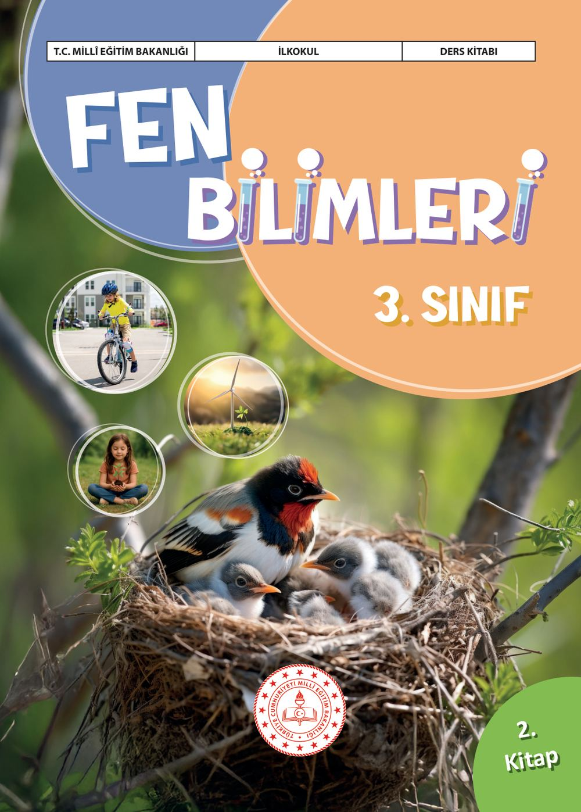

TÜRKİYE CUMHURİYETİ MİLLÎ EĞİTİM BAKANLIĞI
2.

<!-- sayfa 1 -->

# İLKOKUL

# FEN BİLİMLERİ

## 3. Sınıf

### Ders Kitabı
### 2. Kitap

**Yazarlar**

Dr. Nagihan ŞAHİN

Dr. Öznur TUNALI

Betül ALTUNTAŞ

Gürhan DİKMEN

Hüseyin GÜLEÇ

Nurgül GENÇ

<!-- sayfa 2 -->

Millî Eğitim Bakanlığı Yayınları No ........................................................................................ 10760
Ders Kitapları Dizisi No .......................................................................................................... 2510

**Editör**
Prof. Dr. Yasemin ÖZDEM YILMAZ
Dr. Zülfiye Melis DEMİR

**Dil Uzmanı**
Aylin ALTINBAŞ
Hatice MÜLKOĞLU

**Görsel Tasarımcı**
Evren SAVAŞ
Gülçen YILMAZ DÜZGÜN
Neşe ASLAN
Orhan ATEŞ
Selma TAŞCI

**Çoklu Ortam Tasarımcısı**
Dr. Halil KARDEŞ
Ali AYDIN
Ali HEMDE
Ayşe GÜNGÖR SÖNMEZ
Bünyamin TELLİ
Ercan YANDIMOĞLU
Eyüp Çağatay MERT
Fatih GÖNÜL
Hüseyin KURT
Latife Nur CANAN
Mehmet Emin TOPAK
Mehmet TOSUN
Muhammet Ali BÜYÜKTEKİN
Nuray AYDOĞDU
Orhan ÖZYURT
Selime KAYA
Tuğba BAŞBÖĞER
Yusuf Mehmet BAĞCI

**Program Geliştirme Uzmanı**
Hilal ALTINTAŞ

**Ölçme ve Değerlendirme Uzmanı**
Elif Ebru DOĞANGÜZEL

**Rehberlik Uzmanı**
Dr. Nilgün KORKMAZ

**Baskı**
Baskı Matbaanın Adı ve Ticaret Unvanı
ISBN 978-975-11-9892-1

Millî Eğitim Bakanlığı Talim ve Terbiye Kurulu Başkanlığının 13.07.2026 tarih ve 164125594 sayılı yazısı ile eğitim aracı olarak kabul edilmiştir. Kurulca bu kitabın kabul edilmiş olması

<!-- sayfa 3 -->

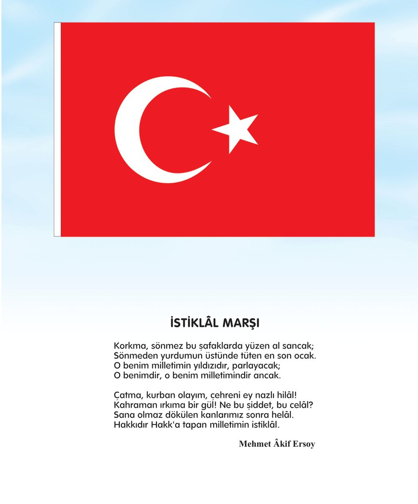

# İSTİKLÂL MARŞI

Korkma, sönmez bu şafaklarda yüzen al sancak;
Sönmeden yurdumun üstünde tüten en son ocak.
O benim milletimin yıldızıdır, parlayacak;
O benimdir, o benim milletimindir ancak.

Catma, kurban olayım, çehreni ey nazlı hilâl!
Kahraman ırkıma bir gül! Ne bu şiddet, bu celâl?
Sana olmaz dökülen kanlarımız sonra helâl.
Hakkıdır Hakk'a tapan milletimin istiklâl.

*Mehmet Âkif Ersoy*

<!-- sayfa 4 -->

ANDIMIZ

Türküm, doğruyum, çalışkanım.

İlkem küçüklerimi korumak, büyüklerimi saymak; yurdumu, milletimi özümden çok sevmektir.
Ülküm yükselmek, ileri gitmektir.

Ey Büyük Atatürk!

Açtığın yolda, gösterdiğin hedefe durmadan yürüyeceğime ant içerim.

Varlığım Türk varlığına armağan olsun.

Ne mutlu Türküm diyene!

<!-- sayfa 5 -->

MUSTAFA KEMAL ATATÜRK

<!-- yer tutucu bulunamadı: sayfa sonuna eklendi -->

<!-- sayfa 6 -->

Verdiğiniz metin katmanı boş olduğu için (`<<< >>>` arası boş) dönüştürülecek herhangi bir içerik bulunmamaktadır. Lütfen işlenmesini istediğiniz metni veya görseli paylaşın.

<!-- sayfa 7 -->

# İÇİNDEKİLER

| | |
| :--- | ---: |
| KİTABIMIZI TANIYALIM | 8 |
| HAZIRLIK LİSTESİ | 10 |
| GÜVENLİK SEMBOLLERİ | 12 |

| | |
| :--- | ---: |
| **HAREKETİ KEŞFEDİYORUM** | **13** |
| VARLIKLARIN HAREKETLERİ | 16 |
| KUVVET VE ETKİLERİ | 29 |

| | |
| :--- | ---: |
| **YAŞAMIMIZI KOLAYLAŞTIRAN ELEKTRİK** | **41** |
| ELEKTRİKLİ ARAÇ GEREÇ | 44 |
| ELEKTRİKLİ ARAÇ GERECİN GÜVENLİ KULLANIMI | 52 |
| ELEKTRİĞİN TASARRUFLU KULANIMI | 61 |

| | |
| :--- | ---: |
| **TOPRAĞI TANIYORUM, TARIMI KEŞFEDİYORUM** | **73** |
| TOPRAK OLUŞUMU VE YAPISI | 76 |
| BİTKİ YETİŞTİRME | 84 |

| | |
| :--- | ---: |
| **CANLILARIN YAŞAM ALANLARINA YOLCULUK** | **99** |
| YAŞAM ALANLARI | 102 |
| CANLI ÇEŞİTLİLİĞİ | 110 |
| YAŞAM ALANLARININ KORUNMASININ CANLI ÇEŞİTLİLİĞİNE ETKİSİ ... | 117 |

| | |
| :--- | ---: |
| EKLER | 132 |
| SÖZLÜK | 155 |
| KAYNAKÇA | 156 |
| CEVAP ANAHTARI | 158 |
| GÖRSEL VE GENEL AĞ KAYNAKÇASI | 158 |
| DEĞERLENDİRME FORMLARI | 158 |
| TÜRKİYE'NİN MÜLKİ İDARE BÖLÜMLERİ İLE KARA VE DENİZ KOMŞULARI HARİTASI | 159 |
| TÜRK DÜNYASI HARİTASI | 160 |

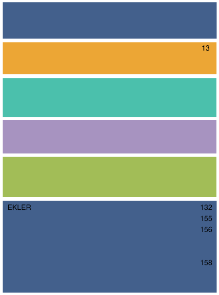
<!-- yer tutucu bulunamadı: sayfa sonuna eklendi -->

<!-- sayfa 8 -->

# KİTABIMIZI TANIYALIM

Kitabımız 8 üniteden oluşmaktadır. Bu ünitelerin 4 tanesi 2. kitapta bulunmaktadır.

Kitapta kullanılan güvenlik sembollerinin açıklamaları

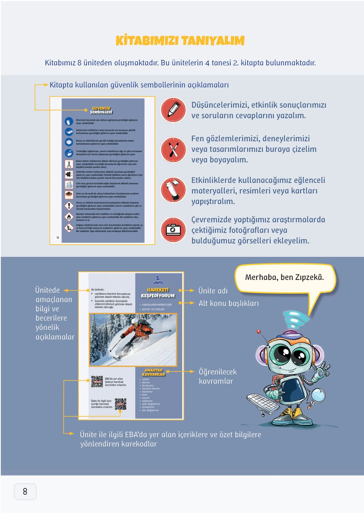

* Düşüncelerimizi, etkinlik sonuçlarımızı ve soruların cevaplarını yazalım.
* Fen gözlemlerimizi, deneylerimizi veya tasarımlarımızı buraya çizelim veya boyayalım.
* Etkinliklerde kullanacağımız eğlenceli materyalleri, resimleri veya kartları yapıştıralım.
* Çevremizde yaptığımız araştırmalarda çektiğimiz fotoğrafları veya bulduğumuz görselleri ekleyelim.

---

Ünite adı
Alt konu başlıkları
Öğrenilecek kavramlar

Ünitede amaçlanan bilgi ve becerilere yönelik açıklamalar

Merhaba, ben Zıpzekâ.

Ünite ile ilgili EBA’da yer alan içeriklere ve özet bilgilere yönlendiren karekodlar

<!-- sayfa 9 -->

# Üniteye dikkat çekmek için sorular soran, şaşırtan, bazen de düşündüren sayfalar
# Etkinlikler için yapılması gereken hazırlıklar

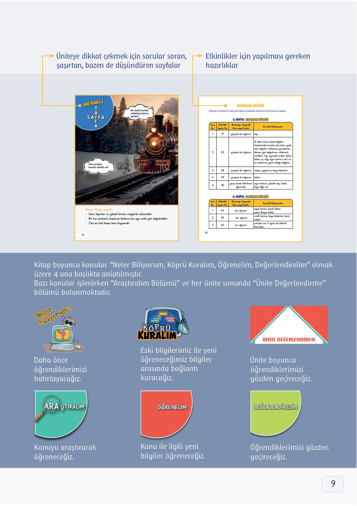

| Sıra No. | Etkinlik Sayfa No. | Müsaitlik Durumu / Risk ve Riskler | Gerekli Malzemeler |
| :--- | :--- | :--- | :--- |
| **5. ÜNİTE: HAREKETLİ NESNELER** | | | |
| 1 | 17 | gruptan bir öğrenci | top |
| 2 | 22 | gruptan bir öğrenci | İki adet top, küçük kağıtlar; üzerine hareket durumları yazılı; kağıtları katlama, yönlendirme, dönme, yön değiştirme, sallanma, varlıklar top, oyuncak araba, kalem, kitap, yağ, su, öğütme, vb. bu isimlerin yazılı olduğu kağıtlar |
| 3 | 28 | gruptan bir öğrenci | makas, yapıştırıcı, boya kalemleri |
| 4 | 29 | gruptan bir öğrenci | balon |
| 5 | 30 | grup içinde belirlenen öğrenciler | oyun hamuru, plastik top, lastik, öğüt, kağıt vb. |
| **6. ÜNİTE: MADDE** | | | |
| 1 | 44 | her öğrenci | ışık kaynağı, kağıt kalem, poşet dosya, makas |
| 2 | 59 | her öğrenci | renkli karton, boya kalemleri, bant, cetvel |
| 3 | 62 | her öğrenci | evimizin son 3 aya ait elektrik faturaları |

***

Kitap boyunca konular “Neler Biliyorum, Köprü Kuralım, Öğrenelim, Değerlendirelim” olmak üzere 4 ana başlıkta anlatılmıştır. 
Bazı konular işlenirken “Araştıralım Bölümü” ve her ünite sonunda “Ünite Değerlendirme” bölümü bulunmaktadır.

# Neler Biliyorum?
Daha önce öğrendiklerimizi hatırlayacağız.

# KÖPRÜ KURALIM
Eski bilgilerimiz ile yeni öğreneceğimiz bilgiler arasında bağlantı kuracağız.

# ARAŞTIRALIM
Konuyu araştırarak öğreneceğiz.

# ÖĞRENELİM
Konu ile ilgili yeni bilgiler öğreneceğiz.

# ÜNİTE DEĞERLENDİRME
Ünite boyunca öğrendiklerimizi gözden geçireceğiz.

# DEĞERLENDİRELİM
Öğrendiklerimizi gözden geçireceğiz.

<!-- sayfa 10 -->

# HAZIRLIK LİSTESİ

Kitaptaki etkinliklerle ilgili hazırlığımızı aşağıdaki listelerden faydalanarak yapalım.

## 5. ÜNİTE: HAZIRLIK LİSTESİ

| Sıra No. | Etkinlik Sayfa No. | Hazırlığı Yapacak Kişi veya Kişiler | Gerekli Malzemeler |
| :--- | :--- | :--- | :--- |
| 1 | 17 | gruptan bir öğrenci | top |
| 2 | 22 | gruptan bir öğrenci | iki adet torba, küçük kâğıtlar (üzerlerinde hareket durumları yazılı olan kâğıtlar: hızlanma, yavaşlama, dönme, yön değiştirme, sallanma), varlıklar (top, oyuncak araba, kalem, balon, ip, silgi, oyun hamuru vb.) ve bu isimlerinin yazılı olduğu kâğıtlar |
| 3 | 28 | gruptan bir öğrenci | makas, yapıştırıcı, boya kalemleri |
| 4 | 29 | gruptan bir öğrenci | balon |
| 4 | 30 | grup içinde belirlenen öğrenciler | 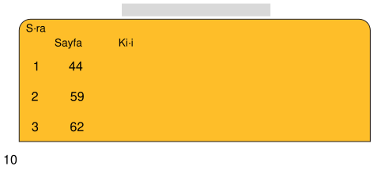 oyun hamuru, plastik top, lastik, silgi, kâğıt vb. |

## 6. ÜNİTE: HAZIRLIK LİSTESİ

| Sıra No. | Etkinlik Sayfa No. | Hazırlığı Yapacak Kişi veya Kişiler | Gerekli Malzemeler |
| :--- | :--- | :--- | :--- |
| 1 | 44 | her öğrenci | siyah karton, keçeli kalem, poşet dosya, makas |
| 2 | 59 | her öğrenci | renkli karton, boya kalemleri, bant, makas |
| 3 | 62 | her öğrenci | 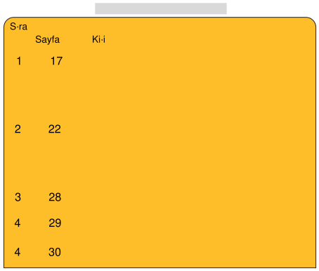 evimizin son 3 ayına ait elektrik faturaları |

<!-- sayfa 11 -->

# 7. ÜNİTE: HAZIRLIK LİSTESİ

| Sıra No. | Etkinlik Sayfa No. | Hazırlığı Yapacak Kişi veya Kişiler | Gerekli Malzemeler |
| :--- | :--- | :--- | :--- |
| 1 | 81 | grup içinde belirlenen öğrenciler | bahçeden alınan toprak örnekleri, şeffaf plastik bardaklar veya cam kavanozlar, kaşık, büyüteç, eldiven |
| 3 | 88 | grup içinde belirlenen öğrenciler | turp, roka, tere, marul fideleri, küçük saksılar, saksı toprağı, sulama kabı, renkli kâğıt, gözlem formu, kalem, yapıştırıcı, makas |
| 4 | 92 | her öğrenci | makas, yapıştırıcı, boya kalemleri |

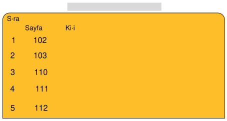

# 8. ÜNİTE: HAZIRLIK LİSTESİ

| Sıra No. | Etkinlik Sayfa No. | Hazırlığı Yapacak Kişi veya Kişiler | Gerekli Malzemeler |
| :--- | :--- | :--- | :--- |
| 1 | 102 | her öğrenci | makas, yapıştırıcı |
| 2 | 103 | her öğrenci | büyüteç, not defteri, kalem |
| 3 | 110 | her öğrenci | boya kalemleri |
| 4 | 111 | her öğrenci | A4 kâğıdı, makas, zımba |
| 5 | 112 | grup içinde belirlenen öğrenciler | büyüteç, dürbün, fotoğraf makinesi, not defteri, kalem |

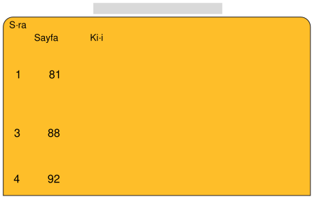

<!-- sayfa 12 -->

# GÜVENLİK SEMBOLLERİ

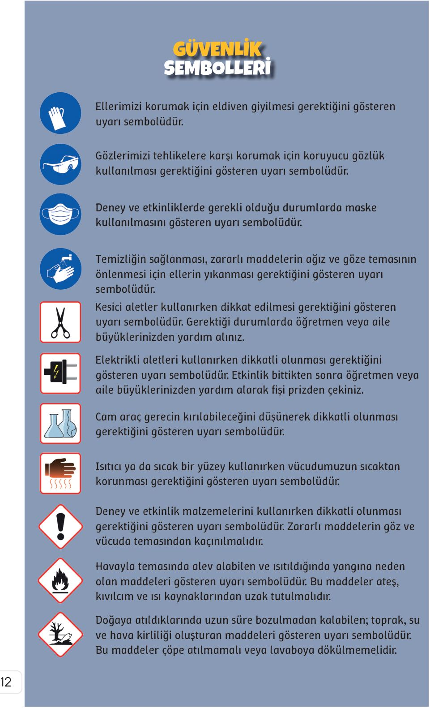 Ellerimizi korumak için eldiven giyilmesi gerektiğini gösteren uyarı sembolüdür.

 Gözlerimizi tehlikelere karşı korumak için koruyucu gözlük kullanılması gerektiğini gösteren uyarı sembolüdür.

 Deney ve etkinliklerde gerekli olduğu durumlarda maske kullanılmasını gösteren uyarı sembolüdür.

 Temizliğin sağlanması, zararlı maddelerin ağız ve göze temasının önlenmesi için ellerin yıkanması gerektiğini gösteren uyarı sembolüdür.

 Kesici aletler kullanırken dikkat edilmesi gerektiğini gösteren uyarı sembolüdür. Gerektiği durumlarda öğretmen veya aile büyüklerinizden yardım alınız.

 Elektrikli aletleri kullanırken dikkatli olunması gerektiğini gösteren uyarı sembolüdür. Etkinlik bittikten sonra öğretmen veya aile büyüklerinizden yardım alarak fişi prizden çekiniz.

 Cam araç gerecin kırılabileceğini düşünerek dikkatli olunması gerektiğini gösteren uyarı sembolüdür.

 Isıtıcı ya da sıcak bir yüzey kullanırken vücudumuzun sıcaktan korunması gerektiğini gösteren uyarı sembolüdür.

 Deney ve etkinlik malzemelerini kullanırken dikkatli olunması gerektiğini gösteren uyarı sembolüdür. Zararlı maddelerin göz ve vücuda temasından kaçınılmalıdır.

 Havayla temasında alev alabilen ve ısıtıldığında yangına neden olan maddeleri gösteren uyarı sembolüdür. Bu maddeler ateş, kıvılcım ve ısı kaynaklarından uzak tutulmalıdır.

 Doğaya atıldıklarında uzun süre bozulmadan kalabilen; toprak, su ve hava kirliliği oluşturan maddeleri gösteren uyarı sembolüdür. Bu maddeler çöpe atılmamalı veya lavaboya dökülmemelidir.

<!-- sayfa 13 -->

# ÜNİTE
# HAREKETİ KEŞFEDİYORUM

* VARLIKLARIN HAREKETLERİ
* KUVVET VE ETKİLERİ

Bu ünitede;
* varlıkların hareket durumlarını gözleme dayalı tahmin edecek,
* kuvvetin varlıklar üzerindeki etkilerini bilimsel gözleme dayalı tahmin edeceğiz.

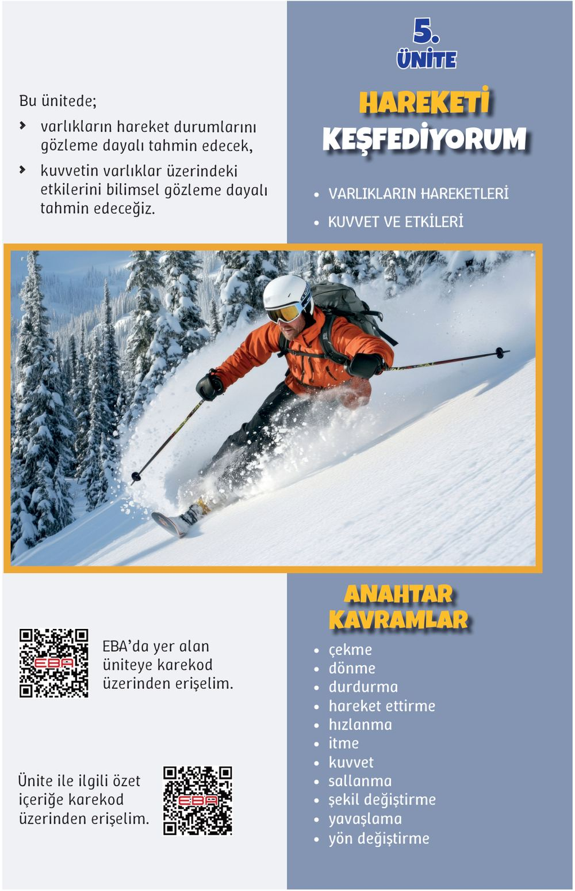

### ANAHTAR KAVRAMLAR

* çekme
* dönme
* durdurma
* hareket ettirme
* hızlanma
* itme
* kuvvet
* sallanma
* şekil değiştirme
* yavaşlama

EBA’da yer alan üniteye karekod üzerinden erişelim.

Ünite ile ilgili özet içeriğe karekod üzerinden erişelim

<!-- sayfa 14 -->

# MERAK SAYFASI

Bir cismin hareket edebilmesi için ne gerekir?

Tüm varlıklar hareket edebilir mi?

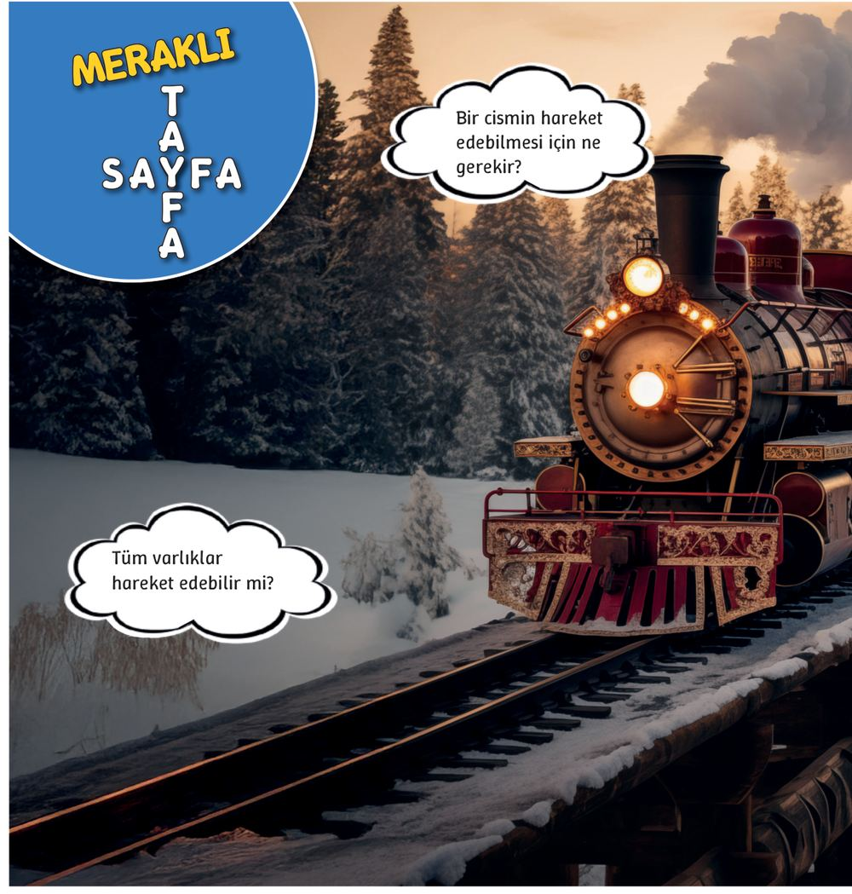

### Bunları Biliyor muyuz?

* Uzun köprüler ve yüksek binalar rüzgârda sallanabilir.
* Bir kuş sürüsünü oluşturan binlerce kuş aynı anda yön değiştirebilir.
* Çita en hızlı koşan kara hayvanıdır.

<!-- sayfa 15 -->

> Hareket hâlindeki ulaşım araçlarına yaklaşmak veya vantilatör, mikser gibi aletlere dokunmak güvenli midir?

| ÜNİTE İLE İLGİLİ MERAK ETTİĞİN BİR SORU DA SENDEN |
| :--- |
| |
| |
| |

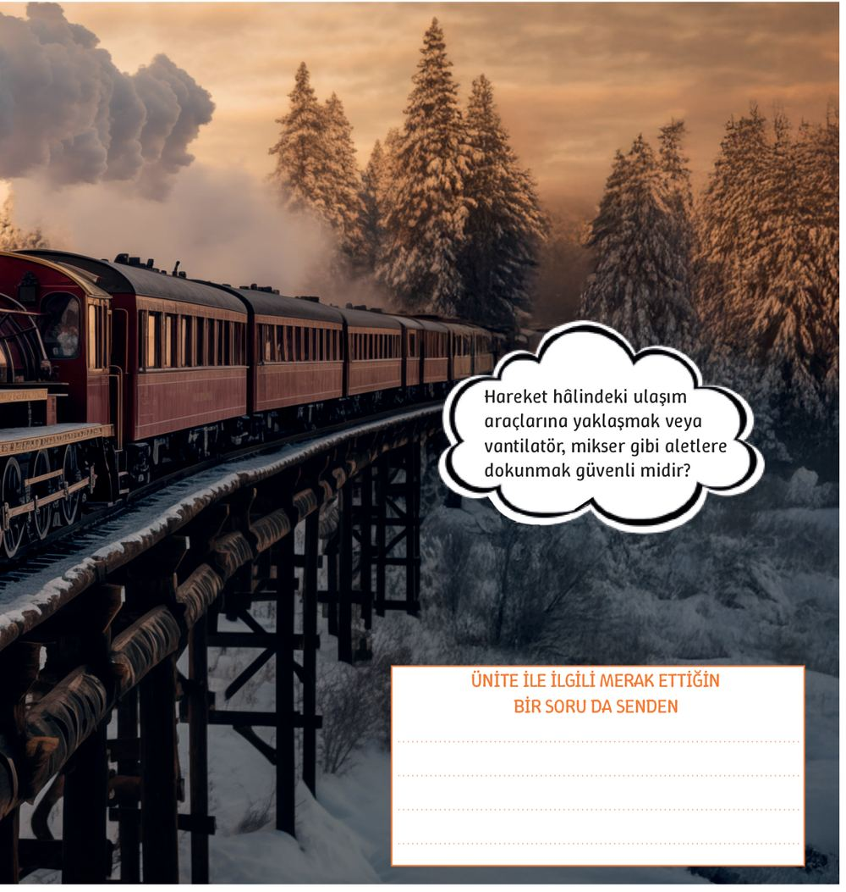

> Dünya kendi etrafında hiç durmadan döner. Bu dönüş sayesinde gece ve gündüz oluşur.
> Kertenkele, ayağında bulunan çok sayıda küçük tüy ile bulunduğu yüzeye kuvvet uygular. Bu sayede duvarlarda ve tavanda yürüyebilir.

<!-- sayfa 16 -->

# VARLIKLARIN HAREKETLERİ

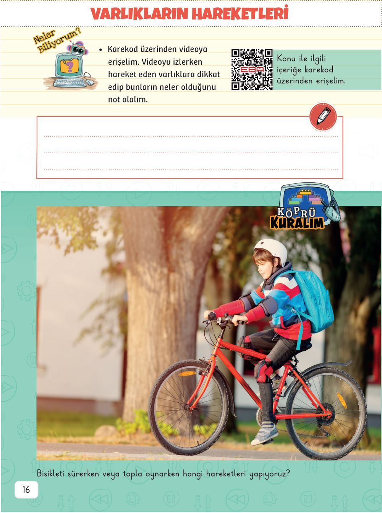
* Karekod üzerinden videoya erişelim. Videoyu izlerken hareket eden varlıklara dikkat edip bunların neler olduğunu not alalım.

Konu ile ilgili içeriğe karekod üzerinden erişelim.

---

<!-- sayfa 17 -->

# İstop

**Malzemeler:** top

Uygulama adımlarına dikkat ederek okul bahçesinde oyun oynayalım.

* Arkadaşlarımız ile bir çember oluşturalım.
* Arkadaşlarımızdan birinin çemberin ortasına gelmesini ve topu eline almasını sağlayalım.
* Arkadaşımızdan topu havaya atarak oyunculardan birinin adını söylemesini isteyelim.
  Örnek: “Fatih, istop!”

* Adı söylenen arkadaşımız topu yakalamaya çalışırken biz kaçalım.
* Top, yere düşmeden yakalanırsa topu yakalayan arkadaşımızdan “İstop!” diye bağırmasını isteyelim.
* İstop komutuyla olduğumuz yerde duralım.
* Topu elinde tutan arkadaşımızın başka bir oyuncuyu topla vurmaya çalışmasını izleyelim.
* Top bir arkadaşımıza isabet ederse vurulan arkadaşımızın oyun dışı kaldığını söyleyelim. Top kimseye isabet etmezse topu atan kişinin oyun dışı kaldığını söyleyelim.
* Oyun sırasında topun ve oyuncuların hareketlerini gözlemleyelim.
* Oyun sonrasında varlıkların hareket durumlarına ilişkin gözlemlerimizi arkadaşlarımızla tartışalım. Çıkarımlarımızı not edelim.
* Sayfa 132'deki Ek 1'de verilen Kontrol Listesi'ni dolduralım.

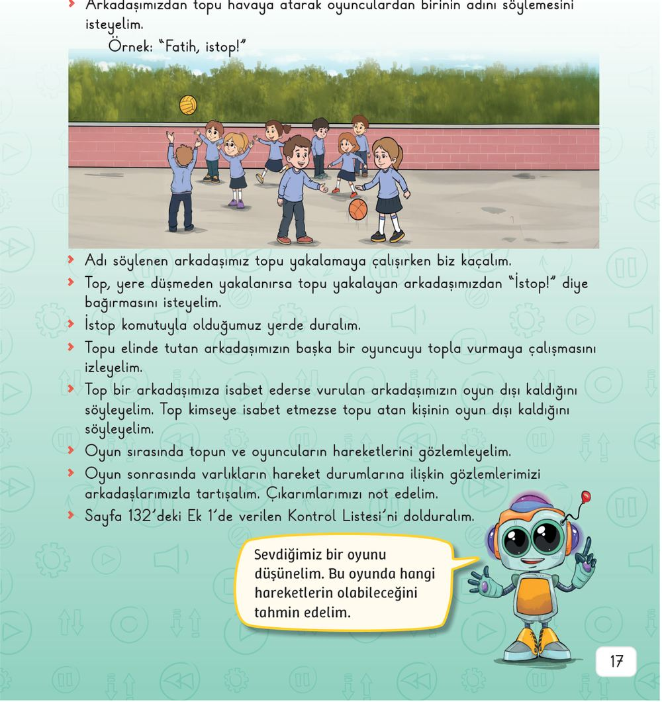

> Sevdiğimiz bir oyunu düşünelim. Bu oyunda hangi hareketlerin olabileceğini tahmin edelim.

<!-- sayfa 18 -->

# Hareket Tahminlerim

Aşağıda görselleri verilen pervaneli uçağı inceleyelim. Numaralandırılmış görsel ve açıklamalarda uçağın hangi hareketi yaptığını tahmin edelim. Tahminlerimizi aşağıdaki kutulara yazalım.

1
Havaalanından havalanan uçak

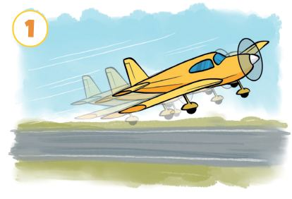
2
Havaalanına doğru inişe geçen uçak

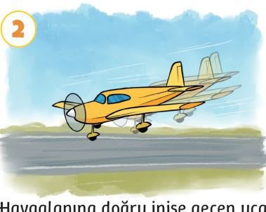
3
Motoru çalışan uçağın pervanesi

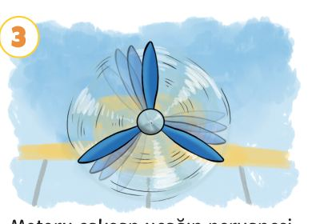
4
Rüzgârın etkisiyle yönü ara ara değişen uçak

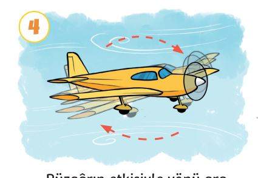
5
Manevra yapan uçak

| Tahminlerim | | | | |
| :--- | :--- | :--- | :--- | :--- |
| 1. Görsel | 2. Görsel | 3. Görsel | 4. Görsel | 5. Görsel |
| | | | | |

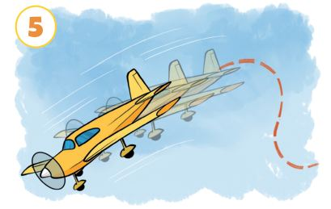
<!-- yer tutucu bulunamadı: sayfa sonuna eklendi -->

<!-- yer tutucu bulunamadı: sayfa sonuna eklendi -->

<!-- sayfa 19 -->

# ÖĞRENELİM

Çevremize baktığımızda pek çok varlığın hareket ettiğini görürüz. Hareket, bir varlığın bütününün veya bir kısmının yerini, konumunu veya durumunu değiştirmesidir. Canlı varlıklar kendiliğinden, cansız varlıklar ise dışardan bir etki ile hareket eder.

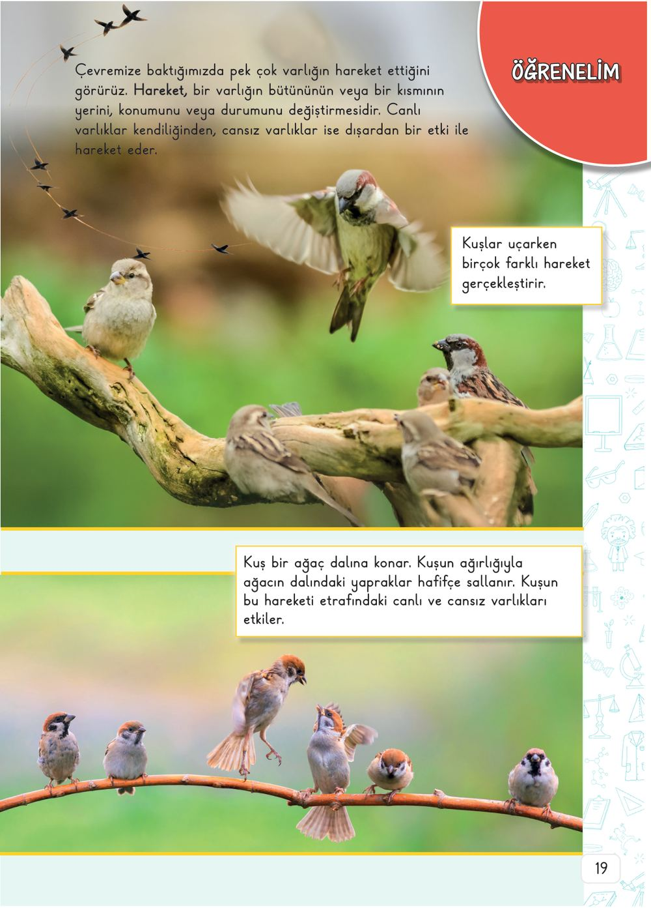

> Kuşlar uçarken birçok farklı hareket gerçekleştirir.

> Kuş bir ağaç dalına konar. Kuşun ağırlığıyla ağacın dalındaki yapraklar hafifçe sallanır. Kuşun bu hareketi etrafındaki canlı ve cansız varlıkları etkiler.

<!-- sayfa 20 -->

# Hızlanma

Canlı veya cansız varlıkların hareketsizken harekete geçmesine veya daha kısa sürede daha çok yol almasına **hızlanma** denir. Koşuya başlayan bir atlet veya daha çabuk gitmeye çalışan bir bisikletli hızlanma hareketi yapar.

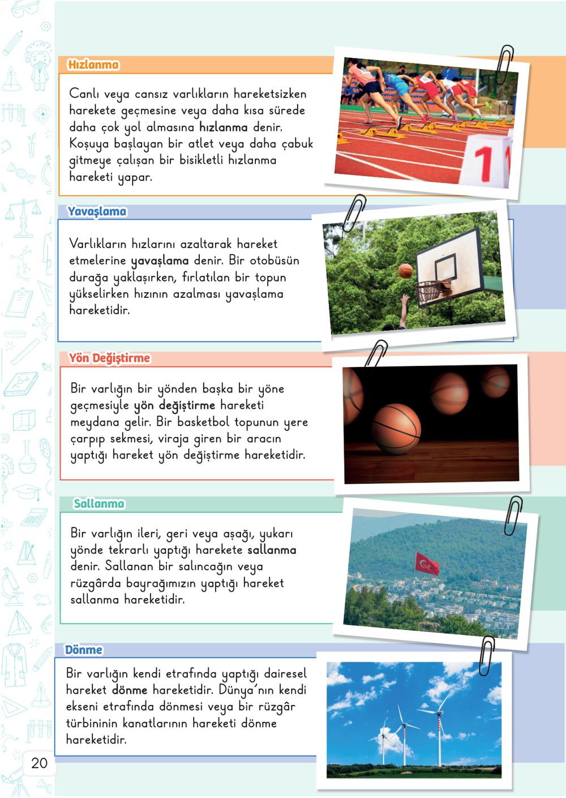

# Yavaşlama

Varlıkların hızlarını azaltarak hareket etmelerine **yavaşlama** denir. Bir otobüsün durağa yaklaşırken, fırlatılan bir topun yükselirken hızının azalması yavaşlama hareketidir.

# Yön Değiştirme

Bir varlığın bir yönden başka bir yöne geçmesiyle yön değiştirme hareketi meydana gelir. Bir basketbol topunun yere çarpıp sekmesi, viraja giren bir aracın yaptığı hareket yön değiştirme hareketidir.

# Sallanma

Bir varlığın ileri, geri veya aşağı, yukarı yönde tekrarlı yaptığı harekete **sallanma** denir. Sallanan bir salıncağın veya rüzgârda bayrağımızın yaptığı hareket sallanma hareketidir.

# Dönme

Bir varlığın kendi etrafında yaptığı dairesel hareket **dönme** hareketidir. Dünya'nın kendi ekseni etrafında dönmesi veya bir rüzgâr türbininin kanatlarının hareketi dönme...

<!-- sayfa 21 -->

# Hareket Durumlarını Eşleştirelim

Görsellerde verilen hareketleri ve açıklamaları inceleyelim. Bu hareketleri doğru hareket durumu ile eşleştirelim.

| | | |
| :--- | :--- | :--- |
| Bayrak rüzgârda dalgalanıyor. 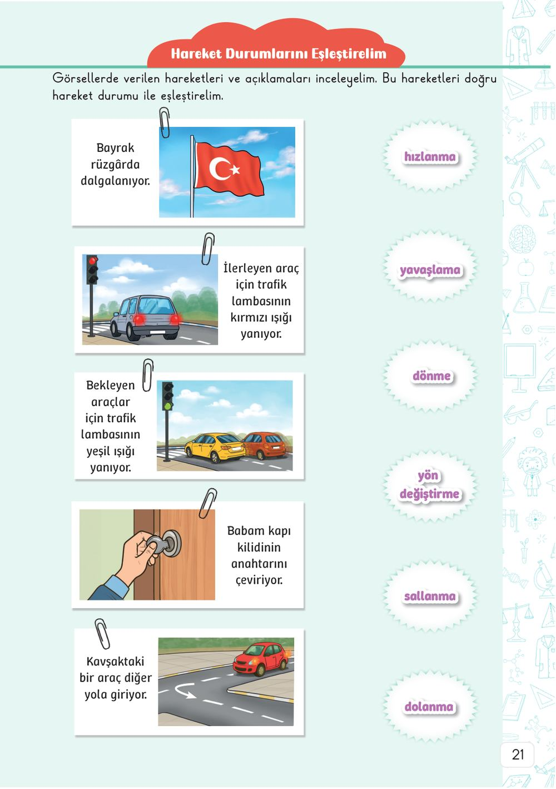 | | hızlanma |
| İlerleyen araç için trafik lambasının kırmızı ışığı yanıyor.  | | yavaşlama |
| Bekleyen araçlar için trafik lambasının yeşil ışığı yanıyor.  | | dönme |
| Babam kapı kilidinin anahtarını çeviriyor.  | | yön değiştirme |
| Kavşaktaki bir araç diğer yola giriyor.  | | sallanma |
| | | dolanma |

<!-- sayfa 22 -->

# Hareketlendirelim

Malzemeler: iki adet torba, üzerinde hareket durumlarının yazılı olduğu kâğıtlar (hızlanma, yavaşlama, dönme, yön değiştirme, sallanma), varlıklar (top, oyuncak araba, kalem, balon, ip, silgi, oyun hamuru vb.) ve varlık isimlerinin yazılı olduğu kâğıtlar

Uygulama adımlarına dikkat ederek etkinliği yapalım.

* Sınıf arkadaşlarımızla iki veya üç kişilik gruplar oluşturalım.
* Torbaların birinin içine hareket durumlarının yazılı olduğu kâğıtları diğerine varlıkların yazılı olduğu kâğıtları karışık olarak koyalım.
* Hareket kâğıtları: hızlanma, yavaşlama, dönme, yön değiştirme, sallanma.
* Varlık kâğıtları: top, araba, kalem, balon, ip, silgi vb.
* Sıramız geldiğinde grubumuzla her torbadan birer kâğıt çekelim.
* Çektiğimiz iki kâğıdı okuyalım ve bunları nasıl bir araya getirebileceğimizi grubumuzla düşünelim.
  top + hızlanma
  araba + yön değiştirme
  kalem + dönme vb. şekilde belirleyelim.

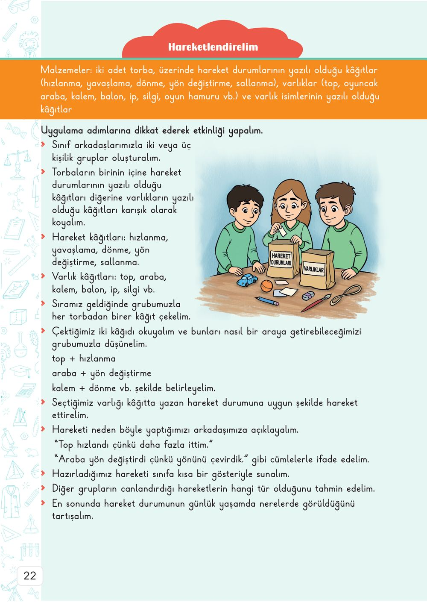

* Seçtiğimiz varlığı kâğıtta yazan hareket durumuna uygun şekilde hareket ettirelim.
* Hareketi neden böyle yaptığımızı arkadaşımıza açıklayalım.
  “Top hızlandı çünkü daha fazla ittim.”
  “Araba yön değiştirdi çünkü yönünü çevirdik.” gibi cümlelerle ifade edelim.
* Hazırladığımız hareketi sınıfa kısa bir gösteriyle sunalım.
* Diğer grupların canlandırdığı hareketlerin hangi tür olduğunu tahmin edelim.
* En sonunda hareket durumunun günlük yaşamda nerelerde görüldüğünü tartışalım.

<!-- sayfa 23 -->

# Varlıkların Hareketlerinin Sonuçları

**ARAŞTIRALIM**

Uygulama adımlarına dikkat ederek etkinliği yapalım.

* Sınıf arkadaşlarımızla dört veya beş kişilik gruplar oluşturalım.
* Günlük yaşamda sıkça karşılaştığımız hareket eden varlıkları (insanlar, araçlar, hayvanlar, eşyalar) grubumuzla belirleyelim.
* Belirlediğimiz varlıkların hareketlerinin olumlu ve olumsuz sonuçları hakkında grup arkadaşlarımızla tartışalım. Aşağıdaki sorulara cevap verelim.
    * Belirlediğimiz varlıkların hareketlerinin yararları neler olabilir? 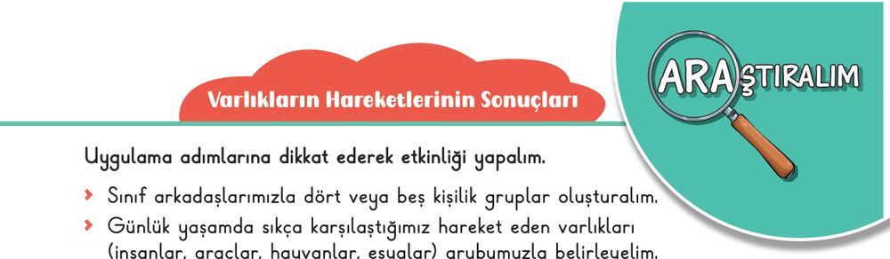
    * Belirlediğimiz varlıkların hareketlerinin risk veya zararları neler olabilir?
* Bu hareketlerin yarar ve zararlarını listeler hâlinde yazalım. Örneğin bisiklet kullanmanın sağlığımıza ve çevreye faydası vardır ancak dikkatsizlik kazalara neden olabilir. 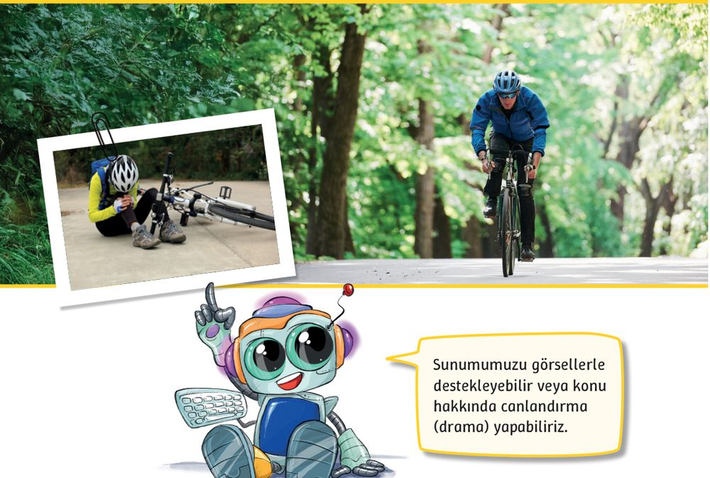
* Grubumuzla listeye son hâlini verelim ve sınıf arkadaşlarımıza bununla ilgili sunum yapalım.

> Sunumumuzu görsellerle destekleyebilir veya konu hakkında canlandırma (drama) yapabiliriz.

<!-- sayfa 24 -->

# ÖĞRENELİM

Olumlu sonuçlanan bazı hareket durumları şunlardır:

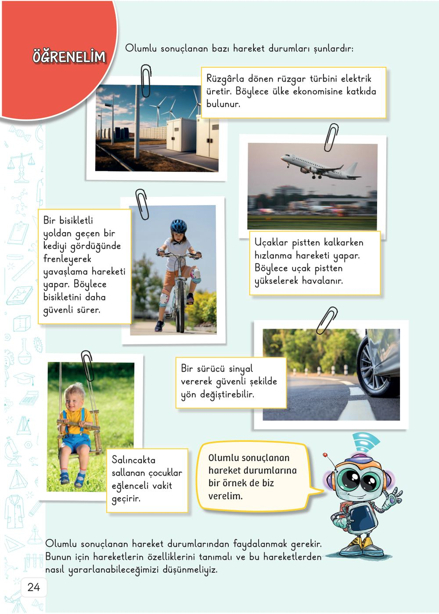
Rüzgârla dönen rüzgar türbini elektrik üretir. Böylece ülke ekonomisine katkıda bulunur.

Uçaklar pistten kalkarken hızlanma hareketi yapar. Böylece uçak pistten yükselerek havalanır.

Bir bisikletli yoldan geçen bir kediyi gördüğünde frenleyerek yavaşlama hareketi yapar. Böylece bisikletini daha güvenli sürer.

Bir sürücü sinyal vererek güvenli şekilde yön değiştirebilir.

Salıncakta sallanan çocuklar eğlenceli vakit geçirir.

Olumlu sonuçlanan hareket durumlarına bir örnek de biz verelim.

Olumlu sonuçlanan hareket durumlarından faydalanmak gerekir. Bunun için hareketlerin özelliklerini tanımalı ve bu hareketlerden

<!-- sayfa 25 -->

Hareketlerin sonuçları bazen olumsuz olabilir.

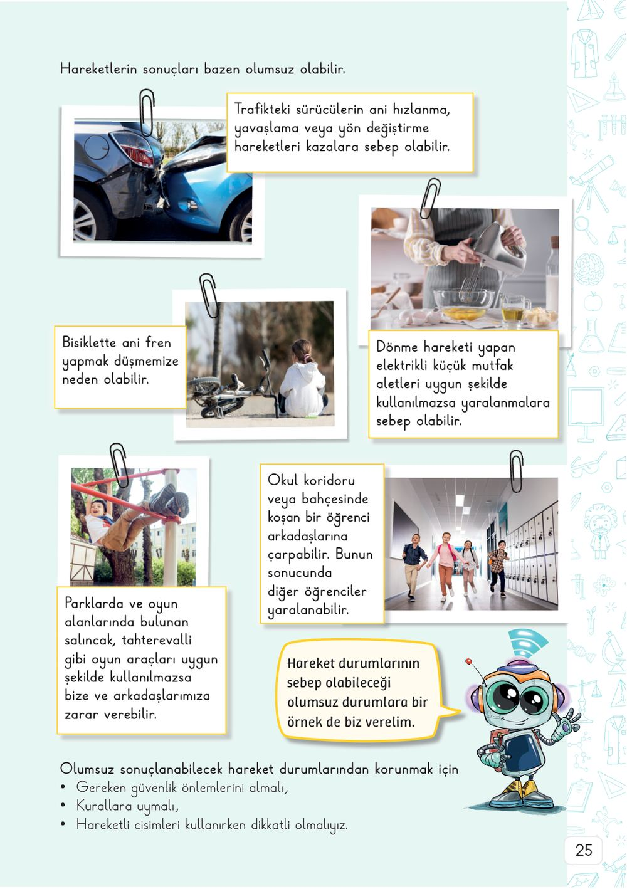
Trafikteki sürücülerin ani hızlanma, yavaşlama veya yön değiştirme hareketleri kazalara sebep olabilir.

Dönme hareketi yapan elektrikli küçük mutfak aletleri uygun şekilde kullanılmazsa yaralanmalara sebep olabilir.

Bisiklette ani fren yapmak düşmemize neden olabilir.

Okul koridoru veya bahçesinde koşan bir öğrenci arkadaşlarına çarpabilir. Bunun sonucunda diğer öğrenciler yaralanabilir.

Parklarda ve oyun alanlarında bulunan salıncak, tahterevalli gibi oyun araçları uygun şekilde kullanılmazsa bize ve arkadaşlarımıza zarar verebilir.

Hareket durumlarının sebep olabileceği olumsuz durumlara bir örnek de biz verelim.

Olumsuz sonuçlanabilecek hareket durumlarından korunmak için
* Gereken güvenlik önlemlerini almalı,
* Kurallara uymalı,

<!-- sayfa 26 -->

# Olumlu ve Olumsuz Sonuçlar

Aşağıdaki örnek olayları okuyalım. Örneklerin hangi hareket türlerine ait olduğunu ve bu hareketlerin ortaya çıkarabileceği olumlu ve olumsuz sonuçlara ilişkin yargılarımızı yazalım.

**Örnek Olay 1:** Ali parkta arkadaşlarıyla bisiklet sürüyordu. Öndeki arkadaşlarına yetişmek için pedalları daha sık çevirmeye başladı.
......................................................................................................................................................
......................................................................................................................................................
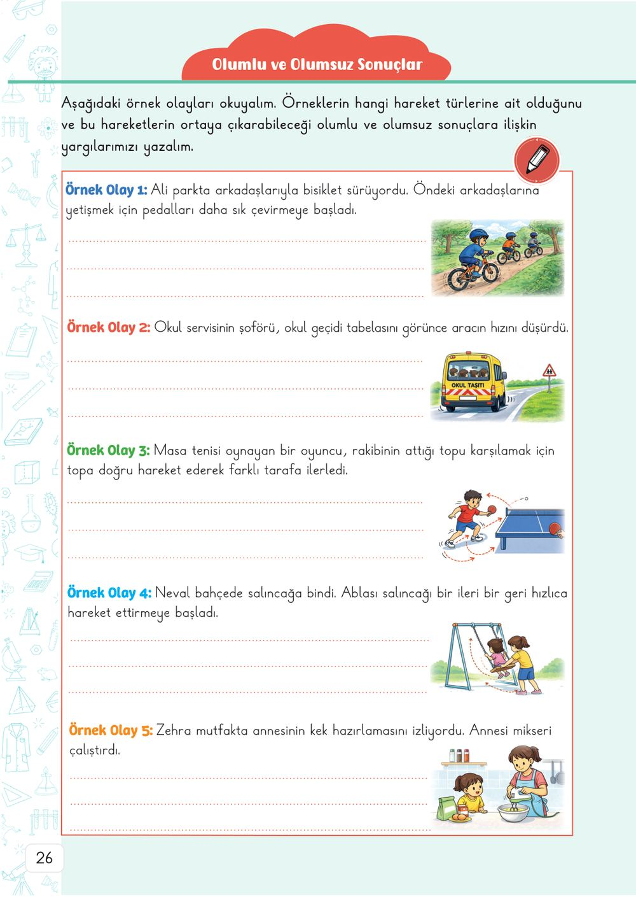

**Örnek Olay 2:** Okul servisinin şoförü, okul geçidi tabelasını görünce aracın hızını düşürdü.
......................................................................................................................................................
......................................................................................................................................................

**Örnek Olay 3:** Masa tenisi oynayan bir oyuncu, rakibinin attığı topu karşılamak için topa doğru hareket ederek farklı tarafa ilerledi.
......................................................................................................................................................
......................................................................................................................................................

**Örnek Olay 4:** Neval bahçede salıncağa bindi. Ablası salıncağı bir ileri bir geri hızlıca hareket ettirmeye başladı.
......................................................................................................................................................
......................................................................................................................................................

**Örnek Olay 5:** Zehra mutfakta annesinin kek hazırlamasını izliyordu. Annesi mikseri çalıştırdı.
......................................................................................................................................................
......................................................................................................................................................

<!-- sayfa 27 -->

Aşağıdaki form hareketli cisimlerin neden olabileceği tehlikelere karşı gösterdiğimiz davranışlarımızı değerlendirmek amacıyla hazırlanmıştır. Davranış ifadelerini okuyarak “Evet”, “Bazen” veya “Hayır” seçeneklerinden uygun olanı işaretleyelim.

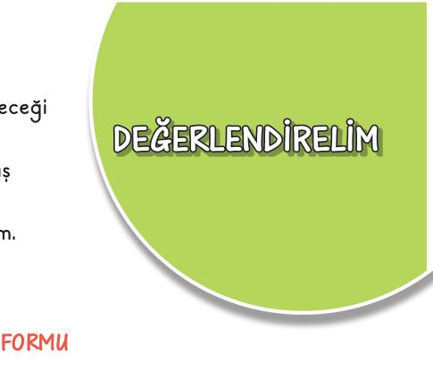

# ÖZ DEĞERLENDİRME FORMU

Adı soyadı:.................................................................................................
Sınıfı ve numarası:.......................................................................................

| Değerlendirilecek Davranışlar | Evet | Bazen | Hayır |
| :--- | :---: | :---: | :---: |
| 1. Hareketli cisimlerin neden olabileceği tehlikeleri bilirim. | | | |
| 2. Hareketli cisimlere dokunmadan önce oluşabilecek tehlikeleri düşünürüm. | | | |
| 3. Hareketli cisimlerin bulunduğu alanlarda dikkatli davranırım. | | | |
| 4. Park veya oyun alanlarındaki salıncak, tahterevalli gibi oyuncakları uygun şekilde kullanırım. | | | |
| 5. Hareketli cisimlerin tehlikeli olabileceği bir durumda nasıl davranacağımı bilirim. | | | |

İşaretlediğimiz davranışların hepsinin “Evet” olması, hareketli cisimlerin neden olabileceği tehlikeleri bildiğimizi ve bu tehlikelere karşı gerekli önlemleri aldığımızı gösterir. “Bazen” veya “Hayır” olarak işaretlediğimiz davranışlar için öğretmenimizden ve arkadaşlarımızdan destek alabiliriz.

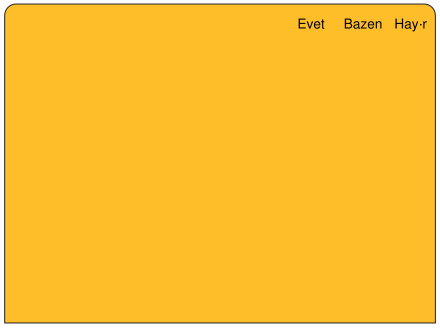
<!-- yer tutucu bulunamadı: sayfa sonuna eklendi -->

<!-- sayfa 28 -->

# DEĞERLENDİRELİM

Malzemeler: makas, yapıştırıcı, boya kalemleri 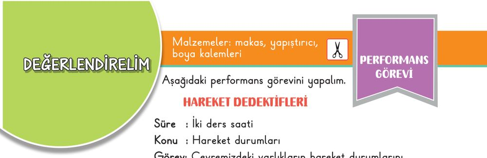

PERFORMANS GÖREVİ

Aşağıdaki performans görevini yapalım.

## HAREKET DEDEKTİFLERİ

**Süre :** İki ders saati
**Konu :** Hareket durumları
**Görev:** Çevremizdeki varlıkların hareket durumlarını gözlemlememiz ve gözlem sonuçlarımızı içeren bir poster hazırlamamız beklenmektedir.

Hazırladığımız çalışma, sayfa 158'deki karekodla ulaşabileceğimiz Form 1'e göre öğretmenimiz tarafından değerlendirilecektir. Çalışmaya başlamadan önce bu formu inceleyelim. Çalışmamızı formda yazan ölçütlere dikkat ederek tamamlayalım.

### Uygulama Adımları 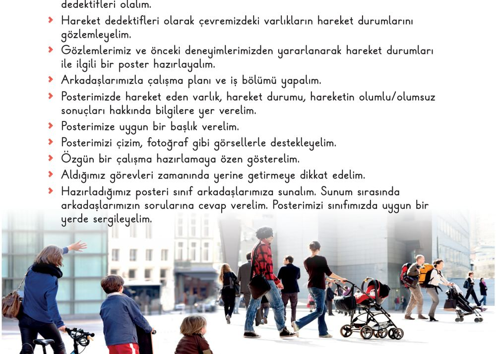

* Sınıf arkadaşlarımızla dört veya beş kişilik gruplar oluşturarak hareket dedektifleri olalım.
* Hareket dedektifleri olarak çevremizdeki varlıkların hareket durumlarını gözlemleyelim.
* Gözlemlerimiz ve önceki deneyimlerimizden yararlanarak hareket durumları ile ilgili bir poster hazırlayalım.
* Arkadaşlarımızla çalışma planı ve iş bölümü yapalım.
* Posterimizde hareket eden varlık, hareket durumu, hareketin olumlu/olumsuz sonuçları hakkında bilgilere yer verelim.
* Posterimize uygun bir başlık verelim.
* Posterimizi çizim, fotoğraf gibi görsellerle destekleyelim.
* Özgün bir çalışma hazırlamaya özen gösterelim.
* Aldığımız görevleri zamanında yerine getirmeye dikkat edelim.
* Hazırladığımız posteri sınıf arkadaşlarımıza sunalım. Sunum sırasında arkadaşlarımızın sorularına cevap verelim. Posterimizi sınıfımızda uygun bir yerde sergileyelim.

<!-- sayfa 29 -->

# KUVVET VE ETKİLERİ

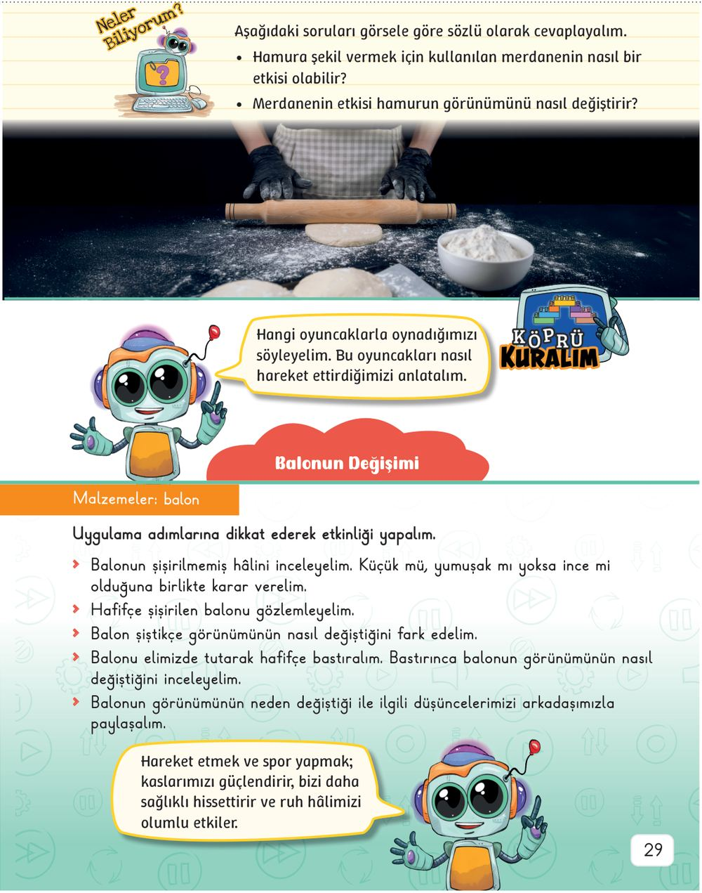

**Neler Biliyorum?**

Aşağıdaki soruları görsele göre sözlü olarak cevaplayalım.
* Hamura şekil vermek için kullanılan merdanenin nasıl bir etkisi olabilir?
* Merdanenin etkisi hamurun görünümünü nasıl değiştirir?

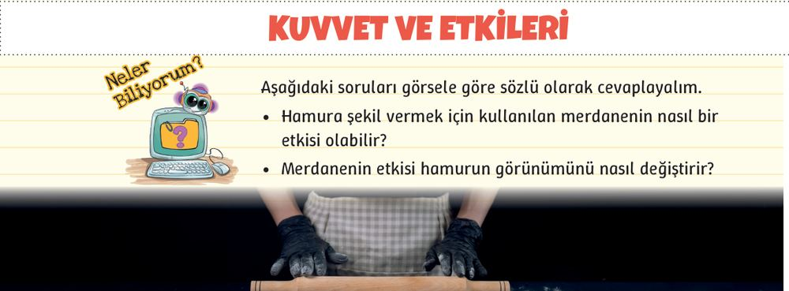

## Balonun Değişimi

**Malzemeler:** balon

Uygulama adımlarına dikkat ederek etkinliği yapalım.

* Balonun şişirilmemiş hâlini inceleyelim. Küçük mü, yumuşak mı yoksa ince mi olduğuna birlikte karar verelim.
* Hafifçe şişirilen balonu gözlemleyelim.
* Balon şiştikçe görünümünün nasıl değiştiğini fark edelim.
* Balonu elimizde tutarak hafifçe bastıralım. Bastırınca balonun görünümünün nasıl değiştiğini inceleyelim.
* Balonun görünümünün neden değiştiği ile ilgili düşüncelerimizi arkadaşımızla paylaşalım.

Hareket etmek ve spor yapmak; kaslarımızı güçlendirir, bizi daha sağlıklı hissettirir ve ruh hâlimizi

<!-- sayfa 30 -->

# Neden Böyle Oldu?

**Malzemeler:** oyun hamuru, plastik top, lastik, silgi, kâğıt vb.

> 
> Aşağıda verilen durumları ön bilgi ve deneyimlerimizden yola çıkarak varlıkların hareketlerine ve şekil değiştirmelerinin nedenlerine ilişkin önermelerle tamamlayalım.

1. Plastik top hızlanır çünkü ..................................................................................
2. Oyun hamurunun şekli değişir çünkü ...................................................................
3. Kâğıt yırtılır çünkü ..............................................................................................
4. Plastik top yön değiştirir çünkü ...........................................................................
5. Lastik uzar çünkü ................................................................................................

> 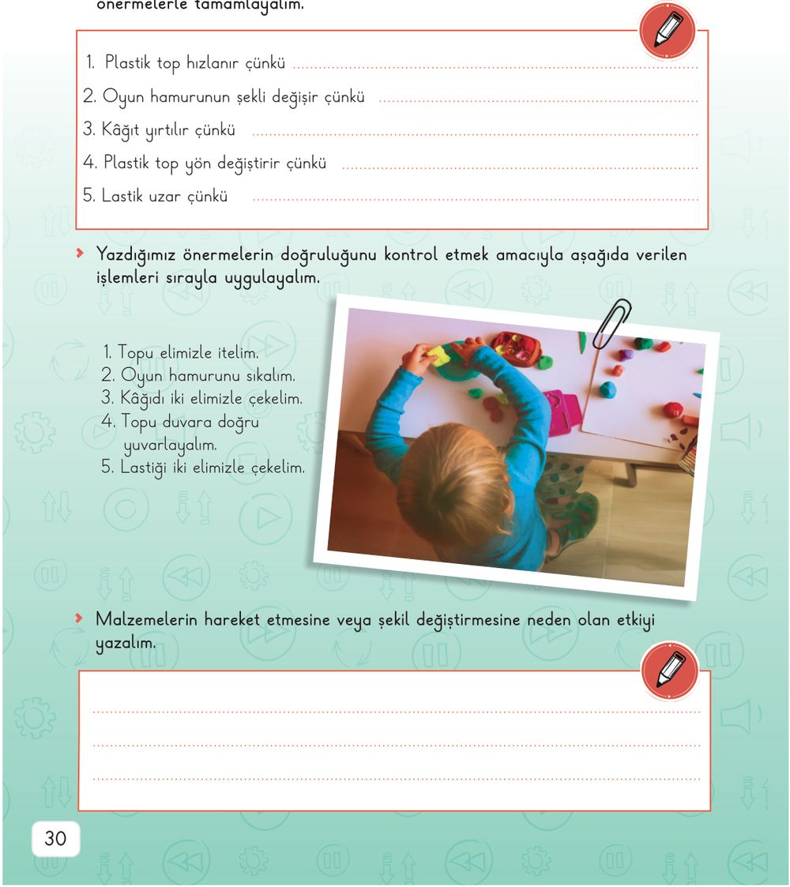
> Yazdığımız önermelerin doğruluğunu kontrol etmek amacıyla aşağıda verilen işlemleri sırayla uygulayalım.

1. Topu elimizle itelim.
2. Oyun hamurunu sıkalım.
3. Kâğıdı iki elimizle çekelim.
4. Topu duvara doğru yuvarlayalım.
5. Lastiği iki elimizle çekelim.

> Malzemelerin hareket etmesine veya şekil değiştirmesine neden olan etkiyi yazalım.

..........................................................................................................................................
..........................................................................................................................................
..........................................................................................................................................

<!-- sayfa 31 -->

* 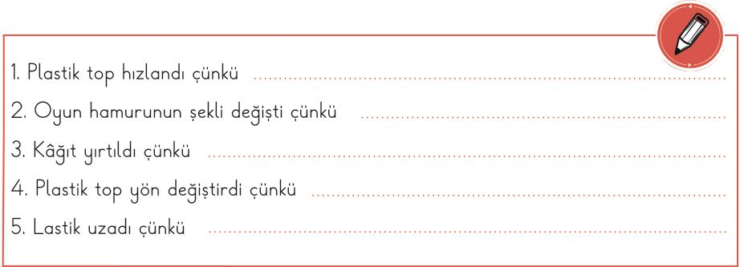 Aşağıda verilen durumlarda malzemelerin hareket veya şekil değiştirmesinin nedenine ilişkin önermeleri yaptığımız uygulama ve gözlem sonrasında tekrar oluşturalım.

| | |
| :--- | :--- |
| 1. Plastik top hızlandı çünkü | ........................................................................................................ |
| 2. Oyun hamurunun şekli değişti çünkü | ........................................................................................................ |
| 3. Kâğıt yırtıldı çünkü | ........................................................................................................ |
| 4. Plastik top yön değiştirdi çünkü | ........................................................................................................ |
| 5. Lastik uzadı çünkü | ........................................................................................................ |

*  Uygulamadan önce yazdığımız önermelerle gözlem sonrası yazdığımız önermeleri karşılaştıralım.

* Gözlemlerimize göre bir varlığın hareket etmesi veya şeklinin değişmesi için ne

<!-- sayfa 32 -->

# ARA ŞTIRALIM
## Düşün, Eşleş, Paylaş

Daha önceki “Neden Böyle Oldu?” etkinliğini düşünerek ve uygulama adımlarına dikkat ederek etkinliği yapalım.

> “Varlıkların hareket etmesi ve şekil değiştirmesinin nedeni ne olabilir?” sorusunun cevabını bir süre düşünelim.

* Sorunun cevabıyla ilgili üç önermemizi tablodaki “Düşün” bölümüne yazalım.

> Sınıfımızdan bir arkadaşımız ile eşleşelim.

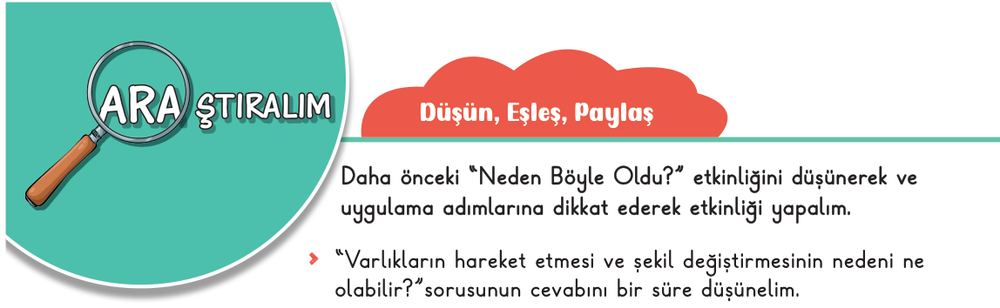

> Sorunun cevabı ile ilgili fikirlerimizi eşleştiğimiz arkadaşlarımızla paylaşalım.

* Arkadaşımızla aynı olan fikirlerimizin başına işaret koyalım. Eşleşmeyen fikirlerimizi tablodaki “Eşleş” bölümüne yazalım.

> Eşleştiğimiz arkadaşımızla birbirimizin fikirlerini gözden geçirelim. Doğru ve önemli olduğunu düşündüğümüz fikirleri belirleyelim.

> Doğru ve önemli olduğunu düşündüğümüz bu fikirleri sınıfımızla paylaşalım.

* Tüm sınıfın fikirlerini dikkatlice dinleyelim. Beğendiğimiz üç fikri tablodaki “Paylaş” bölümüne yazalım.
* Etkinliği tamamladıktan sonra ekler bölümünde verilen Ek 2'deki çalışma yaprağını dolduralım.

### Düşün-Eşleş-Paylaş Tablosu

| | | |
| :--- | :--- | :--- |
| **Düşün** | Sorunun cevabı ile ilgili fikirlerim | |
| **Eşleş** | Arkadaşımla eşleşmeyen fikirlerim | |
| **Paylaş** | Beğendiğim fikirler | |

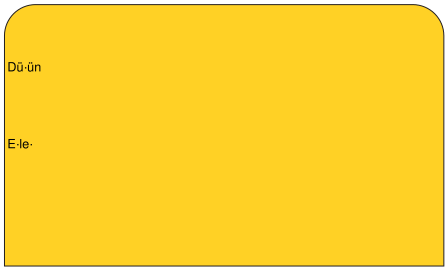

> Varlıkların hareket etmesine ve şeklini değiştirmesine neyin sebep olduğunu nasıl açıklayabiliriz?

<!-- sayfa 33 -->

Konu ile ilgili içeriğe karekod üzerinden erişelim.

# ÖĞRENELİM

Günlük hayatımızda varlıklara itme ve çekme uygularız. Böylece cisimlerin şeklini değiştirir, duran cisimleri hareket ettiririz. Hareket eden cisimleri yavaşlatır ve durdururuz. Bir cismi hareket ettirmek, durdurmak veya bir cismin yönünü ve şeklini değiştirmek için uygulanan etkiye kuvvet denir.

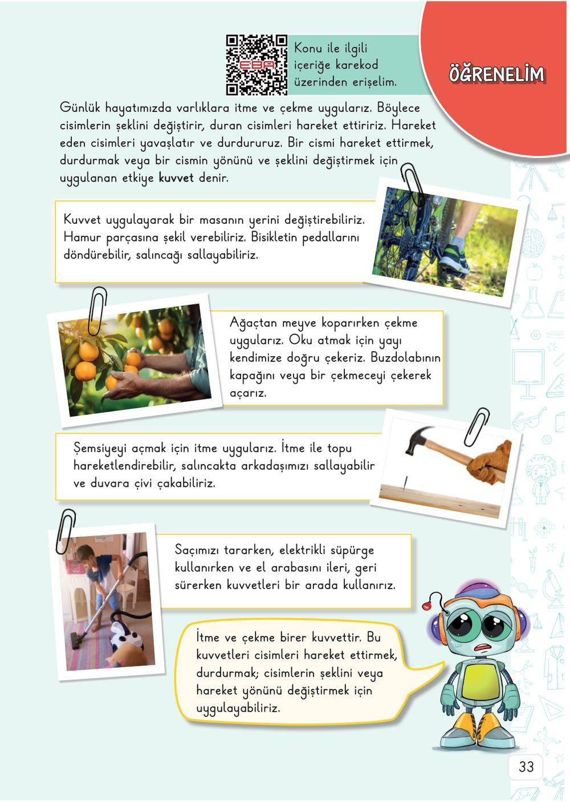

Kuvvet uygulayarak bir masanın yerini değiştirebiliriz. Hamur parçasına şekil verebiliriz. Bisikletin pedallarını döndürebilir, salıncağı sallayabiliriz.

Ağaçtan meyve koparırken çekme uygularız. Oku atmak için yayı kendimize doğru çekeriz. Buzdolabının kapağını veya bir çekmeceyi çekerek açarız.

Şemsiyeyi açmak için itme uygularız. İtme ile topu hareketlendirebilir, salıncakta arkadaşımızı sallayabilir ve duvara çivi çakabiliriz.

Saçımızı tararken, elektrikli süpürge kullanırken ve el arabasını ileri, geri sürerken kuvvetleri bir arada kullanırız.

İtme ve çekme birer kuvvettir. Bu kuvvetleri cisimleri hareket ettirmek, durdurmak; cisimlerin şeklini veya hareket yönünü değiştirmek için uygulayabiliriz.

<!-- sayfa 34 -->

# Kuvvete Göre Tahminlerim

Uygulama adımlarına dikkat ederek etkinliği yapalım.

* Tabloda verilen durumları okuyalım.
* Verilen durumlara uygulanan kuvvet sonucunda ne olacağını tahmin edelim. Tahminimizi ve tahminimizin nedenini daha önceki deneyim ve gözlemlerimizden yola çıkarak yazalım.
* Tahminlerimize göre oluşabilecek durumu 6 ve 7. satırlara yazalım.
* Tahminlerimizi gözden geçirerek elde ettiğimiz sonuçları eleştirel bir bakış açısıyla değerlendirelim.

| Durum | Tahminim | Neden Böyle Tahmin Ettim? |
| :--- | :--- | :--- |
| 1. Bir kâğıda hafif bir rüzgâr temas ederse ne olabilir? | | |
| 2. Top bir cama doğru hızla gelirse ne olabilir? | | |
| 3. Elimdeki tahta parçasını dereye bırakırsam ne olabilir? | | |
| 4. Bir uçak pistin başına gelirse ne olabilir? | | |
| 5. Yumuşak bir süngerin üzerine ağır bir top bırakılırsa ne olabilir? | | |
| 6. | Aşağıya doğru hızlanarak hareket eder. | Daha önce bindiğim bisiklette de böyle olmuştu. |
| 7. | Şekli değişir ancak bir süre sonra şekli eski hâline gelir. | Silgime aynı kuvveti uyguladığımda da böyle olmuştu. |

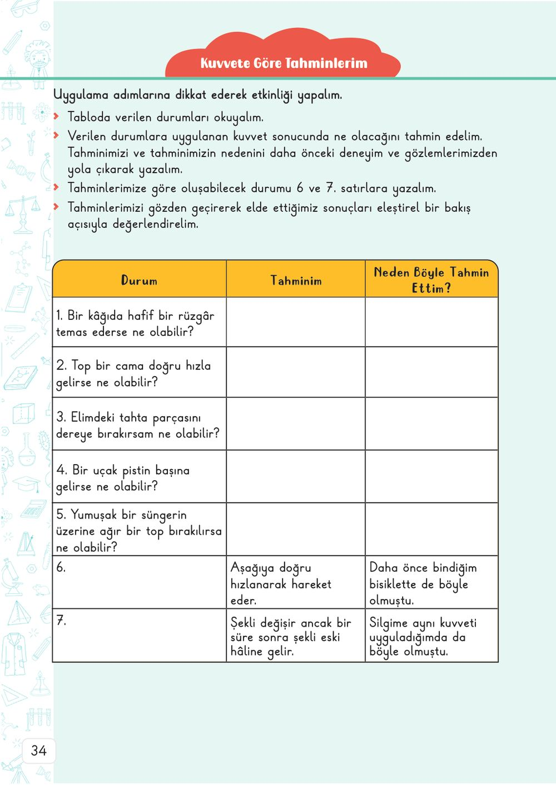
<!-- yer tutucu bulunamadı: sayfa sonuna eklendi -->

<!-- sayfa 35 -->

Aşağıdaki form, kuvvetin varlıklar üzerindeki etkileri konusunda edindiğimiz bilgi ve becerilerimizi değerlendirmemiz amacıyla hazırlanmıştır. Davranış ifadelerini okuyarak “Evet”, “Bazen” veya “Hayır” seçeneklerinden uygun olanı işaretleyelim.

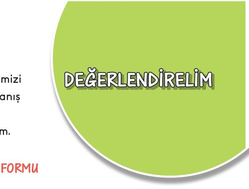

# ÖZ DEĞERLENDİRME FORMU

Adı soyadı: ............................................................
Sınıfı ve numarası: ..................................................

| Değerlendirilecek Davranışlar | Evet | Bazen | Hayır |
| :--- | :---: | :---: | :---: |
| 1. Varlıkların hareketinin ve şekil değiştirmesinin nedenine ilişkin ön bilgi ve deneyimlerimden yola çıkarak önermelerimi oluşturdum. | | | |
| 2. Varlıkların hareketinin ve şekil değiştirmesinin nedenine ilişkin gözlemler yaptım. | | | |
| 3. Gözlem sonuçlarımı önermelerimle karşılaştırdım. | | | |
| 4. Gözlem verilerimden yola çıkarak kuvvetin varlıkların hareketine ve şekil değiştirmesine neden olduğu sonucunu çıkardım. | | | |
| 5. Kuvvetin etkilerine yönelik tahminlerimin doğruluğunu sorguladım. | | | |
| 6. İtme ve çekmenin varlıkların hareketine ve şekil değiştirmesine neden olduğu sonucunu çıkardım. | | | |

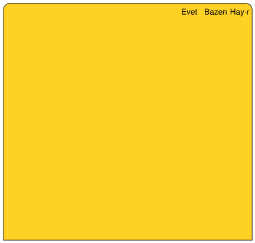

İşaretlediğimiz davranışların hepsinin “Evet” olması, kuvvetin varlıklar üzerindeki etkilerini bilimsel gözleme dayalı tahmin edebilme becerisini kazandığımızı gösteriyor. “Evet”, “Bazen” veya “Hayır” cevaplarımız için öğretmenimiz ve arkadaşlarımızdan destek alabiliriz.

<!-- sayfa 36 -->

# ÜNİTE DEĞERLENDİRME

1. Daha önce gözlemlediğimiz varlıkların hareketlerini hatırlayalım. Bu varlıkları, nasıl hareket ettiklerini ve hareket durumlarını aşağıdaki tabloya örnekteki gibi yazalım.

| Varlığın Adı | Nasıl Hareket Etti? | Hareket Durumu |
| :--- | :--- | :--- |
| top | Yokuş aşağı yuvarlandı. | hızlanma |
| bisiklet | Yan yola geçti. | yön değiştirme |
| | | |
| | | |
| | | |
| | | |

2. Aşağıdaki bulmacada varlıkların hareket durumlarıyla ilgili altı adet anahtar kavram gizlenmiştir. Bu kavramlar soldan sağa ve yukarıdan aşağıya olacak şekilde yerleştirilmiştir. Kavramları bulalım ve bulmaca üzerinde işaretleyelim.

| J | U | H | D | H | A | R | E | K | E | T | L | S |
|---|---|---|---|---|---|---|---|---|---|---|---|---|
| S | G | S | M | Y | L | H | E | K | V | N | S | T |
| A | Z | T | S | A | D | Ö | N | M | E | C | A | Y |
| Y | J | S | A | V | I | Y | F | U | H | G | L | G |
| G | O | C | A | A | A | Z | C | M | I | B | L | S |
| S | B | Z | Y | Ş | N | V | F | J | Z | P | A | H |
| U | V | J | F | L | M | S | U | B | L | J | N | D |
| G | S | E | C | A | Z | Z | H | G | A | B | M | A |
| C | O | G | H | M | C | M | I | A | N | E | A | A |
| V | D | G | I | A | P | B | J | K | M | Z | Y | R |
| I | Y | R | F | Z | B | U | S | H | A | Y | R | G |
| Y | Ö | N | D | E | Ğ | İ | Ş | T | İ | R | M | E |

• Bulduğumuz kavramlardan dört tanesini seçelim. Aşağıdaki noktalı alana bu kavramları kullanarak anlamlı cümleler yazalım.

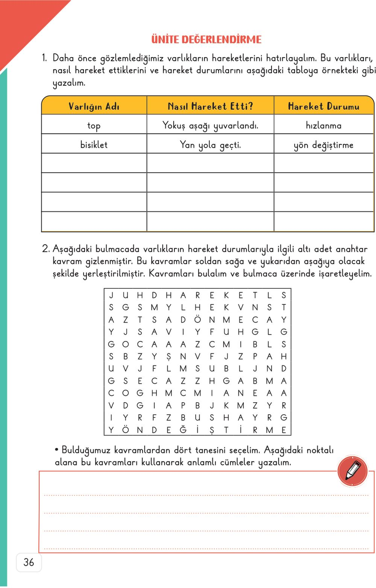
..........................................................................................................................................
..........................................................................................................................................
..........................................................................................................................................

<!-- sayfa 37 -->

3. Aşağıda Zıpzekâ'nın hareketleri verilmiştir. Bu hareketleri doğru hareket durumu ile eşleştirelim. Eşleştirdiğimiz hareket durumlarının yazı renklerine göre Zıpzekâ'yı boyayalım.

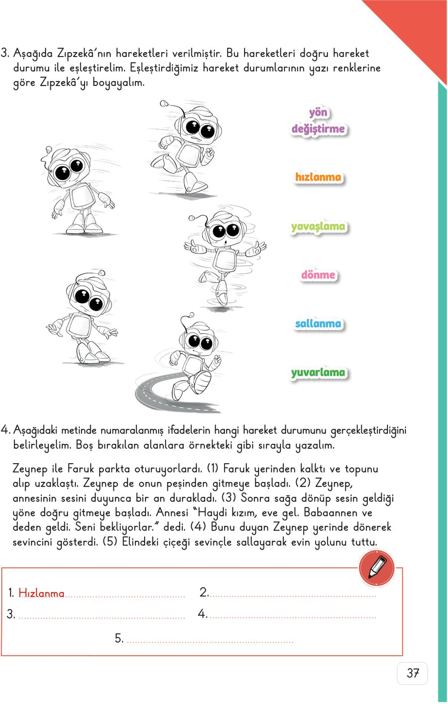

yön değiştirme
hızlanma
yavaşlama
dönme
sallanma
yuvarlama

4. Aşağıdaki metinde numaralanmış ifadelerin hangi hareket durumunu gerçekleştirdiğini belirleyelim. Boş bırakılan alanlara örnekteki gibi sırayla yazalım.

Zeynep ile Faruk parkta oturuyorlardı. (1) Faruk yerinden kalktı ve topunu alıp uzaklaştı. Zeynep de onun peşinden gitmeye başladı. (2) Zeynep, annesinin sesini duyunca bir an durakladı. (3) Sonra sağa dönüp sesin geldiği yöne doğru gitmeye başladı. Annesi “Haydi kızım, eve gel. Babaannen ve deden geldi. Seni bekliyorlar.” dedi. (4) Bunu duyan Zeynep yerinde dönerek sevincini gösterdi. (5) Elindeki çiçeği sevinçle sallayarak evin yolunu tuttu.

1. Hızlanma .................................................................. 2. ........................................................................
3. ...................................................................................... 4. ........................................................................
5. ......................................................................................

<!-- sayfa 38 -->

5. Aşağıdaki tabloyu inceleyelim. Tablodaki görselleri verilen varlıkların hareket durumlarının olumlu ve olumsuz olabilecek sonuçlarını örnekteki gibi yazalım.

| Varlık | Varlığın Hareketinin Olumlu Sonucu | Varlığın Hareketinin Olumsuz Sonucu |
| :---: | :--- | :--- |
| 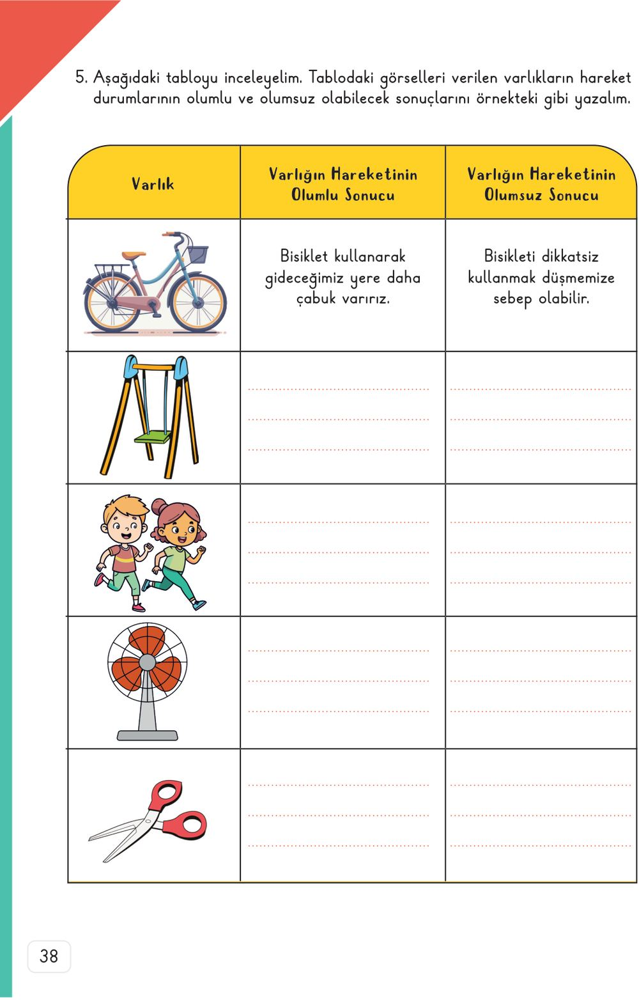 | Bisiklet kullanarak gideceğimiz yere daha çabuk varırız. | Bisikleti dikkatsiz kullanmak düşmemize sebep olabilir. |
|  | | |
|  | | |
|  | | |
|  | | |

<!-- sayfa 39 -->

6. Metni okuyalım. Boş bırakılan alana metnin son cümlesine uygun bir resim yapalım.

Zuhal ve Mete odalarını toplamaya karar verdiler. Zuhal yerdeki oyuncak kutusunu yerine götürmek istiyordu. Kutunun halı üzerinde zor hareket ettiğini fark etti. “Mete, hadi sen de yardım et. Birlikte daha kolay olur.” dedi. Zuhal kutunun ön tarafından, Mete arka tarafından tutarak kutuyu kolaylıkla hareket ettirdiler.

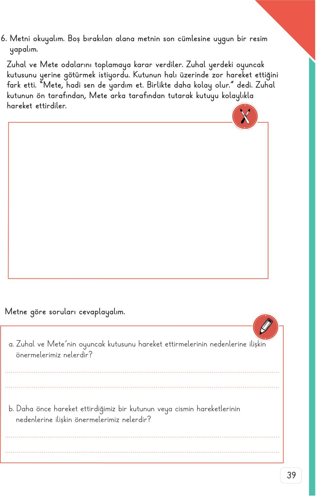

Metne göre soruları cevaplayalım.

a. Zuhal ve Mete’nin oyuncak kutusunu hareket ettirmelerinin nedenlerine ilişkin önermelerimiz nelerdir?
__________________________________________________________________________________________________
__________________________________________________________________________________________________
__________________________________________________________________________________________________

b. Daha önce hareket ettirdiğimiz bir kutunun veya cismin hareketlerinin nedenlerine ilişkin önermelerimiz nelerdir?
__________________________________________________________________________________________________
__________________________________________________________________________________________________
__________________________________________________________________________________________________

<!-- sayfa 40 -->

7. Numaralanmış görselleri inceleyelim. Görsellerde uygulanan kuvvetleri dikkate alarak aşağıdaki soruları cevaplayalım.

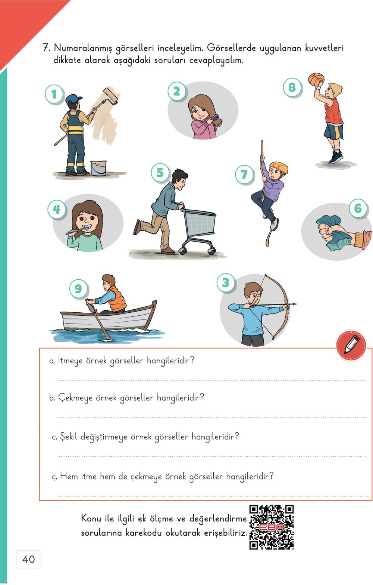

a. İtmeye örnek görseller hangileridir?
__________________________________________________________________

b. Çekmeye örnek görseller hangileridir?
__________________________________________________________________

c. Şekil değiştirmeye örnek görseller hangileridir?
__________________________________________________________________

ç. Hem itme hem de çekmeye örnek görseller hangileridir?
__________________________________________________________________

Konu ile ilgili ek ölçme ve değerlendirme sorularına karekodu okutarak erişebiliriz.

<!-- sayfa 41 -->

# ÜNİTE
# YAŞAMIMIZI KOLAYLAŞTIRAN ELEKTRİK

* ELEKTRİKLİ ARAÇ GEREÇ
* ELEKTRİKLİ ARAÇ GERECİN GÜVENLİ KULLANIMI
* ELEKTRİĞİN TASARRUFLU KULLANIMI

Bu ünitede;
* bazı araç gerecin elektrikli olduğuna ilişkin bilimsel çıkarım yapacak,
* elektrikli araç gerecin güvenli kullanımı ile ilgili eleştirel düşünecek,
* elektriği tasarruflu kullanma konusunda bilimsel veriye dayalı tahminler oluşturacağız.

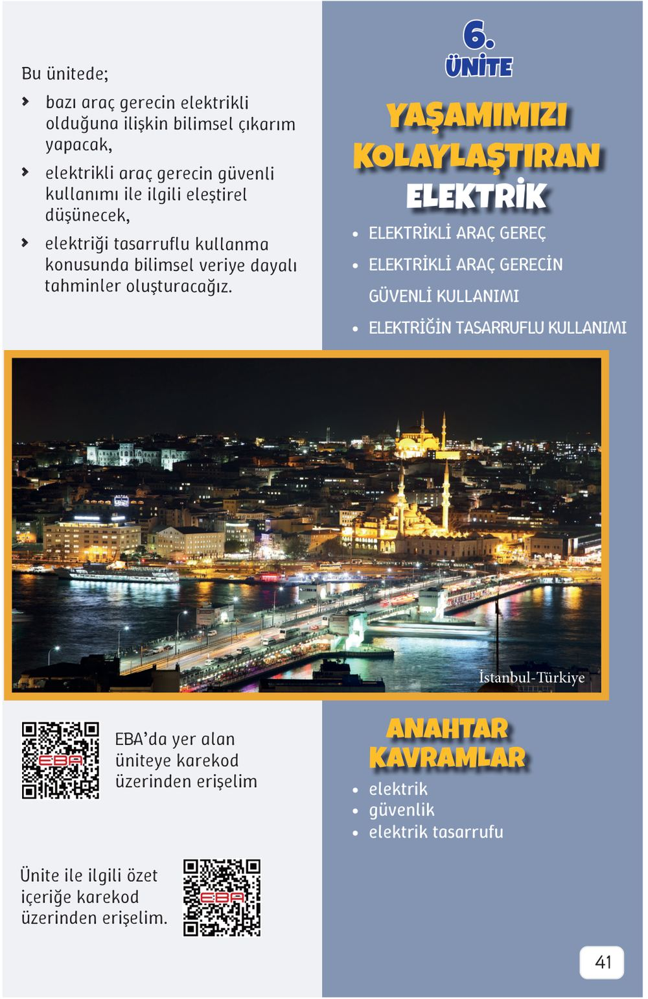
İstanbul-Türkiye

* EBA’da yer alan üniteye karekod üzerinden erişelim

* Ünite ile ilgili özet içeriğe karekod üzerinden erişelim

# ANAHTAR KAVRAMLAR
* elektrik
* güvenlik
* elektrik tasarrufu

<!-- sayfa 42 -->

# MERAK SAYFASI

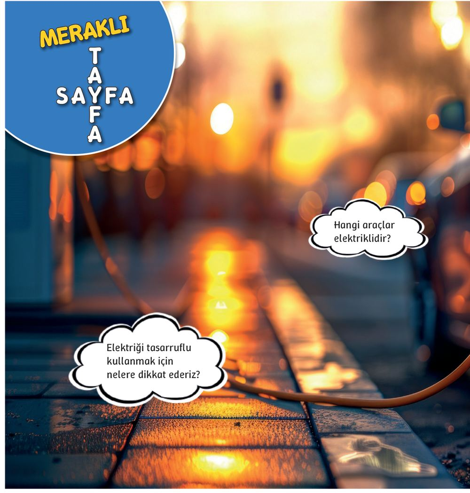

Hangi araçlar elektriklidir?

Elektriği tasarruflu kullanmak için nelere dikkat ederiz?

Bunları Biliyor muyuz?
* Ülkemizin ilk elektrik santrali Mersin’in Tarsus ilçesinde hizmete girmiştir.
* Elektrikli yılan balıkları avlanırken veya avcı gördüklerinde elektrik üretir.

<!-- sayfa 43 -->

Elektrikli araç gereci kullanırken güvenliğimizi korumak için nelere dikkat ederiz?

ÜNİTE İLE İLGİLİ MERAK ETTİĞİN BİR SORU DA SENDEN

› Elektrikli arabalar, diğer arabalara göre daha az kirletici gaz çıkarır ve bu sayede hava daha temiz olur.
› Günümüzde Türkiye’de üretilen elektriğin bir kısmı su, güneş ve rüzgârdan elde edilmektedir.

<!-- sayfa 44 -->

# ELEKTRİKLİ ARAÇ GEREÇ

: "Neler Biliyorum?" yazılı bir konuşma balonu ve bilgisayar başında bir robot figürü.

Aşağıdaki soruyu sözlü olarak cevaplayalım.
* Evimizde işlerimizi kolaylaştırmak için hangi araç gereçten yararlanıyoruz?

---

**Malzemeler:** siyah karton, keçeli kalem, şeffaf poşet dosya, makas, Ek 3’te bulunan görseller, Ek 4’te bulunan el feneri şablonu 

**Uygulama adımlarına dikkat ederek etkinliği yapalım.**

* Ekler bölümünde verilen Ek 3’ü noktalı yerlerden keselim.
* Kestiğimiz kâğıdı şeffaf poşet dosyanın içine koyalım, bu kâğıdı şablon olarak kullanalım. Şeffaf poşet dosyanın üzerine keçeli kalemlerle görsellerin kopyasını örnekteki gibi çizelim.

: Bir poşet dosya içinde çizilmiş çeşitli ev eşyaları (saat, lamba, ütü vb.) ve yanında bir robot figürü. Konuşma balonunda "Elektrikler kesildiğinde çevremizde ne gibi değişiklikler olur?" yazıyor.

---

* Çizdiğimiz görselleri uygun renklerde boyayalım. Ek 3’ü şeffaf poşet dosyanın içinden çıkaralım.
* Ekler bölümünde verilen Ek 4’te yer alan el feneri şablonunu uygun renklerde boyayalım. Noktalı yerlerden keserek el fenerimizi hazırlayalım.
* Siyah kartonu poşet dosyanın içine yerleştirelim.
* Şeffaf poşet dosyamızı elektriğin olmadığı ortam gibi düşünebiliriz. Bu ortamı aydınlatmak için el fenerimizi dosyanın içinde gezdirebiliriz. Elektrik

<!-- sayfa 45 -->

* Dosyada el feneri ile görebildiğimiz araç gerecin elektrikli olup olmadığını tahmin ederek listeleyelim.
* Bu araç gerecin neden elektrikli olduğunu veya olmadığını düşünüp yazalım.

| Elektrikli Olmayan Araç Gereç | Elektrikli Olmadığını Düşünmemizin Nedenleri |
| :--- | :--- |
| | |

| Elektrikli Araç Gereç | Elektrikli Olduğunu Düşünmemizin Nedenleri |
| :--- | :--- |
| | |

* Elektrikli araç gerecin özelliklerinin neler olabileceğini sınıf arkadaşlarımızla tartışalım. Bu konu ile ilgili merak ettiğimiz soruları aşağıdaki alana yazalım. Sorularımızın cevaplarını araştırarak sınıf arkadaşlarımızla paylaşalım.

| |
| :--- |
| |

<!-- yer tutucu bulunamadı: sayfa sonuna eklendi -->

<!-- sayfa 46 -->

# Nedir, Ne ile Çalışır?

* Aşağıdaki soruların cevaplarını araştırarak bulalım. Araştırma sonuçlarımızı sınıf arkadaşlarımızla paylaşalım.

1. Yandaki görselde içindeki parçaları görünen aletin adı nedir?
..................................................................................................................................
2. Bu alet ne ile çalışır?
..................................................................................................................................

3. Yandaki görselde bulunan aletin adı nedir?
..................................................................................................................................
4. Bu alet ne ile çalışır?
..................................................................................................................................

5. Küçük parçaların birleşmesiyle oluşmuş, yandaki görselde bulunan aracın adı nedir?
..................................................................................................................................
6. Bu araç ne ile çalışır?
..................................................................................................................................

* Işıklı veya ses çıkaran ancak artık çalışmayan bir oyuncağımızı sınıfa getirebiliriz. Oyuncağı öğretmenimiz ve sınıf arkadaşlarımızın yardımıyla parçalarına ayırabilir ve oyuncağın ne ile çalıştığını inceleyebiliriz.

<!-- sayfa 47 -->

# ÖĞRENELİM

EBA: içeriğe karekod üzerinden erişelim.

Yaşamımızı kolaylaştıran elektrikli araç gereç vardır. Bu araç gereci aydınlatma, ısınma, iletişim kurma gibi birçok amaç için kullanırız.

Aydınlatma için kullanılan elektrikli araç gereç, iç ve dış mekânlarda ışık sağlayarak yaşamımızı kolaylaştırır. Projektör, led ampul, gece lambası, sokak lambası, el feneri, otomobil farı bunlara örnektir.

> Projektör, bahçe ve bina aydınlatmalarında güçlü ışık sağlar.

Isınma için kullanılan elektrikli araç gereç, özellikle kış aylarında iç mekânları ısıtarak ve sıcak tutarak yaşamımızı kolaylaştırır. Elektrikli radyatör, elektrik sobası, elektrikli battaniye bunlara örnektir.

İletişim kurmak için kullanılan elektrikli araç gereç; insanların bilgi, düşünce ve duygularını başkalarına iletmesini sağlar. Bu araçlarla sesli, yazılı veya görüntülü iletişim kurulabilir. Telefon, bilgisayar, televizyon, radyo, yazıcı, akıllı tahta bunlara örnektir.

> Radyo, kablolu veya kablosuz olarak çalışabilir. Kablosuz çalışan radyonun elektrik kaynağı pildir.

> Pille çalışan başka elektrikli araç gereç nelerdir?

<!-- sayfa 48 -->

Pil, elektrikli araç gerecin çalışabilmesi için gerekli enerjiyi sağlar. Taşınabilir olduğu için araç gereci kabloya gerek olmadan çalıştırır. Kumanda, cep telefonu, el feneri, saat ve bazı oyuncaklar pille çalışır.

Günlük yaşamımızda farklı amaçlar için kullandığımız elektrikli araç gereç vardır.

Yiyeceklerimizi soğutarak uzun süre bozulmadan saklayabilmek için buzdolabı kullanırız. Çamaşırlarımızı yıkamak için çamaşır makinesi, bulaşıklarımızı yıkamak için bulaşık makinesi kullanabiliriz. Evimizi elektrikli süpürge ile süpürebiliriz. Kırışan giysilerimizi ütü ile düzeltebiliriz. Saçlarımızı saç kurutma makinesi ile kurutabiliriz.

Sizce elektrik keşfedilmeden önce insanlar nasıl yaşıyordu?

Bir araç gerecin elektrikli olup olmadığına karar vermek için eleştirel ve bilimsel bir bakış açısı kullanırız. O araç gerecin enerjiyi nereden aldığını belirleriz. Örneğin suyu bir kap yardımıyla piknik tüpünde ısıtabiliriz. Tüp elektrikli değildir. Suyu su ısıtıcısında da ısıtabiliriz. Bu durumda suyu ısıtmak

<!-- sayfa 49 -->

# Elektrikli Bulmacam

* Noktalı alanlara günlük yaşamda kullandığımız elektrikli araç gerece örnekler yazalım.

* Kelime avı bulmaca örneğini inceleyelim.

**Örnek**

| F | I | R | I | N |
|---|---|---|---|---|
| A | S | Ü | T | E |
| S | E | T | Ç | R |
| Y | İ | Ü | O | S |

<!-- sayfa 50 -->

Uygulama adımlarına dikkat ederek etkinliği yapalım.

* Önceki sayfada yazdığımız elektrikli araç gereç adlarını kullanarak kelime avı bulmacamızı hazırlayalım.
* Bulmacadaki kelimeleri soldan sağa veya yukarıdan aşağıya olacak şekilde yerleştirelim.

# KELİME AVI BULMACAM

| | | | | | | | | | | | | | | |
|---|---|---|---|---|---|---|---|---|---|---|---|---|---|---|
| | | | | | | | | | | | | | | |
| | | | | | | | | | | | | | | |
| | | | | | | | | | | | | | | |
| | | | | | | | | | | | | | | |
| | | | | | | | | | | | | | | |
| | | | | | | | | | | | | | | |
| | | | | | | | | | | | | | | |
| | | | | | | | | | | | | | | |
| | | | | | | | | | | | | | | |
| | | | | | | | | | | | | | | |
| | | | | | | | | | | | | | | |
| | | | | | | | | | | | | | | |
| | | | | | | | | | | | | | | |
| | | | | | | | | | | | | | | |

* Hazırladığımız bulmacayı sıra arkadaşımızla değiştirelim. Arkadaşımızın bulmacasındaki kelimeleri bulalım.
* Bulduğumuz kelimelerin üstünü kırmızı kalem ile çizelim.
* Sıra arkadaşımızın bulmacada yer verdiği elektrikli araç gereçle bizim...

<!-- yer tutucu bulunamadı: sayfa sonuna eklendi -->

<!-- sayfa 51 -->

* Evimizde sıklıkla kullandığımız araç gereci inceleyelim. Bunların (“Fişi var, şehir elektriği ile çalışır.”, “Pili var, elektrik üretimi ile çalışır.”, “İnsan gücü ile elektrik olmadan çalışır.” vb.) özelliklerini eleştirel ve bilimsel bakış açısıyla düşünelim. Elektrikli olup olmadıklarına karar verelim. Elde ettiğimiz bilgilerle aşağıdaki tabloyu dolduralım. 

| Araç Gereç | Elektrikli | Elektrikli Olmayan |
| :--- | :--- | :--- |
| | | |
| | | |
| | | |
| | | |
| | | |
| | | |
| | | |
| | | |

 DEĞERLENDİRELİM

* Tabloya yazdığımız araç gerecin elektrikli olup olmadığına nasıl karar verdiğimizi aşağıdaki alana yazalım. Arkadaşlarımızla paylaşalım. 

..........................................................................................................................................
..........................................................................................................................................
..........................................................................................................................................
..........................................................................................................................................
..........................................................................................................................................

<!-- sayfa 52 -->

# ELEKTRİKLİ ARAÇ GEREcİN GÜVENLİ KULLANIMI

 Neler Biliyorum?

Aşağıdaki soruyu sözlü olarak cevaplayalım.
* "Araç gereci güvenli kullanalım." sözünden ne anlıyoruz?

Örnek olayları okuyalım.

**Örnek Olay 1**
Aslı uyumadan önce duş almak istedi. Duştan çıktı. Aslı’nın saçları çok uzun olduğu için çabuk kurumuyordu. Islak saçla uyumak da istemiyordu. Saçlarını saç kurutma makinesi ile kurutmaya karar verdi.

**Örnek Olay 2**
Ahmet bilgisayarın başında oturmuş bir araştırma yapıyordu. Annesi ona bir bardak süt getirdi. Ahmet sütü içerken bilgisayar ekranında şarj uyarısı belirdi. Bardağı bırakmadan bilgisayarı şarja takmaya çalıştı.

Aşağıdaki soruları cevaplayalım.

1. Aslı saç kurutma makinesini kullanırken güvende olmak için nelere dikkat etmelidir?
__________________________________________________________________
__________________________________________________________________

2. Ahmet bilgisayarı kullanırken güvende olmak için nelere dikkat etmelidir?
__________________________________________________________________
__________________________________________________________________

3. Elektrikli araç gereci kullanırken nelere dikkat etmeliyiz?
__________________________________________________________________
__________________________________________________________________

<!-- sayfa 53 -->

# Aman Dikkat!

Aşağıdaki görseli inceleyelim.

* Görselde elektriğin güvenli kullanılmadığı durumları bulalım ve $\text{\color{red}X}$ <!-- KONTROL: Marker'da karşılığı yok, uydurma olabilir --> ile işaretleyelim.
* İşaretlediğimiz durumlardaki hatalı davranışları söyleyelim.
* Elektriğin güvenli kullanımı ile ilgili risk oluşturabilecek durumları ve olası olumsuz sonuçların neler olabileceğini nedenleriyle sınıf arkadaşlarımızla tartışalım.

<!-- yer tutucu bulunamadı: sayfa sonuna eklendi -->

<!-- sayfa 54 -->

# Güvenli Elektrik Panosu

• Tablet, televizyon gibi elektrikli araç gereci kullanırken hem kendimizin hem de elektrikli araç gerecin güvenliğini sağlamalıyız. Bunun için nelere dikkat etmemiz gerektiğini aşağıdaki sarı not kâğıtlarına yazalım.

<!-- sayfa 55 -->

* Beyaz not kâğıtlarına da elektrikli araç gerecin güvenli kullanımı ile ilgili görseller hazırlayalım. Görseller için resim çizip boyayabiliriz. Dergi, gazete gibi kaynaklardan fotoğraf kesip yapıştırabiliriz.

<!-- sayfa 56 -->

# ÖĞRENELİM

Konu ile ilgili içeriğe karekod üzerinden erişelim.

Yaşamımızı kolaylaştıran elektrikli araç gerecin güvenli kullanımı ile ilgili dikkat edilmesi gereken durumlar vardır.

Elektrikli araç gereci kullanmadan önce kullanma kılavuzlarını dikkatlice okumalıyız. Bu araç gereci kullanırken mutlaka bir büyüğümüzden yardım almalıyız.

Kullandığımız prizlerin yuvasından çıkmamış olmasına, elektrikli araç gerecin kablolarının zarar görmemiş olmasına dikkat etmeliyiz. Priz ve kablolara herhangi bir nesne ile dokunmamalıyız. Güvenlik aparatlı veya kapaklı prizler kullanmalıyız.

Elektrikli araç gereci sıvı ile temas ettirmemeliyiz. Böyle bir kaza yaşanması durumunda hiçbir şeye dokunmadan aile büyüklerimize haber vermeliyiz. Priz ve kablolara ıslak elle dokunmamalıyız.

<!-- sayfa 57 -->

Su ile elektrik üretilebilir, barajlar bu amaçla kurulur.

Bahçe, sokak, park gibi dış mekânlarda sarkan teller, açıkta bulunan kablolar varsa hemen oradan uzaklaşmalı ve bir yetişkine haber vermeliyiz.

Elektrikli araç gereci çalıştıran pilleri dikkatli kullanmalıyız. Eğer pil bozulur, kırılır veya yere atılırsa pilin içindeki zararlı maddeler dışarı çıkarak bize ve doğaya zarar verebilir. Böyle bir durumda büyüklerimizden yardım istemeliyiz. Pilleri çöp yerine özel geri dönüşüm kutularına atmalıyız. Pillere dokunduğumuz için ellerimizi mutlaka yıkamalıyız.

Elektrikli araç gereci güvenli kullandığımızda elektrik çarpması, yangın, araç gereç arızası gibi tehlikeli durumları önleyebiliriz. Bu durumlara bağlı can ve mal kayıplarının önüne geçer, sağlığımızı koruruz.

Güvenli elektrik kullanımı ile ilgili risk oluşturabilecek durumları önceden tespit etmeliyiz. Bu durumlara ilişkin alabileceğimiz önlemleri belirlemeliyiz. Günlük

<!-- sayfa 58 -->

# Risk Var Mı?

Aşağıdaki form, elektrikli araç gerecin güvenli kullanımına ilişkin risk oluşturabilecek durumları tespit etmek için hazırlanmıştır. Aile büyüklerimizle formdaki soruları “Evet” veya “Hayır” seçeneklerinden uygun olanı işaretleyerek cevaplayalım. Tespit ettiğimiz farklı risk durumları varsa forma ekleyelim.

## RİSK TESPİT FORMU

| Risk Durumları | Evet | Hayır |
| :--- | :---: | :---: |
| 1. Elektrikli araç gereci kullanmadan önce kullanma kılavuzunu okuyor muyuz? | | |
| 2. Zarar görmüş, bozuk, yuvasından çıkmış prizler var mı? | | |
| 3. Aşınmış, zarar görmüş kablolar var mı? | | |
| 4. Prizlerde güvenlik aparatı var mı? | | |
| 5. Sıvıyla temas etme ihtimali olan elektrik kablosu var mı? | | |
| 6. Sokakta sarkan tel veya düşmüş kablo var mı? | | |
| 7. | | |
| 8. | | |
| 9. | | |
| 10. | | |
| 11. | | |
| 12. | | |

<!-- yer tutucu bulunamadı: sayfa sonuna eklendi -->

<!-- sayfa 59 -->

Risk Tespit Formu'nda “Evet” veya “Hayır” cevabı verdiğimiz riskli durumlara yönelik alınması gereken önlemleri yazalım. Bu önlemlerin nedenlerini açıklayalım.

| Alınması Gereken Önlemler | Önlemlerin Nedenleri |
| :--- | :--- |
| | |
| | |
| | |
| | |
| | |

# Uyarı Notları

**Malzemeler:** renkli karton, boya kalemleri, bant, makas

Uygulama adımlarına dikkat ederek etkinliği yapalım.

* Günlük yaşamımızda elektrikli araç gereci kullanırken uyduğumuz güvenlik kurallarına ilişkin örnekteki gibi uyarı notları hazırlayalım.

* Güvenlik sembolleri veya görseller ekleyerek notlarımızı zenginleştirebiliriz.
* Hazırladığımız uyarı notlarını sınıf arkadaşlarımıza sunalım.

<!-- sayfa 60 -->

Ekler bölümünde verilen Ek 5'te verilen çalışma yaprağını yapalım. Ardından aşağıda verilen Öz Değerlendirme Formu'nu dolduralım. 
Aşağıdaki form, elektrikli araç gereci güvenli bir şekilde kullanıp kullanmadığımızı değerlendirmek amacıyla hazırlanmıştır. Davranış ifadelerini okuyarak “Evet”, “Bazen” veya “Hayır” seçeneklerinden uygun olanı işaretleyelim.

# ÖZ DEĞERLENDİRME FORMU

Adı soyadı:.................................................................................
Sınıfı ve numarası:......................................................................

| Değerlendirilecek Davranışlar | Evet | Bazen | Hayır |
| :--- | :---: | :---: | :---: |
| 1. Elektrikli araç gereci kullanmadan önce mutlaka kullanma kılavuzunu okurum. | | | |
| 2. Elektrikli araç gereci kullanmam gerektiğinde bir büyüğümden yardım isterim. | | | |
| 3. Zarar görmüş, bozuk, yuvasından çıkmış prizlerden uzak dururum. | | | |
| 4. Herhangi bir nesne ile prizlere dokunmam. | | | |
| 5. Elektrikli araç gereci su ile temas edebilecek yerlerde kullanmam. | | | |
| 6. Açıkta bulunan elektrik kablolarından uzak dururum. | | | |
| 7. Elektrikle çalışan eşyalara ıslak elle dokunmam. | | | |
| 8. Elektrik tehlikesi uyarısının bulunduğu yerlerden uzak dururum. | | | |

İşaretlediğimiz davranışların hepsinin “Evet” olması, elektrikli araç gereci güvenli kullandığımızı gösterir. “Bazen” ve “Hayır” seçeneklerini işaretlediğimiz davranışlarımız varsa güvenliğimiz için elektrikli araç gerecin kullanımına dikkat etmeli, gerektiğinde öğretmen ve ailemizden destek almalıyız.

<!-- sayfa 61 -->

# ELEKTRİĞİN TASARRUFLU KULLANIMI

Aşağıdaki soruyu sözlü olarak cevaplayalım.
* Kaynaklarımızı tasarruflu kullanmak neden önemlidir?

Aşağıdaki harf, sayı ve görselleri birlikte kullanarak şifreli kelimeleri bulalım.
Tüm kelimelerin oluşturduğu cümleyi noktalı alana yazalım.

| | | |
| :--- | :--- | :--- |
| GEREKSİZSE | $S + 10 + \text{görsel (dürbün)} - \text{BÜN}$ <!-- KONTROL: Marker'da karşılığı yok, uydurma olabilir --> | |
| GELECEĞİNİ | $\text{görsel (gül)} + \text{görsel (dürbün)} - \text{BÜN}$ <!-- KONTROL: Marker'da karşılığı yok, uydurma olabilir --> | |

..........................................................................................................................................
..........................................................................................................................................

Yukarıdaki cümleden ne anladığımızı yazalım.

..........................................................................................................................................
..........................................................................................................................................
..........................................................................................................................................

<!-- sayfa 62 -->

# Faturalar

**Malzemeler:** evimizin son 3 ayına ait elektrik faturaları

Uygulama adımlarına dikkat ederek etkinliği yapalım.

* Sınıf arkadaşlarımızla dört veya beş kişilik gruplar oluşturalım.
* Grup arkadaşlarımızla getirdiğimiz son üç aya ait elektrik faturalarını ortaya koyalım.
* Getirilen faturaları grup arkadaşlarımızla inceleyelim. 
* Getirdiğimiz faturalardan elde ettiğimiz bilgilerle yandaki tabloyu dolduralım.
* Oluşturduğumuz tabloyu inceleyelim.
* Getirdiğimiz faturaların aylara göre değişimini arkadaşlarımızla değerlendirelim.

AYLARA GÖRE FATURA DEĞİŞİM TABLOSU 

| Fatura Ayı | Fatura Tutarı |
| :--- | :--- |
| | |
| | |
| | |

* Elektrik tüketimimizi azaltacak tasarruf tedbirlerini aşağıdaki alana yazalım.

### Tasarruf Tedbirleri 
(Boş alan)

* Elde ettiğimiz bilgiler ve ön bilgilerimizden yola çıkarak aşağıdaki önerme cümlelerini tamamlayalım. 

................................................................................................................................................................................................................................................................................................................................................................................................................................................................................................................................................................................................................................................................................................................................................................................................

<!-- sayfa 63 -->

Sınırlı kaynaklarımızdan biri olan elektriği tasarruflu kullanmak geleceğimiz için çok önemlidir. Elektriği tasarruflu kullanırsak kaynaklarımızı gelecek nesillere ulaştırabiliriz. Doğayı korumuş oluruz. Aile bütçesine katkıda bulunuruz. Ülkemizin sahip olduğu kaynakları verimli ve sürdürülebilir biçimde kullanırız.

# ÖĞRENELİM

## NELER YAPABİLİRİZ?

1. Gereksiz yanan ışıkları söndürebiliriz.
2. Kullanmadığımız araçları fişten çekebiliriz.
3. Elektrikli araç gereci uzun süre şarjda bırakmayabiliriz.
4. Çamaşır ve bulaşık makinesini dolu olduğunda çalıştırabiliriz.
5. Buzdolabının kapağını uzun süre açık bırakmayabiliriz.
6. Güneş pilleri veya panelleri kullanabiliriz.
7. Enerji tasarruflu ampuller tercih edebiliriz.
8. Fırını pişirme süresinden biraz önce kapatabiliriz.
9. Enerji verimliliği yüksek elektrikli araç gereç tercih edebiliriz.
10. Saçlarımızı kurutmadan önce havluyla kurulayabiliriz.
11. Çamaşırları nemliyken ütüleyebiliriz.

 "En çok elektrik tüketen ev araç gerecinden biriyim."

 "Beni tercih ederseniz aydınlanma konforunuz değişmez ve faturanız çok daha az gelir."

 "Elektrik tasarrufu için başka neler yapabiliriz?"

Evimizde ve okulumuzda elektriği tasarruflu kullanmak için tasarruf planı hazırlayıp uygulayabiliriz. Bunun için aşağıdaki adımları izleyebiliriz.

1. İçinde bulunduğumuz ayın elektrik faturasını inceleriz.
2. Elektriğin tasarruflu kullanımı ile ilgili Kontrol Listesi hazırlarız.
3. Elektrik kullanımımıza göre Kontrol Listesi'ni doldururuz.
4. Elektrik tasarrufu sağlayan davranışlar sergileriz.
5. Elektriği tasarruflu kullanmadığımızı düşündüğümüz davranışlarımızı değiştirmek için ne yapmamız gerektiğini belirleriz.
6. Bir ay boyunca elektriğin tasarruflu kullanımına yönelik davranışlar sergileriz.
7. Ay sonunda gelen yeni elektrik faturasını inceleriz. Bu faturayı bir önceki ayın faturası ile karşılaştırırız.

Uyguladığımız tasarruf planını değerlendirebiliriz. Elektriği tasarruflu...

<!-- sayfa 64 -->

# Tasarruf Planı Yapalım

Uygulama adımlarına dikkat ederek etkinliği yapalım.

> Alper ve kardeşi Asel, evlerinde elektriği daha tasarruflu kullanmak için bir tasarruf planı hazırladılar. Planı aile büyükleri ile paylaştılar, bir ay boyunca dikkatlice uyguladılar.

| Tasarruf Planından Önce | Tasarruf Planından Sonra |
| :--- | :--- |
| **NİSAN DÖNEMİ**   **ELEKTRİK FATURASI** | **MAYIS DÖNEMİ**   **ELEKTRİK FATURASI** |
| Sözleşme No.: 016   Ad Soyadı: VEFA AİLESİ   Ödenecek Tutar: 1000 TL   Son Ödeme Tarihi: 30 Nisan   e-Arşiv Fatura | Sözleşme No.: 016   Ad Soyadı: VEFA AİLESİ   Ödenecek Tutar: ......................... TL   Son Ödeme Tarihi: 29 Mayıs   e-Arşiv Fatura |

> Alper ve ailesinin tasarruf planı uygulamadan önceki elektrik faturasını inceleyelim.
> Planı uyguladıktan sonra gelen elektrik faturasını tahmin edelim.
> Tahminimizi görselde verilen boş faturaya yazalım.
> Tahminimizin nedenlerini arkadaşlarımızla paylaşalım.
> Ekler bölümünde verilen Ek 6’da verilen tasarruf planı sonrasında gelen fatura ile fatura tahminimizi karşılaştıralım.
> Elektriği tasarruflu kullanmak için sorumluluk almanın ve bilinçli bir tüketici olmanın

<!-- sayfa 65 -->

# PERFORMANS GÖREVİ

Aşağıdaki performans görevini yapalım.

## TASARRUF PLANIM

**Süre:** İki ders saati
**Konu:** Elektrik tasarrufu
**Görev:** Evimiz için elektrik tasarruf planı yapmamız, uygulamamız ve değerlendirmemiz beklenmektedir.

### Uygulama Adımları

* Ekler bölümünde verilen Ek 7’de verilen Kontrol Listesi şablonunu noktalı yerlerden keselim.
* Kestiğimiz Kontrol Listesi şablonuna elektriği tasarruflu kullanmak için yapabileceklerimizi yazalım.
* Yazdığımız maddeleri evimizde uygulayıp uygulamadığımızı aile büyüklerimizle belirleyelim. Uyguladığımız maddeler için “Evet” seçeneğini işaretleyelim.
* Uygulamadığımız maddeler için “Hayır” seçeneğini işaretleyelim. Uygulamama nedenlerimizi tartışalım. Bu maddelerde yazan davranışlarımızı değiştirmek için neler yapabileceğimizi ailemizle belirleyelim.
* Önceki ay gelen fatura tutarına bakalım. Tasarruf planını uyguladıktan sonraki ay gelebilecek faturayı tahmin edelim.
* Bir ay boyunca elektriğin tasarruflu kullanımına yönelik davranışlar sergileyelim.
* Ay sonunda gelen elektrik faturası ile tahminlerimizi karşılaştıralım.
* Uyguladığımız tasarruf planının güçlü ve zayıf yanlarını değerlendirelim. Zayıf yanlarını güçlendirmek için planı güncelleyelim.
* Elektriği tasarruflu kullanma planını yaşamımız boyunca uygulamamız gerektiğini unutmayalım.

## Okulda Tasarruf

Okulumuzda elektriği tasarruflu kullanmak için neler yapabileceğimizi araştıralım.

* Ekler bölümünde verilen Ek 8’de bulunan okul şablonunu noktalı yerlerden keselim.
* Şablonun içine araştırma sonuçlarımızı yazalım.
* Şablona konu ile ilgili görseller de ekleyebiliriz.
* Hazırladığımız çalışmayı sınıf arkadaşlarımızla paylaşalım.

<!-- sayfa 66 -->

Aşağıdaki form, elektriği tasarruflu kullanıp kullanmadığımızı değerlendirmek amacıyla hazırlanmıştır. Davranış ifadelerini okuyarak “Evet”, “Bazen” veya “Hayır” seçeneklerinden uygun olanı işaretleyelim.

# ÖZ DEĞERLENDİRME FORMU

Adı soyadı: ............................................................
Sınıfı ve numarası: ...................................................

| Değerlendirilecek Davranışlar | Evet | Bazen | Hayır |
| :--- | :---: | :---: | :---: |
| 1. Elektriği tasarruflu kullanmak için plan yaparım. | | | |
| 2. Gereksiz yanan ışıkları söndürürüm. | | | |
| 3. Elektrikli araç gereci kullanmadığımda kapatırım. | | | |
| 4. Şarjı dolan elektrikli araç gerecin şarj aletini prizden çıkarırım. | | | |
| 5. Saçlarımı kurutmadan önce havluyla kurularım. | | | |
| 6. Buzdolabının kapağını uzun süre açık bırakmam. | | | |
| 7. Elektriği tasarruflu kullanmayanları nazik bir dille uyarırım. | | | |

İşaretlediğimiz davranışların hepsinin “Evet” olması, elektriği tasarruflu kullandığımızı gösterir. “Bazen” veya “Hayır” seçeneklerini işaretlediğimiz davranışlar varsa elektriğin tasarruflu kullanımına dikkat etmeli, gerektiğinde öğretmen ve ailemizden destek almalıyız.

<!-- sayfa 67 -->

# ÜNİTE DEĞERLENDİRME

1. Aşağıdaki araç gereci elektrikli olan ve olmayan araç gereç olarak belirleyelim. Görsel numaralarını uygun başlıkların altına yazalım.

| Elektrikli Araç Gereç | Elektrikli Olmayan Araç Gereç |
| :--- | :--- |
| | |
| | |
| | |
| | |
| | |

<!-- sayfa 68 -->

2. Aşağıdaki soruları metne göre cevaplayalım.

# ELEKTRİK KESİNTİSİ

Bu akşam yaşadıklarımı sizlerle paylaşmak istiyorum. Her akşam olduğu gibi annem, babam ve kardeşimle akşam yemeğimizi yedik. Kardeşim ve ben çok sevdiğimiz için annem fırında makarna yapmıştı. Yemeği yedikten sonra kitabımı okumaya başladım. Hava biraz soğuk olduğu için babam sobaya odun ekledi. Kardeşim uzaktan kumandalı arabasıyla oynamaya başladı. Annem televizyonda haberleri izliyordu. Tam o anda elektrik kesildi. Her yer karardı. Kitabımın en heyecanlı yerine gelmiştim. Neyse ki babam elinde mumlarla geldi. Evimiz biraz olsun aydınlanmıştı. Televizyon çalışmıyordu ama kardeşimin uzaktan kumandalı arabası çalışıyordu. Buna biraz şaşırdım. O sırada kapının tıklatıldığını duydum. Anneme söyledim. Annem de “Tabii, elektrik kesikken kapı zili de çalışmaz.” dedi ve hemen kapıya koştu. Doğrusu buna da şaşırdım. Kapıyı açtık, elinde el feneri ile dedem gelmişti. Hepimiz çok sevindik. Dedemlerin evi bize çok yakındı. Elektrikler kesilince dedem bize hep masal anlatırdı. Koltuğuna oturduğu gibi biz de onun etrafına dizildik. Dedem “Evvel zaman içinde...” der demez her yer aydınlandı. Hep bir ağızdan “Aaa, tüh!” dedik. Hemen kalkıp odanın ışığını söndürdüm. Bu anın tadını hiçbir şey bozamazdı.

(Bu kitap için hazırlanmıştır.)

a. Metinde geçen elektrikli araç gereç hangileridir?
__________________________________________________________________
__________________________________________________________________

b. Bu araç gereçle ilgili hangi bilgiler verilmiştir?
__________________________________________________________________
__________________________________________________________________

c. Bu araç gerecin elektrikli olup olmadığına nasıl karar verdik?
__________________________________________________________________
__________________________________________________________________

<!-- sayfa 69 -->

3. Aşağıdaki örnek olayları okuyalım. Olumsuz durumların yaşanmaması için alınabilecek önlemleri noktalı alanlara yazalım.

**Örnek Olay 1:** Atakan’ın annesi yeni aldığı su ısıtıcısını kutusundan çıkardığı gibi prize takıp çalıştırdı. Isıtıcıdan değişik sesler çıkmaya ve tuhaf bir koku yayılmaya başladı. Atakan, annesine başlangıçta yapması gereken bir şeyi yapmadığını hatırlattı.

................................................................................................................................................................................................................................................................................................................................................................................................................................................................................................................................................................................................................................................................................................................................................................................................................................................................................................................................................................................................................................................................................................................................................................................................................................................................................................................................................................................................

<!-- sayfa 70 -->

Sayfa 70, 71 ve 72'deki soruları metne göre cevaplayalım.

Çiçek ailesi bireyleri elektriği daha tasarruflu kullanmak için plan yaptılar. Bir ay boyunca bu planı uyguladılar. Bir ayın sonunda fatura miktarındaki değişimi görünce çok şaşırdılar.

4. Aşağıda verilen önermeyi uygun şekilde tamamlayalım.

Çiçek ailesi tasarruf yaptığı için elektrik faturası __________________________

5. Aşağıdaki grafikleri inceleyelim. Çiçek ailesinin faturasındaki muhtemel değişimi gösteren grafik veya grafiklerin altındaki kutucuğu x ile işaretleyelim.

| FATURA TUTARI (TL) | | FATURA TUTARI (TL) | |
| :--- | :--- | :--- | :--- |
| 800 | | 800 | |
| 600 | | 600 | |
| 400 | | 400 | |
| 200 | | 200 | |
| | HAZİRAN TEMMUZ AYLAR | | HAZİRAN TEMMUZ AYLAR |
| | Grafik 1 [ ] | | Grafik 2 [ ] |

| FATURA TUTARI (TL) | | FATURA TUTARI (TL) | |
| :--- | :--- | :--- | :--- |
| 800 | | 800 | |
| 600 | | 600 | |
| 400 | | 400 | |
| 200 | | 200 | |
| | HAZİRAN TEMMUZ AYLAR | | HAZİRAN TEMMUZ AYLAR |
| | Grafik 3 [ ] | | Grafik 4 [ ] |

<!-- sayfa 71 -->

6. Grafiklerdeki bilgilere göre aşağıdaki tabloyu dolduralım.

| Grafikler | Haziran Ayı Fatura Tutarı | Temmuz Ayı Fatura Tutarı | Fatura Tutarındaki Değişim Miktarı |
| :--- | :--- | :--- | :--- |
| Grafik 1 | | | |
| Grafik 2 | | | |
| Grafik 3 | | | |
| Grafik 4 | | | |

7. Aşağıdaki soruları doldurduğumuz tabloya göre cevaplayalım.

| a. Fatura tutarında artış görülen grafik veya grafikler hangileridir? | b. Fatura tutarında azalma görülen grafik veya grafikler hangileridir? |
| :--- | :--- |
|  |  |

| c. Fatura tutarında değişiklik görülmeyen grafik veya grafikler hangileridir? | ç. Aile $400\text{ TL}$ tasarruf yaptığına göre fatura tutarındaki değişimi doğru gösteren grafik hangisidir? |
| :--- | :--- |
|  |  |

| d. Aile $400\text{TL}$ tasarruf yaptığına göre 5. soruda tahmin ettiğimiz grafik veya grafikler doğru mudur? Neden? | e. 4. soruda yazdığımız önerme doğru mudur, yanlış mıdır? Neden? |
| :--- | :--- |
|  |  |

<!-- sayfa 72 -->

8. Aşağıdaki ifadelerden hangilerinin Çiçek ailesinin tasarruf planında olabileceğini bulalım. Bu ifadelerin olduğu kutucukları boyadığımızda nasıl bir görünüm elde edeceğimizi küçük şekil üzerinde gösterelim.

| | |
| :--- | :--- |
| 1. Gereksiz yanan ışıkları söndürelim. | 2. Telefonu sürekli şarjda kullanalım. |
|  | |
| 3. Enerji tasarruflu ampuller kullanalım. | 4. Çamaşır makinesini dolduğunda çalıştıralım. |
| 5. Çamaşırları nemliyken ütüleyelim. | 6. Televizyon açıkken uyuyalım. |
| 7. Gece odanın ışığı açıkken uyuyalım. | 8. Saçlarımızı önce havluyla sonra saç kurutma makinesiyle kurutalım. |
| 9. Buzdolabının kapağını açık bırakalım. | 10. Kullanmadığımız araçları fişten çekelim. |

| | |
| :--- | :--- |
| | |
| | |
| | |
| | |
| | |

Konu ile ilgili ek ölçme ve değerlendirme sorularına karekodu okutarak erişebiliriz. 

<!-- sayfa 73 -->

# ÜNİTE
# TOPRAĞI TANIYORUM, TARIMI KEŞFEDİYORUM
* TOPRAK OLUŞUMU VE YAPISI
* BİTKİ YETİŞTİRME

Bu ünitede;
* toprağın oluşumu ve yapısıyla ilgili bilimsel gözlem yapacak,
* bir bitkinin yetişmesi için gerekenlere ilişkin genelleme yapacağız.

 EBA’da yer alan üniteye karekod üzerinden erişelim

Ünite ile ilgili özet içeriğe karekod üzerinden erişelim 

# ANAHTAR KAVRAMLAR
* fide
* tarım
* tohum
* toprak

<!-- sayfa 74 -->

# MERAK SAYFASI

Toprakta kaç canlı yaşıyordur?

Bitkimiz nasıl büyüyecek?

## Bunları Biliyor muyuz?

> Solucanlar toprağı havalandırır ve toprağın verimini artırır.
> Bir avuç toprak uzun yıllar sonucu oluşur.
> Toprak içinde birçok küçük canlı yaşar.
> Bazı bitkiler toprak olmadan da yetiştirilebilir.

<!-- sayfa 75 -->

Toprağın içinde neler saklı olabilir?

ÜNİTE İLE İLGİLİ MERAK ETTİĞİN BİR SORU DA SENDEN

› Bitkiler hareket eder.
› Her bitki aynı toprakta yetişmez.
› Küçük çiçekli bir bitki olan “farekulağı teresi” uzay aracı Apollo’nun görevleri sırasında Ay’dan topladığı toprak ile yetiştirildi.

<!-- sayfa 76 -->

# TOPRAK OLUŞUMU VE YAPISI

 Neler Biliyorum?

Aşağıdaki soruları sözlü olarak cevaplayalım.
* Kayaçlar zamanla nasıl bir değişime uğrar?
* Toprak ile kayaç arasında nasıl bir ilişki olabilir?

 KÖPRÜ KURALIM

Bahçede toprak ile oynadığımızı düşünelim. Hangi canlılar ile karşılaşabiliriz?

<!-- sayfa 77 -->

# Toprak Alana Gidelim

Sınıf arkadaşlarımızla okul bahçesinde topraklı bir alana gidelim. Oradan toprak örnekleri alarak sınıfa dönelim ve örnekleri inceleyelim. Soruları cevaplayalım.

1. Toprağın oluşumu hakkında neler biliyorum?
2. Toprak ne işe yarar?

<!-- sayfa 78 -->

# Toprak Dedektifleri İş Başında

Konu ile ilgili videoya karekod üzerinden erişelim.

Toprağın oluşumu ile ilgili videoya karekod üzerinden ulaşabiliriz.

Aşağıdaki toprak görsellerini inceleyelim. Toprak ile ilgili bildiklerimizden, görsellerden ve izlediğimiz videodan yola çıkarak soruları cevaplayalım.

1. Toprağın içinde neler vardır?
___________________________________________________________________________

2. Toprağın her yerinde renk aynı mı?
___________________________________________________________________________

3. Toprak kokar mı?
___________________________________________________________________________

4. Toprak sıkıldığında dağılır mı? Neden?
___________________________________________________________________________

5. Toprağa ilişkin özellikler nelerdir? Tanımlayalım.
___________________________________________________________________________

<!-- sayfa 79 -->

# ÖĞRENELİM

Toprak yerin en üstteki bölümüdür. Toprağın içinde taş parçaları, bitki ve hayvan kalıntıları bulunabilir. Canlıların yaşamı için toprak çok önemlidir. Yediğimiz besinlerin çoğu toprakta yetişir.

Toprak; yağmur, rüzgâr, hava sıcaklığındaki değişimler gibi doğa olayları ile kayaçların uzun yıllar boyunca aşınıp ufalanması sonucu oluşur. Parçalanan kayaçların içine zamanla hava, su, çürümüş bitki ve hayvan kalıntıları karışır.

<!-- sayfa 80 -->

Toprağın oluşması binlerce yıl sürebilir. Bu yüzden toprağı dikkatli kullanmalı ve korumalıyız.

> Toprak sadece taşlardan oluşmaz. Toprak; içerisinde canlı kalıntıları, kum, küçük taşlar, kil ve su bulunabilen bir karışımdır.

| Toprakta Bulunan Maddeler | Açıklama |
| :--- | :--- |
| **kum, küçük taş parçaları ve kil** | Toprağın ana maddesidir. Zamanla ufalanarak toprağa dönüşür. |
| **su** | Topraktaki bitkilerin büyümesi için gereklidir. Bazı toprak türleri suyu tutar. |
| **hava** | Toprakta yaşayan canlıların solunumu için gereklidir. |
| **canlı kalıntıları** | Bitki ve hayvan kalıntılarının çürümesiyle oluşur. Toprağın verimli olmasını sağlar. |
| **canlılar** | Solucan, böcek gibi birçok küçük canlı; toprağın içinde yaşar ve onun sağlıklı kalmasına yardımcı olur. |

<!-- sayfa 81 -->

# Toprağımızı İnceleyelim

**Malzemeler:** bahçeden alınan toprak örnekleri, şeffaf bardaklar veya cam kavanozlar, plastik kaşık, büyüteç, kağıt, eldiven

Uygulama adımlarına dikkat ederek etkinliği yapalım.

* Sınıf arkadaşlarımızla üç veya dört kişilik gruplar oluşturalım.
* Okul bahçesindeki toprak alanlara gidelim.
* Grubumuzla farklı toprak örnekleri alalım. Toprakları şeffaf bardaklara koyalım.
* Toprağın içindeki farklı maddeleri büyüteçle gözlemleyelim.
* Gözlemlerimizi aşağıdaki tabloya not edelim.

| Toprak nereden alınmıştır? | Toprak hangi renktedir? | Toprağın içinde neler vardır? | Toprağın kokusu var mıdır? | Toprak nemli midir? | Toprak sert midir, yumuşak mıdır? |
| :--- | :--- | :--- | :--- | :--- | :--- |
| bahçe toprağı | kahverengi | taş, dal, yaprak | toprak kokusu | nemli | yumuşak |
| | | | | | |
| | | | | | |
| | | | | | |

Topraktan topladığımız bu veriler toprağın yapısı hakkında ne anlatıyor olabilir? Açıklayalım.

<!-- yer tutucu bulunamadı: sayfa sonuna eklendi -->

<!-- sayfa 82 -->

# DEĞERLENDİRELİM

1. Aşağıdaki toprak örneği görsellerini inceleyelim. Görsellerden ve öğrendiklerimizden yola çıkarak soruları cevaplayalım.

| Örnek 1 | Örnek 2 |
| :---: | :---: |
|  |  |

| Örnek 3 | Örnek 4 |
| :---: | :---: |
|  |  |

1. İncelediğimiz görsellere göre aşağıdaki tabloyu dolduralım.

| Toprak örnekleri | Ne renk? | İçinde neler var? | Her yerinde renk tonu aynı mı? |
| :--- | :--- | :--- | :--- |
| Örnek 1 | | | |
| Örnek 2 | | | |
| Örnek 3 | | | |
| Örnek 4 | | | |

<!-- sayfa 83 -->

2. Görseldeki toprak örnekleri birbirinden neden farklı görünüyor?

__________________________________________________________________
__________________________________________________________________
__________________________________________________________________

3. Hangi toprağın içinde daha çok taş veya kum var?

__________________________________________________________________
__________________________________________________________________
__________________________________________________________________

4. Hangi toprak daha koyu renklidir? Bunun nedeni ne olabilir?

__________________________________________________________________
__________________________________________________________________
__________________________________________________________________

5. Toprağın yapısı hakkında neler söyleyebiliriz?

__________________________________________________________________
__________________________________________________________________
__________________________________________________________________

<!-- sayfa 84 -->

# BİTKİ YETİŞTİRME

Aşağıdaki soruyu sözlü olarak cevaplayalım.
* Günlük hayatta çevremizde karşılaştığımız bitkiler nelerdir?

Pazarda satılan sebze ve meyvelerin nerelerde yetiştirildiği ile ilgili bildiklerimizi anlatalım. Aşağıdaki görselleri inceleyip bilmeceleri okuyalım. Bilmecelerin cevabını ilgili görsellerle eşleştirelim.

1. Kırmızı rengiyle girer yaza,
Yakışır her salataya.
Altın rengi çekirdeğiyle
Bil bakalım, bu hangi sebze?

2. Toprağın altında saklanır,
Yemeğe, kızartmaya yakışır.
Gel, sen de katıl bu lezzete;
Bil bakalım, bu hangi sebze?

3. Turuncu ona çok yakışır,
Tavşanlar da yemeye bayılır.
Gözlere faydası destandır dillere
Bil bakalım, bu hangi sebze?

4. Dallarda salkım salkım asılır,
Sarısı, moru hepsi tatlıdır.
Yaprağı da kıymetli yemeklerde
Bil bakalım, bu hangi meyve?

5. Her mevsim olur dallarda;
Kırmızısı, yeşili, sarısıyla
Yakışır keke, kurabiyeye;

<!-- sayfa 85 -->

# Çevremde Yetişen Tarım Ürünleri

Yakın çevremizde bitki yetiştirilen tarla, bahçe gibi alanlarda gözlem yapalım. Bu bitkilerin ve diğer tarım ürünlerinin nasıl yetiştirildiğini araştıralım. Buna göre soruları cevaplayalım.

1. Yakın çevremizde yetişen tarım ürünleri nelerdir?

___________________________________________________________________________
___________________________________________________________________________
___________________________________________________________________________

2. Yaptığımız araştırmalara göre bir bitki yetiştirmek için gereken ortak özellikler nelerdir?

___________________________________________________________________________
___________________________________________________________________________
___________________________________________________________________________

3. Araştırdığımız tarım ürünleriyle ilgili topladığımız bilgilere göre aşağıdaki tabloyu dolduralım.

| Tarım Ürünü | Nerede Yetişir? (tarla/bahçe) | Işık İsteği (az/orta/çok) | Su İsteği (az/orta/çok) | Güneş İhtiyacı (az/orta/çok) | Yetiştiği Mevsim |
| :--- | :--- | :--- | :--- | :--- | :--- |
| | | | | | |
| | | | | | |
| | | | | | |
| | | | | | |

<!-- sayfa 86 -->

# ÖĞRENELİM

Çevremizde birçok tarım ürünü vardır. Bezelye, domates, biber, salatalık, marul gibi bitkilerin yaşamı tohumla başlar. Tohum yeni bir bitkinin oluşmasını sağlar. İçinde yeni bir bitki oluşturacak özel yapılar bulunur. Biz tohumları toprağa ekeriz. Tohum uygun koşullarda büyüyerek önce fideye, sonra da gelişmiş bir bitkiye dönüşür.

İnsanlar yiyeceklerini yetiştirmek için tarım yapar. Tarım; toprakta sebze, meyve veya tahıl gibi ürünlerin yetiştirilmesidir. Pazarlarda gördüğümüz domates, salatalık, patates gibi birçok meyve ve sebze soframıza tarım sayesinde gelir.

Bir bitkinin büyüyüp gelişmesi için bazı şartlar gerekir:

**Su:** Bitkiler için su çok önemlidir. Bitkinin besin yapmak için ihtiyaç duyduğu maddeler topraktan bitkiye su ile taşınır.

**Işık:** Bitkiler besin üretmek için ihtiyaç duyduğu enerjiyi Güneş'ten alır.

**Uygun Sıcaklık:** Her bitki farklı sıcaklığı sever. Bazıları sıcak bazıları serin havayı tercih eder.

<!-- sayfa 87 -->

Konu ile ilgili içeriğe karekod üzerinden erişelim.

Su, ışık ve uygun sıcaklık sağlanmazsa bitki büyüyemez; ürün veremez. Farklı bitkiler farklı hızlarda çimlenir. Kimisi çok hızlı, kimisi çok yavaş büyür.

Yediğimiz besinlerin büyük bir kısmı toprakta yetişmektedir.

<!-- sayfa 88 -->

# ARAŞTIRALIM

## Bitkimizi Yetiştirelim

**Malzemeler:** turp, roka, tere, marul tohumları veya fideleri, küçük saksılar, saksı toprağı, sulama kabı, renkli kâğıt, gözlem formu, kalem, yapıştırıcı, makas

Uygulama adımlarına dikkat ederek etkinliği yapalım.

* Sınıf arkadaşlarımızla dört grup oluşturalım.
* Hangi bitkiyi yetiştireceğimize grubumuzla karar verelim.
* Fide yetiştireceksek saksımıza yetiştirmek istediğimiz bitki fidesinin adını yazalım.
* Saksımıza toprak dolduralım. Fidemizi toprağın içine dikkatlice yerleştirelim.
* Saksılarımızı güneş ışığı alan uygun sıcaklıktaki bir ortama yerleştirelim.
* Tohum yetiştireceksek yetiştirmek istediğimiz tohumu nemli toprakla doldurulmuş bir bardağa koyalım. 
* Tohumu toprağın üzerine koyup biraz toprakla hafifçe örtelim.
* Az miktarda su verelim.
* Tohum filizlenene kadar güneş ışığına ihtiyacı olmadığından filizlenince saksıya aktarıp güneş ışığı gören bir yere koyalım.
* Bitkimize düzenli olarak su verelim.
* Saksımızı her gün gözlemleyelim.
* Bitkimizde olan değişiklikleri bir sonraki sayfada yer alan Gözlem Formu'na her gün yazalım.
* Bitkimiz büyüyünce bir tohumun veya fidenin bitki olana kadar hangi aşamalardan geçtiğini arkadaşlarımıza anlatalım.

Aşağıdaki soruları sözlü olarak cevaplayalım. Konuyla ilgili merak ettiğimiz soruları ve araştırma sonucunda ulaştığımız cevapları ilgili alanlara yazalım. 

* Bitkiler ışıksız ortamda büyür mü?
* Bitkiler hiç sulanmazsa ne olur?
* Bitkimizin yetiştirilmesinde ortak olmayan özellikler nelerdir?

| Merak Ettiğim Sorular |
| :--- |
| |
| |
| |

| Ulaştığım Cevaplar |
| :--- |
| |
| |
| |

<!-- sayfa 89 -->

Aşağıdaki tabloya her gün bitkimizi gözlemlediğimiz tarihi, toprağın durumunu (nemli, kuru vb.) ve sulama yapıp yapmadığımızı yazalım.

# GÖZLEM FORMU

Adı soyadı: ............................................................
Sınıfı ve numarası: ...................................................
Bitkinin adı: ..........................................................

| Gözlem Günü | Toprağın Durumu | Bitkide Gözlenen Değişiklikler |
| :--- | :--- | :--- |
| | kuru | |
| | nemli | |
| | çok ıslak | |
| | kuru | |
| | nemli | |
| | çok ıslak | |
| | kuru | |
| | nemli | |
| | çok ıslak | |
| | kuru | |
| | nemli | |
| | çok ıslak | |
| | kuru | |
| | nemli | |
| | çok ıslak | |
| | kuru | |
| | nemli | |
| | çok ıslak | |
| | kuru | |
| | nemli | |
| | çok ıslak | |

<!-- sayfa 90 -->

# Tohumun Serüveni

Ayşe bir hafta önce saksıya bezelye tohumu ekti. Saksıyı evin sıcak bir köşesine koydu. Bezelye tohumuna düzenli olarak su verdi. Bir hafta boyunca gözlem yaptı. Saksıya ektiği tohumda bir hareketlenme olduğunu gördü.

Ayşe'nin bezelyesinin büyümesi için yaptıklarını düşünerek bir bitkinin büyümesi için yapılması gerekenlerle ilgili önermemizi yazalım.

__________________________________________________________________
__________________________________________________________________
__________________________________________________________________
__________________________________________________________________
__________________________________________________________________

<!-- sayfa 91 -->

# Toprağımızı ve Doğayı Koruyalım

Toprak yaşamımız için çok önemlidir. Toprak; üzerinde oynadığımız, çiçeklerin açtığı, sebze ve meyvelerin yetiştiği, içinde çeşitli canlıların yaşadığı yerdir. Yediğimiz meyve ve sebzeler toprağın bize sunduğu ürünlerdir. Eğer toprak olmasaydı beslenemezdik.

Tohumları uygun toprağa ekip bakımını yaptığımızda bu tohumlardan yeni bir bitki yetişir. Tohumların bazıları uzun yıllar aileler ve çiftçiler tarafından özenle korunarak günümüze kadar ulaşır. Bu tohumlara ata tohumu denir. Ata tohumları, dedelerimizin ve onların dedelerinin yıllarca yetiştirdikleri bitkilerden elde edilen tohumlardır. Bu tohumları korursak bitki çeşitliliğinin sürmesine katkıda bulunur ve gelecek nesillere önemli bir doğal miras bırakmış oluruz.

Toprağa iyi bakmak bizim görevimizdir. Onu dikkatli ve özenli kullanmalıyız. Çöplerle kirletmemeli, betonla kaplamamalıyız çünkü toprak azalırsa yetiştirdiğimiz bitkiler de azalır. Bu hem doğaya hem de canlılara zarar verir.

Bir bitki yetiştirdiğimizde sadece bitkiyi büyütmüş olmayız, aynı zamanda doğayı da korumuş oluruz. Toprağı sevdiğimizi ve ona değer verdiğimizi gösteririz. Unutmayalım ki toprak bizim geleceğimizdir. Ona iyi bakmak, hem doğayı korumak hem de sağlıklı bir yaşam sürmek demektir.

: "Toprak, yaşamın kaynağıdır. Toprağı korumadığımızda yalnızca doğayı değil geleceğimizi de kaybederiz."

<!-- sayfa 92 -->

# DEĞERLENDİRELİM

**Malzemeler:** makas, yapıştırıcı, boya kalemleri ✂️

**PERFORMANS GÖREVİ**

Aşağıdaki performans görevini yapalım.
## ÇEVRE DOSTU EL KİTABI

> Bitki yetiştirme uygulamalarımızı çevreye duyarlı olarak ve doğaya önem vererek yapmayı unutmayalım.

**Süre:** İki ders saati
**Konu:** Bitkilerin yetiştirilmesi
**Görev:** Bitki yetiştirmenin aşamalarını ve dikkat edilmesi gereken çevre dostu yöntemleri anlatan mini bir el kitabı hazırlamamız beklenmektedir.

Hazırladığımız çalışma, öğretmenimiz tarafından sayfa 158'deki karekodla ulaşabileceğimiz Form 2'ye göre değerlendirilecektir. Çalışmaya başlarken belirtilen sayfadaki formu inceleyelim. Formdaki ölçütleri dikkate alarak çalışmamızı tamamlayalım.

### Uygulama Adımları

* Ekler bölümünde verilen Ek 9'u kenarlarından keserek el kitabımızı oluşturmaya başlayalım.
* Hazırladığımız el kitabımıza bir isim verelim.
* El kitabımızın kapağına istediğimiz bir resim çizelim.
* Ekler bölümünde verilen Ek 10'daki yazı ve görselleri işaretli yerlerden keselim.
* Görselleri ilgili yazıyla eşleştirerek cep kitapçığınızın sayfalarına örnekteki gibi yapıştıralım.
* Hazırladığımız el kitabını sınıf arkadaşlarımıza sunalım. Sunum sırasında

<!-- sayfa 93 -->

# ÜNİTE DEĞERLENDİRME

1. Aşağıdaki metni okuyalım. Soruları metne göre cevaplayalım.

## ÇİFTÇİ MEHMET AMCA İLE TOPRAK ANA

Bugün sınıfımıza Çiftçi Mehmet amca geldi. Yaşadığı deneyimleri bizimle paylaştı.

Çocuklar ben yıllardır çiftçilik yaparım. Sizlerin afiyetle yediği, sofralardan eksik olmayan sebze ve meyveler yetiştiririm. Tüm bunların nerede yetiştiğini biliyor musunuz? “Toprak” dediğinizi duyar gibiyim. Peki, toprak nasıl oluşur? Toprağın oluşumu çok uzun yıllar alır. Dağlardaki kaya parçaları zamanla yağmur, rüzgâr ve sıcaklıkla parçalanır. Bu küçük parçaların içine bitki ve hayvan kalıntıları girer. İşte bu karışımdan toprak oluşur. Toprağın rengi her yerde aynı değildir bazen kahverengi, bazen siyah, bazen kırmızımsı olur. Toprağın yapısına dokunduğumuzda kum veya çamur gibi olan yerler görürüz. Bazı topraklar suyu tutar, bazıları hemen geçirir. Toprakta minik taşlar, bitki kökleri ve bazen de solucanlar olur. Solucanlar toprağı havalandırır, işimizi kolaylaştırır. Toprağı sıktığımızda bazen topak olur, bazen dağılır. Bu da toprağın yapısının farklı olduğunu gösterir. Ben her gün toprağı gözlemlerim. Toprağın kokusunu duyarım. Toprağın sağlıklı olması, iyi ürün almamı sağlar. Bu nedenle toprağın durumu çok önemlidir. Evet çocuklar, toprağı tanımak çiftçilikte en önemli bilgidir. Toprağı tanımadan ekme ve biçme yapamayız.

(Bu kitap için hazırlanmıştır.)

---

a. Toprak nasıl oluşur?
__________________________________________________________________

b. Toprak ne işe yarar?
__________________________________________________________________

c. Toprağın içinde neler olabilir?
__________________________________________________________________

ç. Toprağın rengi nasıldır?
__________________________________________________________________

<!-- sayfa 94 -->

2. Aşağıdaki kelimeleri kullanarak toprağın nasıl oluştuğunu kısaca yazalım ve soruyu cevaplayalım.

**solucanlar**          **kum**          **taşlar**          **siyah**          **su**
      **bitki kökleri**                   **çamur**

___________________________________________________________________________
___________________________________________________________________________
___________________________________________________________________________
___________________________________________________________________________
___________________________________________________________________________
___________________________________________________________________________
___________________________________________________________________________
___________________________________________________________________________

Topraksız bir dünya nasıl olurdu?
___________________________________________________________________________
___________________________________________________________________________
___________________________________________________________________________
___________________________________________________________________________
___________________________________________________________________________
___________________________________________________________________________
___________________________________________________________________________
___________________________________________________________________________

<!-- sayfa 95 -->

3. Aşağıdaki ifadelerin doğru veya yanlış olduğuna karar vererek ok yönünde ilerleyelim. Ulaştığımız çıkışı boyayalım.

Toprak, kayaçların parçalanmasıyla oluşur.
$\rightarrow$ D $\rightarrow$ Toprağın yapısında canlı kalıntıları, hava, su gibi maddeler de bulunur.
$\quad \rightarrow$ Y $\rightarrow$ Toprağın her yeri aynı sertlikte ve yapıdadır.
$\quad \quad \rightarrow$ D $\rightarrow$ Toprak tüm canlılar için yaşam alanı oluşturur.
$\quad \quad \quad \rightarrow$ D $\rightarrow$ 5. çıkış
$\quad \quad \quad \rightarrow$ Y $\rightarrow$ 6. çıkış
$\quad \quad \rightarrow$ Y $\rightarrow$ Toprağın her yeri aynı renk tonundadır.
$\quad \quad \quad \rightarrow$ D $\rightarrow$ 7. çıkış
$\quad \quad \quad \rightarrow$ Y $\rightarrow$ 8. çıkış
$\quad \rightarrow$ Y $\rightarrow$ Toprağın içinde bitki kalıntıları da bulunur.
$\quad \quad \rightarrow$ D $\rightarrow$ 3. çıkış
$\quad \quad \rightarrow$ Y $\rightarrow$ 4. çıkış
$\rightarrow$ D $\rightarrow$ Bitkilerin çoğu kuru toprakta yetişir.
$\quad \rightarrow$ D $\rightarrow$ 1. çıkış
$\quad \rightarrow$ Y $\rightarrow$ 2. çıkış

<!-- sayfa 96 -->

4. Tatilde dünya turuna katılan Naz, farklı ülkelerden toprak örnekleri almıştır. Bu toprakları gözlemlemiştir. Gözlem sonuçlarını aşağıdaki tabloya yazmıştır. Bu sonuçlara göre soruları cevaplayalım.

| Toprak Örneği | İçindekiler | Renk | Taş Miktarı | Suyu Emme Durumu |
| :--- | :--- | :--- | :--- | :--- |
| A ülkesi | kum, bitki artıkları | kahverengi | az | yavaş |
| B ülkesi | kil ve taş parçaları | koyu kahverengi | yok | çok yavaş |
| C ülkesi | küçük taş ve canlı kalıntıları | siyaha yakın | çok | hızlı |

a. Naz, çiçek yetiştirmek için suyu hızlı emen bir toprak arıyor. Hangi ülkenin toprağı Naz için daha uygun olabilir?
..........................................................................................................................................................
..........................................................................................................................................................

b. B ülkesinin toprağı suyu çok yavaş emdiği için ne gibi bir sorun ortaya çıkabilir?
..........................................................................................................................................................
..........................................................................................................................................................

c. C ülkesinin toprağında hem küçük taşlar hem de canlılar var. Bu durum toprağın yapısı hakkında bize ne anlatır?
..........................................................................................................................................................
................................................................................................................

<!-- yer tutucu bulunamadı: sayfa sonuna eklendi -->

<!-- sayfa 97 -->

5. Ailemizden veya çevremizden öğrendiğimiz, yaşadığımız bölgede yetiştirilen üç tarım ürünü seçelim. Seçtiğimiz bu tarım ürünlerinin nasıl yetiştirildiğini araştıralım. Tablodaki boşluklara örnekteki gibi kısaca yazalım.

| Tarım Ürünü | Tarım Ürününün Yetiştirilme Şekli |
| :--- | :--- |
| domates | Fidesi ilkbaharda toprağa dikilir, bol güneş ve su ister. |
| | |
| | |
| | |

6. Aşağıdaki kelime ve kelime gruplarından bitkilerin yetiştirilmesi için gereken ortak özellikleri kırmızıya, ortak olmayan özellikleri sarıya boyayalım.

| ışık | mevsim |
| :---: | :---: |

| su | toprak yapısı |
| :---: | :---: |

| ürün verme süresi | uygun sıcaklık |
| :---: | :---: |

<!-- sayfa 98 -->

7. Aşağıdaki soruları cevaplayalım.

a. Ben bir bahçıvan olsaydım ve bahçemde turp yetiştirmek isteseydim neler yapardım?
..........................................................................................................................................
..........................................................................................................................................

b. Turpun iyi büyümesi için hangi koşulları sağlardım?
..........................................................................................................................................
..........................................................................................................................................

c. Turpun büyümesi için neler gereklidir?
..........................................................................................................................................
..........................................................................................................................................

ç. Turpu yetiştirirken dikkat etmem gerekenler nelerdir?
..........................................................................................................................................
..........................................................................................................................................

d. Turp yetiştirmek isteyen arkadaşlarıma neler önerirdim?
..........................................................................................................................................
..........................................................................................................................................

<!-- sayfa 99 -->

# ÜNİTE
# CANLILARIN YAŞAM ALANLARINA YOLCULUK

* YAŞAM ALANLARI
* CANLI ÇEŞİTLİLİĞİ
* YAŞAM ALANLARININ KORUNMASININ CANLI ÇEŞİTLİLİĞİNE ETKİSİ

Bu ünitede;
* canlıların yaşam alanlarının özelliklerini kanıt kullanarak belirleyecek,
* yaşam alanındaki canlı çeşitliliğini operasyonel olarak tanımlayacak,
* yaşam alanlarının korunması için yapılması gerekenleri sorgulayacağız.

* EBA’da yer alan üniteye karekod üzerinden erişelim

* Ünite ile ilgili özet içeriğe karekod üzerinden erişelim

# ANAHTAR KAVRAMLAR
* canlı çeşitliliği
* yaşam alanı

<!-- sayfa 100 -->

# MERAK SAYFASI

Hayvanlar neden farklı yerlerde yaşar?

## Bunları Biliyor muyuz?

* Okyanuslar hem balina gibi devasa hem de yengeç gibi küçük canlı türlerine ev sahipliği yapar.
* Kurbağalar hem suda hem karada yaşayabilir.
* Beyaz ayıların (kutup ayıları) kalın tüylerinin altındaki deri siyah

<!-- sayfa 101 -->

Canlıları korumak için neler yapabiliriz?

Çölde yaşayan canlılar gölün içinde de yaşayabilir mi?

| ÜNİTE İLE İLGİLİ MERAK ETTİĞİN BİR SORU DA SENDEN |
| :--- |
| |
| |
| |

> Karınca dünyadaki en güçlü canlılardandır. Kendi ağırlığının 50 katına kadar taşıyabilir.
> Denizlerin derinliklerinde yaşayan canlılara ışık ulaşmaz. Bu canlılardan bazıları kendi ışığını üretir.

<!-- sayfa 102 -->

# YAŞAM ALANLARI

* Aşağıdaki canlı görsellerini inceleyelim. Ekler bölümünde verilen Ek 11'deki canlıların yaşam alanlarıyla ilgili görselleri kenarlarından keselim. Kestiğimiz görselleri ait olduğu canlıyla eşleştirerek ilgili alanlara yapıştıralım.

**Malzemeler:** Ek 11'deki görseller, makas, yapıştırıcı 

| Canlılar | Yaşam Alanı |
| :---: | :---: |
|  | |
|  | |
|  | |

Yaşadığımız alanın (ev, mahalle, site vb.) özellikleri nelerdir?
Anlatalım

<!-- sayfa 103 -->

# ARAŞTIRALIM

**Araştırma Raporum**

**Malzemeler:** Ek 12, büyüteç, not defteri, kalem

**Uygulama adımlarına dikkat ederek etkinliği yapalım.**

Hazırladığımız çalışma, öğretmenimiz tarafından sayfa 158'deki karekodla ulaşabileceğimiz Form 3'e göre değerlendirilecektir. Belirtilen sayfadaki formu çalışmaya başlamadan önce inceleyelim. Formdaki ölçütleri dikkate alarak çalışmamızı tamamlayalım. Çalışmamızı yaparken gözlem, kayıt, veri seti oluşturma sürecinde sistematik bir biçimde çalışalım ve bilimsel bir bakış açısı ile hareket edelim.

* Çevremizde gözlem yapabileceğimiz park, okul bahçesi gibi bir yaşam alanı belirleyelim.
* Belirlediğimiz yaşam alanına büyüklerimizle gidelim.
* Gittiğimiz yaşam alanında bir taşın altı, bir ağacın dibi veya gövdesi gibi daha küçük ve farklı yaşam alanlarını büyüteçle gözlemleyerek not edelim.

* Not ettiğimiz verilerden aynı yaşam alanına ait özellikleri ekler bölümünde

<!-- sayfa 104 -->

> Oluşturduğumuz veri setlerinden yola çıkarak canlılar ile onların yaşam alanları arasındaki ilişkiyi nedenleriyle açıklayalım. 

__________________________________________________________________
__________________________________________________________________
__________________________________________________________________

> Bir yaşam alanında canlıların yaşamasını kolaylaştıran özellikleri listeleyelim. 

Aşağıdaki soruları incelediğimiz yaşam alanına göre cevaplayalım.

1. Hangi canlıların yaşam alanları benzerlik göstermektedir?
__________________________________________________________________

2. Bu yaşam alanında yaşayan başka canlılar da olabilir mi?
__________________________________________________________________

3. Sizce neden bazı canlılar benzer yaşam alanlarını paylaşıyor?
__________________________________________________________________

> Çevreye duyarlı olalım ve doğayı korumaya önem verelim.

<!-- sayfa 105 -->

Yaşam alanı; bir canlının yaşadığı, yiyecek bulduğu, kendi özelliklerine uygun olan ve kendini güvende hissettiği yerdir. Her canlının bir yaşam alanı vardır ve her yaşam alanının kendine özgü özellikleri bulunur. Aşağıda bazı yaşam alanları ve bu yaşam alanlarının özellikleri verilmiştir.

# ÖĞRENELİM

**Ormanlar** çok sayıda ağaç topluluğunun bulunduğu yaşam alanlarıdır. Bu alanlar pek çok canlıya ev sahipliği yapar.

> **Ormanların Özellikleri**
> Ormanlar ağaçlık alanlardır ve dolayısıyla gölgelik yerlerdir. Bu alanlar genellikle yağışlıdır.

Ormanlarda Yaşayan Canlılara Örnekler: çam, sedir, meşe, çınar, nergis, çiğdem, menekşe, aslan, sincap, ceylan, ayı, örümcek...

<!-- sayfa 106 -->

**Denizler** yer kabuğunun çukur bölümlerinin tuzlu su ile kaplı olduğu yaşam alanlarıdır. Denizlerde de pek çok canlı yaşar.

Denizlerin Özellikleri
Denizler derindir ve denizlerdeki su tuzludur.
Denizler bazen dalgalı bazen durgun olabilir.

Denizlerde Yaşayan Canlılara Örnekler: hamsi, istavrit, kalkan, yengeç, ahtapot, yosunlar...

<!-- sayfa 107 -->

**Göller** etrafı tamamen kara ile çevrili olan, durgun su birikintisi şeklinde olan yaşam alanlarıdır. Göller de çeşitli bitki ve hayvanlara ev sahipliği yapar.

> **Göllerin Özellikleri**
> Göllerin çoğu denizlerden sığdır ve çoğunun suyu tatlıdır. Göl suları genellikle durgun olur.

**Göllerde Yaşayan Canlılara Örnekler:** alabalık, sazan, kurbağa, kaplumbağa, nilüfer, su yosunu...

<!-- sayfa 108 -->

Konu ile ilgili içeriğe karekod üzerinden erişelim.

**Çöller** kumla kaplı geniş yaşam alanlarıdır. Çöllere çok az yağmur yağar. Gündüzleri hava çok sıcak olur, geceleri ise çok serinler. Bu yüzden çöllerde yaşamak zordur. Yine de bazı bitkiler ve hayvanlar çöllerde yaşayabilir.

> ### Çöllerin Özellikleri
> Çöller çok sıcaktır ve kumla kaplıdır. Çok az yağış alan yerlerdir ve dolayısıyla su çok azdır.

**Çöllerde Yaşayan Canlılara Örnekler:** deve, kertenkele, akrep, yılan, kaktüs, çöl otları...

<!-- sayfa 109 -->

DEĞERLENDİRELİM

Aşağıdaki soruları cevaplayalım.

1. Yaşam alanı nedir? Açıklayalım.
..........................................................................................................................................
..........................................................................................................................................

2. Aşağıdaki tabloya üç yaşam alanı örneği yazalım. Bu yaşam alanı ile ilgili istenen bilgileri tabloda boş bırakılan alanlara yazalım.

| Yaşam Alanı | Özellikleri | Yaşayan Canlılara Örnekler |
| :--- | :--- | :--- |
| | | |
| | | |
| | | |

3. Bize en ilginç gelen yaşam alanı hangisidir? Neden?
..........................................................................................................................................
..........................................................................................................................................

4. Farklı canlıların aynı yaşam alanında yaşamasının sebebi ne olabilir?
..........................................................................................................................................
..........................................................................................................................................

<!-- sayfa 110 -->

# CANLI ÇEŞİTLİLİĞİ

Aşağıdaki soruyu sözlü olarak cevaplayalım.
• Canlıların ortak özellikleri nelerdir?

**Malzemeler:** boya kalemleri

Görseldeki canlı varlıkları boyayalım. Benzer olduğunu düşündüğümüz canlı varlıkları gruplayarak yazalım.

Yaşadığımız alanda bizim dışımızda hangi canlılar yaşar? Yazalım.

<!-- sayfa 111 -->

# Gün Gün Çeşitlilik

Malzemeler: Ek 13, A4 kâğıdı, makas, zımba 

Canlı çeşitliliği konusu boyunca öğrenme sürecimizi daha iyi görebilmek için bir öğrenme günlüğü tutalım.

**Öğrenme günlüğünü oluşturmak için aşağıdaki adımları uygulayalım.**

* Ekler bölümünde verilen Ek 13'ü kenarlarından keserek öğrenme günlüğünün kapağını oluşturalım.
* Oluşturduğumuz kapak boyutunda beyaz kâğıtlar keserek iç sayfalar oluşturalım.
* Kapak ve iç sayfalarımızı ortadan ikiye katlayalım. Sayfalarımızı kapağımız dışta kalacak şekilde iç içe yerleştirelim.
* Hazırladığımız öğrenme günlüğünü katladığımız kenarından zımbalayalım.

* Günlüğümüzün sayfalarına o günün tarihini yazarak “canlı çeşitliliği” konusu ile ilgili yaptığımız etkinlikleri ve öğrendiklerimizi not edelim.
* Konu işlendiği sürece öğrendiklerimizi her gün günlüğümüze not etmeyi unutmayalım.

<!-- sayfa 112 -->

# ARAŞTIRALIM

## Grupça Gözlem Zamanı

Malzemeler: büyüteç, dürbün, fotoğraf makinesi, not defteri, kalem

Uygulama adımlarına dikkat ederek etkinliği yapalım.

* Sınıf arkadaşlarımızla dört veya beş kişilik gruplar oluşturalım.
* Öğretmenimizin rehberliğinde her grup için birbirinden farklı birer yaşam alanı belirleyelim.

> Toprak, göl, orman, ağaç, bir taşın altı vb. bir yaşam alanı belirleyebiliriz.

* Grubumuz ile sorumlu olduğumuz yaşam alanına bir araştırma gezisi düzenleyelim.
* Gezimiz sırasında bu yaşam alanının özelliklerini ve burada yaşayan canlıları gözlemleyelim. Gözlem sırasında dürbün ve büyüteç kullanalım. Bitki ve hayvanların çeşitlerini ve sayılarını not edelim. Gözlemimiz sırasında sabırlı olalım, canlıları korkutmamaya ve onlara zarar vermemeye özen gösterelim. Bilmediğimiz bitki ve

<!-- sayfa 113 -->

> Gözlemlerimiz sonucunda edindiğimiz bilgileri aşağıdaki tabloya yazalım.

| Yaşam Alanının Adı: | |
| :--- | :--- |
| **Canlı Çeşitliliği** | |
| **Canlının Adı** | **Canlı Sayısı** |
| | |
| | |
| | |
| | |
| | |
| | |
| **Toplam** | |

> Edindiğimiz bilgilerden yola çıkarak canlı çeşitliliğinin tanımını yapalım.

| |
| :--- |
| |
| |
| |

<!-- sayfa 114 -->

# ÖĞRENELİM

Konu ile ilgili içeriğe karekod üzerinden erişelim.

Her yaşam alanı farklıdır ve canlılar kendilerine uygun yerde yaşar. Bir yaşam alanında yaşayan farklı canlılar, canlı çeşitliliğini oluşturur. Aşağıda Uludağ Millî Parkı yaşam alanındaki canlı çeşitliliğine örnekler verilmiştir.

Pek çok bitki ve hayvan türünü içinde barındıran bu tabiat parkı çok zengin bir canlı çeşitliliğine sahiptir.

**Kestane Ağacı**

**Sapsız Meşe Ağacı**

**Kayın Ağacı**

Bu tabiat alanında binden fazla bitki türü yaşamaktadır. Kestane, sapsız meşe, kayın ağacı bunlardan bazılarıdır.

<!-- sayfa 115 -->

Dünyada sayıları çok azalmış olan sakallı akbabalara da burada rastlanır. Ayrıca kaya kartalı, doğan, şahin, atmaca, kerkenez, karga, ağaçkakan, saksağan, baykuş, dağ güvercini, tahtalı, çulluk, üveyik, karatavuk, saka, çalı kuşu, keklik, bülbül ve serçe de vardır.

# Sakallı Akbaba

# Sincap

Sincap, tilki, çakal, yaban kedisi, porsuk, sansar; tavşan, karaca, kirpi, kaplumbağa, kurbağa, alabalık, kurt ve ayı bulunmaktadır.

# Kertenkele

Yılan, kertenkele ve bukalemun bulunur.

Burada 46 farklı kelebek ve 11 farklı bombus arısı tespit edilmiştir.

# Kelebek

Canlı çeşitliliği, farklı canlıların bir arada bulunmasıyla ilgilidir. Bir yerde sadece çok fazla tavşan olması canlı çeşitliliği oluşturmaz. Tavşan, sincap, kuş, çiçek, ağaç gibi farklı canlıların olduğu yerde canlı çeşitliliği fazladır.

<!-- sayfa 116 -->

Canlı çeşitliliği konusu boyunca yaptığımız etkinliklerden ve öğrenme günlüğümüzden yola çıkarak aşağıdaki soruları cevaplayalım. 

1. Canlı çeşitliliği ile ilgili öğrendiğimiz en ilginç bilgi neydi?

__________________________________________________________________________
__________________________________________________________________________
__________________________________________________________________________

2. Canlı çeşitliliğiyle ilgili bizi en çok meraklandıran konu nedir? Bu konuda daha fazla bilgi edinmek ister miyiz? Neden?

__________________________________________________________________________
__________________________________________________________________________
__________________________________________________________________________

3. Bu konuda öğrendiğimiz hangi bilgileri günlük hayatımızda kullanabiliriz?

__________________________________________________________________________
__________________________________________________________________________
__________________________________________________________________________

4. Canlı çeşitliliği konusuna başlamadan önce neler bildiğimizi ve şimdi neler öğrendiğimizi yazalım.

__________________________________________________________________________
__________________________________________________________________________
__________________________________________________________________________

<!-- yer tutucu bulunamadı: sayfa sonuna eklendi -->

<!-- sayfa 117 -->

# YAŞAM ALANLARININ KORUNMASININ CANLI ÇEŞİTLİLİĞİNE ETKİSİ

Neler Biliyorum?

Aşağıdaki soruları sözlü olarak cevaplayalım.
* Farklı canlıların yaşam alanlarının (orman, göl, deniz, toprak, çöl vb.) korunmasıyla ilgili neler biliyoruz?

Aşağıdaki soruyu sözlü olarak cevaplayalım.

1. Doğada gördüğümüz canlılardan biri olmasaydı diğerleri bu durumdan nasıl etkilenirdi?

2. Doğal yaşam alanlarını korumak için biz neler yapıyoruz? Yazalım.

<!-- sayfa 118 -->

# Yaşam Alanlarını Korumak İçin

Görsellerdeki yaşam alanlarını inceleyelim. Bu yaşam alanlarının korunması ile ilgili merak ettiğimiz birer araştırma konusu belirleyelim ve noktalı alanlara yazalım.

..................................................................
..................................................................

..................................................................
..................................................................

..................................................................
..................................................................

..................................................................
..................................................................

Yukarıda belirlediğimiz araştırma konularından birini seçelim. Bu yaşam alanının nasıl korunması gerektiği ile ilgili sorular yazalım.

..................................................................
..................................................................
..................................................................
..................................................................

<!-- sayfa 119 -->

# Araştırma Raporum

Sayfa 118'de yazdığımız araştırma konularından birini seçelim. Seçtiğimiz konunun cevabına ulaşmak için bilgi toplayalım. Topladığımız bilgiler doğrultusunda araştırmayla ilgili alanları dolduralım.

| Araştırma Konusuyla İlgili Edindiğim Bilgiler  | Araştırma Yaparken Kullandığım Kaynaklar  |
| :--- | :--- |
| | |
| | |
| | |
| | |
| | |
| | |
| | |

## Görsellerim

<!-- sayfa 120 -->

# Bilgilerimi Paylaşıyorum

Aşağıdaki etkinliği uygulama adımlarına dikkat ederek yapalım.

* Sınıf arkadaşlarımızla dört veya beş kişilik gruplar oluşturalım.
* Sayfa 119’da topladığımız bilgileri grup arkadaşlarımızla paylaşalım. Farklı gruplardan arkadaşlarımızla bir araya gelerek yeni fikirler üretelim.
* Ürettiğimiz fikirler ve edindiğimiz bilgiler doğrultusunda sınıf arkadaşlarımıza bir sunum hazırlayalım.
* Sınıf arkadaşlarımıza sunumumuzu yapalım. Diğer grupların sunumlarını dikkatlice dinleyelim. 
* Düşüncelerimizi eleştirel bir yaklaşımla söyleyelim. Arkadaşlarımızın konu hakkındaki düşüncelerini dikkatlice dinleyelim. 
* Tüm gruplar sunumlarını yaptıktan sonra sunulan bilgilerin doğruluğunu sınıfça tartışarak değerlendirelim.
* Değerlendirmeler doğrultusunda yaşam alanlarının korunmasının canlı çeşitliliğine etkisi ile ilgili çıkarım yaparak yazalım. 

![Kalem simgesi]

__________________________________________________________________
__________________________________________________________________
__________________________________________________________________
__________________________________________________________________
__________________________________________________________________
__________________________________________________________________
__________________________________________________________________

<!-- sayfa 121 -->

# ÖĞRENELİM

Canlılar yaşamlarını sürdürebilmek için temiz hava, su, besin ve güvenli bir çevreye ihtiyaç duyar. Bu ihtiyaçlarını karşılayabilecekleri çeşitli yaşam alanlarında yaşar. Orman, göl, deniz gibi yerler canlıların yaşam alanlarından bazılarıdır.

<!-- sayfa 122 -->

İnsanların dikkatsiz davranışları bu yaşam alanlarını tehdit eder.
Canlıların yaşam alanları
* Ormanlarda ağaçları kontrolsüzce kesmek,
* Göl ve denizlere çöp atmak,
* Tarım alanlarını yanlış kullanmak,
* Şehirleri bilinçsizce planlamak gibi davranışlar sonucunda zarar görür.

Yaşam alanları zarar gördüğünde orada yaşayan canlıların bir kısmı yiyecek, su veya barınak bulamaz. Bu da canlı çeşitliliğinin azalmasına yol açar. Örneğin bir ormandaki ağaçlar kesildiğinde sadece ağaçlar değil o ağaçlarda yuva yapan kuşlar, dallarda beslenen böcekler, ağaçların gölgesinde yaşayan bitkiler de zarar görür. Yani bir yaşam alanı zarar gördüğünde orada yaşayan birçok canlı bu durumdan etkilenir.

Yaşam alanları yok olursa canlılar da yok olur.

<!-- sayfa 123 -->

Yaşam alanlarını korumak canlı çeşitliliğini korumak anlamına gelir. Fidan dikmek, yangınlara karşı önlem almak, doğayı korumak, enerji kaynaklarını dikkatli kullanmak canlıların yaşam alanlarını korur. Bu sayede canlılar varlıklarını sürdürebilir.

"Enerji Dostu Mavi Yeşil Okul Projesi"ni duydunuz mu? Proje, okullarımızda enerji verimliliğinin artmasını ve doğal kaynakların daha bilinçli kullanılmasını sağlayacak. Sizler bu projeyle canlıların yaşamlarını sürdürebilmesiyle ilgili çevre bilincini kazanacaksınız. Ayrıca okullar, enerji tasarrufu ve çevre duyarlılığına yönelik çalışmalarıyla "Enerji Dostu Mavi Yeşil Okul Etiketi" de alabilecek.

Konu ile ilgili içeriğe karekod

<!-- sayfa 124 -->

# DEĞERLENDİRELİM

**Gelecekteki Hayalim**

Aşağıdaki etkinliği uygulama adımlarına dikkat ederek yapalım.

* Gelecekte nasıl bir çevrede yaşamak istediğimizi hayal edelim.
* Aşağıdaki noktalı alana yaşamak istediğimiz bu çevreyi ifade eden bir metin veya şiir yazalım. Yazdığımız metni veya şiiri okuyarak onlarla paylaşalım. 

Hazırladığımız çalışma, öğretmenimiz tarafından sayfa 158'deki karekodla ulaşabileceğimiz Form 4'e göre değerlendirilecektir. Çalışmaya başlamadan önce belirtilen sayfadaki formu inceleyelim. Formdaki ölçütleri dikkate alarak çalışmamızı tamamlayalım. 

> Eserimize başlık yazmayı unutmayalım.

---

(Noktalı alan)

<!-- sayfa 125 -->

› Aşağıdaki alana yaşamak istediğimiz bu çevreyi anlatan bir resim yapalım.
› Yaptığımız resmi arkadaşlarımıza gösterelim.

<!-- sayfa 126 -->

# ÜNİTE DEĞERLENDİRME

1. Burhan, çeşitli kaynaklardan yaptığı araştırmalar sonucunda canlıların yaşam alanları ve canlı türlerine göre bir tablo oluşturdu. Bu tabloyu oluştururken bazı hatalar yaptı. Burhan'ın yaptığı hataları bulalım ve soruları cevaplayalım.

| Yaşam Alanı | Canlı Türleri |
| :--- | :--- |
| orman | kuş, sincap, böcek |
| göl kenarı | kurbağa, kaplan, ayı |
| toprak | bitki kökleri, solucan, karınca |

a. Yaşam alanı göl kenarı olan canlılardan hangileri yanlış verilmiştir?

__________________________________________________________________
__________________________________________________________________
__________________________________________________________________

b. Toprakta yaşayan canlı türlerine farklı örnekler verelim.

__________________________________________________________________
__________________________________________________________________
__________________________________________________________________

c. Ormanda yaşayan canlılardan bir tanesi hem ormanda hem de toprakta yaşar. Bu canlıyı bulup yazalım.

__________________________________________________________________
__________________________________________________________________
__________________________________________________________________

<!-- sayfa 127 -->

2. Görsellerdeki boş kutucuklara, ilgili yaşam alanına uygun birer canlı çizelim. Görsellerde yer alan canlıların yaşam alanlarının özelliklerini noktalı alanlara yazalım.

<!-- sayfa 128 -->

3. Öğretmenleri Sema ve Ahmet’e canlıların yaşam alanlarının özellikleri ile ilgili bir araştırma görevi verdi. Sema ve Ahmet birbirinden farklı iki yaşam alanı belirlediler. Bu yaşam alanlarını paylaştılar. Sorumlu oldukları yaşam alanına aileleriyle giderek gözlem yaptılar. Gittikleri yaşam alanlarının resmini yapıp bu yaşam alanı ile ilgili topladıkları verileri not ettiler.

a. Aşağıda bu öğrencilerin araştırma görevinde yaptıkları resimler bulunmaktadır. Görselleri inceleyelim. Görsellerin yanındaki noktalı alanlara Sema ve Ahmet’in bu yaşam alanlarının özellikleriyle ilgili notlarını tahmin ederek yazalım.

**Sema**

**Yaşam Alanının Özellikleri**
..................................................................
..................................................................
..................................................................
..................................................................

**Ahmet**

**Yaşam Alanının Özellikleri**
..................................................................
..................................................................
..................................................................
..................................................................

b. Sema ve Ahmet araştırma yaptıkları yaşam alanlarını sınıf arkadaşlarına anlattılar. Bu yaşam alanlarının özelliklerini karşılaştırdılar. Çocuklar, bu yaşam alanları ile ilgili nasıl bir açıklama yapmış olabilir? Aşağıdaki noktalı alana yazalım.

..................................................................
..................................................................
..................................................................
..................................................................

<!-- sayfa 129 -->

4. Görseli inceleyelim. Buna göre

a. Görseldeki canlıların adını ve sayısını aşağıdaki tabloya örnekteki gibi yazalım.

| Canlı Çeşitliliği Tablosu | |
| :--- | :--- |
| **Canlı Adı** | **Canlı Sayısı** |
| yengeç | 3 |
| | |
| | |
| | |
| | |
| | |

b. Görsele göre canlı çeşitliliğini nasıl açıklayabiliriz?

..........................................................................................................................................................
..........................................................................................................................................................

<!-- sayfa 130 -->

5. Görselleri inceleyelim ve konuşma balonlarındaki ifadeleri okuyalım. Buna göre yan sayfadaki soruları cevaplayalım.

**1. Görsel** 
**2. Görsel** 

Elif, birinci görselde ormanın yemyeşil ve yaşam dolu olduğunu görüyor musun? Kuşlar, böcekler ve ağaçlar ne güzel bir uyum içinde.

Ali, birinci görselde orman çok güzel ve yemyeşil görünüyor. İkinci görselde ise orman neredeyse yok olmuş. Ağaçlar kesilmiş, canlılar gitmiş.

Sence ağaçların yok edilmesi ormanda yaşayan canlıları nasıl etkiler? Bu ormanın eski hâline dönmesi için neler yapılabilir?

Ali
Elif

<!-- sayfa 131 -->

a. Ali'nin sorduğu soruya göre merak ettiği konu nedir?
___________________________________________________________________________
___________________________________________________________________________

b. Ali ve Elif'in konuşmalarından “Orman tekrar eski hâline dönebilir mi?”
sorusunu düşünelim. Bu konu hakkında biz olsak hangi soruları sorardık?
___________________________________________________________________________
___________________________________________________________________________
___________________________________________________________________________

c. Ormanların yok edilmesinin canlılara etkisiyle ilgili bilgi toplayıp yazalım.
___________________________________________________________________________
___________________________________________________________________________
___________________________________________________________________________

ç. Ali ve Elif'in konuşmalarındaki bilgiler doğru mudur? Neden?
___________________________________________________________________________
___________________________________________________________________________
___________________________________________________________________________

d. Yaşam alanlarının korunması için insanlar neler yapmalıdır?
___________________________________________________________________________
___________________________________________________________________________
___________________________________________________________________________

Konu ile ilgili ek ölçme ve değerlendirme
sorularına karekodu okutarak erişebiliriz. 

<!-- sayfa 132 -->

Ek 1

# EKLER

## KONTROL LİSTESİ

| Davranışlar | Evet | Hayır |
| :--- | :---: | :---: |
| 1. Arkadaşlarım ile çember oluşturdum. | | |
| 2. Oyun sırasında topun ve oyuncuların hareketlerini gözlemledim. | | |
| 3. Adı söylenen arkadaşımın topu yakalamak için hızlandığını gözlemledim. | | |
| 4. Diğer oyuncuların top yakalanmadan önce kaçarken yön değiştirdiklerini gözlemledim. | | |
| 5. “İstop!” komutuyla herkesin birden durduğunu fark ettim. | | |
| 6. Topu elinde tutan arkadaşımın başka bir oyuncuya topu atarken hedefe göre yaptığı hareketleri gözlemledim. | | |
| 7. Oyun sonrasında varlıkların hareket durumlarına ilişkin çıkarımları not aldım. | | |

Tüm davranışlar için “Evet” seçeneğini işaretlememiz varlıkların hareket durumlarını dikkatlice gözlemlediğimizi ve bu gözlemlerden çıkarımlar yapabildiğimizi gösterir. “Hayır” seçeneğini işaretlediğimiz davranışlar için öğretmenimizden destek alarak kendimizi geliştirebiliriz.

<!-- sayfa 133 -->

Ek 2
Adı soyadı: ............................................................
Tarih: ...................................................................

# ÇALIŞMA YAPRAĞI

1. Görsellerdeki varlıklara uygulanan kuvvet veya kuvvetleri belirleyelim. İlgili kutuları boyayalım.

(itme) (çekme)

(itme) (çekme)

(itme) (çekme)

(itme) (çekme)

2. Aşağıdaki cümlelerde boş bırakılan yerleri uygun sözcüklerle tamamlayalım.

(yavaşlama) (itme) (şekil) (çekme)
(hareket) (durma) (dönme) (hızlanma)

Hareket hâlindeki bir bisikletin frenini sıktığımızda bisiklet .......................................... hareketi yapar.
Pencereyi kapatmak için .......................................... hareketi uygularız.
Kuvvet uygulandığında bazı cisimlerde .......................................... değişikliği olabilir.
Kuvvet uygulandığında cansız varlıklar da .......................................... edebilir.
Saatteki akrep ve yelkovan .......................................... hareketi yapar.
Perdeleri kapatmak için .......................................... hareketi uygularız.
Bisikletin pedalını döndürmeye başladığımızda bisiklet .......................................... hareketi

<!-- yer tutucu bulunamadı: sayfa sonuna eklendi -->

<!-- yer tutucu bulunamadı: sayfa sonuna eklendi -->

<!-- yer tutucu bulunamadı: sayfa sonuna eklendi -->

<!-- sayfa 134 -->

Verdiğiniz metin katmanı boş olduğu için (`<<< >>>` arası boş) dönüştürülecek bir içerik bulunmamaktadır. Lütfen metin katmanını içeren içeriği paylaşın, böylece talimatlarınıza uygun şekilde Markdown formatına çevirebilirim.

<!-- sayfa 135 -->

Ek 3

<!-- sayfa 136 -->

Verdiğiniz metin katmanı boş olduğu için (`<<< >>>` arası boş) dönüştürülecek herhangi bir içerik bulunmamaktadır. Lütfen metin katmanını içeren içeriği paylaşın, böylece talimatlarınıza uygun şekilde Markdown formatına çevirebilirim.

<!-- sayfa 137 -->

Ek 4

Bu şablon çizim olacak. 
Boyamayı çocuk yapacak 
şekilde olacak. Noktalı yerler 
kesildiğinde bu şekilde 
olmasını sağlayacak şekilde 
yerkeştirilecek.

<!-- sayfa 138 -->

Verdiğiniz metin katmanı boş olduğu için (`<<< >>>` arası boş) dönüştürülecek herhangi bir içerik bulunmamaktadır. Lütfen metin katmanını içeren içeriği paylaşın, böylece talimatlarınıza uygun şekilde Markdown formatına çevirebilirim.

<!-- sayfa 139 -->

Ek 5

Adı soyadı: ............................................
Tarih: ...................................................

# ÇALIŞMA YAPRAĞI

**A. Aşağıdaki ifadeleri okuyalım. Cümlelerden doğru olanların başına D, yanlış olanların başına Y yazalım. Yanlış cümlelerin doğrularını altlarına yazalım.**

1. (......) Elektrikli araç gereci kullandıktan sonra kullanma kılavuzunu okuruz.
___________________________________________________________________________

2. (......) Elektrik direklerinin yakınlarında oyun oynamayız.
___________________________________________________________________________

3. (......) Elektrikli araç gereci kullanmadığımız zamanlarda fişlerini prize takarız.
___________________________________________________________________________

4. (......) Güvenlik aparatlı veya kapaklı prizler tercih ederiz.
___________________________________________________________________________

5. (......) Sarkan tel ve açıkta bulunan kablolardan hemen uzaklaşırız.
___________________________________________________________________________

**B. Aşağıdaki cümlelerde boş bırakılan yerleri uygun sözcüklerle tamamlayalım.**

| güven | küçüklerimizden | sıvı | cisim |
| :--- | :--- | :--- | :--- |
| kablolarından | mal | ıslak | büyüklerimizden |

1. Kablo ve prizlere ..................................... elimizle dokunmayız.
2. Elektrikli araç gereci kullanırken ..................................... yardım alırız.
3. Açıkta bulunan elektrik ..................................... uzak dururuz.
4. Elektrikli araç gereci ..................................... ile temas ettirmeyiz.
5. Prizlere herhangi bir ..................................... ile dokunmayız.
6. Elektriği güvenli kullanırsak can ve ..................................... kayıplarını önleyebiliriz.

<!-- sayfa 140 -->

Ek 6

Ek 7

# KONTROL LİSTESİ

| Elektriği Tasarruflu Kullanmak İçin Yapılabilecek Davranışlar | Evet | Hayır |
| :--- | :---: | :---: |
| 1. | | |
| 2. | | |
| 3. | | |
| 4. | | |
| 5. | | |
| 6. | | |
| 7. | | |
| 8. | | |
| 9. | | |
| 10. | | |
| 11. | | |
| 12. | | |

<!-- yer tutucu bulunamadı: sayfa sonuna eklendi -->

<!-- sayfa 141 -->

Ek 8

3/......... Sınıfı
...............................
İlkokulu

<!-- sayfa 142 -->

Verdiğiniz metin katmanı boş olduğu için (`<<< >>>` arası boş) dönüştürülecek bir içerik bulunmamaktadır. Lütfen metin katmanını içeren içeriği paylaşın, böylece talimatlarınıza uygun şekilde Markdown formatına çevirebilirim.

<!-- sayfa 143 -->

Ek 9

Kitabımızın Adı:

1

8

3

6

<!-- sayfa 144 -->

2 | 7
---|---
 | 
4 | 3

Bitkiler düzenli sulanmalıdır. Fazla su bitki köklerine zarar verebilir.

<!-- sayfa 145 -->

Ek 10

Tohum yeni bir bitkinin başlangıcıdır. Sağlıklı ve doğal tohumlar seçmek çok önemlidir.

Toprak havalandırılır ve içine doğal gübre eklenirse bitki daha sağlıklı büyür.

Tohum uygun derinliğe ekilir ve üzeri hafifçe toprakla örtülür.

Bitkiler büyümek için ışığa ihtiyaç duyar. Güneş ışığı olmazsa sağlıklı gelişemez.

<!-- sayfa 146 -->

Verilen metin katmanı boş olduğu için (`<<< >>>`) dönüştürülecek herhangi bir içerik bulunmamaktadır. Lütfen işlenmesini istediğiniz metni veya görseli paylaşın.

<!-- sayfa 147 -->

Ek 10

Kimyasal gübre yerine doğal gübre ve kompost kullanmak çevre dostu bir uygulamadır.

Bitki zamanla büyür, yaprak ve dallar geliştirir. Düzenli bakım çok önemlidir.

Emek verilen bitki sonunda ürün verir. Toplanan ürünler soframızda sağlıklı besin olur.

<!-- sayfa 148 -->

Verdiğiniz metin katmanı boş olduğu için (`<<< >>>` arası boş) dönüştürülecek bir içerik bulunmamaktadır. Lütfen metin katmanını içeren içeriği paylaşın, böylece talimatlarınıza uygun şekilde Markdown formatına çevirebilirim.

<!-- sayfa 149 -->

Ek 11

<!-- sayfa 150 -->

Verdiğiniz metin katmanı boş olduğu için (`<<< >>>` arası boş) dönüştürülecek bir içerik bulunmamaktadır. Lütfen metin katmanını içeren içeriği paylaşın, böylece talimatlarınıza uygun şekilde Markdown formatına çevirebilirim.

<!-- sayfa 151 -->

Ek 12

# ARAŞTIRMA RAPORU VERİ SETİ TABLOSU

Adı soyadı: ............................................................
Sınıfı ve numarası: ...................................................

| Yaşam Alanı | Yaşam Alanı Özellikleri | Yaşam Alanındaki Canlılar |
| :--- | :--- | :--- |
| | | |
| | | |
| | | |
| | | |
| | | |
| | | |
| | | |
| | | |

<!-- sayfa 152 -->

Verdiğiniz metin katmanı boş olduğu için (`<<< >>>` arası boş) dönüştürülecek herhangi bir içerik bulunmamaktadır. Lütfen metin katmanını içeren içeriği paylaşın, böylece talimatlarınıza uygun şekilde Markdown formatına çevirebilirim.

<!-- sayfa 153 -->

Ek 13

# ÖĞRENME GÜNLÜĞÜM

KONU: Canlı Çeşitliliği

Ad Soyadı: ........................................

<!-- sayfa 154 -->

Günlüğümüzü aşağıdaki soruları düşünerek yazabiliriz:

• Neleri yeni öğrendim?
• Öğrendiklerimden yola çıkarak neleri merak ettim?
• Öğrendiklerim içinde benim için en önemli kısım neresiydi?
• Öğrendiklerim arasında hangi kısımları anlamakta zorlandım?
• Öğrendiklerimden en çok hangi kısımda keyif aldım?

<!-- yer tutucu bulunamadı: sayfa sonuna eklendi -->

<!-- sayfa 155 -->

# SÖZLÜK

## A-B-C-Ç-D-E-F

antrenman : Herhangi bir konuda yapılan hazırlık, idman.

## G-H-I-İ

gidon : Bisiklet ve motosiklette, ön tekerleğe yön vermeye yarayan ve iki ucunda tutacak yeri bulunan enlemesine çubuk, yönelteç
istop : Ebenin topu havaya atması, diğerlerinin kaçışması ve ebe tarafından diğer oyuncuların topla vurulması biçiminde oynanan bir oyun.

## K-L-M-N-O-Ö

lokomotif : Tren vagonlarını çeken tekerlekli, buharlı, elektrikli, termik motorlu veya sıkıştırılmış havalı makine.
manevra : Gemi, lokomotif, kara ve hava taşıtlarının bir yere yanaşmak veya bir yerden çıkmak için yaptığı hareket.
merdane : Türlü işlerde kullanılan silindir biçimindeki araç.
mikser : Çırpmaya yarayan alet, çırpıcı.
millî park : Bir bölgedeki doğal bitki örtüsünü ve orada yaşayan hayvanları veya üzerinde bulunan tarihî yapıları korumak amacıyla devlet tarafından koruma altına alınmış bölge.
özgün : Yalnız kendine özgü bir nitelik taşıyan; orijinal.

## P-R-S-Ş-T-U-Ü

rüzgâr türbini : Rüzgârın gücü kullanılarak oluşturulan enerjiyi mekanik enerjiye dönüştüren sistem.

## V-Y-Z

vantilatör : Sıcak ve durgun havayı dalgalandırarak esinti sağlayan veya böyle bir ortama temiz hava üfleyen alet.
veri : Gözlem ve deneye dayalı araştırmanın sonucu.
yaşam alanı : Bir canlının yaşamak, beslenmek, barınmak ve türünü sürdürebilmek

<!-- sayfa 156 -->

# KAYNAKÇA

Aygören, F ve Er, K.O. (Ed.) (2023). *Eğitimde program değerlendirme*. Pegem Akademi.

Bardige, K., & Russel, M. (2014). *A STEM-focused curriculum: Implementation guide*. Sandwich: Heritage Museums & Gardens Inc.

Başol, G. (2019). *Eğitimde ölçme ve değerlendirme*. Pegem Akademi.

Capraro, R. M. & Slough, S. W. (2008). Why PBL? Why STEM? Why now? An introduction to project-based learning: An integrated science, technology, engineering, and mathematics (STEM) approach. In R. M. Capraro & S. W. Slough (Eds.), *Project based learning: An integrated science technology engineering and mathematics (STEM) approach* (pp. 1-6). Rotterdam: Sense.

Crawford, B. A. (2014). From inquiry to scientific practices in the science classroom. In S. K. Abell & N. G. Lederman (Eds.), *Handbook of research on science education*, volume II (ss. 529-556). Routledge.

Demir, Z.M. (2025). 2024 Fen bilimleri dersi öğretim programı'nın temel yaklaşımı ve özel amaçları. Anagün, Ş.S, Anılan, B, Demir, Z.M. (Ed.) *21. yüzyıl öğrenen ve öğretenleri için fen bilimleri öğretim programı içinde*. (s. 53-88). Vizetek Yayıncılık.

Demir, Z.M. (2025). 2024 Öğrenme-öğretme yaşantıları (temel kabuller, ön değerlendirme süreci, köprü kurma, öğrenme-öğretme uygulamaları). Anagün, Ş.S, Anılan, B, Demir, Z.M. (Ed.) *21. yüzyıl öğrenen ve öğretenleri için fen bilimleri öğretim programı içinde*. (s. 185-206). Vizetek Yayıncılık.

Duschl, R. A., Schweingruber, H. A., & Shouse, A. W. (2007). *Taking science to school: Learning and teaching science in grades K-8*. Washington, DC: National Academies Press

Ekici, G. ve Güven, M. (Ed.) (2023). *Yeni öğrenme öğretme yaklaşımları ve uygulama örnekleri*. Pegem Akademi.

Fitzgerald, A. (2012). *Science in primary schools: Examining the practices of effective teachers*. Springer Science & Business Media.

Güven, M ve Aslan, S (Ed.) (2023). *Çağdaş gelişmeler ışığında eğitimde program geliştirme ve değerlendirme*. Pegem Akademi.

Harlen, W. & Qualter, A. (2018). *The teaching of science in primary schools*. David Fulton Publishers. ISBN 9781138225725

<!-- sayfa 157 -->

Millî Eğitim Bakanlığı. Talim ve Terbiye Kurulu (2026). Fen Bilimleri Dersi Öğretim Programı (3, 4, 5, 6, 7 ve 8. sınıflar). Ankara. Millî Eğitim Bakanlığı.

Millî Eğitim Bakanlığı. Talim ve Terbiye Kurulu (2025). Türkiye Yüzyılı Maarif Modeli Öğretim Programları Ortak Metni. Ankara.

Moore, K. (2009). Effective instructional strategies. Thousand Oaks, CA: Sage Publications, Inc.

Moseley, D., Baumfield, V., Elliot, J., Gregson, M., Higgins, S., Miller, J. ve Newton, D. P. (2005). Frameworks for thinking: A handbook for teaching and learning. Cambridge University Press.

Özdem Yılmaz, Y. (2018). Fen öğretiminde laboratuvar uygulamaları ve argümantasyon temelli sorgulayıcı araştırma yaklaşımı. Hastürk, G. (Ed.) Teorik bilgiler ışığında fen bilimleri laboratuvar uygulamaları programı içinde. (s. 25-41). Pegem Akademi.

Özdem Yılmaz, Y. (2017). Fen öğretiminde argümantasyon. Hastürk, G. (Ed.) Teoriden pratiğe fen Bilimleri öğretimi içinde. (s. 276-304). Pegem Akademi.

Özdem Yılmaz, Y. Çavaş, B. (2020) Sanal müzeler. Laçin Şimşek, C. (Ed.) Fen öğretiminde okul dışı öğrenme ortamları içinde. (s. 76-99). Pegem Akademi.

Özdem Yılmaz, Y. (2021) Bilim merkezleri ve bilim eğitimi. Çavaş, P, Anagün, Şengül S. (Ed.) 21. Yüzyılda Fen Bilimleri Öğretimi içinde. (s. XX-XX). Anı Yayıncılık.

Özdem Yılmaz Y. (2017) Argümantasyon ve STEM. Aktamış, H. (Ed.) Örnek etkinliklerle fen eğitiminde argümantasyon içinde. (s. XX-XX). Anı Yayıncılık.

Tekindal, S. (2019). Okullarda ölçme ve değerlendirme yöntemleri. Nobel Akademik Yayıncılık.

TDK (2011). Türkçe Sözlük. Ankara. Türk Dil Kurumu Yayınları.

TDK (2012). Yazım Kılavuzu. Ankara. Türk Dil Kurumu Yayınları.

(Kaynakça APA 7’ye göre düzenlenmiştir.)

<!-- sayfa 158 -->

Cevap anahtarına 
bu karekod üzerinden 
erişebiliriz.

Görsel ve genel ağ 
kaynakçasına bu karekod 
üzerinden erişebiliriz.

Değerlendirme 
formlarına bu karekod 
üzerinden erişebiliriz.

<!-- sayfa 159 -->

# Türkiye'nin Mülki İdare Bölümleri İle Kara ve Deniz Komşuları Haritası

: Türkiye'nin mülki idare bölümlerini, şehirlerini, komşu ülkelerini, denizleri, gölleri ve akarsuları gösteren detaylı bir harita.

**Şehir Listesi:**
Adana, Adıyaman, Afyonkarahisar, Ağrı, Amasya, Ankara, Antalya, Artvin, Aydın, Balıkesir, Bilecik, Bingöl, Bitlis, Bolu, Burdur, Bursa, Çanakkale, Çankırı, Çorum, Denizli, Diyarbakır, Edirne, Elâzığ, Erzincan, Erzurum, Eskişehir, Gaziantep, Giresun, Gümüşhane, Hakkâri, Hatay, Isparta, Mersin, İstanbul, İzmir, Kars, Kastamonu, Kayseri, Kırklareli, Kırşehir, Kocaeli, Konya, Kütahya, Malatya, Manisa, Kahramanmaraş, Mardin, Muğla, Muş, Nevşehir, Niğde, Ordu, Rize, Sakarya, Samsun, Siirt, Sinop, Sivas, Tekirdağ, Tokat, Trabzon, Tunceli, Şanlıurfa, Uşak, Van, Yozgat, Zonguldak, Aksaray, Bayburt, Karaman, Kırıkkale, Batman, Şırnak, Bartın, Ardahan, Iğdır, Yalova, Karabük, Kilis, Osmaniye, Düzce.

**Harita Bilgileri ve Coğrafi Unsurlar:**

*   **Denizler:** KARADENİZ, EGE DENİZİ, AKDENİZ, MARMARA DENİZİ, HAZAR DENİZİ.
*   **Komşu Ülkeler ve Bölgeler:** ROMANYA, UKRAYNA, RUSYA FEDERASYONU, GÜRCİSTAN, ERMENİSTAN, AZERBAYCAN, NAHÇIVAN Ö.C. (AZERBAYCAN), İRAN, IRAK, SURİYE, LÜBNAN, KUZEY KIBRIS TÜRK CUMHURİYETİ, GÜNEY KIBRIS RUM YÖNETİMİ, İSRAİL, FİLİSTİN, MISIR, LİBYA, YUNANİSTAN, BULGARİSTAN.
*   **Başkentler ve Önemli Şehirler:** Ankara, Sofya, Bükreş, Tiflis, Erivan, Bağdat, Şam, Beyrut, Kudüs, Tel Aviv, Atina.
*   **Akarsular:** Meriç N., Tuna N., Sakarya N., Kızılırmak N., Yeşilırmak N., Çoruh N., Aras N., Kura N., Fırat N., Dicle N., Seyhan N., Ceyhan N., Göksu N., Büyük Menderes N., Küçük Menderes N., Bakırçay N., Gediz N., Asi N.
*   **Göller:** Van Gölü, Tuz Gölü, Urumiye Gölü.
*   **Diğer:** Bozcaada, Gökçeada, Süveyş K., Nil N., Gazze Şeridi, Batı Şeria.

**Harita Lejantı:**
*   BAŞKENT (Ankara)
*   İL MERKEZİ
*   GÖL
*   AKARSU
*   ÜLKE SINIRI
*   ÖZERK BÖLGE SINIRI

**Koordinatlar ve Ölçek:**
$25^\circ\text{D}$ <!-- KONTROL: Marker'da karşılığı yok, uydurma olabilir -->, $30^\circ\text{D}$ <!-- KONTROL: Marker'da karşılığı yok, uydurma olabilir -->, $35^\circ\text{D}$ <!-- KONTROL: Marker'da karşılığı yok, uydurma olabilir -->, $40^\circ\text{D}$ <!-- KONTROL: Marker'da karşılığı yok, uydurma olabilir -->, $45^\circ\text{D}$ <!-- KONTROL: Marker'da karşılığı yok, uydurma olabilir -->, $50^\circ\text{D}$ <!-- KONTROL: Marker'da karşılığı yok, uydurma olabilir -->
$25^\circ$ <!-- KONTROL: Marker'da karşılığı yok, uydurma olabilir -->, $30^\circ$ <!-- KONTROL: Marker'da karşılığı yok, uydurma olabilir -->, $35^\circ$ <!-- KONTROL: Marker'da karşılığı yok, uydurma olabilir -->, $40^\circ$ <!-- KONTROL: Marker'da karşılığı yok, uydurma olabilir -->

**Ölçek:** 0 - 50 - 100 - 200 - 300 - 400 km

Harita Genel Müdürlüğü tarafından üretilmiştir.

<!-- sayfa 160 -->

# Türk Dünyası Haritası

**TÜRK CUMHURİYETLERİ, TÜRK BÖLGELERİ**
1 GAGAVUZ YERİ
2 KARAÇAY-ÇERKESYA
3 KABARDİN-BALKARYA C.
4 DAĞİSTAN C.
5 ÇUVAŞİSTAN C.
6 TATARİSTAN C.
7 BAŞKURT C.
8 KARAKALPAKİSTAN C.
9 ALTAY C.
10 HAKASYA C.

**TÜRK TOPLULUKLARI**
**Avrupa'daki Türkler**
a Kosova Türkleri
b Yunanistan Türkleri
c Bulgaristan Türkleri
ç Romanya Türkleri
d Suriye Türkmenleri
e Irak Türkmenleri
f İran Türkleri
g Afganistan Türkmenleri
h Pakistan Türkmenleri
ı Hindistan Türkmenleri
i Çin H. C. Türkleri
j Moğolistan Türkleri
k Rusya Federasyonu Türkleri

**ÜLKE KISALTMALARI**
ARN ARNAVUTLUK
BEL BELÇİKA
BH BOSNA - HERSEK
BKR GÜNEY KIBRIS RUM YÖNETİMİ
CK KUZEY KIBRIS TÜRK CUMHURİYETİ
HRV HIRVATİSTAN
KMKD KUZEY MAKEDONYA
KRD KARADAĞ
KSV KOSOVA
LİH LİHTENŞTAYN
SRB SIRBİSTAN
İSV İSVİÇRE

**LEJAND**
* Bağımsız Türk Devletleri
* Türk Cumhuriyetleri, Türk Bölgeleri
* Türk Toplulukları

**ÖLÇEK**
$0 \quad 500 \quad 1.000 \quad 1.500 \quad 2.000 \text{ km}$ <!-- KONTROL: Marker'da karşılığı yok, uydurma olabilir -->

**COĞRAFİ BİLGİLER (Harita Üzerindeki Bazı İsimler)**
**Denizler ve Okyanuslar:**
Bering Denizi, Ohotsk Denizi, Doğu Çin Denizi, Güney Çin Denizi, Japon Denizi, Doğu Denizi, Sarı Deniz, Pasifik Denizi, Kuzey Denizi, Barents Denizi, Norveç Denizi, İzlanda, Atlantik Denizi, Manş Denizi, Akdeniz, Ege Denizi, Adriyatik Denizi, Tiren Denizi, İyon Denizi, Umman Denizi, Hint Okyanusu, Kızıldeniz, Hazar Denizi, Karadeniz, Azak Denizi, Baltık Denizi, Kuzey Denizi.

**Nehirler ve Göller:**
Volga N., Ural N., Don N., Peçora N., Obi N., Yenisey N., Lena N., Amur N., İrtiş N., Sırderya N., Aral G., Baykal G., Balkaş G., Onega G., Ladoga G., Issık G., Van G., Urumiye G., Tuz G., Nil N., Dicle N., Fırat N., İndus N., Ganj N.

**Şehirler:**
Moskova, Kiev, Varşova, Berlin, Paris, Londra, Madrid, Lizbon, Roma, Atina, Sofya, Bükreş, Kişinev, Ankara, İstanbul, Bakü, Tiflis, Tahran, Bağdat, Şam, Riyad, Kudüs, Kahire, Trablus, Cezayir, Tunus, Pekin, Ulanbator, Astana, Bişkek, Taşkent, Aşkabat, Duşanbe, İslamabad, Kâbil.

**Koordinatlar:**
$180^\circ \quad 170^\circ\text{D} \quad 160^\circ\text{D} \quad 150^\circ\text{D} \quad 140^\circ\text{D} \quad 130^\circ\text{D} \quad 120^\circ\text{D} \quad 110^\circ\text{D} \quad 100^\circ\text{D} \quad 90^\circ\text{D} \quad 80^\circ\text{D} \quad 70^\circ\text{D} \quad 60^\circ\text{D} \quad 50^\circ\text{D} \quad 40^\circ\text{D} \quad 30^\circ\text{D} \quad 20^\circ\text{D} \quad 10^\circ\text{D} \quad 0^\circ$ <!-- KONTROL: Marker'da karşılığı yok, uydurma olabilir -->
$50^\circ \quad 40^\circ \quad 30^\circ \quad 20^\circ \quad 10^\circ \quad 0^\circ \quad 10^\circ\text{B} \quad 20^\circ\text{B} \quad 30^\circ\text{B}$ <!-- KONTROL: Marker'da karşılığı yok, uydurma olabilir -->

<!-- sayfa 161 -->

# Bu kitaba sığmayan daha neler var!

eba
www.eba.gov.tr

Kare kodu oku, bu kitapla ilgili EBA içeriklerine ulaş!

## Teknoloji Yolculuğumuz

* İstanbul Havalimanı
* Mikro Uydu Fırlatma Sistemi
* TÜRK SAT
* KAAN
* İnsansız Hava Aracı
* Yerli ve Milli Otomobil
* TCG Anadolu
* GÖKMEN
* GÖKBEY
* Sondaj ve Sismik Arama Gemisi
* Yüksek Hızlı Tren
* Turbofan Motoru

BU DERS KİTABI MİLLÎ EĞİTİM BAKANLIĞINCA ÜCRETSİZ OLARAK VERİLMİŞTİR.
PARA İLE SATILAMAZ.
