# Fen Bilimleri 5.Sınıf Ders Kitabı (1.Kitap)

<!-- sayfa 0 -->

T.C. MİLLÎ EĞİTİM BAKANLIĞI ORTAOKUL VE İMAM HATİP ORTAOKULU DERS KİTABI

# FEN BİLİMLERİ

## 5. SINIF
### 1. KİTAP

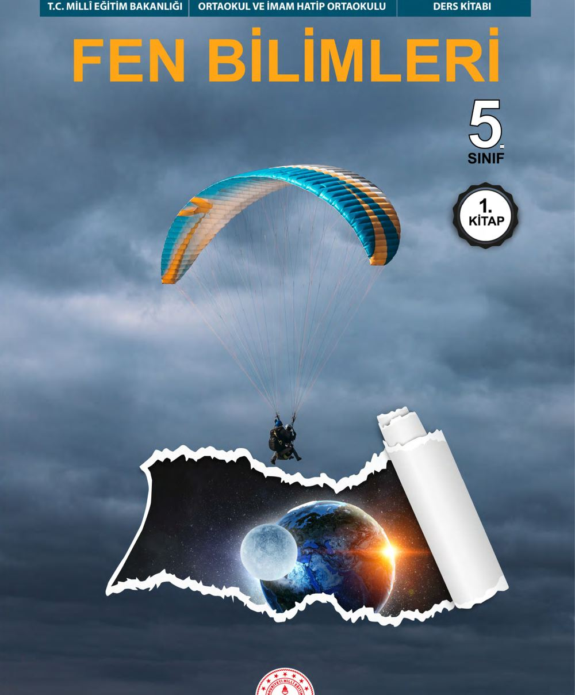
<!-- yer tutucu bulunamadı: sayfa sonuna eklendi -->

<!-- sayfa 1 -->

Verdiğiniz metin katmanı boş olduğu için (`<<< >>>` arası boş) dönüştürülecek bir içerik bulunmamaktadır. Lütfen metin katmanını içeren içeriği paylaşın, böylece talimatlarınıza uygun şekilde Markdown formatına çevirebilirim.

<!-- sayfa 2 -->

ORTAOKUL VE İMAM HATİP ORTAOKULU

# FEN BİLİMLERİ
## 5. Sınıf
## DERS KİTABI
### 1. Kitap

**YAZARLAR**

Dr. Halil KARDEŞ
Ali AYDIN
İhsan SARIKAVAK
Latife Nur CANAN
Mehmet Emin TOPAK
Serkan YILMAZ
Yusuf Mehmet BAĞCI


<!-- sayfa 3 -->

Millî Eğitim Bakanlığı Yayınları No .................................................................................: 2021
Ders Kitapları Dizisi No ..................................................................................................: 9600

Her hakkı saklıdır ve Millî Eğitim Bakanlığına aittir. Kitabın metin, soru ve şekilleri
kısmen de olsa hiçbir surette alınıp yayımlanamaz.


**Editör**
Prof. Dr. Dündar YENER
Doç. Dr. Elif BENZER
Doç. Dr. Tezcan KARTAL

**Dil Uzmanı**
Esra İLHAN

**Görsel Tasarımcı**
Fatih GÖNÜL
Selime KAYA

**Çoklu Ortam Tasarımcısı**
Ali HEMDE
Aydın ÜNLÜ
Bünyamin TELLİ
Ercan YANDIMOĞLU
Orhan ÖZYURT

**Program Geliştirme Uzmanı**
Doç. Dr. Ahmet KURNAZ

**Ölçme ve Değerlendirme Uzmanı**
Dr. Eray SELÇUK

**Rehberlik Uzmanı**
Saliha GÜN

ISBN 978-975-11-8010-0
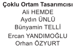

Millî Eğitim Bakanlığı, Talim ve Terbiye Kurulu Başkanlığının 17.07.2024 tarih ve 
110460159 sayılı yazısı ile eğitim aracı olarak kabul edilmiştir.
Kurulca bu kitabın kabul edilmiş olması ders kitabından yayınevi ve yazar/yazarların

<!-- sayfa 4 -->

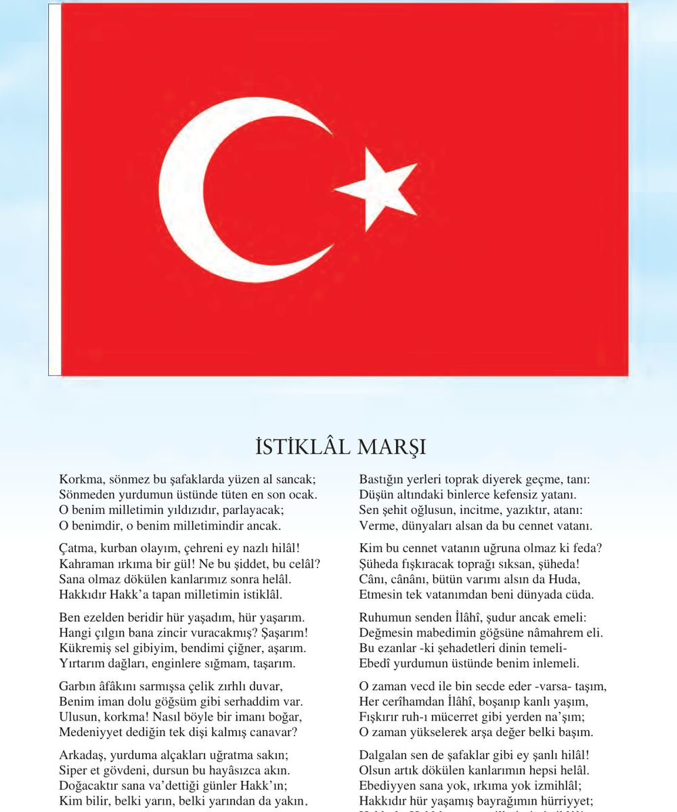

# İSTİKLÂL MARŞI

Korkma, sönmez bu şafaklarda yüzen al sancak;
Sönmeden yurdumun üstünde tüten en son ocak.
O benim milletimin yıldızıdır, parlayacak;
O benimdir, o benim milletimindir ancak.

Çatma, kurban olayım, çehreni ey nazlı hilâl!
Kahraman ırkıma bir gül! Ne bu şiddet, bu celâl?
Sana olmaz dökülen kanlarımız sonra helâl.
Hakkıdır Hakk’a tapan milletimin istiklâl.

Ben ezelden beridir hür yaşadım, hür yaşarım.
Hangi çılgın bana zincir vuracakmış? Şaşarım!
Kükremiş sel gibiyim, bendimi çiğner, aşarım.
Yırtarım dağları, enginlere sığmam, taşarım.

Garbın âfâkını sarmışsa çelik zırhlı duvar,
Benim iman dolu göğsüm gibi serhaddim var.
Ulusun, korkma! Nasıl böyle bir imanı boğar,
Medeniyet dediğin tek dişi kalmış canavar?

Arkadaş, yurduma alçakları uğratma sakın;
Siper et gövdeni, dursun bu hayâsızca akın.
Doğacaktır sana va’dettiği günler Hakk’ın;
Kim bilir, belki yarın, belki yarından da yakın.

Bastığın yerleri toprak diyerek geçme, tanı:
Düşün altındaki binlerce kefensiz yatanı.
Sen şehit oğlusun, incitme, yazıktır, atanı:
Verme, dünyaları alsan da bu cennet vatanı.

Kim bu cennet vatanın uğruna olmaz ki feda?
Şüheda fışkıracak toprağı söksek, şüheda!
Canı, cânânı, bütün varımı alsın da Huda,
Etmesin tek vatanımdan beni dünyada cüda.

Ruhumun senden ilâhî, hudut ancak emeli:
Değmesin mabedimin göğsüne nâmahrem eli.
Bu ezanlar -ki şehadetleri dinin temeli-
Ebedî yurdumun üstünde benim inlemeli.

O zaman vecd ile bin secde eder -varsa- taşım,
Her cerîhamdan ilâhî, boşanıp kanlı yaşım,
Fışkırır ruh-ı mücerret gibi yerden na’şım;
O zaman yükselerek arşa değer belki başım.

Dalgalan sen de şafaklar gibi ey şanlı hilâl!
Olsun artık dökülen kanlarımın hepsi helâl.
Ebediyyen sana yok, Türk'e yok izmihlâl;
Hakkıdır hür yaşamış, bayrağımın hürriyet;
Hakkıdır Hakk'a tapan, milletimin istiklâl!

<!-- sayfa 5 -->

GENÇLİĞE HİTABE

Ey Türk gençliği! Birinci vazifen, Türk istiklâlini, Türk Cumhuriyetini, ilelebet muhafaza ve müdafaa etmektir.

Mevcudiyetinin ve istikbalinin yegâne temeli budur. Bu temel, senin en kıymetli hazinendir. İstikbalde dahi, seni bu hazineden mahrum etmek isteyecek dâhilî ve hâricî bedhahların olacaktır. Bir gün, istiklâl ve cumhuriyeti müdafaa mecburiyetine düşersen, vazifeye atılmak için, içinde bulunacağın vaziyetin imkân ve şeraitini düşünmeyeceksin! Bu imkân ve şerait, çok namüsait bir mahiyette tezahür edebilir. İstiklâl ve cumhuriyetine kastedecek düşmanlar, bütün dünyada emsali görülmemiş bir galibiyetin mümessili olabilirler. Cebren ve hile ile aziz vatanın bütün kaleleri zapt edilmiş, bütün tersanelerine girilmiş, bütün orduları dağıtılmış ve memleketin her köşesi bilfiil işgal edilmiş olabilir. Bütün bu şeraitten daha elîm ve daha vahim olmak üzere, memleketin dâhilinde iktidara sahip olanlar gaflet ve dalâlet ve hattâ hıyanet içinde bulunabilirler. Hattâ bu iktidar sahipleri şahsî menfaatlerini, müstevlîlerin siyasî emelleriyle tevhit edebilirler. Millet, fakr u zaruret içinde harap ve bîtap düşmüş olabilir.

Ey Türk istikbalinin evlâdı! İşte, bu ahval ve şerait içinde dahi vazifen, Türk istiklâl ve cumhuriyetini kurtarmaktır. Muhtaç olduğun kudret, damarlarındaki asil kanda mevcuttur.

Mustafa Kemal Atatürk


<!-- yer tutucu bulunamadı: sayfa sonuna eklendi -->

<!-- sayfa 6 -->

MUSTAFA KEMAL ATATÜRK

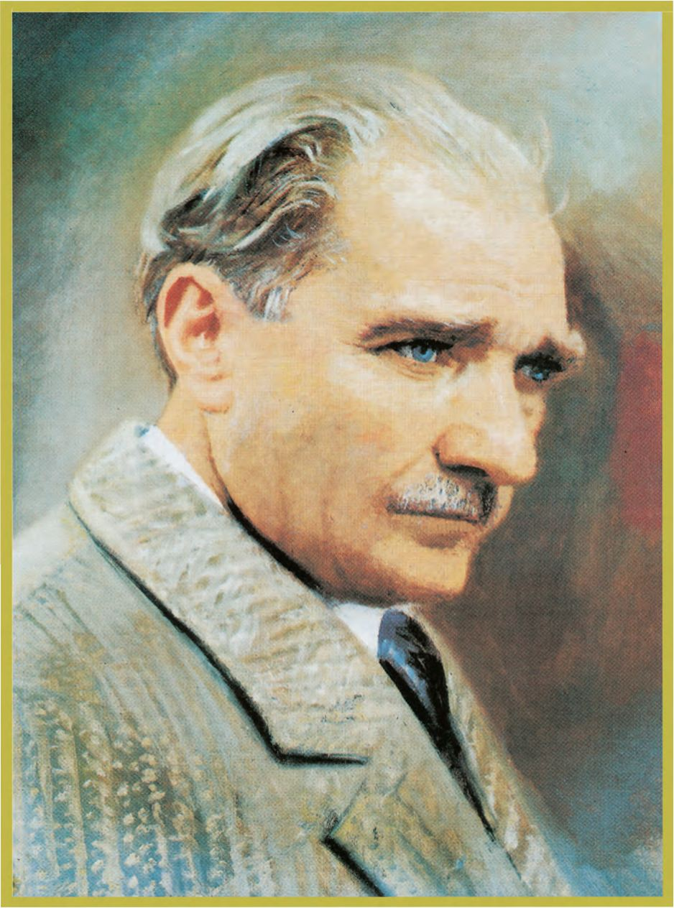
<!-- yer tutucu bulunamadı: sayfa sonuna eklendi -->

<!-- sayfa 7 -->

Verdiğiniz metin katmanı boş olduğu için (`<<< >>>` arası boş) çevrilecek bir içerik bulunmamaktadır. Lütfen metin katmanını içeren içeriği paylaşın, böylece talimatlarınıza uygun şekilde Markdown formatına dönüştürebilirim.

<!-- sayfa 8 -->

# İÇİNDEKİLER

İÇİNDEKİLER ....................................................................................................... 7
KİTABIMIZI TANIYALIM ........................................................................................ 8
GÜVENLİK SEMBOLLERİ ................................................................................. 11
LABORATUVAR GÜVENLİĞİ ............................................................................ 12
FEN, MÜHENDİSLİK VE GİRİŞİMCİLİK UYGULAMALARI ............................... 15

# 1. ÜNİTE: GÖKYÜZÜNDEKİ KOMŞULARIMIZ VE BİZ

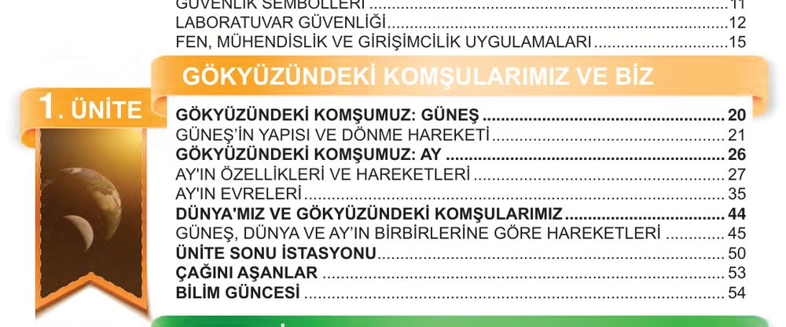

GÖKYÜZÜNDEKİ KOMŞUMUZ: GÜNEŞ ...................................................... 20
GÜNEŞ’İN YAPISI VE DÖNME HAREKETİ ................................................... 21
GÖKYÜZÜNDEKİ KOMŞUMUZ: AY .............................................................. 26
AY'IN ÖZELLİKLERİ VE HAREKETLERİ ........................................................ 27
AY'IN EVRELERİ ............................................................................................. 35
DÜNYA'MIZ VE GÖKYÜZÜNDEKİ KOMŞULARIMIZ .................................... 44
GÜNEŞ, DÜNYA VE AY’IN BİRBİRLERİNE GÖRE HAREKETLERİ .............. 45
ÜNİTE SONU İSTASYONU ............................................................................ 50
ÇAĞINI AŞANLAR ......................................................................................... 53
BİLİM GÜNCESİ ............................................................................................. 54

# 2. ÜNİTE: KUVVETİ TANIYALIM

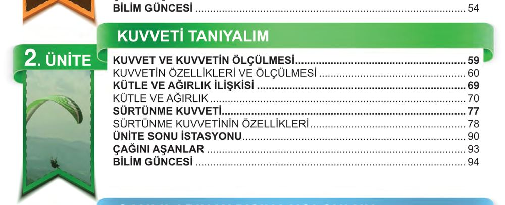

KUVVET VE KUVVETİN ÖLÇÜLMESİ .......................................................... 59
KUVVETİN ÖZELLİKLERİ VE ÖLÇÜLMESİ ................................................... 60
KÜTLE VE AĞIRLIK İLİŞKİSİ ........................................................................ 69
KÜTLE VE AĞIRLIK ........................................................................................ 70
SÜRTÜNME KUVVETİ ................................................................................... 77
SÜRTÜNME KUVVETİNİN ÖZELLİKLERİ ..................................................... 78
ÜNİTE SONU İSTASYONU ............................................................................ 90
ÇAĞINI AŞANLAR ......................................................................................... 93
BİLİM GÜNCESİ ............................................................................................. 94

# 3. ÜNİTE: CANLILARIN YAPISINA YOLCULUK

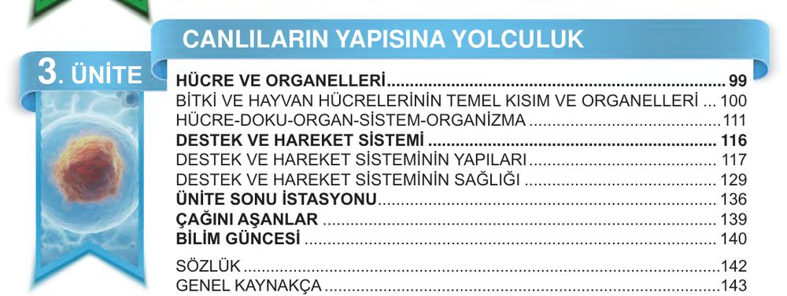

HÜCRE VE ORGANELLERİ .......................................................................... 99
BİTKİ VE HAYVAN HÜCRELERİNİN TEMEL KISIM VE ORGANELLERİ .... 100
HÜCRE-DOKU-ORGAN-SİSTEM-ORGANİZMA ........................................... 111
DESTEK VE HAREKET SİSTEMİ ................................................................ 116
DESTEK VE HAREKET SİSTEMİNİN YAPILARI .......................................... 117
DESTEK VE HAREKET SİSTEMİNİN SAĞLIĞI ........................................... 129
ÜNİTE SONU İSTASYONU .......................................................................... 136
ÇAĞINI AŞANLAR ....................................................................................... 139
BİLİM GÜNCESİ ........................................................................................... 140

SÖZLÜK ........................................................................................................... 142
GENEL KAYNAKÇA ......................................................................................... 143
CEVAP ANAHTARI ........................................................................................... 143
GÖRSEL VE GENEL AĞ KAYNAKÇASI .......................................................... 143
TÜRKİYE'NİN MÜLKİ İDARE BÖLÜMLERİ İLE KARA VE DENİZ KOMŞULARI HARİTASI 144

<!-- sayfa 9 -->

# KİTABIMIZI TANIYALIM

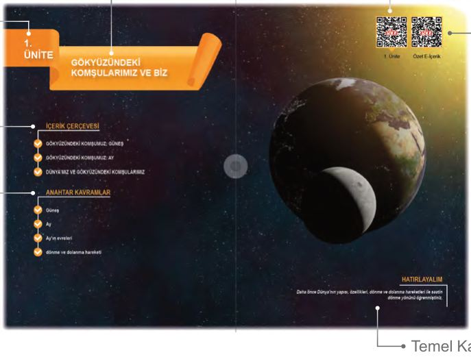

Ünite Adı
Ünite Numarası
İçerik Çerçevesi
Anahtar Kavramlar
Ünite Karekodu
Özet E-içerik Karekodu
Temel Kabuller

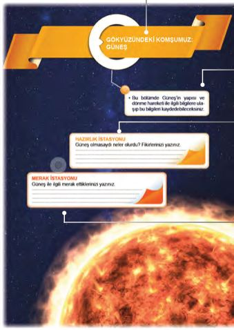

İçerik Çerçevesinin Adı
Öğrenme Çıktıları
Hazırlık Sorusu
Bölümle İlgili Merak Edilenler

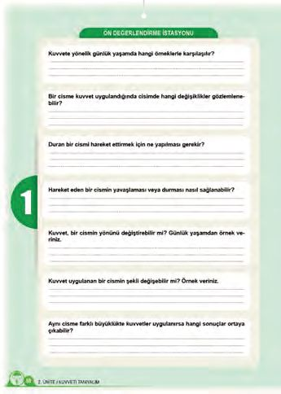

Ön Değerlendirme Süreci

<!-- sayfa 10 -->

# Dikkat Çeken Bilgilerin Yer Aldığı Bölüm

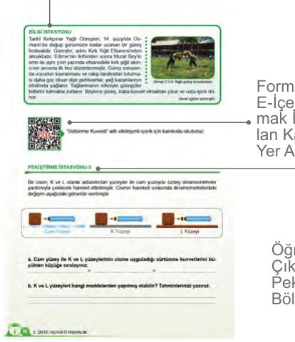

# Form veya E-İçeriklere Ulaşmak İçin Kullanılan Karekodların Yer Aldığı Bölüm

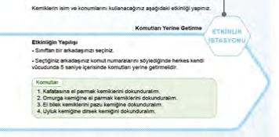

# Öğrenme Çıktılarına İlişkin Etkinlik

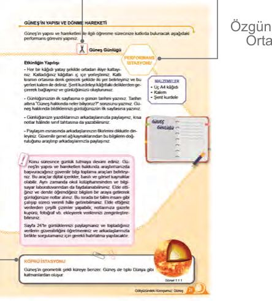

# Öğrenme Çıktılarının Pekiştirildiği Bölüm

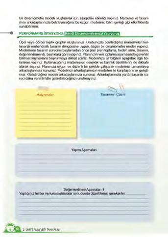

# Güvenlik Sembolü

# Modellerin Yapıldığı Bölüm

# Özgün Ürünlerin Ortaya Çıktığı Bölüm

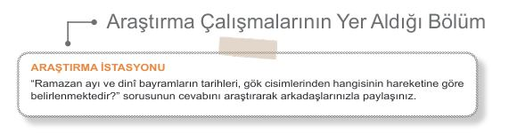

# Mevcut Bilgiler ile Yeni Öğrenilen Bilgiler Arasında veya Günlük Yaşamla Bağ Kurulan Bölüm

# Araştırma Çalışmalarının Yer Aldığı Bölüm

ARAŞTIRMA İSTASYONU

“Ramazan ayı ve dinî bayramların tarihleri, gök cisimlerinden hangisinin hareketine göre belirlenir?”

<!-- sayfa 11 -->

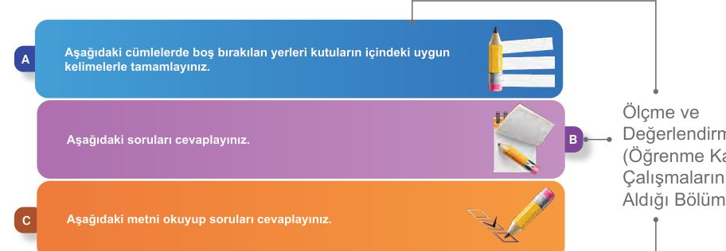
A Aşağıdaki cümlelerde boş bırakılan yerleri kutuların içindeki uygun kelimelerle tamamlayınız.

B Aşağıdaki soruları cevaplayınız.
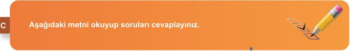
C Aşağıdaki metni okuyup soruları cevaplayınız.


“Ölçme ve Değerlendirme” için karekodu okutunuz.

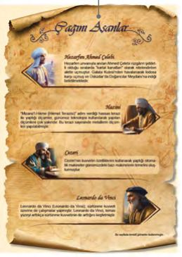
E-Ölçme ve Değerlendirme (Öğrenme Kanıtları) Çalışmaları İçin Karekodların Yer Aldığı Bölüm

Ölçme ve Değerlendirme (Öğrenme Kanıtları) Çalışmalarının Yer Aldığı Bölüm

Bilim İnsanları ve Düşünürlerin Tanıtıldığı Bölüm

Öğrenci Bakış Açısıyla Konunun Özetlendiği Bölüm

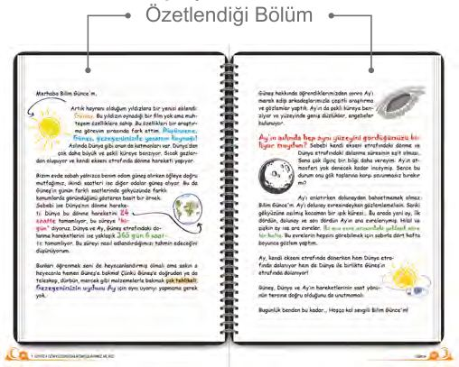

<!-- sayfa 12 -->

| Eldiven Giy | Kesici / Delici Cisim Uyarısı |
| :--- | :--- |
| Etkinliklerde kullanılan kimyasal malzemelerin cilde zarar vermesini önlemek ve çalışırken hijyen sağlamak için çalışmaya başlamadan önce eldiven giyilmesi gerektiğini gösteren uyarı işaretidir. | Etkinliklerde kesici ve delici aletler kullanırken dikkat edilmesi gerektiğini belirtir. Gerektiği durumlarda öğretmen veya ebeveyninizden yardım alınız. |

| Gözlük Kullan | Sıcak Cisim Uyarısı |
| :--- | :--- |
| Kullanılan kimyasal ürünlerin ve malzemelerin göze ve göz sağlığına zarar vermesini önlemek için gözlük kullanılması gerektiğini gösteren uyarı işaretidir. | Yapılacak işlemde bir ısıtıcı ya da sıcak bir yüzeyin olduğunu gösterir. El, ayak ve vücudun diğer kısımlarının yanmaması için gerekli önlemler alınmalıdır. |

| Koruyucu Elbise Giy | Elektrik Uyarısı |
| :--- | :--- |
| Kullanılan kimyasal ürünlerin ve malzemelerin sıçraması sonucu elbiselerin aşınmasını önlemek için önlük veya tulum kullanılmasına uygun olduğunu gösteren uyarı işaretidir. | Elektrikli aletleri kullanırken dikkatli olunması gerektiğini gösterir. Elektrikli aletlere ıslak elle temas edilmemeli, iletken kısımlarına dokunulmamalı ve etkinlik bittikten sonra fiş prizden çekilmelidir. |

| Maske Kullan | Kırılabilir Cam Uyarısı |
| :--- | :--- |
| Etkinliklerde kullanılan malzemelerden ve zehirli gazların olduğu ortamda korunmak için maske kullanılması gerektiğini gösteren uyarı işaretidir. | Yapılacak işlemlerde kırılabilecek malzemelerin kullanılacağını gösterir. Cam malzemeler aşırı ısıtılmamalı ve ani sıcaklık değişimlerine maruz bırakılmamalıdır. |

| Yanıcı (Parlayıcı) Madde | Yakıcı Madde |
| :--- | :--- |
| Yanıcı ve parlayıcı olan, havayla temasında kendiliğinden alev alabilen ve ısıtıldığında yangına neden olan maddelerdir. Ateş, kıvılcım ve ısı kaynaklarından uzak tutulmalıdır. | Havasız ortamda alev alabilen veya yanabilen maddelerdir. Ateş, kıvılcım ve ısıdan uzak tutulmalıdır. Kullanılırken uygun mesafede durulmalı ve koruyucu giysi giyilmelidir. |

| Aşındırıcı Madde | Çevreye Zararlı Madde |
| :--- | :--- |
| Canlı doku, kumaş ve metal gibi yüzeylere temas ettiğinde bu yüzeyleri aşındırabilen maddelerdir. Göz ve deriyle teması engellenmeli ve buharı solunmamalıdır. Metallerden uzak tutulmalıdır. | Doğaya atıldıklarında uzun süre bozulmadan kalabilen, toprağa, suya, bitkilere ve hayvanlara zarar veren maddelerdir. Bu maddeler çöpe atılmamalı veya lavaboya dökülmemelidir. |

| Zehirli (Toksik) Madde | Patlayıcı Madde |
| :--- | :--- |
| Ağız, deri ve solunum yolu ile zehirlenmelere ve kansere neden olabilen maddelerdir. Bu maddeler vücuda temas ettirilmemeli, zehirlenme belirtileri görüldüğünde tıbbi yardım alınmalıdır. | Kıvılcım, ısınma, alev, vurma, çarpma ve sürtünmeye maruz kaldığında patlayabilen maddelerdir. Ateş, kıvılcım ve ısıdan uzak tutulmalıdır. Uygun mesafede durulmalıdır. |

| Tahriş Edici Madde | Radyoaktif Madde |
| :--- | :--- |
| Deri ve gözlerde hassasiyete sebep olabilecek veya ozon tabakasına zarar verebilecek maddelerdir. Göz ve vücuda temasından kaçınılmalıdır. Bu maddelerin buharları solunmamalı ve çalışırken koruyucu giysi | Yayıdığı radyasyon ile canlı hücrelerde tahribata sebep olan maddelerdir. Canlı dokularda kalıcı hasara sebep olabilecek verebilecek radyasyon tehlikesini gösterir. Bu işaretin bulunduğu yerlerden uzak durul- |

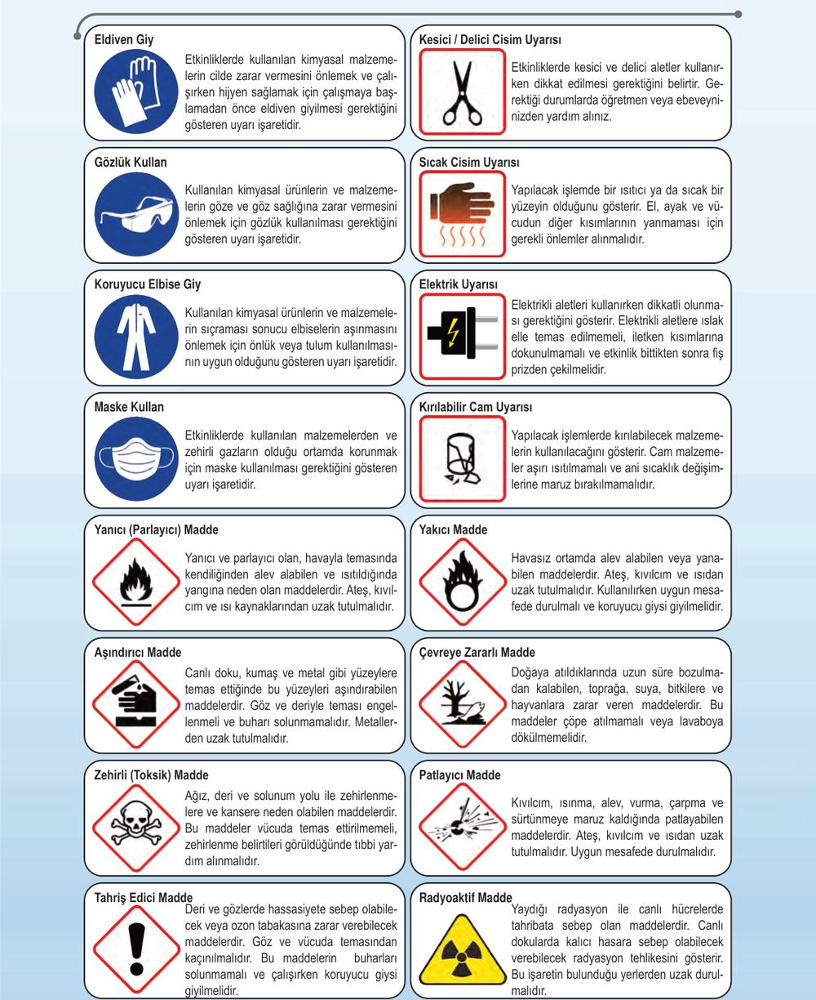
<!-- yer tutucu bulunamadı: sayfa sonuna eklendi -->

<!-- sayfa 13 -->

# LABORATUVAR GÜVENLİĞİ

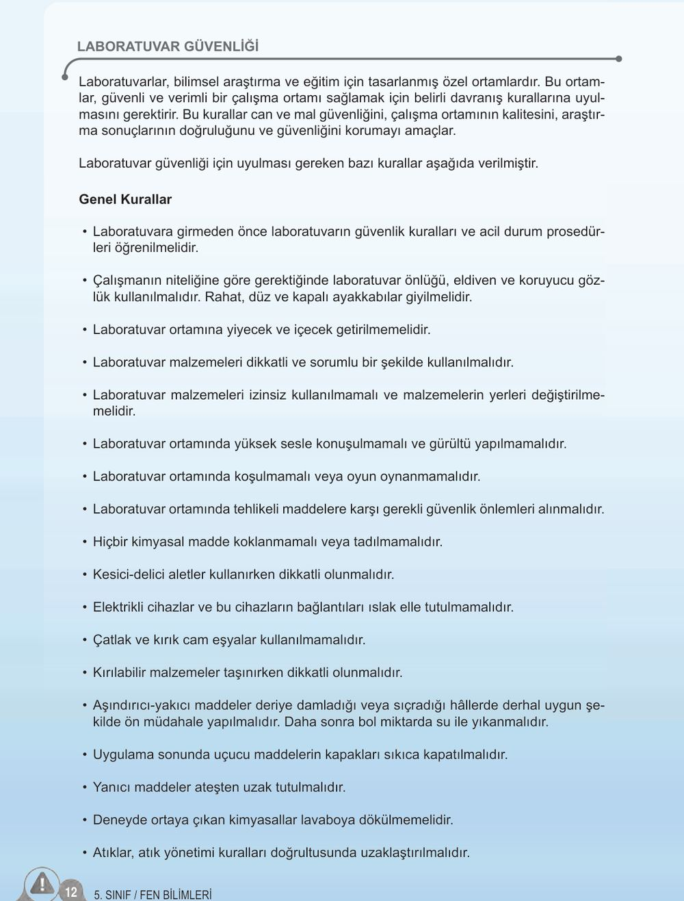

Laboratuvarlar, bilimsel araştırma ve eğitim için tasarlanmış özel ortamlardır. Bu ortamlar, güvenli ve verimli bir çalışma ortamı sağlamak için belirli davranış kurallarına uyulmasını gerektirir. Bu kurallar can ve mal güvenliğini, çalışma ortamının kalitesini, araştırma sonuçlarının doğruluğunu ve güvenliğini korumayı amaçlar.

Laboratuvar güvenliği için uyulması gereken bazı kurallar aşağıda verilmiştir.

## Genel Kurallar

* Laboratuvara girmeden önce laboratuvarın güvenlik kuralları ve acil durum prosedürleri öğrenilmelidir.
* Çalışmanın niteliğine göre gerektiğinde laboratuvar önlüğü, eldiven ve koruyucu gözlük kullanılmalıdır. Rahat, düz ve kapalı ayakkabılar giyilmelidir.
* Laboratuvar ortamına yiyecek ve içecek getirilmemelidir.
* Laboratuvar malzemeleri dikkatli ve sorumlu bir şekilde kullanılmalıdır.
* Laboratuvar malzemeleri izinsiz kullanılmamalı ve malzemelerin yerleri değiştirilmelidir.
* Laboratuvar ortamında yüksek sesle konuşulmamalı ve gürültü yapılmamalıdır.
* Laboratuvar ortamında koşulmamalı veya oyun oynanmamalıdır.
* Laboratuvar ortamında tehlikeli maddelere karşı gerekli güvenlik önlemleri alınmalıdır.
* Hiçbir kimyasal madde koklanmamalı veya tadılmamalıdır.
* Kesici-delici aletler kullanırken dikkatli olunmalıdır.
* Elektrikli cihazlar ve bu cihazların bağlantıları ıslak elle tutulmamalıdır.
* Çatlak ve kırık cam eşyalar kullanılmamalıdır.
* Kırılabilir malzemeler taşınırken dikkatli olunmalıdır.
* Aşındırıcı-yakıcı maddeler deriye damladığı veya sıçradığı hâllerde derhal uygun şekilde müdahale edilmelidir. Daha sonra bol miktarda su ile yıkanmalıdır.
* Uygulama sonunda uçucu maddelerin kapakları sıkıca kapatılmalıdır.
* Yanıcı maddeler ateşten uzak tutulmalıdır.
* Deneyde ortaya çıkan kimyasallar lavaboya dökülmemelidir.

<!-- sayfa 14 -->

* Tıbbi atıklar, kimyasallar, piller ve kırık camlar çöplere atılmamalıdır.
* Deney sonunda ortam ve malzemeler temizlenmelidir.
* Laboratuvar ortamından ayrılırken çalışma alanı temiz ve düzenli bırakılmalıdır.

Laboratuvarlarda acil durumla karşılaşıldığında öğrencilerin sakin kalarak öğretmenlerine veya laboratuvar sorumlularına bilgi vermesi ve belirlenmiş acil durum kurallarını uygulaması gerekmektedir.

* Yangın, kimyasal sızıntı ve elektrik arızası gibi acil bir durumla karşı karşıya kalındığında sakin kalınmalıdır. Acil durum öğretmene bildirilmelidir.
* Eğer güvenli bir şekilde yapılabilirse tehlikeli alandan hızlıca uzaklaşmak gerekmektedir. Yangın, kimyasal sızıntı veya diğer acil durumlar söz konusu olduğunda bölgeyi terk etmek hayati önem taşır.
* Laboratuvar ortamında ortaya çıkan tehlikeli durumlar ilgililere en kısa sürede bildirilmelidir.

Laboratuvarda kullanılan bazı malzemeler aşağıda verilmiştir.

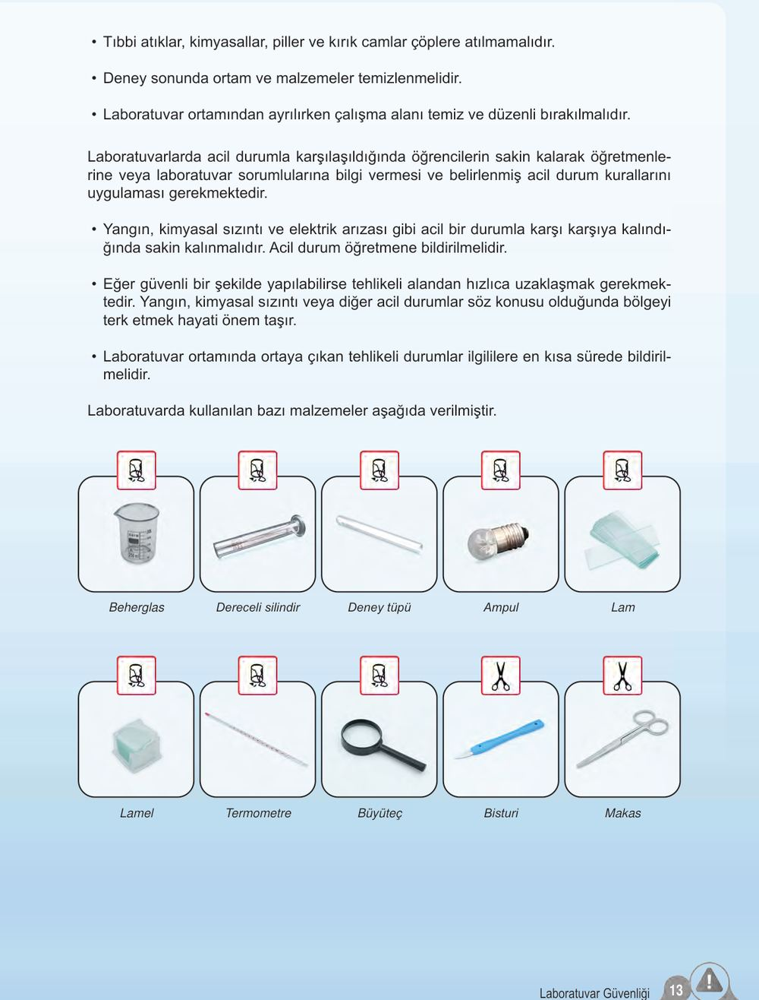

Beherglas | Dereceli silindir | Deney tüpü | Ampul | Lam
--- | --- | --- | --- | ---


Lamel | Termometre | Büyüteç | Bisturi | Makas
--- | --- | --- | --- | ---

<!-- sayfa 15 -->

| | | | | |
| :---: | :---: | :---: | :---: | :---: |
|  <br> Pens |  <br> Plastik pipet |  <br> Spatül |  <br> Dinamometre |  <br> Isı iletim aleti |
|  <br> Ahşap metre |  <br> Dijital terazi |  <br> Terazi |  <br> Mikroskop |  <br> Güç kaynağı |
|  <br> Yay |  <br> Bağlantı kablosu |  <br> Duy |  <br> Anahtar |  <br> Pil |
|  <br> Kronometre |  <br> Pil yatağı |  <br> Işık kaynağı |  <br> İspirto ocağı |  <br> Şırınga |
|  |  |  |  |  |

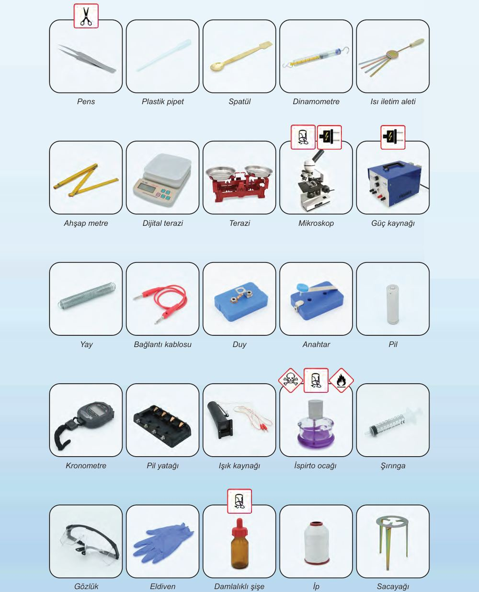
<!-- yer tutucu bulunamadı: sayfa sonuna eklendi -->

<!-- sayfa 16 -->

# FEN, MÜHENDİSLİK VE GİRİŞİMCİLİK UYGULAMALARI

Kitabımızdaki “Performans İstasyonları” adlı etkinliklerin bazıları mühendislik ve tasarım döngüsü dikkate alınarak planlanmalıdır. Bu etkinliklerde öğretmen rehberliğinde öğrencilerin bilgiyi anlamlandırmaları, günlük yaşamla ilişkilendirmeleri, süreç bileşenlerini deneyimlemeleri ve öğrendiklerini modele veya uygulamaya dönüştürmeleri beklenmektedir. Bu süreçte öncelikle öğrencilerden öğrenme-öğretme uygulamalarında ele alınan konulara ilişkin günlük hayattan bir ihtiyaç veya problemi tespit etmeleri istenmektedir. Bu problemin mevcut sistemleri geliştirmeye yönelik olmasının yanı sıra öğrencilerin özgün fikirler geliştirmesini desteklemesi de gerekmektedir. Problemin çözümünde, öğrenciler alternatif çözüm yollarını birbiriyle karşılaştırarak bu çözümlerden uygun olanı seçer ve çözüme yönelik planlama yapar. Sonraki aşamada öğrencilerin modeli ortaya çıkarmaları ve sunmaları beklenir.

1. İlk olarak problem tanımlanır.
2. Problem ile ilgili araştırmalar yapılır. Önceki çalışmalar incelenir, veriler toplanır.
3. Elde edilen veriler değerlendirilerek çözüm yolları geliştirilir.
4. Çözüm yollarından en uygun olanı seçilerek model oluşturulur.
5. Oluşturulan model test edilir.
6. Model ile ilgili problem varsa tespit edilir ve yeni kanıtlara bağlı olarak geliştirilir.
7. Model amacına uygun hazırlanmışsa modelin sunumu yapılır.

Model geliştirme aşamasında ise öğrencilerden denemeler yapmaları ve elde ettikleri veriler ile gözlemlerini kaydetmeleri beklenir. Öğrenciler; modellerini gözlemleri sonucunda geliştirebileceği gibi arkadaşlarına sunabilir, onların modelleri ile karşılaştırabilir, yeni kanıtlara bağlı olarak geliştirebilir ve bilim şenliği, sergi vb.nde sunmak üzere saklayabilir.

İnsanların fikri ve emeği ile meydana getirdiği bilgi, düşünce, sanat eseri ve modelin kullanılması ve kopyalanması ile ilgili hukuken sağlanan haklara "telif hakkı"; buluş yapan kişinin ürünü üretme, kullanma ve satma hakkına "patent hakkı" denir. Modellerin izinsiz kullanılmasını veya çoğaltılmasını önlemek amacıyla buluş yapan kişi telif ve patent hakkı alabilir. Fikir ve Sanat Eserleri Kanunu ile buluş yapan kişilere Türk Patent ve Marka

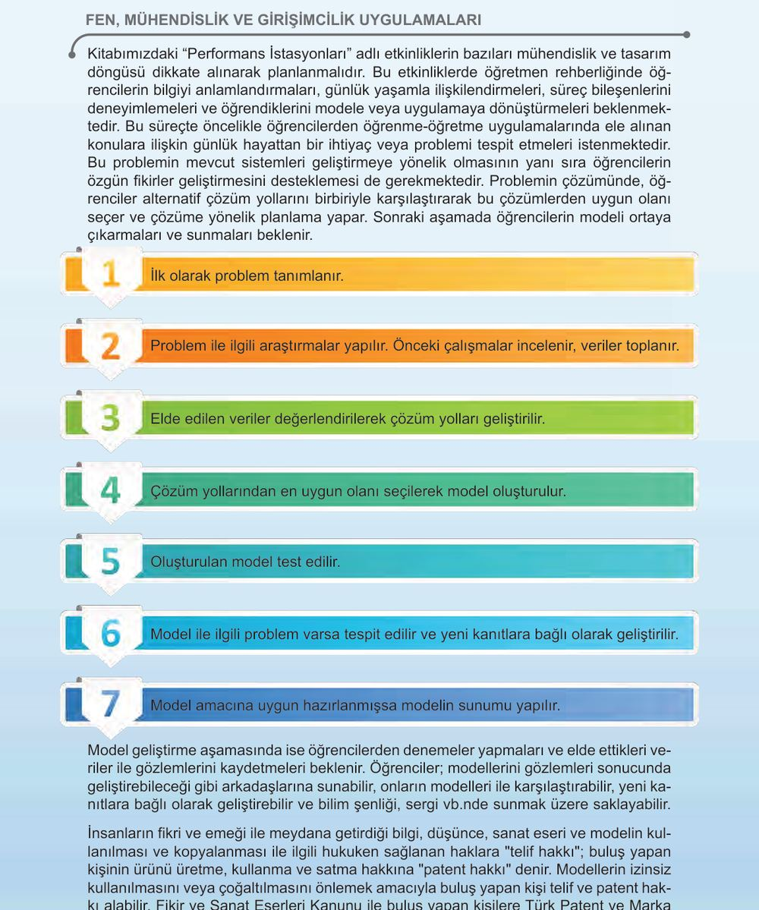
<!-- yer tutucu bulunamadı: sayfa sonuna eklendi -->

<!-- sayfa 17 -->

# 1. ÜNİTE
# GÖKYÜZÜNDEKİ KOMŞULARIMIZ VE BİZ

## İÇERİK ÇERÇEVESİ
* GÖKYÜZÜNDEKİ KOMŞUMUZ: GÜNEŞ
* GÖKYÜZÜNDEKİ KOMŞUMUZ: AY
* DÜNYA'MIZ VE GÖKYÜZÜNDEKİ KOMŞULARIMIZ

## ANAHTAR KAVRAMLAR
* Güneş
* Ay
* Ay'ın evreleri
* dönme ve dolanma hareketi

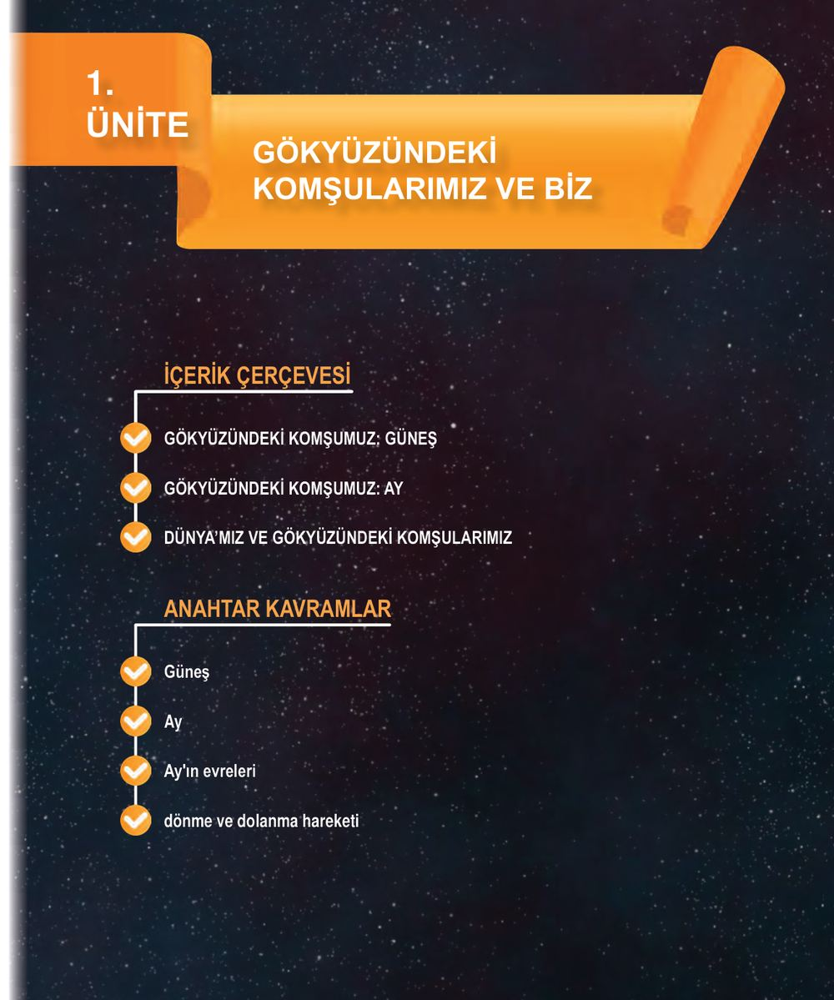
<!-- yer tutucu bulunamadı: sayfa sonuna eklendi -->

<!-- sayfa 18 -->

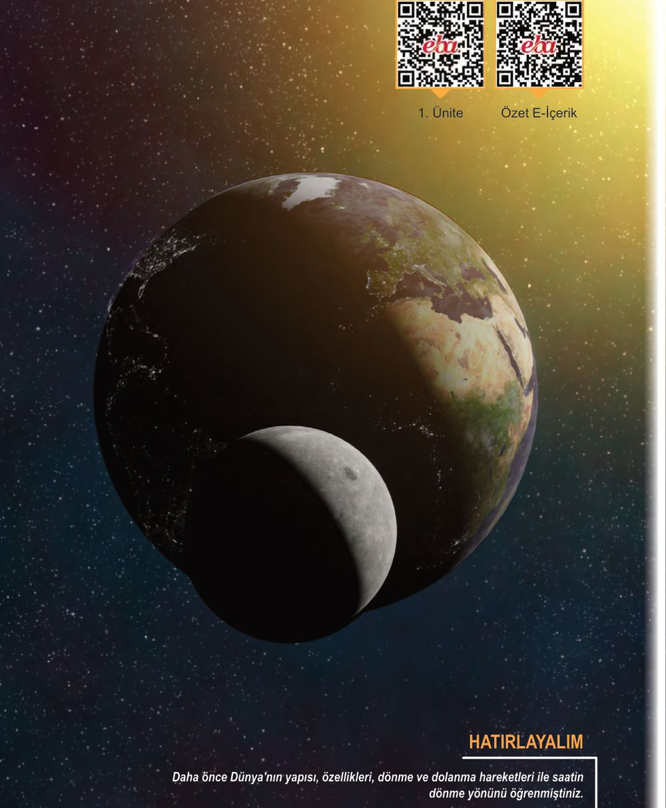

1. Ünite
Özet E-İçerik

# HATIRLAYALIM

*Daha önce Dünya'nın yapısı, özellikleri, dönme ve dolanma hareketleri ile saatin dönme yönünü öğrenmiştiniz.*

<!-- sayfa 19 -->

! GÖZLEMLEYELİM

Performans görevi olarak Ay’ı 30 gün boyunca gözlemleyiniz. Gözlemlerinizi her gün yapınız. Ay’ın aydınlık ve karanlık bölümlerine dikkat ederek gözlemlerinizi 36. sayfada yer alan tablodaki ilgili alanlara çizerek aktarınız.

# ÖN DEĞERLENDİRME İSTASYONU

1

Dünya’nın yapısı ile ilgili yandaki görseli inceleyiniz. Dünya’nın yapısı hakkında bildiklerinizi yazınız.

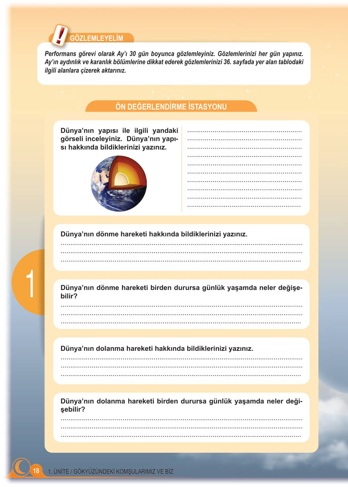

.............................................................................................................................
.............................................................................................................................
.............................................................................................................................
.............................................................................................................................
.............................................................................................................................
.............................................................................................................................

Dünya’nın dönme hareketi hakkında bildiklerinizi yazınız.

.............................................................................................................................
.............................................................................................................................
.............................................................................................................................

<!-- sayfa 20 -->

# 2

Dünya’nın şekli hakkında bildiklerinizi yazınız.
.............................................................................................................................
.............................................................................................................................
.............................................................................................................................

Ay’ın şekli ve yapısı hakkında bildiklerinizi yazınız.
.............................................................................................................................
.............................................................................................................................
.............................................................................................................................

Güneş’in şekli ve yapısı hakkında bildiklerinizi yazınız.
.............................................................................................................................
.............................................................................................................................
.............................................................................................................................

Dünya, Güneş ve Ay’ı aşağıdaki alana çizerek gösteriniz.

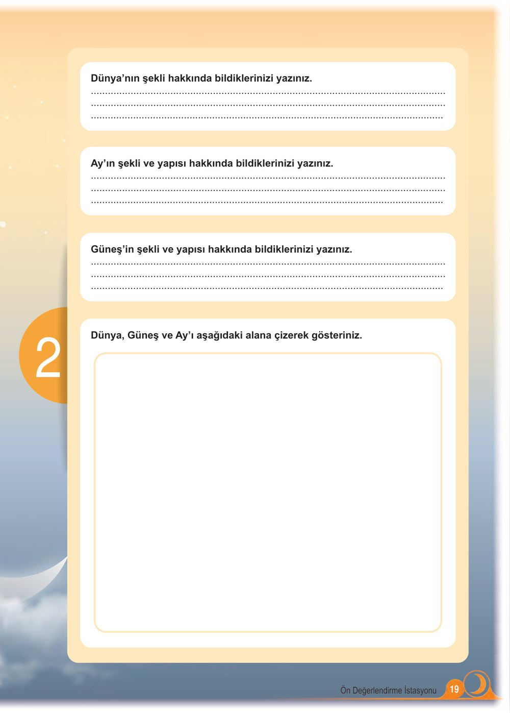

<!-- sayfa 21 -->

# GÖKYÜZÜNDEKİ KOMŞUMUZ: GÜNEŞ

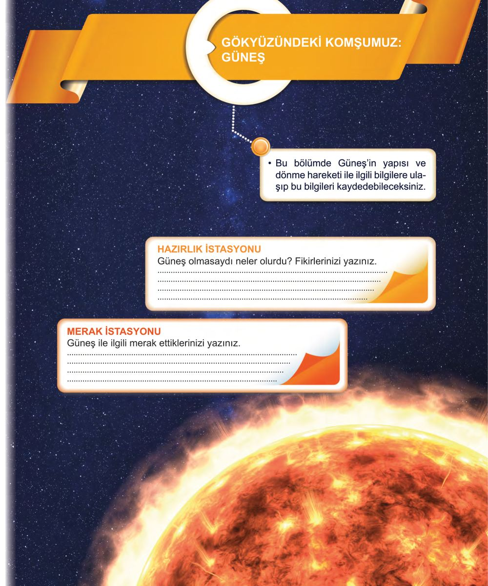

* Bu bölümde Güneş’in yapısı ve dönme hareketi ile ilgili bilgilere ulaşıp bu bilgileri kaydedebileceksiniz.

## HAZIRLIK İSTASYONU
Güneş olmasaydı neler olurdu? Fikirlerinizi yazınız.
........................................................................................................
.....................................................................................................
..................................................................................................
...............................................................................................

## MERAK İSTASYONU
Güneş ile ilgili merak ettiklerinizi yazınız.
........................................................................................................
.....................................................................................................
..................................................................................................
...............................................................................................

<!-- sayfa 22 -->

# GÜNEŞ’İN YAPISI VE DÖNME HAREKETİ

Güneş’in yapısı ve hareketleri ile ilgili öğrenme sürecinize katkıda bulunacak aşağıdaki performans görevini yapınız.

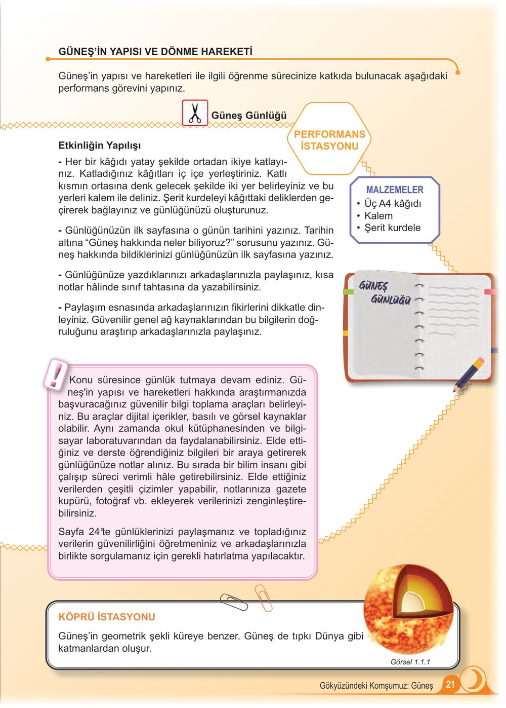 Güneş Günlüğü

## PERFORMANS İSTASYONU

### MALZEMELER
* Üç A4 kâğıdı
* Kalem
* Şerit kurdele

## Etkinliğin Yapılışı
- Her bir kâğıdı yatay şekilde ortadan ikiye katlayınız. Katladığınız kâğıtları iç içe yerleştiriniz. Katlı kısmın ortasına denk gelecek şekilde iki yer belirleyiniz ve bu yerleri kalem ile deliniz. Şerit kurdeleyi kâğıttaki deliklerden geçirerek bağlayınız ve günlüğünüzü oluşturunuz.
- Günlüğünüzün ilk sayfasına o günün tarihini yazınız. Tarihin altına “Güneş hakkında neler biliyoruz?” sorusunu yazınız. Güneş hakkında bildiklerinizi günlüğünüzün ilk sayfasına yazınız.
- Günlüğünüze yazdıklarınızı arkadaşlarınızla paylaşınız, kısa notlar hâlinde sınıf tahtasına da yazabilirsiniz.
- Paylaşım esnasında arkadaşlarınızın fikirlerini dikkatle dinleyiniz. Güvenilir genel ağ kaynaklarından bu bilgilerin doğruluğunu araştırıp arkadaşlarınızla paylaşınız.

! Konu süresince günlük tutmaya devam ediniz. Güneş'in yapısı ve hareketleri hakkında araştırmanızda başvuracağınız güvenilir bilgi toplama araçları belirleyiniz. Bu araçlar dijital içerikler, basılı ve görsel kaynaklar olabilir. Aynı zamanda okul kütüphanesinden ve bilgisayar laboratuvarından da faydalanabilirsiniz. Elde ettiğiniz ve derste öğrendiğiniz bilgileri bir araya getirerek günlüğünüze notlar alınız. Bu sırada bir bilim insanı gibi çalışıp süreci verimli hâle getirebilirsiniz. Elde ettiğiniz verilerden çeşitli çizimler yapabilir, notlarınıza gazete kupürü, fotoğraf vb. ekleyerek verilerinizi zenginleştirebilirsiniz.

Sayfa 24’te günlüklerinizi paylaşmanız ve topladığınız verilerin güvenilirliğini öğretmeniniz ve arkadaşlarınızla birlikte sorgulamanız için gerekli hatırlatma yapılacaktır.

## KÖPRÜ İSTASYONU

Güneş’in geometrik şekli küreye benzer. Güneş de tıpkı Dünya gibi

<!-- sayfa 23 -->

Güneş yüzeyindeki koyu renkli bölgeleri keşfedeceğiniz aşağıdaki etkinliği yapınız.

# ETKİNLİK İSTASYONU
## Güneş Gözlemi
Aşağıdaki metni okuyup etkinliği gerçekleştiriniz.

Ayşe, gökyüzüne olan merakı sayesinde babasına teleskop aldırmıştı. Fırsat buldukça teleskobu ile gökyüzünü incelemekten çok keyif alırdı. Bir gün öğretmeni ona “Güneş Gözlemi” adında bir proje ödevi verdi. Ayşe bu projeyi heyecanla kabul etti ve hemen çalışmalara başladı.

Ayşe; Güneş’e dürbün, teleskop, mercek ve kamera gibi araçlarla doğrudan bakmanın çok zararlı olduğunu biliyordu. Bu yüzden babasından yardım alarak teleskobuna güvenli bir güneş filtresi taktı. İlk gözlem günü, parlak Güneş’e bakarken çok heyecanlandı. Güneş’in yüzeyinde üç büyük koyu renkli bölge gördü. Hemen defterine Güneş’i ve üzerindeki koyu bölgeleri çizdi. Bu bölgeleri A, B ve C olarak adlandırdı. Tarih ve saati not etti.

Ayşe, belirli bir süre gözlemlerine devam etti. Her seferinde Güneş’teki koyu bölgelerin konumlarını dikkatle not alarak çizdi.

Bu sürecin sonunda çizimlerini yandaki gibi alt alta getirerek sınıfta öğretmeni ve arkadaşlarına sunum yaptı.

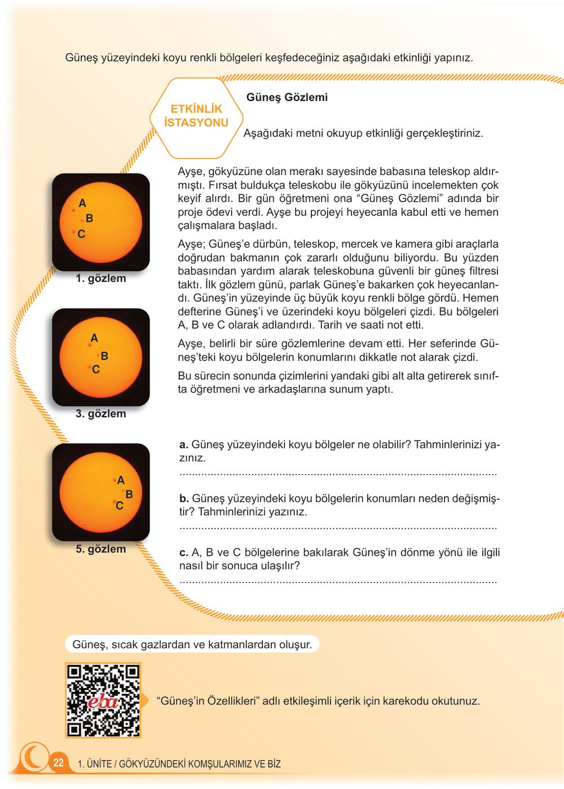

a. Güneş yüzeyindeki koyu bölgeler ne olabilir? Tahminlerinizi yazınız.
......................................................................................................

b. Güneş yüzeyindeki koyu bölgelerin konumları neden değişmiştir? Tahminlerinizi yazınız.
......................................................................................................

c. A, B ve C bölgelerine bakılarak Güneş’in dönme yönü ile ilgili nasıl bir sonuca ulaşılır?
......................................................................................................

Güneş, sıcak gazlardan ve katmanlardan oluşur.


“Güneş’in Özellikleri” adlı etkileşimli içerik için karekodu okutunuz.

<!-- sayfa 24 -->

Güneş, Dünya'dan çok daha büyüktür ancak Dünya'dan çok uzakta olduğu için küçük görünmektedir. Bu durumu anlayabilmek için aşağıdaki etkinliği yapınız.

# Görünen Boyut

## Etkinliğin Yapılışı

- Belirlediğiniz zemine “X” çizerek gözlemci noktasını işaretleyiniz.
- Topları elinde tutmak üzere iki arkadaş belirleyiniz. Gözlemci noktasına göre küçük topu tutan arkadaşınız bir adım uzaklıkta bir konumda ayakta durmalıdır. Büyük topu tutan arkadaşınız da aynı doğrultuda olacak şekilde en uzak konuma yerleşmelidir.
- Gözlemci noktasından arkadaşlarınızın tuttuğu topları gözlemleyiniz.

> **ETKİNLİK İSTASYONU**
>
> **MALZEMELER**
> - İki top (farklı büyüklükte)
> - Kalem

## Değerlendirme

**a.** Topları, gözlemci noktasından gördüğünüz büyüklüklerine göre çiziniz.

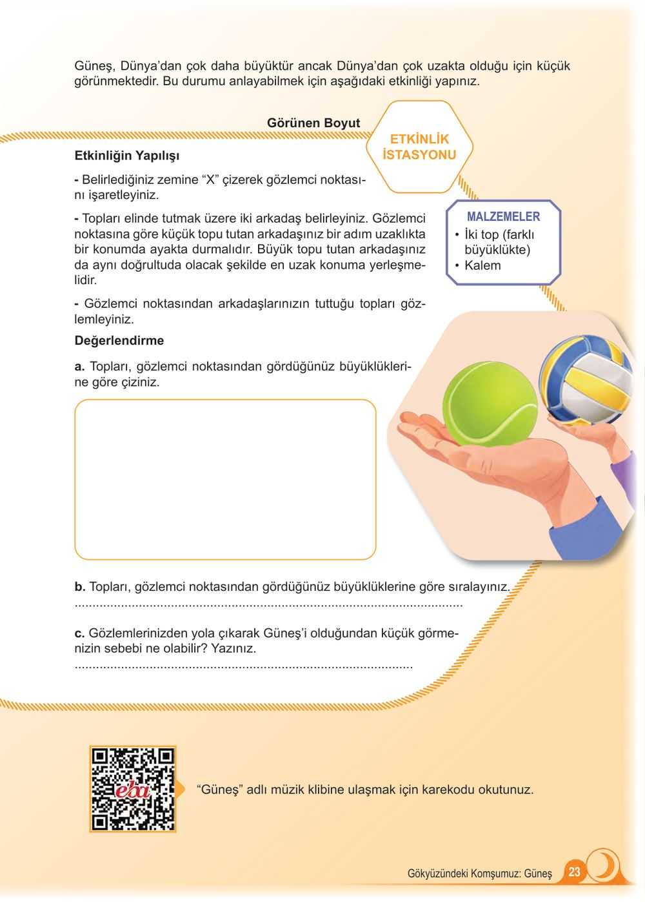

**b.** Topları, gözlemci noktasından gördüğünüz büyüklüklerine göre sıralayınız.
.............................................................................................................

**c.** Gözlemlerinizden yola çıkarak Güneş'i olduğundan küçük görmenizin sebebi ne olabilir? Yazınız.
...............................................................................................

 “Güneş” adlı müzik klibine ulaşmak için karekodu okutunuz.

<!-- sayfa 25 -->

Güneş'e dürbün, teleskop, mercek ve kamera gibi araçlarla doğrudan bakmak zararlıdır. Çünkü Güneş ışığı, küçük bir büyüteçle bile kâğıdı tutuşturabilecek kadar yüksek bir enerjiye sahiptir. Bu nedenle Güneş gözlemlenirken çok dikkatli olunmalıdır. Aksi takdirde gözlerde kalıcı hasarlar hatta görme kaybı oluşabilir. Koruyucu filtreler olmadan Güneş'e asla bakılmamalıdır. Gök bilimciler teleskoplar ile Güneş gözlemi yaparlar. Ancak bu teleskoplarda özel filtreler kullanılır. Aynı zamanda Güneş'in batmasına yakın zaman aralıklarında gözlem yapmaya dikkat ederler. Gök bilimciler, farklı bir gözlem yolu olarak da teleskoptaki görüntüyü teleskoba hiç bakmadan beyaz ekrana yansıtırlar.

> **UNUTMAYALIM**
> “Güneş Günlüğü” etkinliğinde topladığınız verileri arkadaşlarınıza sunup tartışınız. Tartışma sonucunda ulaştığınız bilgileri öğretmeninize veya bilimsel kaynaklara başvurarak doğrulayınız. Bu bilgilere göre günlüğünüzdeki eksik bilgileri tamamlayınız, hatalı bilgileri düzeltiniz.

Çalışmayı değerlendirmek için karekodu okutunuz.

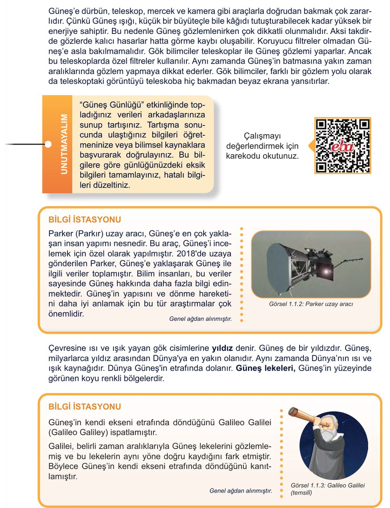

### BİLGİ İSTASYONU

Parker (Parkır) uzay aracı, Güneş'e en çok yaklaşan insan yapımı nesnedir. Bu araç, Güneş'i incelemek için özel olarak yapılmıştır. 2018'de uzaya gönderilen Parker, Güneş'e yaklaşarak Güneş ile ilgili veriler toplamıştır. Bilim insanları, bu veriler sayesinde Güneş hakkında daha fazla bilgi edinmektedir. Güneş'in yapısını ve dönme hareketini daha iyi anlamak için bu tür araştırmalar çok önemlidir.

*Genel ağdan alınmıştır.*


*Görsel 1.1.2: Parker uzay aracı*

Çevresine ısı ve ışık yayan gök cisimlerine **yıldız** denir. Güneş de bir yıldızdır. Güneş, milyarlarca yıldız arasından Dünya'ya en yakın olanıdır. Aynı zamanda Dünya'nın ısı ve ışık kaynağıdır. Dünya Güneş'in etrafında dolanır. **Güneş lekeleri**, Güneş'in yüzeyinde görünen koyu renkli bölgelerdir.

### BİLGİ İSTASYONU

Güneş'in kendi ekseni etrafında döndüğünü Galileo Galilei (Galileo Galiley) ispatlamıştır.

Galilei, belirli zaman aralıklarıyla Güneş lekelerini gözlemlemiş ve bu lekelerin aynı yöne doğru kaydığını fark etmiştir. Böylece Güneş'in kendi ekseni etrafında döndüğünü kanıtlamıştır.

*Genel ağdan alınmıştır.*


*Görsel 1.1.3: Galileo Galilei (temsil)*

<!-- sayfa 26 -->

# PEKİŞTİRME İSTASYONU-1

Aşağıdaki ifadelerin doğru ya da yanlış olduğuna karar verip ilgili oklar yönünde ilerleyiniz.

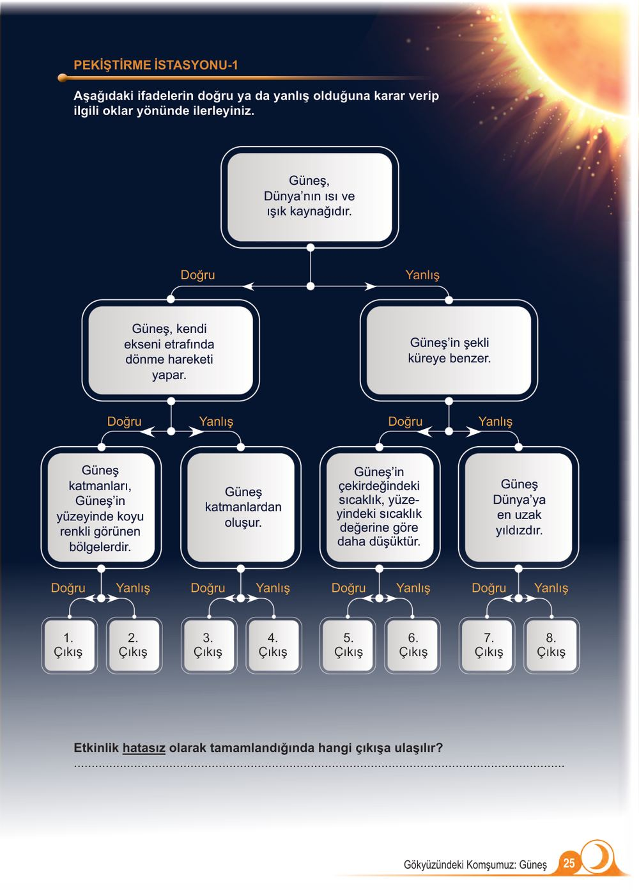

Etkinlik hatasız olarak tamamlandığında hangi çıkışa ulaşılır?
...........................................................................................................................................

<!-- sayfa 27 -->

# GÖKYÜZÜNDEKİ KOMŞUMUZ: AY

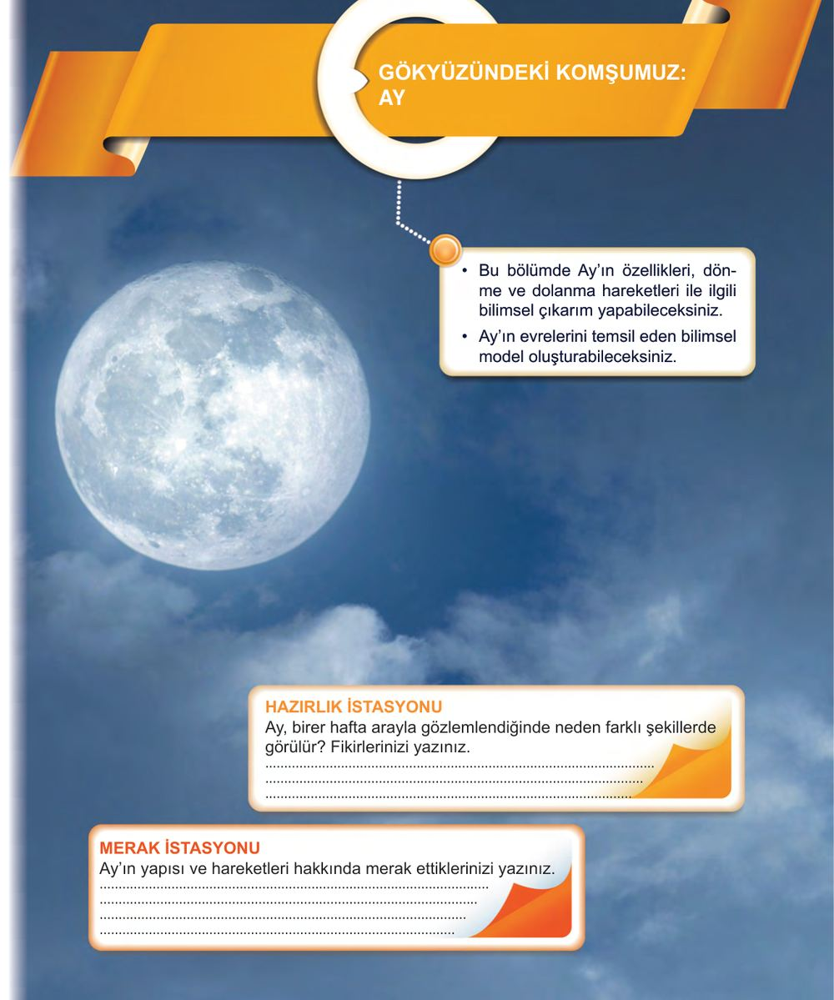

* Bu bölümde Ay'ın özellikleri, dönme ve dolanma hareketleri ile ilgili bilimsel çıkarım yapabileceksiniz.
* Ay'ın evrelerini temsil eden bilimsel model oluşturabileceksiniz.

## HAZIRLIK İSTASYONU
Ay, birer hafta arayla gözlemlendiğinde neden farklı şekillerde görülür? Fikirlerinizi yazınız.
.......................................................................................................
....................................................................................................
..................................................................................................
..................................................................................................

## MERAK İSTASYONU
Ay'ın yapısı ve hareketleri hakkında merak ettiklerinizi yazınız.
.......................................................................................................
....................................................................................................
..................................................................................................
..................................................................................................

<!-- sayfa 28 -->

# AY'IN ÖZELLİKLERİ VE HAREKETLERİ

Geçmişte yapılan gözlem ve incelemelerde Ay yüzeyinde su olduğuna dair kanıt bulunamamıştı. Ancak günümüzde Ay'ın çeşitli bölgelerinde suyun varlığına ait kanıtlar bulunmuştur. Bu kanıtların ortaya çıkmasında ise Ay yüzeyine çarpan gök taşları etkili olmuştur. Çünkü çarpmanın etkisi ile buz parçacıkları yüzeye çıkmıştır.

Ay'ın bazı özelliklerini tanımlayacağınız aşağıdaki etkinliği yapınız.

## Ay'ın Keşfi

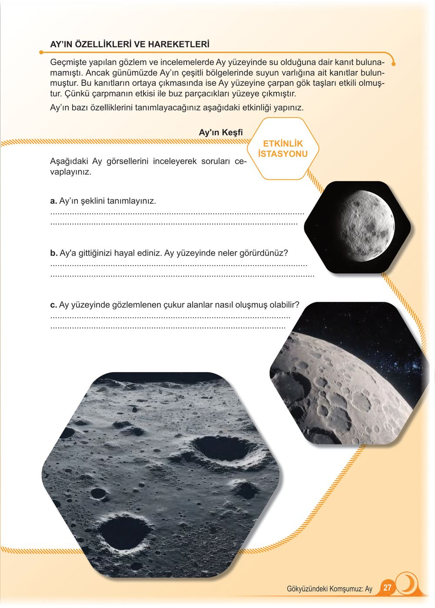

Aşağıdaki Ay görsellerini inceleyerek soruları cevaplayınız.

**a. Ay'ın şeklini tanımlayınız.**
.........................................................................................................
.......................................................................................................

**b. Ay'a gittiğinizi hayal ediniz. Ay yüzeyinde neler görürdünüz?**
...........................................................................................................
..............................................................................................................

**c. Ay yüzeyinde gözlemlenen çukur alanlar nasıl oluşmuş olabilir?**
....................................................................................................
..................................................................................................


ETKİNLİK İSTASYONU

<!-- sayfa 29 -->

Ay'ı gözlemlemek ve Ay'ın özellikleri hakkında bilgi toplamak için aşağıdaki etkinliği yapınız.

# ETKİNLİK İSTASYONU
## Ay Gözlemi
### Etkinliğin Yapılışı

- Evinizin bahçesi gibi güvenli ve açık alanlarda Ay'ı gözlemleyiniz.
- Gözleminizi doğrudan, dürbün veya teleskop kullanarak yapabilirsiniz.
- Gözleminiz sırasında fotoğraf makinesi ya da cep telefonu kamerasını kullanarak Ay'ın fotoğraflarını çekebilirsiniz.
- Ayrıca Ay'ın özellikleri, dönme ve dolanma hareketi ile ilgili güvenilir genel ağ kaynaklarından araştırmanızı yaparak bilgi toplayınız.
- Elde ettiğiniz bilgilere dayanarak Ay'ın niteliklerini yazınız, Dünya'dan görünümünü A4 kâğıdına çiziniz.
- Ulaştığınız bilgileri çeşitli kaynaklardan test ederek doğrulayınız.
- A4 kâğıdınızdaki bilgileri arkadaşlarınızla paylaşınız.
- Topladığınız bilgilerden ve çektiğiniz fotoğraflardan yola çıkarak ileride sunmak üzere arkadaşlarınızla şiir, öykü, slogan, şarkı yazınız ya da afiş tasarlayınız.

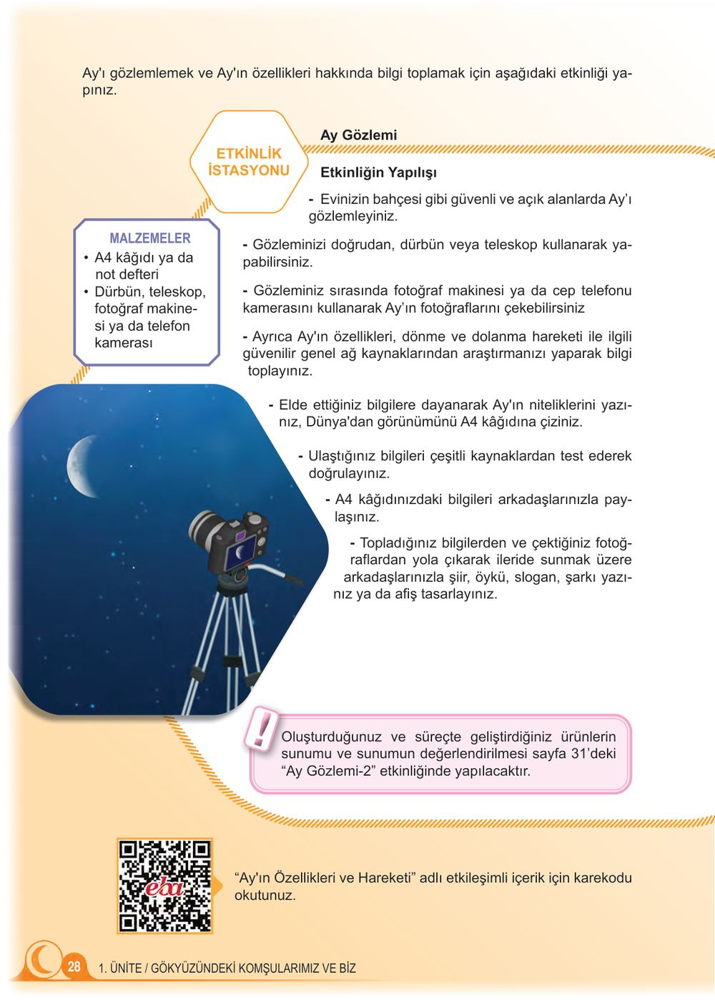

**MALZEMELER**
- A4 kâğıdı ya da not defteri
- Dürbün, teleskop, fotoğraf makinesi ya da telefon kamerası

! Oluşturduğunuz ve süreçte geliştirdiğiniz ürünlerin sunumu ve sunumun değerlendirilmesi sayfa 31'deki "Ay Gözlemi-2" etkinliğinde yapılacaktır.

“Ay'ın Özellikleri ve Hareketi” adlı etkileşimli içerik için karekodu okutunuz.

<!-- sayfa 30 -->

Ay, dönme ve dolanma hareketleri yapan bir gök cismidir. Ay'ın dönme ve Dünya etrafındaki dolanma hareketleri saatin dönme yönünün tersine gerçekleşir.

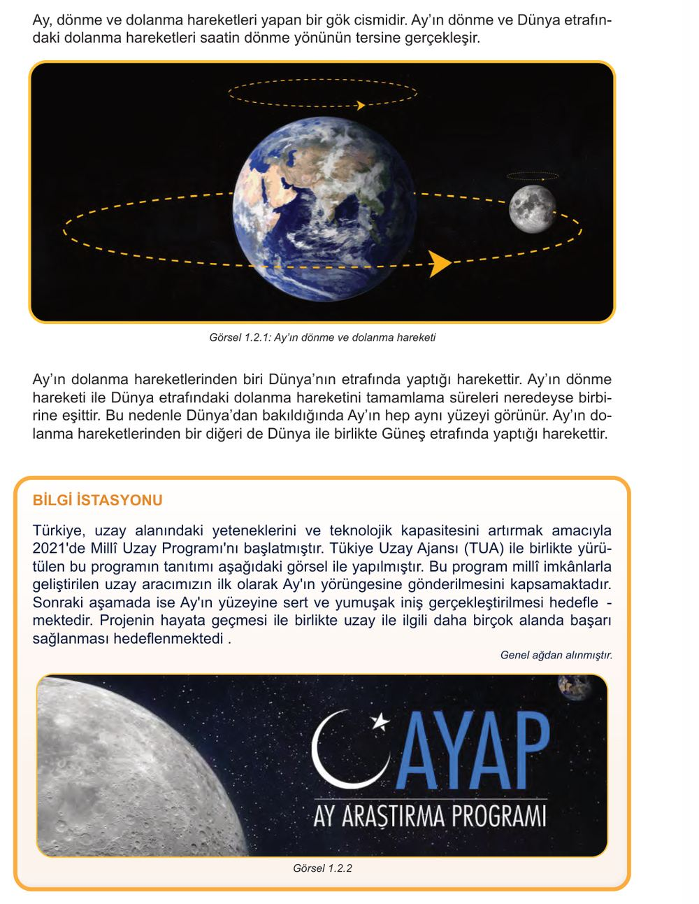

*Görsel 1.2.1: Ay'ın dönme ve dolanma hareketi*

Ay'ın dolanma hareketlerinden biri Dünya'nın etrafında yaptığı harekettir. Ay'ın dönme hareketi ile Dünya etrafındaki dolanma hareketini tamamlama süreleri neredeyse birbirine eşittir. Bu nedenle Dünya'dan bakıldığında Ay'ın hep aynı yüzeyi görünür. Ay'ın dolanma hareketlerinden bir diğeri de Dünya ile birlikte Güneş etrafında yaptığı harekettir.

> ### BİLGİ İSTASYONU
>
> Türkiye, uzay alanındaki yeteneklerini ve teknolojik kapasitesini artırmak amacıyla 2021'de Millî Uzay Programı'nı başlatmıştır. Türkiye Uzay Ajansı (TUA) ile birlikte yürütülen bu programın tanıtımı aşağıdaki görsel ile yapılmıştır. Bu program millî imkânlarla geliştirilen uzay aracımızın ilk olarak Ay'ın yörüngesine gönderilmesini kapsamaktadır. Sonraki aşamada ise Ay'ın yüzeyine sert ve yumuşak iniş gerçekleştirilmesi hedeflenmektedir. Projenin hayata geçmesi ile birlikte uzay ile ilgili daha birçok alanda başarı sağlanması hedeflenmektedir.
>
> *Genel ağdan alınmıştır.*
>
> 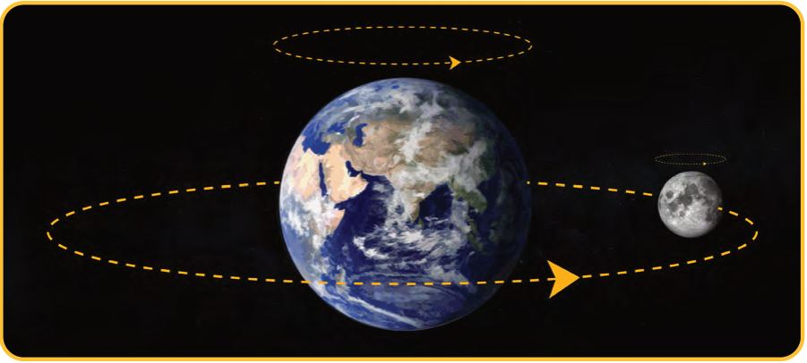
>
> *Görsel 1.2.2*

<!-- sayfa 31 -->

Ay’ın kendi etrafında tur atmasıyla dönme, Dünya’nın etrafında tur atmasıyla dolanma hareketi oluşur. Ay’ın bu hareketleri ve Dünya’dan bakıldığında görünen yüzü ile ilgili aşağıdaki etkinliği yapınız.

# Ay'ın Hareketleri ve Görünen Yüzü

## ETKİNLİK İSTASYONU
### Etkinliğin Yapılışı
- Üçer veya dörder kişilik gruplar oluşturunuz.
- Arkadaşlarınızdan biri Dünya'yı, biri Ay'ı temsil etsin, diğer arkadaşınız da gözlem yaparak gözlemlerini A4 kâğıdına not alsın.
- Arkadaşlarınızla yardımlaşarak sınıf zeminine tahta kalemi ile büyük bir çember çiziniz.
- Dünya'yı temsil eden arkadaşınız çemberin ortasında dursun, Ay'ı temsil eden arkadaşınız da çemberin çizgisinde dursun.
- Dünya'yı temsil eden arkadaşınız bulunduğu noktada yavaşça kendi ekseni etrafında dönmeye başlasın. Ay'ı temsil eden arkadaşınız etkinlik boyunca Dünya'yı temsil eden arkadaşınıza bakıp yavaşça bir tam turunu tamamlasın.
- Gözlem yapan arkadaşınız, Dünya ve Ay'ın bu hareketlerini A4 kâğıdına çizsin ve bu hareketlerle ilgili notlar alsın.
- Dünya ve Ay bir turunu tamamladığında etkinliği sona erdiriniz.

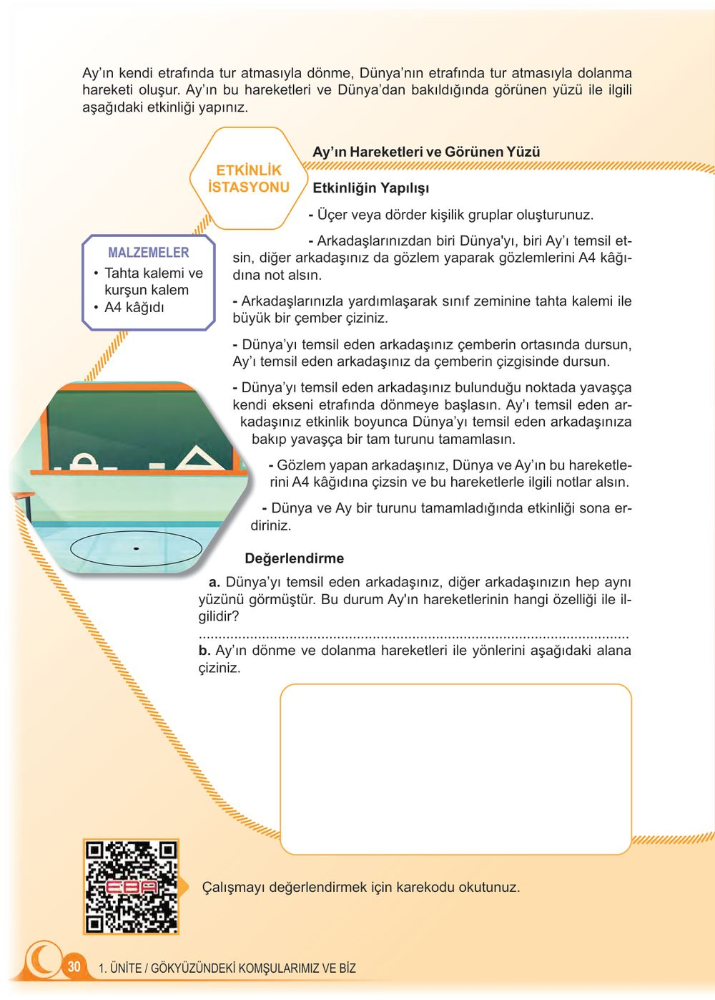

### MALZEMELER
- Tahta kalemi ve kurşun kalem
- A4 kâğıdı

## Değerlendirme
**a.** Dünya’yı temsil eden arkadaşınız, diğer arkadaşınızın hep aynı yüzünü görmüştür. Bu durum Ay'ın hareketlerinin hangi özelliği ile ilgilidir?
.............................................................................................................

**b.** Ay’ın dönme ve dolanma hareketleri ile yönlerini aşağıdaki alana çiziniz.


Çalışmayı değerlendirmek için karekodu okutunuz.

<!-- sayfa 32 -->

Sayfa 28'deki "Ay Gözlemi" etkinliğini değerlendirmek amacıyla aşağıdaki etkinliği yapınız.

# Ay Gözlemi-2

## ETKİNLİK İSTASYONU

### Etkinliğin Yapılışı

- İsminizi sınıf tahtasına yazınız.
- Yapışkanlı kâğıtlara görselde olduğu gibi yıldız şekli çiziniz.
- Daha önce hazırladığınız ürünleri sıranıza yerleştiriniz.
- Arkadaşlarınızın hazırladığı ürünleri sırayla ziyaret ederek inceleyiniz.
- Hatalı olduğunu düşündüğünüz kısımlar varsa bunları yapışkanlı kâğıtlara yazınız. Yapışkanlı kâğıtları ilgili ürünlerin üzerine yapıştırınız.
- Ürünlere eklemek istediklerinizi varsa yapışkanlı kâğıtlara yazarak ürünlerin üzerine yapıştırınız.
- Ziyaretlerinizi tamamladıktan sonra ürünlerinizi arkadaşlarınıza sununuz.
- Yapışkanlı kâğıtlara çizdiğiniz yıldız sembollerini aşağıda gösterilen beğenme derecesine göre sınıf tahtasındaki isimlerinin altına yapıştırınız.

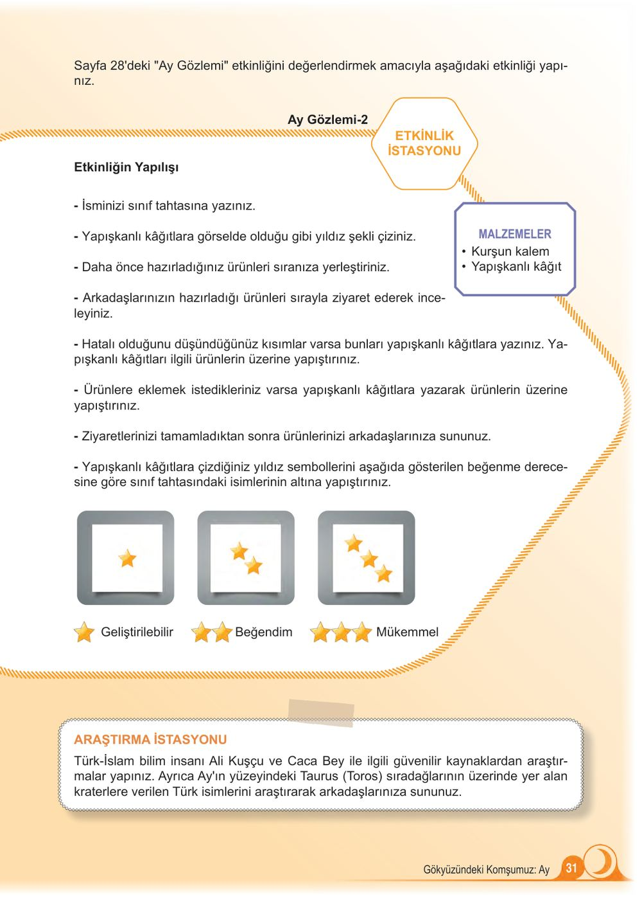

⭐ Geliştirilebilir
⭐⭐ Beğendim
⭐⭐⭐ Mükemmel

### MALZEMELER
- Kurşun kalem
- Yapışkanlı kâğıt

---

## ARAŞTIRMA İSTASYONU

Türk-İslam bilim insanı Ali Kuşçu ve Caca Bey ile ilgili güvenilir kaynaklardan araştırmalar yapınız. Ayrıca Ay'ın yüzeyindeki Taurus (Toros) sıradağlarının üzerinde yer alan kraterlere verilen Türk isimlerini araştırarak arkadaşlarınıza sununuz.

<!-- sayfa 33 -->

**Doğal uydular**, gezegenlerin etrafında belirli yörüngelerde hareket eden gök cisimleridir. Ay da Dünya’nın etrafında belirli bir yörüngede hareket eder. Yani Ay, Dünya’nın doğal uydusudur. Dünya’nın Ay’dan başka doğal uydusu yoktur.


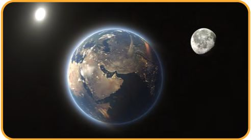

Görsel 1.2.3: Ay'ın Dünya etrafındaki görünümü

Ay, ışık kaynağı değildir. Ay, Güneş'ten aldığı ışık ışınlarını yansıtır. Bu sayede Dünya'dan hem gece hem de gündüz görülebilen bir gök cismidir. Ay'ın Dünya'dan gece görünümü, gündüz görünümüne göre genellikle daha belirgindir.

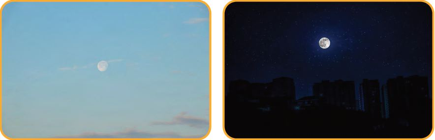

Görsel 1.2.4: Ay'ın gündüz görünümü
Görsel 1.2.5: Ay'ın gece görünümü

Ay da Dünya gibi küreye benzer bir şekle sahiptir. Ay, Dünya'ya en yakın gök cismidir. Ay ile Dünya arasındaki mesafe yaklaşık $384.400$ kilometredir.

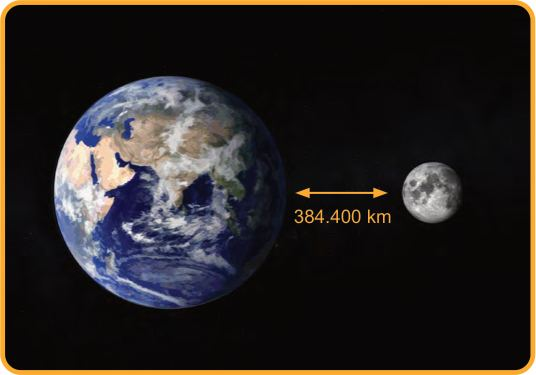

Görsel 1.2.6: Dünya ve Ay arasındaki uzaklık

<!-- sayfa 34 -->

Dünya’dan Ay’a bakıldığında Ay yüzeyi farklı renk tonlarında görünür. Koyu renkli görünen bölümler, genellikle geniş düzlüklerin bulunduğu alanlardır. Açık renkli görünen bölümler ise genellikle engebeli ve yüksek alanlardır. Ay’ın yüzeyinde kaya, taş, kum ve toz bulunur. Ayrıca Ay yüzeyinde vadi ve tepeler vardır. Ay’ın yüzeyinin büyük bir kısmı tozdan oluşur. Ay’da sıcaklık gece $-174\ ^\circ\text{C}$ <!-- KONTROL: Marker'da karşılığı yok, uydurma olabilir -->’u, gündüz ise $125\ ^\circ\text{C}$ <!-- KONTROL: Marker'da karşılığı yok, uydurma olabilir -->’u bulabilmektedir. Ay yüzeyinin gündüz çok ısınıp gece çok soğuması yüzeydeki kaya, taş ve kumun parçalanmasını hızlandırır. Böylece kaya taşa, taş kuma, kum da toza dönüşür.

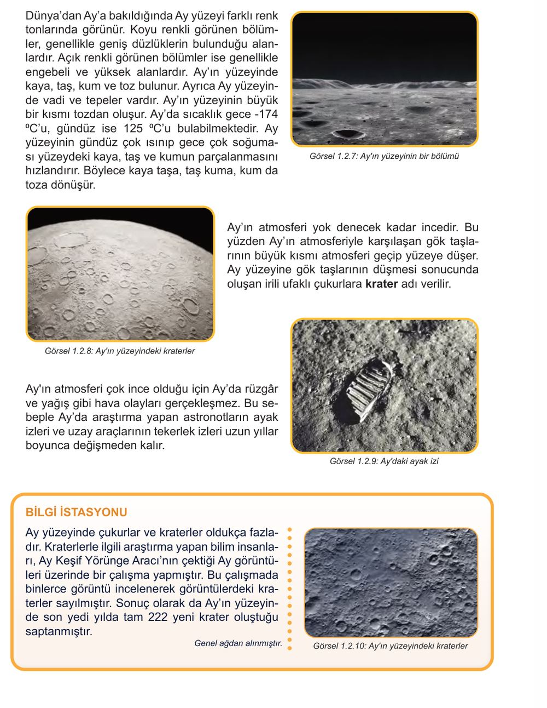
*Görsel 1.2.7: Ay'ın yüzeyinin bir bölümü*


*Görsel 1.2.8: Ay'ın yüzeyindeki kraterler*

Ay’ın atmosferi yok denecek kadar incedir. Bu yüzden Ay’ın atmosferiyle karşılaşan gök taşlarının büyük kısmı atmosferi geçip yüzeye düşer. Ay yüzeyine gök taşlarının düşmesi sonucunda oluşan irili ufaklı çukurlara *krater* adı verilir.

Ay'ın atmosferi çok ince olduğu için Ay’da rüzgâr ve yağış gibi hava olayları gerçekleşmez. Bu sebeple Ay’da araştırma yapan astronotların ayak izleri ve uzay araçlarının tekerlek izleri uzun yıllar boyunca değişmeden kalır.


*Görsel 1.2.9: Ay'daki ayak izi*

> ### BİLGİ İSTASYONU
> Ay yüzeyinde çukurlar ve kraterler oldukça fazladır. Kraterlerle ilgili araştırma yapan bilim insanları, Ay Keşif Yörünge Aracı’nın çektiği Ay görüntüleri üzerinde bir çalışma yapmıştır. Bu çalışmada binlerce görüntü incelenerek görüntülerdeki kraterler sayılmıştır. Sonuç olarak da Ay’ın yüzeyinde son yedi yılda tam 222 yeni krater oluştuğu saptanmıştır.
>
> *Genel ağdan alınmıştır.*


*Görsel 1.2.10: Ay'ın yüzeyindeki kraterler*

<!-- sayfa 35 -->

# PEKİŞTİRME İSTASYONU-1

**Numaralandırılmış ifadelerde anlatılan kavramları bularak bulmacaya yerleştiriniz.**

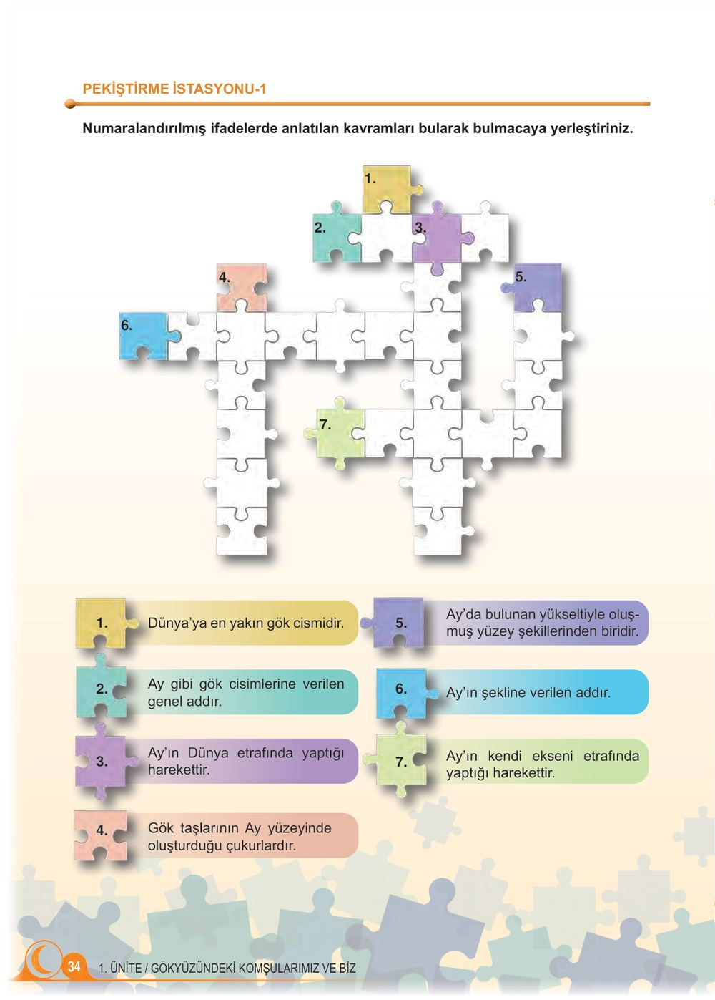

| | | | | | | |
| :---: | :---: | :---: | :---: | :---: | :---: | :---: |
| | | **1.** | | | | |
| | **2.** | | **3.** | | | |
| | | | | | **5.** | |
| **4.** | | | | | | |
| **6.** | | | | | | |
| | | | | | | |
| | | **7.** | | | | |
| | | | | | | |
| | | | | | | |

| | |
| :--- | :--- |
| **1.** | Dünya'ya en yakın gök cismidir. |
| **2.** | Ay gibi gök cisimlerine verilen genel addır. |
| **3.** | Ay'ın Dünya etrafında yaptığı harekettir. |
| **4.** | Gök taşlarının Ay yüzeyinde oluşturduğu çukurlardır. |
| **5.** | Ay'da bulunan yükseltiyle oluşmuş yüzey şekillerinden biridir. |
| **6.** | Ay'ın şekline verilen addır. |
| **7.** | Ay'ın kendi ekseni etrafında yaptığı harekettir. |

<!-- sayfa 36 -->

# AY'IN EVRELERİ

Türk Bayrağı'nda yer alan Ay'ın şekli ile ilgili aşağıdaki etkinliği yapınız.

## Ay'ın Görünümündeki Farklılıklar

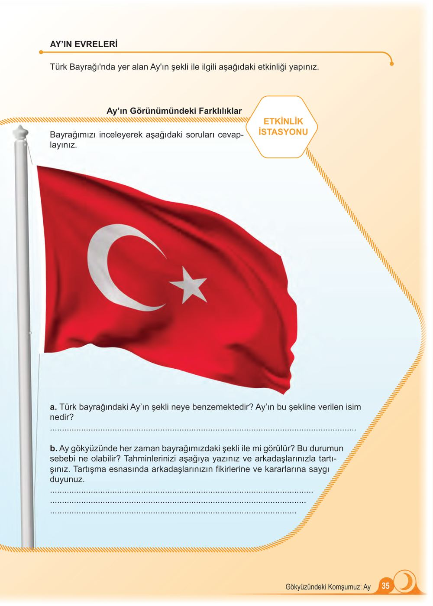

ETKİNLİK İSTASYONU

Bayrağımızı inceleyerek aşağıdaki soruları cevaplayınız.

**a. Türk bayrağındaki Ay'ın şekli neye benzemektedir? Ay'ın bu şekline verilen isim nedir?**
................................................................................................................................

**b. Ay gökyüzünde her zaman bayrağımızdaki şekli ile mi görülür? Bu durumun sebebi ne olabilir? Tahminlerinizi aşağıya yazınız ve arkadaşlarınızla tartışınız. Tartışma esnasında arkadaşlarınızın fikirlerine ve kararlarına saygı duyunuz.**
..............................................................................................................
...........................................................................................................
.......................................................................................................

<!-- sayfa 37 -->

# AY GÖZLEMİ

Performans görevi olarak Ay’ı gözlemleyip çizim yapmaya devam ediniz. Çizimlerinizde Ay’ın aydınlık ve karanlık bölümlerini gösteriniz.

| 1 | 2 | 3 | 4 | 5 |
| :---: | :---: | :---: | :---: | :---: |
| ⚪<br>.......... | ⚪<br>.......... | ⚪<br>.......... | ⚪<br>.......... | ⚪<br>.......... |

| 6 | 7 | 8 | 9 | 10 |
| :---: | :---: | :---: | :---: | :---: |
| ⚪<br>.......... | ⚪<br>.......... | ⚪<br>.......... | ⚪<br>.......... | ⚪<br>.......... |

| 11 | 12 | 13 | 14 | 15 |
| :---: | :---: | :---: | :---: | :---: |
| ⚪<br>.......... | ⚪<br>.......... | ⚪<br>.......... | ⚪<br>.......... | ⚪<br>.......... |

| 16 | 17 | 18 | 19 | 20 |
| :---: | :---: | :---: | :---: | :---: |
| ⚪<br>.......... | ⚪<br>.......... | ⚪<br>.......... | ⚪<br>.......... | ⚪<br>.......... |

| 21 | 22 | 23 | 24 | 25 |
| :---: | :---: | :---: | :---: | :---: |
| ⚪<br>.......... | ⚪<br>.......... | ⚪<br>.......... | ⚪<br>.......... | ⚪<br>.......... |

| 26 | 27 | 28 | 29 | 30 |
| :---: | :---: | :---: | :---: | :---: |
| ⚪<br>.......... | ⚪<br>.......... | ⚪<br>.......... | ⚪<br>.......... | ⚪<br>.......... |

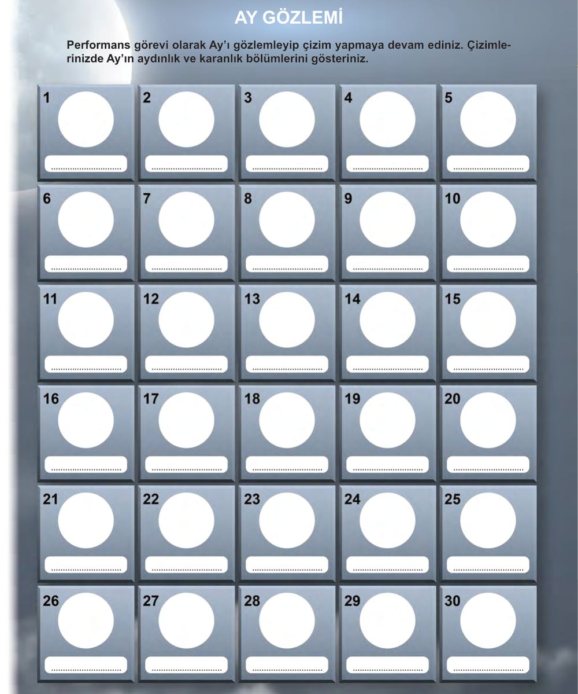
<!-- yer tutucu bulunamadı: sayfa sonuna eklendi -->

<!-- sayfa 38 -->

Ay'ın evrelerinin gerçekleşme süreleri ile ilgili aşağıdaki etkinliği yapınız.

# Ay'ın Evrelerinin Süresi

ETKİNLİK İSTASYONU
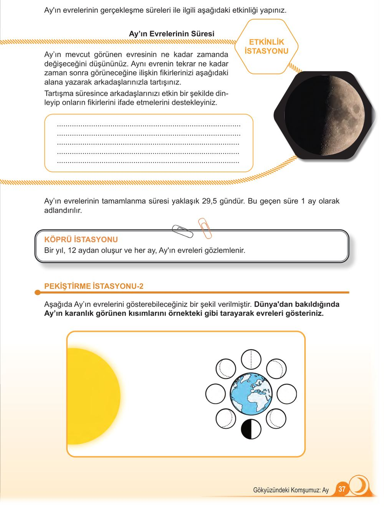

Ay'ın mevcut görünen evresinin ne kadar zamanda değişeceğini düşününüz. Aynı evrenin tekrar ne kadar zaman sonra görüneceğine ilişkin fikirlerinizi aşağıdaki alana yazarak arkadaşlarınızla tartışınız.
Tartışma süresince arkadaşlarınızı etkin bir şekilde dinleyip onların fikirlerini ifade etmelerini destekleyiniz.

......................................................................................
......................................................................................
......................................................................................
......................................................................................
......................................................................................

Ay'ın evrelerinin tamamlanma süresi yaklaşık $29,5$ gündür. Bu geçen süre $1$ ay olarak adlandırılır.

KÖPRÜ İSTASYONU
Bir yıl, $12$ aydan oluşur ve her ay, Ay'ın evreleri gözlemlenir.

PEKİŞTİRME İSTASYONU-2

Aşağıda Ay'ın evrelerini gösterebileceğiniz bir şekil verilmiştir. **Dünya'dan bakıldığında Ay'ın karanlık görünen kısımlarını örnekteki gibi tarayarak evreleri gösteriniz.**

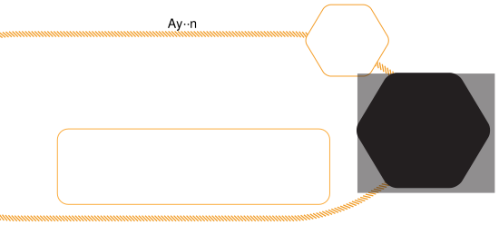

<!-- sayfa 39 -->

# HİLAL
Yeni ay evresinden önceki bu evrede Ay, “C” harfi gibi görünür.


Dünya'dan görünümü

# YENİ AY
Ay'ın, Güneş ve Dünya arasında olduğu evredir. Bu evrede Ay'ın Dünya tarafındaki yüzeyi ışık almaz.

# HİLAL
Yeni ay evresinden sonraki bu evrede Ay, “ters C” harfi gibi görünür.

<!-- sayfa 40 -->

# SON DÖRDÜN
Dünya’dan bakıldığında Ay’ın “ters D” harfi gibi göründüğü evredir. Dolunay evresinden bir hafta sonra görünür.
Dünya'dan görünümü

# ŞİŞKİN AY
Dolunay evresinden son dördün evresine geçerken görülen ara evredir.
Dünya'dan görünümü

# DOLUNAY
Dünya’nın Güneş ve Ay arasında olduğu evredir. Ay’ın Dünya’ya bakan yüzeyi tamamen aydınlıktır.
Dünya'dan görünümü

# ŞİŞKİN AY
İlk dördün evresinden dolunay evresine geçerken görülen ara evredir.
Dünya'dan görünümü

# İLK DÖRDÜN
Dünya’dan bakıldığında Ay’ın “D” harfi gibi göründüğü evredir. Yeni ay evresinden bir hafta sonra görünür.
Dünya'dan görünümü


<!-- sayfa 41 -->

# ARAŞTIRMA İSTASYONU

“Ramazan ayı ve dinî bayramların tarihleri, gök cisimlerinden hangisinin hareketine göre belirlenmektedir?” sorusunun cevabını araştırarak arkadaşlarınızla paylaşınız.


Güneş bir ışık kaynağıyken Ay ışık kaynağı değildir. Ay, Güneş’ten gelen ışık ışınlarını yansıtır.

Gökyüzünde Ay’ı bazı geceler bayrağımızdaki hilal şeklinde bazı geceler yarım daire şeklinde görürüz. Bazı geceler ise Ay’ı göremeyiz. Ay’ın Dünya’dan görünümü her gün değişir.

Ay’ın dolanma hareketi sırasında Dünya ve Güneş’e göre konumu değişir. Bu durum, Ay’ın ışık alan kısımlarının değişmesine ve Dünya’dan bakan birinin Ay’ı farklı şekillerde görmesine sebep olur. Ay’ın farklı şekillerde görünmesine **Ay'ın evreleri** denir.

Ay’ın yeni ay, ilk dördün, dolunay ve son dördün olmak üzere dört ana evresi vardır. Hilal ve şişkin ay ise Ay’ın ara evreleridir. Ara evreler, ana evreler arasındaki geçişlerde gözlemlenir. Ay’ın birbirini takip eden iki ana evresi arasında geçen süre yaklaşık bir haftadır.


*Görsel 1.2.12: Ay'ın evreleri*

## PEKİŞTİRME İSTASYONU-3

Aşağıdaki etkinlikte Ay'ın 8 Kasım tarihindeki görünümü verilmiştir.

1. Buna göre 1, 15 ve 22 Kasım tarihlerinde Ay'ın nasıl görüneceğini boş bırakılan kutular içine çiziniz. Ay'ın hangi evrede olacağını ilgili noktalı alana yazınız.

| 1 Kasım | 8 Kasım | 15 Kasım | 22 Kasım |
| :---: | :---: | :---: | :---: |
| ............. | ............. | ............. | ............. |
|  |  |  |  |

2. Verilen evrelerin tekrar gözlemlenebilmesi için kaç gün geçmelidir? Yazınız ve tartışınız.
...........................................................................................................................................

<!-- sayfa 42 -->

Ay'ın evrelerini temsil edecek bir model tasarlamak için aşağıdaki etkinliği yapınız.

# PERFORMANS İSTASYONU: Ay'ın Evreleri Modeli

Belirlediğiniz malzemeleri kullanarak Ay'ın evrelerini temsil eden bir model tasarlayınız. Modelinizin tasarım sürecine başlamadan önce plan (veri toplama, hedef, süre, tasarım, değerlendirme vb. başlıklara göre) yapınız. Modelinizi hoş, güzel bir tasarımla ortaya çıkarınız. Modelinize ait bilgileri aşağıdaki ilgili bölümlere yazınız. Planınıza uygun ve düzenli bir şekilde çalışarak modelinizi tamamlayıp arkadaşlarınıza sununuz. Modelinizi arkadaşlarınızın modelleri ile karşılaştırarak geliştiriniz. Geliştirdiğiniz modeli arkadaşlarınıza sununuz. Arkadaşlarınızla yardımlaşarak süreci daha verimli hâle getirebileceğinizi unutmayınız.

| Kullanacağınız Malzemeler |  Tasarımın Çizimi |
| :--- | :--- |
| ...........................................................<br>...........................................................<br>...........................................................<br>...........................................................<br>...........................................................<br>...........................................................<br>...........................................................<br>........................................................... | |

### Yapım Aşamaları
...........................................................................................................................................
...........................................................................................................................................
...........................................................................................................................................
...........................................................................................................................................
...........................................................................................................................................

### Değerlendirme Aşamaları-1
Yaptığınız testler ve karşılaştırmalar sonucunda düzeltilmesi gerekenler: .....................
...........................................................................................................................................
...........................................................................................................................................

### Düzeltme Aşamasında Yaptıklarınız
...........................................................................................................................................
...........................................................................................................................................

### Değerlendirme Aşamaları-2
Yaptığınız testler ve karşılaştırmalar sonucunda düzeltilmesi gerekenler: .....................
...........................................................................................................................................
................................................................

<!-- sayfa 43 -->

***

### DEĞERLENDİRME FORMU

Aşağıdaki öz değerlendirme formu “Ay’ın Evreleri Modeli” etkinliğinizdeki performansınızı değerlendirmeye yönelik hazırlanmıştır.

**Görüşlerinizi aşağıdaki soruları cevaplayarak belirtiniz.**

1. Bu etkinlikte neler öğrendim?
...........................................................................................................................................

2. Bu etkinlikteki zorlandığım bölümler nelerdi?
...........................................................................................................................................

3. Bu etkinlikte öğrendiklerimi nerede ve nasıl kullanabilirim?
...........................................................................................................................................

***

 Çalışmayı değerlendirmek için karekodu okutunuz.

***

### BİLGİ İSTASYONU

- Ay’ın aydınlık ve karanlık bölgesini ayıran çizgiye “Terminatör” denir.
- Ay, Dünya’dan her yıl yaklaşık $4$ santimetre uzaklaşmaktadır.
- Ay’ın Dünya etrafındaki yörüngesi basık çember gibidir. Ay, bu yörüngede dolanırken bazen Dünya’ya yaklaşır bazen de Dünya’dan uzaklaşır. Dünya’ya yakın olduğu anda, yeni ay ve dolunay evresine denk gelirse Ay daha büyük görünür ve Ay’ın bu görünümüne “Süper Ay” denir.
- Ay’ın yüzeyinde yaklaşık $300.000$ krater bulunmaktadır.

Genel ağdan alınmıştır.


Görsel 1.2.13: Ay

***

 “Ay’ın Evreleri” adlı etkileşimli içerik için karekodu okutunuz.

“Ay’ın Evrelerini Pekiştirelim” adlı etkileşimli içerik için karekodu okutunuz. 

<!-- sayfa 44 -->

# PEKİŞTİRME İSTASYONU-4

1. Ay'ın özelliklerinden iki tanesini yazınız.
...........................................................................................................................................
...........................................................................................................................................

2. Ay'ın evrelerinin oluşması Ay'ın hangi hareketiyle ilgilidir?
...........................................................................................................................................

3. Ay'ın evrelerinin adları, bu evrelerden bazılarına dair açıklamalar ve görseller aşağıda verilmiştir.

a. Evre adı, açıklamalar ve görsellerin bulunduğu kutuları örnekteki gibi eşleştiri- niz.

| EVRE ADI | AÇIKLAMALAR | GÖRSEL |
| :--- | :--- | :--- |
| 1 <br> Dolunay | a <br> Dolunaydan bir önceki ana evredir. |  <br> .1. d. |
| 2 <br> Son Dördün | b <br> Ay'ın "C" harfi gibi göründüğü evredir. |  <br> ..... ..... |
| 3 <br> Hilal | c <br> Ay'ın Dünya ile Güneş arasında olduğu evredir. |  <br> ..... ..... |
| 4 <br> Yeni Ay | ç <br> Yeni aydan bir önceki ana evredir. |  <br> ..... ..... |
| 5 <br> Şişkin Ay | d <br> Ay'ın Dünya'ya bakan yüzünün tamamen aydınlık olduğu evredir. | |
| 6 <br> İlk Dördün | | |

b. Açıklaması bulunmayan evre adı hangisidir? Bu evrenin açıklamasını yazınız.
...........................................................................................................................................

c. Görselleri bulunmayan evreler hangileridir?
...........................................................................................................................................

<!-- sayfa 45 -->

# DÜNYA’MIZ VE GÖKYÜZÜNDEKİ KOMŞULARIMIZ


* Bu bölümde Güneş, Dünya ve Ay’ın birbirlerine göre hareketlerini ve hacimsel büyüklüklerini temsil eden bir model oluşturabileceksiniz.

### HAZIRLIK İSTASYONU
Güneş, Dünya ve Ay’ın birbirlerine göre hareket ve büyüklükleri hakkında neler biliyorsunuz? Fikirlerinizi yazınız.
................................................................................................................
............................................................................................................
.......................................................................................................

### MERAK İSTASYONU
Güneş, Dünya ve Ay’ın birbirlerine göre hareket ve büyüklükleri hakkında merak ettiklerinizi yazınız.
................................................................................................................
............................................................................................................

<!-- sayfa 46 -->

# GÜNEŞ, DÜNYA VE AY'IN BİRBİRLERİNE GÖRE HAREKETLERİ

Güneş'in Dünya'dan hacimsel olarak çok daha büyük olduğunu öğrenmiştik. Dünya da Ay'dan daha büyük bir gök cismidir. Maddelerin ve cisimlerin uzayda (boşlukta) kapladıkları yer **hacim** olarak tanımlanmaktadır. Hacmin $\text{cm}^3$ <!-- KONTROL: Marker'da karşılığı yok, uydurma olabilir --> (santimetreküp) ve $\text{m}^3$ <!-- KONTROL: Marker'da karşılığı yok, uydurma olabilir --> (metreküp) gibi birimleri vardır.

Güneş, Dünya ve Ay'ın birbirlerine göre hareketleri ve hacimsel büyüklükleri arasındaki ilişkiyi göstereceğiniz model tasarımı ile ilgili aşağıdaki etkinliği yapınız.

**PERFORMANS İSTASYONU: <mark>Model Geliştiriyorum</mark>**

Güneş, Dünya ve Ay'ın birbirine göre hareketlerini ve hacimsel büyüklüğünü gösteren özgün bir model tasarlayınız. Modelinizin tasarım sürecine başlamadan önce plan (veri toplama, hedef, model, önerme, süre, tasarım, değerlendirme vb. başlıklara göre) yapınız. Planınızın veri toplama aşamasında güvenilir bilimsel kaynaklara başvurmaya dikkat ediniz. Modelinizi hoş, güzel bir tasarımla ortaya çıkarınız. Modelinize ait bilgileri aşağıdaki ilgili bölümlere yazınız. Tasarımlarınız için oyun hamuru, gazete kâğıdı, siyah fon kartonu, balon gibi araçlar kullanabilirsiniz. Planınıza uygun ve düzenli bir şekilde çalışarak bir hafta içinde modelinizi tamamlayıp arkadaşlarınıza sununuz. Modelinizi arkadaşlarınızın modelleri ile karşılaştırarak geliştiriniz. Geliştirdiğiniz modeli arkadaşlarınıza sununuz. Arkadaşlarınızla yardımlaşarak süreci daha verimli hâle getirebileceğinizi unutmayınız.

| Kullanacağınız Malzemeler |  Tasarımın Çizimi |
| :--- | :--- |
| .................................................... | |
| .................................................... | |
| .................................................... | |
| .................................................... | |
| .................................................... | |

**Yapım Aşamaları**
...........................................................................................................................................
...........................................................................................................................................
...........................................................................................................................................
...........................................................................................................................................

**Yapım Aşamaları-1**
Yaptığınız testler ve karşılaştırmalar sonucunda düzeltilmesi gerekenler: ..............................
...........................................................................................................................................
...........................................................................................................................................

**Düzeltme Aşamasında Yaptıklarınız**
...........................................................................................................................................
...........................................................................................................................................

**Değerlendirme Aşamaları-2**
Yaptığınız testler ve karşılaştırmalar sonucunda düzeltilmesi gerekenler: ..............................
...........................................................................................................................................

<!-- sayfa 47 -->

![QR Kod] “Güneş, Dünya ve Ay” adlı etkileşimli içerik için karekodu okutunuz.

![QR Kod] Çalışmayı değerlendirmek için karekodu okutunuz.

---

# DEĞERLENDİRME FORMU

Aşağıdaki öz değerlendirme formu “Model Geliştiriyorum” etkinliğinizdeki performansınızı değerlendirmeye yönelik hazırlanmıştır.

**Görüşlerinizi aşağıdaki soruları cevaplayarak belirtiniz.**

1. Bu etkinlikte neler öğrendim?
...........................................................................................................................................

2. Bu etkinlikteki zorlandığım bölümler nelerdi?
...........................................................................................................................................

3. Bu etkinlikte öğrendiklerimi nerede ve nasıl kullanabilirim?
...........................................................................................................................................

---

Güneş, günün farklı saatlerinde gözlemlendiğinde gökyüzünde farklı konumlarda görünür. Bu durum, Dünya’nın dönme hareketinin sonucudur.


<!-- sayfa 48 -->

Dünya ile Ay kendi eksenleri etrafında dönme hareketi yaparken Güneş’in etrafında dolanma hareketi yapmaktadır. Bu gök cisimlerinin dönme ve dolanma hareketlerinin yönü, saatin dönme yönünden yararlanılarak açıklanır.

Güneş kendi ekseni etrafında batıdan doğuya doğru dönme hareketi yapar. Bu hareket, saatin dönme yönünün tersinedir.


Görsel 1.3.2

Dünya'nın kendi ekseni etrafındaki dönme hareketi saatin dönme yönünün tersine yani batıdan doğuya doğrudur. Bu dönme hareketi 24 saatte tamamlanır. Dünya'nın Güneş etrafındaki dolanma hareketi de saatin dönme yönünün tersinedir. Bu dolanma hareketi yaklaşık 365 gün 6 saatte tamamlanır.


Görsel 1.3.3: Güneş'in dönme yönü


Görsel 1.3.4: Dünya'nın dönme ve dolanma yönü

Ay'ın kendi ekseni etrafındaki dönme hareketi saatin dönme yönünün tersi yönündedir. Ay'ın dönme hareketi yaklaşık 27 gün 8 saatte tamamlanır. Dünya etrafındaki dolanma hareketinin yönü de saatin dönme yönünün tersi yönündedir. Bu dolanma hareketi de Ay'ın dönme hareketi ile yaklaşık aynı sürede tamamlanır. Aynı zamanda Ay, Dünya ile birlikte Güneş'in etrafında dolanma hareketi yapar. Bu hareketin yönü de saatin dönme yönünün tersinedir. Ay, bu dolanma hareketini Dünya ile birlikte tamamlar.


<!-- yer tutucu bulunamadı: sayfa sonuna eklendi -->

<!-- sayfa 49 -->

# BİLGİ İSTASYONU

Bilge hükümdar Uluğ Bey, çok önemli bir matematik ve astronomi bilginidir. Semerkant’ta o güne kadar görülen en büyük ve en gelişmiş rasathaneyi yaptırmıştır. Bir bilim insanı olarak matematik ve astronomiye büyük katkılar yapmış, Semerkant’ta verimli bir bilim ortamı oluşturmuştur. Kendisinden önce hazırlanan cetvellerdeki hataları düzelterek yıldızların hareketlerini daha mükemmel gösteren eserini (Zîc-i Uluğ Bey) yazmıştır. Bir yılı 365 gün 6 saat 10 dakika 8 saniye olarak hesaplamıştı. Günümüz hesaplamalarına çok yakın olan bu hesaplama o dönemde astronominin ne kadar gelişmiş olduğunu göstermektedir.

: Görsel 1.3.6: Uluğ Bey (temsili)

*Genel ağdan alınmıştır.*

---

# PEKİŞTİRME İSTASYONU-1

**Aşağıdaki ifadelerin doğruluk durumunu belirleyiniz. İfade doğru ise “D”, yanlış ise “Y” kutusunu “$\checkmark$” ile işaretleyiniz.**

| | | D | Y |
| :--- | :--- | :---: | :---: |
| 1. | Dünya ve Ay'ın dolanma yönleri aynıdır. | | |
| 2. | Güneş, Dünya ve Ay aynı yönde döner. | | |
| 3. | Dünya'nın dönme ve dolanma hareketinin süresi birbirine eşittir. | | |
| 4. | Ay, kendi etrafında dönme ve Dünya etrafında dolanma hareketini yaklaşık olarak aynı sürede tamamlar. | | |
| 5. | Dünya, dolanma hareketini 24 saatte tamamlar. | | |
| 6. | Dünya'nın Güneş çevresindeki dolanma süresi, Ay'ın Dünya çevresindeki dolanma süresinden daha uzundur. | | |
| 7. | Ay'ın dönme hareketinin süresi, Dünya'nın dönme hareketinin süresinden daha kısadır. | | |
| 8. | Dünya bir kez dönene kadar Ay 27 kez döner. | | |
| 9. | Ay, Dünya etrafında bir kez dolanana kadar Dünya, Güneş çevresinde iki kez dolanır. | | |
| 10. | Dünya, Güneş etrafında Ay ile birlikte dolanır. | | |

<!-- sayfa 50 -->

# PEKİŞTİRME İSTASYONU-2

Aşağıda numaralanmış kavramlar ve bu kavramlarla ilgili ifadeler verilmiştir. **İfadeler için geçerli olan kavramların numarasını/numaralarını noktalı yerlere yazınız.**

| 1 <br> Güneş | 2 <br> Ay | 3 <br> Dünya | 4 <br> Dolanma | 5 <br> Dönme |
| :---: | :---: | :---: | :---: | :---: |
| **6** <br> Saat yönü | **7** <br> Saat yönünün tersi | **8** <br> 365 gün 6 saat | **9** <br> 29,5 gün | |

| | |
| :--- | :--- |
| a. Dünya ve Ay'ın yapmış olduğu hareketlerdir. | ....................................... |
| b. Dünya'ya en yakın gök cismidir. | ....................................... |
| c. Kendi etrafında dönme hareketi yapan gök cisimleridir. | ....................................... |
| ç. Hem dönme hem de dolanma hareketi yapan gök cisimleridir. | ....................................... |
| d. Kendi etrafındaki dönme hareketini bir günde tamamlayan gök cismidir. | ....................................... |
| e. Güneş'in kendi etrafında yaptığı hareketin yönüdür. | ....................................... |
| f. Dünya'nın Güneş etrafında yaptığı hareketin yönüdür. | ....................................... |
| g. Dünya'nın Güneş etrafındaki bir tam turunu tamamlama süresidir. | ....................................... |


<!-- yer tutucu bulunamadı: sayfa sonuna eklendi -->

<!-- sayfa 51 -->

# A Aşağıdaki cümlelerde boş bırakılan yerleri kutuların içindeki uygun kelimelerle tamamlayınız.

| ince | küreye | dolanma | hilal |
| :---: | :---: | :---: | :---: |
| küçük | gazlardan | yıldız | kısa |
| yağmur | yakın | Ay | yeni ay |
| Dünya | dönme | sıcaklık | krater |

1. Dünya'nın etrafında dolanan .............................. doğal bir uydudur.
2. Ay, Dünya'dan daha .............................. bir gök cismidir.
3. Ay'a gök taşlarının sıklıkla düşmesi, Ay'ın atmosferinin çok .............................. olmasından kaynaklanır.
4. Gök taşlarının Ay yüzeyinde oluşturduğu çukurlara .............................. adı verilir.
5. Ay'da .............................. gibi hava olayları gerçekleşmez.
6. Ay'ın şekli bir .............................. benzer.
7. Ay'ın yüzeyinin oluşumunda gece ile gündüz arasındaki .............................. farkı etkili olmuştur.
8. Dünya'ya en .............................. gök cismi ışık üretemez.
9. Ay, dönme ve .............................. hareketi yapan bir gök cismidir.
10. Bir .............................. olan Güneş, katmanlardan oluşur.
11. Dolunay evresinden iki hafta sonra görülen evre .............................. evresidir.
12. Ay'ın yeni ay ile ilk dördün arasındaki ara evresi .............................. evresidir.
13. Ay, dönme hareketini Güneş etrafındaki dolanma hareketinden daha .............................. sürede tamamlar.
14. Ay'ın evrelerinin oluşma sebebi .............................. etrafındaki dolanma hareketidir.
15. Güneş'in yapısı .............................. oluşur.


<!-- sayfa 52 -->

# Aşağıdaki soruları cevaplayınız.


**ÜNİTE SONU İSTASYONU**

1. Dünya’nın ışık ve ısı kaynağı olan gök cismi hangisidir?
................................................................................................................................

2. Güneş hangi geometrik şekle benzer?
................................................................................................................................

3. Güneş’in yüzeyindeki bazı bölgeler diğer bölgelere göre daha karanlıktır. Bu böl-
gelerin adı nedir?
................................................................................................................................

4. Gece vakti gökyüzünde görünen en büyük gök cismi nedir?
................................................................................................................................

5. Yağmur ve dolu gibi hava olaylarının Ay’da görülmemesinin sebebi nedir?
................................................................................................................................

6. Dünya’dan bakıldığında Ay'ın hep aynı yüzünün görülmesinin sebebi nedir?
................................................................................................................................

7. Ay’ın dolunaydan bir sonraki ana evresinin adı nedir?
................................................................................................................................

8. Güneş, Dünya ve Ay’ın hacimsel büyüklüğünü modellemek için karpuz, erik ve 
elma kullanılacaktır. Buna göre modellemede hangi meyve, hangi gök cismini 
temsil etmek için kullanılmalıdır?
................................................................................................................................

9. Dönüş yönü Dünya ile aynı olan gök cisimleri hangileridir?
................................................................................................................................

10. Dünya’dan bakıldığında Ay’ın her gece farklı görülmesinin sebebi nedir?
................................................................................................................................

“Ölçme ve Değerlendirme” için karekodu okutunuz.

<!-- sayfa 53 -->

# C
Aşağıdaki metni okuyup soruları cevaplayınız.


Millî Uzay Programı kapsamında Ay'da bazı araştırmaların yapılması için bir yolculuk planlanmıştı. Bu yolculuk, Ay'ın Dünya'ya bakan yüzeyinin tamamının aydınlık görüldüğü gün başladı. Barış, astronot olan babası bu göreve katıldığı için çok mutluydu.


Görev tam üç hafta sürdü. Barış'ın babası ve ekibi görevlerini başarıyla ve planlanan takvimde yerine getirerek Dünya'ya döndü.

1. **Barış'ın babasının uzay yolculuğu Ay'ın hangi evresinde başlamıştır?**

A) Dolunay
B) İlk dördün
C) Son dördün
D) Yeni ay

2. **Ay görevini tamamlayan ekibin Dünya'ya döndüğü gün Ay'ın Dünya'dan görünümü aşağıdakilerden hangisinde verilmiştir?**

A) 
B) 
C) 
D) 

<!-- sayfa 54 -->

# Çağını Aşanlar


## Biruni

Astronomi alanında çeşitli çalışmalar yapmıştır. Güneş'in gökyüzündeki hareketlerinden mevsimlerin ne zaman başladığını belirlemiştir. Astronomi ve coğrafya ölçümleri için birçok alet geliştirmiştir. Dünya'nın çapını bugünkü değere çok yakın olarak hesaplamıştır.


## Fergani

Matematik, fizik ve coğrafya konularının yanısıra astronomi alanında çalışmalar yapıp gök cisimlerinin hareketleriyle ilgilenmiştir. Güneş'in kendi ekseninde batıdan doğuya doğru döndüğünü ileri sürmüştür.


## Ali Kuşçu

Ayasofya Medresesine Fatih Sultan Mehmet tarafından müderris olarak görevlendirilen Ali Kuşçu'nun önemli eserlerinden biri "Fethiye" adlı kitabıdır. Ali Kuşçu Dünya'nın, Güneş'in ve gezegenlerin konumlarını ayrıntılı olarak irdelemiştir. "Fethiye"nin uzun yıllar başvuru kitabı olarak kabul edilmesinin nedenlerinden biri de o dönemde yazılmış en önemli astronomi ve coğrafya kitabı olmasıdır.


## Caca Bey

Anadolu'da, kendi ismiyle bir medrese kurdurmuştur. Bu medresede diğer bilimlerin yanında astronomiye de ağırlık verilmiştir. Medrese gözlem amacıyla tasarlanmıştır. Önceleri bu medresedeki kubbenin üstü açıktı ve altında gök cisimlerinin incelendiği su dolu bir kuyu bulunmaktaydı.

Bu sayfada temsilî görseller kullanılmıştır

<!-- sayfa 55 -->

Merhaba Bilim Günce'm,


Artık hayranı olduğum yıldızlara bir yenisi eklendi: Güneş. Bu yıldızın oynadığı bir film yok ama muhteşem özelliklere sahip. Bu özellikleri bir araştırma görevim sırasında fark ettim. Düşünsene, Güneş, gezegenimizde yaşamın kaynağı! Aslında Dünya gibi onun da katmanları var. Dünya'dan çok daha büyük ve şekli küreye benziyor. Sıcak gazlardan oluşuyor ve kendi ekseni etrafında dönme hareketi yapıyor.

Bizim evde sabah yalnızca benim odam güneş alırken öğleye doğru mutfağımız, ikindi saatleri ise diğer odalar güneş alıyor. Bu da Güneş'in günün farklı saatlerinde gökyüzünde farklı konumlarda göründüğünü gösteren basit bir örnek. Sebebi ise Dünya'nın dönme hareketi. Dünya bu dönme hareketini $24$ <!-- KONTROL: Marker'da karşılığı yok, uydurma olabilir --> saatte tamamlıyor, bu süreye "bir gün" diyoruz. Dünya ve Ay, Güneş etrafındaki dolanma hareketlerini ise yaklaşık $365$ gün $6$ saatte tamamlıyor. Bu süreyi nasıl adlandırdığımızı tahmin edeceğini düşünüyorum.

Bunları öğrenmek seni de heyecanlandırmış olmalı ama sakın o heyecanla hemen Güneş'e bakma! Çünkü Güneş'e doğrudan ya da teleskop, dürbün, mercek gibi malzemelerle bakmak çok tehlikeli. Gezegenimizin uydusu Ay için aynı uyarıyı yapmama gerek yok.

<!-- sayfa 56 -->

Güneş hakkında öğrendiklerimizden sonra Ay’ı merak edip arkadaşlarımızla çeşitli araştırma ve gözlemler yaptık. Ay’ın da şekli küreye benziyor ve yüzeyinde geniş düzlükler, engebeler bulunuyor.


~~Ay’ın aslında hep aynı yüzeyini gördüğümüzü biliyor muydun?~~ Sebebi kendi ekseni etrafındaki dönme ve Dünya etrafındaki dolanma süresinin eşit olması. Sana çok ilginç bir bilgi daha vereyim: Ay’ın atmosferi yok denecek kadar inceymiş. Sence bu durum onu gök taşlarına karşı savunmasız bırakır mı?


Ay’ı anlatırken dolunaydan bahsetmemek olmaz Bilim Günce'm. Ay’ı dolunay evresindeyken gözlemlemelisin. Sanki gökyüzüne asılmış kocaman bir ışık küresi… Bu arada yeni ay, ilk dördün, dolunay ve son dördün Ay’ın ana evreleriymiş. Hilal ve şişkin ay ise ara evreler. *İki ana evre arasındaki yaklaşık süre bir hafta.* Bu evrelerin hepsini görebilmek için sabırla dört hafta boyunca gözlem yaptım.

Ay, kendi ekseni etrafında dönerken hem Dünya etrafında dolanıyor hem de Dünya ile birlikte Güneş’in etrafında dolanıyor!


Güneş, Dünya ve Ay’ın hareketlerinin saat yönünün tersine doğru olduğunu da unutmamalı.

Bugünlük benden bu kadar… Hoşça kal sevgili Bilim Günce'm!

<!-- sayfa 57 -->

# 2. ÜNİTE
## KUVVETİ TANIYALIM

### İÇERİK ÇERÇEVESİ
* KUVVET VE KUVVETİN ÖLÇÜLMESİ
* KÜTLE VE AĞIRLIK İLİŞKİSİ
* SÜRTÜNME KUVVETİ

### ANAHTAR KAVRAMLAR
* kuvvet
* kuvvet birimi
* dinamometre
* kütle
* ağırlık
* sürtünme kuvveti
* esneklik
* pürüzlü ve az pürüzlü
* su direnci
* hava direnci


<!-- yer tutucu bulunamadı: sayfa sonuna eklendi -->

<!-- sayfa 58 -->

2. Ünite
Özet E-İçerik


# HATIRLAYALIM
Daha önce kuvvetin cisimler üzerinde oluşturduğu etkileri öğrenmiştiniz.

<!-- sayfa 59 -->

# ÖN DEĞERLENDİRME İSTASYONU

 1

Kuvvete yönelik günlük yaşamda hangi örneklerle karşılaşılır?
.............................................................................................................................
.............................................................................................................................
.............................................................................................................................

Bir cisme kuvvet uygulandığında cisimde hangi değişiklikler gözlemlenebilir?
.............................................................................................................................
.............................................................................................................................
.............................................................................................................................

Duran bir cismi hareket ettirmek için ne yapılması gerekir?
.............................................................................................................................
.............................................................................................................................
.............................................................................................................................

Hareket eden bir cismin yavaşlaması veya durması nasıl sağlanabilir?
.............................................................................................................................
................................................................................................................

<!-- sayfa 60 -->

# KUVVET VE KUVVETİN ÖLÇÜLMESİ


* Bu bölümde kuvvetin büyüklüğünü belirleyip buna göre kuvveti tanımlayabileceksiniz.
* Basit araç gereçler kullanarak bir dinamometre modeli tasarlayabileceksiniz.

## HAZIRLIK İSTASYONU

Tekerlekli sandalyenin hareket etmesini sağlayan etki nedir? Fikirlerinizi yazınız.
..................................................................................................
..................................................................................................
..................................................................................................

## MERAK İSTASYONU

Kuvvet ve kuvvetin ölçülmesi ile ilgili merak ettiklerinizi yazınız.
..................................................................................................
..................................................................................................
..................................................................................................

<!-- sayfa 61 -->

# KUVVETİN ÖZELLİKLERİ VE ÖLÇÜLMESİ

Kuvvet ile ilgili aşağıdaki etkinliği yapınız.

## ETKİNLİK İSTASYONU

### Kuvvet Denince Akla İlk Gelenler

“Kuvvet” kavramı neleri çağrıştırıyor? Aklınıza ilk gelenleri aşağıdaki alana yazarak ve/veya çizerek arkadaşlarınızla paylaşınız.


Arkadaşlarınızın farklı fikirleri olabileceğini unutmadan onları özenle dinleyiniz. Bu fikirlerden yola çıkarak kuvvetin niteliklerini tanımlayınız. Belirlediğiniz nitelikleri aşağıya yazınız.
................................................................................................................................................................................................................................................................................................................................................................................................................................................................................................................................................................................................................................................................................................................................................................................................................................................................................................................................................................................................................................................

<!-- sayfa 62 -->

* Niteliğini tanımladığınız kuvvetin büyüklüğü **dinamometre** adı verilen alet ile ölçülür. Dinamometre seçilirken ölçülecek kuvvetin büyüklüğüne uygun özellikte olmasına dikkat edilir.
* Kuvvetin birimi **Newton**'dır (Nivtın) ve "$N$" harfi ile gösterilir.

Kuvvetin büyüklüğünün dinamometre ile ölçülmesini gösteren aşağıdaki etkinliği yapınız.

# Kuvvet Büyüklüğünün Ölçümü


## ETKİNLİK İSTASYONU

### MALZEMELER
* Özdeş 2 plastik şişe (tamamı su ile dolu)
* Dinamometre
* Bir parça ip
* Kitap
* Defter
* Kalemlik
* Poşet

### Etkinliğin Yapılışı
- Üçer veya dörder kişilik gruplar oluşturunuz. Grup arkadaşlarınızla çalışmalara aktif olarak katılınız.
- İplerden birinin bir ucunu plastik su şişesinin ağız kısmına, diğer ucunu ise dinamometre kancasına bağlayınız.
- Nesnelerin ölçümlerini yaparken dinamometrenin ölçüm sınırına dikkat ediniz.
- Su şişelerinden birini dinamometre ile ölçelim ve bulduğunuz değeri tabloya yazınız (1. durum).
- İki su şişelerini dinamometreye bağlayarak 1. durumdaki gibi ölçüm yapınız. Dinamometrenin gösterdiği değeri tabloya yazınız (2. durum).

| | 1. Durum | 2. Durum |
| :--- | :---: | :---: |
| Ölçülen Kuvvet Büyüklüğü ($N$) | .................... | .................... |

- Kitap, defter ve kalemlik gibi nesneleri poşete koyarak aynı ölçümleri tekrarlayınız. Sonuçları aşağıdaki tabloya yazınız.

| Ölçülen Kuvvet Büyüklüğü ($N$) | Kitap | Kalemlik | Defter | Diğer (............) |
| :--- | :---: | :---: | :---: | :---: |
| | ......... | ......... | ......... | .................... |

### Değerlendirme
a. Etkinlikte kuvvetin büyüklüğünü hangi aletle ölçtünüz?
......................................................................................................

b. Kuvvetin büyüklüğünü ifade ederken hangi birimi kullandınız?
..........................................................................................................

c. Ulaştığınız bilgilerden yola çıkarak kuvveti tanımlayınız.
.........................................................................................................

ç. Bulduğunuz değerleri arkadaşlarınızın ölçüm sonuçları ile karşılaştırınız ve arkadaşlarınızla tartışınız.

<!-- sayfa 63 -->

Kuvvetin esnek cisimler üzerindeki etkilerini gözlemleyebileceğiniz aşağıdaki etkinliği yapınız.

# ETKİNLİK İSTASYONU
## Farklı Dinamometrelerle Ölçüm

### Etkinliğin Yapılışı
- Üçer veya dörder kişilik gruplar oluşturunuz.
- Dinamometreleri 1 ve 2 rakamlarıyla numaralandırınız.
- Kitabı poşete yerleştiriniz.
- Poşetteki kitabı dinamometreler ile ayrı ayrı ölçünüz.
- Ölçüm sonuçlarını aşağıdaki tabloya yazınız.

| MALZEMELER |
| :--- |
| • Poşet<br>• Ölçebileceği en büyük kuvvet büyüklüğü farklı olan iki dinamometre<br>• Kitap (dinamometrelerin ölçebileceği en büyük değerden küçük olmalı) |

| Nesne | Ölçülen Kuvvet Büyüklüğü (N) | |
| :--- | :--- | :--- |
| | **1. Dinamometre** | **2. Dinamometre** |
| Kitap | ................... | ................... |


### Değerlendirme

**a.** Dinamometrelerde okuduğunuz ölçüm değerleri aynı mı? Karşılaştırınız.
..........................................................................................................................................
..........................................................................................................................................

**b.** Dinamometrelerin yaylarındaki uzama miktarları aynı mı? Karşılaştırınız.
..........................................................................................................................................
..........................................................................................................................................

**c.** Dinamometrelerin yaylarındaki uzama miktarları aynı değilse bu durumun sebebi ne olabilir? Düşüncelerinizi arkadaşlarınızla tartışınız.

**ç.** Daha hafif bir cismi ölçmek için hangi dinamometre seçilmeli? Nedenini yazınız.
..........................................................................................................................................
..........................................................................................................................................

**d.** Daha ağır bir cismi ölçmek için hangi dinamometre seçilmeli? Nedenini yazınız.
..........................................................................................................................................
..........................................................................................................................................

<!-- sayfa 64 -->

# KÖPRÜ İSTASYONU

Günlük hayatta özellikle pazar yerlerinde kullanılan el kantarı bir çeşit dinamometredir.


*Görsel 2.1.4: El kantarı*

# BİLGİ İSTASYONU

Isaac Newton (Ayzek Nivtın) kuvvet konusu başta olmak üzere yaptığı çalışmalar ile bilim dünyasında yeni çığırlar açmıştır. Bilime olan önemli katkılarından dolayı kuvvet birimine onun soyadı verilmiştir. Kuvvetin hareket üzerindeki etkilerini araştırmış ve bu konuda ileri sürdüğü görüşler mekanik biliminin temellerini oluşturan ilkeler arasında yer almıştır.

*Genel ağdan alınmıştır.*


*Görsel 2.1.5: Newton (temsili)*

Duran bir cismi hareket ettirebilen, hareketli cisimleri hızlandırabilen, yavaşlatabilen veya durdurabilen, hareketin yönünü ve doğrultusunu değiştirebilen, cisimler üzerinde şekil değişikliği yapabilen etkiye **kuvvet** denir. Kuvvetin etkisiyle şekli değişebilen, kuvvetin etkisi ortadan kalkınca şekli eski hâline gelen cisimler **esnek cisim** olarak tanımlanır. Yay gibi esnek maddeler kuvvet büyüklüğünün ölçülmesinde kullanılır.

* • Her dinamometrenin ölçüm hassasiyeti ve ölçebileceği kuvvet aralığı aynı değildir. Bu durumun sebebi dinamometrelerde kullanılan yayların esnekliklerinin farklı olmasıdır. Esneklik, yayların kesit alanı ve cinsine göre değişir.

* • Dinamometredeki **yayın kesit alanı** (kalınlığı) arttıkça dinamometrenin ölçebileceği kuvvet değeri artar. Aynı cins maddeden yapılmış birinde ince, diğerinde kalın yaya sahip dinamometreler karşılaştırılırsa ince yaya sahip dinamometre, kalın yaylı dinamometreye göre daha hassas ölçüm yapar.

* • Dinamometrede kullanılan **yayın yapıldığı maddenin cinsi**, dinamometrenin ölçebileceği kuvvet aralığını ve hassasiyetini belirleyen bir diğer etkendir.


*Görsel 2.1.6: Aynı maddeden yapılmış ince ve kalın yaylardaki uzama miktarları*
*Görsel 2.1.7: Aynı kalınlığa sahip farklı cins yaylardaki uzama miktarları*

<!-- sayfa 65 -->

# PEKİŞTİRME İSTASYONU-1

K, L, M ve N dinamometreleri aşağıda gösterilmiştir.


Bu dinamometreler ile ilgili soruları cevaplayınız.

1. Hangi dinamometreler, $3\text{ N}$ büyüklüğündeki bir kuvveti $\underline{\text{en hassas}}$ <!-- KONTROL: Marker'da karşılığı yok, uydurma olabilir --> şekilde ölçer?
…………………………………………………………………………………………................

2. Dinamometrelerdeki yayların cinsi aynı olduğuna göre $\underline{\text{en kalın}}$ <!-- KONTROL: Marker'da karşılığı yok, uydurma olabilir --> yay hangi dinamometrededir?
…………………………………………………………………………………………................

3. Hangi dinamometreler $30\text{ N}$'lık kuvveti ölçmek için kullanılabilir?
…………………………………………………………………………………………................

4. Hangi dinamometrelere $70\text{ N}$'lık kuvvet uygulandığında içlerindeki yayın esneklik özelliği bozulur?
…………………………………………………………………………………………................

<!-- sayfa 66 -->

Dinamometrelerde yay ile birlikte gösterge ya da eşit bölmelerden oluşan ölçüm çubuğu vardır. Göstergenin her bir bölmesi, belirli bir kuvvet değerine karşılık gelmektedir. Dinamometre üzerinde yazan kuvvet değeri bölme sayısına bölünerek bir bölmenin karşılık geldiği değer belirlenir. Örneğin üzerinde $50\text{ N}$ yazan $5$ bölmeli bir dinamometrenin her bir bölmesi $10\text{ N}$'lık kuvvet değerine karşılık gelir. Bu dinamometre ile yapılan ölçümde uzama miktarı iki bölme ise ölçülen kuvvet değeri $20\text{ N}$'dır.


*Görsel 2.1.8: Ölçebileceği kuvvet değeri ve bölme sayısı verilen dinamometre*

[QR KOD] “Kuvvetin Etkileri” adlı müzik klibine ulaşmak için karekodu okutunuz.

## PEKİŞTİRME İSTASYONU-2

Aşağıdaki dinamometreler, $10$ bölmeden oluşmakta ve üzerlerinde ölçüm yapabilecekleri en büyük değeri yazmaktadır. Bu dinamometreler ile görsellerdeki gibi farklı cisimler ölçülmüştür.


(1. Ölçüm: $40\text{ N}$ <!-- KONTROL: Marker'da karşılığı yok, uydurma olabilir --> dinamometre)

(2. Ölçüm: $50\text{ N}$ dinamometre)

(3. Ölçüm: $20\text{ N}$ dinamometre)

(4. Ölçüm: $90\text{ N}$ <!-- KONTROL: Marker'da karşılığı yok, uydurma olabilir --> dinamometre)

**Buna göre ölçüm sonuçlarını aşağıdaki tabloya yazınız.**

| | 1. Ölçüm | 2. Ölçüm | 3. Ölçüm | 4. Ölçüm |
| :--- | :---: | :---: | :---: | :---: |
| Ölçüm Sonucu ($\text{N}$) | .......... | .......... | .......... | .......... |

<!-- sayfa 67 -->

Bir dinamometre modeli oluşturmak için aşağıdaki etkinliği yapınız. Malzeme ve tasarımı arkadaşlarınızla belirleyeceğiniz bu özgün modelinizi bilim şenliği gibi etkinliklerde sunabilirsiniz.

## PERFORMANS İSTASYONU: Kendi Dinamometremizi Yapıyoruz

Üçer veya dörder kişilik gruplar oluşturunuz. Grubunuzla belirlediğiniz malzemeleri kullanarak mühendislik tasarım döngüsüne uygun, özgün bir dinamometre modeli yapınız. Modelinizin tasarım sürecine başlamadan önce plan (veri toplama, hedef, süre, tasarım, değerlendirme vb. başlıklara göre) yapınız. Planınızın veri toplama aşamasında güvenilir bilimsel kaynaklara başvurmaya dikkat ediniz. Modelinize ait bilgileri aşağıdaki ilgili bölümlere yazınız. Kullanacağınız malzemeleri esneklik ve kalınlık özelliklerini de dikkate alarak seçiniz. Planınıza uygun ve düzenli bir şekilde çalışarak modelinizi tamamlayıp arkadaşlarınıza sununuz. Modelinizi arkadaşlarınızın modelleri ile karşılaştırarak geliştiriniz. Geliştirdiğiniz modeli arkadaşlarınıza sununuz. Arkadaşlarınızla yardımlaşarak süreci daha verimli hâle getirebileceğinizi unutmayınız.

| Malzemeler |  Tasarımın Çizimi |
| :--- | :--- |
| ...........................................................<br>...........................................................<br>...........................................................<br>...........................................................<br>...........................................................<br>...........................................................<br>...........................................................<br>...........................................................<br>...........................................................<br>........................................................... | |

### Yapım Aşamaları
...........................................................................................................................................
...........................................................................................................................................
...........................................................................................................................................
...........................................................................................................................................
...........................................................................................................................................

### Değerlendirme Aşamaları-1
Yaptığınız testler ve karşılaştırmalar sonucunda düzeltilmesi gerekenler: ..............................
...........................................................................................................................................
...........................................................................................................................................
................................................................................................................

<!-- sayfa 68 -->

# Düzeltme ve Değişiklikler
...........................................................................................................................................
...........................................................................................................................................

## Değerlendirme Aşamaları-2
Yaptığınız testler ve karşılaştırmalar sonucunda düzeltilmesi gerekenler: .....................
...........................................................................................................................................
...........................................................................................................................................
...........................................................................................................................................
...........................................................................................................................................
...........................................................................................................................................
...........................................................................................................................................

## Düzeltmeleriniz sonucunda modelinizin geliştirilmiş son hâlini aşağıya çiziniz.


## Değerlendirme Aşamaları-3
Modelinizin son hâlini değerlendirerek diğer grupların modelleriyle karşılaştırınız.

 Çalışmayı değerlendirmek için karekodu okutunuz.

<!-- sayfa 69 -->

# PEKİŞTİRME İSTASYONU-3

1. Aşağıdaki ifadelerin doğru ya da yanlış olduğuna karar verip ilgili oklar yönünde ilerleyiniz.


Etkinlik **hatasız** olarak tamamlandığında hangi çıkışa ulaşılır?
...........................................................................................................................................

2. K, L ve M cisimleri özdeş dinamometreler ile ölçülüyor. **L** cismi ile yapılan ölçüm sonucu aşağıda verildiğine göre diğer cisimlerle yapılan ölçümlerin sonuçlarını ilgili alanlara yazınız.


3. En fazla $80\text{ N}$ ölçebilen $10$ bölmeli bir dinamometre ile yapılan ölçüm aşağıda gösterilmiştir.


Buna göre ölçüm sonucu kaç $\text{N}$'dır?
...........................................................................................................................................

<!-- sayfa 70 -->

# KÜTLE VE AĞIRLIK İLİŞKİSİ

* Bu bölümde kütleye etki eden yer çekimi kuvvetini ağırlık olarak tanımlayabileceksiniz.

## HAZIRLIK İSTASYONU
“İki kilogram erik aldım.” cümlesinde kütleden mi yoksa ağırlıktan mı bahsedilmektedir? Fikirlerinizi yazınız.
.................................................................................................................................
............................................................................................................................
......................................................................................................................

## MERAK İSTASYONU
Kütle ile ilgili merak ettiklerinizi yazınız.
.............................................................................................................................
........................................................................................................................
....................................................................................................................
...............................................................................................................


<!-- sayfa 71 -->

# KÜTLE VE AĞIRLIK

Kütle ile ilgili aşağıdaki etkinliği yapınız.

## Kütle Kavramının Özellikleri

**ETKİNLİK İSTASYONU**

1. “Kütle” kavramı neleri çağrıştırıyor? Aklınıza ilk gelenleri aşağıdaki alana yazarak ve/veya çizerek arkadaşlarınızla paylaşınız.

................................................................
................................................................
................................................................
................................................................


2. Bir cismin kütlesi hakkında bilgi sahibi olmak günlük yaşamda hangi durumlarda işe yarar?

.............................................................................................................................
.............................................................................................................................

3. Arkadaşlarınızın fikirlerini de dinleyiniz. Bu fikirlerden yola çıkarak kütle ve ağırlığın özelliklerini tanımlayınız.

...........................................................................................................................................
...........................................................................................................................................

Madde miktarı "kütle" olarak adlandırılır. Kütleye etki eden yer çekimi kuvvetine “ağırlık” denir. Kütle ve ağırlık günlük hayatta sıkça kullanılır ancak bazen birbiri ile karıştırılır. Kütle ve ağırlık nasıl ölçülür? Fikirlerinizi arkadaşlarınızla paylaşınız.

## KÖPRÜ İSTASYONU

Yandaki karekodu okutup videoyu izleyiniz. Video ile ilgili merak ettiğiniz soruları arkadaşlarınıza ve öğretmeninize sorunuz. Astronotun yürüyüşünün Dünya'dakine göre farklı olmasının nedenini kütle veya ağırlıkla ilişkilendirerek tartışınız.


## BİLGİ İSTASYONU

Karat adı, keçiboynuzunun Arapça karşılığı olan "karrat" sözcüğünden gelmektedir. Keçiboynuzu çekirdeği, hassas elektronik terazi olmadığı zamanlarda elmas tüccarları tarafından bir kütle birimi olarak kullanılırdı. Keçiboynuzu çekirdeklerinin kütleleri hemen hemen birbirinin aynıdır. Yaklaşık $0,2$ gram olan bu çekirdeklerin ölçü birimi olarak kullanılma sebebi budur. Günümüzde de pırlantanın kütlesi ifade edilirken karat sözcüğü kullanılmaktadır.


Görsel 2.2.1: Keçiboynuzu çekirdeği

<!-- sayfa 72 -->

Ağırlık bir kuvvet olduğu için dinamometre ile ölçülür. Kütle ölçümünde ise eşit kollu terazi kullanılır. Çeşitli malzemelerin kütle ve ağırlık değerlerinin ölçülmesi ile ilgili aşağıdaki etkinliği yapınız.

# Kütle ve Ağırlık Ölçümü

## ETKİNLİK İSTASYONU

### Etkinliğin Yapılışı
- Üçer veya dörder kişilik gruplar oluşturunuz.
- Poşet içerisine koyduğunuz bir kitabın kütlesini ve ağırlığını ölçerek aşağıdaki tabloya yazınız (1. durum).
- Poşet içerisine koyduğunuz iki kitabın kütlesini ve ağırlığını ölçerek aşağıdaki tabloya yazınız (2. durum).
- Tam $1\text{ kg}$ kütle oluşturacak şekilde bir poşetin içerisine defter, kalemlik, silgi gibi malzemeler ekleyiniz. Poşetin ağırlığını ölçerek tabloya yazınız (3.durum).

| | 1. Durum | 2. Durum | 3. Durum |
| :--- | :---: | :---: | :---: |
| **Kütle (g)** | ............... | ............... | ............... |
| **Ağırlık (N)** | ............... | ............... | ............... |

### MALZEMELER
- Eşit kollu terazi
- Dinamometre
- Poşet
- Kitap
- Defter
- Kalemlik


## Değerlendirme:

**a.** Kütle ve ağırlık ile ilgili yaptığınız ölçüm sonuçlarını karşılaştırınız. Oluşan farklılığın nedenini arkadaşlarınızla tartışınız.

**b.** Kütle ve ağırlığın özelliklerini tanımlayınız.
...........................................................................
..............................................................................
................................................................................
...................................................................................

**c.** Kütle ve ağırlığın benzerlik ve farklılıklarını listeleyiniz.
...........................................................................................
..............................................................................................
...................................................................................................
........................................................................................................
........................................................................................................

<!-- sayfa 73 -->

Maddelerin kütleleri ağırlıklarını etkiler. Aynı ortamdaki iki mad-
deden kütlesi fazla olanın ağırlığı daha fazladır.

Yerküre (Dünya), üzerinde bulunan cisimleri kendine doğru çe-
ker. Buna **yer çekimi kuvveti** denir.

Yer çekimi kuvvetinin yönü, Dünya’nın merkezine doğrudur. Bu
yüzden yukarı doğru atılan bir cisim, Dünya’nın neresinde olursa
olsun yere doğru düşer.

Yer çekimi kuvveti, Dünya'nın yüzeyinden uzaklaştıkça azalır-
ken Dünya'nın yüzeyine yaklaştıkça artar.


Görsel 2.2.3: Yer çekimi kuvvetinin yönü


Görsel 2.2.4: Yeryüzündeki farklı konumlar
Görsellerde verilen A noktasındaki yer çekimi kuvveti, B noktasındaki yer çekimi kuvvetinden fazladır.


Görsel 2.2.5: Uzay aracı
K noktasındaki yer çekimi kuvveti, L nok-
tasındaki yer çekimi kuvvetinden daha fazladır.


Görsel 2.2.6: Kutup noktaları ve Ekvator
Kuzey Kutup Noktası
Kuzey Yarım Küre
Güney Yarım Küre
Ekvator
Güney Kutup Noktası

Dünya’nın en kuzey ve en güney nokta-
ları kutup noktalarıdır. Bu iki noktaya eşit
mesafede bulunan ve Dünya’yı tam orta-
dan ikiye böldüğü düşünülen hayalî çizgi
**Ekvator** olarak adlandırılır.


Görsel 2.2.7: Dünya'nın şekli
$6.378\text{ km}$ <!-- KONTROL: Marker'da karşılığı yok, uydurma olabilir -->
$6.357\text{ km}$ <!-- KONTROL: Marker'da karşılığı yok, uydurma olabilir -->

Dünya’nın şekli Ekvator’dan şişkin, ku-
tuplardan ise basıktır. Dünya’nın bu özel
şekline **geoit** adı verilir. Ekvator’un mer-
keze uzaklığı, kutupların merkeze uzaklı-
ğından yaklaşık $21\text{ km}$ daha fazladır. Bu
nedenle Ekvator, Dünya’nın merkezine
kutup noktalarına göre daha uzaktır. Bu
da bir cisme etki eden yer çekimi kuvveti-
nin Ekvator’a göre kutuplarda daha fazla
olduğu anlamına gelir.

<!-- sayfa 74 -->

Ağırlık cismin bulunduğu konuma göre değişir. Bunun sebebi, cisme etki eden yer çekimi kuvveti büyüklüğünün değişmesidir.

Bir cismin ağırlığı, kutuplarda Ekvator'a göre daha fazladır. Bu durumun sebebi kutuplarda yer çekimi kuvvetinin Ekvator'a göre daha fazla olmasıdır.

Deniz seviyesinden yukarılara doğru çıkıldıkça yer çekimi kuvvetinin etkisi azalacağı için ağırlık da azalır. Bir cismin ağırlığının görseldeki gibi deniz kenarında bulunan bir dağın farklı noktalarında ölçüldüğü düşünülürse en büyük ölçüm sonucunun A noktasında olduğu görülür.


*Görsel 2.2.8: Yeryüzündeki farklı konumlar*

![QR Code] “Kütle ve Ağırlık” adlı etkileşimli içerik için karekodu okutunuz.

## PEKİŞTİRME İSTASYONU-1

Bir cismin kütle ve ağırlığı; Dünya’nın A, B, C ve D olarak adlandırılan konumlarında ölçülüyor (*Ölçüm yapılan konumların deniz seviyesinde olduğu kabul edilmektedir.*).

**Buna göre cismin farklı konumlardaki kütle ve ağırlık durumunu belirleyiniz ve tablodaki ilgili alanlara örnekteki gibi yazınız.**


| Cismin Konumundaki Değişiklik | Kütlesi | Ağırlığı |
| :--- | :--- | :--- |
| A'dan D'ye götürülürse | Değişmez. | Azalır. |
| B'den C'ye götürülürse | ...................... | ...................... |
| B'den A'ya götürülürse | ...................... | ...................... |
| D'den B'ye götürülürse | ...................... | ...................... |

<!-- sayfa 75 -->

Dünya, $1\text{ kilogramlık}$ kütleye yaklaşık $10\text{ N}$'lık yer çekimi kuvveti uygular. Özdeş cisimlerin ağırlıkları Dünya ve Ay'da farklı büyüklükte ölçülür. Ay, Dünya'ya göre daha küçük bir gök cismidir. Dünya, Ay'a göre cisimlere yaklaşık $6$ kat daha fazla çekim kuvveti uygular. Örneğin $60\text{ kg}$ kütleli bir cismin ağırlığı, Dünya'da yaklaşık $600\text{ N}$ ölçülürken Ay'da $100\text{ N}$ ölçülür.


Görsel 2.2.9: Kutunun, Dünya üzerindeki kütle ve ağırlık değerleri


Görsel 2.2.10: Kutunun, Ay üzerindeki kütle ve ağırlık değerleri

# PEKİŞTİRME İSTASYONU-2

Aşağıdaki tabloda beş farklı maddenin Dünya'daki kütle değerleri verilmiştir. **Bu maddelerin tablodaki diğer kütle ve ağırlık değerlerini belirleyiniz ve belirlediğiniz değerleri ilgili alanlara örnekteki gibi yazınız.**

| Dünya'daki Kütle ($\text{kg}$ <!-- KONTROL: Marker'da karşılığı yok, uydurma olabilir -->) | Dünya'daki Ağırlık ($\text{N}$) | Ay'daki Kütle ($\text{kg}$ <!-- KONTROL: Marker'da karşılığı yok, uydurma olabilir -->) | Ay'daki Ağırlık ($\text{N}$) |
| :---: | :---: | :---: | :---: |
| $3$ | $\dots\dots\dots 30 \dots\dots\dots$ <!-- KONTROL: Marker'da karşılığı yok, uydurma olabilir --> | $\dots\dots\dots 3 \dots\dots\dots$ <!-- KONTROL: Marker'da karşılığı yok, uydurma olabilir --> | $\dots\dots\dots 5 \dots\dots\dots$ <!-- KONTROL: Marker'da karşılığı yok, uydurma olabilir --> |
| $15$ | $\dots\dots\dots\dots\dots\dots\dots$ | $\dots\dots\dots\dots\dots\dots\dots$ | $\dots\dots\dots\dots\dots\dots\dots$ |
| $36$ | $\dots\dots\dots\dots\dots\dots\dots$ | $\dots\dots\dots\dots\dots\dots\dots$ | $\dots\dots\dots\dots\dots\dots\dots$ |
| $60$ | $\dots\dots\dots\dots\dots\dots\dots$ | $\dots\dots\dots\dots\dots\dots\dots$ | $\dots\dots\dots\dots\dots\dots\dots$ |
| $90$ | $\dots\dots\dots\dots\dots\dots\dots$ | $\dots\dots\dots\dots\dots\dots\dots$ | $\dots\dots\dots\dots\dots\dots\dots$ |

<!-- sayfa 76 -->

# PEKİŞTİRME İSTASYONU-3

Kütle ve ağırlık ilişkisi konusuna yönelik hazırlanan aşağıdaki kavram haritasında bazı kısımlar boş bırakılmıştır.

**Kutu içindeki kelimelerden uygun olanları yazarak kavram haritasını tamamlayınız.**


ağırlık | değişir | gram | dinamometre
---|---|---|---
değişmez | yer çekimi kuvveti | |

..........................................
$\downarrow$
birimidir.
$\downarrow$

| konuma göre $\leftarrow$ | **Kütle** | $\rightarrow$ ile ölçülür. $\rightarrow$ eşit kollu terazi |
| :--- | :---: | --- |

$\uparrow$
ile ilişkilidir.

| konuma göre $\leftarrow$ | [....................] | $\rightarrow$ ile ölçülür. $\rightarrow$ ......................... |
| :--- | :---: | --- |

$\swarrow$
etkisiyle oluşur. $\searrow$
$\uparrow$
birimidir.
$\downarrow$
Newton

 “Ağırlık Değişir mi?” adlı etkileşimli içerik için karekodu okutunuz.

<!-- sayfa 77 -->

# PEKİŞTİRME İSTASYONU-4

Kütle ve ağırlık ile ilgili çeşitli ifadeler aşağıdaki panoda numaralandırılmıştır. İfadelerin kütle ve ağırlık kavramlarından hangisi ile ilgili olduğunu belirleyiniz. Daha sonra ifadelerin numarasını panonun altındaki ilgili not kâğıdına yazınız.


| | | |
| :--- | :--- | :--- |
| 1. Aynı cisim, Dünya'da ve Ay'da farklı büyüklükte ölçülür. | 2. Cismin bulunduğu konuma göre değişmez. | 3. Eşit kollu terazi ile ölçülür. |
| 4. Birimi Newton'dır. | 5. Poşetteki elmalar 3 kilogram gelmiştir. | 6. Taş, deniz kenarında $200\text{ N}$ <!-- KONTROL: Marker'da karşılığı yok, uydurma olabilir --> ölçülmüştür. |
| 7. Deniz seviyesinden yükseklere çıkılsa da değişmez. | 8. Dinamometre ile ölçülür. | 9. Cisimdeki madde miktarıdır. |
| 10. Birimi gramdır. | 11. Ekvatorda ve kutuplarda ölçüm sonucu farklıdır. | 12. Dağ zirvesinden deniz kenarına doğru yaklaştıkça artar. |

| Kütle | Ağırlık |
| :--- | :--- |
| ....................................... | ....................................... |
| ....................................... | ....................................... |
| ....................................... | ....................................... |
| ....................................... | ....................................... |
| ....................................... | ....................................... |
| ....................................... | ....................................... |

<!-- sayfa 78 -->

# SÜRTÜNME KUVVETİ


* Sürtünme kuvvetinin çeşitli ortamlardaki etkilerine yönelik akıl yürütebileceksiniz. Günlük yaşamda sürtünmeyi artırma ve azaltmaya yönelik bilimsel bir model tasarlayabileceksiniz.

## HAZIRLIK İSTASYONU

Görseldeki Millî Muharip Uçağı Kaan'ın ön kısmı neden sivri olacak şekilde tasarlanmıştır? Fikirlerinizi yazınız.
..............................................................................................................................
.........................................................................................................................
....................................................................................................................

## MERAK İSTASYONU

Sürtünme kuvvetinin etkileri ile ilgili merak ettiklerinizi yazınız.
.........................................................................................................................
.....................................................................................................................
.................................................................................................................................
.............................................................................................................................

<!-- sayfa 79 -->

# SÜRTÜNME KUVVETİNİN ÖZELLİKLERİ

Günlük yaşamda sürtünme kuvvetinin harekete etkisi birçok alanda gözlemlenebilir. Bu konu ile ilgili aşağıdaki etkinliği yapınız.


**ETKİNLİK İSTASYONU**

## Sürtünme Kuvvetinin Harekete Etkisi

### Etkinliğin Yapılışı

- Hareketi zorlaştıran veya kolaylaştıran etkiler var mıdır? Düşüncelerinizi arkadaşlarınızla paylaşınız.

- Aşağıdaki bilgi kartını okuyunuz.


> Yüzeylerin yapısı birbirinden farklı olabilir. Bazı yüzeyler girintili çıkıntılı yapıda olduğundan pürüzlü, bazı yüzeyler ise daha az girintili çıkıntılı yapıda olduğundan az pürüzlü olarak nitelendirilir. Yüzeylerin pürüzlülük durumu cisimlerin hareket durumunu etkileyebilir.

- Katı, sıvı ve gaz ortamlarda temas eden yüzeylere ilişkin hareketi zorlaştıran veya kolaylaştıran günlük hayattan örnekler yazınız.

| HAREKETİ KOLAYLAŞTIRAN ETKİLER | HAREKETİ ZORLAŞTIRAN ETKİLER |
| :--- | :--- |
| ............................................... | ............................................... |
| ............................................... | ............................................... |
| ............................................... | ............................................... |
| ............................................... | ............................................... |
| ............................................... | ............................................... |
| ............................................... | ............................................... |
| ............................................... | ............................................... |
| .

<!-- sayfa 80 -->

Sürtünme kuvvetinin çeşitli ortamlardaki etkileri ile ilgili aşağıdaki etkinliği yapınız.

## Sürtünme Kuvvetinin Etkisi

Günlük yaşamınızda karşılaşabileceğiniz bir durum aşağıdaki metinde verilmiştir. Metinden yola çıkarak soruları cevaplayınız.

**ETKİNLİK İSTASYONU**

> Kerem hafta sonu bisikletiyle doğa gezisine çıktı. Ormanlık alana yaklaşan Kerem, asfalt yoldan toprak ve taşlı bir patikaya girdi. Patikada bisikleti kontrol etmekte ve ilerletmekte zorlanıyordu. Hâlbuki asfalt yolda bisikleti çok rahat sürmüştü. Yine de sürekli frene basmak zorunda kaldığı için fren pabucundaki lastikler aşınıyordu ve bisiklet zor duruyordu.


1. Kerem'in ilerlediği yolların niteliklerini pürüzlülük durumlarına (pürüzlü ve az pürüzlü) göre karşılaştırarak yazınız.
..............................................................................................
.................................................................................................

2. Günlük yaşamınızda karşılaşabileceğiniz farklı pürüzlülük durumu örnekleri bulup yazınız.
...........................................................................................................
...........................................................................................................................................

3. Verdiğiniz örnekleri kullanarak bir örüntü oluşturunuz.
..........................................................................................................................................
.......................................................................................................................................

4. Metinde sürtünme kuvvetinin olumlu ve olumsuz etkisine değinilen bölümleri tabloya yazınız.

| Olumlu Etkisi | Olumsuz Etkisi |
| :--- | :--- |
| .................................................. | .................................................. |
| .................................................. | .................................................. |

5. Sürtünme kuvvetinin çeşitli ortamlardaki olumlu-olumsuz etkilerini dikkate alarak genelleme yapınız.
.......................................................................................................
....................................................................................................................................

<!-- sayfa 81 -->

Sürtünmenin çeşitli ortamlardaki etkilerini gözlemleyebileceğiniz aşağıdaki etkinliği yapınız.

# ETKİNLİK İSTASYONU


## Sürtünmenin Araç Hareketine Etkisi

### Etkinliğin Yapılışı
- Üçer veya dörder kişilik gruplar oluşturunuz.
- Etkinlik boyunca grup arkadaşlarınızla fikirlerinizi paylaşarak ve yardımlaşarak iş birliği içerisinde çalışınız.
- Mukavva kartonu dikdörtgen olacak şekilde kalemle çizerek üç eşit bölüme ayırınız.
- Bölümlerden herhangi ikisine yapıştırıcı sürünüz. Bu bölümlerden birini kumla diğerini pamukla kaplayınız.
- Kalan diğer bölümün ise yüzeyine herhangi bir madde yapıştırmayınız.
- Kitapları üst üste koyarak zemine yerleştiriniz. Mukavva kartonun bir ucunun kitaplara, diğer ucunun ise zemine temas etmesini sağlayınız.
- Oyuncak arabayı mukavva kartonun üç bölümünden de serbest bırakınız.
- Arabanın zeminlerde aldığı mesafeyi cetvel yardımıyla ölçünüz.
- Ölçüm sonuçlarınızı aşağıdaki tabloya yazınız.

| MALZEMELER | | | |
| :--- | :--- | :--- | :--- |
| • Küçük oyuncak araba | | **Zemin Cinsi** | **Mukavva** | **Pamuk Kaplama** | **Kum Kaplama** |
| • Dört kitap | | **Ölçüm Sonucu (cm)** | ............... | ............... | ............... |
| • Cetvel | | | | | |
| • Mukavva karton | | | | | |
| • Yapıştırıcı | | | | | |
| • Kum | | | | | |
| • Pamuk | | | | | |
| • Kalem | | | | | |

### Değerlendirme
**a.** Etkinliğe göre sürtünme kuvvetinin etkisi ile ilgili ulaştığınız çıkarımı yazınız.
...............................................................................................................
.............................................................................................................

**b.** Arabanın ilerlediği yüzeylerin pürüzlülük özellikleriyle ilgili ulaştığınız çıkarımı yazınız.
...................................................................................................
................................................................................................

<!-- sayfa 82 -->

Havanın ve suyun cisimler üzerindeki hareketine etkisi ile ilgili aşağıdaki etkinliği yapınız.

# Hava ve Suyun Cisimlerin Hareketine Etkisi

## ETKİNLİK İSTASYONU

### MALZEMELER
* İki fon kartonu (A4 kâğıdı boyutunda)
* Pet şişe (tamamı su ile dolu)
* Silgi
* Süreölçer

### Etkinliğin Yapılışı
- Üçer veya dörder kişilik gruplar oluşturunuz.
- Fon kartonlarından birini buruşturunuz.
- Arkadaşınızla görev paylaşımı yaparak fon kartonlarını aynı anda aynı yükseklikten serbest bırakınız.
- Silgiyi içi su dolu şişenin içerisine bırakınız.
- Silginin şişe zeminine ulaşma süresini süreölçer ile ölçünüz.
- Şişenin içerisindeki suyu boşaltarak aynı işlemi tekrarlayınız.

## Değerlendirme
**a.** Hangi fon kartonu zemine daha çabuk ulaştı? Gerekçesiyle yazınız.
......................................................................................
....................................................................................
................................................................................

**b.** Silgi, hangi durumda şişenin zeminine daha çabuk ulaştı? Gerekçesiyle yazınız.
.................................................................................
....................................................................................
.......................................................................................

**c.** Hava, zemine doğru ilerleyen fon kartonuna; su, şişe tabanına doğru ilerleyen silgiye direnç göstermiş midir? Arkadaşlarınızla tartışınız.

**ç.** Elde ettiğiniz verilere göre aşağıdaki tabloyu örnekteki gibi tamamlayınız.

| Olay | Ortam |
| :--- | :--- |
| Silginin hareketini engelledi. | .................................. Hava/Su .................................. |
| Fon kartonun hareketini engelledi. | ............................................................ |
| Silgi, şişe zeminine daha çabuk ulaştı. | ............................................................ |
| Silgiye sürtünme kuvveti uyguladı. | ............................................................ |
| Fon kartonuna sürtünme kuvveti uyguladı. | ............................................................ |


<!-- sayfa 83 -->

# PEKİŞTİRME İSTASYONU-1

Aşağıdaki tabloda bazı yüzeyler, özellikleri bakımından karşılaştırılacaktır.
**Buna göre yarım bırakılan ifadeleri örnekteki gibi tamamlayınız.**

| İfadeler | Az pürüzlüdür. | Pürüzlüdür. | Az kaygandır. | Çok kaygandır. | Daha az sürtünme uygular. | Daha çok sürtünme uygular. |
| :--- | :---: | :---: | :---: | :---: | :---: | :---: |
| Halı zemin, cam zemine göre .................... | | ✔ | ✔ | | | ✔ |
| Toprak zemin, mermer zemine göre .......... | | | | | | |
| Islak tahta zemin, kuru tahta zemine göre .................................................................... | | | | | | |
| Fayans zemin, çamur zemine göre ........... | | | | | | |

Farklı sanat dallarında da sürtünme kuvvetinden faydalanılmaktadır. Örneğin resim sanatında çizilecek bir resmin özelliğine göre farklı kalem, kâğıt veya fırça türleri tercih edilebilir.


Görsel 2.3.1: Resim sanatında kullanılan kalem türleri

## BİLGİ İSTASYONU

Bir taktik dehası olan Fatih Sultan Mehmet, bilime çok önem vermiştir. İstanbul'un fethi için yaptığı hazırlıklar da yaşadığı çağın bilim ve teknolojisinden faydalandığını göstermektedir. Düşman birliklerinin Haliç Boğazı'nı zincirlemesi ve buradan Osmanlı gemilerinin geçişini engellemesi fetih sırasında karşılaşılan zorluklardan biridir. Ancak Fatih Sultan Mehmet "gemileri karadan yürütmek" gibi şaşırtıcı ama bilimsel bir çözüm önerir. Gemilerin karada ilerleyebilmesi için kütüklerin yuvarlanma hareketinden faydalanılır. Ayrıca gemilerin daha kolay hareket etmesi için bu kütükler iyice yağlanır. Gemiler bu yolla karadan ilerletilerek Haliç'e indirilir. Bu olay, İstanbul'un fethinde önemli bir dönüm noktasıdır.


Görsel 2.3.2: İstanbul'un fethi (temsili)

<!-- sayfa 84 -->

Kitabınızın 82. sayfasındaki "Bilgi İstasyonu" ile ilişkilendirerek aşağıdaki etkinliği yapınız.

# Kitabın Hareketini Gözlemleme

## ETKİNLİK İSTASYONU

### MALZEMELER
* Kitap
* Üç silindir kalem

### Etkinliğin Yapılışı
- Üçer veya dörder kişilik gruplar oluşturunuz.
- Kitabı yatay olacak şekilde sıranızın üzerinde hareket ettiriniz (1. durum).
- Altına kalemleri yerleştirerek kitabı aynı şekilde hareket ettiriniz (2. durum).


### Değerlendirme
**a.** Hangi durumda kitabı daha zor hareket ettirdiğinizi yazınız.
..............................................................................................
..............................................................................................
..............................................................................................

**b.** Kitabın hareketini zorlaştıran etki hakkındaki düşüncelerinizi yazınız.
..............................................................................................
..............................................................................................

**c.** İlk durumda sürekli hareket ettirilseydi kitabın yüzeyinde meydana gelebilecek değişiklikler neler olurdu? Arkadaşlarınızla tartışınız.

**ç.** Etkinlikte yaptığınız uygulama ile Fatih Sultan Mehmet'in gemiler üzerinde yaptırdığı uygulamalar arasındaki benzerlikleri arkadaşlarınızla paylaşınız ve tartışınız.

---

## KÖPRÜ İSTASYONU

Halı yüzey üzerinde zor hareket ettirilen bir masa, mermer yüzey üzerinde daha kolay hareket ettirilebilir.


Görsel 2.3.3: Halı yüzeyde uygulanan kuvvet


Görsel 2.3.4: Mermer yüzeyde uygulanan kuvvet

Masanın hareketini engelleyen etken nedir? Düşüncelerinizi yazınız.
...........................................................................................................................................

<!-- sayfa 85 -->

# PEKİŞTİRME İSTASYONU-2

Aşağıda bazı ifadeler numaralandırılarak verilmiştir.

1. Valizlerin altına tekerlek takılması
2. Ayakkabıların eskimesi
3. Cam zemin
4. Toprak zemin
5. Kâğıda yazı yazılması
6. Islanmış basketbol sahası zemininin kuru bezle silinmesi
7. Buzlu yollarda araçların tekerleklerine zincir takılması
8. Araçların kaymasının engellenerek kazaların önlenmesi

Bu ifadeleri okuyup sürtünme kuvveti ile ilişkilendiriniz ve aşağıdaki balık kılçığı üzerinde uygun bölümlere yerleştiriniz.


| Niteliği | Günlük Yaşama Etkisi |
| :--- | :--- |
| Artırma | Olumlu |
| Azaltma | Olumsuz |

| Yüzey Özelliği | Neden - Sonuç İlişkisi |
| :--- | :--- |
| Az Pürüzlü | Neden |
| Pürüzlü | Sonuç |

<!-- sayfa 86 -->

# BİLGİ İSTASYONU

Buz satrancı da denilen curling (körling), Kış Olimpiyatları’ndaki spor dallarından biridir. Bu sporda oyuncular, iki farklı ayakkabı giyer. Ayakkabılardan biri kaymayı kolaylaştırırken diğeri kaymayı engeller ve böylece oyuncunun kendi hareketini kontrol etmesi sağlanır. Bir oyuncu taşı fırlatır, diğer takım arkadaşları ise taşın hızını ve yönünü değiştirmek için zemini şiddetle süpürür. Buzun kuvvetle süpürülmesi, yüzeyin pürüzlülüğünü değiştirerek sürtünmeyi azaltır. Sürtünme ne kadar azaltılırsa curling taşı da o kadar uzağa gider.


*Genel ağdan alınmıştır.*

Birbirine temas eden yüzeyler arasında gerçekleşen ve genellikle harekete zıt yönlü etkiye **sürtünme kuvveti** adı verilir. Örneğin itme kuvveti uygulanan bir kutunun yüzeyi ile zemin yüzeyi arasında harekete zıt yönde bir direnç oluşur. Bu direnç sürtünme kuvvetidir ve kutunun zemin yüzeyindeki hareketini zorlaştırır.


Görsel 2.3.6: Hareket ettirilen kutu

Pürüzlü yüzeyler, az pürüzlü yüzeylere göre cisimlere daha çok sürtünme kuvveti uygular. Bir yüzeyin pürüzlülüğü farklı uygulamalarla değiştirilebilir. Bunlardan biri, tahta zeminlerin dış etkenlerden korunmak için cilalanmasıdır. Tahta yüzeyleri cilalamak, yüzeyde gerçekleşen sürtünme kuvvetini azaltır. Örneğin bir masa cilalanmış tahta zeminde, cilalanmamış tahta zemine göre daha kolay hareket ettirilebilir.


Görsel 2.3.7: Bir masanın cilalanmamış tahta yüzeyde hareketi


Görsel 2.3.8: Bir masanın cilalanmış tahta yüzeyde hareketi

<!-- sayfa 87 -->

# BİLGİ İSTASYONU

Tarihî Kırkpınar Yağlı Güreşleri, 14. yüzyılda Osmanlı’da doğup günümüze kadar uzanan bir güreş festivalidir. Güreşler, adını Kırk Yiğit Efsanesi’nden almaktadır. Edirne’nin fethinden sonra Murat Bey’in emri ile aynı yılın yazında efsanedeki kırk yiğit akıncısının anısına ilk kez düzenlenmiştir. Güreş esnasında vücudun kavranması ve rakip tarafından tutulması daha güç olsun diye pehlivanlar, yağ kazanlarının etrafında yağlanır. Yağlanmanın etkisiyle güreşçiler birbirini tutmakta zorlanır. Böylece güreş, kaba kuvvet olmaktan çıkar ve usta işine döner.


Görsel 2.3.9: Yağlı güreş müsabakası
Genel ağdan alınmıştır.


“Sürtünme Kuvveti” adlı etkileşimli içerik için karekodu okutunuz.

## PEKİŞTİRME İSTASYONU-3

Bir cisim; K ve L olarak adlandırılan yüzeyler ile cam yüzeyde özdeş dinamometreler yardımıyla çekilerek hareket ettirilmiştir. Cismin hareketi sırasında dinamometrelerdeki değişim aşağıdaki görselde verilmiştir.


**a. Cam yüzey ile K ve L yüzeylerinin cisme uyguladığı sürtünme kuvvetlerini büyükten küçüğe sıralayınız.**

.......................................... > .......................................... > ..........................................

**b. K ve L yüzeyleri hangi maddelerden yapılmış olabilir? Tahminlerinizi yazınız.**

...........................................................................................................................................
...........................................................................................................................................

<!-- sayfa 88 -->

Günlük yaşamda sürtünme kuvvetinin olumlu ve olumsuz etkileriyle karşılaşılabilir. Bir ahşap sanatçısının oyma spatulası ile ahşaba şekil verebilmesi, ressamın fırça ile tuval üzerinde resim yapabilmesi, bir paraşütçünün paraşütüyle güvenli iniş gerçekleştirebilmesi sürtünme kuvvetinin olumlu etkilerine örnektir.


Görsel 2.3.10: Ahşaba şekil verilmesi
Görsel 2.3.11: Fırça ile tuval üzerine resim yapılması

Bir gitar yüzeyinin zamanla eskimesi, makine parçalarındaki aşınmalar, çok sık açılıp kapatılan bir kitabın kapak ve sayfalarının yıpranması ise sürtünme kuvvetinin olumsuz etkilerine örnek verilebilir. Bu durum birbirine temas eden yüzeylerin sürtünüp aşınmasından kaynaklanır.


Görsel 2.3.12: Yıpranmış gitar
Görsel 2.3.13: Aşınmış makine parçaları
Görsel 2.3.14: Yıpranmış kitap

Günlük yaşamda sürtünme kuvvetinin etkisi bazen artırılmak bazen de azaltılmak istenebilir. Karlı ve buzlu zeminde ilerleyemeyen bir aracın lastiğine zincir takılması, haltercilerin ellerine pudra sürmesi, futbolcuların çivili ayakkabı (krampon) giymesi sürtünme kuvvetini artırmak için yapılan uygulamalardandır. Kapı menteşelerinin yağlanması, araç motorlarına yağ konulması sürtünmeyi azaltmak için yapılan uygulamalardan bazılarıdır.


<!-- sayfa 89 -->

Hava ve su, cisimlerin hareketini engelleyici etkiye sahip olabilir. Suyun cisimlerin hareketine karşı gösterdiği zorluğa **su direnci**, havanın cisimlerin hareketine karşı gösterdiği zorluğa ise **hava direnci** adı verilir. Araçlar hava ve su direncinden en az etkilenecek şekilde tasarlanır. Böylece hem zamandan hem de enerjiden tasarruf sağlanır. Örneğin otomobillerin, hızlı trenlerin ve uçakların ön kısımlarının sivri şekilde tasarlanması hava direncini azaltmak içindir. Benzer şekilde denizaltıların ön kısımları da yuvarlak ve sivri şekilde tasarlanır. Gemilerin ön kısmının “V” şeklinde tasarlanması ise hem hava hem de su direncini azaltmayı amaçlar.


Görsel 2.3.17: Otomobil
Görsel 2.3.18: Millî Muharip Uçağı (Kaan)


Görsel 2.3.19: Hızlı tren
Görsel 2.3.20: Gemi
Görsel 2.3.21: Denizaltı

Bazı durumlarda ise hava direncinin artırılması istenir. Örneğin bir paraşütçü paraşütünü açtığında hava tarafından paraşütün hareketine karşı bir direnç oluşur. Bu sayede paraşütçünün yere güvenli iniş yapması sağlanır. Uçakların kanadındaki “flap (fılap)” adı verilen eklenti yerleri, uçak yere inerken açılır ve hava direnci artırılır. Böylece uçağın istenilen ölçüde yavaşlaması ve yere güvenli iniş yapması sağlanır.


Görsel 2.3.22: Paraşüt
Görsel 2.3.23: Flapları açık uçak kanadı


<!-- yer tutucu bulunamadı: sayfa sonuna eklendi -->

<!-- sayfa 90 -->

# PEKİŞTİRME İSTASYONU-4

Sürtünme ile ilgili günlük hayattan bazı uygulamalar aşağıdaki görsellerde verilmiştir.


a
Bisiklet zincirinin yağlanması


b
Merdivenlere kaydırmaz bant yapıştırılması


c
Haltercilerin ellerine pudra sürmesi


ç
Valizlere tekerlek takılması


d
Araç tekerleklerine zincir takılması


e
Futbolcuların çivili ayakkabı giymesi


f
Gemilerin ön kısmının “V” şeklinde tasarlanması


g
Yarış arabalarının uç kısımlarının sivri tasarlanması


ğ
Paraşütle yere iniş yapılması

**Görsellere verilen harfleri kullanarak aşağıdaki soruları cevaplayınız.**

1. Hangi uygulamalar sürtünme kuvvetinin etkisini artırmaya yöneliktir?
……………………………………………………………………………………………………

2. Hangi uygulamalar sürtünme kuvvetinin etkisini azaltmaya yöneliktir?
……………………………………………………………………………………………………

3. Hangi uygulamalar su direncini azaltmaya yöneliktir?
……………………………………………………………………………………………………

4. Hangi uygulamalar hava direncini azaltmaya yöneliktir?
……………………………………………………………………………………………………

<!-- sayfa 91 -->

# ÜNİTE SONU İSTASYONU

Aşağıdaki cümlelerde boş bırakılan yerleri kutuların içindeki uygun kelime/kelime gruplarıyla tamamlayınız.

| lastik | yönünü | zorlaştıran | olumsuz |
| :---: | :---: | :---: | :---: |
| ağırlık | zıt | farklı | dinamometre |
| aynı | Newton | artıran | zor |
| su | kuvvet | kütle | eşit kollu terazi |

1. Kuvvet, hareketli bir cismin ............................................ değiştirebilir.
2. Bir kâğıdın şekli, kâğıda uygulanan ............................................ ile değişebilir.
3. Kuvvet, ............................................ adı verilen araçla ölçülür.
4. Basit bir dinamometre yapımında ............................................ kullanılabilir.
5. Dinamometreyle elde edilen ölçüm sonucunun birimi ............................................ olarak ifade edilir.
6. Elmanın kütlesi ............................................ ile ölçülür.
7. Bir maddenin ............................................ değeri, Dünya’nın her yerinde aynı ölçülür.
8. Bir maddenin ağırlığı, Dünya’nın farklı bölgelerinde ............................................ değerde ölçülebilir.
9. Sürtünme kuvveti, genellikle harekete ............................................ yönde etki eder.
10. Merdivenlere kaydırmaz bant yapıştırılması, sürtünme kuvvetini ............................................ bir uygulamadır.
11. Makine parçalarının zamanla aşınarak bozulması, sürtünme kuvvetinin ............................................ etkilerindendir.
12. Havanın cisimlerin hareketini ............................................ etkisine hava direnci adı verilir.
13. Su direnci, gemilerin suda daha ............................................ ilerlemesine neden olur.
14. Gemiler, hem hava hem de ............................................ direncinden etkilenir.
15. Kütle birimi ile ............................................ birimi birbirinden farklıdır.


<!-- yer tutucu bulunamadı: sayfa sonuna eklendi -->

<!-- sayfa 92 -->

# Aşağıdaki soruları cevaplayınız.


1. K ve L cisimlerinin ağırlıkları, özdeş dinamometreler kullanılarak yan-
daki gibi ölçülmüştür. K cisminin ağırlığı $12\text{ N}$ olarak ölçüldüğüne göre L 
cisminin ağırlığı kaç $\text{N}$'dır?
.................................................................................................................

2. Yaylar hangi özelliklerinden dolayı dinamometrelerde kullanılır?
................................................................................................................................

3. Bir yaya $2\text{ N}$ kuvvet uygulanınca yay $1\text{ cm}$ esnemektedir. Yayda $4\text{ cm}$ esneme 
oluşturmak için yaya kaç $\text{N}$ kuvvet uygulanmalıdır?
................................................................................................................................

4. Kütle nedir? Kütlenin birimi nedir?
................................................................................................................................

5. Bir cismin kütlesi deniz kenarında ölçüldüğünde $5\text{ gram}$ gelmiştir. Bu cismin kütle-
si dağ zirvesinde ölçülürse kaç gram gelir?
................................................................................................................................

6. Ağırlık nedir? Bir cismin ağırlığını ölçmek için hangi alet kullanılmalıdır?
................................................................................................................................

7. Ay’da $60\text{ N}$ ağırlığında olan bir cismin ağırlığı Dünya’da kaç $\text{N}$’dır?
................................................................................................................................

8. Sürtünme kuvvetinin olumsuz etkilerinden ikisini yazınız.
................................................................................................................................

9. Sürtünme kuvvetini azaltmaya yönelik uygulamalardan ikisini yazınız.
................................................................................................................................

10. Sürtünme kuvvetinin olumlu etkilerinden ikisini yazınız.
................................................................................................................................

“Ölçme ve Değerlendirme” için karekodu okutunuz.

<!-- sayfa 93 -->

# C Aşağıdaki metni okuyup soruları cevaplayınız.


**Karagöz:** Merhaba Hacivat’ım, nasılsın?
**Hacivat:** Hoş geldin Karagöz’üm! İyiyim, kayıp düşme diye yollarına halı serdim.
**Karagöz:** Ne, kollarına halı mı serdin? Belli zaten iki gözüm, bitap düşmüşsün, yorgun gördüm seni.
**Hacivat:** Sorma Karagöz’üm. Halı üzerindeki koltukların yerini tek başıma değiştirirken çok zorlandım ve belimi incittim.
**Karagöz:** Ya ya ya! Elini mi incittin? Buz ile saralım şişliği insin.
**Hacivat:** Belimi, belimi diyorum. Neyse efendim, derhâl hekime gittim.
**Karagöz:** Çekime mi gittin? Yahu sen film yıldızı mısın, mübarek?
**Hacivat:** Film yıldızı değilim ama komedi filmi gibi seninle ahbaplığımız. Konumuza döneyim, hekim dedi ki koltukları tekerlek takıp hareket ettirseymişim, belki incinmezmiş belim!..

**1. Buna göre Hacivat’ın belini incitmesinde,**

I. Koltuğu hareket ettirmek için kuvvet uygulaması
II. Koltuk ile halı arasındaki sürtünme kuvvetinin fazla olması
III. Koltuğu hareket ettirdiği zeminin pürüzlülüğünün fazla olması

**durumlarından hangilerinin etkisi olabilir?**

A) I ve II
B) I ve III
C) II ve III
D) I, II ve III

**2. Metinde geçen aşağıdaki ifadelerden hangisi, sürtünmenin azaltılmasını sağlayan bir uygulamadır?**

A) Koltukları çekmek
B) Yere halı sermek
C) Koltuğa tekerlek takmak
D) Buz ile sarmak

<!-- sayfa 94 -->

# Çağını Aşanlar


## Hezarfen Ahmed Çelebi

Hezarfen unvanıyla anılan Ahmed Çelebi rüzgârın şiddetli olduğu sıralarda “kartal kanatları” olarak nitelendirilen aletle uçmuştur. Galata Kulesi’nden havalanarak lodosa karşı uçmuş ve Üsküdar’da Doğancılar Meydanı’na indiği belirtilmektedir.


## Hazini

“Mizanü’l-Hikme (Hikmet Terazisi)” adını verdiği hassas terazi ile yaptığı ölçümler, günümüz teknolojisi kullanılarak yapılan ölçümlere çok yakındır. Bu terazi sayesinde metallerin ölçümleri yapılabilmiştir.


## Cezeri

Cezeri’nin kuvvetin özelliklerini kullanarak yaptığı otomatik makineler günümüzdeki bazı makinelerin temelini oluşturmuştur.


## Leonardo da Vinci

Leonardo da Vinci (Leonardo da Vinsi); sürtünme kuvveti üzerine de çalışmalar yapmıştır. Leonardo da Vinci, temas yüzeyi arttıkça sürtünme kuvvetinin de arttığını keşfetmiştir.


Bu sayfada temsilî görseller kullanılmıştır

<!-- sayfa 95 -->

Merhaba Bilim Günce'm,

Ailemle geçen hafta çok keyifli bir futbol maçı izledik. Dostça geçen maçta önemli bir şey fark ettim: kuvvet. Sahanın her yerinde kuvvetin etkisini görmek mümkündü. Futbolcuların şut atması, kalecinin topu yakalaması bunlardan sadece birkaçuydu. Kimi zaman kaleci topa eliyle müdahale edip topu önce yavaşlattı sonra durdurdu. Kimi zaman da kaleye doğru yönelen topa doğru panter misali atlayıp topun yönünü değiştirdi. Futbolculardan biri öyle bir serbest vuruş kullandı ki bir anda hızlanan top kale direğine çarptı ve yön değiştirerek oyun alanına geri döndü. Bir de ne görelim? Patlamış ve şekli değişmiş bir top...


Ertesi gün arkadaşlarımla okul kütüphanesine uğradık. Burada bir bilim dergisini karıştırırken karşıma çok ilginç bir başlık çıktı: "Başına Elma Düşen Bilim İnsanı". Yazı, kuvvet ile ilgili önemli çalışmalar yapmış bilim insanı Isaac Newton ile ilgiliydi. Bilim dünyasında yaptığı çalışmalarına kuvvetin birimine onun soyadı verilmiş. Evet, doğru duydun! Kuvvetin birimine "Newton" denilmiş. Kütüphaneden çıkıp sınıfta ilerledik. Dersimiz fen bilimleri idi. Öğretmenimiz bir alet getirmiş sınıfımıza. Bu alet kuvvetin büyüklüğünü ölçüyormuş ve adına "dinamometre" deniliyormuş. Kuvvet, hayatımın her anında karşıma çıkmaya devam ediyordu. Öğretmenimiz bize dinamometreyi tanıttı. Dinamometrenin içinde esnek sarmal bir yay ve bu yaya bağlı eşit bölmelerden oluşan bir çubuk vardı. Dinamometreye uygulanan kuvvet arttıkça yay daha çok uzuyor ve daha çok bölme, dinamometre dışına çıkıyordu.


Bugün aynı zamanda Yerli Malı Haftası'nı kutladık. Sağlıklı ve yerli ürünlerle doldu masalarımız. Hatta muzip bir arkadaş, üzerinde manav kıyafeti ile "Size iki kilogram ağırlığında sulu

<!-- sayfa 96 -->

sulu elmaa!" diye seslenerek sınıfa giriverince herkes hem şaşır-
dı hem de çok güldü. Arkadaşımız, kütle ve ağırlık kavram-
larını karıştırmıştı ama farkında değildi. Ben de öğretmenimizin
daha önce sınıfa getirdiği dinamometreye elma poşetini asarak
ağırlığın bu şekilde ölçülmesi gerektiğini söyledim. Bu arada dina-
mometrede okunan değer $20\text{ N}$’dı. Derste öğrendiğime göre bir
cismin kütlesi Dünya’nın her yerinde aynıyken ağırlığı cismin konu-
muna göre değişebiliyormuş. Offf, bu satırları yazarken en sev-
diğim kalemim masadan yere düştü. İşte yer çekiminin bir etkisi!
Ağırlık dediğimiz şey de zaten bir cisme etki
eden yer çekimi kuvveti değil miydi? O zaman
ağırlık da dinamometreyle ölçülürdü.


Kuvvet ile serüvenimiz bitti sanmayasın. Şu an bu satırları yaz-
mam bile sürtünme kuvveti sayesinde. Aaa, hani maçta kuv-
vetin etkilerini fark ettiğimden bahsetmiştim. Bir tane daha bul-
dum: çim zeminde ilerleyen topun bir süre sonra durması. Sanki
topun hareketini engelleyip onu yavaşlatan ve durduran bir etki
var. Acaba ne olabilir? Pekâlâ bir ipucu daha veriyorum:
futbolcuların giydiği çivili ayakka-
bılar. Hatta kaleci eldivenleri de
bu malum etkiyi artırmak amacıyla
tasarlanmış.


Vakit epey geç olmuş, biraz uyuyup dinlenmezsem kuvvetten dü-
şeceğim (Bu kuvvet başka kuvvet ama!). Sözlerime bir dörtlük ile
son veriyorum:

Denizin ortasında var bir boyalı gemi,
Etki ediyor ona hem hava hem su direnci.
Gemiye binmem dersen uçak, otomobil, tren
Ama hepsinin tasarımı etkilenir hava direncinden.
Hepsine selamlar olsun sevgili Günce'm ile benden!

<!-- sayfa 97 -->

# 3. ÜNİTE
# CANLILARIN YAPISINA YOLCULUK

## İÇERİK ÇERÇEVESİ
* HÜCRE VE ORGANELLERİ
* DESTEK VE HAREKET SİSTEMİ

## ANAHTAR KAVRAMLAR
* mikroskop
* hücre
* bitki hücresi
* hayvan hücresi
* organeller
* doku
* organ
* sistem
* organizma
* kıkırdak
* kemik ve kemik çeşitleri
* eklem ve eklem çeşitleri
* kas ve kas çeşitleri


<!-- yer tutucu bulunamadı: sayfa sonuna eklendi -->

<!-- sayfa 98 -->

Özet E-İçerik
3. Ünite


# HATIRLAYALIM

Daha önce canlıların özelliklerini ve gözle görülemeyen canlıların mikroskopla incelendiğini öğrenmiştiniz.

<!-- sayfa 99 -->

# ÖN DEĞERLENDİRME İSTASYONU

## 1

Laboratuvarda yer alan bir araca ait görsel aşağıda verilmiştir. **Bu araç ile ilgili soruları cevaplayınız.**


**a. Bu aracın adını biliyor musunuz?**
..........................................................................

**b. Bu aracın görevleri nelerdir?**
..........................................................................

**c. Bu araçta görüntüyü büyütmeyi sağlayan yapıların adları nelerdir?**
..........................................................................

## 2

**Bir varlığın canlı mı, cansız mı olduğunu nasıl anlarız?**
.........................................................................................................................
.........................................................................................................................
.........................................................................................................................

**Çevrenizdeki canlılara örnek veriniz.**
.........................................................................................................................
.........................................................................................................................
.........................................................................................................................

**Canlıların ortak özellikleri nelerdir?**
.........................................................................................................................
.........................................................................................................................
.........................................................................................................................

<!-- sayfa 100 -->

# HÜCRE VE ORGANELLERİ

* Bu bölümde bitki ve hayvan hücrelerini temel kısımları ve özellikleri açısından karşılaştırabileceksiniz.
* Hücre, doku, organ, sistem ve organizma kavramlarını açıklayabileceksiniz.

## HAZIRLIK İSTASYONU
Bir yaprakta mikroskop ile keşfedilebilecek şaşırtıcı detaylar neler olabilir? Fikirlerinizi yazınız.
................................................................................................................
................................................................................................................
................................................................................................................

## MERAK İSTASYONU
İnsan, bitki ve böcek birer organizmadır. Organizmalar hakkında merak ettiklerinizi yazınız.
.........................................................................................................................
.....................................................................................................................


<!-- yer tutucu bulunamadı: sayfa sonuna eklendi -->

<!-- sayfa 101 -->

# BİTKİ VE HAYVAN HÜCRELERİNİN TEMEL KISIM VE ORGANELLERİ

**Mikroskop**, insan gözünün göremeyeceği kadar küçük detayların görüntüsünü büyüterek incelemeyi sağlayan bir araçtır. Bu araç genellikle bilimsel araştırmalarda kullanılır. Canlı veya cansız varlıklar mikroskop altında incelenebilir.

Mikroskopların yapısında bulunan mercekler, varlıkların görüntülerini büyüterek ayrıntılı görünmesini sağlar. Mikroskoplar 10, 20, 40 veya 100 kat büyütebilir ancak profesyonel mikroskoplar 1.000 kat veya daha fazla büyütme özelliğine sahiptir.

Teknolojinin gelişmesiyle mikroskoplar da gelişmiştir. Mikroskoplarda görüntü bulunurken şu adımları takip etmek gerekir:

- Öncelikle mikroskoptaki ışık kaynağının çalışır durumda olduğundan emin olunmalıdır.


*Görsel 3.1.1: Örnek hazırlanışı*

- İncelenmek istenen örnek (preparat) hazırlanır.
- Hazırlanan örnek, mikroskopta tabla yerleştirilir. Mikroskobun tablasındaki ayar kısmı hareket ettirilerek incelenmek istenen örnek objektif altına getirilir.
- Gözlem yapmaya büyütme özelliği en az olan objektif ile başlanır. Okülerden görüntüye bakılır.


> **UYARI**
> Malzeme güvenliği için objektif değiştirilirken "lam"a temas edilmemelidir.

- Görüntüyü netleştirmek için kaba ve ince ayar vidası kullanılır. Mikroskop kullanırken doğru odaklamayı sağlamak için sabırlı olunmalıdır.
- Net görüntü elde edildikten sonra daha detaylı görüntü elde etmek için büyütme özelliği daha fazla olan objektife geçiş yapılır. İnce ayarlar yapılarak görüntü tekrar netleştirilir.
- Örnek, gözlem bittikten sonra tabladan çıkarılır. Mikroskobun ışığı kapatılır. Mikroskobun fişi çekilir. Işık kaynağı soğuduktan sonra temizlik yapılır. Mikroskop taşıma kolundan tutulup güvenli bir şekilde uygun yere taşınır. Laboratuvar güvenliğine dikkat edilerek uygun bir şekilde saklanır.


*Görsel 3.1.2: Mikroskobun bölümleri*


“Mikroskop” adlı etkileşimli içerik için karekodu okutunuz.

<!-- sayfa 102 -->

Hücre ile ilgili keşif yolculuğu için bir soğan bitkisinin hücrelerini inceleyiniz.

 Soğan Zarındaki Gizem

## ETKİNLİK İSTASYONU

### Etkinliğin Yapılışı
- Öğretmeninizin soğan zarından aldığı örneği inceleyeceksiniz.
- Damlalık ile lamın üzerine bir damla su damlatınız.
- Soğan zarı kesitini lamın üzerine yerleştiriniz.
- Lameli, lamın üzerine hava kabarcığı oluşmayacak şekilde kapatınız.
- Örneği mikroskopta inceleyiniz.

### MALZEMELER
* Mikroskop
* Lam
* Lamel
* Su
* Damlalık
* Eldiven
* Pens
* Soğan

### Değerlendirme
**a.** Mikroskoptan gördüklerinizi aşağıdaki alana çiziniz.

[Boş Çizim Alanı]

**b.** Gözlemlediğiniz hücrenin özelliklerini belirleyerek yazınız.
.........................................................................
...........................................................................
...............................................................................


! Bu etkinlikteki çizimlerinizi sayfa 103'teki "Unutmayalım" bölümünde değerlendireceksiniz.

Yaptığınız etkinlikte soğan zarının en küçük birimi olan hücreyi yakından gördünüz.

<!-- sayfa 103 -->

Başka bir hücre çeşidini incelemek için aşağıdaki etkinliği yapınız.

# ETKİNLİK İSTASYONU

## Ağız İçi Epitel Hücresi

### MALZEMELER
* Mikroskop
* Lam
* Lamel
* Su
* Ahşap çubuk (abeslang)
* Damlalık
* Eldiven

### Etkinliğin Yapılışı
- Öğretmeninizin kendi ağız içinden ahşap çubuk ile aldığı örneği inceleyeceksiniz.
- Lamın üzerine damlalık ile bir damla su damlatınız.
- Ahşap çubuk üzerindeki örneği, lamın üzerine damlatılmış olan suya karıştırınız.
- Lamın üzerini lamel ile kapatınız.
- Örneği mikroskopla inceleyiniz.

### Değerlendirme
**a.** Mikroskopta gördüklerinizi aşağıdaki alana çiziniz.


**b.** Gözlemlediğiniz hücrenin özelliklerini belirleyerek yazınız.
................................................................................
...................................................................................
......................................................................................
................................................................................................

> ! Bu etkinlikteki çizimlerinizi sayfa 103'teki "Unutmayalım" bölümünde değerlendireceksiniz.

<!-- sayfa 104 -->

“Hayvan ve Bitki Hücrelerinde Temel Kısımlar” adlı etkileşimli içerik için karekodu okutunuz.

> UNUTMAYALIM
> Soğan zarı ve ağız içi epitel hücrelerini incelediğiniz etkinlik istasyonlarındaki çizimlerinizde hücrenin temel kısımlarını ok ile göstererek belirtiniz. Arkadaşlarınızın çizimleri ile kendi çizimlerinizi karşılaştırınız. Kendi çiziminizden ve düşüncelerinizden farklı çizim ve düşünceler de olabileceğini unutmayınız.
>
> Çalışmayı değerlendirmek için karekodu okutunuz.

# BİLGİ İSTASYONU

1590’lı yıllarda merceklerin mikroskop yapımında kullanılabileceğini ilk fark edenler gözlük üreticileriydi. Hans Janssen (Hans Yansın) ve oğlu Zacharias Janssen (Zakaryas Yansın) tek bir mercekle nesnelerin görüntüsünün biraz büyütülmesinden yola çıkarak iki mercekle daha fazla büyütmenin mümkün olacağını düşündüler. Mercekleri bir tüpün içerisine yerleştiren baba oğul, tüp ile baktıkları nesnenin 10 kat daha büyük göründüğünü fark ettiler. Böylece tarihte bilinen ilk mikroskop icat edilmiş oldu.

Robert Hooke (Rabırt Huk), 1665'te bir mikroskop kullanarak şişe mantarından aldığı ince kesitleri inceledi. Gözlemlediği küçük odacıklara “hücre” anlamına gelen “Cellula (Sellula)” adını verdi. Böylelikle hücre kavramının temelini oluşturdu.


Görsel 3.1.3: Robert Hooke mikroskobu

Genel ağdan alınmıştır.

“Hücrenin Temel Kısımları” adlı etkileşimli içerik için karekodu okutunuz.

<!-- sayfa 105 -->

Hücreye ait organellerin ve yapıların her birinin farklı görevleri vardır.

# Çekirdek

Hücrenin yönetiminden sorumlu organeldir.
Görsel 3.1.4

# Mitokondri

Hücrenin ihtiyacı olan enerjiyi üreten organeldir.
Görsel 3.1.5

# Endoplazmik Retikulum
Hücre içi madde iletiminde görevli organeldir.

Görsel 3.1.6

# Golgi Cisimciği (Golgi Aygıtı)

Salgı maddelerinin üretimi ve paketlenmesinde görevli organeldir.
Görsel 3.1.7

# Koful

Su, besin ve atık maddeleri depolayan organeldir. Bitki hücresinde büyük ve az sayıda, hayvan hücresinde küçük ve çok sayıda bulunur.
Görsel 3.1.8

# Kloroplast

Bitki hücrelerinde besin ve oksijen üretilmesini sağlayan organeldir. Bitkilerin yeşil kısımlarında bulunur.
Görsel 3.1.9

# Lizozom

Hücre içi sindirimde görevli organeldir. Hayvan hücrelerinde ve bazı bitki hücrelerinde bulunabilir.
Görsel 3.1.10

# Ribozom

Hücrenin ihtiyacı olan proteini üreten yapıdır.
Görsel 3.1.11

# Sentrozom
Hayvan hücrelerinde hücre bölünmesinde görev alan yapıdır.


<!-- sayfa 106 -->

Bazı organel ve yapıları bulundurup bulundurmama, organellerin sayısı ve büyüklüğü gibi birtakım özellikleri bakımından bitki ve hayvan hücrelerinin birbirinden farklı yönleri vardır.


*Görsel 3.1.13: Bitki ve hayvan hücresi*

![QR Kod]

“Hayvan mı? Bitki mi?” adlı etkileşimli içerik için karekodu okutunuz.

<!-- sayfa 107 -->

Bitki ve hayvan hücrelerinin özelliklerini karşılaştırmak için aşağıdaki etkinliği yapınız.

# ETKİNLİK İSTASYONU

## Özellikleri Karşılaştırma

### Etkinliğin Yapılışı
- Üçer veya dörder kişilik gruplar oluşturunuz.
- Grup arkadaşlarınız ile bitki ve hayvan hücrelerinin özelliklerini karşılaştıracağınız model, poster veya dijital içerik oluşturunuz.
- Süreç boyunca arkadaşlarınızın önerilerini dikkate alıp bilgi alışverişinde bulununuz.
- Oluşturduğunuz model, poster veya dijital içerikte bitki ve hayvan hücrelerinin benzerlik ve farklılıklarını belirleyiniz.

## MALZEMELER
Bu etkinlikte kullanacağınız malzemeleri grup arkadaşlarınızla belirleyeceksiniz. Model, poster veya dijital içerik oluşturma tercihinize göre gerekli malzemeleri seçiniz.


## Değerlendirme
Hazırladığınız model, poster veya dijital içeriği arkadaşlarınıza sunup tartışınız. Tartışma sonucunda ulaştığınız bilgileri öğretmeninize veya bilimsel kaynaklara başvurarak doğrulayınız. Bu bilgilere göre ürününüzde eksik veya hatalı bilgiler varsa düzeltiniz. Düzeltme yaptığınız bilgileri aşağıdaki alana yazınız.

.................................................................................
..............................................................................
...........................................................................
........................................................................
......................................................................
...................................................................................
................................................................................
................................................................
................................................................
.................................................................
....................................................................
.......................................................................
.........................................................................
............................................................................
...............................................................................
..................................................................................
.....................................................................................
.......................................................................................
..........................................................................................
............................................................................................
.............................................................................

<!-- sayfa 108 -->

Hücreye ait yapı ve organeller, görevleri göz önünde bulundurularak günlük hayatta bazı örneklere benzetilebilir. Hücreyi ve hücreyi oluşturan yapıları günlük hayattaki bir örneğe benzeteceğiniz aşağıdaki etkinliği yapınız.

# Hücredeki Yapıları Benzetme

## Etkinliğin Yapılışı
- Üçer veya dörder kişilik gruplar oluşturunuz ve arkadaşlarınızla aşağıdaki örneklerden birini seçerek örnek ile hücre arasında benzerlik ilişkisi kurunuz. Farklı bir örnek kullanmak isterseniz “Diğer” bölümüne yazarak belirtiniz.

**Örnekler:**
- [ ] Fabrika
- [ ] İnşaat sahası
- [ ] Okul
- [ ] Mutfak
- [ ] Alışveriş merkezi
- [ ] Diğer (.........................)


**Örnek Benzetme:** Hücre-okul benzetmesi

| Yapı/Organel | Benzetme Yapılan Örnek | Açıklama |
| :--- | :--- | :--- |
| Çekirdek | Okul Müdürü | Çekirdek hücredeki faaliyetleri yönetir. Okul müdürü de okuldaki faaliyetleri yönetir. |

- Seçtiğiniz örnek ile hücre yapısı ve diğer organelleri arasında bağlantı kurunuz. Ulaştığınız sonuçları arkadaşlarınızla yardımlaşarak ve ortak karar vererek aşağıdaki tabloya yazınız.

| Yapı/Organel | Benzetme Yapılan Örnek | Açıklama |
| :--- | :--- | :--- |
| Hücre zarı | ...................................... | ............................................................ ............................................................ |
| Golgi Aygıtı | ...................................... | ............................................................ ............................................................ |
| Mitokondri | ...................................... | ............................................................ ............................................................ |
| .................... | ...................................... | ............................................................ ............................................................ |
| .................... | ...................................... | ............................................................ ............................................................ |
| .................... | ...................................... | ............................................................ ............................................................ |
| .................... | ...................................... | ............................................................ ............................................................ |
| .................... | ...................................... | ............................................................

<!-- sayfa 109 -->

Bitki ve hayvan hücresindeki yapılar ile ilgili üç boyutlu model oluşturmak için aşağıdaki etkinliği yapınız.

# Üç Boyutlu Hücre Modeli


## PERFORMANS İSTASYONU

### Etkinliğin Yapılışı
- Üçer veya dörder kişilik gruplar oluşturunuz.
- Grup arkadaşlarınızla modellemek istediğiniz hücreyi belirleyerek ilgili işaretlemeyi yapınız.

[ ] Bitki hücresi  [ ] Hayvan hücresi

- Hücre yapılarını temsil edecek uygun malzemeleri belirleyiniz. Bu malzemeleri arkadaşlarınızla görev paylaşımı yaparak tedarik ediniz.
- Belirlediğiniz malzemeleri örnekteki gibi tabloya yazınız. Hücredeki yapı ve organellerin her birinin görevlerini yazınız. Bazı organel ve yapıların her hücrede bulunmadığını hatırlayınız.
- Süreç boyunca arkadaşlarınızın önerilerini dikkate alıp bilgi alışverişinde bulununuz.
- Grup arkadaşlarınız ile oluşturduğunuz modelinizi kitaptaki veya çeşitli kaynaklardan elde ettiğiniz hücre görselleri ile karşılaştırınız.
- Modelinizde eksik veya geliştirilmesi gereken durumlar varsa bunları tespit ederek modelinizi düzenleyiniz.

> **MALZEMELER**
> Bu etkinlikte kullanacağınız malzemeleri grup arkadaşlarınızla belirleyeceksiniz. Bu malzemeler; oyun hamuru, jöle, oyuncak parçaları, baklagiller vb. olabilir.

| Yapı ve Organelleri Temsil Eden Malzeme | Hücredeki Yapı ve Organeller | Hücredeki Yapı ve Organellerin Görevleri |
| :--- | :--- | :--- |
| Mercimek | Ribozom | Protein üretir. |
| | Hücre duvarı | |
| | Sitoplazma | |
| | Çekirdek | |
| | Hücre zarı | |
| | Mitokondri | |
| | Kloroplast | |
| | Lizozom | |
| | Endoplazmik retikulum | |
| | Golgi Aygıtı | |
| | Koful | |


Çalışmayı değerlendirmek için karekodu okutunuz.

<!-- sayfa 110 -->

Ne kadar yakından olursa olsun bir yaprağa doğrudan veya büyüteçle bakıldığında yaprağı oluşturan en küçük birimler görülemez. Görülebilen küçük yapılar bile daha küçük birimlerden oluşur. Bir yapraktan alınan örnek, mikroskop ile incelendiğinde ise yaprağın en küçük yapı birimi olan **hücreler** görülebilir. Canlıların yapısını oluşturan ve canlılık özelliği gösteren en küçük yapı birimine **hücre** denir.


Görsel 3.1.14: Büyüteç ile yaprak incelemesi

Bitki ve hayvan hücrelerinde şekilsel ve yapısal farklılıklar olmasına rağmen hücrenin temel kısımları olan hücre zarı, çekirdek ve sitoplazma her iki hücre çeşidinde de ortak olarak bulunur.


Görsel 3.1.15: Hücrenin temel kısımları

**Hücre Zarı:** Hücreyi dışarıdan sararak ona şekil veren ince zardır.
* Hücrenin dağılmasını önler.
* Hücreye madde giriş çıkışını sağlar.
* Seçici ve geçirgendir.
* Dinamik ve esnektir.

Hücrenin temel kısımları ve organelleri dışında bazı hücrelerde **hücre duvarı (hücre çeperi)** yapısı bulunur. Hücre duvarı, bitki hücrelerinde bulunurken hayvan hücrelerinde bulunmaz. Hücre duvarı bitki hücrelerinde hücre zarının dışında yer alır, hücreyi korur ve hücreye biçim verir.

**Çekirdek:** Hücrede gerçekleşen olayları yönetir. Canlılara ait nesilden nesile aktarılan özellikleri taşıyan yapılar burada yer alır. Örneğin bir maydanoz için yaprak şekli, bir kedi için göz rengi gibi özellikler çekirdekte bulunan yapılar sayesinde nesilden nesile aktarılır.

**Sitoplazma:** Hücredeki yaşamsal faaliyetleri gerçekleştiren, yapı ve organelleri içinde bulunduran yarı akışkan ve saydam sıvıdır.

Aşağıdaki şemada bitki ve hayvan hücrelerinin farklılıkları verilmiştir.

| Bitki Hücresi | Hayvan Hücresi |
| :--- | :--- |
|  |  |
```

*(Not: Talimat gereği şekillerin metin içindeki konumlarına göre yerleştirilmiştir. Sayfanın alt kısmındaki karşılaştırma tablosu görseldeki kutucuk yapısına uygun olarak tablo formatında düzenlenmiştir.)*

<!-- sayfa 111 -->

# PEKİŞTİRME İSTASYONU-1

1. Tabloda verilen organellerin görevlerini yazınız. Bu organellerin bulunduğu hücre çeşidini “$\checkmark$” ile işaretleyiniz.

| Organeller | Görevi | Organelin Bulunduğu Hücre Çeşidi | |
| :--- | :--- | :---: | :---: |
| | | **Bitki** | **Hayvan** |
| Endoplazmik Retikulum | ..................................................<br>.................................................. | | |
| Koful | ..................................................<br>.................................................. | | |
| Mitokondri | ..................................................<br>.................................................. | | |
| Kloroplast | ..................................................<br>.................................................. | | |

2. Aşağıdaki tabloda bazı hücreler ile yapı ve organeller verilmiştir. **Bu yapı ve organellerden ilgili hücreye ait olanları “$\checkmark$” ile işaretleyiniz.**

| YAPI VE ORGANELLER | HÜCRE | Ağız İçi Epitel Hücresi | Yeşil Yaprak Hücresi | Kas Hücresi | Marul Hücresi |
| :--- | :--- | :---: | :---: | :---: | :---: |
| Hücre zarı | | | | | |
| Hücre duvarı | | | | | |
| Çekirdek | | | | | |
| Ribozom | | | | | |
| Sentrozom | | | | | |


<!-- yer tutucu bulunamadı: sayfa sonuna eklendi -->

<!-- sayfa 112 -->

# HÜCRE-DOKU-ORGAN-SİSTEM-ORGANİZMA

Organizma konusunda senaryo metni oluşturup gösteriye dönüştüreceğiniz aşağıdaki etkinliği yapınız.

## Organizmaya Seyahat

### Etkinliğin Yapılışı

- Beşer kişilik gruplar oluşturunuz.
- Arkadaşlarınız ile hücre, doku, organ, sistem ve organizma konusunda araştırmalar yapınız.
- Yaptığınız araştırmalar sonucunda elde ettiğiniz bilgilere göre senaryoyu nasıl yazacağınız konusunda fikirler üretiniz.
- Arkadaşlarınızla bir organizmanın içerisinde seyahat edecek kadar küçüldüğünüzü hayal ediniz.
- Bu organizma içinde seyahat eden arkadaşlarınıza organizmayı tanıtarak rehberlik edeceksiniz.
- Organizma-sistem-hücre-doku-organ arasındaki ilişkiyi göz önünde bulundurarak bu kavramları; ev, mahalle, ilçe, il ve ülke örneklerine benzetiniz. Bu benzetmeler ile ilgili grup arkadaşlarınızla yardımlaşarak senaryo metninizi oluşturunuz.
- Her birinizin rollerini belirleyerek metni aşağıdaki alana yazınız.


### Organizmaya Seyahat

.........................................................................................................................................................................
.........................................................................................................................................................................
.........................................................................................................................................................................
.........................................................................................................................................................................
.........................................................................................................................................................................
.........................................................................................................................................................................
.........................................................................................................................................................................
................

<!-- sayfa 113 -->

# KÖPRÜ İSTASYONU

Bir binanın tuğlalardan oluşması gibi organizmalar da hücrelerden oluşur. Bu benzetmede tuğlaların oluşturduğu duvar "doku"yu, duvarların bir araya gelerek oluşturduğu oda ise "organ"ı temsil etmektedir. Odaların bir araya gelmesi ile oluşan ev "sistem"lere, evler ve diğer yapıların bir araya gelmesiyle oluşan köy ise "organizma"ya benzetilebilir.


Görsel 3.1.16

# PEKİŞTİRME İSTASYONU-2

1. “Ülke, organizma gibi uyumlu bir bütündür. Ülkenin bütünlüğü organizmadaki hiyerarşik düzene benzetilebilir.” ifadesinden yola çıkarak **ev, mahalle, ilçe, il** kavramlarına karşılık gelecek şekilde **organ, organizma, sistem, doku ve hücre** kavramlarını aşağıdaki uygun yerlere yazınız.


| 1 | 2 | 3 | 4 | 5 |
| :---: | :---: | :---: | :---: | :---: |
| Ülke | Mahalle | İlçe | İl | Ev |

| 1 | 2 | 3 | 4 | 5 |
| :---: | :---: | :---: | :---: | :---: |
| ......... | ......... | ......... | ......... | ......... |

“Hücreden Organizmaya” adlı etkileşimli içerik için karekodu okutunuz.

<!-- sayfa 114 -->

Canlıları cansız varlıklardan ayıran en temel özellik, canlıların hücresel yapıya sahip olmasıdır. Canlıları oluşturan hücreler birbirleriyle uyum içerisinde çalışır.


Aynı görevi yerine getirmek için hücreler bir araya gelerek **dokuları** oluşturur. Örneğin kas hücreleri kas dokusunu, kemik hücreleri kemik dokusunu oluşturur.

Farklı dokular belirli bir görevi yerine getirmek için bir araya gelerek **organları** oluşturur. Örneğin kas dokusu ve diğer dokular bir araya gelerek kolu oluşturur.

Belirli görevleri yerine getiren organlar bir araya gelerek **sistemleri** oluşturur. Örneğin kol ve kemiklerin bulunduğu diğer organların bir araya gelmesi destek ve hareket sistemini oluşturur.

Farklı yaşamsal görevleri yerine getiren sistemler bir araya gelerek **organizmayı** oluşturur. Örneğin dolaşım sistemi, destek ve hareket sistemi, solunum sistemi gibi sistemler de organizmayı oluşturur. İnsan, trilyonlarca hücreden oluşan ve bu hücrelerin birbiriyle uyum içerisinde çalıştığı bir organizmadır.


Görsel 3.1.17: Hücreden organizma oluşumu

Hücre, doku, organ, sistem ve organizma arasında hiyerarşik bir düzen vardır. Bu hiyerarşi...

<!-- sayfa 115 -->

# PEKİŞTİRME İSTASYONU-3

Aşağıda bazı kavramlar ve bu kavramlara ait görseller verilmiştir.


Kalp | Organizma | Dolaşım Sistemi | Kas Dokusu | Kas Hücresi

1. **Bu kavramları en basit birimden başlayarak en karmaşık yapıya doğru aşağıdaki kutulara yazarak sıralayınız.**

[....................] $\rightarrow$ [....................] $\rightarrow$ [....................] $\rightarrow$ [....................] $\rightarrow$ [....................]

2. **Bu kavramlar ile ilgili aşağıdaki alana bir hikâye veya masal yazınız.**

...........................................................................................................................................
...........................................................................................................................................
...........................................................................................................................................
...........................................................................................................................................
...........................................................................................................................................
...........................................................................................................................................
................................................................................................................

<!-- sayfa 116 -->

# PEKİŞTİRME İSTASYONU-4

1. Hücrenin yapı ve organellerinin bulunduğu labirentte robot, başlangıç noktasından ilerleyerek bitiş noktasına ulaşacaktır.


**Robotun bitişe ulaşmasına yardım ederek aşağıdaki soruları cevaplayınız.**

a. Robotun geçtiği yollarda karşılaştığı yapı ve organeller nelerdir? Görevlerini yazınız.
...........................................................................................................................................
...........................................................................................................................................
...........................................................................................................................................
...........................................................................................................................................
...........................................................................................................................................
...........................................................................................................................................

b. Robotun karşılaştığı yapı ve organelleri temsil eden malzemeler kullanılarak bir hücre modeli yapılacaktır. Bu hücre modeli bitki hücresine mi yoksa hayvan hücresine mi ait olabilir? Yazınız. Bu kararı vermenize sebep olan yapı hangisidir? Açıklayınız.
...........................................................................................................................................
...........................................................................................................................................

2. Aşağıdaki yapıları en basit “1”, en karmaşık “5” olacak şekilde 1’den 5’e doğru numaralandırınız.


<!-- sayfa 117 -->

# DESTEK VE HAREKET SİSTEMİ


* Bu bölümde destek ve hareket sistemine ait yapıları sınıflandırabileceksiniz.
* Destek ve hareket sisteminin sağlığı için yapılması gerekenler ile ilgili bilgi toplayabileceksiniz.

## HAZIRLIK İSTASYONU

Bir çocuğun tenis oynarken ayakta durabilmesi, raket tutabilmesi, topa vurabilmesi gibi durumlarda vücudundaki hangi yapılar görev alır? Yazınız.
..........................................................................................................................................
....................................................................................................................................
...............................................................................................................................

## MERAK İSTASYONU

Destek ve hareket sistemini oluşturan yapılar ve bunların sağlığı ile ilgili merak ettiklerinizi yazınız.
.......................................................................................................................................

<!-- sayfa 118 -->

# DESTEK VE HAREKET SİSTEMİNİN YAPILARI

Hareket etmek yaşamın önemli bir parçasıdır. Günlük hayatta yürüme, koşma, yazma ve gülme gibi birçok hareket gerçekleştirilir. Bu hareketlerin yapılmasını sağlayan vücuttaki yapı ve görevleri ile ilgili fikirler üretebileceğiniz aşağıdaki etkinliği yapınız.

## Komuta Göre Hareket


### Etkinliğin Yapılışı

- Üçer veya dörder kişilik gruplar oluşturunuz.
- Grup arkadaşlarınızdan birini kaptan olarak seçiniz.
- Kaptan size aşağıdaki komutları verecek, siz de arkadaşlarınızla komutları yerine getireceksiniz.

**Komutlar**

- Ayakta dik bir şekilde duralım.
- Masadaki kitapları yukarı doğru kaldıralım ve indirelim.
- İki adım geriye doğru yürüyelim.
- Sıramıza doğru ilerleyelim.
- Sıramıza oturalım.
- Defterimize bir çiçek resmi çizelim.
- Başımızı aşağı yukarı hareket ettirelim.

- Kaptanın komutlarını yerine getirirken vücudunuzda hangi yapılar görev aldı? Bu yapılara ait özellikler neler olabilir? Grup arkadaşlarınızla tartışarak notlarınızı aşağıdaki alana yazınız.

............................................................................................................................
............................................................................................................................
............................................................................................................................
............................................................................................................................

- Komutları yerine getirirken vücudunuzda görev alan yapıları kaç gruba ayırırsınız? Bu grupları yazınız.

............................................................................................................................
............................................................................................................................
................................................................................................

<!-- sayfa 119 -->

Destek ve hareket sisteminin bileşenlerini ayrıştıracağınız aşağıdaki etkinliği yapınız.

# ETKİNLİK İSTASYONU
## Destek ve Hareket Sisteminin Bileşenleri
### Etkinliğin Yapılışı
- Üçer veya dörder kişilik gruplar oluşturunuz.
- Video, animasyon, poster, şema, model vb. araçlardan faydalanarak destek ve hareket sistemine ait nitelikleri belirleyiniz. Bu süreçte güvenilir kaynaklardan seçim yapmaya özen göstererek aşağıdaki posteri tamamlayınız. Bu sırada aşağıda karekodu verilen etkileşimli içerikten de yararlanabilirsiniz.
- Belirlediğiniz nitelikleri de göz önünde bulundurarak destek ve hareket sistemine ait bileşenleri aşağıdaki şemada isim ve özelliklerine göre gruplandırınız.


“Destek ve Hareket Sisteminin Bileşenleri” adlı etkileşimli içerik için karekodu okutunuz.

<!-- sayfa 120 -->

Destek ve hareket sistemine ait yapıları etiketleyeceğiniz aşağıdaki etkinliği yapınız.

# Yapıları Etiketleme

**ETKİNLİK İSTASYONU**

## Etkinliğin Yapılışı

- Aşağıda destek ve hareket sisteminin bileşenlerine ait yapıların isim ve görselleri verilmiştir.
- Bu yapıları kendi içinde gruplandırınız.
- Bu gruplandırmadan sonra aşağıdaki etiketlerde verilen yapıların etiket numaralarını uygun kutuya yazınız.

1. Kemik
2. Çizgili Kas
3. Kıkırdak
4. Kalp Kası
5. Düz Kas
6. Eklem


- Bu etiket numaralarını aşağıdaki iskelet ve kasa ait yapıların olduğu bölüme yazınız.

**DESTEK VE HAREKET SİSTEMİ BİLEŞENLERİ**


<!-- sayfa 121 -->

**Destek ve hareket sistemi;** vücudun dik durmasını sağlayan, iç organları koruyan ve hareketi gerçekleştiren sistemdir. Bu sistem, iskelet ve kaslardan oluşur.

**İskelet,** vücuda şekil verir ve iç organları darbelere karşı korur. Kemik, kıkırdak ve eklemden oluşur.

**Kemikler,** iskeletin ana yapısını oluşturur. Kemiklerin bazı özellikleri aşağıdaki gibi sıralanabilir:

• Sert ve canlıdır.
• Mineral depolar.
• Kan hücreleri üretir.

İnsan vücudunda farklı büyüklükte ve şekilde çok sayıda kemik bulunur.

> ### BİLGİ İSTASYONU
> Sağlıklı bir bebeğin kemik sayısı, yetişkinlerden fazladır. Yaklaşık $300$ kemikle doğan bir bebeğin büyüdükçe bazı kemikleri birbiriyle kaynaşır. Böylece yetişkin hâle geldiğinde kemik sayısı $206$'ya düşer.
>
> *Genel ağdan alınmıştır.*
>
> 
> Görsel 3.2.1

> ### KÖPRÜ İSTASYONU
> Binalarda kullanılan taşıyıcı kolonlar binaların yüklerinin aktarıldığı sistemlerdir. Bu sistemler, binanın ayakta durmasını ve belli bir şekilde kalmasını sağlar. Destek ve hareket sistemindeki iskelet de insan vücuduna şekil verir ve insan vücudunun dik durmasını sağlar.
>
> 
> Görsel 3.2.2

<!-- sayfa 122 -->

# BİLGİ İSTASYONU

Vücutta bulunan bazı kemiklerin isimleri aşağıda verilmiştir.


Kafatası
Kürek kemiği
Pazu kemiği
Kaburga kemiği
Omur kemiği
Dirsek kemiği
Ön kol kemiği
El bilek kemiği
El parmak kemiği
Leğen kemiği
Uyluk kemiği
Kaval kemiği
Baldır kemiği
Ayak bilek kemiği
Ayak parmak kemiği

<!-- sayfa 123 -->

Kemikler şekillerine göre uzun, kısa ve yassı kemik olarak sınıflandırılır.

**Uzun kemiklerin** boyu eninden fazladır. Kol ve bacaklarda bulunan bazı kemikler uzun kemiklerdendir. Uyluk, kaval, baldır, pazu, ön kol ve parmak kemikleri uzun kemiklere örnek olarak verilebilir. Vücutta bulunan en uzun kemik uyluk kemiğidir.


Görsel 3.2.4: Uyluk kemiği Görsel 3.2.5: Pazu kemiği Görsel 3.2.6: El parmak kemikleri

**Kısa kemikler**, boy ve en uzunluğu birbirine yakın olan kemiklerdir. El ve ayak bilek kemikleri kısa kemiklere örnek olarak verilebilir.


Görsel 3.2.7: El bilek kemikleri Görsel 3.2.8: Ayak bilek kemikleri

**Yassı kemikler**, levha şeklinde ve geniş yüzeyli kemiklerdir. Kafatasındaki kemikler, kürek, kaburga ve leğen kemikleri yassı kemiklere örnek olarak verilebilir.


Görsel 3.2.9: Kafatası kemikleri Görsel 3.2.10: Leğen kemikleri Görsel 3.2.11: Kürek kemiği Görsel 3.2.12: Kaburga kemikleri


<!-- yer tutucu bulunamadı: sayfa sonuna eklendi -->

<!-- sayfa 124 -->

Kemiklerin isim ve konumlarını kullanacağınız aşağıdaki etkinliği yapınız.

**Komutları Yerine Getirme**

**ETKİNLİK İSTASYONU**

**Etkinliğin Yapılışı**
- Sınıftan bir arkadaşınızı seçiniz.
- Seçtiğiniz arkadaşınız komut numaralarını söylediğinde herkes kendi vücudunda 5 saniye içerisinde komutları yerine getirmelidir.

**Komutlar**
1. Kafatasına el parmak kemiklerini dokunduralım.
2. Omurga kemiğine el parmak kemiklerini dokunduralım.
3. El bilek kemiklerini pazu kemiğine dokunduralım.
4. Uyluk kemiğine dirsek kemiğini dokunduralım.

---

**PEKİŞTİRME İSTASYONU-1**

Görselde iskelet üzerinde bazı kemikler numaralandırılarak etiketlenmiştir. **Numaralan-dırılmış kemiklerin hangi çeşit kemik olduğunu yazınız.**


<!-- sayfa 125 -->

**Kıkırdak**, kemiklere göre daha yumuşak ve esnek yapıdadır. Burun, soluk borusu, kulak kepçesi gibi yapılarda ve uzun kemiklerin uç kısmında bulunur. Kemiklerin birbirine sür- tünmesini önler.


Görsel 3.2.13: Burun
Görsel 3.2.14: Kemik ucundaki kıkırdak
Görsel 3.2.15: Kulak
Görsel 3.2.16: Soluk borusu

İskelet sistemindeki bir yapı ile günlük hayatımızda kullandığınız bir malzemeyi karşılaştır- tırmak için aşağıdaki etkinliği yapınız.

# ETKİNLİK İSTASYONU

## Kapı Menteşesi

Aşağıda günlük hayatta kullanılan bir malzeme örneği verilmiştir.

> Kapı menteşesi, kapının hareket etmesini sağlayan ve iki parçayı bir araya getiren bir mekanizmadır.

Kapı menteşesinin işlevine bakarak destek ve hareket sistemi ile nasıl benzerlik kurulabilir? Tahmininizi ya- zınız.

...............................................................................
............................................................................
.........................................................................
........................................................................
.........................................................................
...........................................................................
...............................................................................
.................................................................................
....................................................................................

<!-- sayfa 126 -->

Kapı menteşesinin kapı ile kapı kasasını birbirine bağladığı gibi iskelet sisteminde de kemiklerin birbirine bağlandığı noktalar vardır.

Kemiklerin bir araya geldiği ve birbirine bağlandığı bölgelere **eklem** denir. Hareket yeteneklerine göre eklemler; oynar eklem, yarı oynar eklem ve oynamaz eklem olarak sınıflandırılır.

**Oynar eklemler**, birbirine bağladıkları kemiklerin kolaylıkla hareket etmesini sağlayan eklemlerdir. Kol ve bacaklarda bulunan eklemler, oynar eklemlere örnek verilebilir.


*Görsel 3.2.17: Koldaki oynar eklem örneği*  *Görsel 3.2.18: Bacaktaki oynar eklem örneği*

**Yarı oynar eklemler**, birbirine bağladığı kemiklerin oynar eklemlere göre daha kısıtlı hareket etmesini sağlayan eklemlerdir. Omurgadaki bazı eklemler, yarı oynar eklemlere örnek verilebilir.


*Görsel 3.2.19: Omurgadaki yarı oynar eklem*

**Oynamaz eklemlerin** birbirine bağladığı kemikler hareket etmez. Kafatası kemikleri arasındaki eklemler, oynamaz eklemlere örnek verilebilir.


*Görsel 3.2.20: Kafatasının*


<!-- yer tutucu bulunamadı: sayfa sonuna eklendi -->

<!-- sayfa 127 -->

Destek ve hareket sistemindeki yapıları kukla oluşturarak keşfedeceğiniz aşağıdaki etkinliği yapınız.

# ETKİNLİK İSTASYONU

## MALZEMELER
* Fon kartonu
* Makas
* Yapıştırıcı
* İp

## İskelet Kukla
### Etkinliğin Yapılışı
- Sayfa 147'deki iskelet görselini makas yardımıyla kesip fon kartonu üzerine yapıştırınız.
- Fon karton üzerindeki iskelet bölümlerini ayrı ayrı kesiniz.
- İskelet parçalarını iskeleti oluşturacak şekilde ip ile bağlayarak birleştiriniz.
- İskeletinizi oluşturunuz.
- Kukla yapımında kullanmak üzere iskelete uygun uzunlukta ipler kesiniz.
- Kesilen iplerden birini kafaya, diğerlerini ise kol ve bacak kemiklerine uygun noktalardan bağlayınız.
- Kuklamızı oluşturunuz.


## Değerlendirme

**a.** Kemikleri birleştirmek için kullandığınız ip parçalarının olduğu bölgeler, iskeletin hangi bölümünü temsil etmektedir?
............................................................
...............................................................
.................................................................
....................................................................
.......................................................................

**b.** Ellerinizdeki hangi yapılar kuklayı hareket ettirmenizde görev almıştır?
...............................................................................
..................................................................................
.....................................................................................

**c.** İnsan vücudunun hareketlerini düşündüğünüzde kuklanızdaki eksiklikler nelerdir? Yazınız.
..........................................................................................................
.......................................................................................................
...................................................................................................

<!-- sayfa 128 -->

**Kaslar;** iç organların yapısında bulunur, kemiklerin etrafını sarar ve kasılıp gevşeme özelliği sayesinde hareketin oluşmasını sağlar. Kaslar; çizgili kas, düz kas ve kalp kası olarak sınıflandırılır .

**Çizgili kaslar,** iskeletin etrafını sarar. Kol, bacak ve parmaklarda bulunan kaslar çizgili kaslara örnektir. Yürüme, koşma, yazma gibi faaliyetler bu kaslar sayesinde gerçekleşir.

 $\rightarrow$ 
Görsel 3.2.21: Çizgili kas dokusu $\quad$ Görsel 3.2.22: Koldaki çizgili kaslar

**Düz kaslar,** iç organların yapısında bulunan kaslardır. Mide, bağırsak gibi iç organlarda bulunan kaslar düz kaslara örnektir.

 $\rightarrow$ 
Görsel 3.2.23: Düz kas dokusu $\quad$ Görsel 3.2.24: Mide

**Kalp kası,** sadece kalpte bulunur. Kalbin çalışmasını sağlayan kastır. Kalp, anne karnındaki dönemden başlayarak yaşam sona erene kadar sürekli çalışan organdır.

 $\rightarrow$ 
Görsel 3.2.25: Kalp kasının dokusu $\quad$ Görsel 3.2.26: Kalp

 “Destek ve Hareket Sistemi” adlı etkileşimli içerik için karekodu okutunuz.


<!-- yer tutucu bulunamadı: sayfa sonuna eklendi -->

<!-- sayfa 129 -->

# PEKİŞTİRME İSTASYONU-2

1. Aşağıdaki iskelet görseli üzerinde bazı bölgeler numaralandırılarak gösterilmiştir. **Bu bölgelerin hangi çeşit eklem olduğunu belirleyip ilgili kutulara numaralarını yazınız.**


**Oynar Eklemler**
................................................
................................................
................................................
................................................

**Yarı Oynar Eklemler**
................................................
................................................
................................................
................................................

**Oynamaz Eklemler**
................................................
................................................
................................................
................................................

2. 


a. Yandaki görselde kola ait yapılar harfler ile gösterilmiştir. **Harflendirilmiş yapıların isimlerini yazınız.**

A: ....................................................................... 
B: ....................................................................... 
C: ....................................................................... 

b. **Görseldeki kolun hareketlerini harflendirilmiş yapıların isimlerini de kullanarak yorumlayınız.**

.........................................................................................................................................................................
.........................................................................................................................................................................

### BİLGİ İSTASYONU


İbni Sina, insan vücudunun tarifi ile ilgili bilim dünyasına önemli katkılarda bulunmuştur. En büyük katkısı, araştırma sonuçlarını derlediği "El Kanun Fi't-Tıbb" adlı eseridir. Bu kitapta kemik kırık ve çıkıklarından bahsedilen bir bölüm de yer almaktadır.

<!-- sayfa 130 -->

# DESTEK VE HAREKET SİSTEMİNİN SAĞLIĞI

Bir organizma olan insan vücudu çeşitli organların ve bu organların oluşturduğu sistemlerin bir araya gelmesiyle oluşur. Sistemlerin sağlıklı bir şekilde çalışması, insan vücudundaki yaşamsal faaliyetlerin sağlıklı bir şekilde devam etmesini sağlar. Destek ve hareket sisteminin sağlığı ile ilgili aşağıdaki etkinliğini yapınız.

## Sağlığımızı Koruyalım


### Etkinliğin Yapılışı
- Üçer veya dörder kişilik gruplar oluşturarak aşağıdaki metni okuyunuz.

> Bilgisayar oyunlarına tutkusuyla tanınan Merih, bilgisayar başında saatlerce vakit geçiriyordu. Bu durum aile ve arkadaşlık bağlarını zayıflatmıştı. Ayrıca sağlık problemleri de yaşamaya başlamıştı. Uzun süre hareketsiz kaldığı için bel ve boyun ağrıları gibi şikayetleri oluşmuştu.

### Değerlendirme

**a. Merih'in yaşadığı sağlık problemlerinin nedenleri nelerdir?**
.................................................................................................................................................
.................................................................................................................................................

**b. Merih, destek ve hareket sisteminin sağlığını korumak için neler yapmalıdır?**
.................................................................................................................................................
.................................................................................................................................................

**c. Merih'in yaşadıklarını düşünerek aşağıdaki soruları cevaplayınız.**

| - Destek ve hareket sisteminin sağlığı konusunda insan ve toplum sağlığı adına neler yapılabilir? | - Destek ve hareket sistemi ile ilgili rahatsızlıklar nelerden kaynaklanabilir? |
| :--- | :--- |
| ..................................................................<br>..................................................................<br>..................................................................<br>..................................................................<br>..................................................................<br>.................................................................. | ..................................................................<br>..................................................................<br>..................................................................<br>..................................................................<br>................................................................

<!-- sayfa 131 -->

Destek ve hareket sisteminin sağlığı konusunda aşağıdaki performans görevini yapınız.

# Destek ve Hareket Sisteminin Sağlığı-1


## PERFORMANS İSTASYONU

### Etkinliğin Yapılışı
- Üçer veya dörder kişilik gruplar oluşturunuz.
- Grup arkadaşlarınızla "Destek ve hareket sisteminin sağlığını korumak için ne gibi önlemler alınmalıdır?" sorusu kapsamında araştırmalar yapınız.
- Araştırmada kullanacağınız araçları belirleyiniz.
- Konu hakkında bilgi toplarken uzmanlarla görüşebilir; basılı kaynaklardan, güvenilir genel ağ kaynaklarından ya da başka kaynaklardan yararlanabilirsiniz.
- Gerçek bilgilere ulaşmak için kullanacağınız kaynakların güvenirliğini göz önünde bulundurunuz.
- Bilgi, veri ve düşüncelerinizi yazarak, çizerek veya fotoğraflar kullanarak grup arkadaşlarınızla poster, rapor, sunum veya dijital içerik gibi ürünlere dönüştürünüz.
- Grup arkadaşlarınızla destek ve hareket sisteminin sağlığı konusunda alınacak önlemleri alt başlıklar hâlinde gruplandırarak yazınız.

..............................................................
................................................................
..................................................................
.....................................................................
........................................................................
...........................................................................
..............................................................................
................................................................................
...................................................................................

- Ürününüzü hazırlarken bu alt başlıkları göz önünde bulundurunuz.

> ! Sayfa 133'te grup çalışmalarınızı sunmanız için gerekli hatırlatmalar yapılacaktır.

<!-- sayfa 132 -->

Kemikler, ne kadar sağlam yapıda olsa da düşme ve şiddetli çarpma gibi durumlarda kırılabilir. Kırılan kemikler röntgen cihazıyla tespit edilir ve alçıya alınır. Alçıda hareketsiz kalan kemik daha çabuk iyileşir. Kırılan bir kemiğe ait röntgen filmi yanda verilmiştir. Aşırı zorlayıcı aktivitelere maruz kalmak, ağır yük kaldırmak gibi durumlarda kas zedelenmeleri oluşabilir. Bu durumların oluşmaması için dikkatli olunmalı, destek ve hareket sisteminin sağlığına özen gösterilmelidir.


Görsel 3.2.28: Kırık Kemik

![QR Code] “Destek ve Hareket” adlı müzik klibine ulaşmak için karekodu okutunuz.

Destek ve hareket sisteminin sağlığının korunmasında en önemli etkenlerden biri dengeli ve düzenli beslenmedir. Bunun yanında kalsiyum, D vitamini ve protein bakımından zengin besinlerin tüketilmesi destek ve hareket sisteminin sağlığı açısından faydalıdır.


Görsel 3.2.29: Farklı besin grupları

Düzenli yapılan spor ve egzersizler kasların gelişmesi ve eklemlerin esnekliği açısından önemlidir. Ancak yaşa ve bedene uygun spor yapmamak ya da gereğinden fazla spor yapmak destek ve hareket sisteminin sağlığını olumsuz etkileyebilir.

<!-- sayfa 133 -->

Televizyon, bilgisayar veya telefon karşısında uzun süre hareketsiz kalan kişilerde zamanla kas ve kemik hastalıkları görülebilir.


Görsel 3.2.31: Televizyon karşısındaki birey


Görsel 3.2.32: Bilgisayar başındaki birey

Yanlış duruş alışkanlıkları destek ve hareket sisteminin sağlığını olumsuz etkiler. Yürürken, sandalyede otururken, ders çalışırken dik durmak gerekir. Yerden bir eşya alırken dizleri bükerek ağırlık dizlere verilmelidir.


<!-- sayfa 134 -->

“Destek ve Hareket Sisteminin Sağlığı-1” adlı performans görevi için topladığınız bilgileri sunarak ürününüzü değerlendireceğiniz aşağıdaki performans görevini yapınız.

# Destek ve Hareket Sisteminin Sağlığı-2

## Etkinliğin Yapılışı

- Grup arkadaşlarınız ile “Destek ve Hareket Sisteminin Sağlığı-1” etkinliğinde oluşturduğunuz ürünleri arkadaşlarınıza sununuz.
- Başvurduğunuz kaynakların güvenirliğini sınıf ortamında öğretmeninizden yardım alarak değerlendiriniz. Aşağıdaki alana bununla ilgili notlar alınız.
- Oluşturduğunuz ürünlerde (poster, afiş gibi) düzeltilmesi veya eklenmesi gereken içerikler olup olmadığını değerlendiriniz. Değerlendirmelerinizi ve doğruladığınız bilgileri aşağıya yazınız.

...........................................................................................................................................
.......................................................................................................................................
...................................................................................................................................
...............................................................................................................................


| | |
| :--- | :--- |
| [[QR KOD]] | Çalışmayı değerlendirmek için karekodu okutunuz. |
| [[QR KOD]] | “Destek ve Hareket Sisteminin Sağlığı” adlı etkileşimli içerik için karekodu okutunuz. |

“Hastalığınızdan önce sağlığınızın kıymetini bilin.” sözü göz önünde bulundurulduğunda sağlık, hayatta sahip olabileceğimiz en değerli hazinedir. Hastalık anında, sağlıklı günlerin kıymeti daha iyi anlaşılır. Sağlığımızı ihmal etmemeli, bedenimize ve ruhumuza gereken özeni göstermeliyiz. Dengeli beslenmek, düzenli egzersiz yapmak ve stresten uzak durmak, sağlıklı bir yaşamın anahtarıdır.


<!-- sayfa 135 -->

# PEKİŞTİRME İSTASYONU-3

Destek ve hareket sisteminin sağlığı için olumlu ve olumsuz davranışların neler olduğunu düşününüz. Bu davranışları aşağıdaki ilgili yerlere yazarak listeleyiniz.

| OLUMLU DAVRANIŞ | OLUMSUZ DAVRANIŞ |
| :--- | :--- |
| | |
| | |
| | |
| | |
| | |
| | |
| | |
| | |
| | |
| | |
| | |
| | |
| | |
| | |
| | |
| | |
| | |
| | |
| | |
| | |
| | |
| | |
| | |
| | |
| | |
| | |
| | |
| | |
| | |
| | |
| | |
| | |
| | |
| | |
| | |
| | |
| | |
| | |
| | |
| | |
| | |
| | |
| | |
| | |
| | |
| | |
| | |
| | |
| | |
| | |
| | |
| | |
| | |
| | |
| | |
| | |
| | |
| | |
| | |
| | |
| | |
| | |
| | |
| | |
| | |
| | |
| | |
| | |
| | |
| | |
| | |
| | |
| | |
| | |
| | |
| | |
| | |
| | |
| | |
| | |
| | |
| | |
| | |
| | |
| | |
| | |
| | |
| | |
| | |
| | |
| | |
| | |
| | |
| | |
| | |
| | |
| | |
| | |
| | |
| | |
| | |
| | |
| | |
| | |
| | |
| | |
| | |
| | |
| | |
| | |
| | |
| | |
| | |
| | |
| | |
| | |
| | |
| | |
| | |
| | |
| | |
| | |
| | |
| | |
| | |
| | |
| | |
| | |
| | |
| | |
| | |
| | |
| | |
| | |
| | |
| | |
| | |
| | |
| | |
| | |
| | |
| | |
| | |
| | |
| | |
| | |
| | |
| | |
| | |
| | |
| | |
| | |
| | |
| | |
| | |
| | |
| | |
| | |
| | |
| | |
| | |
| | |
| | |
| | |
| | |
| | |
| | |
| | |
| | |
| | |
| | |
| | |
| | |
| | |
| | |
| | |
| | |
| | |
| | |
| | |
| | |
| | |
| | |
| | |
| | |
| | |
| | |
| | |
| | |
| | |
| | |
| | |
| | |
| | |
| | |
| | |
| | |
| | |
| | |
| | |
| | |
| | |
| | |
| | |
| | |
| | |
| | |
| |


<!-- yer tutucu bulunamadı: sayfa sonuna eklendi -->

<!-- sayfa 136 -->

# PEKİŞTİRME İSTASYONU-4

Aşağıdaki ifadelerin doğru ya da yanlış olduğuna karar verip ilgili oklar yönünde ilerleyiniz.


Leğen ve kaburga kemikleri uzun kemiklerdendir.

$\rightarrow$ Doğru $\rightarrow$ Kemikler, kalsiyum gibi mineralleri depolar.
$\quad \quad \quad \quad \quad \quad \quad \quad \quad \quad \quad \quad \quad \quad \quad \quad \quad \quad \quad \quad \quad \quad \quad \quad \quad \quad \quad \quad \quad \quad \quad \quad \quad \quad \quad \quad \quad \quad \quad \quad \quad \quad \quad \quad \quad \quad \quad \quad \quad \quad \quad \quad \quad \quad \quad \quad \quad \quad \quad \quad \quad \quad \quad \quad \quad \quad \quad \quad \quad \quad \quad \quad \quad \quad \quad \quad \quad \quad \quad \quad \quad \quad \quad \quad \quad \quad \quad \quad \quad \quad \quad \quad \quad \quad \quad \quad \quad \quad \quad \quad \quad \quad \quad \quad \quad \quad \quad \quad \quad \quad \quad \quad \quad \quad \quad \quad \quad \quad \quad \quad \quad \quad \quad \quad \quad \quad \quad \quad \quad \quad \quad \quad \quad \quad \quad \quad \quad \quad \quad \quad \quad \quad \quad \quad \quad \quad \quad \quad \quad \quad \quad \quad \quad \quad \quad \quad \quad \quad \quad \quad \quad \quad \quad \quad \quad \quad \quad \quad \quad \quad \quad \quad \quad \quad \quad \quad \quad \quad \quad \quad \quad \quad \quad \quad \quad \quad \quad \quad \quad \quad \quad \quad \quad \quad \quad \quad \quad \quad \quad \quad \quad \quad \quad \quad \

<!-- sayfa 137 -->

# A

Aşağıdaki cümlelerde boş bırakılan yerleri kutuların içindeki uygun kelimelerle tamamlayınız.

| | | | |
| :--- | :--- | :--- | :--- |
| ribozom | sistemler | kemik | kloroplast |
| mikroskop | eklem | kıkırdak | yassı |
| çizgili | düz | hücre | olumlu |
| kalp | lizozom | sitoplazma | olumsuz |

1. Canlıların canlılık olaylarının gerçekleştiği en küçük yapı birimine .............................. denir.

2. Hücreler çok küçük yapılı oldukları için .............................. ile incelenir.

3. Hücre zarı ile çekirdek arasını dolduran sıvı .............................. olarak adlandırılır.

4. Hücrede protein üretmek .............................. yapısının görevidir.

5. Bitki hücrelerinde besin ve oksijen üretilmesini .............................. organeli sağlar.

6. Hücre içi sindirimi .............................. organeli sağlar.

7. Belirli görevleri üstlenen organların bir araya gelmesiyle.............................. oluşur.

8. İki kemiğin birbirine bağlandığı bölgeye .............................. denir.

9. İskelet; eklem, .............................. ve kıkırdaktan oluşur.

10. Mide ve ince bağırsak gibi iç organların yapısında .............................. kas vardır.

11. Soluk borusunun yapısında .............................. bulunur.

12. Kürek kemiği .............................. kemikler sınıfında yer alır.

13. Dengeli beslenme, destek ve hareket sisteminin sağlığını .............................. etkiler.

14. İskeletin etrafını saran kaslar .............................. kaslardır.

15. Kalbin yapısında kas çeşitlerinden .............................. kası bulunur.

---
ÜNİTE SONU İSTASYONU


<!-- yer tutucu bulunamadı: sayfa sonuna eklendi -->

<!-- sayfa 138 -->

Aşağıdaki soruları cevaplayınız.


B

**ÜNİTE SONU İSTASYONU**

1. Hücreler hangi araçla incelenir?
...............................................................................................................................

2. Hücrenin temel kısımları nelerdir?
................................................................................................................................

3. Bitki ve hayvan hücreleri arasındaki farklar nelerdir?
................................................................................................................................
................................................................................................................................
................................................................................................................................

4. Hücre duvarı (çeperi) hangi hücrelerde bulunur?
................................................................................................................................

5. Organizma altı katlı bir okul binasına benzetilirse duvar, sınıf, tuğla, kat örnekleri hangi yapıları temsil eder? Örnekten hareketle yazınız.

| Yapı | Organizma (İnsan) | Akciğer Hücresi | Solunum Sistemi | Akciğer | Akciğer Dokusu |
| :--- | :--- | :--- | :--- | :--- | :--- |
| **Benzetilen Örnek** | Okul binası | ............... | ............... | ............... | ............... |

6. Destek ve hareket sisteminin görevleri nelerdir?
................................................................................................................................

7. İnsan vücudundaki kemikleri şekillerine göre sınıflandırarak birer örnek veriniz
................................................................................................................................

8. Kas çeşitleri nelerdir? Bu kasların bulunduğu bölgelere örnekler veriniz.
................................................................................................................................

9. İnsan vücudunda kıkırdak hangi yapılarda bulunur? Örnekler veriniz.
................................................................................................................................

10. Destek ve hareket sisteminin sağlığını korumak için nelere dikkat edilmelidir?
................................................................................................................................

“Ölçme ve Değerlendirme” için karekodu okutunuz.

<!-- sayfa 139 -->

# C

### Aşağıdaki metni okuyup metinden yola çıkarak soruları cevaplayınız.


Bir laboratuvarda gelişmiş mikroskoplarla farklı canlılardan alınan hücreler inceleniyor.


I. Mikroskop

II. Mikroskop

Mikroskoplarda yapılan incelemeler sırasında belirlenen bazı yapı ve organeller aşağıdaki gibi tabloya kaydediliyor.

| Tespit Edilen Yapı ve Organeller | I. Mikroskop |
| :--- | :--- |
| | • Hücre zarı<br>• Çekirdek<br>• Koful<br>• Sentrozom<br>• .......... |

| Tespit Edilen Yapı ve Organeller | II. Mikroskop |
| :--- | :--- |
| | • Hücre duvarı<br>• Çekirdek<br>• Mitokondri<br>• Ribozom<br>• .......... |

**1. Buna göre incelenen hücrelerle ilgili aşağıdakilerden hangisi doğrudur?**

A) Her iki mikroskopta da hayvan hücresi incelenmektedir.
B) İncelemeler tamamlandığında her iki hücrede de aynı yapılar tespit edilir.
C) İncelemelerin devamında II. mikroskop bölümüne “koful” organeli eklenebilir.
D) İncelemelerin devamında I. mikroskop bölümüne “kloroplast” organeli eklenebilir.

**2. İncelenen hücrelerin hayvan ya da bitki hücresi olduğuna karar verilebilmesinde tablodaki yapı ve organellerden hangisinin belirlenmesi yeterli olur?**

A) Koful
B) Mitokondri
C) Ribozom
D) Sentrozom

<!-- sayfa 140 -->

# Çağını Aşanlar


### Akşemseddin

Mikrop meselesini ortaya atmış ve hastalıkların bu yolla bulaştığı fikrini öne sürmüştür. Tıp alanına önemli katkıları olmuştur.

### Louis Pasteur

Louis Pasteur (Luis Pastör), mikroskop ile hasta hayvanlardaki bakteriler üzerine çalışmalar yapmıştır. Bu küçük organizmaların hastalıklara neden olduğunu açıklamış ve tıp dünyasında devrim yaratmıştır.

### Antonie van Leewenhoek

Antonie van Leewenhoek (Antonyo van Levenhuk), 1670’li yıllarda Robert Hooke’un (Rabırt Huk) “Micrograpia” (Mikrografiya) kitabından ilham alarak nesneleri 270 kat büyütebilen mikroskoplar üretmiştir. Kendi dişinden alınan bir plak örneğini mikroskopta incelemiş ve üzerinde küçük canlılar olduğunu görmüştür.

### Wilhelm Conrad Röntgen

Wilhelm Conrad Röntgen (Wılhem Konrad Röntgen), tıbbi muayenelerde de kullanılan X ışınlarını keşfetmiştir. Bu ışınların kullanıldığı röntgen cihazı sayesinde doku ve kemiklerdeki zedelenmeler tespit edilerek tedaviler uygulanabilmiştir.

Bu sayfada temsilî görseller kullanılmıştır

<!-- sayfa 141 -->

Merhaba Bilim Günce'm,

Şu mikroskoplar gerçekten bilim dünyasının gizemli dedektifleri gibi sırları ortaya çıkarıyor ve küçük detayların fark edilmesini sağlıyor. Şöyle düşün, bir yaprağı doğrudan ya da büyüteçle incelediğimizde onun en küçük yapı birimlerini göremeyiz. İşte, burada mikroskop devreye giriyor! Canlıların **en küçük yapı taşı olan hücreleri** devasa bir ekran gibi karşımıza çıkarıyor. Bu araçlar gözle göremeyeceğimiz minik dünyalara giriş biletimiz oluyor.

Bu biletlerle seyahatimizde bitki ve hayvan hücrelerinin şekillerinin farklı olduğunu gözlemledik. *Bitki hücresi köşeli*, *hayvan hücresi ise oval* bir şekle sahip. Bu hücrelerin benzerliklerinin olduğunu da fark ettik. **Hücre zarı, sitoplazma ve çekirdek** bu iki hücre çeşidinde de bulunuyor. Bu yapıların her birinin farklı görevleri var.

Hücre konusu beni çok heyecanlandırdı, soluğu kütüphanede aldım. Kitaplardan okuduğum bazı bilgilerden bahsedeyim sana. Hücrenin içindeki sıvı bölge sitoplazmaymış. İçinde çok sayıda farklı görevleri üstlenmiş yapı ve **organeller** varmış. Mesela mitokondri enerji, kloroplast besin ve oksijen üretiyormuş. Atık maddeleri depolayan kofullar ise hayvan hücresinde küçük ve çok sayıda bulunurken bitki hücresinde büyük ve az sayıda bulunuyormuş. Daha neler neler... Hücre minicik ama maşallahı var! :) Hepsini yazsam sayfaların yetmez sevgili Günce'm. Aslında bazı özellikleri günlük yaşamımızla da oldukça ilişkili. Mesela hücre zarının etrafını saran duvarlar... Evet, tam bir koruma kalkanı! Fakat bu kalkan, hayvan hücrelerinde yok. Ne kadar ilginç, değil mi?


<!-- sayfa 142 -->

Bahçemizdeki elma ağacı ve üzerinde öten kuş birer organizma örneğidir. İnsan da trilyonlarca hücreden oluşan bir organizmadır. Düşünsene bu minik hücrelerin bir araya gelerek bizi oluşturması ne kadar muhteşem bir olay! Hücreler bir araya gelerek dokuları, dokular bir araya gelerek organları, organlar bir araya gelerek sistemleri ve sistemler bir araya gelerek muhteşem bir organizmayı oluşturuyor.

Biliyor musun sevgili Günce'm, bugün günün ilk ışıklarıyla uyandığımda bu muhteşem organizmayı oluşturan bölümleri düşündüm. Kas, kemik ve eklemlerim beni dengede tutan, hareket ettiren ve ayakta durmamı sağlayan destek ve hareket sisteminin temel taşları... Öğrendim ki iskeletimiz uzun, kısa ve yassı kemikler gibi farklı türlerde kemiklerden oluşuyormuş. Kulak kepçesi, burun ucu ve soluk borusunun yapısında kıkırdak bulunuyormuş.


Eklem kemiklerin birbirine bağlandığı bölgelermiş. Bir yapboz gibi düşünebilirsin. Arkadaşlarımızla tenis oynarken tenis raketi ile topa vurduğumuz sırada kolumuzda bulunan oynar eklemler, topu eğilip yerden alırken omurgamızdaki yarı oynar eklemler görev başındalar. Kafatasındaki eklemler ise hareketsiz özellikler.

Ha, bir de kaslarımız vücuda güç ve hareket kazandıran yapılarmış. İskeletimizi saran çizgili kaslar günlük hayattaki her hareketimizin gerçekleşmesini sağlıyormuş. Tıpkı bir kuklayı hareket ettiren iplere benziyor. Düz kaslar ise iç organlarımızın düzgün bir şekilde çalışmasını sağlayan sessiz kahramanlar... Bir de kalp kası var, çok çalışkan. 

Bu muazzam organizmanın bir parçası olan destek ve hareket sisteminin sağlığı hayati önem taşıyor. O zaman sözlerime destek ve hareket sisteminin sağlığını koruyacak ipuçları ile son veriyorum: Dengeli beslen, uyku düzenine dikkat et, düzenli egzersiz yap!
Hoşça kal, sağlıcakla kal!..

<!-- sayfa 143 -->

# SÖZLÜK

## A-B-C-Ç
**abeslang:** Hekimlerin boğazı görebilmek için dili bastırdıkları araç; dilbasar.
**âlim:** İlim sahibi kişi.
**astronomi:** Gök cisimlerinin konumlarını, hareketlerini inceleyen bilim, gök bilimi.
**ataş:** Kâğıtları birbirine tutturmak için kullanılan, telden yapılmış araç; tutturgaç.
**cila:** Parlatmak için kullanılan madde.

## D-E
**dinamik:** Hareketli, her an değişebilen.
**döngü:** Herhangi bir olayın tekrarlanması.
**eksen:** Bir cismi iki eşit parçaya bölen çizgi.

## F-G-Ğ
**filtre:** Işığı geçiren, renkli cam özelliğindeki saydam levha.
**genel ağ:** Tüm bilgisayarların birbirine bağlanmasını sağlayan iletişim ağı; internet.
**günce:** Günü gününe tutulan hatıra, günlük.

## H-I-İ
**hiyerarşi:** Aşama sırası.
**hiyerarşik:** Hiyerarşiye özgü.
**istikrar:** Aynı kararda olma, aynı biçimde sürme, bir düzende devam etme.

## J-K-L
**kanca:** Bir şey çekmeye yarar, ucu çengelli demir çubuk.
**kesit:** Bir şey enlemesine veya boylamasına kesildiğinde ortaya çıkan yüzey.
**lam:** Mikroskopta incelenecek maddelerin üzerine konulduğu dar, uzun cam parçası.
**lamel:** Mikroskopla yapılan incelemede bazen lamların üstüne kapatılan dört köşe, küçük ve ince cam parçası.

## M-N
**malum:** Herkes tarafından bilinen, gizli olmayan, öğrenilmiş şey.
**nitelik:** Bir şeyin nasıl olduğunu belirten, onu başka şeylerden ayıran özellik; vasıf.

## O-Ö-P
**oküler:** Optik aletlerinde objektiften aldığı ışınları göze veren mercek sistemi.
**pens:** Kıskaç biçiminde iğne.

## R-S-Ş
**rasathane:** Gök gözlemleri yapan, gök cisimlerini ve olaylarını inceleyen yer, gözlemevi.
**röntgen:** Herhangi bir organın durumunu tespit etmek için çekilen film.
**sarmal:** Dolana dolana oluşmuş, birbirini izleyen; helezonlu, helezoni, helezonik.
**sentez:** Element veya başka maddeleri bir araya getirerek yapay olarak bileşik cisimler oluşturma; bireşim.

## T-U-Ü
**tedarik etmek:** Bulmak, sağlamak.

## V-Y-Z
**veri:** Gözlem ve deneye dayalı araştırmanın sonuçları.
**yapıt:** Emek sonucu ortaya konan ürün, eser.

<!-- sayfa 144 -->

# GENEL KAYNAKÇA

Çevre, Şehircilik ve İklim Değişikliği Bakanlığı (2022). *Sıfır atık*. (K. Yenigün, A. Turan ve T. Çamaş, Ed.). https://cevresehiriklimkutuphanesi.csb.gov.tr/Books/Book/d9e051e5-a-f9a-4df8-8860-cfa15ab68833

Kurnaz, M. A. (2023). *Astronomi* (4. Baskı). Pegem Akademi Yayıncılık.

Millî Eğitim Bakanlığı, Talim ve Terbiye Kurulu (2024). *Türkiye Yüzyılı Maarif Modeli fen bilimleri dersi öğretim programı (3, 4, 5, 6, 7 ve 8. sınıflar)*. https://tymm.meb.gov.tr/upload/program/2024programfen345678Onayli.pdf

Millî Eğitim Bakanlığı, Talim ve Terbiye Kurulu (2024). *Türkiye Yüzyılı Maarif Modeli öğretim programları ortak metni*. https://tymm.meb.gov.tr/ortak-metin

Petrucci, R. H., Herring, F. G., Madura, J. D. ve Bissonnette, C. (2012). *Genel kimya-1-2 (10. Baskı)*. (T. Uyar; S. Aksoy; R. İnam, Çev.). Palme Yayıncılık.

Serway, R. A. ve Beincher, R. J. (2021). *Fen ve mühendislik için fizik I-II-III*. (9. Baskı). (U. Yahşi, Çev.). Palme Yayıncılık.

Urry, L. A., Cain, M. L., Wasserman, S. A., Minorsky, P. V., Orr, R. ve Campbell, N. A. (2021). *Campbell biyoloji (12. Baskı)*. (E. Gündüz; İ. Türkan, Çev.). Palme Yayıncılık.

* Kaynakçada APA 7. sürüm atıf sistemi kullanılmıştır.

 Bu ders kitabının cevap anahtarı için karekodu okutunuz.

 Bu ders kitabının Görsel ve Genel Ağ Kaynakçası için karekodu okutunuz.

<!-- sayfa 145 -->

50°D 45°D 40°D 35°D 30°D 25°D
40°K 35°K

UKRAYNA
RUSYA FEDERASYONU
HAZAR DENİZİ
AZERBAYCAN
ERMENİSTAN
GÜRCİSTAN
Tiflis
Erivan
NAHÇIVAN Ö.C. (AZERBAYCAN)
İRAN
IRAK
Bağdat
SÜRİYE
Şam
LÜBNAN
Beyrut
GÜNEY KIBRIS RUM YÖNETİMİ
KUZEY KIBRIS TÜRK CUMHURİYETİ
Lefkoşa
FİLİSTİN
İSRAİL
Tel Aviv
Kudüs
Gazze Şeridi
Batı Şeria
MİSİR
Nil N.
Süveyş K.
LİBYA
AKDENİZ
EGE DENİZİ
YUNANİSTAN
Atina
BULGARİSTAN
Sofya
ROMANYA
Bükreş
KARADENİZ
KARA DENİZİ
Sinop
Bartın
Zonguldak
Kastamonu
Çankırı
Çorum
Amasya
Samsun
Ordu
Giresun
Trabzon
Rize
Artvin
Ardahan
Kars
Iğdır
Ağrı
Van
Hakkâri
Şırnak
Siirt
Batman
Mardin
Diyarbakır
Şanlıurfa
Gaziantep
Adıyaman
Malatya
Elâzığ
Tunceli
Erzincan
Erzurum
Bayburt
Gümüşhane
Kilis
Osmaniye
Hatay
Mersin
Adana
Kahramanmaraş
Sivas
Tokat
Aksaray
Nevşehir
Kırşehir
Kırıkkale
Ankara
Çorum
Yozgat
Kayseri
Niğde
Konya
Karaman
Aksaray
Kırşehir
Kırıkkale
Ankara
Çankırı
Kırklareli
Tekirdağ
İstanbul
Kocaeli
Sakarya
Bolu
Düzce
Bilecik
Bursa
Balıkesir
Çanakkale
Edirne
Kırklareli
Tekirdağ
İstanbul
Kocaeli
Sakarya
Bolu
Düzce
Bilecik
Bursa
Balıkesir
Çanakkale
Edirne
Kırklareli
Tekirdağ
İstanbul
Kocaeli
Sakarya
Bolu
Düzce
Bilecik
Bursa
Balıkesir
Çanakkale
Edirne
Kırklareli
Tekirdağ
İstanbul
Kocaeli
Sakarya
Bolu
Düzce
Bilecik
Bursa
Balıkesir
Çanakkale
Edirne
Kırklareli
Tekirdağ
İstanbul
Kocaeli
Sakarya
Bolu
Düzce
Bilecik
Bursa
Balıkesir
Çanakkale
Edirne
Kırklareli
Tekirdağ
İstanbul
Kocaeli
Sakarya
Bolu
Düzce
Bilecik
Bursa
Balıkesir
Çanakkale
Edirne
Kırklareli
Tekirdağ
İstanbul
Kocaeli
Sakarya
Bolu
Düzce
Bilecik
Bursa
Balıkesir
Çanakkale
Edirne
Kırklareli
Tekirdağ
İstanbul
Kocaeli
Sakarya
Bolu
Düzce
Bilecik
Bursa
Balıkesir
Çanakkale
Edirne
Kırklareli
Tekirdağ
İstanbul
Kocaeli


<!-- yer tutucu bulunamadı: sayfa sonuna eklendi -->

<!-- sayfa 146 -->

: TÜRK DÜNYASI HARİTASI

**TÜRK CUMHURİYETLERİ, TÜRK BÖLGELERİ**
1. GAGAVUZ YERİ
2. KARAÇAY-ÇERKESYA
3. KABARDİN-BALKARYA C.
4. DAĞISTAN C.
5. ÇUVAŞİSTAN C.
6. TATARİSTAN C.
7. BAŞKURT C.
8. KARAKALPAKİSTAN C.
9. ALTAY C.
10. HAKASYA C.

**TÜRK TOPLULUKLARI**
a Avrupa'daki Türkler
b Kosova Türkleri
c Yunanistan Türkleri
ç Bulgaristan Türkleri
d Romanya Türkleri
e Suriye Türkmenleri
f Irak Türkmenleri
g İran Türkleri
ğ Afganistan Türkmenleri
h Pakistan Türkmenleri
ı Hindistan Türkmenleri
i Çin H. C. Türkleri
j Moğolistan Türkleri
k Rusya Federasyonu Türkleri

**LEJANT**
* Bağımsız Türk Devletleri (Turuncu)
* Türk Cumhuriyetleri, Türk Bölgeleri (Açık Turuncu)
* Türk Toplulukları (Sarı)

**ÖLÇEK**
0 250 500 1.000 1.500 2.000 km

**ÜLKE KISALTMALARI**
ARN ARNAVUTLUK
BEL BELÇİKA
BH BOSNA - HERSEK
CR KROATYA (Görüntüde KRD olarak geçiyor ancak listede HIRVATİSTAN karşılığı bulunuyor)
GKRY GÜNEY KIBRIS RUM YÖNETİMİ
HRV HIRVATİSTAN
İSV İSVİÇRE
KMKD KUZEY MAKEDONYA
KKTC KUZEY KIBRIS TÜRK CUMHURİYETİ
KRD KARADAĞ
KSV KOSOVA
LİH LİHTENŞTAYN
SRB SIRBİSTAN

**COĞRAFİ BİLGİLER (Harita Üzerinden)**

**Denizler ve Okyanuslar:**
Bering Denizi, Ohotsk Denizi, Japon Denizi, Doğu Denizi, Sarı Deniz, Güney Çin Denizi, Umman Denizi, Hint Okyanusu, Kızıldeniz, Akdeniz, Ege Denizi, Adriyatik Denizi, Tiren Denizi, Baltık Denizi, Kuzey Denizi, Norveç Denizi, Barents Denizi, Kara Denizi, Hazar Denizi, Azak Denizi, Manş Denizi.

**Nehirler ve Göller:**
Lena N., İndigirka N., Amur N., Obi N., Yenisey N., Volga N., Ural N., Don N., Dicle N., Fırat N., Nil N., Ganj N., İndus N., Tuna N., Meriç N.
Baykal G., Aral G., Ladoga G., Balkaş G., Onega G., Van G., Urumiye G., Hulun G., Tuz G., Issık G.

**Ülkeler ve Bölgeler:**
Rusya Federasyonu, Kazakistan, Özbekistan, Türkmenistan, Kırgızistan, Tacikistan, Moğolistan, Çin Halk Cumhuriyeti (Sincan Uygur Özerk Bölgesi), Afganistan, Pakistan, Hindistan, İran, Irak, Suriye, Türkiye, Azerbaycan, Gürcistan, Ermenistan, Nahçıvan Ö.C., Kırım Ö.C., Ukrayna, Belarus, Polonya, Almanya, Fransa, İspanya, Portekiz, İtalya, Yunanistan, Bulgaristan, Romanya, Macaristan, Avusturya, İsviçre, Belçika, Hollanda, Birleşik Krallık, İrlanda, İzlanda, Norveç, İsveç, Finlandiya, Mısır, Sudan, Libya, Cezayir, Tunus, Fas, Suudi Arabistan, Yemen, Umman, BAE, Katar, Kuveyt, Ürdün, Filistin.

**Koordinatlar:**
Boylam: 180°, 170°D, 160°D, 150°D, 140°D, 130°D, 120°D, 110°D, 100°D, 90°D, 80°D, 70°D, 60°D, 50°D, 40°D, 30°D, 20°D, 10°D, 0°
Enlem: 50°K, 40°K, 30°K, 20°K, 10°K, 0°, 10°B, 20°B, 30°B

<!-- sayfa 147 -->

Verdiğiniz metin katmanı boş olduğu için (`<<< >>>` arası boş) dönüştürülecek bir içerik bulunmamaktadır. Lütfen metin katmanını içeren içeriği paylaşın, böylece talimatlarınıza uygun şekilde Markdown formatına çevirebilirim.

<!-- sayfa 148 -->

# Uygulama İstasyonu


<!-- sayfa 149 -->

Verdiğiniz metin katmanı boş olduğu için (`<<< >>>` arası boş) dönüştürülecek bir içerik bulunmamaktadır. Lütfen metin katmanını içeren içeriği paylaşın, böylece talimatlarınıza uygun şekilde Markdown formatına çevirebilirim.

<!-- sayfa 150 -->

Verdiğiniz metin katmanı boş olduğu için (`<<< >>>` arası boş) dönüştürülecek bir içerik bulunmamaktadır. Lütfen metin katmanını içeren içeriği paylaşın, böylece talimatlarınıza uygun şekilde Markdown formatına çevirebilirim.

<!-- sayfa 151 -->

# Bu kitaba sığmayan daha neler var!

eba
www.eba.gov.tr


Karekodu okut, bu kitapla ilgili EBA içeriklerine ulaş!

# Teknoloji Yolculuğumuz

* Mikro Uydu Fırlatma Sistemi
* TÜRK SAT
* KAAN
* İnsansız Hava Aracı
* Yerli ve Milli Otomobil
* TCG Anadolu
* İstanbul Havalimanı
* GÖKMEN
* GÖKBEY
* Sondaj ve Sismik Arama Gemisi
* Yüksek Hızlı Tren
* Turbofan Motoru

BU DERS KİTABI MİLLÎ EĞİTİM BAKANLIĞINCA ÜCRETSİZ OLARAK VERİLMİŞTİR.
PARA İLE SATILAMAZ.
