# Fen Bilimleri 5.Sınıf Ders Kitabı (2.Kitap)

<!-- sayfa 0 -->

T.C. MİLLÎ EĞİTİM BAKANLIĞI ORTAOKUL VE İMAM HATİP ORTAOKULU DERS KİTABI

# FEN BİLİMLERİ

## 5. SINIF
### 2. KİTAP

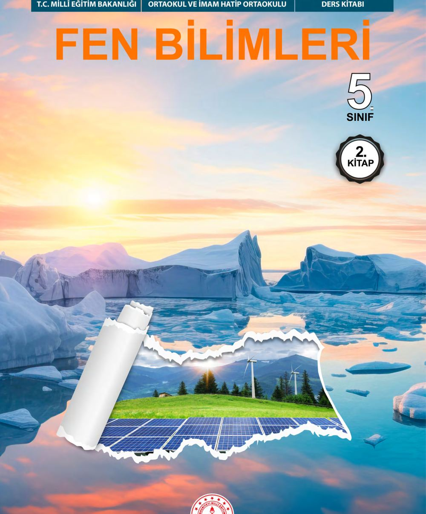
<!-- yer tutucu bulunamadı: sayfa sonuna eklendi -->

<!-- sayfa 1 -->

Verdiğiniz metin katmanı boş olduğu için (`<<< >>>` arası boş) dönüştürülecek bir içerik bulunmamaktadır. Lütfen metin katmanını içeren içeriği paylaşın, böylece talimatlarınıza uygun şekilde Markdown formatına çevirebilirim.

<!-- sayfa 2 -->

ORTAOKUL VE İMAM HATİP ORTAOKULU

# FEN BİLİMLERİ
## 5. Sınıf
### DERS KİTABI
#### 2. Kitap

**YAZARLAR**

Dr. Halil KARDEŞ
Ali AYDIN
İhsan SARIKAVAK
Latife Nur CANAN
Mehmet Emin TOPAK
Serkan YILMAZ
Yusuf Mehmet BAĞCI

<!-- sayfa 3 -->

Millî Eğitim Bakanlığı Yayınları No .................................................................................: 2021
Ders Kitapları Dizisi No ..................................................................................................: 9600

Her hakkı saklıdır ve Millî Eğitim Bakanlığına aittir. Kitabın metin, soru ve şekilleri
kısmen de olsa hiçbir surette alınıp yayımlanamaz.

**Editör**
Prof. Dr. Dündar YENER
Doç. Dr. Elif BENZER
Doç. Dr. Tezcan KARTAL

**Dil Uzmanı**
Esra İLHAN

**Görsel Tasarımcı**
Fatih GÖNÜL
Selime KAYA

**Çoklu Ortam Tasarımcısı**
Ali HEMDE
Aydın ÜNLÜ
Bünyamin TELLİ
Ercan YANDIMOĞLU
Orhan ÖZYURT

**Program Geliştirme Uzmanı**
Doç. Dr. Ahmet KURNAZ

**Ölçme ve Değerlendirme Uzmanı**
Dr. Eray SELÇUK

**Rehberlik Uzmanı**
Saliha GÜN

ISBN 978-975-11-8010-0

Millî Eğitim Bakanlığı, Talim ve Terbiye Kurulu Başkanlığının 17.07.2024 tarih ve 
110460159 sayılı yazısı ile eğitim aracı olarak kabul edilmiştir.
Kurulca bu kitabın kabul edilmiş olması ders kitabından yayınevi ve yazarın/yazarların

<!-- yer tutucu bulunamadı: sayfa sonuna eklendi -->

<!-- yer tutucu bulunamadı: sayfa sonuna eklendi -->

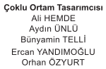
<!-- yer tutucu bulunamadı: sayfa sonuna eklendi -->

<!-- sayfa 4 -->

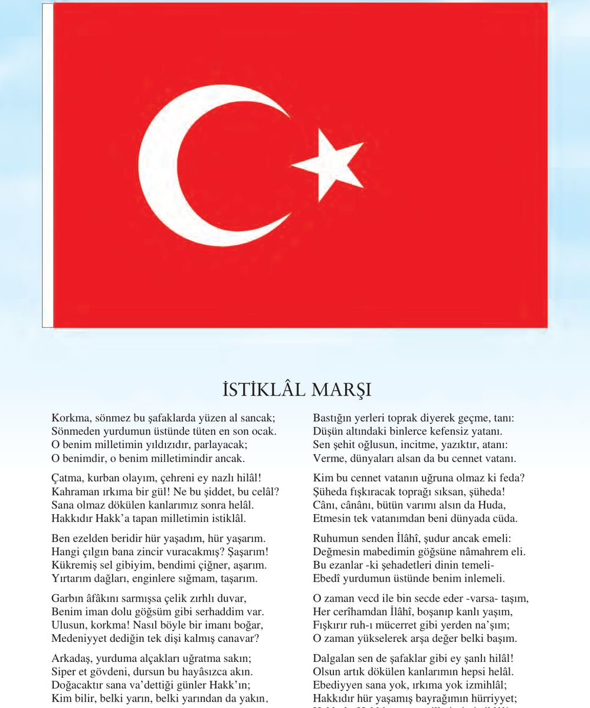

# İSTİKLÂL MARŞI

Korkma, sönmez bu şafaklarda yüzen al sancak;
Sönmeden yurdumun üstünde tüten en son ocak.
O benim milletimin yıldızıdır, parlayacak;
O benimdir, o benim milletimindir ancak.

Çatma, kurban olayım, çehreni ey nazlı hilâl!
Kahraman ırkıma bir gül! Ne bu şiddet, bu celâl?
Sana olmaz dökülen kanlarımız sonra helâl.
Hakkıdır Hakk'a tapan milletimin istiklâl.

Ben ezelden beridir hür yaşadım, hür yaşarım.
Hangi çılgın bana zincir vuracakmış? Şaşarım!
Kükremiş sel gibiyim, bendimi çiğner, aşarım.
Yırtarım dağları, enginlere sığmam, taşarım.

Garbın âfâkını sarmışsa çelik zırhlı duvar,
Benim iman dolu göğsüm gibi serhadim var.
Ulusun, korkma! Nasıl böyle bir imanı boğar,
Medeniyet dediğin tek dişi kalmış canavar?

Arkadaş, yurduma alçakları uğratma sakın;
Siper et gövdeni, dursun bu hayâsızca akın.
Doğacaktır sana va'dettiği günler Hakk'ın;
Kim bilir, belki yarın, belki yarından da yakın.

Bastığın yerleri toprak diyerek geçme, tanı:
Düşün altındaki binlerce kefensiz yatanı.
Sen şehit oğlusun, incitme, yazıktır, atanı:
Verme, dünyaları alsan da bu cennet vatanı.

Kim bu cennet vatanın uğruna olmaz ki feda?
Şüheda fışkıracak toprağı söksen, şüheda!
Canı, cânânı, bütün varımı alsın da Huda,
Etmesin tek vatanımdan beni dünyada cüda.

Ruhumun senden ilâhî, hudut ancak emeli:
Değmesin mabedimin göğsüne nâmahrem eli.
Bu ezanlar -ki şehadetleri dinin temeli-
Ebedî yurdumun üstünde benim inlemeli.

O zaman vecd ile bin secde eder -varsa- taşım,
Her cerîhamdan ilâhî, boşanıp kanlı yaşım,
Fışkırır ruh-ı mücerret gibi yerden na'şım;
O zaman yükselerek arşa değer belki başım.

Dalgalan sen de şafaklar gibi ey şanlı hilâl!
Olsun artık dökülen kanlarımın hepsi helâl.
Ebediyyen sana yok, Türk'e yok izmihlâl:
Hakkıdır, hür yaşamış, bayrağımın hürriyet;
Hakkıdır, Hakk'ın sesi istiklâl!

<!-- sayfa 5 -->

GENÇLİĞE HİTABE

Ey Türk gençliği! Birinci vazifen, Türk istiklâlini, Türk Cumhuriyetini, ilelebet muhafaza ve müdafaa etmektir.

Mevcudiyetinin ve istikbalinin yegâne temeli budur. Bu temel, senin en kıymetli hazinendir. İstikbalde dahi, seni bu hazineden mahrum etmek isteyecek dâhilî ve hâricî bedhahların olacaktır. Bir gün, istiklâl ve cumhuriyeti müdafaa mecburiyetine düşersen, vazifeye atılmak için, içinde bulunacağın vaziyetin imkân ve şeraitini düşünmeyeceksin! Bu imkân ve şerait, çok namüsait bir mahiyette tezahür edebilir. İstiklâl ve cumhuriyetine kastedecek düşmanlar, bütün dünyada emsali görülmemiş bir galibiyetin mümessili olabilirler. Cebren ve hile ile aziz vatanın bütün kaleleri zapt edilmiş, bütün tersanelerine girilmiş, bütün orduları dağıtılmış ve memleketin her köşesi bilfiil işgal edilmiş olabilir. Bütün bu şeraitten daha elîm ve daha vahim olmak üzere, memleketin dâhilinde iktidara sahip olanlar gaflet ve dalâlet ve hattâ hıyanet içinde bulunabilirler. Hattâ bu iktidar sahipleri şahsî menfaatlerini, müstevlîlerin siyasî emelleriyle tevhit edebilirler. Millet, fakr u zaruret içinde harap ve bîtap düşmüş olabilir.

Ey Türk istikbalinin evlâdı! İşte, bu ahval ve şerait içinde dahi vazifen, Türk istiklâl ve cumhuriyetini kurtarmaktır. Muhtaç olduğun kudret, damarlarındaki asil kanda mevcuttur.

Mustafa Kemal Atatürk

<!-- yer tutucu bulunamadı: sayfa sonuna eklendi -->

<!-- sayfa 6 -->

MUSTAFA KEMAL ATATÜRK

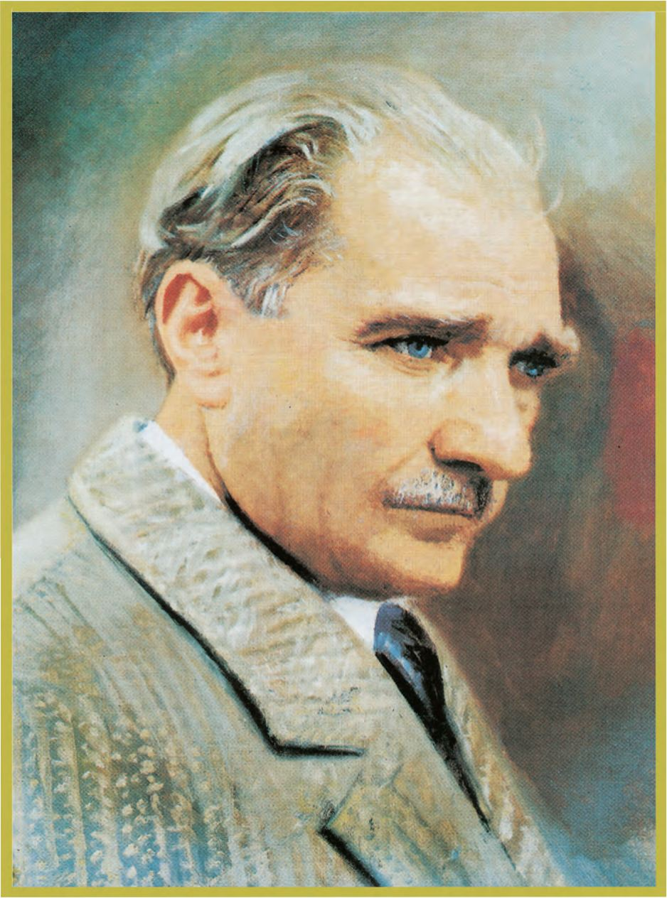
<!-- yer tutucu bulunamadı: sayfa sonuna eklendi -->

<!-- sayfa 7 -->

Verdiğiniz metin katmanı boş olduğu için (`<<< >>>` arası boş) dönüştürülecek bir içerik bulunmamaktadır. Lütfen metin katmanını içeren içeriği paylaşın, böylece talimatlarınıza uygun şekilde Markdown formatına çevirebilirim.

<!-- sayfa 8 -->

# İÇİNDEKİLER

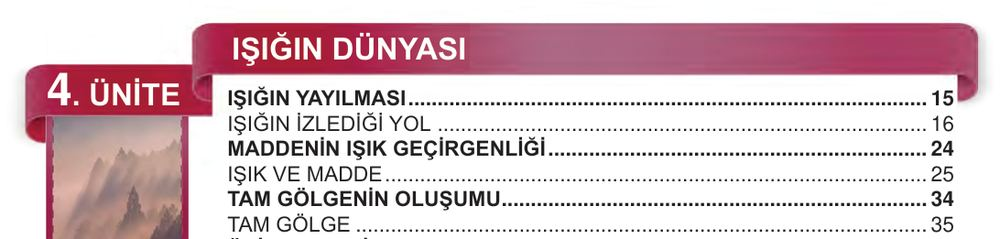

İÇİNDEKİLER .................................................................................................... 7
KİTABIMIZI TANIYALIM .................................................................................... 9

## 4. ÜNİTE: IŞIĞIN DÜNYASI

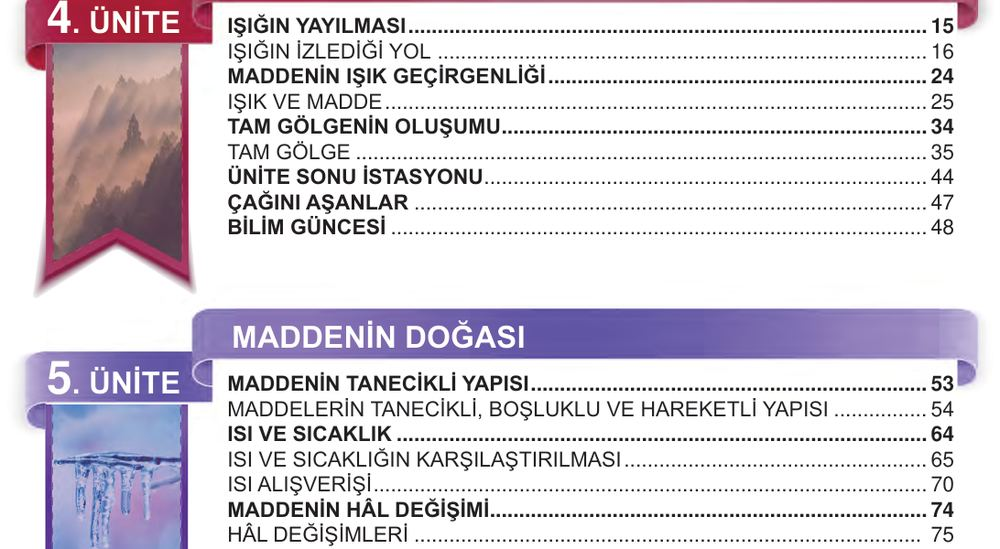

IŞIĞIN YAYILMASI ......................................................................................... 15
IŞIĞIN İZLEDİĞİ YOL .................................................................................... 16
MADDENİN IŞIK GEÇİRGENLİĞİ .................................................................. 24
IŞIK VE MADDE .............................................................................................. 25
TAM GÖLGENİN OLUŞUMU ......................................................................... 34
TAM GÖLGE ................................................................................................... 35
ÜNİTE SONU İSTASYONU ............................................................................ 44
ÇAĞINI AŞANLAR ......................................................................................... 47
BİLİM GÜNCESİ ............................................................................................. 48

## 5. ÜNİTE: MADDENİN DOĞASI

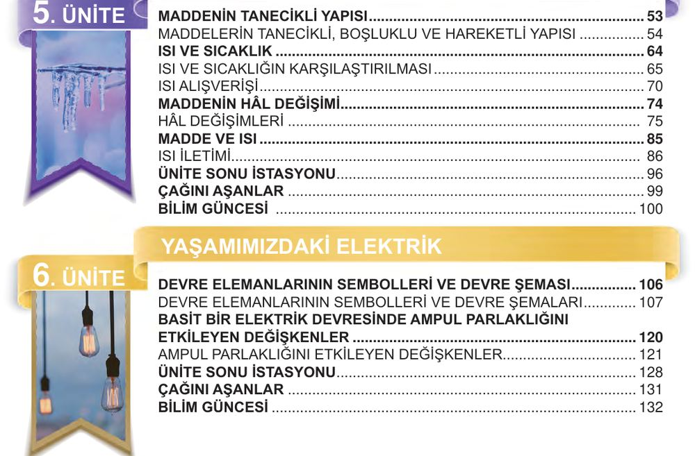

MADDENİN TANECİKLİ YAPISI .................................................................... 53
MADDELERİN TANECİKLİ, BOŞLUKLU VE HAREKETLİ YAPISI .................. 54
ISI VE SICAKLIK ............................................................................................ 64
ISI VE SICAKLIĞIN KARŞILAŞTIRILMASI ..................................................... 65
ISI ALIŞVERİŞİ ............................................................................................... 70
MADDENİN HÂL DEĞİŞİMİ ........................................................................... 74
HÂL DEĞİŞİMLERİ ........................................................................................ 75
MADDE VE ISI ................................................................................................ 85
ISI İLETİMİ ..................................................................................................... 86
ÜNİTE SONU İSTASYONU ............................................................................ 96
ÇAĞINI AŞANLAR ......................................................................................... 99
BİLİM GÜNCESİ .......................................................................................... 100

## 6. ÜNİTE: YAŞAMIMIZDAKİ ELEKTRİK

DEVRE ELEMANLARININ SEMBOLLERİ VE DEVRE ŞEMASI ................ 106
DEVRE ELEMANLARININ SEMBOLLERİ VE DEVRE ŞEMALARI ............. 107
BASİT BİR ELEKTRİK DEVRESİNDE AMPUL PARLAKLIĞINI ETKİLEYEN DEĞİŞKENLER ....................................................................... 120
AMPUL PARLAKLIĞINI ETKİLEYEN DEĞİŞKENLER ................................. 121
ÜNİTE SONU İSTASYONU .......................................................................... 128
ÇAĞINI AŞANLAR ....................................................................................... 131
BİLİM GÜNCESİ ........................................................................................... 132

<!-- sayfa 9 -->

# 7. ÜNİTE
## SÜRDÜRÜLEBİLİR YAŞAM VE GERİ DÖNÜŞÜM

EVSEL ATIKLAR VE GERİ DÖNÜŞÜM ....................................................... 137
ATIKLARIN SINIFLANDIRILMASI, GERİ DÖNÜŞÜM VE ATIK YÖNETİMİ ..................................................................................................... 138
ÜNİTE SONU İSTASYONU .......................................................................... 154
ÇAĞINI AŞANLAR ....................................................................................... 157
BİLİM GÜNCESİ ........................................................................................... 158

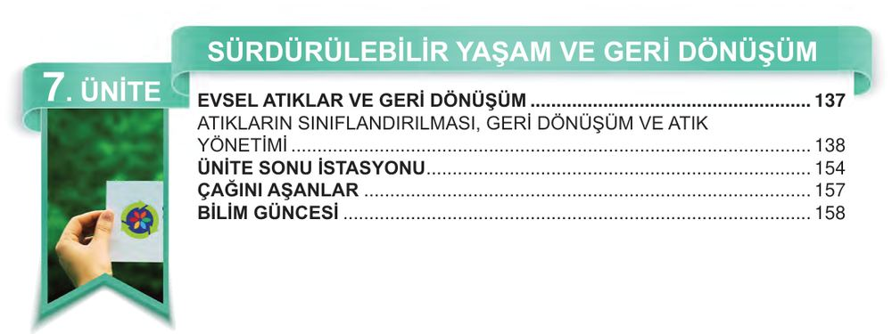

SÖZLÜK ........................................................................................................ 160
GENEL KAYNAKÇA ...................................................................................... 162
CEVAP ANAHTARI ........................................................................................ 162
GÖRSEL VE GENEL AĞ KAYNAKÇASI ........................................................ 162
TÜRKİYE'NİN MÜLKİ İDARE BÖLÜMLERİ İLE KARA VE DENİZ KOMŞULARI HARİTASI ..................................................................... 165
TÜRK DÜNYASI HARİTASI .......................................................................... 166

<!-- sayfa 10 -->

# KİTABIMIZI TANIYALIM

Ünite Adı
Ünite Numarası
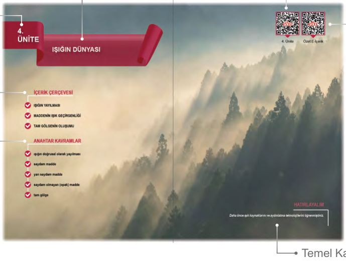
İçerik Çerçevesi
Anahtar Kavramlar
Ünite Karekodu
Özet E-içerik Karekodu
Temel Kabuller

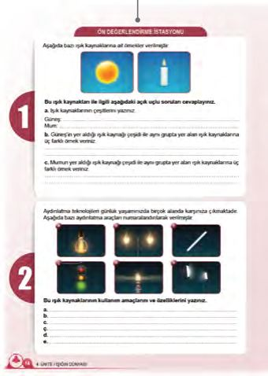

İçerik Çerçevesinin Adı
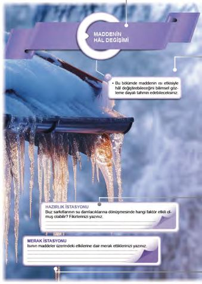
Öğrenme Çıktıları
Hazırlık Sorusu
Bölümle İlgili Merak Edilenler
Ön Değerlendirme Süreci

<!-- sayfa 11 -->

# Dikkat Çeken Bilgilerin Yer Aldığı Bölüm
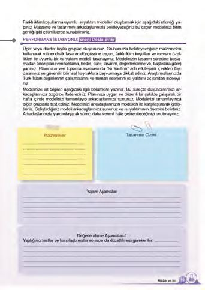

# Özgün Modellerin Yapıldığı Bölüm
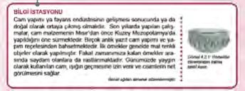

# Modellerin Yapıldığı Bölüm

# Form veya E-İçeriklere Ulaşmak İçin Kullanılan Karekodların Yer Aldığı Bölüm
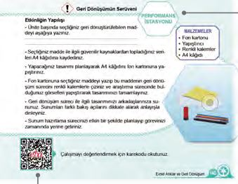

# Öğrenme Çıktılarının Pekiştirildiği Bölüm
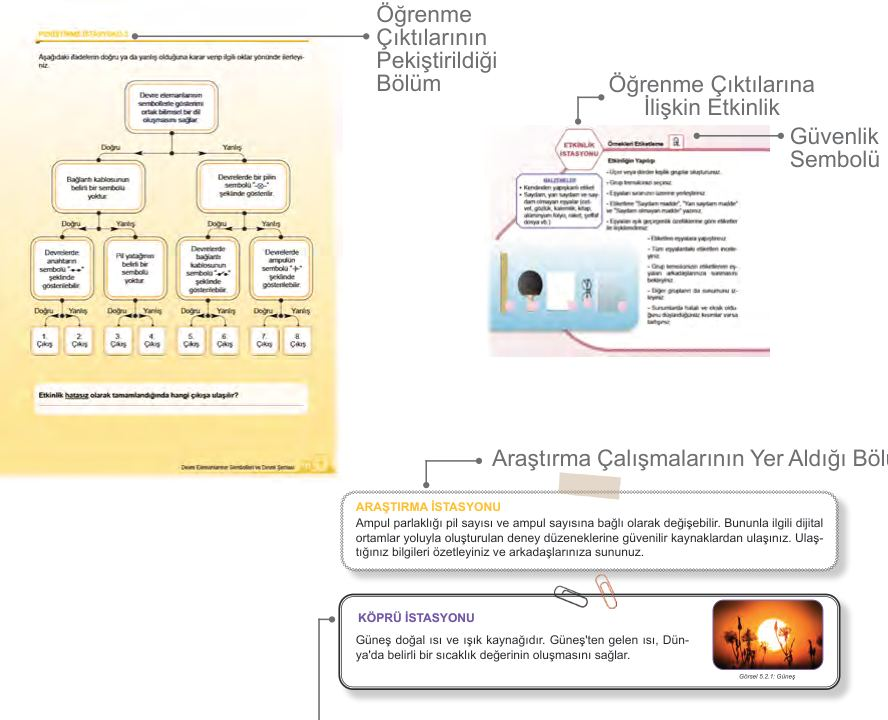

# Öğrenme Çıktılarına İlişkin Etkinlik

# Güvenlik Sembolü

# Araştırma Çalışmalarının Yer Aldığı Bölüm
### ARAŞTIRMA İSTASYONU
Ampul parlaklığı pil sayısı ve ampul sayısına bağlı olarak değişebilir. Bununla ilgili dijital ortamlar yoluyla oluşturulan deney düzeneklerine güvenilir kaynaklardan ulaşınız. Ulaştığınız bilgileri özetleyiniz ve arkadaşlarınıza sununuz.

# Mevcut Bilgiler ile Yeni Öğrenilen Bilgiler Arasında veya Günlük Yaşamla Bağ Kurulan Bölüm
### KÖPRÜ İSTASYONU
Güneş doğal ısı ve ışık kaynağıdır. Güneş'ten gelen ısı, Dünya'da belirli bir sıcaklık değerinin oluşmasını sağlar.

Görsel 5.2.1: Güneş

<!-- sayfa 12 -->

# A Aşağıdaki cümlelerde boş bırakılan yerleri kutuların içindeki uygun kelime/kelime gruplarıyla tamamlayınız. 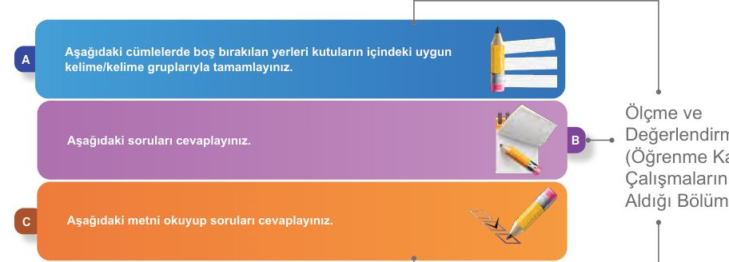

# B Aşağıdaki soruları cevaplayınız. 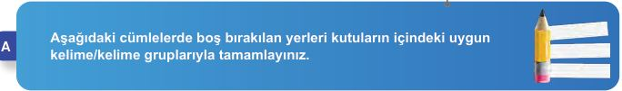

# C Aşağıdaki metni okuyup soruları cevaplayınız. 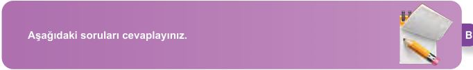

 “Ölçme ve Değerlendirme” için karekodu okutunuz.

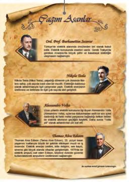 “E-Ölçme ve Değerlendirme (Öğrenme Kanıtları)” Çalışmaları İçin Karekodların Yer Aldığı Bölüm

## Bilim İnsanları ve Düşünürlerin Tanıtıldığı Bölüm

## Öğrenci Bakış Açısıyla Konunun Özetlendiği Bölüm

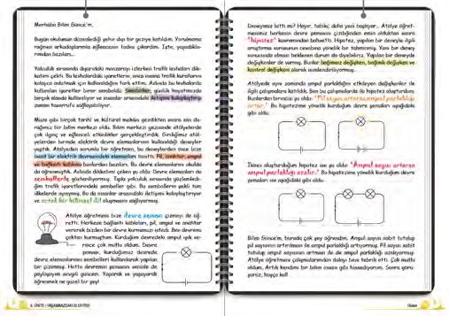

 Güvenlik sembollerine ulaşmak için karekodu okutunuz.

<!-- sayfa 13 -->

# 4. ÜNİTE
## IŞIĞIN DÜNYASI

### İÇERİK ÇERÇEVESİ
* IŞIĞIN YAYILMASI
* MADDENİN IŞIK GEÇİRGENLİĞİ
* TAM GÖLGENİN OLUŞUMU

### ANAHTAR KAVRAMLAR
* ışığın doğrusal olarak yayılması
* saydam madde
* yarı saydam madde
* saydam olmayan (opak) madde
* tam gölge

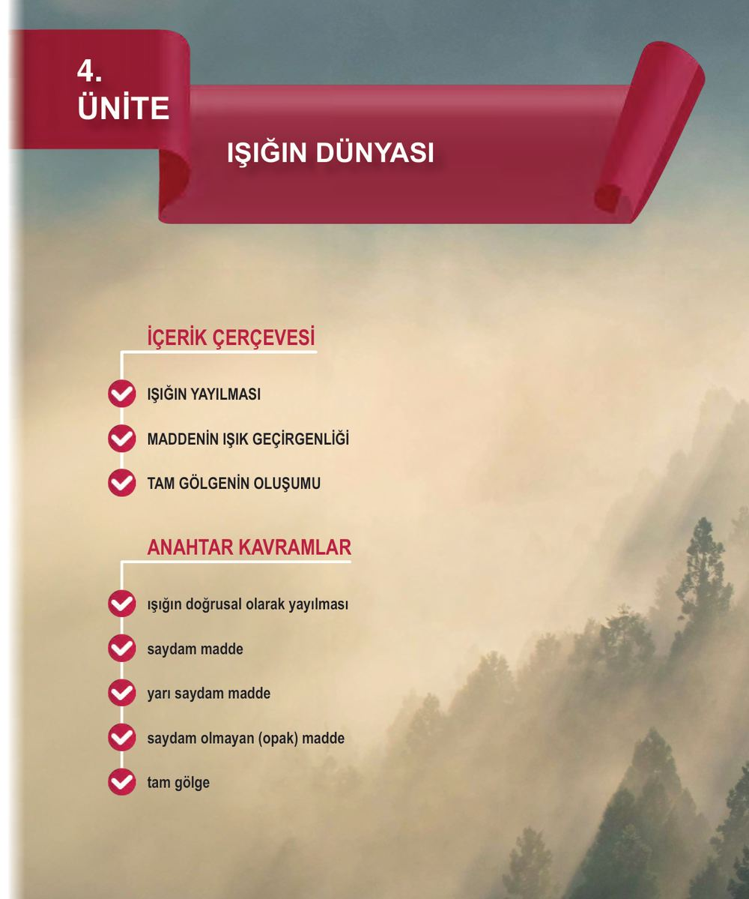
<!-- yer tutucu bulunamadı: sayfa sonuna eklendi -->

<!-- sayfa 14 -->

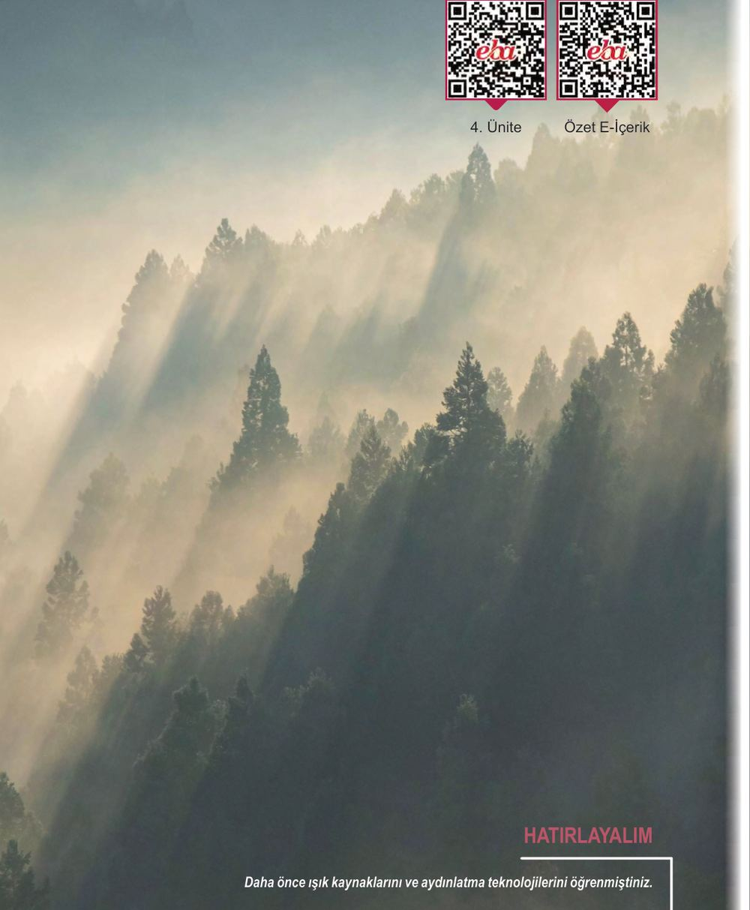

4. Ünite
Özet E-İçerik

# HATIRLAYALIM

Daha önce ışık kaynaklarını ve aydınlatma teknolojilerini öğrenmiştiniz.

<!-- sayfa 15 -->

# ÖN DEĞERLENDİRME İSTASYONU

Aşağıda bazı ışık kaynaklarına ait örnekler verilmiştir.

1
**Bu ışık kaynakları ile ilgili aşağıdaki açık uçlu soruları cevaplayınız.**

**a.** Işık kaynaklarının çeşitlerini yazınız.
Güneş: ..................................................................................................................................
Mum: .....................................................................................................................................

**b.** Güneş'in yer aldığı ışık kaynağı çeşidi ile aynı grupta yer alan ışık kaynaklarına üç farklı örnek veriniz.
..............................................................................................................................................
..............................................................................................................................................

**c.** Mumun yer aldığı ışık kaynağı çeşidi ile aynı grupta yer alan ışık kaynaklarına üç farklı örnek veriniz.
..............................................................................................................................................
..............................................................................................................................................

Aydınlatma teknolojileri günlük yaşamınızda birçok alanda karşınıza çıkmaktadır. Aşağıda bazı aydınlatma araçları numaralandırılarak verilmiştir.

2
**Bu ışık kaynaklarının kullanım amaçlarını ve özelliklerini yazınız.**

**a.** ........................................................................................................................................
**b.** ........................................................................................................................................
**c.** ........................................................................................................................................
**ç.** .......................................................................................................................................
**d.** .......................................................................................................................................
**e.** .......................................................................................................................................

<!-- sayfa 16 -->

# IŞIĞIN YAYILMASI

* Bu bölümde bir kaynaktan çıkan ışığın her yönde doğrusal bir yol izlediğini bilimsel olarak gözlemleyebileceksiniz.

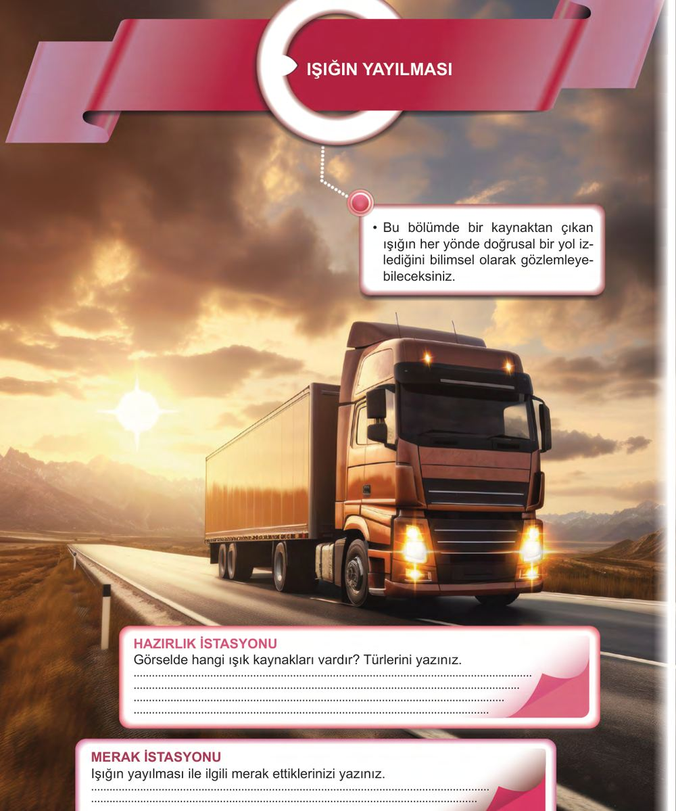

## HAZIRLIK İSTASYONU
Görselde hangi ışık kaynakları vardır? Türlerini yazınız.
..................................................................................................................................
..................................................................................................................................
..................................................................................................................................
..................................................................................................................................

## MERAK İSTASYONU
Işığın yayılması ile ilgili merak ettiklerinizi yazınız.
..................................................................................................................................
..................................................................................................................................

<!-- sayfa 17 -->

# IŞIĞIN İZLEDİĞİ YOL

Işık kaynakları ve özellikleri ile ilgili aşağıdaki etkinliği yapınız.

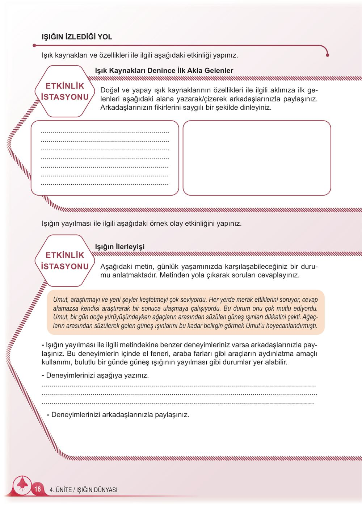
**Işık Kaynakları Denince İlk Akla Gelenler**

Doğal ve yapay ışık kaynaklarının özellikleri ile ilgili aklınıza ilk gelenleri aşağıdaki alana yazarak/çizerek arkadaşlarınızla paylaşınız. Arkadaşlarınızın fikirlerini saygılı bir şekilde dinleyiniz.

.........................................................................................................................................
.........................................................................................................................................
.........................................................................................................................................
.........................................................................................................................................
.........................................................................................................................................
.........................................................................................................................................
.........................................................................................................................................

Işığın yayılması ile ilgili aşağıdaki örnek olay etkinliğini yapınız.

**Işığın İlerleyişi**

Aşağıdaki metin, günlük yaşamınızda karşılaşabileceğiniz bir durumu anlatmaktadır. Metinden yola çıkarak soruları cevaplayınız.

> Umut, araştırmayı ve yeni şeyler keşfetmeyi çok seviyordu. Her yerde merak ettiklerini soruyor, cevap alamazsa kendisi araştırarak bir sonuca ulaşmaya çalışıyordu. Bu durum onu çok mutlu ediyordu. Umut, bir gün doğa yürüyüşündeyken ağaçların arasından süzülen güneş ışınları dikkatini çekti. Ağaçların arasından süzülerek gelen güneş ışınlarını bu kadar belirgin görmek Umut’u heyecanlandırmıştı.

- Işığın yayılması ile ilgili metindekine benzer deneyimleriniz varsa arkadaşlarınızla paylaşınız. Bu deneyimlerin içinde el feneri, araba farları gibi araçların aydınlatma amaçlı kullanımı, bulutlu bir günde güneş ışığının yayılması gibi durumlar yer alabilir.
- Deneyimlerinizi aşağıya yazınız.
.........................................................................................................................................
................................................................................................

<!-- sayfa 18 -->

Işığın yayılması ile ilgili aşağıdaki etkinliği yapınız.

✂️ Işığın Yayılması

# ETKİNLİK İSTASYONU

## Etkinliğin Yapılışı
- İki kişilik gruplar oluşturunuz.
- Borulardan biri düz hâlde kalırken diğerini eğik hâle getiriniz.
- Arkadaşınızla yüz yüze olacak şekilde karşılıklı oturunuz.
- Düz hâldeki boruyu kullanarak birbirinizi gözlemleyiniz.
- Eğik hâldeki boruyu kullanarak birbirinizi gözlemleyiniz.
- Yaptığınız gözlem sonucunu ve ışıkla ilgili ulaştığınız bilgileri arkadaşlarınızla paylaşınız.

**MALZEMELER**
• İki boru

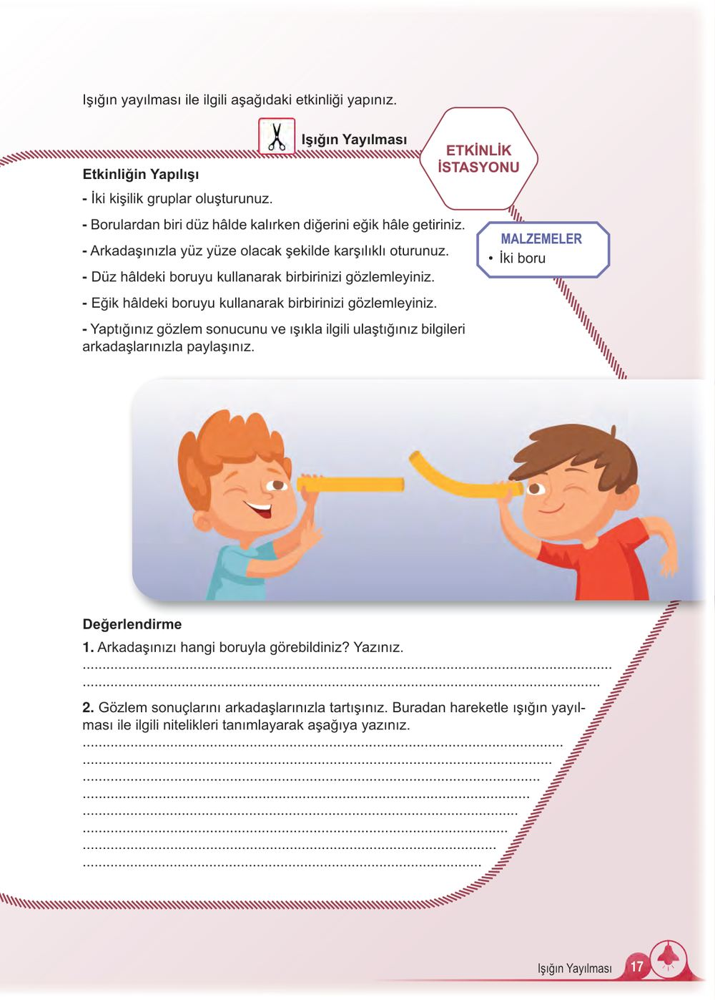

## Değerlendirme
1. Arkadaşınızı hangi boruyla görebildiniz? Yazınız.
......................................................................................................................................
...................................................................................................................................

2. Gözlem sonuçlarını arkadaşlarınızla tartışınız. Buradan hareketle ışığın yayıl-
ması ile ilgili nitelikleri tanımlayarak aşağıya yazınız.
.........................................................................................................................
......................................................................................................................
...................................................................................................................
................................................................................................................

<!-- sayfa 19 -->

# BİLGİ İSTASYONU

## Fotoğraf Makinesinin Atası: Karanlık Oda

Karanlık oda (karanlık kutu olarak da bilinir), fotoğraf makinesinin bilinen ilk ve en basit hâli olarak kabul edilir. Karanlık oda tekniğinde bir nesnenin görüntüsünün oluşumu şu şekilde gerçekleşir: Işık sızdırmayacak şekilde kapatılmış bir kutunun bir yüzüne küçük bir delik açılır. Kutunun dışındaki objeden gelen ışık delikten geçer ve deliğin karşısındaki yüzeyin üzerinde objenin baş aşağı dönmüş (ters) görüntüsü oluşur. Karanlık odanın geçmişi MÖ 4. yüzyıla kadar uzanır. Karanlık odada kullanılan temel ilkenin bilinen ilk tarifini MÖ 470-390 yılları arasında yaşayan Çinli filozof Mozi (Mozi) yapmıştır. Daha sonra başka bilginler Mozi'nin bu görüşünü destekler ancak görüşlerini deneylerle kanıtlayarak uygulamalı olarak gösteremezler. Karanlık oda hakkındaki ilk net tanımlamayı yapan bilim insanı, 965-1041 yılları arasında yaşayan İbnülheysem'dir.

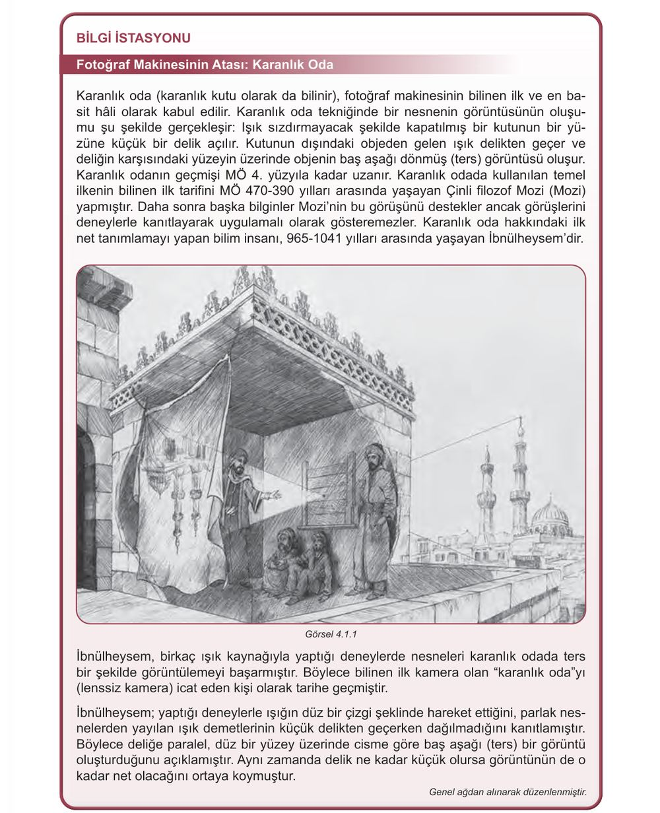

*Görsel 4.1.1*

İbnülheysem, birkaç ışık kaynağıyla yaptığı deneylerde nesneleri karanlık odada ters bir şekilde görüntülemeyi başarmıştır. Böylece bilinen ilk kamera olan "karanlık oda"yı (lenssiz kamera) icat eden kişi olarak tarihe geçmiştir.

İbnülheysem; yaptığı deneylerle ışığın düz bir çizgi şeklinde hareket ettiğini, parlak nesnelerden yayılan ışık demetlerinin küçük delikten geçerken dağılmadığını kanıtlamıştır. Böylece deliğe paralel, düz bir yüzey üzerinde cisme göre baş aşağı (ters) bir görüntü oluşturduğunu açıklamıştır. Aynı zamanda delik ne kadar küçük olursa görüntünün de o kadar net olacağını ortaya koymuştur.

<!-- sayfa 20 -->

Işığın yayılması ile ilgili gösteri deneyi içeren aşağıdaki etkinliği yapınız.

# ETKİNLİK İSTASYONU
## Işığın Gözlemlenmesi-1

### Etkinliğin Yapılışı
- Sınıfın karanlık olmasını sağlayınız.
- Işık kaynağını açınız.
- Işığın izlediği yola bir arkadaşınızla az bir miktar kabartma tozu serpiniz.
- Işık kaynağından çıkan ışık demetlerini gözlemleyin.

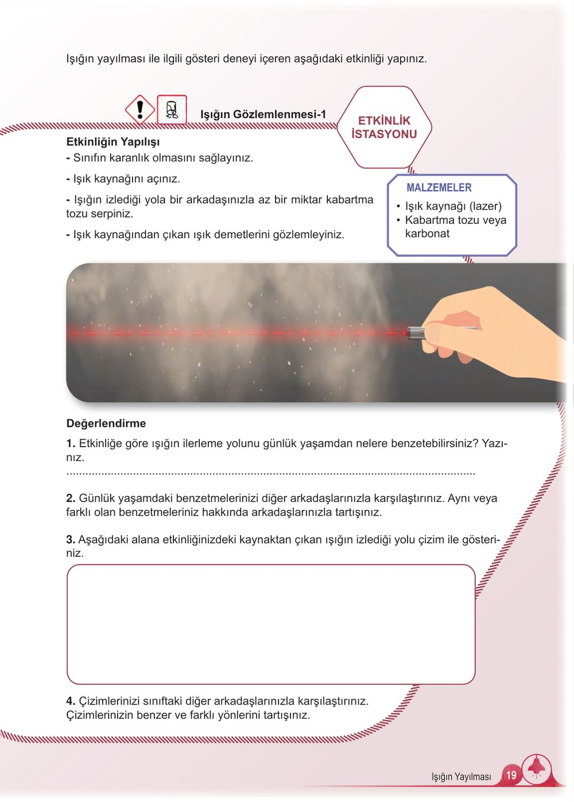

> **MALZEMELER**
> - Işık kaynağı (lazer)
> - Kabartma tozu veya karbonat

### Değerlendirme
1. Etkinliğe göre ışığın ilerleme yolunu günlük yaşamdan nelere benzetebilirsiniz? Yazınız.
.................................................................................................................................

2. Günlük yaşamdaki benzetmelerinizi diğer arkadaşlarınızla karşılaştırınız. Aynı veya farklı olan benzetmeleriniz hakkında arkadaşlarınızla tartışınız.

3. Aşağıdaki alana etkinliğinizdeki kaynaktan çıkan ışığın izlediği yolu çizim ile gösteriniz.

4. Çizimlerinizi sınıftaki diğer arkadaşlarınızla karşılaştırınız. Çizimlerinizin benzer ve farklı yönlerini tartışınız.

<!-- sayfa 21 -->

Işığın yayılması ile ilgili aşağıdaki etkinliği yapınız.

# ETKİNLİK İSTASYONU
## Işığın Gözlemlenmesi-2

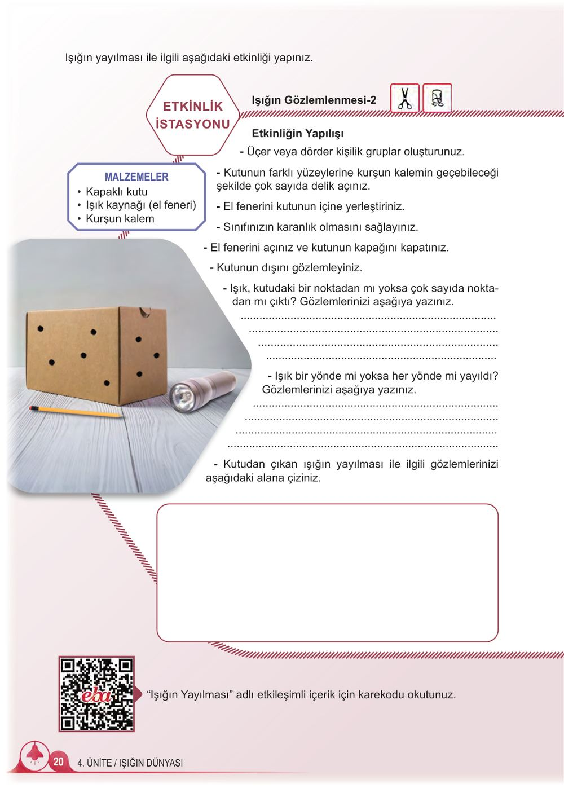

### MALZEMELER
* Kapaklı kutu
* Işık kaynağı (el feneri)
* Kurşun kalem

### Etkinliğin Yapılışı
- Üçer veya dörder kişilik gruplar oluşturunuz.
- Kutunun farklı yüzeylerine kurşun kalemin geçebileceği şekilde çok sayıda delik açınız.
- El fenerini kutunun içine yerleştiriniz.
- Sınıfınızın karanlık olmasını sağlayınız.
- El fenerini açınız ve kutunun kapağını kapatınız.
- Kutunun dışını gözlemleyiniz.
- Işık, kutudaki bir noktadan mı yoksa çok sayıda noktadan mı çıktı? Gözlemlerinizi aşağıya yazınız.
..................................................................................
..................................................................................
..................................................................................
..................................................................................

- Işık bir yönde mi yoksa her yönde mi yayıldı? Gözlemlerinizi aşağıya yazınız.
..................................................................................
..................................................................................
..................................................................................
..................................................................................

- Kutudan çıkan ışığın yayılması ile ilgili gözlemlerinizi aşağıdaki alana çiziniz.

[Boş Çizim Alanı]

“Işığın Yayılması” adlı etkileşimli içerik için karekodu okutunuz.

<!-- sayfa 22 -->

Işık her yöne ve doğrusal yayılır. Bu yayılma şekline günlük yaşamdan birçok örnek verilebilir.

> **KÖPRÜ İSTASYONU**
> Bir anahtar deliğinden, bulutların arasından ve stadyumun çatısındaki ışık kaynaklarından çıkan ışık doğrusal olarak yayılır.
>
> 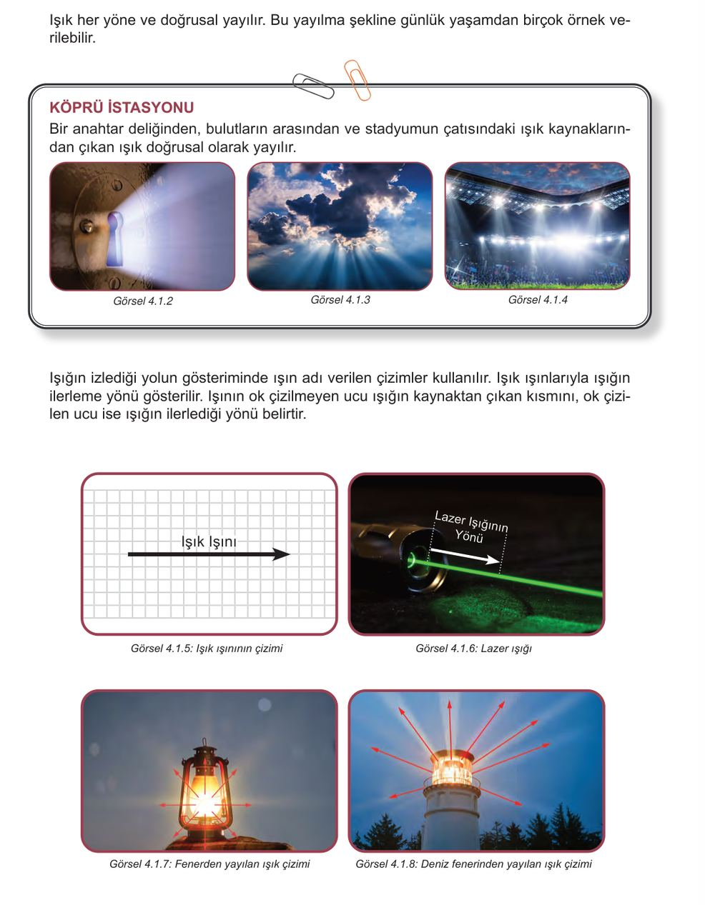
> Görsel 4.1.2 &nbsp;&nbsp;&nbsp;&nbsp;&nbsp;&nbsp;&nbsp;&nbsp;&nbsp;&nbsp;&nbsp;&nbsp;&nbsp;&nbsp;&nbsp;&nbsp;&nbsp;&nbsp;&nbsp;&nbsp;&nbsp;&nbsp;&nbsp;&nbsp;&nbsp;&nbsp;&nbsp;&nbsp;&nbsp;&nbsp;&nbsp;&nbsp;&nbsp;&nbsp;&nbsp;&nbsp;&nbsp;&nbsp;&nbsp;&nbsp;&nbsp;&nbsp;&nbsp;&nbsp;&nbsp;&nbsp;&nbsp;&nbsp;&nbsp;&nbsp;&nbsp;&nbsp;&nbsp;&nbsp;&nbsp;&nbsp;&nbsp;&nbsp;&nbsp;&nbsp;&nbsp;&nbsp;&nbsp;&nbsp;&nbsp;&nbsp;&nbsp;&nbsp;&nbsp;&nbsp;&nbsp;&nbsp;&nbsp;&nbsp;&nbsp;&nbsp;&nbsp;&nbsp;&nbsp;&nbsp;&nbsp;&nbsp;&nbsp;&nbsp;&nbsp;&nbsp;&nbsp;&nbsp;&nbsp;&nbsp;&nbsp;&nbsp;&nbsp;&nbsp;&nbsp;&nbsp;&nbsp;&nbsp;&nbsp;&nbsp;&nbsp;&nbsp;&nbsp;&nbsp;&nbsp;&nbsp;&nbsp;&nbsp;&nbsp;&nbsp;&nbsp;&nbsp;&nbsp;&nbsp;&nbsp;&nbsp;&nbsp;&nbsp;&nbsp;&nbsp;&nbsp;&nbsp;&nbsp;&nbsp;&nbsp;&nbsp;&nbsp;&nbsp;&nbsp;&nbsp;&nbsp;&nbsp;&nbsp;&nbsp;&nbsp;&nbsp;&nbsp;&nbsp;&nbsp;&nbsp;&nbsp;&nbsp;&nbsp;&nbsp;&nbsp;&nbsp;&nbsp;&nbsp;&nbsp;&nbsp;&nbsp;&nbsp;&nbsp;&nbsp;&nbsp;&nbsp;&nbsp;&nbsp;&nbsp;&nbsp;&nbsp;&nbsp;&nbsp;&nbsp;&nbsp;&nbsp;&nbsp;&nbsp;&nbsp;&nbsp;&nbsp;&nbsp;&nbsp;&nbsp;&nbsp;&nbsp;&nbsp;&nbsp;&nbsp;&nbsp;&nbsp;&nbsp;&nbsp;&nbsp;&nbsp;&nbsp;&nbsp;&nbsp;&nbsp;&nbsp;&nbsp;&nbsp;&nbsp;&nbsp;&nbsp;&nbsp;&nbsp;&nbsp;&nbsp;&nbsp;&nbsp;&nbsp

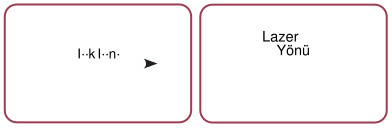
<!-- yer tutucu bulunamadı: sayfa sonuna eklendi -->

<!-- yer tutucu bulunamadı: sayfa sonuna eklendi -->

<!-- sayfa 23 -->

# PEKİŞTİRME İSTASYONU-1

1. Aşağıda verilen ışık kaynaklarından çıkan bazı ışık ışınlarının izlediği yollar çizimlerle gösterilmiştir. **Çizimlerden hatasız olanları görsellerin altındaki kutulara “$\checkmark$” koyarak gösteriniz.**

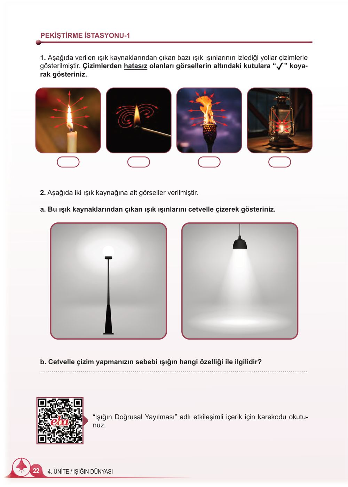

2. Aşağıda iki ışık kaynağına ait görseller verilmiştir.

a. Bu ışık kaynaklarından çıkan ışık ışınlarını cetvelle çizerek gösteriniz.

b. Cetvelle çizim yapmanızın sebebi ışığın hangi özelliği ile ilgilidir?
...........................................................................................................................................

 “Işığın Doğrusal Yayılması” adlı etkileşimli içerik için karekodu okutunuz.

<!-- sayfa 24 -->

# PEKİŞTİRME İSTASYONU-2

Bir öğrenci, üstüne harfler yazdığı on iki özdeş mukavva kartonun çeşitli yerlerinden delik açarak görseldeki düzenekleri hazırlamıştır. Öğrenci, yanan mumları ve mukavva kartonları aşağıdaki gibi yerleştirmiştir. Daha sonra düzeneklerdeki deliklerden bakarak mum alevini görmeye çalışmıştır.

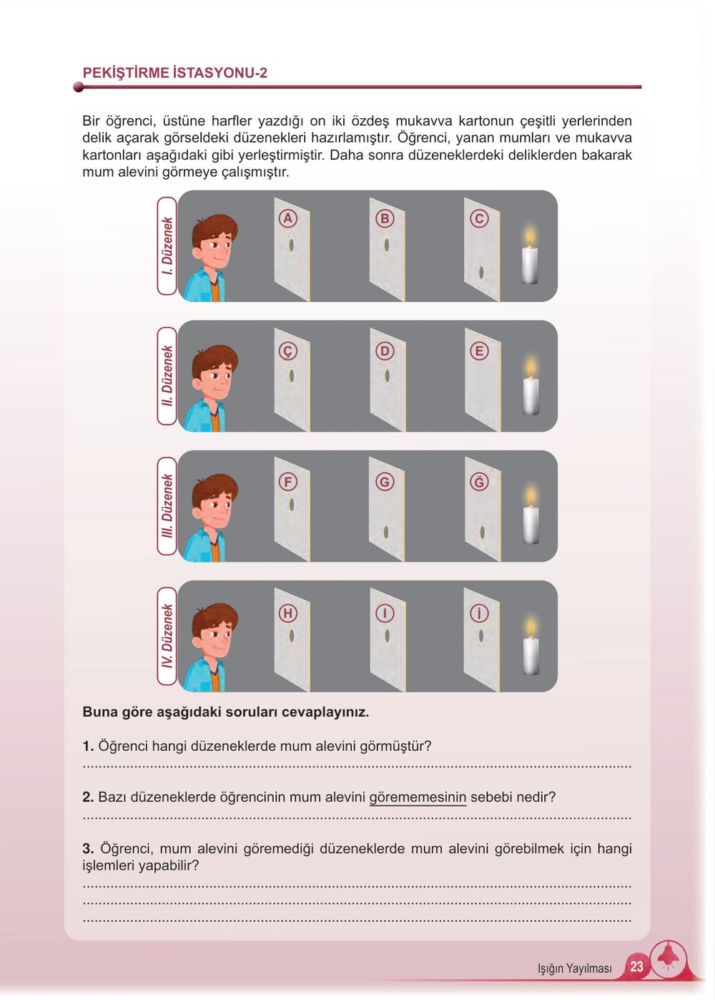

**Buna göre aşağıdaki soruları cevaplayınız.**

1. Öğrenci hangi düzeneklerde mum alevini görmüştür?
...........................................................................................................................................

2. Bazı düzeneklerde öğrencinin mum alevini görememesinin sebebi nedir?
...........................................................................................................................................

3. Öğrenci, mum alevini göremediği düzeneklerde mum alevini görebilmek için hangi işlemleri yapabilir?
...........................................................................................................................................
...........................................................................................................................................

<!-- sayfa 25 -->

# MADDENİN IŞIK GEÇİRGENLİĞİ

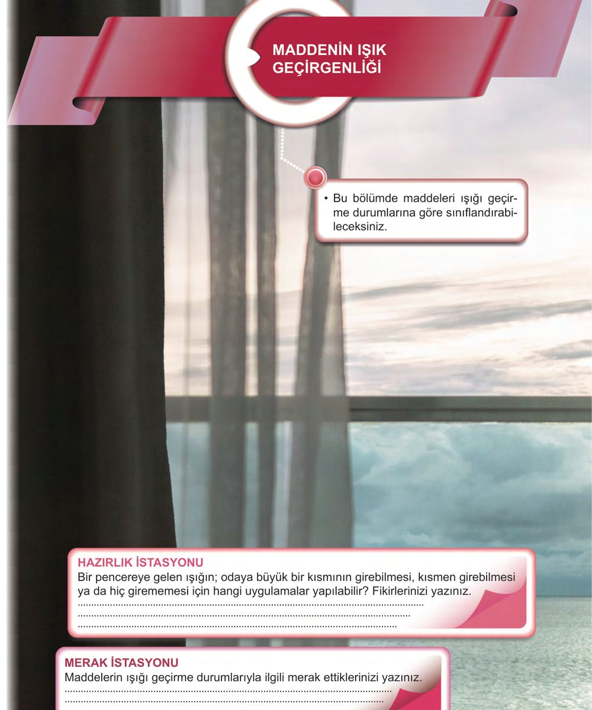

* Bu bölümde maddeleri ışığı geçirme durumlarına göre sınıflandırabileceksiniz.

### HAZIRLIK İSTASYONU
Bir pencereye gelen ışığın; odaya büyük bir kısmının girebilmesi, kısmen girebilmesi ya da hiç girememesi için hangi uygulamalar yapılabilir? Fikirlerinizi yazınız.
.................................................................................................................................
............................................................................................................................
.......................................................................................................................

### MERAK İSTASYONU
Maddelerin ışığı geçirme durumlarıyla ilgili merak ettiklerinizi yazınız.
..........................................................................................................................
.......................................................................................................................

<!-- sayfa 26 -->

# MADDENİN IŞIK GEÇİRGENLİĞİ

Işık, maddeyle karşılaştığında farklı durumlar gözlemlenebilir. Bunlardan biri de ışığın maddeden geçip geçememe durumudur.

Işığın maddeyle etkileşimi ile ilgili aşağıdaki etkinliği yapınız.

![Uyarı Simgeleri] **Madde ve Işık Etkileşimi**

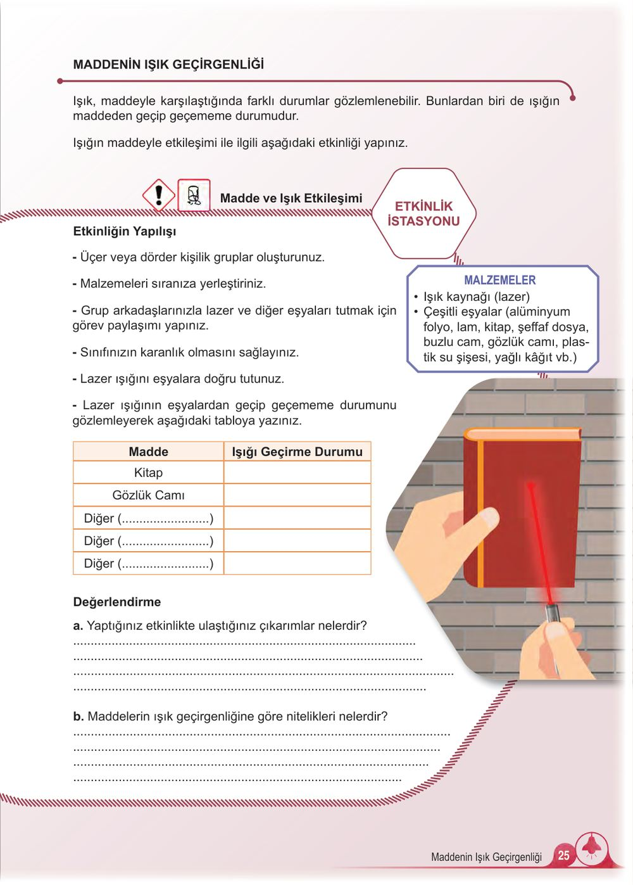

## Etkinliğin Yapılışı

- Üçer veya dörder kişilik gruplar oluşturunuz.
- Malzemeleri sıranıza yerleştiriniz.
- Grup arkadaşlarınızla lazer ve diğer eşyaları tutmak için görev paylaşımı yapınız.
- Sınıfınızın karanlık olmasını sağlayınız.
- Lazer ışığını eşyalara doğru tutunuz.
- Lazer ışığının eşyalardan geçip geçememe durumunu gözlemleyerek aşağıdaki tabloya yazınız.

| Madde | Işığı Geçirme Durumu |
| :--- | :--- |
| Kitap | |
| Gözlük Camı | |
| Diğer (.........................) | |
| Diğer (.........................) | |
| Diğer (.........................) | |

### MALZEMELER
- Işık kaynağı (lazer)
- Çeşitli eşyalar (alüminyum folyo, lam, kitap, şeffaf dosya, buzlu cam, gözlük camı, plastik su şişesi, yağlı kâğıt vb.)

## Değerlendirme

**a. Yaptığınız etkinlikte ulaştığınız çıkarımlar nelerdir?**
..................................................................................................
....................................................................................................
............................................................................................................
.....................................................................................................

**b. Maddelerin ışık geçirgenliğine göre nitelikleri nelerdir?**
...........................................................................................................
.........................................................................................................
.....................................................................................................
..............................................................................................................

<!-- sayfa 27 -->

Maddelerin ışığı geçirme durumları farklılık gösterebilir. Bazı maddeler ışığı geçirirken bazıları ışığı geçirmez. Bazı maddeler ise ışığın bir kısmını geçirir.
Maddelerin ışığı geçirme durumlarıyla ilgili aşağıdaki etkinliği yapınız.

# ETKİNLİK İSTASYONU
## Maddelerin Işık Geçirgenliği

### Etkinliğin Yapılışı
- İki kişilik gruplar oluşturunuz.
- Grubunuzla aşağıdaki görev paylaşımlarını yapınız.
    - Lazeri tutma görevi
    - Malzemeleri sabit tutma görevi
- Sınıfınızın karanlık olmasını sağlayınız.
- Gözlemleyeceğiniz malzemeyi seçiniz.
- Malzemeyi sınıf duvarına 30 cm mesafe olacak şekilde tutunuz.

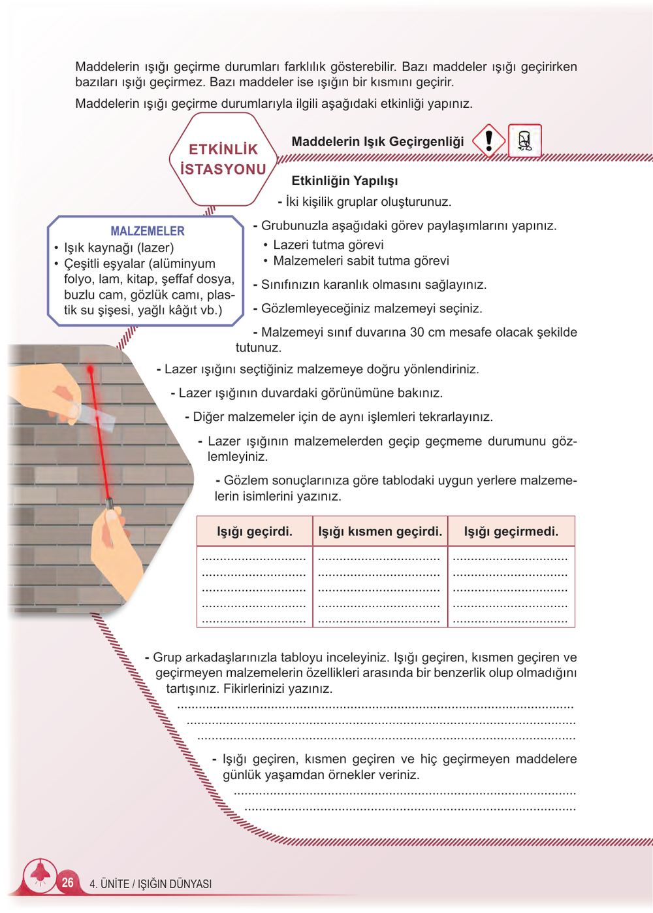

- Lazer ışığını seçtiğiniz malzemeye doğru yönlendiriniz.
- Lazer ışığının duvardaki görünümüne bakınız.
- Diğer malzemeler için de aynı işlemleri tekrarlayınız.
- Lazer ışığının malzemelerden geçip geçmeme durumunu gözlemleyiniz.
- Gözlem sonuçlarınıza göre tablodaki uygun yerlere malzemelerin isimlerini yazınız.

| Işığı geçirdi. | Işığı kısmen geçirdi. | Işığı geçirmedi. |
| :--- | :--- | :--- |
| ............................. | ............................. | ............................. |
| ............................. | ............................. | ............................. |
| ............................. | ............................. | ............................. |
| ............................. | ............................. | ............................. |
| ............................. | ............................. | ............................. |
| ............................. | ............................. | ............................. |
| ............................. | ............................. | ............................. |
| ............................. | ............................. | ............................. |
| ............................. | ............................. | ............................. |
| .............................

<!-- sayfa 28 -->

Bazı maddeleri ışığı geçirme durumlarına göre gruplandırabileceğiniz aşağıdaki etkinliği yapınız.

# Işık Geçirgenliğine Göre Gruplandırma 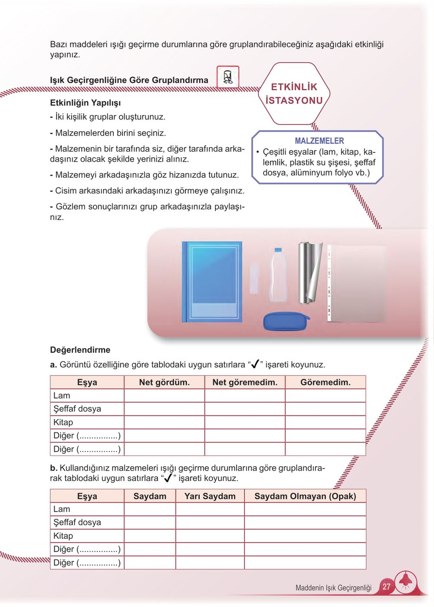

## ETKİNLİK İSTASYONU

### Etkinliğin Yapılışı
- İki kişilik gruplar oluşturunuz.
- Malzemelerden birini seçiniz.
- Malzemenin bir tarafında siz, diğer tarafında arkadaşınız olacak şekilde yerinizi alınız.
- Malzemeyi arkadaşınızla göz hizanızda tutunuz.
- Cisim arkasındaki arkadaşınızı görmeye çalışınız.
- Gözlem sonuçlarınızı grup arkadaşınızla paylaşınız.

### MALZEMELER
• Çeşitli eşyalar (lam, kitap, kalemlik, plastik su şişesi, şeffaf dosya, alüminyum folyo vb.)

## Değerlendirme

**a. Görüntü özelliğine göre tablodaki uygun satırlara “$\checkmark$” işareti koyunuz.**

| Eşya | Net gördüm. | Net göremedim. | Göremedim. |
| :--- | :---: | :---: | :---: |
| Lam | | | |
| Şeffaf dosya | | | |
| Kitap | | | |
| Diğer (................) | | | |
| Diğer (................) | | | |

**b. Kullandığınız malzemeleri ışığı geçirme durumlarına göre gruplandırarak tablodaki uygun satırlara “$\checkmark$” işareti koyunuz.**

| Eşya | Saydam | Yarı Saydam | Saydam Olmayan (Opak) |
| :--- | :---: | :---: | :---: |
| Lam | | | |
| Şeffaf dosya | | | |
| Kitap | | | |
| Diğer (................) | | | |

<!-- sayfa 29 -->

Günlük yaşamda kullanılan malzemelerden bazılarını ışığı geçirme durumlarına göre etiketleyebileceğiniz aşağıdaki etkinliği yapınız.

# ETKİNLİK İSTASYONU
## Örnekleri Etiketleme

### Etkinliğin Yapılışı
- Üçer veya dörder kişilik gruplar oluşturunuz.
- Grup temsilcinizi seçiniz.
- Eşyaları sıranızın üzerine yerleştiriniz.
- Etiketlere “Saydam madde”, “Yarı saydam madde” ve “Saydam olmayan madde” yazınız.
- Eşyaları ışık geçirgenlik özelliklerine göre etiketler ile ilişkilendiriniz.
- Etiketleri eşyalara yapıştırınız.
- Tüm eşyalardaki etiketleri inceleyiniz.
- Grup temsilcinizin etiketlenen eşyaları arkadaşlarınıza sunmasını bekleyiniz.
- Diğer grupların da sunumunu izleyiniz.
- Sunumlarda hatalı ve eksik olduğunu düşündüğünüz kısımlar varsa tartışınız.

### MALZEMELER
• Kendinden yapışkanlı etiket
• Saydam, yarı saydam ve saydam olmayan eşyalar (cetvel, gözlük, kalemlik, kitap, alüminyum folyo, raket, şeffaf dosya vb.)

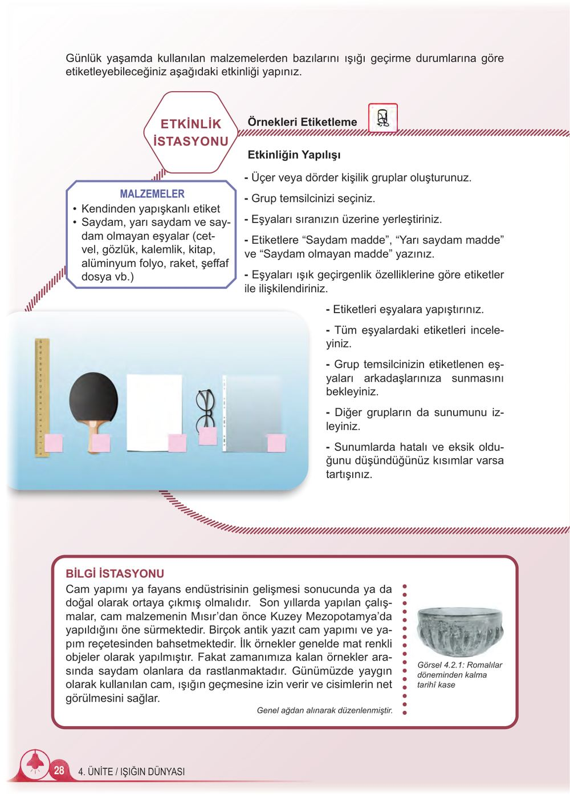

# BİLGİ İSTASYONU
Cam yapımı ya fayans endüstrisinin gelişmesi sonucunda ya da doğal olarak ortaya çıkmış olmalıdır. Son yıllarda yapılan çalışmalar, cam malzemenin Mısır’dan önce Kuzey Mezopotamya’da yapıldığını öne sürmektedir. Birçok antik yazıt cam yapımı ve ya- pım reçetesinden bahsetmektedir. İlk örnekler genelde mat renkli objeler olarak yapılmıştır. Fakat zamanımıza kalan örnekler arasında saydam olanlara da rastlanmaktadır. Günümüzde yaygın olarak kullanılan cam, ışığın geçmesine izin verir ve cisimlerin net görülmesini sağlar.

Görsel 4.2.1: Romalılar döneminden kalma tarihî kase

*Genel ağdan alınarak düzenlenmiştir.*

<!-- sayfa 30 -->

Saydam, yarı saydam ve saydam olmayan maddelerle ilgili aşağıdaki performans görevini gerçekleştiriniz.

# PERFORMANS İSTASYONU
## Işık Geçirgenliğine Farklı Örnekler

### Etkinliğin Yapılışı
- Üçer veya dörder kişilik gruplar oluşturunuz.
- Saydam, yarı saydam ve opak maddelerin günlük yaşamdaki kullanım alanı ve amaçlarını araştırınız.
- Araştırma sonucu elde ettiğiniz verileri renkli kalemlerinizle fon kartonuna kaydederek bir poster hazırlayınız.
- Posterinizde elde ettiğimiz verileri desteklemek amacıyla görsel, gazete haberi, karikatür vb. içerikleri kullanabilirsiniz.

### MALZEMELER
- Fon kartonu
- Renkli kalemler

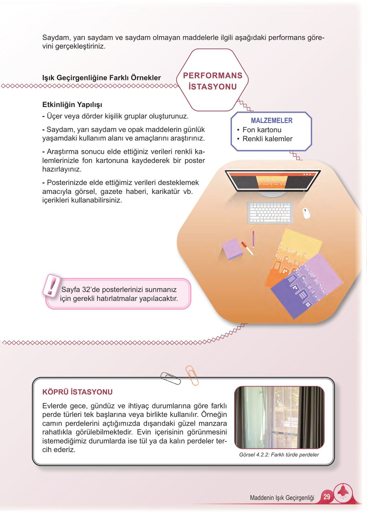

> ! Sayfa 32'de posterlerinizi sunmanız için gerekli hatırlatmalar yapılacaktır.

# KÖPRÜ İSTASYONU

Evlerde gece, gündüz ve ihtiyaç durumlarına göre farklı perde türleri tek başlarına veya birlikte kullanılır. Örneğin camın perdelerini açtığımızda dışarıdaki güzel manzara rahatlıkla görülebilmektedir. Evin içerisinin görünmesini istemediğimiz durumlarda ise tül ya da kalın perdeler tercih ederiz.

Görsel 4.2.2: Farklı türde perdeler

<!-- sayfa 31 -->

Maddeler ışığı geçirme durumlarına göre; saydam maddeler, yarı saydam maddeler ve saydam olmayan maddeler (opak) olarak sınıflandırılır.

Işığı geçiren maddelere **saydam maddeler** adı verilir. Cam, hava ve su gibi bazı sıvılar saydam maddelerdendir. Saydam maddelerin arkasındaki cisimler net bir şekilde görülür. Örneğin akvaryumun içindeki balıklar net bir şekilde görülür.

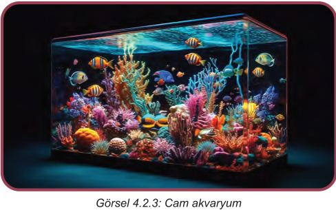
*Görsel 4.2.3: Cam akvaryum*

Işık ışınlarının bir kısmını geçiren, bir kısmını da geçirmeyen maddelere **yarı saydam maddeler** adı verilir. Buzlu cam, ince tül, şeffaf dosya ve yağlı kâğıt yarı saydam maddelere örnek olarak verilebilir. Yarı saydam maddelerin arkasındaki cisimler net olarak görülmez. Örneğin yağlı kâğıdın arkasında kalan alan bulanık görülür.

*Görsel 4.2.4: Yağlı kâğıt*

Saydam ve yarı saydam maddelerin kalınlığı artırıldıkça ışık geçirgenliği azalır, kalınlık azaldıkça ışık geçirgenliği artar. Örneğin sisli havalarda yakınımızdaki nesnelerin görünürlüğü daha fazlayken uzaktaki nesnelerin görünürlüğü daha azdır. Hatta sis tabakasının kalınlığı arttıkça bazı nesneler hiç görülemez.

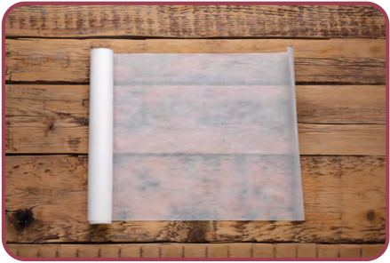
*Görsel 4.2.5*
Kalınlığı artırılmış bir pencere camından bakıldığında nesneler net olarak görülemez.

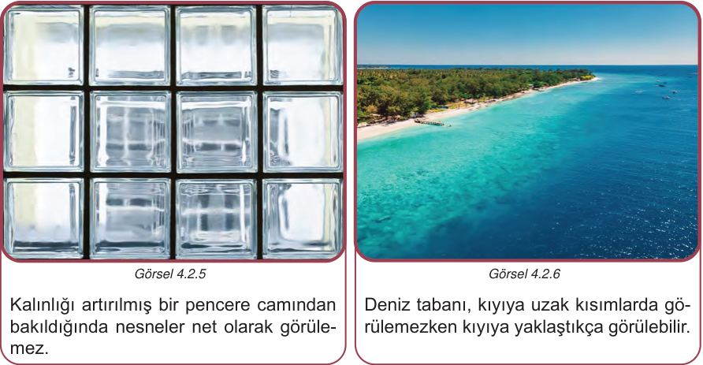
*Görsel 4.2.6*
Deniz tabanı, kıyıya uzak kısımlarda görülemezken kıyıya yaklaştıkça görülebilir.

<!-- sayfa 32 -->

Bir maddenin ışık geçirgenlik özelliği, maddenin arkasındaki nesnelerin görünme durumunu etkiler.

Görsel 4.2.7
Camın arkasındaki kedi, net bir şekilde görülebilir.

Görsel 4.2.8
İnce tülün arkasındaki kedi, net bir şekilde görülmez.

Görsel 4.2.9
Kedinin duvarın arkasında kalan kısımları görülmez.

Işığı geçirmeyen maddelere **saydam olmayan (opak) maddeler** adı verilir. Silgi, kitap, ahşap masa ve tuğla saydam olmayan maddelerdendir. Saydam olmayan maddeler ışık ışınlarını geçirmediği için arkasındaki cisimler görülmez. Örneğin ahşap bir kitaplığın arkasında kalan duvar görülmez.

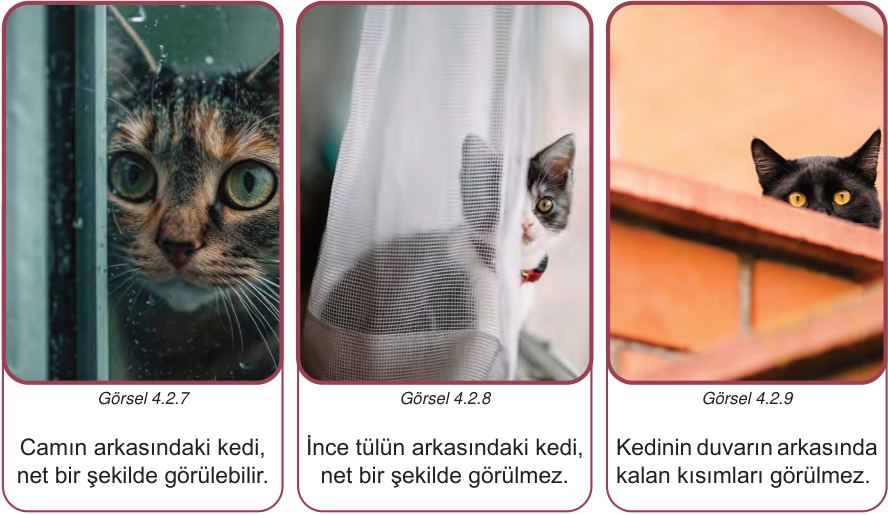

Görsel 4.2.10: Ahşap kitaplık
Görsel 4.2.11: Tuğlalar
Görsel 4.2.12: Kitaplar

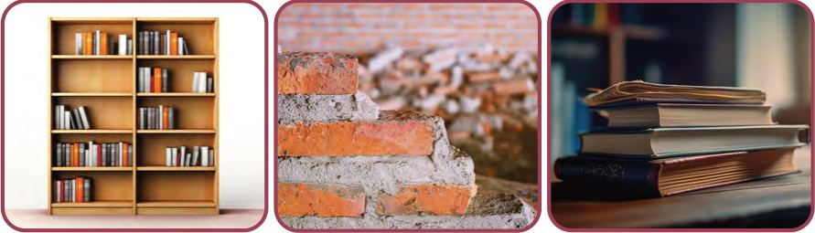

“Saydam mı? Yarı Saydam mı? Opak mı?” adlı etkileşimli içerik için karekodu okutunuz.

<!-- sayfa 33 -->

# PEKİŞTİRME İSTASYONU-1

Karşılıklı iki tarafından delik açılmış kutuların her birinin içerisine ışık geçirgenliği bakı-
mından farklı maddeler konulmuştur. Kutulara özdeş el fenerlerinden ışık ışınları gön-
derilmiştir. Kutulara konan maddeler, ışığın izlediği yola konumlandırılmıştır. Kutulara
giren ışık ışınları ile kutudan çıkan ışık ışınlarının izledikleri yollar aşağıdaki görselde
verilmiştir.

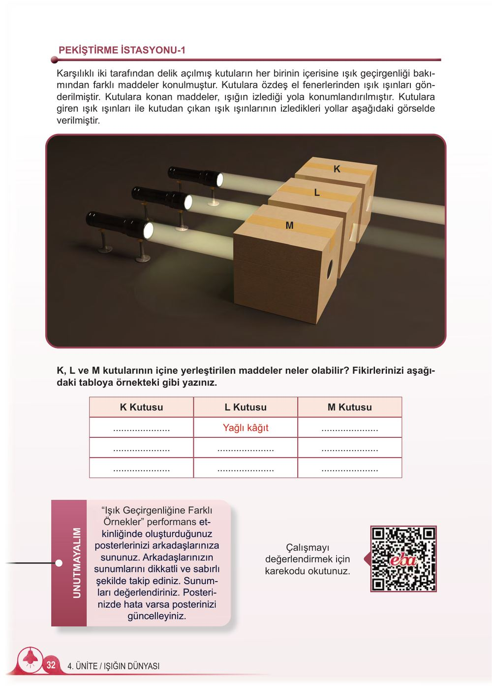

K, L ve M kutularının içine yerleştirilen maddeler neler olabilir? Fikirlerinizi aşağı-
daki tabloya örnekteki gibi yazınız.

| K Kutusu | L Kutusu | M Kutusu |
| :--- | :--- | :--- |
| ..................... | Yağlı kâğıt | ..................... |
| ..................... | ..................... | ..................... |
| ..................... | ..................... | ..................... |

| UNUTMAYALIM | “Işık Geçirgenliğine Farklı Örnekler” performans et- kinliğinde oluşturduğunuz posterlerinizi arkadaşlarınıza sununuz. Arkadaşlarınızın sunumlarını dikkatli ve sabırlı şekilde takip ediniz. Sunum- ları değerlendiriniz. Posteri- nizde hata varsa posterinizi güncelleyiniz. |
| :--- | :--- |

Çalışmayı değerlendirmek için karekodu okutunuz.

<!-- sayfa 34 -->

# PEKİŞTİRME İSTASYONU-2

Işığın madde ile etkileşimi konusuna yönelik hazırlanan kavram haritasında bazı kısımlar boş bırakılmıştır. **Aşağıdaki kelimelerden uygun olanları bu boş kısımlara yazarak kavram haritasını tamamlayınız.**

saydam madde | geçirmez | görülemez | kitap
arkasındaki cisim | buzlu cam | cam
tül perde | su

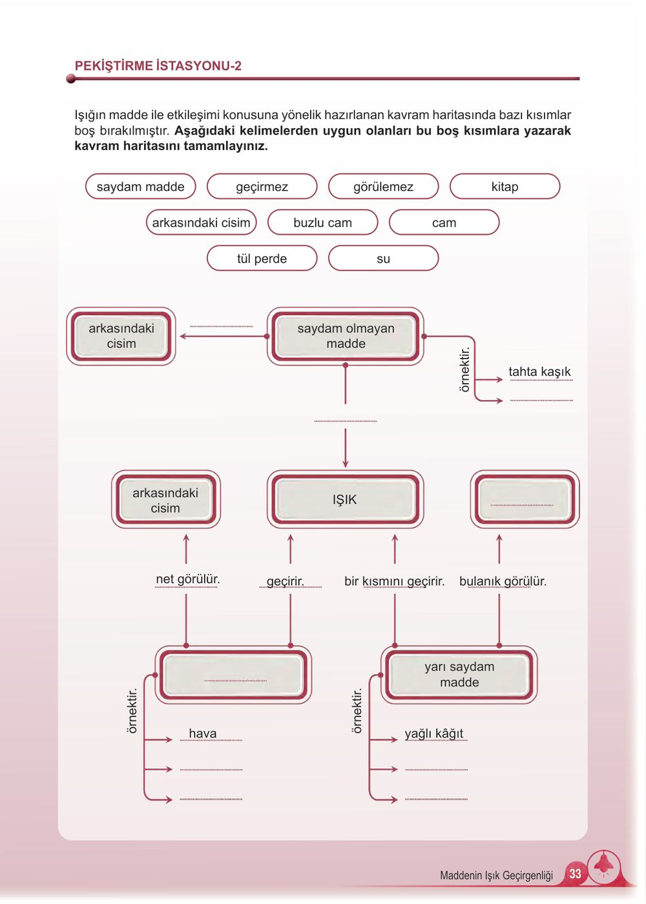

<!-- sayfa 35 -->

# TAM GÖLGENİN OLUŞUMU

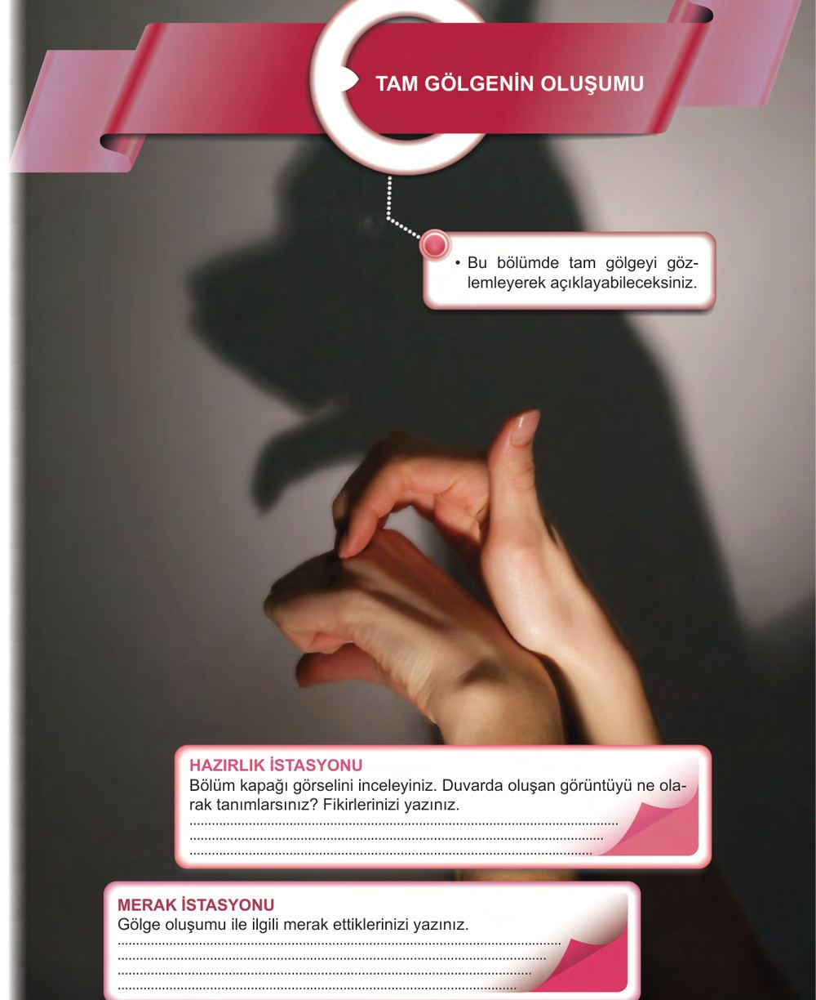

* Bu bölümde tam gölgeyi gözlemleyerek açıklayabileceksiniz.

## HAZIRLIK İSTASYONU
Bölüm kapağı görselini inceleyiniz. Duvarda oluşan görüntüyü ne olarak tanımlarsınız? Fikirlerinizi yazınız.
....................................................................................................................
................................................................................................................
.............................................................................................................

## MERAK İSTASYONU
Gölge oluşumu ile ilgili merak ettiklerinizi yazınız.
........................................................................................................................
....................................................................................................................
................................................................................................................

<!-- sayfa 36 -->

# TAM GÖLGE

Gölge oluşumu günlük yaşamınızda sıklıkla gözlemlediğiniz bir olaydır. Gölgenin oluşu- mu ve özellikleriyle ilgili aşağıdaki etkinliği yapınız.

## ETKİNLİK İSTASYONU

### Figürlerin Gölgesi

**Etkinliğin Yapılışı**
- Tangram yapmak için ikişer kişilik gruplar oluşturunuz.
- Kitabınızın 163. sayfasında yer alan tangram modelini be- lirtilen noktalardan makasla kesiniz.
- Kestiğiniz sayfayı mukavva kartona yapıştırınız.
- Mukavva kartonu da belirtilen noktalardan keserek tang- ram parçalarını elde ediniz.
- Oluşan tangram parçalarından farklı figürler oluşturunuz.
- Bu figürlerden birini bantlayarak birleştiriniz.
- Figürü tutabilmek için pipeti figüre yapıştırınız.
- Sınıfta karanlık bir ortam oluşturunuz.
- Oluşturduğunuz figürü duvara $30\text{ cm}$ mesafede tutunuz.
- El fenerini figüre doğru tutarak duvarda gölge oluşma- sını sağlayınız.
- Oluşturduğunuz gölgeyi gözlemleyiniz.
- Diğer grupların oluşturduğu gölgeleri gözlemleyiniz.
- Işık kaynağı önünde ellerinizle çeşitli figürler oluştura- rak gölge oyunları oynayınız.

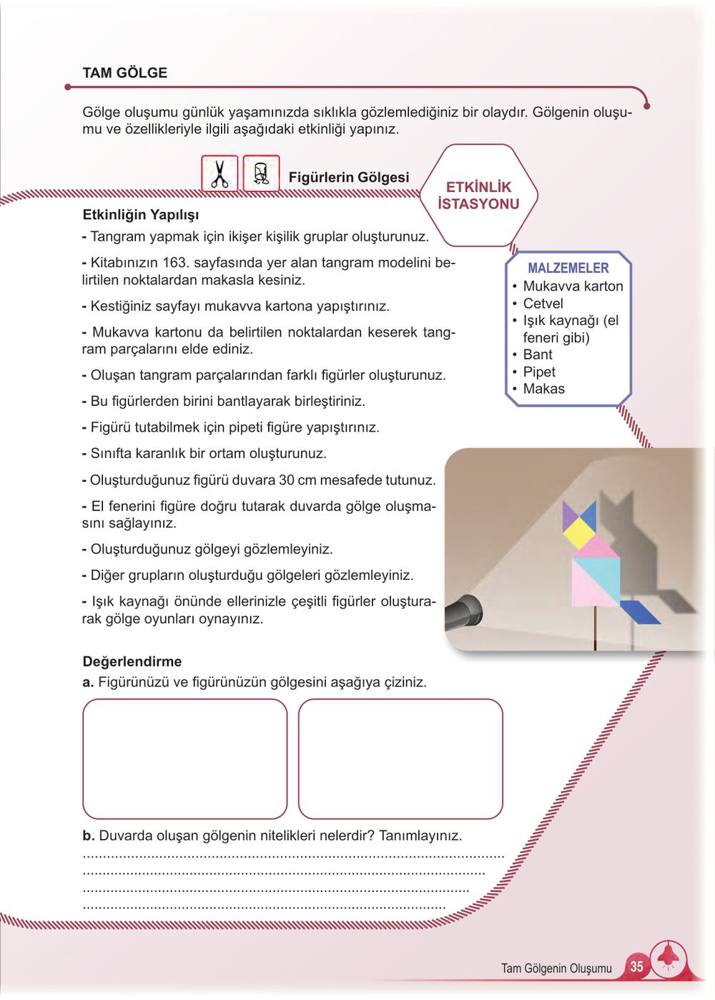

**MALZEMELER**
• Mukavva karton
• Cetvel
• Işık kaynağı (el feneri gibi)
• Bant
• Pipet
• Makas

**Değerlendirme**
**a.** Figürünüzü ve figürünüzün gölgesini aşağıya çiziniz.

| | |
| :---: | :---: |
| | |

**b.** Duvarda oluşan gölgenin nitelikleri nelerdir? Tanımlayınız.
.........................................................................................................
......................................................................................................
..................................................................................................
............................................................................................................

<!-- sayfa 37 -->

Bazı opak cisimlerin gölgelerini çizeceğiniz aşağıdaki etkinliği yapınız.

# ETKİNLİK İSTASYONU
## Gölge Çizme
### Etkinliğin Yapılışı
- Aşağıdaki cisimlerin gölgelerini çiziniz.

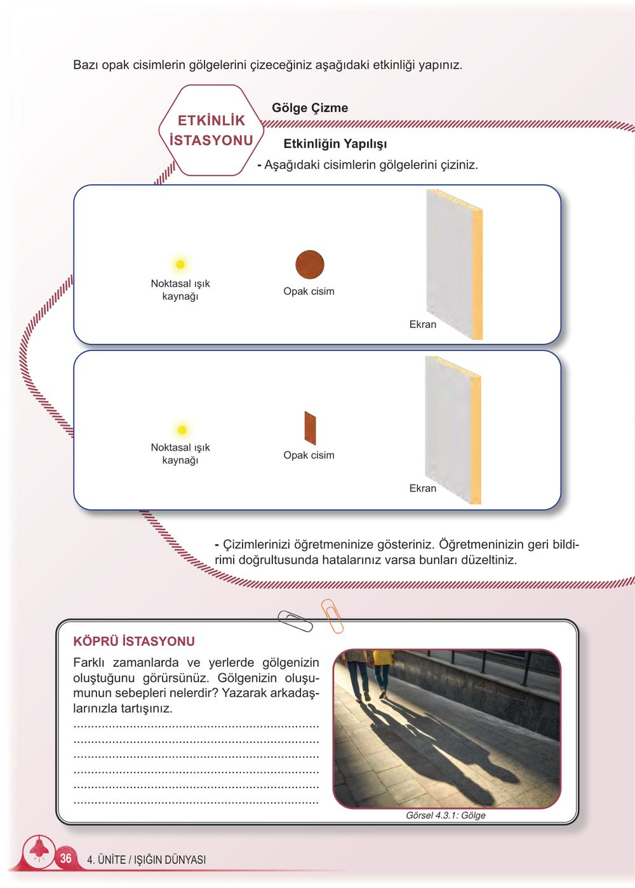

- Çizimlerinizi öğretmeninize gösteriniz. Öğretmeninizin geri bildirimi doğrultusunda hatalarınız varsa bunları düzeltiniz.

---

# KÖPRÜ İSTASYONU
Farklı zamanlarda ve yerlerde gölgenizin oluştuğunu görürsünüz. Gölgenizin oluşumunun sebepleri nelerdir? Yazarak arkadaşlarınızla tartışınız.

......................................................................
......................................................................
......................................................................
......................................................................
......................................................................
......................................................................

<!-- sayfa 38 -->

Gölge büyüklüğünün değişimiyle ilgili aşağıdaki etkinliği yapınız.

# ETKİNLİK İSTASYONU
## Gölge Büyüklüğündeki Değişim

### Etkinliğin Yapılışı
- İkişer kişilik gruplar oluşturunuz.
- Fon kartonunun üzerine hayvan figürü, insan figürü ya da istediğiniz herhangi bir figür çiziniz.
- Makas ile fon kartonunu çizdiğiniz kısımlardan keserek figürü kartondan ayırınız.
- Figürün bir tarafına pipet yapıştırınız.
- Sınıfta karanlık bir ortam oluşturunuz.
- Figürü arada $30\text{ cm}$ mesafe olacak şekilde duvara yaklaştırınız.
- El fenerini figüre doğru tutarak duvarda tam gölge oluşmasını sağlayınız.
- Oluşturduğunuz gölgeyi ve gölge büyüklüğünü gözlemleyiniz (I. durum).
- El fenerini figürden uzaklaştırarak gölge büyüklüğünü gözlemleyiniz (II. durum).
- El fenerini figüre I. durumdan daha yakın olacak şekilde yaklaştırınız ve figürün gölge büyüklüğünü gözlemleyiniz (III. durum).
- Figürü hareket ettirerek gölgedeki değişimleri gözlemleyiniz. Bu işlemler sırasında ve sonrasında diyaloglar ekleyerek gölgeyi konuşturabilirsiniz.

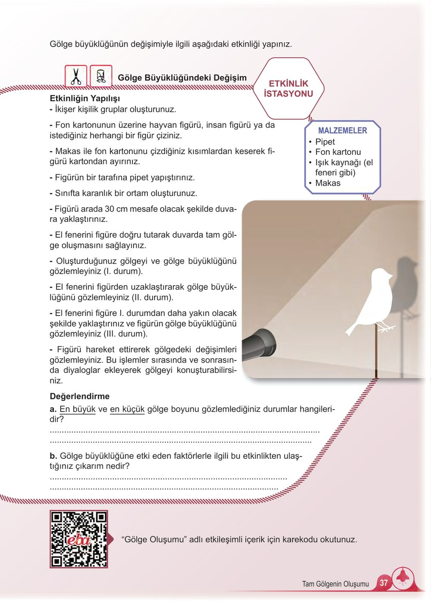

### MALZEMELER
* Pipet
* Fon kartonu
* Işık kaynağı (el feneri gibi)
* Makas

### Değerlendirme
**a.** En büyük ve en küçük gölge boyunu gözlemlediğiniz durumlar hangileridir?
.................................................................................................................
..............................................................................................................

**b.** Gölge büyüklüğüne etki eden faktörlerle ilgili bu etkinlikten ulaştığınız çıkarım nedir?
...................................................................................................
................................................................................................

“Gölge Oluşumu” adlı etkileşimli içerik için karekodu okutunuz.

<!-- sayfa 39 -->

Gölge boyu değişimleriyle ilgili aşağıdaki etkinliği yapınız.

# ETKİNLİK İSTASYONU
## Günlük Hayatta Gölgeler
### Etkinliğin Yapılışı
Günlük hayatta karşılaştığınız gölge boyu değişimlerine ilişkin örnekler veriniz. Bu değişimlerin sebeplerinin neler olabileceğini aşağıdaki alana yazarak ve çizerek arkadaşlarınızla paylaşınız. Arkadaşlarınızın fikirlerini saygılı bir şekilde dinleyiniz.

...........................................................................................................................................
...........................................................................................................................................
...........................................................................................................................................
...........................................................................................................................................
...........................................................................................................................................
...........................................................................................................................................

# BİLGİ İSTASYONU
Sivas’ta bulunan Divriği Ulu Camii ve Darüşşifası olarak bilinen yapı topluluğu; cami, darüşşifa ve türbeden meydana gelen bir külliyedir. Bu yapının batı kapısında mayıs ile eylül ayları arasında, ikindi vaktinden önce insan silüeti şeklinde bir gölge oluşmaktadır. Bu kapı ile birlikte diğer kapılarda da yer alan bu silüetlerin bir tesadüf eseri olmadığı, çok kapsamlı bir fizik bilgisi ve çok ince hesaplarla yapılabileceği uzmanlar tarafından belirtilmektedir.

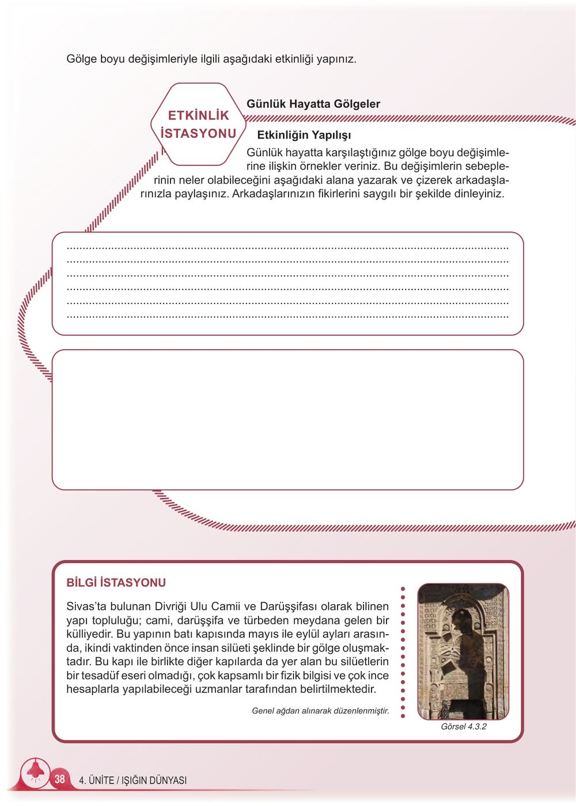
*Genel ağdan alınarak düzenlenmiştir.*
Görsel 4.3.2

<!-- sayfa 40 -->

Işık ışınları opak maddelerden geçemez ve opak maddelerin arkasında karanlık bir böl-
ge oluşur. Oluşan bu bölgeye **tam gölge** denir. Gölge olayının gerçekleşmesi ışığın doğ-
rusal olarak yayıldığının bir kanıtıdır. Işık kaynağından çıkan ışık ışınları opak bir cisim 
üzerine gönderildiğinde ekran üzerinde oluşan görüntü aşağıdaki gibi çizilebilir.

*Görsel 4.3.3: Gölge oluşumu*

*Görsel 4.3.4: Gölge oluşumu*

<!-- sayfa 41 -->

Bir cismin gölgesinin büyüklüğü, cismin büyüklüğüne ve ışık kaynağı ile cisim arasındaki uzaklığa bağlıdır. Işık kaynağına aynı mesafede olan iki cisimden boyutu büyük olanın gölgesi de büyük olur. Örneğin ışık kaynağına eşit uzaklıkta bulunan futbol topunun gölgesi, tenis topunun gölgesine göre daha büyüktür.

*Görsel 4.3.5: Futbol topunun gölgesi*

*Görsel 4.3.6: Tenis topunun gölgesi*

<!-- sayfa 42 -->

Işık kaynağının yeri sabit tutulup cisim ışık kaynağına yaklaştırıldığında ve ışık kaynağından uzaklaştırıldığında cismin gölgesinin büyüklüğü değişir. Cisim, ışık kaynağından uzaklaştıkça gölgesinin boyu kısalır.

*Görsel 4.3.7: Işık kaynağına yakın kürenin gölgesi*

*Görsel 4.3.8: Işık kaynağından uzak kürenin gölgesi*

<!-- sayfa 43 -->

Cismin yeri sabit tutulup ışık kaynağının uzaklığı değiştirilirse cismin gölge büyüklüğü değişir. Işık kaynağı, cisme yaklaştıkça cismin gölgesinin boyu uzar.

Görsel 4.3.9: Küreden uzak ışık kaynağı ile gölge oluşumu

Görsel 4.3.10: Küreye yakın ışık kaynağı ile gölge oluşumu

 “Gölge” adlı müzik klibine ulaşmak için karekodu okutunuz.

<!-- sayfa 44 -->

# PEKİŞTİRME İSTASYONU-1

Opak K ve L cisimleri, ışık kaynağı ile ekran arasına yerleştirilecektir. **Cisimlerin ekran üzerinde oluşacak gölgelerini çiziniz.**

<!-- sayfa 45 -->

# A

Aşağıdaki cümlelerde boş bırakılan yerleri kutuların içindeki uygun kelime/kelime gruplarıyla tamamlayınız.

| her | yarı saydam | ışık geçirgenliği | büyümesi |
| :---: | :---: | :---: | :---: |
| uzaklaşırsa | doğrusal | düz | geçiren |
| beton duvar | yaklaşırsa | geçirmeyen | tam gölge |
| tek | saydam | bulanık | net |

1. Araba farından çıkan ışık ........................................ yöne yayılır.
2. Bir odadaki lambadan çıkan ışık ........................................ yolla yayılır.
3. Pencere camı, ışığı ........................................ bir maddedir.
4. Camın kalınlığı artırılarak ........................................ azaltılabilir.
5. Yağlı kâğıt, ........................................ bir maddedir.
6. Saydam olmayan maddelere ışık gönderilerek ........................................ oluşturulabilir.
7. Saydam maddelerin arkasında bulunan cisimler ........................................ görülür.
8. Yarı saydam ve ........................................ maddelerin ışık geçirme durumları birbirinden farklıdır.
9. Kitap ve ........................................ saydam olmayan maddelerdendir.
10. Duvarda gölgesi bulunan bir çocuk, duvara ........................................ gölgesi küçülür.
11. Bir cismin gölgesinin ........................................ için ışık kaynağı cisme yaklaştırılmalıdır.
12. Bir cisim, ışık kaynağından ........................................ cismin gölgesi küçülür.
13. Yanan bir lambaya doğru ........................................ bir borudan bakıldığında lambanın ışığı görülür.
14. Buzlu cama bakıldığında buzlu camın arkasındaki cisim ........................................ görülür.
15. Demir levha, ışığı ........................................ bir maddedir.

***

**ÜNİTE SONU İSTASYONU**

<!-- yer tutucu bulunamadı: sayfa sonuna eklendi -->

<!-- sayfa 46 -->

# Aşağıdaki soruları cevaplayınız.

**B**

**ÜNİTE SONU İSTASYONU**

1. Işık nasıl yayılır?
................................................................................................................................

2. Boş bir odadaki lambanın odanın her yerini aydınlatması, ışığın hangi özelliği ile ilgilidir?
................................................................................................................................

3. Maddeleri ışık geçirme durumlarına göre sınıflandırınız.
................................................................................................................................

4. Saydam maddelere üç örnek veriniz.
................................................................................................................................

5. Bir cisim, kendisine gelen ışığı hiç geçirmiyorsa ışık geçirgenliği bakımından hangi sınıfta yer alır?
................................................................................................................................

6. Buzlu cam, yağlı kâğıt gibi maddeler ışık geçirgenliği bakımından hangi sınıfta yer alır?
................................................................................................................................

7. Saydam bir cismin saydamlığını azaltmak için neler yapılabilir?
................................................................................................................................

8. Gölge nedir?
................................................................................................................................

9. Gölge büyüklüğüne etki eden faktörler nelerdir?
................................................................................................................................

10. Işık kaynağı ile cisim arasındaki mesafe azaltılırsa cismin gölge boyu nasıl değişir?
................................................................................................................................

“Ölçme ve Değerlendirme” için karekodu okutunuz.

<!-- sayfa 47 -->

# C
Aşağıdaki metni okuyup soruları cevaplayınız.

ÜNİTE SONU İSTASYONU

Kamp yapmak doğaya dokunmaktır. Kuş sesleri ile uyanmak, doğa yürüyüşleri yapmak insana bir parçası olduğu doğayı hatırlatır. Kamp hayatında araç gereçler çok önemlidir. Bu önemin farkında olan çadır üreticileri, insanların en fazla fayda sağlayacağı şekilde çadırlar tasarlamayı hedefler. Bazı çadırlarda dışarıyı net gösteren büyük pencereler vardır. Pencerelerin iç kısımlarında ise perdeler bulunmaktadır. Çadırların ön kısmındaki gölgeliklerin ışığı geçirmeyen malzemelerden yapılması kamp konforuna katkıda bulunur.

Bir çadır firması, üretimde kullanacağı bazı malzemelerin ışık geçirgenliğini test ediyor. Sonuçlara ilişkin aşağıdaki grafik çiziliyor.

Deneme amacıyla üretilen bir çadırda büyük pencerelerde “L”, gölgelikte ise “M” malzemesi kullanılıyor. Ancak istenilen sonuca ulaşılamıyor.

1. **Büyük pencerelerden $\text{daha}$ <!-- KONTROL: Marker'da karşılığı yok, uydurma olabilir --> verimli faydalanmak için pencerelerde kullanılan malzeme yerine hangisi tercih edilmelidir?**
   A) “N” malzemesi
   B) “L” malzemesi
   C) “K” malzemesi
   D) Yarısı “M”den, yarısı “N”den oluşan bir malzeme

2. **Gölgelikten $\text{daha}$ <!-- KONTROL: Marker'da karşılığı yok, uydurma olabilir --> verimli faydalanmak için gölgelikte kullanılan malzeme yerine hangisi tercih edilmelidir?**
   A) “K” malzemesi
   B) “M” malzemesi
   C) “N” malzemesi
   D) Yarısı “M”den, yarısı “K”den oluşan bir malzeme

<!-- sayfa 48 -->

# Çağını Aşanlar

## Miletli Thales

Miletli Thales (Miletli Tales), MÖ 640'ta Milet adındaki liman şehrinde doğmuştur. Thales uzunluğu bilinen bir cismin gölge boyundan yola çıkarak Mısır piramitlerinden birinin yüksekliğinin belirlenebileceğini öne sürmüştür.

## Eratosthenes

Eratosthenes (Eratostanes), Dünya'nın Güneş'ten uzaklığını 92 milyon mil olarak, Dünya'nın çevresini de 46.225 km olarak bugünkü değerlere yakın hesaplamayı başarmıştır. Ona ününü sağlayan ulaştığı sonuçtan çok geliştirdiği yaratıcı yöntemdir. Aynı boylam üzerine düşen iki yerin arasındaki mesafe ve öğle vakti bir anıtın gölge açısından yararlanarak Dünya'nın çevre uzunluğunu hesaplamıştır.

## Christiaan Huygens

Christiaan Huygens (Kırıstiyın Haygyns), mekanik ve optik alanında önemli çalışmalar yapmış Hollandalı matematikçi ve bilim insanıdır. Huygens, 1665-1695 yıllarında yaptığı çalışmalarla ışığın yayılma şeklini açıklamaya çalışmıştır.

## Kindi

Çalışma yaptığı alanlardan biri optiktir. Işığın doğrusal yayılımı, yansıması ve kırılması konularında çalışmıştır.

Bu sayfada temsilî görseller kullanılmış.

<!-- sayfa 49 -->

Merhaba Bilim Günce'm,

Her sabah olduğu gibi bu sabah da annem, odamı havalandırmak için içeri girmişti. Ben ise çoktan uyanmış ve okula gitmek için hazırlıklarımı yapıyordum. Annem önce perdeyi sonra pencere camını açtı. Güneş, sanki bir anda odamda doğuvermiş gibi oldu. Her yer aydınlandı. Bu sırada dikkatimi bir şey çekti: Perdenin açılmasıyla havada uçuşan küçük toz zerrelerini görebiliyordum. Güneş ışığı sanki pırıltılı, düz bir çizgi üzerinde ve toz zerreleri arasında ilerliyordu! Üstelik bu düz çizgi üzerinde ilerliyormuş gibi görünen ışık, odamın her tarafına yayılıyordu. Aklıma buna benzer bir olay daha geliverdi. Geçen hafta gün batımında arkadaşlarımla köyde doğa yürüyüşüne çıkmıştık. Güneş ışığı da ormandaki ağaçların arasında tıpkı bu şekilde ilerliyordu.

Kahvaltımı yapmak üzere mutfağa yöneldim. Mutfak kapısını kapattım ve masaya oturdum. Kardeşim ve ağabeyim görünürlerde yoktu. Mutfak kapısının arkasından bir tıkırtı geldi. Kapının ardında biri vardı ama kapı camından kim olduğunu anlayamadım. Neyse "Boyu kısa olduğuna göre bu bizim ufaklık olmalı." diye düşünürken kapı birden açıldı ve muzip ağabeyim, dizlerinin üzerinde yürüyerek masaya ilerledi. Bu kapının camı bir garipti doğrusu, ağabeyim cam sayesinde beni kandırabilmişti.

Kahvaltı sırasında gözüm masadaki cam bardağa ilişti. Bardağı elime aldım ve göz hizama getirip karşıya baktım. Karşımda iştahla kahvaltısını yapan kardeşimi net bir şekilde görebiliyordum. Okulda ilk işim yaşadıklarımı fen bilimleri öğretmenimiz ile paylaşmak oldu. Sonuç olarak bazı cisimlerin ışığı geçirdiğini, bazı cisimlerin ise ışığın bir kısmını geçirdiğini öğrendim.

<!-- sayfa 50 -->

Hatta bunlar saydam ve yarı saydam maddeler olarak da sı-
nıflandırılıyormuş. Ha, bir de saydam olmayan maddeler varmış 
Bilim Günce'm! opak madde de denilen bu maddeler 
ışığı hiç geçirmiyormuş. Mesela pencerenin çerçevesi 
ve panjur saydam olmayan maddelere örnekmiş. Panjur, 
pencerelerin dış kısmına takılarak istenildiği takdirde 
odalara ışığın girmesini engelliyormuş.

Offf! Biraz yoruldum galiba ama güzel bir gün oldu. Yazacaklarımı 
sonlandırmadan önce bir şey daha anlatmak istiyorum. Az önce 
kardeşimin odasındaydım. Kardeşim uyumadan önce benimle hep 
gölge oyunu oynamak istiyor. Ben de çok keyif alıyorum karde-
şimle vakit geçirmekten. Nasıl oynadığımızı da anlatayım: Odayı 
karanlık hâle getirip telefonun kamera ışığını açıyorum. Bu sırada 
ellerimi kullanarak duvarda karanlık bir alan oluşturuyorum. Bu 
karanlık alana tam gölge deniliyormuş. Oluşturduğum gölgeler 
genelde tavşan, köpek gibi hayvan figürleri oluyor. Kardeşimi en 
çok eğlendiren an ise gölgenin ellerimi telefona yaklaştırdığımda 
bir anda büyümesi, uzaklaştırdığımda ise bir anda küçülüvermesi.

Bu sırada ben de ufak antrenmanlar yapıyorum. Yakında sincap, 
geyik, tavşan ve güvercinden oluşan "Canlı Dostlarımız Gölge Ti-
yatrosu"na kanguru ve timsahı da ekleyeceğim. Aklımda oluşan 
senaryo ile canlıların yaşam alanlarını korumaya yönelik bir gölge 
oyununu kameram ile kaydedip arkadaşlarımla paylaşacağım. Sen 
de heyecanlandın değil mi? Başka tüyo veremem oyun hakkında 
sevgili Bilim Günce'm, kusura bakma.

O güne kadar sabırla beklemelisin, haydi hoşça kal!

<!-- sayfa 51 -->

# 5. ÜNİTE
# MADDENİN DOĞASI

## İÇERİK ÇERÇEVESİ
* MADDENİN TANECİKLİ YAPISI
* ISI VE SICAKLIK
* MADDENİN HÂL DEĞİŞİMİ
* MADDE VE ISI

## ANAHTAR KAVRAMLAR
* titreşim
* öteleme
* dönme
* ısı
* sıcaklık
* erime
* donma
* kaynama
* yoğuşma
* buharlaşma
* süblimleşme
* kırağılaşma
* ısı iletkenliği
* ısı yalıtkanlığı

<!-- yer tutucu bulunamadı: sayfa sonuna eklendi -->

<!-- sayfa 52 -->

5. Ünite
Özet E-İçerik

# HATIRLAYALIM

Daha önce maddelerin katı, sıvı ve gaz hâllerde bulunabileceğini ve maddelerin hâl değiştirirken ısı alışverişi yaptığını öğrenmiştiniz.

<!-- sayfa 53 -->

# ÖN DEĞERLENDİRME İSTASYONU

## 1

**a. Aşağıdaki soruları cevaplayınız.**

• Çevrenizdeki taş, su, hava gibi maddeler bütünsel yapıda mıdır? Açıklayınız.
...................................................................................................................................
...................................................................................................................................

• Bu maddeler daha küçük taneciklerden oluşmuş olabilir mi? Düşüncelerinizi yazınız.
...................................................................................................................................
...................................................................................................................................

**b.** Görseldeki dondurma çubuğunun ortadan ikiye bölündüğünü, sonrasında bölme işlemine sürekli devam edildiğini hayal ediniz. Elinize geçecek en küçük parçayı düşününüz. Oluşan en küçük parçalar daha da küçük parçalardan oluşmuş mudur? Fikirlerinizi yazınız.

......................................................................................
...................................................................................................................................
...................................................................................................................................

## 2

**a. Günlük yaşamda “ısı” ve “sıcaklık” kavramlarının birbirinin yerine kullanılması uygun mudur? Nedenini açıklayınız.**
...................................................................................................................................
...................................................................................................................................

<!-- sayfa 54 -->

# MADDENİN TANECİKLİ YAPISI

• Bu bölümde maddeleri tanecikli, boşluklu ve hareketli yapısına göre sınıflandırabileceksiniz.

## HAZIRLIK İSTASYONU
Uzaktan bir bütün gibi görünen kumsal aslında kum taneciklerinden oluşur. Maddelerin yapısı da kumsal örneğindeki gibi taneciklerden oluşmuş olabilir mi? Fikirlerinizi yazınız.
.................................................................................................................................................................
.............................................................................................................................................................
........................................................................................................................................................

## MERAK İSTASYONU
Maddenin yapısı ile ilgili merak ettiklerinizi yazınız.
..........................................................................................................................
.......................................................................................................................
...................................................................................................................
...............................................................................................................

<!-- sayfa 55 -->

# MADDELERİN TANECİKLİ, BOŞLUKLU VE HAREKETLİ YAPISI

Maddelerin ortak ve farklı olan bir çok özelliği vardır. Maddelerin özellikleri ile ilgili aşağıdaki etkinliği yapınız.

## Maddenin Özellikleri

**ETKİNLİK İSTASYONU**

Aşağıdaki örnek olay metnini okuyunuz. Metinden hareketle etkinliği gerçekleştiriniz.

> Zeynep ve annesi alışveriş yapmak için markete gitmişlerdi. Alışveriş listesinde $2\text{ kg}$ domates, $1\text{ kg}$ elma, $2\text{ kg}$ yoğurt, $1$ paket kâğıt havlu ve $5\text{ kg}$ toz şeker yer alıyordu. Alışveriş sepetine ilk olarak kâğıt havlu paketini koymuşlardı. Ardından $1\text{ kg}$ elmayı da sepete eklediler. Fakat o da ne! Market sepetinde sonraki ürünler için yer kalmamıştı. Annesi kütlesi daha az olduğu için kâğıt havluyu sepetten çıkarıp taşıması için Zeynep'e verdi. Alışveriş listesindeki diğer ürünler, kâğıt havlu olmadığı için sepete sığmıştı. Tüm ürünler sepete doldurulduğunda annesi sepeti taşımakta zorlanmıştı. Sonunda kasaya gelmişlerdi. Ödeme yaptıktan sonra market görevlisi poşetleri arabaya kadar taşımada yardımcı olmuştu.

1. Alışveriş sepetine elma ve kâğıt havlu konulunca diğer ürünlerin sığmamasının sebebi nedir?
...........................................................................................................................................
...........................................................................................................................................

2. Cisimlerin yer kaplamasına yönelik (kitapların yerleştirilmesi, oyuncakların toplanması gibi) durumlara günlük yaşamdan farklı örnekler veriniz.
...........................................................................................................................................
...........................................................................................................................................

3. Zeynep'in annesi, başta sepeti rahat taşıyabiliyorken sonra sepeti taşımakta niçin zorlanmıştır?
...........................................................................................................................................
...........................................................................................................................................

4. Alışveriş listesindeki ürünlerin sahip oldukları farklı özellikler nelerdir?
...........................................................................................................................................
................................................................................................

<!-- sayfa 56 -->

Tek bir parçaymış gibi görünen bu maddeler daha küçük taneciklerden oluşmuş olabilir mi? Bu durumu modellemek için aşağıdaki etkinliği yapınız.

# Maddenin Hâllerinin Tanecikli Yapısını Modelleme

## ETKİNLİK İSTASYONU

### Etkinliğin Yapılışı
- Üçer veya dörder kişilik gruplar oluşturunuz.
- Pinpon toplarının bir maddenin en küçük yapı taşlarını temsil ettiğini düşününüz ve aşağıdaki aşamaları yerine getiriniz.

### Aşamalar
- Pinpon toplarının katı bir maddenin taneciklerini temsil ettiğini düşününüz. Topları şeffaf saklama kabının içerisine aralarında boşluk çok az olacak şekilde yerleştiriniz. Saklama kabının kapağını kapatınız. Kabı yatay ve dikey yönde sallayınız. Topların hareketini gözlemleyiniz. Temsil edilen madde modelini 1 numaralı alana çiziniz.
- Saklama kabı içerisindeki pinpon toplarından bir kısmını çıkarınız. Bu topların sıvı bir maddenin taneciklerini temsil ettiğini düşününüz. Kabın kapağını kapatarak kutuyu yatay ve dikey yönde sallayınız. Topların hareketini gözlemleyiniz. Temsil edilen madde modelini 2 numaralı alana çiziniz.
- Saklama kabı içerisindeki pinpon toplarından büyük bir kısmını çıkarınız. Bu topların gaz bir maddenin taneciklerini temsil ettiğini düşününüz. Kabın kapağını kapatarak kutuyu yatay ve dikey yönde sallayınız. Topların hareketini gözlemleyiniz. Temsil edilen madde modelini 3 numaralı alana çiziniz.

### MALZEMELER
- Şeffaf saklama kabı
- Pinpon topları (saklama kabını doldurmaya yetecek kadar)

| 1 | 2 | 3 |
|---|---|---|
|  |  |  |

## Değerlendirme

**a. Katı, sıvı ve gaz maddeleri temsil eden modellemelerinizde benzerlik ve farklılıklar nelerdir?**
..............................................................................................................................
...........................................................................................................................

**b. Maddelerin tanecikleri hareketli midir? Yazınız.**
...................................................................................................................
................................................................................................................

**c. Yapısını çizdiğiniz 1, 2 ve 3 numaralı modellere günlük yaşamdan örnekler veriniz.**
....................................................................................................
...............................................................................................................

Pinpon topları ile yaptığınız etkinlikten de anlaşılabileceği gibi maddelerin tanecikleri ara-

<!-- sayfa 57 -->

Maddelerin fiziksel hâli sıkıştırılabilme özelliğini etkiler. Maddelerin sıkıştırılabilme özelliğini gözlemlemek için aşağıdaki etkinliği yapınız.

# Maddeler Şırıngalarda

## ETKİNLİK İSTASYONU

### MALZEMELER
* 3 iğnesiz şırınga
* Su
* Küçük taş parçası (şırınganın içine yerleşebilecek büyüklükte)

### Etkinliğin Yapılışı
- Şırıngaların üzerine A, B ve C etiketlerini yapıştırınız.
- A şırıngasına küçük taş parçası yerleştiriniz.
- B şırıngasını hava kalmayacak şekilde su ile doldurunuz.
- C şırıngasını hava ile doldurunuz.
- Sırayla her bir şırınganın ucunu parmağınız ile kapatınız. Pistona itme kuvveti uygulayarak sıkıştırmaya çalışınız.

### Değerlendirme

**a. Hangi şırıngadaki madde sıkıştırılabildi?**
.....................................................................................
..................................................................................
................................................................................
.............................................................................
............................................................................

**b. A, B ve C şırıngalarındaki maddeler hangi hâldedir?**
....................................................................................
.......................................................................................
..........................................................................................
.............................................................................................
................................................................................................

**c. Maddelerin sıkıştırılabilme durumu ile madde taneciklerinin birbirine yakınlık durumu arasındaki ilişkiyi açıklayınız.**
..........................................................................................................
.......................................................................................................
...................................................................................................
................................................................................................
.............................................................................................

Gaz maddelerin arasındaki boşluk çok fazla olduğu için gazlar sıkıştırılabilir. Katılar sıkıştırılamaz. Sıvıların ise sıkıştırılamadığı varsayılır.

<!-- sayfa 58 -->

Taneciklerin hareket çeşitleri maddenin hâllerine göre farklılık gösterir.

Görsel 5.1.1: Taneciklerin hareketleri

Katı maddelerin tanecikleri sadece titreşim hareketi yapar. Sıvı ve gaz maddelerin tane-
cikleri ise titreşim, dönme ve öteleme hareketi yapar. Öteleme hareketi sayesinde sıvı ve 
gaz maddeler akışkan özelliktedir.

> ### BİLGİ İSTASYONU
> Filozof Democritus (Demokritus) MÖ 400’lü yıllarda maddelerin taneciklerden oluştuğunu ileri sürmüş-
> tür. Democritus görüşünü şu şekilde açıklamıştır: 
> “Bir elmayı alıp ikiye bölünüz, sonra oluşan yarım 
> elmaları da ikiye bölünüz, bölme işlemine sürekli 
> devam ediniz. Böylece bölmeyi sürdürürseniz so-
> nunda öyle bir an gelecektir ki artık bölemeyeceği-
> niz kadar küçük bir parça elde edeceksiniz.”
> *Genel ağdan alınmıştır.*
>
> 
> Görsel 5.1.2: Elma

## PEKİŞTİRME İSTASYONU-1

“Maddenin Hâllerinin Tanecikli Yapısını Modelleme” ve “Maddeler Şırıngalarda” etkinlik-
leri ile ilgili almış olduğunuz notları inceleyiniz. Bu etkinliklerde ulaştığınız sonuç-
ları karşılaştırınız. Maddelerin sıkıştırılabilme durumunu ve madde taneciklerinin
hareketlerini açıklayınız.
.......................................................................................................................................
...........................................................................................................................................
...........................................................................................................................................
...........................................................................................................................................
...........................................................................................................................................
...........................................................................................................................................
................................................................................................

<!-- sayfa 59 -->

# KATI MADDE

* Katı maddelerin tanecikleri birbirine çok yakındır.
* Tanecikler arası boşluk azdır.
* Katı maddelerin tanecikleri sadece titreşim hareketi yapabilir.
* Katı maddeler sıkıştırılamaz.
* Maddenin en düzenli hâlidir.
* Katı maddelerin belirli bir hacmi ve şekli vardır.

Görsel 5.1.3: Katı madde tanecikleri

# SIVI MADDE

* Sıvı maddelerin tanecikleri arasındaki boşluk katılara göre daha fazla, gazlara göre daha azdır.
* Sıvılar sıkıştırılamaz.
* Sıvı maddelerin tanecikleri titreşim, dönme ve öteleme hareketi yapar.
* Sıvıların belirli bir hacmi vardır.
* Belirli bir şekilleri yoktur. İçinde bulunduğu kabın kapladığı kısmının şeklini alır.

Görsel 5.1.4: Sıvı madde tanecikleri

Aynı sıvı, farklı şekillerdeki kaplara döküldüğünde kapladığı hacim değişmez ancak döküldüğü kabın şeklini alır.

# GAZ MADDE

* Tanecikler arası boşluğun en fazla olduğu madde hâlidir.
* Gazlar sıkıştırılabilir.
* Gaz maddelerin tanecikleri titreşim, dönme ve öteleme hareketi yapar.
* Gazların belirli bir hacmi ve şekli yoktur.
* Bulundukları kabın her tarafına dağılır.

Görsel 5.1.5: Gaz madde tanecikleri

<!-- sayfa 60 -->

# PEKİŞTİRME İSTASYONU-2

1. Aşağıda bazı maddeler ve maddelerle ilgili özellikler verilmiştir. Bu özellikler hangi maddelere ait ise “$\checkmark$” ile işaretleyiniz.

| Özellik | Madde | Demir | Su | Süt | Hava | Tahta | Buhar |
| :--- | :--- | :---: | :---: | :---: | :---: | :---: | :---: |
| Taneciklerden oluşur. | | | | | | | |
| Tanecikleri titreşim hareketi yapar. | | | | | | | |
| Tanecikleri dönme hareketi yapar. | | | | | | | |
| Tanecikleri öteleme hareketi yapar. | | | | | | | |
| Tanecikler arasında boşluk vardır. | | | | | | | |
| Tanecikler arası boşluk çok fazladır. | | | | | | | |
| Belirli şekilleri vardır. | | | | | | | |
| Akışkan özelliğe sahiptir. | | | | | | | |
| Sıkıştırılabilir. | | | | | | | |

2. Yukarıdaki soruda verilen örnek maddelerin özelliklerini dikkate alıp katı, sıvı, gaz olarak gruplandırınız ve kutulara yazınız.

| Katı | Sıvı | Gaz |
| :--- | :--- | :--- |
| .......................................... | .......................................... | .......................................... |
| .......................................... | .......................................... | .......................................... |
| .......................................... | .......................................... | .......................................... |

3. Günlük yaşamda karşılaştığınız farklı maddeleri katı, sıvı, gaz olarak etiketleyiniz.

Katı: ..................................................................................................................................
Sıvı: ..................................................................................................................................
Gaz: ..................................................................................................................................

 Çalışmayı değerlendirmek için karekodu okutunuz.

<!-- sayfa 61 -->

Maddeler bir hâlden başka bir hâle geçerken taneciklerinin hareketleri değişebilmektedir. Bununla birlikte maddeler hâl değiştirince tanecikler arasındaki mesafeler de değişmektedir. Madde taneciklerinin hareketleri ve mesafelerindeki değişimler hakkında tahminlerimizi belirtmek için aşağıdaki etkinliği yapınız.

# Tartışma Grupları

## Etkinliğin Yapılışı
- Üçer veya dörder kişilik gruplar oluşturunuz ve aşağıdaki tabloyu adımlara uygun tamamlayınız.

1. **1. Adım:** Grubunuza birlikte bir isim ve slogan belirleyiniz.
2. **2. Adım:** Grup arkadaşlarınızla katı bir maddenin sıvı hâle geçtiğini düşününüz.
3. **3. Adım:** Bu olayın sonucunda maddenin taneciklerinin hareketleri ve aralarındaki mesafenin değişimi ile ilgili birer tahmin cümlesi yazınız.
4. **4. Adım:** Tahminlerinize ilişkin gerekçelerinizi arkadaşlarınız ile paylaşınız.
5. **5. Adım:** Arkadaşlarınızın farklı fikirlere sahip olabileceklerini düşününüz ve arkadaşlarınızla bir tartışma ortamı oluşturunuz. Tartışma gerekçelerini dinlerken notlar alınız.

- Bu süreçte arkadaşlarınızı destekleyip birbirinize yardımcı olunuz.

| | |
| :--- | :--- |
| **Kendi Tahmin Cümlem** | ................................................................................. |
| | ................................................................................. |
| **Arkadaşlarımın Tahmin Cümleleri** | ................................................................................. |
| | ................................................................................. |
| | ................................................................................. |
| | ................................................................................. |
| **Tartışma Notlarım** | ................................................................................. |
| | ................................................................................. |
| | ................................................................................. |
| | ................................................................................. |
| | ................................................................................. |
| | .................................................

<!-- sayfa 62 -->

Katı hâlden sıvı hâle geçen maddenin tanecikleri titreşim hareketinin yanında dönme ve öteleme hareketi yapmaya başlar. Bu durumda taneciklerin hızı ve tanecikler arasındaki boşluk miktarı artar. Sıvı bir madde gaz hâle geçtiğinde ise taneciklerin yaptığı hareket çeşidi değişmezken taneciklerin hızı ve tanecikler arası mesafe artar. Çevrenizdeki maddelerin hâllerini ve taneciklerinin özelliklerini etiketlemek için aşağıdaki etkinliği yapınız.

# Madde Etiketleri

## ETKİNLİK İSTASYONU

### Etkinliğin Yapılışı
- Yapışkanlı kâğıtlardan her birine aşağıdaki ifadeleri beşer kez yazınız.

1. Sıkıştırılabilir.
2. Sıkıştırılamaz.
3. Akışkandır.
4. Akışkan değildir.
5. Tanecikleri titreşim hareketi yapar.
6. Belirli bir şekli vardır.
7. Belirli bir hacmi vardır.
8. Tanecikleri dönme ve öteleme hareketi yapar.

- Malzemeleri masanın üzerine yerleştiriniz.
- Malzemelere sırayla uygun etiketleri yapıştırınız.
- Malzemeleri ve bu malzemeler için kullandığınız etiketlerin numaralarını aşağıdaki tabloya yazınız. Yazdığınız etiket numaralarını göz önünde bulundurarak malzemelerin hâllerini belirtiniz.
- Deney sonrasında kullanılan malzemeleri ve laboratuvar alanını temiz hâlde bırakınız. Laboratuvar kurallarına uyunuz.

### MALZEMELER
* Kalem
* Metal kaşık
* Su
* İçi hava dolu balon
* Süt
* Yapışkanlı kâğıt

| Malzemeler | Yapıştırılan Etiket Numaraları | Maddenin Hâli |
| :--- | :--- | :--- |
| ...................... | ...................... | ...................... |
| ...................... | ...................... | ...................... |
| ...................... | ...................... | ...................... |
| ...................... | ...................... | ...................... |
| ...................... | ...................... | ...................... |

### Değerlendirme
Etiketlendirmelerinizi de göz önünde bulundurarak maddenin sınıflandırılması ile ilgili görüşlerinizi yazınız.
....................................................................................................
....................................................................................................

<!-- sayfa 63 -->

“Maddenin Tanecikli Yapısı” adlı etkileşimli içerik için karekodu okutunuz.

## PEKİŞTİRME İSTASYONU-3

Aşağıdaki kavram haritasında bazı kısımlar boş bırakılmıştır. **Kelimelerden uygun olanları boş kısımlara yazarak kavram haritasını tamamlayınız.**

hareket | dönme | gaz | sıkıştırılabilme
en düzensiz | en düzenli | titreşim

<!-- sayfa 64 -->

# PEKİŞTİRME İSTASYONU-4

Aşağıda bazı maddelere ait görseller verilmiştir.

1
Çivi

2
Süt

3
Deniz suyu

4
Taş

5
Zeytinyağı

6
Odun

7
Bardak

8
Su buharı

9
Helyum gazı

**Buna göre aşağıdaki soruları görsel numaralarını kullanarak cevaplayınız.**

**a. Hangi maddelerin tanecikleri dönme ve öteleme hareketi yapar?**
……………………………………………………………………………………………………

**b. Hangi maddeler sıkıştırılabilir?**
……………………………………………………………………………………………………

**c. Hangi maddeler akışkandır?**
……………………………………………………………………………………………………

**ç. Tanecikleri arasındaki boşluğun en az olduğu maddeler hangileridir?**
……………………………………………………………………………………………………

<!-- sayfa 65 -->

# ISI VE SICAKLIK

* Bu bölümde ısı ve sıcaklık kavramlarını karşılaştırabileceksiniz.
* Sıcaklığı farklı olan sıvıların karıştırılması sonucu ısı alışverişi olduğuna yönelik bilimsel çıkarım yapabileceksiniz.

## HAZIRLIK İSTASYONU
“Deniz kıyısında hava, $38\ ^\circ\text{C}$ [derece Celsius (derece Selsiyus)] olarak ölçüldü.” ifadesinde bahsedilen ölçüm değeri ısı mıdır yoksa sıcaklık mıdır? Fikirlerinizi yazınız.
..........................................................................................................................................................
......................................................................................................................................................
.................................................................................................................................................

## MERAK İSTASYONU
Isı ve sıcaklık konusunda merak ettiklerinizi yazınız.
........................................................................................................................
....................................................................................................................................
.....................................................................................................................................

<!-- sayfa 66 -->

# ISI VE SICAKLIĞIN KARŞILAŞTIRILMASI

Isı ve sıcaklık, günlük yaşamda sıkça kullanılan kavramlardır. Bu kavramların birbirinin yerine kullanılmasıyla hatalar oluşmaktadır. Isı ve sıcaklık kavramlarının kullanımı ile ilgili aşağıdaki etkinliği yapınız.

## ETKİNLİK İSTASYONU

### Isı mı? Sıcaklık mı?

#### Etkinliğin Yapılışı
- Aşağıdaki karikatürü inceleyiniz.

**1. Öğrenci:** Hava sıcaklığı 25 derece Celsius'tur.
**2. Öğrenci:** Hayır, hava ısısı 25 derece Celsius'tur.
**3. Öğrenci:** İkiniz de doğru söylüyorsunuz. Hava ısısı veya sıcaklığı 25 derece Celsius'tur.

#### Değerlendirme
a. Karikatürde hangi öğrencilerin ifadesi doğrudur? Nedenini açıklayınız.
...........................................................................................................................................
.........................................................................................................................................
......................................................................................................................................

b. Cevaplarınız hakkında arkadaşlarınızla tartışınız. Bu süreçte arkadaşlarınızın fikirlerini söylemelerine olanak sağlayınız.

c. Açıklamalarınız sonunda sınıf arkadaşlarınızla karar vererek cevabınızı yazınız.
...........................................................................................................
........................................................................................................

ç. Cevabınızın doğruluğunu öğretmenize danışarak kontrol ediniz.

---

### KÖPRÜ İSTASYONU

Güneş doğal ısı ve ışık kaynağıdır. Güneş'ten gelen ısı, Dünya'da belirli bir sıcaklık değerinin oluşmasını sağlar.

<!-- sayfa 67 -->

Isı ve sıcaklık birbirinden farklı kavramlardır. Sıcaklık kavramı ile ilgili aşağıdaki etkinliği yapınız.

# ETKİNLİK İSTASYONU
## Sıcak mı? Soğuk mu?

### Etkinliğin Yapılışı
- Üçer ya da dörder kişilik gruplar oluşturunuz.
- Sınıfın sıcaklığını ölçerek aşağıdaki tabloya yazınız.
- Okulun bahçesinde hangi alanların sınıfa göre sıcak veya soğuk olabileceğini tahmin ederek kâğıda not alınız.
- Gölgeli ve güneşli alanlarda sıcaklık ölçümleri yaparak tabloya yazınız.

### MALZEMELER
- Kâğıt
- Kalem
- Sıcaklığı ölçmeye yarayan alet

| Ölçüm Yapılan Bölge | Ölçülen Sıcaklık |
| :--- | :--- |
| .................................. | .................................. |
| .................................. | .................................. |
| .................................. | .................................. |
| .................................. | .................................. |
| .................................. | .................................. |
| .................................. | .................................. |

- Ölçüm yaptığınız alanlardan daha sıcak olduğunu düşündüğünüz bir yer varsa aşağıya yazınız ya da çiziniz.
..................................................
[ ]

- Ölçüm yaptığınız alanlardan daha soğuk olduğunu düşündüğünüz bir yer varsa aşağıya yazınız ya da çiziniz.
..................................................
[ ]

## Değerlendirme

**a. Alanların sıcaklığını hangi alet ile ölçtünüz?**
..................................................................................................................
...............................................................................................................

**b. Gölgeli ve güneşli bölgelerin sıcaklıklarının farklı olmasının sebebi ne olabilir?**
......................................................................................................
................................................................................................................
...........................................................
...........................................................

<!-- sayfa 68 -->

Sıcaklık termometre ile ölçülür. Birimi derece Celsius’tur ve “$^\circ\text{C}$” ile gösterilir. Sıcaklık bir enerji türü değildir. **Isı**, sıcaklıkları farklı maddeler arasında aktarılabilen bir enerji türüdür. Bir maddenin sıcaklığı artmışsa bu durumun sebebi maddenin ısı almasıdır. Isı, kalorimetre kabı ile hesaplanır, birimi joule (jul) veya kaloridir. Joule “J” ile kalori ise “cal” ile gösterilir. Isı ve sıcaklığın aşağıdakideki etkinliği yapınız.

# Benzerlik ve Farklılıklar

## Etkinliğin Yapılışı

- Isının özelliklerini kırmızı, sıcaklığın özelliklerini mavi renkli kalemle ilgili alanlara yazınız.

**Isı**
...........................................................................................................................................
...........................................................................................................................................
...........................................................................................................................................

**Sıcaklık**
...........................................................................................................................................
...........................................................................................................................................
...........................................................................................................................................

- Isı ve sıcaklığın benzer ve farklı özelliklerini ilgili alanlara yeşil ve siyah renkli kalemlerinizle yazınız.

**Benzer Özellikler**
...........................................................................................................................................
...........................................................................................................................................
................................

<!-- sayfa 69 -->

# KÖPRÜ İSTASYONU

Duvar termometreleri, dijital termometreler ve ateşölçer gibi farklı araçlarla sıcaklık ölçümleri yapılmaktadır. Meteorolojik raporların oluşturulmasında da termometrelerden faydalanılmaktadır.

*Görsel 5.2.2: Termometre çeşitleri*

Isı ve sıcaklık arasındaki farklar aşağıda özetlenmiştir:

| Isı | Sıcaklık |
| :--- | :--- |
| Kalorimetre kabı ile hesaplanır. | Termometre ile ölçülür. |
| Birimi joule veya kaloridir. | Birimi derece Celsius'tur. |
| Bir enerji çeşididir. | Bir enerji çeşidi değildir. |

# BİLGİ İSTASYONU

Sürücüler, sisli havalar ya da gece vakti gibi görüş netliğinin düşük olduğu koşullarda zorlanmaktadır. İşte, bu zorlu koşullarda bile çevrenin net bir şekilde görüntülenmesini sağlayan bir yöntem geliştirilmiştir. Bu yönteme HADAR (Isı Destekli Tespit ve Menzil) adı verilmiştir. Bu teknoloji ısı görüntüleme yönteminden ve yapay zekâdan yararlanılmıştır. Bu yöntem geliştirilirken araştırmacılar öncelikle bir aracın karşısına çıkabilecek farklı malzemelerin ısı yayması ile ilgili kütüphane oluşturmuştur. Daha sonra bir yapay zekâ uygulamasını kütüphanedeki bilgileri kullanarak eğitmiştir. Geliştirilen uygulama, kameraların topladığı ısı sinyallerini analiz ederek çevredeki nesnelerin hem sıcaklığını hem de türünü tespit edebilmektedir. Böylelikle bu uygulama ile çevrenin zorlu koşullarda bile görüntülenmesi sağlanabilmektedir.

*Genel ağdan alınmıştır.*

*Görsel 5.2.3: HADAR sistemi*

“Isı ve Sıcaklık” adlı müzik klibine ulaşmak için karekodu okutunuz.

<!-- sayfa 70 -->

# PEKİŞTİRME İSTASYONU-1

1. Aşağıdaki metinde ısı ve sıcaklık kavramları ile ilgili hatalı ifadeler yer almaktadır. **Bu ifadeleri belirleyip altını çiziniz. Bu ifadelerin düzeltilmiş hâlini ilgili alana yazınız.**

*Masal, cumartesi günü sahildeki çevre temizliği etkinliğine katılacaktır. Cuma akşamı çantasını hazırlarken arkadaşına ertesi günün hava durumunu soran bir mesaj gönderir. Arkadaşı, hava sıcaklığının normalin altına düşeceğini ve 15 kalori olacağını belirten bir cevap verir. Bir bardak süt içmek için mutfağa yönelen Masal, cezveye koyduğu sütü ocakta ısıtmaya başlar. Bu sırada burnuna gelen kokuyla fırında pişen patatesleri fark eder. Fırının dijital ekranına baktığında patateslerin 180 derece Celsius ısıda piştiğini anlar. Patateslerin pişebilmesi için çok fazla sıcaklık enerjisine ihtiyaç olduğunu düşünür. Bu sırada ocakta kaynayan sütü unutmuştur. Hemen ocağı kapatır ve sütü cezveden bardağa boşaltır ancak çok sıcak olduğu için sütü içemez. Evdeki termometreyi kullanarak sütün ısısını ölçer ve sütün üzerine biraz soğuk su eklemeye karar verir. Böylelikle sütün sıcaklığı düşecektir. Kardeşi Efe gelir ve ablasına ne yaptığını sorar. Efe’ye “Aslında sadece bir bardak süt içecektim ama kendimi bir enerji çeşidi olan sıcaklıkla ilgili ölçüm yaparken buldum.” cevabını verir.*

Isı ve sıcaklıkla ilgili yanlış ifadelerin düzeltileceği alan:
...........................................................................................................................................
...........................................................................................................................................
...........................................................................................................................................
...........................................................................................................................................
...........................................................................................................................................
...........................................................................................................................................
................................................................................

<!-- yer tutucu bulunamadı: sayfa sonuna eklendi -->

<!-- sayfa 71 -->

# ISI ALIŞVERİŞİ

Sıcaklıkları farklı olan sıvıların karıştırılması ile ilgili aşağıdaki performans görevini yapınız.

## PERFORMANS İSTASYONU
### Sıcaklık Değişimi

**MALZEMELER**
* 2 beherglas
* İspirto ocağı
* Su
* Termometre

**Etkinliğin Yapılışı**
* Üçer veya dörder kişilik gruplar oluşturunuz.
* Beherglasları eşit seviyede su ile doldurunuz.
* 1 numaralı beherglası ispirto ocağı üzerine yerleştiriniz. Öğretmeninizden ispirto ocağını yakmasını isteyiniz. Suyun sıcaklığı $40\ ^\circ\text{C}$ oluncaya kadar ısıtınız. Ölçümünüzü ilk sıcaklık bölümüne yazınız.
* 2 numaralı beherglastaki suyun sıcaklığını ölçünüz. Ölçümünüzü aşağıdaki ilk sıcaklık bölümüne yazınız.
* Ölçüm sırasında termometreyi kap tabanına temas ettirmemelisiniz.

**Tahmin Et**
* Sıvılar karıştırılırsa olabilecek sıcaklık değişimini tahmin ediniz.
.......................................................................................................

* 1 numaralı beherglastaki suyu 2 numaralı beherglasa dökünüz.
* 2 numaralı beherglastaki suyun son sıcaklığını ölçerek yazınız.

**Gözlemle**
* Ölçüm sonuçlarını yazınız.

(Beherglas çizimleri: 1 numaralı beherglas için "İlk Sıcaklık: .......", 2 numaralı beherglas için "İlk Sıcaklık : ......." ve "Son Sıcaklık : .......")

**Açıkla**
* 2 numaralı beherglastaki suyun ilk ve son sıcaklık değerleri arasında fark oluştu mu? Sebebini yazınız.
.......................................................................................................

**Değerlendirme**
a. 2 numaralı beherglastaki suyun sıcaklığı neden değişmiştir?
.........................................................................................................

b. "Sıcaklık Değişimi" performans görevi ile ilgili bir rapor hazırlayınız. Raporunuzda günlük yaşamdan benzer örneklere de yer veriniz.

Çalışmayı değerlendirmek için karekodu okutunuz.

<!-- sayfa 72 -->

Sıcaklıkları farklı olan sıvılar karıştırıldığında sıvılar arasında ısı alışverişi gerçekleşir. Isı, sıcaklığı yüksek olan maddeden sıcaklığı düşük olan maddeye doğru akar. Isı aktarımı, sıvıların sıcaklıkları eşitleninceye kadar devam eder.

Görsel 5.2.4: Farklı sıcaklıktaki sıvıların karıştırılması

Sıcaklığı $90\ ^\circ\text{C}$ <!-- KONTROL: Marker'da karşılığı yok, uydurma olabilir --> olan A sıvısı ile sıcaklığı $10\ ^\circ\text{C}$ <!-- KONTROL: Marker'da karşılığı yok, uydurma olabilir --> olan B sıvısı karıştırıldığında aralarında ısı alışverişi gerçekleşir. A sıvısı, B sıvısına göre daha sıcak olduğu için ısı verir. B sıvısı, A sıvısına göre sıcaklığı daha düşük olduğu için ısı alır. Böylelikle aralarında ısı alışverişi gerçekleşir ve bu alışveriş sıvıların sıcaklığı eşitleninceye kadar devam eder. 

Sıcaklıkları eşit olan maddeler arasında ise ısı alışverişi gerçekleşmez.

Görsel 5.2.5: Aynı sıcaklıktaki sıvıların karıştırılması

Karıştırılan sıvılar arasında ısı alışverişi tamamlandığında ölçülen son sıcaklık, iki sıvı sıcaklığının arasında bir değer alır. Sıcaklığı $60\ ^\circ\text{C}$ <!-- KONTROL: Marker'da karşılığı yok, uydurma olabilir --> olan sıvının üzerine sıcaklığı $20\ ^\circ\text{C}$ <!-- KONTROL: Marker'da karşılığı yok, uydurma olabilir --> olan sıvı eklendiğinde karışımın son sıcaklığı $20\ ^\circ\text{C}$ <!-- KONTROL: Marker'da karşılığı yok, uydurma olabilir --> ile $60\ ^\circ\text{C}$ <!-- KONTROL: Marker'da karşılığı yok, uydurma olabilir --> arasında olur.

Sıcaklık değişimi etkinliğinde gördüğünüz gibi günlük yaşamda ısı alışverişinin gerçekleştiği çok fazla örnek vardır. Örneğin sıcak çay bulunan bir bardağın içerisindeki çay kaşığı bir süre sonra ısınır. Çünkü sıcak olan çaydan soğuk kaşığa ısı aktarılmıştır. Soğuk bir kış günü balkonda unuttuğunuz bir sandalyenin sıcaklık değeri düşer. Çünkü sandalye çevresine ısı vermiştir. Soğuk bir su kabını sıcak kaloriferin üzerinde beklettiğinizde suyun sıcaklığı artar. Çünkü

Görsel 5.2.6: Sıvıların karıştırılması

<!-- yer tutucu bulunamadı: sayfa sonuna eklendi -->

<!-- sayfa 73 -->

# PEKİŞTİRME İSTASYONU-2

Aşağıda özdeş K, L ve M kaplarında bulunan aynı cins sıvılar termometre ile ölçülüyor.

Buna göre kutulardaki ifadelerin doğru (D) ya da yanlış (Y) olduğuna karar vererek ilerlendiğinde hangi çıkışa ulaşılır? İşaretleyiniz.

| Başlangıç | | | |
| :--- | :--- | :--- | :--- |
| **1** K ve L kaplarındaki sıvılar karıştırılırsa ısı alışverişi gerçekleşmez. | $\xrightarrow{\text{D}}$ <!-- KONTROL: Marker'da karşılığı yok, uydurma olabilir --> | **2** K ve M kaplarındaki sıvılar karıştırılırsa K'deki sıvı ısı alır. | $\xrightarrow{\text{D}}$ <!-- KONTROL: Marker'da karşılığı yok, uydurma olabilir --> | **3** L ve M kaplarındaki sıvılar karıştırılırsa M'deki sıvının sıcaklığı azalır. | $\xrightarrow{\text{D}}$ <!-- KONTROL: Marker'da karşılığı yok, uydurma olabilir --> | **5. Çıkış** |
| | $\downarrow \text{Y}$ <!-- KONTROL: Marker'da karşılığı yok, uydurma olabilir --> | | $\downarrow \text{Y}$ <!-- KONTROL: Marker'da karşılığı yok, uydurma olabilir --> | | |
| **4** K kabına $60\ ^\circ\text{C}$ <!-- KONTROL: Marker'da karşılığı yok, uydurma olabilir --> sıcaklığında sıvı eklenirse K kabındaki sıvı ısı alır. | | | | | |
| | $\downarrow \text{Y}$ <!-- KONTROL: Marker'da karşılığı yok, uydurma olabilir --> | | | | |
| **1. Çıkış** | | | | | |
| | | | | | |
| | $\downarrow \text{Y}$ <!-- KONTROL: Marker'da karşılığı yok, uydurma olabilir --> | | | | |
| | **5** L kabına $40\ ^\circ\text{C}$ <!-- KONTROL: Marker'da karşılığı yok, uydurma olabilir --> sıcaklığında sıvı eklenirse ısı alışverişi gerçekleşmez. | $\xrightarrow{\text{D}}$ <!-- KONTROL: Marker'da karşılığı yok, uydurma olabilir --> | **6** M kabına $100\ ^\circ\text{C}$ <!-- KONTROL: Marker'da karşılığı yok, uydurma olabilir --> sıcaklığında sıvı eklenirse M kabındaki sıvı ısı alır. | $\xrightarrow{\text{D}}$ <!-- KONTROL: Marker'da karşılığı yok, uydurma olabilir --> | **4. Çıkış** |
| | $\downarrow \text{Y}$ <!-- KONTROL: Marker'da karşılığı yok, uydurma olabilir --> | | $\downarrow \text{Y}$ <!-- KONTROL: Marker'da karşılığı yok, uydurma olabilir --> | | |
| | **2. Çıkış** | | **3. Çıkış** | | |

“Sıvılarda Isı Alışverişi” adlı etkileşimli içerik için karekodu okutunuz.

<!-- sayfa 74 -->

# PEKİŞTİRME İSTASYONU-3

Aşağıdaki kapta suyun sıcaklığı $30\text{ }^\circ\text{C}$ <!-- KONTROL: Marker'da karşılığı yok, uydurma olabilir --> olarak ölçülüyor. Bu kaba sıcaklığı $60\text{ }^\circ\text{C}$ <!-- KONTROL: Marker'da karşılığı yok, uydurma olabilir --> olan su ilave ediliyor.

**1. Buna göre aşağıdaki ifadelerden doğru olanların yanındaki yapboz parçalarını “$\checkmark$” ile işaretleyiniz.**

| İfadeler | Yapboz Parçaları | | İfadeler | Yapboz Parçaları |
| :--- | :---: | :---: | :--- | :---: |
| Kaptaki suyun sıcaklığı, kalorimetre kabı ile ölçülmüştür. | $\square$ | | Kaptaki suyun son sıcaklığı $90$ <!-- KONTROL: Marker'da karşılığı yok, uydurma olabilir --> kalori olur. | $\square$ |
| Kaba su ilave edildiğinde termometrede okunan değer belirli bir süre artar. | $\square$ | | Kaba eklenen su $30\text{ }^\circ\text{C}$ <!-- KONTROL: Marker'da karşılığı yok, uydurma olabilir --> olsaydı ısı alışverişi gerçekleşmezdi. | $\square$ |
| Kaptaki su, ilave edilen suya ısı vermiştir. | $\square$ | | İlave edilen su, kaptaki suya ısı vermiştir. | $\square$ |

Doğru olan ifadelerin yanındaki yapboz parçaları birleştirilerek bir görsel oluşturulacaktır.

**2. Yapboz parçalarından oluşan şekli “$\checkmark$” ile işaretleyiniz.**

| | | |
| :---: | :---: | :---: |
|  |  |  |
| $\square$ | $\square$ | $\square$ |

<!-- sayfa 75 -->

# MADDENİN HÂL DEĞİŞİMİ

* Bu bölümde maddenin ısı etkisiyle hâl değiştirebileceğini bilimsel gözleme dayalı tahmin edebileceksiniz.

## HAZIRLIK İSTASYONU

Buz sarkıtlarının su damlacıklarına dönüşmesinde hangi faktör etkili olmuş olabilir? Fikirlerinizi yazınız.
........................................................................................................................
....................................................................................................................
................................................................................................................

## MERAK İSTASYONU

Isının maddeler üzerindeki etkilerine dair merak ettiklerinizi yazınız.
........................................................................................................................
....................................................................................................................
................................................................................................................

<!-- sayfa 76 -->

# HÂL DEĞİŞİMLERİ

Isının maddeler üzerindeki etkisini daha iyi anlayabilmek için aşağıdaki etkinliği yapınız.

## Isının Maddeye Etkisi

Günlük yaşamda karşılaşılabilcek bir durum aşağıdaki metinde verilmiştir. Metinden yola çıkarak soruları cevaplayınız.

Arkadaşlarıyla kartopu oynayan Gökçe, vaktin nasıl geçtiğini anlamamıştı. Annesinin seslenmesi ile oyunu bırakıp eve doğru gitti. Yanına da hazırladığı kartopunu aldı. Eve girdiğinde eldivenini çıkararak kuruması için kaloriferin üzerine bıraktı. Kartopunu eline alan Gökçe bir süre beklediğinde elinin üşüdüğünü ve ıslanmaya başladığını gördü. Ardından annesine elindeki kartopunu heyecanla gösterdi. Gökçe’nin eline bakan annesi kartopunu koyması için ona bir tabak verdi. Kısa bir süre sonra Gökçe kartopunun suya dönüştüğünü gördü. Bu duruma üzülüp suyun tekrar kartopu olması için tabağı dondurucuya koydu. Akşam yemeğinden önce eldivenini ve dondurucudaki tabağı kontrol etti. Eldiveninin çoktan kurumuş olduğunu gördü. Fakat o da ne! Tabağın içindeki suyun buz hâline geldiğini gördü. Gökçe, yaşadıklarını babasına anlatmak için sabırsızlanıyordu.

1. Gökçe’nin kartopunu tutarken elinin ıslanmasının sebebi ne olabilir?
...........................................................................................................................................

2. Gökçe’nin elinde kartopu varken elinin üşümesinin sebebi ne olabilir?
...........................................................................................................................................

3. Kartopu suya dönüşürken ısı almış mı yoksa vermiş midir?
...........................................................................................................................................

4. Gökçe, tabaktaki suyu dondurucuya neden koymuştur?
...........................................................................................................................................

5. Tabaktaki su dondurucudayken ısı alışverişi durumunu belirtiniz.
....................................................................................................................................

6. Gökçe kuruması için eldivenini neden kaloriferin üzerine koymuştur?
........................................................................................................................................

7. Eldiven kururken ısı alışverişi durumunu belirtiniz.
..............................................................................................................

8. Kartopunun erimesi olayına benzeyen günlük yaşamdan farklı örnekler yazınız.
...................................................................................................................................

9. Eldivenin kuruması olayına benzeyen günlük yaşamdan

<!-- sayfa 77 -->

Mumu ısıttığınızda mumun görünümünün nasıl değiştiğini test etmek için öğretmeniniz tarafından gerçekleştirilecek gösteri deneyini dikkatle takip ediniz.

# ETKİNLİK İSTASYONU
## Muma Ne Oldu?

### MALZEMELER
* Mum
* İspirto ocağı
* Sacayağı
* Su
* 2 beherglas (farklı boyutlarda)

### Etkinliğin Yapılışı

#### Tahmin Et
- Mum ısıtıldığında ve soğutulduğunda mumda ne gibi değişiklikler oluşabilir? Tahminlerinizi yazınız.
.......................................................................................................
.......................................................................................................

- Mumu küçük olan beherglasın içine bırakınız.
- Sacayağı üzerine beherglası yerleştirip ispirto ocağını yakınız.

#### Gözlemle
- Mumda meydana gelen değişimleri gözlemleyiniz ve gözlemlerinizi yazınız.
.......................................................................................................
.......................................................................................................

- Büyük beherglasa soğuk su doldurunuz.
- İspirto ocağını kapatınız ve içinde mum olan beherglası su dolu beherglasın içine koyunuz.

#### Açıkla
- Mum ısı aldığında ve ısı verdiğinde ısının etkileri neler olmuştur? Etkinliğin başlangıcında yaptığınız tahminlerle karşılaştırarak yazınız.
.......................................................................................................
.......................................................................................................

- Deney sonrasında kullanılan malzemeleri ve laboratuvar alanını temiz hâlde bırakınız. Laboratuvar kurallarına uyunuz.

<!-- sayfa 78 -->

Sıvı bir maddenin ısıtılmasıyla meydana gelebilecek değişimleri gözlemlemek amacıyla öğretmeniniz tarafından gerçekleştirilecek gösteri deneyini dikkatle takip ediniz.

# Suya Ne Oldu?

## Etkinliğin Yapılışı

### Tahmin Et
- Su ısıtıldığında karşılaşabileceğiniz durumları tahmin ediniz.
................................................................................................
................................................................................................

### MALZEMELER
- Termometre
- İspirto ocağı
- Sacayağı
- Su
- Beherglas

- Beherglasa bir miktar su doldurunuz.
- Sacayağı üzerine su dolu beherglası yerleştiriniz ve ispirto ocağını yakınız.
- Termometreyi su içerisine yerleştiriniz ve belirli aralıklarla ölçüm yapmaya başlayınız.
- Ölçüm yaparken termometreyi kap tabanına temas ettirmemelisiniz.
- Su kaynadıktan bir süre sonra ispirto ocağını söndürerek ölçüm yapmayı bırakınız.

### Gözlemle
- Ölçüm bilgilerini aşağıdaki tabloya yazınız.

| Zaman (dakika) | ....... | ....... | ....... | ....... | ....... | ....... |
| :--- | :---: | :---: | :---: | :---: | :---: | :---: |
| Sıcaklık ($^\circ\text{C}$ <!-- KONTROL: Marker'da karşılığı yok, uydurma olabilir -->) | ....... | ....... | ....... | ....... | ....... | ....... |

### Açıkla
- Suda nasıl bir değişim meydana geldi? Etkinliğin başlangıcında yaptığınız tahminlerle karşılaştırarak yazınız.
.......................................................................................................
.......................................................................................................
.......................................................................................................
.......................................................................................................

- Deney sonrasında kullanılan malzemeleri ve laboratuvar alanını temiz hâlde bırakınız. Laboratuvar kurallarına uyunuz.

<!-- sayfa 79 -->

# PEKİŞTİRME İSTASYONU-1

Erime, donma ve kaynama olaylarını gözlemlemek için bir grup öğrenci iki aşamalı de-
ney yapmıştır.

### 1. Aşama

Öğrenciler beherglasa buz parçaları koymuştur. Grup üyeleri beherglası ısıtıcının üze-
rine koymuş ve her 2 dakikada bir sıcaklığı termometre ile ölçmüştür. Ölçüm değerlerini
aşağıdaki tabloya kaydetmiştir. Bu süreçte buzun tamamen eridiği ve sonrasında da
suyun kaynadığı gözlemlenmiştir.

| Zaman (dakika) | 0 | 2 | 4 | 6 | 8 | 10 | 12 | 14 | 16 | 18 |
| :--- | :--- | :--- | :--- | :--- | :--- | :--- | :--- | :--- | :--- | :--- |
| Sıcaklık ($^\circ\text{C}$ <!-- KONTROL: Marker'da karşılığı yok, uydurma olabilir -->) | -5 | 0 | 0 | 20 | 40 | 60 | 80 | 100 | 100 | 100 |

### 2. Aşama

Öğrenciler bu aşamada beherglasın içerisine $20\ ^\circ\text{C}$ <!-- KONTROL: Marker'da karşılığı yok, uydurma olabilir --> sıcaklığında su koymuştur. Labora-
tuvarda bulunan dondurucunun içine bu beherglası koyarak her iki dakikada bir sıcaklığı
ölçmüş ve aşağıdaki tabloya kaydetmiştir. Bu süreçte suyun tamamen donduğu gözlem-
lenmiştir.

| Zaman (dakika) | 0 | 2 | 4 | 6 | 8 | 10 | 12 | 14 |
| :--- | :--- | :--- | :--- | :--- | :--- | :--- | :--- | :--- |
| Sıcaklık ($^\circ\text{C}$ <!-- KONTROL: Marker'da karşılığı yok, uydurma olabilir -->) | 20 | 10 | 0 | 0 | 0 | -10 | -15 | -20 |

1. Birinci aşamada 2 ve 4. dakikalar arasında hangi hâl değişimi gerçekleşmiştir?
...........................................................................................................................................

2. Birinci aşamada kaba ısı verilmesine rağmen 2 ve 4. dakikalarda sıcaklığın sabit kal-
masının nedeni nedir?
..................................................................................................................................

3. Birinci aşamada buz kaç $^\circ\text{C}$ <!-- KONTROL: Marker'da karşılığı yok, uydurma olabilir -->'ta erimiştir?
..................................................................................................................................

4. Birinci aşamada su kaç $^\circ\text{C}$ <!-- KONTROL: Marker'da karşılığı yok, uydurma olabilir -->'ta kaynamıştır?
..............................................................................................................

5. İkinci aşamada su kaç $^\circ\text{C}$ <!-- KONTROL: Marker'da karşılığı yok, uydurma olabilir -->'ta donmuştur?
.....................................................................................................

Saf maddelerin sıcaklığı erime, donma ve kaynama süresince sabit kalır.

<!-- yer tutucu bulunamadı: sayfa sonuna eklendi -->

<!-- sayfa 80 -->

# PEKİŞTİRME İSTASYONU-2

1. Aşağıdaki tabloda günlük yaşamda karşılaşılan hâl değişim olayları verilmiştir. **Bu hâl değişim olaylarının ısı alma/verme durumunu belirleyiniz ve uygun kutuyu “$\checkmark$” ile işaretleyiniz.**

| Olay | Isı alır. | Isı verir. |
| :--- | :---: | :---: |
| Ele dökülen kolonyanın buharlaşması | $\square$ | $\square$ |
| Kar taneciklerinin oluşması | $\square$ | $\square$ |
| Çaydanlıktaki suyun kaynaması | $\square$ | $\square$ |
| Islak çamaşırların kuruması | $\square$ | $\square$ |
| Araçların üzerinde buz tabakasının oluşması | $\square$ | $\square$ |
| Erimiş çikolatanın buzlukta katılaşması | $\square$ | $\square$ |
| Sabah saatlerinde çimenlerin üzerinde su damlacıklarının olması | $\square$ | $\square$ |
| Kıyafetlerin arasına konulan naftalinin bir süre sonra kaybolması | $\square$ | $\square$ |

2. Günlük yaşamda karşılaştığınız başka hâl değişim olaylarını tabloya yazınız. Bu hâl değişim olaylarının ısı alma/verme durumunu belirleyiniz ve uygun kutuyu “$\checkmark$” ile işaretleyiniz.

| Olay | Isı alır. | Isı verir. |
| :--- | :---: | :---: |
| .............................................................................................................. | $\square$ | $\square$ |
| .............................................................................................................. | $\square$ | $\square$ |
| .............................................................................................................. | $\square$ | $\square$ |
| .............................................................................................................. | $\square$ | $\square$ |
| .............................................................................................................. | $\square$ | $\square$ |
| .............................................................................................................. | $\square$ | $\square$ |
| .

<!-- yer tutucu bulunamadı: sayfa sonuna eklendi -->

<!-- sayfa 81 -->

Maddenin hâl değişimi sırasında ısı alışverişini gösteren aşağıdaki etkinliği yapınız.

# ETKİNLİK İSTASYONU
## Isı Akışı
### Etkinliğin Yapılışı
- Maddenin katı, sıvı ve gaz hâlleri arasındaki geçişleri göstermek için ok işaretleri kullanarak akış şeması oluşturunuz.
- Oluşturduğunuz şemada ok işaretlerinin üzerine “erime-donma-buharlaşma-yoğuşma” kavramlarını yazınız.
- Akış şemasında ısı alma ve verme yönlerini de belirleyiniz.

### Değerlendirme
Oluşturduğunuz akış şemasını arkadaşlarınızın akış şemaları ile karşılaştırarak yorumlayınız.

 Çalışmayı değerlendirmek için karekodu okutunuz.

<!-- sayfa 82 -->

Isının maddeler üzerinde bazı etkileri vardır. Isı etkisiyle madde tanecikleri arasındaki boşluklar değişebilir ve madde hâl değiştirebilir.

**Hâl değişimi**, bir maddenin ısı alarak ya da vererek bir hâlden başka bir hâle geçmesidir. Katı bir maddenin ısı alarak sıvı hâle geçmesine **erime** denir. Bu olaya buzdolabının buzluk kısmından çıkarılan buz veya dondurmanın bir süre sonra sıvı hâle geçmesi örnek verilebilir. Erime olayında madde taneciklerinin hareketleri hızlanırken tanecikler arası boşluk artar. Tanecikler, titreşim hareketinin yanında öteleme ve dönme hareketi yapmaya başlar. Böylece madde akışkanlık özelliği kazanır.

Görsel 5.3.1: Erimekte olan tereyağı
Görsel 5.3.2: Erimekte olan buz

Sıvı hâlde bulunan madde ısı verdiğinde katı hâle geçebilir. Bu durumda tanecikler arası boşluk azalır. Sıvı bir maddenin ısı vererek katı hâle geçmesine **donma** denir. Buzdolabının buzluk kısmına konulan suyun ısı vererek katı hâle geçmesi, kış aylarında su birikintilerinin donması bu olaya örnektir. Donma olayında taneciklerin hareketi yavaşlar ve tanecikler arasındaki boşluk azalır. Tanecikler sadece titreşim hareketi yapmaya başlar. Bu durum maddenin akışkanlık özelliğini kaybetmesine sebep olur.

Görsel 5.3.3: Buz kalıpları

Sıvı maddeler ısıtıldığında taneciklerinin hareketi ve hızı artar. Sıvı bir maddenin ısı alarak gaz hâline geçmesine **buharlaşma** denir. Sıvı hâlden gaz hâle geçen maddenin tanecikleri arasındaki boşluk artar. Buharlaşma sonucunda tanecikler birbirinden bağımsız hareket eder. Islak kıyafetlerin kuruması buharlaşma olayına örnek olarak verilebilir.

Görsel 5.3.4: Kurumakta olan çamaşırlar
Görsel 5.3.5: Kaynamakta olan su

Sıvının her yerinde gerçekleşen buharlaşma olayı **kaynama** olarak adlandırılmaktadır. Bu sırada kabarcık oluşumu gerçekleşir. Su ısıtıcısında ısıtılan suyun kaynaması günlük hayatta sık karşılaşılan kaynama örneklerinden biridir. Saf maddelerin sıcaklığı kaynama süresince sabit kalır, değişmez.

<!-- sayfa 83 -->

Gaz hâlde bulunan madde ısı verdiğinde tanecikleri arasındaki boşluklar azalır ve tanecikler birbirine yaklaşır. Bu süreçte gaz hâldeki maddenin sıvı hâle geçmesine **yoğuşma** denir. Yoğuşma sırasında maddelerin tanecikleri yavaşlar ve tanecikler arası boşluk azalır.

Buzdolabından çıkarılan su şişesinin üzerinde ve yemek pişirilirken tencerenin kapağında su damlacıklarının oluşması yoğuşma olayına örnek verilebilir. Ayrıca havadaki su buharının yoğuşarak su damlalarını oluşturması ile yağmur yağması da yoğuşma olayıdır.

Görsel 5.3.6: Şişe yüzeyindeki yoğuşma
Görsel 5.3.7: Tencere kapaklarındaki yoğuşma

Katı hâlde bir maddenin ısı alarak sıvı hâle geçmeden doğrudan gaz hâline geçmesine **süblimleşme** denir. Süblimleşme olayında tanecikler arası boşluk ve tanecik hareketliliği artar. Naftalin, kükürt, katı iyot ve kuru buz gibi maddeler süblimleşebilen maddelere örnektir.

Görsel 5.3.8: İyotun süblimleşmesi
Görsel 5.3.9: Kuru buzun süblimleşmesi

Gaz hâlde bulunan maddenin ısı vererek sıvı hâle geçmeden doğrudan katı hâle geçmesine **kırağılaşma** denir. Bu olay özellikle sonbahar ve kış aylarında meydana gelir. Kırağılaşma genellikle araba camlarının, yolların ve bitkilerin üzerinde oluşur.

Görsel 5.3.10: Yaprak üzerinde kırağı oluşumu
Görsel 5.3.11: Arabanın üzerinde kırağı oluşumu

<!-- yer tutucu bulunamadı: sayfa sonuna eklendi -->

<!-- sayfa 84 -->

Maddenin hâl değişimi sırasında ısı akışını gösteren şema aşağıda verilmiştir.

 “Maddenin Hâlleri” adlı etkileşimli içerik için karekodu okutunuz.

 “Maddenin Hâl Değişimi” adlı etkileşimli içerik için karekodu okutunuz.

Buharlaşma ve kaynama aynı kavramlar değildir. Bu iki kavram arasındaki farklar aşağıda özetlenmiştir.

| Buharlaşma | Kaynama |
| :--- | :--- |
|  | |
| Sıvının yüzeyinde gerçekleşir. | Sıvının her yerinde gerçekleşir. |
| Her sıcaklıkta gerçekleşebilir. | Sabit bir sıcaklıkta gerçekleşir. |

<!-- sayfa 85 -->

# PEKİŞTİRME İSTASYONU-3

**1. Aşağıdaki hâl değişimi ile ilgili ifadelere ait kutulara uygun kavramları yazınız.**

| İfade | Kutular |
| :--- | :--- |
| Sıvının her yerinde gerçekleşen buharlaşma olayıdır. | $\square \square \square \square \square \square$ |
| Havadaki su buharının sıvı hâle geçmesini sağlayan olaydır. | $\square \square \square \square \square \square$ |
| Buzdolabının buzluk kısmına konulan suda meydana gelen hâl değişimi olayıdır. | $\square \square \square \square$ |
| Buzluk bölümünden çıkan dondurmanın sıvı hâle geçmesi olayıdır. | $\square \square \square \square$ |

**2. Aşağıdaki kutularda hâl değişimi ile ilgili günlük hayattan bazı örnekler verilmiştir.**

|  |  |  |
| :---: | :---: | :---: |
| Kış aylarında göl yüzeyinin buz tutması | Kışlık kıyafetlerin arasına konulan naftalinin bir süre sonra süblimleşmesi | Sabah erken saatlerde araba camlarının üzerinde buz tabakasının olması |

|  |  |  |
| :---: | :---: | :---: |
| Su kaynatılan çaydanlıktan buhar çıkması | Ele kolonya döküldükten bir süre sonra serinlik hissedilmesi | Sıcak tavaya koyulan tereyağının sıvılaşması |

**Bu örneklere göre aşağıdaki soruları cevaplayınız.**

**a. Kaç numaralı kutulardaki olaylar ısı alarak gerçekleşmiştir?**
...........................................................................................................................................

**b. Kaç numaralı kutulardaki olaylar ısı vererek gerçekleşmiştir?**
...........................................................................................................................................

**c. Kaç numaralı kutulardaki olaylar, katı maddenin ısı alarak doğrudan gaz hâline geçmesine örnektir?**
...........................................................................................................................................

<!-- sayfa 86 -->

# MADDE VE ISI

* Bu bölümde maddeleri ısı iletimi bakı-
mından sınıflandırıp ısı yalıtımını gös-
teren bir model oluşturabileceksiniz.

## HAZIRLIK İSTASYONU
Çaydanlık çok sıcak olmasına rağmen sapından tuttuğunuzda eliniz neden yan-
maz? Fikirlerinizi yazınız.
...........................................................................................................................................
.......................................................................................................................................
..................................................................................................................................

## MERAK İSTASYONU
Isıyı iyi ileten ve iyi iletmeyen maddeler ile ilgili merak ettiklerinizi yazınız.
..............................................................................................................................
.........................................................................................................................
.....................................................................................................................

<!-- sayfa 87 -->

# ISI İLETİMİ

Isı aktarımı ile ilgili aşağıdaki etkinliği yapınız.

## Maddelerde Isı Aktarımı

**ETKİNLİK İSTASYONU**

Günlük yaşamda karşılaşılabilicek bir durum aşağıdaki metinde verilmiştir. Metinden yola çıkarak soruları cevaplayınız.

Aybüke ve abisi Necmettin birlikte çorba yapmaya karar verdiler. Abisi gerekli malzemeleri tencereye koyup çorbanın karıştırılarak hazırlanması gerektiğini söyledi. Ocağı yaktıktan sonra metal kaşıkla çorbayı karıştırmaya başladı. Üç dört dakika sonra Necmettin “Ahh, elim yandı!” dedi ve kaşığı tezgâhın üzerine bıraktı. Aybüke abisine “Annem çorbayı karıştırırken hep şu kaşığı kullanıyor.” diyerek tahta kaşığı gösterdi. Necmettin de tahta kaşığı alıp on dakika daha çorbayı karıştırdı. Necmettin'in eli tekrar yanmadan çorba pişerken Aybüke de sofrayı kurmaya başlamıştı. Necmettin plastik kulplarından tutarak tencereyi masaya getirirken Aybüke de sıcak tencerenin masaya zarar vermemesi için nihaleyi tencerenin koyulacağı yere bıraktı. Çorbayı içmeye başladıklarında Aybüke abisine heyecanla “Abi, kulplar süper kahraman gibi ellerini sıcak tencereden korudu.” dedi.

1. Necmettin'in eli çorbayı metal kaşıkla karıştırırken yanmış ancak tahta kaşıkla karıştırırken yanmamıştır. Bu durum maddelerin hangi özellikleri ile ilgilidir?
................................................................................
..............................................................................

2. Ocakdaki ısı, çorbaya ulaşarak çorbanın pişmesini sağlamıştır. Bu durum, tencerenin hangi özelliği sayesinde gerçekleşmiş olabilir?
.............................................................................
...............................................................................

3. Aybüke neden nihale kullanmıştır? Bu durum, nihalenin hangi özelliği ile ilgili olabilir?
...........................................................................................
..............................................................................

4. Günlük yaşamda karşılaştığınız ısıyı iyi ileten ve ısıyı iyi iletmeyen maddelere örnekler veriniz.
.........................................................................................
......................................................................................

5. Isıyı iyi ileten ve ısıyı iyi iletmeyen maddelere karşılık gelen kavramlar nelerdir? Araştırınız.
..................................................................................

<!-- sayfa 88 -->

# PEKİŞTİRME İSTASYONU-1

Günlük hayatta kullanılan bazı ürünler aşağıdaki tabloda listelenmiştir. **Ürünleri inceleyip “ısı iletkeni/ısı yalıtkanı” olma durumlarını belirleyiniz. Tabloda ilgili kutuyu “ $\checkmark$ ” işareti ile işaretleyiniz.**

| Maddeler | Isı İletkeni | Isı Yalıtkanı |
| :--- | :---: | :---: |
| Çelik çaydanlık | | |
| Termos bardak | | |
| Alüminyum folyo | | |
| Tenceredeki plastik kulp | | |
| Yünlü kazak | | |
| Altın yüzük | | |
| Bakır tava | | |
| Tahta kaşık | | |

Günlük yaşamda karşılaşılan demir, bakır, alüminyum, altın, gümüş ve çelik gibi metaller ısı iletkeni maddelere örnektir.

*Görsel 5.4.1: Demir ütü*

*Görsel 5.4.2: Bakır kap*

*Görsel 5.4.3: Alüminyum saklama kabı*

*Görsel 5.4.4: Çelik tencere*

“İletken mi? Yalıtkan mı?” adlı etkileşimli içerik için karekodu okutunuz.

<!-- sayfa 89 -->

# PEKİŞTİRME İSTASYONU-2

Geçen kış köye dedemlerin yanına gitmiştim. Sabah dışarı çıktığımızda önceki günden asılmış olan çamaşırların donarak kemik sertliğinde olduğunu gördüm. Hava o kadar soğuktu ki dışarıdaki tüm su birikintileri buz hâlindeydi. Komşumuz Ahmet amca elinde bir bidonla dedeme gelerek telaşla “Sizden biraz su alabilir miyim?” dedi. Dedem de gülerek “Ne oldu, sizin sular mı donmuş? Tabii, al komşum.” dedi. “Sorma komşum, bu kış su saatinin üzerine _saman_ dökmeyi unutmuşuz, o yüzden donmuş.” diyen Ahmet amcayı içeri buyur ettik. İçerde soba gürül gürül yanıyordu. Sobanın üzerinde duran _çaydanlık_ ısınmıştı. Dedem “Haydi, bir bardak çay içelim. Çok üşümüşsün, montunu da giymişsin. _Montun_ olsaydı üşümezdin.” diyerek çay ikram etti. Çayımı karıştırırken elimin yandığını hissettim, _çay kaşığı_ elimi yakmıştı. Hâlbuki çay tabağı elimi yakmamıştı. Acaba _plastik_ olduğu için mi böyleydi? Ben bunları düşünürken _soba boruları_ Ahmet amcanın dikkatini çekti. “Boruları bilerek mi uzun kullandınız?” dedi. Dedem de “Evet, sıcak boru odayı ne kadar dolaşırsa oda o kadar ısınır.” dedi. Bu neşeli sohbet, Ahmet amcanın “Ben müsaade isteyeyim.” demesiyle sona erdi. Hep beraber dışarı çıktık. Hava soğuktu ancak kalın _botlarımız_ ayaklarımızın üşümesini engelliyordu. Misafiri geçirdikten sonra dedemle bahçede bir güzel kartopu oynadık. İyi ki _eldivenlerimiz_ vardı da ellerimiz soğuktan korunuyordu. Yıllar geçse de unutmayacağım bir gün olmuştu.

**Metne göre aşağıdaki soruları cevaplayınız.**

1. Altı çizili malzemelerden hangileri ısı iletkenidir?
...........................................................................................................................................

2. Altı çizili malzemelerden hangileri ısı yalıtkanıdır?
...........................................................................................................................................

3. Su saatinin üzerine saman dökülmüş olsaydı neler değişirdi? Sebebini açıklayınız.
...........................................................................................................................................

4. Metinde geçen malzemelerden farklı olarak günlük yaşamda karşılaştığınız ısı iletkeni ve yalıtkanı malzemelere örnekler vererek etiketleyiniz.

| Isı İletkeni Malzemeler | Isı Yalıtkanı Malzemeler |
| :--- | :--- |
| ........................................................... | ........................................................... |
| ........................................................... | ........................................................... |

<!-- yer tutucu bulunamadı: sayfa sonuna eklendi -->

<!-- sayfa 90 -->

Isı iletkeni maddeler ısıyı iyi iletirken ısı yalıtkanı maddeler ısıyı iyi iletmez. Bazı durumlarda ısının olumsuz etkilerinden korunmak, bazı durumlarda da var olan ısıyı muhafaza etmek gereklidir. Bu sebeple maddeler arasında ısı akışını azaltacak ya da engelleyecek şekilde farklı uygulamalar yapılır. Bu uygulamaların amacı ısı yalıtımını sağlamaktır.

Görsel 5.4.5: Plastik kulp Görsel 5.4.6: Tahta Görsel 5.4.7: Saman

Binalarda ısı yalıtkanı malzemeler kullanılarak ısı yalıtımı uygulamaları yapılmaktadır. Yalıtım malzemeleri, ısıyı iyi iletmeyen ısı yalıtkanı maddelerden yapılmaktadır. Yalıtım malzemesi olarak genellikle plastik, tahta, taş yünü, yün, elyaf, pamuk, cam yünü, katran, plastik köpük ve bakalit kullanılır.

Görsel 5.4.8: Yün Görsel 5.4.9: Elyaf Görsel 5.4.10: Pamuk

---

# BİLGİ İSTASYONU

Termoslar, sıcak veya soğuk içecekleri bir süre belirli sıcaklıkta tutabilecek şekilde tasarlanmış özel kaplardır. Genellikle iç içe geçmiş iki parlak yüzeyden oluşur. İçerisine konulan sıcak veya soğuk içeceğin sıcaklığını dış ortamdan korur. Termosların iç ve dış duvarları arasındaki hava vakumlanarak ısı yalıtımı sağlanır. Böylelikle ısının ortamlar arası geçişi engellenmeye çalışılır. Dış yüzeyi genellikle paslanmaz çelik, iç yüzeyi ise camdan oluşur. Kapak kısmı hava geçirmeyecek şekilde tasarlanmıştır. Alt kısmı da ek yalıtım desteği ile tamamlanır. Bu sayede sıcak ve soğuk hava dış ortama geçemez. Termoslar, kampta, piknikte, seyahatte veya günlük yaşamda yaygın olarak kullanılmaktadır.

Dış Kapak
İç Kapak
Paslanmaz çelik ya da plastik dış yüzey
Vakumlanmış alan
Cam ya da parlatılmış iç yüzey
Ek yalıtım desteği

Genel ağdan alınmıştır.
Görsel 5.4.11: Termos

<!-- sayfa 91 -->

# KÖPRÜ İSTASYONU

Binalar tasarlanırken ve yapı malzemeleri seçilirken ısı akışını yavaşlatabilecek yalıtım malzemeleri kullanılır. Böylece ısınma giderleri azaltılarak aile ve ülke ekonomisine katkıda bulunulur.

## PEKİŞTİRME İSTASYONU-3

Öğretmen, derste öğrencilere ısı yalıtımı ile ilgili aşağıdaki soruları sormuştur.

* Isı yalıtımının önemi ile ilgili toplumu bilinçlendirmek için neler yapılabilir?
* Günlük yaşamda ısı yalıtımı nasıl fayda sağlayabilir?
* Binalarda ısı yalıtımının insan sağlığı açısından önemi ne olabilir?

Bu soruları öğrenciler aşağıdaki gibi cevaplamıştır.

**1. Öğrenci:** Isı yalıtımı yapmanın evlerde ısınma maliyetini düşürdüğü konusunda bilgilendirme yapılabilir.

**2. Öğrenci:** Sıcak bölgelerde ısı yalıtımı yapmak bir avantaj olmadığı için o bölgelerde bilgilendirme yapmaya gerek yoktur.

**3. Öğrenci:** Isı yalıtımı yapılan binalardaki enerji maliyetinin, yapılmayan binalara göre daha fazla olduğu anlatılabilir.

**4. Öğrenci:** Isı yalıtımının tüm iklim tiplerinde işlevsel olduğu insanlara anlatılabilir.

**5. Öğrenci:** Isı yalıtımı sayesinde evlerde nem, rutubet ve mantar oluşumu gibi etkilerin azalmasıyla daha sağlıklı bir ortam oluşacağı anlatılabilir.

**6. Öğrenci:** Isı yalıtımı ile binalar ve yaşam alanlarında daha az enerji harcanarak istenen sıcaklığın sağlanacağı anlatılabilir.

Öğrencilerin verdikleri cevapları değerlendiriniz. **Doğru ve yanlış cevap verenleri belirleyerek aşağıdaki kutulara yazınız.**

| Doğru cevap veren öğrenciler | Yanlış cevap veren öğrenciler |
| :--- | :--- |
| ............................................... | ............................................... |
| ............................................... | ............................................... |
| ............................................... | ............................................... |

<!-- yer tutucu bulunamadı: sayfa sonuna eklendi -->

<!-- sayfa 92 -->

Günlük yaşamda ısı yalıtımının kullanıldığı farklı örneklerden birini içeren aşağıdaki etkinliği yapınız.

# Maraş Dondurmasının Serüveni

Günlük yaşamda karşılaşılabilecek bir durum aşağıdaki metinde verilmiştir. Metinden yola çıkarak soruları cevaplayınız.

Çok mutluydum bugün. Ablam Kahramanmaraş’tan gelecekti. Bana gelirken ne istediğimi sordu. Ben de şaka ile karışık “Oranın dondurması meşhurmuş, bana dondurma getirir misin?” dedim. Ablam da gülerek getireceğini söyledi ancak şaka yaptığını düşünmüştüm, kilometrelerce uzaktan dondurmayı nasıl getirebilirdi ki?.. Ama yine de heyecanla beklemeye başladım. Saatler geçti ve nihayet ablam mutlu yuvamıza geldi. Valizlerin yanında duran beyaz ve strafor köpükten yapılmış kutu hemen dikkatimi çekmişti. Ablam gözüyle bana kutuyu işaret edince heyecanla açmaya başladım. Strafor kutunun içinde bir strafor kutu daha vardı. Merakım giderek artıyordu, hemen o kutuyu da açtım. O da ne! Dondurma karşımda kaba yeni konulmuş gibi duruyordu. Gözlerime inanamıyordum. Marketten eve gelinceye kadar bile dayanamayıp eriyen dondurma 10 saatlik yolculuğa nasıl dayanmıştı? Şaşkınlığımı fark eden ablam, bunun sebebinin dondurmanın bulunduğu kabın özelliği olduğunu açıkladı. Strafor köpük kutular, iyi bir yalıtım sağlıyormuş. Ayrıca kutu içerisine konulan kuru buz da dondurmanın erimeden kalmasında etkili oluyormuş. Dondurmayı keyifle yedik.

1. Dondurmanın erimeden kalmasının nedeni nedir?
................................................................................
.............................................................................
...........................................................................
........................................................................

2. Strafor kutu yerine başka hangi malzemeler kullanılmış olsaydı dondurma yine erimeden gelebilirdi?
...........................................................
...........................................................
..............................................................
.................................................................
...................................................................
......................................................................

3. Isı aktarımının engellenmesine yönelik durumlara günlük yaşamdan örnekler veriniz.
..................................................................................
.....................................................................................
........................................................................................
...........................................................................................

<!-- sayfa 93 -->

Ülkemizde kültürel mirasa ait tarihî yerleri ısı yalıtımı açısından inceleyeceğiniz aşağıdaki etkinliği yapınız.

# ETKİNLİK İSTASYONU
## Yazın Serin, Kışın Sıcak

Ülkemizin kültürel miraslarından biri ile ilgili aşağıda metin verilmiştir. Metinden yola çıkarak soruları cevaplayınız.

> Şanlıurfa’nın Harran ilçesinde pek çok tarihî ve kültürel zenginlik bulunmaktadır. İlk İslam üniversitesinin kalıntıları, UNESCO (YUNESKO) Dünya Mirası Geçici Listesi'nde yer alan konik kubbeli kümbet evler bunlardan bazılarıdır. Bu eserler, yerli ve yabancı turistlerin ilgisini çekmektedir.
>
> Yaklaşık 5 metre yükseklikteki bu konik kubbeli evlerin dışları balçıkla; iç kısımları ise yumurta akı, toprak, saman ve gül yağı karışımı ile sıvanmaktadır. Evlerin oda sayıları çok olsa da tek bir odada yakılan soba ile bütün odalar ısınmaktadır. Bu evlerin en büyük özelliği ise yazları serin, kışları sıcak olmasıdır.
>
> Genel ağdan düzenlenmiştir.

### Etkinliğin Yapılışı

- Verilen örneği kültürel miras ve ısı yalıtımı açısından inceleyiniz.
- Kültürel mirasa ait başka tarihi yerleri ısı yalıtımı açısından araştırınız.
- Konu hakkında bilgi toplarken uzmanlar, basılı kaynaklar, genel ağ adresleri ya da başka güvenilir kaynaklardan yararlanabilirsiniz.
- Araştırma sonucu elde ettiğiniz bilgileri ve fotoğrafları arkadaşlarınıza sununuz.

“Isı Yalıtımı” adlı etkileşimli içerik için karekodu okutunuz. Bu içeriği “Enerji Dostu Evler” isimli performans istasyonunda model oluşturmak için kullanabilirsiniz.

<!-- sayfa 94 -->

Farklı iklim koşullarına uyumlu ısı yalıtım modelleri oluşturmak için aşağıdaki etkinliği yapınız. Malzeme ve tasarımını arkadaşlarınızla belirleyeceğiniz bu özgün modelinizi bilim şenliği gibi etkinliklerde sunabilirsiniz.

# PERFORMANS İSTASYONU: Enerji Dostu Evler

Üçer veya dörder kişilik gruplar oluşturunuz. Grubunuzla belirleyeceğiniz malzemeleri kullanarak mühendislik tasarım döngüsüne uygun, farklı iklim koşulları ve mevsim özellikleri ile uyumlu bir ısı yalıtım modeli tasarlayınız. Modelinizin tasarım sürecine başlamadan önce plan (veri toplama, hedef, süre, tasarım, değerlendirme vb. başlıklara göre) yapınız. Planınızın veri toplama aşamasında “Isı Yalıtımı” adlı etkileşimli içerikten faydalanınız ve güvenilir bilimsel kaynaklara başvurmaya dikkat ediniz. Araştırmalarınızda Türk-İslam bilginlerinin çalışmalarını ve mimari eserlerini ısı yalıtımı açısından inceleyiniz.

Modelinize ait bilgileri aşağıdaki ilgili bölümlere yazınız. Bu süreçte düşüncelerinizi arkadaşlarınıza özgürce ifade ediniz. Planınıza uygun ve düzenli bir şekilde çalışarak bir hafta içinde modelinizi tamamlayıp arkadaşlarınıza sununuz. Modelinizi tamamlayınca diğer gruplarla test ediniz. Modelinizi arkadaşlarınızın modelleri ile karşılaştırarak geliştiriniz. Geliştirdiğiniz modeli arkadaşlarınıza sununuz ve ısı yalıtımının önemini belirtiniz. Arkadaşlarınızla yardımlaşarak süreci daha verimli hâle getirebileceğinizi unutmayınız.

| Malzemeler |  Tasarımın Çizimi |
| :--- | :--- |
| ........................................................... ........................................................... ........................................................... ........................................................... ........................................................... ........................................................... ........................................................... ........................................................... ........................................................... ........................................................... | ....................................................... ....................................................... ....................................................... ....................................................... ....................................................... ....................................................... ....................................................... ....................................................... ....................................................... ....................................................... |

### Yapım Aşamaları
...........................................................................................................................................
...........................................................................................................................................
...........................................................................................................................................
...........................................................................................................................................
...........................................................................................................................................

### Değerlendirme Aşamaları-1
Yaptığınız testler ve karşılaştırmalar sonucunda düzeltilmesi gerekenler: ..............................
...........................................................................................................................................
................................

<!-- sayfa 95 -->

# Düzeltme ve Değişiklikler
...........................................................................................................................................
...........................................................................................................................................
...........................................................................................................................................

## Değerlendirme Aşamaları-2
Yaptığınız testler ve karşılaştırmalar sonucunda düzeltilmesi gerekenler: .....................
...........................................................................................................................................
...........................................................................................................................................
...........................................................................................................................................
...........................................................................................................................................
...........................................................................................................................................
...........................................................................................................................................

## Düzeltmeleriniz sonucunda modelinizin geliştirilmiş son hâlini aşağıya çiziniz.

## Değerlendirme Aşamaları-3
Modelinizin son hâlini değerlendirerek diğer grupların modelleriyle karşılaştırınız.

 Çalışmayı değerlendirmek için karekodu okutunuz.

<!-- sayfa 96 -->

# PEKİŞTİRME İSTASYONU-4

Zeynep ve Alp aşağıdaki dallanmış ağaç etkinliğinde ifadelerin doğru ya da yanlış oldu-
ğuna karar vererek ilerleyecektir. Zeynep ilk ifadede hata yapmadan, Alp ise ilk ifadede 
hata yaparak ilerlemiştir. Etkinliğin devamındaki ifadelerde ise her ikisi de hata yapma-
mıştır.

Buna göre Zeynep ve Alp hangi çıkışlara ulaşmıştır?

...........................................................................................................................................

<!-- sayfa 97 -->

# A

Aşağıdaki cümlelerde boş bırakılan yerleri kutuların içindeki uygun kelime/kelime gruplarıyla tamamlayınız.

| | | | |
| :--- | :--- | :--- | :--- |
| değişmez | gaz | enerji | joule |
| buharlaşma | ısı iletkeni | süblimleşme | ısı yalıtkanı |
| şekilleri | yoğuşma | yağmur | öteleme |
| farklı | ısı iletimi | termos | boşluklar |

1. Sıvı hâlden ............................ hâle geçen maddelerin tanecikleri arasındaki boşluk artar.
2. Sıvı madde tanecikleri titreşim, dönme ve ............................ hareketi yapar.
3. Sıvı ve gaz maddelerin belirli ............................ yoktur.
4. Sıvı maddeler bir kaptan farklı bir kaba döküldüklerinde hacimleri ............................ ancak kabın şeklini alır.
5. Kalori veya ............................ bir enerji türü olan ısının birimidir.
6. Naftalin, kükürt gibi maddelerin katı hâlden doğrudan gaz hâle geçmesi ile ............................ gerçekleşir.
7. Buzdolabından çıkarılmış bir şişenin dış yüzeyinde oluşan su damlaları ............................ olayına örnek verilebilir.
8. Islak çamaşırların zamanla kuruması ............................ olayının göstergesidir.
9. Havadaki su buharının yoğuşması sonucunda ............................ olayı gerçekleşebilir.
10. Isıyı iyi aktarabilen maddeler ............................ olarak adlandırılır.
11. Sıcak ya da soğuk bölgelerde ısı yalıtımı yapmak ............................ tasarrufu sağlar.
12. Isının maddenin tanecikleri arasında veya maddeler arasında aktarılması ile ............................ gerçekleşir.
13. Sıcaklıkları ............................ iki sıvı karıştırıldığında aralarında ısı alışverişi gerçekleşir.
14. Tanecikleri arasındaki ............................ fazla ise maddeler daha iyi yalıtım sağlar.
15. İçeceklerin uzun süre soğuk ya da sıcak kalmasını sağlamak için ............................ gibi yalıtımlı araçlar kullanılır.

ÜNİTE SONU İSTASYONU

<!-- sayfa 98 -->

# Aşağıdaki soruları cevaplayınız.

**B**

**ÜNİTE SONU İSTASYONU**

1. Katı, sıvı ve gaz maddelerinden hangileri akışkan özelliğe sahiptir? Sebebini yazınız.
...............................................................................................................................

2. Katı, sıvı ve gaz maddeleri tanecikler arasındaki boşluğa göre büyükten küçüğe doğru sıralayınız.
................................................................................................................................

3. Isı alan bir maddenin tanecik hareketliliği nasıl değişir?
................................................................................................................................

4. Isı ve sıcaklık kavramlarının farklı yönleri nelerdir? İki tanesini yazınız.
................................................................................................................................
................................................................................................................................

5. İçerisinde su kaynayan tencerenin kapağında su damlalarının oluşması hangi olaya örnektir?
................................................................................................................................

6. Katı bir maddede hangi hâl değişimleri görülebilir?
................................................................................................................................

7. Kaynama ve buharlaşma arasındaki farklar nelerdir?
................................................................................................................................

8. Tencere, tava gibi araçlarda ısı iletkeni ve yalıtkanlarının bir arada kullanılmasının sebebi nedir?
................................................................................................................................

9. Binalarda ısı yalıtımı yapılmasının aile ekonomisine katkıları nelerdir?
................................................................................................................................

10. Isı yalıtımlı bir bina tasarlarken yalıtım malzemelerini binanın hangi bölümlerine yerleştirebilirsiniz?
................................................................................................................................

“Ölçme ve Değerlendirme” için karekodu okutunuz.

<!-- sayfa 99 -->

# ÜNİTE SONU İSTASYONU

C Aşağıdaki metni okuyup soruları cevaplayınız.

Ayşe Hanım, çalışma odasına $95\ ^\circ\text{C}$ <!-- KONTROL: Marker'da karşılığı yok, uydurma olabilir --> sıcaklığında bir bardak çay ve $10\ ^\circ\text{C}$ <!-- KONTROL: Marker'da karşılığı yok, uydurma olabilir --> sıcaklığında bir bardak su getirmiştir. Ayşe Hanım, çok sıcak olduğu için başlangıçta çayı içememiştir. Çay ve su bir süre $25\ ^\circ\text{C}$ <!-- KONTROL: Marker'da karşılığı yok, uydurma olabilir --> sıcaklığındaki odada beklemiştir.

1. Buna göre bir süre sonra çay ve suyun sıcaklığı aşağıdakilerden hangisi olabilir?

| | Çay | Su |
| :--- | :--- | :--- |
| A) | $95\ ^\circ\text{C}$ <!-- KONTROL: Marker'da karşılığı yok, uydurma olabilir --> | $10\ ^\circ\text{C}$ <!-- KONTROL: Marker'da karşılığı yok, uydurma olabilir --> |
| B) | $85\ ^\circ\text{C}$ <!-- KONTROL: Marker'da karşılığı yok, uydurma olabilir --> | $15\ ^\circ\text{C}$ <!-- KONTROL: Marker'da karşılığı yok, uydurma olabilir --> |
| C) | $25\ ^\circ\text{C}$ <!-- KONTROL: Marker'da karşılığı yok, uydurma olabilir --> | $100\ ^\circ\text{C}$ <!-- KONTROL: Marker'da karşılığı yok, uydurma olabilir --> |
| D) | $100\ ^\circ\text{C}$ <!-- KONTROL: Marker'da karşılığı yok, uydurma olabilir --> | $5\ ^\circ\text{C}$ <!-- KONTROL: Marker'da karşılığı yok, uydurma olabilir --> |

2. “Ayşe Hanım çayı bir süre bekletmek yerine çayın üzerine bardaktaki sudan eklemiş olsaydı neler olurdu?” sorusuna yönelik aşağıdaki tabloda bazı ifadeler verilmiştir. Tablodaki ifadeler “doğru” veya “yanlış” olarak değerlendirilecektir.

| İfadeler | Doğru mu? Yanlış mı? |
| :--- | :--- |
| Su, çaydan ısı alırdı. | .................................... |
| Çayın son sıcaklığı $5\ ^\circ\text{C}$ <!-- KONTROL: Marker'da karşılığı yok, uydurma olabilir --> olabilirdi. | .................................... |
| Çaydan suya doğru sıcaklık akışı gerçekleşirdi. | .................................... |

Buna göre tabloya sırasıyla aşağıdakilerden hangisi yazılmalıdır?

A) Doğru - Yanlış - Yanlış
B) Doğru - Yanlış - Doğru
C) Yanlış - Doğru - Doğru
D) Doğru - Doğru - Yanlış

3. Ayşe Hanım’ın çalışma odasında uzun süredir duran ahşap masa ve metal vazonun sıcaklıkları aşağıdakilerden hangisi olabilir?

A) $90\ ^\circ\text{C} - 90\ ^\circ\text{C}$ <!-- KONTROL: Marker'da karşılığı yok, uydurma olabilir -->  B) $45\ ^\circ\text{C} - 50\ ^\circ\text{C}$ <!-- KONTROL: Marker'da karşılığı yok, uydurma olabilir -->  C) $25\ ^\circ\text{C} - 25\ ^\circ\text{C}$ <!-- KONTROL: Marker'da karşılığı yok, uydurma olabilir -->  D) $5\ ^\circ\text{C} - 90\ ^\circ\text{C}$ <!-- KONTROL: Marker'da karşılığı yok, uydurma olabilir -->

<!-- sayfa 100 -->

# Çağını Aşanlar

## İbni Sina

İbni Sina'nın matematik, fizik, astronomi, tıp ve kimya gibi bilimin farklı alanlarında çalışmaları vardır. İbni Sina maddelerin özelliklerini belirlemek için süblime etme, eritme, birleştirme ve çözümleme yapmıştır. İbni Sina çalışmaları sonucunda kimyayı bir sanat olarak kabul etmiştir.

## Cabir bin Hayyan

Cabir İbn Hayyan'a göre, bütün maddeler doğada saf olarak bulunmaz ama çeşitli işlemlerle onları saflaştırmak olanaklıdır. Maddelerin temel niteliklerinin farklı olduğunu söylemiştir. Çeşitli deneyler yaparak özellikle buharlaşma ve yoğuşma üzerinde durmuştur.

## Anders Celsius

Anders Celsius (Endırs Selsiyus), günümüzde en yaygın kullanılan sıcaklık ölçeği santigratı icat etmiştir. Celsius, ölçeği suyun donma sıcaklığını $0\ ^\circ\text{C}$ <!-- KONTROL: Marker'da karşılığı yok, uydurma olabilir -->, kaynama sıcaklığını $100\ ^\circ\text{C}$ <!-- KONTROL: Marker'da karşılığı yok, uydurma olabilir --> olacak şekilde belirlemiştir.

## Fahrenheit

Fahrenheit (Fahrenhayt), ısıtılan sıvıların hacimlerinin artması ilkesinden yola çıkarak bulunduğu dönemde modern bir termometre icat etti. Termometresinin özellikle hava sıcaklığı ölçümlerinde kullanılacağını düşünüyordu.

Bu sayfada temsilî görseller kullanılmıştır

<!-- sayfa 101 -->

Merhaba Bilim Günce’m,

Bugün sana maddelerin şaşırtıcı iç dünyasını anlatacağım. Maddenin iç dünyasında heyecan verici şeyler var! Mesela her madde, gözle görülemeyecek kadar küçük taneciklerden oluşuyor. Bu tanecikler sürekli hareket hâlinde. Düşünsene şu an yazdığım bu günlük, minicik taneciklerin bir araya gelmesiyle oluşmuş... Yani şu an günlükte binlerce taneciğin dans ettiğini hayal edebilirsin. Hayal etmesi bile çok eğlenceli değil mi? Taneciklerin hareketine ısı alıp vermek de etki ediyormuş, biliyor musun?

Maddeler hani katı, sıvı ve gaz olarak ayrılıyordu ya... Katı maddelerin tanecikleri arası boşluk çok az ve katı maddeler titreşim hareketi yapıyormuş. Sıvı ve gaz maddelerin tanecikleri ise titreşim, dönme ve öteleme hareketi yapıyormuş. Gaz maddelerin tanecikleri arasındaki boşluk çok fazla olduğu için onları sıkıştırabiliyormuşuz. Suyun akması, kolonya kokusunun odanın her tarafına yayılması bil bakalım ne ile ilgili?

Sence "ısı" ve "sıcaklık" kavramları aynı şey midir? Evet doğru bildin, tabii ki farklı kavramlar. Bu farklılıklardan bahsetmek gerekirse ısı bir enerji iken sıcaklık bir enerji değildir.

<!-- sayfa 102 -->

Sıcaklık termometre ile ölçülürken ısı kalorimetre kabıyla he-
saplanır. Bildiğin gibi sıcak çay içmeyi sevmiyorum. Annem bu huyu-
mu bildiği için bardağa koyduğu sıcak çayın üzerine soğuk su ekliyor. 
Böylelikle sıvılar arasında ısı alışverişi gerçekleşiyor, ben de çayımı 
keyifle yudumluyorum.

Biraz da hâl değişiminden bahsedeceğim. Hâl değişimi maddenin 
katı, sıvı ve gaz hâlinden bir diğerine geçmesidir. Hâl değişimlerinin 
arkasında tabii ki taneciklerin hareketi etki-
li. Mesela bir maddenin katı hâlden sıvı hâle 
geçmesi için taneciklerin arasındaki boş-
lukların artması ve taneciklerin hızlanması 
gerekir. Bu da taneciklerin daha serbest 
hareket etmesine ve sıvı hâle dönüşmesi-
ne neden olur. Peki, maddenin gaz hâlden sıvı hâle geçmesi sırasında 
taneciklerinde hangi değişimler gerçekleşir? Bu sorunun cevabını da 
sen tahmin et.

Aslında tüm bunlar günlük hayatımızın bir parçası. Me-
sela ısı iletimini babaannenden öğrenebiliyorsun. 
Evet, yanlış duymadın. Tarhana çorbasını çok sevdiği-
mi bilen canım babaanneciğim, bana mis gibi bir çorba 
yapmış. "Çorbalar benden, servis senden." deyince hemen tencereyi 
dikkatlice kulplarından tutup tezgâha koydum. Tenceden buharlar 
çıkmasına rağmen kulplar hiç sıcak değildi. Ama çelik kepçe ile kâse-
lere çorba koyarken kepçe birden ısındı. Babaannem şaşkınlığımı fark 
edince bu durumun normal olduğunu, tencere kulplarının ısı yalıt-
kanı bakalitten yapıldığını söyledi. Çelik kepçe ise ısı iletkeni bir 
maddeden yapılmıştı.

Yalıtkanlardan bahsetmişken aklıma bu yaz oturduğumuz binaya ısı 
yalıtımı yapıldığı geldi. Apartman sakinleri çok mutlu çünkü önceki 
yıllara göre kışın ısınma giderlerimiz düştü. Üstelik evimiz artık daha 
sıcak. Sana da yalıtımlı bir defter kabı tasarlayayım mı, sevgili Gün-
ce'm? Sıcaktan bunalmaz, soğuktan korunursun. :) Hoşça kal!

<!-- sayfa 103 -->

# 6. ÜNİTE
# YAŞAMIMIZDAKİ ELEKTRİK

## İÇERİK ÇERÇEVESİ
- DEVRE ELEMANLARININ SEMBOLLERİ VE DEVRE ŞEMASI
- BASİT ELEKTRİK DEVRESİNDE AMPUL PARLAKLIĞINI ETKİLEYEN DEĞİŞKENLER

## ANAHTAR KAVRAMLAR
- basit elektrik devre elemanlarının sembolleri
- devre şeması
- pil sayısı
- ampul sayısı

<!-- yer tutucu bulunamadı: sayfa sonuna eklendi -->

<!-- sayfa 104 -->

6. Ünite
Özet E-İçerik

# HATIRLAYALIM

*Basit bir elektrik devresini oluşturan devre elemanlarını ve bunları kullanarak çalışan bir elektrik devresi kurmayı öğrenmiştiniz.*
*Bağımlı ve bağımsız değişken kavramları hakkında bilgi sahibi olmuştunuz.*

<!-- sayfa 105 -->

# ÖN DEĞERLENDİRME İSTASYONU

1

Semboller; günlük yaşamda trafik işaretleri, kullanma kılavuzları, klavyeler gibi birçok alanda kullanılır.

Sembol kullanımının iletişim yönünden önemi ile ilgili düşüncelerinizi aşağıya yazınız.
………………………………………………………………………………………………
………………………………………………………………………………………………
………………………………………………………………………………………….……

2

a. Basit bir elektrik devresinde bulunan devre elemanları nelerdir?
………………………………………………………………………………………………
………………………………………………………………………………………………
………………………………………………………………………………………….……

b. Aşağıda görselleri verilen devre elemanlarının isimlerini görsellerin alt kısımlarındaki alanlara yazınız.

.............
.............
.............
.............
.............

<!-- sayfa 106 -->

# 1. Aşağıdaki soruları cevaplayınız.

a. Bağımlı değişken nedir? Fikirlerinizi yazınız.
..........................................................................................................................................
..........................................................................................................................................
..........................................................................................................................................

b. Bağımsız değişken nedir? Fikirlerinizi yazınız.
..........................................................................................................................................
..........................................................................................................................................
..........................................................................................................................................

c. Kontrol edilen değişken nedir? Fikirlerinizi yazınız.
..........................................................................................................................................
..........................................................................................................................................
..........................................................................................................................................

# 2. Umut, aynı devre elemanlarını kullanarak önce I. devre düzeneğini ardından II. devre düzeneğini kuruyor.

I. Devre Düzeneği $\quad$ II. Devre Düzeneği

Umut, I. devre düzeneğindeki ampulün ışık vermediğini, II. devre düzeneğindeki ampulün ise ışık verdiğini gözlemliyor.

**Buna göre deney ile ilgili aşağıdaki soruları cevaplandırınız.**

a. Deneyin bağımsız değişkeni nedir?
………………………………………………………………………………………………

b. Deneyin bağımlı değişkeni nedir?
………………………………………………………………………………………………

c. Deneyin kontrol değişkeni nedir?
………………………………………………………………………………………………

<!-- sayfa 107 -->

# DEVRE ELEMANLARININ SEMBOLLERİ VE DEVRE ŞEMASI

* Bu bölümde bir elektrik devresindeki elemanları sembollerinin olup olmamasına göre sınıflandırabileceksiniz.
* Şemasını çizdiğiniz elektrik devresine uygun deney düzeneği kurabileceksiniz.

## HAZIRLIK İSTASYONU

Farklı dili konuşan öğrencilerin basit bir elektrik devresini şemaya bakarak aynı şekilde kurabilmelerini sağlayan nedir? Fikirlerinizi yazınız.
............................................................................................................................................................
.......................................................................................................................................................
.................................................................................................................................................

## MERAK İSTASYONU

Basit bir elektrik devresinde devre elemanlarının sembollerle gösterimi ve devre şemaları ile ilgili merak ettiklerinizi yazınız.
............................................................................................................................................................

<!-- yer tutucu bulunamadı: sayfa sonuna eklendi -->

<!-- sayfa 108 -->

# DEVRE ELEMANLARININ SEMBOLLERİ VE DEVRE ŞEMASI

Devre elemanlarının sembollerle gösteriminin sağladığı avantajlar ile ilgili aşağıdaki etkinliği yapınız.

## Sembollerin Kullanım Avantajları

### ETKİNLİK İSTASYONU

**Etkinliğin Yapılışı**
- Üçer veya dörder kişilik gruplar oluşturunuz.
- Devre elemanları için sembol kullanımı, günlük yaşamda hangi avantajları sağlar? Düşüncelerinizi yazınız.

...........................................................................................................................................
...........................................................................................................................................
...........................................................................................................................................
...........................................................................................................................................
...........................................................................................................................................

- Yazdıklarınızı grup arkadaşlarınızla paylaşınız ve tartışınız.
- Yaptığınız çıkarımlarla ilgili ortak bir sonuca ulaşınız.
- Ulaştığınız sonucu arkadaşlarınızla paylaşınız ve tartışınız.

---

## KÖPRÜ İSTASYONU

Günlük yaşamda televizyon kumandası, cep telefonu gibi teknolojik cihazlarda devreye enerji sağlayan piller kullanılır. Piller kumandadaki pil yatağına yerleştirilir. Bu pillere bakıldığında tıpkı elektrik devresindeki pilde olduğu gibi (+) ve (-) kutup işaretleri görülür.

Günlük yaşamınızda karşılaştığınız elektrik devre elemanı kullanımlarına örnekler veriniz.

Görsel 6.1.1: Kumandanın pil yatağı

...............................................................................................................................................
................................................................

<!-- sayfa 109 -->

Elektrik devrelerindeki sembol kullanımı ile ilgili aşağıdaki etkinliği yapınız.

# Devre Elemanlarını Sembolleri ile Nitelendirme

**ETKİNLİK İSTASYONU**

**Etkinliğin Yapılışı**
- Üçer veya dörder kişilik gruplar oluşturunuz.
- Aşağıdaki devre elemanı görsel ve sembollerini inceleyiniz.
- Tahminlerinize göre görselleri verilen devre elemanları ile sembollerini örnekteki gibi eşleştiriniz.

| Görseli | Sembolü | Eşleştirme |
| :---: | :---: | :---: |
|  | [[SEKIL:a]] | 1 $\rightarrow$ ç |
|  | [[SEKIL:b]] | 2 $\rightarrow$ ..... |
|  | [[SEKIL:c]] | 3 $\rightarrow$ ..... |
|  | [[SEKIL:ç]] | 4 $\rightarrow$ ..... |
|  | [[SEKIL:d]] | 5 $\rightarrow$ ..... |

- Eşleştirme ile ilgili gerekçelerinizi aşağıdaki bölümlere yazınız.

| Bağlantı Kablosu | Pil | Anahtar | Ampul |
| :--- | :--- | :--- | :--- |
| ................................. | ................................. | ................................. | ................................. |
| ................................. | ................................. | ................................. | ................................. |
| ................................. | ................................. | ................................. | ................................. |
| ................................. | ................................. | ................................. | ................................. |
| ................................. | ................................. | ................................. | ................................. |
| ................................. | ................................. | .................

<!-- sayfa 110 -->

Elektrik devre elemanlarının sembole sahip olma durumları ile ilgili aşağıdaki etkinliği yapınız.

# Sembolü Var mı?

## Etkinliğin Yapılışı
- Üçer veya dörder kişilik gruplar oluşturunuz.
- Aşağıdaki devre elemanı görsellerini inceleyiniz.
- Bu devre elemanlarının belirli bir sembollerinin olup olmadıklarını düşününüz ve tahminlerinizi grubunuzla paylaşınız.
- Bu devre elemanlarını sembolü olup olmama durumuna göre ayrıştırınız.

- Ayrıştırdığınız devre elemanına ait görsel numaralarını aşağıdaki alanlara yazarak gruplandırınız.

| Sembolü Olanlar | Sembolü Olmayanlar |
| :--- | :--- |
| ..................................... | ..................................... |
| ..................................... | ..................................... |
| ..................................... | ..................................... |
| ..................................... | ..................................... |

- Yaptığınız gruplandırmayı öğretmeninize gösteriniz. Öğretmeninizin geri bildirimi doğrultusunda hatalarınız varsa onları düzeltiniz.

<!-- sayfa 111 -->

Elektrik devre elemanları ile sembollerini kart eşleştirme oyunu ile etiketleyebileceğiniz aşağıdaki etkinliği yapınız.

# ETKİNLİK İSTASYONU

## Kartları Seçme ve Eşleştirme

### Etkinliğin Yapılışı
- Ampul, pil, anahtar ve bağlantı kablosu ile ilgili eşleştirmeler yapmak üzere dört farklı grup oluşturunuz.
- Grup arkadaşlarınızla A4 kâğıdını dörde bölerek kartlar oluşturunuz.
- Aşağıdaki bilgilere göre kartlarınızı doldurunuz. Kartlarınızda yukarıda belirtilen devre elemanlarının hepsine yer veriniz.

**MALZEMELER**
* A4 kâğıdı
* Kalem

| 1. Grup | 2. Grup |
| :--- | :--- |
| Kartlarınıza devre elemanlarının sembollerini çiziniz. | Kartlarınıza devre elemanlarının görevlerini yazınız. |

| 3. Grup | 4. Grup |
| :--- | :--- |
| Kartlarınıza devre elemanlarının görsellerini çiziniz. | Kartlarınıza günlük yaşamda kullanılan devre elemanlarına ait örnekler yazınız. |

- Rastgele bir kart seçiniz.
- Diğer grupları ziyaret ediniz ve kartınızla eşleşebilecek kartları bularak etiketleyiniz.

---

# KÖPRÜ İSTASYONU

Buzdolabı, bilgisayar gibi birçok elektronik eşyada elektrik devreleri kullanılır. Bu devrelerde kullanılan devre elemanları semboller ile gösterilir. Elektronik eşyalar, farklı dillerin konuşulduğu başka ülkelere de ihraç edilebilir. Bu eşyalar bozulduğunda yetkili servisler, devrelerde kullanılan sembolleri dikkate alarak onarım yapar.

- Elektronik cihazlardaki devre elemanları sembollerle ifade edilmeseydi hangi sorunlar ortaya çıkabilirdi? Fikirlerinizi arkadaşlarınızla tartışınız.

Görsel 6.1.2: Elektrik devresi çizimi

<!-- sayfa 112 -->

# PEKİŞTİRME İSTASYONU-1

Bir elektrik devresinde yer alan bazı devre elemanlarına ait görseller aşağıda numaralandırılarak verilmiştir.

Devre elemanlarının sembollerini aşağıdaki kutulara çiziniz. Görsellerde verilen devre elemanı örneklerinin numaralarını ilgili sembolün altına yazınız.

[ ]
[..........]

[ ]
[..........]

[ ]
[..........]

[ ]
[..........]

“Devre Elemanları ve Sembolleri” adlı etkileşimli içerik için karekodu okutunuz.

<!-- sayfa 113 -->

Devre elemanları ve sembollerinin bir arada bulunduğu bir afiş/poster hazırlama ile ilgili aşağıdaki etkinliği yapınız.

# ETKİNLİK İSTASYONU
**Afiş veya Poster Oluşturma**

**Etkinliğin Yapılışı**
- İkişer veya üçer kişilik gruplar oluşturunuz.
- Elektrik devre elemanları ile sembollerinin bir arada bulunduğu bir afiş veya poster hazırlayınız.
- Hazırladığınız afiş veya posteri sınıfınıza sununuz.

**MALZEMELER**
• Fon kartonu
• Kalem ve belirleyeceğiniz çeşitli malzemeler

 Çalışmayı değerlendirmek için karekodu okutunuz.

Elektrik devrelerinde çeşitli devre elemanları bulunur. Bu devre elemanlarından bazılarının sembolle gösterimi vardır. Pil, bağlantı kablosu, ampul ve anahtarın sembolleri aşağıdaki gibidir.

| Görsel | Sembol | Görsel | Sembol |
| :---: | :---: | :---: | :---: |
|    Pil   Görsel 6.1.3 |  |    Bağlantı Kablosu   Görsel 6.1.4 |  |
|    Ampul   Görsel 6.1.5 |  |    Açık Anahtar |  |
| | |    Kapalı Anahtar   Görsel 6.1.6 |  |

Elektrik devresindeki devre elemanlarından pil yatağı ve duyun belirli bir sembolle gösterimi yoktur.

Elektrik devre elemanlarının sembollerle ifade edilmesi ile dünyada ortak bilimsel bir dil oluşturulmuştur. Bu sayede insanlar herhangi bir elektrik devresiyle ilgili aynı fikre ula-

<!-- sayfa 114 -->

# PEKİŞTİRME İSTASYONU-2

Aşağıdaki ifadelerin doğru ya da yanlış olduğuna karar verip ilgili oklar yönünde ilerleyiniz.

Etkinlik **hatasız** olarak tamamlandığında hangi çıkışa ulaşılır?
...........................................................................................................................................

<!-- sayfa 115 -->

Elektrik devre şeması çizme ile ilgili aşağıdaki etkinliği yapınız ve ulaştığınız sonuçları raporlaştırınız.

# ETKİNLİK İSTASYONU
## Devre Şeması Çizme 

### Etkinliğin Yapılışı
- Bu deneyi mümkünse laboratuvar ortamında gerçekleştiriniz.
- Beşer veya altışar kişilik gruplar oluşturunuz.
- Grup arkadaşlarınızla karar alarak ortak bir devre şeması çiziniz.
- Bu süreçte arkadaşlarınızın duygu ve düşüncelerini dikkatle dinleyiniz.
- Ortak devre şemanızı aşağıdaki alana çiziniz.

### MALZEMELER
- Ampul
- Anahtar
- Pil
- Pil yatağı
- Duy
- Bağlantı kablosu

### Tahmin Et
- Çizdiğiniz devre şemasına göre kuracağınız bir devrenin ampulleri ışık verebilir mi? Tahminlerinizi yazınız.
.....................................................................................
.....................................................................................
.....................................................................................
.....................................................................................

- Verilen malzemeleri kullanarak çizdiğiniz devre şemasına ait devre düzeneğini kurunuz.
- Bu süreçte planlarınızı ertelemeden sorumluluk bilinciyle deneyleri yürütünüz.
- Devrenizi çalıştırınız ve ampulün durumunu gözlemleyiniz.

<!-- sayfa 116 -->

# Gözlemle
- Devrenizdeki ampullerin ışık verip vermeme durumunu gözlemleyiniz.
.....................................................................................
.....................................................................................
.....................................................................................
.....................................................................................

- Devre düzeneğinde kullandığınız devre elemanı sayıları ile devre şemasında çizdiğiniz devre elemanı sembollerinin sayılarını ilgili tablolara yazınız.

| Devre Elemanı | Devre Düzeneğindeki Sayısı |
| :--- | :--- |
| Pil | ............................ |
| Ampul | ............................ |
| Bağlantı Kablosu | ............................ |
| Anahtar | ............................ |

| Devre Elemanı | Devre Şemasındaki Sayısı |
| :--- | :--- |
| Pil | ............................ |
| Ampul | ............................ |
| Bağlantı Kablosu | ............................ |
| Anahtar | ............................ |

# Açıkla
- Devrenizdeki ampuller ışık verdi mi? Işık verip vermeme durumunun nedenlerini açıklayınız.
.....................................................................................
.....................................................................................
.....................................................................................
.....................................................................................

- Yapılan deneyde ulaştığınız sonuçları raporlaştırınız.
- Raporunuzda elde ettiğiniz bilgilere yönelik açıklamalara yer veriniz.
- Hazırladığınız raporu arkadaşlarınıza sununuz.
- Deney sonrasında kullanılan malzemeleri ve laboratuvar alanını temiz hâlde bırakınız. Laboratuvar kurallarına uyunuz.

| [QR KOD] | Çalışmayı değerlendirmek için karekodu okutunuz. | “Devre Şemaları” adlı etkileşimli içerik için karekodu okutunuz. [QR KOD] |
| :--- | :---: | :--- |

<!-- sayfa 117 -->

# PEKİŞTİRME İSTASYONU-3

Bazı elektrik devre düzeneklerine ve devre şemalarına ait görseller aşağıdaki kutularda verilmiştir.

Kutularda verilen harfleri kullanarak aşağıdaki soruları cevaplandırınız.

1. Hangi kutularda devre şemaları vardır?
……………………………………………………………………………………………………

2. Hangi devre şemalarındaki ampuller ışık verir?
……………………………………………………………………………………………………

3. Hangi devre şemasındaki ampul sayısı, diğer devre şemalarındakine göre daha faz-
ladır?
……………………………………………………………………………………………………

4. Hangi devre düzeneğindeki pil sayısı, diğer devre düzeneklerindekine göre daha faz-
ladır?
……………………………………………………………………………………………………

5. Kutularda verilen harfleri kullanarak devre düzenekleri ile bu düzeneklere ait devre
şemalarını eşleştiriniz. Eşleştirdiğiniz harfleri aşağıdaki kutulara yazınız.

..... — .....      ..... — .....      ..... — .....

<!-- sayfa 118 -->

Ampul, pil, anahtar ve bağlantı kablosu kullanılarak basit bir elektrik devresi oluşturulabilir. Oluşturulan elektrik devresinin çizimi, devre elemanlarının sembolleri kullanılarak yapılabilir. Bu çizime **devre şeması** adı verilir. Bazı elektrik devreleri ve bu devrelere ait şemalar aşağıda verilmiştir.

*Görsel 6.1.7: Elektrik devre ve şeması*

*Görsel 6.1.8: Elektrik devre ve şeması*

---

# PEKİŞTİRME İSTASYONU-4

Aşağıdaki görselde bir el fenerinin iç yapısı verilmiştir.

**Bu el fenerinin devre şemasını aşağıdaki alana çiziniz.**

<!-- sayfa 119 -->

# PEKİŞTİRME İSTASYONU-5

1. Aşağıda verilen elektrik devrelerinin şemalarını yan taraflarındaki kutulara çiziniz. Devrelerin alt tarafında yer alan tablolara ise devre elemanlarının adlarını ve devredeki sayılarını yazınız.

a.

 

| Devre Elemanının Adı | | | | |
| :--- | :--- | :--- | :--- | :--- |
| Devredeki Sayısı | | | | |

<!-- sayfa 120 -->

b.

| Devre Elemanının Adı | | | | |
| :--- | :--- | :--- | :--- | :--- |
| Devredeki Sayısı | | | | |

2. Bir elektrik devresinde 3 pil, 4 ampul, 1 kapalı anahtar ve bağlantı kablolarının yer alındığı bilinmektedir. **Bu devrenin şemasını aşağıdaki alana çiziniz.**

<!-- sayfa 121 -->

# BASİT BİR ELEKTRİK DEVRESİNDE AMPUL PARLAKLIĞINI ETKİLEYEN DEĞİŞKENLER

• Bu bölümde bir elektrik devresindeki ampul parlaklığını etkileyen değişkenlerin neler olduğuna ilişkin hipotez oluşturabileceksiniz.

## HAZIRLIK İSTASYONU
Elektrik devrelerinde ampul parlaklığı değiştirilebilir mi? Günlük hayatta böyle bir durumla karşılaştınız mı?
.................................................................................................................................
............................................................................................................................
........................................................................................................................

## MERAK İSTASYONU
Basit bir elektrik devresinde ampul parlaklığını etkileyen faktörler ile ilgili merak ettiklerinizi yazınız.
...........................................................................................................................................
......................................................................................................................................
.................................................................................................................................

<!-- sayfa 122 -->

# AMPUL PARLAKLIĞINI ETKİLEYEN DEĞİŞKENLER

Bilimsel çalışmalarda hipotezleri test etmek için değişkenler belirlenir. Bu değişkenler bağımlı değişken, bağımsız değişken ve kontrol edilen değişken olarak sınıflandırılır.

**Bağımlı Değişken:** Bir deneyde merak edilen, araştırılan, deneyin yapılmasını gerektiren durumdur. Bağımsız değişken, bağımlı değişkeni etkiler.

**Bağımsız Değişken:** Bir deneyin sonucunu etkileyen ve araştırmacı tarafından değiştirilen değişkenlerdir.

**Kontrol Edilen Değişken:** Bir deneyde bağımsız değişken dışında deneyi etkileyebilecek tüm değişkenlerin kontrol altına alınıp sabit tutulduğu değişkenlerdir.

Basit bir elektrik devresinde yapılan değişikliklerle ampul parlaklığını değiştirmek ile ilgili aşağıdaki etkinliği yapınız.

**Ampul Parlaklığı Nasıl Değişir?**

**ETKİNLİK İSTASYONU**

**Etkinliğin Yapılışı**
- Üçer veya dörder kişilik gruplar oluşturunuz.
- Bu süreçte aşağıdaki uyarıları dikkate alınız.
  » Devreyi kurarken güvenlik kurallarına dikkat ediniz.
  » Görev paylaşımı yapınız.
  » Grup arkadaşlarının fikirlerini dinleyiniz.
  » Kullanacağınız malzemeleri planlı şekilde hazırlayınız.

**Tahmin Et**
- Ampul sayısı sabit tutulup pil sayısı artırılırsa ampul parlaklığının nasıl değişebileceğine yönelik tahminlerinizi yazınız.
..........................................................................................................................................
..........................................................................................................................................

**MALZEMELER**
* 3 ampul
* 3 duy
* 3 pil
* Anahtar
* Pil yatağı
* Bağlantı kabloları

- Bu duruma yönelik aşağıdaki tabloyu doldurunuz.

| Bağımlı Değişken | Bağımsız Değişken | Kontrol Edilen Değişken |
| :--- | :--- | :--- |
| ................... | ................... | ................... |

- Grup arkadaşlarınızla bu duruma yönelik ampul parlaklığındaki değişimi incelemek için elektrik devresi şemalarını aşağıdaki uygun alana çiziniz.

<!-- sayfa 123 -->

- Çizdiğiniz devrelerin düzeneklerini kurunuz.

**Gözlemle**
- Kurduğunuz devrelerde yaptığınız uygulamaların sonucuyla ilgili gözlemlerinizi yazınız.
.........................................................................................................................
.........................................................................................................................

**Açıkla**
- Kurduğunuz devrelerde ampul parlaklıkları değişti mi? Nedenini açıklayınız.
.........................................................................................................................
.........................................................................................................................

**Tahmin Et**
- Pil sayısı sabit tutulup ampul sayısı artırılırsa ampul parlaklığının nasıl değişebileceğine yönelik tahminlerinizi yazınız.
.........................................................................................................................
.........................................................................................................................

- Bu duruma yönelik aşağıdaki tabloyu doldurunuz.

| Bağımlı Değişken | Bağımsız Değişken | Kontrol Edilen Değişken |
| :--- | :--- | :--- |
| ................... | ................... | ................... |

- Grup arkadaşlarınızla bu duruma yönelik ampul parlaklığındaki değişimi incelemek için elektrik devresi şemalarını aşağıdaki uygun alana çiziniz.

**Gözlemle**
- Kurduğunuz devrelerde yaptığınız uygulamaların sonucuyla ilgili gözlemlerinizi yazınız.
.........................................................................................................................
................................................................................

<!-- sayfa 124 -->

# DEĞERLENDİRME FORMU

Aşağıdaki öz değerlendirme formu "Ampulun Parlaklığını Değiştirme" etkinliğinizdeki performansınızı değerlendirmeye yönelik hazırlanmıştır.
**Görüşlerinizi aşağıdaki soruları cevaplayarak belirtiniz.**

1. Bu etkinlikte neler öğrendim?
...........................................................................................................................................
2. Bu etkinlikteki zorlandığım bölümler nelerdi?
...........................................................................................................................................
3. Bu etkinlikte öğrendiklerimi nerede ve nasıl kullanabilirim?
...........................................................................................................................................

# ARAŞTIRMA İSTASYONU

Ampul parlaklığı pil sayısı ve ampul sayısına bağlı olarak değişebilir. Bununla ilgili dijital ortamlar yoluyla oluşturulan deney düzeneklerine güvenilir kaynaklardan ulaşınız. Ulaştığınız bilgileri özetleyiniz ve arkadaşlarınıza sununuz.

Çalışmayı değerlendirmek için karekodu okutunuz.

# BİLGİ İSTASYONU

Bir asırdan uzun süredir yanmaya devam eden bir ampul, bu özelliğiyle Guinnes (Gines) Rekorlar Kitabı'na girdi. Amerika Birleşik Devletleri'nin Livermore (Livırmor) İtfaiye İstasyonundaki bir ampul 1901'den beri yanmaya devam ediyor. İtfaiye istasyonuna bağışlanan ampul, ilk üretildiğinde yaydığı ışık miktarına göre günümüzde daha az ışık veriyor (yaklaşık bir gece lambasının ışığı kadar). Ampul kısa süreli elektrik kesintisi ve sigorta arızası dışında hiç sönmedi.

*Genel ağdan alınmıştır.*

[[SEKIL:Görsel 6.2.1]]

“Ampul Parlaklığını Etkileyen Değişkenler” adlı etkileşimli içerik için karekodu okutunuz.

“Devre” adlı müzik klibine ulaşmak için karekodu okutunuz.

<!-- sayfa 125 -->

Görsel 6.2.2: Farklı sayıda pillerden oluşmuş elektrik devreleri

Özdeş ampul ve pillerin kullanıldığı yukarıdaki devrelerden II numaralı devrede ampul parlaklığı daha fazladır. Bir devredeki ampul sayısı değiştirilmeden pil sayısının artırılması, ampullerin daha parlak yanmasını sağlar.

Görsel 6.2.3 Farklı sayıda ampullerden oluşmuş elektrik devreleri

Özdeş ampul ve pillerin kullanıldığı yukarıdaki devrelerden III numaralı devrede ampul parlaklığı daha azdır. Bir devredeki pil sayısı değiştirilmeden ampul sayısının artırılması, ampullerin parlaklığının azalmasına sebep olur.

---

**KÖPRÜ İSTASYONU**

Farklı sayıda pil içeren özdeş ampullerin kullanıldığı el fenerlerinden pil sayısı fazla olanın ampulü diğerine göre daha parlak yanar.

Görsel 6.2.4: Pil sayıları farklı el fenerleri

<!-- sayfa 126 -->

# PEKİŞTİRME İSTASYONU-1

Bir öğrenci özdeş pil ve ampuller kullanarak K ve L devrelerini hazırlamıştır. Öğrenci, bu devrelerde bazı değişiklikler yapmış ve ampul parlaklığına etki eden faktörleri belirlemiştir.

**Buna göre aşağıdaki soruları cevaplayınız.**

1. Öğrenci, ampul sayısının ampul parlaklığına etkisini araştırmak için K devresinde nasıl bir değişiklik yapmış olabilir? Aşağıdaki alana yazınız ve şemasını çiziniz.

| K Devresi | Yapılabilecek Değişiklik |
| :---: | :---: |
|  | ................................................. ................................................. ................................................. ................................................. ................................................. ................................................. ................................................. ................................................. |

| Devre Şeması |
| :---: |
|       |

2. Öğrenci, pil sayısının ampul parlaklığına etkisini araştırmak için L devresinde nasıl bir değişiklik yapmış olabilir? Aşağıdaki alana yazınız ve şemasını çiziniz.

| L Devresi | Yapılabilecek Değişiklik |
| :---: | :---: |
|  | ................................................. ................................................. ................................................. ................................................. ................................................. .................................................

<!-- sayfa 127 -->

# PEKİŞTİRME İSTASYONU-2

Özdeş piller ve ampuller kullanılarak oluşturulan I ve II. devrelerin şemaları aşağıdaki gibidir.

**Bu devreler ile ilgili aşağıdaki soruları cevaplayınız.**

1. I. devredeki ampullerin parlaklığını artırmak için neler yapılabileceğini yazınız ve şemasını aşağıya çiziniz.

| |
| :--- |
| |

2. II. devredeki ampullerin parlaklığını azaltmak için neler yapılabileceğini yazınız ve şemasını aşağıya çiziniz.

| |
| :--- |
| |

<!-- sayfa 128 -->

# PEKİŞTİRME İSTASYONU-3

Özdeş pil ve ampuller kullanılarak oluşturulan K, L, M ve N devrelerinin şemaları aşağıda verilmiştir.

**Verilen devreler ile ilgili aşağıdaki soruları cevaplayınız.**

1. K ve N devrelerindeki ampul parlaklığı karşılaştırılırsa hangi devredeki ampuller $\underline{\text{daha parlak}}$ <!-- KONTROL: Marker'da karşılığı yok, uydurma olabilir --> yanar?
...........................................................................................................................................

2. L ve N devrelerindeki ampul parlaklığı karşılaştırılırsa hangi devredeki ampuller $\underline{\text{daha parlak}}$ <!-- KONTROL: Marker'da karşılığı yok, uydurma olabilir --> yanar?
...........................................................................................................................................

3. Ampul sayısının ampul parlaklığına etkisini göstermek isteyen bir öğrenci, hangi devreleri kullanmalıdır?
...........................................................................................................................................

4. Pil sayısının ampul parlaklığına etkisini göstermek isteyen bir öğrenci, hangi devreleri kullanmalıdır?
...........................................................................................................................................

5. Ampul parlaklığı $\underline{\text{en az}}$ <!-- KONTROL: Marker'da karşılığı yok, uydurma olabilir --> olan devre hangisidir?
...........................................................................................................................................

6. Ampul parlaklığı $\underline{\text{en fazla}}$ <!-- KONTROL: Marker'da karşılığı yok, uydurma olabilir --> olan devre hangisidir?
...........................................................................................................................................

<!-- sayfa 129 -->

# A

Aşağıdaki cümlelerde boş bırakılan yerleri kutuların içindeki uygun kelime/kelime gruplarıyla tamamlayınız.

| kolaylık | ampul | farklı | bilimsel |
| :--- | :--- | :--- | :--- |
| bağımsız | deney | bağımlı | artırılırsa |
| az parlak | sembol | şeması | pil |
| bağlantı kablosu | hipotez | kontrol | anahtar |

1. Bir elektrik devresinde pil ........................................ kullanılarak gösterilebilir.
2. Devre elemanlarının sembollerle gösterimi birçok yönden ........................................ sağlar.
3. Bir elektrik devresinde ........................................, “$\text{“}\bullet\text{”}$” sembolü ile gösterilir.
4. Devre elemanlarının sembollerle gösterimi ortak ........................................ bir dil oluşmasını sağlar.
5. Bir elektrik devresinde ........................................, “$\text{“}\text{—}$” sembolü ile gösterilir.
6. Bir elektrik devresinin devre ........................................ çizilebilir.
7. Bir elektrik devresinde ........................................, “$\text{“}\text{+}-\text{“}$” sembolü ile gösterilir.
8. Bir elektrik devresinde ........................................, “$\text{“}\text{—}\otimes\text{—}$” sembolü ile gösterilir.
9. Bilimsel bir deneyle ........................................ test edilir.
10. Bir deneyde araştırılan bir durum ........................................ değişken olarak bilinir.
11. Diğer değişkenlerin sabit tutulup ampul sayısının artırılması ampulün daha ........................................ yanmasına neden olur.
12. Bir devrede ampul sayısı sabit tutulup pil sayısı ........................................ ampul daha parlak yanar.
13. Bir deneyde miktarı değiştirilen değişken ........................................ değişken olarak adlandırılır.
14. Bir deneyde bağımlı, bağımsız ve ........................................ değişken adı verilen değişkenler bulunur.
15. Hipotezlerin doğruluğu ........................................ ve gözlemlerle test edilebilir.

<!-- yer tutucu bulunamadı: sayfa sonuna eklendi -->

<!-- sayfa 130 -->

Aşağıdaki soruları cevaplayınız.

B

1. Devre elemanları neden sembollerle gösterilir?
...............................................................................................................................
2. Sembolü “$-|\!|-$” olan devre elemanının adı nedir?
................................................................................................................................
3. Devre şemalarında sembol ile gösterilen devre elemanları nelerdir?
................................................................................................................................
4. Bir elektrik devresinin devre elemanlarının sembolleri kullanılarak çizim ile gösterilmesine ne denir?
................................................................................................................................
5. Basit bir elektrik devresindeki ampul parlaklığını etkileyen faktörler nelerdir? 
................................................................................................................................
6. Bağımsız değişken nedir? 
................................................................................................................................
7. Bağımlı değişken nedir?
................................................................................................................................
8. Pil sayısının bağımsız değişken olduğu bir devrede ampul sayısı, hangi değişken grubunda yer almalıdır?
................................................................................................................................
9. Pil sayısının da kontrol değişkeni olduğu bir devrede ampul sayısı artırılırsa ampul parlaklığı nasıl değişir? 
................................................................................................................................
10. Ampul sayısının da kontrol değişkeni olduğu bir devrede pil sayısı artırılırsa ampul parlaklığı nasıl değişir? 
................................................................................................................................

“Ölçme ve Değerlendirme” için karekodu okutunuz.

<!-- sayfa 131 -->

# C Aşağıdaki metni okuyup soruları cevaplayınız.

ÜNİTE SONU İSTASYONU

Bir öğrenci, ailesiyle kurduğu kamp çadırına gece aydınlatma sağlamak amacıyla aşağıdaki elektrik devresini kuruyor.

Gece çadırda ampulleri yaktığında parlaklığın istediği düzeyde olmadığını fark ediyor. Elektrik devresinin şemasını çizerek ampul parlaklığını artırmak için devrede yapabileceği değişiklikleri incelemeye başlıyor ve aşağıdaki hipotezi kuruyor.

**Hipotez:** Pil sayısını artırırsam ampul parlaklığı artar.

**1. Bu öğrenci, hipotezini test edebilmek için hazırladığı elektrik devresi şeması ile birlikte aşağıdaki elektrik devresi şemalarından hangisini kullanmalıdır?**

A)

B)

C)

D)

**2. Öğrencinin hipotezine göre kurduğu devrelerdeki bağımsız ve bağımlı değişkenler aşağıdakilerden hangisinde verilmiştir?**

| | Bağımsız Değişken | Bağımlı Değişken |
| :--- | :--- | :--- |
| A) | Pil sayısı | Ampul sayısı |
| B) | Ampul sayısı | Pil sayısı |
| C) | Ampul sayısı | Ampul parlaklığı |
| D) | Pil sayısı | Ampul parlaklığı |

<!-- sayfa 132 -->

# Çağını Aşanlar

*Ord. Prof. Burhanettin Sezerar*

Türkiye'de elektrik alanında öncülerden biri olarak kabul edilir. Elektrik konusunda eserleri vardır. Gerek Trakya'da gerekse Anadolu'da birçok şehir ve kasabaya elektriğin ulaşmasını sağlamıştır.

*Nikola Tesla*

Nikola Tesla (Nikol Tesla), yaşadığı dönemin çok ötesinde fikirlere sahip, çok sayıda icadı olan bir mucitti. Elektriğin kablosuz olarak aktarılmasıyla ilgili çalışmalar yaptı. Elektrik enerjisinin üretilmesi ve iletilmesi ile ilgili çok sayıda alet geliştirdi.

*Alessandro Volta*

Uzun yıllardır elektrik konusuna ilgi duyan Alessandro Volta (Alesandıro Volta), uçlarına dokunmadan asitli bir sıvı içine daldırdığı iki farklı metal parçasına bağladığı iletken telden bir elektrik akımının geçtiğini keşfetti. Daha sonra "Volta pili" olarak adlandırılan pili icat etti.

*Thomas Alva Edison*

Thomas Alva Edison (Tamıs Alva Edısın), 20. yüzyıl insan yaşamını icatlarıyla büyük bir şekilde etkileyen mucit ve iş insanıdır. Elektrik enerjisi üretimi, kitle iletişimi, ses kaydı, sinema gibi birçok alanda cihazlar geliştirmiştir. 1879'da bir elektrik ampulü icat eden Edison, böylece evlerde güvenle kullanılabilecek ampullerin üretilmesini sağlamıştır.

Bu sayfada temsilî görseller kullanılmıştır

<!-- sayfa 133 -->

Merhaba Bilim Günce'm,

Bugün okulumun düzenlediği şehir dışı bir geziye katıldım. Yorulmama rağmen arkadaşlarımla eğlencenin tadını çıkardım. İşte, yaşadıklarımdan bazıları...

Yolculuk sırasında dışarıdaki manzarayı izlerken trafik levhaları dikkatimi çekti. Bu levhalardaki işaretlerin, onca insana trafik kurallarını kolayca anlatmak için kullanıldığını fark ettim. Aslında bu levhalarda kullanılan işaretler birer semboldü. Semboller, günlük hayatımızda birçok alanda kullanılıyor ve insanlar arasındaki iletişimi kolaylaştırıp zaman tasarrufu sağlayabiliyor.

Müze gibi birçok tarihî ve kültürel mekânı gezdikten sonra son durağımız bir bilim merkezi oldu. Bilim merkezi gezisinde atölyelerde çok ilginç ve eğlenceli etkinlikler gerçekleştirdik. Girdiğimiz atölyelerden birinde elektrik devre elemanlarının kullanıldığı deneyler yaptık. Atölyeden sorumlu bir öğretmen, bu deneylerden önce bize basit bir elektrik devresindeki elemanları tanıttı. Pil, anahtar, ampul ve bağlantı kablosu bunlardan bazıları. Bu devre elemanlarını okulda da öğrenmiştik. Aslında dikkatimi çeken şu oldu: Devre elemanları da sembollerle gösteriliyormuş. Tıpkı yolculuk sırasında gözlemlediğim trafik işaretlerindeki semboller gibi. Bu sembollerin şekli tüm ülkelerde aynıymış. Bu da insanlar arasındaki iletişimi kolaylaştırıyor ve ortak bir bilimsel dil oluşmasını sağlıyormuş.

Atölye öğretmeni bize devre şeması çizmeyi de öğretti. Herkese bağlantı kabloları, pil, ampul ve anahtar vererek bizden bir devre kurmamızı istedi. Ben devremi çoktan kurmuştum. Kurduğum devredeki ampul ışık verince çok mutlu oldum. Devre şeması, kurduğumuz devrede devre elemanlarının sembolleri kullanılarak yapılan bir çizimmiş. Hatta devrimin şemasını seninle de paylaşayım sevgili güncem. Yaparak ve yaşayarak öğrenmek ne güzel bir şey!

<!-- sayfa 134 -->

Deneyimiz bitti mi? Hayır, tabiki; daha yeni başlıyor... Atölye öğretmenimiz herkesin devre şemasını çizdiğinden emin olduktan sonra "hipotez" kavramından bahsetti. Hipotez, yapılan bir deneyle ilgili araştırma sorusunun cevabına yönelik bir tahminmiş. Yani bir deney sonucunda olması beklenen durum da diyebiliriz. Yapılan bir deneyde değişkenler de varmış. Bunlar bağımsız değişken, bağımlı değişken ve kontrol değişkeni olarak isimlendiriliyormuş.

Atölyede aynı zamanda ampul parlaklığını etkileyen değişkenler ile ilgili çalışmalara katıldık. Ben bu çalışmalarda iki hipotez oluşturdum. Bunlardan birincisi şu oldu: "Pil sayısı artarsa ampul parlaklığı artar." Bu hipotezime yönelik kurduğum devre şemaları aşağıdaki gibi oldu.

İkinci oluşturduğum hipotez ise şu oldu: "Ampul sayısı artarsa ampul parlaklığı azalır." Bu hipotezime yönelik kurduğum devre şemaları ise aşağıdaki gibi oldu.

Bilim Günce'm, burada çok şey öğrendim. Ampul sayısı sabit tutulup pil sayısının artırılması ile ampul parlaklığı artıyormuş. Pil sayısı sabit tutulup ampul sayısının artması ile de ampul parlaklığı azalıyormuş. Atölye öğretmeni çalışmalarımdan dolayı beni tebrik etti. Çok mutlu oldum. Artık kendimi bir bilim insanı gibi hissediyorum. Sonra görüşürüz, hoşça kal!

<!-- sayfa 135 -->

# 7. ÜNİTE
# SÜRDÜRÜLEBİLİR YAŞAM VE GERİ DÖNÜŞÜM

## İÇERİK ÇERÇEVESİ
: EVSEL ATIKLAR VE GERİ DÖNÜŞÜM

## ANAHTAR KAVRAMLAR
* evsel atık
* yeniden kullanım
* atık yönetimi
* geri kazanım
* geri dönüşüm
* ileri dönüşüm
* sıfır atık hiyerarşisi
* uzaklaştırma

<!-- sayfa 136 -->

# Özet E-İçerik
7. Ünite

## HATIRLAYALIM
Geri dönüşüm ve sürdürülebilirlik kavramlarını öğrenmiştiniz. Ayrıca kaynaklar ve bu kaynakların kullanımı konusunda temel bilgilere sahipsiniz.

<!-- sayfa 137 -->

![ARAŞTIRALIM]
"Geri Dönüşümün Serüveni" performans görevinde (145. sayfa) kullanılmak üzere geri dönüştürülebilen bir maddenin geri dönüşüm sürecini araştırınız. Araştırmalarınız sırasında kullandığınız kaynakları performans görevini yapacağınız gün sınıfa getiriniz.

# ÖN DEĞERLENDİRME İSTASYONU

Sürdürülebilirlik, kaynak kavramı ve geri dönüşümle ilgili neler biliyorsunuz? Buna göre aşağıdaki soruları cevaplayınız.

a. Günlük hayatta hangi tür atıklarla karşılaşıyorsunuz?
………………………………………………………………………………………………
……………………………………………………………………………………………….

b. Sürdürülebilirlik bakımından çevrenizdeki atık maddeler nasıl uzaklaştırılmalıdır? Fikirlerinizi yazınız.
………………………………………………………………………………………………
……………………………………………………………………………………………….

c. Geri dönüşümün sürdürülebilirliğe katkıları nelerdir? Düşüncelerinizi açıklayınız.
………………………………………………………………………………………………
……………………………………………………………………………………………….

ç. Kaynak kavramı ile ilgili bildiklerinizi yazınız.
………………………………………………………………………………………………
……………………………………………………………………………………………….

d. Geri dönüşümün anlamını ve hangi malzemelerin geri dönüştürülebileceğini yazınız.
………………………………………………………………………………………………
……………………………………………………………………………………………….

e. Geri dönüşümün amacı nedir? Fikirlerinizi yazınız.
………………………………………………………………………………………………
……………………………………………………………………………………………….

f. Çevrenizde geri dönüşüm ile ilgili yapılan çalışmalar nelerdir?
………………………………………………………………………………………………
……………………………………………………………………………………………….

g. Atıkların geri dönüştürülmesi için bireysel olarak neler yapabilirsiniz?
………………………………………………………………………………………………
……………………………………………………………………………………………….

<!-- sayfa 138 -->

# EVSEL ATIKLAR VE GERİ DÖNÜŞÜM

* Bu bölümde, evsel atıklarda geri dönüştürülebilen ve dönüştürülemeyen maddeleri sınıflandırabileceksiniz.
* Geri dönüşümün kaynakların etkili kullanımında önemli olduğu çıkarımını yapabileceksiniz.
* Yakın çevrenizde atık yönetiminin uygulanabilirliğine ilişkin deneyimlerinizi yansıtabileceksiniz.

## HAZIRLIK İSTASYONU
Atık maddelerin sınıflandırılarak uygun atık kutularına atılmasının sağlayacağı faydalar neler olabilir? Fikirlerinizi yazınız.
..........................................................................................................................................
......................................................................................................................................
.................................................................................................................................

## MERAK İSTASYONU
Kullanılmış plastik su şişesinin geri dönüşüm süreci ile ilgili merak ettiklerinizi yazınız.
......................................................................................................................

<!-- sayfa 139 -->

# EVSEL ATIKLAR VE GERİ DÖNÜŞÜM

Yeniden değerlendirme imkânı olan bazı atık maddelerin çeşitli yöntemlerle ham madde olarak tekrar imalat sürecine kazandırılmasına **geri dönüşüm** denir. Geri dönüşüm doğanın dengesini korumak adına çok önemlidir. Geri dönüşüm konusunda farkındalık oluşturmak için yandaki görselde verilen sembol kullanılır. Bu sembolü üzerinde bulunduran maddeler geri dönüştürülebilir özelliktedir.

Evsel atıkların nitelendirilmesi ile ilgili aşağıdaki etkinliği yapınız.

 Görsel 7.1.1: Geri dönüşüm sembolü

---

### ETKİNLİK İSTASYONU
**Evsel Atıklar**
Görselleri verilen evsel atıkları göz önünde bulundurarak etkinliği gerçekleştiriniz.

| | | | |
| :---: | :---: | :---: | :---: |
| **a**      Besin artıkları | **b**      Kullanılmış su şişesi | **c**      Kullanılmış maden suyu şişesi | **ç**      Kumaş parçaları |
| **d**      Kuruyemiş kabukları | **e**      Alüminyum içecek kutusu | **f**      Plastik deterjan kabı | **g**      Camdan yapılmış turşu kavanozu |

---

**a. Evsel atıklar ile ilgili olarak merak ettiklerinizi aşağıya yazarak arkadaşlarınızla tartışınız.**
...........................................................................................................................................
...........................................................................................................................................

**b. Evsel atıkların nitelikleri nelerdir?**
.........................................................................................................................................
......................................................................................................................................

**c. Yukarıda verilen evsel atık örneklerini geri dönüştürülebilen ve dönüştürülemeyen olarak tahmin edip ilgili alanlara yazınız.**

| | |
| :--- | :--- |
| Geri Dönüştürülebilen Maddeler | ......................................... |
| Geri Dönüştürülemeyen Maddeler | ......................................... |

<!-- sayfa 140 -->

Atık maddelerin gruplandırılması ile ilgili aşağıdaki etkinliği yapınız.

# Atık Maddeleri Gruplandırma

## Etkinliğin Yapılışı
- Üç veya dörder kişilik gruplar oluşturunuz.
- Getirdiğiniz atık maddeleri inceleyiniz ve bu madde-
leri benzer özelliklerine göre ayrıştırınız. Bu sırada arkadaşları-
nıza fikirlerinizi saygı çerçevesinde ifade etmeye dikkat ediniz.
- Ayrıştırdığınız atıkları geri dönüştürülebilen ve dönüştürüleme-
yen olarak gruplandırınız ve aşağıdaki ilgili yerlere yazınız.

| Geri Dönüştürülebilen Maddeler | Geri Dönüştürülemeyen Maddeler |
| :--- | :--- |
| .......................................... | .......................................... |
| .......................................... | .......................................... |
| .......................................... | .......................................... |
| .......................................... | .......................................... |
| .......................................... | .......................................... |
| .......................................... | .......................................... |

## Değerlendirme
Küflenmiş ekmek, karton kutu, çürümüş domates
ve plastik tarak gibi günlük yaşamımızda karşılaştı-
ğınız atıklara örnek veriniz. Bu maddeleri geri dö-
nüştürülebilen ve dönüştürülemeyen maddeler olarak
etiketleyiniz. Öğretmeninizin geri bildirimi ile hatalarınız
var ise düzeltiniz.

| Geri Dönüştürülebilen Maddeler | Geri Dönüştürülemeyen Maddeler |
| :--- | :--- |
| .......................................... | .......................................... |
| .......................................... | .......................................... |
| .......................................... | .......................................... |
| .................................

<!-- sayfa 141 -->

# PEKİŞTİRME İSTASYONU-1

Aşağıdaki maddelerden geri dönüşümü mümkün olanları ve olmayanları belirleyiniz. Belirlediğiniz maddelere ait numaraları ilgili kutulara yazınız.

| 1 | 2 | 3 |
| :---: | :---: | :---: |
| Alüminyum içecek kutusu | Pil | Cam şişe |

| 4 | 5 | 6 |
| :---: | :---: | :---: |
| Çürümüş domates | Plastik tarak | Bozulmuş süt |

| 7 | 8 | 9 |
| :---: | :---: | :---: |
| Eskimiş defter | Gazete | Kömür külü |

| 10 | 11 | 12 |
| :---: | :---: | :---: |
| Araba aküsü | Küflenmiş ekmek | Eskimiş battaniye |

| Geri Dönüştürülebilen Maddeler | Geri Dönüştürülemeyen Maddeler |
| :--- | :--- |
| ....................................................... | ....................................................... |

Ev gibi yaşam alanlarında çeşitli maddelerin kullanımı sonucunda ihtiyaç duyulmayan maddeler oluşur. Bu maddelere evsel atık denir. Her gün ev, restoran, iş yeri ve okul gibi yaşam alanlarında pek çok atık oluşur. Bu atıklardan çoğu çeşitli yöntemlerle geri dönüştürülebilirken bazıları geri dönüştürülemez. Geri dönüştürülemeyip kullanılamayan kısmına da çöp denir.

Evsel atıklar katı ve sıvı atıklar olmak üzere iki grupta incelenebilir. Sıvı atıklar içerisinde deterjanlı su ve sıvı yağ gibi maddeler yer alırken katı atıklar içerisinde de plastik, cam, metal, kâğıt ve kumaş parçaları, besin artıkları, çürük ve bozuk gıdalar gibi atıklar yer alır. Atık maddelerin geri dönüşümü ile kaynakların daha verimli kullanılması sağlanır.

Atık maddeler, türlerine göre gruplandırılıp ardından geri dönüşüm işlemlerine tabi tutulmaktadır. Bu nedenle geri dönüştürülebilen ürünler için ayrı ayrı toplama kutuları oluşturulmuştur. Çünkü gruplara ayrılmayan atıklar birbirini kirletebilmektedir. Bu durum da bazı atıkların geri dönüştürülmesini zorlaştırmaktadır. Ayrıca sınıflandırılmadan atılan atık maddeler, geri dönüşüm sürecinin uzamasına, daha çok iş gücü ve enerji harcanmasına sebep olmaktadır.

Kullanım dışı kalmış kitaplar, atık metal kutular, atık plastik şişe ve atık cam şişeler geri dönüşümü mümkün olan maddelerden bazılarıdır.

<!-- sayfa 142 -->

Atık maddelerin bazıları geri dönüştürülemez. Bu nedenle hangi maddelerin geri dönü-
şüm kutusuna atılabileceğini bilmek, bilinçli bir tutum sergilemek açısından önemlidir. 
Aşağıda geri dönüşüm kutusuna atılabilecek malzemelerin bir kısmı verilmiştir.

Görsel 7.1.2: Geri dönüşüm kutuları

Atık pil toplama kutuları, tıpkı geri dönüşüm kutuları gibi her geçen gün 
yaygınlaşmaktadır. Bu kutular sayesinde kullanılmış piller toplanır ve 
geri dönüşüm sürecine kazandırılır. Pillerin doğru şekilde toplanması 
ile yapılarındaki zehirli ve zararlı maddelerin suya ve toprağa karışması 
önlenebilir. Bu yüzden toplumdaki her birey, atık pillerin doğru bir şekil-
de toplanması konusunda duyarlı olmalıdır. Özellikle zedelenmiş piller 
geri dönüşüm kutularına atılırken gerekli güvenlik önlemleri alınmalıdır. 
Atık pillerin doğru şekilde toplanması sosyal sorumluluğun bir gereğidir. 

Görsel 7.1.3: Atık pil toplama kutusu

Kızartma için kullanılan yağlar, kullanıldıktan sonra 
atık durumuna gelir. Bu atık yağlar, özellikle içilebi-
lir temiz sulara karıştıklarında suların kirlenmesine 
ve içilemez hâle gelmesine neden olur. Bu yüzden 
atık yağlar lavaboya dökülmemelidir. Atık yağlar, 
sızdırmaz kaplarda toplanarak atık yağ toplama 
kumbaralarına ya da noktalarına ulaştırılmalıdır. 
Böylece çevreye olabilecek zararlı etkilerin önüne 
geçilebilir.

Görsel 7.1.4: Atık sıvı yağ

<!-- sayfa 143 -->

# KÖPRÜ İSTASYONU

Yetkili kurumlar tarafından sokaklara ve okullara geri dönüşüm kutuları konularak atık maddelerin ayrı ayrı toplanması sağlanır. Görselde görüldüğü gibi atıkların ayrıştırılmasında kullanılan atık kutuları sadece cam, plastik, kâğıt ve metal gibi maddelerin atılmasına yönelik değildir. Pil, organik atıklar ve geri dönüştürülmeyen atıkların ayrıştırılmasına yönelik atık kutuları da mevcuttur. Böylece atıklar geri dönüşüm tesislerine gitmeden önce yerinde sınıflandırılır. Çevre, Şehircilik ve İklim Değişikliği Bakanlığı, uygun şartları sağlayan Atık Ön İşlem ve Geri Kazanım Tesislerine lisans vermektedir. Bu sayede atık maddeler, profesyonel olarak geri dönüşüm sürecine kazandırılabilir.

Görsel 7.1.5: Geri dönüşüm kutusu

Bazı atık maddelerin geri dönüşümü mümkün değildir. Yağlanmış kâğıt, karbon kâğıdı, duvar kâğıdı, yapıştırma bandı, mumlu kâğıt, kâğıt havlu, tuvalet kâğıdı, kömür külü, bozuk yiyecekler, boya, deodorant ve motor yağı kutusu gibi maddelerin geri dönüşüm kutularına atılması uygun değildir.

Geri dönüşüm kutularına atılmaması gereken bir diğer grup da tıbbi atıklardır. Bu atıklar hastane, sağlık ocağı vb. yerlerde oluşur. İnsan sağlığı için zararlı durumlara yol açabilir. Bu atıklar dikkatli bir şekilde toplanmalı, uygun bir şekilde uzaklaştırılmalı, özel alanlarda biriktirilerek imha edilmelidir.

Görsel 7.1.6: Tıbbi atık toplama kutusu

## BİLGİ İSTASYONU

Geri dönüşümün yanında farklı teknolojiler geliştirilerek atık miktarı azaltılmaya çalışılmaktadır. Bunlardan biri de kendi kendini yenileyebilen plastik projesidir.

Genel ağdan alınmıştır.

"Kendini Yenileyen Plastik" adlı videoyu izlemek için karekodu okutunuz.

Görsel 7.1.7: Kendini yenileyen plastik

<!-- sayfa 144 -->

Görsel 7.1.8: Evsel atıkların yerinde ayrıştırılması

Ülkemizde evsel atıkların ayrıştırılmasını daha da ileriye taşıyacak yeni uygulamalar ve sistemler hayata geçirilmiştir. Özellikle çok katlı binalara kurulan evsel atık ayrıştırma sistemleri; atıkların plastik, cam, kâğıt, bitkisel atık yağ ve diğer kategorilerde toplanmasını sağlamaktadır. Bu yenilikler, çevreye verilen zararı azaltırken ülke ekonomisine de katkıda bulunmaktadır.

Elindekilerin değerini bilmeyip düşüncesizce kullanmak israftır. Kültürümüzde israf hiçbir zaman hoş görülmemiştir. Özellikle ekmek ve suya önem gösterilmesi, küçük de olsa her karış toprağın yeşillendirilmesi için çaba gösterilmesi, sahip olunana daima şükredilmesi kültürümüzün önemli değerleri arasındadır.

Kültürümüzde beden ve elbise temizliğinin yanında çevre temizliği de oldukça önemlidir. Bu durum sözlü kültürümüzde “Aslan yattığı yerden belli olur.” ve “Temiz avlu evin süsüdür.” gibi örnekler ile yer bulmaktadır. Osmanlı’yı ziyaret eden seyyahların çevre, şehir ve sokakların temiz oluşundan etkilenerek eserlerinde sıklıkla bu durumdan bahsetmesi, günlük yaşamda çeşme ve hamamların önemli yer tutması bu duruma örnektir.

“Ecodrone (Ekodıron) Sahilde” adlı etkileşimli içerik için karekodu okutunuz

<!-- sayfa 145 -->

Geri dönüşümün ülke kaynakları açısından önemi ile ilgili aşağıdaki etkinliği yapınız.

# ETKİNLİK İSTASYONU
## Geri Dönüşümün Önemi

1. Geri dönüşümün ülke kaynaklarına etkisi ile ilgili düşüncelerinizi yazınız.
..................................................................................
..........................................................................................................

2. Kaynakların etkili kullanımı ve geri dönüşüm konularına ilişkin nitelikleri yazarak tanımlayınız.
...................................................................................................................
......................................................................................................................

3. Günlük hayatta geri dönüşüm uygulamalarına katkıda bulunuyor musunuz? Geri dönüşüme dair yaptığınız uygulamaları yazınız.
...................................................................................................................................
......................................................................................................................................

4. Yaptığınız geri dönüşüm uygulamalarının ülke kaynaklarının korunmasına sağladığı katkılar neler olabilir? Yazınız ve arkadaşlarınızla tartışınız.
...........................................................................................................................................
...........................................................................................................................................

<!-- sayfa 146 -->

Geri dönüşüm kavramına ilişkin resmî güncel veriler içeren aşağıdaki etkinliği yapınız.

# Geri Dönüşüm ve Kaynaklar

- Geri dönüşüm ile ilgili hazırlanan afişi inceleyiniz.

- Bu verilerden yola çıkarak geri dönüşümün kaynakların etkili kullanımına olan katkısını tartışınız.

Geri dönüşüm ve kaynakların etkili kullanımıyla ilgili performans görevini yapınız.

## PERFORMANS İSTASYONU
### Geri Dönüşümün Serüveni

#### Etkinliğin Yapılışı
- Ünite başında seçtiğiniz geri dönüştürülebilen maddeyi aşağıya yazınız.
..........................................................................................................................................
..........................................................................................................................................

- Seçtiğiniz madde ile ilgili güvenilir kaynaklardan topladığınız verileri A4 kâğıdına kaydediniz.

- Yapacağınız tasarımı planlayarak A4 kâğıdını fon kartonuna yapıştırınız.

- Fon kartonuna seçtiğiniz maddeyi yazıp bu maddenin geri dönüşüm sürecini renkli kalemlerle çiziniz ve araştırma sürecinde bulduğunuz görselleri yapıştırarak tasarımınızı tamamlayınız.

- Geri dönüşüm süreci ile ilgili tasarımınızı arkadaşlarınıza sununuz. Sunumları farklı bakış açılarını dikkate alarak anlayışla dinleyiniz.

- Sunum hazırlama sürecinizi etkin bir şekilde planlayıp görevinizi zamanında yerine getiriniz.

### MALZEMELER
- Fon kartonu
- Yapıştırıcı
- Renkli kalemler
- A4 kâğıdı

Çalışmayı değerlendirmek için karekodu okutunuz

<!-- sayfa 147 -->

Geri dönüşüm, ülkenin doğal kaynaklarının korunması ve sürdürülebilirliğin desteklenmesinde büyük bir rol oynamaktadır. Bu yüzden kamu kuruluşlarının ve vatandaşların geri dönüşüm konusunda iş birlikleri son derece önemlidir. Geri dönüşümün yaygınlaşması için bireyler aktif bir şekilde sürece dâhil edilmelidir.

## PEKİŞTİRME İSTASYONU-2

1. Aşağıda yeni davranışların geliştirilmesi ve uygun olmayan bazı davranışların değiştirilmesiyle ilgili bazı ifadeler verilmiştir. **Bu ifadeleri uygun şekilde tamamlayınız.**

a
> **Bilinçlendirme ve Eğitim:** Geri dönüşümün önemi hakkında toplum bilinçlendirilmelidir. Bunun için .................................................................................................................................................................................................................................................................................................................................................................................................................................................................................................................................................................................................................................................................................................................................................................................................................................................................................................

<!-- yer tutucu bulunamadı: sayfa sonuna eklendi -->

<!-- sayfa 148 -->

Atık yönetimi uygulamaları ile ilgili aşağıdaki etkinliği yapınız.

# Atıkların Kontrolü

ETKİNLİK İSTASYONU

1. Atık yönetimi uygulamaları hakkında neler biliyorsunuz?
..................................................................................................
..................................................................................................

2. Atık yönetimi kapsamında evsel atıkların ayrıştırılma sürecini hızlan-
dırmak için hangi uygulamalar yapılabilir? Tahmin ediniz.
…………………………………….............………………………………
…………………………………….............………………………………

---

# KÖPRÜ İSTASYONU

Çevre, Şehircilik ve İklim Değişikliği Bakanlığı tarafından hazırlanan **Atık Yönetim Uy-
gulaması** kapsamında bulunan Atık Beyan Sistemi (TABS), Mobil Atık Takip (MoTAT) ve
Kütle Denge Sistemi (KDS) ile bütün atık maddeler takip edilmekte ve denetlenmektedir.
Depozito Saha Yönetim Sistemi de Atık Yönetimi Uygulama kapsamındadır. Bu sistem
çevreyi kirletebilecek ürünlerin ve ambalajların ücretine belirli bir depozito bedeli alına-
rak bu ürünlerin kontrolsüz bir şekilde çevreye bırakılması yerine tüketicilerin katılımıyla
kontrol altında ve düzenli bir şekilde toplanmasını sağlayan bir sistemdir.

**Sıfır atık;** israfın önlenmesi, kaynakların daha verimli kullanılması, oluşan atık miktarının
azaltılması, atıkların etkili bir şekilde toplanması ve geri dönüştürülmesini kapsayan sü-
reçtir. Bu süreçte ilk aşama olarak tüketimin azaltılması önemlidir.

SIFIR ATIK NEDİR?

* ATIKLARI GERİ KAZANARAK EKONOMİYE KATMA DEĞER SAĞLAMAK
* İSRAFI ÖNLEMEK
* DOĞAL KAYNAKLARI VERİMLİ KULLANMAK
* GELECEK NESİLLERE TEMİZ VE YAŞANABİLİR BİR DÜNYA BIRAKMAK
* ATIK MİKTARINI AZALTMAK
* ATIKLARI KAYNAĞINDA AYRIŞTIRMAK

<!-- sayfa 149 -->

# BİLGİ İSTASYONU

Sıfır atık sürecinde ilk adım, atık oluşumunun önlenmesidir. Örneğin alışverişlerde bez torbaların tercih edilmesi gereksiz poşet kullanımını önleyeceğinden oluşacak atık miktarlarını azaltır. Sıfır atığın bir diğer unsuru ise geri dönüşümdür. Bu nedenle Sıfır Atık Projesi ile insanlar geri dönüştürülebilir ürünleri kullanmaları için teşvik edilmektedir. Bu proje ile doğaya zarar veren, geri dönüştürülemez ve sağlık riski oluşturacak ürünlerin kullanımının sıfıra indirilmesi hedeflenmektedir.

*Görsel 7.1.10: Sıfır atık hiyerarşisi*

Sıfır atık projesi ile
* İsrafın önüne geçilerek üretim maliyetlerinin azaltılması,
* Ürün verimliliğinin artırılması,
* Ülke ve çevrenin temiz kalması,
* Sağlığı olumsuz etkileyecek durumların azaltılması,
* Toplumdaki bireylerin çevreye duyarlılığının olmasını sağlamak hedeflenmektedir.

Günlük yaşamımızda
* Ulaşımda toplu taşıma araçlarını tercih ederek,
* Şarj edilebilir piller kullanarak,
* Enerji tasarruflu ürünler kullanarak,
* Plastik yerine cam ürünler kullanarak,
* Kimyasal ürün içeren temizlik maddelerinin yerine doğal olanlarını kullanarak Dünyanın ve çevrenizin korunmasına katkıda bulunabilirsiniz.

*Genel ağdan alınmıştır.*

<!-- sayfa 150 -->

Yeniden değerlendirilme imkânı olan atıkların çeşitli fiziksel ya da kimyasal işlemlerden geçirilip ikincil bir ham maddeye dönüştürülerek tekrar üretim sürecine dâhil edilmesine de **geri kazanım** denir.

Görsel 7.1.11: Plastiğin yolculuğu

**İleri dönüşüm**, atık malzemeleri daha yüksek değere sahip yeni ürünlere dönüştürme sürecidir. İleri dönüşüm, üretilen atık miktarının azaltılmasına yardımcı olabilir. Ayrıca estetik bir bakış açısıyla yapılan bazı ileri dönüşüm ürünleri birer sanat eseri gibi dekoratif amaçlarla da kullanılmaktadır.

Görsel 7.1.12: İleri dönüşüm örneği (düzenleyici)

**Yeniden kullanım**, atıkların üretim amaçları ile aynı amaç için tekrar kullanılmasıdır. Yeniden kullanım, atık miktarının azaltılmasına ve aile bütçesine katkıda bulunabilir.

<!-- sayfa 151 -->

# PEKİŞTİRME İSTASYONU-3

Sıfır Atık Projesi kapsamında yayımlanmış bir afiş aşağıda verilmiştir.

: "SIFIR ATIK HEDEFLERİNE EMİN ADIMLARLA! ..." metninin yanında/yakınında

Afişi inceleyelim ve aşağıdaki soruları cevaplayınız.

1. 2017-2023 yılları arasında geri kazanılan atık miktarı en fazla hangi maddede olmuş- tur?
...........................................................................................................................................

2. Verilere göre geri dönüşüm, hangi doğal kaynakların korunmasına yarar sağlamıştır?
...........................................................................................................................................

3. Geri kazanım oranlarının her geçen yıl artmasının sebepleri neler olabilir?
...........................................................................................................................................

<!-- sayfa 152 -->

Geri kazanım, ileri dönüşüm ve yeniden kullanımda kullanım dışı kalmış malzemeler ve ürünler farklı şekillerde değerlendirilir. **Geri dönüşüm** olayında ise kullanım dışı kalmış malzeme ve ürünler çeşitli yöntemlerle işlenerek ham madde olarak yeniden imalat sürecine kazandırılır.

 “Geri Dönüşüm” adlı müzik klibine ulaşmak için karekodu okutunuz.

Atık maddelerden birçok alanda faydalandığınız gibi sanat alanında da faydalanacağınız ve farklı eserler üretebileceğiniz aşağıdaki etkinliği yapınız.

# İşte Benim Eserim

## ETKİNLİK İSTASYONU

### Etkinliğin Yapılışı:
Aşağıda atıkların ileri dönüşümü ile ilgili bir örnek verilmiştir.

> Atık yönetimi uygulamaları hayatın birçok farklı alanında olduğu gibi sanatta da kendine yer bulmuştur. Atık maddelerden yapılan sanat eserleri kullanım dışı kalmış maddelerin değerini arttıracak bir dönüşüm sağlamaktadır.

- Örnekteki gibi çeşitli atık maddeler kullanarak bir sanat eseri ya da evinizde kullanabileceğiniz bir ürün oluşturunuz.
- Oluşturduğunuz eserleri okulunuzda sergileyiniz.
- Bu etkinlikten yola çıkarak günlük yaşamda uygulayabileceğiniz atık yönetimi ile ilgili fikirlerinizi arkadaşlarınızla paylaşınız.

### MALZEMELER
- Biriktirdiğiniz atık malzemeler
- Atık malzemeleri bir araya getirmeyi sağlayacak araç gereçler

<!-- sayfa 153 -->

Atık yönetimi uygulamalarının önemini kavrayacağınız aşağıdaki etkinliği yapınız.

# ETKİNLİK İSTASYONU

## Atık Yönetimi Fikirleri

### Etkinliğin Yapılışı
- Beş kişilik vızıltı grupları oluşturunuz ve grubunuza bir sözcü seçiniz.
- Atık yönetimi uygulamalarına yönelik neler yapılabileceği ile ilgili çıkarımlarda bulununuz. Fikirlerinizi beş dakika içerisinde grubunuzla paylaşınız ve tartışınız.
- Süre bitiminde sözcünüzün grubunuza ait görüşleri sunmasını bekleyiniz.
- Diğer grupların görüşlerini dinleyiniz, tartışınız ve bir sonuca ulaşınız.
- Ulaştığınız çıkarımlara göre aşağıdaki soruları cevaplayınız.

### Değerlendirme

**a.** Etkinlikte paylaşılan tüm fikirlerden yola çıkarak atık yönetimi uygulamalarına dair ulaştığınız çıkarımı aşağıya yazınız.
..........................................................................................................................................
..........................................................................................................................................

**b.** Çevrenin temiz tutulmasında atık yönetimi uygulamalarının etkileri nelerdir?
..........................................................................................................................................
..........................................................................................................................................

**c.** Atık yönetimi uygulamalarının sürdürülebilirliğe etkileri nelerdir?
..........................................................................................................................................
..........................................................................................................................................

**ç.** Kendi davranışlarınızı açık fikirlilikle atık yönetimi bakımından değerlendiriniz.
..........................................................................................................................................
..........................................................................................................................................

<!-- sayfa 154 -->

# PEKİŞTİRME İSTASYONU-4

Aşağıda verilen soruların cevaplarını bulmacada ilgili bölüme yazınız.

1. Kullanım dışı kalmış maddelerin üretim amaçları ile aynı ya da benzer amaçlarla tekrar kullanılmasıdır.
2. Kullanım dışı kalan atıkların ham madde olarak üretim sürecine tekrar katılmasıdır.
3. Kaynakların daha verimli kullanılması ve atık miktarının azaltılmasına yönelik projenin adıdır.
4. Atık malzemelerin daha yüksek değere sahip yeni ürünlere dönüştürülme sürecidir.
5. Deterjanlı su ve sıvı yağların yer aldığı atık grubudur.
6. Ev ve iş yerleri gibi yaşam alanlarında oluşan atık maddelerin genel adıdır.

<!-- sayfa 155 -->

# A

Aşağıdaki cümlelerde boş bırakılan yerleri kutuların içindeki uygun kelime/kelime gruplarıyla tamamlayınız.

| | | | |
| :--- | :--- | :--- | :--- |
| yeniden | domates | karton | atık yönetimi |
| kızartma yağları | kaynakların | teneke kutu | Sıfır Atık |
| sürdürülebilir | çöp | ağaçlar | katı atık |
| çevre | toprak | tasarruf | atık |

1. Mobilyaların tamir edilmesi ve elbiselerin bağışlanması ............................ kullanım örneklerinden biridir.
2. Kullanılmış gazete, defter ve kitap gibi maddeler ............................ grubunda yer alır.
3. Maddelerin ihtiyaç oranında kullanılmasını ve israfın önlenmesini amaçlayan proje ............................ Projesi'dir.
4. Sıvı atıklara kullanılmış ............................ örnek verilebilir.
5. Geri dönüştürülemeyen atıklar ............................ grubundadır.
6. Bakır cezve, plastik oyuncaklar ve ............................ kutular geri dönüşümü olan maddelerdendir.
7. Atık yönetimi ............................ yaşam için önemlidir.
8. Kömür külü, bozulmuş süt ve çürümüş ............................ geri dönüşümü olmayan atıklardır.
9. Kâğıt atık maddelerin geri dönüşümü sayesinde ............................ korunmuş olur.
10. Geri dönüşüm enerjiden ............................ sağlar.
11. Sıfır atık sürecinde ilk adım ............................ oluşumunun azaltılmasıdır.
12. Bitkisel atık yağlar Çevre, Şehircilik ve İklim Değişikliği Bakanlığının verdiği ............................ lisansı almış işletmelerce toplanmalıdır.
13. Çevrenin korunmasına ............................ uygulamaları katkıda bulunur.
14. Geri dönüşüm, doğal ............................ korunmasına katkıda bulunur.
15. Tehlike oluşturacak atık maddeler .........................., su ve kanalizasyona dökülmemelidir.

<!-- sayfa 156 -->

Aşağıdaki soruları cevaplayınız.

B

ÜNİTE SONU İSTASYONU

1. Atıkların kaynağında ayrıştırılmasının avantajları nelerdir?
...............................................................................................................................
...............................................................................................................................
...............................................................................................................................

2. İleri dönüşüm ve geri dönüşüm uygulamaları arasındaki farklar nelerdir?
...............................................................................................................................
...............................................................................................................................
...............................................................................................................................

3. Kullanım dışı kalmış kızartma yağları evlerden nasıl uzaklaştırılmalıdır?
...............................................................................................................................
...............................................................................................................................
...............................................................................................................................

4. Yeniden kullanıma bir tane örnek veriniz.
...............................................................................................................................
...............................................................................................................................
................................................

<!-- sayfa 157 -->

# C Aşağıdaki metni okuyup soruları cevaplayınız.

ÜNİTE SONU İSTASYONU

Kullanım dışı kalan atık malzemelerin çeşitli yöntemler ile ham madde olarak tekrar imalat süreçlerine kazandırılması geri dönüşüm olarak tanımlanır. Atık olarak değerlendirilen malzemelerin çoğu, geri dönüştürülebilir malzemelerden oluşur.

Aşağıdaki tabloda cam, kâğıt, plastik ve metal malzemelerden biner ton toplandığında elde edilen kazanımlar gösterilmektedir.

| | Plastik | Cam | Kâğıt | Metal |
| :--- | :---: | :---: | :---: | :---: |
| **Ham Madde Tasarrufu** | $16.300$ varil petrol | $1.200\text{ kg}$ ham madde | $17.000$ kesmekten kurtarılan ağaç sayısı | $1.300\text{ kg}$ ham madde |
| **Enerji Tasarrufu (Kwh)** | $5.774.000$ | $42.000$ | $4.100.000$ | $642.000$ |

1. Tabloya göre **en çok** enerji tasarrufu elde edilen malzeme seçeneklerden hangisinde verilmiştir?

A) Plastik şişe
B) Cam kavanoz
C) Karton kutu
D) İnşaat demiri

2. Tabloya göre aşağıdaki yorumlardan hangisi **yanlıştır**?

A) Plastik, ham madde tasarrufu için önemli bir geri dönüşüm malzemesidir.
B) Geri dönüşüm sayesinde farklı ham maddelerden tasarruf sağlanabilmektedir.
C) Plastik malzemelerin geri dönüşümlerinde sağlanan enerji tasarrufu metallere göre daha fazladır.
D) Cam malzemelerin geri dönüşümünde enerji tasarrufu az olduğu için geri dönüşümlerinin yapılması gereksizdir.

<!-- sayfa 158 -->

# Çağını Aşanlar

### Mevlana

Kaynakların sınırsız olmadığını ve tüketimin aşırı olması gerektiğini belirtmiştir. Bunun sonucunda da insanları çevreye karşı duyarlı olmaları konusunda uyarmıştır.

### İbni Haldun

İnsan ve çevre arasındaki etkileşimi açıklamıştır. Çevreyi etkileyen nüfus yoğunluğu, sanayi ve ticaret gibi faktörlere değinmiştir. İnsan yaşamının olumsuz etkilenmemesi için insanlarda çevre bilincinin gelişmiş olması gerektiğine vurgu yapmıştır.

### Benjamin Law

Benjamin Law (Bencamin Lav); yaşadığı çevredeki eski giysi, kumaş ve diğer giysi materyallerinin geri dönüşümünü sağlayan sistem geliştirmiştir. Geliştirdiği sistemle kumaş artıklarından saf pamuk elde etmiştir.

### August Ferdinand Mobius

August Ferdinand Mobius (Agust Ferdinant Möbyus), ince dikdörtgen şeklindeki kağıt parçasının uçlarını döndürüp birbirine yapıştırarak "Mobius şeridi" adı verilen şekli elde etmiştir. Mobius şeridi günümüzde kullanılan geri dönüşüm sembolünün de ilham kaynağı olmuştur.

Bu sayfada temsilî görseller kullanılmıştır.

<!-- sayfa 159 -->

Merhaba Bilim Günce'm,

Bugün sana çevremizi daha yaşanılır bir hâle getirmek için neler yapıl-
ması gerektiği konusunda öğrendiğim ilgi çekici bilgilerden söz ede-
ceğim. Yorucu bir haftayı geride bırakmama rağmen bu hafta sür-
dürülebilir yaşam ile ilgili çok şey öğrendim. Sürdürülebilir yaşamın 
önemli destekleyicilerinden biri de "geri dönüşüm"müş. "Atık 
yönetimi" ve "Sıfır Atık Projesi" de öğrendiklerim arasında yer 
alıyor. Hey, hazır ol! Şimdi başlıyorum detayları anlatmaya.

Evsel atıklar denilince evlerde oluşan ve poşetlerle dışa-
rı atılan çöpler akla geliyor. Ben de evimizdeki çöp kutu-
suna şöyle bir göz atayım dedim. İçinde kâğıt parçaları 
ve plastik gibi maddeler görmeyeyim mi! Hâlbuki bunlar 
çöp değil. Bu maddeler geri dönüştürülebilen ve yeniden kullanılabi-
len maddeler arasında. Geri dönüşüm, atık maddelerin toplanmasıyla 
başlıyor. Toplanan atık maddeler gruplara ayrılıyor. Sonra da yeni 
ürünler elde etmek için ham maddeye dönüştürülüp tekrar imalat sü-
recine alınıyor. Örneğin kullanılmış bir defter, geri dönüşüm süreci ile 
tuvalet kâğıdına dönüşebiliyor.

Eski kot pantolonumdan büyükannemle çanta ve fırın eldiveni yapma-
mız bir ileri dönüşüm örneği. Bu örnek çok hoşuma gitti ve hemen 
resmini çizdim. Düşündüm de büyükannem gerçekten çok 
başarılı bir "ileri dönüşüm”cü. Evdeki yoğurt ve peynir 
kaplarını saksı olarak kullanması da aklıma geldi bir anda.

<!-- sayfa 160 -->

Bu konuda ülkemizdeki öncü projeyi açık-
lıyorum, sıkı tutun: Sıfır Atık! Projenin 
amaçlarından biri de ihtiyaç duyulan kadarı-
nı tüketmek. Böylece aşırı kullanım ve israfın önü-
ne geçilebilecek. Geri dönüşüm, yeniden kullanım ve israfın 
önlenmesine ve doğal kaynakların korunmasına katkıda bulunacak.

Bu arada yeniden çöp kutumuza dönersek bütün ev halkına da söyle-
diğim gibi ilk işimiz "atık maddeleri kaynağında ayırmak" ol-
malı. Metal, plastik, cam ve kâğıt gibi geri dönüştürülebilen maddeleri 
gruplandırıp geri dönüşüm kutularına atmalıyız. Böylece kullanım dışı 
kalmış ürünlerin geri dönüşüme kazandırılması daha kolay ve ekono-
mik olacak. Bilinçli her vatandaş gibi bütün aile üyelerimiz hatta dört 
yaşındaki kardeşim de dâhil atıkları gruplandırıp geri dönüşüm kutu-
larına atacağız. Hem ülkemizin ekonomisine katkıda bulunacağız hem 
kaynaklarımızı koruyacağız. Daha ne olsun... Daha güzel, daha atıksız, 
daha çevreyle dost ve sürdürülebilir günlerde görüşmek üzere, hoşça 
kal!

<!-- sayfa 161 -->

# SÖZLÜK

## A
**alüminyum:** Atom numarası $13$, atom ağırlığı $26{,}98$ olan, $660\ ^\circ\text{C}$'de eriyen, gümüş parlaklığında, beyaz, hafif bir element.
**antik:** İlk Çağ'daki uygarlıklarla, özellikle eski Yunan ve Roma uygarlıkları ile ilgili olan; antika.
**avantaj:** Üstünlük, kazanım, yarar.

## B
**batarya:** Pil, kimyasal enerjiyi elektrik enerjisine çeviren araç.
**beherglas:** Silindir biçiminde cam deney çubuğu; beher.
**bertaraf:** Ortadan kaldırılmış.

## C-Ç
**cam yünü:** Cam elyafı.
**çömlek:** Toprak tencere.

## D
**delgeç:** Mukavva, kâğıt, kayış, maden vb.n-de delik açmaya yarayan araç; delecek, zımba.
**duy:** Elektrik ampulünün takıldığı bakır veya pirinçten yivli yer.

## E-F
**elyaf:** Genellikle iplik durumuna getirilebilir lifli madde.
**erişmek:** Bir yere ulaşmak, varmak.

## G-Ğ
**gölge oyunu:** Geriden ışıkla aydınlatılmış bir perde arkasında hareket ettirilen resimlerin gölgelerinden yararlanılarak oynatılan oyun.

## H
**hipotez:** Deneylerle henüz yeter derecede doğrulanmamış ancak doğrulanacağı umulan teorik düşünce, varsayım.
**hüzme:** Işık demeti. / Bir ışık kaynağından yayılan yoğun aydınlık.

## I-İ
**ışın:** Bir ışık kaynağından çıkarak her yöne yayılıp giden ışık demeti; şua.
**ihraç etmek:** Yurt dışına mal veya hizmet satmak.
**imha etmek:** Ortadan kaldırmak, yok etmek.
**ispirto ocağı:** İspirto yakan küçük ocak.

## J-K
**kanalizasyon:** Pis ve atık suların özel kanallar aracılığıyla belli merkezlerde toplanıp atılmasını sağlayan sistem; lağım döşemi.
**kaptan:** Takım oyunlarında lider olarak seçilen, oyun içinde arkadaşlarını yöneten, kolunda özel renkli bir bant taşıyan oyuncu.
**karikatür:** İnsan ve toplumla ilgili her tür olayı konu alarak abartılı bir biçimde veren, düşündürücü ve güldürücü resim.
**katetmek:** Bir yeri aşarak geçmek.
**katran:** Organik maddelerden kuru damıtma yoluyla elde edilen, sıvı yağ kıvamında, kara renkte, ağır, is kokulu, suda erimeyen bir madde.

## L
**liman:** Gemilerin barınmalarına, yük alıp boşaltmalarına, yolcu indirip bindirmelerine yarayan doğal veya yapay sığınak.
**lityum:** Atom numarası $3$, atom ağırlığı $6{,}94$, yoğunluğu $0{,}55$ olan, $180\ ^\circ\text{C}$'de eriyen, gümüş parlaklığında, bilinen en hafif element.

## M-N
**muzip:** İnsanı, şaka yollu üzecek veya uğraştıracak davranışlarda bulunmayı huy edinmiş olan; takılgan.
**nihale:** Sofrada kullanılan, tencere, çaydanlık veya tava altlığı.

## O-Ö-P
**panjur:** Güneşi ve rüzgârı önlemeye, ışığı azaltmaya yarayan, açılır kapanır dar ve yatay tahtadan, plastikten veya metal gereçlerden yapılmış, pencereye takılan kapatma düzeneği.

<!-- sayfa 162 -->

**piston:** Bazı araçlarda, motorlarda bir silindir içinde düzenli hareket eden daha küçük çaplı silindir; itenek.
**plaj:** Kıyı şeridinde deniz, göl vb.ne girmek için düzenlenmiş, genellikle kumluk veya çakıl taşlı alan; kumla.
**portre:** Bir kimsenin yağlı boya, sulu boya, kara kalem vb. bir yolla yapılmış resmi.
**prototip:** İlk örnek. / Model.

## R-S-Ş
**sarkıt:** Mağaraların tavanında aşağıya doğru oluşan, genellikle koni biçiminde kalker birikintisi; damla taş,
**sembol:** Soyut bir kavramı belirtmek üzere benimsenmiş varlık ya da nesne.
**siluet:** Bir şeyin yalnız kenar çizgileriyle beliren görüntüsü, gölge.
**sinyal:** Bir şey bildirmek için verilen işaret.
**stadyum:** Takım oyunları, atletizm karşılaşmaları ve çeşitli törenlerin yapılabilmesi, seyircilerin de bunları izleyebilmesi için elverişli oturma yerleri olan alan, stat.
**sürdürülebilir:** Aynı düzeyde veya biçimde devam edebilen.
**şırınga:** Havayı, sıvıları emmeye veya itmeye yarayan alet.

## T
**tangram:** Bir kareden belli bir düzene göre kesilmiş iki büyük iki küçük, bir orta boy ikizkenar dik üçgen, bir kare ve bir paralel kenardan oluşan eski bir Çin bulmacası.
**tasarruf:** Bir şeye sahip olma ve onu istediği gibi kullanma yetkisi; kullanım.
**tetkik:** İnceleme, araştırma.
**tıbbi atık:** Sağlık kuruluşlarında kullanılmış ilaç, şırınga, sargı bezi vb. malzemeler.
**tüyo:** Herhangi bir konuda verilen gizli bilgi.

## U-Ü
**üçayak:** Fotoğraf makinesi, televizyon kameraları vb. aletlerin üzerine oturduğu üç ayaklı düzen.

## V
**vakum:** Havası alınmış.

## Y-Z
**yalıtım:** Bir ortamı, bir nesneyi elektrik, ses, ısı, su, nem veya gürültü geçirmeyen maddelerle kaplama işlemi; yalıtma, tecrit, izolasyon.
**yapay zekâ:** Bir bilgisayarın, bilgisayar kontrolündeki bir robotun veya programlanabilir bir aygıtın insana benzer biçimde algılama, öğrenme, fikir yürütme, karar verme, sorun çözme, iletişim kurma vb. işlevleri sergileyebilme yeteneği.
**zerre:** Çok küçük parçacık.

<!-- sayfa 163 -->

# GENEL KAYNAKÇA

Çevre, Şehircilik ve İklim Değişikliği Bakanlığı (2022). *Sıfır atık*. (K. Yenigün, A. Turan ve T. Çamaş, Ed.). https://cevresehiriklimkutuphanesi.csb.gov.tr/Books/Book/d9e051e5-a-f9a-4df8-8860-cfa15ab68833

Kurnaz, M. A. (2023). *Astronomi* (4. Baskı). Pegem Akademi Yayıncılık.

Millî Eğitim Bakanlığı, Talim ve Terbiye Kurulu (2024). *Türkiye Yüzyılı Maarif Modeli fen bilimleri dersi öğretim programı (3, 4, 5, 6, 7 ve 8. sınıflar)*. https://tymm.meb.gov.tr/upload/program/2024programfen345678Onayli.pdf

Millî Eğitim Bakanlığı, Talim ve Terbiye Kurulu (2024). *Türkiye Yüzyılı Maarif Modeli öğretim programları ortak metni*. https://tymm.meb.gov.tr/ortak-metin

Petrucci, R. H., Herring, F. G., Madura, J. D. ve Bissonnette, C. (2012). *Genel kimya-1-2 (10. Baskı)*. (T. Uyar; S. Aksoy; R. İnam, Çev.). Palme Yayıncılık.

Serway, R. A. ve Beincher, R. J. (2021). *Fen ve mühendislik için fizik I-II-III*. (9. Baskı). (U. Yahşi, Çev.). Palme Yayıncılık.

Urry, L. A., Cain, M. L., Wasserman, S. A., Minorsky, P. V., Orr, R. ve Campbell, N. A. (2021). *Campbell biyoloji (12. Baskı)*. (E. Gündüz; İ. Türkan, Çev.). Palme Yayıncılık.

* Kaynakçada APA 7.sürüm atıf sistemi kullanılmıştır.

 Bu ders kitabının cevap anahtarı için karekodu okutunuz.

 Bu ders kitabının Görsel ve Genel Ağ Kaynakçası için karekodu okutunuz.

<!-- sayfa 164 -->

# Uygulama İstasyonu ✂️

<!-- sayfa 165 -->

Verdiğiniz mesajda PDF metin katmanı boş görünüyor (`<<< >>>` arası boş). Lütfen dönüştürülmesini istediğiniz metni veya görseli paylaşın, böylece talimatlarınıza uygun şekilde Markdown formatına çevirebilirim.

<!-- sayfa 166 -->

50°D
45°D
40°D
35°D
30°D
25°D
40°K
35°K

: Türkiye'nin mülki idare bölümleri, kara ve deniz komşularını gösteren harita.

# TÜRKİYE'NİN MÜLKİ İDARE BÖLÜMLERİ İLE KARA VE DENİZ KOMŞULARI HARİTASI

**BAŞKENT**
* Ankara

**İL MERKEZİ**
* Adana
* Adıyaman
* Afyonkarahisar
* Ağrı
* Amasya
* Ankara
* Antalya
* Artvin
* Aydın
* Balıkesir
* Bilecik
* Bingöl
* Bitlis
* Bolu
* Burdur
* Bursa
* Çanakkale
* Çankırı
* Çorum
* Denizli
* Diyarbakır
* Edirne
* Elâzığ
* Erzincan
* Erzurum
* Eskişehir
* Gaziantep
* Giresun
* Gümüşhane
* Hakkâri
* Hatay
* Isparta
* İzmir
* Kars
* Kastamonu
* Kayseri
* Kırklareli
* Kırşehir
* Kocaeli
* Konya
* Kütahya
* Malatya
* Manisa
* Kahramanmaraş
* Mardin
* Muğla
* Muş
* Nevşehir
* Niğde
* Ordu
* Rize
* Sakarya
* Samsun
* Siirt
* Sinop
* Sivas
* Tekirdağ
* Tokat
* Trabzon
* Tunceli
* Şanlıurfa
* Uşak
* Van
* Yozgat
* Zonguldak
* Aksaray
* Bayburt
* Karaman
* Kırıkkale
* Batman
* Şırnak
* Bartın
* Ardahan
* Iğdır
* Yalova
* Karabük
* Kilis
* Osmaniye
* Düzce

**GÖL**
**AKARSU**
**ÜLKE SINIRI**
**ÖZERK BÖLGE SINIRI**

**DENİZLER VE COĞRAFİ BÖLGELER**
* KARADENİZ
* EGE DENİZİ
* AKDENİZ
* MARMARA DENİZİ
* HAZAR DENİZİ

**KOMŞU ÜLKELER VE BÖLGELER**
* ROMANYA
* UKRAYNA
* RUSYA FEDERASYONU
* GÜRCİSTAN
* ERMENİSTAN
* AZERBAYCAN
* NAHÇIVAN Ö.C. (AZERBAYCAN)
* İRAN
* IRAK
* SURİYE
* LÜBNAN
* KUZEY KIBRIS TÜRK CUMHURİYETİ
* GÜNEY KIBRIS RUM YÖNETİMİ
* İSRAİL
* FİLİSTİN
* MISIR
* LİBYA
* YUNANİSTAN
* BULGARİSTAN

**NEHİRLER VE GÖLLER**
* Meriç N.
* Tuna N.
* Sakarya N.
* Kızılırmak N.
* Yeşilırmak N.
* Çoruh N.
* Aras N.
* Kura N.
* Fırat N.
* Dicle N.
* Asi N.
* Seyhan N.
* Ceyhan N.
* Göksu N.
* Büyük Menderes N.
* Küçük Menderes N.
* Gediz N.
* Bakırçay N.
* Nil N.
* Van Gölü
* Tuz Gölü
* Urumiye Gölü

**DİĞER**
* Süveyş K.
* Gazze Şeridi
* Batı Şeria
* Tel Aviv
* Kudüs
* Beyrut
* Şam
* Bağdat
* Sofya
* Bükreş
* Tiflis
* Erivan
* Lefkoşa
* Atina

**ÖLÇEK**
0 100 200 300 400 km

Harita Genel Müdürlüğü tarafından üretilmiştir.

<!-- sayfa 167 -->

# TÜRK DÜNYASI HARİTASI

**Lejant:**
* Bağımsız Türk Devletleri (Turuncu renk)
* Türk Cumhuriyetleri, Türk Bölgeleri (Açık turuncu/sarı renk)
* Türk Toplulukları (Nokta/işaret ile gösterilenler)

**Ölçek:**
0 250 500 1.000 1.500 2.000 km

---

### TÜRK CUMHURİYETLERİ, TÜRK BÖLGELERİ
1. GAGAVUZ YERİ
2. KARAÇAY-ÇERKESYA
3. KABARDİN-BALKARYA C.
4. DAĞISTAN C.
5. ÇUVAŞİSTAN C.
6. TATARİSTAN C.
7. BAŞKURT C.
8. KARAKALPAKİSTAN C.
9. ALTAY C.
10. HAKASYA C.

---

### TÜRK TOPLULUKLARI
**Avrupa'daki Türkler**
a. Kosova Türkleri
b. Yunanistan Türkleri
c. Bulgaristan Türkleri
ç. Romanya Türkleri
d. Suriye Türkmenleri
e. Irak Türkmenleri
f. İran Türkleri
g. Afganistan Türkmenleri
ğ. Pakistan Türkmenleri
h. Hindistan Türkmenleri
ı. Çin H. C. Türkleri
i. Moğolistan Türkleri
j. Rusya Federasyonu Türkleri

---

### ÜLKE KISALTMALARI
ARN: ARNAVUTLUK
BEL: BELÇİKA
BH: BOSNA-HERSEK
BUL: BULGARİSTAN (Haritada belirtilmemiş ancak listede yer alıyor)
GKRY: GÜNEY KIBRIS RUM YÖNETİMİ
HRV: HIRVATİSTAN
İSV: İSVİÇRE
KRD: KARADAĞ
KSV: KOSOVA
KKTC: KUZEY KIBRIS TÜRK CUMHURİYETİ
KMKD: KUZEY MAKEDONYA
LİH: LİHTENŞTAYN
SRB: SIRBİSTAN

---

**Coğrafi Bilgiler ve Yer İsimleri (Harita Üzerinden Seçilmiş Örnekler):**

**Denizler ve Okyanuslar:**
* Barents Denizi
* Norveç Denizi
* Akdeniz
* Karadeniz
* Hazar Denizi
* Umman Denizi
* Kızıldeniz
* Japon Denizi
* Ohotsk Denizi
* Bering Denizi

**Nehirler ve Göller:**
* Volga N.
* Ural N.
* İrtiş N.
* Dicle N.
* Fırat N.
* Nil N.
* Amur N.
* Baykal G.
* Aral G.
* Balkaş G.

**Ülkeler ve Bölgeler:**
* TÜRKİYE
* AZERBAYCAN
* KAZAKİSTAN
* ÖZBEKİSTAN
* TÜRKMENİSTAN
* KIRGIZİSTAN
* RUSYA FEDERASYONU
* ÇİN HALK CUMHURİYETİ
* SİNCAN UYGUR ÖZERK BÖLGESİ
* AFGANİSTAN
* İRAN
* IRAK
* SURİYE
* PAKİSTAN
* HİNDİSTAN
* MOĞOLİSTAN
* SAHA (YAKUT) C.
* TUVA C.

**Koordinat Sistemi:**
* Enlem: $50^\circ\text{K}, 40^\circ\text{K}, 30^\circ\text{K}, 20^\circ\text{K}, 10^\circ\text{K}$ <!-- KONTROL: Marker'da karşılığı yok, uydurma olabilir -->
* Boylam: $180^\circ, 170^\circ\text{D}, \dots, 0^\circ, \dots, 120^\circ\text{D}$ <!-- KONTROL: Marker'da karşılığı yok, uydurma olabilir -->

<!-- sayfa 168 -->

Verdiğiniz metin katmanı boş olduğu için (`<<< >>>` arası boş) dönüştürülecek bir içerik bulunmamaktadır. Lütfen metin katmanını içeren içeriği paylaşın, böylece talimatlarınıza uygun şekilde Markdown formatına çevirebilirim.

<!-- sayfa 169 -->

# Bu kitaba sığmayan daha neler var!

eba
www.eba.gov.tr

Karekodu okut, bu kitapla ilgili EBA içeriklerine ulaş!

# Teknoloji Yolculuğumuz

* Mikro Uydu Fırlatma Sistemi
* TÜRK SAT
* KAAN
* İnsansız Hava Aracı
* Yerli ve Milli Otomobil
* TCG Anadolu
* İstanbul Havalimanı
* GÖKMEN
* GÖKBEY
* Sondaj ve Sismik Arama Gemisi
* Yüksek Hızlı Tren
* Turbofan Motoru

BU DERS KİTABI MİLLÎ EĞİTİM BAKANLIĞINCA ÜCRETSİZ OLARAK VERİLMİŞTİR.
PARA İLE SATILAMAZ.
