# Görsel Sanatlar Dersi 1.Sınıf Öğretmen Kılavuz Kitabı

<!-- sayfa 0 -->

# İLKOKUL
# GÖRSEL SANATLAR
# 1. SINIF
# ÖĞRETMEN KILAVUZ KİTABI

Yazarlar
Dr. Songül Esin EROL
Ayşe İŞLEK ATEŞLİ
Ayşenur BAKIRHAN
Canan SARIOĞLU AKBULUT

<!-- sayfa 1 -->

MİLLÎ EĞİTİM BAKANLIĞI YAYINLARI NO .................................................................. XXXX
DERS KİTAPLARI DİZİSİ NO ....................................................................................... XXXX

Her hakkı saklıdır ve Millî Eğitim Bakanlığına aittir. Kitabın metin, soru ve şekilleri kısmen de olsa hiçbir surette alınıp yayımlanamaz.

**Editör**
Doç. Dr. Sevgi KAYALIOĞLU
Remzi KOCAİSPİR

**Dil Uzmanı**
Ömer YAŞAROĞLU

**Görsel Tasarımcı**
Arife ŞENEL
Eylem YILDIRIM
Muhammed Rahman ARAPHASANOĞLU
Önder TERGİP

**Çoklu Ortam Tasarımcısı**
Engin DEMİRCİOĞLU

**Program Geliştirme Uzmanı**
Doç. Dr. Elif İLHAN
Doç. Dr. Şefika Sümeyye ÇAM

**Ölçme ve Değerlendirme Uzmanı**
Merve ERELİ

**Rehberlik Uzmanı**
Doç. Dr. Zekeriya ÇAM

ISBN ***-***-**-****-*
Millî Eğitim Bakanlığı Talim ve Terbiye Kurulu Başkanlığının ................ tarih ve ................ sayılı yazısı ile eğitim aracı olarak kabul edilmiştir. Kurulca bu kitabın kabul edilmiş

<!-- sayfa 2 -->

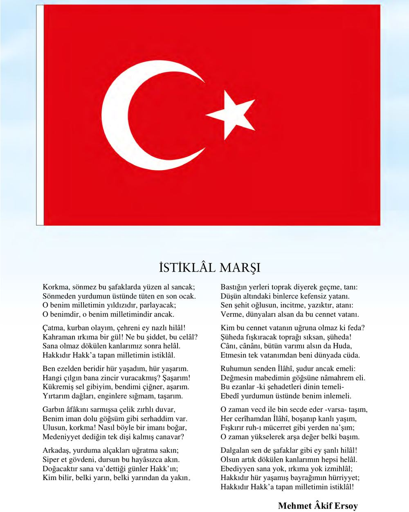

# İSTİKLÂL MARŞI

Korkma, sönmez bu şafaklarda yüzen al sancak;
Sönmeden yurdumun üstünde tüten en son ocak.
O benim milletimin yıldızıdır, parlayacak;
O benimdir, o benim milletimindir ancak.

Çatma, kurban olayım, çehreni ey nazlı hilâl!
Kahraman ırkıma bir gül! Ne bu şiddet, bu celâl?
Sana olmaz dökülen kanlarımız sonra helâl.
Hakkıdır Hakk'a tapan milletimin istiklâl.

Ben ezelden beridir hür yaşadım, hür yaşarım.
Hangi çılgın bana zincir vuracakmış? Şaşarım!
Kükremiş sel gibiyim, bendimi çiğner, aşarım.
Yırtarım dağları, enginlere sığmam, taşarım.

Garbın âfâkını sarmışsa çelik zırhlı duvar,
Benim iman dolu göğsüm gibi serhadim var.
Ulusun, korkma! Nasıl böyle bir imanı boğar,
Medeniyet dediğin tek dişi kalmış canavar?

Arkadaş, yurduma alçaklar uğratma sakın;
Siper et gövdeni, dursun bu hayâsızca akın.
Doğacaktır sana va'dettiği günler Hakk'ın;
Kim bilir, belki yarın, belki yarından da yakın.

Bastığın yerleri toprak diyerek geçme, tanı:
Düşün altındaki binlerce kefensiz yatanı.
Sen şehit oğluşun, incitme, yazıktır, atanı:
Verme, dünyaları alsan da bu cennet vatanı.

Kim bu cennet vatanın uğruna olmaz ki feda?
Şüheda fışkıracak toprağı sıksan, şüheda!
Canı, cânânı, bütün varımı alsan da Huda,
Etmesin tek vatanımdan beni dünyada cüda.

Ruhumun senden ilâhî, hudut ancak emeli:
Değmesin mabedimin göğsüne nâmahrem eli.
Bu ezanlar -ki şehadetleri dinin temeli-
Ebedî yurdumun üstünde benim inlemeli.

O zaman vecd ile bin secde eder -varsa- taşim,
Her cerîhamdan ilâhî, boşanıp kanlı yaşım,
Fışkırır ruh-ı mücerret gibi yerden na'şım;
O zaman yükselerek arşa değer belki başım.

Dalgalan sen de şafaklar gibi ey kanlı hilâl!
Olsun artık dökülen kanlarımın hepsi helâl.
Ebediyyen sana yok, Türk'e yok izmihlâl;
Hakkıdır hür yaşamış bayrağımın hürriyet;
Hakkıdır Hakk'a tapan milletimin istiklâl!

<!-- sayfa 3 -->

# GENÇLİĞE HİTABE

Ey Türk gençliği! Birinci vazifen, Türk istiklâlini, Türk Cumhuriyetini, ilelebet muhafaza ve müdafaa etmektir.

Mevcudiyetinin ve istikbalinin yegâne temeli budur. Bu temel, senin en kıymetli hazinendir. İstikbalde dahi, seni bu hazineden mahrum etmek isteyecek dâhilî ve hâricî bedhahların olacaktır. Bir gün, istiklâl ve cumhuriyeti müdafaa mecburiyetine düşersen, vazifeye atılmak için, içinde bulunacağın vaziyetin imkân ve şeraitini düşünmeyeceksin! Bu imkân ve şerait, çok namüsait bir mahiyette tezahür edebilir. İstiklâl ve cumhuriyetine kastedecek düşmanlar, bütün dünyada emsali görülmemiş bir galibiyetin mümessili olabilirler. Cebren ve hile ile aziz vatanın bütün kaleleri zapt edilmiş, bütün tersanelerine girilmiş, bütün orduları dağıtılmış ve memleketin her köşesi bilfiil işgal edilmiş olabilir. Bütün bu şeraitten daha elîm ve daha vahim olmak üzere, memleketin dâhilinde iktidara sahip olanlar gaflet ve dalâlet ve hattâ hıyanet içinde bulunabilirler. Hattâ bu iktidar sahipleri şahsî menfaatlerini, müstevlîlerin siyasî emelleriyle tevhit edebilirler. Millet, fakr u zaruret içinde harap ve bîtap düşmüş olabilir.

Ey Türk istikbalinin evlâdı! İşte, bu ahval ve şerait içinde dahi vazifen, Türk istiklâl ve cumhuriyetini kurtarmaktır. Muhtaç olduğun kudret, damarlarındaki asil kanda mevcuttur.

Mustafa Kemal Atatürk

<!-- sayfa 4 -->

MUSTAFA KEMAL ATATÜRK

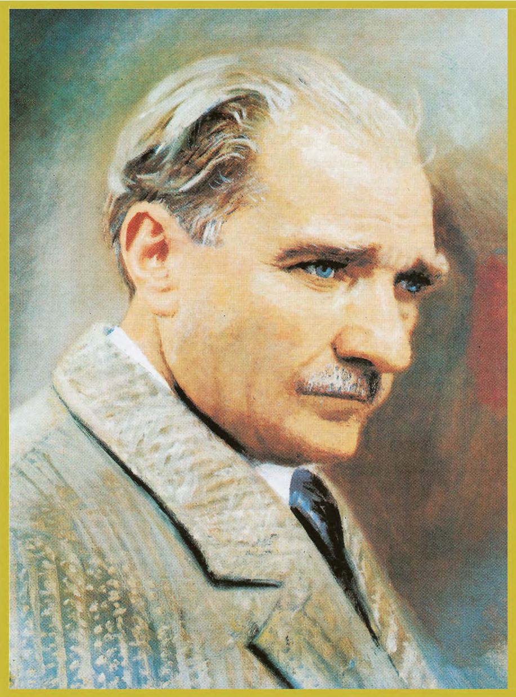
<!-- yer tutucu bulunamadı: sayfa sonuna eklendi -->

<!-- sayfa 5 -->

Verdiğiniz metin katmanı boş göründüğü için (`<<< >>>` arası boş) dönüştürülecek bir içerik bulunmamaktadır. Lütfen metin katmanını içeren içeriği paylaşın, böylece kurallarınıza uygun şekilde Markdown formatına çevirebilirim.

<!-- sayfa 6 -->

# İÇİNDEKİLER

| | |
| :--- | ---: |
| KİTABIN TANITIMI | 8 |
| 1. TEMA > HAYAT VE SANAT | 11 |
| 2. TEMA > SANATIN GÖRSEL DİLİ | 25 |
| 3. TEMA > SANATÇILAR VE ESERLERİ | 41 |
| 4. TEMA > ÇİZİM VE GÖRSEL İFADE | 57 |
| 5. TEMA > RENK VE ESTETİK | 71 |
| 6. TEMA > MİLLÎ DEĞERLER VE SANAT | 83 |
| 7. TEMA > MÜZE VE KÜLTÜR | 97 |
| TERİMLER SÖZLÜĞÜ | 112 |
| KAYNAKÇA | 114 |
| GÖRSEL VE GENEL AĞ KAYNAKÇASI | 115 |
| TÜRKİYE'NİN MÜLKİ İDARE BÖLÜMLERİ İLE KARA VE DENİZ KOMŞULARI HARİTASI | 116 |
| TÜRK DÜNYASI HARİTASI | 117 |

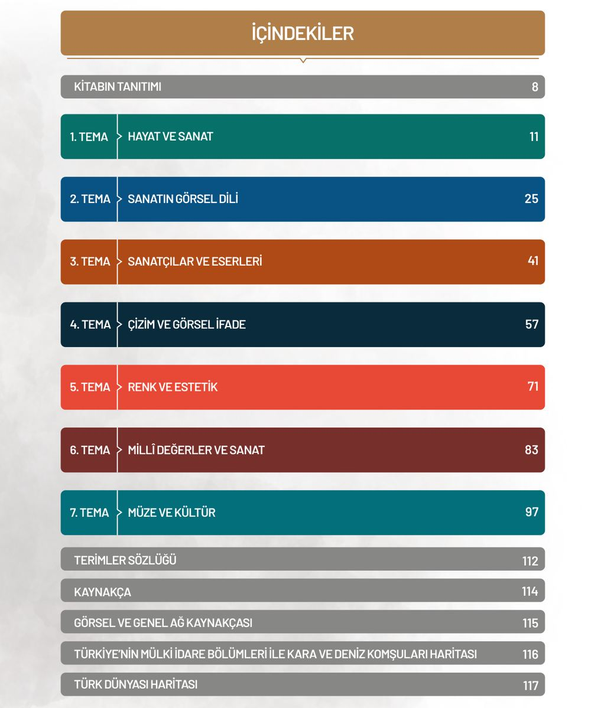
<!-- yer tutucu bulunamadı: sayfa sonuna eklendi -->

<!-- sayfa 7 -->

# KİTABIN TANITIMI

Bu kitap temalardan oluşmaktadır. Her tema başında tema kapak sayfası bulunmaktadır. Tema kapaklarında temanın adına, sınıf düzeyine, temayla ilgili hazırlanan sunumlara ve e-içeriklere ulaşmak için karekodlara yer verilmiştir.

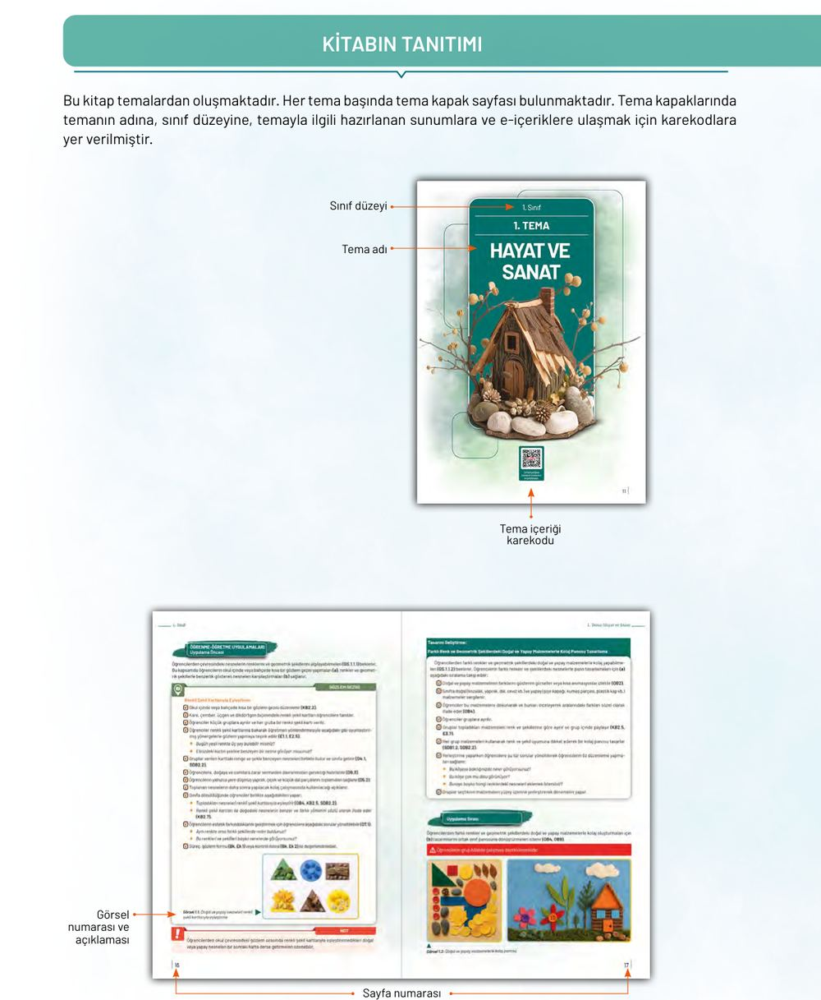

Sınıf düzeyi
Tema adı
Tema içeriği karekodu

Görsel numarası ve açıklaması

---

# ÖĞRENCİ-ÖĞRETMEN UYGULAMALARI
### Öğrenme Süreci

**Öğrenme Hedefleri**
Öğrencilerden çıkarılabilecek nesnelerin renklerini ve geometrik şekillerini ayırt edebilmelerinden (ÖGG 1.1.1. İsteklere, bu nesnelerin doğal veya yapay olması, renkleri ve geometrik şekilleri arasında karşılaştırma yapabilmelerinden (ÖG) sağlanır.

**Öğrenme Hedeflerine Ulaşılması:**
* Okul içinde rengi maviye benzeyen bir nesne gözlemleyebilir (KBB 2.21).
* Kare, çember, üçgen ve dikdörtgen şeklinde nesneleri renklerine göre gruplandırabilir.
* Renkleri, geometrik şekilleri farklı kartlara basılarak hazırlanan kartlarla grup oluşturma/ayırma gibi etkinliklerle öğrenir.
* Öğrenciler nesneleri renklerine ve şekillerine göre gruplandırmada üstünlükle eşleştirme gibi uygulamalarla öğrenir.
* Etkinliklerde nesneleri renklerine ve şekillerine göre gruplandırabilir.
    * Buş renkleri neye ait olabilir?
    * Nesneler hangi renklere sahip olabilir?
    * Nesneler hangi şekillere sahip olabilir?
* Öğrenciler, nesneleri renklerine ve şekillerine göre gruplandırma becerisi kazanır (ÖG 3.1).
* Öğrenciler, nesneleri renklerine ve şekillerine göre gruplandırma becerisi kazanır (ÖG 3.1).
* Toplanmış nesnelerin durumuna göre yapacak kolluk, uygulamalı kolluklar.
* Öğrencilerin de sınıf düzeyine uygun kolluklar kullanmalıdır.
* Ritmik sayma etkinliklerinde renkler (KBB 1. KBB 2. KBB 3. KBB 4. KBB 5. KBB 6. KBB 7. KBB 8. KBB 9. KBB 10. KBB 11. KBB 12. KBB 13. KBB 14. KBB 15. KBB 16. KBB 17. KBB 18. KBB 19. KBB 20. KBB 21. KBB 22. KBB 23. KBB 24. KBB 25. KBB 26. KBB 27. KBB 28. KBB 29. KBB 30. KBB 31. KBB 32. KBB 33. KBB 34. KBB 35. KBB 36. KBB 37. KBB 38. KBB 39. KBB 40. KBB 41. KBB 42. KBB 43. KBB 44. KBB 45. KBB 46. KBB 47. KBB 48. KBB 49. KBB 50. KBB 51. KBB 52. KBB 53. KBB 54. KBB 55. KBB 56. KBB 57. KBB 58. KBB 59. KBB 60. KBB 61. KBB 62. KBB 63. KBB 64. KBB 65. KBB 66. KBB 67. KBB 68. KBB 69. KBB 70. KBB 71. KBB 72. KBB 73. KBB 74. KBB 75. KBB 76. KBB 77. KBB 78. KBB 79. KBB 80. KBB 81. KBB 82. KBB 83. KBB 84. KBB 85. KBB 86. KBB 87. KBB 88. KBB 89. KBB 90. KBB 91. KBB 92. KBB 93. KBB 94. KBB 95. KBB 96. KBB 97. KBB 98. KBB 99. KBB 100. KBB 101. KBB 102. KBB 103. KBB 104. KBB 105. KBB 106. KBB 107. KBB 108. KBB 109. KBB 110. KBB 111. KBB 112. KBB 113. KBB 114. KBB 115. KBB 116. KBB 117. KBB 118. KBB 119. KBB 120. KBB 121. KBB 122. KBB 123. KBB 124. KBB 125. KBB 126. KBB 127. KBB 128. KBB 129. KBB 130. KBB 131. KBB 132. KBB 133. KBB 134. KBB 135. KBB 136. KBB 137. KBB 138. KBB 139. KBB 140. KBB 141. KBB 142. KBB 143. KBB 144. KBB 145. KBB 146. KBB 147. KBB 148. KBB 149. KBB 150. KBB 151. KBB 152. KBB 153. KBB 154. KBB 155. KBB 156. KBB 157. KBB 158. KBB 159. KBB 160. KBB 161. KBB 162. KBB 163. KBB 164. KBB 165. KBB 166. KBB 167. KBB 168. KBB 169. KBB 170. KBB 171. KBB 172. KBB 173. KBB 174. KBB 175. KBB 176. KBB 177. KBB 178. KBB 179. KBB 180. KBB 181. KBB 182. KBB 183. KBB 184. KBB 185. KBB 186. KBB 187. KBB 188. KBB 189. KBB 190. KBB 191. KBB 192. KBB 193. KBB 194. KBB 195. KBB 196. KBB 197. KBB 198. KBB 199. KBB 200. KBB 201. KBB 202. KBB 203. KBB 204. KBB 205. KBB 206. KBB 207. KBB 208. KBB 209. KBB 210. KBB 211. KBB 212. KBB 213. KBB 214. KBB 215. KBB 216. KBB 217. KBB 218. KBB 219. KBB 220. KBB 221. KBB 222. KBB 223. KBB 224. KBB 225. KBB 226. KBB 227. KBB 228. KBB 229. KBB 230. KBB 231. KBB 232. KBB 233. KBB 234. KBB 235. KBB 236. KBB 237. KBB 238. KBB 239. KBB 240. KBB 241. KBB 242. KBB 243. KBB 244. KBB 245. KBB 246. KBB 247. KBB 248. KBB 249. KBB 250. KBB 251. KBB 252. KBB 253. KBB 254. KBB 255. KBB 256. KBB 257. KBB 258. KBB 259. KBB 260. KBB 261. KBB 262. KBB 263. KBB 264. KBB 265. KBB 266. KBB 267. KBB 268. KBB 269. KBB 270. KBB 271. KBB 272. KBB 273. KBB 274. KBB 275. KBB 276. KBB 277. KBB 278. KBB 279. KBB 280. KBB 281. KBB 282. KBB 283. KBB 284. KBB 285. KBB 286. KBB 287. KBB 288. KBB 289. KBB 290. KBB 291. KBB 292. KBB 293. KBB 294. KBB 295. KBB 296. KBB 297. KBB 298. KBB 299. KBB 300. KBB 301. KBB 302. KBB 303. KBB 304. KBB 305. KBB 306. KBB 307. KBB 308. KBB 309. KBB 310. KBB 311. KBB 312. KBB 313. KBB 314. KBB 315. KBB 316. KBB 317. KBB 318. KBB 319. KBB 320. KBB 321. KBB 322. KBB 323. KBB 324. KBB 325. KBB 326. KBB 327. KBB 328. KBB 329. KBB 330. KBB 331. KBB 332. KBB 333. KBB 334. KBB 335. KBB 336. KBB 337. KBB 338. KBB 339. KBB 340. KBB 341. KBB 342. KBB 343. KBB 344. KBB 345. KBB 346. KBB 347. KBB 348. KBB 349. KBB 350. KBB 351. KBB 352. KBB 353. KBB 354. KBB 355. KBB 356. KBB 357. KBB 358. KBB 359. KBB 360. KBB 361. KBB 362. KBB 363. KBB 364. KBB 365. KBB 366. KBB 367. KBB 368. KBB 369. KBB 370. KBB 371. KBB 372. KBB 373. KBB 374. KBB 375. KBB 376. KBB 377. KBB 378. KBB 379. KBB 380. KBB 381. KBB 382. KBB 383. KBB 384. KBB 385. KBB 386. KBB 387. KBB 388. KBB 389. KBB 390. KBB 391. KBB 392. KBB 393. KBB 394. KBB 395. KBB 396. KBB 397. KBB 398. KBB 399. KBB 400. KBB 401. KBB 402. KBB 403. KBB 404. KBB 405. KBB 406. KBB 407. KBB 408. KBB 409. KBB 410. KBB 411. KBB 412. KBB 413. KBB 414. KBB 415. KBB 416. KBB 417. KBB 418. KBB 419. KBB 420. KBB 421. KBB 422. KBB 423. KBB 424. KBB 425. KBB 426. KBB 427. KBB 428. KBB 429. KBB 430. KBB 431. KBB 432. KBB 433. KBB 434. KBB 435. KBB 436. KBB 437. KBB 438. KBB 439. KBB 440. KBB 441. KBB 442. KBB 443. KBB 444. KBB 445. KBB 446. KBB 447. KBB 448. KBB 449. KBB 450. KBB 451. KBB 452. KBB 453. KBB 454. KBB 455. KBB 456. KBB 457. KBB 458. KBB 459. KBB 460. KBB 461. KBB 462. KBB 463. KBB 464. KBB 465. KBB 466. KBB 467. KBB 468. KBB 469. KBB 470. KBB 471. KBB 472. KBB 473. KBB 474. KBB 475. KBB 476. KBB 477. KBB 478. KBB 479. KBB 480. KBB 481. KBB 482. KBB 483. KBB 484. KBB 485. KBB 486. KBB 487. KBB 488. KBB 489. KBB 490. KBB 491. KBB 492. KBB 493. KBB 494. KBB 495. KBB 496. KBB 497. KBB 498. KBB 499. KBB 500. KBB 501. KBB 502. KBB 503. KBB 504. KBB 505. KBB 506. KBB 507. KBB 508. KBB 509. KBB 510. KBB 5

<!-- sayfa 8 -->

# Not ikonu
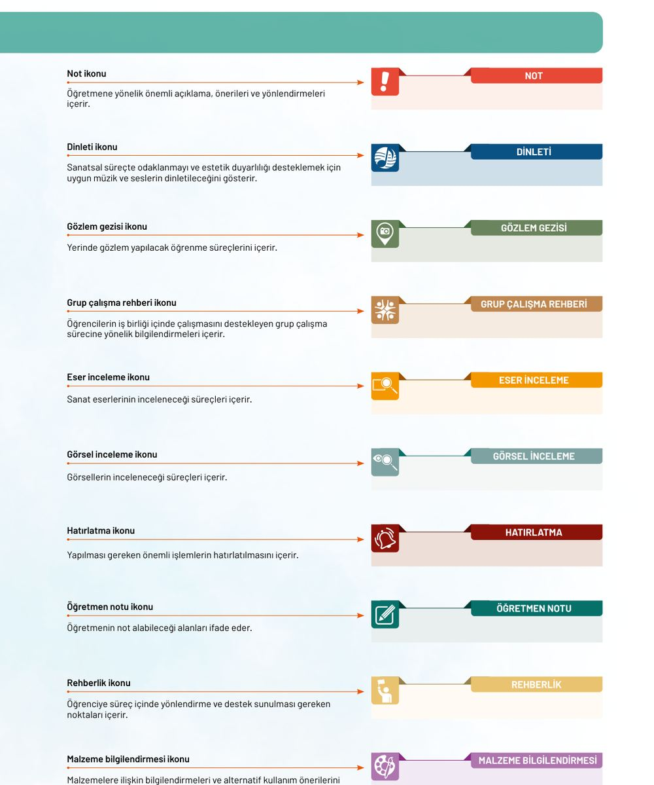
Öğretmene yönelik önemli açıklama, önerileri ve yönlendirmeleri içerir.

# Dinleti ikonu

Sanatsal süreçte odaklanmayı ve estetik duyarlılığı desteklemek için uygun müzik ve seslerin dinletileceğini gösterir.

# Gözlem gezisi ikonu

Yerinde gözlem yapılacak öğrenme süreçlerini içerir.

# Grup çalışma rehberi ikonu

Öğrencilerin iş birliği içinde çalışmasını destekleyen grup çalışma sürecine yönelik bilgilendirmeleri içerir.

# Eser inceleme ikonu

Sanat eserlerinin inceleneceği süreçleri içerir.

# Görsel inceleme ikonu

Görsellerin inceleneceği süreçleri içerir.

# Hatırlatma ikonu

Yapılması gereken önemli işlemlerin hatırlatılmasını içerir.

# Öğretmen notu ikonu

Öğretmenin not alabileceği alanları ifade eder.

# Rehberlik ikonu

Öğrenciye süreç içinde yönlendirme ve destek sunulması gereken noktaları içerir.

# Malzeme bilgilendirmesi ikonu

Malzemelere ilişkin bilgilendirmeleri ve alternatif kullanım önerilerini içerir.

<!-- sayfa 9 -->

Verdiğiniz metin katmanı boş olduğu için (`<<< >>>` arası boş) dönüştürülecek bir içerik bulunmamaktadır. Lütfen metin katmanını içeren içeriği paylaşın, böylece talimatlarınıza uygun şekilde Markdown formatına çevirebilirim.

<!-- sayfa 10 -->

1. Sınıf

# 1. TEMA

# HAYAT VE SANAT

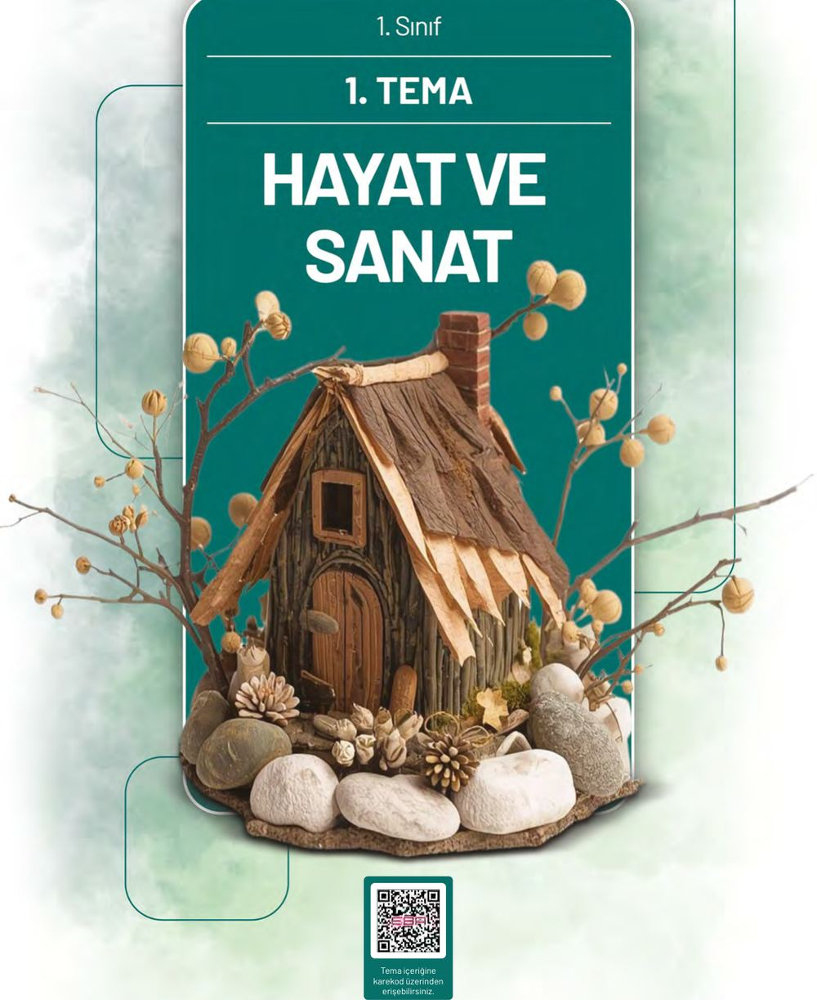

Tema içeriğine
karekod üzerinden

<!-- sayfa 11 -->

| TEMA ADI | Hayat ve Sanat |
| :--- | :--- |
| **SINIF DÜZEYİ** | 1 |
| **TEMA KAPSAMI** | Öğrencilerin doğadaki renkleri, geometrik şekilleri, doğal ve yapay nesneleri algılamaları; doğal ve yapay malzemeleri kullanarak pano oluşturmaları amaçlanmaktadır. |
| **DERS SAATİ** | 4 |
| **ALAN BECERİLERİ** | SAB1. Sanatsal Algılama, SAB4. Sanatsal Üretim Yapma |
| **KAVRAMSAL BECERİLER** | – |
| **EĞİLİMLER** | E1.1. Merak, E2.4. Güven, E2.5. Oyunseverlik, E3.7. Sistematiklik, E3.8. Soru Sorma |

## PROGRAMLAR ARASI BİLEŞENLER

| SOSYAL-DUYGUSAL ÖĞRENME BECERİLERİ | SDB1.1. Kendini Tanıma (Öz Farkındalık), SDB1.2. Kendini Düzenleme (Öz Düzenleme), SDB2.1. İletişim, SDB2.2. İş Birliği, SDB3.3. Sorumlu Karar Verme |
| :--- | :--- |
| **DEĞERLER** | D4. Dostluk, D5. Duyarlılık, D7. Estetik, D9. Merhamet, D14. Saygı, D18. Temizlik |
| **OKURYAZARLIK BECERİLERİ** | OB2. Dijital Okuryazarlık, OB4. Görsel Okuryazarlık, OB9. Sanat Okuryazarlığı |
| **DİSİPLİNLER ARASI İLİŞKİLER** | Hayat Bilgisi, Matematik |
| **BECERİLER ARASI İLİŞKİLER** | KB2.2. Gözlemleme, KB2.5. Sınıflandırma, KB2.7. Karşılaştırma, SAB1.2. Sanatsal Karşılaştırma |

### ÖĞRENME ÇIKTILARI VE SÜREÇ BİLEŞENLERİ

**GS.1.1.1. Çevresindeki nesnelerin renklerini ve geometrik şekillerini algılayabilme**
a) Nesnelerin renklerini ve geometrik şekillerini gözlemler.
b) Renkler ve geometrik şekillerle benzerlik gösteren nesneleri karşılaştırır.

**GS.1.1.2. Farklı renkler ve geometrik şekillerdeki doğal ve yapay malzemelerle kolaj yapabilme**
a) Farklı renkler ve şekillerdeki nesnelerle pano tasarlar.
b) Farklı renkler ve geometrik şekillerdeki doğal ve yapay malzemelerle kolaj oluşturur.

| İÇERİK ÇERÇEVESİ | Renkler ve Geometrik Şekiller   Doğal ve Yapay Nesnelerle Kolaj |
| :--- | :--- |
| **ANAHTAR KAVRAMLAR** | çevre bilinci, doğal malzeme, geometrik şekil, kolaj, renk, yapay malzeme |
| **ÖĞRENME KANITLARI (ÖLÇME VE DEĞERLENDİRME)** | Öğrenme çıktıları gözlem formları, kontrol listeleri, öz değerlendirme formları ve akran değerlendirme formları kullanılarak değerlendirilebilir. Performans görevi olarak öğrencilerden doğal ve yapay malzemelerle kolaj tekniğini kullanarak ortak bir sınıf panosu oluşturmaları istenir. Öğrencilerden sanatsal ürünlerde renk ve geometrik şekil uyumuna dikkat etmeleri beklenir. |

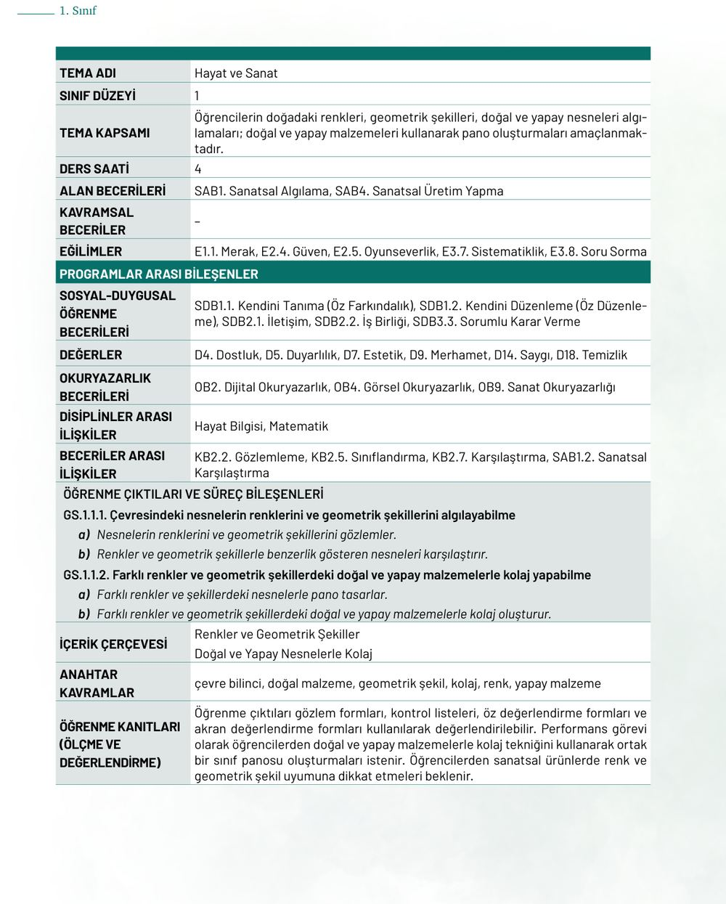
<!-- yer tutucu bulunamadı: sayfa sonuna eklendi -->

<!-- sayfa 12 -->

# TEMA AKIŞI

* Doğadaki Nesneleri Renkli Şekil Kartlarıyla Eşleştirme
* Farklı Renk ve Geometrik Şekillerdeki Doğal ve Yapay Malzemelerle Kolaj Panosu Tasarlama
* Farklı Renk ve Geometrik Şekillerdeki Doğal ve Yapay Malzemelerle Kolaj Panosu Hazırlama
* Çalışma Ortamını Düzenleme
* Değerlendirme
* Sergileme
* Farklılaştırma

# TEMA HAZIRLIĞI

Öğretmen tarafından ders öncesinde kolaj tekniğine ilişkin kavramsal ve uygulamalı hazırlıklar yapılır. Bu kapsamda aşağıdakilerin gerçekleştirilmesi beklenir:

* Kolaj etkinliği için grup sayısına uygun büyük boy kâğıt veya karton panolar temin edilir.
* Öğrencilerin bireysel malzeme ihtiyacını karşılayamadığı durumlar için kozalak, yaprak, ağaç dalı, ip, düğme, kumaş parçası, makas, mum tipi yapıştırıcı ve renkli kâğıt gibi malzemeler sınıf mevcudu dikkate alınarak hazır bulundurulur.

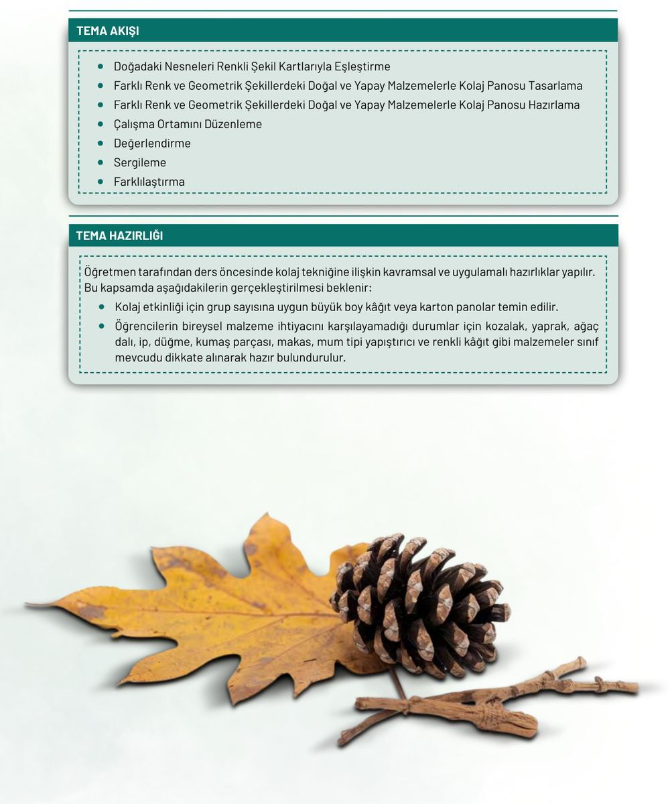

<!-- sayfa 13 -->

Öğrenciler tarafından ders öncesinde aşağıdaki başlıklar kapsamında önerilen hazırlıklar yapılır.

---

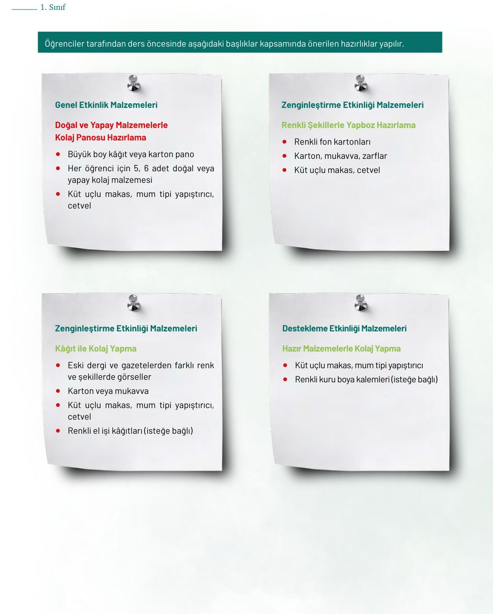

### Genel Etkinlik Malzemeleri

**Doğal ve Yapay Malzemelerle Kolaj Panosu Hazırlama**

* Büyük boy kâğıt veya karton pano
* Her öğrenci için 5, 6 adet doğal veya yapay kolaj malzemesi
* Küt uçlu makas, mum tipi yapıştırıcı, cetvel

---

### Zenginleştirme Etkinliği Malzemeleri

**Renkli Şekillerle Yapboz Hazırlama**

* Renkli fon kartonları
* Karton, mukavva, zarflar
* Küt uçlu makas, cetvel

---

**Kâğıt ile Kolaj Yapma**

* Eski dergi ve gazetelerden farklı renk ve şekillerde görseller
* Karton veya mukavva
* Küt uçlu makas, mum tipi yapıştırıcı, cetvel
* Renkli el işi kâğıtları (isteğe bağlı)

---

### Destekleme Etkinliği Malzemeleri

**Hazır Malzemelerle Kolaj Yapma**

* Küt uçlu makas, mum tipi yapıştırıcı
* Renkli kuru boya kalemleri (isteğe bağlı)

<!-- sayfa 14 -->

# ÖĞRENME-ÖĞRETME YAŞANTILARI

## TEMEL KABULLER
Öğrencilerin renkler hakkında temel bilgiye sahip oldukları, şekillerin benzerlik ve farklılıklarını algılayabildikleri kabul edilmektedir.

## ÖN DEĞERLENDİRME SÜRECİ
Renkler ve geometrik şekillere ilişkin ön bilgilerini değerlendirmek için öğrencilere aşağıdakilere benzer sorular sorulur:

* Sınıfınızda kırmızı, turuncu ve mavi renkteki nesneleri gösterir misiniz?
* Çevrenizde pencere, kapı ve saatin şekillerine benzeyen neler görüyorsunuz?

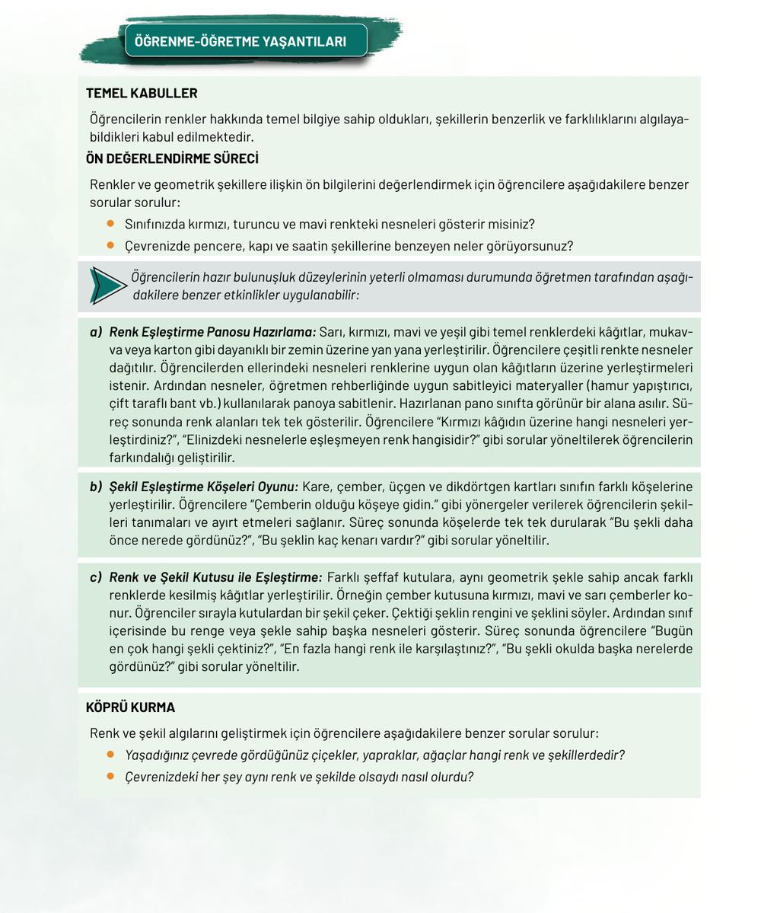

Öğrencilerin hazır bulunuluk düzeylerinin yeterli olmaması durumunda öğretmen tarafından aşağıdakilere benzer etkinlikler uygulanabilir:

**a) Renk Eşleştirme Panosu Hazırlama:** Sarı, kırmızı, mavi ve yeşil gibi temel renklerdeki kâğıtlar, mukavva veya karton gibi dayanıklı bir zemin üzerine yan yana yerleştirilir. Öğrencilere çeşitli renkte nesneler dağıtılır. Öğrencilerden ellerindeki nesneleri renklerine uygun olan kâğıtların üzerine yerleştirmeleri istenir. Ardından nesneler, öğretmen rehberliğinde uygun sabitleyici materyaller (hamur yapıştırıcı, çift taraflı bant vb.) kullanılarak panoya sabitlenir. Hazırlanan pano sınıfta görünür bir alana asılır. Süreç sonunda renk alanları tek tek gösterilir. Öğrencilere “Kırmızı kâğıdın üzerine hangi nesneleri yerleştirdiniz?”, “Elinizdeki nesnelerle eşleşmeyen renk hangisidir?” gibi sorular yöneltilerek öğrencilerin farkındalığı geliştirilir.

**b) Şekil Eşleştirme Köşeleri Oyunu:** Kare, çember, üçgen ve dikdörtgen kartları sınıfın farklı köşelerine yerleştirilir. Öğrencilere “Çemberin olduğu köşeye gidin.” gibi yönergeler verilerek öğrencilerin şekilleri tanımaları ve ayırt etmeleri sağlanır. Süreç sonunda köşelerde tek tek durularak “Bu şekli daha önce nerede gördünüz?”, “Bu şeklin kaç kenarı vardır?” gibi sorular yöneltilir.

**c) Renk ve Şekil Kutusu ile Eşleştirme:** Farklı şeffaf kutulara, aynı geometrik şekle sahip ancak farklı renklerde kesilmiş kâğıtlar yerleştirilir. Örneğin çember kutusuna kırmızı, mavi ve sarı çemberler konur. Öğrenciler sırayla kutulardan bir şekil çeker. Çektiği şeklin rengini ve şeklini söyler. Ardından sınıf içerisinde bu renge veya şekle sahip başka nesneleri gösterir. Süreç sonunda öğrencilere “Bugün en çok hangi şekli çektiniz?”, “En fazla hangi renk ile karşılaştınız?”, “Bu şekli okulda başka nerelerde gördünüz?” gibi sorular yöneltilir.

## KÖPRÜ KURMA
Renk ve şekil algılarını geliştirmek için öğrencilere aşağıdakilere benzer sorular sorulur:

* Yaşadığınız çevrede gördüğünüz çiçekler, yapraklar, ağaçlar hangi renk ve şekillerdedir?
* Çevrenizdeki her şey aynı renk ve şekilde olsaydı nasıl olurdu?

<!-- sayfa 15 -->

# ÖĞRENME-ÖĞRETME UYGULAMALARI
## Uygulama Öncesi

Öğrencilerden çevresindeki nesnelerin renklerini ve geometrik şekillerini algılayabilmeleri **(GS.1.1.1)** beklenir. Bu kapsamda öğrencilerin okul içinde veya bahçede kısa bir gözlem gezisi yapmaları **(a)**, renkler ve geometrik şekillerle benzerlik gösteren nesneleri karşılaştırmaları **(b)** sağlanır.

---

### GÖZLEM GEZİSİ

#### Renkli Şekil Kartlarıyla Eşleştirme

* Okul içinde veya bahçede kısa bir gözlem gezisi düzenlenir **(KB2.2)**.
* Kare, çember, üçgen ve dikdörtgen biçimindeki renkli şekil kartları öğrencilere tanıtılır.
* Öğrenciler küçük gruplara ayrılır ve her gruba bir renkli şekil kartı verilir.
* Öğrenciler renkli şekil kartlarına bakarak öğretmen yönlendirmesiyle aşağıdaki gibi oyunlaştırılmış yönergelerle gözlem yapmaya teşvik edilir **(E1.1, E2.5)**:
    * Bugün yeşil renkte üç şey bulabilir misiniz?
    * Elinizdeki kartın şekline benzeyen bir nesne görüyor musunuz?
* Gruplar verilen karttaki renge ve şekle benzeyen nesneleri birlikte bulur ve sınıfa getirir **(D4.1, SDB2.2)**.
* Öğrencilere, doğaya ve canlılara zarar vermeden davranmaları gerektiği hatırlatılır **(D9.3)**.
* Öğrencilerin yalnızca yere düşmüş yaprak, çiçek ve küçük dal parçalarını toplamaları sağlanır **(D5.2)**.
* Toplanan nesnelerin daha sonra yapılacak kolaj çalışmasında kullanılacağı açıklanır.
* Sınıfa dönüldüğünde öğrenciler birlikte aşağıdakileri yapar:
    * Topladıkları nesneleri renkli şekil kartlarıyla eşleştirir **(OB4, KB2.5, SDB2.2)**.
    * Renkli şekil kartları ile doğadaki nesnelerin benzer ve farklı yönlerini sözlü olarak ifade eder **(KB2.7)**.
* Öğrencilerin estetik farkındalıklarını geliştirmek için öğrencilere aşağıdaki sorular yöneltilebilir **(D7.1)**:
    * Aynı renkte ama farklı şekillerde neler buldunuz?
    * Bu renkleri ve şekilleri başka nerelerde görüyorsunuz?
* Süreç, gözlem formu **(Bk. Ek 1)** veya kontrol listesi **(Bk. Ek 2)** ile değerlendirilebilir.

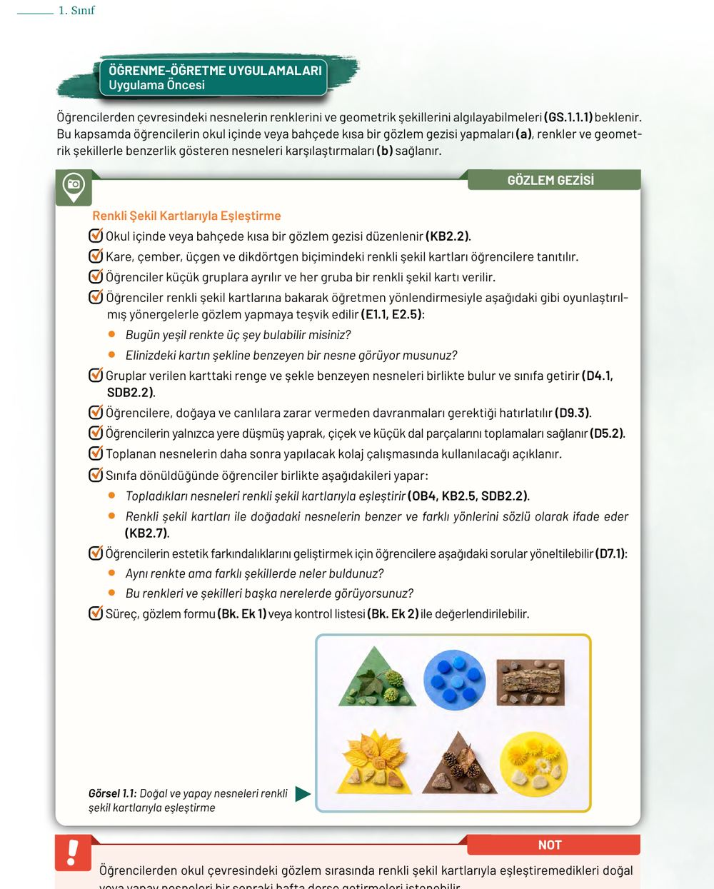
**Görsel 1.1:** Doğal ve yapay nesneleri renkli şekil kartlarıyla eşleştirme

---

**NOT**
Öğrencilerden okul çevresindeki gözlem sırasında renkli şekil kartlarıyla eşleştiremedikleri doğal veya yapay nesneleri bir sonraki hafta derse getirmeleri istenebilir.

<!-- sayfa 16 -->

# Tasarım Geliştirme:
## Farklı Renk ve Geometrik Şekillerdeki Doğal ve Yapay Malzemelerle Kolaj Panosu Tasarlama

Öğrencilerden farklı renkler ve geometrik şekillerdeki doğal ve yapay malzemelerle kolaj yapabilmelerini (**GS.1.1.2**) beklenir. Öğrencilerin farklı renkler ve şekillerdeki nesnelerle pano tasarlamaları için **(a)** aşağıdaki sıralama takip edilir:

*   Doğal ve yapay malzemelerin farklarını gösteren görseller veya kısa animasyonlar izletilir (**OB2**).
*   Sınıfta doğal (kozalak, yaprak, dal, ceviz vb.) ve yapay (şişe kapağı, kumaş parçası, plastik kap vb.) malzemeler sergilenir.
*   Öğrenciler bu malzemelere dokunarak ve bunları inceleyerek aralarındaki farkları sözel olarak ifade eder (**OB4**).
*   Öğrenciler gruplara ayrılır.
*   Gruplar topladıkları malzemeleri renk ve şekillerine göre ayırır ve grup içinde paylaşır (**KB2.5, E3.7**).
*   Her grup malzemeleri kullanarak renk ve şekil uyumuna dikkat ederek bir kolaj panosu tasarlar (**SDB1.2, SDB2.2**).
*   Yerleştirme yaparken öğrencilere şu tür sorular yöneltilerek öğrencilerin öz düzenleme yapmaları sağlanır:
    *   Bu köşeye baktığınızda neler görüyorsunuz?
    *   Bu köşe çok mu dolu görünüyor?
    *   Buraya başka hangi renklerdeki nesneleri eklemek istersiniz?
*   Gruplar seçtikleri malzemeleri yüzey üzerine yerleştirerek denemeler yapar.

### Uygulama Sırası

Öğrencilerden farklı renkler ve geometrik şekillerdeki doğal ve yapay malzemelerle kolaj oluşturmaları için **(b)** tasarımlarını ortak sınıf panosuna dönüştürmeleri istenir (**OB4, OB9**).

> ⚠️ Öğrencilerin grup hâlinde çalışması desteklenmelidir.

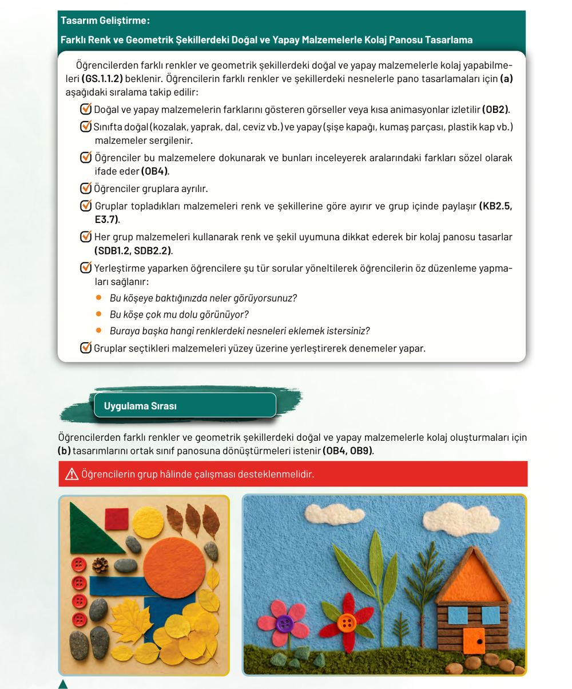

<!-- sayfa 17 -->

# 1. ETKİNLİK
## Farklı Renk ve Geometrik Şekillerdeki Doğal ve Yapay Malzemelerle Kolaj Panosu Hazırlama

Öğrenciler farklı renk ve geometrik şekillerdeki doğal ve yapay malzemelerle kolaj hazırlamak için aşağıdaki aşamaları sırasıyla uygular:

1. Gruplar kullanacakları doğal ve yapay malzemeleri seçer.
2. “Bu malzemeyi neden seçtiniz?” gibi kısa sorulara sözlü yanıt vererek seçme nedenlerini açıklar (SDB3.3).
3. Gruplar doğal ve yapay malzemeleri, mum tipi yapıştırıcıyı ve küt uçlu makası hazır bulundurur.
4. Kesme ve buruşturma gibi temel şekillendirme teknikleri öğrencilere kısa uygulamalarla gösterilir.
5. Öğrenciler farklı renk, doku ve biçimdeki malzemeleri bir arada kullanarak kolaj çalışmalarını zenginleştirir.
6. Yapıştırma aşamasında parçaların düzgün ve sağlam yerleşmesine dikkat edilir.
7. Gruplar, hazırladıkları çalışmaları sınıfla paylaşır.
8. Kullandıkları malzemeleri ve yaptıkları tercihleri açıklar.
9. Süreçte zorlandıkları ve keyif aldıkları aşamaları, çalışmayı tekrar yaptıklarında değiştirmek istedikleri noktaları sözel olarak ifade eder (SDB1.2).
10. Gruplar birbirlerinin çalışmalarına “En çok beğendiğimiz yer…”, “Bu renkleri seçmeniz güzel olmuş çünkü…” gibi cümlelerle olumlu ve yapıcı geri bildirim verir.
11. Süreç ve ürünle ilgili farkındalık kazanmaları için öğrencilere aşağıdakilere benzer öz değerlendirme soruları yöneltilir:
    * Bu çalışmada hangi renkleri kullandınız?
    * Çalışmanızda hangi şekilleri görüyorsunuz?
    * Çalışmanızdaki doğal olan bir malzemeyi gösterebilir misiniz?
    * Malzemeleri yerleştirirken en çok hangi kısmı yapmayı sevdiniz?
    * Bu çalışmayı tekrar yapsaydınız neleri farklı yapardınız?
12. Öğrencilere arkadaşlarının çalışmalarındaki olumlu yönleri fark etmeleri amacıyla aşağıdaki sorulardan uygun olanlar yöneltilir:
    * Arkadaşınızın çalışmasında kullandığı doğal bir malzemeyi gösterebilir misiniz?
    * Panoyu hazırlarken birlikte yapmaktan en çok keyif aldığınız bölüm hangisiydi?

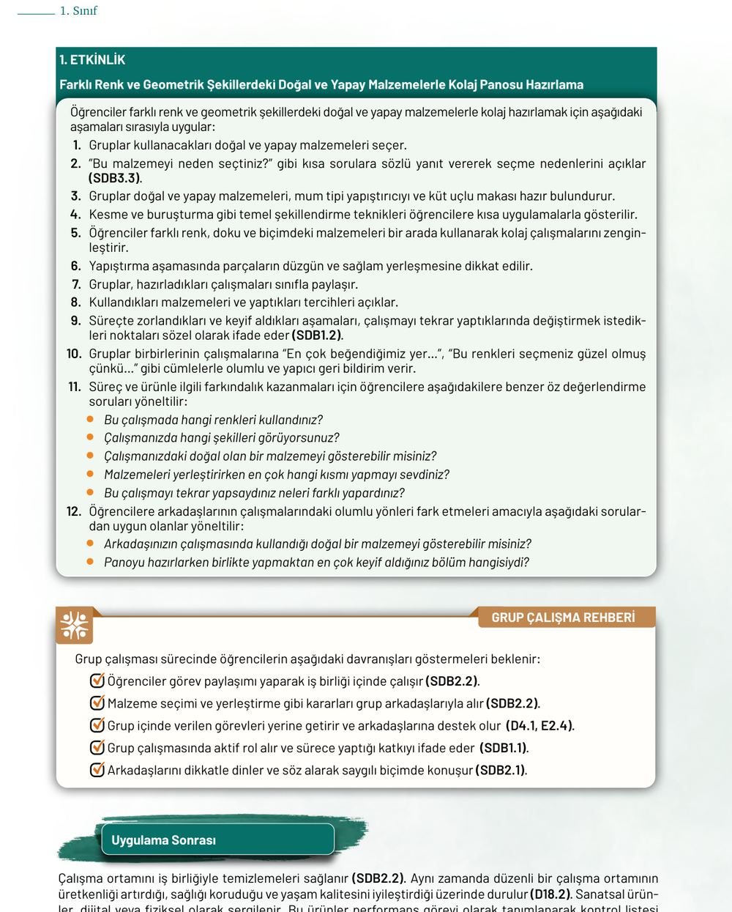

> ### GRUP ÇALIŞMA REHBERİ
> 
> Grup çalışması sürecinde öğrencilerin aşağıdaki davranışları göstermeleri beklenir:
> * [v] Öğrenciler görev paylaşımı yaparak iş birliği içinde çalışır (SDB2.2).
> * [v] Malzeme seçimi ve yerleştirme gibi kararları grup arkadaşlarıyla alır (SDB2.2).
> * [v] Grup içinde verilen görevleri yerine getirir ve arkadaşlarına destek olur (D4.1, E2.4).
> * [v] Grup çalışmasında aktif rol alır ve sürece yaptığı katkıyı ifade eder (SDB1.1).
> * [v] Arkadaşlarını dikkatle dinler ve söz alarak saygılı biçimde konuşur (SDB2.1).

## Uygulama Sonrası

Çalışma ortamını iş birliğiyle temizlemeleri sağlanır (SDB2.2). Aynı zamanda düzenli bir çalışma ortamının üretkenliği artırdığı, sağlığı koruduğu ve yaşam kalitesini iyileştirdiği üzerinde durulur (D18.2). Sanatsal ürünler dijital veya fiziksel olarak sergilenir. Bu ürünler performans görevi olarak tanımlanarak kontrol listesi

<!-- sayfa 18 -->

# FARKLILAŞTIRMA

## Zenginleştirme

⚠️ Öğrenciler aşağıdaki etkinliklerden birine yönlendirilir.

### Seçmeli Etkinlik 1: Renkli Şekillerle Yapboz Hazırlama

Öğrenciler renk ve geometrik şekillerle ilgili yapboz hazırlamak için aşağıdaki adımları sırasıyla gerçekleştirir.

1. Renkli fon kartonları, mukavva, kalem, cetvel, küt uçlu makas ve zarfı hazır bulundurur.
2. Renkli fon kartonlarına geometrik şekiller çizer.
3. Şekilleri keserek karışık parçalar oluşturur.
4. Hazırladığı parçaları bir araya getirerek yapboz oluşturur.
5. Başka bir arkadaşından veya gruplardan hazırladığı yapbozu çözmesini ister.
6. Süreç ve ürünle ilgili farkındalık kazanmaları için öğrencilere aşağıdakilere benzer öz değerlendirme soruları yöneltilir:

* Yapbozunuzda hangi şekilleri kullandınız?
* Renkleri seçerken neye dikkat ettiniz?
* Arkadaşınızın yapbozunu çözerken sizi en çok ne mutlu etti?
* Bu çalışmayı tekrar yapsaydınız neleri farklı yapardınız?

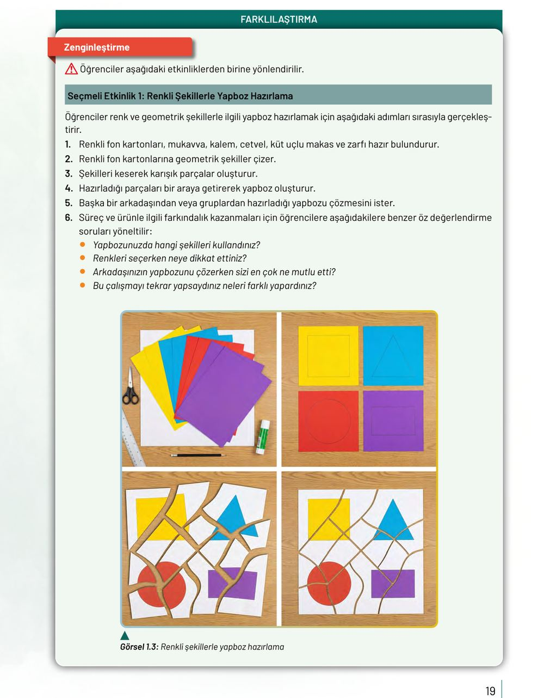

**Görsel 1.3:** Renkli şekillerle yapboz hazırlama

<!-- sayfa 19 -->

# Seçmeli Etkinlik 2: Kâğıt ile Kolaj Yapma

Öğrenciler gazete ve dergilerden faydalanarak kolaj çalışması yapmak için aşağıdaki adımları sırasıyla takip eder:

1. Eski gazete ve dergilerden farklı renklerde ve şekillerde görseller seçer.
2. Seçtiği görselleri renk ve şekillerine göre ayırır.
3. Kesme, katlama ve buruşturma gibi şekillendirme işlemlerini kullanır.
4. Çalışmalarına öğrendiği harfleri dâhil eder.
5. Görselleri çalışma yüzeyine yapıştırmadan önce denemeler yapar ve yapıştırır.
6. Yapıştırma aşamasında parçaların kaymaması ve düzgün yerleşmesi için yavaş ve dikkatli çalışır.
7. Süreç ve ürünle ilgili farkındalık kazanmaları için öğrencilere aşağıdakilere benzer öz değerlendirme soruları yöneltilir:
    * Çalışmanızda hangi renkler daha çok yer aldı?
    * Hangi şekli daha kolay kestiniz?
    * Bu çalışmayı yaparken aklınıza neler geldi?
    * Bu çalışmayı tekrar yapsaydınız neleri farklı yapardınız?

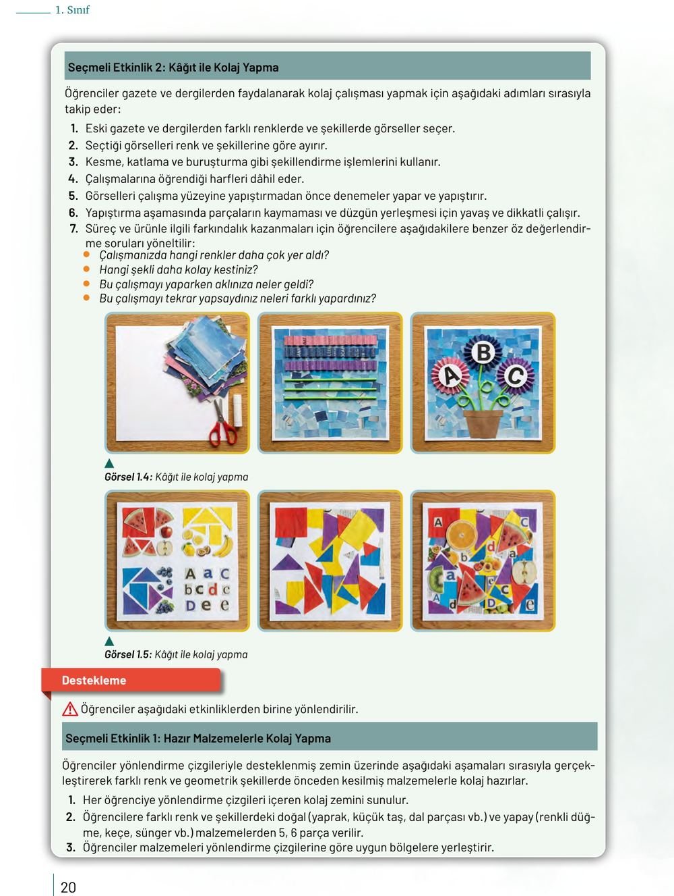

*Görsel 1.4: Kâğıt ile kolaj yapma*

*Görsel 1.5: Kâğıt ile kolaj yapma*

## Destekleme

⚠️ Öğrenciler aşağıdaki etkinliklerden birine yönlendirilir.

### Seçmeli Etkinlik 1: Hazır Malzemelerle Kolaj Yapma

Öğrenciler yönlendirme çizgileriyle desteklenmiş zemin üzerinde aşağıdaki aşamaları sırasıyla gerçekleştirerek farklı renk ve geometrik şekillerde önceden kesilmemiş malzemelerle kolaj hazırlar.

1. Her öğrenciye yönlendirme çizgileri içeren kolaj zemini sunulur.
2. Öğrencilere farklı renk ve şekillerdeki doğal (yaprak, küçük taş, dal parçası vb.) ve yapay (renkli düğme, keçe, sünger vb.) malzemelerden 5, 6 parça verilir.

<!-- sayfa 20 -->

4. Doğru yerleştirmeyi yaptıktan sonra malzemeleri yapıştırır.
5. Süreç ve ürünle ilgili farkındalık kazanmaları için öğrencilere aşağıdakilere benzer öz değerlendirme soruları yöneltilir:
    * Bu bölüme neden bu malzemeyi yerleştirdiniz?
    * Çalışmanızda hangi renkler yan yana geldi?
    * Doğal olan bir malzemeyi gösterebilir misiniz?
    * Yapıştırma yaparken nelere dikkat ettiniz?
    * Çalışmayı yaparken zorlandığınız bir yer oldu mu?

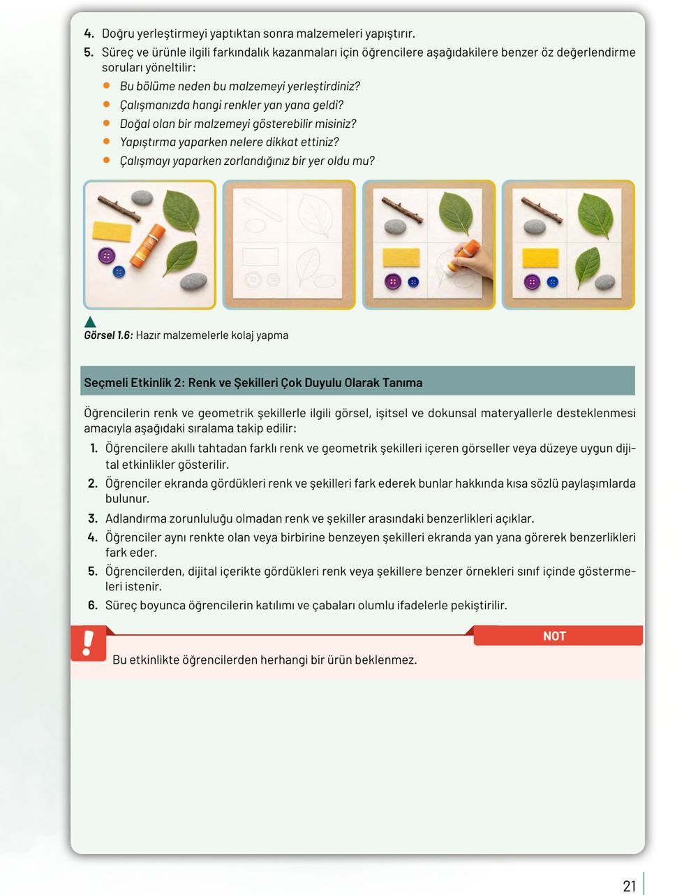

**Görsel 1.6:** Hazır malzemelerle kolaj yapma

---

### Seçmeli Etkinlik 2: Renk ve Şekilleri Çok Duyulu Olarak Tanıma

Öğrencilerin renk ve geometrik şekillerle ilgili görsel, işitsel ve dokunsal materyallerle desteklenmesi amacıyla aşağıdaki sıralama takip edilir:

1. Öğrencilere akıllı tahtadan farklı renk ve geometrik şekilleri içeren görseller veya düzeye uygun dijital etkinlikler gösterilir.
2. Öğrenciler ekranda gördükleri renk ve şekilleri fark ederek bunlar hakkında kısa sözlü paylaşımlarda bulunur.
3. Adlandırma zorunluluğu olmadan renk ve şekiller arasındaki benzerlikleri açıklar.
4. Öğrenciler aynı renkte olan veya birbirine benzeyen şekilleri ekranda yan yana görerek benzerlikleri fark eder.
5. Öğrencilerden, dijital içerikte gördükleri renk veya şekillere benzer örnekleri sınıf içinde göstermeleri istenir.
6. Süreç boyunca öğrencilerin katılımı ve çabaları olumlu ifadelerle pekiştirilir.

> **NOT**
> Bu etkinlikte öğrencilerden herhangi bir ürün beklenmez.

<!-- sayfa 21 -->

EK 1. GÖZLEM FORMU

Bu gözlem formu öğrencilerin öğrenme sürecindeki davranışlarını, sürece katılım düzeylerini ve gelişim alanlarını izleyebilmeniz amacıyla hazırlanmıştır. Gözlem sürecinde her bir ölçüt öğrencinin öğrenme deneyimi boyunca sergilediği gözlemlenebilir davranışlara dayalı olarak değerlendirilmelidir. Formun uygulanmasında öğrencinin sürece yönelik çabası, sınıf içi etkileşimi ve öğrenme becerilerindeki ilerlemesi dikkate alınmalıdır. Formdaki her ölçüt, öğrencinin performansına göre aşağıdaki üç düzeyden biri seçilerek işaretlenmelidir:

* **Hayır** : Davranışı henüz göstermiyor/desteğe ihtiyaç duyuyor.
* **Kısmen**: Davranışı zaman zaman veya kısmen gösteriyor.
* **Evet** : Davranışı istikrarlı şekilde gösteriyor.

Elde edilen gözlem bulgularının öğrencilerin bireysel gelişimlerini destekleyecek geri bildirimlerin verilmesinde ve öğretim sürecinin iyileştirilmesinde yol gösterici olarak kullanılması önerilmektedir. “Hayır” veya “Kısmen” olarak işaretlenen öğrenci davranışı geliştirilmelidir.

# GÖZLEM FORMU

Etkinlik Adı : Doğadaki Nesneleri Renkli Şekil Kartlarıyla Eşleştirme (Gözlem Gezisi)
Adı-Soyadı : __________________________
Sınıfı-Numarası : ________ / ________
Tarih : ........ / ........ / 20 ......

| No | Ölçütler | Hayır | Kısmen | Evet |
|---|---|---|---|---|
| 1 | Nesnelerin şekil özelliklerini fark etti. | | | |
| 2 | Bulduğu nesneyi verilen kartla eşleştirdi. | | | |
| 3 | Nesneler arasındaki benzerlikleri sözel olarak ifade etti. | | | |
| 4 | Doğaya zarar vermeden hareket etti. | | | |
| 5 | Grup çalışmasına uygun davranışlar sergiledi. | | | |

**Öğretmen Görüşleri/Açıklamalar:** ..................................................................................................................
........................................................................................................................................................................
........................................................................................................................................................................
........................................................................................................................................................................

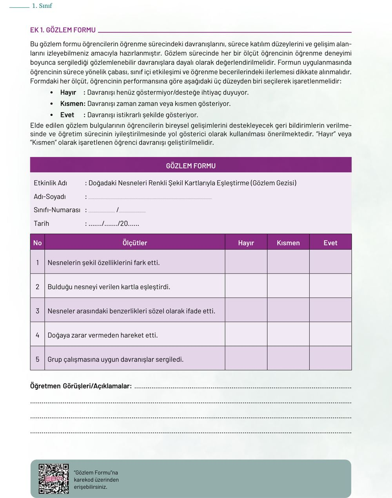 “Gözlem Formu”na karekod üzerinden erişebilirsiniz.

<!-- sayfa 22 -->

# EK 2. KONTROL LİSTESİ

Bu kontrol listesi öğrencilerden beklenen becerilerin belirlenen ölçütler doğrultusunda gerçekleşme düzeyini nesnel olarak değerlendirmek amacıyla hazırlanmıştır. Formdaki her ölçüt, öğrencinin performansına göre aşağıdaki iki düzeyden biri seçilerek işaretlenmelidir:

* **Hayır** : Öğrenci ilgili davranışı süreç boyunca sergilemez veya desteğe ihtiyaç duyar.
* **Evet** : Öğrenci ilgili davranışı sürecin büyük bölümünde sergiler.

Değerlendirme süreci **puanlama yapılmadan**, öğrencinin bireysel gelişimi dikkate alınarak ve **süreç odaklı** bir yaklaşımla yürütülmelidir. Elde edilen bulguların öğrencilerin öğrenme süreçlerini destekleyici geri bildirimlerin verilmesinde ve öğretim sürecinin planlanmasında yol gösterici olarak kullanılması önerilmektedir. “Hayır” olarak işaretlenen öğrenci davranışı geliştirilmelidir.

## KONTROL LİSTESİ

Etkinlik Adı : Doğadaki Nesneleri Renkli Şekil Kartlarıyla Eşleştirme
Adı-Soyadı : ...........................................................................
Sınıfı-Numarası : ............ / ............
Tarih : ........./........../20......

| No | Ölçütler | Hayır | Evet |
| :--- | :--- | :---: | :---: |
| 1 | Renkli şekil kartlarını tanıdı. | | |
| 2 | Renk bakımından benzer nesneleri eşleştirdi. | | |
| 3 | Şekil bakımından benzer nesneleri eşleştirdi. | | |
| 4 | Doğaya karşı özenli davrandı. | | |
| 5 | Grup çalışmasına aktif katılım gösterdi. | | |

**Öğretmen Görüşleri/Açıklamalar:** ..........................................................................................................................................
.......................................................................................................................................................................................................
.......................................................................................................................................................................................................
................................................................................................................................

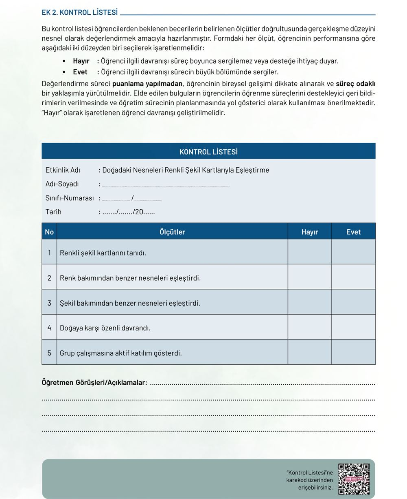
<!-- yer tutucu bulunamadı: sayfa sonuna eklendi -->

<!-- sayfa 23 -->

# EK 3. KONTROL LİSTESİ

Bu kontrol listesi öğrencilerden beklenen becerilerin belirlenen ölçütler doğrultusunda gerçekleşme düzeyini nesnel olarak değerlendirmek amacıyla hazırlanmıştır. Formdaki her ölçüt, öğrencinin performansına göre aşağıdaki iki düzeyden biri seçilerek işaretlenmelidir:

* **Hayır** : Öğrenci ilgili davranışı süreç boyunca sergilemez veya desteğe ihtiyaç duyar.
* **Evet** : Öğrenci ilgili davranışı sürecin büyük bölümünde sergiler.

Değerlendirme süreci **puanlama yapılmadan**, öğrencinin bireysel gelişimi dikkate alınarak ve **süreç odaklı** bir yaklaşımla yürütülmelidir. Elde edilen bulguların öğrencilerin öğrenme süreçlerini destekleyici geri bildirimlerin verilmesinde ve öğretim sürecinin planlanmasında yol gösterici olarak kullanılması önerilmektedir. “Hayır” olarak işaretlenen öğrenci davranışı geliştirilmelidir.

## KONTROL LİSTESİ

Etkinlik Adı : Farklı Renk ve Geometrik Şekillerdeki Doğal ve Yapay Malzemelerle Kolaj Yapabilme
Adı-Soyadı : ........................................................................................................................................
Sınıfı-Numarası : ............. / .............
Tarih : .......... / .......... / 20......

| No | Ölçütler | Hayır | Evet |
| :--- | :--- | :---: | :---: |
| 1 | Gerekli malzemeleri doğadan topladı. | | |
| 2 | Kolaj panosunda farklı renkte malzemeler kullandı. | | |
| 3 | Malzemeleri benzer özelliklerine göre yerleştirdi. | | |
| 4 | Grup çalışmasına aktif katılım gösterdi. | | |
| 5 | Kolaj çalışmasını verilen süre içinde tamamladı. | | |

**Öğretmen Görüşleri/Açıklamalar:** ..........................................................................................................................
..........................................................................................................................................................................
..........................................................................................................................................................................
..........................................................................................................................................................................

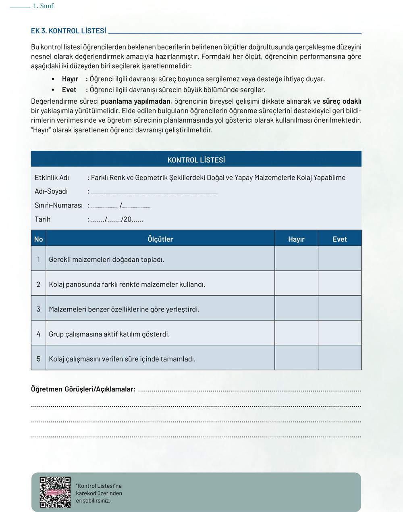 "Kontrol Listesi"ne karekod üzerinden erişebilirsiniz.

<!-- sayfa 24 -->

1. Sınıf

## 2. TEMA

# SANATIN GÖRSEL DİLİ

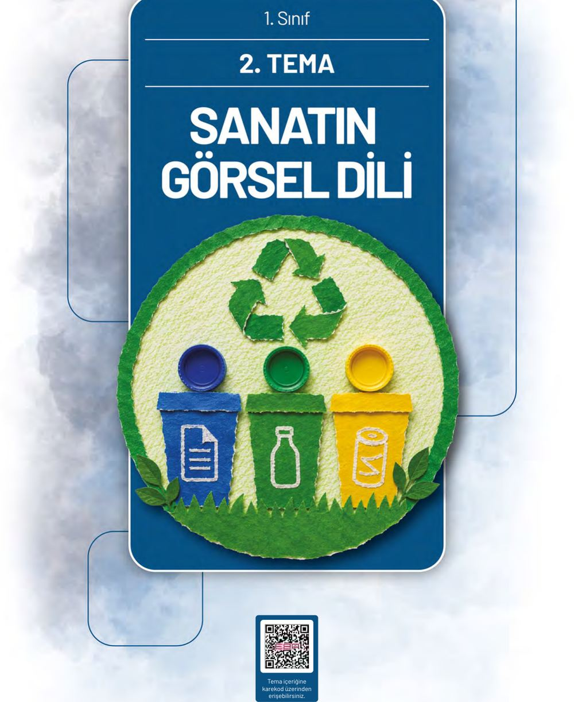

Tema içeriğine 
karekod üzerinden

<!-- sayfa 25 -->

| TEMA ADI | Sanatın Görsel Dili |
| :--- | :--- |
| **SINIF DÜZEYİ** | 1 |
| **TEMA KAPSAMI** | Öğrencilerin günlük yaşamda karşılaştıkları sembolleri ve levhaları tanımaları, renklerin ve şekillerin anlamlarını fark etmeleri, çevreye ilişkin bilgilendirici levha oluşturmaları amaçlanmaktadır. |
| **DERS SAATİ** | 4 |
| **ALAN BECERİLERİ** | SAB2. Görsel Mesajı Okuma, SAB4. Sanatsal Üretim Yapma |
| **KAVRAMSAL BECERİLER** | – |
| **EĞİLİMLER** | E1.3. Azim ve Kararlılık, E1.5. Kendine Güvenme (Öz Güven), E3.5. Açık Fikirlilik |

### PROGRAMLAR ARASI BİLEŞENLER

| SOSYAL-DUYGUSAL ÖĞRENME BECERİLERİ | SDB1.1. Kendini Tanıma (Öz Farkındalık), SDB2.1. İletişim, SDB2.2. İş Birliği, SDB2.3. Sosyal Farkındalık |
| :--- | :--- |
| **DEĞERLER** | D3. Çalışkanlık, D5. Duyarlılık, D7. Estetik, D12. Sabır, D14. Saygı, D17. Tasarruf, D18. Temizlik, D19. Vatanseverlik |
| **OKURYAZARLIK BECERİLERİ** | OB2. Dijital Okuryazarlık, OB4. Görsel Okuryazarlık, OB5. Kültür Okuryazarlığı, OB6. Vatandaşlık Okuryazarlığı, OB8. Sürdürülebilirlik Okuryazarlığı |
| **DİSİPLİNLER ARASI İLİŞKİLER** | Hayat Bilgisi, Matematik, Türkçe |
| **BECERİLER ARASI İLİŞKİLER** | KB2.14. Yorumlama |

#### ÖĞRENME ÇIKTILARI VE SÜREÇ BİLEŞENLERİ

**GS.1.2.1. Görsel işaret ve sembollerdeki mesajları okuyabilme**
a) Çevresindeki işaret ve sembollerin görsel mesajlarını algılar.
b) Çevresindeki işaret ve sembollerin görsel mesajlarını anlamlandırır.

**GS.1.2.2. Renkleri, şekilleri ve sembolleri kullanarak çevreye ilişkin bilgilendirici levha yapabilme**
a) Renkler, şekiller ve sembollerden yararlanarak çevrenin ihtiyaçlarını karşılayan bilgilendirici levha tasarlar.
b) Renkler, şekiller ve sembolleri kullanarak bilgilendirici levha oluşturur.

| İÇERİK ÇERÇEVESİ | Görsel İşaret ve Sembollerin Anlamı |
| :--- | :--- |
| **ANAHTAR KAVRAMLAR** | çevre sembolleri, doğa sembolleri, evrensel semboller, görsel işaret, görsel mesaj, kültürel semboller, sosyal semboller |
| **ÖĞRENME KANITLARI (ÖLÇME VE DEĞERLENDİRME)** | Öğrenme çıktıları kontrol listeleri, öz değerlendirme formları ve grup değerlendirme formları kullanılarak değerlendirilebilir. Performans görevi olarak öğrencilerden çevreye yönelik mesaj belirleyerek kolaj, pastel boya veya renkli kuru kalem teknikleriyle bilgilendirici levha yapmaları istenir. Levhalarda renk, şekil ve sembollerin uyumuna dikkat etmeleri beklenir. |

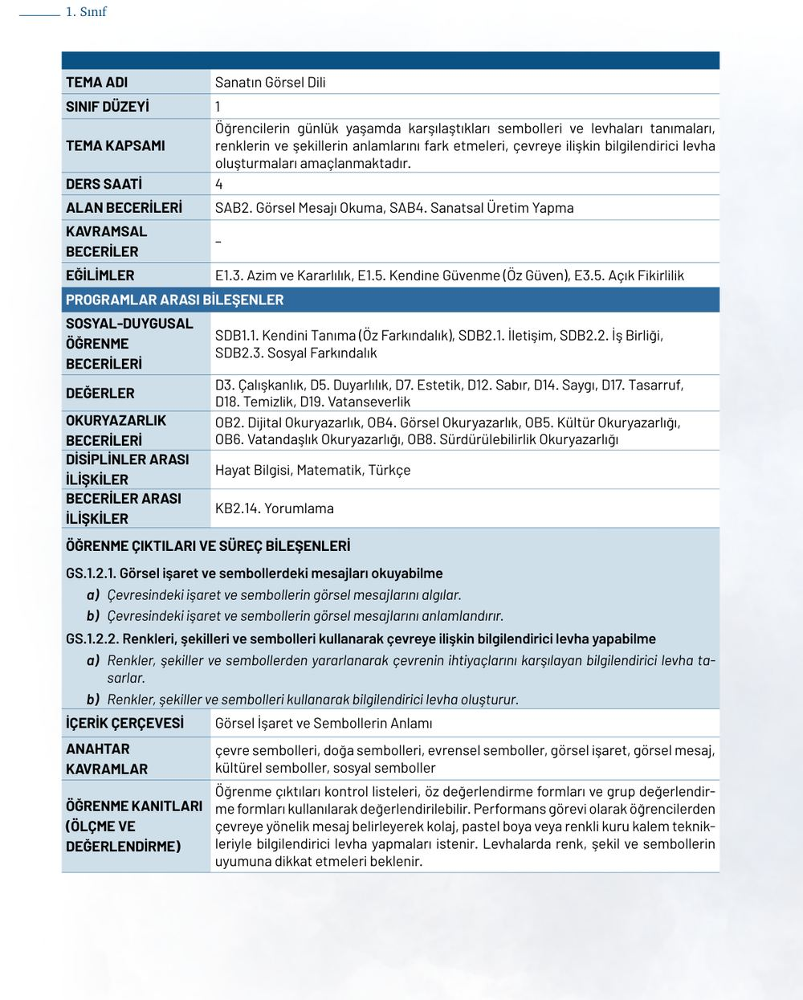
<!-- yer tutucu bulunamadı: sayfa sonuna eklendi -->

<!-- sayfa 26 -->

# TEMA AKIŞI

* Doğa, Çevre, Şekil Sembolleri veya Sosyal Sembollerin Görsel Mesajlarını Algılama
* Vızıltı Gruplarıyla İşaret ve Sembollerdeki Görsel Mesajları Anlamlandırma
* Türk Bayrağındaki Semboller Hakkında Farkındalık Geliştirme
* Renkler, Şekiller ve Semboller Kullanarak Bilgilendirici Levha Tasarlama
* Renkler, Şekiller ve Semboller Kullanarak Bilgilendirici Levha Oluşturma
* Çalışma Ortamını Düzenleme
* Değerlendirme
* Sergileme
* Farklılaştırma

# TEMA HAZIRLIĞI

Öğretmen tarafından ders öncesinde görsel işaret ve sembollerin anlamına ilişkin hazırlıklar yapılır. Bu kapsamda aşağıdakilerin gerçekleştirilmesi beklenir.

* Çevre sembolleri, doğa sembolleri, evrensel semboller, kültürel semboller ve sosyal sembollerden örnekler hazırlanabilir.

| Çevre Sembolleri | Doğa Sembolleri | Evrensel Semboller |
| :--- | :--- | :--- |
| • Su tasarrufu (musluktan damlayan su)   • Doğanın korunması (ağaç) | • Güneş (enerji, sıcaklık)   • Doğa ve hayat (ağaç yaprağı)   • Doğal hayat (kuş, kelebek)   • Kış mevsimi (kar tanesi) | • Sevgi (kalp)   • Topluluk ve insanlık (insan figürü)   • Farklılık (el izi)   • Gezegen (dünya küresi) |

| Kültürel Semboller | Sosyal Semboller |
| :--- | :--- |
| • Türk bayrağı   • Nazar | • Oyun (el ele tutuşan çocuklar)   • Yardımlaşma (el ele tutuşan insanlar)   • Okul (çatı, kitap) |

* Öğrencilerin bireysel malzeme ihtiyacını karşılayamadığı durumlar için renkli fon kartonları, el işi kâğıtları, gazete ve dergi görselleri, makas, mum tipi yapıştırıcı gibi malzemeler sınıf mevcuduna göre hazır bulundurulur.

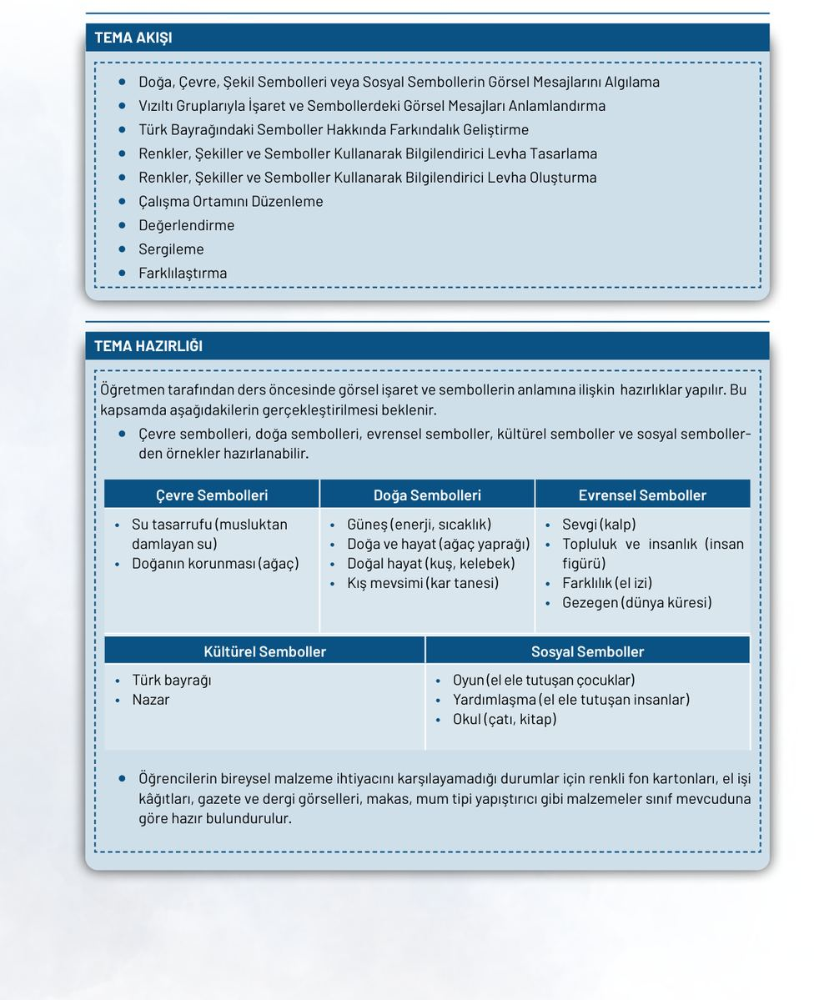
<!-- yer tutucu bulunamadı: sayfa sonuna eklendi -->

<!-- sayfa 27 -->

Öğrenciler tarafından ders öncesinde aşağıdaki başlıklar kapsamında önerilen hazırlıklar yapılır.

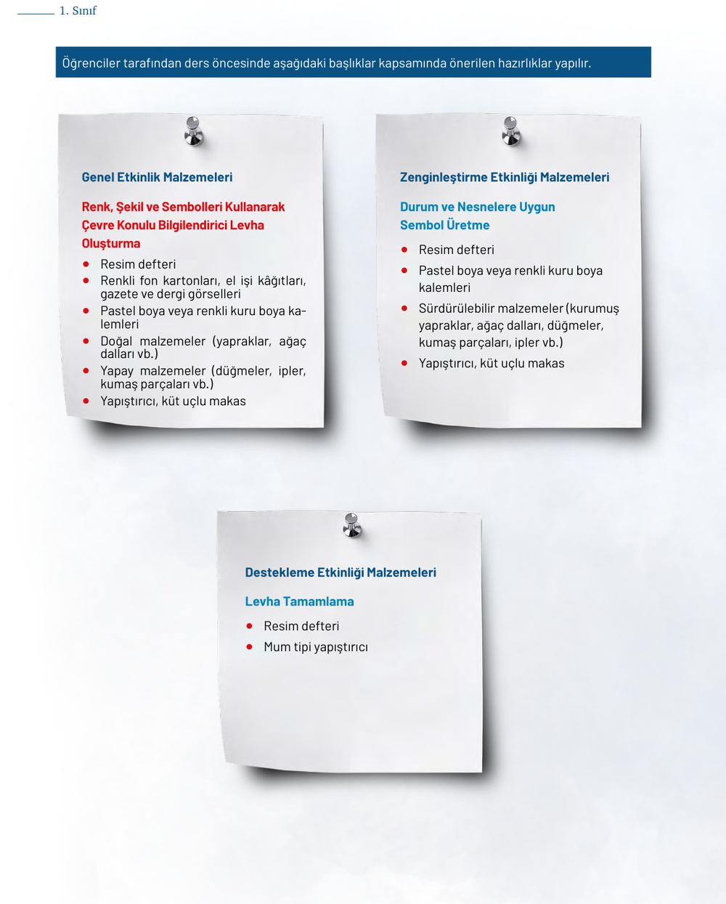

# Genel Etkinlik Malzemeleri

## Renk, Şekil ve Sembolleri Kullanarak Çevre Konulu Bilgilendirici Levha Oluşturma

* Resim defteri
* Renkli fon kartonları, el işi kâğıtları, gazete ve dergi görselleri
* Pastel boya veya renkli kuru boya kalemleri
* Doğal malzemeler (yapraklar, ağaç dalları vb.)
* Yapay malzemeler (düğmeler, ipler, kumaş parçaları vb.)
* Yapıştırıcı, küt uçlu makas

# Zenginleştirme Etkinliği Malzemeleri

## Durum ve Nesnelere Uygun Sembol Üretme

* Resim defteri
* Pastel boya veya renkli kuru boya kalemleri
* Sürdürülebilir malzemeler (kurumuş yapraklar, ağaç dalları, düğmeler, kumaş parçaları, ipler vb.)
* Yapıştırıcı, küt uçlu makas

# Destekleme Etkinliği Malzemeleri

## Levha Tamamlama

* Resim defteri
* Mum tipi yapıştırıcı

<!-- sayfa 28 -->

# ÖĞRENME-ÖĞRETME YAŞANTILARI

## TEMEL KABULLER

Öğrencilerin renkler ve geometrik şekiller konusunda bilgi sahibi oldukları, sosyal kurallar ve işaretler hakkında temel düzeyde farkındalık geliştirdikleri kabul edilmektedir.

## ÖN DEĞERLENDİRME SÜRECİ

Öğrencilerin renkler, geometrik şekiller, sosyal kurallar ve işaretler hakkında sahip oldukları bilgiler aşağıdakilere benzer sorulara verdikleri yanıtlarla belirlenir:

* Sınıfınızda kare, üçgen, dikdörtgen ve çember şeklinde hangi nesneler bulunuyor?
* Trafik lambasında hangi renkleri görüyorsunuz?
* Trafik lambasında kırmızıyı gördüğünüzde ne yaparsınız?

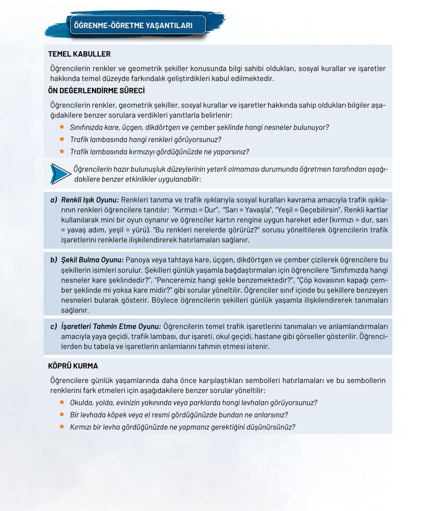

Öğrencilerin hazır bulunuşluk düzeylerinin yeterli olmaması durumunda öğretmen tarafından aşağıdakilere benzer etkinlikler uygulanabilir:

**a) Renkli Işık Oyunu:** Renkleri tanıma ve trafik ışıklarıyla sosyal kuralları kavrama amacıyla trafik ışıklarının renkleri öğrencilere tanıtılır: “Kırmızı = Dur”, “Sarı = Yavaşla”, “Yeşil = Geçebilirsin”. Renkli kartlar kullanılarak mini bir oyun oynanır ve öğrenciler kartın rengine uygun hareket eder (kırmızı = dur, sarı = yavaş adım, yeşil = yürü). “Bu renkleri nerelerde görürüz?” sorusu yöneltilerek öğrencilerin trafik işaretlerini renklerle ilişkilendirerek hatırlamaları sağlanır.

**b) Şekil Bulma Oyunu:** Panoya veya tahtaya, üçgen, dikdörtgen ve çember çizilerek öğrencilere bu şekillerin isimleri sorulur. Şekilleri günlük yaşamla bağdaştırmaları için öğrencilere “Sınıfımızda hangi nesneler kare şeklindedir?”, “Penceremiz hangi şekle benzemektedir?”, “Çöp kovasının kapağı çember şeklinde mi yoksa kare midir?” gibi sorular yöneltilir. Öğrenciler sınıf içinde bu şekillere benzeyen nesneleri bularak gösterir. Böylece öğrencilerin şekilleri günlük yaşamla ilişkilendirerek tanımaları sağlanır.

**c) İşaretleri Tahmin Etme Oyunu:** Öğrencilerin temel trafik işaretlerini tanımaları ve anlamlandırmaları amacıyla yaya geçidi, trafik lambası, dur işareti, okul geçidi, hastane gibi görseller gösterilir. Öğrencilerden bu tabela ve işaretlerin anlamlarını tahmin etmesi istenir.

## KÖPRÜ KURMA

Öğrencilere günlük yaşamlarında daha önce karşılaştıkları sembolleri hatırlamaları ve bu sembollerin renklerini fark etmeleri için aşağıdakilere benzer sorular yöneltilir:

* Okulda, yolda, evinizin yakınında veya parklarda hangi levhaları görüyorsunuz?
* Bir levhada köpek veya el resmi gördüğünüzde bundan ne anlarsınız?
* Kırmızı bir levha gördüğünüzde ne yapmanız gerektiğini düşünürsünüz?

<!-- sayfa 29 -->

# ÖĞRENME-ÖĞRETME UYGULAMALARI
## Uygulama Öncesi

Öğrencilerden görsel işaret ve sembollerdeki mesajları okuyabilmeleri (**GS.1.2.1**) beklenir. Bu sembollerdeki mesajları algılamaları ve anlamlandırmaları için aşağıdaki süreçler takip edilir:

* **İşaret ve Sembollerin Görsel Mesajını Algılama:**
**Doğa, Çevre, Şekil, Renk Sembolleri veya Sosyal Semboller**
Çevresindeki işaret ve sembollerin görsel mesajlarını algılamaları için **(a)** aşağıdaki basamaklar izlenir:

* Okul geçidi, dur, çöp atmayınız ve geri dönüşüm gibi işaretlerden seçilen örnekler öğrencilere gösterilir (**Bk. Şekil 2.1**). Öğrencilerin bu işaretleri dikkatle incelemeleri sağlanır (**OB4**).
* Ayrıca isteğe bağlı olarak genel izleyici, yağmurlu hava ve bisiklet yolu simgesi gibi örnekler kullanılabilir (**Bk. Şekil 2.2**).

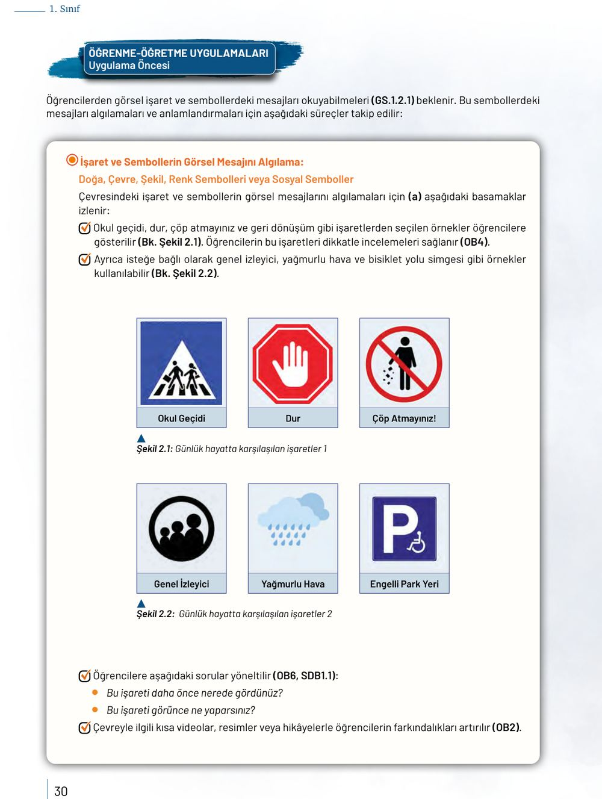
Şekil 2.1: Günlük hayatta karşılaşılan işaretler 1

Şekil 2.2: Günlük hayatta karşılaşılan işaretler 2

* Öğrencilere aşağıdaki sorular yöneltilir (**OB6, SDB1.1**):
    * Bu işareti daha önce nerede gördünüz?
    * Bu işareti görünce ne yaparsınız?
* Çevreyle ilgili kısa videolar, resimler veya hikâyelerle öğrencilerin farkındalıkları artırılır (**OB2**).

<!-- sayfa 30 -->

# İşaret ve Sembollerin Görsel Mesajlarını Anlamlandırma:

## Vızıltı Grupları

Öğrencilerin çevresindeki işaret ve sembollerin görsel mesajlarını anlamlandırmaları için **(b)** sembollerin günlük yaşamla ilişkisini kavramaları amacıyla aşağıdakiler gerçekleştirilir.

* Sınıf düzeyine uygun olacak şekilde öğrenciler 2-6 kişilik küçük gruplara ayrılarak vızıltı grupları oluşturulur (Vızıltı 22, vızıltı 33, ...vızıltı 66).
* Her gruba bir levha kartı verilir.
* Öğrencilerin kartları incelemeleri için aşağıdaki sorular yöneltilir:
    * Bu levhada hangi renkleri görüyorsunuz?
    * Şekiller köşeli mi yoksa yuvarlak mı?
    * Bu işaret size ne söylüyor?
* Öğrenciler 2-6 dakika arasında konuşur ve sonra düşüncelerini sınıfla paylaşır.
* Sembollerin günlük yaşama katkıları hakkında aşağıdakilere benzer cümleler kurmaları sağlanır **(E3.5, SDB2.3)**:
    * Bu işaretler bizi korur.
    * Bu işaretler daha dikkatli olmamıza yardım eder.
* Her öğrencinin düşüncelerini açıklayarak sürece aktif olarak katılması desteklenir **(D3.4)**.
* Öğrencilerden karşılarındaki kişiyi sözünü kesmeden dinlemeleri ve kendi düşüncelerini sırası geldiğinde paylaşmaları beklenir **(SDB2.1, D14.1)**.
* Bu süreçte işaret ve sembollerin güvenlik, saygı, nazik olma, çevreyi koruma gibi değerlerle ilişkili olduğu vurgulanır.
* Öğrencilere bu işaretlerin herkesin güvende olması ve doğru davranması için kullanıldığı açıklanır **(SDB2.3)**.

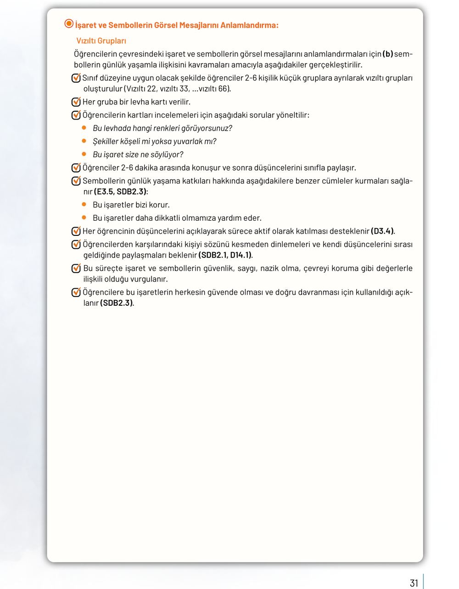
<!-- yer tutucu bulunamadı: sayfa sonuna eklendi -->

<!-- sayfa 31 -->

# Farkındalık Geliştirme: Türk Bayrağındaki Semboller

✔️ Türk bayrağında yer alan hilal ve yıldızın temel anlamları aşağıdaki düzeye uygun ifadelerle açıklanır (**OB5, D19.1**).

* Kırmızı renk, bayrağımızın çok değerli olduğunu ve bu vatanın bize ait olduğunu anlatır.
* Hilal ve yıldız gökyüzünde gördüğümüz şekillerdir.
* Bayrağımızdaki hilal ve yıldız bize birlik olduğumuzu ve birbirimizi sevdiğimizi hatırlatır.

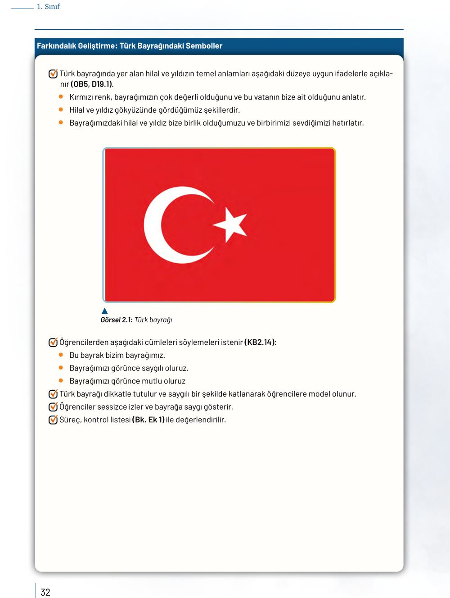

**Görsel 2.1:** *Türk bayrağı*

✔️ Öğrencilerden aşağıdaki cümleleri söylemeleri istenir (**KB2.14**):

* Bu bayrak bizim bayrağımız.
* Bayrağımızı görünce saygılı oluruz.
* Bayrağımızı görünce mutlu oluruz.

✔️ Türk bayrağı dikkatle tutulur ve saygılı bir şekilde katlanarak öğrencilere model olunur.
✔️ Öğrenciler sessizce izler ve bayrağa saygı gösterir.
✔️ Süreç, kontrol listesi (**Bk. Ek 1**) ile değerlendirilir.

<!-- sayfa 32 -->

# Tasarım Geliştirme:
## Renkler, Şekiller ve Sembollerden Yararlanarak Bilgilendirici Levha Tasarlama

Öğrencilerden renk, şekil ve sembolleri kullanarak çevreye ilişkin bilgilendirici levha yapabilmeleri (**GS.1.2.2**) beklenir. Çevrenin ihtiyaçlarını karşılayan bilgilendirici levhalar tasarlamaları için **(a)** aşağıdaki aşamalar takip edilir:

*   Öğrenciler gruplara ayrılır.
*   Aşağıdaki temalar görsellerle tanıtılır ve grupların düşüncelerini açıklayarak bir tema seçmesi sağlanır (**D17.2, OB8, SDB2.2**):
    *   Ağaç dikme
    *   Suyu boşa akıtmama
    *   Çöpleri çöp kutusuna atma
*   Seçilen temaya uygun olarak yeşil, mavi, kahverengi gibi renkler; daire, ok ve üçgen gibi şekiller; çöp kutusu, yaprak ve su damlası gibi semboller öğrencilere tanıtılır.
*   Ok işaretinin yön gösterdiği ve dairenin işareti belirginleştirdiği açıklanır.
*   Gruplar tanıtılan renk, şekil ve sembollerden hangilerini kullanacaklarına karar verir.
*   Bu süreçte öğrencilerin çevresini korumaya ve güzelleştirmeye yönelik olumlu tutum geliştirmeleri desteklenir (**D5.2**).

> 🔔 **HATIRLATMA**
> Etkinliklere başlamadan bir hafta önce öğrencilere etkinliğe uygun görsel anlatım araçlarını eksiksiz getirmeleri konusunda bilgilendirme yapılmalı ve malzemeleri hazır bulundurmaları sağlanmalıdır.

> 🧩 **MALZEME BİLGİLENDİRMESİ**
> Malzeme temininde zorluk yaşanması durumunda okul imkânlarından ve sürdürülebilir malzemelerden faydalanılabilir.

# Uygulama Sırası

Renkler, şekiller ve sembolleri kullanarak bilgilendirici levha oluşturmaları için **(b)** öğrencilerden fikirlerini kolaj, pastel boya veya renkli kuru kalem tekniğini kullanarak estetik bakış açısıyla ifade etmeleri istenir (**D7.2**).

## 1. ETKİNLİK
### Renk, Şekil ve Semboller Kullanarak Bilgilendirici Levha Oluşturma

Öğrenciler renk, şekil ve sembollerle bilgilendirici levha oluşturmak için aşağıdaki aşamaları sırasıyla gerçekleştirir:

1.  Gruplar kolaj, pastel boya veya renkli kuru kalem tekniğinden birini seçer (**SDB2.2**).
2.  Çalışma için gerekli olacak malzemeleri hazır bulundurur.
3.  Kolaj tekniğini seçen gruplara renkli fon kartonları, el işi kâğıtları, gazete ve dergilerden kesilmiş görseller ile doğal ve yapay malzemeler önerilir.
4.  Renkli resim tekniklerini tercih eden gruplara pastel boya ve renkli kuru kalem kullanmaları tavsiye edilir.
    *   Renkli kuru kalemle yazı, kenar çizgisi ve sembol detaylarını çizebilir.
    *   Pastel boya ile arka planlar ve dikkat çekici bölümleri renklendirebilir.

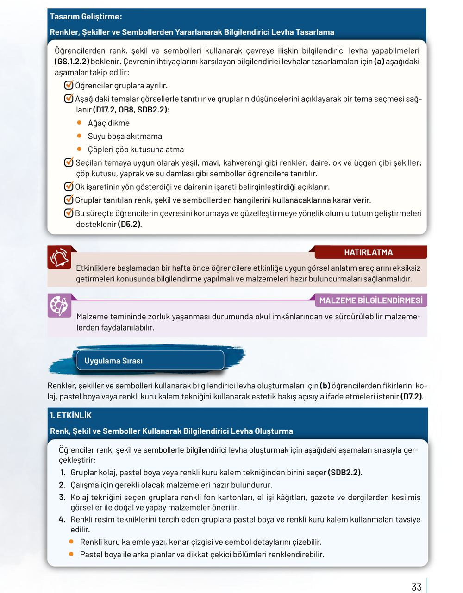
<!-- yer tutucu bulunamadı: sayfa sonuna eklendi -->

<!-- sayfa 33 -->

5. Öğrenciler tüm teknikleri bir arada kullanabilir.
6. Boyaların kullanım şekli ve uygulama teknikleri öğrencilere gösterilir.
7. Öğrencilerden süreç boyunca edindikleri deneyimleri ve çalışmalarının sonuçlarını öğretmen rehberliğinde açık fikirli bir yaklaşımla değerlendirmeleri istenir (**E3.5**).
8. Öğrencilere öz güven kazanmaları için rehberlik edilerek renk kullanımı ve kompozisyon tasarımı hakkında geri bildirim verilir (**E1.5**).
9. Süreç ve ürünle ilgili farkındalık kazanmaları için öğrencilere aşağıdakilere benzer öz değerlendirme soruları yöneltilir:
    * Yaptığınız levha size ne söylüyor?
    * Bu levhayı gören biri ne yapmalı?
10. Öğrencilere grup arkadaşlarının çalışmalarındaki olumlu yönleri fark etmeleri amacıyla aşağıdaki sorulardan uygun olanları yöneltilir:
    * Birlikte çalışırken birbirinize yardım ettiniz mi?
    * Arkadaşınız hangi kısmı yaptı, siz hangi kısmı yaptınız?

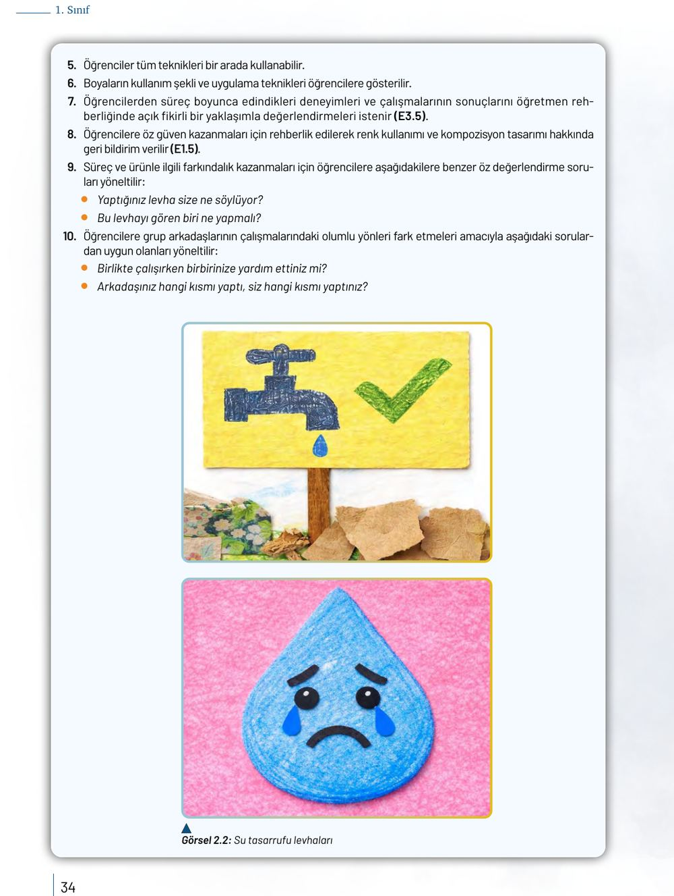

▲ Görsel 2.2: Su tasarrufu levhaları

<!-- sayfa 34 -->

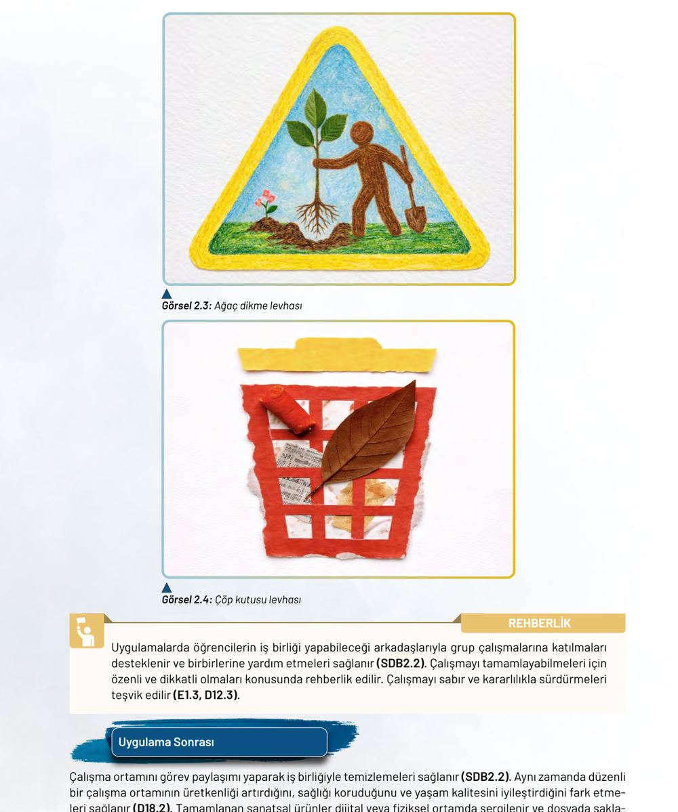

**Görsel 2.3:** Ağaç dikme levhası

**Görsel 2.4:** Çöp kutusu levhası

> **REHBERLİK**
> Uygulamalarda öğrencilerin iş birliği yapabileceği arkadaşlarıyla grup çalışmalarına katılmaları desteklenir ve birbirlerine yardım etmeleri sağlanır (**SDB2.2**). Çalışmayı tamamlayabilmeleri için özenli ve dikkatli olmaları konusunda rehberlik edilir. Çalışmayı sabır ve kararlılıkla sürdürmeleri teşvik edilir (**E1.3, D12.3**).

### Uygulama Sonrası

Çalışma ortamını görev paylaşımı yaparak iş birliğiyle temizlemeleri sağlanır (**SDB2.2**). Aynı zamanda düzenli bir çalışma ortamının üretkenliği artırdığını, sağlığı koruduğunu ve yaşam kalitesini iyileştirdiğini fark etmelerini sağlanır (**D18.2**). Tamamlanan sanatsal ürünler dijital veya fiziksel ortamda sergilenir ve dosyada saklanır.

<!-- sayfa 35 -->

# FARKLILAŞTIRMA

## Zenginleştirme

### Etkinlik 1: Durum ve Nesnelere Uygun Sembol Üretme

Öğrenciler okulda veya çevrelerinde karşılaştıkları bir durumu yahut nesneyi anlatan kendi sembollerini tasarlamak için aşağıdaki basamakları sırasıyla uygular:

1. Öğrencilere okulda ve çevrede sık karşılaşılan durum ve nesneler hatırlatılır.
2. Merdiven güvenliği, düşme tehlikesi, yön bulma, sessiz olunması gereken yerler gibi durumlar ile musluk, okul kapısı ve pencere gibi nesneler örneklerle açıklanır.
3. Öğrencilere aşağıdaki sorular yöneltilerek öğrencilerin düşünmeleri sağlanır:
    * Merdivenlerde dikkatli olmak için nasıl bir işaret olabilir?
    * Okulda hangi işareti gördüğünüzde durmanız gerekir?
    * Sınıfınızı bulmanıza hangi işaret yardımcı olabilir?
    * Sessiz olunması gereken bir yerde nasıl bir işaret olmalı?
4. Öğrenciler sunulan örnekler arasından bir durumu veya nesneyi seçer.
5. Öğrenciler seçtikleri durumu veya nesneyi anlatan sembolü resim defterine çizer.
6. Çizdiği sembolü pastel boya veya renkli kuru boya kalemleriyle renklendirir.
7. İsteyen öğrenciler çalışmalarında yaprak, ip veya düğme gibi malzemeler kullanır.
8. Sembolü gören bir kişinin ne yapması gerektiğini sözel olarak ifade eder.
9. Süreç ve ürünle ilgili farkındalık kazanmaları için öğrencilere aşağıdakilere benzer öz değerlendirme soruları yöneltilir:
    * Bu sembolü gören bir arkadaşınızın ne yapması gerekiyor?
    * Bu çalışmayı yaparken kendinizi mutlu hissettiniz mi?
    * Bu sembolü okulda nereye asmayı düşünüyorsunuz?

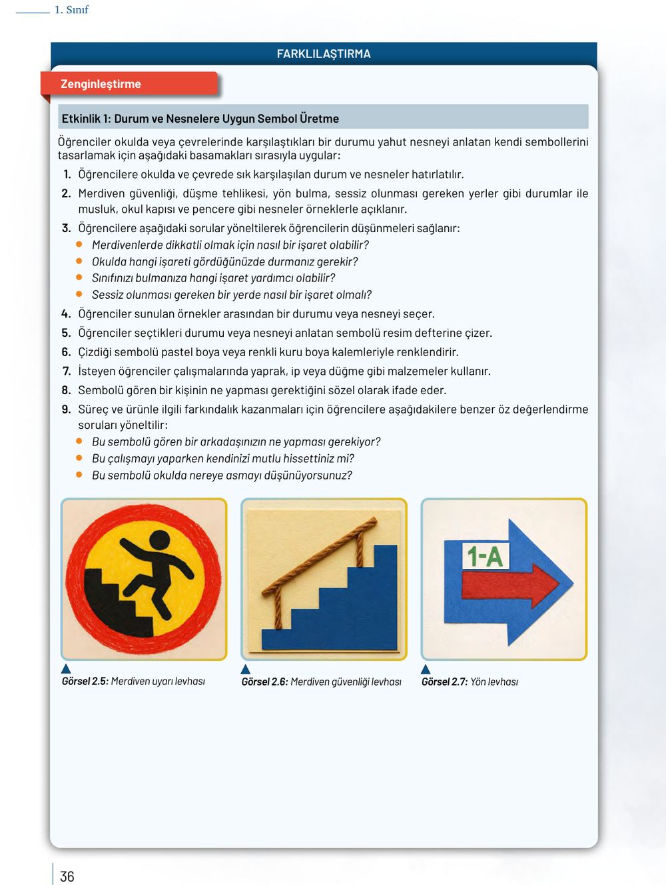

▲ *Görsel 2.5: Merdiven uyarı levhası*
▲ *Görsel 2.6: Merdiven güvenliği levhası*
▲ *Görsel 2.7: Yön levhası*

<!-- sayfa 36 -->

# Destekleme

⚠️ Öğrenciler aşağıdaki etkinliklerden birine yönlendirilir.

## Seçmeli Etkinlik 1: Levha Tamamlama

Öğrenciler aşağıdaki aşamaları sırasıyla gerçekleştirerek bir levhayı tamamlar.

1. Öğrencilerle yaya geçidi, çöp kutusu, yön işareti, bisiklet yolu gibi levha parçalarının görselleri paylaşılır.
2. Öğrenciler levha parçalarının üzerindeki renk ve şekilleri inceler.
3. Öğrencilere “Bu levha hangi renk?”, “Bu levhada hangi şekiller bulunuyor?” gibi sorular yöneltilebilir.
4. Öğrencilere çerçevesi, arka planı veya üzerindeki bazı şekilleri eksik olan levha görseli verilir.
5. Eksik parçalar da öğrencilere şablon olarak verilir.
6. Öğrenciler bu görseldeki eksik kısımları tamamlar.
7. Sembolü gören bir kişinin ne yapması gerektiğini sözel olarak ifade eder.
8. Süreç ve ürünle ilgili farkındalık kazanmaları için öğrencilere aşağıdakilere benzer öz değerlendirme soruları yöneltilir:

* Levhadaki eksik yerleri tamamlayabildiniz mi?
* Levhanızı bitirdiğinizde mutlu oldunuz mu?
* Bu levhayı yeniden yapsaydınız neler eklerdiniz?

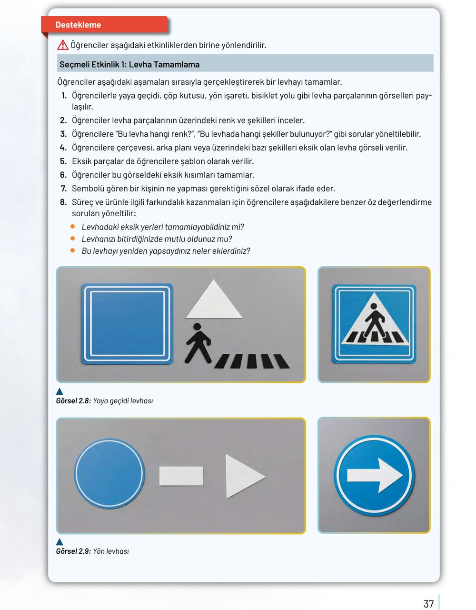

**Görsel 2.8:** Yaya geçidi levhası

**Görsel 2.9:** Yön levhası

<!-- sayfa 37 -->

# Seçmeli Etkinlik 2: İşaret ve Sembolleri Beden Diliyle İfade Etme

Öğrenciler aşağıdaki aşamaları sırasıyla gerçekleştirerek işaret ve sembolleri beden diliyle ifade eder.

1. Öğrencilere dur, sessiz ol, temizlik gibi sembollerin görselleri gösterilir.
2. Sembol kartlarıyla ilgili aşağıdakilere benzer sorular yöneltilerek öğrencilerin düşüncelerini sözel olarak ifade etmeleri sağlanır:
    * Bu işaret size ne söylüyor?
    * Bu işareti daha önce nerelerde gördünüz?
3. Öğrenciler seçilen bir sembolü konuşmadan beden hareketi veya duruşlarıyla anlatır.
    * Dur: Ellerle “dur” hareketi yapmak.
    * Sessiz ol: İşaret parmağıyla “sus” işareti yapmak.
    * Ellerini yıka: Ellerini yıkıyor gibi yapmak.
4. Süreçle ilgili farkındalık kazanmaları için öğrencilere aşağıdakilere benzer öz değerlendirme soruları yöneltilir:
    * Bu işareti konuşmadan hareketlerinizle anlatabildiniz mi?
    * Arkadaşlarınız sizi anladı mı?
    * Bu etkinliği yaparken eğlendiniz mi?

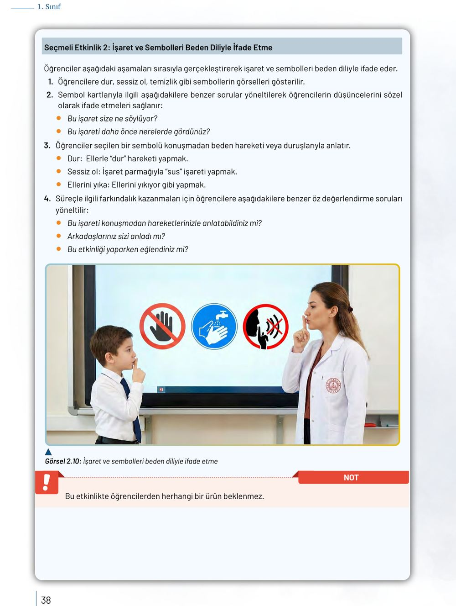

**Görsel 2.10:** *İşaret ve sembolleri beden diliyle ifade etme*

> ! **NOT**
> Bu etkinlikte öğrencilerden herhangi bir ürün beklenmez.

<!-- sayfa 38 -->

# EK 1. KONTROL LİSTESİ

Bu kontrol listesi öğrencilerden beklenen becerilerin belirlenen ölçütler doğrultusunda gerçekleşme düzeyini nesnel olarak değerlendirmek amacıyla hazırlanmıştır. Formdaki her ölçüt, öğrencinin performansına göre aşağıdaki iki düzeyden biri seçilerek işaretlenmelidir:

* **Hayır** : Öğrenci ilgili davranışı süreç boyunca sergilemez veya desteğe ihtiyaç duyar.
* **Evet** : Öğrenci ilgili davranışı sürecin büyük bölümünde sergiler.

Değerlendirme süreci **puanlama yapılmadan**, öğrencinin bireysel gelişimi dikkate alınarak ve **süreç odaklı** bir yaklaşımla yürütülmelidir. Elde edilen bulguların öğrencilerin öğrenme süreçlerini destekleyici geri bildirimlerin verilmesinde ve öğretim sürecinin planlanmasında yol gösterici olarak kullanılması önerilmektedir. “Hayır” olarak işaretlenen öğrenci davranışı geliştirilmelidir.

## KONTROL LİSTESİ

Etkinlik Adı : Günlük Yaşamda Karşılaşılan İşaret ve Sembollerin Görsel Mesajlarını Algılama ve Anlamlandırma

Adı-Soyadı : ..................................................................................

Sınıfı-Numarası : ............ / ............

Tarih : ........./........./20.......

| No | Ölçütler | Hayır | Evet |
| :--- | :--- | :---: | :---: |
| 1 | Günlük yaşamda sık karşılaşılan sembolleri görsel olarak tanıdı. | | |
| 2 | Gösterilen sembolün ne anlama geldiğini sözel olarak ifade etti. | | |
| 3 | Gösterilen sembole uygun davranışı hareketle gösterdi. | | |
| 4 | Sembol ile günlük yaşamda karşılaşılan durum arasında ilişki kurdu. | | |
| 5 | Millî sembollere karşı saygılı bir tutum sergiledi. | | |

**Öğretmen Görüşleri/Açıklamalar:** .................................................................................................................................................................................................................................................................................................................................................................................................................................................................................................................................................................................................................................................................................................................................

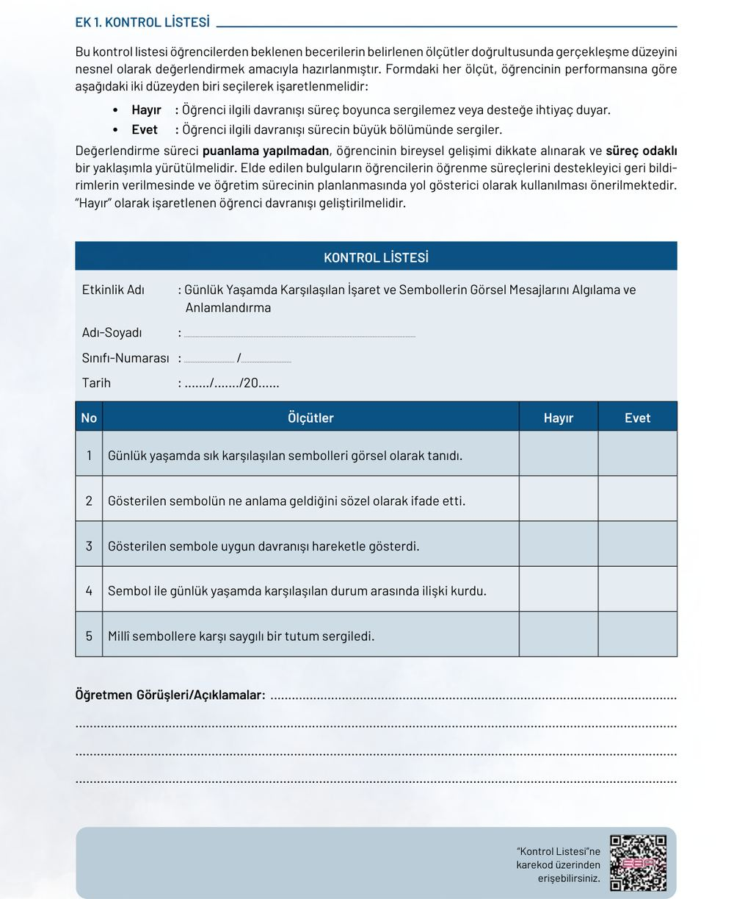
<!-- yer tutucu bulunamadı: sayfa sonuna eklendi -->

<!-- sayfa 39 -->

# EK 2. KONTROL LİSTESİ

Bu kontrol listesi öğrencilerden beklenen becerilerin belirlenen ölçütler doğrultusunda gerçekleşme düzeyini nesnel olarak değerlendirmek amacıyla hazırlanmıştır. Formdaki her ölçüt, öğrencinin performansına göre aşağıdaki iki düzeyden biri seçilerek işaretlenmelidir:

* **Hayır** : Öğrenci ilgili davranışı süreç boyunca sergilemez veya desteğe ihtiyaç duyar.
* **Evet** : Öğrenci ilgili davranışı sürecin büyük bölümünde sergiler.

Değerlendirme süreci **puanlama yapılmadan**, öğrencinin bireysel gelişimi dikkate alınarak ve **süreç odaklı** bir yaklaşımla yürütülmelidir. Elde edilen bulguların öğrencilerin öğrenme süreçlerini destekleyici geri bildirimlerin verilmesinde ve öğretim sürecinin planlanmasında yol gösterici olarak kullanılması önerilmektedir. “Hayır” olarak işaretlenen öğrenci davranışı geliştirilmelidir.

## KONTROL LİSTESİ

Etkinlik Adı : Renk, Şekil ve Semboller Kullanarak Bilgilendirici Levha Yapma
Adı-Soyadı : ........................................................................
Sınıfı-Numarası : ............ / ............
Tarih : ....... / ....... / 20 ......

| No | Ölçütler | Hayır | Evet |
|---|---|---|---|
| 1 | Belirlenen konuya uygun seçimler yaptı. | | |
| 2 | Levhada iletmek istediği mesajı açıkladı. | | |
| 3 | Çalışma sürecine istekli katıldı. | | |
| 4 | Grup içinde nazik davranış sergiledi. | | |
| 5 | Hazırlanan levhanın ne anlattığını sözel olarak ifade etti. | | |

**Öğretmen Görüşleri/Açıklamalar:** ..................................................................................................................
........................................................................................................................................................................
........................................................................................................................................................................
........................................................................................................................................................................

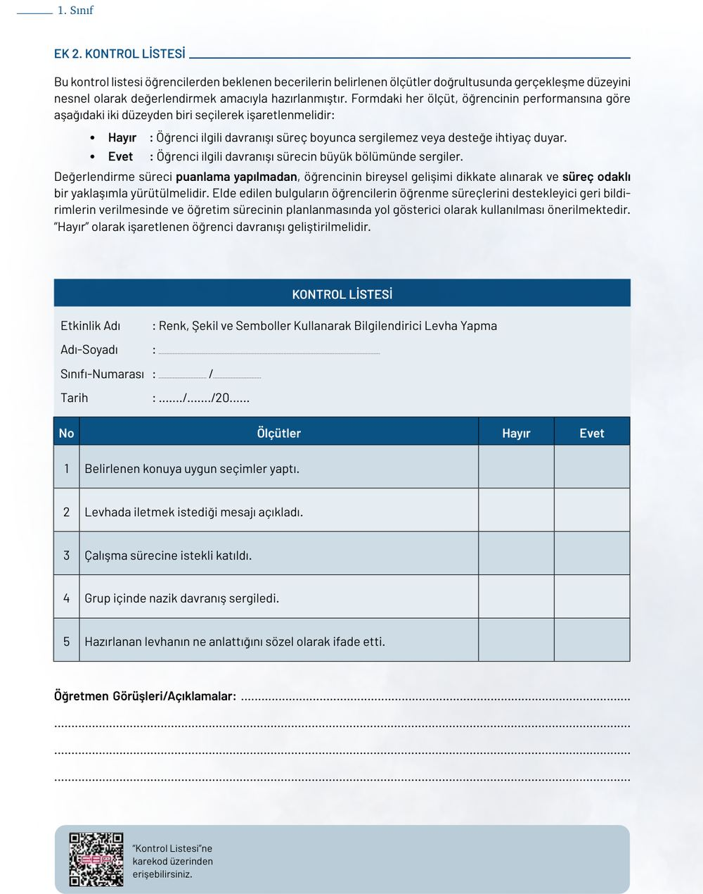 “Kontrol Listesi”ne karekod üzerinden erişebilirsiniz.

<!-- sayfa 40 -->

1. Sınıf

# 3. TEMA
# SANATÇILAR VE ESERLERİ

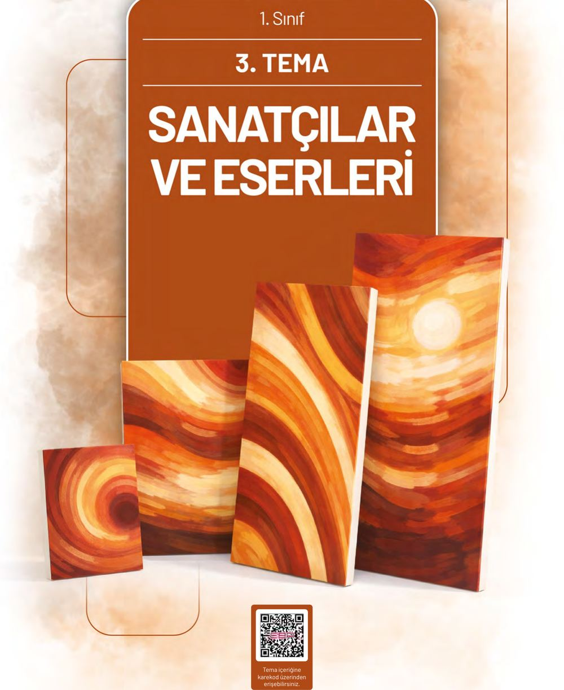

Tema içeriğine
karekod üzerinden

<!-- sayfa 41 -->

| TEMA ADI | Sanatçılar ve Eserleri |
| :--- | :--- |
| **SINIF DÜZEYİ** | 1 |
| **TEMA KAPSAMI** | Öğrencilerin çağdaş Türk resim sanatındaki peyzaj temalı eserleri incelemeleri, eserlerdeki renk ve şekil tekrarlarını fark etmeleri ve mevsim şeridi oluşturmaları amaçlanmaktadır. |
| **DERS SAATİ** | 5 |
| **ALAN BECERİLERİ** | SAB3. Sanat Eserini İnceleme, SAB4. Sanatsal Üretim Yapma |
| **KAVRAMSAL BECERİLER** | - |
| **EĞİLİMLER** | E2.5. Oyunseverlik, E3.5. Açık Fikirlilik |
| **PROGRAMLAR ARASI BİLEŞENLER** | |
| **SOSYAL-DUYGUSAL ÖĞRENME BECERİLERİ** | SDB1.1. Kendini Tanıma (Öz Farkındalık), SDB1.2. Kendini Düzenleme (Öz Düzenleme), SDB1.3. Kendine Uyarlama (Öz Yansıtma), SDB2.1. İletişim, SDB2.2. İş Birliği, SDB3.3. Sorumlu Karar Verme |
| **DEĞERLER** | D3. Çalışkanlık, D5. Duyarlılık, D14. Saygı, D17. Tasarruf, D18. Temizlik |
| **OKURYAZARLIK BECERİLERİ** | OB2. Dijital Okuryazarlık, OB4. Görsel Okuryazarlık, OB5. Kültür Okuryazarlığı, OB8. Sürdürülebilirlik Okuryazarlığı, OB9. Sanat Okuryazarlığı |
| **DİSİPLİNLER ARASI İLİŞKİLER** | Hayat Bilgisi |
| **BECERİLER ARASI İLİŞKİLER** | KB2.4. Çözümleme, KB2.20. Sentezleme, KB3.1. Karar Verme |
| **ÖĞRENME ÇIKTILARI VE SÜREÇ BİLEŞENLERİ** | |
| **GS.1.3.1. Çağdaş Türk resim sanatında peyzaj temalı eserleri inceleyebilme** | a) Peyzaj temalı eseri sanatsal açıdan betimler. b) Peyzaj temalı eseri sanatsal açıdan çözümler. c) Peyzaj temalı eseri sanatsal açıdan yorumlar. ç) Peyzaj temalı eser hakkında sanatsal yargıda bulunur. |
| **GS.1.3.2. Renk ve şekil tekrarlarıyla doğa izlenimlerini yansıtan peyzaj yapabilme** | a) Renk ve şekil tekrarlarıyla doğa izlenimlerini yansıtan peyzaj tasarlar. b) Renk ve şekil tekrarlarıyla doğa izlenimlerini yansıtan peyzaj oluşturur. |
| **İÇERİK ÇERÇEVESİ** | Çağdaş Türk Resim Sanatında Peyzaj Sanat Eserlerindeki Renk ve Şekil Tekrarları |
| **ANAHTAR KAVRAMLAR** | çağdaş Türk resmi, doğa izlenimi, kır resmi, peyzaj, renk ve şekil tekrarı |
| **ÖĞRENME KANITLARI (ÖLÇME VE DEĞERLENDİRME)** | Öğrenme çıktıları dereceli puanlama anahtarları, öz değerlendirme formları ve akran değerlendirme formları kullanılarak değerlendirilebilir. Sınıf içi performans görevi olarak öğrencilerden renk ve şekil tekrarlarıyla doğa izlenimlerini yansıtan mevsim şeridi oluşturmaları istenir. Mevsim şeridinde pastel boya veya renkli kuru kalem tekniklerini kullanarak mevsimleri temsil eden sembol, renk ve şekillerin uyumuna dikkat etmeleri beklenir. |

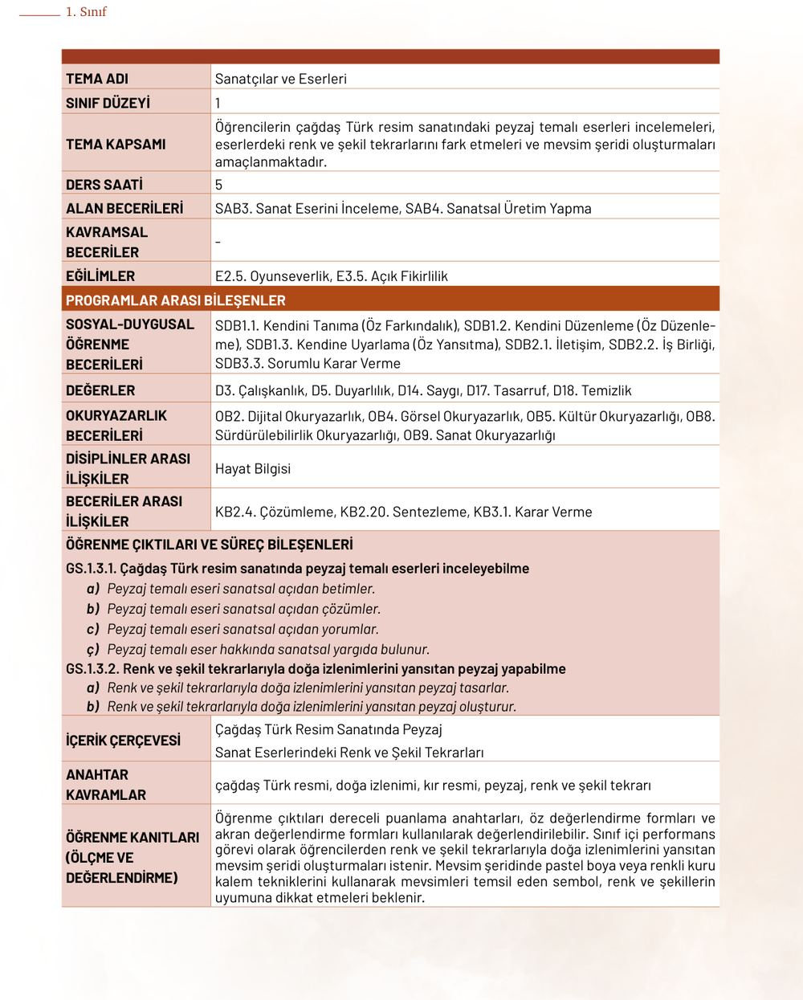
<!-- yer tutucu bulunamadı: sayfa sonuna eklendi -->

<!-- sayfa 42 -->

# TEMA AKIŞI

* Çağdaş Türk Resim Sanatında Peyzaj Temalı Eserleri İnceleme
* Peyzaj Temalı Eseri Sanatsal Açıdan Betimleme
* Peyzaj Temalı Eseri Sanatsal Açıdan Çözümleme
* Peyzaj Temalı Eseri Sanatsal Açıdan Yorumlama
* Doğaya Saygı ve Çevre Bilinci Oluşturmaya Yönelik Farkındalık Geliştirme
* Peyzaj Temalı Eser Hakkında Sanatsal Yargıda Bulunma
* Toplumsal Saygı ve Nezakete Yönelik Farkındalık Geliştirme
* Renk ve Şekil Tekrarlarıyla Doğa İzlenimlerini Yansıtan Peyzaj Tasarlama
* Doğa İzlenimlerini Yansıtan Peyzaj Oluşturma
* Çalışma Ortamını Düzenleme
* Değerlendirme
* Sergileme
* Farklılaştırma

# TEMA HAZIRLIĞI

Öğretmen tarafından ders öncesinde çağdaş Türk resim sanatında peyzaj, sanat eserlerindeki renk ve şekil tekrarlarına ilişkin hazırlıklar yapılır. Bu kapsamda aşağıdakilerin gerçekleştirilmesi beklenir.

* Çağdaş Türk sanatında peyzaj temalı eserler, dijital veya basılı ortamda gösterilmek üzere hazırlanır. Bu kapsamda Hoca Ali Rıza’nın “Göl Kıyısı” veya “Manzara”, Eşref Üren’in “Mamak”, Mehmet Ali Laga’nın “İstanbul’da Kış”, Hikmet Onat’ın “Hisar Tepelerinden Boğaz” veya Refik Epikman’ın “Ankara’dan Manzara” isimli eserlerin görselleri temin edilir.
* Mevsimlerin özelliklerini gösteren görseller, belgeseller, kısa videolar ve doğa fotoğrafları dijital veya basılı ortamda gösterilmek üzere hazırlanabilir.
* Öğrencilerin bireysel malzeme ihtiyacını karşılayamadığı durumlar için pastel boya, renkli kuru boya kalemleri, karton, makas ve mum tipi yapıştırıcı gibi gereçler ile yapraklar, dallar, kozalaklar, çakıl taşları ve deniz kabukları gibi doğal malzemeler sınıf mevcuduna göre hazır bulundurulur.

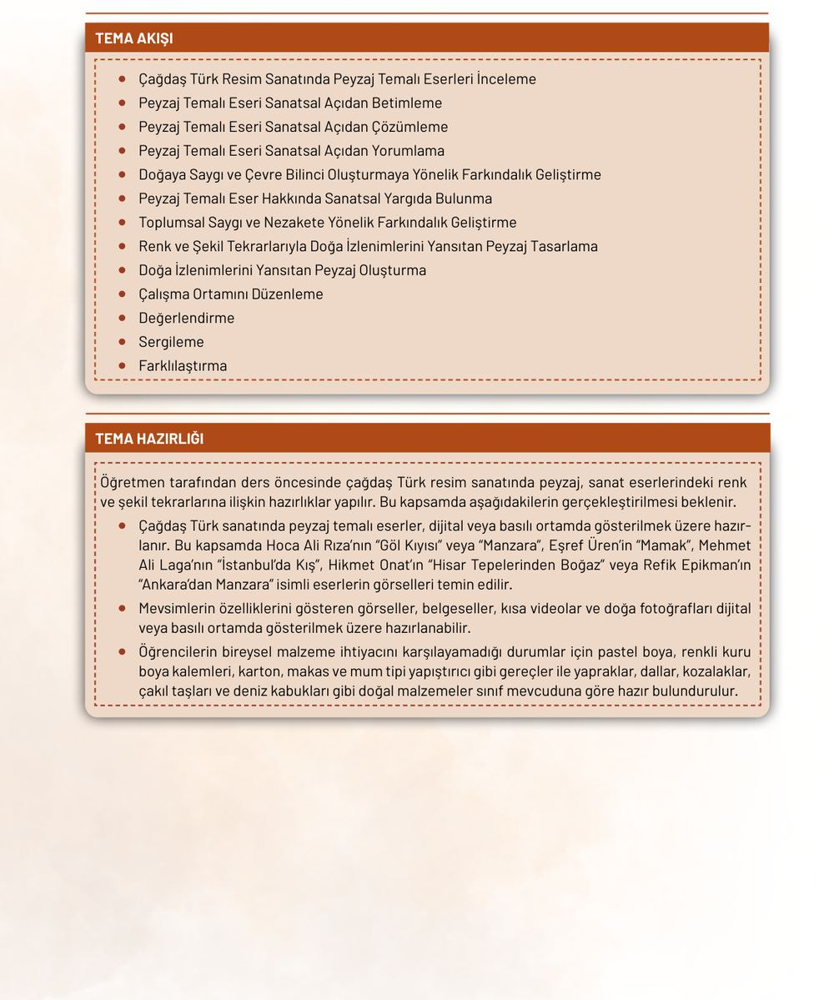
<!-- yer tutucu bulunamadı: sayfa sonuna eklendi -->

<!-- sayfa 43 -->

Öğrenciler tarafından ders öncesinde aşağıdaki başlıklar kapsamında önerilen hazırlık yapılır.

### Genel Etkinlik Malzemeleri

#### Doğa İzlenimlerini Yansıtan Peyzaj Oluşturma

* Resim defteri
* Pastel boya veya renkli kuru boya kalemleri

### Zenginleştirme Etkinliği Malzemeleri

#### Sürdürülebilir Malzemelerle Kompozisyon Oluşturma

* Farklı renkler ve şekillerde kurumuş yapraklar, dalından koparılmamış ve yerde bulunmuş küçük dallar, kozalaklar, tohumlar, meşe palamudu vb.
* Çakıl taşları, deniz kabukları vb.
* Pastel boya veya renkli kuru boya kalemleri
* Mukavva veya karton
* Mum tipi yapıştırıcı

#### Doğada Fotoğraf Çekerek Albüm Oluşturma

* Doğa fotoğrafları
* Pastel boya veya renkli kuru boya kalemleri
* Resim defteri veya karton
* Makas, mum tipi yapıştırıcı

### Destekleme Etkinliği Malzemeleri

#### Yakın Çevrelerindeki Doğa Unsurlarını Resmetme

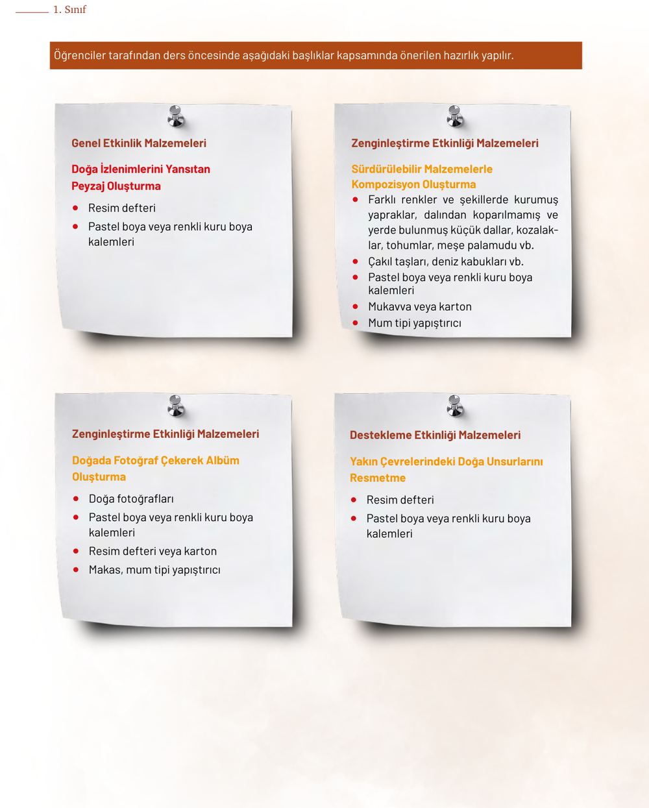
<!-- yer tutucu bulunamadı: sayfa sonuna eklendi -->

<!-- sayfa 44 -->

# ÖĞRENME-ÖĞRETME YAŞANTILARI

**TEMEL KABULLER**

Öğrencilerin doğadaki renkleri, şekilleri ve doğal unsurları tanıdıkları; renkler, şekiller ve nesneler arasındaki temel ilişkileri kavrayabildikleri kabul edilmektedir.

**ÖN DEĞERLENDİRME SÜRECİ**

Öğrencilerin doğada gördükleri renkler, şekiller ve doğal unsurlara karşı farkındalıkları aşağıdakilere benzer sorulara verdikleri yanıtlarla ölçülür:

* Çevrenizdeki çiçekler, ağaçlar ve gökyüzü hangi renklerdedir?
* Ağaçların dal ve yaprakları, hangi şekillere benzemektedir?
* Yakın çevrenizde dikkatinizi çeken renk ve şekiller nelerdir?

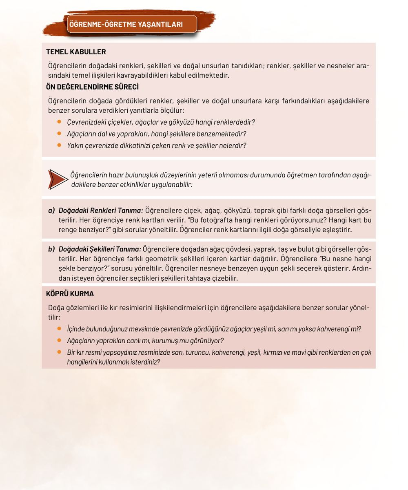

Öğrencilerin hazır bulunuşluk düzeylerinin yeterli olmaması durumunda öğretmen tarafından aşağıdakilere benzer etkinlikler uygulanabilir:

**a) Doğadaki Renkleri Tanıma:** Öğrencilere çiçek, ağaç, gökyüzü, toprak gibi farklı doğa görselleri gösterilir. Her öğrenciye renk kartları verilir. “Bu fotoğrafta hangi renkleri görüyorsunuz? Hangi kart bu renge benziyor?” gibi sorular yöneltilir. Öğrenciler renk kartlarını ilgili doğa görseliyle eşleştirir.

**b) Doğadaki Şekilleri Tanıma:** Öğrencilere doğadan ağaç gövdesi, yaprak, taş ve bulut gibi görseller gösterilir. Her öğrenciye farklı geometrik şekilleri içeren kartlar dağıtılır. Öğrencilere “Bu nesne hangi şekle benziyor?” sorusu yöneltilir. Öğrenciler nesneye benzeyen uygun şekli seçerek gösterir. Ardından isteyen öğrenciler seçtikleri şekilleri tahtaya çizebilir.

**KÖPRÜ KURMA**

Doğa gözlemleri ile kır resimlerini ilişkilendirmeleri için öğrencilere aşağıdakilere benzer sorular yöneltilir:

* İçinde bulunduğunuz mevsimde çevrenizde gördüğünüz ağaçlar yeşil mi, sarı mı yoksa kahverengi mi?
* Ağaçların yaprakları canlı mı, kurumuş mu görünüyor?
* Bir kır resmi yapsaydınız resminizde sarı, turuncu, kahverengi, yeşil, kırmızı ve mavi gibi renklerden en çok hangilerini kullanmak isterdiniz?

<!-- sayfa 45 -->

# ÖĞRENME-ÖĞRETME UYGULAMALARI
## Uygulama Öncesi

Öğrencilerden çağdaş Türk resim sanatında peyzaj temalı eserleri inceleyebilmeleri (**GS.1.3.1**) beklenir. Bu amaçla aşağıdaki adımlar takip edilir:

ESER İNCELEME

### Çağdaş Türk Resim Sanatında Peyzaj Temalı Eserleri İnceleme

Öğrencilere Hoca Ali Rıza’nın “Göl Kıyısı” veya “Manzara”, Eşref Üren’in “Mamak”, Mehmet Ali Laga’nın “İstanbul’da Kış”, Hikmet Onat’ın “Hisar Tepelerinden Boğaz” veya Refik Epikman’ın “Ankara’dan Manzara” isimli eserleri örnek olarak gösterilir. İncelenecek eserler öğrencilerin katılımıyla ve ortak görüşlerine göre belirlenir (**OB5, OB9, D3.4**).

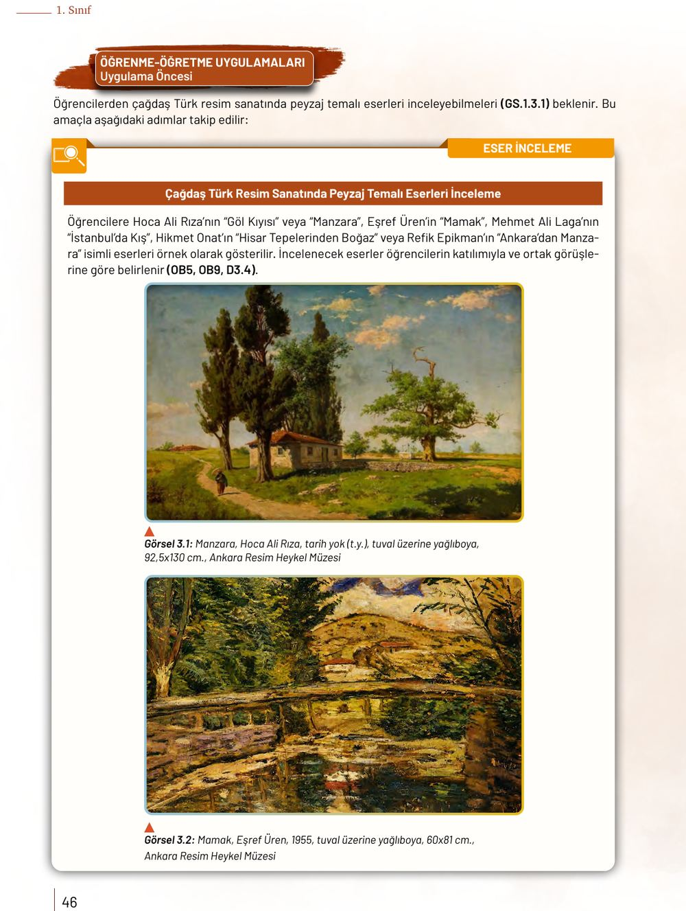

**Görsel 3.1:** *Manzara, Hoca Ali Rıza, tarih yok (t.y.), tuval üzerine yağlıboya, 92,5x130 cm., Ankara Resim Heykel Müzesi*

**Görsel 3.2:** *Mamak, Eşref Üren, 1955, tuval üzerine yağlıboya, 60x81 cm., Ankara Resim Heykel Müzesi*

<!-- sayfa 46 -->

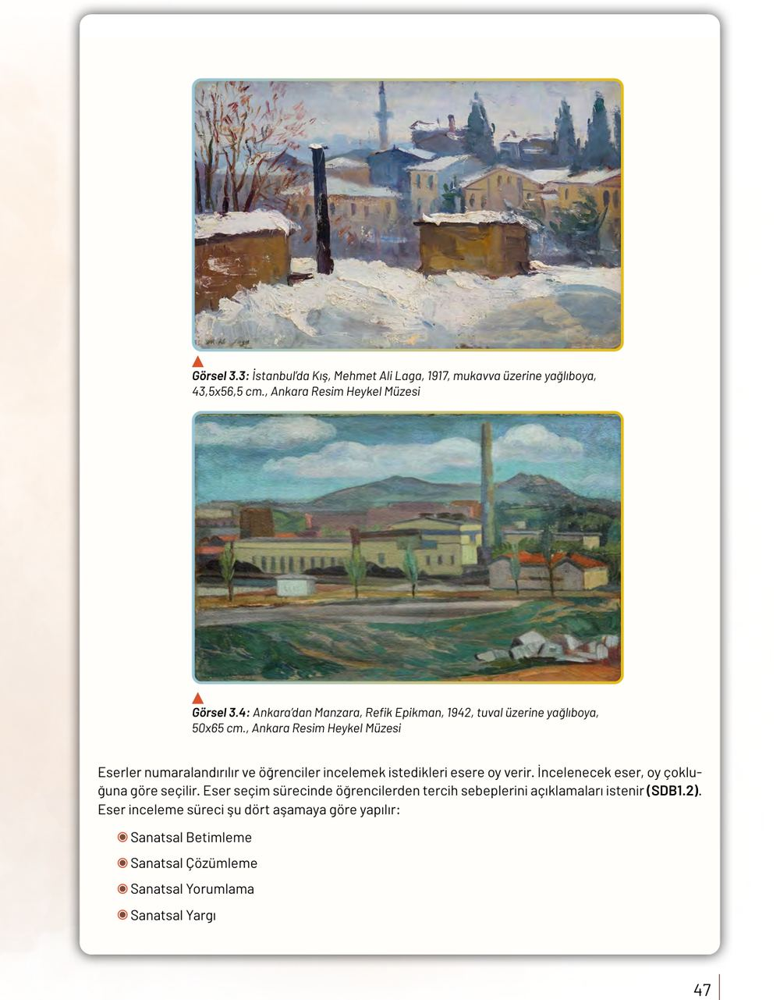

**Görsel 3.3:** *İstanbul'da Kış*, Mehmet Ali Laga, 1917, mukavva üzerine yağlıboya, 43,5x56,5 cm., Ankara Resim Heykel Müzesi

**Görsel 3.4:** *Ankara'dan Manzara*, Refik Epikman, 1942, tuval üzerine yağlıboya, 50x65 cm., Ankara Resim Heykel Müzesi

Eserler numaralandırılır ve öğrenciler incelemek istedikleri esere oy verir. İncelenecek eser, oy çokluğu-na göre seçilir. Eser seçim sürecinde öğrencilerden tercih sebeplerini açıklamaları istenir **(SDB1.2)**.
Eser inceleme süreci şu dört aşamaya göre yapılır:

* Sanatsal Betimleme
* Sanatsal Çözümleme
* Sanatsal Yorumlama
* Sanatsal Yargı

<!-- sayfa 47 -->

# Peyzaj Temalı Eseri Sanatsal Açıdan Betimleme:

Öğrencilerin seçilen eseri sanatsal açıdan betimlemeleri için **(a)** peyzaj temalı eser görselleri dijital veya basılı ortamda paylaşılır ve öğrencilerin bu görselleri incelemeleri sağlanır **(OB4)**. Betimleme sürecinde aşağıdaki sıralama dikkate alınır.

✔️ Öğrencilerin peyzaj temalı sanat eserinin türünü tahmin etmeleri için resim, heykel, fotoğraf gibi farklı sanat türlerine ait örnekleri **(Bk. Görsel 3.5)** incelemeleri sağlanır **(OB4)**. Bu aşamada öğrencilere düzeylerine uygun sorular sorularak veya yönlendirmeler yapılarak öğrencilerin resim türündeki görseli bulmaları beklenir.

* Bu görsellerden hangisinin resim olduğunu düşünüyorsunuz?
* Sizce hangisi boyalarla yapılmıştır?
* Bu görsellere bakınca görsellerden hangisi size taş hissi veriyor?
* Bu görsellerden hangisi fotoğraf olabilir, fotoğraf gerçek gibi mi duruyor?

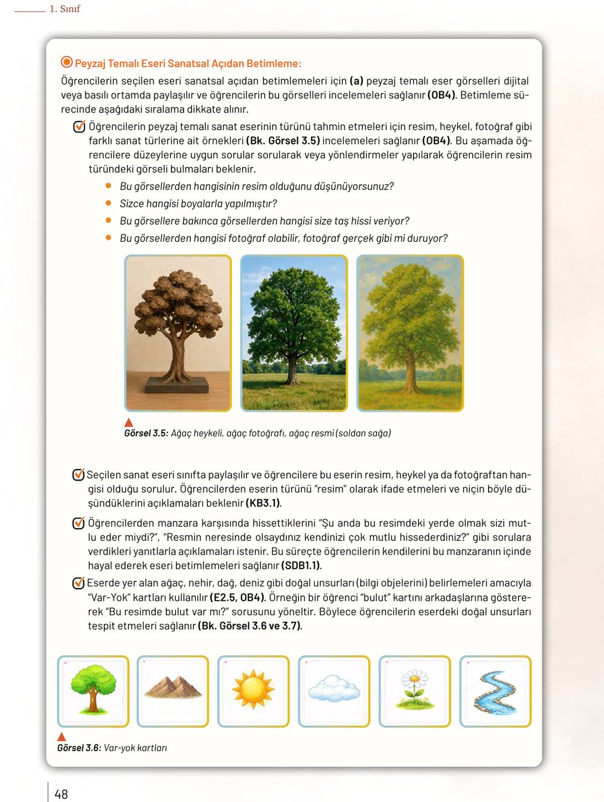

*Görsel 3.5: Ağaç heykeli, ağaç fotoğrafı, ağaç resmi (soldan sağa)*

✔️ Seçilen sanat eseri sınıfta paylaşılır ve öğrencilere bu eserin resim, heykel ya da fotoğraftan hangisi olduğu sorulur. Öğrencilerden eserin türünü “resim” olarak ifade etmeleri ve niçin böyle düşündüklerini açıklamaları beklenir **(KB3.1)**.

✔️ Öğrencilerden manzara karşısında hissettiklerini “Şu anda bu resimdeki yerde olmak sizi mutlu eder miydi?”, “Resmin neresinde olsaydınız kendinizi çok mutlu hissederdiniz?” gibi sorulara verdikleri yanıtlarla açıklamaları istenir. Bu süreçte öğrencilerin kendilerini bu manzaranın içinde hayal ederek eseri betimlemeleri sağlanır **(SDB1.1)**.

✔️ Eserde yer alan ağaç, nehir, dağ, deniz gibi doğal unsurları (bilgi objelerini) belirlemeleri amacıyla “Var-Yok” kartları kullanılır **(E2.5, OB4)**. Örneğin bir öğrenci “bulut” kartını arkadaşlarına göstererek “Bu resimde bulut var mı?” sorusunu yöneltir. Böylece öğrencilerin eserdeki doğal unsurları tespit etmeleri sağlanır **(Bk. Görsel 3.6 ve 3.7)**.

*Görsel 3.6: Var-yok kartları*

<!-- sayfa 48 -->

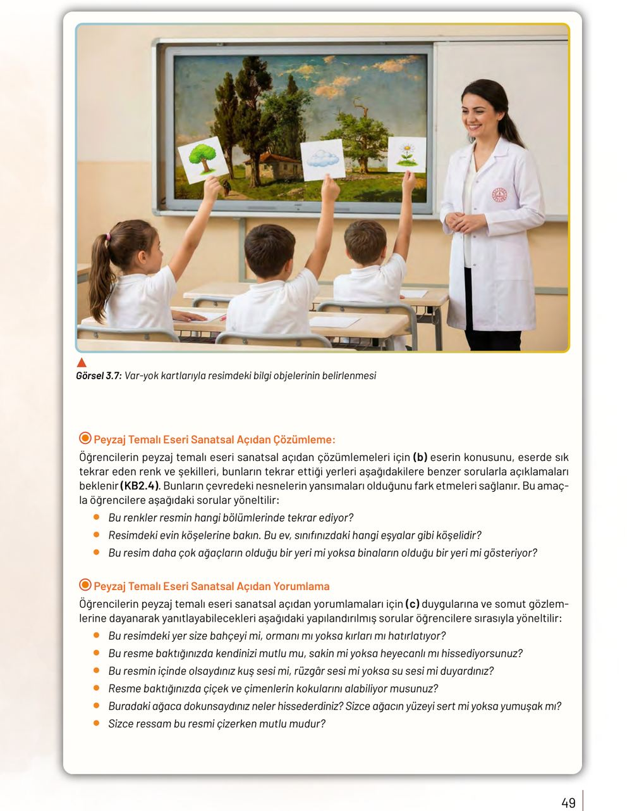

**Görsel 3.7:** *Var-yok kartlarıyla resimdeki bilgi objelerinin belirlenmesi*

### ◉ Peyzaj Temalı Eseri Sanatsal Açıdan Çözümleme:
Öğrencilerin peyzaj temalı eseri sanatsal açıdan çözümlemeleri için **(b)** eserin konusunu, eserde sık tekrar eden renk ve şekilleri, bunların tekrar ettiği yerleri aşağıdaki gibi benzer sorularla açıklamaları beklenir (KB2.4). Bunların çevredeki nesnelerin yansımaları olduğunu fark etmeleri sağlanır. Bu amaçla öğrencilere aşağıdaki sorular yöneltilir:

* Bu renkler resmin hangi bölümlerinde tekrar ediyor?
* Resimdeki evin köşelerine bakın. Bu ev, sınıfınızdaki hangi eşyalar gibi köşelidir?
* Bu resim daha çok ağaçların olduğu bir yeri mi yoksa binaların olduğu bir yeri mi gösteriyor?

### ◉ Peyzaj Temalı Eseri Sanatsal Açıdan Yorumlama
Öğrencilerin peyzaj temalı eseri sanatsal açıdan yorumlamaları için **(c)** duygularına ve somut gözlemlerine dayanarak yanıtlayabilecekleri aşağıdaki yapılandırılmış sorular öğrencilere sırasıyla yöneltilir:

* Bu resimdeki yer size bahçeyi mi, ormanı mı yoksa kırları mı hatırlatıyor?
* Bu resme baktığınızda kendinizi mutlu mu, sakin mi yoksa heyecanlı mı hissediyorsunuz?
* Bu resmin içinde olsaydınız kuş sesi mi, rüzgâr sesi mi yoksa su sesi mi duyardınız?
* Resme baktığınızda çiçek ve çimenlerin kokularını alabiliyor musunuz?
* Buradaki ağaca dokunsaydınız neler hissederdiniz? Sizce ağacın yüzeyi sert mi yoksa yumuşak mı?
* Sizce ressam bu resmi çizerken mutlu mudur?

<!-- sayfa 49 -->

# Farkındalık Geliştirme: Doğaya Saygı ve Çevre Bilinci

Doğanın korunması ve çevre bilinci geliştirilmesi amacıyla eserdeki ağaçların, dağların ve su kaynaklarının birer sanat nesnesi olmasının yanı sıra yaşamın bir parçası olduğunu kavramaları beklenir (**OB8, D5.2**). Doğaya, sevgi ve saygı ile yaklaşmaları sağlanır (**D14.3**). Bu amaçla öğrencilere “Böyle güzel bir doğada yaşamak ister miydiniz?”, “Doğayı korumak için neler yapabilirsiniz?” gibi sorular yöneltilebilir.

## Peyzaj Temalı Eser Hakkında Sanatsal Yargıda Bulunma:

Öğrencilerin peyzaj temalı eser hakkında sanatsal açıdan yargıda bulunmaları için **(ç)** öğrencilerin eseri beğenme sebeplerini gerekçeleriyle ifade etmeleri istenir (**SDB3.3**). Bunun için aşağıdakilere benzer sorular yöneltilir:

* Bu resmi beğendiniz mi?
* Bu resimde en çok hoşunuza giden şey ne oldu?
* Bu resmi evinizin duvarında görmek ister miydiniz? Neden isterdiniz veya istemezdiniz?
* Bu resme bir ağaç, bir çiçek, başka bir renk, başka bir şey eklemek ister miydiniz?
* Bu resmi siz yapsaydınız resminizde neler olurdu?

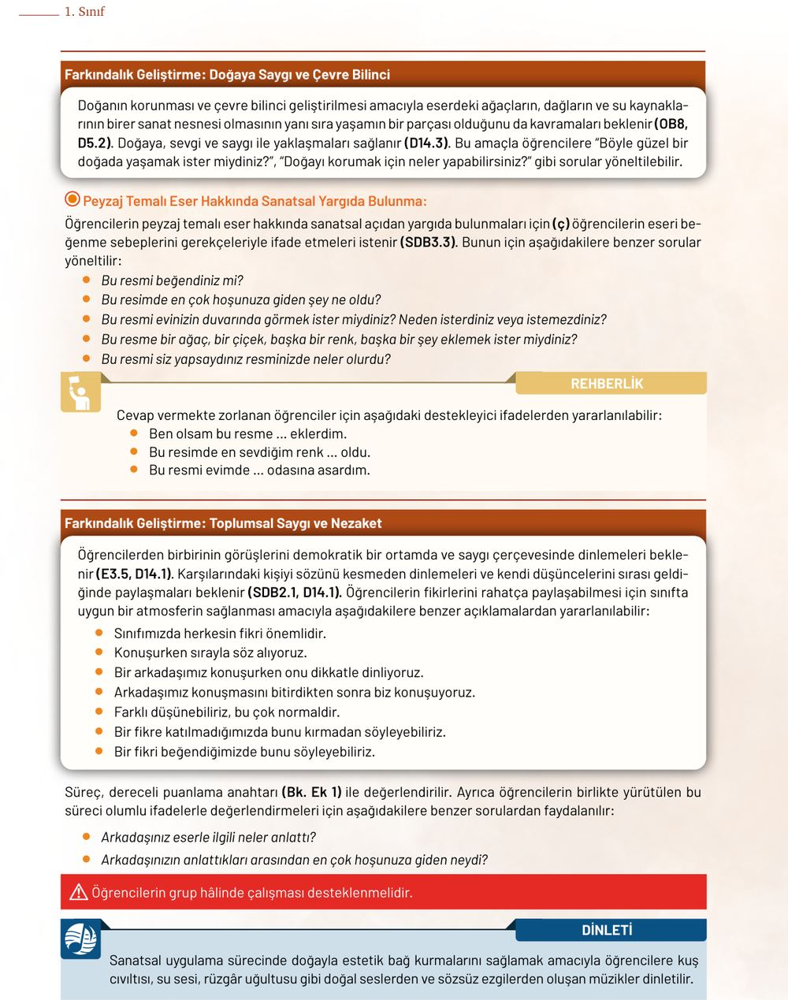
> ### REHBERLİK
> Cevap vermekte zorlanan öğrenciler için aşağıdaki destekleyici ifadelerden yararlanılabilir:
> * Ben olsam bu resme ... eklerdim.
> * Bu resimde en sevdiğim renk ... oldu.
> * Bu resmi evimde ... odasına asardım.

# Farkındalık Geliştirme: Toplumsal Saygı ve Nezaket

Öğrencilerden birbirinin görüşlerini demokratik bir ortamda ve saygı çerçevesinde dinlemeleri beklenir (**E3.5, D14.1**). Karşılarındaki kişiyi sözünü kesmeden dinlemeleri ve kendi düşüncelerini sırası geldiğinde paylaşmaları beklenir (**SDB2.1, D14.1**). Öğrencilerin fikirlerini rahatça paylaşabilmesi için sınıfta uygun bir atmosferin sağlanması amacıyla aşağıdakilere benzer açıklamalardan yararlanılabilir:

* Sınıfımızda herkesin fikri önemlidir.
* Konuşurken sırayla söz alıyoruz.
* Bir arkadaşımız konuşurken onu dikkatle dinliyoruz.
* Arkadaşımız konuşmasını bitirdikten sonra biz konuşuyoruz.
* Farklı düşünebiliriz, bu çok normaldir.
* Bir fikre katılmadığımızda bunu kırmadan söyleyebiliriz.
* Bir fikri beğendiğimizde bunu söyleyebiliriz.

Süreç, dereceli puanlama anahtarı (**Bk. Ek 1**) ile değerlendirilir. Ayrıca öğrencilerin birlikte yürütülen bu süreci olumlu ifadelerle değerlendirmeleri için aşağıdakilere benzer sorulardan faydalanılır:

* Arkadaşınız eserle ilgili neler anlattı?
* Arkadaşınızın anlattıkları arasından en çok hoşunuza giden neydi?

⚠️ Öğrencilerin grup hâlinde çalışması desteklenmelidir.

### DİNLETİ

Sanatsal uygulama sürecinde doğayla estetik bağ kurmalarını sağlamak amacıyla öğrencilere kuş cıvıltısı, su sesi, rüzgâr uğultusu gibi doğal seslerden ve sözsüz ezgilerden oluşan müzikler dinletilir.

<!-- sayfa 50 -->

# Tasarım Geliştirme:
## Renk ve Şekil Tekrarlarıyla Doğa İzlenimlerini Yansıtan Peyzaj Tasarlama

Öğrencilerden renk ve şekil tekrarlarıyla doğa izlenimlerini yansıtan peyzaj yapabilmeleri (**GS.1.3.2**) beklenir. Peyzaj temalı resim tasarımlarını için **(a)** aşağıdaki süreçler takip edilir:

*   Öğrencilerin mevsimlerdeki belirgin özellikleri görseller, belgeseller, kısa videolar veya doğa fotoğrafları aracılığıyla tanımaları sağlanır (**OB2, OB4**).
*   Öğrencilere doğadaki renklerin ve şekillerin tekrarları hakkında farkındalık kazandırılması amacıyla aşağıdakilere benzer sorularla rehberlik edilir:
    *   Doğada yeşil, kırmızı ve turuncu renklerden en çok hangisini nerelerde görüyorsunuz?
    *   Yuvarlak şekilleri ağaçlarda mı görüyorsunuz yoksa gökyüzünde mi?
*   Her mevsim için bir grup oluşturularak öğrencilerin sevdiği mevsimin grubuna katılmaları sağlanır.
*   Her grup temsil ettikleri mevsimlerde gözlemledikleri doğal değişimleri, doğanın döngüsünü yansıtan unsurları ve bu mevsimlere ilişkin duygu ve düşüncelerini paylaşır (**E3.5, SDB1.1**).
*   Aşağıdakilere benzer açık uçlu sorularla öğrencilerin fikirlerini ifade etmeleri ve sürece aktif katılım göstermeleri sağlanır (**SDB2.1, D3.4**):
    *   İlkbaharda gördüğünüz renkler sizi heyecanlandırıyor mu?
    *   Sonbaharda yapraklar yeşil mi, sarı mı yoksa mor mu oluyor?
    *   Doğadaki renkleri ve farklı şekilleri kullanarak nasıl bir resim yapmak istersiniz?
*   Öğrencilerden karşılarındaki kişiyi sözünü kesmeden dinlemeleri, kendi fikirlerini sırası geldiğinde paylaşmaları, başkalarının duygu ve düşüncelerine saygı duymaları beklenir (**D14.1**).
*   Mevsimleri temsil eden renkler, şekiller ve yaprak, kar tanesi, güneş gibi sembollerle öğrencilerin tasarımlarını planlamaları sağlanır (**SDB1.2**).

# Uygulama Sırası

Renk ve şekil tekrarlarıyla doğa izlenimlerini yansıtan peyzaj oluşturmaları için **(b)** her grubun tasarımlarını pastel boya veya kuru boya kalemleri kullanarak özgün bakış açısıyla mevsim şeridine dönüştürmesi beklenir (**KB2.20**). Bu amaçla öğrencilerin aşağıdaki etkinliği gerçekleştirmesi sağlanır.

## 1. ETKİNLİK
### Doğa İzlenimlerini Yansıtan Peyzaj Oluşturma

Öğrenciler renk ve şekil tekrarlarıyla doğa izlenimlerini yansıtan peyzaj oluşturmak için mevsim şeridi yapar. Bu amaçla aşağıdaki aşamaları sırasıyla gerçekleştirir:

1. Gruplar tasarımlarında kullanacakları pastel boyaları veya kuru boya kalemleri hazır bulundurur.
2. Gruplar malzeme seçimlerini ortak tercihleri doğrultusunda yapar (**SDB1.2**).
3. Boyaların kullanım şekli ve uygulama teknikleri öğrencilere gösterilir (**OB9**).
4. Öğrencilere grup içindeki görevleri ve sorumlulukları hatırlatılır.
5. Öğrenciler resim yaparken kenarları taşırmamaya ve alanı tamamen doldurarak çalışmaya dikkat eder.

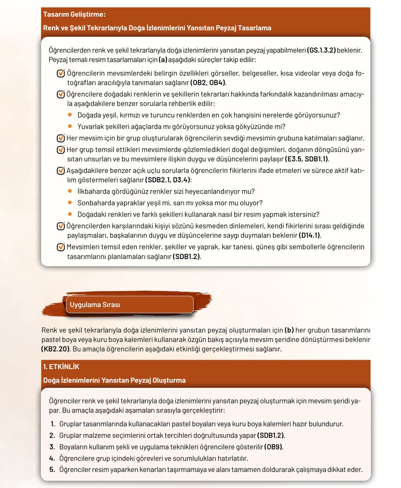
<!-- yer tutucu bulunamadı: sayfa sonuna eklendi -->

<!-- sayfa 51 -->

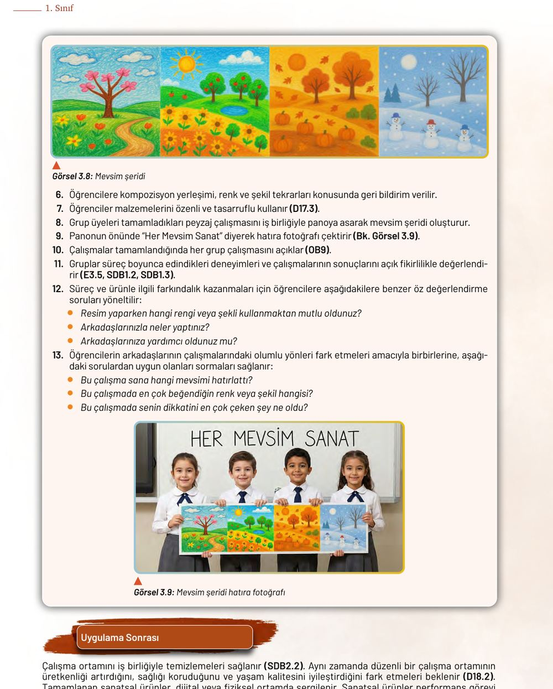

**Görsel 3.8:** Mevsim şeridi

6. Öğrencilere kompozisyon yerleşimi, renk ve şekil tekrarları konusunda geri bildirim verilir.
7. Öğrenciler malzemelerini özenli ve tasarruflu kullanır (**D17.3**).
8. Grup üyeleri tamamladıkları peyzaj çalışmasını iş birliğiyle panoya asarak mevsim şeridi oluşturur.
9. Panonun önünde “Her Mevsim Sanat” diyerek hatıra fotoğrafı çektirir (**Bk. Görsel 3.9**).
10. Çalışmalar tamamlandığında her grup çalışmasını açıklar (**OB9**).
11. Gruplar süreç boyunca edindikleri deneyimleri ve çalışmalarının sonuçlarını açık fikirlilikle değerlendirir (**E3.5, SDB1.2, SDB1.3**).
12. Süreç ve ürünle ilgili farkındalık kazanmaları için öğrencilere aşağıdakilere benzer öz değerlendirme soruları yöneltilir:
    * Resim yaparken hangi rengi veya şekli kullanmaktan mutlu oldunuz?
    * Arkadaşlarınızla neler yaptınız?
    * Arkadaşlarınıza yardımcı oldunuz mu?
13. Öğrencilerin arkadaşlarının çalışmalarındaki olumlu yönleri fark etmeleri amacıyla birbirlerine, aşağıdaki sorulardan uygun olanları sormaları sağlanır:
    * Bu çalışma sana hangi mevsimi hatırlattı?
    * Bu çalışmada en çok beğendiğin renk veya şekil hangisi?
    * Bu çalışmada senin dikkatini en çok çeken şey ne oldu?

**Görsel 3.9:** Mevsim şeridi hatıra fotoğrafı

# Uygulama Sonrası

Çalışma ortamını iş birliğiyle temizlemeleri sağlanır (**SDB2.2**). Aynı zamanda düzenli bir çalışma ortamının üretkenliği artırdığını, sağlığı koruduğunu ve yaşam kalitesini iyileştirdiğini fark etmeleri beklenir (**D18.2**). Tamamlanan sanatsal ürünler dijital veya fiziksel ortamda sergilenir. Sanatsal ürünler performans görevi

<!-- sayfa 52 -->

# FARKLILAŞTIRMA

## Zenginleştirme

⚠️ Öğrenciler aşağıdaki etkinliklerden birine yönlendirilir.

### Seçmeli Etkinlik 1: Sürdürülebilir Malzemelerle Peyzaj Oluşturma

Öğrenciler aşağıdaki aşamaları sırasıyla gerçekleştirerek mevsim ve coğrafya şartlarına uygun sürdürülebilir malzemelerle kompozisyon oluşturur.

1. Öğrenciler pastel boya veya renkli kuru boya kalemleri ile mum tipi yapıştırıcı, mukavva ve karton gibi malzemeleri hazır bulundurur.
2. Yakın çevrede bulunan yere düşmüş yapraklar, küçük dallar, kozalaklar ve tohumlar gibi doğaya zarar vermeden kullanılabilecek doğal malzemeleri belirler.
3. Öğrencilere canlı bitkilerin koparılmaması ve doğaya zarar verilmemesi gerektiği hatırlatılır.
4. Topladığı malzemeleri seçilen yüzeye yapıştırmadan yerleştirerek çalışma için taslak düzenleme yapar.
5. Renk ve şekil tekrarlarına dikkat ederek nesneleri yüzeye yapıştırıcıyla sabitler.
6. Çalışmasını çizimlerle ve renklendirerek zenginleştirebilir.
7. Tamamladığı çalışmayı sınıfta sunar.
8. Süreç ve ürünle ilgili farkındalık kazanmaları için öğrencilere aşağıdakilere benzer öz değerlendirme soruları yöneltilir:

* Yaprak, tohum, kozalak gibi doğadan topladığınız hangi malzemeyi çalışmanızda kullanmaktan hoşlandınız?
* Çalışma sırasında doğayı korumak için nelere dikkat ettiniz?

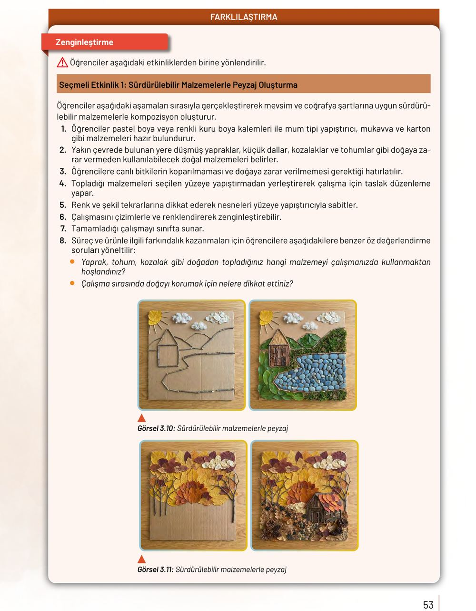
**Görsel 3.10:** Sürdürülebilir malzemelerle peyzaj

**Görsel 3.11:** Sürdürülebilir malzemelerle peyzaj

<!-- sayfa 53 -->

# Seçmeli Etkinlik 2: Doğada Fotoğraf Çekerek Albüm Oluşturma

Öğrenciler doğada çektikleri fotoğraflardan oluşan albüm hazırlamak için aşağıdaki aşamaları sırasıyla gerçekleştirir:

1. Öğrencilere doğada çekilmiş, yaş düzeyine uygun görseller gösterilir.
2. Öğrenciler doğada dikkatlerini çeken ağaç, çiçek, hayvan, gökyüzü gibi unsurları belirler.
3. Öğrenciler veli rehberliğinde çevrelerinde kısa bir gözlem yaparak doğaya ait fotoğraflar çeker.
4. Çekilen fotoğrafların baskıları alınır ve öğrenciler bu görselleri belirli bir sıraya göre karton veya resim defterinin üzerine yapıştırır.
5. Albüm kapağına öğrencinin adı yazılır ve kapak, doğa ile ilgili çizimlerle zenginleştirilebilir.
6. Fotoğrafların altına düzeylerine uygun cümleler ekleyebilir.
7. Öğrenciler hazırladıkları fotoğraf albümünü sınıfta paylaşır.
8. Süreç ve ürünle ilgili farkındalık kazanmaları için öğrencilere aşağıdakilere benzer öz değerlendirme soruları yöneltilir:

* Fotoğraf albümünde en çok hangi fotoğrafı sevdiniz?
* Bu fotoğrafı neden seçtiniz?
* Albümü hazırlarken en çok neyi yapmaktan hoşlandınız?

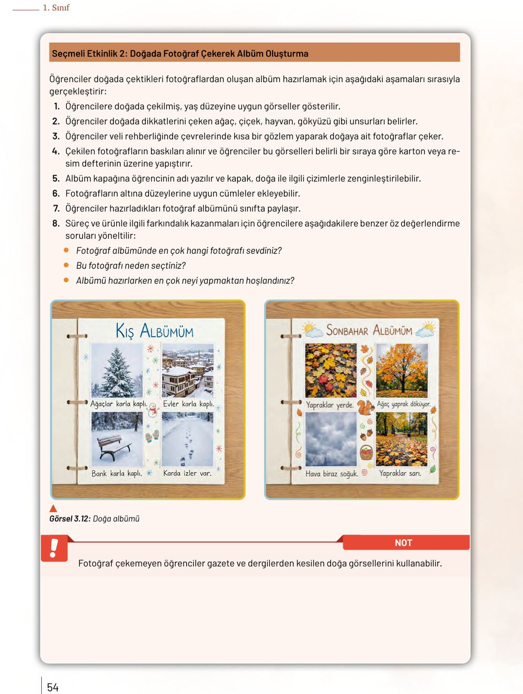

Görsel 3.12: *Doğa albümü*

> **NOT**
> 
> Fotoğraf çekemeyen öğrenciler gazete ve dergilerden kesilen doğa görsellerini kullanabilir.

<!-- sayfa 54 -->

# Destekleme

## Etkinlik 1: Yakın Çevrelerindeki Doğa Unsurlarını Resmetme

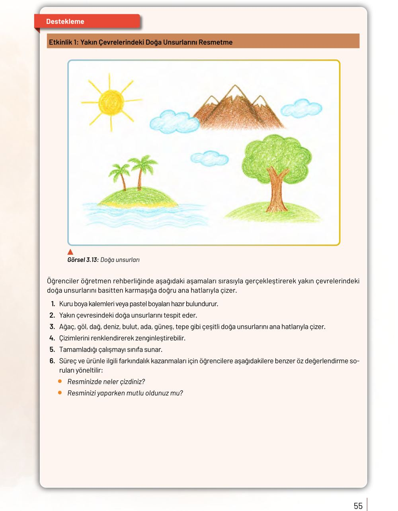

*Görsel 3.13: Doğa unsurları*

Öğrenciler öğretmen rehberliğinde aşağıdaki aşamaları sırasıyla gerçekleştirerek yakın çevrelerindeki doğa unsurlarını basitten karmaşığa doğru ana hatlarıyla çizer.

1. Kuru boya kalemleri veya pastel boyaları hazır bulundurur.
2. Yakın çevresindeki doğa unsurlarını tespit eder.
3. Ağaç, göl, dağ, deniz, bulut, ada, güneş, tepe gibi çeşitli doğa unsurlarını ana hatlarıyla çizer.
4. Çizimlerini renklendirerek zenginleştirebilir.
5. Tamamladığı çalışmayı sınıfa sunar.
6. Süreç ve ürünle ilgili farkındalık kazanmaları için öğrencilere aşağıdakilere benzer öz değerlendirme soruları yöneltilir:

* Resminizde neler çizdiniz?
* Resminizi yaparken mutlu oldunuz mu?

<!-- sayfa 55 -->

# EK 1. DERECELİ PUANLAMA ANAHTARI

Bu dereceli puanlama anahtarı, öğrencilerden beklenen becerilerin ve sürece katılım düzeylerinin belirlenen ölçütler doğrultusunda nesnel ve sistematik biçimde değerlendirilmesi amacıyla hazırlanmıştır. Özellikler ve davranışlar, belirlenen ölçütlere göre sıralanır ve her biri için 1'den 3'e kadar bir puanlama sistemi uygulanır. Derecelendirme süreci öğretmenin gözlemine dayalı olarak yürütülür. Her bir davranış ve özellik için öğrencinin performansı 1'den 3'e kadar puanlanır. 1 en düşük, 3 ise en yüksek puanı temsil eder. Elde edilen sonuçlar **not vermenin yanı sıra** öğrencinin gelişimini destekleyici geri bildirimlerin planlanmasında ve öğretim sürecinin geliştirilmesinde kullanılmalıdır. “Hiçbir zaman” olarak işaretlenen öğrenci davranışı geliştirilmelidir.

## DERECELİ PUANLAMA ANAHTARI

Etkinlik Adı : Renk ve Şekil Tekrarlarıyla Doğa İzlenimlerini Yansıtan Peyzaj Yapabilme
Adı-Soyadı : ..................................................................................................................
Sınıfı-Numarası : ............ / ............
Tarih : ........ / ........ / 20 ......

| No | Ölçütler | Dereceler | | |
| :--- | :--- | :---: | :---: | :---: |
| | | **Hiçbir zaman** | **Bazen** | **Her zaman** |
| 1 | Resminde ağaç, güneş, bulut, yaprak gibi doğaya ait birden fazla unsuru yansıttı. | | | |
| 2 | Resminde renk tekrarlarını kullandı. | | | |
| 3 | Resminde şekil tekrarlarını kullandı. | | | |
| 4 | Çalışma sürecine istekli biçimde katıldı. | | | |

**Öğretmen Görüşleri/Açıklamalar:** ........................................................................................................................
....................................................................................................................................................................................
....................................................................................................................................................................................
....................................................................................................................................................................................

"Dereceli Puanlama Anahtarı"na karekod üzerinden erişebilirsiniz. 

<!-- sayfa 56 -->

1. Sınıf

# 4. TEMA
# ÇİZİM VE GÖRSEL İFADE

Tema içeriğine
karekod üzerinden

<!-- sayfa 57 -->

| TEMA ADI | Çizim ve Görsel İfade |
| :--- | :--- |
| **SINIF DÜZEYİ** | 1 |
| **TEMA KAPSAMI** | Öğrencilerin farklı çizgi türlerini tanımaları ve çizgileri kullanarak serbest kompozisyonlar oluşturmaları amaçlanmaktadır. |
| **DERS SAATİ** | 5 |
| **ALAN BECERİLERİ** | SAB4. Sanatsal Üretim Yapma |
| **KAVRAMSAL BECERİLER** | - |
| **EĞİLİMLER** | E1.2. Bağımsızlık, E2.5. Oyunseverlik, E3.3. Yaratıcılık, E3.5. Açık Fikirlilik |

| PROGRAMLAR ARASI BİLEŞENLER | |
| :--- | :--- |
| **SOSYAL-DUYGUSAL ÖĞRENME BECERİLERİ** | SDB1.1. Kendini Tanıma (Öz Farkındalık), SDB1.2. Kendini Düzenleme (Öz Düzenleme), SDB1.3. Kendine Uyarlama (Öz Yansıtma), SDB2.1. İletişim |
| **DEĞERLER** | D10. Mütevazılık, D18. Temizlik |
| **OKURYAZARLIK BECERİLERİ** | OB2. Dijital Okuryazarlık, OB4. Görsel Okuryazarlık |
| **DİSİPLİNLER ARASI İLİŞKİLER** | Türkçe, Matematik |
| **BECERİLER ARASI İLİŞKİLER** | - |

| ÖĞRENME ÇIKTILARI VE SÜREÇ BİLEŞENLERİ | |
| :--- | :--- |
| **GS.1.4.1. Temel çizgi türlerini kullanarak serbest çizim yapabilme** | a) Farklı çizgi türleriyle kompozisyon tasarlar. b) Farklı çizgi türleriyle desen oluşturur. |

| İÇERİK ÇERÇEVESİ | Kompozisyonda Çizgi Çeşitliliği |
| :--- | :--- |
| **ANAHTAR KAVRAMLAR** | dalgalı çizgi, düz çizgi, eğik çizgi, kesik çizgi, serbest çizim, zikzak çizgi |
| **ÖĞRENME KANITLARI (ÖLÇME VE DEĞERLENDİRME)** | Öğrenme çıktıları kontrol listeleri ve öz değerlendirme formları kullanılarak değerlendirilebilir. Sınıf içi performans görevi olarak öğrencilerden farklı çizgi türleriyle serbest çizimler yapmaları istenir. |

<!-- yer tutucu bulunamadı: sayfa sonuna eklendi -->

<!-- sayfa 58 -->

# TEMA AKIŞI

* Çizgi Türlerini Tanıyarak Görsel Eşleştirme Yapma
* Çizgi Çarkı Oyunu ile Çizgi Albümü Hazırlama
* Farklı Çizgi Türleriyle Kompozisyon Tasarlama
* Farklı Çizgi Türleriyle Kompozisyon Oluşturma
* Çalışma Ortamını Düzenleme
* Değerlendirme
* Sergileme
* Farklılaştırma

# TEMA HAZIRLIĞI

Öğretmen tarafından ders öncesinde çizgi türlerine ilişkin hazırlıklar yapılır. Bu kapsamda aşağıdakilerin gerçekleştirilmesi beklenir:

* Düz, eğik, kesik, dalgalı, zikzak ve serbest çizgi türlerini somutlaştırmak amacıyla ağaç dalı, ağaç kökü, deniz kabuğu gibi doğal; pipet, ip, bükülmüş tel gibi yapay malzemeler ile bu çizgileri örnekleyen görseller temin edilir.
* Çizgi çeşitlerini tanımayı kolaylaştıracak eşleştirme ve sınıflandırma oyunları için üzerinde çizgi adı ve örneklerinin yer aldığı küçük kartlar düzenlenir.
* Çizgi çarkı oyunu için ataç veya raptiye kullanılarak dönme mekanizmasına sahip karton düzenek hazırlanır. Ayrıca oyun sonrasında oluşturulacak “Çizgi Albümü” için örnek bir şablon hazırlanabilir.
* Öğrencilerin bireysel malzeme ihtiyacını karşılayamadığı durumlar için HB, B, 2B grafit kalemler, ince uçlu kalemler, fırça uçlu kalem, cetvel ve pergel gibi yardımcı malzemeler hazır bulundurulur.

<!-- sayfa 59 -->

Öğrenciler tarafından ders öncesinde aşağıdaki başlıklar kapsamında önerilen hazırlıklar yapılır:

# Genel Etkinlik Malzemeleri
## Farklı Çizgi Türleri ile Kompozisyon Oluşturma
* Resim defteri
* HB, B ve 2B grafit kalemler

# Zenginleştirme Etkinliği Malzemeleri
## İnce Uçlu Keçeli Kalem veya Fırça Uçlu Kalemle Resim Yapma
* Resim defteri
* İnce uçlu keçeli kalem, fırça uçlu kalem veya HB, B, 2B grafit kalemler

# Destekleme Etkinliği Malzemeleri
## Çizgiyle Şekil Tamamlama
* HB, B ve 2B grafit kalemler
* Şekil kartları, şablonlar

<!-- sayfa 60 -->

# ÖĞRENME-ÖĞRETME YAŞANTILARI

## TEMEL KABULLER
Öğrencilerin çizgi türleri hakkında temel farkındalıklarının olduğu kabul edilmektedir.

## ÖN DEĞERLENDİRME SÜRECİ
Öğrencilerin çevrelerindeki çizgi türlerine ilişkin farkındalık düzeyleri aşağıdakilere benzer sorulara verdikleri yanıtlarla ölçülür:
* Sizce kalem, çatal, bulut ve deniz dalgasından hangileri düz çizgilerle çizilir?
* Ağaç dalları ve dağlar düz çizgilerle mi yoksa eğik çizgilerle mi çizilir?

Öğrencilerin hazır bulunuşluk düzeylerinin yeterli olmaması durumunda öğretmen tarafından aşağıdakilere benzer etkinlikler uygulanabilir:

**a) Çizgi Tamamlama Oyunu:** Öğrencilere dalgalı çizgiyle başlayan bulut veya eğik çizgiyle başlayan ev çatısı gibi yarım kalmış nesnelerin bulunduğu kartlar dağıtılır. Öğrencilerden uygun çizgi türlerini kullanarak nesneleri tamamlamaları istenir. Çalışma sonunda öğrencilerin hangi çizgi türlerini kullandıklarını ifade etmeleri sağlanır.

**b) Havaya Çizgi Çizme Oyunu:** Öğrencilere “Haydi beraber havaya düz çizgi çizelim!”, “Şimdi dalgalı çizgi çizelim!”, “Zikzak çizgiyi gösterelim!” gibi yönergeler verilir. Öğrenciler kollarını omuzdan hareket ettirerek havada dalgalı, düz, eğik, kesik ve zikzak çizgiler çizer.

**c) Çizgi Bulma Oyunu:** Sınıfın belirli alanlarına farklı çizgi türlerini gösteren kâğıtlar asılır. Öğrencilere “Dalgalı çizgiye dokun!”, “Zikzak çizgiyi bul!” gibi yönergeler verilir. Öğrenciler doğru çizgiyi sobeler.

## KÖPRÜ KURMA
Öğrencilere çevrelerindeki çizgi etkisini fark edebilmeleri için aşağıdakilere benzer sorular sorulur:
* Bir binanın duvarında düz veya kesik çizgiler gördünüz mü?
* Yaya geçitlerindeki çizgiler nasıl görünüyor? Kesik çizgileri başka nerelerde görebilirsiniz?
* Bir ağacın gövdesinde veya dallarında hangi tür çizgileri görebilirsiniz?

<!-- sayfa 61 -->

# ÖĞRENME-ÖĞRETME UYGULAMALARI
## Uygulama Öncesi

Öğrencilerden temel çizgi türlerini kullanarak serbest çizim yapabilmeleri (GS.1.4.1) beklenir. Bu amaçla aşağıdaki adımlar takip edilir:

* **Görsel Eşleştirme Oyunu:**
  **Çizgi Türlerini Tanıma**
  * Öğrencilere çizgi türlerini tanımaları için çizgi kartları ile eşleştirme oyunu oynatılır.
  * Düz, eğik, kesik, dalgalı, zikzak ve serbest çizgi örnekleri dijital veya basılı ortamda paylaşılır (OB2, OB4).
  * Öğrencilere farklı çizgi örneklerinin bulunduğu küçük kâğıtlar verilir.
  * Öğrencilerden kâğıtlarında yer alan çizgileri, aynı çizgi türünün bulunduğu görselin üzerine yerleştirmeleri istenir.

**Görsel 4.1: Çizgi kartları**

* Panodaki her çizgi türü ayrı ayrı gösterilerek “Bu hangi çizgiye benziyor?”, “Eğik çizgiyi başka nerelerde görüyorsunuz?” gibi sorularla öğrencilerin çizgilere ilişkin farkındalık geliştirmeleri sağlanır (SDB1.1).

  * **Düz Çizgi:** Bir noktadan diğerine doğru giden çizgidir. (Cetvel kenarı, tahtanın kenarı, kitap kapağının kenarı, masanın ayakları vb.)
  * **Eğik Çizgi:** Eğik çizgi, sağa veya sola yatmış çizgilerdir. (Parktaki kaydırak vb.)
  * **Dalgalı Çizgi:** Su dalgası gibi inişli çıkışlı devam eden çizgidir. (Deniz dalgası, rüzgârda dalgalanan bayrak, bacadan çıkan dumanın yükselişi vb.)
  * **Kesik Çizgi:** Aralıklı şekilde devam eden çizgilerdir. (Yaya geçidi, yol çizgileri vb.)
  * **Zikzak Çizgi:** Kısa ve keskin dönüşlerle bir sağa bir sola giderek ilerleyen, köşeli ve sivri uçlu bir çizgi türüdür. (Yıldırım çarpma şekli vb.)
  * **Serbest Çizgi:** Belirli bir kurala bağlı kalmadan, belirli bir yön takip etmeyen çizgilerdir. (Rüzgârda savrulan saçlar vb.)

**NOT**

! Gözlem ve inceleme sürecinde öğrenciler; çevredeki dalgalı, düz, eğik, kesik ve zikzak çizgileri fark etmeleri için açık uçlu sorularla yönlendirilir.

<!-- sayfa 62 -->

# Çizgi Çarkı Oyunu

* Karton veya farklı malzemelerle bir çark hazırlanır.
* Çark üzerinde farklı çizgi türleri (düz, eğik, dalgalı, kesik, zikzak, serbest) bulunur.
* Öğrenciler çarkı sırayla döndürür.
* Her turda çarkta çıkan çizgi türü için öğrenciler günlük hayatta bu çizgiyi nerelerde gördüklerini paylaşır (SDB1.1).
* Her turda çıkan yeni bir çizgiyle desenler oluşturur (**E2.5**).
* Öğrenciler tamamladıkları desenleri bir araya getirerek kendi “Çizgi Albümü”nü hazırlayabilir.
* Albümler sınıf ortamında paylaşılır ve sergilenir.

*Görsel 4.2: Çizgi çarkı*

*Görsel 4.3: Çizgi albümü*

<!-- sayfa 63 -->

# Tasarım Geliştirme:
## Farklı Çizgi Türleriyle Kompozisyon Tasarlama

Farklı çizgi türleriyle kompozisyon tasarlamaları için **(a)** öğrencilere aşağıdakilere benzer temalar önerilir ve öğrencilerden temalardan birini seçmeleri istenir (**Bk. Tablo 4.1**). Seçimlerini kendi tercihleri doğrultusunda yapmaları sağlanır (**E1.2, SDB1.2**).

### Tablo 4.1: Örnek Temalar

| Havanın Hâli | Ormanda Bir Gün | Deniz Altında Yaşam |
| :--- | :--- | :--- |
| **Düz Çizgi:** Yağmur damlaları | **Düz Çizgi:** Ağaç gövdeleri | **Düz Çizgi:** Deniz tabanındaki kum çizgileri |
| **Eğik Çizgi:** Eğimli düşen yağmur | **Eğik Çizgi:** Eğimli ağaç dalları veya yamaçlar | **Eğik Çizgi:** Mercan dalları |
| **Kesik Çizgi:** İnce ince serpiştiren yağmur | **Kesik Çizgi:** Dökülen yaprakların izi | **Kesik Çizgi:** Balıkların yüzme izi (baloncuklar gibi) |
| **Dalgalı Çizgi:** Rüzgâr | **Dalgalı Çizgi:** Ağaç dalları ve esen rüzgâr | **Dalgalı Çizgi:** Deniz dalgaları |
| **Zikzak Çizgi:** Yıldırım | **Zikzak Çizgi:** Dağlar veya patika taşları | **Zikzak Çizgi:** Deniz yıldızının kenarları veya kaya çıkıntıları |
| **Serbest Çizgi:** Bulut kenarları | **Serbest Çizgi:** Çimenler, yerdeki dal parçaları | **Serbest Çizgi:** Deniz yosunları |

✔️ Öğrencilerin hayal gücünü harekete geçirmek için yönlendirici sorularla fikirlerini açık şekilde ifade etmeleri sağlanır (**E3.3, E3.5**).
* Deniz altında hangi canlılar yaşar?
* Yağmur damlaları hangi çizgiye benzer?
* Ağaç gövdeleri düz mü yoksa eğik midir?
* Deniz yosunları düz mü yoksa dalgalı mıdır?

✔️ Öğrencilerden çizgi türlerini belirledikleri temalarla ilişkilendirmeleri, tasarımları hakkındaki düşüncelerini aşağıdakilere benzer soruları yanıtlayarak veya cümle kalıplarını kullanarak paylaşmaları beklenir (**SDB2.1**).
* Tasarımımda dalgalı çizgi kullanmayı düşünüyorum çünkü...
* Doğada zikzak çizgiyi ... gördüğüm için çalışmamda kullanmayı düşünüyorum.
* Öğrenciler seçtikleri temalara uygun çizgilerden oluşan kompozisyonlarını tasarlar.

---

# Farkındalık Geliştirme: Çizgiler ve Geometrik Şekillerin İlişkisi (İsteğe Bağlı)

Öğrencilerin çizgiler ve geometrik şekiller arasındaki ilişkiyi fark etmeleri için düz ve eğik çizgiler birleştirilerek kare, dikdörtgen ve üçgen gibi şekiller oluşturulur.
* Her şekil çizildikten sonra öğrencilere “Bu şekli çizerken hangi çizgileri kullandınız?” gibi kısa sorular sorulur.
* Çizgilerden oluşan şekilleri örneklendiren bir çizgi-şekil ilişkisi şeması (**Bk. Şekil 4.1**) üzerinde birlikte incelenir.

<!-- yer tutucu bulunamadı: sayfa sonuna eklendi -->

<!-- sayfa 64 -->

**Uygulama Sırası**

Farklı çizgi türleriyle desen oluşturmaları için öğrencilerden seçtikleri temayı dikkate alarak resim defterine düz, eğik, kesik, dalgalı, zikzak ve serbest çizgilerle şekil ve desenler çizmeleri beklenir.

### 1. ETKİNLİK
#### Farklı Çizgi Türleriyle Kompozisyon Oluşturma

Öğrenciler farklı çizgi türlerini kullanarak kompozisyon oluşturmak için aşağıdaki aşamaları sırasıyla gerçekleştirir:

1. HB, B ve 2B grafit kalemleri hazır bulundurur.
2. Grafit kalem temel teknik ve malzeme olarak öğrencilere tanıtılır.
3. Yardımcı malzemelerin ve kalemin kullanım şekli uygulamalı olarak gösterilir.
4. Öğrenciler düz, eğik, kesik, dalgalı, zikzak ve serbest çizgilerle şekil ve desenler çizer.
5. Çizgileri üst üste veya yan yana deneyerek farklı etkiler oluşturur.
6. Genel kullanım için HB kalemi, koyu çizgiler için de B ve 2B kalemleri denemeleri sağlanır.
7. Öğrenciler kompozisyonlarında mümkün olduğunca farklı çizgi türlerini uygular.
8. Kullandıkları çizgi türlerini, bu çizgilerin temaya uygunluğunu ve çalışırken keyif aldıkları çizgi türlerini açıklamak için aşağıdakilere benzer soruları yanıtlar (**SDB1.1**).
    * Resminizde en çok hangi çizgi türünü kullandınız?
    * Bu çizgi size neyi hatırlattı?
    * Çizim yaparken en çok hangi çizgi hoşunuza gitti?
9. Sanatsal ürünler tamamlandıktan sonra öğrencilerin süreç boyunca edindikleri deneyimleri ve kendi çalışmalarının sonuçlarını açık fikirlilikle değerlendirmeleri sağlanır (**E3.5, SDB1.2**).
10. Kompozisyonlarını değerlendirirken kendilerinde başarılı buldukları ve geliştirilmesi gereken yönlerini, öğretmen rehberliğinde fark etmeleri sağlanır (**D10.1, SDB1.2, SDB1.3**).
11. Süreç ve ürünle ilgili farkındalık kazanmaları için öğrencilere aşağıdakilere benzer öz değerlendirme soruları yöneltilir:
    * Çizgileri çizerken eğlendiniz mi?
    * Resminizde farklı çizgiler kullandınız mı?
    * Resminize baktığınızda kendinizi mutlu hissediyor musunuz?
    * Resminizde en çok sevdiğiniz yer neresi oldu?
    * Bir dahaki çiziminizde başka bir çizgi denemek ister misiniz?

<!-- sayfa 65 -->

**Görsel 4.4:** *Havanın hâli*

**Görsel 4.5:** *Ormanda bir gün*

**Görsel 4.6:** *Deniz altında yaşam*

---

### Uygulama Sonrası

Çalışma ortamını iş birliğiyle temizlemeleri ve düzenlemeleri sağlanır. Öğrencilerden düzenli bir çalışma ortamının faydalarını ve düzensiz bir ortamda yaşanan zorlukları, kendi deneyimlerinden yola çıkarak açıklamaları istenir. Ayrıca düzenli bir çalışma ortamının üretkenliği artırdığını, sağlığı koruduğunu ve yaşam kalitesini iyileştirdiğini fark etmeleri sağlanır (D18.2). Sanatsal ürünler dijital veya fiziksel ortamda sergilenir. Bu

<!-- sayfa 66 -->

# FARKLILAŞTIRMA

## Zenginleştirme

### Etkinlik 1: İnce Uçlu Keçeli Kalem veya Fırça Uçlu Kalemle Resim Yapma

Öğrenciler ince uçlu keçeli kalem veya fırça uçlu kalem gibi araçlarla çizim yapmak için aşağıdaki basamakları sırasıyla takip eder:

1. İnce uçlu keçeli kalem, fırça uçlu kalem veya grafit kalem gibi araçları hazırlar.
2. Öğrencilerden aşağıdaki konulardan birini seçmeleri istenir:
    * Havanın hâli
    * Ormanda bir gün
    * Deniz altında yaşam
    * Kedim ve ben
3. Öğrenciler seçtikleri konuyu düz, eğik, kesik, dalgalı, zikzak ve serbest çizgi kullanarak kâğıda aktarır.
4. Farklı kalemlerle ince ve kalın çizgileri dener.
5. Kompozisyonlarını oluştururken çizgileri yan yana ve üst üste çizer.
6. Çalışmasını arkadaşlarına göstererek kullandığı çizgi türlerini söyler.
7. Süreç ve ürünle ilgili farkındalık kazanmaları için öğrencilere aşağıdakilere benzer öz değerlendirme soruları yöneltilir:
    * Resim yaparken farklı çizgiler kullandınız mı?
    * İnce uçlu veya fırça uçlu kalemle çizim yapmayı sevdiniz mi?
    * Resminize baktığınızda kendinizi mutlu hissediyor musunuz?

▲
Görsel 4.7: Kedim ve ben

<!-- sayfa 67 -->

# Destekleme

## Etkinlik 1: Çizgiyle Şekil Tamamlama

Öğrenciler öğretmen rehberliğinde geometrik şekillerin içini farklı çizgi türleriyle doldurmak için aşağıdaki basamakları sırasıyla takip eder:

1. HB, B ve 2B grafit kalemlerini hazırlar.
2. Kare, üçgen ve çember gibi şekilleri resim defterine veya kâğıdına çizer.
3. Öğrenciler her şeklin içini farklı çizgilerle doldurur.
4. Aynı çizgi türünü farklı kalemlerle deneyerek çizimler yapar.
5. Çalışmasını arkadaşlarına göstererek hangi çizgiyi çizdiğini söyler.
6. Süreç ve ürünle ilgili farkındalık kazanmaları için öğrencilere aşağıdakilere benzer öz değerlendirme soruları yöneltilir:

* Şekillerin içini farklı çizgilerle doldurdunuz mu?
* Şekilleri çizgiyle doldurmak sizin için kolay mıydı?

Görsel 4-8: Çizgiyle şekil tamamlama

<!-- sayfa 68 -->

# EK 1. KONTROL LİSTESİ

Bu kontrol listesi öğrencilerden beklenen becerilerin belirlenen ölçütler doğrultusunda gerçekleşme düzeyini nesnel olarak değerlendirmek amacıyla hazırlanmıştır. Formdaki her ölçüt, öğrencinin performansına göre aşağıdaki iki düzeyden biri seçilerek işaretlenmelidir:

* **Hayır** : Öğrenci ilgili davranışı süreç boyunca sergilemez veya desteğe ihtiyaç duyar.
* **Evet** : Öğrenci ilgili davranışı sürecin büyük bölümünde sergiler.

Değerlendirme süreci **puanlama yapılmadan**, öğrencinin bireysel gelişimi dikkate alınarak ve **süreç odaklı** bir yaklaşımla yürütülmelidir. Elde edilen bulguların öğrencilerin öğrenme süreçlerini destekleyici geri bildirimlerin verilmesinde ve öğretim sürecinin planlanmasında yol gösterici olarak kullanılması önerilmektedir. “Hayır” olarak işaretlenen öğrenci davranışı geliştirilmelidir.

| KONTROL LİSTESİ | |
| :--- | :--- |
| Etkinlik Adı | : Farklı Çizgi Türleriyle Kompozisyon Oluşturma |
| Adı-Soyadı | : ........................................................................ |
| Sınıfı-Numarası | : ............ / ............ |
| Tarih | : ........./........./20...... |

| No | Ölçütler | Hayır | Evet |
| :--- | :--- | :---: | :---: |
| 1 | Farklı çizgi türlerini tanıdı. | | |
| 2 | Çizim çalışmasında birden fazla çizgi türü kullandı. | | |
| 3 | Çizgileri yan yana getirerek denemeler yaptı. | | |
| 4 | Çalışmasını arkadaşlarına açıkladı. | | |
| 5 | Çalışma alanını arkadaşlarıyla temizledi. | | |

**Öğretmen Görüşleri/Açıklamalar:** ...........................................................................................................................................
....................................................................................................................................................................................................
....................................................................................................................................................................................................
....................................................................................................................................................................................................

"Kontrol Listesi"ne karekod üzerinden erişebilirsiniz.

<!-- sayfa 69 -->

ÖĞRETMEN NOTU

<!-- yer tutucu bulunamadı: sayfa sonuna eklendi -->

<!-- sayfa 70 -->

1. Sınıf

# 5. TEMA

# RENK VE ESTETİK

Tema içeriğine 
karekod üzerinden

<!-- sayfa 71 -->

| TEMA ADI | Renk ve Estetik |
| :--- | :--- |
| **SINIF DÜZEYİ** | 1 |
| **TEMA KAPSAMI** | Öğrencilerin büyük ve küçük şekiller arasındaki boyut farklılıklarını yansıtan renkli kompozisyonlar oluşturmaları amaçlanmaktadır. |
| **DERS SAATİ** | 5 |
| **ALAN BECERİLERİ** | SAB4. Sanatsal Üretim Yapma |
| **KAVRAMSAL BECERİLER** | - |
| **EĞİLİMLER** | E.1.2. Bağımsızlık, E3.3. Yaratıcılık, E3.5. Açık Fikirlilik |
| **PROGRAMLAR ARASI BİLEŞENLER** | |
| **SOSYAL-DUYGUSAL ÖĞRENME BECERİLERİ** | SDB1.1. Kendini Tanıma (Öz Farkındalık), SDB1.2. Kendini Düzenleme (Öz Düzenleme), SDB1.3. Kendine Uyarlama (Öz Yansıtma), SDB2.2. İş Birliği |
| **DEĞERLER** | D10. Mütevazılık, D11. Özgürlük, D18. Temizlik |
| **OKURYAZARLIK BECERİLERİ** | OB1. Bilgi Okuryazarlığı, OB4. Görsel Okuryazarlık, OB9. Sanat Okuryazarlığı |
| **DİSİPLİNLER ARASI İLİŞKİLER** | Matematik, Türkçe |
| **BECERİLER ARASI İLİŞKİLER** | KB2.7. Karşılaştırma |
| **ÖĞRENME ÇIKTILARI VE SÜREÇ BİLEŞENLERİ** | |
| **GS.1.5.1. Büyük-küçük şekiller ve renklerle resim yapabilme** | a) *Büyük-küçük şekiller ve renklerden oluşan kompozisyon tasarlar.*   b) *Şekiller ve renklerle uyumlu bir kompozisyon oluşturur.* |
| **İÇERİK ÇERÇEVESİ** | Kompozisyonda Şekil ve Boyut Farkı |
| **ANAHTAR KAVRAMLAR** | büyük-küçük şekiller, renklerle kompozisyon, şekillerle kompozisyon, mum boya, yağlı pastel boya |
| **ÖĞRENME KANITLARI (ÖLÇME VE DEĞERLENDİRME)** | Öğrenme çıktıları kontrol listeleri ve öz değerlendirme formları kullanılarak değerlendirilebilir. Sınıf içi performans görevi olarak öğrencilerden büyük ve küçük nesneleri bir arada kullanarak yağlı pastel veya mum boya ile renkli kompozisyon oluşturmaları istenir. Ürünlerinde çizgi türlerini ve renk geçişlerini kullanarak uyumlu bir düzen oluşturmaları beklenir. |

<!-- yer tutucu bulunamadı: sayfa sonuna eklendi -->

<!-- sayfa 72 -->

# TEMA AKIŞI

* Büyük ve Küçük Nesne Kartlarını Sıralama ve Gruplandırma
* Büyük–Küçük Şekiller ve Renklerden Oluşan Kompozisyon Tasarlama
* Büyük ve Küçük Şekillerle Renkli Kompozisyon Oluşturma
* Çalışma Ortamını Düzenleme
* Değerlendirme
* Sergileme
* Farklılaştırma

# TEMA HAZIRLIĞI

Öğretmen tarafından ders öncesinde şekil-boyut ilişkisine ve renkli kompozisyon oluşturmaya yönelik hazırlıklar yapılır. Bu kapsamda aşağıdakilerin gerçekleştirilmesi beklenir:

* Farklı ölçülerde kesilmiş renkli kare, çember, üçgen, dikdörtgen vb. şekiller hazırlanır.
* İlham albümü oluşturmak için farklı boyuttaki şekillerin bir araya gelişini örnekleyen dergi ve gazete görselleri, resim kitaplarından kesitler, dijital görseller kullanılmak üzere hazırlanır.
* Öğrencilerin bireysel malzeme ihtiyacını karşılayamadığı durumlar için yağlı pastel boya, mum boya, oyun hamuru, kâğıt hamuru, çamur, kil gibi malzemeler hazır bulundurulur.

<!-- yer tutucu bulunamadı: sayfa sonuna eklendi -->

<!-- sayfa 73 -->

Öğrenciler tarafından ders öncesinde aşağıdaki başlıklar kapsamında önerilen hazırlıklar yapılır:

**Genel Etkinlik Malzemeleri**

**Şekil ve Renklerle Kompozisyon Oluşturma**
* Resim defteri
* Yağlı pastel boya, mum boyalar
* Pamuk, kâğıt peçete

**Zenginleştirme Etkinliği Malzemeleri**

**Büyük ve Küçük Nesneleri Üç Boyutlu Şekillendirme**
* Oyun hamuru, kâğıt hamuru, çamur veya kil

**Destekleme Etkinliği Malzemeleri**

**Üç Boyutlu Modeller Üzerinden Boyut Farklılıklarını Belirleme**
* Ağaç, ev, oyuncak kamyon, çiçek gibi üç boyutlu nesne modelleri (farklı boyutlarda)

**Destekleme Etkinliği Malzemeleri**

**Büyük ve Küçük Şekil Şablonları ile Kompozisyon Oluşturma**
* Resim defteri
* Renkli kare, üçgen, çember ve dikdörtgen şekil şablonları (farklı boyutlarda, karton veya renkli kâğıttan)
* Mum tipi yapıştırıcı

<!-- sayfa 74 -->

# ÖĞRENME-ÖĞRETME YAŞANTILARI

**TEMEL KABULLER**

Öğrencilerin geometrik şekillerin boyutları arasındaki farklılıkları ayırt edebildiği kabul edilmektedir.

**ÖN DEĞERLENDİRME SÜRECİ**

Öğrencilerin geometrik şekillerin boyutları arasındaki farklılıkları ayırt etme düzeyleri aşağıdakilere benzer sorularla ölçülür:

* Büyük bir apartmanın çatısı, küçük bir köy evinin çatısıyla aynı büyüklükte olabilir mi?
* Bir futbol topu ile yumurta arasında büyüklük farkı var mıdır?

*Öğrencilerin hazır bulunuşluk düzeylerinin yeterli olmaması durumunda öğretmen tarafından aşağıdakilere benzer etkinlikler uygulanabilir:*

**Farklı Boyutlardaki Geometrik Şekilleri Eşleştirme:** Öğrencilere farklı büyüklüklerde hazırlanmış daire, kare ve üçgen gibi geometrik şekillerin yer aldığı kartlar karışık olarak sunulur. Öğrencilerden aynı tür geometrik şekilleri boyutlarına göre eşleştirmeleri istenir. Eşleştirme süreci tamamlandıktan sonra büyük ve küçük şekiller kendi içinde sınıflandırılır. Son aşamada öğrencilerden en büyük ve en küçük geometrik şeklin yer aldığı kartları göstermeleri istenerek büyük-küçük kavramları geometrik şekiller üzerinden pekiştirilir.

**KÖPRÜ KURMA**

Kompozisyonda yer alan nesneler arasındaki boyut farklılıklarını anlamalarını sağlamak için öğrencilere aşağıdakilere benzer sorular sorulur:

* Bir ağaç çizmek istediğinizde ağacın gövdesi ve yapraklarının büyüklüğü arasında nasıl bir fark görüyorsunuz?
* Bir ev çizmek istediğinizde kapının ve pencerenin büyüklüğü arasında nasıl bir fark görüyorsunuz?
* Bir kuş yuvası ile ağaç dalları arasında nasıl bir büyüklük farkı vardır?

<!-- sayfa 75 -->

# ÖĞRENME-ÖĞRETME UYGULAMALARI
## Uygulama Öncesi

Öğrencilerden büyük-küçük şekil ve renklerle resim yapabilmeleri (GS.1.5.1) beklenir. Bu amaçla aşağıdaki adımlar takip edilir:

### Sıralama ve Gruplandırma Çalışması:
#### Büyük ve Küçük Nesne Kartları

*   Çiçek, yaprak, ev ve araba gibi nesnelerin farklı boyutlarda yer aldığı kartlar öğrencilere dağıtılır ve öğrencilerin bu kartları incelemeleri sağlanır (OB1, OB4).
*   Öğrencilere aşağıdaki karşılaştırma soruları yöneltilir (KB2.7):
    *   En büyük nesnenin bulunduğu kart hangisi?
    *   En küçük nesnenin bulunduğu kart hangisi?
*   Öğrenciler kartları büyükten küçüğe doğru sıralar ve büyük nesneler ile küçük nesneler olacak şekilde gruplandırır (OB1).
*   Öğrencilerden çevrelerinde gördükleri büyük ve küçük nesnelere örnekler vermeleri istenir.

**Görsel 5.1:** Büyük ve küçük nesne kartlarını sıralama ve gruplandırma

<!-- sayfa 76 -->

# Tasarım Geliştirme:
## Büyük-Küçük Şekiller ve Renklerden Oluşan Kompozisyon Tasarlama

Büyük-küçük şekiller ve renklerden oluşan kompozisyon tasarlamaları için **(a)** öğrencilerden aşağıdaki aşamaları gerçekleştirmeleri beklenir.

*   Öğrencilere aşağıdaki temalar önerilerek öğrencilerden ilgilerini çeken bir temayı seçmeleri istenir (**SDB1.1, SDB1.2**).
    *   Evlerin ve ağaçların bulunduğu bir görünüm
    *   Hayvanlar âlemi
    *   Hayalimdeki oda
*   Hayal güçleri harekete geçirilerek büyük ve küçük nesnelerin yerleşimi üzerine düşünmeleri sağlanır.
    *   Resminizde ev çizecek olsaydınız evin kapısını mı yoksa evi mi daha büyük çizerdiniz?
    *   Resminizdeki en büyük hayvan hangisi olacak?
    *   Hayalinizdeki odada yatağı sandalyeye göre daha mı büyük yoksa daha mı küçük çizerdiniz?
*   Öğrenciler seçtikleri tema doğrultusunda kompozisyon fikirlerini belirler (**E3.3**).

**HATIRLATMA**
Etkinliklere başlamadan bir hafta önce öğrencilere etkinliğe uygun görsel anlatım araçlarını eksiksiz getirmeleri konusunda bilgilendirme yapılmalı ve öğrencilerin malzemeleri hazır bulundurmaları sağlanmalıdır.

**Uygulama Sırası**

Öğrencilerden şekiller ve renklerle uyumlu bir kompozisyon oluşturmaları için **(b)** tasarımlarını görselleştirmeleri beklenir.

# 1. ETKİNLİK
## Şekil ve Renklerle Kompozisyon Oluşturma

Öğrenciler şekil ve renklerle uyumlu bir kompozisyon oluşturmak için aşağıdaki aşamaları sırasıyla gerçekleştirir:

1.  Yağlı pastel boya ve mum boyaları hazır bulundurur.
2.  Malzemelerden birini veya her ikisini tercihine göre seçer (**E1.2, D11.2**).
3.  Malzemelerin kullanım şekli ve uygulama teknikleri gösterilir (**OB9**).
4.  Birden fazla rengi üst üste uygulayarak yeni renkler elde eder.
5.  Pamuk veya kâğıt peçete yardımıyla renkleri kaynaştırır.
6.  Kompozisyonlarında farklı çizgi türlerini kullanır.
7.  Çizgi, renk, kompozisyon ve büyük-küçük ilişkisi gibi temel kavramları doğal bir akış içinde öğrenmeleri sağlanır (**OB9**).
8.  Öğrenciler süreçte edindikleri deneyimleri ve kompozisyonlarını açık fikirlilikle anlatır (**E3.5, SDB1.3**).
9.  Büyük ve küçük nesnelerin yerleşimlerini, renk tercihlerini ve hissettirdiklerini ifade eder (**SDB1.1**).

<!-- sayfa 77 -->

10. Öğrencilerin kompozisyonlarında başarılı buldukları ve geliştirilmesi gereken yönlerini fark etmeleri sağlanır (**D10.1**).
11. Süreç ve ürünle ilgili farkındalık kazanmaları için öğrencilere aşağıdakilere benzer öz değerlendirme soruları yöneltilir:
    * Çalışmanızda hangi renkleri kullandınız?
    * Resminizde en büyük ve en küçük şekil hangisi?
    * Resminizde en çok beğendiğiniz yer neresi?
    * Bir dahaki çalışmanızda değiştirmek veya daha güzel yapmak istediğiniz bir yer var mı?

▲ **Görsel 5.2:** *Evlerin ve ağaçların bulunduğu bir görünüm*  **Görsel 5.3:** *Hayalimdeki oda*

▲ **Görsel 5.4:** *Hayvanlar âlemi*

---

**Uygulama Sonrası**

Öğrencilerden çalışma ortamını iş birliğiyle temizlemeleri ve düzenli bir alan oluşturmaları istenir (**SDB2.2**). Düzenli bir çalışma ortamının üretkenliği arttırdığını, sağlığı koruduğunu ve yaşam kalitesini iyileştirdiğini fark etmeleri sağlanır (**D18.2**). Sanatsal ürünler dijital veya fiziksel ortamda sergilenir. Bu ürünler performans

<!-- sayfa 78 -->

# FARKLILAŞTIRMA

## Zenginleştirme

### Etkinlik 1: Büyük ve Küçük Nesneleri Üç Boyutlu Şekillendirme

Öğrenciler büyük ve küçük nesneleri oyun hamuru, kâğıt hamuru, çamur veya kil gibi farklı materyaller kullanarak üç boyutlu olarak şekillendirmek için aşağıdaki aşamaları sırasıyla gerçekleştirir:

1. Oyun hamuru, kâğıt hamuru, çamur ve kil gibi modelleme malzemeleri öğrencilere tanıtılır.
2. Öğrenciler çalışmalarında kullanacağı malzemeleri kendi tercihi doğrultusunda seçer.
3. Malzemenin yoğurma, parça ekleme, birleştirme gibi temel şekillendirme yolları öğrencilere uygulamalı olarak gösterilir.
4. Öğrenciler aynı nesnenin büyük ve küçük hâlini yapmaya çalışır.
5. Yaptıkları şekillerin devrilmeden durabilmesi için alt kısmını biraz daha kalın yapmaları konusunda yönlendirilir.
6. Süreç ve ürünle ilgili farkındalık kazanmaları için öğrencilere aşağıdakilere benzer öz değerlendirme soruları yöneltilir:
    * Çalışmanızda en büyük ve en küçük şekil hangisi?
    * Yaptığınız çalışmada en çok beğendiğiniz yer neresi?
    * Bir dahaki çalışmanızda değiştirmek veya daha güzel yapmak istediğiniz bir yer var mı?

**Görsel 5.5:** Büyük ve küçük nesneleri üç boyutlu şekillendirme

## Destekleme

⚠️ Öğrenciler aşağıdaki etkinliklerden birine yönlendirilir.

### Seçmeli Etkinlik 1: Üç Boyutlu Modeller Üzerinden Boyut Farklılıklarını Belirleme

Öğrenciler büyük ve küçük nesnelerin üç boyutlu modellerine dokunarak boyut farklarını anlamak için aşağıdaki aşamaları sırasıyla gerçekleştirir:

1. Ağaç, ev, oyuncak kamyon ve çiçek gibi farklı büyüklükte hazırlanmış üç boyutlu modeller öğrencilere gösterilir.
2. Öğrencilerden modellere dokunmaları istenir.
3. Öğrenciler dokundukları nesnelerin adlarını söyler.
4. Büyük ve küçük modeller yan yana yerleştirilir.
5. Öğrencilere aşağıdaki karşılaştırma soruları yöneltilir:
    * Hangisi büyük?
    * Hangisi küçük?

**Görsel 5.6:** Üç boyutlu modeller üzerinden boyut farklılıklarını belirleme

<!-- sayfa 79 -->

6. Öğrenciler modelleri büyükten küçüğe veya küçükten büyüğe doğru sıralar.
7. Süreçle ilgili farkındalık kazanmaları için öğrencilere aşağıdakilere benzer öz değerlendirme soruları yöneltilir:
    * Küçük olan nesneyi kolay bulabildiniz mi?
    * Bu çalışmada en çok hangi nesneye dokunmaktan hoşlandınız?
    * Bu çalışmayı yaparken kendinizi mutlu hissettiniz mi?

**Seçmeli Etkinlik 2: Büyük ve Küçük Şekil Şablonları ile Kompozisyon Oluşturma**

Öğrenciler büyük ve küçük renkli şekil şablonlarını kullanarak kompozisyon oluşturmak amacıyla aşağıdaki aşamaları sırasıyla gerçekleştirir:

1. Öğrencilere kare, üçgen, çember ve dikdörtgen şekillerdeki renkli kâğıtlar tek tek gösterilir.
2. Aynı şeklin büyük ve küçük olanları yan yana getirilir.
3. Öğrencilere aşağıdaki karşılaştırma soruları yöneltilir:
    * Şekillerden hangisi büyük?
    * Şekillerden hangisi küçük?
4. Öğrenciler farklı boyutlardaki renkli kare, üçgen, çember ve dikdörtgen şekil şablonlarını resim defteri üzerinde yan yana veya üst üste yerleştirir.
5. Öğrenciler şekilleri resim defterine yapıştırarak sabitler.
6. Süreç ve ürünle ilgili farkındalık kazanmaları için öğrencilere aşağıdakilere benzer öz değerlendirme soruları yöneltilir:
    * Büyük olan şekli kolay bulabildiniz mi?
    * Şekilleri yan yana mı yoksa üst üste mi yerleştirmek kolaydı?
    * Yaptığınız çalışmanın en beğendiğiniz kısmı neresi?

*Görsel 5.7: Büyük ve küçük şekil şablonları ile kompozisyon*

<!-- sayfa 80 -->

# EK 1. KONTROL LİSTESİ

Bu kontrol listesi öğrencilerden beklenen becerilerin belirlenen ölçütler doğrultusunda gerçekleşme düzeyini nesnel olarak değerlendirmek amacıyla hazırlanmıştır. Formdaki her ölçüt, öğrencinin performansına göre aşağıdaki iki düzeyden biri seçilerek işaretlenmelidir:

* **Hayır** : Öğrenci ilgili davranışı süreç boyunca sergilemez veya desteğe ihtiyaç duyar.
* **Evet** : Öğrenci ilgili davranışı sürecin büyük bölümünde sergiler.

Değerlendirme süreci **puanlama yapılmadan**, öğrencinin bireysel gelişimi dikkate alınarak ve **süreç odaklı** bir yaklaşımla yürütülmelidir. Elde edilen bulguların öğrencilerin öğrenme süreçlerini destekleyici geri bildirimlerin verilmesinde ve öğretim sürecinin planlanmasında yol gösterici olarak kullanılması önerilmektedir. “Hayır” olarak işaretlenen öğrenci davranışı geliştirilmelidir.

| KONTROL LİSTESİ | |
| :--- | :--- |
| Etkinlik Adı | : Büyük-Küçük Şekiller ve Renklerle Kompozisyon Oluşturabilme |
| Adı-Soyadı | : .................................................................................. |
| Sınıfı-Numarası | : ............ / ............ |
| Tarih | : ........./........./20...... |

| No | Ölçütler | Hayır | Evet |
| :--- | :--- | :---: | :---: |
| 1 | Nesne görsellerini büyüklüklerine göre grupladı. | | |
| 2 | Çevrelerindeki nesneleri büyüklüklerine göre ayırt etti. | | |
| 3 | Çalışmasında farklı boyutlardaki şekilleri kullandı. | | |
| 4 | Çalışmasında farklı renkleri kullandı. | | |
| 5 | Çalışma alanını arkadaşlarıyla temizledi. | | |

**Öğretmen Görüşleri/Açıklamalar:**
..........................................................................................................................................................................
..........................................................................................................................................................................
..........................................................................................................................................................................
..........................................................................................................................................................................

"Kontrol Listesi"ne   karekod üzerinden   erişebilirsiniz.
 

<!-- sayfa 81 -->

# ÖĞRETMEN NOTU

<!-- yer tutucu bulunamadı: sayfa sonuna eklendi -->

<!-- sayfa 82 -->

1. Sınıf

# 6. TEMA
# MİLLÎ DEĞERLER VE SANAT

Tema içeriğine
karekod üzerinden

<!-- sayfa 83 -->

| TEMA ADI | Millî Değerler ve Sanat |
| :--- | :--- |
| **SINIF DÜZEYİ** | 1 |
| **TEMA KAPSAMI** | Öğrencilerin 23 Nisan Ulusal Egemenlik ve Çocuk Bayramı’nın önemine ilişkin renkli resimler yapmaları amaçlanmaktadır. |
| **DERS SAATİ** | 4 |
| **ALAN BECERİLERİ** | SAB4. Sanatsal Üretim Yapma |
| **KAVRAMSAL BECERİLER** | - |
| **EĞİLİMLER** | E1.2. Bağımsızlık, E2.1. Empati |

### PROGRAMLAR ARASI BİLEŞENLER

| SOSYAL-DUYGUSAL ÖĞRENME BECERİLERİ | SDB1.1. Kendini Tanıma (Öz Farkındalık), SDB1.2. Kendini Düzenleme (Öz Düzenleme), SDB2.1. İletişim, SDB2.2. İş Birliği, SDB2.3. Sosyal Farkındalık, SDB3.2. Esneklik |
| :--- | :--- |
| **DEĞERLER** | D3. Çalışkanlık, D4. Dostluk, D7. Estetik, D17. Tasarruf, D18. Temizlik, D19. Vatanseverlik, D20. Yardımseverlik |
| **OKURYAZARLIK BECERİLERİ** | OB2. Dijital Okuryazarlık, OB4. Görsel Okuryazarlık, OB5. Kültür Okuryazarlığı, OB9. Sanat Okuryazarlığı |
| **DİSİPLİNLER ARASI İLİŞKİLER** | Hayat Bilgisi, Türkçe |
| **BECERİLER ARASI İLİŞKİLER** | KB2.20. Sentezleme |

### ÖĞRENME ÇIKTILARI VE SÜREÇ BİLEŞENLERİ

**GS.1.6.1. 23 Nisan Ulusal Egemenlik ve Çocuk Bayramı’nın önemine ilişkin düşüncelerini yansıtan renkli resim yapabilme**

a) 23 Nisan Ulusal Egemenlik ve Çocuk Bayramı’nın önemine ilişkin düşüncelerini yansıtan kompozisyon tasarlar.  
b) 23 Nisan Ulusal Egemenlik ve Çocuk Bayramı’nın önemine ilişkin düşüncelerini yansıtan kompozisyon oluşturur.

| İÇERİK ÇERÇEVESİ | 23 Nisan Ulusal Egemenlik ve Çocuk Bayramı   Mustafa Kemal Atatürk'ün Çocuk Sevgisi |
| :--- | :--- |
| **ANAHTAR KAVRAMLAR** | millî egemenlik, ulusal egemenlik |
| **ÖĞRENME KANITLARI (ÖLÇME VE DEĞERLENDİRME)** | Öğrenme çıktıları kontrol listeleri, öz değerlendirme formları ve akran değerlendirme formları kullanılarak değerlendirilebilir. Sınıf içi performans görevi olarak öğrencilerden 23 Nisan Ulusal Egemenlik ve Çocuk Bayramı'nın önemine ilişkin düşüncelerini yansıtan resim yapmaları istenir. Duygu ve düşüncelerini pastel boya, mum boya veya renkli kuru boya kalemleri kullanarak ifade etmeleri beklenir. |

<!-- yer tutucu bulunamadı: sayfa sonuna eklendi -->

<!-- sayfa 84 -->

# TEMA AKIŞI

* 23 Nisan Ulusal Egemenlik ve Çocuk Bayramı’nın Önemiyle İlgili Kompozisyon Tasarlama
* Bayramı ve Atatürk'ün Çocuk Sevgisini Anlatan Görselleri İnceleme
* 23 Nisan Ulusal Egemenlik ve Çocuk Bayramı'nın Önemiyle İlgili Resim Yapma
* Çalışma Ortamını Düzenleme
* Değerlendirme
* Sergileme
* Farklılaştırma

# TEMA HAZIRLIĞI

Öğretmen tarafından ders öncesinde 23 Nisan Ulusal Egemenlik ve Çocuk Bayramı ve Mustafa Kemal Atatürk'ün çocuk sevgisi hakkında hazırlıklar yapılır. Bu kapsamda aşağıdakilerin gerçekleştirilmesi beklenir.

* Atatürk'le ilgili kısa film, belgesel, animasyon, video örnekleri hazırlanır.
* Atatürk'ün çocuklarla çekilmiş fotoğrafları, Türk bayrağı ve Türkiye Büyük Millet Meclisi binasına ait görseller dijital veya fiziki olarak temin edilir.
* Zenginleştirme ve destekleme etkinliklerinde kullanılmak üzere Türk bayrağına, Atatürk'e ve Türkiye Büyük Millet Meclisi binasına ait basılı görseller hazırlanır.
* Öğrencilerin bireysel malzeme ihtiyacını karşılayamadığı durumlar için renkli fon kartonları, pastel boyalar, renkli kuru boya kalemleri hazır bulundurulur.

<!-- yer tutucu bulunamadı: sayfa sonuna eklendi -->

<!-- sayfa 85 -->

Öğrenciler tarafından ders öncesinde aşağıdaki başlıklar kapsamında önerilen hazırlıklar yapılır.

***

**Genel Etkinlik Malzemeleri**

**23 Nisan Ulusal Egemenlik ve Çocuk Bayramı'nın Önemiyle İlgili Resim Yapma**

* Resim defteri
* Pastel boya, mum boya veya renkli kuru boya kalemleri

***

**Zenginleştirme Etkinliği Malzemeleri**

**23 Nisan Ulusal Egemenlik ve Çocuk Bayramı Albümü Hazırlama**

* Renkli fon kartonları
* Dosya veya sert kapaklı karton
* Pastel boya, mum boya veya renkli kuru boya kalemleri
* Küt uçlu makas, mum tipi yapıştırıcı
* Atatürk'ün çocuklarla çekilmiş fotoğrafları,
* 23 Nisan Ulusal Egemenlik ve Çocuk Bayramı'yla ilgili görseller

***

**Atatürk ve 23 Nisan Ulusal Egemenlik ve Çocuk Bayramı Panosu Hazırlama**

* Renkli fon kartonları
* Pastel boya, mum boya veya renkli kuru boya kalemleri
* Küt uçlu makas, mum tipi yapıştırıcı
* Kurdele, etiket
* Atatürk'ün çocuklarla çekilmiş fotoğrafları,
* 23 Nisan Ulusal Egemenlik ve Çocuk Bayramı'yla ilgili görseller

***

**23 Nisan Ulusal Egemenlik ve Çocuk Bayramı Konulu Bilgi Kartları Hazırlama**

* Renkli fon kartonları
* Pastel boya, mum boya veya renkli kuru boya kalemleri
* Küt uçlu makas, mum tipi yapıştırıcı

***

**Destekleme Etkinliği Malzemeleri**

**23 Nisan Ulusal Egemenlik ve Çocuk Bayramı Temalı Kolaj Yapma**

<!-- yer tutucu bulunamadı: sayfa sonuna eklendi -->

<!-- sayfa 86 -->

# ÖĞRENME-ÖĞRETME YAŞANTILARI

**TEMEL KABULLER**

Öğrencilerin 23 Nisan Ulusal Egemenlik ve Çocuk Bayramı’nın anlam ve önemine ilişkin temel düzeyde bilgi sahibi olduğu kabul edilmektedir.

**ÖN DEĞERLENDİRME SÜRECİ**

Öğrencilere 23 Nisan Ulusal Egemenlik ve Çocuk Bayramı’nın anlam ve önemiyle ilgili aşağıdakilere benzer sorular sorulur:

* 23 Nisan Ulusal Egemenlik ve Çocuk Bayramı kimlere armağan edilmiştir?
* 23 Nisan Ulusal Egemenlik ve Çocuk Bayramı denildiğinde aklınıza neler geliyor?

Öğrencilerin hazır bulunuşluk düzeylerinin yeterli olmaması durumunda öğretmen tarafından aşağıdakilere benzer etkinlikler uygulanabilir:

**a) Özel Günleri Tanıma ve Eşleştirme:** Öğrencilere Öğretmenler Günü, Ramazan Bayramı, Kurban Bayramı gibi özel günlere ait küçük görsel kartlar sunulur. Kartların arka yüzüne, o günü tanımlayan kısa bir ipucu cümlesi yazılır. Öğrenciler sırayla bir kart seçer; ipucu, öğrenci tarafından veya öğretmen tarafından sesli olarak okunur. Sınıftaki öğrenciler, bu ipucunun ait olduğu özel günü tahmin eder. Doğru tahmin edilen özel gün, tahtaya veya panoya yerleştirilir. Her özel günün ardından kısa açıklamalar yapılır. 23 Nisan Ulusal Egemenlik ve Çocuk Bayramı’na gelindiğinde açıklama genişletilir ve “23 Nisan, Türkiye Büyük Millet Meclisi’nin açıldığı gündür. Atatürk bu günü çocuklara bayram olarak armağan etmiştir çünkü çocuklara güveniyordu. Geleceğimizi çocuklara emanet etmişti.” gibi açıklayıcı ifadelerle bilgiler pekiştirilir.

**b) Görsel Üzerinden 23 Nisan’ı Tanıma:** Öğrencilere 23 Nisan Ulusal Egemenlik ve Çocuk Bayramı’nı anlatan bir görsel gösterilir. Bu görselde çocukların ellerinde bayraklarla yürüdüğü bir tören geçidi, sınıf süslemeleri veya Türkiye Büyük Millet Meclisi binası önünde yapılan bir kutlama yer alabilir. Öğrencilere “Çocuklar neden bayraklarla yürüyor?”, “Bu binanın adını biliyor musunuz?”, “Çocuklar neden sınıfı süslemiş olabilir?” gibi sorular yöneltilerek öğrencilerin düşünmesi sağlanır. Alınan cevapların ardından öğrencilere “Bu resim/fotoğraf 23 Nisan Ulusal Egemenlik ve Çocuk Bayramı’nı gösteriyor. Bu özel günde Türkiye Büyük Millet Meclisi açılmıştır. Mecliste bulunanlar, halkın oylarıyla seçilmiş insanlardır. Atatürk bugünü sizlere yani çocuklara, bayram olarak armağan etti. Çünkü hem Atatürk hem de bizler size çok güveniyoruz ve sizi çok seviyoruz.” benzeri bir açıklama yapılarak öğrenciler bilgilendirilir.

**KÖPRÜ KURMA**

Öğrencilere Mustafa Kemal Atatürk’ün çocuk sevgisi ve 23 Nisan Ulusal Egemenlik ve Çocuk Bayramı hakkında bildiklerini anlatmaları için aşağıdakilere benzer sorular yöneltilir:

* 23 Nisan Ulusal Egemenlik ve Çocuk Bayramı neden önemli olabilir?
* Mustafa Kemal Atatürk çocuklar için neler yapmış olabilir?

<!-- sayfa 87 -->

# ÖĞRENME-ÖĞRETME UYGULAMALARI
## Uygulama Öncesi

Öğrencilerden 23 Nisan Ulusal Egemenlik ve Çocuk Bayramı’nın önemine ilişkin düşüncelerini yansıtan renkli resim yapabilmeleri (GS.1.6.1) beklenir.

### Tasarım Geliştirme:
### 23 Nisan Ulusal Egemenlik ve Çocuk Bayramı’nın Önemiyle İlgili Kompozisyon Tasarlama

**GÖRSEL İNCELEME**

#### 23 Nisan ve Atatürk’ün Çocuk Sevgisi
* 23 Nisan Ulusal Egemenlik ve Çocuk Bayramı’yla ilgili kısa film, belgesel, animasyon, video, bilgi görseli gibi eğitici materyaller öğrencilerle paylaşılır.
* Öğrencilerin Mustafa Kemal Atatürk’ün çocuklarla çekilmiş fotoğraflarını dijital veya fiziksel ortamda incelemeleri sağlanır.
* Öğrencilerden fotoğraftaki çocukların duygularını fark etmeleri, kendilerini o çocukların yerine koyarak “Ben orada olsaydım ne hissederdim?” sorusuna cevap vermeleri istenir (E2.1, OB2, SDB1.1, SDB2.3).
* Öğrencilerden 23 Nisan Ulusal Egemenlik ve Çocuk Bayramı’nı temsil eden Türkiye Büyük Millet Meclisi binası, Türk bayrağı ve Atatürk portresi gibi sembollerle tasarımlarını planlamaları beklenir (OB5).

---

**HATIRLATMA**
Etkinliklere başlamadan bir hafta önce öğrencilere etkinliğe uygun görsel anlatım araçlarını eksiksiz getirmeleri konusunda bilgilendirme yapılmalı ve malzemeleri hazır bulundurmaları sağlanmalıdır.

---

**MALZEME BİLGİLENDİRMESİ**
Malzeme temininde zorluk yaşandığında okul imkânlarından yararlanılmalı, malzeme eksikliği durumunda alternatif yollar bulmaları sağlanmalıdır.

---

⚠️ Öğrencilerin grup hâlinde çalışması desteklenmelidir.

---

**DİNLETİ**
Sanatsal üretim sürecinde öğrencilere 23 Nisan Ulusal Egemenlik ve Çocuk Bayramı temalı çocuk şarkıları dinletilmelidir.

<!-- sayfa 88 -->

# Uygulama Sırası

23 Nisan Ulusal Egemenlik ve Çocuk Bayramı’nın önemine ilişkin düşüncelerini yansıtan kompozisyon oluşturmaları için **(b)** öğrencilerin bayram coşkusunu estetik bakış açısıyla ifade etmeleri istenir (**D7.2, OB4, SDB1.2**).

## 1. ETKİNLİK
### 23 Nisan Ulusal Egemenlik ve Çocuk Bayramı’nın Önemiyle İlgili Resim Yapma

Öğrenciler 23 Nisan Ulusal Egemenlik ve Çocuk Bayramı’nın önemine ilişkin düşüncelerini yansıtan kompozisyon oluşturmak için aşağıdaki aşamaları sırasıyla gerçekleştirir:

1. Yağlı pastel boya, mum boya veya kuru boya kalemleri hazır bulundurur.
2. Öğrencilere aşağıdaki temalar önerilir.
    * Türk bayraklarıyla süslenmiş sınıf veya sokaklar
    * Bayramda sahneye çıkan çocuklar
    * Ellerinde balonlar ve Türk bayraklarıyla yürüyen öğrenciler
    * Atatürk’ün çocuklarla el ele 23 Nisan Ulusal Egemenlik ve Çocuk Bayramı kutlaması
3. Öğrenciler önerilen temalardan birini seçerek resminde kendi bakış açısını yansıtır (**KB2.20**).
4. Çalışmalarını bireysel veya grup hâlinde gerçekleştirerek malzeme ve teknik seçimlerini kendi tercihleri doğrultusunda yapar (**E1.2, SDB1.2**).
5. Malzemelerin kullanım şekli ve uygulama teknikleri öğrencilere gösterilir (**OB9**).
6. Pastel veya mum boyada birden fazla rengi üst üste uygulayarak yeni renkler elde eder.
7. Yağlı pastel boya ve mum boyada pamuk veya kâğıt peçete yardımıyla renkleri kaynaştırır.
8. Resmini temiz tutmak için elini boyalı kısımlara değdirmeden çalışır.
9. Malzeme eksikliği durumunda alternatif yollar bulur (**SDB3.2**).
10. Arkadaşlarıyla karşılık beklemeden yardımlaşır (**D20.4**).
11. Malzemelerini özenli ve verimli kullanır (**D17.3**).
12. Bazı öğrenciler duygularını çizimlerine kısa yazılar ekleyerek ifade eder, bazı öğrenciler ise yaptıkları çalışmaları sözlü olarak tanıtır.
13. Konuşma halkası tekniğiyle sanatsal ürünler üzerine kısa paylaşımlar yapar (**SDB2.1**).
14. Yaptıkları çalışmaları açıklayarak bayramda birlik ve beraberlik içinde olduklarını fark etmeleri sağlanır.
15. Fikirlerini paylaşır, uzlaşmayı öğrenir ve arkadaşlarının fikirlerinden yararlanarak çalışmalarını geliştirir (**SDB2.2, SDB2.3, D4.1**).
16. Süreç ve ürünle ilgili farkındalık kazanmaları için öğrencilere aşağıdakilere benzer öz değerlendirme soruları yöneltilir:
    * Resminizde bayramı birlikte kutlayan insanlar çizdiniz mi?
    * Resminizde kimler var? Birlikte neler yapıyorlar?
    * Resminizdeki insanlar birlikte oldukları için mutlu görünüyor mu?
    * Siz de onlarla birlikte olsaydınız mutlu olur muydunuz? Neden?
17. Öğrencilerin arkadaşlarının çalışmalarındaki olumlu yönleri fark etmeleri amacıyla birbirlerine aşağıdaki sorulardan uygun olanları sormaları sağlanır:
    * Resminde bayramı birlikte kutlayan insanlar var mı?
    * Bu insanlar bayramda birlikte oldukları için mutlu görünüyor mu?
    * Sen de onların yanında olmak ister miydin? Olsaydın mutlu olur muydun?
    * Çalışmanı yaparken ne hayal ettin?
    * Sence bu çalışmada başka neler olabilirdi?

<!-- yer tutucu bulunamadı: sayfa sonuna eklendi -->

<!-- sayfa 89 -->

**Görsel 6.1:** *Atatürk’ün çocuklarla el ele 23 Nisan Ulusal Egemenlik ve Çocuk Bayramı kutlaması*

**Görsel 6.2:** *Ellerinde balonlar ve bayraklarla yürüyen öğrenciler*

# Uygulama Sonrası

Sanatsal ürünler tamamlandığında öğrencilerden çalışma ortamını iş birliğiyle temizlemeleri ve düzenlemeleri istenir. Öğrencilerden düzenli ve temiz bir çalışma ortamının faydalarını ve düzensiz bir ortamda yaşanan zorlukları kendi deneyimlerinden yola çıkarak açıklamaları beklenir (**D18.2, SDB1.1**). Sanatsal ürünler dijital veya fiziksel ortamda sergilenir. Bu ürünler performans görevi olarak tanımlanarak kontrol listesi (**Bk. Ek 1**)

<!-- sayfa 90 -->

# FARKLILAŞTIRMA

## Zenginleştirme

⚠️ Öğrenciler aşağıdaki etkinliklerden birine yönlendirilir.

### Seçmeli Etkinlik 1: 23 Nisan Ulusal Egemenlik ve Çocuk Bayramı Albümü Hazırlama

Öğrenciler Atatürk’ün çocuklarla çekilmiş fotoğrafları ve 23 Nisan Ulusal Egemenlik ve Çocuk Bayramı’yla ilgili görsellerden oluşan albüm hazırlamak için aşağıdaki aşamaları sırasıyla gerçekleştirir:

1. Pastel boya, mum boya, renkli kuru kalem, renkli fon kartonları, yapıştırıcı, makas ve albüm için gerekli olan dosya veya sert kapaklı karton gibi malzemeleri hazır bulundurur.
2. Atatürk’ün çocuklarla çekilmiş fotoğraflarını ve 23 Nisan Ulusal Egemenlik ve Çocuk Bayramı kutlamalarına ait görselleri inceler.
3. Albüm kapağında Türk bayrağı, Atatürk, Türkiye Büyük Millet Meclisi binası ve çocuk figürlerine yer verir.
4. Albüm kapağını kendi çizimleriyle renklendirerek zenginleştirir.
5. Albümün iç sayfalarına seçtiği fotoğrafları yapıştırır.
6. Fotoğrafların yanına öğretmen rehberliğinde tek kelime, kısa bir başlık veya çok kısa açıklamalar ekler.
7. Albüm sayfasının kenarlarını desenler ve çizgilerle süsleyerek albüme estetik görünüm kazandırır.
8. Çalışma sürecinde malzemelerini dikkatli, temiz ve verimli kullanır.
9. Arkadaşlarıyla karşılık beklemeden yardımlaşır.
10. Süreç ve ürünle ilgili farkındalık kazanmaları için öğrencilere aşağıdakilere benzer öz değerlendirme soruları yöneltilir:

* Albümünüzde 23 Nisan Ulusal Egemenlik ve Çocuk Bayramı’nı anlatan resimler ve süslemeler kullandınız mı?
* Albümünüzü hazırlarken malzemelerinizi dikkatli ve özenli kullandınız mı?

Görsel 6.3: 23 Nisan Ulusal Egemenlik ve Çocuk Bayramı albümü

<!-- sayfa 91 -->

# Seçmeli Etkinlik 2: 23 Nisan Ulusal Egemenlik ve Çocuk Bayramı Panosu Hazırlama

Öğrenciler Atatürk’ün çocuklarla çekilmiş fotoğrafları ve 23 Nisan Ulusal Egemenlik ve Çocuk Bayramı’yla ilgili görsellerden oluşan pano hazırlamak için aşağıdaki aşamaları sırasıyla gerçekleştirir:

1. Pastel boya, mum boya, renkli kuru kalem, renkli fon kartonları, yapıştırıcı, küt uçlu makas, kurdele, etiket gibi malzemeleri hazır bulundurur.
2. Atatürk’ün çocuklarla çekilmiş fotoğraflarını ve 23 Nisan Ulusal Egemenlik ve Çocuk Bayramı kutlamalarına ait görselleri inceler.
3. Panoda kullanacağı görselleri öğretmen rehberliğinde seçer.
4. Görselleri küt uçlu makasla dikkatli şekilde keser.
5. Görselleri yapıştırmadan önce panonun üzerinde farklı yerleşim denemeleri yapar.
6. En uygun yerleşimi seçerek görselleri panoya yapıştırır.
7. Panodaki boş alanlara Türk bayrağı, çocuk figürleri, çiçek veya balon gibi bayramla ilgili çizimler yapar.
8. Panoya öğretmen rehberliğinde “23 Nisan Ulusal Egemenlik ve Çocuk Bayramı”, “Atatürk ve çocuklar” gibi kısa ifadeler veya tamamlanmış cümleler ekler.
9. Panonun kenarlarını desen ve çizgilerle süsleyerek panoya estetik görünüm kazandırır.
10. Çalışma sürecinde malzemelerini dikkatli, temiz ve verimli kullanır.
11. Arkadaşlarıyla karşılık beklemeden yardımlaşır.
12. Süreci ve ürünü öz değerlendirme formu (**(Bk. Ek 5)**) ile değerlendirir.

Görsel 6 4: Atatürk ve 23 Nisan Ulusal Egemenlik ve Çocuk Bayramı panoları

<!-- sayfa 92 -->

# Seçmeli Etkinlik 3: 23 Nisan Ulusal Egemenlik ve Çocuk Bayramı Konulu Bilgi Kartları Hazırlama

Öğrenciler öğretmen rehberliğinde bilgi kartları hazırlamak için aşağıdaki aşamaları sırasıyla gerçekleştirir:

1. Öğrencilerin 23 Nisan Ulusal Egemenlik ve Çocuk Bayramı’na ilişkin kısa videolar izlemeleri ve görseller incelemeleri sağlanır.
2. Öğrenciler öğretmenin yönlendirdiği “Bu bayramda çocuklar ne yapar?” gibi sorulara sözlü olarak yanıt verir.
3. Pastel boya, mum boya, renkli kuru kalem, renkli fon kartonları, yapıştırıcı, küt uçlu makas gibi malzemeleri hazır bulundurur.
4. Kartların ön yüzüne öğretmen rehberliğinde “23 Nisan Ulusal Egemenlik ve Çocuk Bayramı”, “Atatürk”, “TBMM” gibi tek kelime veya kısa başlıklar yazar.
5. Kartların arka yüzüne Türk bayrağı, çocuk figürleri, balon veya bayramla ilgili resimler yapar.
6. Kart kenarlarını desen ve çizgilerle süsleyerek karta estetik görünüm kazandırır.
7. Çalışma sürecinde malzemelerini dikkatli, temiz ve verimli kullanır.
8. Arkadaşlarıyla karşılık beklemeden yardımlaşır.
9. Süreç ve ürünle ilgili farkındalık kazanmaları için öğrencilere aşağıdakilere benzer öz değerlendirme soruları yöneltilir:

* Hazırladığınız kartta 23 Nisan Ulusal Egemenlik ve Çocuk Bayramı’nı hangi kelimeyle anlattınız?
* Kartınızı hazırlarken boyalarınızı ve malzemelerinizi dikkatli kullandınız mı?
* Çalışmanızı yaparken arkadaşlarınızla yardımlaştınız mı?

▲ Görsel 6.5: 23 Nisan Ulusal Egemenlik ve Çocuk Bayramı konulu bilgi kartı

<!-- sayfa 93 -->

# Destekleme

## Etkinlik 1: 23 Nisan Ulusal Egemenlik ve Çocuk Bayramı Temalı Kolaj Yapma

Öğrenciler, öğretmen rehberliğinde 23 Nisan Ulusal Egemenlik ve Çocuk Bayramı’nı temsil eden Türkiye Büyük Millet Meclisi binası, Türk bayrağı ve Atatürk'ün çocuklarla çekildiği fotoğraf görsellerini kullanarak kolaj hazırlamak için aşağıdaki aşamaları sırasıyla gerçekleştirir:

1. Pastel boya, mum boya, renkli kuru kalem, renkli fon kartonları, yapıştırıcı, küt uçlu makas ve gerekli diğer malzemeleri hazır bulundurur.
2. Öğrencilerle Türk bayrağı, Atatürk'ün çocuklarla çekilmiş fotoğrafları ve Türkiye Büyük Millet Meclisi binası görselleri paylaşılır.
3. Öğrenciler görselleri inceler ve kolaj çalışmasında kullanmak üzere görseller arasından seçim yapar.
4. Seçtiği görselleri küt uçlu makasla dikkatli şekilde keser.
5. Görselleri fon kartonu üzerinde yapıştırmadan önce denemeler yapar.
6. En uygun düzenlemeyi seçerek görselleri fon kartonuna yapıştırır.
7. Kolaj çalışmasını çocuk, çiçek, balon veya kalp gibi bayramı çağrıştıran çizimlerle zenginleştirir.
8. Çalışma sürecinde malzemelerini dikkatli, temiz ve verimli kullanır.
9. Arkadaşlarıyla karşılık beklemeden yardımlaşır.
10. Süreç ve ürünle ilgili farkındalık kazanmaları için öğrencilere aşağıdakilere benzer öz değerlendirme soruları yöneltilir:

* Çalışmanızda 23 Nisan Ulusal Egemenlik ve Çocuk Bayramı’nı anlatan resim veya görsel kullandınız mı?
* Malzemelerinizi dikkatli ve özenli kullandınız mı?

**Görsel 6.6:** 23 Nisan Ulusal Egemenlik ve Çocuk Bayramı temalı kolaj

<!-- sayfa 94 -->

# EK 1. KONTROL LİSTESİ

Bu kontrol listesi öğrencilerden beklenen becerilerin belirlenen ölçütler doğrultusunda gerçekleşme düzeyini nesnel olarak değerlendirmek amacıyla hazırlanmıştır. Formdaki her ölçüt, öğrencinin performansına göre aşağıdaki iki düzeyden biri seçilerek işaretlenmelidir:

* **Hayır** : Öğrenci ilgili davranışı süreç boyunca sergilemez veya desteğe ihtiyaç duyar.
* **Evet** : Öğrenci ilgili davranışı sürecin büyük bölümünde sergiler.

Değerlendirme süreci **puanlama yapılmadan**, öğrencinin bireysel gelişimi dikkate alınarak ve **süreç odaklı** bir yaklaşımla yürütülmelidir. Elde edilen bulguların öğrencilerin öğrenme süreçlerini destekleyici geri bildirimlerin verilmesinde ve öğretim sürecinin planlanmasında yol gösterici olarak kullanılması önerilmektedir. “Hayır” olarak işaretlenen öğrenci davranışı geliştirilmelidir.

| KONTROL LİSTESİ | |
| :--- | :--- |
| Etkinlik Adı | : 23 Nisan Ulusal Egemenlik ve Çocuk Bayramı’nın Önemine İlişkin Renkli Resim Yapabilme |
| Adı-Soyadı | : ................................................................................................... |
| Sınıfı-Numarası | : ............ / ............ |
| Tarih | : ........./........./20....... |

| No | Ölçütler | Hayır | Evet |
| :--- | :--- | :---: | :---: |
| 1 | Görsel inceleme sürecinde düşüncelerini sözlü olarak açıkladı. | | |
| 2 | 23 Nisan Ulusal Egemenlik ve Çocuk Bayramı’yla ilgili bir sembole yer verdi. | | |
| 3 | Çalışma sürecinde malzemeleri özenli kullandı. | | |
| 4 | Çalışmasında 23 Nisan Ulusal Egemenlik ve Çocuk Bayramı’nın kutlama duygusunu görsel olarak yansıttı. | | |
| 5 | Çalışmasını tamamladıktan sonra ürününü sözlü olarak açıkladı. | | |

**Öğretmen Görüşleri/Açıklamalar:** ......................................................................................................................................................
..........................................................................................................................................................................................................
..........................................................................................................................................................................................................
..........................................................................................................................................................................................................

<!-- yer tutucu bulunamadı: sayfa sonuna eklendi -->

<!-- sayfa 95 -->

ÖĞRETMEN NOTU

<!-- yer tutucu bulunamadı: sayfa sonuna eklendi -->

<!-- sayfa 96 -->

1. Sınıf

# 7. TEMA
# MÜZE VE KÜLTÜR

Tema içeriğine
karekod üzerinden

<!-- sayfa 97 -->

| TEMA ADI | Müze ve Kültür |
| :--- | :--- |
| **SINIF DÜZEYİ** | 1 |
| **TEMA KAPSAMI** | Öğrencilerin doğanın korunması konusunda farkındalık geliştirmeleri, tabiat tarihi müzesine uygun doğal nesneleri sınıflandırmaları, müze kültürünü tanımaları ve okullarında tabiat tarihi müzesi oluşturmaları amaçlanmaktadır. |
| **DERS SAATİ** | 6 |
| **ALAN BECERİLERİ** | SAB4. Sanatsal Üretim Yapma |
| **KAVRAMSAL BECERİLER** | KB2.5. Sınıflandırma |
| **EĞİLİMLER** | E2.3. Girişkenlik, E2.5. Oyunseverlik, E3.7. Sistematiklik, E3.8. Soru Sorma |
| **PROGRAMLAR ARASI BİLEŞENLER** | |
| **SOSYAL-DUYGUSAL ÖĞRENME BECERİLERİ** | SDB1.1. Kendini Tanıma (Öz Farkındalık), SDB1.2. Kendini Düzenleme (Öz Düzenleme), SDB2.2. İş Birliği |
| **DEĞERLER** | D5. Duyarlılık, D7. Estetik, D11. Özgürlük, D14. Saygı, D15. Sevgi, D16. Sorumluluk, D19. Vatanseverlik |
| **OKURYAZARLIK BECERİLERİ** | OB1. Bilgi Okuryazarlığı, OB2. Dijital Okuryazarlık, OB4. Görsel Okuryazarlık, OB5. Kültür Okuryazarlığı, OB8. Sürdürülebilirlik Okuryazarlığı |
| **DİSİPLİNLER ARASI İLİŞKİLER** | Hayat Bilgisi, Matematik |
| **BECERİLER ARASI İLİŞKİLER** | KB2.5. Sınıflandırma, KB2.8. Sorgulama |
| **ÖĞRENME ÇIKTILARI VE SÜREÇ BİLEŞENLERİ** | **GS.1.7.1. Tabiat tarihi müzesi koleksiyonunu sınıflandırabilme**   a) Tabiat tarihi müzesindeki eserlere ait özellikleri belirler.   b) Tabiat tarihi müzesinde bulunan eserleri biçimsel özelliklerine göre ayrıştırır.   c) Tabiat tarihi müzesindeki eserleri bulundukları mekânlara göre tasnif eder.   ç) Tabiat tarihi müzesinde tasnif ettiği eserleri etiketler.    **GS.1.7.2. Okulunda tabiat tarihi müzesi yapabilme**   a) Tabiat tarihi müzesi koleksiyona uygun doğal objeler ve materyallerle müze tasarlar.   b) Tabiat tarihi müzesi koleksiyonuna uygun eserlerle müze oluşturur. |
| **İÇERİK ÇERÇEVESİ** | Müze Kuralları   Tabiat Tarihi Müzesi |
| **ANAHTAR KAVRAMLAR** | etiket, koleksiyon, müze, tabiat tarihi |
| **ÖĞRENME KANITLARI (ÖLÇME VE DEĞERLENDİRME)** | Öğrenme çıktıları gözlem formları, dereceli puanlama anahtarları, öz değerlendirme formları ve akran değerlendirme formları kullanılarak değerlendirilebilir. Sınıf içi performans görevi olarak öğrencilerden tabiat tarihi müzesi koleksiyonuna uygun doğal nesneleri sınıflandırmaları ve sınıflandırdıkları nesnelerle okullarında müze oluşturmaları istenir. Müzede doğal nesnelerin coğrafi ve ekolojik çevrelerini yansıtan düzenlemeler yapmaları, nesneler hakkında kısa açıklamalar içeren etiketler hazırlamaları beklenir. |

<!-- yer tutucu bulunamadı: sayfa sonuna eklendi -->

<!-- sayfa 98 -->

# TEMA AKIŞI

* Tabiat Tarihi Müzesi Koleksiyonunu Sınıflandırma
* Doğa Sevgisi ve Millî Sorumluluk Üzerine Farkındalık Geliştirme
* Doğal Objeler ve Materyallerle Tabiat Tarihi Müzesi Tasarlama
* Tabiat Tarihi Müzesi Oluşturma
* Müze Kuralları ve Etiği Hakkında Farkındalık Geliştirme
* Çalışma Ortamını Düzenleme
* Değerlendirme
* Sergileme
* Farklılaştırma

# TEMA HAZIRLIĞI

Öğretmen tarafından ders öncesinde doğanın korunması, doğal nesnelerin sınıflandırılması ve tabi- at tarihi müzesi kavramlarına ilişkin hazırlıklar yapılır. Bu kapsamda aşağıdakilerin gerçekleştirilmesi beklenir:

* Taşlar, bitkiler, deniz canlılarına ait fosiller gibi tabiat tarihi müzelerinde bulunan doğal varlıkların görselleri dijital yahut basılı olarak temin edilir.
* Tabiat tarihi müzesi alanında kullanılmak üzere raflar, stantlar ve vitrinler temin edilir.
* Öğrencilerin müze kurallarını öğrenmeleri için bilgilendirici videolar veya eğlenceli yöntemler ha- zırlanabilir.
* Öğrencilerin bireysel malzeme ihtiyacını karşılayamadığı durumlar için doğal nesneler; fosil, taş, deniz kabuğu ve eski canlılara ait 4-5 fotoğraf örneği, renkli fon kartonları, renkli kuru boya ka- lemleri hazır bulundurulur.

<!-- sayfa 99 -->

Öğrenciler tarafından ders öncesinde aşağıdaki başlıklar kapsamında önerilen hazırlıklar yapılır.

**Genel Etkinlik Malzemeleri**
**Tabiat Tarihi Müzesi Oluşturma**
* Doğal nesneler (yaprak, taş, kozalak, deniz kabuğu vb.)
* Resim defteri
* Renkli kuru boya kalemleri

**Zenginleştirme Etkinliği Malzemeleri**
**Özel Müzeleri Tanıma**
* Renkli fon kartonu
* renkli kuru boya kalemleri
* Mum tipi yapıştırıcı, küt uçlu makas

**Zenginleştirme Etkinliği Malzemeleri**
**Tabiat Tarihi Müzesini Tanıtan Resimli Bilgi Görseli Hazırlama**
* Renkli fon kartonu
* Renkli kuru boya kalemleri
* Mum tipi yapıştırıcı, küt uçlu makas
* Doğal nesne görselleri (isteğe bağlı)

**Destekleme Etkinliği Malzemeleri**
**Doğal Nesne Fotoğraflarını Sergileme**
* Renkli fon kartonu
* Mum tipi yapıştırıcı, küt uçlu makas

<!-- sayfa 100 -->

# ÖĞRENME-ÖĞRETME YAŞANTILARI

## TEMEL KABULLER
Öğrencilerin doğal unsurları tanıdıkları, doğaya ve çevreye ilişkin farkındalık geliştirdikleri; sınıf, okul gibi ortak alanlarda uyulması gereken kuralları bildikleri kabul edilmektedir.

## ÖN DEĞERLENDİRME SÜRECİ
Öğrencilerin doğal unsurlar hakkındaki bilgileri ve sınıf, okul gibi ortak alanlardaki kuralları anlama düzeyleri aşağıdakilere benzer sorulara verdikleri yanıtlarla ölçülür:

* Çevrenizdeki ağaç, bitki veya hayvanların adlarını söyleyebilir misiniz? Onlar hakkında neler biliyorsunuz?
* Sınıfta, okul koridorlarında ve bahçede uyulması gereken kurallardan hangilerini biliyorsunuz?

Öğrencilerin hazır bulunuşluk düzeylerinin yeterli olmaması durumunda öğretmen tarafından aşağıdakilere benzer etkinlikler uygulanabilir:

**a) Çevredeki Doğal Unsurları Fark Etme:** Öğrencilere ağaç, yaprak, taş ve kuş gibi doğal unsurlara ait görseller gösterilerek “Bu nedir?” ve “Bunu nerede görürüz?” gibi sorular yöneltilir. Öğrencilerin verdikleri kısa ifadeler tekrar edilerek pekiştirilir. Böylece öğrencilerin çevrelerinde bulunan doğal unsurları fark etmeleri sağlanır.

**b) Doğru-Yanlış Hareketiyle Okul Kurallarını Fark Etme:** Öğrencilere “Bahçede koşmak güvenlidir.”, “Sınıfta konuşurken parmak kaldırırız.”, “Koridorda sessiz yürürüz.”, “Oyun oynarken arkadaşımıza iyi davranırız.” gibi okul ve sınıf kurallarına ilişkin olumlu örnekler ifade edilir. Bu cümlelere öğrencilerin bedenleriyle tepki vermeleri istenir. Öğrenciler doğru olduğunu düşündükleri ifadelerde başlarını sallayarak, doğru olmadığını düşündükleri ifadelerde ise kollarını çapraz yaparak görüşlerini belirtir. Bu süreçte öğrencilerin kuralları ayırt ederek ortak alanlarda uygun davranışlar geliştirmeleri sağlanır.

## KÖPRÜ KURMA
Doğada gördükleri unsurlarla müzeler arasındaki bağlantıyı fark etmeleri amacıyla öğrencilere günlük yaşamdan aşağıdakilere benzer sorular yöneltilir:

* Doğada yürürken karşılaştığınız bir bitkiyi veya taş parçasını müzede gördüğünüzde neler hissederdiniz?
* Daha önce müzeye gittiniz mi? Gittiyseniz en çok neyi hatırlıyorsunuz?

<!-- sayfa 101 -->

# ÖĞRENME-ÖĞRETME UYGULAMALARI
## Uygulama Öncesi

Öğrencilerden tabiat tarihi müzesi koleksiyonunu sınıflandırabilmeleri (**GS.1.7.1**) beklenir. Bu amaçla pano veya tahtada sınıflandırma alanları oluşturmak için aşağıdaki süreçler takip edilir:

### GÖRSEL İNCELEME
#### Tabiat Tarihi Müzesi Koleksiyonunu Sınıflandırma

$\checkmark$ <!-- KONTROL: Marker'da karşılığı yok, uydurma olabilir --> Taşlar, bitkiler, deniz canlılarına ait fosiller gibi tabiat tarihi müzelerinde bulunan doğal varlıkların modelleri veya görselleri dijital yahut basılı materyallerle öğrencilere gösterilir (**OB1, OB2**).

*Görsel 7.1: Doğal nesne görselleri*

$\checkmark$ <!-- KONTROL: Marker'da karşılığı yok, uydurma olabilir --> Öğrencilerden bu varlıkların renk, şekil, büyüklük gibi kolay fark edilebilen özelliklerini belirlemeleri **(a)** sağlanır (**KB2.8**). Bu amaçla öğrencilere aşağıdaki sorular yöneltilebilir:

* Bu nesne hangi renktedir?
* Bu nesne hangi şekle benzemektedir?
* Sizce bu nesnelerden hangisi daha büyük görünmektedir?

<!-- sayfa 102 -->

* Öğrencilerin taş, yaprak, çiçek ve böcek gibi doğal nesneleri eşleştirme kartlarıyla türlerine göre bir araya getirerek gruplamaları sağlanır. Bu süreçte öğrenciler taşları taşlarla, yaprakları yapraklarla, çiçekleri çiçeklerle eşleştirir.
* Öğrencilerden aynı gruptaki nesneleri eşleştirme kartlarıyla renk, şekil, büyüklük gibi biçimsel özelliklerine göre öğretmen yönlendirmesiyle ayrıştırmaları **(b)** istenir **(E2.5, OB4, KB2.5)**.
* Bu nesnelerin orman, deniz, bahçe, toprak gibi farklı yerlerde bulunabileceği bilgisi vurgulanır. Öğrencilerden nesneleri nerede bulduklarını öğretmen yönlendirmesiyle sözlü olarak ifade ederek tasnif etmeleri **(c)** beklenir.
* Öğrenciler gruplandırdığı nesnelere öğretmen rehberliğinde küçük etiketler **(ç)** hazırlar.
* Etiketlere nesnenin adı ve doğada bulunduğu yer bilgisi yazılır. Gerekli durumlarda renk veya şekil bilgisi de öğretmen rehberliğinde eklenebilir.
* Süreç gözlem formu **(Bk. Ek 1)** ile değerlendirilebilir.

**Görsel 7.2:** Sınıflandırılmış doğal nesneler

> ! **NOT**
> Bu çalışmada öğrencilerin önce nesneleri türlerine göre tanımaları, ardından aynı tür içindeki nesneleri renk, şekil ve büyüklük gibi biçimsel özelliklerine göre ayırt etmeleri amaçlanmaktadır. Süreçte amaç öğrencilerin sınıflandırma mantığını kavramaları ve müze düzeni hakkında farkındalık kazanmalarıdır.

> REHBERLİK
> Doğal varlıkların sınıflandırılmasına yönelik öğrenci düzeyine uygun eğitsel oyunlar, dijital kaynaklar veya sanal müze uygulamaları da sürece dâhil edilerek öğrencilerin sürece aktif katılımı desteklenir **(OB2, OB5, E2.5)**.

<!-- sayfa 103 -->

# Farkındalık Geliştirme:
## Doğa Sevgisi ve Millî Sorumluluk

Öğrencilerin çevreyi koruma bilinci kazanmaları, farklı canlı türlerini tanımaya istekli hâle gelmeleri, çevrelerinde karşılaşabilecekleri canlı ve cansız varlık örneklerini fark etmeleri ve doğayı korumanın ülkemizi sevmek anlamına geldiğini kavramaları sağlanır (**D5.2, D19.3**). Bu amaçla öğrencilerden aşağıdakilere benzer cümleleri tamamlamaları veya sloganları tekrarlamaları istenebilir.

* Ormanları koruyorum çünkü...
* Hayvanları seviyorum ve koruyorum çünkü...
* Her canlı bir renktir, yeşil benim ülkemdir!

---

# Tasarım Geliştirme:
## Doğal Objeler ve Materyallerle Tabiat Tarihi Müzesi Tasarlama

Öğrencilerden okullarında tabiat tarihi müzesi yapabilmeleri (**GS.1.7.2**) beklenir. Tabiat tarihi müzesi koleksiyonuna uygun doğal objeler ve materyallerle müze tasarlamaları için **(a)** aşağıdaki aşamaları takip etmeleri istenir:

[ ] Öğrencilerden çevrelerinde bulabilecekleri; yaprak, taş, çiçek, kozalak, deniz kabuğu, salyangoz kabuğu, kurumuş ağaç dalları ve ağaç kabukları gibi doğada yere düşmüş, canlı olmayan doğal nesneleri toplamaları istenir.

[ ] Topladıkları nesneleri renk, şekil ve büyüklük özelliklerini sözel olarak ifade etmeleri beklenir (**OB4**).

[ ] Nesnelerin doğal güzellikleri ve dikkat çekici yönlerine ilişkin aşağıdakilere benzer sorularla öğrencilerin farkındalık kazanmaları sağlanır (**D7.1**).

* Bu çiçek size güzel görünüyor mu?
* Bu çiçeğe baktığınızda onu güzel yapan şey sizce rengi mi, şekli mi yoksa üzerindeki çizgiler mi?

[ ] Öğrencilerden seçtikleri nesneleri, renk ve şekil özelliklerini dikkate alarak resmetmeleri istenebilir.

[ ] Nesnelerin doğada nerelerde görüldüğünü fark etmeleri için aşağıdakilere benzer sorular yöneltilir (**OB4, OB8**).

* Ağaç kabuklarını en çok nerelerde görürsünüz?
* Çiçekleri bahçede mi yoksa tarlada mı görürsünüz?
* Deniz kabukları deniz kenarında mı yoksa ormanda mı bulursunuz?

---

**HATIRLATMA**
Etkinlikten bir hafta önce tabiat tarihi müzesi çalışmasında kullanılmak üzere öğrencilere doğadan topladıkları doğal malzemeleri korunaklı bir şekilde getirmeleri hatırlatılır.

---

**DİNLETİ**
Müze hazırlama sürecinde doğayla estetik bağ kurmalarını sağlamak amacıyla öğrencilere doğal seslerden oluşan sözsüz müzikler dinletilir.

<!-- sayfa 104 -->

Uygulama Sırası

Öğrencilerden tabiat tarihi müzesi koleksiyonuna uygun nesnelerle müze oluşturmaları için **(b)** doğal nesneleri renk, biçim veya büyüklük açısından benzerliklerine göre gruplara ayırmaları ve nesneleri buldukları yeri sözlü olarak paylaşmaları istenir.

# 1. ETKİNLİK
## Tabiat Tarihi Müzesi Oluşturma

Öğrenciler okullarında tabiat tarihi müzesi oluşturmak için aşağıdaki aşamaları sırasıyla gerçekleştirir:

1. Topladıkları nesnelerden benzer olanları yapraklar, taşlar, çiçekler gibi başlıklar altında gruplar.
2. Gruplandırdıkları nesneleri sınıf içinde öğretmen tarafından belirlenen alanlara yerleştirir.
3. Nesnelerle ilgili düşüncelerini aşağıdakilere benzer sorulara verdiği yanıtlarla paylaşır (SDB1.1):
    * Bunu nerede buldunuz?
    * Bu nesne size neyi hatırlatıyor?
4. Her grup için öğretmen rehberliğinde kısa etiketler hazırlar (E3.7, KB2.5).
5. Etiketlerde nesnenin adı ve doğada bulunduğu yer bilgisine yer verilir. Gerekli durumlarda renk bilgisini öğretmen rehberliğinde ekler.
6. Öğretmen rehberliğinde nesnelerini sergileyebilecekleri uygun alanı birlikte belirler (SDB2.2).
7. Masa, sıra veya pano gibi sınıfta bulunan araçları kullanarak sergileme alanları oluşturur.
8. Gerekli durumlarda karton, plastik şişe gibi güvenli sürdürülebilir malzemelerle öğretmen rehberliğinde teşhir kutuları hazırlar.
9. Nesneleri, yaptıkları resimleri ve etiketleri düzenli biçimde yerleştirerek alanı küçük bir müzeyi anımsatacak şekilde düzenler.
10. Sergi alanının düzenli ve temiz olmasına dikkat eder (SDB1.2).
11. Nesnelerin rahat görülebilmesi için öğretmenin gösterdiği örneklere bakarak en uygun yerleşimi öğretmenle seçer (SDB1.2).
12. Sergiyi gezerken sessizce dolaşır, nesnelere özenle yaklaşır ve arkadaşlarına saygılı davranır (D14.1).
13. İncelediği nesnelerle ilgili merak ettiği soruları sözlü olarak sorar (E2.3, E3.8).
14. Süreç ve ürünle ilgili farkındalık kazanmaları için öğrencilere aşağıdakilere benzer öz değerlendirme soruları yöneltilir:
    * Müzede benzer olan nesneleri bir araya getirebildiniz mi?
    * Topladığınız nesnelerle ilgili düşüncelerinizi arkadaşlarınızla paylaştınız mı?
    * Nesneleri yerleştirirken dikkatli ve özenli davrandınız mı?

15. Öğrencilerin arkadaşlarının çalışmalarındaki olumlu yönleri fark etmeleri amacıyla birbirlerine aşağıdaki sorulardan uygun olanları sormaları sağlanır:
    * Bu sergide en beğendiğin şey ne oldu?
    * Sergideki hangi düzenlemeyi sevdin?

<!-- sayfa 105 -->

**Görsel 7.4:** *Okul koridorunda tabiat tarihi müzesi*

---

### Farkındalık Geliştirme:
#### Müze Kuralları ve Etiği

Öğrencilerin müze ortamındaki davranışlarını olumlu yönde geliştirmeleri ve okullarında kurdukları müzenin değerini fark etmeleri için aşağıdaki süreçler takip edilir:

* Müzelerin temel kuralları müze açılmadan önce öğrencilere bilgilendirici videolar veya eğlenceli yöntemler aracılığıyla öğretilir (**E2.5**).
* Hazırlanan müzenin okul için anlamlı bir çalışma olduğu vurgulanarak öğrencilerin yaptıkları çalışmayla gurur duymaları sağlanır. Bu sürecin yaşadıkları çevreyi ve ülkelerini sevmenin bir yolu olduğu öğrencilere açıklanır (**D15.2, D19.3**).
* Öğrencilerle müzelerdeki kurallara ilişkin simülasyon yapılarak bu etkinlikte sessiz olma, eserlere dokunmama, dikkatli gözlem yapma davranışlarını pekiştirmeleri sağlanır (**D11.3, D16.2**).
* Müze ziyareti süresince öğrencilerden kurallara uygun davranmaları beklenir (**D14.1**).
* Doğal nesnelere ilişkin merak ettikleri konular hakkında sorular sormaları sağlanır (**E2.3, E3.8**).

**Uygulama Sonrası**

Müze koleksiyonu performans görevi olarak tanımlanarak dereceli puanlama anahtarı (**Bk. Ek 2**) kullanılarak değerlendirilebilir.

<!-- sayfa 106 -->

# FARKLILAŞTIRMA

## Zenginleştirme

⚠️ Öğrenciler aşağıdaki etkinliklerden birine yönlendirilir.

### Seçmeli Etkinlik 1: Özel Müzeleri Tanıma

Öğrenciler öğretmen rehberliğinde somut olmayan kültürel mirasa veya belirli bir temaya yönelik müzeleri tanımak için aşağıdaki süreci takip eder:

1. Renkli fon kartonu, renkli kuru boya kalemleri, küt uçlu makas gibi malzemeleri hazır bulundurur.
2. Öğrencilere seçilen bir oyuncak müzesi, masal-ninni temalı müze veya geleneksel çocuk oyunlarını tanıtan bir müzeye ait kısa video veya görseller izletilir.
3. İmkânlar dâhilinde öğrenciler, ailesiyle bir müzeyi ziyaret edebilir veya müzeye ait görselleri inceleyebilir.
4. Bu deneyimi sınıfta resim yaparak paylaşır.
5. İncelediği müzede en çok dikkatini çeken tek bir kültürel ögeyi öğretmen yönlendirmesiyle seçer.
6. Bu ögenin resmini renkli fon kartonu üzerine yapar veya hazır görseller arasından seçim yaparak görseli karton üzerine yapıştırır.
7. Çalışmasını arkadaşlarına “Ben bu müzede en çok ...’yi sevdim.” gibi tek cümleyle tanıtır.
8. Süreç ve ürünle ilgili farkındalık kazanmaları için öğrencilere aşağıdakilere benzer öz değerlendirme soruları yöneltilir:

* Bu müzede daha önce gördüğünüz bir şey var mıydı?
* Bu çalışmayı yaparken en çok hangi kısmı sevdiniz?

Görsel 7.5: Somut olmayan kültürel miras müzelerine yönelik poster örnekleri

<!-- sayfa 107 -->

# Seçmeli Etkinlik 2: Tabiat Tarihi Müzesini Tanıtan Resimli Bilgi Görseli Hazırlama

Öğrenciler tabiat tarihi müzesinde yer alan doğal nesneleri tanıtmak amacıyla resimli bilgi görseli hazırlamak için aşağıdaki süreci takip eder:

1. Renkli fon kartonu, renkli kuru boya kalemleri, mum tipi yapıştırıcı, küt uçlu makas gibi malzemeleri hazır bulundurur.
2. Öğretmen rehberliğinde tabiat tarihi müzesine ait kısa bir sanal gezi videosu izler.
3. İmkânlar dâhilinde öğrenciler ailesiyle bir tabiat tarihi müzesini ziyaret edebilir veya müzeye ait görselleri inceleyebilir.
4. İncelediği müzede dikkatlerini çeken taş, yaprak, deniz kabuğu gibi doğal nesnelerden iki veya üç tanesini seçer.
5. Seçtiği bu nesnelerin resmini renkli fon kartonu üzerine yapar veya hazır görseller arasından seçim yaparak görselleri karton üzerine yapıştırır.
6. Görselin yanına öğretmen rehberliğinde nesnelerin adını yazar.
7. Çalışmasını arkadaşlarına “Bu müzede taşlar var.”, “Ben fosili çizdim.” gibi tek cümleyle sözlü olarak tanıtır.
8. Süreç ve ürünle ilgili farkındalık kazanmaları için öğrencilere aşağıdakilere benzer öz değerlendirme soruları yöneltilir:
    * Çalışmanızı yaparken en çok neyin resmini yapmaktan hoşlandınız?
    * Müzedeki nesneler hoşunuza gitti mi?

**Görsel 7.6:** *Tabiat tarihi müzesi bilgi görseli*

**Görsel 7.7:** *Tabiat tarihi müzesi bilgi görseli*

## Destekleme

⚠️ Öğrenciler aşağıdaki etkinliklerden birine yönlendirilir.

### Seçmeli Etkinlik 1: Sanal Müze Ziyareti Yapma

Öğrenciler öğretmen rehberliğinde fosiller, mineraller ve nesli tükenmiş bitki ve hayvan türlerini içeren sanal tabiat tarihi müzelerini tanımak amacıyla aşağıdaki aşamaları takip eder:

1. Fosiller, mineraller ve nesli tükenmiş canlılara ait örneklerin yer aldığı kısa bir sanal müze gezisi öğretmen rehberliğinde yapılır.
2. Sanal müze gezisi sırasında ekrandaki doğal nesnelerin adları öğrencilere söylenir.
3. Öğrenciler söylenen nesne adlarını tekrar eder.
4. Süreç ve ürünle ilgili farkındalık kazanmaları için öğrencilere aşağıdakilere benzer öz değerlendirme soruları yöneltilir:
    * Sanal müzede gördüğünüz hangi nesne dikkatinizi çekti?
    * Bu gezi sırasında adını ilk kez duyduğunuz bir nesne oldu mu?

| NOT |
| :--- |
| Bu etkinlikte öğrencilerden herhangi bir ürün beklenmez |

<!-- sayfa 108 -->

# Seçmeli Etkinlik 2: Doğal Nesne Fotoğraflarını Sergileme

Öğrenciler öğretmen rehberliğinde öğrenci düzeyine uygun fosil, mineral ve nesli tükenmiş bitki ve hayvan türlerine ait fotoğraflarla küçük bir sergi oluşturmak için aşağıdaki süreci takip eder:

1. Fosil, taş, deniz kabuğu ve eski canlılara ait 4-5 fotoğraf örneği öğrencilerle paylaşılır.
2. Öğrenciler bu fotoğraflar arasından dikkatini çeken birkaç tanesini seçer.
3. Seçtiği fotoğraflarda yer alan doğal nesnelerin adlarını öğretmen rehberliğinde dinler.
4. Söylenen nesne adlarını öğretmenle tekrar eder.
5. Nesnelerin adını öğretmen rehberliğinde fotoğrafların altına yazar.
6. Seçtiği fotoğrafları okul müzesinde belirlenen bir alanda sergiler.
7. Süreç ve ürünle ilgili farkındalık kazanmaları için öğrencilere aşağıdakilere benzer öz değerlendirme soruları yöneltilir:

* Sergide hangi fotoğrafı seçtiniz?
* Seçtiğiniz fotoğraf hoşunuza gitti mi?

**Görsel 7.8:** Fosil görselleriyle fotoğraf sergisi

<!-- sayfa 109 -->

EK 1. GÖZLEM FORMU

Bu gözlem formu öğrencilerin öğrenme sürecindeki davranışlarını, sürece katılım düzeylerini ve gelişim alanlarını izleyebilmeniz amacıyla hazırlanmıştır. Gözlem sürecinde her bir ölçüt öğrencinin öğrenme deneyimi boyunca sergilediği gözlemlenebilir davranışlara dayalı olarak değerlendirilmelidir. Formun uygulanmasında öğrencinin sürece yönelik çabası, sınıf içi etkileşimi ve öğrenme becerilerindeki ilerlemesi dikkate alınmalıdır. Formdaki her ölçüt, öğrencinin performansına göre aşağıdaki üç düzeyden biri seçilerek işaretlenmelidir:

* **Hayır** : Davranışı henüz göstermiyor/desteğe ihtiyaç duyuyor.
* **Kısmen**: Davranışı zaman zaman veya kısmen gösteriyor.
* **Evet** : Davranışı istikrarlı şekilde gösteriyor.

Elde edilen gözlem bulguları öğrencilerin bireysel gelişimlerini destekleyecek geri bildirimlerin verilmesinde ve öğretim sürecinin iyileştirilmesinde yol gösterici olarak kullanılmalıdır.

| GÖZLEM FORMU |
| :--- |

Etkinlik Adı : Tabiat Tarihi Müzesi Koleksiyonunu Sınıflandırabilme  
Adı-Soyadı : \_\_\_\_\_\_\_\_\_\_\_\_\_\_\_\_\_\_\_\_\_\_\_\_\_\_\_\_\_\_\_\_\_\_\_\_\_\_\_\_\_\_\_\_\_\_\_\_\_\_\_\_\_\_\_\_\_\_\_\_\_\_\_\_\_\_\_\_\_\_\_\_\_\_  
Sınıfı-Numarası : \_\_\_\_\_\_\_\_\_\_ / \_\_\_\_\_\_\_\_\_\_  
Tarih : \_\_\_\_\_\_\_/\_\_\_\_\_\_\_ /20\_\_\_\_\_\_

| No | Ölçütler | Evet | Kısmen | Hayır |
| :--- | :--- | :---: | :---: | :---: |
| 1 | Doğal nesnenin rengini sözlü olarak ifade etti. | | | |
| 2 | Doğal nesnenin şeklini sözlü olarak ifade etti. | | | |
| 3 | Benzer türdeki doğal nesneleri aynı grupta topladı. | | | |
| 4 | Doğal nesnenin adını sözlü olarak söyledi. | | | |
| 5 | Hazırlanan etiketi doğru grubun yanına yerleştirdi. | | | |

**Öğretmen Görüşleri/Açıklamalar:** ..........................................................................................................................................  
..........................................................................................................................................................................................................  
..........................................................................................................................................................................................................  
................................................................................................

<!-- yer tutucu bulunamadı: sayfa sonuna eklendi -->

<!-- sayfa 110 -->

# EK 2. DERECELİ PUANLAMA ANAHTARI

Bu dereceli puanlama anahtarı, öğrencilerden beklenen becerilerin ve sürece katılım düzeylerinin belirlenen ölçütler doğrultusunda nesnel ve sistematik biçimde değerlendirilmesi amacıyla hazırlanmıştır. Özellikler ve davranışlar, belirlenen ölçütlere göre sıralanır ve her biri için 1'den 3'e kadar bir puanlama sistemi uygulanır. Derecelendirme süreci öğretmenin gözlemine dayalı olarak yürütülür. Her bir davranış ve özellik için öğrencinin performansı 1'den 3'e kadar puanlanır. 1 en düşük, 3 ise en yüksek puanı temsil eder. Elde edilen sonuçlar not vermenin yanı sıra öğrencinin gelişimini destekleyici geri bildirimlerin planlanmasında ve öğretim sürecinin geliştirilmesinde kullanılmalıdır. “Hiçbir zaman” olarak işaretlenen öğrenci davranışı geliştirilmelidir.

## DERECELİ PUANLAMA ANAHTARI

Etkinlik Adı : Tabiat Tarihi Müzesi Oluşturma ..................................................................................
Adı-Soyadı : ........................................................................................................................................
Sınıfı-Numarası : ............ / ............
Tarih : .......... / .......... / 20......

| No | Ölçütler | Dereceler | | |
| :--- | :--- | :---: | :---: | :---: |
| | | **Hiçbir zaman** | **Bazen** | **Her zaman** |
| 1 | Benzer doğal nesneleri aynı grupta topladı. | | | |
| 2 | Gruplandırdığı nesneleri belirlenen sergileme alanına yerleştirdi. | | | |
| 3 | Hazırlanan etiketi doğru grubun yanına yerleştirdi. | | | |
| 4 | Sergi hazırlığı sürecine aktif katılım gösterdi. | | | |
| 5 | Sergi sırasında nesnelere özenli davrandı. | | | |

**Öğretmen Görüşleri/Açıklamalar:** ......................................................................................................................
....................................................................................................................................................................................
....................................................................................................................................................................................
....................................................................................................................................................................................
....................................................................................................................................................................................

"Kontrol Listesi"ne karekod üzerinden erişebilirsiniz.

<!-- sayfa 111 -->

# TERİMLER SÖZLÜĞÜ

## 1. TEMA TERİMLER SÖZLÜĞÜ

* **Kolaj:** Yaprak, ağaç kabuğu, kâğıt, kumaş, fotoğraf gibi farklı malzemelerin kesilerek yahut yeniden şekillendirilerek başka bir yüzey üzerinde düzenlenmesi ve sabitlenmesiyle oluşturulan sanat tekniğidir.

## 2. TEMA TERİMLER SÖZLÜĞÜ

* **Çevre Sembolü:** Çevrenin korunması, temiz tutulması ve doğal kaynakların doğru kullanılmasıyla ilgili mesaj veren görsel işaretlerdir.
* **Doğa Sembolü:** Doğayı ve doğal yaşamı temsil eden, bitki, hayvan veya doğal oluşumları simgeleyen görsel işaretlerdir.
* **Evrensel Sembol:** Farklı ülkelerde ve kültürlerde yaşayan insanlar tarafından benzer anlamda anlaşılan ortak sembollerdir.
* **Görsel Mesaj:** Bir düşünceyi, uyarıyı veya bilgiyi yazı kullanmadan görseller aracılığıyla anlatan iletilerdir.
* **Kültürel Sembol:** Bir toplumun tarihini, değerlerini ve yaşam biçimini temsil eden görsellerdir.
* **Sosyal Sembol:** Toplum içinde uyulması gereken ortak davranışları, kuralları veya sosyal durumları anlatan sembollerdir.

## 3. TEMA TERİMLER SÖZLÜĞÜ

* **Peyzaj:** 1. Kır resmi, 2. Bir yerin doğal görünüşü (Türk Dil Kurumu, 2023). Doğa ve çevreye ait görünümün konu edinildiği, resim sanatında yer alan bir sanat türüdür. Peyzaj konulu resimlerde dağ, ova, ağaç, su, yol ve yerleşim alanları gibi unsurlar mekânsal bir bütünlük içinde ele alınmaktadır.
* **Bilgi Objesi:** Bir sanat eserini inceleme ve değerlendirme sürecinde, eser hakkında bilgi edinmeyi sağlayan görsel unsurlardır.
* **Sanatsal Betimleme:** Bir sanat eserinde görülen renk, biçim, figür ve şekillerin yorum yapılmadan nesnel bir bakışla tespit edilmesi sürecidir.
* **Sanatsal Çözümleme:** Bir sanat eserini oluşturan renk, biçim, doku gibi sanat elemanlarının tekrar, ritim, vurgu gibi tasarım ilkeleri bağlamında incelenmesidir.
* **Sanatsal Yorumlama:** Sanat eserinin anlamı, verdiği mesaj ve izleyicide uyandırdığı duygu ve düşünceler üzerine kişisel görüşlerin ifade edilmesidir.
* **Sanatsal Yargı:** Bir sanat eserinin değerine ve etkisine ilişkin, gerekçelere dayalı değerlendirme yapma sürecidir.

## 4. TEMA TERİMLER SÖZLÜĞÜ

* **Grafit Kalem:** Günlük yaşamda yazı yazmak ve çizim yapmak için kullanılan, kurşun kalem olarak bilinen ve ucunda grafit maddesi bulunan kalemdir.
* **Desen:** Bir nesnenin, canlının veya düşüncenin çizgiler kullanılarak aktarılmasını amaçlayan görsel ifade biçimidir.
* **Kompozisyon:** Bir sanat çalışmasında kullanılan çizgi, biçim, renk ve boşluk gibi ögelerin birbiriyle

<!-- sayfa 112 -->

# 5. TEMA TERİMLER SÖZLÜĞÜ

* **Mum Boya:** Genellikle çocukların kullandığı, bastırıldığında kâğıt üzerinde tabakalı ve canlı izler bırakan, sert yapılı bir boyama malzemesidir.
* **Yağlı Pastel Boya:** Yağlı ve yumuşak yapısı sayesinde kâğıt üzerinde kolay yayılan, renklerin birbirine karıştırılmasına uygun bir boyama malzemesidir.

# 6. TEMA TERİMLER SÖZLÜĞÜ

* **Bilgi kartı:** Bir konunun temel ve önemli bilgilerini kısa, düzenli ve hızlı öğrenilebilir şekilde sunan küçük kartlardır.

# 7. TEMA TERİMLER SÖZLÜĞÜ

* **Tabiat Tarihi Müzesi:** Doğaya ve canlılara ait örneklerin incelenmesi, korunması ve tanıtılması amacıyla sergileme yapan müzelerdir.
* **Koleksiyon:** Belirli bir konuya ait nesnelerin anlamlı bir bütün oluşturacak şekilde bir araya getirilmesidir.

<!-- sayfa 113 -->

# KAYNAKÇA

* Görsel 3.1: Rıza, H. A. (t.y.). Manzara [Resim]. Ankara Resim ve Heykel Müzesi, Ankara, Türkiye.
* Görsel 3.2: Üren, E. (1955). Mamak [Resim]. Ankara Resim ve Heykel Müzesi, Ankara, Türkiye.
* Görsel 3.3: Laga, M. A. (1917). İstanbul'da kış [Resim]. Ankara Resim ve Heykel Müzesi, Ankara, Türkiye.
* Görsel 3.4: Epikman, R. (1942). Ankara'dan manzara [Resim]. Ankara Resim ve Heykel Müzesi, Ankara, Türkiye.

Bu kılavuz kitapta yer alan kaynakça ve atıflar, APA 7 (American Psychological Association 7. baskı) kurallarına uygun olarak düzenlenmiştir.

<!-- sayfa 114 -->

GÖRSEL VE GENEL AĞ KAYNAKÇASI

<!-- sayfa 115 -->

50°D 45°D 40°D 35°D 30°D 25°D
40°K 35°K

: Türkiye'nin mülki idare bölümleri ve komşularını gösteren harita.

# TÜRKİYE'NİN MÜLKİ İDARE BÖLÜMLERİ İLE KARA VE DENİZ KOMŞULARI HARİTASI

**Komşu Ülkeler ve Bölgeler:**
* RUSYA FEDERASYONU
* UKRAYNA
* ROMANYA
* BULGARİSTAN
* YUNANİSTAN
* GÜRCİSTAN
* ERMENİSTAN
* AZERBAYCAN
* NAHÇIVAN Ö.C. (AZERBAYCAN)
* İRAN
* IRAK
* SURİYE
* LÜBNAN
* İSRAİL
* FİLİSTİN

**Denizler ve Göller:**
* KARADENİZ
* EGE DENİZİ
* AKDENİZ
* MARMARA DENİZİ
* HAZAR DENİZİ

**İller (Harita üzerindeki dağılımına göre):**
Adana, Adıyaman, Afyonkarahisar, Ağrı, Amasya, Ankara, Antalya, Artvin, Aydın, Balıkesir, Bilecik, Bingöl, Bitlis, Bolu, Burdur, Bursa, Çanakkale, Çankırı, Çorum, Denizli, Diyarbakır, Edirne, Elâzığ, Erzincan, Erzurum, Eskişehir, Gaziantep, Giresun, Gümüşhane, Hakkâri, Hatay, Isparta, Mersin, İstanbul, İzmir, Kars, Kastamonu, Kayseri, Kırklareli, Kırşehir, Kocaeli, Konya, Kütahya, Malatya, Manisa, Kahramanmaraş, Mardin, Muğla, Muş, Nevşehir, Niğde, Ordu, Rize, Sakarya, Samsun, Siirt, Sinop, Sivas, Tekirdağ, Tokat, Trabzon, Tunceli, Şanlıurfa, Uşak, Van, Yozgat, Zonguldak, Aksaray, Bayburt, Karaman, Kırıkkale, Batman, Şırnak, Bartın, Ardahan, Iğdır, Yalova, Karabük, Kilis, Osmaniye, Düzce.

**Akarsular ve Diğer Coğrafi Unsurlar:**
* Kızılırmak N.
* Sakarya N.
* Yeşilırmak N.
* Çoruh N.
* Fırat N.
* Dicle N.
* Aras N.
* Kura N.
* Meriç N.
* Asi N.
* Seyhan N.
* Ceyhan N.
* Büyük Menderes N.
* Küçük Menderes N.
* Gediz N.
* Bakırçay N.
* Göksu N.
* Nil N.
* Süveyş K.
* Van Gölü
* Tuz Gölü
* Urumiye Gölü

**Lejant:**
* BAŞKENT (Ankara)
* İL MERKEZİ
* GÖL
* AKARSU
* ÜLKE SINIRI
* ÖZERK BÖLGE SINIRI

**Ölçek:**
0 - 100 - 200 - 300 - 400 km

Harita Genel Müdürlüğü tarafından üretilmiştir.

<!-- sayfa 116 -->

: TÜRK DÜNYASI HARİTASI

**TÜRK DÜNYASI HARİTASI**

| | | | | | | | | | | | | | | | | | |
|---|---|---|---|---|---|---|---|---|---|---|---|---|---|---|---|---|---|
| 180° | 170°D | 160°D | 150°D | 140°D | 130°D | 120°D | 100°D | 80°D | 60°D | 50°D | 40°D | 30°D | 20°D | 10°D | 0° | 10°B | 20°B | 30°B |

**Lejant:**
*   Bağımsız Türk Devletleri
*   Türk Cumhuriyetleri, Türk Bölgeleri
*   Türk Toplulukları

**Ölçek:**
0 250 500 1.000 1.500 2.000 km

**TÜRK CUMHURİYETLERİ, TÜRK BÖLGELERİ**
1. GAGAVUZ YERİ
2. KARAÇAY-ÇERKESYA
3. KABARDİN-BALKARYA C.
4. DAĞISTAN C.
5. ÇUVAŞİSTAN C.
6. TATARİSTAN C.
7. BAŞKURT C.
8. KARAKALPAKİSTAN C.
9. ALTAY C.
10. HAKASYA C.

**TÜRK TOPLULUKLARI**
a. Kosova Türkleri
b. Yunanistan Türkleri
c. Bulgaristan Türkleri
ç. Romanya Türkleri
d. Suriye Türkmenleri
e. Irak Türkmenleri
f. İran Türkleri
g. Afganistan Türkmenleri
h. Pakistan Türkmenleri
ı. Hindistan Türkmenleri
i. Çin H. C. Türkleri
j. Moğolistan Türkleri
k. Rusya Federasyonu Türkleri
l. (Listede belirtilen diğer harfler)

**ÜLKE KISALTMALARI**
ARN: ARNAVUTLUK
BEL: BELÇİKA
BH: BOSNA - HERSEK
BUL: BULGARİSTAN
ÇİN H.C.: ÇİN HALK CUMHURİYETİ
GKRY: GÜNEY KIBRIS RUM YÖNETİMİ
HRV: HIRVATİSTAN
İS: İSVİÇRE
KRD: KARADAĞ
KMKD: KUZEY MAKEDONYA
KKTC: KUZEY KIBRIS TÜRK CUMHURİYETİ
KSV: KOSOVA
LİH: LİHHTENŞTAYN
SRB: SIRBİSTAN

**Coğrafi İsimler ve Şehirler (Harita Üzerinden Seçilmiş Örnekler):**
*   **Denizler/Okyanuslar:** Norveç Denizi, Barents Denizi, Ohotsk Denizi, Bering Denizi, Doğu Çin Denizi, Güney Çin Denizi, Japon Denizi, Doğu Denizi, Sarı Deniz, Umman Denizi, Kızıldeniz, Akdeniz, Ege Denizi, Adriyatik Denizi, Tiren Denizi, Baltık Denizi, Karadeniz, Azak Denizi, Hazar Denizi.
*   **Nehirler:** Volga N., Ural N., Don N., Dicle N., Fırat N., Nil N., İndus N., Amur N.
*   **Göller:** Baykal G., Aral G., Ladoga G., Balkaş G., Onega G., Van G., Urumiye G., Issık G.
*   **Ülkeler/Bölgeler:** RUSYA FEDERASYONU, KAZAKİSTAN, ÖZBEKİSTAN, TÜRKMENİSTAN, KIRGIZİSTAN, TACİKİSTAN, AFGANİSTAN, PAKİSTAN, HİNDİSTAN, İRAN, IRAK, SURİYE, TÜRKİYE, AZERBAYCAN, GÜRCİSTAN, ARMENYA, ÇİN HALK CUMHURİYETİ, MOĞOLİSTAN, SAHA (YAKUT) C., TUVA C., SİNCAN UYGUR ÖZERK BÖLGESİ.
*   **Şehirler:** Moskova, Ankara, İstanbul, Bakü, Taşkent, Aşkabat, Bişkek, Astana, Tahran, Bağdat, Şam, Kahire, Pekin, Yeni Delhi, İslamabad, Londra, Paris, Berlin, Atina.

**Enlem/Boylam Dereceleri:**
50°K, 40°K, 30°K, 20°K, 10°K, 0°, 10°B, 20°B, 30°B
