# Görsel Sanatlar Dersi 2.Sınıf Öğretmen Kılavuz Kitabı

<!-- sayfa 0 -->

# İLKOKUL
# GÖRSEL SANATLAR
# 2. SINIF
# ÖĞRETMEN KILAVUZ KİTABI

**Yazar**
Remzi KOCAİSPİR

<!-- sayfa 1 -->

MİLLÎ EĞİTİM BAKANLIĞI YAYINLARI NO .................................................................. xxxx
DERS KİTAPLARI DİZİSİ NO ....................................................................................... xxxx

Her hakkı saklıdır ve Millî Eğitim Bakanlığına aittir. Kitabın metin, soru ve şekilleri kısmen de olsa hiçbir surette alınıp yayımlanamaz.

**Editör**
Doç. Dr. Sevgi KAYALIOĞLU

**Dil Uzmanı**
Derya GÜN

**Görsel Tasarımcı**
Canan SARIOĞLU AKBULUT
Muhammed Rahman ARAPHASANOĞLU
Önder TERGİP

**Çoklu Ortam Tasarımcısı**
Engin DEMİRCİOĞLU

**Program Geliştirme Uzmanı**
Doç. Dr. Elif İLHAN
Doç. Dr. Şefika Sümeyye ÇAM
Uğur ÇENET

**Ölçme ve Değerlendirme Uzmanı**
Merve ERELİ

**Rehberlik Uzmanı**
Doç. Dr. Zekeriya ÇAM

ISBN ***-***-**-****-*

Millî Eğitim Bakanlığı Talim ve Terbiye Kurulu Başkanlığının .................. tarih ve .............. sayılı yazısı ile eğitim aracı olarak kabul edilmiştir. Kurulca bu kitabın kabul edilmiş olması ders kitabından

<!-- sayfa 2 -->

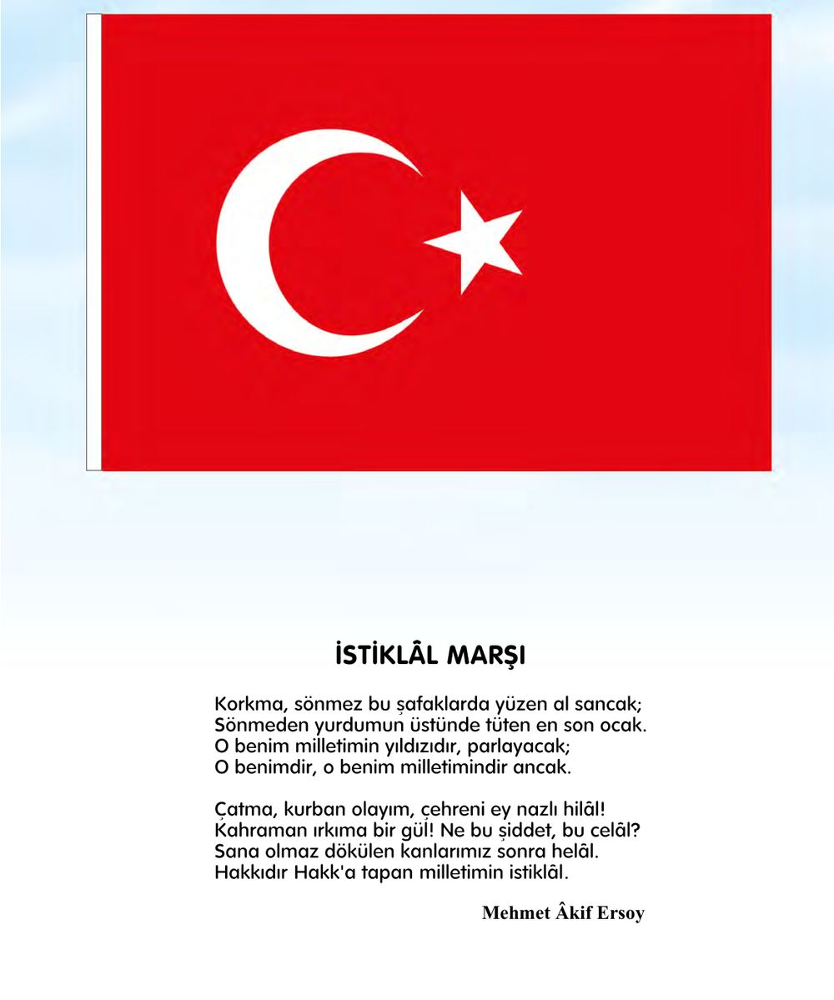

# İSTİKLÂL MARŞI

Korkma, sönmez bu şafaklarda yüzen al sancak;
Sönmeden yurdumun üstünde tüten en son ocak.
O benim milletimin yıldızıdır, parlayacak;
O benimdir, o benim milletimindir ancak.

Çatma, kurban olayım, çehreni ey nazlı hilâl!
Kahraman ırkıma bir gül! Ne bu şiddet, bu celâl?
Sana olmaz dökülen kanlarımız sonra helâl.
Hakkıdır Hakk'a tapan milletimin istiklâl.

**Mehmet Âkif Ersoy**

<!-- sayfa 3 -->

ANDIMIZ

Türküm, doğruyum, çalışkanım.

İlkem küçüklerimi korumak, büyüklerimi saymak; yurdumu, milletimi özümden çok sevmektir.
Ülküm yükselmek, ileri gitmektir.

Ey Büyük Atatürk!

Açtığın yolda, gösterdiğin hedefe durmadan yürüyeceğime ant içerim.

Varlığım Türk varlığına armağan olsun.

Ne mutlu Türküm diyene!

<!-- sayfa 4 -->

MUSTAFA KEMAL ATATÜRK

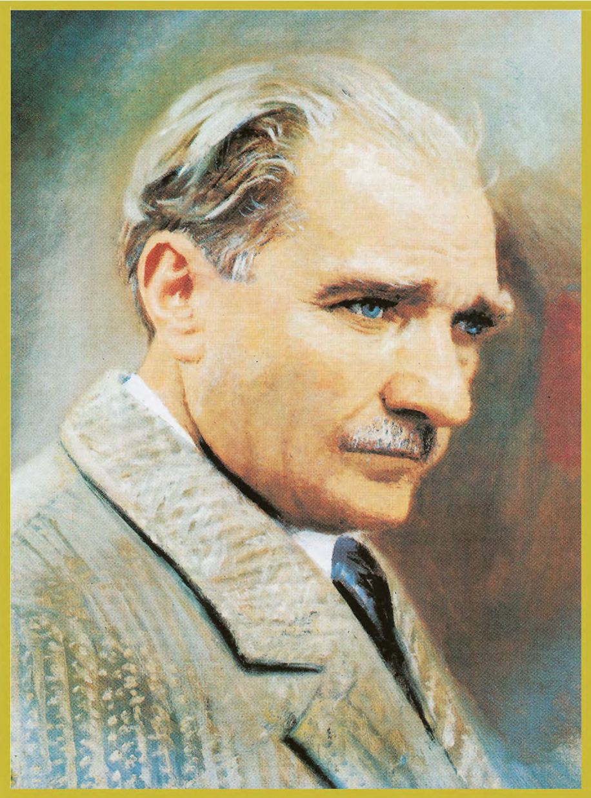
<!-- yer tutucu bulunamadı: sayfa sonuna eklendi -->

<!-- sayfa 5 -->

Verdiğiniz mesajda PDF metin katmanı boş görünüyor (`<<< >>>` arası boş). Lütfen dönüştürülmesini istediğiniz metni veya görseli paylaşın, böylece kurallara uygun şekilde Markdown formatına çevirebilirim.

<!-- sayfa 6 -->

# İÇİNDEKİLER

| | |
| :--- | ---: |
| KİTABIN TANITIMI | 8 |
| 1. TEMA > HAYAT VE SANAT | 11 |
| 2. TEMA > SANATIN GÖRSEL DİLİ | 29 |
| 3. TEMA > SANATÇILAR VE ESERLERİ | 45 |
| 4. TEMA > ÇİZİM VE GÖRSEL İFADE | 63 |
| 5. TEMA > RENK VE ESTETİK | 77 |
| 6. TEMA > MİLLÎ DEĞERLER VE SANAT | 95 |
| 7. TEMA > MÜZE VE KÜLTÜR | 111 |
| TERİMLER SÖZLÜĞÜ | 131 |
| KAYNAKÇA | 133 |
| GÖRSEL VE GENEL AĞ KAYNAKÇASI | 133 |
| TÜRKİYE’NİN MÜLKİ İDARE BÖLÜMLERİ İLE KARA VE DENİZ KOMŞULARI HARİTASI | 134 |
| TÜRK DÜNYASI HARİTASI | 135 |

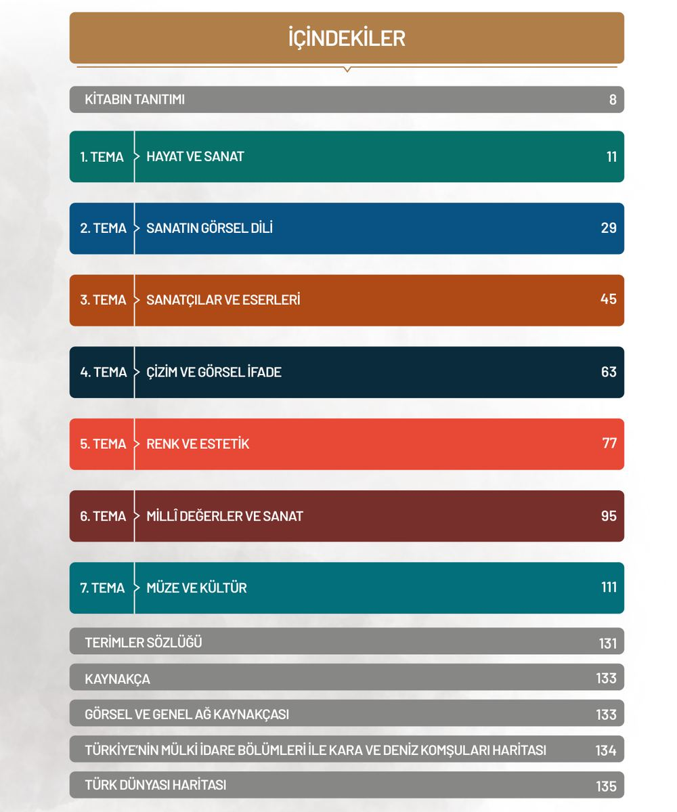
<!-- yer tutucu bulunamadı: sayfa sonuna eklendi -->

<!-- sayfa 7 -->

# KİTABIN TANITIMI

Bu kitap temalardan oluşmaktadır. Her tema başında tema kapak sayfası bulunmaktadır. Tema kapaklarında temanın adına, sınıf düzeyine, temayla ilgili hazırlanan sunumlara ve e-içeriklere ulaşmak için karekodlara yer verilmiştir.

Sınıf düzeyi $\rightarrow$ 2. Sınıf
1. TEMA
Tema adı $\rightarrow$ HAYAT VE SANAT

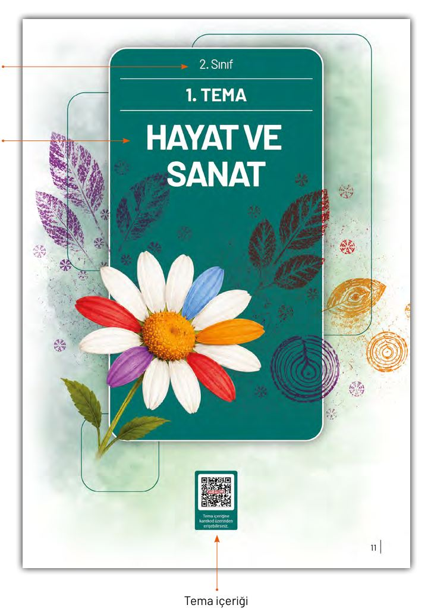

Tema içeriği karekodu
11 |

<!-- sayfa 8 -->

# KİTABIN TANITIMI

2. Sınıf

ÖĞRENME-ÖĞRETME UYGULAMALARI

Önerilen Planlama
1. Ders Saati $\rightarrow$ Ana ve ara renkleri inceleme
2. Ders Saati $\rightarrow$ Doğadaki ve çevredeki tekrarları inceleme, hayal edilen çevre üzerine fikir geliştirme
3. Ders Saati $\rightarrow$ Renk ve biçim kullanarak hayal edilen çevreyi resmetme
4. Ders Saati $\rightarrow$ Çalışmaları tamamlama, paylaşma ve değerlendirme

Uygulama Öncesi
GÖRSEL İNCELEME

Renkleri ve Doğadaki/Tekrarlardaki Farkı Etme
Öğrencilerin çevrelerinde nesnelerle görülen ana renkleri, ara renkleri ve tekrar eden renkleri algılamalarını sağlar. Derse günlük hayattan örneklerle başlanır. Kırmızı, sarı ve mavi ana renkleri ile turuncu, yeşil, mor gibi ara renkler örneklenerek gösterilir. Çiçek, yaprak, meyve, gökyüzü, bulut ve benzeri görseller incelenerek bu renklerin doğada nasıl göründüğü üzerine konuşulur [D69].

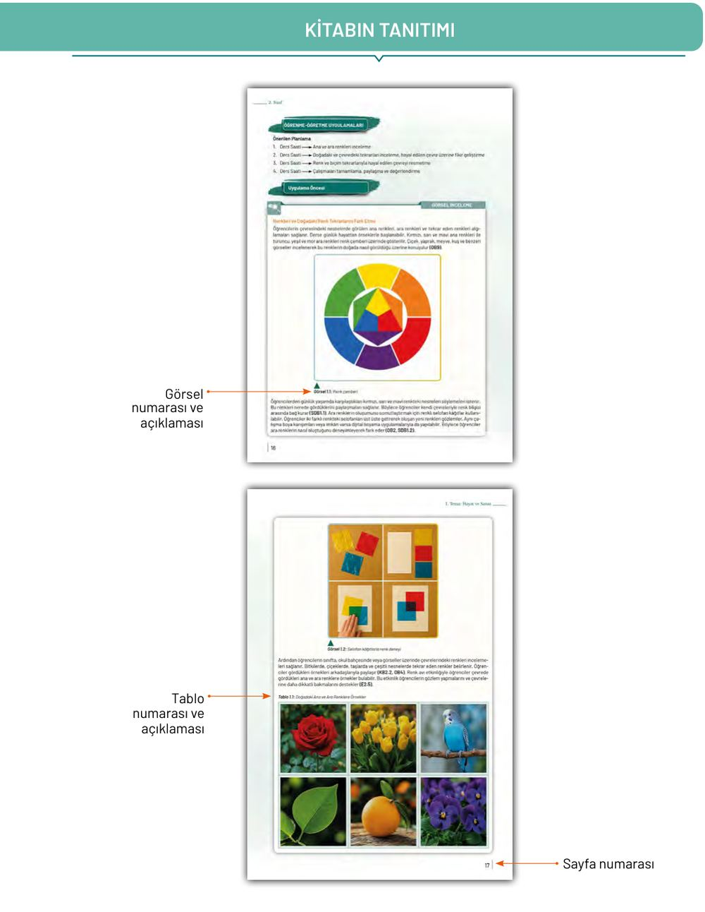
Görsel 1.1: Renk çemberi

Öğrencilerden günlük yaşamda karşılaştıkları kırmızı, sarı ve mavi renklerdeki nesneleri söylemeleri istenir. Bu renkleri nerelerde gördüklerini paylaşmalarını sağlar. Böylece kendi çevreleriyle renk bilgisi arasında bağ kurabilirler [KB2.1]. Ara renklerin nasıl elde edildiğini göstermek için beyaz renkli boyalar kullanılabilir. Öğrenciler iki farklı renkteki boyadan üst üste getirerek oluşan yeni renkleri gözlemler. Aynı boya karışımları ile ya da renkleri farklı olan renkleri kullanarak dijital boyama uygulamalarıyla da yapabilirler. Böylece öğrenciler ara renkleri nasıl oluşturabileceklerini deneyimleyerek fark eder [D682, D691.23].

18

1. Tema: Hayat ve Sanat

Görsel 1.2: Selçuklu çini deseni renk denemesi

Ardından öğrencilerin seffaf, okul bahçesinde veya görseller üzerinde çevrelerindeki renkleri incelemeleri sağlanır. Bitkilerde, çiçeklerde, taşlarda ve çeşitli nesnelerde tekrar eden renkler belirlenir. Öğrenciler gördükleri örnekleri arkadaşlarıyla paylaşır [KB2.4, D84]. Renk ile çevresiyle etkileşimle öğrenciler çevreden gördükleri ana ve ara renklerle pratik yaparlar. Bu etkinlik öğrencilerin gözlem yapmalarını ve çevrelerine daha dikkatli bakmalarını destekler [E2.5].

Tablo 1.1: Doğadaki Ana ve Ara Renklere Örnekler

17

<!-- sayfa 9 -->

# KİTABIN TANITIMI

**Not ikonu**
Öğretmene yönelik önemli açıklama, önerileri ve yönlendirmeleri içerir.

**Dinleti ikonu**
Sanatsal süreçte odaklanmayı ve estetik duyarlılığı desteklemek için uygun müzik ve seslerin dinletileceğini gösterir.

**Teknik bilgi ikonu**
Uygulamada kullanılacak tekniklere ilişkin açıklamaları içerir.

**Eser inceleme ikonu**
Sanat eserlerinin inceleneceği süreçleri içerir.

**Görsel inceleme ikonu**
Görsellerin inceleneceği süreçleri içerir.

**Hatırlatma ikonu**
Yapılması gereken önemli işlemlerin hatırlatılmasını içerir.

**Öğretmen notu ikonu**
Öğretmenin not alabileceği alanları ifade eder.

**Rehberlik ikonu**
Öğrenciye süreç içinde yönlendirme ve destek sunulması gereken noktaları içerir.

**Bilgilendirme ikonu**
Sürecin daha iyi anlaşılmasını destekleyen bilgileri içerir.

<!-- sayfa 10 -->

2. Sınıf

# 1. TEMA

# HAYAT VE SANAT

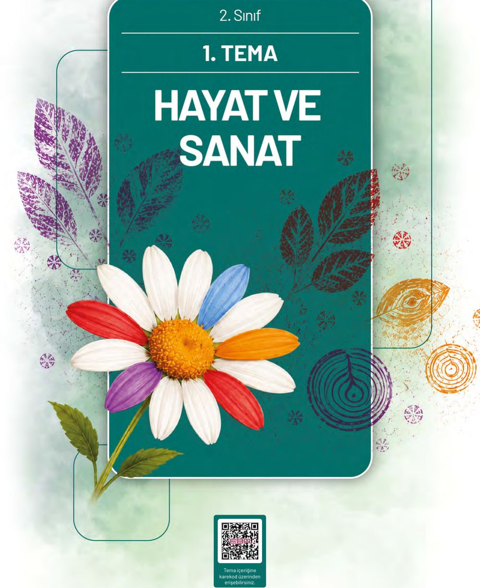

Tema içeriğine 
karekod üzerinden

<!-- sayfa 11 -->

| TEMA ADI | Hayat ve Sanat |
| :--- | :--- |
| **SINIF DÜZEYİ** | 2 |
| **TEMA KAPSAMI** | Öğrencilerin çevresindeki ana ve ara renkleri, renk ve biçim ilişkilerini algılayarak insan ve çevre bağlamındaki düşüncelerini sanatsal ürünlerle ifade etmeleri amaçlanmaktadır. |
| **DERS SAATİ** | 4 |
| **ALAN BECERİLERİ** | SAB1. Sanatsal Algılama, SAB4. Sanatsal Üretim Yapma |
| **KAVRAMSAL BECERİLER** | – |
| **EĞİLİMLER** | E2.5. Oyunseverlik, E3.3. Yaratıcılık, E3.5. Açık Fikirlilik, E3.8. Soru Sorma |

## PROGRAMLAR ARASI BİLEŞENLER

| SOSYAL-DUYGUSAL ÖĞRENME BECERİLERİ | SDB1.1. Kendini Tanıma (Öz Farkındalık), SDB1.2. Kendini Düzenleme (Öz Düzenleme), SDB2.2. İş Birliği, SDB3.2. Esneklik |
| :--- | :--- |
| **DEĞERLER** | D7. Estetik, D14. Saygı, D16. Sorumluluk, D17. Tasarruf, D18. Temizlik |
| **OKURYAZARLIK BECERİLERİ** | OB2. Dijital Okuryazarlık, OB4. Görsel Okuryazarlık, OB9. Sanat Okuryazarlığı |
| **DİSİPLİNLER ARASI İLİŞKİLER** | Hayat Bilgisi, Matematik |
| **BECERİLER ARASI İLİŞKİLER** | KB2.2. Gözlemleme, KB2.10. Çıkarım Yapma, KB2.20. Sentezleme |

## ÖĞRENME ÇIKTILARI VE SÜREÇ BİLEŞENLERİ

**GS.2.1.1. Çevresindeki nesnelerin ana renklerini, ara renklerini ve doğadaki tekrarlarını algılayabilme**
a) Çevresindeki nesnelerin ana renklerini, ara renklerini ve doğadaki tekrarlarını gözlemler.
b) Yapay nesnelerdeki ana ve ara renk tekrarlarını, doğal nesnelerdeki örnekleriyle karşılaştırır.

**GS.2.1.2. Renk ve biçim ilişkisini kurarak insan ve çevre bağlamındaki düşüncelerine yönelik sanatsal üretim yapabilme**
c) Renk ve biçim ilişkisini kurarak hayal ettiği çevreye ilişkin düşüncelerini yansıtan kompozisyon tasarlar.
d) Renk ve biçim ilişkisini kurarak hayal ettiği çevreye ilişkin düşüncelerini yansıtan kompozisyon oluşturur.

| İÇERİK ÇERÇEVESİ | Ana Renkler ve Ara Renkler Doğadaki Renk ve Biçim İlişkisi |
| :--- | :--- |
| **ANAHTAR KAVRAMLAR** | ana renk, ara renk, biçim tekrarı, renk çemberi, renk tekrarı, renk ve biçim ilişkisi, selofan kâğıt |
| **ÖĞRENME KANITLARI (ÖLÇME VE DEĞERLENDİRME)** | Öğrenme çıktıları; gözlem formları, kontrol listeleri, öz değerlendirme formları ve akran değerlendirme formları kullanılarak değerlendirilebilir. Sınıf içi performans görevi olarak öğrencilerden renk ve biçim ilişkilerini kurarak hayal ettikleri çevreye ilişkin düşüncelerini yansıtan kompozisyon oluşturmaları istenir. Kompozisyonlarını kolaj, baskı veya pastel boya teknikleriyle ifade etmeleri beklenir. |

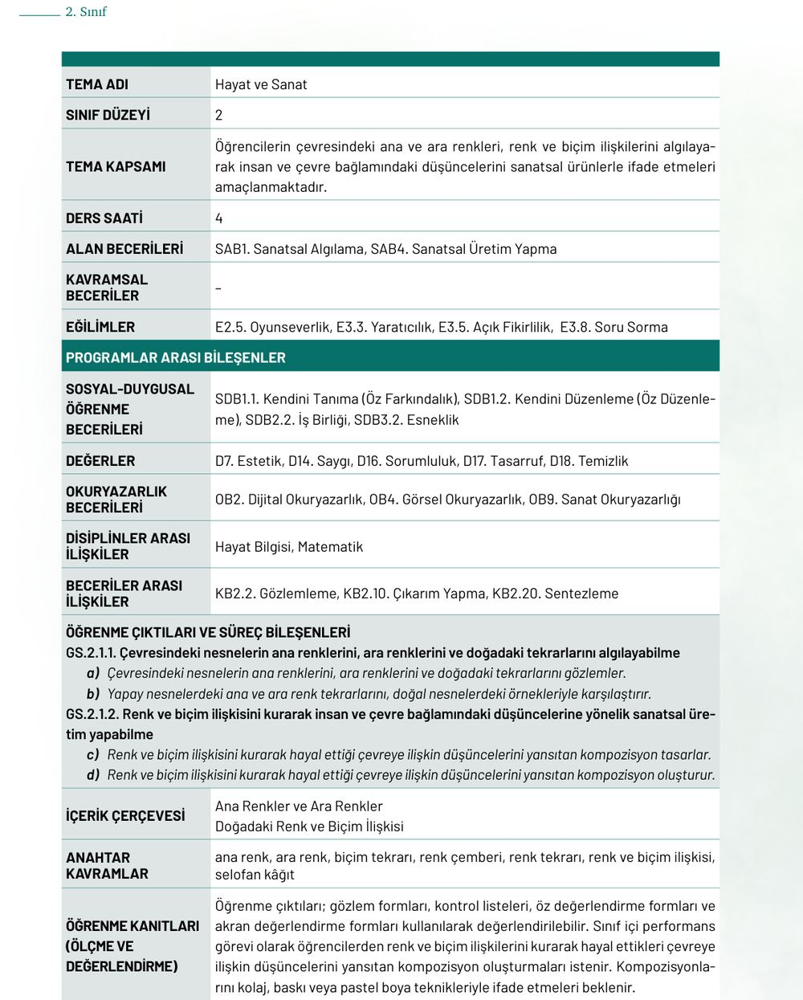
<!-- yer tutucu bulunamadı: sayfa sonuna eklendi -->

<!-- sayfa 12 -->

# TEMA AKIŞI

* Ana ve Ara Renkleri Keşfetme
* Doğadaki ve Çevredeki Renk Tekrarlarını İnceleme
* Doğal ve Yapay Nesnelerdeki Benzerlikleri Karşılaştırma
* Hayal Edilen Çevreye İlişkin Tasarım Geliştirme
* Renk ve Biçim İlişkisiyle Kompozisyon Oluşturma
* Değerlendirme
* Sergileme
* Farklılaştırma

# ÖĞRETMEN HAZIRLIĞI

Ders öncesinde ana renkler, ara renkler, renk çemberi, renk tekrarı ve biçim tekrarı kavramları gözden geçirilir. Hazırlık kapsamında aşağıdaki örneklerin bulundurulması önerilir.

* Temada yer alan renk çemberi ile doğal ve yapay çevrede görülen tekrar örnekleri öğrencilere sunulabilir.
* Ana ve ara renk oluşumunu göstermek için boyalar veya selofan kâğıtlar kullanılabilir.
* Kılavuz kitapta sunulan görseller süreç boyunca kullanılabilir. İstenirse sınıfın ihtiyaçlarına göre farklı örneklerle içerik zenginleştirilebilir.
* Uygulama öncesinde kullanılacak boya, kolaj veya baskı malzemeleri belirlenir. Baskı çalışması yapılacaksa yaprak, sünger, ip veya düğme gibi malzemeler önceden hazırlanabilir.

**NOT**

Bu temada yer alan uygulamalar ve görseller, öğretmene yol göstermek amacıyla hazırlanmıştır. Etkinlikler, öğrenme çıktılarının genel yapısını korumak kaydıyla sınıfın ihtiyaçlarına göre uyarlanabilir.

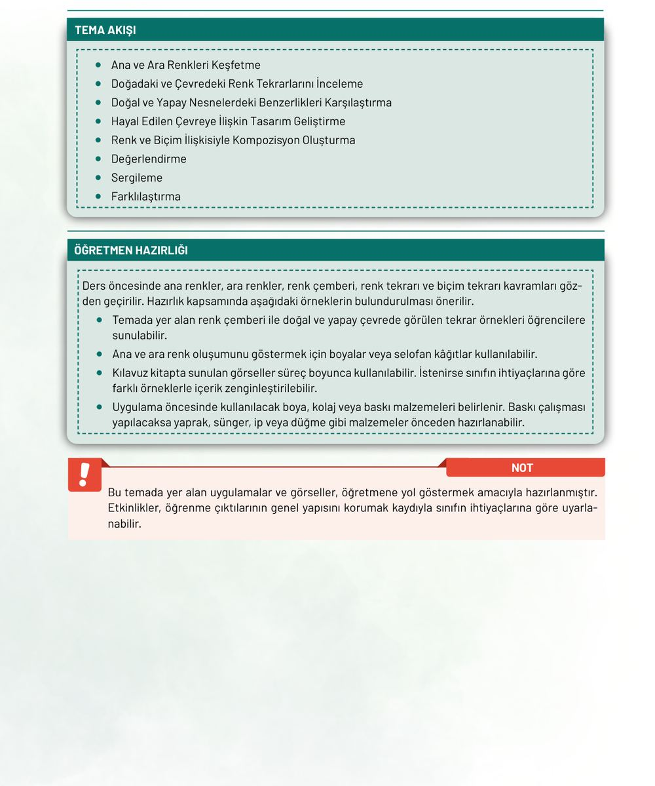
<!-- yer tutucu bulunamadı: sayfa sonuna eklendi -->

<!-- sayfa 13 -->

# ÖĞRENCİ HAZIRLIĞI VE ETKİNLİK MALZEMELERİ

Uygulamada kullanılacak malzemeler öğrencilerle önceden paylaşılır. Bu temada hayal edilen çevreyi baskı, kolaj ve resimle ifade etmeye yönelik çalışmalar bulunduğu için malzemeler etkinlik türüne göre hazırlanır.

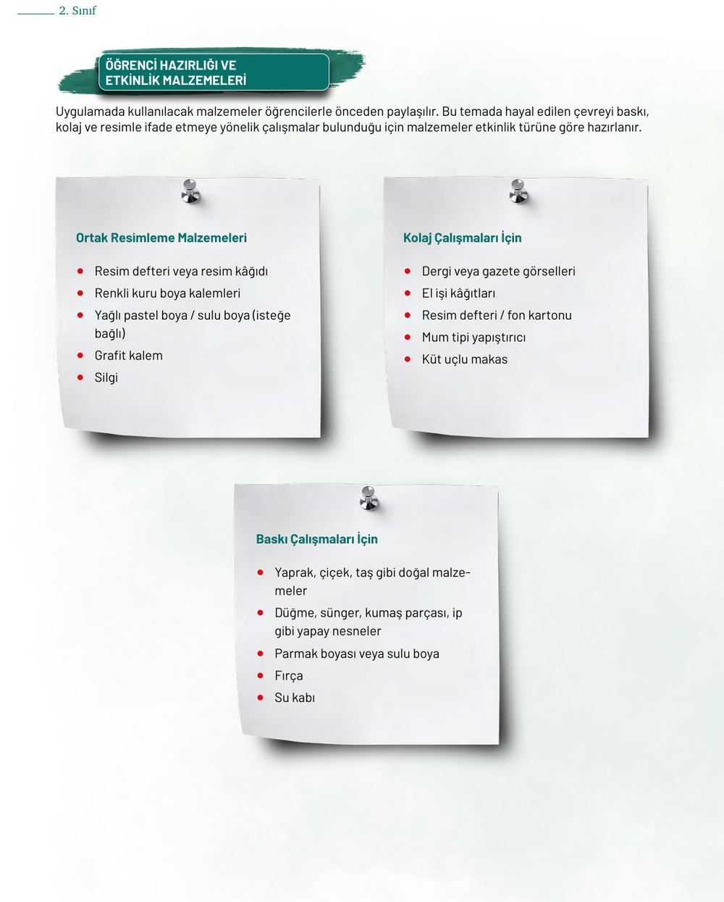
## Ortak Resimleme Malzemeleri

* Resim defteri veya resim kâğıdı
* Renkli kuru boya kalemleri
* Yağlı pastel boya / sulu boya (isteğe bağlı)
* Grafit kalem
* Silgi

## Kolaj Çalışmaları İçin

* Dergi veya gazete görselleri
* El işi kâğıtları
* Resim defteri / fon kartonu
* Mum tipi yapıştırıcı
* Küt uçlu makas

## Baskı Çalışmaları İçin

* Yaprak, çiçek, taş gibi doğal malzemeler
* Düğme, sünger, kumaş parçası, ip gibi yapay nesneler
* Parmak boyası veya sulu boya
* Fırça
* Su kabı

<!-- sayfa 14 -->

# ÖĞRENME-ÖĞRETME YAŞANTILARI

**TEMEL KABULLER**

Öğrencilerin çevresindeki nesnelerin renk ve şekillerindeki benzerlikleri ve farklılıkları algılayabildikleri, doğada tekrarlayan unsurları fark edebildikleri kabul edilmektedir.

**ÖN DEĞERLENDİRME SÜRECİ**

Öğrencilerin çevrelerindeki nesnelerin renk ve şekillerindeki benzerlikler ile farklılıkları algılamalarına, bu ögelerin doğadaki tekrarlarına yönelik farkındalık düzeylerini belirlemek amacıyla aşağıdakilere benzer sorular yönlendirilir:

* Çevrenizde renkleri birbirine benzeyen neler görüyorsunuz?
* Çevrenizde şekilleri olarak birbirine benzeyen neler görüyorsunuz?
* Çevrenizde gördüğünüz yaprak, çiçek, taş gibi doğal nesnelerde şekil veya renk tekrarları var mı?
* Hangi nesnelerde tekrarlar görüyorsunuz?

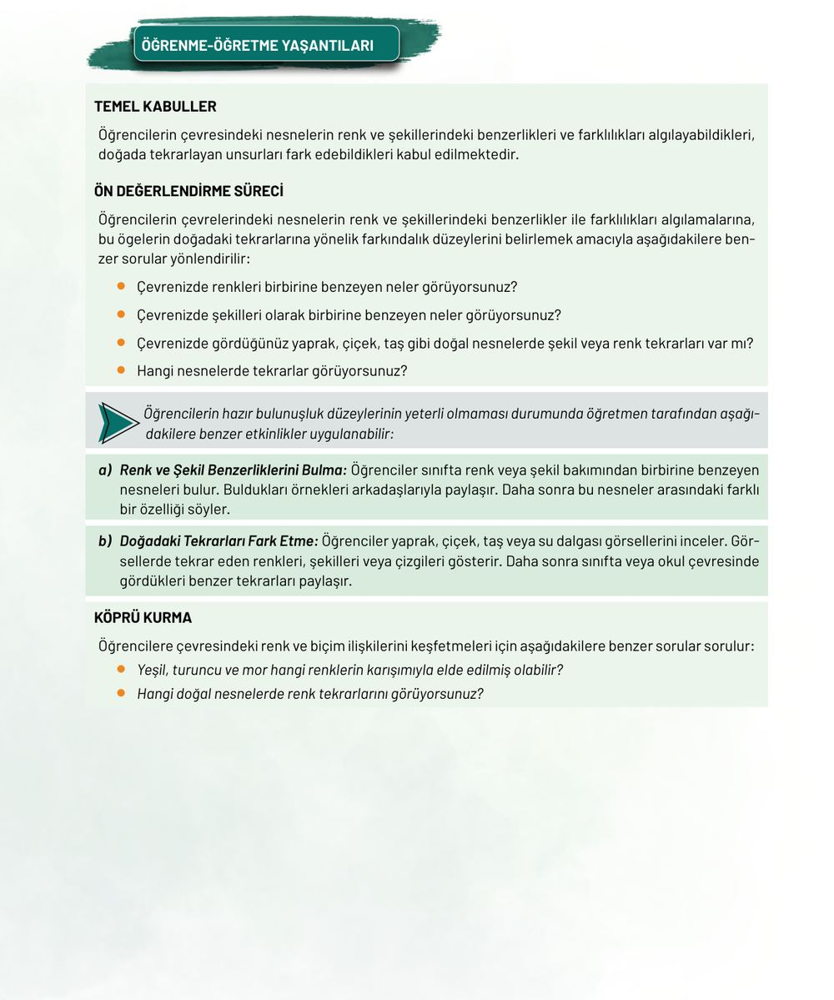
Öğrencilerin hazır bulunuşluk düzeylerinin yeterli olmaması durumunda öğretmen tarafından aşağıdakilere benzer etkinlikler uygulanabilir:

**a) Renk ve Şekil Benzerliklerini Bulma:** Öğrenciler sınıfta renk veya şekil bakımından birbirine benzeyen nesneleri bulur. Buldukları örnekleri arkadaşlarıyla paylaşır. Daha sonra bu nesneler arasındaki farklı bir özelliği söyler.

**b) Doğadaki Tekrarları Fark Etme:** Öğrenciler yaprak, çiçek, taş veya su dalgası görsellerini inceler. Görsellerde tekrar eden renkleri, şekilleri veya çizgileri gösterir. Daha sonra sınıfta veya okul çevresinde gördükleri benzer tekrarları paylaşır.

**KÖPRÜ KURMA**

Öğrencilere çevresindeki renk ve biçim ilişkilerini keşfetmeleri için aşağıdakilere benzer sorular sorulur:

* Yeşil, turuncu ve mor hangi renklerin karışımıyla elde edilmiş olabilir?
* Hangi doğal nesnelerde renk tekrarlarını görüyorsunuz?

<!-- sayfa 15 -->

# ÖĞRENME-ÖĞRETME UYGULAMALARI

## Önerilen Planlama
1. Ders Saati $\longrightarrow$ Ana ve ara renkleri inceleme
2. Ders Saati $\longrightarrow$ Doğadaki ve çevredeki tekrarları inceleme, hayal edilen çevre üzerine fikir geliştirme
3. Ders Saati $\longrightarrow$ Renk ve biçim tekrarlarıyla hayal edilen çevreyi resmetme
4. Ders Saati $\longrightarrow$ Çalışmaları tamamlama, paylaşma ve değerlendirme

## Uygulama Öncesi

### GÖRSEL İNCELEME

**Renkleri ve Doğadaki Renk Tekrarlarını Fark Etme**
Öğrencilerin çevresindeki nesnelerde görülen ana renkleri, ara renkleri ve tekrar eden renkleri algılamaları sağlanır. Derse günlük hayattan örneklerle başlanabilir. Kırmızı, sarı ve mavi ana renkleri ile turuncu, yeşil ve mor ara renkleri renk çemberi üzerinde gösterilir. Çiçek, yaprak, meyve, kuş ve benzeri görseller incelenerek bu renklerin doğada nasıl görüldüğü üzerine konuşulur **(OB9)**.

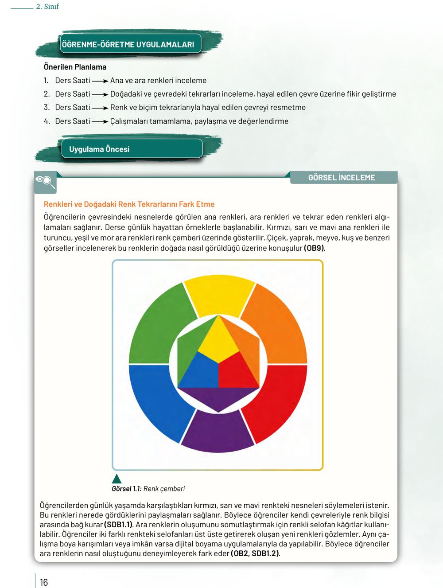
**Görsel 1.1:** *Renk çemberi*

Öğrencilerden günlük yaşamda karşılaştıkları kırmızı, sarı ve mavi renkteki nesneleri söylemeleri istenir. Bu renkleri nerede gördüklerini paylaşmaları sağlanır. Böylece öğrenciler kendi çevreleriyle renk bilgisi arasında bağ kurar **(SDB1.1)**. Ara renklerin oluşumunu somutlaştırmak için renkli selofan kâğıtlar kullanılabilir. Öğrenciler iki farklı renkteki selofanları üst üste getirerek oluşan yeni renkleri gözlemler. Aynı çalışma boya karışımları veya imkân varsa dijital boyama uygulamalarıyla da yapılabilir. Böylece öğrenciler (OB2 SDB1.2)

<!-- sayfa 16 -->

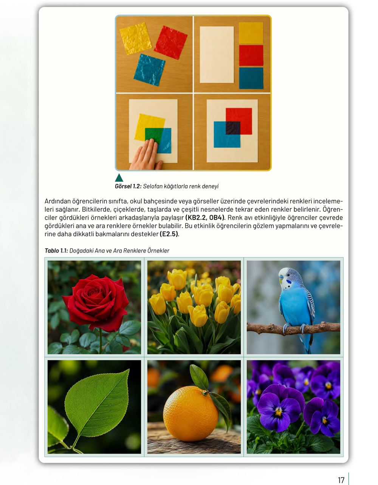

**Görsel 1.2:** Selofan kâğıtlarla renk deneyi

Ardından öğrencilerin sınıfta, okul bahçesinde veya görseller üzerinde çevrelerindeki renkleri incelemeleri sağlanır. Bitkilerde, çiçeklerde, taşlarda ve çeşitli nesnelerde tekrar eden renkler belirlenir. Öğrenciler gördükleri örnekleri arkadaşlarıyla paylaşır (**KB2.2, OB4**). Renk avı etkinliğiyle öğrenciler çevrede gördükleri ana ve ara renklere örnekler bulabilir. Bu etkinlik öğrencilerin gözlem yapmalarını ve çevrelerine daha dikkatli bakmalarını destekler (**E2.5**).

**Tablo 1.1:** Doğadaki Ana ve Ara Renklere Örnekler

| | | |
| :---: | :---: | :---: |
|  |  |  |
|  |  |  |

<!-- sayfa 17 -->

Öğrencilerin doğadaki tekrarları fark etmeleri için yapraklar, çiçekler, taşlar ve su dalgaları öğrencilerle incelenir. Daha sonra okul merdivenleri, çitler, pencereler veya yer döşemeleri gibi insan yapımı örnekler gözden geçirilir. Öğrenciler hem doğada hem de çevrelerinde tekrar eden renk ve biçimlerin bulunduğunu fark eder (**KB2.10**). Yapay nesnelerdeki ana ve ara renk tekrarlarını, doğal nesnelerdeki örnekleriyle karşılaştırmaları için **(b)** öğrencilerden renk tekrarlarının çevrede görüldüğü yerleri açıklamaları istenir. Doğadaki tekrarlar hakkında merak ettikleri konulara yönelik sorular sormaları beklenir (**E3.8, SDB1.1**).

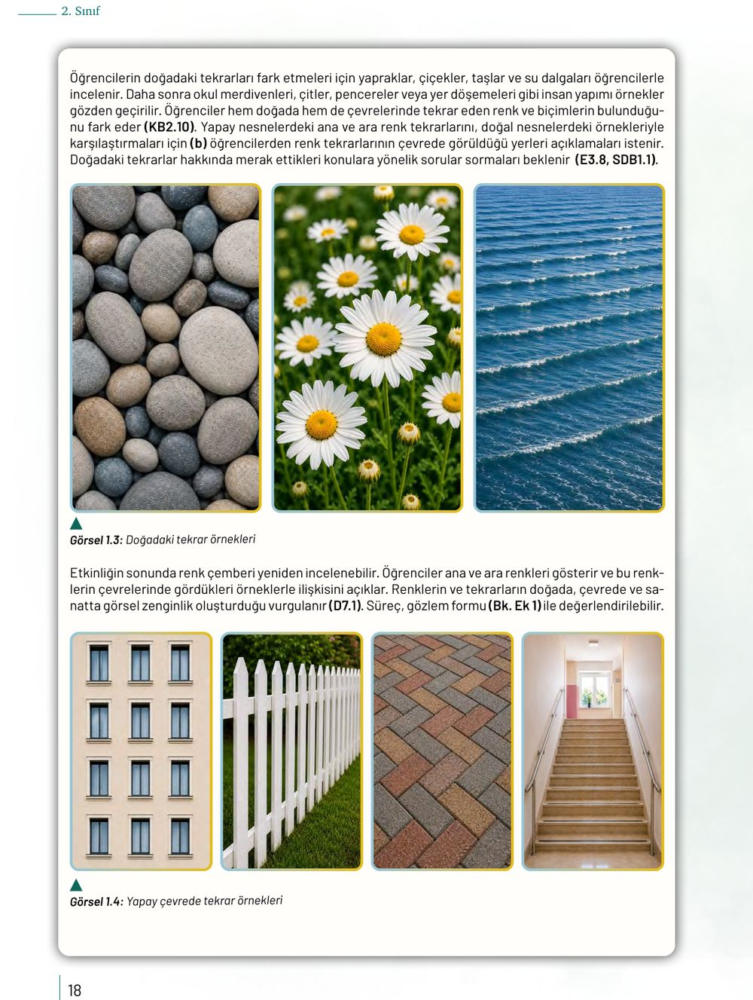

*Görsel 1.3: Doğadaki tekrar örnekleri*

Etkinliğin sonunda renk çemberi yeniden incelenebilir. Öğrenciler ana ve ara renkleri gösterir ve bu renklerin çevrelerinde gördükleri örneklerle ilişkisini açıklar. Renklerin ve tekrarların doğada, çevrede ve sanatta görsel zenginlik oluşturduğu vurgulanır (**D7.1**). Süreç, gözlem formu (**Bk. Ek 1**) ile değerlendirilebilir.

*Görsel 1.4: Yapay çevrede tekrar örnekleri*

<!-- sayfa 18 -->

> **NOT**
> Öğrencilerin grup halinde çalışması desteklenmelidir.

# Uygulama Sırası

## Hayal Edilen Çevreyi Belirleme

Derse “Hayal ettiğiniz çevre nasıl bir yer olurdu?” sorusuyla başlanabilir. Öğrenciler hayal ettikleri çevrede insanların, hayvanların ve bitkilerin birlikte nasıl yaşayabileceği üzerine düşünür ve küçük gruplar hâlinde çalışır. Her grup hayal ettiği çevreyi birkaç cümleyle anlatır. Öğrencilerin fikir üretmelerini kolaylaştırmak için “Parkımız bir uçurtma gibi renkli olabilir.”, “Okul bahçemiz bir orman gibi canlı olabilir.” veya “Sokağımız bir çiçek bahçesi gibi neşeli olabilir.” gibi benzetme örnekleri üzerinden konuşulur. Öğrenciler kendi benzetmelerini paylaşır ve çevreyle ilgili fikirlerini ifade eder (**E3.3**). Her grup güzelleştirmek istediği çevreyi seçer. Bu çevrede görmek istedikleri parklar, oyun alanları, hayvanlar, bitkiler, ağaçlar, çiçekler veya evler hakkında konuşur. Böylece öğrenciler yaşamak istedikleri çevrede bulunmasını istedikleri unsurlar üzerine düşünür (**SDB3.2**).

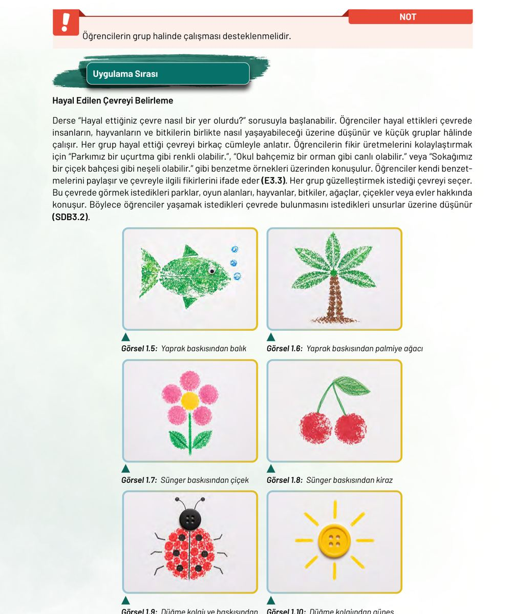

**Görsel 1.5:** Yaprak baskısından balık
**Görsel 1.6:** Yaprak baskından palmiye ağacı

**Görsel 1.7:** Sünger baskısından çiçek
**Görsel 1.8:** Sünger baskısından kiraz

**Görsel 1.9:** Düğme kolajı ve baskısından
**Görsel 1.10:** Düğme kolajından güneş

<!-- sayfa 19 -->

# ETKİNLİK
## Renk ve Biçim Tekrarlarıyla Hayal Edilen Çevreyi Resmetme

Öğrenciler öncelikle hayal ettikleri çevrede neler olacağına karar verir. Çalışmalarında kullanacakları renkleri ve biçimleri belirler. Çalışmalarında yağlı pastel boya, sulu boya, kolaj veya baskı tekniklerinden sınıfın imkânlarına uygun olanları tercih edebilir. Öğrenciler kullanacakları araç ve gereçleri grup içinde arkadaşlarıyla beraber belirler (**D16.1, SDB1.2, SDB2.2**). Baskı çalışması yapılacaksa yaprak, sünger, ip, düğme veya benzeri malzemeler kullanılabilir. Öğrenciler bu malzemelerle kâğıt üzerinde izler oluşturur ve ortaya çıkan şekilleri inceler (**OB9**). Oluşan izlerden ve şekillerden yararlanarak hayal ettikleri çevreyi resimler. Yaprak baskıları ağaç, çiçek veya balıklara; düğme baskıları kelebeklere, çiçeklere veya farklı canlılara dönüştürülebilir (**KB2.20, SDB3.2, E3.3**). Öğrenciler dergi ve gazete görsellerinden yararlanarak hayal ettikleri çevreyi kolaj tekniğiyle de oluşturabilir. Çalışma sırasında öğrencilere aynı renkleri ve benzer biçimleri birden fazla yerde kullanabilecekleri hatırlatılır. İsteyen öğrenciler çalışmalarında parmak boyadan da yararlanabilir. Gerektiğinde kısa yönlendirmelerle öğrencilerin çalışmaları desteklenir. Süreç boyunca öğrencilerin malzemelerini dikkatli kullanmaları, arkadaşlarıyla paylaşmaları ve birbirlerine yardımcı olmaları teşvik edilir (**D17.3**).

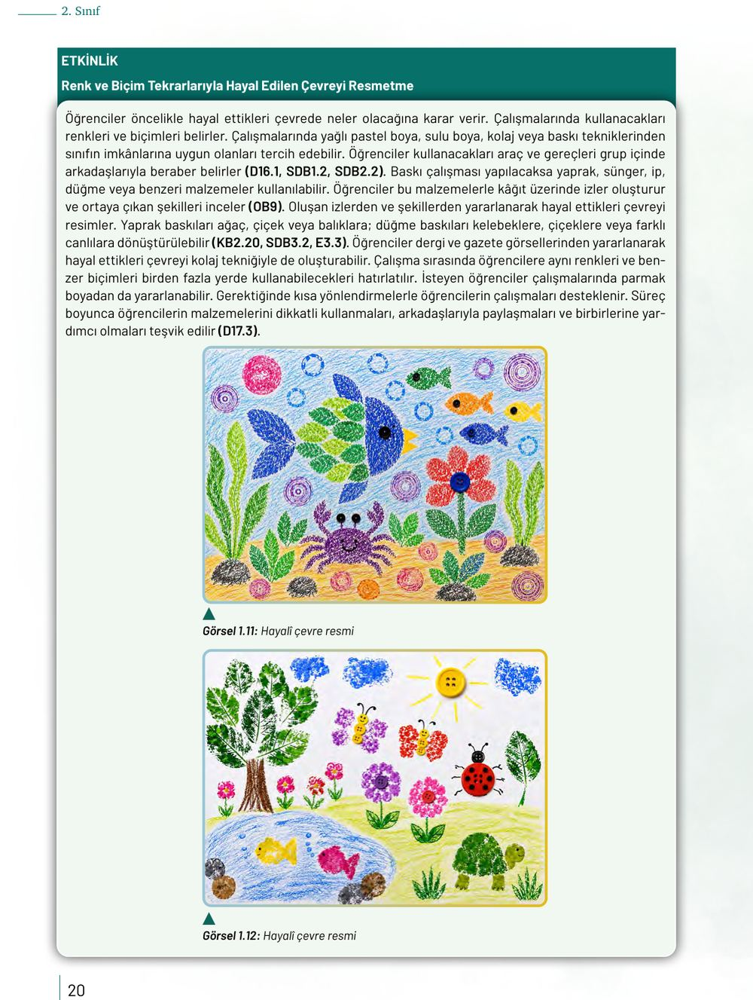
*Görsel 1.11: Hayalî çevre resmi*

*Görsel 1.12: Hayalî çevre resmi*

<!-- sayfa 20 -->

# Çalışmanın Tamamlanması ve Paylaşımı

Çalışmalar tamamlandıktan sonra her grup ürününü sınıfla paylaşır. Etkinlik sonunda çalışma alanı birlikte düzenlenir. Malzemeler toplanır ve sınıf temiz bırakılır. Düzenli bir çalışma ortamının çalışmayı kolaylaştırdığı üzerinde durulur (**SDB2.2, D18.2**). Tamamlanan çalışmalar sınıfta, okul panosunda veya dijital ortamda sergilenir.

# Değerlendirme

Hazırlanan çalışmalar performans görevi olarak ele alınır. Değerlendirmede öğrencilerin sürece katılmaları, renk ve biçimleri kullanmaları, çevreye ilişkin düşüncelerini görsel olarak ifade etmeleri ve grup çalışmalarına katkıları dikkate alınabilir. Süreç ve ürünle ilgili farkındalık kazanmaları için öğrencilere aşağıdakilere benzer öz değerlendirme soruları sorulabilir (**SAB2.1, OB9**):

* *Çalışmanızda en çok hangi rengi kullandınız?*
* *Resminizde nasıl bir çevreyi göstermek istediniz?*
* *Çalışmanızda en çok hangi bölümü beğendiniz?*

Öğrenciler arkadaşlarının çalışmalarını inceler. Aşağıdakilere benzer sorularla akran geri bildirimi süreci desteklenebilir:

* *Arkadaşınızın çalışmasında en çok hangi renkler var?*
* *Arkadaşınızın çalışmasında en beğendiğiniz bölüm hangisi?*

Öğrenciler birbirinin çalışmasında beğendikleri yönleri paylaşır ve farklı fikirleri dinler. Birbirlerinin çalışmalarını takdir etmeleri desteklenir (**E3.5, D14.1**). Süreç, kontrol listesi (**Bk. Ek 2**) kullanılarak değerlendirilebilir.

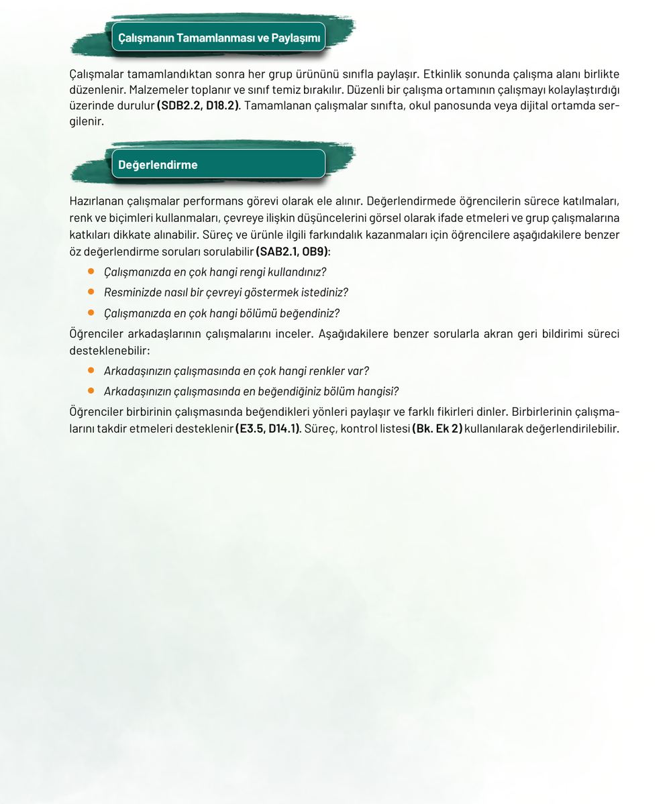
<!-- yer tutucu bulunamadı: sayfa sonuna eklendi -->

<!-- sayfa 21 -->

# FARKLILAŞTIRMA

**Zenginleştirme**

⚠️ Öğrenciler aşağıdaki etkinliklerden birine yönlendirilebilir.

### Etkinlik 1: Çevreyi Korumaya Yönelik Poster Hazırlama

Öğrencilerle temiz, düzenli ve yaşanabilir bir çevrede nelerin bulunması gerektiği üzerine konuşulur. Ağaçlar, çiçekler, kuşlar, oyun alanları, parklar ve temiz su kaynakları gibi örnekler üzerinde durulur. Ardından öğrenciler çevreyi korumaya yönelik bir mesaj belirler ve bu mesajı anlatan poster hazırlar. Öğrenciler posterlerinde ana ve ara renklerden yararlanır. “Doğayı koruyalım!”, “Temiz çevre, mutlu yaşam!”, “Ağaçlar geleceğimizdir!” gibi kısa mesajlar kullanabilir. Çalışmalar resim kâğıdı veya fon kartonu üzerine yapılabilir. Öğrenciler çalışmalarında yağlı pastel boya, kuru boya veya sulu boya kullanabilir. İsteyen öğrenciler kolaj tekniğinden de yararlanabilir. Çalışmalar doğal ve yapay malzemelerle yapılan baskı uygulamalarıyla zenginleştirilebilir. Yaprak, sünger, ip, düğme gibi malzemeler kullanılarak parmak boyası ya da sulu boya ile baskılar yapılabilir. Oluşturulan baskılar posterde ağaç, çiçek, kelebek veya farklı çevre ögelerine dönüştürülebilir. Çalışma sonunda öğrenciler, kullandıkları renkleri ve posterlerinde vermek istedikleri mesajı arkadaşlarıyla paylaşır.

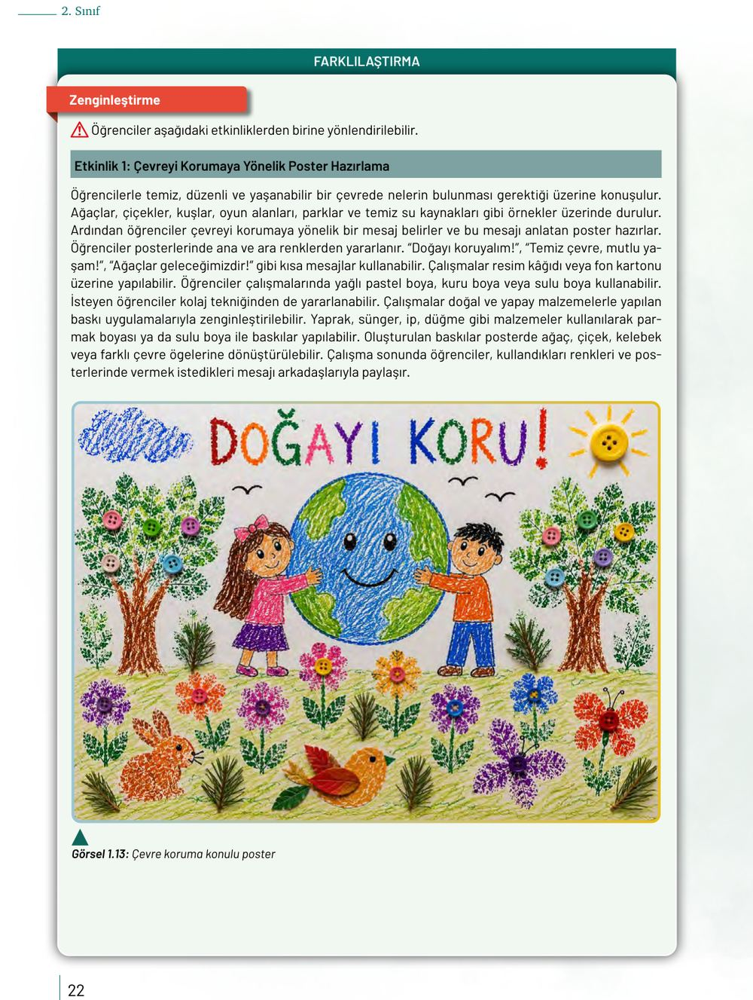

▲
Görsel 1.13: Çevre koruma konulu poster

<!-- sayfa 22 -->

# Etkinlik 2: Doğal ve Yapay Nesnelerle Çevre Dostu Renk Çemberi Oluşturma

Öğrenciler sınıfta, okul bahçesinden veya evlerinden getirdikleri doğal ve yapay nesneleri inceler. Yaprak, çiçek, taş, tohum ve dal parçaları gibi doğal nesneler ile düğme, kumaş parçası, karton, ambalaj veya kalem kapağı gibi yapay nesneleri de kullanabilir. Öğrenciler nesneleri renklerine göre gruplandırır. Daha sonra sınıftaki renk çemberinin uygun bölümlerine bu nesneleri yerleştirir. Kırmızı, sarı, mavi, turuncu, yeşil ve mor renk alanları hep birlikte inceler. Seçtikleri nesnelerin renklerini açıklar. Dalından düşmüş yapraklar, tohumlar veya kullanılmayan karton parçaları çalışmada değerlendirilebilir.

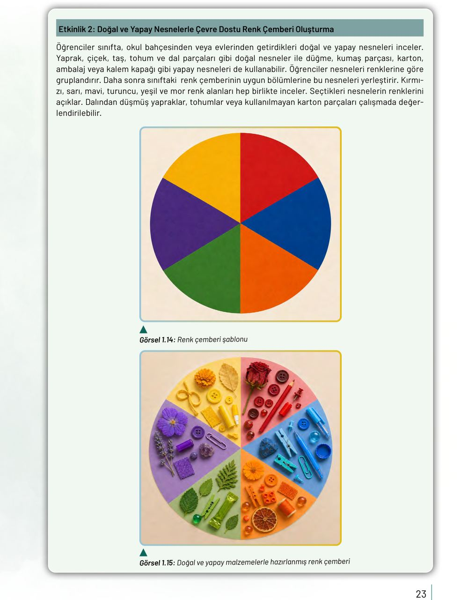

*Görsel 1.14: Renk çemberi şablonu*

*Görsel 1.15: Doğal ve yapay malzemelerle hazırlanmış renk çemberi*

<!-- sayfa 23 -->

# Destekleme

⚠️ Öğrenciler aşağıdaki etkinliklerden birine yönlendirilebilir.

## Etkinlik 1: Ana ve Ara Renkleri Eşleştirme

Öğrencilere ana ve ara renkleri gösteren kartlar verilir. Kartlarda renklerin yanı sıra elma, papatya, gül, yaprak, menekşe, kuş veya portakal gibi günlük yaşamda karşılaşabilecekleri örnek görseller bulunabilir. Öğrenciler renk kartlarını renk çemberinde uygun renklerle eşleştirir. Eşleştirmeler tamamlandıktan sonra sınıfta veya okul bahçesinde aynı renklere sahip nesneler bulmaları istenebilir. Çalışma sonunda öğrenciler en sık karşılaştıkları rengi söyler ve bu rengin çevrede görüldüğü yerlere örnekler verir.

*Tablo 1.2: Ana ve Ara Renk Kartları*

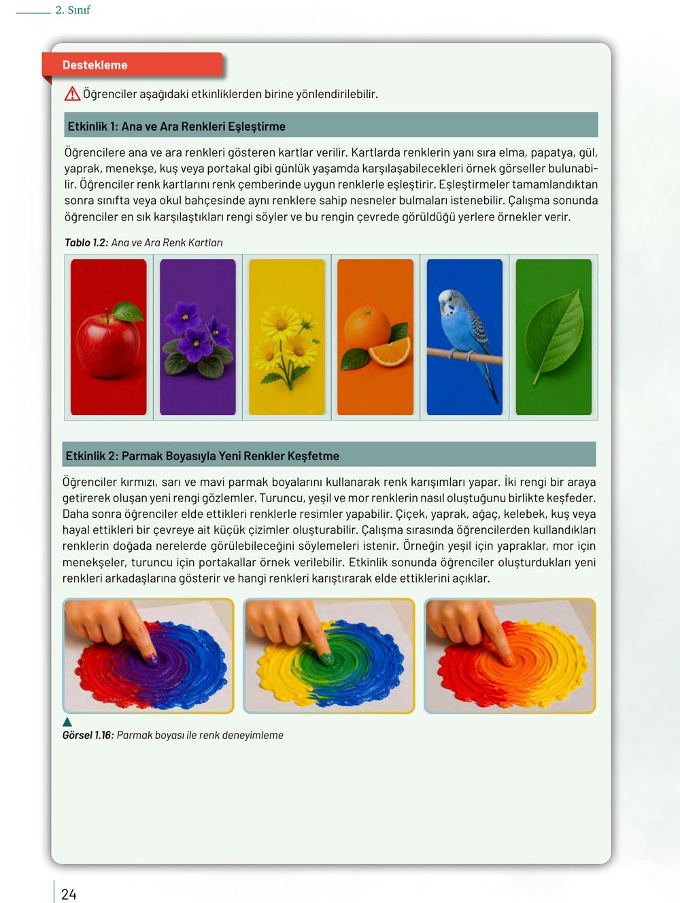

## Etkinlik 2: Parmak Boyasıyla Yeni Renkler Keşfetme

Öğrenciler kırmızı, sarı ve mavi parmak boyalarını kullanarak renk karışımları yapar. İki rengi bir araya getirerek oluşan yeni rengi gözlemler. Turuncu, yeşil ve mor renklerin nasıl oluştuğunu birlikte keşfeder. Daha sonra öğrenciler elde ettikleri renklerle resimler yapabilir. Çiçek, yaprak, ağaç, kelebek, kuş veya hayal ettikleri bir çevreye ait küçük çizimler oluşturabilir. Çalışma sırasında öğrencilerden kullandıkları renklerin doğada nerelerde görülebileceğini söylemeleri istenir. Örneğin yeşil için yapraklar, mor için menekşeler, turuncu için portakallar örnek verilebilir. Etkinlik sonunda öğrenciler oluşturdukları yeni renkleri arkadaşlarına gösterir ve hangi renkleri karıştırarak elde ettiklerini açıklar.

*Görsel 1.16: Parmak boyası ile renk deneyimleme*

<!-- sayfa 24 -->

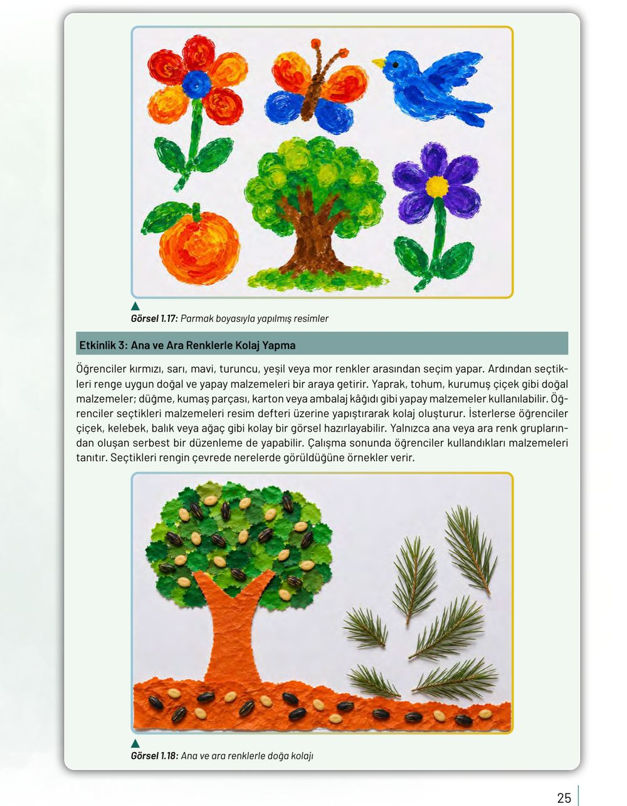

*Görsel 1.17: Parmak boyasıyla yapılmış resimler*

### Etkinlik 3: Ana ve Ara Renklerle Kolaj Yapma

Öğrenciler kırmızı, sarı, mavi, turuncu, yeşil veya mor renkler arasından seçim yapar. Ardından seçtikleri renge uygun doğal ve yapay malzemeleri bir araya getirir. Yaprak, tohum, kurumuş çiçek gibi doğal malzemeler; düğme, kumaş parçası, karton veya ambalaj kâğıdı gibi yapay malzemeler kullanılabilir. Öğrenciler seçtikleri malzemeleri resim defteri üzerine yapıştırarak kolaj oluşturur. İsterlerse öğrenciler çiçek, kelebek, balık veya ağaç gibi kolay bir görsel hazırlayabilir. Yalnızca ana veya ara renk gruplarından oluşan serbest bir düzenleme de yapabilir. Çalışma sonunda öğrenciler kullandıkları malzemeleri tanıtır. Seçtikleri rengin çevrede nerelerde görüldüğüne örnekler verir.

*Görsel 1.18: Ana ve ara renklerle doğa kolajı*

<!-- sayfa 25 -->

# EK 1. GÖZLEM FORMU

Bu gözlem formu öğrencilerin öğrenme sürecindeki davranışlarını, katılım düzeylerini ve gelişim alanlarını izlemek amacıyla hazırlanmıştır. Elde edilen bulguları, öğrencilere yapıcı geri bildirim vermek ve öğretim sürecini geliştirmek amacıyla kullanınız.

## GÖZLEM FORMU

Bu form öğrenci performanslarını değerlendirmeniz amacıyla hazırlanmıştır. Listedeki her maddeyi inceleyerek öğrencinize en uygun olan seçeneği işaretleyiniz. “Hiç uygun değil” ve “Biraz uygun” olarak işaretlediğiniz öğrenci davranışlarını geliştirmeye çalışınız.

Etkinlik Adı :
Adı-Soyadı : ..................................................................................
Sınıfı-Numarası : ............. / .............
Tarih : ....... / ....... / 20......

| No | Ölçütler | Hiç uygun değil | Biraz uygun | Büyük ölçüde uygun | Tamamen uygun |
|---|---|---|---|---|---|
| 1 | Renk inceleme çalışmalarına katıldı. | | | | |
| 2 | Çevresindeki renklere örnek verdi. | | | | |
| 3 | Arkadaşlarıyla iş birliği içinde çalıştı. | | | | |
| 4 | Malzemelerini özenli kullandı. | | | | |
| 5 | Çalışmasını sınıfla paylaştı. | | | | |

**Öğretmen Görüşleri / Açıklamalar:** ..............................................................................................................
......................................................................................................................................................................
......................................................................................................................................................................
......................................................................................................................................................................
......................................................................................................................................................................

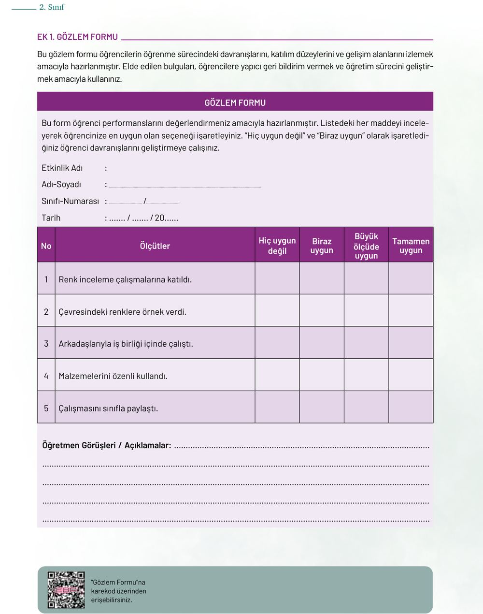 “Gözlem Formu”na karekod üzerinden erişebilirsiniz.

<!-- sayfa 26 -->

# EK 2. KONTROL LİSTESİ

Bu kontrol listesi öğrencilerden beklenen becerilerin, belirlenen ölçütler doğrultusunda gerçekleşme düzeyini değerlendirmek amacıyla hazırlanmıştır. Değerlendirme sürecini puanlamadan, öğrencinin bireysel gelişimini dikkate alarak ve süreç odaklı bir yaklaşımla yürütünüz.

## KONTROL LİSTESİ

Bu form öğrenci performanslarını değerlendirmeniz amacıyla hazırlanmıştır. Listedeki her maddeyi inceleyerek öğrencinize uygun olan “Evet” veya “Hayır” seçeneklerinden birini işaretleyiniz. “Hayır” olarak işaretlediğiniz öğrenci davranışlarını geliştirmeye çalışınız.

**Etkinlik Adı :**  
**Adı-Soyadı :** ...........................................................................................  
**Sınıfı-Numarası :** ............ / ............  
**Tarih :** ............ / ............ / 20......

| No | Ölçütler | Hayır | Evet |
| :--- | :--- | :---: | :---: |
| 1 | Ana renkleri doğru örneklerle gösterdi. | | |
| 2 | Ara renkleri doğru örneklerle gösterdi. | | |
| 3 | Çevredeki tekrarları belirledi. | | |
| 4 | Hayal ettiği çevreyi çalışmasına yansıttı. | | |
| 5 | Renk ve biçim ilişkisini kullanarak çalışmasını tamamladı. | | |

**Öğretmen Görüşleri / Açıklamalar:** ..............................................................................................................
......................................................................................................................................................................
......................................................................................................................................................................
......................................................................................................................................................................
.....................................................................................................................................................................

“Kontrol Listesi”ne karekod üzerinden erişebilirsiniz.

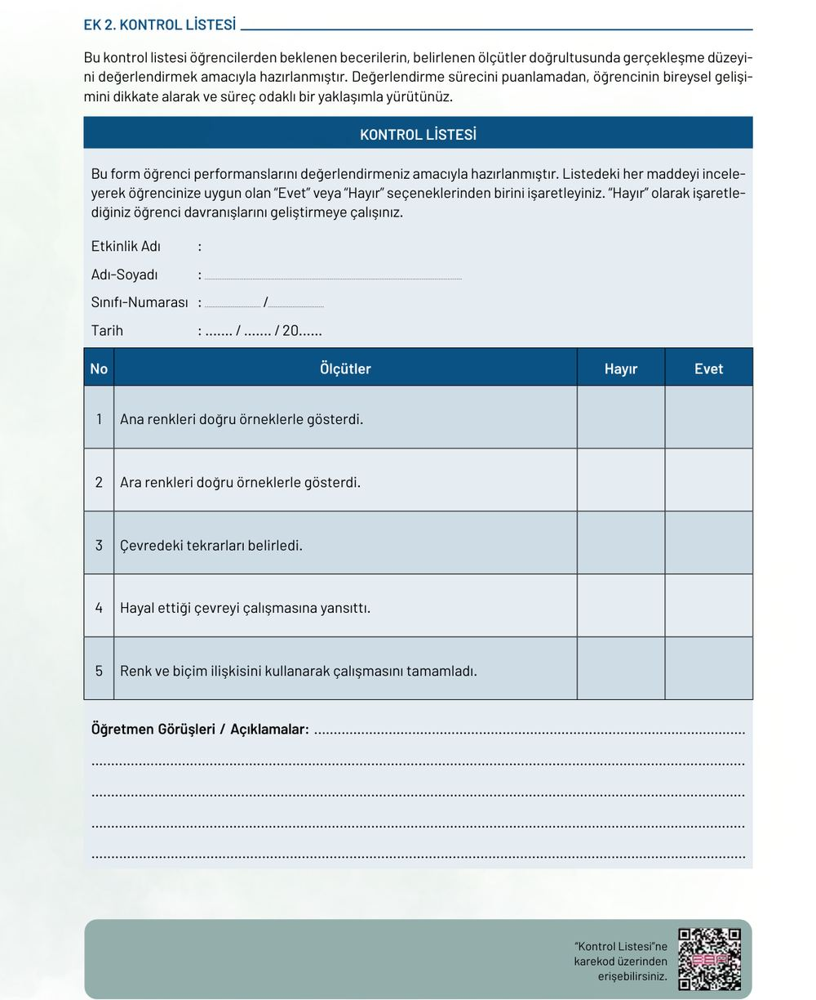
<!-- yer tutucu bulunamadı: sayfa sonuna eklendi -->

<!-- sayfa 27 -->

ÖĞRETMEN NOTU

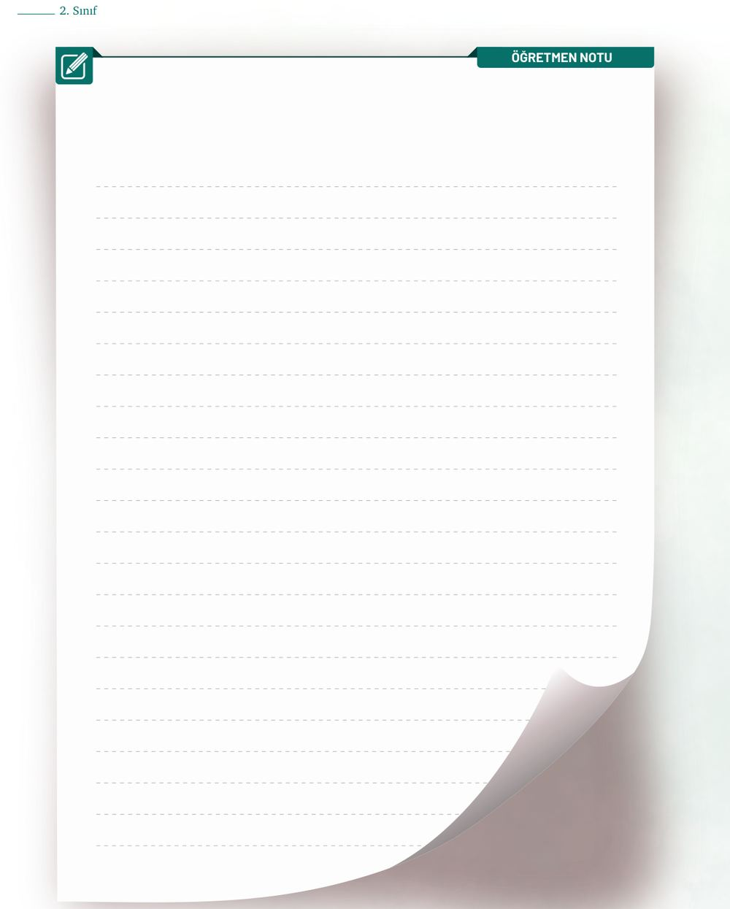
<!-- yer tutucu bulunamadı: sayfa sonuna eklendi -->

<!-- sayfa 28 -->

2. Sınıf

# 2. TEMA

# SANATIN GÖRSEL DİLİ

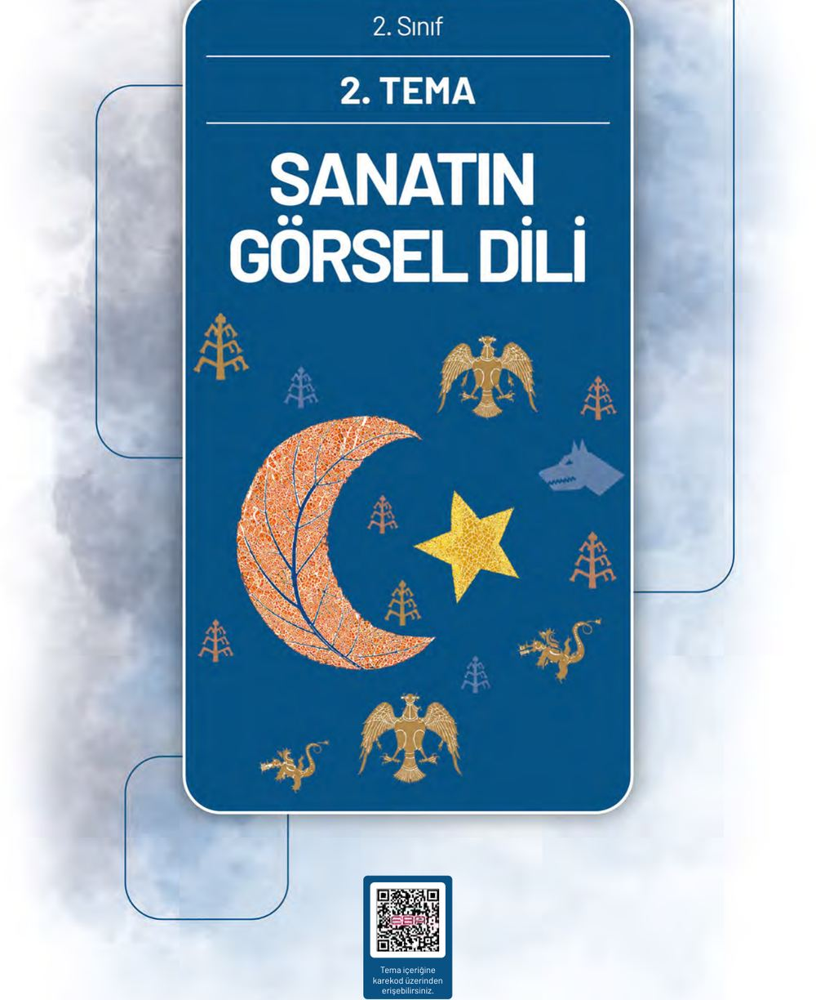

Tema içeriğine 
karekod üzerinden

<!-- sayfa 29 -->

| TEMA ADI | Sanatın Görsel Dili |
| :--- | :--- |
| **SINIF DÜZEYİ** | 2 |
| **TEMA KAPSAMI** | Öğrencilerin Türkiye Cumhuriyeti’nin ve eski Türk devletlerinin bayraklarındaki sembollerin görsel mesajlarını anlamlandırmaları, bu sembollerle ilişkili millî motiflerin tarihî ve kültürel anlamlarını keşfetmeleri, birim ve biçim ilişkisi kurarak bu motiflerle sanatsal kompozisyonlar oluşturmaları amaçlanmaktadır. |
| **DERS SAATİ** | 4 |
| **ALAN BECERİLERİ** | SAB2. Görsel Mesajı Okuma, SAB4. Sanatsal Üretim Yapma |
| **KAVRAMSAL BECERİLER** | – |
| **EĞİLİMLER** | E1.1. Merak, E2.5. Oyunseverlik, E3.5. Açık Fikirlilik, E3.8. Soru Sorma |

| PROGRAMLAR ARASI BİLEŞENLER | |
| :--- | :--- |
| **SOSYAL-DUYGUSAL ÖĞRENME BECERİLERİ** | SDB1.1. Kendini Tanıma (Öz Farkındalık), SDB1.2. Kendini Düzenleme (Öz Düzenleme), SDB1.3. Kendine Uyarlama (Öz Yansıtma), SDB2.1. İletişim, SDB2.2. İş Birliği, SDB2.3. Sosyal Farkındalık |
| **DEĞERLER** | D3. Çalışkanlık, D7. Estetik, D10. Mütevazılık, D14. Saygı, D16. Sorumluluk, D19. Vatanseverlik |
| **OKURYAZARLIK BECERİLERİ** | OB1. Bilgi Okuryazarlığı, OB2. Dijital Okuryazarlık, OB4. Görsel Okuryazarlık, OB5. Kültür Okuryazarlığı, OB9. Sanat Okuryazarlığı |
| **DİSİPLİNLER ARASI İLİŞKİLER** | Hayat Bilgisi, Türkçe |
| **BECERİLER ARASI İLİŞKİLER** | KB2.7. Karşılaştırma, KB2.8. Sorgulama, KB2.20. Sentezleme |

**ÖĞRENME ÇIKTILARI VE SÜREÇ BİLEŞENLERİ**

**GS.2.2.1. Türk devletlerinin bayraklarındaki görsel mesajları okuyabilme**
a) *Türkiye Cumhuriyeti’nin ve eski Türk devletlerinin bayraklarındaki sembollerin görsel mesajlarını algılar.*
b) *Türkiye Cumhuriyeti’nin ve eski Türk devletlerinin bayraklarındaki sembollerin görsel mesajlarını anlamlandırır.*

**GS.2.2.2. Millî kültüre ait motiflerle birim ve biçim ilişkisi kurarak sanatsal üretim yapabilme**
c) *Millî kültüre ait motiflerle birim ve biçim ilişkisi kurarak kompozisyon tasarlar.*
d) *Millî kültüre ait motiflerle birim ve biçim ilişkisi kurarak kompozisyon oluşturur.*

| İÇERİK ÇERÇEVESİ | Türk Bayrağındaki Semboller Eski Türk Devletlerinin Bayraklarındaki Semboller Millî Kültüre Ait Motifler |
| :--- | :--- |
| **ANAHTAR KAVRAMLAR** | hilal ve yıldız, bayrak, kültürel semboller, millî semboller, Türk devletlerinin bayrakları |
| **ÖĞRENME KANITLARI (ÖLÇME VE DEĞERLENDİRME)** | Öğrenme çıktıları; dereceli puanlama anahtarları, öz değerlendirme formları ve akran değerlendirme formları kullanılarak değerlendirilebilir. Sınıf içi performans görevi olarak öğrencilerden millî kültüre ait motiflerle birim ve biçim ilişkisi kurarak kompozisyon oluşturmaları istenir. Kompozisyonlarını kolaj, baskı, pastel boya veya kuru kalem tekniklerini kullanarak estetik bir şekilde ifade etmeleri beklenir |

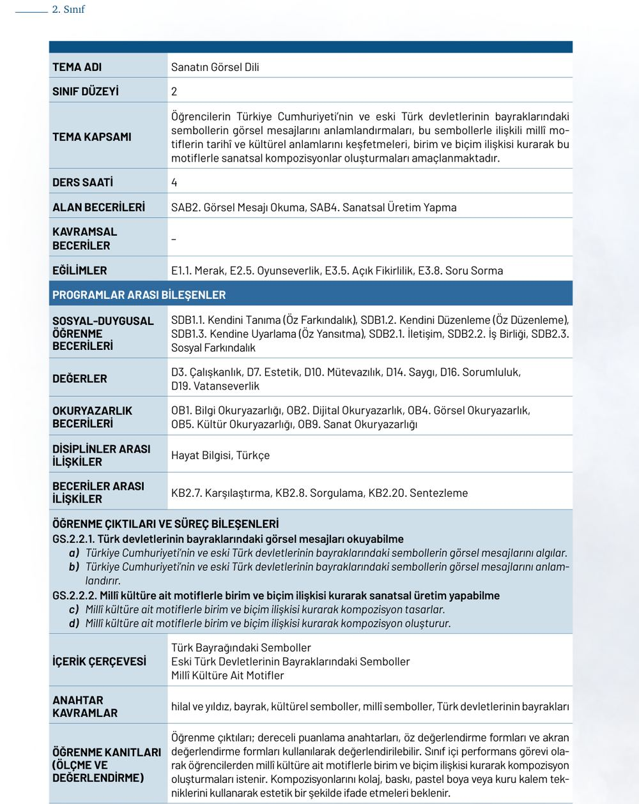
<!-- yer tutucu bulunamadı: sayfa sonuna eklendi -->

<!-- sayfa 30 -->

# TEMA AKIŞI

* Türk Devletlerinin Bayraklarını İnceleme
* Bayraklardaki Ortak Şekil ve Sembolleri Fark Etme
* Millî Kültüre Ait Motifleri Tanıma
* Motiflerin Kullanıldığı Yerleri İnceleme
* Millî Motiflerle Kompozisyon Tasarlama
* Motiflerle Kompozisyon Oluşturma
* Değerlendirme
* Sergileme
* Farklılaştırma

# ÖĞRETMEN HAZIRLIĞI

Ders öncesinde bayrak, sembol, motif, hilal ve yıldız kavramları gözden geçirilir. Hazırlık kapsamında aşağıdaki örneklerin bulundurulması önerilir.

* Temada Türk devletlerinin bayrakları, hilal ve yıldızın yer aldığı farklı ülke bayrakları, millî kültüre ait motif örnekleri ve motiflerin kullanıldığı günlük yaşam ürünlerine ilişkin görsellere yer verilmiştir.
* Kılavuz kitapta sunulan görseller süreç boyunca kullanılabilir. İstenirse sınıfın ihtiyaçlarına göre farklı örneklerle içerik zenginleştirilebilir.
* Kolaj, baskı ve boya uygulamalarında kullanılacak örnek öğrenci çalışmaları önceden incelenebilir.

# NOT

Bu temada yer alan uygulamalar ve görseller, öğretmene yol göstermek amacıyla hazırlanmıştır. Etkinlikler, öğrenme çıktılarının genel yapısını korumak kaydıyla sınıfın ihtiyaçlarına göre uyarlanabilir.

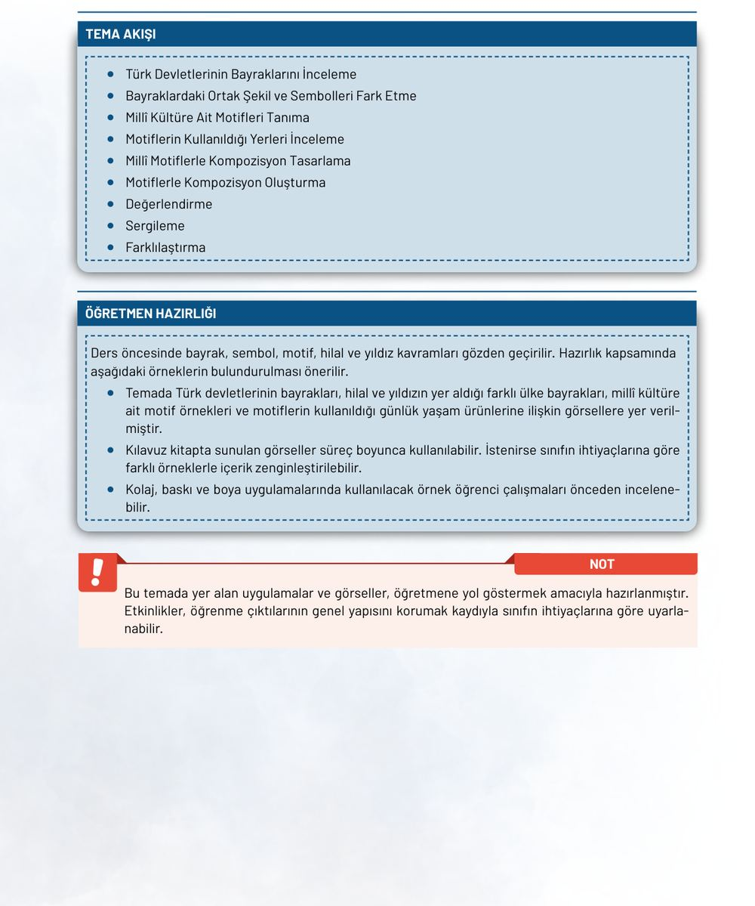
<!-- yer tutucu bulunamadı: sayfa sonuna eklendi -->

<!-- sayfa 31 -->

# ÖĞRENCİ HAZIRLIĞI VE ETKİNLİK MALZEMELERİ

Uygulamada kullanılacak malzemeler öğrencilerle önceden paylaşılır. Bu temada millî kültüre ait motiflerle kompozisyon oluşturma çalışmaları bulunduğu için malzemeler etkinlik türüne göre hazırlanır.

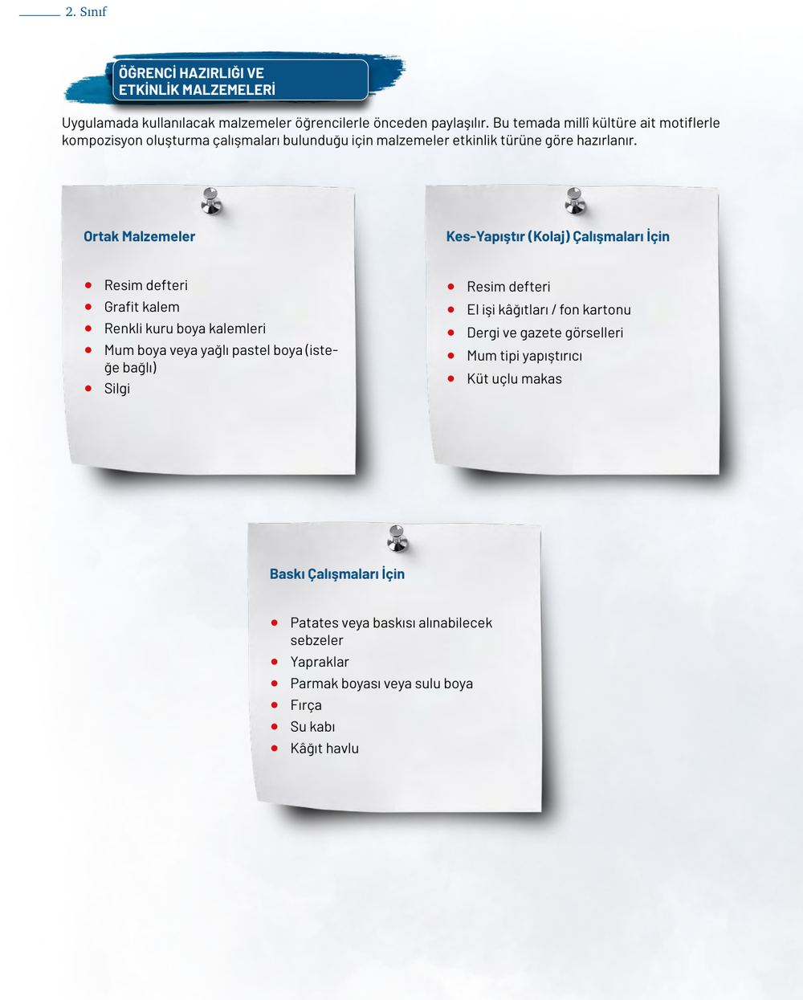

### Ortak Malzemeler

* Resim defteri
* Grafit kalem
* Renkli kuru boya kalemleri
* Mum boya veya yağlı pastel boya (isteğe bağlı)
* Silgi

### Kes-Yapıştır (Kolaj) Çalışmaları İçin

* Resim defteri
* El işi kâğıtları / fon kartonu
* Dergi ve gazete görselleri
* Mum tipi yapıştırıcı
* Küt uçlu makas

### Baskı Çalışmaları İçin

* Patates veya baskısı alınabilecek sebzeler
* Yapraklar
* Parmak boyası veya sulu boya
* Fırça
* Su kabı
* Kâğıt havlu

<!-- sayfa 32 -->

# ÖĞRENME-ÖĞRETME YAŞANTILARI

**TEMEL KABULLER**

Öğrencilerin Türk bayrağını, bayrak üzerindeki sembollerin anlamlarını bildikleri ve bayrakla ilgili temel düzeyde bilgiye sahip oldukları kabul edilmektedir.

**ÖN DEĞERLENDİRME SÜRECİ**

Öğrencilerin Türk bayrağı ve diğer bayraklar hakkındaki bilgi düzeyleri, aşağıdakilere benzer sorulara verdikleri yanıtlarla ölçülür:

* Türk bayrağı size neyi anlatıyor?
* Türk bayrağındaki hilal ve yıldızın anlamını biliyor musunuz?
* Türkiye dışında hangi ülkelerin bayraklarını tanıyorsunuz?

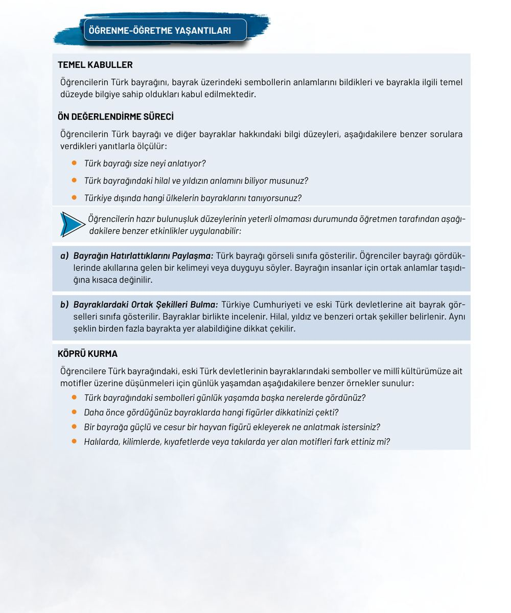

Öğrencilerin hazır bulunuşluk düzeylerinin yeterli olmaması durumunda öğretmen tarafından aşağıdakilere benzer etkinlikler uygulanabilir:

**a) Bayrağın Hatırlattıklarını Paylaşma:** Türk bayrağı görseli sınıfa gösterilir. Öğrenciler bayrağı gördüklerinde akıllarına gelen bir kelimeyi veya duyguyu söyler. Bayrağın insanlar için ortak anlamlar taşıdığına kısaca değinilir.

**b) Bayraklardaki Ortak Şekilleri Bulma:** Türkiye Cumhuriyeti ve eski Türk devletlerine ait bayrak görselleri sınıfa gösterilir. Bayraklar birlikte incelenir. Hilal, yıldız ve benzeri ortak şekiller belirlenir. Aynı şeklin birden fazla bayrakta yer alabildiğine dikkat çekilir.

**KÖPRÜ KURMA**

Öğrencilere Türk bayrağındaki, eski Türk devletlerinin bayraklarındaki semboller ve millî kültürümüze ait motifler üzerine düşünmeleri için günlük yaşamdan aşağıdakilere benzer örnekler sunulur:

* Türk bayrağındaki sembolleri günlük yaşamda başka nerelerde gördünüz?
* Daha önce gördüğünüz bayraklarda hangi figürler dikkatinizi çekti?
* Bir bayrağa güçlü ve cesur bir hayvan figürü ekleyerek ne anlatmak istersiniz?
* Halılarda, kilimlerde, kıyafetlerde veya takılarda yer alan motifleri fark ettiniz mi?

<!-- sayfa 33 -->

# ÖĞRENME-ÖĞRETME UYGULAMALARI

## Önerilen Planlama

1. Ders Saati $\longrightarrow$ Bayrakları inceleme, bayraklardaki ortak şekilleri fark etme
2. Ders Saati $\longrightarrow$ Motiflerin kullanıldığı alanları inceleme, motif seçme ve kompozisyon tasarlama
3. Ders Saati $\longrightarrow$ Motiflerle baskı, kes-yapıştır veya resim çalışmaları oluşturma
4. Ders Saati $\longrightarrow$ Çalışmaları tamamlama, paylaşma ve değerlendirme

### Uygulama Öncesi

#### GÖRSEL İNCELEME

**Bayrakları Tanıma**

Öğrenciler Türk Bayrağı ile tarih boyunca kullanılan bazı Türk devletlerine ait bayrakları inceleyerek bayraklardaki renkleri, şekilleri ve sembolleri fark eder. Bu amaçla Büyük Hun Devleti, Göktürk Devleti, Karahanlı Devleti, Gazneli Devleti, Selçuklu Devleti ve Osmanlı Devleti bayrakları görseller üzerinden öğrencilere tanıtılır (**OB2, OB5**).

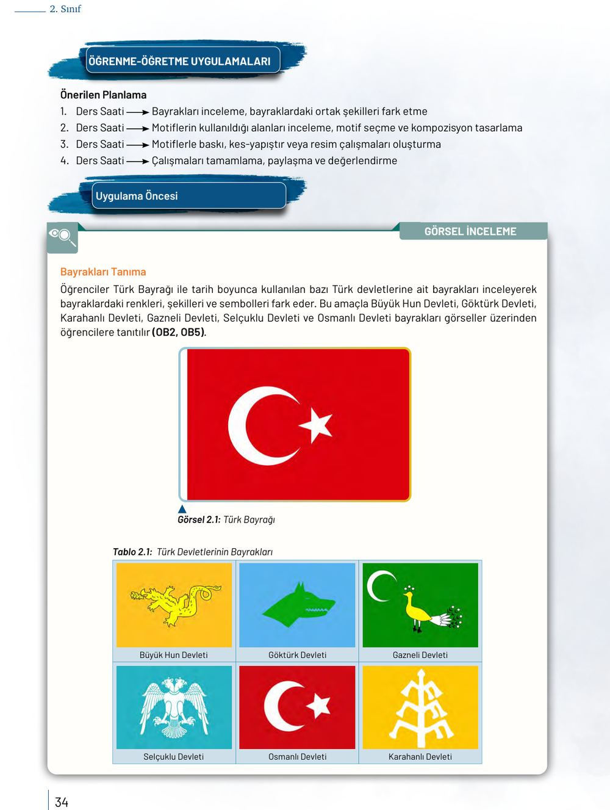
*Görsel 2.1: Türk Bayrağı*

**Tablo 2.1: Türk Devletlerinin Bayrakları**

| Büyük Hun Devleti | Göktürk Devleti | Gazneli Devleti |
| :---: | :---: | :---: |
|  |  |  |
| **Selçuklu Devleti** | **Osmanlı Devleti** | **Karahanlı Devleti** |
|  |  |  |

<!-- sayfa 34 -->

Bayraklarda dikkat çeken renkler, şekiller ve semboller üzerinde durulur. Öğrencilerden gördükleri bayraklarla ilgili akıllarına gelen kelimeleri paylaşmaları istenir **(OB4)**. Bayrakların kendilerinde uyandırdığı ilk izlenimlere ve duygulara kısaca değinilir **(SDB1.1)**. Türkiye Cumhuriyeti Bayrağı’ndaki hilal ve yıldız ile diğer Türk devletlerinin bayraklarında yer alan ortak şekillere ve farklılıklara dikkat çekilir **(KB2.7, OB5)**.

**Tablo 2.2:** *Hilal ve Yıldızın Yer Aldığı Bayrak Örnekleri*

| Tunus | Azerbaycan | Türkmenistan |
| :---: | :---: | :---: |
| ![Tunus Bayrağı] | ![Azerbaycan Bayrağı] | ![Türkmenistan Bayrağı] |
| Pakistan | Singapur | Özbekistan |
| ![Pakistan Bayrağı] | ![Singapur Bayrağı] | ![Özbekistan Bayrağı] |

Bayraklarda kullanılan renklerin ve şekillerin neyi temsil ediyor olabileceği üzerine öğrencilerin düşünmeleri sağlanır. Bu aşamada kısa bir beyin fırtınası veya fikir taraması yapılabilir **(SDB2.1, SDB2.3)**. İstenirse kısa videolar veya görsellerden yararlanılarak bayrakların temsil ettiği değerler hakkında konuşulur **(OB2)**. Birlik, beraberlik, cesaret, vatan sevgisi gibi kavramlarla ilişki kurulur. İstenirse bayrakların temsil ettiği değerleri gösteren bir kavram haritasından yararlanılabilir (**Bk. Tablo 2.3**).

**Tablo 2.3:** *Bayrakların Temsil Ettiği Değerleri Gösteren Kavram Haritası*

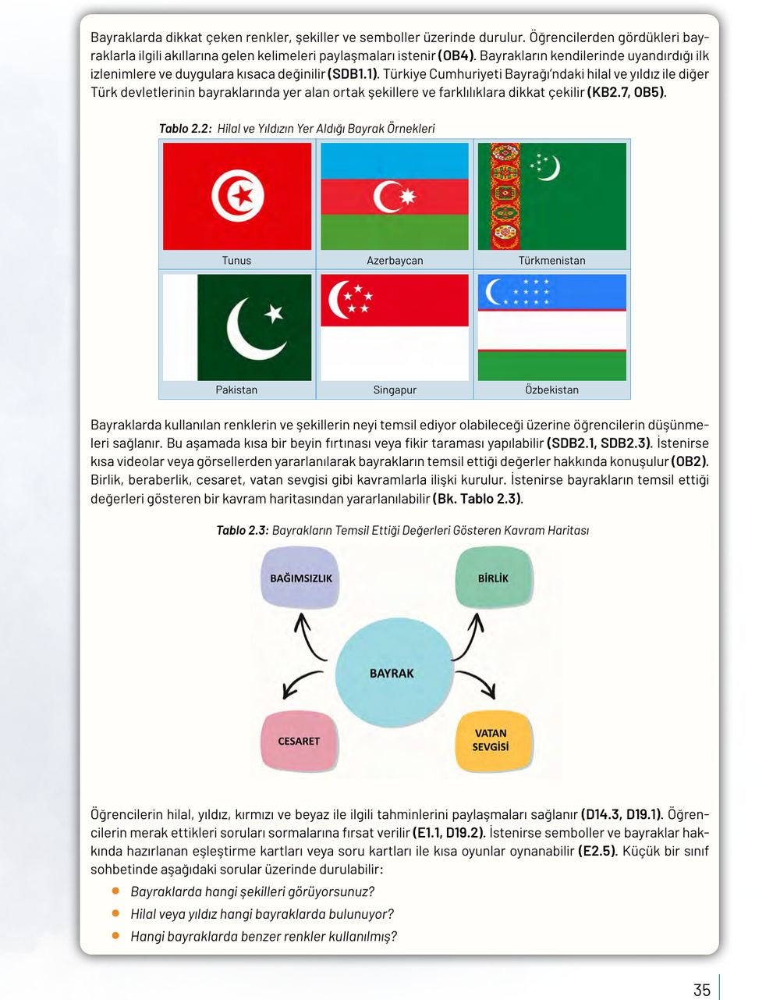

Öğrencilerin hilal, yıldız, kırmızı ve beyaz ile ilgili tahminlerini paylaşmaları sağlanır **(D14.3, D19.1)**. Öğrencilerin merak ettikleri soruları sormalarına fırsat verilir **(E1.1, D19.2)**. İstenirse semboller ve bayraklar hakkında hazırlanan eşleştirme kartları veya soru kartları ile kısa oyunlar oynanabilir **(E2.5)**. Küçük bir sınıf sohbetinde aşağıdaki sorular üzerinde durulabilir:

* Bayraklarda hangi şekilleri görüyorsunuz?
* Hilal veya yıldız hangi bayraklarda bulunuyor?
* Hangi bayraklarda benzer renkler kullanılmış?

<!-- sayfa 35 -->

Süreç boyunca bayrakların insanları ortak değerler etrafında bir araya getirdiğine değinilir. Bayrağın bir ülkeyi temsil ettiği, insanların ülkelerine olan bağlılıklarını ve ortak değerlerini yansıttığı düzeye uygun şekilde fark ettirilir (**OB5, D14.3, D19.3**). Süreç, dereceli puanlama anahtarı (**Bk. Ek 1**) ile değerlendirilebilir.

### Motifleri İnceleme

Öğrencilere kartal, kurt, geyik, lale, sümbül veya karanfil motifleri gösterilir (**OB2**). Motiflerin doğadaki bitkilerden ve hayvanlardan esinlenilerek oluşturulduğuna değinilir (**OB5**). Kartal motifi ile gerçek kartal görseli, lale motifi ile gerçek lale görseli birlikte incelenir. Böylece öğrencilerin motif ile motifin esin kaynağı arasındaki ilişkiyi fark etmeleri sağlanır.

*Tablo 2.4: Doğadaki Bitkiler ve Onlardan Esinlenilerek Oluşturulan Motifler*

| | | | |
| :---: | :---: | :---: | :---: |
| 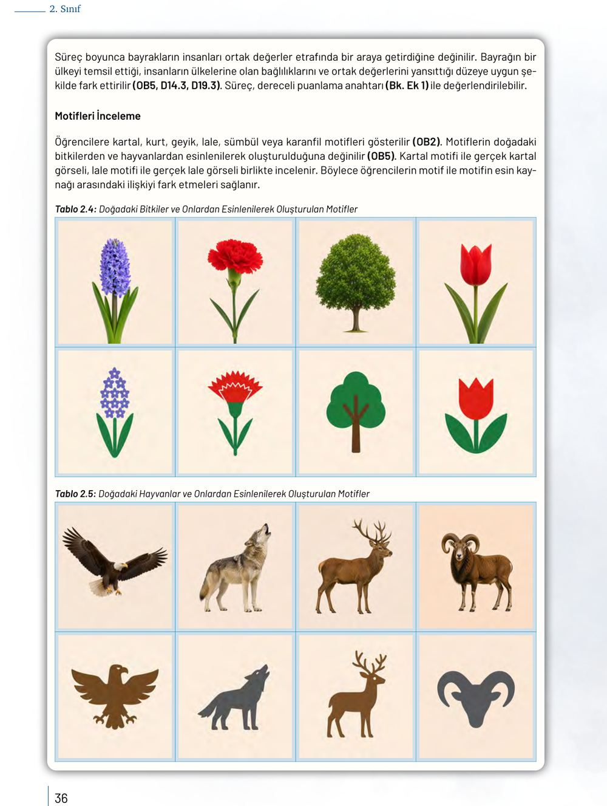 |  |  |  |
|  |  |  |  |

*Tablo 2.5: Doğadaki Hayvanlar ve Onlardan Esinlenilerek Oluşturulan Motifler*

| | | | |
| :---: | :---: | :---: | :---: |
|  |  |  |  |
|  |  |  |  |

<!-- sayfa 36 -->

Öğrenciler seçtikleri motiflerde gördükleri renkleri ve şekilleri açıklar. İki motif yan yana incelenerek benzer ve farklı yönlerine dikkat çekilir **(E3.8, KB2.8)**. Aşağıdaki sorular üzerinden kısa bir değerlendirme yapılabilir:

* Bu motif hangi hayvana veya bitkiye benziyor?
* Motifte hangi renkleri görüyorsunuz?

### Motiflerin Kullanıldığı Yerleri Fark Etme

Öğrencilere motiflerin kullanıldığı halı, kilim, seramik, çini, kumaş veya takı örnekleri gösterilir. Motiflerin evlerimizde, kıyafetlerde ve çeşitli eşyalarda hâlen kullanılabildiğine değinilir **(OB5)**. Motiflerin günlük yaşamda farklı eşyalar üzerinde kullanılabildiğine dikkat çekilir. Bu aşamada soru kartları kullanılabilir **(E2.5)**. Öğrencilerin ilgilerini çeken motiflerle ilgili soru sormaları teşvik edilir **(E1.1)**.

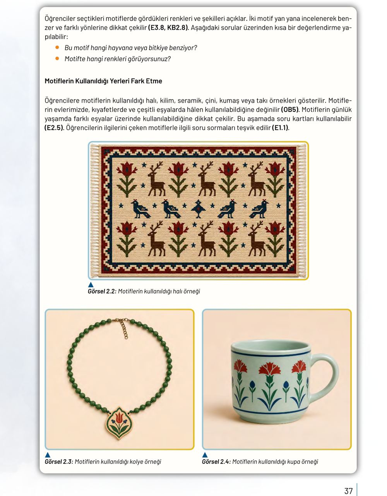
*Görsel 2.2: Motiflerin kullanıldığı halı örneği*

*Görsel 2.3: Motiflerin kullanıldığı kolye örneği*

*Görsel 2.4: Motiflerin kullanıldığı kupa örneği*

<!-- sayfa 37 -->

# Uygulama Sırası

## Motifi Belirleme

Öğrenciler çalışmak istedikleri bir motifi seçer. Seçtikleri motifin renklerini ve şekillerini inceler. Motifin tekrar eden bölümlerine dikkat ederek çalışmalarında nasıl kullanacaklarına karar verirler (**SDB1.2**). Aşağıdaki sorular üzerinden öğrencilerin düşünmeleri sağlanabilir:

* Seçtiğiniz motifin hangi bölümünü tekrar etmek istersiniz?
* Motifinizde hangi renkleri kullanmak istersiniz?
* Motifinizde hangi şekilleri tekrar etmek istersiniz?

## ETKİNLİK
### Millî Kültüre Ait Motiflerle Kompozisyon Oluşturma

Öğrenciler belirledikleri motifleri ve renkleri kullanarak çalışmalarına başlar (**D7.2, OB4, KB2.20**). İstenirse motiflerin kendilerine neleri hatırlattığı üzerine kısa paylaşımlar yapılabilir. Öğrenciler çalışmalarını kes-yapıştır (kolaj), baskı, mum boya, yağlı pastel veya kuru boya tekniklerinden birini kullanarak oluşturabilir. Kullanacakları malzemeleri bireysel veya grup hâlinde fikir alışverişi yaparak belirler (**E3.5, D16.1, SDB1.2, SDB2.2**). Kes-yapıştır çalışmaları için renkli fon kartonları, el işi kâğıtları, gazete ve dergi görselleri kullanılabilir. Baskı çalışmaları yapılacaksa yaprak baskısı, sebze baskısı, parmak baskısı veya fırça baskısı gibi yöntemler uygulanabilir. Öğrenciler isterlerse baskı sonrası detayları renkli kuru boya, pastel boya veya sulu boya ile zenginleştirebilir. Kullanılacak teknikler aşamalı olarak gösterilir (**OB9**).

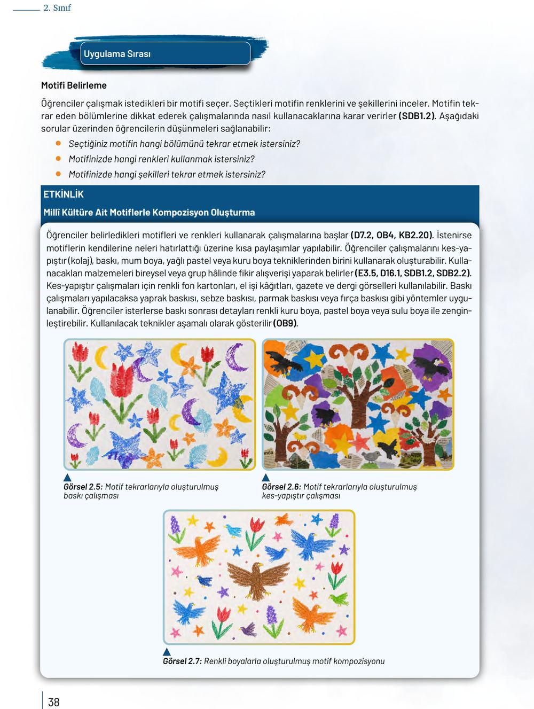
**Görsel 2.5:** Motif tekrarlarıyla oluşturulmuş baskı çalışması

**Görsel 2.6:** Motif tekrarlarıyla oluşturulmuş kes-yapıştır çalışması

**Görsel 2.7:** Renkli boyalarla oluşturulmuş motif kompozisyonu

<!-- sayfa 38 -->

# TEKNİK BİLGİ

## Baskı Uygulamaları

Öğrenciler önce boş bir kâğıtta birkaç deneme baskısı yapabilir. Daha sonra seçtikleri motifleri yan yana veya alt alta tekrar ederek kompozisyonlarını oluşturabilir. Böylece motif, tekrar ve ritim ilişkisini uygulamalı olarak deneyimleyebilirler.

### Fırça Baskısı:

Fırçanın ucu boya ile renklendirilir. Fırça dik tutulup yüzeye bastırılarak nokta, yaprak veya farklı motifler oluşturulur. Fırçanın farklı bölümleri kullanılarak çeşitli izler elde edilebilir.

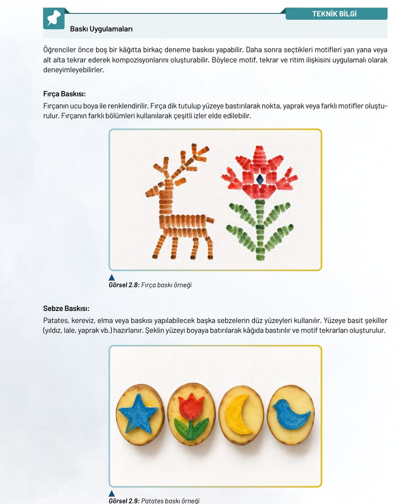

*Görsel 2.8: Fırça baskı örneği*

### Sebze Baskısı:

Patates, kereviz, elma veya baskısı yapılabilecek başka sebzelerin düz yüzeyleri kullanılır. Yüzeye basit şekiller (yıldız, lale, yaprak vb.) hazırlanır. Şeklin yüzeyi boyaya batırılarak kâğıda bastırılır ve motif tekrarları oluşturulur.

*Görsel 2.9: Patates baskı örneği*

<!-- sayfa 39 -->

**Yaprak Baskısı:**
Yaprağın damarları belirgin olan yüzeyi ince bir kat boya ile boyanır. Yaprak dikkatlice kâğıda yerleştirilir ve hafifçe bastırılır. Yaprak kaldırıldığında doğal doku ve biçim izleri ortaya çıkar.

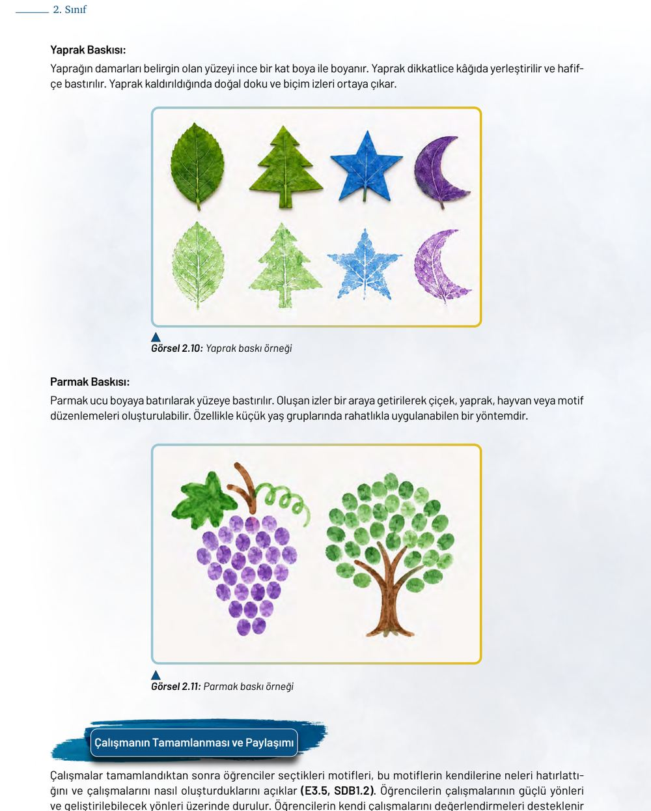
*Görsel 2.10: Yaprak baskı örneği*

**Parmak Baskısı:**
Parmak ucu boyaya batırılarak yüzeye bastırılır. Oluşan izler bir araya getirilerek çiçek, yaprak, hayvan veya motif düzenlemeleri oluşturulabilir. Özellikle küçük yaş gruplarında rahatlıkla uygulanabilen bir yöntemdir.

*Görsel 2.11: Parmak baskı örneği*

# Çalışmanın Tamamlanması ve Paylaşımı

Çalışmalar tamamlandıktan sonra öğrenciler seçtikleri motifleri, bu motiflerin kendilerine neleri hatırlattığını ve çalışmalarını nasıl oluşturduklarını açıklar (**E3.5, SDB1.2**). Öğrencilerin çalışmalarının güçlü yönleri ve geliştirilebilecek yönleri üzerinde durulur. Öğrencilerin kendi çalışmalarını değerlendirmeleri desteklenir.

<!-- sayfa 40 -->

# Değerlendirme

Ürünler performans görevi kapsamında ele alınır. Süreç ve ürünle ilgili farkındalık kazanmaları için öğrencilere aşağıdakilere benzer öz değerlendirme soruları sorulabilir:

* Çalışmanızda hangi motifi kullandınız?
* Motifinizi birden fazla yerde tekrar ettiniz mi?
* Çalışmanızda en çok beğendiğiniz bölüm hangisi oldu?

Öğrenciler arkadaşlarının çalışmalarını inceler. Aşağıdakilere benzer sorularla akran geri bildirimi süreci desteklenebilir:

* Arkadaşınızın çalışmasında hangi motifi gördünüz?
* Motiflerin tekrar edildiği bölümleri fark ettiniz mi?
* Çalışmada en çok beğendiğiniz bölüm hangisi oldu?

# FARKLILAŞTIRMA

## Zenginleştirme

⚠️ Öğrenciler aşağıdaki etkinliklerden birine yönlendirilebilir.

### Etkinlik 1: Bayrak Sembolleriyle Hikâye Resmetme

Öğrenciler Türk devletlerinin bayraklarında yer alan ay, yıldız, kartal veya diğer sembollerden birini seçer. Seçtikleri sembolün kahraman olduğu kısa bir hikâye oluşturur. Bu aşamada öğrencilerin hikâye kurgulamalarına rehberlik edilebilir. Hikâyede sembolün neler yaptığı, nerelere gittiği veya kimlere yardım ettiği üzerinde durulur. Öğrenciler oluşturdukları hikâyeyi, resim defteri veya resim kâğıdı üzerine çizerek görselleştirir. Çalışmada mum boya, yağlı pastel boya, kuru boya veya sulu boya kullanılabilir. Dileyen öğrenciler baskı veya kes-yapıştır tekniklerinden de yararlanabilir. Resim tamamlandıktan sonra öğrenciler seçtikleri sembolü ve hikâyelerini sınıfla paylaşır.

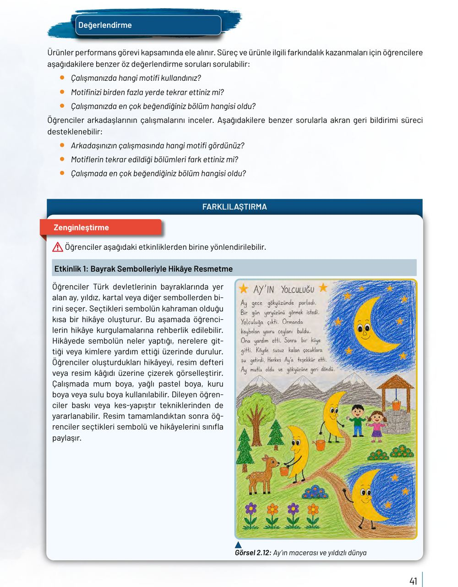

<!-- sayfa 41 -->

**Etkinlik 2: Bayrak Motiflerini Günlük Eşyalara Aktarma**

Öğrenciler Türk devletlerinin bayraklarında yer alan hilal, yıldız, kartal veya diğer sembollerden birini seçer. Seçtikleri sembolü inceleyerek şekil ve renk özelliklerine dikkat eder. Daha sonra sembolün kullanılacağı yüzeyi belirler. Defter kapağı, kitap ayracı, çanta şablonu, tişört şablonu veya karton üzerine hazırlanmış farklı yüzeyleri tercih edebilirler. Çalışmada mum boya, yağlı pastel boya, kuru boya veya keçeli kalem kullanılabilir. Dileyen öğrenciler kes-yapıştır yöntemiyle renkli kâğıtlardan yararlanarak kes-yapıştır çalışması da yapabilir. Çalışma tamamlandıktan sonra öğrenciler kullandıkları sembolü ve bu sembolü neden seçtiklerini sözlü olarak açıklar.

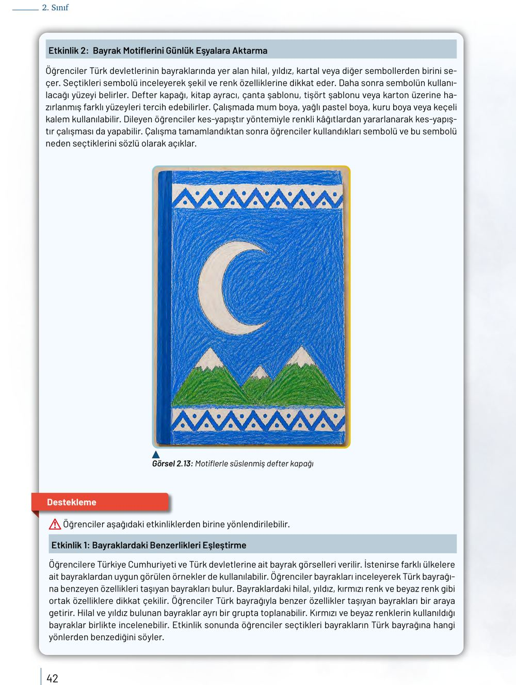
*Görsel 2.13: Motiflerle süslenmiş defter kapağı*

---

**Destekleme**

⚠️ Öğrenciler aşağıdaki etkinliklerden birine yönlendirilebilir.

**Etkinlik 1: Bayraklardaki Benzerlikleri Eşleştirme**

Öğrencilere Türkiye Cumhuriyeti ve Türk devletlerine ait bayrak görselleri verilir. İstenirse farklı ülkelere ait bayraklardan uygun görülen örnekler de kullanılabilir. Öğrenciler bayrakları inceleyerek Türk bayrağına benzeyen özellikleri taşıyan bayrakları bulur. Bayraklardaki hilal, yıldız, kırmızı renk ve beyaz renk gibi ortak özelliklere dikkat çekilir. Öğrenciler Türk bayrağıyla benzer özellikler taşıyan bayrakları bir araya getirir. Hilal ve yıldız bulunan bayraklar ayrı bir grupta toplanabilir. Kırmızı ve beyaz renklerin kullanıldığı bayraklar birlikte incelenebilir. Etkinlik sonunda öğrenciler seçtikleri bayrakların Türk bayrağına hangi yönlerden benzediğini söyler.

<!-- sayfa 42 -->

*Tablo 2.6: Türk Bayrağı ve Türk Devletlerine Ait Bayrak Görselleri*

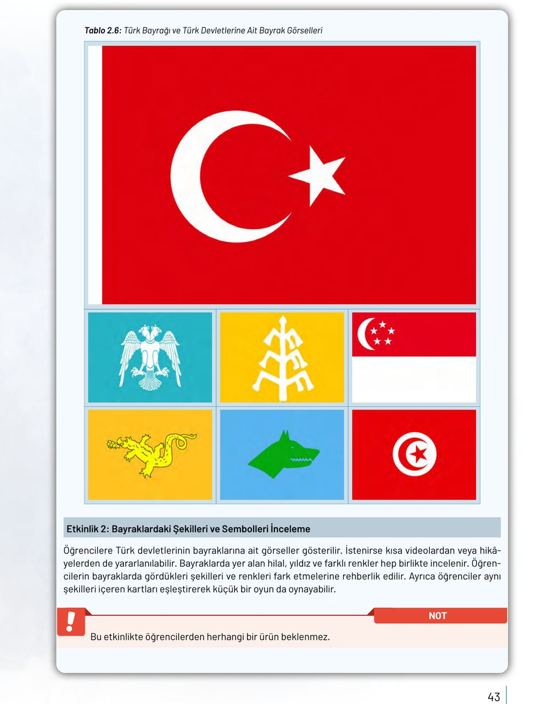

**Etkinlik 2: Bayraklardaki Şekilleri ve Sembolleri İnceleme**

Öğrencilere Türk devletlerinin bayraklarına ait görseller gösterilir. İstenirse kısa videolardan veya hikâyelerden de yararlanılabilir. Bayraklarda yer alan hilal, yıldız ve farklı renkler hep birlikte incelenir. Öğrencilerin bayraklarda gördükleri şekilleri ve renkleri fark etmelerine rehberlik edilir. Ayrıca öğrenciler aynı şekilleri içeren kartları eşleştirerek küçük bir oyun da oynayabilir.

| NOT |
| :--- |
| Bu etkinlikte öğrencilerden herhangi bir ürün beklenmez. |

<!-- sayfa 43 -->

# EK 1. DERECELİ PUANLAMA ANAHTARI

Bu dereceli puanlama anahtarı öğrencilerden beklenen becerilerin, belirlenen ölçütler doğrultusunda gerçekleşme düzeyini değerlendirmek amacıyla hazırlanmıştır. Ölçek, öğrencilerin güçlü ve zayıf yönlerini belirlemenize yardımcı olacaktır.

## DERECELİ PUANLAMA ANAHTARI

Bu form, etkinlikteki öğrenci davranışlarını değerlendirmeniz amacıyla hazırlanmıştır. Listedeki her maddeyi inceleyerek öğrencinize uygun olan seçeneği işaretleyiniz.

Etkinlik Adı :
Adı-Soyadı : ............................................................
Sınıfı-Numarası : .......... / ..........
Tarih : ........ / ........ / 20......

| No | Ölçütler | 1 puan | 2 puan | 3 puan | Puan |
|---|---|---|---|---|---|
| 1 | **Bayraklardaki renkleri ifade etme** | Bayraklardaki renkleri ifade etmemiştir. | Bayraklardaki renkleri kısmen ifade etmiştir. | Bayraklardaki renkleri doğru şekilde ifade etmiştir. | |
| 2 | **Bayraklardaki şekilleri ifade etme** | Bayraklardaki şekilleri ifade etmemiştir. | Bayraklardaki şekilleri kısmen ifade etmiştir. | Bayraklardaki şekilleri doğru şekilde ifade etmiştir. | |
| 3 | **Bayraklar arasındaki benzerlikleri açıklama** | Bayraklar arasındaki benzerlikleri açıklamamıştır. | Bayraklar arasındaki benzerlikleri kısmen açıklamıştır. | Bayraklar arasındaki benzerlikleri doğru şekilde açıklamıştır. | |
| 4 | **Hilal ve yıldızın yer aldığı bayrakları gösterme** | Hilal ve yıldızın yer aldığı bayrakları gösterememiştir. | Hilal ve yıldızın yer aldığı bayrakların bir kısmını göstermiştir. | Hilal ve yıldızın yer aldığı bayrakları doğru şekilde göstermiştir. | |
| 5 | **Düşüncelerini arkadaşlarına saygılı bir şekilde açıklama** | Düşüncelerini arkadaşlarına saygılı bir şekilde açıklamamıştır. | Düşüncelerini arkadaşlarına kısmen saygılı bir şekilde açıklamıştır. | Düşüncelerini arkadaşlarına saygılı bir şekilde açıklamıştır. | |
| | | | | **Toplam Puan\*** | |

Bu formdan alınacak en düşük puan 5 ve en yüksek puan 15'tir.

Öğretmen Görüşleri / Açıklamalar: ...............................................................................................................
......................................................................................................................................................................

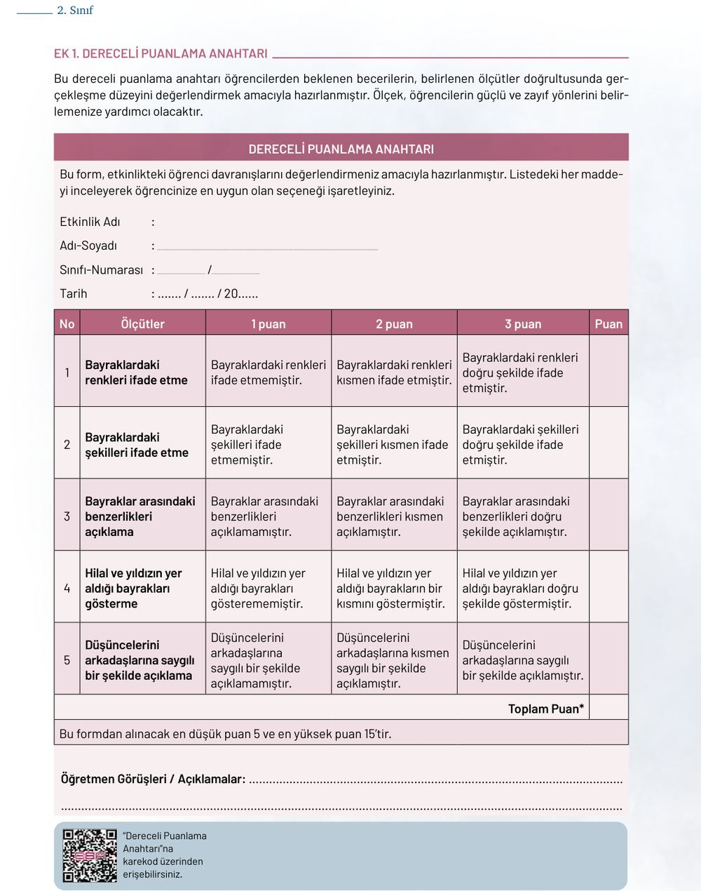 “Dereceli Puanlama Anahtarı”na karekod üzerinden erişebilirsiniz

<!-- sayfa 44 -->

2. Sınıf

# 3. TEMA

# SANATÇILAR VE ESERLERİ

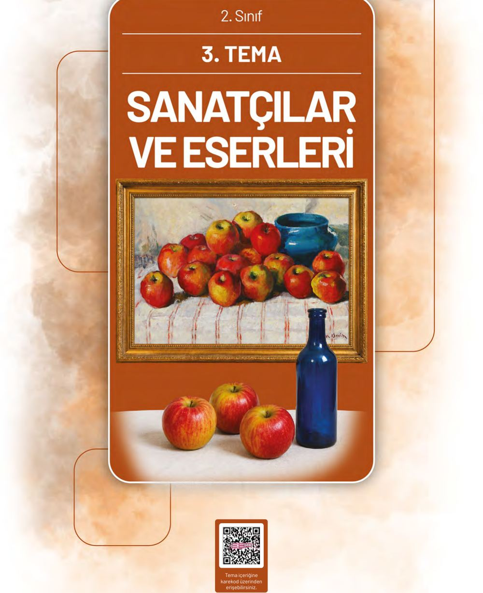

Tema içeriğine
karekod üzerinden

<!-- sayfa 45 -->

| TEMA ADI | Sanatçılar ve Eserleri |
| :--- | :--- |
| SINIF DÜZEYİ | 2 |
| TEMA KAPSAMI | Öğrencilerin çağdaş Türk resim sanatında natürmort temalı eserleri inceleyerek sanat elemanları ve tasarım ilkelerini fark etmeleri, ana ve ara renkler ile biçim zıtlıklarını kullanarak özgün natürmort yapmaları amaçlanmaktadır. |
| DERS SAATİ | 5 |
| ALAN BECERİLERİ | SAB3. Sanat Eserini İnceleme, SAB4. Sanatsal Üretim Yapma |
| KAVRAMSAL BECERİLER | - |
| EĞİLİMLER | E1.1. Merak, E1.3. Azim ve Kararlılık, E3.3. Yaratıcılık, E3.5. Açık Fikirlilik |

| PROGRAMLAR ARASI BİLEŞENLER | |
| :--- | :--- |
| SOSYAL-DUYGUSAL ÖĞRENME BECERİLERİ | SDB1.1. Kendini Tanıma (Öz Farkındalık), SDB1.2. Kendini Düzenleme (Öz Düzenleme), SDB2.2. İş Birliği, SDB2.3. Sosyal Farkındalık, SDB3.3. Sorumlu Karar Verme |
| DEĞERLER | D7. Estetik, D12. Sabır, D14. Saygı, D15. Sevgi, D17. Tasarruf, D18. Temizlik |
| OKURYAZARLIK BECERİLERİ | OB2. Dijital Okuryazarlık, OB4. Görsel Okuryazarlık, OB5. Kültür Okuryazarlığı, OB9. Sanat Okuryazarlığı |
| DİSİPLİNLER ARASI İLİŞKİLER | Hayat Bilgisi, Matematik |
| BECERİLER ARASI İLİŞKİLER | KB2.2. Gözlemleme, KB2.5. Sınıflandırma, KB2.8. Sorgulama, KB2.10. Çıkarım Yapma, KB3.1. Karar Verme, SAB1.2. Sanatsal Karşılaştırma |

### ÖĞRENME ÇIKTILARI VE SÜREÇ BİLEŞENLERİ

**GS.2.3.1. Çağdaş Türk resim sanatında natürmort temalı eserleri inceleyebilme**
a) Natürmort temalı eseri sanatsal açıdan betimler.
b) Natürmort temalı eseri sanatsal açıdan çözümler.
c) Natürmort temalı eseri sanatsal açıdan yorumlar.
ç) Natürmort temalı eser hakkında sanatsal yargıda bulunur.

**GS.2.3.2. Ana renkler, ara renkler ve biçim zıtlıklarıyla natürmort yapabilme**
a) Ana, ara renkler ve biçim zıtlıklarıyla natürmort tasarlar.
b) Ana, ara renkler ve biçim zıtlıklarıyla natürmort oluşturur.

| İÇERİK ÇERÇEVESİ | Çağdaş Türk Resim Sanatında Natürmort Sanat Eserlerindeki Renk ve Biçim Zıtlıkları |
| :--- | :--- |
| ANAHTAR KAVRAMLAR | biçim zıtlığı, çerçeveleme, konturlama, natürmort, renk zıtlığı |
| ÖĞRENME KANITLARI (ÖLÇME VE DEĞERLENDİRME) | Öğrenme çıktıları; kontrol listeleri, gözlem formları, öz değerlendirme formları veya akran değerlendirme formları kullanılarak değerlendirilebilir. Sınıf içi performans görevi olarak öğrencilerden ana, ara renkler ve biçim zıtlıklarıyla günlük nesneleri kullanarak natürmort oluşturmaları istenir. Natürmortlarını pastel boya, sulu boya veya renkli kuru kalem teknikleriyle detaylara dikkat ederek estetik bir şekilde ifade etmeleri beklenir. |

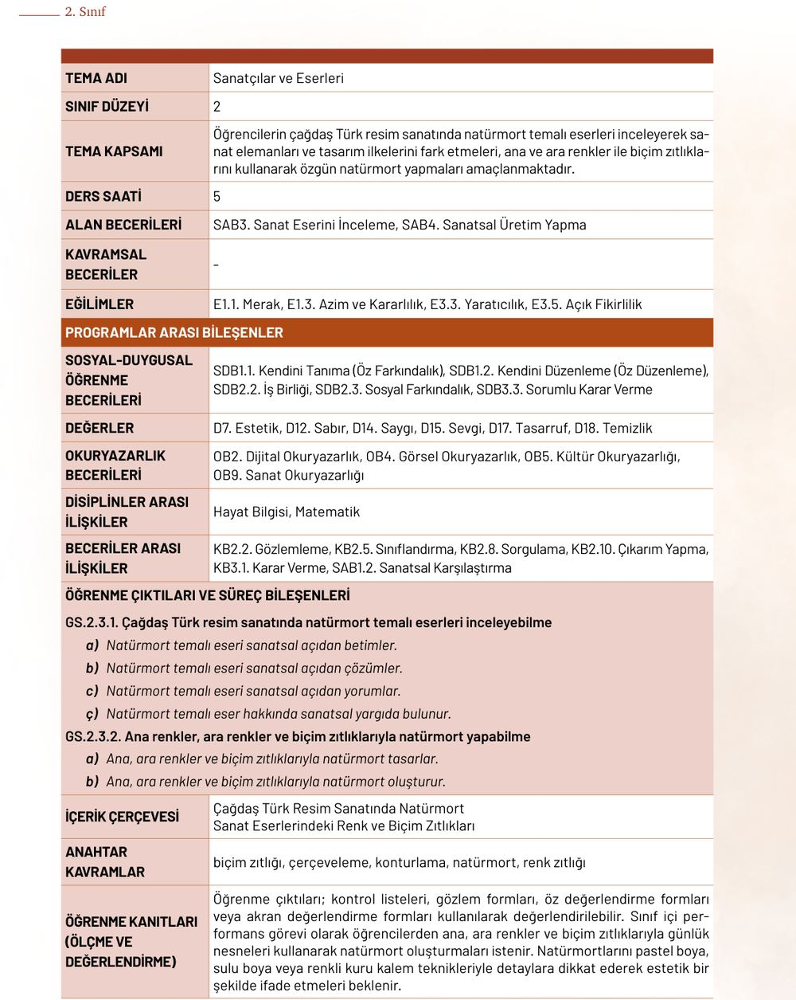
<!-- yer tutucu bulunamadı: sayfa sonuna eklendi -->

<!-- sayfa 46 -->

# TEMA AKIŞI

* Natürmort Temalı Sanat Eserlerini İnceleme
* Eserdeki Renk ve Biçim Özelliklerini Fark Etme
* Nesnelerle Natürmort Düzenlemesi Hazırlama
* Natürmort Taslağı Hazırlama
* Ana, Ara Renkler ve Biçim Zıtlıklarıyla Natürmort Oluşturma
* Değerlendirme
* Sergileme
* Farklılaştırma

# ÖĞRETMEN HAZIRLIĞI

Ders öncesinde natürmort, ana ve ara renkler, biçim zıtlığı, kontur ve konturlama kavramları gözden geçirilir. Hazırlık kapsamında aşağıdaki örneklerin ve materyallerin bulundurulması önerilir.

* Temada yer alan Feyhaman Duran, Hasan Vecih Bereketoğlu ve Mahmut Cuda’ya ait natürmort eserleri süreç boyunca kullanılabilir. İstenirse sınıfın ihtiyaçlarına uygun farklı natürmort örnekleriyle içerik zenginleştirilebilir.
* Ders sırasında kullanılacak nesneler önceden belirlenir. Meyve, sebze, bardak, şişe, vazo, oyuncak veya benzeri nesnelerle natürmort düzenlemeleri oluşturulabilir.
* Uygulama öncesinde kullanılacak boya ve çizim malzemeleri belirlenir. Sınıfın imkânlarına göre pastel boya, sulu boya veya renkli kuru boya kalemleri arasından uygun teknik tercih edilebilir.

# NOT

Bu temada yer alan uygulamalar ve görseller, öğretmene yol göstermek amacıyla hazırlanmıştır. Etkinlikler, öğrenme çıktılarının genel yapısını korumak kaydıyla sınıfın ihtiyaçlarına göre uyarlanabilir.

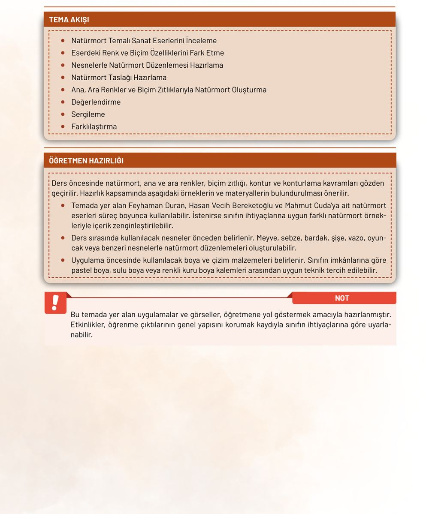
<!-- yer tutucu bulunamadı: sayfa sonuna eklendi -->

<!-- sayfa 47 -->

# ÖĞRENCİ HAZIRLIĞI VE ETKİNLİK MALZEMELERİ

Uygulamada kullanılacak malzemeler öğrencilerle önceden paylaşılır. Bu temada sanat eseri inceleme, natürmort çizimi, renklendirme, kolaj ve üç boyutlu modelleme çalışmaları bulunduğu için malzemeler etkinlik türüne göre hazırlanır.

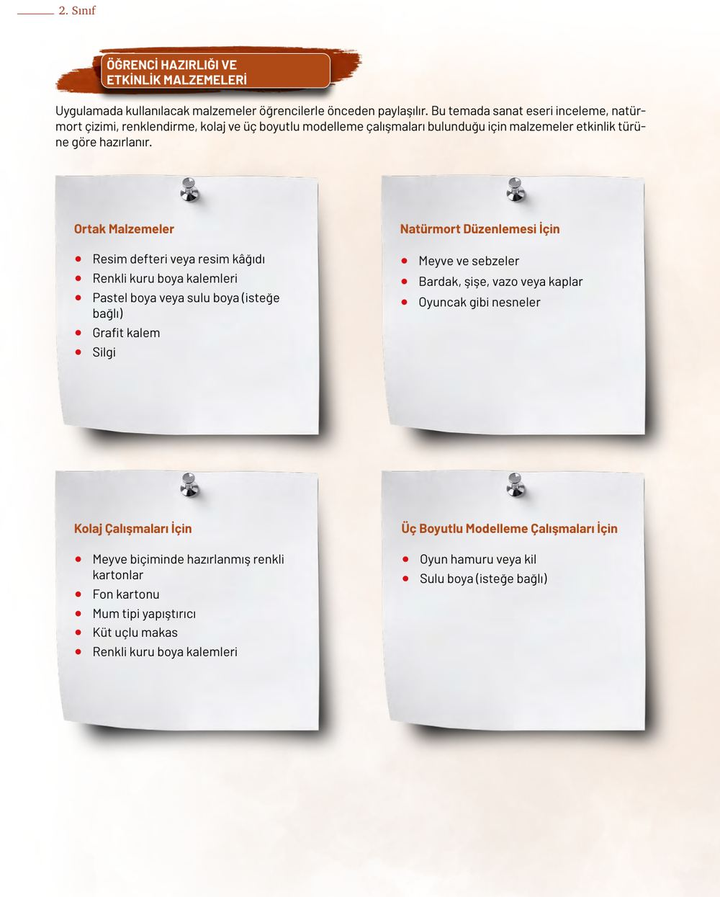

## Ortak Malzemeler

* Resim defteri veya resim kâğıdı
* Renkli kuru boya kalemleri
* Pastel boya veya sulu boya (isteğe bağlı)
* Grafit kalem
* Silgi

## Natürmort Düzenlemesi İçin

* Meyve ve sebzeler
* Bardak, şişe, vazo veya kaplar
* Oyuncak gibi nesneler

## Kolaj Çalışmaları İçin

* Meyve biçiminde hazırlanmış renkli kartonlar
* Fon kartonu
* Mum tipi yapıştırıcı
* Küt uçlu makas
* Renkli kuru boya kalemleri

## Üç Boyutlu Modelleme Çalışmaları İçin

* Oyun hamuru veya kil
* Sulu boya (isteğe bağlı)

<!-- sayfa 48 -->

# ÖĞRENME-ÖĞRETME YAŞANTILARI

**TEMEL KABULLER**
Öğrencilerin canlı ve cansız varlıkları ayırt etme becerisine sahip oldukları kabul edilmektedir.

**ÖN DEĞERLENDİRME SÜRECİ**
Öğrencilerin canlı ve cansız varlıklar hakkındaki bilgi düzeyleri aşağıdakilere benzer sorulara verdikleri yanıtlarla ölçülür:

* Sınıfınızdaki masa canlı bir varlık mıdır?
* Sınıfınızda bulunan canlı varlıklar nelerdir?

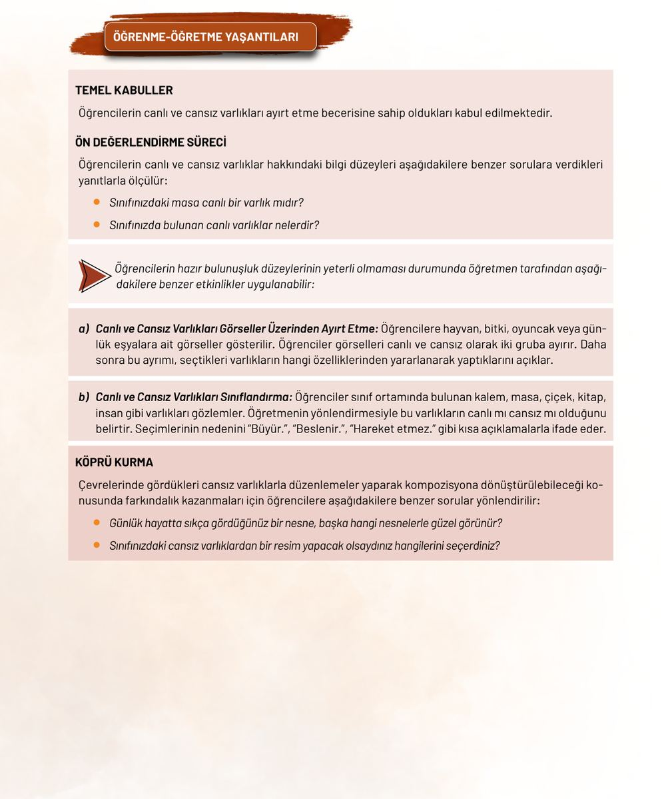

Öğrencilerin hazır bulunuşluk düzeylerinin yeterli olmaması durumunda öğretmen tarafından aşağıdakilere benzer etkinlikler uygulanabilir:

**a) Canlı ve Cansız Varlıkları Görseller Üzerinden Ayırt Etme:** Öğrencilere hayvan, bitki, oyuncak veya günlük eşyalara ait görseller gösterilir. Öğrenciler görselleri canlı ve cansız olarak iki gruba ayırır. Daha sonra bu ayrımı, seçtikleri varlıkların hangi özelliklerinden yararlanarak yaptıklarını açıklar.

**b) Canlı ve Cansız Varlıkları Sınıflandırma:** Öğrenciler sınıf ortamında bulunan kalem, masa, çiçek, kitap, insan gibi varlıkları gözlemler. Öğretmenin yönlendirmesiyle bu varlıkların canlı mı cansız mı olduğunu belirtir. Seçimlerinin nedenini “Büyür.”, “Beslenir.”, “Hareket etmez.” gibi kısa açıklamalarla ifade eder.

**KÖPRÜ KURMA**
Çevrelerinde gördükleri cansız varlıklarla düzenlemeler yaparak kompozisyona dönüştürülebileceği konusunda farkındalık kazanmaları için öğrencilere aşağıdakilere benzer sorular yönlendirilir:

* Günlük hayatta sıkça gördüğünüz bir nesne, başka hangi nesnelerle güzel görünür?
* Sınıfınızdaki cansız varlıklardan bir resim yapacak olsaydınız hangilerini seçerdiniz?

<!-- sayfa 49 -->

# ÖĞRENME-ÖĞRETME UYGULAMALARI

## Önerilen Planlama

1. Ders Saati $\longrightarrow$ Natürmort temalı sanat eserlerini inceleme ve eserdeki nesneleri tanıma
2. Ders Saati $\longrightarrow$ Sanat eserlerindeki renk ve biçim özelliklerini inceleme
3. Ders Saati $\longrightarrow$ Nesnelerle natürmort düzenleme ve taslağını hazırlama
4. Ders Saati $\longrightarrow$ Ana ve ara renkleri kullanarak natürmort oluşturma
5. Ders Saati $\longrightarrow$ Çalışmaları tamamlama, paylaşma ve değerlendirme

## Uygulama Öncesi

### ESER İNCELEME

### Natürmort Eserlerini Tanıma ve İnceleme

Öğrenciler derste çağdaş Türk resim sanatında natürmort temalı eserleri inceler. Derse natürmort temalı eser görselleri gösterilerek başlanır. Öğrencilere natürmortun günlük yaşamda kullanılan meyve, çiçek, vazo, şişe gibi nesnelerin bir araya getirilerek oluşturulduğu açıklanır. Bu amaçla Feyhaman Duran’ın “Portakallı Natürmort” ve “Bakırlı Natürmort”, Hasan Vecih Bereketoğlu’nun “Meyveler”, Mahmut Cuda’nın “Kedili ve Elmalı Natürmort” isimli eserleri gösterilebilir (**OB2, OB4, OB5, OB9**).

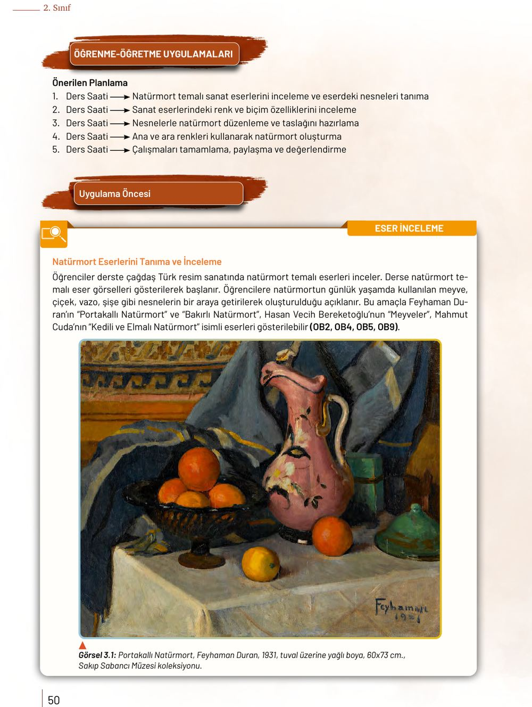

**Görsel 3.1:** Portakallı Natürmort, Feyhaman Duran, 1931, tuval üzerine yağlı boya, $60\times73$ <!-- KONTROL: Marker'da karşılığı yok, uydurma olabilir --> cm.,

<!-- sayfa 50 -->

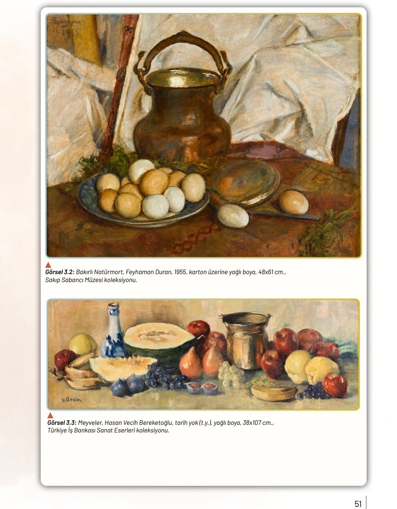

**Görsel 3.2:** *Bakırlı Natürmort*, Feyhaman Duran, 1955, karton üzerine yağlı boya, 48x61 cm., Sakıp Sabancı Müzesi koleksiyonu.

**Görsel 3.3:** *Meyveler*, Hasan Vecih Bereketoğlu, tarih yok (t.y.), yağlı boya, 38x107 cm., Türkiye İş Bankası Sanat Eserleri koleksiyonu.

<!-- sayfa 51 -->

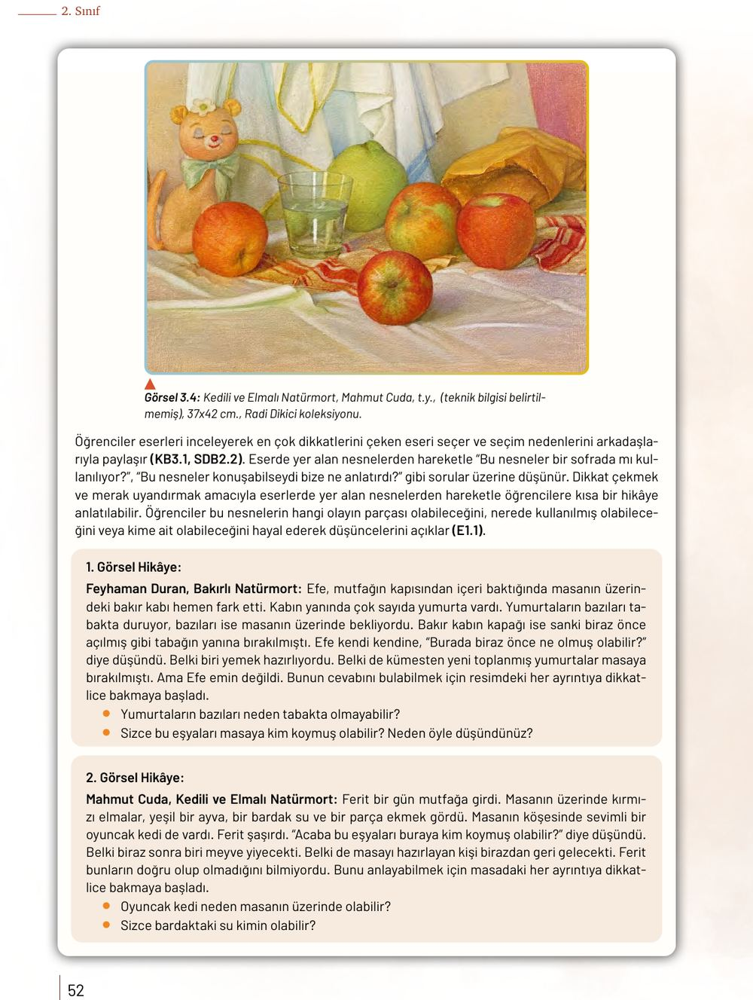

▲ **Görsel 3.4:** Kedili ve Elmalı Natürmort, Mahmut Cuda, t.y., *(teknik bilgisi belirtilmemiş)*, 37x42 cm., Radi Dikici koleksiyonu.

Öğrenciler eserleri inceleyerek en çok dikkatlerini çeken eseri seçer ve seçim nedenlerini arkadaşlarıyla paylaşır (KB3.1, SDB2.2). Eserde yer alan nesnelerden hareketle “Bu nesneler bir sofrada mı kullanılıyor?”, “Bu nesneler konuşabilseydi bize ne anlatırdı?” gibi sorular üzerine düşünür. Dikkat çekmek ve merak uyandırmak amacıyla eserlerde yer alan nesnelerden hareketle öğrencilere kısa bir hikâye anlatılabilir. Öğrenciler bu nesnelerin hangi olayın parçası olabileceğini, nerede kullanılmış olabileceğini veya kime ait olabileceğini hayal ederek düşüncelerini açıklar (E1.1).

**1. Görsel Hikâye:**

**Feyhaman Duran, Bakırlı Natürmort:** Efe, mutfağın kapısından içeri baktığında masanın üzerindeki bakır kabı hemen fark etti. Kabın yanında çok sayıda yumurta vardı. Yumurtaların bazıları tabakta duruyor, bazıları ise masanın üzerinde bekliyordu. Bakır kabın kapağı ise sanki biraz önce açılmış gibi tabağın yanına bırakılmıştı. Efe kendi kendine, “Burada biraz önce ne olmuş olabilir?” diye düşündü. Belki biri yemek hazırlıyordu. Belki de kümesten yeni toplanmış yumurtalar masaya bırakılmıştı. Ama Efe emin değildi. Bunun cevabını bulabilmek için resimdeki her ayrıntıya dikkatlice bakmaya başladı.

* Yumurtaların bazıları neden tabakta olmayabilir?
* Sizce bu eşyaları masaya kim koymuş olabilir? Neden öyle düşündünüz?

**2. Görsel Hikâye:**

**Mahmut Cuda, Kedili ve Elmalı Natürmort:** Ferit bir gün mutfağa girdi. Masanın üzerinde kırmızı elmalar, yeşil bir ayva, bir bardak su ve bir parça ekmek gördü. Masanın köşesinde sevimli bir oyuncak kedi de vardı. Ferit şaşırdı. “Acaba bu eşyaları buraya kim koymuş olabilir?” diye düşündü. Belki biraz sonra biri meyve yiyecekti. Belki de masayı hazırlayan kişi birazdan geri gelecekti. Ferit bunların doğru olup olmadığını bilmiyordu. Bunu anlayabilmek için masadaki her ayrıntıya dikkatlice bakmaya başladı.

* Oyuncak kedi neden masanın üzerinde olabilir?
* Sizce bardaktaki su kimin olabilir?

<!-- sayfa 52 -->

# Natürmort Temalı Eseri Sanatsal Açıdan Betimleme

Öğrenciler eserde gördükleri nesneleri söyler. Nesneleri doğal-yapay özelliklerine göre tüm sınıfın katılımıyla ayrıştırarak inceler (**KB2.5, SDB2.2**). Öğrencilerin eserde yer alan varlıkları sınıflandırmasına yardımcı olmak için Tablo 3.1’den faydalanılabilir. Resmin boya kalemi, sulu boya veya farklı bir boya tekniğiyle yapılmış olabileceğini tahmin eder ve düşüncelerini nedenleriyle açıklar (**KB2.10, SDB3.3**). Bu aşamada konuşma halkası tekniği kullanılabilir.

**Tablo 3.1: Natürmort Temalı Sanat Eserlerindeki Doğal ve Yapay Varlık Örnekleri**

| | | | | |
| :---: | :---: | :---: | :---: | :---: |
| ![Pot] | ![Glass] | ![Apples] | ![Melon] | ![Paper] |
| ![Bananas] | ![Cloth] | ![Box] | ![Copper pot] | ![Figs] |
| ![Eggs] | ![Cat toy] | ![Grapes] | ![Pitcher] | ![Lid] |
| ![Bowl] | ![Oranges] | ![Vase] | ![Lemons] | ![Fabric] |

Resim, heykel ve fotoğraf örnekleri karşılaştırılır. Öğrenciler inceledikleri eserin hangi sanat dalına ait olduğunu diğer örneklere bakarak belirler ve seçimlerinin nedenini açıklar (**KB3.1, SAB1.2**).

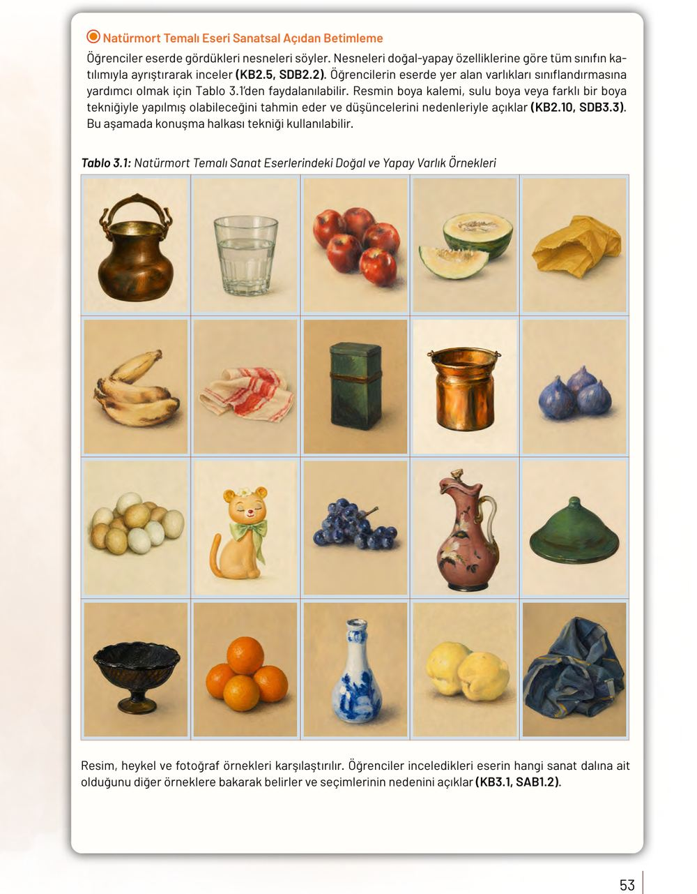
<!-- yer tutucu bulunamadı: sayfa sonuna eklendi -->

<!-- sayfa 53 -->

# Natürmort Temalı Eseri Sanatsal Açıdan Çözümleme

Öğrencilerin dikkatleri eserdeki renk ve biçimlere yönlendirilir. Öğrenciler eserdeki ana ve ara renkleri bulur. Yuvarlak ve köşeli biçimleri belirler, benzer ve farklı biçimleri karşılaştırır (**(KB2.5)**). Tekrar eden renkleri ve biçimleri inceler. Büyük-küçük, uzun-kısa veya farklı yönlerde kullanılan nesnelerin resimde oluşturduğu farklılıkları keşfeder **(KB2.8)**. Öğrencilerin dikkati elma ile üzüm taneleri arasındaki boyut, vazo ile bardak arasındaki yükseklik, portakal ile yeşil kutu arasındaki biçim farklılığına yönlendirilir.

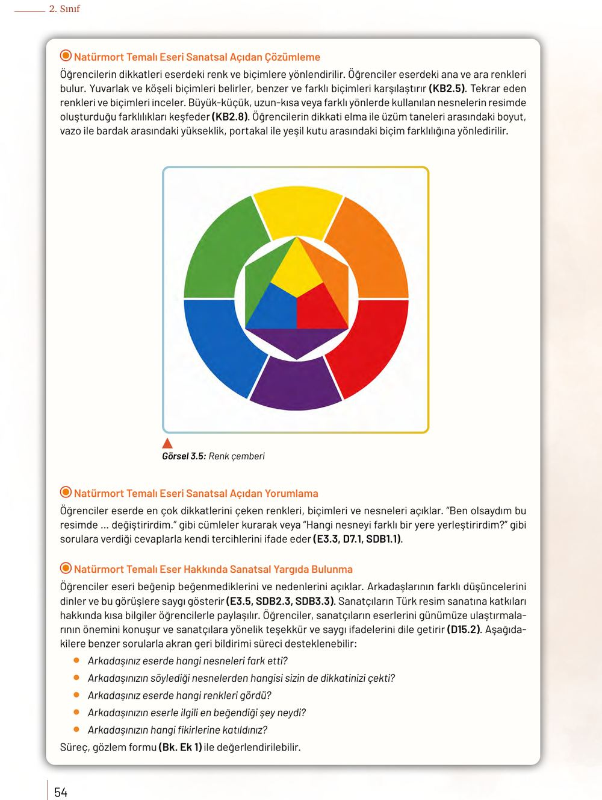
*Görsel 3.5: Renk çemberi*

# Natürmort Temalı Eseri Sanatsal Açıdan Yorumlama

Öğrenciler eserde en çok dikkatlerini çeken renkleri, biçimleri ve nesneleri açıklar. “Ben olsaydım bu resimde ... değiştirirdim.” gibi cümleler kurarak veya “Hangi nesneyi farklı bir yere yerleştirirdim?” gibi sorulara verdiği cevaplarla kendi tercihlerini ifade eder **(E3.3, D7.1, SDB1.1)**.

# Natürmort Temalı Eser Hakkında Sanatsal Yargıda Bulunma

Öğrenciler eseri beğenip beğenmediklerini ve nedenlerini açıklar. Arkadaşlarının farklı düşüncelerini dinler ve bu görüşlere saygı gösterir **(E3.5, SDB2.3, SDB3.3)**. Sanatçıların Türk resim sanatına katkıları hakkında kısa bilgiler öğrencilerle paylaşılır. Öğrenciler, sanatçıların eserlerini günümüze ulaştırmalarının önemini konuşur ve sanatçılara yönelik teşekkür ve saygı ifadelerini dile getirir **(D15.2)**. Aşağıdakilere benzer sorularla akran geri bildirimi süreci desteklenebilir:

* Arkadaşınız eserde hangi nesneleri fark etti?
* Arkadaşınızın söylediği nesnelerden hangisi sizin de dikkatinizi çekti?
* Arkadaşınız eserde hangi renkleri gördü?
* Arkadaşınızın eserle ilgili en beğendiği şey neydi?
* Arkadaşınızın hangi fikirlerine katıldınız?

Süreç, gözlem formu (**Bk. Ek 1**) ile değerlendirilebilir.

<!-- sayfa 54 -->

Uygulama Sırası

# ETKİNLİK
## Renkli Natürmort Oluşturma

Öğrenciler bardak, şişe, vazo, çiçek, meyve, sebze veya oyuncak gibi günlük yaşam nesneleri arasından seçim yapar. Seçtikleri nesneleri masanın üzerine, farklı şekillerde yerleştirerek kendi natürmort düzenlemelerini oluşturur (**SDB1.2**). Nesnelerin büyük-küçük, uzun-kısa, yuvarlak-köşeli gibi biçim özelliklerini ve renklerini dikkatle gözlemler (**KB2.2**). Nesneler arasındaki biçim ve renk farklılıklarını belirleyerek resimlerine nasıl yerleştireceklerini planlar. Öğrenciler hazırladıkları düzenlemeyi resim kâğıdına aktarır. Pastel boya, sulu boya veya kuru boya kalemlerinden istedikleri malzemeyi seçer (**SDB1.2**). Öğrenciler çalışmaya nesnelerin dış sınırlarını belirleyen ana çizgilerle başlar. Örneğin bir elmanın yuvarlak şekli, bir bardağın dikey kenarları veya bir şişenin genel dış biçimi önce ana hatlarıyla çizilir. Daha sonra iç detaylar ve renk uygulamalarına geçilir. İstenirse bu çizgilerin sanat dilindeki karşılığının “kontur” olduğu öğrencilere açıklanabilir (**OB9**). Daha sonra öğrenciler, nesneleri ana ve ara renkleri kullanarak renklendirir. Çalışmalarında renk, biçim, tekrar ve zıtlık ilişkilerini görünür hâle getirmeye çalışır. Çalışmasını sabırla tamamlar ve malzemelerini dikkatli kullanır (**E1.3, D12.3, D17.3**).

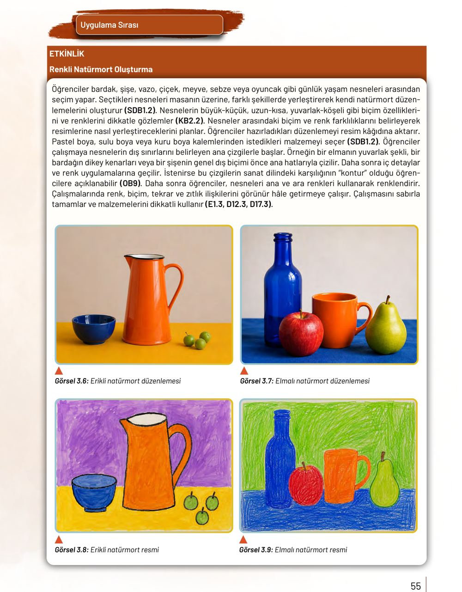
**Görsel 3.6:** Erikli natürmort düzenlemesi

**Görsel 3.7:** Elmalı natürmort düzenlemesi

**Görsel 3.8:** Erikli natürmort resmi

**Görsel 3.9:** Elmalı natürmort resmi

<!-- sayfa 55 -->

# BİLGİLENDİRME

## Kontur ve Konturlama
Sanatta bir nesnenin dış sınırlarını gösteren çizgilere kontur adı verilir. Konturlama ise bir nesnenin dış hatlarını çizgilerle belirgin hâle getirme işlemidir. Örneğin bir ağacın gövdesinin, bir yaprağın kenarlarının veya bir evin dış hatlarının çizilmesi konturlamaya örnektir **(Bk. Görsel 3.8)**. Çocukların çizim çalışmalarında genellikle ilk aşamada nesnelerin genel biçimleri kontur çizgileriyle belirlenir. Daha sonra bu çizimlere ayrıntılar eklenerek çalışma geliştirilir.

# REHBERLİK

Öğrencilerin çizime başlamadan önce nesneleri kâğıda uygun büyüklükte yerleştirmelerine rehberlik edilir.

**Görsel 3.10:** Nesnelerin kâğıt içinde çok küçük, çok büyük ve uygun yerleşim örnekleri

# Çalışmanın Tamamlanması ve Paylaşımı

Çalışmalar tamamlandıktan sonra öğrenciler çalışmalarını sınıfla paylaşır. Etkinlik sonunda çalışma alanlarını arkadaşlarıyla temizler ve düzenler **(D18.2, SDB2.2)**. Tamamlanan çalışmalar sınıfta, okul panosunda veya dijital ortamda sergilenir.

<!-- sayfa 56 -->

# Değerlendirme

Hazırlanan çalışmalar performans görevi olarak ele alınır. Öğrenciler çalışmalarında kullandıkları renkleri, seçtikleri nesneleri ve oluşturdukları düzeni arkadaşlarıyla paylaşır. Arkadaşlarının çalışmalarındaki farklı özellikleri inceler ve beğendiği yönleri olumlu ifadelerle belirtir (**D14.1, SDB2.3**). Süreç ve ürünle ilgili farkındalık kazanmaları için öğrencilere aşağıdakilere benzer öz değerlendirme soruları sorulabilir:

* Çalışmanızda ana ve ara renkleri kullandınız mı?
* Resminizde farklı büyüklükte veya farklı şekilde nesnelere yer verdiniz mi?
* Çalışmanızda en çok hangi bölümü beğendiniz?

Değerlendirme sürecinde kontrol listesinden (**Bk. Ek 2**) faydalanılabilir.

# FARKLILAŞTIRMA

## Zenginleştirme

⚠️ Öğrenciler aşağıdaki etkinliklerden birine yönlendirilebilir.

### Etkinlik 1: Natürmort Düzenlemesini Üç Boyutlu Modelleme

Öğrenciler hazırladıkları natürmort düzenlemesindeki meyve, vazo, şişe veya benzeri nesneleri inceleyerek oyun hamuru veya kil ile yeniden oluşturur. Çalışmaya başlamadan önce hangi nesneyi nasıl şekillendireceğine karar verir. Yuvarlama, bastırma ve birleştirme hareketleriyle nesnelerin temel şekillerini oluşturur. İsteyen öğrenciler çalışmalarına renkli oyun hamurları kullanarak ayrıntılar ekleyebilir veya kuruyan kil çalışmalarını renklendirebilir. Çalışmanın sonunda oluşturduğu üç boyutlu model ile gerçek nesneleri karşılaştırarak benzer ve farklı yönlerini açıklar.

Görsel 3.11: Oyun hamuruyla modellenmiş nesneler

<!-- sayfa 57 -->

# Etkinlik 2: Aynı Natürmortu Farklı Açılardan Çizme

Öğrenciler aynı natürmort düzenlemesine sınıfın farklı noktalarından bakarak nesnelerin görünüşündeki değişiklikleri inceler. Çizime başlamadan önce nesnelerin resim kâğıdı üzerinde nerede yer alacağını belirler. Grafit kalemle yaptığı taslak çizimin ardından renkli kuru boya, pastel boya veya sulu boya kullanarak çalışmasını tamamlar. Çalışmalarını karşılaştırarak aynı nesnelerin farklı yerlerden bakıldığında nasıl göründüğünü açıklar.

**Görsel 3.12:** Farklı bir açıdan oluşturulmuş natürmort düzenlemesi

**Görsel 3.13:** Farklı bir açıdan yapılmış natürmort resmi

<!-- sayfa 58 -->

# Destekleme

⚠️ Öğrenciler aşağıdaki etkinliklerden birine yönlendirilebilir.

## Etkinlik 1: Az Sayıda Nesneyle Natürmort Oluşturma

Öğrenciler elma, bardak, oyuncak veya benzeri iki nesneyi bir araya getirerek natürmort düzenlemesi oluşturur. Nesneleri farklı biçimlerde yerleştirerek hangi düzenlemenin daha uygun olduğuna karar verir. Ardından resim kâğıdı üzerine grafit kalemle nesneleri çizer. Çalışmasını pastel boya, sulu boya veya renkli kuru boya kalemleriyle tamamlar. Çalışmasını arkadaşlarıyla paylaşarak açıklar.

**Görsel 3.14:** Üç nesneyle oluşturulmuş natürmort düzenlemesi

**Görsel 3.15:** Üç nesneli natürmort resmi

<!-- sayfa 59 -->

# Etkinlik 2: Hazır Biçimlerle Natürmort Kolajı Oluşturma

Öğrenciler elma, armut, portakal gibi meyve biçimlerinde hazırlanmış renkli karton parçalarını fon kartonu üzerinde farklı şekillerde yerleştirerek bir düzenleme oluşturur. Yapıştırmadan önce parçaların yerlerini değiştirerek kendileri için en uygun düzenlemeyi belirler. Daha sonra parçaları yapıştırır ve isterse zemine masa, örtü veya arka plan ayrıntıları ekler. Çalışmasını arkadaşıyla paylaşarak açıklar.

**Görsel 3.16:** *Natürmort kolajı*

**Görsel 3.17:** *Natürmort kolajı*

<!-- sayfa 60 -->

**EK 1. GÖZLEM FORMU** ____________________________________________________________________

Bu gözlem formu öğrencilerin öğrenme sürecindeki davranışlarını, katılım düzeylerini ve gelişim alanlarını izlemek amacıyla hazırlanmıştır. Elde edilen bulguları, öğrencilere yapıcı geri bildirim vermek ve öğretim sürecini geliştirmek amacıyla kullanınız.

# GÖZLEM FORMU

Bu form öğrenci performanslarını değerlendirmeniz amacıyla hazırlanmıştır. Listedeki her maddeyi inceleyerek öğrencinize en uygun olan seçeneği işaretleyiniz. “Hiç uygun değil” ve “Biraz uygun” olarak işaretlediğiniz öğrenci davranışlarını geliştirmeye çalışınız.

Etkinlik Adı :
Adı-Soyadı : _________________________________________________
Sınıfı-Numarası : ________ / ________________
Tarih : ........ / ........ / 20......

| No | Ölçütler | Hiç uygun değil | Biraz uygun | Büyük ölçüde uygun | Tamamen uygun |
|---|---|---|---|---|---|
| 1 | Eserde gördüğü nesnelerin isimlerini söyledi. | | | | |
| 2 | Eserdeki nesneleri özelliklerine göre gruplandırdı. | | | | |
| 3 | Eserdeki ana renkleri belirledi. | | | | |
| 4 | Eserdeki ara renkleri belirledi. | | | | |
| 5 | Eserdeki farklı biçimleri karşılaştırdı. | | | | |
| 6 | Eser hakkındaki beğenisini gerekçesiyle açıkladı. | | | | |

**Öğretmen Görüşleri / Açıklamalar:** ..............................................................................................................
......................................................................................................................................................................
......................................................................................................................................................................
......................................................................................................................................................................
.....................................................................................................................................................................

“Gözlem Formu”na karekod üzerinden erişebilirsiniz.

<!-- sayfa 61 -->

# EK 2. KONTROL LİSTESİ

Bu kontrol listesi öğrencilerden beklenen becerilerin belirlenen ölçütler doğrultusunda gerçekleşme düzeyini değerlendirmek amacıyla hazırlanmıştır. Değerlendirme sürecini puanlamadan, öğrencinin bireysel gelişimi dikkate alarak ve süreç odaklı bir yaklaşımla yürütünüz.

## KONTROL LİSTESİ

Bu form öğrenci performanslarını değerlendirmeniz amacıyla hazırlanmıştır. Listedeki her maddeyi inceleyerek öğrencinize uygun olan “Evet” veya “Hayır” seçeneklerinden birini işaretleyiniz. “Hayır” olarak işaretlediğiniz öğrenci davranışlarını geliştirmeye çalışınız.

Etkinlik Adı :
Adı-Soyadı : _________________________________________________
Sınıfı-Numarası : ________ / ____________
Tarih : ....... / ....... / 20......

| No | Ölçütler | Hayır | Evet |
|---|---|---|---|
| 1 | Natürmort düzenlemesinde farklı nesnelere yer verdi. | | |
| 2 | Nesnelerin ana hatlarını belirleyerek çizimini oluşturdu. | | |
| 3 | Çalışmasında ana renkleri kullandı. | | |
| 4 | Çalışmasında ara renkleri kullandı. | | |
| 5 | Farklı biçimlerdeki nesneleri bir arada kullandı. | | |
| 6 | Çalışmasını özenli bir şekilde tamamladı. | | |

**Öğretmen Görüşleri / Açıklamalar:** ..............................................................................................................
......................................................................................................................................................................
......................................................................................................................................................................
......................................................................................................................................................................
.....................................................................................................................................................................

 “Kontrol Listesi”ne karekod üzerinden erişebilirsiniz.

<!-- sayfa 62 -->

2. Sınıf

# 4. TEMA

# ÇİZİM VE GÖRSEL İFADE

Tema içeriğine
karekod üzerinden

<!-- sayfa 63 -->

| TEMA ADI | Çizim ve Görsel İfade |
| :--- | :--- |
| **SINIF DÜZEYİ** | 2 |
| **TEMA KAPSAMI** | Öğrencilerin farklı çizgi türlerini kullanarak doğa peyzajı oluşturmaları amaçlanmaktadır. |
| **DERS SAATİ** | 5 |
| **ALAN BECERİLERİ** | SAB4. Sanatsal Üretim Yapma |
| **KAVRAMSAL BECERİLER** | - |
| **EĞİLİMLER** | E1.2. Bağımsızlık, E3.3. Yaratıcılık, E3.5. Açık Fikirlilik |

| PROGRAMLAR ARASI BİLEŞENLER | |
| :--- | :--- |
| **SOSYAL-DUYGUSAL ÖĞRENME BECERİLERİ** | SDB1.2. Kendini Düzenleme (Öz Düzenleme), SDB1.3. Kendine Uyarlama (Öz Yansıtma), SDB3.1. Uyum, SDB3.3. Sorumlu Karar Verme |
| **DEĞERLER** | D10. Mütevazılık, D11. Özgürlük, D16. Sorumluluk, D18. Temizlik |
| **OKURYAZARLIK BECERİLERİ** | OB1. Bilgi Okuryazarlığı, OB4. Görsel Okuryazarlık, OB9. Sanat Okuryazarlığı |
| **DİSİPLİNLER ARASI İLİŞKİLER** | Türkçe |
| **BECERİLER ARASI İLİŞKİLER** | - |

| ÖĞRENME ÇIKTILARI VE SÜREÇ BİLEŞENLERİ | |
| :--- | :--- |
| **GS.2.4.1. Farklı çizgi türlerini kullanarak doğa peyzajı yapabilme** | a) Farklı çizgi türlerinden oluşan doğa peyzajı tasarlar. b) Farklı çizgi türlerini bir araya getirerek doğa peyzajı oluşturur. |
| **İÇERİK ÇERÇEVESİ** | Farklı Çizgi Türleriyle Doğa Peyzajı |
| **ANAHTAR KAVRAMLAR** | doğa peyzajı, grafit kalem |
| **ÖĞRENME KANITLARI (ÖLÇME VE DEĞERLENDİRME)** | Öğrenme çıktıları; dereceli puanlama anahtarları ve öz değerlendirme formları kullanılarak değerlendirilebilir. Sınıf içi performans görevi olarak öğrencilerden farklı çizgi türleriyle gözlemlerine ve hayal güçlerine dayalı doğa peyzajı oluşturmaları istenir. Ürünlerinde siyah, beyaz ve gri yağlı pastel boyalar veya grafit kalemler kullanarak doğadaki unsurlarla ilişkili çizgi karakterlerini seçmeleri beklenir. |

<!-- yer tutucu bulunamadı: sayfa sonuna eklendi -->

<!-- sayfa 64 -->

# TEMA AKIŞI

* Doğadaki Çizgi Örneklerini İnceleme
* Çizgilerle Oluşturulmuş Peyzajları İnceleme
* Doğa Peyzajı Tasarlama
* Farklı Çizgi Türleriyle Doğa Peyzajı Oluşturma
* Değerlendirme
* Sergileme
* Farklılaştırma

# ÖĞRETMEN HAZIRLIĞI

Ders öncesinde peyzaj kavramı gözden geçirilir. Hazırlık kapsamında farklı çizgi türlerini gösteren örnek çalışmaların ve doğa peyzajı görsellerinin bulundurulması önerilir.

* Temada doğadaki çizgi örnekleri, çizgilerle oluşturulmuş doğa peyzajları ve sanatçı çizimleri yer almaktadır. Hoca Ali Rıza ve Vincent van Gogh’un (Vinsınt Van Goh) çizgi ağırlıklı eserleri süreç boyunca kullanılabilir. İstenirse sınıfın ihtiyaçlarına göre farklı sanatçıların eserleri ve doğa görselleriyle içerik zenginleştirilebilir.
* İstasyon çalışmalarında kullanılabilecek örnek çizimler ve çizgi alıştırmaları da önceden incelenebilir.

**NOT**

Bu temada yer alan uygulamalar ve görseller, öğretmene yol göstermek amacıyla hazırlanmıştır. Etkinlikler, öğrenme çıktılarının genel yapısını korumak kaydıyla sınıfın ihtiyaçlarına göre uyarlanabilir.

<!-- yer tutucu bulunamadı: sayfa sonuna eklendi -->

<!-- sayfa 65 -->

# ÖĞRENCİ HAZIRLIĞI VE ETKİNLİK MALZEMELERİ

Uygulamada kullanılacak malzemeler öğrencilerle önceden paylaşılır. Bu temada farklı çizgi türleriyle doğa peyzajı oluşturma çalışmaları bulunduğu için malzemeler çizim etkinliklerine uygun şekilde hazırlanır.

**Ortak Malzemeler**

* Resim defteri veya çizim kâğıdı
* Grafit kalem
* Siyah, beyaz ve gri yağlı pastel boya (isteğe bağlı)
* Silgi
* Kalemtıraş

<!-- sayfa 66 -->

# ÖĞRENME-ÖĞRETME YAŞANTILARI

**TEMEL KABULLER**

Öğrencilerin, doğadaki nesnelerin sahip olduğu geometrik biçimleri ve çizgi yapıları algılayabildikleri kabul edilmektedir.

**ÖN DEĞERLENDİRME SÜRECİ**

Doğadaki nesnelerin sahip olduğu geometrik biçimlere ve bu biçimlere bağlı çizgi yapılarına ilişkin ön bilgilerini ölçmek için öğrencilere aşağıdakilere benzer sorular sorulur:

* Bir derenin akışını göstermek için dalgalı, düz veya başka hangi tür çizgiyi kullanırdınız?
* Bir ağaç dalını çizerken düz çizgiler mi yoksa eğri çizgiler mi tercih edersiniz?

Öğrencilerin hazır bulunuşluk düzeylerinin yeterli olmaması durumunda öğretmen tarafından aşağıdakilere benzer etkinlikler uygulanabilir:

**a) Doğadaki Biçimleri Fark Etme:** Öğrencilere ağaç, güneş, çiçek, dağ ve taş görselleri gösterilir. Öğrenciler bu nesnelerin hangi geometrik biçimlere benzediğini söyler. Örneğin güneş-çember, dağ-üçgen, ağaç gövdesi-dikdörtgen gibi örnekler üzerinde durulur.

**b) Doğadaki Çizgileri Bulma:** Tahtaya veya ekrana ağaç, dağ, nehir, bulut ve çiçek görselleri yansıtılır. Öğrenciler görsellerde gördükleri düz, eğri, dalgalı veya zikzak çizgileri gösterir. Her çizginin doğada nerelerde bulunduğu sınıfça belirlenir.

**KÖPRÜ KURMA**

Öğrencilere doğadaki nesnelerin yapısal farklılıklarına göre çizgisel anlatımın değişiklik gösterebileceğini fark etmeleri için aşağıdakilere benzer sorular yönlendirilir:

* Doğada neden farklı türden çizgiler bulunmaktadır?
* Bir bulutu veya bir ağacın gövdesini çizerken farklı çizgiler kullanmanızın nedeni ne olabilir?

<!-- sayfa 67 -->

# ÖĞRENME-ÖĞRETME UYGULAMALARI

## Önerilen Planlama

1. Ders Saati $\longrightarrow$ Doğadaki çizgi türlerini inceleme ve çizgi istasyonlarında uygulamalar yapma
2. Ders Saati $\longrightarrow$ Çizgilerle oluşturulmuş sanat eserlerini inceleme ve doğa peyzajı için fikir geliştirme
3. Ders Saati $\longrightarrow$ Farklı çizgi türleriyle doğa peyzajı yapma
4. Ders Saati $\longrightarrow$ Doğa peyzajına farklı çizgi türleriyle ayrıntılar ekleme
5. Ders Saati $\longrightarrow$ Çalışmaları tamamlama, paylaşma ve değerlendirme

## Uygulama Sırası

### GÖRSEL İNCELEME

**Doğadaki Çizgileri Fark Etme**

Öğrencilerin farklı çizgi türlerini kullanarak doğa peyzajı yapabilmeleri beklenir. Derse doğa manzaralarının incelenmesiyle başlanır. Dağ, ağaç, nehir, bulut ve çiçeklerin yer aldığı fotoğraflar sınıfa gösterilir **(OB4)**. Öğrencilerden görsellerde hangi çizgileri gördüklerini söylemeleri istenir. Dağların zikzak çizgilere, nehirlerin dalgalı çizgilere, ağaç dallarının eğri çizgilere benzediği üzerine konuşulur.

▲
*Görsel 4.1: İlkbahar manzarası*

▲
*Görsel 4.2: Sonbahar manzarası*

▲
*Görsel 4.3: Kış manzarası*

▲
*Görsel 4.4: Yaz manzarası*

<!-- sayfa 68 -->

**Tablo 4.1:** *Farklı Türdeki Çizgi Kartları*

| İnce ve kalın çizgiler | Düz ve eğri çizgiler | Kesik ve dalgalı çizgiler | Zikzak çizgiler |
| :---: | :---: | :---: | :---: |
|  | | | |

Ardından dört istasyon hazırlanır. Birinci istasyonda ince ve kalın çizgiler, ikinci istasyonda düz ve eğri çizgiler, üçüncü istasyonda kesik ve dalgalı çizgiler, dördüncü istasyonda zikzak çizgiler kullanılır. Öğrenciler her istasyonda kısa çizim çalışmaları yapar. Düz çizgilerle bahçe çitleri, dalgalı ve kesik çizgilerle nehir, eğri çizgilerle ağaç ve zikzak çizgilerle bir dağ çizer (**D16.3, SDB3.1**).

<!-- sayfa 69 -->

ESER İNCELEME

# Çizgilerle Oluşturulmuş Peyzajlar

Hoca Ali Rıza’nın “Sultan Çayırından”, “Paşabahçe’de Sultan Çayırı”, “Evler” ve “Üsküdar’da Nuh Kuyusunda Adalar” isimli eserleri incelenebilir. Ayrıca Vincent van Gogh’un “Ağaçlar, Taş Bank ve Çeşme”, “Çam Ağaçlarıyla Kaplı Montmajour Kayası”, “Oise Nehri Boyunca Ağaçlar” veya “Evlerin Bulunduğu Alan” adlı eserleri arasından seçim yapılarak eser görselleri öğrencilerle paylaşılır (**OB4**). Öğrenciler resimlerde gördükleri çizgileri gösterir. Hangi çizgilerin evleri, ağaçları, yolları veya doğa unsurlarını oluşturduğunu söyler (**OB9**).

▲
**Görsel 4.5:** *Sultan Çayırından*, Hoca Ali Rıza, t.y., karakalem, $16\times25,5$ <!-- KONTROL: Marker'da karşılığı yok, uydurma olabilir --> cm., Ankara Resim ve Heykel Müzesi koleksiyonu.

▲
**Görsel 4.6:** *Ağaçlar, Taş Bank ve Çeşme*, Vincent van Gogh, 1889, karakalem, $9,6\times29,1$ <!-- KONTROL: Marker'da karşılığı yok, uydurma olabilir --> cm., Van Gogh Müzesi koleksiyonu.

▲
**Görsel 4.7:** *Paşabahçe'de Sultan Çayırı*, Hoca Ali Rıza, t.y., karakalem, $12\times20,5$ <!-- KONTROL: Marker'da karşılığı yok, uydurma olabilir --> cm., Ankara Resim ve Heykel Müzesi koleksiyonu.

NOT
Eser inceleme etkinliğinde yer alan eserler arasından bir veya birkaç eser seçilmesi yeterlidir. Tüm

<!-- sayfa 70 -->

**Görsel 4.8:** *Çam Ağaçlarıyla Kaplı Montmajour Kayası*, Vincent van Gogh, 1988, kurşun kalem-tükenmez kalem-kamış kalem-fırça ve mürekkep, 49,1x61 cm., Van Gogh Müzesi koleksiyonu.

**Görsel 4.9:** *Evler*, Hoca Ali Rıza, 1890-1910, kâğıt üzerine karakalem, 12x17 cm., Yapı Kredi Kültür Sanat koleksiyonu.

<!-- sayfa 71 -->

**Görsel 4.10:** *Oise Nehri Boyunca Ağaçlar, Vincent van Gogh, 1890, kâğıt üzerine tebeşir, 23,9x31,2 cm., Van Gogh Müzesi koleksiyonu.*

**Görsel 4.11:** *Üsküdar’da Nuh Kuyusunda Adalar, Hoca Ali Rıza, t.y., karakalem, 22x32 cm., Ankara Resim ve Heykel Müzesi koleksiyonu.*

**Görsel 4.12:** *Evlerin bulunduğu alan, Vincent van Gogh, 1888, kâğıt üzerine kurşun kalem, tükenmez kalem ve kamış kalemle mürekkep, 25,8x34,9 cm., Van Gogh Müzesi koleksiyonu*

<!-- sayfa 72 -->

# ETKİNLİK
## Farklı Çizgi Türleriyle Doğa Peyzajı Yapma

Öğrenciler ağaç, dağ, nehir, çiçek, güneş ve bulut gibi doğa unsurlarından oluşan bir manzara üzerine düşünür (**E3.3**). Çalışmada siyah, beyaz ve gri yağlı pastel boyalar veya grafit kalemler kullanılabilir. Öğrenciler kullanacakları malzemeyi kendileri seçer (**E1.2, D11.2, SDB1.2**). Çizime büyük şekillerle başlanır. Dağlar, ağaçlar ve nehirler yerleştirilir. Daha sonra farklı çizgi türleri kullanılarak ayrıntılar eklenir. İsteyen öğrenciler aynı çizgiyi yan yana veya üst üste kullanarak farklı etkiler oluşturur. Ön tarafta bulunan nesneler biraz daha belirgin, uzakta kalan nesneler daha açık gösterilebilir. Çalışma sırasında öğrencilerin farklı çizgileri bir arada kullanmaları konusunda rehberlik edilir. Gerekli görülen durumlarda geri bildirim verilerek öğrencilerin çalışmalarını geliştirmeleri desteklenir (**SDB1.2**).

*Görsel 4.13: Farklı çizgilerle doğa manzarası*

*Görsel 4.14: Farklı çizgilerle doğa manzarası*

---

# DİNLETİ
Doğayla bağ kurmalarını desteklemek amacıyla öğrencilere kuş sesi, yağmur sesi veya sözsüz müzikler dinletilir

<!-- sayfa 73 -->

# Çalışmanın Tamamlanması ve Paylaşımı

Çalışma tamamlandıktan sonra sınıf birlikte düzenlenir. Düzenli bir çalışma ortamının çalışmayı kolaylaştırdığı ve ortak kullanım alanlarını koruduğu üzerinde durulur (**D18.2**). Tamamlanan çalışmalar sınıfta, okul panosunda veya dijital ortamda sergilenir.

# Değerlendirme

Hazırlanan çalışmalar performans görevi olarak ele alınır. Öğrenciler çalışma sırasında neler yaptıklarını ve neler öğrendiklerini arkadaşlarıyla paylaşır (**E3.5, SDB1.2, SDB1.3**). Süreç ve ürünle ilgili farkındalık kazanmaları için öğrencilere aşağıdakilere benzer öz değerlendirme soruları sorulabilir (**OB1, D10.1, SDB1.3, SDB3.3**):

* Resminizde kırlardaki dağ, ağaç, nehir veya bulut gibi hangi unsurları kullandınız?
* Resminizdeki araçta hangi çizgileri kullandınız?
* Resminizde en çok hangi çizgiyi kullandınız?
* Resminizde en çok hangi bölümü beğendiniz?
* Bir daha çizseniz resminize neler eklemek isterdiniz?

Süreç, dereceli puanlama anahtarı (**Bk. Ek 1**) kullanılarak değerlendirilebilir.

# FARKLILAŞTIRMA

## Zenginleştirme

### Etkinlik: Hava Etkilerini Çizgilerle Resmetme

Öğrenciler hazırladıkları doğa manzarasına rüzgâr, yağmur veya güneş ışığı gibi hava etkileri ekler. Önce manzaralarında hangi hava olayını göstermek istediklerine karar verir. Çalışmada siyah, beyaz ve gri yağlı pastel boyalar veya grafit kalemler kullanılabilir. Öğrenciler kullanacakları malzemeyi kendileri seçer. Rüzgârı eğik ve hareketli, yağmuru aşağı doğru inen kesik veya düz, güneş ışınlarını ise merkezden çevreye yayılan çizgilerle göstermeyi dener. Çizgilerin yönünü, uzunluğunu ve sıklığını değiştirerek hava olayının etkisini belirginleştirir. Çalışma sonunda kullandığı çizgileri gösterir ve bunların hangi hava olayını temsil ettiğini açıklar.

▲ Görsel 4/15: Yağmurlu doğa manzarası çizimi

<!-- sayfa 74 -->

# Destekleme

## Etkinlik: Sevilen Doğa Nesnelerini Çizme

Öğrenciler doğada en sevdikleri üç nesneyi seçer. Ağaç, çiçek, bulut, dağ, güneş veya kuş resmedebilir. Her nesneyi çalışma kâğıdında ayrı bir alana yerleştirir. Çalışmada kullanacağı malzemeyi kendisi seçer. Siyah, beyaz ve gri yağlı pastel boyaları veya grafit kalemleri kullanabilir. Çizime başlamadan önce öğretmen, nesnelerin hangi çizgi türlerinden oluştuğunu öğrencilerle inceler. Öğrencilere ağacın gövdesinde düz ve eğri çizgilerin, bulutta dalgalı çizgilerin, dağda ise zikzak çizgilerin kullanılabileceğini hatırlatılır. Öğrenciler her nesneyi uygun çizgi türlerini kullanarak oluşturur ve çalışmalarını tamamlar. Çalışmanın sonunda her öğrenci kullandığı çizgi türlerini gösterir ve bu çizgileri seçme nedenini açıklar.

**Görsel 4.16:** Ağaç, bulut ve dağ resimleri

<!-- sayfa 75 -->

# EK 1. DERECELİ PUANLAMA ANAHTARI

Bu dereceli puanlama anahtarı öğrencilerden beklenen becerilerin, belirlenen ölçütler doğrultusunda gerçekleşme düzeyini değerlendirmek amacıyla hazırlanmıştır. Ölçek, öğrencilerin güçlü ve zayıf yönlerini belirlemenize yardımcı olacaktır.

## DERECELİ PUANLAMA ANAHTARI

Bu form, etkinlikteki öğrenci davranışlarını değerlendirmeniz amacıyla hazırlanmıştır. Listedeki her maddeyi inceleyerek öğrencinize uygun olan seçeneği işaretleyiniz.

Etkinlik Adı :
Adı-Soyadı : ............................................................
Sınıfı-Numarası : ......... / .........
Tarih : ......... / ......... / 20......

| No | Ölçütler | 1 puan | 2 puan | 3 puan | Puan |
|---|---|---|---|---|---|
| 1 | **Farklı çizgi türlerini kullanma** | Farklı çizgi türlerini kullanmamıştır. | Farklı çizgi türlerini kısmen kullanmıştır. | Farklı çizgi türlerini uygun şekilde kullanmıştır. | |
| 2 | **Doğa peyzajına uygun unsurlara yer verme** | Doğa peyzajına uygun unsurlara yer vermemiştir. | Doğa peyzajına uygun unsurlara kısmen yer vermiştir. | Doğa peyzajına uygun unsurlara yer vermiştir. | |
| 3 | **Çizgileri doğadaki unsurlarla ilişkilendirme** | Çizgileri doğadaki unsurlarla ilişkilendirmemiştir. | Çizgileri doğadaki unsurlarla kısmen ilişkilendirmiştir. | Çizgileri doğadaki unsurlarla uygun şekilde ilişkilendirmiştir. | |
| 4 | **Çizgileri kullanarak doğa peyzajını tamamlama** | Çizgileri kullanarak doğa peyzajını tamamlamamıştır. | Çizgileri kullanarak doğa peyzajını kısmen tamamlamıştır. | Çizgileri kullanarak doğa peyzajını tamamlamıştır. | |
| 5 | **Kullandığı çizgi türlerini sözlü olarak açıklama** | Kullandığı çizgi türlerini sözlü olarak açıklamamıştır. | Kullandığı çizgi türlerini kısmen açıklamıştır. | Kullandığı çizgi türlerini açık ve anlaşılır şekilde açıklamıştır. | |
| | | | | **Toplam Puan\*** | |

Bu formdan alınacak en düşük puan 5 ve en yüksek puan 15'tir.

Öğretmen Görüşleri / Açıklamalar: ...............................................................................................................
......................................................................................................................................................................

 “Dereceli Puanlama Anahtarı”na karekod üzerinden erişebilirsiniz

<!-- sayfa 76 -->

2. Sınıf

# 5. TEMA

# RENK VE ESTETİK

Tema içeriğine 
karekod üzerinden

<!-- sayfa 77 -->

| TEMA ADI | Renk ve Estetik |
| :--- | :--- |
| **SINIF DÜZEYİ** | 2 |
| **TEMA KAPSAMI** | Öğrencilerin ana ve ara renkler ile farklı çizgi türlerini kullanarak binalar ve doğa unsurlarını içeren kent peyzajı oluşturmaları amaçlanmaktadır. |
| **DERS SAATİ** | 5 |
| **ALAN BECERİLERİ** | SAB4. Sanatsal Üretim Yapma |
| **KAVRAMSAL BECERİLER** | - |
| **EĞİLİMLER** | E3.3. Yaratıcılık, E3.5. Açık Fikirlilik |

| PROGRAMLAR ARASI BİLEŞENLER | |
| :--- | :--- |
| **SOSYAL-DUYGUSAL ÖĞRENME BECERİLERİ** | SDB1.1. Kendini Tanıma (Öz Farkındalık), SDB1.2. Kendini Düzenleme (Öz Düzenleme), SDB1.3. Kendine Uyarlama (Öz Yansıtma), SDB2.2. İş Birliği, SDB3.3. Sorumlu Karar Verme |
| **DEĞERLER** | D3. Çalışkanlık, D10. Mütevazılık, D18. Temizlik |
| **OKURYAZARLIK BECERİLERİ** | OB1. Bilgi Okuryazarlığı, OB2. Dijital Okuryazarlık, OB5. Kültür Okuryazarlığı |
| **DİSİPLİNLER ARASI İLİŞKİLER** | Hayat Bilgisi |
| **BECERİLER ARASI İLİŞKİLER** | KB2.7. Karşılaştırma, KB2.11. Gözleme Dayalı Tahmin Etme, KB2.20. Sentezleme |

| ÖĞRENME ÇIKTILARI VE SÜREÇ BİLEŞENLERİ | |
| :--- | :--- |
| **GS.2.5.1. Ana, ara renkleri ve farklı çizgileri kullanarak kent peyzajı yapabilme** | a) Ana, ara renkleri ve farklı çizgileri kullanarak binaları ve doğa unsurlarını içeren kent peyzajı tasarlar. b) Ana, ara renkleri ve farklı çizgi türlerini kullanarak binaları ve doğa unsurlarını içeren kent peyzajı oluşturur. |
| **İÇERİK ÇERÇEVESİ** | Ana, Ara Renkler ve Farklı Çizgi Türleriyle Kent Peyzajı |
| **ANAHTAR KAVRAMLAR** | kent peyzajı, sulu boya |
| **ÖĞRENME KANITLARI (ÖLÇME VE DEĞERLENDİRME)** | Öğrenme çıktıları, dereceli puanlama anahtarları ve öz değerlendirme formları kullanılarak değerlendirilebilir. Sınıf içi performans görevi olarak öğrencilerden ana, ara renkleri ve farklı çizgi türlerini kullanarak binaları, yolları ve ağaçları içeren bir kent peyzajı oluşturmaları istenir. Öğrencilerin çalışmalarında renk geçişlerini ve hayal güçlerini yansıtmaları beklenir. |

<!-- yer tutucu bulunamadı: sayfa sonuna eklendi -->

<!-- sayfa 78 -->

# TEMA AKIŞI

* Kent ve Doğa Unsurlarını Fark Etme
* Kent Peyzajı Örneklerini İnceleme
* Farklı Çizgi Türlerini Keşfetme
* Ana ve Ara Renkleri Deneyimleme
* Hayal Edilen Kent Peyzajına İlişkin Tasarım Geliştirme
* Ana ve Ara Renkler ile Farklı Çizgi Türleriyle Kent Peyzajı Oluşturma
* Değerlendirme
* Sergileme
* Farklılaştırma

# ÖĞRETMEN HAZIRLIĞI

Ders öncesinde ana renkler, ara renkler, farklı çizgi türleri ve kent peyzajı (manzarası) kavramları gözden geçirilir. Hazırlık kapsamında aşağıdaki örneklerin ve materyallerin bulundurulması önerilir.

* Temada yer alan kent manzarası temalı sanat eserleri incelenir ve öğrencilere gösterilecek eserler belirlenir.
* Sulu boya uygulamalarında fırçanın kullanımı, renklerin karıştırılması ve su miktarının kullanımı için önceden küçük denemeler yapılabilir.
* Çizgi kartları, isteğe bağlı ortak kent resmi çalışması için büyük kâğıtlar ve farklı doku uygulamalarında kullanılabilecek sünger, pamuk ve tarak gibi araçlar önceden hazırlanır.

! **NOT**
Bu temada yer alan uygulamalar ve görseller, öğretmene yol göstermek amacıyla hazırlanmıştır. Etkinlikler, öğrenme çıktılarının genel yapısını korumak kaydıyla sınıfın ihtiyaçlarına göre uyarlanabilir.

<!-- yer tutucu bulunamadı: sayfa sonuna eklendi -->

<!-- sayfa 79 -->

# ÖĞRENCİ HAZIRLIĞI VE ETKİNLİK MALZEMELERİ

Uygulamada kullanılacak malzemeler öğrencilerle önceden paylaşılır. Bu temada kent resmi oluşturma, renk karıştırma ve farklı araçlarla doku oluşturma çalışmaları bulunduğu için malzemeler etkinlik türüne göre hazırlanır.

### Ortak Malzemeler
* Resim defteri veya resim kâğıdı
* Sulu boya
* Fırça
* Su kabı
* Palet veya boya karıştırma yüzeyi
* Grafit kalem
* Silgi

### Ortak Kent Resmi İçin (İsteğe Bağlı)
* Büyük boy resim kâğıdı
* Marker kalemler veya renkli keçeli kalemler

### Doku Çalışmaları İçin
* Sünger
* Pamuk
* Tarak
* Karton parçaları

<!-- sayfa 80 -->

# ÖĞRENME-ÖĞRETME YAŞANTILARI

**TEMEL KABULLER**

Öğrencilerin doğa peyzajında yer alan unsurlar hakkında temel bilgilere sahip oldukları kabul edilmektedir.

**ÖN DEĞERLENDİRME SÜRECİ**

Doğa peyzajında yer alan unsurlar hakkındaki temel bilgilerini ölçmek için öğrencilere aşağıdakilere benzer kısa cevaplı sorular yönlendirilir:

* Bir doğa manzarasında hangi unsurlar yer almaktadır?
* Doğada gördüğünüz doğal unsurlardan bazılarını söyleyebilir misiniz?
* Doğada gördüğünüz doğal şekillerden bazılarını sayabilir misiniz?

Öğrencilerin hazır bulunuşluk düzeylerinin yeterli olmaması durumunda öğretmen tarafından aşağıdakilere benzer etkinlikler uygulanabilir:

**a) Doğa Unsurlarını Söyleme:** Öğrencilere dağ, ağaç, nehir, çiçek, güneş, bulut ve kuş gibi doğa unsurlarının yer aldığı görseller gösterilir. Öğrenciler görsellerde gördükleri unsurları söyler. Görsellerde yer alan unsurlar “gökyüzünde görülenler”, “yerde görülenler” ve “canlı olanlar” gibi başlıklarla gruplanabilir.

**b) Doğadaki Şekilleri Fark Etme:** Öğrencilere ağaç, dağ, güneş, yaprak ve çiçek görselleri gösterilir. Bu unsurların hangi şekillere benzediği üzerine konuşulur. Güneşin daireye, dağın üçgene, ağaç gövdesinin dikdörtgene benzeyebileceği fark edilir.

**KÖPRÜ KURMA**

Öğrencilere kent peyzajında yer alabilecek unsurlar hakkında fikir geliştirmeleri ve kent peyzajı ile doğa peyzajı arasındaki farkları anlayabilmeleri için aşağıdakilere benzer sorular sorulur:

* Bir kent manzarası çizecek olsaydınız ağaçlar, nehirler ve çiçekler dışında neler çizerdiniz?
* Bir kent manzarasında yollar, köprüler veya parklar çizer miydiniz?
* Kentteki doğa ile kırsaldaki doğa arasındaki farklar neler olabilir?

<!-- sayfa 81 -->

# ÖĞRENME-ÖĞRETME UYGULAMALARI

## Önerilen Planlama
1. Ders Saati $\longrightarrow$ Kentteki unsurları fark etme
2. Ders Saati $\longrightarrow$ Kent manzarası planlama ve çizime başlama
3. Ders Saati $\longrightarrow$ Farklı çizgi türleriyle kent peyzajı yapma
4. Ders Saati $\longrightarrow$ Kent peyzajına farklı çizgi türleriyle ayrıntılar ekleme
5. Ders Saati $\longrightarrow$ Çalışmaları tamamlama, paylaşma ve değerlendirme

## Uygulama Öncesi

### Hikâye ile Kent Peyzajına Hazırlık Çalışması

Öğrencilerde ana, ara renkleri ve farklı çizgi türlerini kullanarak kent peyzajı yapabilmelerine yönelik farkındalık oluşturulur. Derse öğrencilerin ilgisini çekecek kısa bir kent hikâyesiyle başlanır. Hikâyede evlerin, yolların, parkların, ağaçların ve insanların bulunduğu canlı bir kent ortamı anlatılır. Aşağıdaki hikâyelerden biri okunabilir.

#### 1. Hikâye: Renklerini Kaybeden Kent

Bir sabah çocuklar uyandıklarında kentlerinde tuhaf bir şey olduğunu fark etmiş. Evler, yollar ve parklar yerindeymiş ama her şey gri görünüyormuş. Çiçeklerin renkleri kaybolmuş, ağaçlar soluklaşmış, kuş yuvaları bile fark edilmez olmuş. Çocuklar kenti yeniden güzelleştirmeye karar vermiş ve güzelleştirirken herkes farklı bir iş üstlenmiş. Evlerin yanına rengârenk çiçekler çizmişler. Parklara yeni ağaçlar eklemişler. Ağaç dallarına kuş yuvaları yerleştirmişler. Sokaktaki kedilerin yağmurlu günlerde korunabilmesi için küçük kedi evleri hazırlamışlar. Balkonlara renkli balonlar asmışlar, saksılara çiçekler dikmişler. Gün geçtikçe kent yeniden canlanmış. Kuşlar şarkı söylemeye başlamış. Kediler yeni yuvalarında dinlenmiş. Parklar çocukların oyun sesleriyle dolmuş. Birlikte çalıştıkları için kent kısa süre içinde daha güzel bir yere dönüşmüş.

#### 2. Hikâye: Çiçekli Kent

Bir kentte rengârenk evler, geniş yollar ve büyük parklar bulunuyormuş. Evlerin önünde ağaçlar yükseliyor, çiçekler açıyor, kuşlar yuvalarında yaşıyormuş. Parklarda çocuklar oyun oynuyor, bisikletler sürüyor, saklambaç oynuyor, kediler gölgelerde dinleniyormuş. Bir gün kent sakinleri yaşadıkları yeri daha da güzelleştirmeye karar vermiş. Yeni ağaçlar dikmişler. Boş alanlara çiçekler ekmişler. Kuşlar için yuvalar hazırlamışlar. Kediler için küçük evler yapmışlar. Oyun alanlarının çevresini renkli çiçeklerle süslemişler. Çocuklar çöpleri toplayıp parkı temizlemiş. Kısa süre sonra kent daha yeşil, daha renkli ve daha neşeli bir yer hâline gelmiş. Kent sakinleri yeni ağaçlar diktikten sonra onları düzenli olarak sulamış. Çocuklar da çiçeklerin bakımına yardım etmiş. Bir süre sonra açan çiçekleri gören herkes çok mutlu olmuş.

Hikâye tamamlandıktan sonra öğrencilerden gözlerini kapatarak kentlerde neler gördüklerini düşünmeleri istenir. Ardından kentlerde hangi yapıların bulunduğu, yolların nasıl göründüğü ve hangi doğa unsurlarının yer aldığı üzerine konuşulur. Kente başka neler eklenebileceği hakkında fikirler paylaşılır.

<!-- yer tutucu bulunamadı: sayfa sonuna eklendi -->

<!-- sayfa 82 -->

**Hazırlık Etkinliği:**
**Ortak Kent Manzarası Yapma (İsteğe bağlı)**

Büyük bir resim kâğıdı veya birkaç kâğıdın birleştirilmesiyle ortak çalışma yüzeyi oluşturulur. Tahta üzerinde renkli kalemlerle de benzer bir çalışma yapılabilir. Öğrenciler kent manzarasına eklemek istedikleri ev, okul, park, oyun alanı, yol veya ağaç gibi unsurları belirler. Her öğrenci seçtiği bölümü çizerek ortak çalışmaya katkıda bulunur (**KB2.11, SDB2.2**). Çalışma sırasında öğrenciler birbirlerinin çizimlerini inceleyerek yeni ayrıntılar ekleyebilir. Kentte yer alan yapıların ve doğa unsurlarının birlikte kullanılmasına dikkat edilir. Çalışma tamamlandıktan sonra öğrenciler çizdikleri bölümleri arkadaşlarına tanıtır ve çalışmalarına ekledikleri yerleri açıklar (**E3.5, D3.4, SDB1.3**). Ortak çalışma birlikte incelenir. Hikâyede geçen bölümlerin resimde nerelerde yer aldığı konuşulur. İsteyen öğrenciler resme eklenebilecek yeni ayrıntılar hakkında görüşlerini paylaşır (**SDB1.2**).

**Görsel 5.1:** Marker kalemlerle tahta üzerine ortak kent manzarası

**Görsel 5.2:** Marker kalemlerle tahtadaki kâğıtlar üzerine ortak kent manzarası

<!-- sayfa 83 -->

Çalışmalar büyük ölçüde tamamlandıktan sonra öğrenciler kullandıkları çizgileri fark etmeye yönlen-
dirilir. İnce, kalın, düz, eğri, kesik ve serbest çizgilerin yer aldığı çizgi kartları incelenir. Öğrenciler kartlarda 
yer alan çizgilerden hangilerini çalışmalarında kullandıklarını gösterir. Düz çizgilerin bina kenarlarında, 
eğri çizgilerin yollarda veya ağaç dallarında kullanılabileceği üzerine konuşulur. Öğrenciler kullandıkları 
çizgi türlerini çalışmalarındaki bölümlerle ilişkilendirerek açıklar (**OB1, SDB3.3**).

**Tablo 5.1:** Çizgi Kartları

| İnce-düz çizgi | Kalın-düz çizgi | Eğri çizgi | Kesik çizgi | Serbest çizgi |
| :---: | :---: | :---: | :---: | :---: |
|  |  |  |  |  |

![Tablo 5.1: Çizgi Kartları içeriği]

> **! NOT**
> Eser inceleme etkinliğinde yer alan eserler arasından bir veya birkaç eser seçilmesi yeterlidir. Tüm 
> eserlerin incelenmesi beklenmemektedir.

<!-- sayfa 84 -->

# ESER İNCELEME

## Kentlerde Neler Var?

Öğrencilerin ana, ara renkleri ve farklı çizgi türlerini kullanarak kent peyzajı yapabilmeleri amaçlanır. Derse kent manzaralarının incelenmesiyle başlanır. İçerisinde evlerin, yolların, parkların, ağaçların ve insanların bulunduğu kent fotoğrafları veya sanat eserleri sınıfa gösterilir (**OB2, OB5**). Bu amaçla Hoca Ali Rıza’nın “Boğaz İçinde Yokuşlu Yol”, “Sokak (Çengelköy Kuleli Yolu)” ve “Beykoz Çayırında”; Nazmi Ziya Güran’ın “Tophane Nusretiye Cami”; İbrahim Çallı’nın “Türbeler” ve “Emirgan Çay Bahçesi” veya Mehmet Ali Laga’nın “Peyzaj” adlı eserlerinden yararlanılabilir.

**Görsel 5.3:** *Boğaz İçinde Yokuşlu Yol*, Hoca Ali Rıza, t.y., tuval üzerine yağlıboya, 23,5x30 cm., Ankara Resim ve Heykel Müzesi koleksiyonu.

**Görsel 5.4:** *Sokak (Çengelköy Kuleli Yolu)*, Hoca Ali Rıza, t.y., sulu boya,

<!-- sayfa 85 -->

▲
**Görsel 5.5:** *Beykoz Çayırında*, Hoca Ali Rıza, t.y., sulu boya, 24,5x32,5 cm., Ankara Resim ve Heykel Müzesi koleksiyonu.

▲
**Görsel 5.6:** *Tophane Nusretiye Cami*, Nazmi Ziya Güran, 1928, tuval üzerine yağlıboya, 60x73 cm., Ankara Resim ve Heykel Müzesi koleksiyonu.

<!-- sayfa 86 -->

▲
**Görsel 5.7:** *Türbeler, İbrahim Çallı, 1909-1910, tuval üzerine yağlıboya, 81x65 cm., Sakıp Sabancı Müzesi koleksiyonu.*

▲
**Görsel 5.8:** *Emirgan Çay Bahçesi, İbrahim Çallı, t.y., tuval üzerine yağlıboya, 33,5x40cm., Sakıp Sabancı Müzesi koleksiyonu.*

Öğrencilerden görsellerde neler gördüklerini söylemeleri istenir. Evler, yollar, ağaçlar, parklar ve gökyüzü üzerine konuşulur. Kent manzaraları ile doğa (kır) manzaralarında gördükleri unsurlar arasındaki benzerlikler ve farklılıklar üzerinde durulur (**KB2.7**). Görsellerdeki evlerin, binaların ve çatıların hangi şekillere benzediği üzerine konuşulur. Evlerin kare ve dikdörtgene, çatıların üçgene benzeyebileceği

<!-- sayfa 87 -->

**ETKİNLİK**

**Farklı Çizgi Türleriyle Renkli Kent Peyzajı Yapma**

Öğrenciler yaşadıkları mahalleyi veya hayallerindeki şehri düşünür (**E3.3**). Çalışmada sulu boya kullanılır. Ana ve ara renkler öğrencilere kısaca hatırlatılır. İki rengin karıştırılmasıyla yeni renkler elde edilebileceği gösterilir (**SDB1.2**). Çizime büyük şekillerle başlanır. Evler, binalar, yollar ve parklar yerleştirilir. Daha sonra ağaçlar, çiçekler, bulutlar ve diğer ayrıntılar eklenir. Öğrenciler çizimlerinde ince, kalın, düz, eğri, kesik ve serbest çizgilerden yararlanır. Çalışmalar renklendirilirken öğrenciler ana ve ara renkleri kullanır. Evler, yollar, parklar ve ağaçlar farklı renklerle boyanır. Kentte yer alan yapılar ile doğa unsurları aynı resimde bir araya getirilir (**KB2.20**). Çalışmalar tamamlandıktan sonra çizgi kartları gösterilir. Öğrenciler kartlarda gördükleri çizgilerden hangilerini resimlerinde kullandıklarını gösterir. Düz çizgilerin bina kenarlarında, eğri çizgilerin yollarda veya ağaç dallarında görülebileceği üzerine konuşulur. Öğrenciler çalışmalarındaki çizgileri arkadaşlarıyla paylaşır (**OB1, SDB3.3**).

**Görsel 5.9:** Renkli kent manzarası

---

**DİNLETİ**

Uygulama sürecinde kent atmosferini yansıtan sözsüz müziklerden yararlanılır.

---

**Çalışmanın Tamamlanması ve Paylaşımı**

Ders sonunda çalışma alanı birlikte düzenlenir. Temiz ve düzenli çalışmanın önemi üzerinde durulur. Öğrenciler çalışma ortamını iş birliği içinde toplar (**D18.2**). Tamamlanan çalışmalar sınıfta, okul panosunda veya dijital ortamda sergilenir (**OB2**).

<!-- sayfa 88 -->

# Değerlendirme

Hazırlanan çalışmalar performans görevi olarak ele alınır. Çalışmalar tamamlandıktan sonra öğrenciler resimlerine ekledikleri bölümleri arkadaşlarına tanıtır. Süreç ve ürünle ilgili farkındalık kazanmaları için öğrencilere aşağıdakilere benzer öz değerlendirme soruları sorulabilir (**E3.5, D3.4, SDB1.3, SDB3.3, OB1**):

* *Resminizde hangi renkleri kullandınız?*
* *Kentinizde neler yer alıyor?*
* *Çalışmanızda kullandığınız çizgilerden birini gösterebilir misiniz?*
* *Resminize eklemek istediğiniz başka bir bölüm var mı?*
* *Resminizde en çok hangi bölümü beğendiniz?*

Çalışmaların güçlü yönleri ve geliştirilebilecek yönleri üzerine kısa bir sınıf paylaşımı yapılır (**D10.1, SDB1.2**). Öğrenciler süreç boyunca edindikleri deneyimleri arkadaşlarıyla paylaşır (**E3.5, SDB1.1**). Süreç, dereceli puanlama anahtarı (**Bk. Ek 1**) kullanılarak değerlendirilebilir.

# FARKLILAŞTIRMA

## Zenginleştirme

### Etkinlik: Farklı Araçlarla Doku Etkisi Oluşturma

Öğrenciler kent resimlerini tamamladıktan sonra çalışmalarındaki belirli bölümlerde farklı yüzey etkileri oluşturmayı dener. Sünger, pamuk, tarak veya karton parçaları kullanarak çim, bulut, ağaç veya duvar gibi yüzeylerde farklı izler oluşturur. Çalışmada sulu boya kullanır. Çalışma sonunda öğrenciler kullandıkları aracın resimde hangi etkiyi oluşturduğunu arkadaşlarıyla paylaşır.

▲ **Görsel 5.10:** Farklı baskı türleriyle kent manzarası
▲ **Görsel 5.11:** Farklı baskı türleriyle kent manzarası

<!-- sayfa 89 -->

TEKNİK BİLGİ

# Baskı Uygulamaları

Öğrenciler önce boş bir kâğıtta birkaç deneme baskısı yapabilir. Böylece dokuları uygulamalı olarak deneyimleyebilir.

## Sünger Baskı:
Süngerin yüzeyine ince bir kat sulu boya veya guaj boya sürülür ya da sünger boyaya hafifçe bastırılır. Ardından boyalı sünger kâğıda hafifçe bastırılır. Sünger kaldırıldığında yüzeyindeki gözeneklerin oluşturduğu doku ve seçilen şeklin izi kâğıda aktarılarak çeşitli dokular ve görüntüler elde edilebilir. Farklı renkler, sünger biçimleri ve üst üste baskılar kullanılabilir.

**Görsel 5.12:** Sünger baskı örneği

## Pamuk Baskı:
Bir parça pamuk top hâline getirilir ve sulu boya ya da sulandırılmış boya ile hafifçe renklendirilir. Pamuk kâğıda bir süre bastırılır ve kaldırılır. Pamuğun yumuşak ve düzensiz yapısı sayesinde bulutumsu, lekesel ve yumuşak geçişli izler oluşturulur. Farklı renkler ve üst üste baskılar kullanılarak çeşitli doku ve görüntüler elde edilebilir.

<!-- sayfa 90 -->

**Tarak baskı:**
Tarağın diş uçlarına ince bir kat boya sürülür. Tarak kâğıt üzerinde düz şekilde çekildiğinde paralel çizgiler oluşur. Tarak sağa sola hareket ettirilerek çekildiğinde ise zikzaklı ve ritmik desenler elde edilir. Tarağın dişleri sayesinde tekrar eden çizgi dokuları oluşturulur ve bu dokular yol, duvar, çim veya dekoratif yüzeyler oluşturmak için kullanılabilir.

**Görsel 5.14:** *Tarak baskı örneği*

---

**Destekleme**

⚠️ Öğrenciler aşağıdaki etkinliklerden birine yönlendirilebilir.

**Etkinlik 1: Ara Renklerle Kent Kesiti Resmetme**
Öğrenciler ev, ağaç, çiçek veya güneş gibi birkaç kent unsurundan oluşan küçük bir resim çizer. İki ana rengi karıştırarak yeni bir renk elde eder ve resmini bu renklerle boyar. Daha sonra ince, kalın, düz veya eğri çizgiler kullanarak ayrıntılar ekleyebilir. Çalışma sonunda hangi renkleri karıştırdıklarını ve hangi çizgileri kullandıklarını açıklar.

**Görsel 5.15:** *Ara renklerle kent manzarası*

<!-- sayfa 91 -->

# Etkinlik 2: Seçilen Bir Ana ve Ara Renkle Kent Unsurlarını Renklendirme

Renk karışımlarında zorlanan öğrenciler bir ana, bir de ara renk seçer. Kent peyzajında yer alabilecek ağaç, ev, bulut, güneş, çiçek veya kuş gibi unsurlardan seçtiklerini çizer. Çalışmada sulu boya kullanılır. Öğrenciler seçtikleri iki renkle çalışmayı tamamlayabilir. İstenirse rengin farklı tonlarını kullanabilir. Boyayı daha yoğun kullandıkları bölümlerde koyu, daha fazla su kullandıkları bölümlerde açık tonlar elde eder. Örneğin bir ağacın bazı bölümleri daha koyu, bazı bölümleri daha açık boyayabilir. Çalışma sonunda öğrenciler resimlerinde kullandıkları çizgi türlerini ve renkleri açıklar.

**Görsel 5.16:** *Ara renkle kent manzarası*

**Görsel 5.17:** *Ana ve ara renklerle kent manzarası*

<!-- sayfa 92 -->

EK 1. DERECELİ PUANLAMA ANAHTARI __________________________________________________________

Bu dereceli puanlama anahtarı öğrencilerden beklenen becerilerin, belirlenen ölçütler doğrultusunda gerçekleşme düzeyini değerlendirmek amacıyla hazırlanmıştır. Ölçek, öğrencilerin güçlü ve zayıf yönlerini belirlemenize yardımcı olacaktır.

# DERECELİ PUANLAMA ANAHTARI

Bu form, etkinlikteki öğrenci davranışlarını değerlendirmeniz amacıyla hazırlanmıştır. Listedeki her maddeyi inceleyerek öğrencinize en uygun olan seçeneği işaretleyiniz.

Etkinlik Adı :
Adı-Soyadı : ___________________________________________
Sınıfı-Numarası : ________ / ________
Tarih : ........ / ........ / 20......

| No | Ölçütler | 1 puan | 2 puan | 3 puan | Puan |
|---|---|---|---|---|---|
| 1 | **Kent manzarasında binalara yer verme** | Kent manzarasında binalara yer vermemiştir. | Kent manzarasında binalara kısmen yer vermiştir. | Kent manzarasında binalara uygun şekilde yer vermiştir. | |
| 2 | **Kent manzarasında doğal unsurlara yer verme** | Kent manzarasında doğal unsurlara yer vermemiştir. | Kent manzarasında doğal unsurlara kısmen yer vermiştir. | Kent manzarasında doğal unsurlara uygun şekilde yer vermiştir. | |
| 3 | **Çalışmasında farklı renk gruplarını kullanma** | Çalışmasında farklı renk gruplarını kullanmamıştır. | Çalışmasında farklı renk gruplarını kısmen kullanmıştır. | Çalışmasında farklı renk gruplarını uygun şekilde kullanmıştır. | |
| 4 | **Çiziminde farklı çizgi türlerinden yararlanma** | Çiziminde farklı çizgi türlerinden yararlanmamıştır. | Çiziminde farklı çizgi türlerinden kısmen yararlanmıştır. | Çiziminde farklı çizgi türlerinden etkili şekilde yararlanmıştır. | |
| 5 | **Çalışmasını arkadaşlarına açıklama** | Çalışmasını arkadaşlarına açıklamamıştır. | Çalışmasını arkadaşlarına kısmen açıklamıştır. | Çalışmasını arkadaşlarına açıklamıştır. | |
| | | | | **Toplam Puan\*** | |

Bu formdan alınacak en düşük puan 5 ve en yüksek puan 15'tir.

**Öğretmen Görüşleri / Açıklamalar:** ...............................................................................................................
......................................................................................................................................................................

| | “Dereceli Puanlama Anahtarı”na karekod üzerinden erişebilirsiniz |  |
|---|---|---|

<!-- sayfa 93 -->

ÖĞRETMEN NOTU

<!-- yer tutucu bulunamadı: sayfa sonuna eklendi -->

<!-- sayfa 94 -->

2. Sınıf

# 6. TEMA

# MİLLÎ DEĞERLER VE SANAT

Tema içeriğine 
karekod üzerinden

<!-- sayfa 95 -->

| TEMA ADI | Millî Değerler ve Sanat |
| :--- | :--- |
| **SINIF DÜZEYİ** | 2 |
| **TEMA KAPSAMI** | Öğrencilerin çevre bilinci geliştirmeleri, doğa ile vatan sevgisini yansıtan sanatsal kompozisyonlar oluşturmaları amaçlanmaktadır. |
| **DERS SAATİ** | 4 |
| **ALAN BECERİLERİ** | SAB4. Sanatsal Üretim Yapma |
| **KAVRAMSAL BECERİLER** | - |
| **EĞİLİMLER** | E2.2. Sorumluluk, E2.4. Güven |

| PROGRAMLAR ARASI BİLEŞENLER | |
| :--- | :--- |
| **SOSYAL-DUYGUSAL ÖĞRENME BECERİLERİ** | SDB1.1. Kendini Tanıma (Öz Farkındalık), SDB1.2. Kendini Düzenleme (Öz Düzenleme), SDB2.2. İş Birliği, SDB2.3. Sosyal Farkındalık, SDB3.2. Esneklik |
| **DEĞERLER** | D4. Çalışkanlık, D5. Duyarlılık, D9. Merhamet, D11. Özgürlük, D15. Sevgi, D17. Tasarruf, D20. Yardımseverlik |
| **OKURYAZARLIK BECERİLERİ** | OB2. Dijital Okuryazarlık, OB5. Kültür Okuryazarlığı, OB8. Sürdürülebilirlik Okuryazarlığı |
| **DİSİPLİNLER ARASI İLİŞKİLER** | Hayat Bilgisi, Türkçe, Fen Bilimleri |
| **BECERİLER ARASI İLİŞKİLER** | KB2.11. Gözleme Dayalı Tahmin Etme, KB2.16. Muhakeme (Akıl Yürütme) |

| ÖĞRENME ÇIKTILARI VE SÜREÇ BİLEŞENLERİ | |
| :--- | :--- |
| **GS.2.6.1. Doğa ve vatan sevgisini ilişkilendirerek sanatsal üretim yapabilme** | a) Doğa ve vatan sevgisini ilişkilendirerek kompozisyon tasarlar. b) Doğa ve vatan sevgisini ilişkilendirerek kompozisyon oluşturur. |
| **İÇERİK ÇERÇEVESİ** | Doğa ile Vatan Sevgisi |
| **ANAHTAR KAVRAMLAR** | mavi vatan, yeşil vatan |
| **ÖĞRENME KANITLARI (ÖLÇME VE DEĞERLENDİRME)** | Öğrenme çıktıları; kontrol listeleri, öz değerlendirme formları ve akran değerlendirme formları kullanılarak değerlendirilebilir. Sınıf içi performans görevi olarak öğrencilerden doğa ile vatan sevgisini yansıtan kolaj panosu veya imgesel resim çalışmaları yapmaları istenir. Bu çalışmalarda öğrencilerden pastel boya, sulu boya, renkli kalemler veya sürdürülebilir malzemeler kullanarak düşüncelerini sanatsal bir şekilde ifade etmeleri beklenir. |

<!-- yer tutucu bulunamadı: sayfa sonuna eklendi -->

<!-- sayfa 96 -->

# TEMA AKIŞI

* Doğa ve Vatan Sevgisi Arasındaki İlişkiyi Fark Etme
* Çevre Duyarlılığına İlişkin Görselleri İnceleme
* Hayal Edilen Doğal Çevreye Yönelik Fikir Geliştirme
* Doğa ve Vatan Sevgisini Resim veya Kolajla Görselleştirme
* Değerlendirme
* Sergileme
* Farklılaştırma

# ÖĞRETMEN HAZIRLIĞI

Ders öncesinde çevre bilinci, doğa sevgisi, vatan sevgisi, yeşil vatan ve mavi vatan kavramları gözden geçirilir. Bu kavramların öğrencilerin yaş düzeyine uygun şekilde açıklanması için örnekler hazırlanır.

* Temada çevre fotoğrafları, Yürüyen Köşk olayı, yeşil vatan ve mavi vatan kavramlarına ilişkin görseller yer aldığı için bu görseller süreç boyunca kullanılabilir. İstenirse sınıfın ihtiyaçlarına göre farklı doğa ve çevre görsellerinden de yararlanılabilir.
* Öğrencilerin hayal ettikleri çevreyi görselleştirmelerini desteklemek amacıyla temiz okul bahçesi, park, orman, deniz ve doğal yaşam alanlarına ait kılavuzda yer alan örnek görseller hazır bulundurulabilir.
* Uygulama öncesinde resim, kolaj ve sürdürülebilir malzeme çalışmalarında kullanılacak araç ve gereçler belirlenir. Kolaj çalışmaları için gazete ve dergi görselleri, renkli kâğıtlar ve malzemeler önceden temin edilebilir.

# NOT

Bu temada yer alan uygulamalar ve görseller, öğretmene yol göstermek amacıyla hazırlanmıştır. Etkinlikler, öğrenme çıktılarının genel yapısını korumak kaydıyla sınıfın ihtiyaçlarına göre uyarlanabilir.

<!-- yer tutucu bulunamadı: sayfa sonuna eklendi -->

<!-- sayfa 97 -->

# ÖĞRENCİ HAZIRLIĞI VE ETKİNLİK MALZEMELERİ

Uygulamada kullanılacak malzemeler öğrencilerle önceden paylaşılır. Bu temada doğa ve vatan sevgisini resim, kolaj ve sürdürülebilir malzemelerle ifade etmeye yönelik çalışmalar bulunduğu için malzemeler etkinlik türüne göre hazırlanır.

### Ortak Malzemeler
* Resim kâğıdı veya resim defteri
* Renkli kuru boya kalemleri
* Pastel boya veya sulu boya (isteğe bağlı)
* Grafit kalem
* Silgi

### Kolaj Çalışmaları İçin
* Renkli kâğıtlar
* Gazete ve dergi görselleri
* Fon kartonu
* Mum tipi yapıştırıcı
* Küt uçlu makas

### Sürdürülebilir Malzeme Çalışmaları İçin
* Karton kutular
* Kâğıt rulolar
* Plastik şişe kapakları
* Kumaş parçaları
* Doğadan toplanan yaprak ve küçük dallar

<!-- sayfa 98 -->

# ÖĞRENME-ÖĞRETME YAŞANTILARI

**TEMEL KABULLER**

Öğrencilerin çevreyi korumanın önemine ilişkin farkındalıklarının olduğu kabul edilmektedir.

**ÖN DEĞERLENDİRME SÜRECİ**

Öğrencilere çevreyi korumanın önemiyle ilgili aşağıdakilere benzer sorular sorulur:

* Ağaçları ve ormanları korumak için neler yapabilirsiniz?
* Okulunuzun bahçesini, parkları, sokakları, gölleri ve denizleri korumak için neler yapabilirsiniz?

Öğrencilerin hazır bulunuşluk düzeylerinin yeterli olmaması durumunda öğretmen tarafından aşağıdakilere benzer etkinlikler uygulanabilir:

**Doğayı Koruyan Davranışları Belirleme:** Öğrencilere temiz bir çevreyi ve kirli bir çevreyi gösteren görseller sunulur. Görseller incelenerek doğayı koruyan ve doğaya zarar veren davranışlar hakkında konuşulur. Öğrenciler çevreyi korumak için günlük yaşamlarında yapabilecekleri davranışları sözlü olarak ifade eder.

**KÖPRÜ KURMA**

Öğrencilere çevre ve doğa bilinci ile vatan sevgisi arasında bağlantı kurmaları için aşağıdakilere benzer sorular yönlendirilir:

* Denizleri ve denizlerde yaşayan canlıları korumak sizce vatanı sevmek anlamına gelir mi? Neden?
* En değerli hazinelerden olan ağaçları ve ormanları korumak sizce ülkenin geleceğine nasıl bir armağan olur?

<!-- sayfa 99 -->

# ÖĞRENME-ÖĞRETME UYGULAMALARI

**Önerilen Planlama**
1. Ders Saati $\longrightarrow$ Çevre bilinci, doğa sevgisi ve vatan sevgisi arasındaki ilişkiyi inceleme
2. Ders Saati $\longrightarrow$ Hayal edilen çevre üzerine fikir geliştirme
3. Ders Saati $\longrightarrow$ Doğa ve vatan sevgisini yansıtan resim veya kolaj çalışmasını oluşturma
4. Ders Saati $\longrightarrow$ Çalışmaları tamamlama, paylaşma ve değerlendirme

## Uygulama Öncesi

### Farkındalık Geliştirme: Doğa Sevgisi ve Vatan Sevgisi Arasındaki İlişkiyi Fark Etme

Derse öğrencilerin yaşadıkları çevre üzerine sohbet edilerek başlanır. Temiz bir okul bahçesinin, parkın veya doğal çevrenin nasıl göründüğü üzerine konuşulur. Öğrenciler ağaçları, bitkileri, hayvanları ve doğal alanları korumanın neden önemli olduğunu “Temiz bir okul bahçesi nasıl görünür?”, “Ağaçları ve hayvanları korumak neden önemlidir?” gibi sorular üzerinden açıklayabilir **(KB2.16, SDB1.2)**.

*Görsel 6.1: Temiz bir okul bahçesi*

*Görsel 6.2: Temiz bir park*

*Görsel 6.3: Kirli çevre*

*Görsel 6.4: Temiz çevre*

<!-- sayfa 100 -->

Çevre duyarlılığına ilişkin fotoğraflar, kısa videolar ve bilgi görselleri incelenir (**(OB2)**). Mustafa Kemal Atatürk'ün Yalova'daki Yürüyen Köşk'ü bir ağacı korumak için taşıttığı örneği paylaşılır. Tek bir ağacı korumanın bile doğaya ve vatana duyulan sevginin bir göstergesi olduğu vurgulanır **(OB5, D5.2, D9.3)**.

*Görsel 6.5: Yürüyen Köşk'ün taşınma anı*

*Görsel 6.6: Atatürk'ün Yürüyen Köşk çalışmalarını incelemesi*

*Görsel 6.7: Yürüyen Köşk*

| BİLGİLENDİRME |
| :--- |

### Yürüyen Köşk'ün Hikâyesi

Yalova'da bulunan Yürüyen Köşk, Mustafa Kemal Atatürk'ün doğaya verdiği önemi gösteren tarihî bir yapıdır. Mustafa Kemal Atatürk, 1929 yılında Bursa'ya yaptığı bir yolculuk sırasında Ertuğrul Yatı'ndan Yalova sahilindeki büyük bir çınar ağacını fark etmiş, ağacın gölgesinde dinlendikten sonra yanına küçük bir ahşap köşk yapılmasını istemiştir. İki katlı ahşap köşk 22 gün süren çalışmaların ardından 12 Eylül 1929 tarihinde tamamlanmıştır.

1930 yılında Atatürk, köşkü ziyaret ettiği sırada çınar ağacının dallarının yapıya zarar verdiği gerekçesiyle kesilmek istendiğini öğrenmiştir. Ağacın zarar görmesini istemeyen Atatürk, dalların kesilmesi yerine köşkün yerinin değiştirilmesi yönünde karar vermiştir. 8 Ağustos 1930 tarihinde başlatılan çalışmalar sonucunda köşk, raylar üzerinde yaklaşık $4,80$ metre kaydırılmış ve böylece hem çınar ağacı hem de köşk korunmuştur.

Yürüyen Köşk, Yalova'daki Atatürk Bahçe Kültürleri Merkez Araştırma Enstitüsü yerleşkesinde müze olarak ziyaret edilebilmektedir. Köşke adını veren yaklaşık 400 yıllık çınar ağacı ise yapının en dikkat çekici unsurlarından biri olarak varlığını sürdürmektedir (T.C. Yalova Valiliği, t.y.).

<!-- sayfa 101 -->

Öğrenciler yaşadıkları çevrede karşılaştıkları çevre sorunlarını ve bu sorunlara yönelik çözüm önerilerini paylaşır. Parkların, ormanların, göllerin, denizlerin korunmasının yaşanabilir bir çevre için önemli olduğunu ifade eder (**KB2.11, SDB2.3**).

Yeşil vatan, mavi vatan, temiz çevre ve doğayla uyumlu yaşam kavramları görseller üzerinden incelenir. Bu kavramların doğayı koruma ve vatan sevgisiyle ilişkisi üzerinde durulur (**D15.2, SDB3.2**).

**Görsel 6.8:** *Yeşil vatan*

**Görsel 6.9:** *Mavi vatan*

<!-- sayfa 102 -->

> **NOT**
> Öğrencilerin grup halinde çalışması desteklenmelidir.

# Uygulama Sırası

## ETKİNLİK
### Doğa ve Vatan Sevgisini Yansıtan Resim veya Kolaj Oluşturma

Öğrenciler doğayla uyumlu ve yaşanabilir bir okul bahçesi, mahalle, köy veya şehir hayal eder. Hayal ettikleri çevrede bulunmasını istedikleri doğal unsurları ve vatan sevgisini gösteren sembolleri belirler. Ağaç, çiçek, kuş, dağ, deniz, güneş ve fidan gibi doğayı temsil eden ögelerle Türk bayrağı, Türkiye haritası ve çınar ağacı gibi vatan sevgisini gösteren sembolleri çalışmalarında kullanır. Öğrenciler kâğıt üzerinde bu ögelerin yerleşimini belirleyerek doğa ve vatan sevgisini yansıtan bir kompozisyon oluşturur. İsteklerine göre imgesel resim veya kolaj çalışması yapar. Çalışmalarda pastel boya, sulu boya, renkli kuru kalem, renkli kâğıt, gazete ve dergi parçaları, karton, kumaş artıkları veya doğadan toplanan yaprak ve dal gibi sürdürülebilir malzemeler kullanılabilir (**OB8**). İsteyen öğrenciler çalışmalarında sebze baskısı gibi kolay baskı tekniklerinden de faydalanabilir. Malzemeler amacına uygun şekilde kullanılır. Grup çalışması yapan öğrenciler görev paylaşımı yapar ve arkadaşlarıyla iş birliği içinde çalışır (**E2.2, SDB2.2, D20.4**). Bireysel çalışmalarda öğrenciler kendi fikirlerini çalışmalarına yansıtır. Çalışma sürecinde kendi ürünlerine ve arkadaşlarının katkılarına değer verir (**E2.4, SDB1.1**).

Görsel 6.10: Vatan sevgisi konulu resim

<!-- sayfa 103 -->

Görsel 6.11: Vatan sevgisi konulu kolaj

Görsel 6.12: Okul sevgisi konulu resim

<!-- sayfa 104 -->

**Görsel 6.13:** *Doğa sevgisi konulu kolaj*

### Çalışmanın Tamamlanması ve Paylaşımı

Öğrenciler tamamladıkları çalışmaları sınıfta paylaşır. Çalışmalarında doğa sevgisini ve vatan sevgisini hangi ögelerle anlattıklarını açıklar. Arkadaşlarının çalışmalarındaki olumlu yönleri ifade eder. Tamamlanan ürünler sınıfta, okul panosunda veya dijital ortamda sergilenir.

### Değerlendirme

Ürünler performans görevi kapsamında ele alınır. Süreç ve ürünle ilgili farkındalık kazanmaları için öğrencilere aşağıdakilere benzer öz değerlendirme soruları sorulabilir:

* Çalışmanızda doğayı anlatırken ağaç, çiçek gibi hangi doğal unsurlara yer verdiniz?
* Vatan sevgisini anlatmak için neler kullandınız?
* Çalışmanızı oluştururken en çok hangi bölümü yapmaktan keyif aldınız?

Öğrenciler arkadaşlarının çalışmalarını inceler. Aşağıdakilere benzer sorularla akran geri bildirimi süreci desteklenebilir:

* Arkadaşınız çalışmasında doğa sevgisini nasıl göstermiş?
* Arkadaşınızın çalışmasında en çok hangi bölümü beğendiniz?

Süreç, kontrol listesi (**Bk. Ek 1**) kullanılarak değerlendirilebilir.

<!-- sayfa 105 -->

# FARKLILAŞTIRMA

## Zenginleştirme

⚠️ Öğrenciler aşağıdaki etkinliklerden birine yönlendirilebilir.

### Etkinlik 1: Sürdürülebilir Malzemelerle Geleceğin Çevresini Oluşturma

Öğrenciler gelecekte görmek istedikleri temiz ve yaşanabilir bir çevreyi hayal eder. Bu çevrede yer al-masını istedikleri ağaç, çiçek, kuş, göl, deniz, park ve benzeri doğal unsurları belirler. Karton kutu, kâğıt rulo, plastik şişe kapağı, kumaş parçası ve benzeri sürdürülebilir malzemeleri bir araya getirerek çevreyi temsil eden üç boyutlu bir çalışma oluşturur. İsteyen öğrenciler çalışmasına yol, ev, oyun alanı gibi insan yaşamına ait unsurlar da ekleyebilir. Çalışmasını tamamladıktan sonra çevresini neden bu şekilde düzenlediğini arkadaşlarıyla paylaşır.

**Görsel 6.14:** Sürdürülebilir malzemelerle üç boyutlu nesneler

**Görsel 6.15:** Yaşanabilir çevre maketi

<!-- sayfa 106 -->

# Etkinlik 2: Yeşil Vatan veya Mavi Vatan İçin Dijital Kolaj Oluşturma

Öğrenciler yeşil vatan veya mavi vatan kavramlarından birini seçer. Seçtiği kavramla ilgili ağaç, orman, çiçek, deniz, göl, balık ve diğer doğal yaşam görsellerini seçer. Tablet veya bilgisayar ortamında hazır görselleri bir araya getirerek dijital kolaj oluşturur. Çalışmasını tamamladıktan sonra seçtiği görsellerin doğa ve vatan sevgisiyle ilişkisini açıklar.

*Görsel 6.16: Mavi vatan konulu dijital resim*

# Etkinlik 3: Yürüyen Köşk Olayını Resimle Canlandırma

Mustafa Kemal Atatürk’ün Yalova’daki Yürüyen Köşk’ü bir ağacı korumak amacıyla taşıttığı olay görsellerle veya kısa bir hikâyeyle hatırlatılır. Öğrenciler olayda dikkatlerini çeken ayrıntıları düşünerek köşk, ağaç, Atatürk ve çevredeki doğal unsurların yer aldığı bir resim oluşturur. Pastel boya, sulu boya veya renkli kuru kalemlerden yararlanabilir. Çalışmasının sonunda bir ağacı ve doğamızı korumanın neden önemli olduğunu açıklar.

*Görsel 6.17: Yürüyen Köşk resmi*

<!-- sayfa 107 -->

# Etkinlik 4: Sürdürülebilir Malzemelerle Çevre Dostu Ürün Oluşturma

Öğrenciler karton kutu, plastik şişe, şişe kapağı, dondurma çubukları, kumaş parçası ve benzeri malzemelerle kuş evi, kalemlik veya günlük yaşamda kullanılabilecek bir ürün oluşturur. Çalışmaya başlamadan önce malzemelerini seçer ve ürünün ne amaçla kullanılacağını belirler. Çalışmasını tamamladıktan sonra kullandığı malzemeleri yeniden değerlendirmenin doğaya nasıl katkı sağladığını açıklar.

▲
**Görsel 6.18:** *Dondurma çubuklarıyla el yapımı çerçeve*

▲
**Görsel 6.19:** *Süt kutusundan kalemlik*

## Destekleme

⚠️ Öğrenciler aşağıdaki etkinliklerden birine yönlendirilebilir.

### Etkinlik 1: Doğadaki Canlıları ve Nesneleri Oyun Hamuruyla Oluşturma

Öğrenciler oyun hamuru kullanarak ağaç, çiçek, kuş, yaprak veya hayvan gibi doğadaki canlı ve nesnelerin modellerini oluşturur. Oluşturduğu modelin adını söyler ve doğadaki yerini açıklar.

▲
**Görsel 6.20:** *Oyun hamuru ile yapılmış “doğadaki nesneler”*

<!-- sayfa 108 -->

# Etkinlik 2: Ağaç Figürü Üzerinde Doğa Sevgisini Görselleştirme

Öğrencilere büyük boyutta hazırlanmış bir ağaç figürü verilir. Öğrenciler ağacı boyar veya renkli kâğıtlardan hazırladıkları yaprakları ağaca ekler. Yaprakların üzerine doğayı korumaya yönelik kısa ifadeler yazabilir veya öğretmen tarafından hazırlanan kısa sözleri yapıştırabilir. Tamamlanan çalışma sınıf panosunda sergilenebilir.

**Görsel 6.21:** *Doğa sevgisi konulu ağaç figürü*

<!-- sayfa 109 -->

# EK 1. KONTROL LİSTESİ

Bu kontrol listesi öğrencilerden beklenen becerilerin, belirlenen ölçütler doğrultusunda gerçekleşme düzeyini değerlendirmek amacıyla hazırlanmıştır. Değerlendirme sürecini puanlamadan, öğrencinin bireysel gelişimi dikkate alarak ve süreç odaklı bir yaklaşımla yürütünüz.

## KONTROL LİSTESİ

Bu form öğrenci performanslarını değerlendirmeniz amacıyla hazırlanmıştır. Listedeki her maddeyi inceleyerek öğrencinize uygun olan “Evet” veya “Hayır” seçeneklerinden birini işaretleyiniz. “Hayır” olarak işaretlediğiniz öğrenci davranışlarını geliştirmeye çalışınız.

Etkinlik Adı :
Adı-Soyadı : __________________________________________
Sınıfı-Numarası : ________ / ________
Tarih : ........ / ........ / 20......

| No | Ölçütler | Hayır | Evet |
|---|---|---|---|
| 1 | Çevreyi korumanın önemine ilişkin düşüncelerini sözlü olarak açıkladı. | | |
| 2 | Çalışmasında doğayı temsil eden ögelere yer verdi. | | |
| 3 | Vatan sevgisini temsil eden semboller kullandı. | | |
| 4 | Seçtiği malzemeleri özenli kullandı. | | |
| 5 | Çalışmasını tamamladıktan sonra ürününü açıkladı. | | |

**Öğretmen Görüşleri / Açıklamalar:** ..............................................................................................................
......................................................................................................................................................................
......................................................................................................................................................................
......................................................................................................................................................................
.....................................................................................................................................................................

 “Kontrol Listesi”ne karekod üzerinden erişebilirsiniz.

<!-- sayfa 110 -->

2. Sınıf

# 7. TEMA

# MÜZE VE KÜLTÜR

Tema içeriğine 
karekod üzerinden

<!-- sayfa 111 -->

| TEMA ADI | Müze ve Kültür |
| :--- | :--- |
| **SINIF DÜZEYİ** | 2 |
| **TEMA KAPSAMI** | Öğrencilerin oyuncakların geçmişten günümüze taşıdığı değerleri fark etmeleri, koleksiyon sınıflandırma becerilerini geliştirmeleri ve estetik bir sergi düzeniyle okullarında oyuncak müzesi oluşturmaları amaçlanmaktadır. |
| **DERS SAATİ** | 6 |
| **ALAN BECERİLERİ** | SAB4. Sanatsal Üretim Yapma |
| **KAVRAMSAL BECERİLER** | KB2.5. Sınıflandırma |
| **EĞİLİMLER** | E1.3. Azim ve Kararlılık, E1.5. Kendine Güvenme (Öz Güven), E2.1. Empati, E2.5. Oyunseverlik, E3.3. Yaratıcılık, E3.6. Analitiklik |

### PROGRAMLAR ARASI BİLEŞENLER

| SOSYAL-DUYGUSAL ÖĞRENME BECERİLERİ | SDB1.1. Kendini Tanıma (Öz Farkındalık), SDB1.2. Kendini Düzenleme (Öz Düzenleme), SDB2.1. İletişim, SDB2.2. İş Birliği, SDB2.3. Sosyal Farkındalık, SDB3.1. Uyum, SDB3.2. Esneklik |
| :--- | :--- |
| **DEĞERLER** | D3. Çalışkanlık, D12. Sabır, D16. Sorumluluk, D19. Vatanseverlik |
| **OKURYAZARLIK BECERİLERİ** | OB1. Bilgi Okuryazarlığı, OB2. Dijital Okuryazarlık, OB5. Kültür Okuryazarlığı |
| **DİSİPLİNLER ARASI İLİŞKİLER** | Hayat Bilgisi, Türkçe |
| **BECERİLER ARASI İLİŞKİLER** | KB2.5. Sınıflandırma, KB2.7. Karşılaştırma, KB2.8. Sorgulama, KB2.14. Yorumlama, KB2.20. Sentezleme, KB3.1. Karar Verme |

### ÖĞRENME ÇIKTILARI VE SÜREÇ BİLEŞENLERİ

**GS.2.7.1. Oyuncak müzesi koleksiyonunu sınıflandırabilme**
a) Oyuncak müzesindeki eserlere ait özellikleri belirler.
b) Oyuncak müzesinde bulunan eserleri tarihlerine, kültürel kökenlerine veya kullanım amaçlarına göre ayrıştırır.
c) Oyuncak müzesindeki eserleri malzemelerine göre tasnif eder.
ç) Oyuncak müzesinde tasnif ettiği eserleri etiketler.

**GS.2.7.2. Okulunda oyuncak müzesi yapabilme**
a) Oyuncak müzesi koleksiyonuna uygun oyuncaklarla müze tasarlar.
b) Oyuncak müzesi koleksiyonuna uygun eserlerle müze oluşturur.

| İÇERİK ÇERÇEVESİ | Müzelerin Toplama, Arşivleme ve Belgeleme İşlevi Oyuncak Müzesi |
| :--- | :--- |
| **ANAHTAR KAVRAMLAR** | el sanatları, nostalji, oyuncak, zanaat |
| **ÖĞRENME KANITLARI (ÖLÇME VE DEĞERLENDİRME)** | Öğrenme çıktıları; gözlem formları, dereceli puanlama anahtarları ve akran değerlendirme formları kullanılarak değerlendirilebilir. Sınıf içi performans görevi olarak öğrencilerden eski ve değerli oyuncaklarını seçerek okulunda oyuncak müzesi oluşturmaları istenir. Koleksiyondaki oyuncakları malzemeleri, kültürel kökenleri ve tarihleri açısından inceleyerek etiket veya bilgilendirme kartları hazırlamaları beklenir. Öğrencilerin hazırladıkları koleksiyonu estetik bir sergileme alanında sunmaları amaçlanır. |

<!-- yer tutucu bulunamadı: sayfa sonuna eklendi -->

<!-- sayfa 112 -->

# TEMA AKIŞI

* Oyuncak Müzesi Koleksiyonunu Sınıflandırma
* Geleneksel Oyuncakları ve Oyunları Tanıma
* Oyuncakların Geçmişten Günümüze Değişimini İnceleme
* Oyuncak Müzesi Koleksiyonunu Tasarlama
* Müze Kuralları ve Oyuncaklara Değer Verme
* Oyuncak Müzesi Oluşturma
* Değerlendirme
* Sergileme
* Farklılaştırma

# ÖĞRETMEN HAZIRLIĞI

Ders öncesinde oyuncak müzeleri ile müzelerin toplama, belgeleme ve arşivleme işlevleri; geleneksel oyuncakların kültürel değeriyle ilgili temel bilgiler gözden geçirilir.

* Temada yer alan geleneksel oyuncaklar ve çocuk oyunlarına ait görseller incelenir. Topaç, bez bebek, ahşap at, uçurtma gibi oyuncaklar ile beştaş, ip atlama ve mendil kapmaca gibi oyunlara ait görseller dijital veya basılı olarak hazırlanabilir.
* Öğrencilerin oyuncakları sınıflandırabilmeleri için temada yer alan farklı oyuncak görselleri, örnek etiketler ve sınıflandırma kartları önceden hazırlanabilir. Oyuncak müzelerine ait kısa videolar, sanal müze bağlantıları veya fotoğraflar ders öncesinde incelenebilir.
* Sergileme süreci için okul içinde uygun bir alan belirlenir. Mevcut masa, pano, raf veya vitrin gibi alanların nasıl kullanılabileceği planlanır.

**NOT**

Bu temada yer alan uygulamalar ve görseller, öğretmene yol göstermek amacıyla hazırlanmıştır. Etkinlikler, öğrenme çıktılarının genel yapısını korumak kaydıyla sınıfın ihtiyaçlarına göre uyarlanabilir.

<!-- yer tutucu bulunamadı: sayfa sonuna eklendi -->

<!-- sayfa 113 -->

# ÖĞRENCİ HAZIRLIĞI VE ETKİNLİK MALZEMELERİ

Uygulamada kullanılacak malzemeler öğrencilerle önceden paylaşılır. Bu temada oyuncakları inceleme, sınıflandırma, etiket hazırlama ve okul müzesi oluşturma çalışmaları bulunduğu için malzemeler etkinlik türüne göre hazırlanır.

**Ortak Malzemeler**

* Sergilenmek üzere seçilen bir oyuncak
* Resim defteri
* Kuru boya kalemleri
* Grafit kalem
* Silgi

**Oyuncak Müzesi Oluşturma İçin**

* Sergilenecek oyuncaklar
* Etiket kartları
* Karton kutular (isteğe bağlı)

<!-- sayfa 114 -->

# ÖĞRENME-ÖĞRETME YAŞANTILARI

## TEMEL KABULLER
Öğrencilerin doğal ve yapay objeler arasındaki farkları ayırt edebildikleri, müze deneyimlerine sahip oldukları ve müzelerin işlevleri ile kurallarını temel düzeyde bildikleri kabul edilmektedir.

## ÖN DEĞERLENDİRME SÜRECİ
Öğrencilerin doğal ve yapay objeleri ayırt etme, müze deneyimlerini yorumlama ve müzelerin işlev ile kurallarını kavrama düzeyleri aşağıdakilere benzer sorulara verdikleri yanıtlarla ölçülür:

* Ağaç, taş ve kalem gibi nesnelerden hangileri doğada kendiliğinden oluşur?
* Daha önce gittiğiniz bir müzede hangi objeleri veya eserleri görmüştünüz?
* Müzede sergilenen bu objelerin orada olmasının sebebi ne olabilir?
* Müzede uyulması gereken kurallardan hatırladıklarınız nelerdir?

> Öğrencilerin hazır bulunuşluk düzeylerinin yeterli olmaması durumunda öğretmen tarafından aşağıdakilere benzer etkinlikler uygulanabilir:

**a) Oyuncağı Tanıma:** Öğrencilere farklı oyuncak görselleri gösterilir. “Bu oyuncağın adı nedir?” ve “Bununla nasıl oynanır?” soruları yönlendirilir. Öğrenciler oyuncakların özelliklerini sözel olarak açıklar.

**b) Müze Kurallarını Fark Etme:** Öğrencilere aşağıdaki kısa durumlar okunur. Öğrenciler uygun davranışlarda başparmak yukarı, uygun olmayan davranışlarda başparmak aşağı hareketi yapar.

* Müzede sessizce geziyorum.
* Müzedeki oyuncağa dokunuyorum.
* Arkadaşımla yüksek sesle konuşuyorum.

**c) Eski-Yeni Oyuncakları Ayırt Etme:** Öğrencilere eski ve günümüz oyuncaklarına ait görseller gösterilir. Öğrenciler hangi oyuncağın daha eski olabileceği üzerine tahminlerini belirtir.

## KÖPRÜ KURMA
Müze ve obje türleri arasındaki farkları belirlemeleri, doğal ve yapay unsurların hayatlarına kattığı değerleri düşünmeleri amacıyla öğrencilere günlük yaşamdan aşağıdakilere benzer sorular yönlendirilir:

* Doğadaki bir taş ile plastik bir oyuncak arasındaki fark nedir?
* En sevdiğiniz oyuncağınızı nasıl saklar ve sergilersiniz?

<!-- yer tutucu bulunamadı: sayfa sonuna eklendi -->

<!-- sayfa 115 -->

# ÖĞRENME-ÖĞRETME UYGULAMALARI

## Önerilen Planlama
1. Ders Saati $\longrightarrow$ Oyuncakları inceleme, geleneksel oyuncakları ve oyunları tanıma
2. Ders Saati $\longrightarrow$ Eski-yeni oyuncakları karşılaştırma, sınıflandırma ve etiket hazırlama
3. Ders Saati $\longrightarrow$ Oyuncak müzesine uygun oyuncakları belirleme ve müze kurallarını öğrenme
4. Ders Saati $\longrightarrow$ Oyuncak müzesi oluşturma
5. Ders Saati $\longrightarrow$ Çalışmaları tamamlama ve değerlendirme
6. Ders Saati $\longrightarrow$ Okul müzesini oluşturma ve sergileme

## Uygulama Öncesi

### GÖRSEL İNCELEME

### Geleneksel Oyuncakları ve Oyunları Tanıma
Oyuncak müzesi koleksiyonunu sınıflandırabilmeleri amacıyla öğrencilerin günlük yaşamlarında kullandıkları oyuncaklardan veya oyuncak görsellerinden yararlanılır. Öğrenciler sevdikleri veya kendileri için özel bir anlam taşıyan oyuncaklarını sınıfa getirir (**SDB1.1**). Öğrenciler oyuncakların renk, şekil, doku ve yapıldıkları malzeme gibi fiziksel özelliklerini inceler. Oyuncak getiremeyen öğrenciler için farklı oyuncak görselleri kullanılır. Oyuncakların dikkat çekici özelliklerini kendi cümleleriyle açıklar (**KB2.14, OB1**). Beştaş, ip atlama ve mendil kapmaca gibi geleneksel çocuk oyunlarına ait görseller ile topaç, uçurtma, bez bebek ve ahşap at gibi Anadolu kültüründe yer etmiş oyuncaklar incelenir.

**Görsel 7.1:** İp atlama oyunu

**Görsel 7.2:** Beştaş oyunu

**Görsel 7.3:** Mendil kapmaca oyunu

<!-- sayfa 116 -->

# GÖRSEL İNCELEME

Öğrenciler bu oyun ve oyuncakların geçmişte çocukların günlük yaşamında önemli bir yere sahip olduğunu fark eder. Geçmişte kullanılan oyuncaklarla günümüzde kullanılan oyuncakların benzer ve farklı yönleri üzerine kısa paylaşımlar yapılabilir (**KB2.7**). Öğrenciler bu oyuncak ve oyunların geçmişten günümüze taşınan kültürel değerler olduğunu fark eder (**OB5, D19.1**).

*Tablo 7.1: Geçmiş ve Günümüz Oyuncakları*

| | | |
| :---: | :---: | :---: |
| ![Ahşap at] | ![Ahşap topaç] | ![Bez bebek] |
| Ahşap at | Ahşap topaç | Bez bebek |
| ![Uçurtma] | ![Plastik bebek] | ![Hacivat ve Karagöz kuklası] |
| Uçurtma | Plastik bebek | Hacivat ve Karagöz kuklası |
| ![Kurmalı metal araba] | ![Uzaktan kumandalı araba] | ![Plastik araba] |
| Kurmalı metal araba | Uzaktan kumandalı araba | Plastik araba |
| ![Pelüş tavşan] | ![Yapı blokları] | ![Pelüş kedi] |
| Pelüş tavşan | Yapı blokları | Pelüş kedi |

<!-- yer tutucu bulunamadı: sayfa sonuna eklendi -->

<!-- sayfa 117 -->

Öğrenciler oyuncakların hangi döneme, hangi kültüre ait olduğu veya hangi amaçla kullanıldığı hakkın-
da düşüncelerini paylaşır (**OB5, SDB2.3**). Oyuncakları eski-yeni oyuncak, geleneksel-günümüz oyuncağı 
gibi özelliklerine göre ayrıştırır. Öğrenciler benzer malzemeden yapılan oyuncakları bir araya getirerek 
sınıflandırır. Farklı kültürlere ait oyuncak görselleri de incelenebilir. Süreç, gözlem formu (**Bk. Ek 1**) ile 
değerlendirilebilir.

**BİLGİLENDİRME**

**Oyuncakların Geçmişten Günümüze Değişimi**

Eski oyuncaklar ve günümüz oyuncakları birlikte incelenir. Ahşap, bez, kumaş gibi doğal malzemelerle 
yapılan oyuncakların emek ve özenle hazırlandığı üzerinde durulur (**E1.3, D3.1, D12.3**). Bu oyuncakların 
geçmişten günümüze taşınan kültürel değerler olduğu hatırlatılır.

**Etiket Hazırlama**

Öğrenciler seçtikleri bir oyuncak için deneme amacıyla küçük bir oyuncak etiketi hazırlar (**SDB1.2**). Eti-
kette oyuncağın adı, yapıldığı malzeme veya kullanım amacı gibi temel bilgilere yer verir. İmkânlar dâhi-
linde oyuncağın geçmişine veya ait olduğu kültüre ilişkin kısa bilgiler de eklenebilir.

*Tablo 7.2: Oyuncak Müzesi Etiket Örnekleri*

| | |
| :--- | :--- |
| Oyuncağın Adı: ........................................  Yapıldığı Malzeme: ...................................  Kullanım Amacı: .......................................  Dönemi: ...................................................... | Oyuncağın Adı: *Bez bebek*  Yapıldığı malzeme: *Kumaş*  Kullanım amacı: *Oyun oynama*  Dönemi: *Geçmişte kullanılan oyuncak* |
| | |
| Oyuncağın Adı: ........................................  Yapıldığı malzeme: ...................................  Kullanım amacı: .......................................  Dönemi: ...................................................... | Oyuncağın Adı: *Uzaktan kumandalı araba*  Yapıldığı malzeme: *Plastik*  Kullanım amacı: *Yarış yapma*  Dönemi: *Günümüzde kullanılan oyuncak* |

**HATIRLATMA**

**Müzeler Haftası (18-24 Mayıs)**

İmkânlar dâhilinde oyuncak müzeleri ziyaret edilebilir. Oyuncak müzelerine ait kısa videolar, görsel-
ler veya sanal müze uygulamaları incelenebilir (**OB2**).

<!-- sayfa 118 -->

# Uygulama Sırası

## Oyuncak Müzesine Uygun Oyuncakları Belirleme

Oyuncak müzelerinde eski oyuncakların saklandığı ve insanlara tanıtıldığı ile ilgili kısa bir sohbet edilir. Öğrenciler kendileri için değerli olan, ailelerinden veya yakın çevrelerinden kalan veya geçmişten günümüze ulaşan oyuncaklarını inceler. Oyuncak müzesinde sergilemek istedikleri oyuncakları seçer (**SDB1.2**). Seçtikleri oyuncakların renk, biçim, malzeme ve kullanım özelliklerini inceler. Oyuncakların temizliği ve korunması hakkında konuşulur. Eksik veya zarar görmüş parçalar fark edilir, gerekli durumlarda oyuncakların korunmasına yönelik basit çözümler üzerine düşünülür (**E3.6, SDB3.2**). Oyuncaklarıyla ilgili anılarını, bu oyuncağı neden seçtiklerini veya bu oyuncakla nasıl oynandığını arkadaşlarıyla paylaşır (**SDB1.1, SDB2.1**). İsteyen öğrenciler oyuncaklarıyla ilgili kısa bir hikâye anlatabilir.

## ETKİNLİK

### Oyuncak Müzesi Oluşturma

Öğrenciler sınıfa getirdikleri oyuncakları, arkadaşlarıyla inceler. Oyuncakların benzer ve farklı yönleri üzerinde konuşulur (**KB2.7**). Daha sonra oyuncakları eski-yeni, geleneksel-günümüz oyuncağı veya yapıldığı malzeme gibi özelliklerine göre gruplandırır (**KB2.5, KB2.7**). Her oyuncak için kısa bir oyuncak etiketi hazırlar. Etikette oyuncağın adı, hangi malzemeden yapıldığı veya kullanım amacı gibi temel bilgilere yer verir. İmkânlar dâhilinde oyuncağın geçmişine ilişkin kısa bir anı veya hikâye de eklenebilir (**OB1**).

**Görsel 7.4:** Okul koridorunda oyuncak müzesi

<!-- sayfa 119 -->

 Görsel 7.5: Okul koridorunda oyuncak müzesi

### Okul Müzesi Nasıl Oluşturulur?

Öğrenciler oyuncakların nasıl sergileneceğine birlikte karar verir (KB3.1). Oyuncakların herkes tarafından rahat görülebileceği masa, sıra, raf veya pano gibi uygun alanlar belirlenir. Oyuncaklar belirlenen gruplara göre düzenli biçimde yerleştirilir. Hazırlanan etiket ve bilgi kartları oyuncakların yanına eklenir. İmkânlar dâhilinde karton kutular veya hazır kutular kullanılarak teşhir alanları hazırlanabilir. Sergi alanının temiz, düzenli ve küçük bir oyuncak müzesini hatırlatacak şekilde hazırlanmasına dikkat edilir. Öğrenciler oyuncakların daha iyi görülebilmesi için serginin düzenlenmesiyle ilgili fikirlerini paylaşır (E3.3, KB2.20).

#### Farkındalık Geliştirme: Müze Kuralları ve Oyuncaklara Değer Verme

Müzelerde uyulması gereken kurallar kısa video, görsel veya oyunlarla hatırlatılır (OB2, E2.5). Öğrenciler müzede sessiz dolaşma, eserleri dikkatli inceleme, sergilenen ürünlere zarar vermeme gibi davranışları uygular (D16.2). Öğrencilere “Sence oyuncağın konuşabilseydi sana ne söylerdi?”, Ona nasıl davranmanı isterdi?” gibi bir soru yönlendirilerek oyuncaklarla empati kurmaları desteklenir (E2.1, SDB2.3, KB2.8).

## MİNİ ETKİNLİK

**Müze Kuralları Hafıza Oyunu**

Müze kurallarını içeren görsel kartlar hazırlanır. Kartların bir bölümünde kuralların görselleri, diğer bölümünde ise kısa açıklamaları bulunur. Öğrenciler kartları eşleştirir. Eşleşen karttaki kuralı sınıf arkadaşlarına sözlü olarak açıklar.

<!-- sayfa 120 -->

**Tablo 7.2:** Oyuncak Müzesi Etiket Örnekleri

# MİNİ ETKİNLİK
## Müze Kurallarını Tahmin Etme

Müzede karşılaşılabilecek bazı durumlar öğrencilere anlatılır. Öğrenciler uygun davranışın ne olduğunu söyler. Örnek durumlar:

* Müze gezerken dokunmak istediğiniz bir oyuncak görseniz ne yaparsınız?
* Arkadaşınız sergi alanında yüksek sesle konuşursa ona ne söylersiniz?
* Bir oyuncağı daha yakından görmek isteseniz nasıl davranırsınız?

# MİNİ ETKİNLİK
## Eser Bulma Oyunu

Öğrenciler sanal müze veya okul müzesi ziyaretleri esnasında müzede belirli özelliklere sahip oyuncakları aşağıdaki örnek yönergeler doğrultusunda bulur. Buldukları oyuncakların neden bu özellikte olduğunu arkadaşlarıyla paylaşır.

* Ahşaptan yapılmış bir oyuncak bul.
* Eskiden kullanılan bir oyuncak bul.
* Tekerlekli bir oyuncak bul.
* Seni en çok şaşırtan oyuncağı göster.

<!-- sayfa 121 -->

# MİNİ ETKİNLİK
## Oyuncak Müzesi Sözlüğü Oluşturma

Öğrenciler müzede karşılaştıkları yeni kelimeler için küçük kartlar hazırlar. Kartlarda kelimenin adı ve küçük bir çizimi yer alır. Hazırlanan kartlar sınıfta oluşturulacak “Oyuncak Müzesi Sözlüğü” panosunda sergilenir.
Örnek kelimeler:

🔴 Oyuncak 🔴 Müze 🔴 Etiket 🔴 Ahşap 🔴 Bez bebek 🔴 Topaç 🔴 Uçurtma

**Görsel 7.6:** Oyuncak müzesi sözlüğü

### Çalışmanın Tamamlanması ve Paylaşımı

Öğrenciler oluşturdukları oyuncak müzesini inceler. Sergide yer alan oyuncaklardan biriyle kendi oyuncağı arasındaki benzerlik ve farklılıkları sözlü olarak ifade eder (**KB2.7**). Müze deneyimi sonrasında öğrenciler dikkatlerini çeken bir oyuncağı veya karakteri canlandırabilir (**SDB2.2, SDB3.1, E2.1**). Müze ziyareti yapılması mümkün olduğunda fiziksel veya sanal oyuncak müzeleri incelenebilir (**OB2, E2.5**).

<!-- sayfa 122 -->

# Değerlendirme

Ürünler performans görevi kapsamında ele alınır. Öğrenciler arkadaşlarının çalışmalarını inceler. Öğrencilerin süreçle ilgili farkındalık kazanmaları amacıyla çalışma kâğıtlarıyla (**Bk. Ek 2**) öz değerlendirme yapmaları sağlanabilir. Ayrıca aşağıdakilere benzer sorularla akran geri bildirimi süreci desteklenebilir:

* Arkadaşınızın müzesinde en çok hangi oyuncağı beğendiniz?
* Bu müzede dikkatinizi çeken bir şey oldu mu?
* Arkadaşınızın oyuncağıyla ilgili anlattığı hangi bilgiyi hatırlıyorsunuz?

Süreç, dereceli puanlama anahtarı (**Bk. Ek 3**) kullanılarak değerlendirilebilir.

# FARKLILAŞTIRMA

## Zenginleştirme

⚠️ Öğrenciler aşağıdaki etkinliklerden birine yönlendirilebilir.

### Etkinlik 1: Geçmişteki Oyuncakları Araştırma ve Yeniden Düzenleme

Öğrenciler topaç, bez bebek, ahşap at veya uçurtma gibi geleneksel oyuncaklara ait görselleri inceler. Seçtikleri bir oyuncağın temel özelliklerini koruyarak farklı renk, desen veya süslemelerle yeni bir görünüm oluşturur. Bu yeni oyuncağı hangi oyuncaktan esinlenerek çizdiğini arkadaşlarıyla paylaşır.

**Görsel 7.7:** *El yapımı bez bebeğin değişimi*

<!-- sayfa 123 -->

# Etkinlik 2: Geçmişteki Oyuncaklara Yeni Özellikler Ekleme

Öğrenciler geleneksel bir oyuncağın günümüzde nasıl kullanılabileceği üzerine düşünür. Seçtikleri oyuncak için yeni bir renk, hareket, süsleme veya küçük bir oyun kuralı belirler. Düşüncelerini çizim veya sözlü açıklama yoluyla arkadaşlarıyla paylaşır.

*Görsel 7.8: Işıklı uçurtma tasarımı ve çizimi*

*Görsel 7.9: Işıklı uçurtma*

<!-- sayfa 124 -->

# Etkinlik 3: Oyuncak Müzesi Rehberliği Yapma

Öğrenciler oluşturdukları oyuncak müzesinde kısa süreli rehberlik görevleri üstlenir. Seçtikleri bir oyuncağın önünde durarak arkadaşlarına oyuncağın adını, hangi malzemeden yapıldığını ve neden önemli olduğunu kendi cümleleriyle anlatır. İsteyen öğrenciler oyuncağıyla ilgili bir anısını veya kısa bir hikâyesini paylaşabilir.

*Görsel 7.10:* Oyuncak müzesi rehber kartı

> **! NOT**
> Bu etkinlikte öğrencilerden herhangi bir ürün beklenmez.

<!-- sayfa 125 -->

# Destekleme

⚠️ Öğrenciler aşağıdaki etkinliklerden birine yönlendirilebilir.

## Etkinlik 1: Oyuncak Müzesi Oluşturma Basamaklarını Sıralama

Öğrencilere oyuncak müzesi oluşturma sürecine ait görseller veya kısa ifadelerin yer aldığı kartlar karışık şekilde verilir. Öğrenciler oyuncak seçme, gruplama, etiket hazırlama ve sergileme gibi aşamaları doğru sıraya koyar. Daha sonra bu aşamaları kendi cümleleriyle sözlü olarak açıklar.

**Görsel 7.11:** Yazılı oyuncak müzesi kurma aşamaları

**Görsel 7.12:** Görselli oyuncak müzesi kurma aşamaları

<!-- sayfa 126 -->

# Etkinlik 2: Oyuncakları Özelliklerine Göre Gruplama

Öğrenciler oyuncak görsellerini veya sınıftaki oyuncakları renk, boyut ya da yapıldıkları malzemeye göre gruplandırır. Oluşturdukları grupları arkadaşlarına tanıtır ve oyuncakları neden aynı grupta topladıklarını açıklar.

*Görsel 7.13: Plastik oyuncaklar*

# Etkinlik 3: Oyuncaklarla İlgili Hikâye ve Tekerleme Tamamlama

Öğrencilere oyuncaklarla ilgili kısa bir hikâye başlangıcı veya yarım bırakılmış bir tekerleme sunulur. Öğrenciler eksik bölümleri sözlü olarak tamamlar veya kısa cümlelerle yazar. İsteyen öğrenciler oluşturdukları hikâye ve tekerlemeleri sınıf arkadaşlarıyla paylaşır.

> ### Örnek Hikâye
>
> Bir gün Ada, oyuncak müzesini gezerken eski bir bez bebek gördü. Bebeğin elbisesi biraz solmuştu ama çok güzel görünüyordu. Ada, bu oyuncakla hangi çocukların oynadığını merak etti. Tam o sırada müze görevlisi ona yaklaştı ve:
>
> “Bu bebek uzun yıllardır saklanıyor. Çünkü onun çok özel bir hikâyesi var.” dedi.
>
> Ada heyecanla sordu:
>
> “Peki, bu bebeğin hikâyesi nedir?”
>
> Müze görevlisi gülümsedi ve anlatmaya başladı...
>
> **Hikâyenin devamını siz tamamlayın.**

# Etkinlik 4: Oyuncak Müzesi Görsellerini İnceleme

Öğrenciler oyuncak müzelerine ait kısa videolar, animasyonlar veya görselleri inceler. İzleme sonrasında dikkatlerini çeken bir oyuncak, sergileme biçimi veya müze kuralı hakkında kısa paylaşımlar yapar.

| ! | NOT |
| :--- | :--- |
| | Bu etkinlikte öğrencilerden herhangi bir ürün beklenmez |

<!-- sayfa 127 -->

# EK 1. GÖZLEM FORMU

Bu gözlem formu öğrencilerin öğrenme sürecindeki davranışlarını, katılım düzeylerini ve gelişim alanlarını izlemek amacıyla hazırlanmıştır. Elde edilen bulguları, öğrencilere yapıcı geri bildirim vermek ve öğretim sürecini geliştirmek amacıyla kullanınız.

## GÖZLEM FORMU

Bu form öğrenci performanslarını değerlendirmeniz amacıyla hazırlanmıştır. Listedeki her maddeyi inceleyerek öğrencinize en uygun olan seçeneği işaretleyiniz. “Hiç uygun değil” ve “Biraz uygun” olarak işaretlediğiniz öğrenci davranışlarını geliştirmeye çalışınız.

Etkinlik Adı :
Adı-Soyadı : ............................................................................
Sınıfı-Numarası : ................ / ................
Tarih : ....... / ....... / 20......

| No | Ölçütler | Hiç uygun değil | Biraz uygun | Büyük ölçüde uygun | Tamamen uygun |
|---|---|---|---|---|---|
| 1 | Oyuncağın fiziksel özelliklerini sözlü olarak açıkladı. | | | | |
| 2 | Oyuncakları kullanım amaçlarına göre gruplandırdı. | | | | |
| 3 | Oyuncakları yapıldıkları malzemeye göre sınıflandırdı. | | | | |
| 4 | Seçtiği oyuncak için etiket hazırladı. | | | | |
| 5 | Hazırladığı etikette oyuncağa ait temel bilgilere yer verdi. | | | | |
| 6 | Sınıflandırma çalışmalarına aktif katılım gösterdi. | | | | |

**Öğretmen Görüşleri / Açıklamalar:** ..............................................................................................................
......................................................................................................................................................................
......................................................................................................................................................................
......................................................................................................................................................................
.....................................................................................................................................................................

 “Gözlem Formu”na karekod üzerinden erişebilirsiniz.

<!-- sayfa 128 -->

EK 2. ÇALIŞMA KÂĞIDI

# OYUNCAK MÜZESİ ÇALIŞMA KÂĞIDI

Oyuncak müzemizi birlikte oluşturduk. Şimdi yaptıklarımızı hatırlayalım!

## 1. Oyuncağınızla ilgili arkadaşlarınıza neler anlattınız?

## 2. Müze kurallarından hangisini hatırlıyorsunuz?

* Sessiz olmalıyız.
* Eserlere dikkatli bakmalıyız.
* Eserlere dokunmamalıyız.
* Çevremizi temiz tutmalıyız.

⭐ Hatırladığınız başka bir kural yazabilirsiniz.

## 3. Oyuncaklar arasından en çok beğendiğiniz hangisi oldu?

## 4. En beğendiğiniz oyuncağın resmini çizer misiniz?

Bugün çok güzel bir çalışma yaptım! Kendimi nasıl hissediyorum?

* Çok iyi!
* İyi!
* Biraz daha çalışmalıyım.

“Çalışma Kâğıdı”na karekod üzerinden erişebilirsiniz.

<!-- sayfa 129 -->

EK 3. DERECELİ PUANLAMA ANAHTARI __________________________________________________________

Bu dereceli puanlama anahtarı öğrencilerden beklenen becerilerin, belirlenen ölçütler doğrultusunda gerçekleşme düzeyini değerlendirmek amacıyla hazırlanmıştır. Ölçek, öğrencilerin güçlü ve zayıf yönlerini belirlemenize yardımcı olacaktır.

# DERECELİ PUANLAMA ANAHTARI

Bu form, etkinlikteki öğrenci davranışlarını değerlendirmeniz amacıyla hazırlanmıştır. Listedeki her maddeyi inceleyerek öğrencinize en uygun olan seçeneği işaretleyiniz.

Etkinlik Adı :
Adı-Soyadı : ___________________________________________
Sınıfı-Numarası : ________ / ________
Tarih : ....... / ....... / 20......

| No | Ölçütler | 1 puan | 2 puan | 3 puan | Puan |
|---|---|---|---|---|---|
| 1 | **Müzede sergilemek üzere oyuncak seçme** | Müzede sergilemek üzere uygun bir oyuncak seçmemiştir. | Müzede sergilemek üzere kısmen uygun bir oyuncak seçmiştir. | Müzede sergilemek üzere uygun bir oyuncak seçmiştir. | |
| 2 | **Oyuncağını uygun gruba yerleştirme** | Oyuncağını uygun gruba yerleştirmemiştir. | Oyuncağını kısmen uygun gruba yerleştirmiştir. | Oyuncağını uygun gruba yerleştirmiştir. | |
| 3 | **Oyuncağı için etiket hazırlama** | Oyuncağı için etiket hazırlamamıştır. | Oyuncağı için kısmen uygun bir etiket hazırlamıştır. | Oyuncağı için uygun bir etiket hazırlamıştır. | |
| 4 | **Oyuncağını sergi alanına yerleştirme** | Oyuncağını sergi alanına düzenli biçimde yerleştirmemiştir. | Oyuncağını sergi alanına kısmen düzenli biçimde yerleştirmiştir. | Oyuncağını sergi alanına düzenli biçimde yerleştirmiştir. | |
| 5 | **Oyuncağı hakkında bilgi paylaşma** | Oyuncağı hakkında bilgi paylaşmamıştır. | Oyuncağı hakkında kısmen bilgi paylaşmıştır. | Oyuncağı hakkında yeterli düzeyde bilgi paylaşmıştır. | |
| | | | | **Toplam Puan*** | |

Bu formdan alınacak en düşük puan 5 ve en yüksek puan 15'tir.

Öğretmen Görüşleri / Açıklamalar: ...............................................................................................................
......................................................................................................................................................................

 “Dereceli Puanlama Anahtarı”na karekod üzerinden erişebilirsiniz.

<!-- sayfa 130 -->

# TERİMLER SÖZLÜĞÜ

## 1. TEMA TERİMLER SÖZLÜĞÜ

* **ana renk:** Renk kuramında ana renkler, başka renklerin karıştırılmasıyla elde edilemeyen ve diğer renklerin oluşumuna temel oluşturan renklerdir (Itten, 1970). Ana renkler; kırmızı, sarı ve mavidir. Bu renkler başka renklerin karıştırılmasıyla elde edilemez. Diğer birçok rengin oluşmasında temel olarak kullanılır.
* **ara renk:** İki ana rengin karıştırılmasıyla oluşan renklerdir (Itten, 1970). Turuncu, yeşil ve mor ara renklere örnektir.
* **renk çemberi:** Renkler arasındaki ilişkileri göstermek amacıyla renklerin dairesel bir düzen içinde yerleştirildiği görsel sistemdir (Birren, 1969).
* **biçim tekrarı:** Tasarımda bir görsel öğenin düzenli biçimde yinelenmesiyle ritim ve birlik oluşturan tasarım ilkesidir (Lauer ve Pentak, 2012). Bu tekrar çalışmada düzen, hareket ve bütünlük hissi oluşturur.
* **renk tekrarı:** Aynı rengin veya benzer renklerin bir çalışmanın farklı bölümlerinde tekrar kullanılmasıdır. Bu kullanım çalışmanın daha uyumlu ve bütüncül görünmesine yardımcı olur.
* **renk ve biçim ilişkisi:** Renklerin ve şekillerin bir arada kullanılarak görsel bir bütün oluşturmasıdır. Farklı renkler biçimlerin daha dikkat çekici görünmesini sağlayabilir.
* **selofan kâğıt:** İnce, saydam ve ışığı geçiren bir ambalaj malzemesi olarak tanımlanmaktadır (Encyclopedia Britannica, 2024). Selofan kâğıt ışığı geçiren, renkli veya renksiz olabilen ince ve saydam bir malzemedir. Görsel sanatlar etkinliklerinde renk, ışık ve saydamlık çalışmalarında kullanılabilir.

## 2. TEMA TERİMLER SÖZLÜĞÜ

* **bayrak:** Bir milletin, belli bir topluluğun veya bir kuruluşun simgesi olarak kullanılan, renk ve biçimle özelleştirilmiş, genellikle dikdörtgen biçiminde kumaş; alem (Türk Dil Kurumu [TDK], 2023). Bayraklar toplulukların ve devletlerin kimliğini temsil eden, aidiyet ve birlik duygusu oluşturan görsel simgelerdir (Smith, 1975).
* **sembol:** Bir nesnenin veya işaretin, doğrudan kendisinden farklı bir düşünceyi, kavramı ya da anlamı temsil etmesiyle oluşan göstergedir (Peirce, 1931-1958). Semboller insanların düşüncelerini ve mesajlarını kısa ve anlaşılır biçimde ifade etmelerine yardımcı olmaktadır.
* **tekrar:** Bir tasarım ögesinin, kompozisyon içinde yinelenerek birlik ve ritim oluşturmasını sağlayan temel tasarım ilkesidir (Lauer ve Pentak, 2012). Çizgi, renk, biçim, doku veya motiflerin tekrarlanması çalışmada düzen, birlik ve ritim oluşmasına yardımcı olur. Tekrar edilen öğeler arasında görsel ilişki kurulur ve kompozisyon daha bütüncül algılanır.

## 3. TEMA TERİMLER SÖZLÜĞÜ

* **biçim zıtlığı:** Bir çalışmada farklı özelliklere sahip şekil ve biçimlerin bir arada kullanılmasıdır. Büyük-küçük veya yuvarlak-köşeli biçimlerin bir arada kullanılması, çalışmada dikkat çekicilik ve görsel çeşitlilik oluşturur.
* **konturlama:** Kontur, bir nesnenin dış sınırlarını veya biçimsel yapısını belirleyen çizgidir. Kontur çizimi, nesnenin dış hatlarını ve temel yapısını çizgiler aracılığıyla ifade etme yöntemidir (Edwards, 2012). Çizim çalışmalarında nesnenin ana hatlarını ortaya çıkarmak, şekilleri birbirinden ayırmak ve görseldeki detayları daha net göstermek için kullanılır. Kontur çizgileri ince, kalın, koyu veya belirgin çizgiler şeklinde uygulanabilir.

<!-- yer tutucu bulunamadı: sayfa sonuna eklendi -->

<!-- sayfa 131 -->

* **natürmort:** Günlük yaşamda kullanılan cansız nesnelerin belirli bir düzen içinde bir araya getirilerek konu edildiği resim türüdür (Chilvers ve Glaves-Smith, 2009). Natürmortlarda meyve, çiçek, vazo, şişe, kap veya benzeri cansız nesneler bir araya getirilmektedir.
* **renk zıtlığı:** Birbirinden farklı özellik gösteren renklerin bir arada kullanılmasıyla oluşan görsel karşıtlıktır. Açık-koyu, sıcak-soğuk veya birbirinden belirgin şekilde ayrılan renklerin bir arada kullanılması çalışmada dikkat çekicilik ve hareketlilik sağlar.

# 4. TEMA TERİMLER SÖZLÜĞÜ

* **doğa peyzajı:** İnsan müdahalesinin sınırlı olduğu doğal çevrenin ve doğal oluşumların konu edinildiği görsel anlatım türüdür (Andrews, 1999). Doğa peyzajı ise dağlar, tepeler, ormanlar, göller, nehirler ve bitki örtüsü gibi doğal unsurların ağırlıklı olarak yer aldığı çevre görünümüdür.
* **grafit kalem:** Grafit ve kil karışımından üretilen, farklı sertlik derecelerine sahip çizim ve yazım aracıdır. Sertlik derecesi çizginin açıklığını, koyuluğunu ve ton değerlerini etkiler (Gair, 1999). Günlük yaşamda kurşun kalem olarak bilinir.

# 5. TEMA TERİMLER SÖZLÜĞÜ

* **kent peyzajı:** İnsan tarafından oluşturulan yapılar ile çevresel düzenlemelerin birlikte oluşturduğu şehir görünümünü ifade eder (Relph, 1987). Kent peyzajında binalar, yollar, köprüler, meydanlar, parklar ve diğer şehir unsurları bulunmaktadır.

# 6. TEMA TERİMLER SÖZLÜĞÜ

* **mavi vatan:** Türkiye’nin denizleri ile denizlerdeki doğal zenginliklerini, canlı çeşitliliğini ve deniz ekosistemini kapsayan, korunması gereken doğal alanları ifade eden bir kavramdır. Bu kavram aynı zamanda denizlerin temiz tutulması, deniz canlılarının korunması ve deniz kaynaklarının gelecek nesillere aktarılması konusunda sorumluluk bilinci geliştirmeyi amaçlar.
* **yeşil vatan:** Ormanlar başta olmak üzere bitki örtüsüyle kaplı doğal alanların korunmasını ve geliştirilmesini ifade eden çevresel bir kavramdır. Ormanlar, ağaçlar ve diğer doğal bitki örtüsü alanlarını ifade eder. Bu kavram aynı zamanda doğanın korunması, ağaçlandırma çalışmaları ve çevreye karşı sorumluluk bilinci geliştirilmesiyle ilişkilidir.

# 7. TEMA TERİMLER SÖZLÜĞÜ

* **el sanatları:** İşlevsel veya estetik amaçlarla üretilen nesnelerin büyük ölçüde el emeği ve geleneksel üretim yöntemleri kullanılarak hazırlanmasını kapsayan uygulamalardır (Dormer, 1997). Dokuma, çini, ebru, ahşap işçiliği, sepet örücülüğü ve nakış gibi uygulamalar el sanatlarına örnek verilebilir. El sanatları, kültürel mirasın kuşaktan kuşağa aktarılmasında önemli bir yere sahiptir.
* **zanaat:** Belirli bir beceri ve ustalık gerektiren, çoğunlukla işlevsel ürünlerin üretimine dayanan uygulama alanıdır. Zanaatta bilgi, deneyim ve el becerisi önemli rol oynar (Sennett, 2008). Marangozluk, demircilik, bakırcılık, terzilik ve çömlekçilik gibi meslekler zanaata örnek olarak gösterilebilir. Zanaatta amaç çoğunlukla kullanılabilir ve işlevsel ürünler ortaya koymaktır.

<!-- sayfa 132 -->

# KAYNAKÇA

* Andrews, M. (1999). *Landscape and western art*. Oxford University Press.
* Birren, F. (1969). *Principles of color*. Van Nostrand Reinhold.
* Chilvers, I., & Glaves-Smith, J. (2009). *A concise Oxford dictionary of art terms* (2nd ed.). Oxford University Press.
* Dormer, P. (1997). *The culture of craft*. Manchester University Press.
* Edwards, B. (2012). *The new drawing on the right side of the brain*. TarcherPerigee.
* Gair, A. (1999). *The artist’s manual*. Chronicle Books.
* Itten, J. (1970). *The elements of color*. Van Nostrand Reinhold.
* Lauer, D. A., & Pentak, S. (2012). *Design basics* (8th ed.). Wadsworth.
* Peirce, C. S. (1931-1958). *Collected papers of Charles Sanders Peirce* (Vols. 1-8). Harvard University Press.
* Relph, E. (1987). *The modern urban landscape*. Johns Hopkins University Press.
* Sennett, R. (2008). *The craftsman*. Yale University Press.
* Smith, W. (1975). *Flags through the ages and across the world*. McGraw-Hill.

Bu kılavuz kitapta yer alan kaynakça ve atıflar, APA 7 (American Psychological Association 7. baskı) kurallarına uygun olarak düzenlenmiştir.

GÖRSEL VE GENEL AĞ KAYNAKÇASI

<!-- sayfa 133 -->

50°D
45°D
40°D
35°D
30°D
25°D

°K
40°K
°K
35°K

Adana
Adıyaman
Afyonkarahisar
Ağrı
Amasya
Ankara
Antalya
Artvin
Aydın
Balıkesir
Bilecik
Bingöl
Bitlis
Bolu
Burdur
Bursa
Çanakkale
Çankırı
Çorum
Denizli
Diyarbakır
Edirne
Elâzığ
Erzincan
Erzurum
Eskişehir
Gaziantep
Giresun
Gümüşhane
Hakkâri
Hatay
Isparta
Mersin
İstanbul
İzmir
Kars
Kastamonu
Kayseri
Kırklareli
Kırşehir
Kocaeli
Konya
Kütahya
Malatya
Manisa
Kahramanmaraş
Mardin
Muğla
Muş
Nevşehir
Niğde
Ordu
Rize
Sakarya
Samsun
Siirt
Sinop
Sivas
Tekirdağ
Tokat
Trabzon
Tunceli
Şanlıurfa
Uşak
Van
Yozgat
Zonguldak
Aksaray
Bayburt
Karaman
Kırıkkale
Batman
Şırnak
Bartın
Ardahan
Iğdır
Yalova
Karabük
Kilis
Osmaniye
Düzce
Kızılırmak N.
Aras N.
Fırat N.
EGE DENİZİ
K A R A D E N İ Z
A K D E N İ Z
Tiflis
Erivan
Lefkoşa
G Ü R C İ S T A N
ERMENİSTAN
NAHÇIVAN Ö.C.
(AZERBAYCAN)
İ R A N
I R A K
LÜBNAN
B U L G A R İ S T A N
Y U N A N İ S T A N
Erenköy
GÜNEY KIBRIS RUM YÖNETİMİ
KUZEY KIBRIS TÜRK CUMHURİYETİ
Fırat N.
Meriç N.
Aras N.
Van Gölü
Gediz N.
Sakarya N.
Kızılırmak N.
Dicle N.
S U R İ Y E
Asi N.
ACARA Ö.C.
Sofya
Bükreş
R O M A N Y A
Beyrut
Şam
Doğu Kudüs
FİLİSTİN
Tel Aviv
İSRAİL
M I S I R
L İ B Y A
FİLİSTİN
AZERBAYCAN
Bağdat
Atina
Tuna N.
Tuz Gölü
Urumiye Gölü
Gazze Şeridi
Batı Şeria
MARMARA DENİZİ
HAZAR DENİZİ
Gökçeada
Ceyhan N.
Nil N.
Süveyş K.
Dicle N.
Kura N.
Çoruh N.
Yeşilırmak N.
Büyük Menderes N.
Bakırçay N.
Küçük Menderes N.
Seyhan N.
Göksu N.
Bozcaada
50°D
45°D
40°D
35°D
30°D
25°D
°K
40°K
°K
35°K

TÜRKİYE'NİN MÜLKİ İDARE BÖLÜMLERİ İLE KARA VE DENİZ KOMŞULARI HARİTASI

* BAŞKENT
* İL MERKEZİ
* Elâzığ
* GÖL
* AKARSU
* ÜLKE SINIRI
* ÖZERK BÖLGE SINIRI
* Ankara

Harita Genel Müdürlüğü tarafından üretilmiştir.

0 100 200 300 400 km

<!-- sayfa 134 -->

: TÜRK DÜNYASI HARİTASI

**TÜRK DÜNYASI HARİTASI**

| | Bağımsız Türk Devletleri |
|---|---|
| | Türk Cumhuriyetleri, Türk Bölgeleri |
| | Türk Toplulukları |

0 250 500 1.000 1.500 2.000 km

180° 170°D 160°D 150°D 140°D 130°D 120°D 100°D 80°D 60°D 50°D 40°D 30°D 20°D 10°D 0° 10°B 20°B 30°B

50°K
40°K
30°K
20°K
10°K
10°K

**TÜRK CUMHURİYETLERİ, TÜRK BÖLGELERİ**
1 GAGAVUZ YERİ
2 KARAÇAY-ÇERKESYA
3 KABARDİN-BALKARYA C.
4 DAĞISTAN C.
5 ÇUVAŞİSTAN C.
6 TATARİSTAN C.
7 BAŞKURT C.
8 KARAKALPAKİSTAN C.
9 ALTAY C.
10 HAKASYA C.

**TÜRK TOPLULUKLARI**
a Avrupa'daki Türkler
b Kosova Türkleri
c Yunanistan Türkleri
ç Bulgaristan Türkleri
d Romanya Türkleri
e Suriye Türkmenleri
f Irak Türkmenleri
g İran Türkleri
h Afganistan Türkmenleri
ı Pakistan Türkmenleri
i Hindistan Türkmenleri
j Çin H. C. Türkleri
k Moğolistan Türkleri
l Rusya Federasyonu Türkleri

**ÜLKE KISALTMALARI**
ARN ARNAVUTLUK
BEL BELÇİKA
BH BOSNA - HERSEK
BRY (Görüntüde BH olarak geçiyor)
HRV HIRVATİSTAN
KRD KARADAĞ
KMKD KUZEY MAKEDONYA
KKTC KUZEY KIBRIS TÜRK CUMHURİYETİ
KSV KOSOVA
LİH LİH-TENŞTAYN
İSV İSVİÇRE
SRB SIRBİSTAN
GKRY GÜNEY KIBRIS RUM YÖNETİMİ

(Harita üzerindeki diğer yer isimleri ve koordinatlar metin katmanında mevcuttur ancak harita bir bütün olarak görselleştirilmiştir.)
