# Görsel Sanatlar Dersi 5.Sınıf Öğretmen Kılavuz Kitabı

<!-- sayfa 0 -->

# ORTAOKUL

# GÖRSEL SANATLAR
## 5. SINIF
## ÖĞRETMEN KILAVUZ KİTABI

**Yazarlar**
Dr. Songül Esin EROL
Ayşe İŞLEK ATEŞLİ
Ayşenur BAKIRHAN
Canan SARIOĞLU AKBULUT

<!-- sayfa 1 -->

MİLLÎ EĞİTİM BAKANLIĞI YAYINLARI NO .................................................................. xxxx
DERS KİTAPLARI DİZİSİ NO ....................................................................................... xxxx

Her hakkı saklıdır ve Millî Eğitim Bakanlığına aittir. Kitabın metin, soru ve şekilleri kısmen de olsa hiçbir surette alınıp yayımlanamaz.

**Editör**
Doç. Dr. Sevgi KAYALIOĞLU
Remzi KOCAİSPİR

**Dil Uzmanı**
Ömer YAŞAROĞLU

**Görsel Tasarımcı**
Muhammed Rahman ARAPHASANOĞLU
Önder TERGİP

**Çoklu Ortam Tasarımcısı**
Engin DEMİRCİOĞLU

**Program Geliştirme Uzmanı**
Doç. Dr. Elif İLHAN
Doç. Dr. Şefika Sümeyye ÇAM

**Ölçme ve Değerlendirme Uzmanı**
Merve ERELİ

**Rehberlik Uzmanı**
Doç. Dr. Zekeriya ÇAM

ISBN ***-***-**-****-*
Millî Eğitim Bakanlığı Talim ve Terbiye Kurulu Başkanlığının .................. tarih ve .............. sayılı yazısı ile eğitim aracı olarak kabul edilmiştir. Kurulca bu kitabın kabul edilmiş olması ders kitabından

<!-- sayfa 2 -->

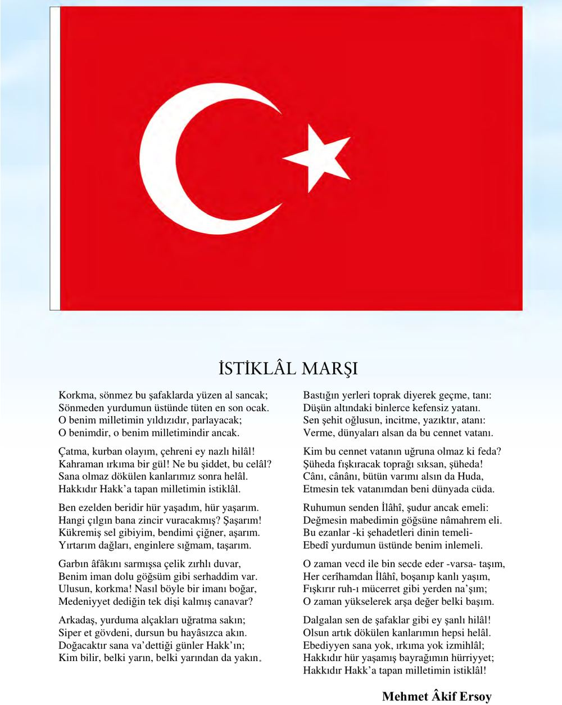

# İSTİKLÂL MARŞI

Korkma, sönmez bu şafaklarda yüzen al sancak;
Sönmeden yurdumun üstünde tüten en son ocak.
O benim milletimin yıldızıdır, parlayacak;
O benimdir, o benim milletimindir ancak.

Çatma, kurban olayım, çehreni ey nazlı hilâl!
Kahraman ırkıma bir gül! Ne bu şiddet, bu celâl?
Sana olmaz dökülen kanlarımız sonra helâl.
Hakkıdır Hakk’a tapan milletimin istiklâl.

Ben ezelden beridir hür yaşadım, hür yaşarım.
Hangi çılgın bana zincir vuracakmış? Şaşarım!
Kükremiş sel gibiyim, bendimi çiğner, aşarım.
Yırtarım dağları, enginlere sığmam, taşarım.

Garbın âfâkını sarmışsa çelik zırhlı duvar,
Benim iman dolu göğsüm gibi serhadim var.
Ulusun, korkma! Nasıl böyle bir imanı boğar,
Medeniyet dediğin tek dişi kalmış canavar?

Arkadaş, yurduma alçakları uğratma sakın;
Siper et gövdeni, dursun bu hayâsızca akın.
Doğacaktır sana va'dettiği günler Hakk'ın;
Kim bilir, belki yarın, belki yarından da yakın.

Bastığın yerleri toprak diyerek geçme, tanı:
Düşün altındaki binlerce kefensiz yatanı.
Sen şehit oğlusun, incitme, yazıktır, atanı:
Verme, dünyaları alsan da bu cennet vatanı.

Kim bu cennet vatanın uğruna olmaz ki feda?
Şüheda fışkıracak toprağı sıksan, şüheda!
Canı, cânânı, bütün varımı alsan da Huda,
Etmesin tek vatanımdan beni dünyada cüda.

Ruhumun senden ilâhî, şudur ancak emeli:
Değmesin mabedimin göğsüne nâmahrem eli.
Bu ezanlar -ki şehadetleri dinin temeli-
Ebedî yurdumun üstünde benim inlemeli.

O zaman vecd ile bin secde eder -varsa- taşim,
Her cerîhamdan ilâhî, boşanıp kanlı yaşım,
Fışkırır ruh-ı mücerret gibi yerden na'şım;
O zaman yükselerek arşa değer belki başım.

Dalgalan sen de şafaklar gibi ey kanlı hilâl!
Olsun artık dökülen kanlarımın hepsi helâl.
Ebediyyen sana yok, Türk'e yok izmihlâl;
Hakkıdır hür yaşamış bayrağımın hürriyet;
Hakkıdır Hakk'a tapan milletimin istiklâl!

<!-- sayfa 3 -->

# GENÇLİĞE HİTABE

Ey Türk gençliği! Birinci vazifen, Türk istiklâlini, Türk Cumhuriyetini, ilelebet muhafaza ve müdafaa etmektir.

Mevcudiyetinin ve istikbalinin yegâne temeli budur. Bu temel, senin en kıymetli hazinendir. İstikbalde dahi, seni bu hazineden mahrum etmek isteyecek dâhilî ve hâricî bedhahların olacaktır. Bir gün, istiklâl ve cumhuriyeti müdafaa mecburiyetine düşersen, vazifeye atılmak için, içinde bulunacağın vaziyetin imkân ve şeraitini düşünmeyeceksin! Bu imkân ve şerait, çok namüsait bir mahiyette tezahür edebilir. İstiklâl ve cumhuriyetine kastedecek düşmanlar, bütün dünyada emsali görülmemiş bir galibiyetin mümessili olabilirler. Cebren ve hile ile aziz vatanın bütün kaleleri zapt edilmiş, bütün tersanelerine girilmiş, bütün orduları dağıtılmış ve memleketin her köşesi bilfiil işgal edilmiş olabilir. Bütün bu şeraitten daha elîm ve daha vahim olmak üzere, memleketin dâhilinde iktidara sahip olanlar gaflet ve dalâlet ve hattâ hıyanet içinde bulunabilirler. Hattâ bu iktidar sahipleri şahsî menfaatlerini, müstevlîlerin siyasî emelleriyle tevhit edebilirler. Millet, fakr u zaruret içinde harap ve bîtap düşmüş olabilir.

Ey Türk istikbalinin evlâdı! İşte, bu ahval ve şerait içinde dahi vazifen, Türk istiklâl ve cumhuriyetini kurtarmaktır. Muhtaç olduğun kudret, damarlarındaki asil kanda mevcuttur.

Mustafa Kemal Atatürk

<!-- sayfa 4 -->

MUSTAFA KEMAL ATATÜRK

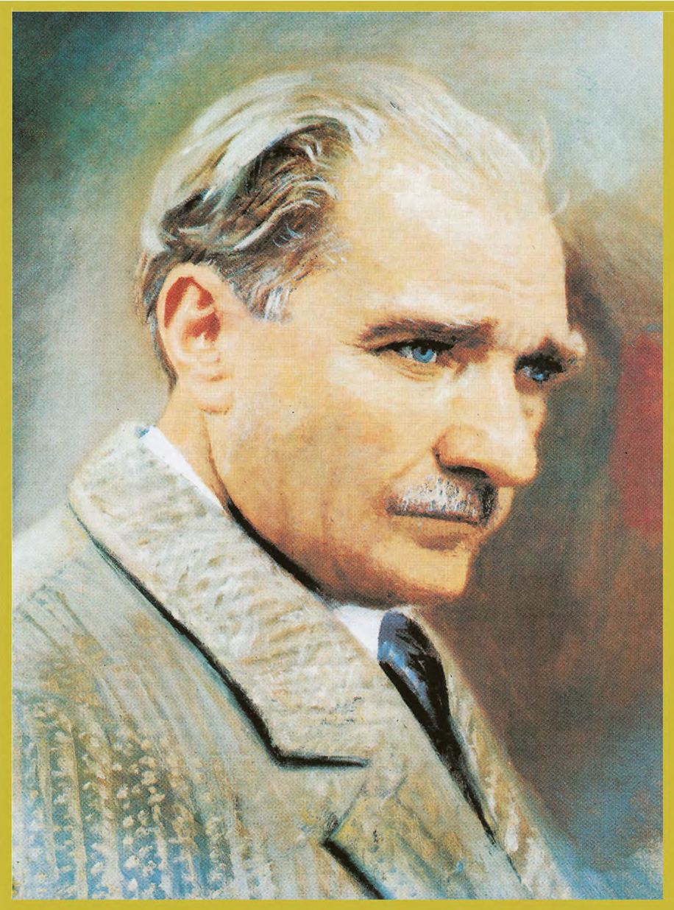
<!-- yer tutucu bulunamadı: sayfa sonuna eklendi -->

<!-- sayfa 5 -->

Verdiğiniz metin katmanı boş olduğu için (`<<< >>>` arası boş) dönüştürülecek bir içerik bulunmamaktadır. Lütfen metin katmanını içeren içeriği paylaşın, böylece talimatlarınıza uygun şekilde Markdown formatına çevirebilirim.

<!-- sayfa 6 -->

# İÇİNDEKİLER

| | |
| :--- | ---: |
| KİTABIN TANITIMI | 8 |
| 1. TEMA > HAYAT VE SANAT | 11 |
| 2. TEMA > SANATIN GÖRSEL DİLİ | 29 |
| 3. TEMA > SANATÇILAR VE ESERLERİ | 49 |
| 4. TEMA > ÇİZİM VE GÖRSEL İFADE | 69 |
| 5. TEMA > RENK VE ESTETİK | 85 |
| 6. TEMA > MİLLÎ DEĞERLER VE SANAT | 101 |
| 7. TEMA > MÜZE VE KÜLTÜR | 115 |
| TERİMLER SÖZLÜĞÜ | 134 |
| KAYNAKÇA | 137 |
| GÖRSEL VE GENEL AĞ KAYNAKÇASI | 137 |
| TÜRKİYE'NİN MÜLKİ İDARE BÖLÜMLERİ İLE KARA VE DENİZ KOMŞULARI HARİTASI | 138 |
| TÜRK DÜNYASI HARİTASI | 139 |

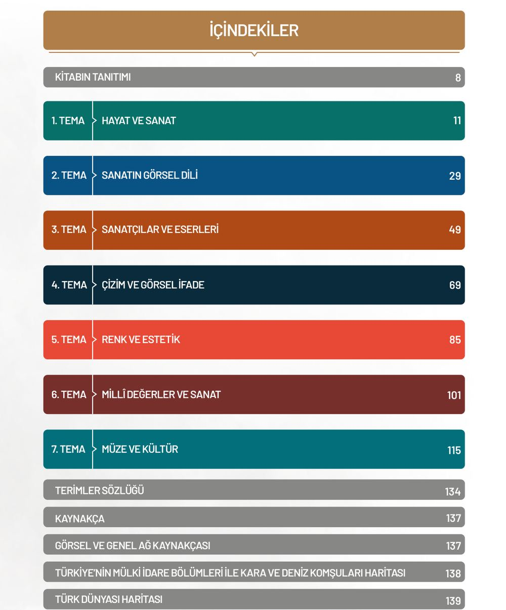
<!-- yer tutucu bulunamadı: sayfa sonuna eklendi -->

<!-- sayfa 7 -->

# KİTABIN TANITIMI

Bu kitap temalardan oluşmaktadır. Her tema başında tema kapak sayfası bulunmaktadır. Tema kapaklarında temanın adına, sınıf düzeyine, temayla ilgili hazırlanan sunumlara ve e-içeriklere ulaşmak için karekodlara yer verilmiştir.

Sınıf düzeyi $\rightarrow$ 5. Sınıf
Tema adı $\rightarrow$ 1. TEMA HAYAT VE SANAT

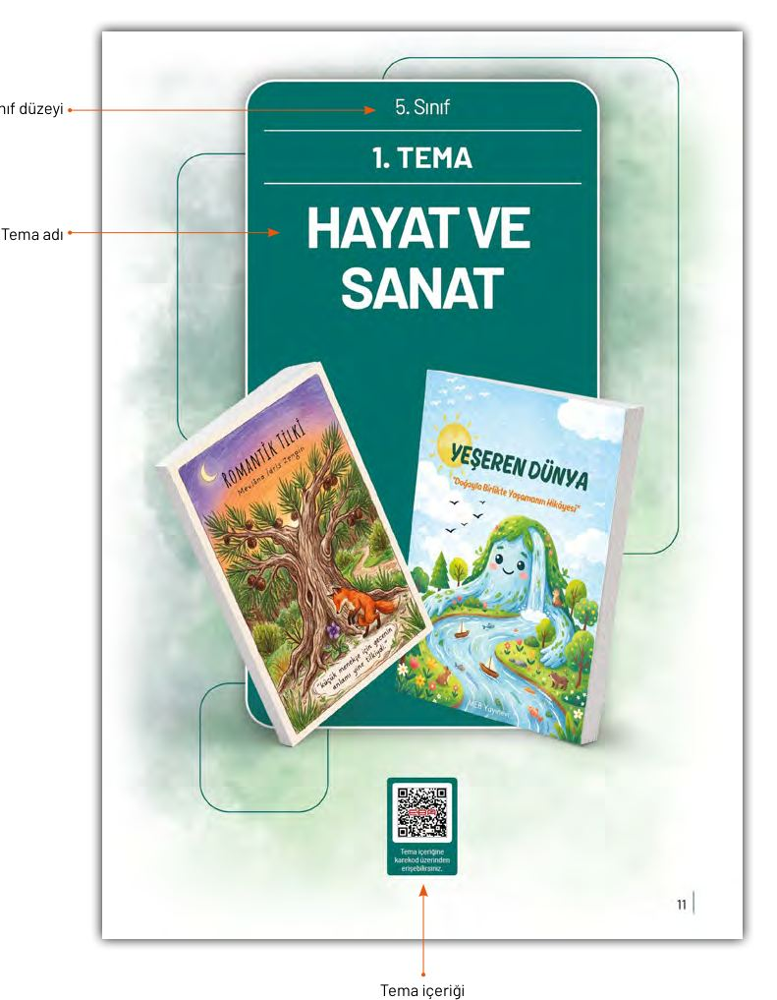

Tema içeriği karekodu

<!-- sayfa 8 -->

# KİTABIN TANITIMI

5. Sayfa

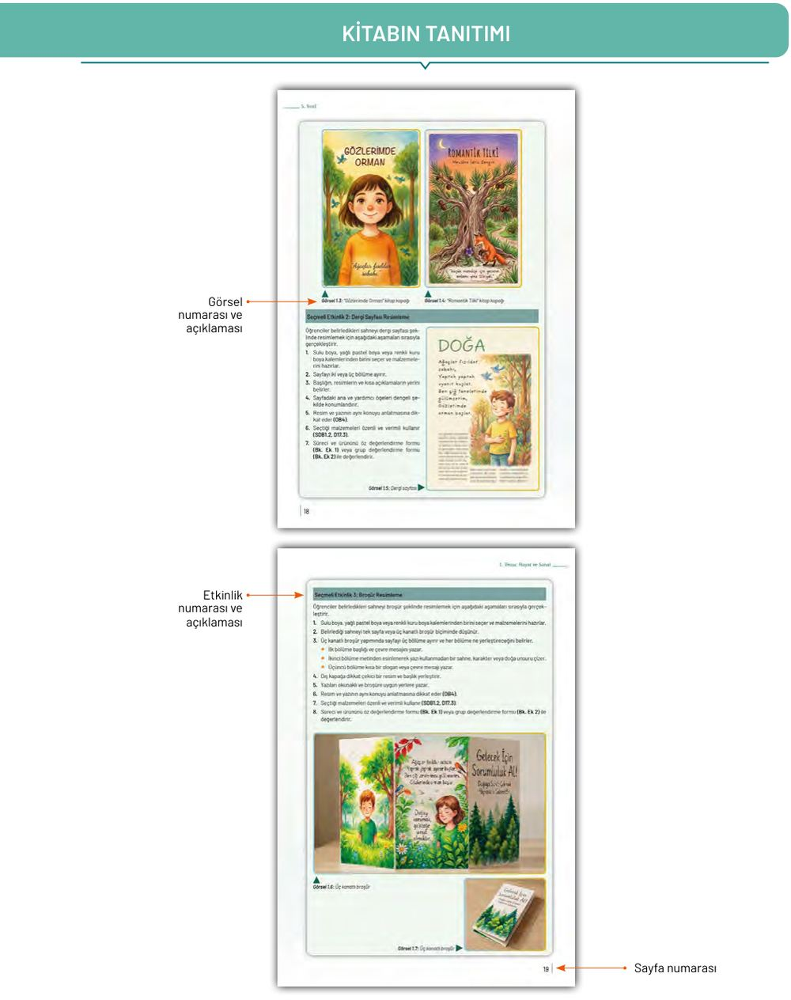 Görsel numarası ve açıklaması

Görsel 1.3: "Gözlerimde Orman" kitap kapağı
Görsel 1.4: "Romantik Tilki" kitap kapağı

**Seçmeli Etkinlik-2: Dergi Sayfası Tasarımı**

Öğrenciler belirledikleri bir sahneyi dergi sayfası şeklinde tasarlamak için aşağıdaki aşamaları sırasıyla gerçekleştirirler:

1. Sulu boya, yağlı pastel boya veya renkli kuru boya ile bir boya kalemiyle tasarım için gerekli malzemelerini hazırlarlar.
2. Sayfayı veya bir bölümüne ayırırlar.
3. Başlığın, resimlerin ve kısa açıklamaların yerini belirlerler.
4. Sayfadaki ana ve yardımcı öğeleri dengeli bir şekilde konumlandırırlar.
5. Resim ve yazının aynı konuyu anlatmasına dikkat ederler (3081.2, D17.3).
6. Seçtiği malzemeleri izler ve verimli kullanırlar (3081.2, D17.3).
7. Süreci ve ürünlerini öz değerlendirme formu (Ek. 1k veya grup değerlendirme formu (Ek. 1s veya Ek. 2s) ile değerlendirirler.

Görsel 1.5: Dergi sayfası örneği

18

1. Vites: Hayal ve Sanat

 Etkinlik numarası ve açıklaması

**Seçmeli Etkinlik-3: Broşür Tasarımı**

Öğrenciler belirledikleri bir sahneyi broşür şeklinde tasarlamak için aşağıdaki aşamaları sırasıyla iç içe geçirirler:

1. Sulu boya, yağlı pastel boya veya renkli kuru boya ile bir boya kalemiyle malzemelerini hazırlarlar.
2. Belirledikleri sahneyi tek sayfa veya üç kanatlı broşür biçiminde düşünüp tasarlar.
    * İki kanatlı broşür yapımında sayfa iki bölüme ayrılır ve her bir bölüme yerleştirilecekleri belirler.
    * İkincisi bölüme metinlerden oluşturulmuş veya kullanılamadan daha sade, karakter veya dünya tasarımı sunar.
    * Üçüncü bölüme ise bir slogan veya çevre mesajı yazar.
3. İki kanatlı broşürde metin ve resimlerin yerini belirler.
4. Üç kanatlı broşürde de slogan ve mesaj yer alır.
5. Yazıları okunaklı ve broşürün uygun yerlerine yazarlar.
6. Resim ve yazının aynı konuyu anlatmasına dikkat ederler (3081.2, D17.3).
7. Seçtiği malzemeleri izler ve verimli kullanırlar (3081.2, D17.3).
8. Süreci ve ürünlerini öz değerlendirme formu (Ek. 1k veya grup değerlendirme formu (Ek. 1s veya Ek. 2s) ile değerlendirirler.

Görsel 1.6: Üç kanatlı broşür
Görsel 1.7: İki kanatlı broşür

19  Sayfa numarası

<!-- sayfa 9 -->

# KİTABIN TANITIMI

**Not ikonu**
Öğretmene yönelik önemli açıklama, öneri ve yönlendirmeleri içerir.

**Dinleti ikonu**
Sanatsal süreçte odaklanmayı ve estetik duyarlılığı desteklemek için uygun müzik ve seslerin dinletileceğini gösterir.

**Eser inceleme ikonu**
Sanat eserlerinin inceleneceği süreçleri içerir.

**Görsel inceleme ikonu**
Görsellerin inceleneceği süreçleri içerir.

**Hatırlatma ikonu**
Yapılması gereken önemli işlemlerin hatırlatılmasını içerir.

**Öğretmen notu ikonu**
Öğretmenin not alabileceği alanları ifade eder.

**Rehberlik ikonu**
Öğrenciye süreç içinde yönlendirme ve destek sunulması gereken

<!-- sayfa 10 -->

5. Sınıf

# 1. TEMA

# HAYAT VE SANAT

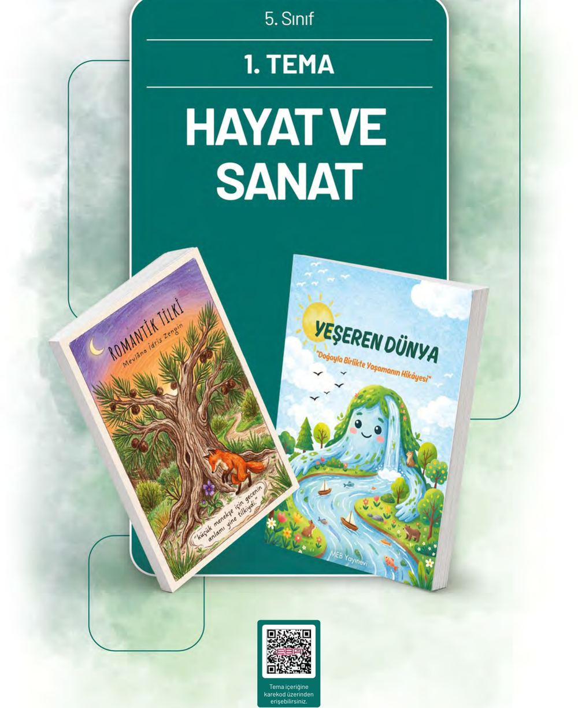

ROMANTİK TİLKİ
Mevlâna İdris Zengin
"Kaşık menekşe için gecenin anlamı yine tilkiydi."

YEŞEREN DÜNYA
"Doğayla Birlikte Yaşamanın Hikâyesi"
MEB Yayınevi

Tema içeriğine
karekod üzerinden

<!-- sayfa 11 -->

| TEMA ADI | Hayat ve Sanat |
| :--- | :--- |
| **SINIF DÜZEYİ** | 5 |
| **TEMA KAPSAMI** | Öğrencilerin yazının sanat ve iletişimdeki yerini fark etmeleri, afişlerde ve resimlemelerde yazı ile görseller arasındaki bütünlüğü kavramaları, edebî metinlerden yola çıkarak çevre duyarlılığını yansıtan resimlemeler oluşturmaları amaçlanmaktadır. |
| **DERS SAATİ** | 4 |
| **ALAN BECERİLERİ** | SAB4. Sanatsal Üretim Yapma |
| **KAVRAMSAL BECERİLER** | – |
| **EĞİLİMLER** | E1.6. Seçicilik, E3.3. Yaratıcılık, E3.5. Açık Fikirlilik, E3.10. Eleştirel Bakma |

## PROGRAMLAR ARASI BİLEŞENLER

| SOSYAL-DUYGUSAL ÖĞRENME BECERİLERİ | SDB1.1. Kendini Tanıma (Öz Farkındalık), SDB1.2. Kendini Düzenleme (Öz Düzenleme), SDB1.3. Kendine Uyarlama (Öz Yansıtma), SDB2.1. İletişim, SDB2.3. Sosyal Farkındalık |
| :--- | :--- |
| **DEĞERLER** | D10. Mütevazılık, D14. Saygı, D15. Sevgi, D17. Tasarruf, D18. Temizlik |
| **OKURYAZARLIK BECERİLERİ** | OB1. Bilgi Okuryazarlığı, OB4. Görsel Okuryazarlık, OB8. Sürdürülebilirlik Okuryazarlığı, OB9. Sanat Okuryazarlığı |
| **DİSİPLİNLER ARASI İLİŞKİLER** | Fen Bilimleri, Türkçe |
| **BECERİLER ARASI İLİŞKİLER** | KB1. Temel Beceriler, KB2.7. Karşılaştırma, KB3.1. Karar Verme, SAB1. Sanatsal Algılama |

## ÖĞRENME ÇIKTILARI VE SÜREÇ BİLEŞENLERİ

**GS.5.1.1. Edebî metinlerden ve yazı düzeninden faydalanarak çevre duyarlılığını yansıtan resimleme yapabilme**
a) Doğa temalı edebî metinlerden faydalanarak çevre duyarlılığını yansıtan resimleme tasarlar.
b) Tasarladığı imgeleri yazı düzeniyle birleştirerek çevre duyarlılığını yansıtan resimleme oluşturur.

| İÇERİK ÇERÇEVESİ | Resimleme ve Afiş İlişkisi |
| :--- | :--- |
| **ANAHTAR KAVRAMLAR** | çocuk edebiyatı, grafik tasarım, hareket, Mevlâna İdris Zengin, resimleme, yazı düzeni |
| **ÖĞRENME KANITLARI (ÖLÇME VE DEĞERLENDİRME)** | Öğrenme çıktıları; kontrol listeleri, öz değerlendirme formları ve grup değerlendirme formları kullanılarak değerlendirilebilir. Sınıf içi performans görevi olarak öğrencilerden doğa temalı edebî metinlerinden yola çıkarak çevre duyarlılığını yansıtan resimlemeler oluşturmaları istenir. Çalışmalarında yazı ve görsel unsurları bir araya getirerek görsel mesajın etkisini güçlendirmeleri beklenir. |

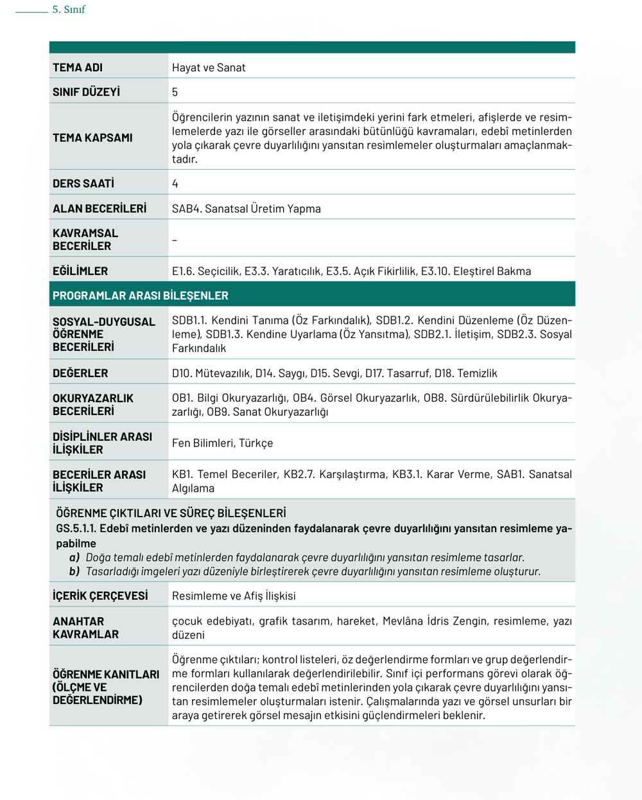
<!-- yer tutucu bulunamadı: sayfa sonuna eklendi -->

<!-- sayfa 12 -->

# TEMA AKIŞI

* Görsel İnceleme Çalışması: Resimleme (illüstrasyon)
* Çevre Duyarlılığını Yansıtan Resimleme Tasarlama
* Çevre Duyarlılığını Yansıtan Kitap Kapağı, Dergi Sayfası veya Broşür Resimleme
* Çalışma Ortamını Düzenleme
* Değerlendirme
* Sergileme
* Farklılaştırma

# ÖĞRETMEN HAZIRLIĞI

Ders öncesinde resimleme (illüstrasyon) kavramı, yazı-görsel ilişkisi kısaca gözden geçirilir. Hazırlık kapsamında aşağıdaki örneklerin hazır bulundurulması önerilir.

* Bu temada çevre farkındalığı içeren afiş örnekleri sunulmuştur. Broşür sayfaları, kitap kapağı ve dergi sayfaları hazırlanabilir.
* Millî yazarlarımızdan doğa temalı kısa metinler seçilir. Mevlâna İdris Zengin’in “Kuş Uçtu”, “Ütü-süz Ayakkabılar”, “Dokuz Düğmeli Adam”, “Tuz” gibi eserlerinden kısa bölümler kullanılabilir.

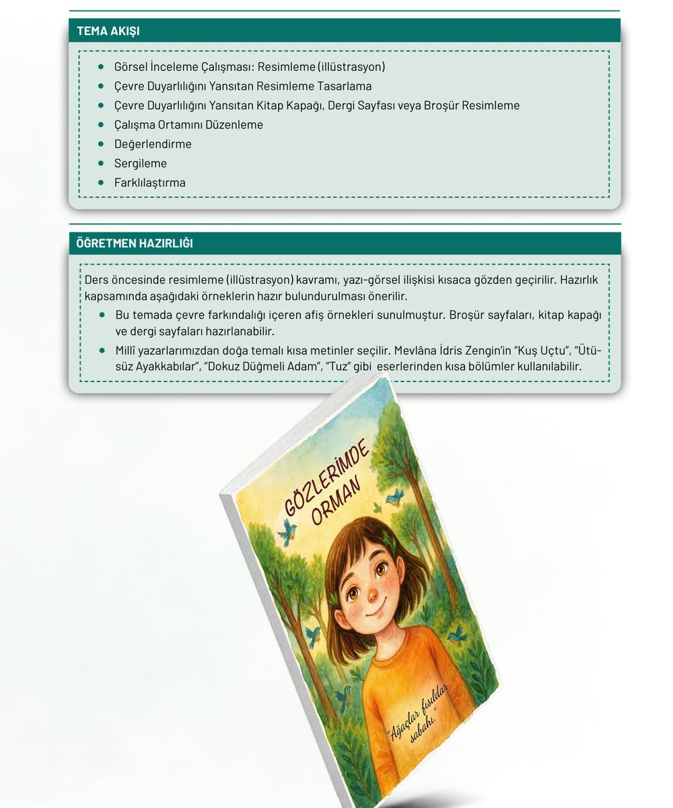

<!-- sayfa 13 -->

# ÖĞRENCİ HAZIRLIĞI VE ETKİNLİK MALZEMELERİ

Uygulamada kullanılacak malzemeler öğrencilerle paylaşılır. Bu temadaki çalışmaların büyük bölümünde resimleme malzemeleri kullanılmaktadır. Bu nedenle malzeme listesi toplu olarak sunulmuştur. Zenginleştirme ve destekleme etkinliklerinde de temel malzemeler esas alınır. Gerektiğinde dijital araçlar ve kolaj için gerekli olan malzemeler eklenebilir.

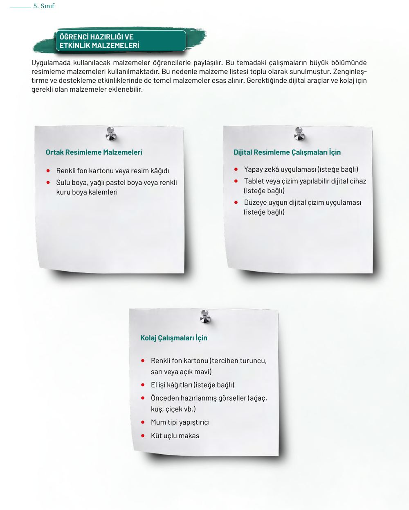

## Ortak Resimleme Malzemeleri

* Renkli fon kartonu veya resim kâğıdı
* Sulu boya, yağlı pastel boya veya renkli kuru boya kalemleri

## Dijital Resimleme Çalışmaları İçin

* Yapay zekâ uygulaması (isteğe bağlı)
* Tablet veya çizim yapılabilir dijital cihaz (isteğe bağlı)
* Düzeye uygun dijital çizim uygulaması (isteğe bağlı)

## Kolaj Çalışmaları İçin

* Renkli fon kartonu (tercihen turuncu, sarı veya açık mavi)
* El işi kâğıtları (isteğe bağlı)
* Önceden hazırlanmış görseller (ağaç, kuş, çiçek vb.)
* Mum tipi yapıştırıcı
* Küt uçlu makas

<!-- sayfa 14 -->

# ÖĞRENME-ÖĞRETME YAŞANTILARI

## TEMEL KABULLER

Öğrencilerin edebî metinlerde anlatılan hikâyeleri veya betimlemeleri görselleştirme konusunda temel farkındalığa sahip oldukları kabul edilmektedir.

## ÖN DEĞERLENDİRME SÜRECİ

Öğrencilerin metinleri görselleştirme konusundaki farkındalık düzeyleri aşağıdakilere benzer sorulara verdikleri yanıtlarla ölçülür:

* Bir hikâyeyi sadece anlatmak yerine resimle ifade etmek etkili olur mu? Neden?
* Okuduğunuz hangi hikâyenin hangi sahnesini resmetmek isterdiniz?

> Öğrencilerin hazır bulunuşluk düzeylerinin yeterli olmaması durumunda aşağıdakilere benzer etkinlikler uygulanabilir:

**a) Zihinde Metin Canlandırma:** Öğrencilere kısa ve betimleyici bir paragraf okunur. Öğrencilerden okunan sahneye ilişkin duygu, mekân veya nesne detaylarını zihinlerinde canlandırmaları ve birkaç cümleyle sözel olarak ifade etmeleri istenir.

**b) Cümle Tamamlama:** Öğrencilere yarım bırakılmış bir cümle sunulur. Örneğin “Ormanın derinliklerinde bir kulübe vardı. Çevresinde ise...” şeklinde bir başlangıç ifadesi verilir. Öğrencilerden bu sahneyi hayal ederek cümleyi tamamlamaları ve sahneye ait görsel ögelerden birkaçını açıklamaları beklenir.

**c) Başlık İmgeleştirme:** Öğrencilerle “Kayıp Balık”, “Fırtınadaki Ağaç” ve “Sessiz Kitaplık” gibi üç kısa hikâye başlığı paylaşılır. Öğrencilerden bu başlıklardan birini seçmeleri istenir. Seçtikleri başlığa uygun görsel ögeleri zihinlerinde canlandırmaları ve bu ögeleri “Bu başlıktan yola çıkarak aklıma gelen ilk görüntü...” gibi açıklamalarla paylaşmaları beklenir.

## KÖPRÜ KURMA

Öğrencilere yazının biçimsel özelliklerinin görsel anlamı destekleyebileceğini, harflerin görsel bir ifade aracı olarak resimler içinde anlatımı güçlendirmek ve hareket sağlamak için kullanılabileceğini düşündürmek amacıyla aşağıdakilere benzer sorular yöneltilir:

* Bir resimde kullanılan yazılar resimdeki kompozisyona nasıl bir katkı sunabilir?
* Resimde kullanılan yazılar o resmin iletmek istediği mesajı nasıl destekler?
* Yazılar bir resmin kompozisyonundaki hareket hissini nasıl kazandırabilir?

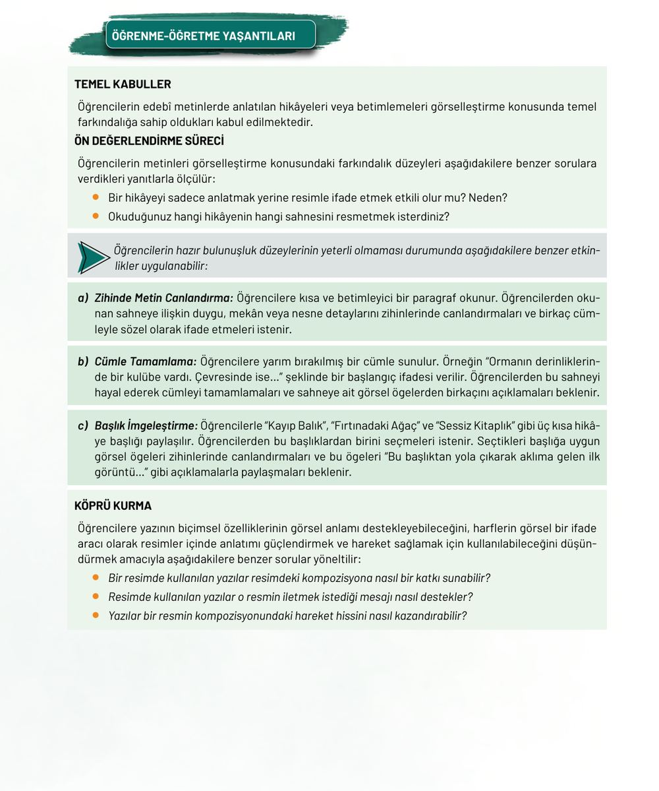
<!-- yer tutucu bulunamadı: sayfa sonuna eklendi -->

<!-- sayfa 15 -->

# ÖĞRENME-ÖĞRETME UYGULAMALARI
## Uygulama Öncesi

Öğrencilerden edebî metinlerden ve yazı düzeninden faydalanarak çevre duyarlılığını yansıtan resimleme yapabilmeleri beklenir. Bu amaçla aşağıdaki süreçler takip edilir.

### GÖRSEL İNCELEME

**Resimleme (İllüstrasyon)**

Derse çevre temalı kitap kapağı, dergi sayfası, reklam panosu ve broşür gibi resimleme örnekleri gösterilerek başlanabilir. “Bu görsel size ne anlatıyor?”, “Görsel mi yoksa yazı mı daha çok dikkat çekiyor?”, “Yazı ile görsel birlikte daha anlamlı mı?” gibi sorular üzerinden hızlı bir inceleme yapılır (OB4). Öğrenciler örneklerin konusunu tahmin ederek paylaşır (OB1). Resimlemenin yalnızca hikâye anlatmadığı, bilgi verdiği veya mesaj ilettiği vurgulanır. Bu aşamada çalışmalar “Yeşil Vatan” teması çerçevesinde yürütülür.

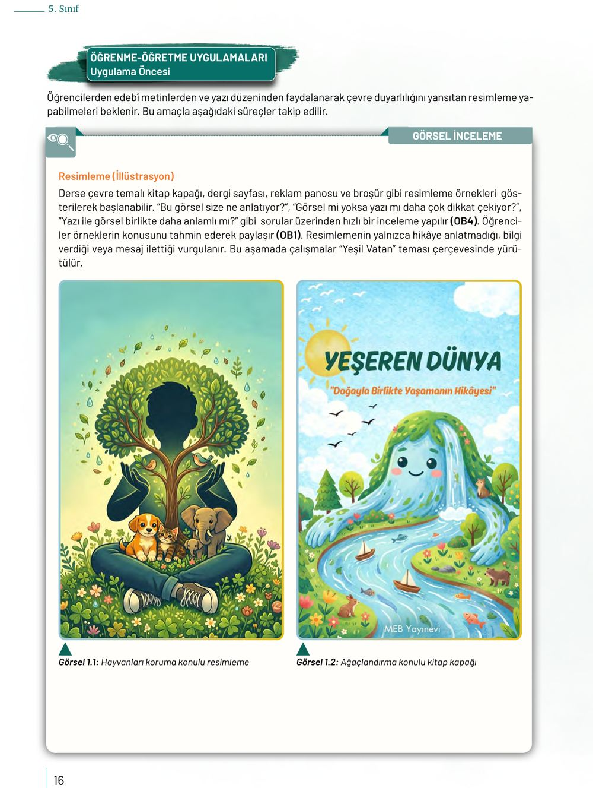
*Görsel 1.1: Hayvanları koruma konulu resimleme*

*Görsel 1.2: Ağaçlandırma konulu kitap kapağı*

<!-- sayfa 16 -->

# Tasarım Geliştirme:
## Çevre Duyarlılığını Yansıtan Resimleme Tasarlama

Öğrencilere Mevlâna İdris Zengin’in “Romantik Tilki”, “Dünyanın En Uğurböceği” gibi kitaplarından veya diğer millî yazarların doğa temalı metinlerinden kısa parçalar sunulur. Öğrenciler metinler arasından seçim yapar (**OB8**) ve seçimini kısaca gerekçelendirir (**KB3.1, SDB1.1, E1.6**). Metnin ne anlatmak istediği, olayın nerede ve ne zaman geçtiği, ana karakterin kim olduğu ve doğa sevgisi üzerine konuşma halkası tekniği kullanılarak düşündürülür (**E3.10, OB1**). Uygulama için aşağıdaki etkinliklerden biri seçilir:

*   ✅ **Seçmeli Etkinlik 1 :** Kitap Kapağı Resimleme
*   ✅ **Seçmeli Etkinlik 2:** Dergi Sayfası Resimleme
*   ✅ **Seçmeli Etkinlik 3:** Broşür Resimleme

Metnin içeriğine uygun bir özgün slogan veya çevre temalı ifade geliştirilir (**OB9, E3.3**). Örneğin öğrencilere “Doğayı sevmek, geleceği korumaktır.”, “Bir ağacı kurtarmak, bir dünyayı yaşatmak gibidir.”, “Yeşil vatan, yarının güvencesidir.” gibi sade, etkili ve duyarlılık taşıyan ifadeler seçmeleri önerilebilir. Öğrenciler metinden bir sahne seçer. Resimde dikkat çekmesini istediği ana öğeyi ve yardımcı öğeleri belirler. Başlık ve sloganının yerini planlar (**SDB1.2**). Süreç taslak çizimle tamamlanır (**KB1**).

> ❗ **NOT**
> Bu etkinlikte grup çalışması tercih edilebilir.

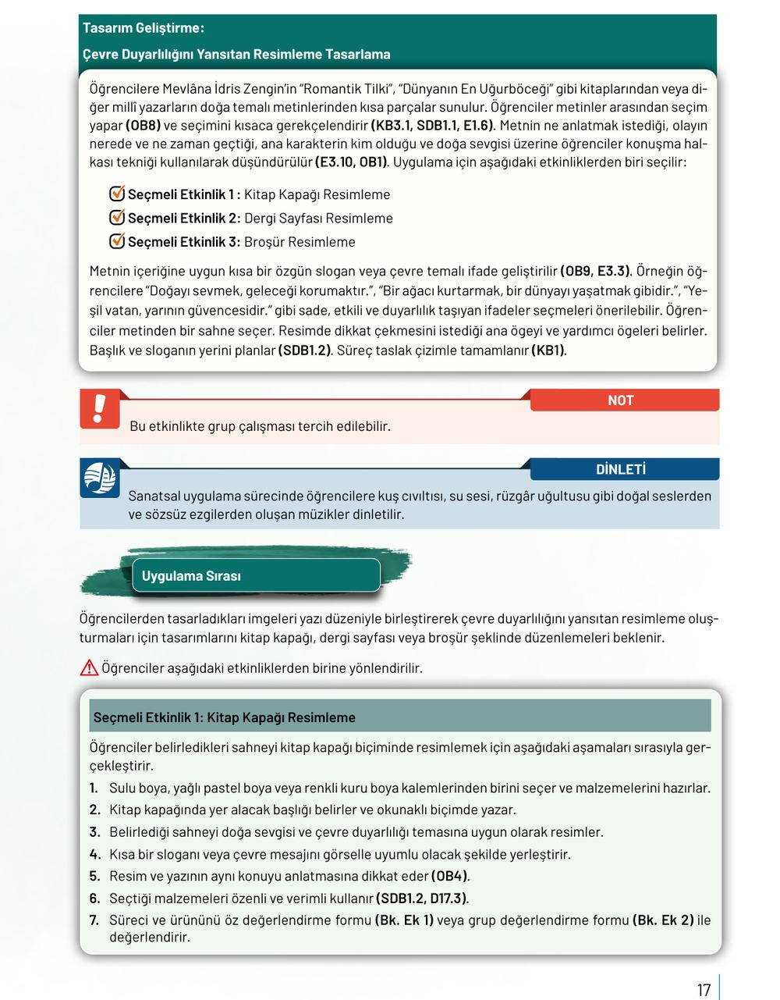
### DİNLETİ
Sanatsal uygulama sürecinde öğrencilere kuş cıvıltısı, su sesi, rüzgâr uğultusu gibi doğal seslerden ve sözsüz ezgilerden oluşan müzikler dinletilir.

---

# Uygulama Sırası

Öğrencilerden tasarladıkları imgeleri yazı düzeniyle birleştirerek çevre duyarlılığını yansıtan resimleme oluşturmaları için tasarımlarını kitap kapağı, dergi sayfası veya broşür şeklinde düzenlemeleri beklenir.

⚠️ Öğrenciler aşağıdaki etkinliklerden birine yönlendirilir.

## Seçmeli Etkinlik 1: Kitap Kapağı Resimleme

Öğrenciler belirledikleri sahneyi kitap kapağı biçiminde resimlemek için aşağıdaki aşamaları sırasıyla gerçekleştirir.

1. Sulu boya, yağlı pastel boya veya renkli kuru boya kalemlerinden birini seçer ve malzemelerini hazırlar.
2. Kitap kapağında yer alacak başlığı belirler ve okunaklı biçimde yazar.
3. Belirlediği sahneyi doğa sevgisi ve çevre duyarlılığı temasına uygun olarak resimler.
4. Kısa bir sloganı veya çevre mesajını görselle uyumlu olacak şekilde yerleştirir.
5. Resim ve yazının aynı konuyu anlatmasına dikkat eder (**OB4**).
6. Seçtiği malzemeleri özenli ve verimli kullanır (**SDB1.2, D17.3**).
7. Süreci ve ürününü öz değerlendirme formu (**Bk. Ek 1**) veya grup değerlendirme formu (**Bk. Ek 2**) ile değerlendirir.

<!-- sayfa 17 -->

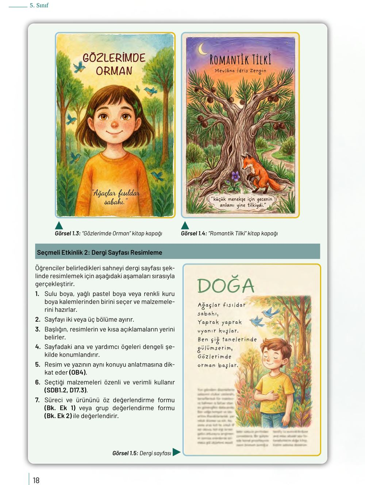

Görsel 1.3: “Gözlerimde Orman” kitap kapağı 
Görsel 1.4: ”Romantik Tilki” kitap kapağı 

# Seçmeli Etkinlik 2: Dergi Sayfası Resimleme

Öğrenciler belirledikleri sahneyi dergi sayfası şeklinde resimlemek için aşağıdaki aşamaları sırasıyla gerçekleştirir.

1. Sulu boya, yağlı pastel boya veya renkli kuru boya kalemlerinden birini seçer ve malzemelerini hazırlar.
2. Sayfayı iki veya üç bölüme ayırır.
3. Başlığın, resimlerin ve kısa açıklamaların yerini belirler.
4. Sayfadaki ana ve yardımcı ögeleri dengeli şekilde konumlandırır.
5. Resim ve yazının aynı konuyu anlatmasına dikkat eder (OB4). 
6. Seçtiği malzemeleri özenli ve verimli kullanır (SDB1.2, D17.3). 
7. Süreci ve ürününü öz değerlendirme formu (Bk. Ek 1) veya grup değerlendirme formu (Bk. Ek 2) ile değerlendirir.

Görsel 1.5: Dergi sayfası

<!-- sayfa 18 -->

# Seçmeli Etkinlik 3: Broşür Resimleme

Öğrenciler belirledikleri sahneyi broşür şeklinde resimlemek için aşağıdaki aşamaları sırasıyla gerçekleştirir.

1. Sulu boya, yağlı pastel boya veya renkli kuru boya kalemlerinden birini seçer ve malzemelerini hazırlar.
2. Belirlediği sahneyi tek sayfa veya üç kanatlı broşür biçiminde düşünür.
3. Üç kanatlı broşür yapımında sayfayı üç bölüme ayırır ve her bölüme ne yerleştireceğini belirler.
    * İlk bölüme başlığı ve çevre mesajını yazar.
    * İkinci bölüme metinden esinlenerek yazı kullanmadan bir sahne, karakter veya doğa unsuru çizer.
    * Üçüncü bölüme kısa bir slogan veya çevre mesajı yazar.
4. Dış kapağa dikkat çekici bir resim ve başlık yerleştirir.
5. Yazıları okunaklı ve broşüre uygun yerlere yazar.
6. Resim ve yazının aynı konuyu anlatmasına dikkat eder (**OB4**).
7. Seçtiği malzemeleri özenli ve verimli kullanır (**SDB1.2, D17.3**).
8. Süreci ve ürününü öz değerlendirme formu (**Bk. Ek 1**) veya grup değerlendirme formu (**Bk. Ek 2**) ile değerlendirir.

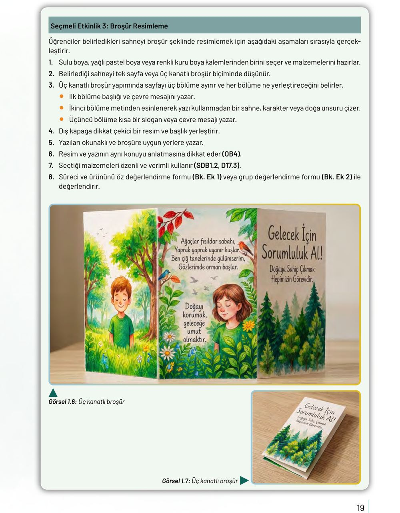

*Görsel 1.6: Üç kanatlı broşür*

<!-- sayfa 19 -->

# Yazı ve Resmin İletişim Değeri: Afiş Örnekleri Üzerinden Karşılaştırma

Öğrencilere yalnızca resim, yalnızca yazı ve hem resim hem de yazı içeren afiş örnekleri sunularak öğrencilerden bunları karşılaştırmaları istenir (**KB2.7, SAB1**). Yazının, görsellerin etkisini güçlendiren bir bilgi aktarım aracı olduğu öğrencilere fark ettirilir.

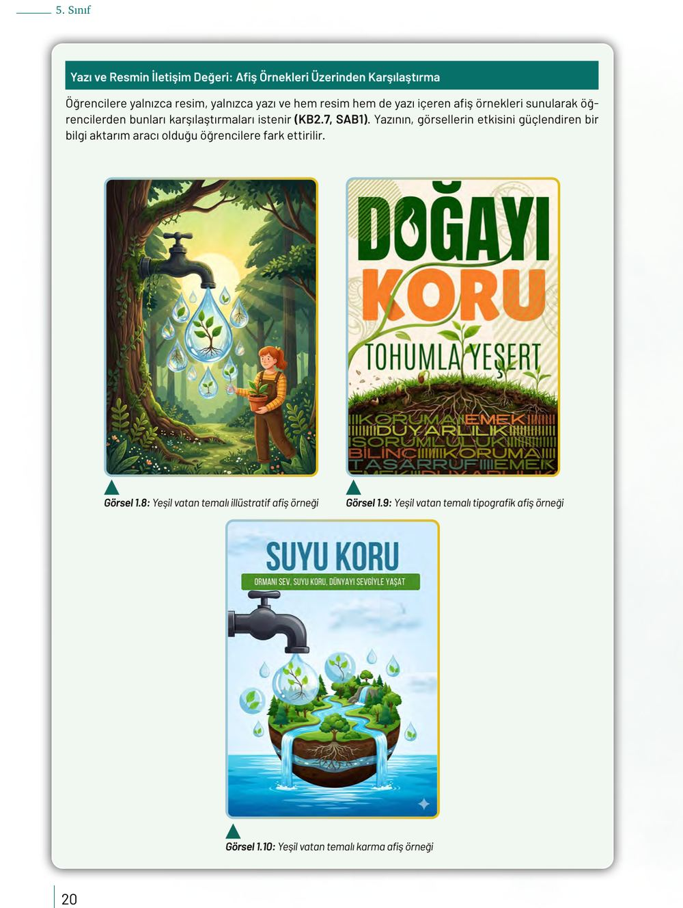

▲
*Görsel 1.8: Yeşil vatan temalı illüstratif afiş örneği*

▲
*Görsel 1.9: Yeşil vatan temalı tipografik afiş örneği*

▲
*Görsel 1.10: Yeşil vatan temalı karma afiş örneği*

<!-- sayfa 20 -->

> ! **NOT**
> Görsellerin “su tasarrufu” ve “canlıları koruma” gibi aynı temalardan seçilmesi karşılaştırmayı kolaylaştırır.
> * Bu afiş ne anlatıyor?
> * Afişi anlamanıza resimler mi, yazılar mı daha çok yardımcı oldu?
> * Afişte sadece resim olsaydı ne anlatıldığını anlayabilir miydiniz?
> * Sadece yazı olsaydı afişi anlamak kolay olur muydu?
> 
> Öğrenciler aşağıdaki cümleyi tamamlayabilir:
> “Bence bir afişte yazı ........................................ için önemlidir çünkü ........................................ .”

### Kavramsallaştırma (İsteğe Bağlı)

Karşılaştırmalardan sonra şu cümlelerle kavramsallaştırma yapılabilir:
* Yazının rengi, büyüklüğü ve yeri değişirse afişin görünümü değişir.
* Yazı ve resim birlikte kullanıldığında afiş daha kolay anlaşılır.
* Resimler bir düşünceyi veya duyguyu göstermek için kullanılır.

---

### Farkındalık Geliştirme: Mevlâna İdris Zengin ve Çocuk Edebiyatı

Öğrencilerin Mevlâna İdris Zengin’in doğaya verdiği önemi fark etmeleri sağlanır (D15.2). Öğrencilerle aşağıdaki kısa ifadeler paylaşılabilir:
* Mevlâna İdris doğayı bir dost gibi anlatır.
* Kitaplarını doğayı ve çocukları severek yazar.
* Onu okuduğunuzda bir kuşu veya bir dereyi dinliyormuş gibi hissedersiniz.

#### Öğrenci Değerlendirmesi ve Yansıtma

Öğrenciler hazırladıkları kitap kapağı, dergi sayfası veya broşürde hangi sahneyi seçtiklerini ve neden bu görselleri kullandıklarını sözlü olarak yahut çıkış kartıyla açıklar (SDB1.2). Metin ile resim arasındaki ilişkiyi ifade eder. Arkadaşlarının çalışmalarını saygılı bir dil kullanarak değerlendirir (E3.5, SDB2.1, D14.1). Farklı görüşleri dinler ve kendi düşüncesini uygun bir şekilde açıklar (SDB2.3, D10.1). Çalışmasındaki güçlü ve geliştirebileceği yönleri belirtir (E3.5, SDB1.2, SDB1.3).

---

### Uygulama Sonrası

Öğrenciler çalışma alanını düzenler ve birlikte temizler (D18.2). Sanatsal ürünler dijital veya fiziksel ortamda sergilenir. Bu ürünler performans görevi olarak tanımlanır ve kontrol listesiyle (Bk. Ek 3) değerlendirilebilir.

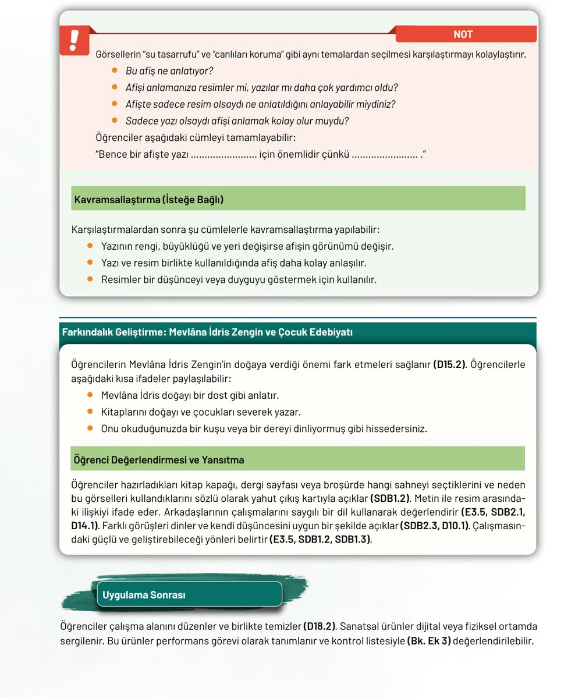
<!-- yer tutucu bulunamadı: sayfa sonuna eklendi -->

<!-- sayfa 21 -->

# FARKLILAŞTIRMA

## Zenginleştirme

⚠️ Öğrenciler aşağıdaki etkinliklerden birine yönlendirilir.

### Seçmeli Etkinlik 1: Resimli Hikâye Kitabı Hazırlama

Öğrenciler çevreyle ilgili deneyim ve gözlemlerini resimli hikâye kitabına dönüştürmek amacıyla aşağıdaki aşamaları sırasıyla gerçekleştirir.

1. Sulu boya, yağlı pastel boya veya renkli kuru boya kalemlerinden birini seçer ve malzemelerini hazırlar.
2. Çevreyle ilgili yaşadığı bir olayı veya gözlemlediği bir durumu belirler.
3. Seçtiği olayla ilgili kısa bir hikâye yazar.
4. Hikâyedeki önemli sahneleri belirler ve her sahne için bir sayfa hazırlar.
5. Her sayfaya sahneye uygun kısa bir metin yazar ve resmini yapar.
6. Sayfaları sıralı biçimde düzenleyerek kapak dâhil en fazla 6-8 sayfalık küçük bir hikâye kitabı oluşturur.
7. Hazırladığı hikâyeyi sınıfa sunar.
8. Süreci ve ürününü öz değerlendirme formu (Bk. Ek 1) ile değerlendirir.

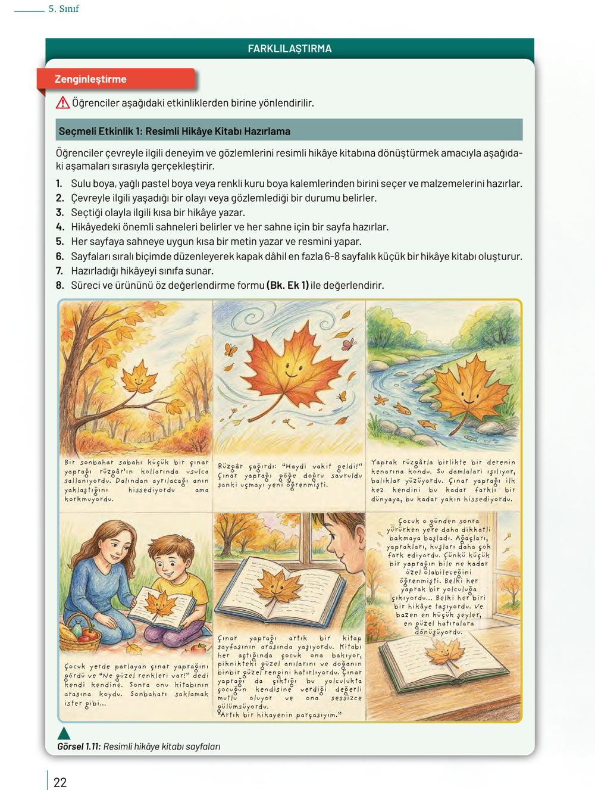

<!-- sayfa 22 -->

[[SEKIL:1.12]]
**Görsel 1.12: Kitap örneği**

# Seçmeli Etkinlik 2: Dijital Ortamda Resimleme Serisi Hazırlama

Öğrenciler çevreyle ilgili deneyim ve gözlemlerini dijital ortamda resimleme serisine dönüştürmek amacıyla aşağıdaki aşamaları sırasıyla gerçekleştirir.

1. Bir dijital çizim uygulaması veya yapay zekâ destekli görsel üretim aracı seçer.
2. Çevreyle ilgili yaşadığı veya gözlemlediği bir olayı belirler.
3. Bu olayla ilgili kısa bir hikâye yazar.
4. Hikâyeyi 3–5 sahneye ayırır.
5. Her sahne için bir sayfa planlar.
6. Sahneyi dijital ortamda çizer veya hazırladığı açık komutla (prompt) görsel üretir ve düzenler.
7. Her sahneye kısa bir açıklama veya çevre mesajı ekler.
8. Yazıları okunaklı ve sayfaya uygun yerlere yerleştirir.
9. Hazırladığı dijital seriyi sınıfa sunar.
10. Süreci ve ürününü öz değerlendirme formu (**Bk. Ek 1**) ile değerlendirir.

[[SEKIL:1.13]]
**Görsel 1.13: Dijital ortamda resimleme serisi**

> **NOT**
> Bu etkinlikte yapay zekâ kullanımına öncelik tanınabilir. Böylece uygulama daha ekonomik ve erişilebilir hâle getirilebilir.

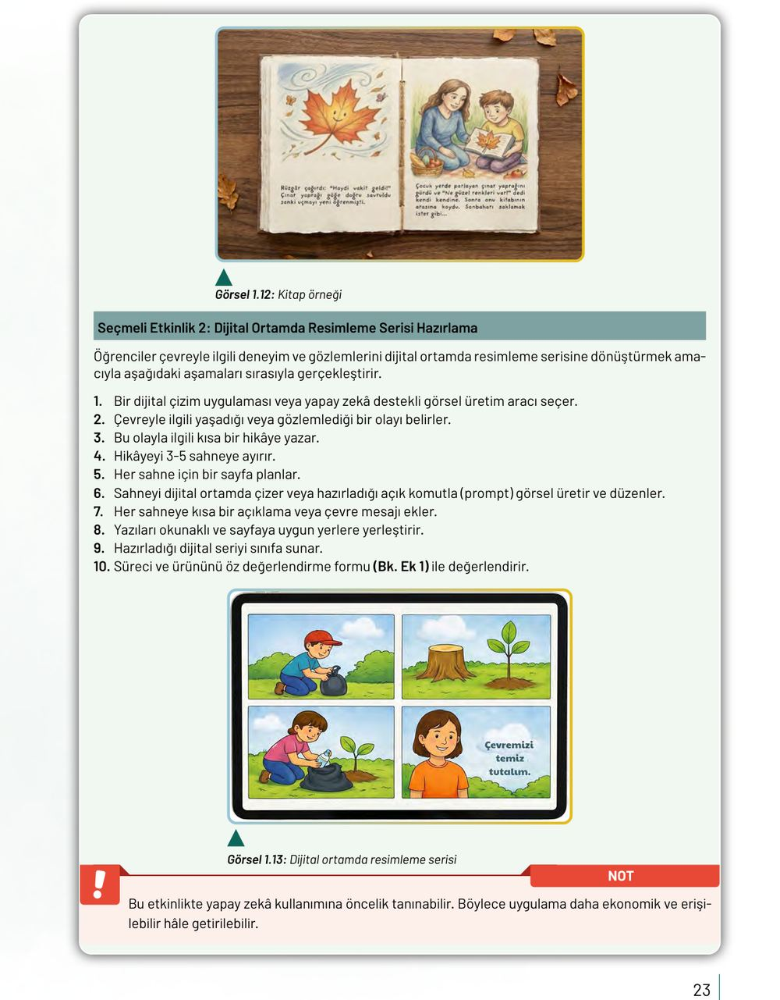
<!-- yer tutucu bulunamadı: sayfa sonuna eklendi -->

<!-- sayfa 23 -->

# Destekleme

## Etkinlik 1: Hazır Görsellerle Kolaj Yapma

Öğrenciler öğretmen rehberliğinde hazır görselleri kullanarak görsel bütünlük oluşturmak ve metinle anlam ilişkisi kurmak amacıyla aşağıdaki aşamaları sırasıyla gerçekleştirir.

1. Kuş, ağaç, çiçek, gökyüzü gibi doğa görselleri arasından 2-3 görsel seçer.
2. Seçtiği görselleri keser veya yırtar.
3. Görsellerle ilgili kısa bir ifade seçer veya kendi kısa cümlesini yazar.
4. Görselleri ve yazıyı fon kartonu üzerinde farklı şekillerde yerleştirerek dener.
5. Yerleşimi kontrol eder ve ardından yapıştırır.
6. Yazıyı okunaklı ve resimle uyumlu bir yere yerleştirir.
7. Çalışmasını sınıfa sunar.
8. Süreci ve ürününü öz değerlendirme formu (**Bk. Ek 1**) ile değerlendirir.

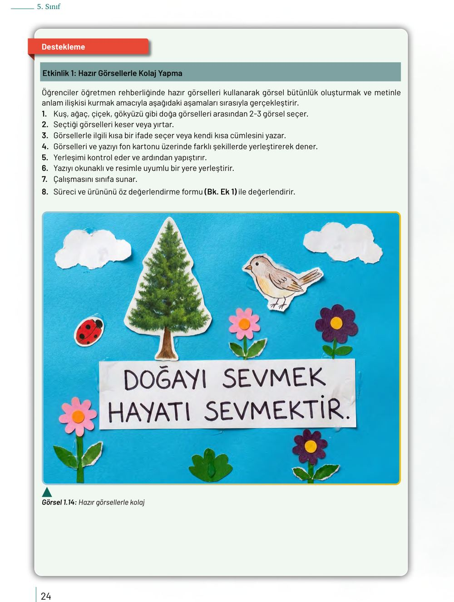

*Görsel 1.14: Hazır görsellerle kolaj*

<!-- sayfa 24 -->

# EK 1. ÖZ DEĞERLENDİRME FORMU

Bu form öğrencilerin bireysel öğrenme süreçlerine yönelik farkındalık geliştirmelerini ve sorumluluk almalarını desteklemek amacıyla hazırlanmıştır. Formdaki her ölçütü öğrencilerle gözden geçiriniz. Değerlendirme sürecinde öğrencilerin tarafsız olmalarına rehberlik ediniz.

## ÖZ DEĞERLENDİRME FORMU

Bu form, performansınızı değerlendirmeniz amacıyla hazırlanmıştır. Sizden duygu ve düşüncelerinizi samimi ve dürüst olarak bu forma yansıtmanız beklenmektedir. Her ölçüt için en uygun olduğunu düşündüğünüz seçeneği işaretleyiniz. “Hiçbir Zaman” ve “Bazen” olarak işaretlediğiniz cevaplarınızı öğretmeniniz rehberliğinde değerlendiriniz.

Etkinlik Adı : ........................................................................................................................
Adı-Soyadı : ........................................................................................................................
Sınıfı-Numarası : ......... / .........
Tarih : ......... / ......... / 20......

| No | Ölçütler | Hiçbir zaman | Bazen | Her zaman |
|---|---|---|---|---|
| 1 | Çalışmaya başlamadan önce malzemelerimi hazırladım. | | | |
| 2 | Çalışmamda çevrenin korunmasına yönelik mesaj verdim. | | | |
| 3 | Çevreye yönelik mesajımı anlatmak için uygun renkler kullandım. | | | |
| 4 | Çevreye yönelik mesajımı anlatmak için uygun şekiller kullandım. | | | |
| 5 | Malzemelerimi tasarruflu kullandım. | | | |

**Öğrencinin Ek Yorumu:**

**Çalışmanızda en çok hangi bölümü beğendiniz? Neden?**
..........................................................................................................................................................
..........................................................................................................................................................

**Bir sonraki çalışmanızda neleri farklı yapmak istersiniz?**
..........................................................................................................................................................
..........................................................................................................................................................

"Öz Değerlendirme Formu"na karekod üzerinden erişebilirsiniz.
 
[QR KOD]

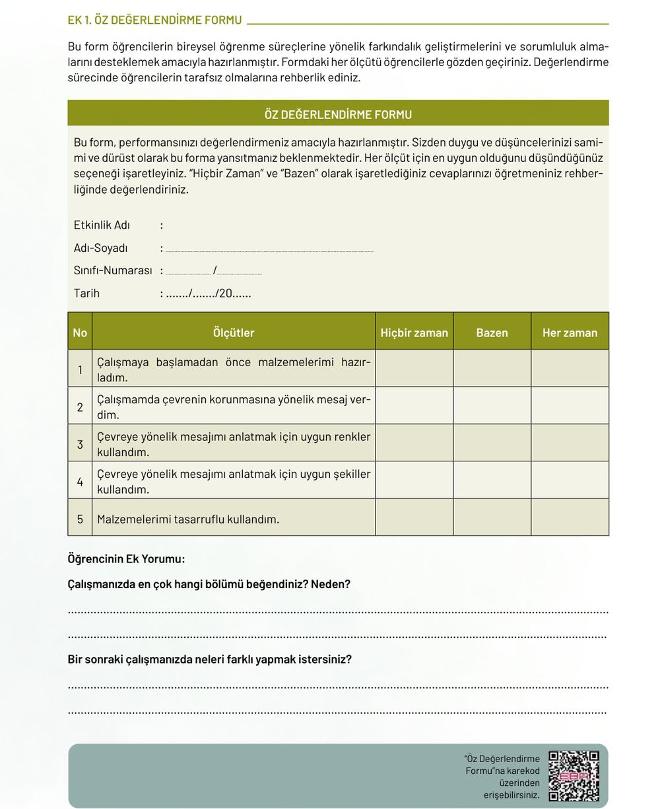
<!-- yer tutucu bulunamadı: sayfa sonuna eklendi -->

<!-- sayfa 25 -->

# EK 2. GRUP DEĞERLENDİRME FORMU

Bu form öğrencilerin grup çalışmalarını gözlemleme, değerlendirme ve yapıcı geri bildirim verme becerilerini geliştirmek için hazırlanmıştır. Formdaki her ölçütü öğrencilerle gözden geçiriniz. Değerlendirme sürecinde öğrencilerin tarafsız, adil ve saygılı olmalarına rehberlik ediniz.

## GRUP DEĞERLENDİRME FORMU

Bu form, performansınızı değerlendirmeniz amacıyla hazırlanmıştır. Sizden duygu ve düşüncelerinizi samimi ve dürüst olarak bu forma yansıtmanız beklenmektedir. Her ölçüt için en uygun olduğunu düşündüğünüz seçeneği işaretleyiniz. “Kısmen” ve “Hayır” olarak işaretlediğiniz cevaplarınızı öğretmeniniz rehberliğinde değerlendiriniz.

Etkinlik Adı :
Grubun Adı :
Grup Üyelerinin Adı-Soyadı : ..........................................................................................
Sınıfı-Numarası : ......... / .........
Tarih : ......... / ......... / 20......

| No | Ölçütler | Hayır | Kısmen | Evet |
|---|---|---|---|---|
| 1 | Çalışma boyunca görevlerimizi paylaştık. | | | |
| 2 | Kararlarımızı birbirimizin fikirlerini dinleyerek aldık. | | | |
| 3 | Yazı ve görselleri çalışmamızda uyumlu bir şekilde kullandık. | | | |
| 4 | Çalışmamızla çevreye yönelik mesaj verdik. | | | |
| 5 | Çalışmamızı zamanında tamamladık. | | | |

**Grubun Ek Yorumu:**
(Çalışmanızın en etkileyici yönü neydi? Çalışmanızda geliştirilmesi gereken bir yer var mı?)
........................................................................................................................................................................
........................................................................................................................................................................
........................................................................................................................................................................
........................................................................................................................................................................
........................................................................................................................................................................

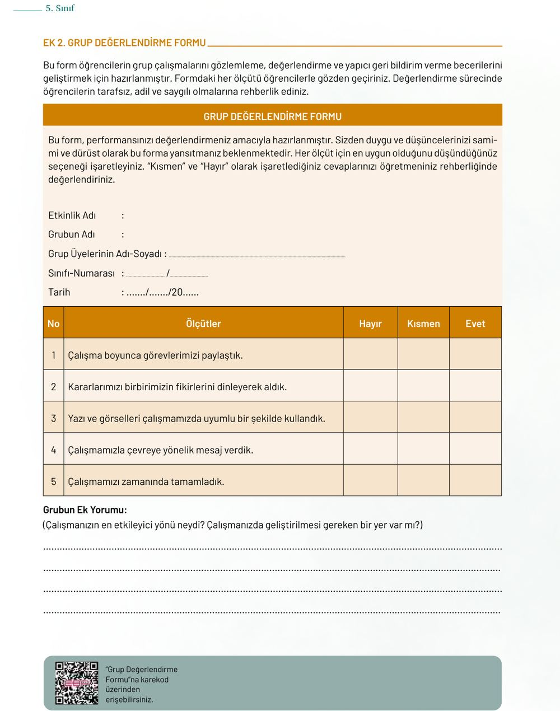 “Grup Değerlendirme Formu”na karekod üzerinden erişebilirsiniz.

<!-- sayfa 26 -->

# EK 3. KONTROL LİSTESİ

Bu kontrol listesi öğrencilerden beklenen becerilerin, belirlenen ölçütler doğrultusunda gerçekleşme düzeyi- ni değerlendirmek amacıyla hazırlanmıştır. Değerlendirme sürecini puanlama yapmadan, öğrencinin bireysel gelişimi dikkate alarak ve süreç odaklı bir yaklaşımla yürütünüz.

## KONTROL LİSTESİ

Bu form öğrenci performanslarını değerlendirmeniz amacıyla hazırlanmıştır. Listedeki her maddeyi incele- yek öğrencinize uygun olan “Evet” veya “Hayır” seçeneklerinden birini işaretleyiniz. “Hayır” olarak işaretle- diğiniz öğrenci davranışlarını geliştirmeye çalışınız.

Etkinlik Adı : __________________________________________________________
Adı-Soyadı : ___________________________________________________________
Sınıfı-Numarası : ________ / ________
Tarih : ........./........./20.......

| No | Ölçütler | Hayır | Evet |
|---|---|---|---|
| 1 | Derse hazırlık yaparak geldi. | | |
| 2 | Yönergedeki uygulama basamaklarını sırasıyla gerçekleştirdi. | | |
| 3 | Çevreye yönelik mesajını anlaşılır biçimde yansıttı. | | |
| 4 | Çalışmasında çevre duyarlılığını yansıtan imgelere yer verdi. | | |
| 5 | Çalışmasını zamanında tamamladı. | | |

**Öğretmen Görüşleri/Açıklamalar:** ...........................................................................................................................
......................................................................................................................................................................................
......................................................................................................................................................................................
......................................................................................................................................................................................

"Kontrol Listesi"ne karekod üzerinden erişebilirsiniz.
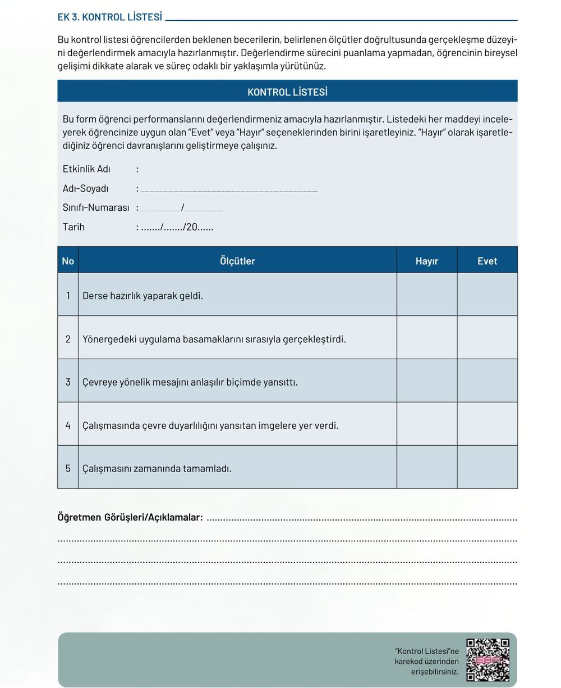

<!-- sayfa 27 -->

ÖĞRETMEN NOTU

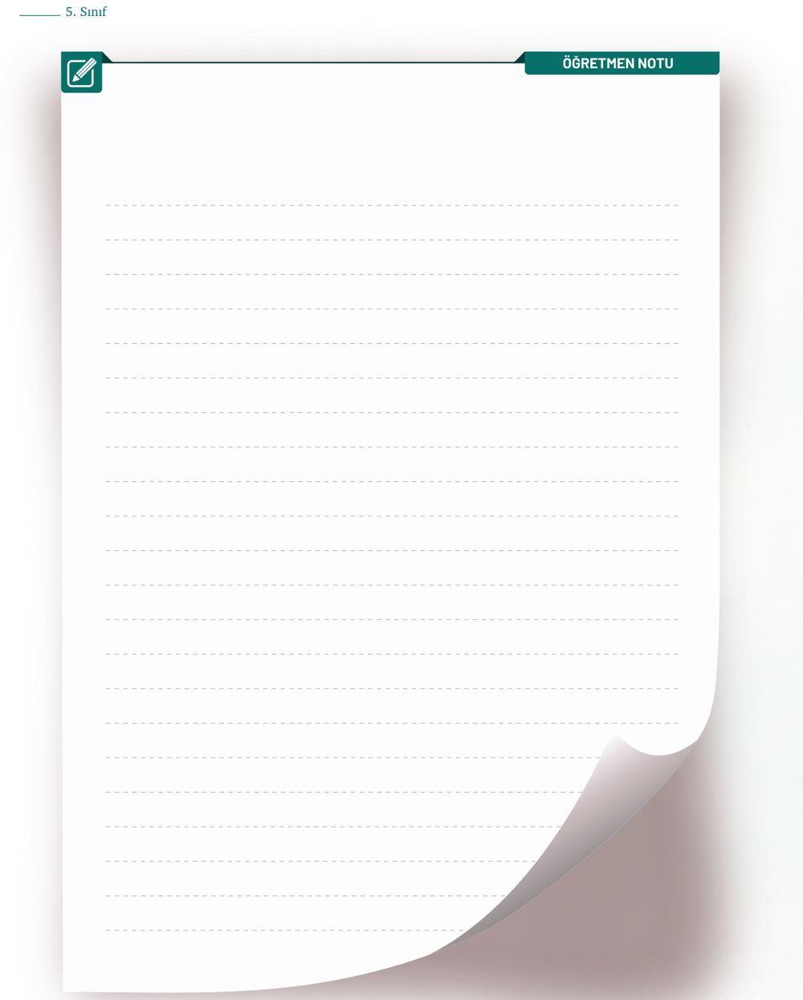
<!-- yer tutucu bulunamadı: sayfa sonuna eklendi -->

<!-- sayfa 28 -->

5. Sınıf

## 2. TEMA

# SANATIN GÖRSEL DİLİ

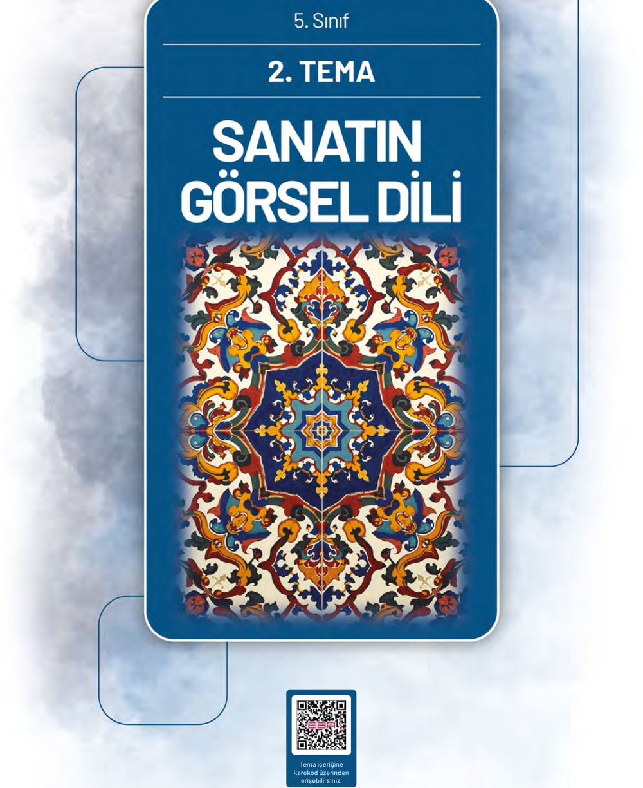

Tema içeriğine
karekod üzerinden

<!-- sayfa 29 -->

| TEMA ADI | Sanatın Görsel Dili |
| :--- | :--- |
| **SINIF DÜZEYİ** | 5 |
| **TEMA KAPSAMI** | Öğrencilerin Selçuklu ve Osmanlı Dönemlerine ait motiflerin tarihî ve kültürel bağlamlarını kavramaları, bu motiflerin estetik ve sembolik anlamlarını yorumlamaları, kültürel motiflerin dönüşüm sürecini, geleneksel sanat anlayışını çağdaş sanatla ilişkilendirerek asimetrik dengeyi kullanarak kolaj yapabilmeleri amaçlanmaktadır. |
| **DERS SAATİ** | 4 |
| **ALAN BECERİLERİ** | SAB2. Görsel Mesajı Okuma, SAB4. Sanatsal Üretim Yapma |
| **KAVRAMSAL BECERİLER** | – |
| **EĞİLİMLER** | E1.3. Azim ve Kararlılık, E3.2. Odaklanma, E3.3. Yaratıcılık |

### PROGRAMLAR ARASI BİLEŞENLER

| SOSYAL-DUYGUSAL ÖĞRENME BECERİLERİ | SDB1.1. Kendini Tanıma (Öz Farkındalık), SDB1.2. Kendini Düzenleme (Öz Düzenleme), SDB2.2. İş Birliği, SDB3.2. Esneklik |
| :--- | :--- |
| **DEĞERLER** | D7. Estetik, D15. Sevgi, D16. Sorumluluk, D19. Vatanseverlik |
| **OKURYAZARLIK BECERİLERİ** | OB1. Bilgi Okuryazarlığı, OB2. Dijital Okuryazarlık, OB4. Görsel Okuryazarlık, OB5. Kültür Okuryazarlığı, OB7. Veri Okuryazarlığı |
| **DİSİPLİNLER ARASI İLİŞKİLER** | Din Kültürü ve Ahlak Bilgisi, Sosyal Bilgiler |
| **BECERİLER ARASI İLİŞKİLER** | KB2.7. Karşılaştırma, KB2.14. Yorumlama, KB2.18. Tartışma, KB2.20. Sentezleme |

### ÖĞRENME ÇIKTILARI VE SÜREÇ BİLEŞENLERİ

**GS.5.2.1. Anadolu Türk kültürüne ait motiflerdeki görsel mesajları okuyabilme**
a) Selçuklu ve Osmanlı Dönemlerine ait motiflerdeki mesajları algılar.
b) Selçuklu ve Osmanlı Dönemlerine ait motiflerdeki mesajları anlamlandırır.

**GS.5.2.2. Anadolu Türk kültürüne ait estetik motiflerle kolaj yapabilme**
a) Selçuklu ve Osmanlı Dönemlerine ait motiflerle asimetrik kompozisyon tasarlar.
b) Selçuklu ve Osmanlı Dönemlerine ait motiflerle asimetrik kompozisyon oluşturur.

| İÇERİK ÇERÇEVESİ | Selçuklu ve Osmanlı Sanatında Motifler   Asimetrik Denge |
| :--- | :--- |
| **ANAHTAR KAVRAMLAR** | asimetrik denge, Osmanlı motifleri, Selçuklu motifleri |
| **ÖĞRENME KANITLARI (ÖLÇME VE DEĞERLENDİRME)** | Öğrenme çıktıları; gözlem formları, kontrol listeleri ve öz değerlendirme formları kullanılarak değerlendirilebilir. Sınıf içi performans görevi olarak öğrencilerden Selçuklu ve Osmanlı Dönemlerine ait motiflerle asimetrik dengeye uygun kolaj kompozisyonu oluşturmaları istenir. Çalışmalarında geleneksel motifleri çağdaş bir bakış 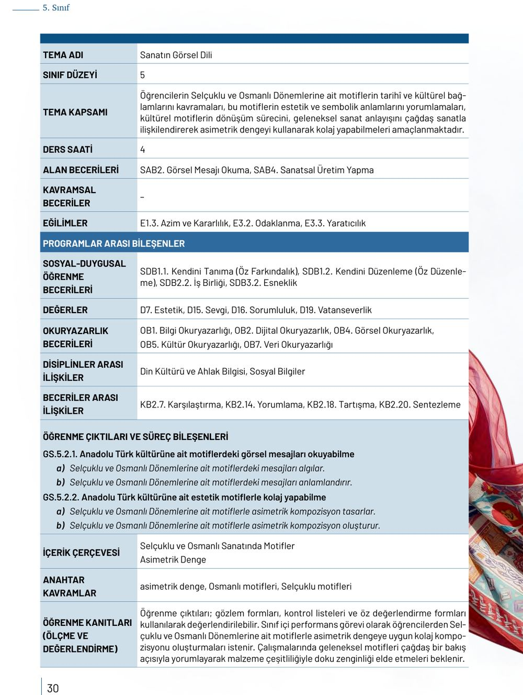 |

<!-- sayfa 30 -->

# TEMA AKIŞI

* Görsel İnceleme Çalışması: Motifleri Biçim Özellikleriyle İnceleme
* Selçuklu ve Osmanlı Dönemlerine Ait Motiflerle Asimetrik Kompozisyon Tasarlama
* Motiflerle Asimetrik Kolaj Yapma
* Güzelliğin Duygular Üzerindeki Etkisi Hakkında Farkındalık Geliştirme
* Çalışma Ortamını Düzenleme
* Değerlendirme
* Sergileme
* Farklılaştırma

# ÖĞRETMEN HAZIRLIĞI

Ders öncesinde Osmanlı ve Selçuklu motifleri kısaca gözden geçirilir. Hazırlık kapsamında aşağıdaki örneklerin hazır bulundurulması önerilir.

* Bu temada Selçuklu ve Osmanlı Dönemlerine ait motif örnekleri, motiflerin kısa açıklamaları, motiflerin günlük yaşamdaki kullanımları, Bedri Rahmi Eyüboğlu’nun “Kompozisyon” ve Henri Matisse’in (Anri Matisse) “Kodomalar” (Fr. Les Codomas, “Les Kodomas”) isimli eserleri sunulmuştur.
* Simetri ve asimetri kavramlarını göstermek için süsleme örnekleri ve günlük yaşamdan görseller ders öncesinde hazırlanabilir.

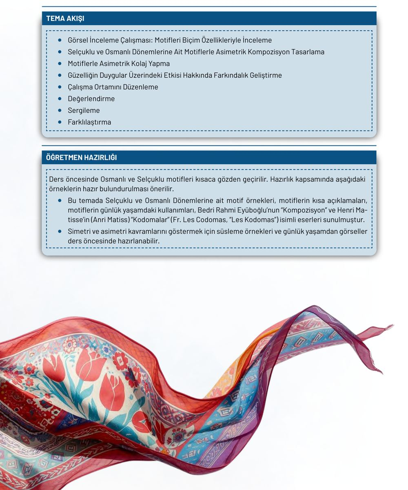

<!-- sayfa 31 -->

# ÖĞRENCİ HAZIRLIĞI VE ETKİNLİK MALZEMELERİ

Uygulamada kullanılacak malzemeler öğrencilerle paylaşılır. Bu temadaki çalışmaların büyük bölümünde kolaj malzemeleri kullanılmaktadır. Bu nedenle malzeme listesi toplu olarak sunulmuştur. Zenginleştirme ve destekleme çalışmalarında da temel malzemeler esas alınır. Gerektiğinde boya veya baskı araçları eklenebilir.

---

## Ortak Kolaj Malzemeleri

* Kumaş parçaları, kartonlar, örgü ipler, tüller vb.
* Renkli fon kartonları, el işi kâğıtları, gazete ve dergi parçaları
* Küt uçlu makas
* Mum tipi yapıştırıcı
* Renkli boyalar (isteğe bağlı)

## Baskı ve Boya Uygulamaları İçin

* Sulu boya, guaj boya veya akrilik boya
* Fırça
* Su kabı

## Dijital Kolaj Çalışmaları İçin

* Yapay zekâ uygulaması (isteğe bağlı)
* Tablet veya çizim yapılabilir dijital cihaz (isteğe bağlı)
* Dijital çizim uygulaması (isteğe bağlı)

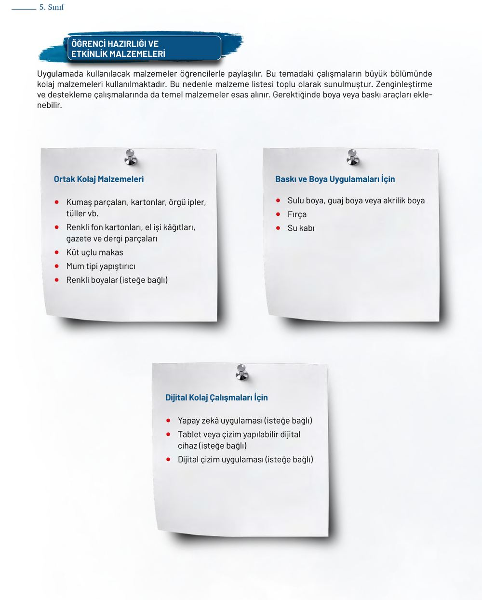
<!-- yer tutucu bulunamadı: sayfa sonuna eklendi -->

<!-- sayfa 32 -->

# ÖĞRENME-ÖĞRETME YAŞANTILARI

**TEMEL KABULLER**

Öğrencilerin, Türk kültürüne ait bazı motiflerin Türk-İslam inancının etkisiyle biçim ve anlam bakımından zenginleştiğine ve zamanla değişime uğradığına ilişkin temel bilgiye sahip oldukları kabul edilmektedir.

**ÖN DEĞERLENDİRME SÜRECİ**

Türk kültürüne ait motiflerin Türk-İslam inancıyla geçirdiği anlam ve biçim değişimlerine ilişkin öğrencilerin bilgilerini ölçmek için öğrencilere aşağıdakilere benzer kısa cevaplı sorular yöneltilir:

* Türk kültüründe kullanılan geleneksel motiflerden bazılarını sayabilir misiniz?
* Türk sanatında sıkça kullanılan geometrik biçimler nelerdir?
* Türk motiflerinin, İslam sanatının etkisiyle hangi yönlerden değiştiğini düşünüyorsunuz?

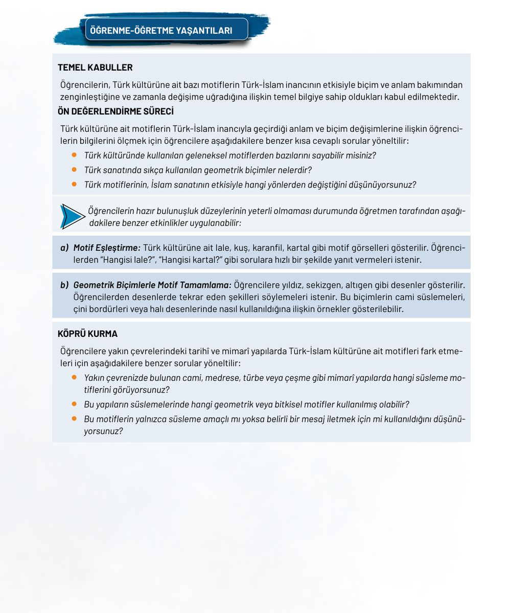

Öğrencilerin hazır bulunuşluk düzeylerinin yeterli olmaması durumunda öğretmen tarafından aşağıdakilere benzer etkinlikler uygulanabilir:

**a) *Motif Eşleştirme*:** Türk kültürüne ait lale, kuş, karanfil, kartal gibi motif görselleri gösterilir. Öğrencilerden *"Hangisi lale?"*, *"Hangisi kartal?"* gibi sorulara hızlı bir şekilde yanıt vermeleri istenir.

**b) *Geometrik Biçimlerle Motif Tamamlama*:** Öğrencilere yıldız, sekizgen, altıgen gibi desenler gösterilir. Öğrencilerden desenlerde tekrar eden şekilleri söylemeleri istenir. Bu biçimlerin cami süslemeleri, çini bordürleri veya halı desenlerinde nasıl kullanıldığına ilişkin örnekler gösterilebilir.

**KÖPRÜ KURMA**

Öğrencilere yakın çevrelerindeki tarihî ve mimarî yapılarda Türk-İslam kültürüne ait motifleri fark etmeleri için aşağıdakilere benzer sorular yöneltilir:

* Yakın çevrenizde bulunan cami, medrese, türbe veya çeşme gibi mimarî yapılarda hangi süsleme motiflerini görüyorsunuz?
* Bu yapıların süslemelerinde hangi geometrik veya bitkisel motifler kullanılmış olabilir?
* Bu motiflerin yalnızca süsleme amaçlı mı yoksa belirli bir mesaj iletmek için mi kullanıldığını düşünüyorsunuz?

<!-- sayfa 33 -->

# ÖĞRENME-ÖĞRETME UYGULAMALARI
## Uygulama Öncesi

Öğrencilerden Anadolu Türk kültürüne ait motiflerdeki görsel mesajları okuyabilmeleri beklenir. Bu amaçla aşağıdaki süreçler takip edilir.

### GÖRSEL İNCELEME

#### Motifleri Biçim Özellikleriyle İnceleme
Derse Selçuklu ve Osmanlı Dönemi’ne ait rumi motifi, penç motifi, geometrik ve bitkisel motif örnekleri gösterilerek başlanır (**OB5**). Mimar Sinan’ın eserlerindeki süslemeler, çini panolar ve minyatür örnekleri kısaca gösterilir. Bu görseller üzerinden motiflerin mimarîde ve süsleme sanatlarında yer aldığı fark edilir. Motiflerde tekrar eden şekillere, simetriye ve renk kullanımına dikkat çekilir (**OB4, E3.2**). Süreçte sanal müze ziyareti yapılabilir (**OB2**).

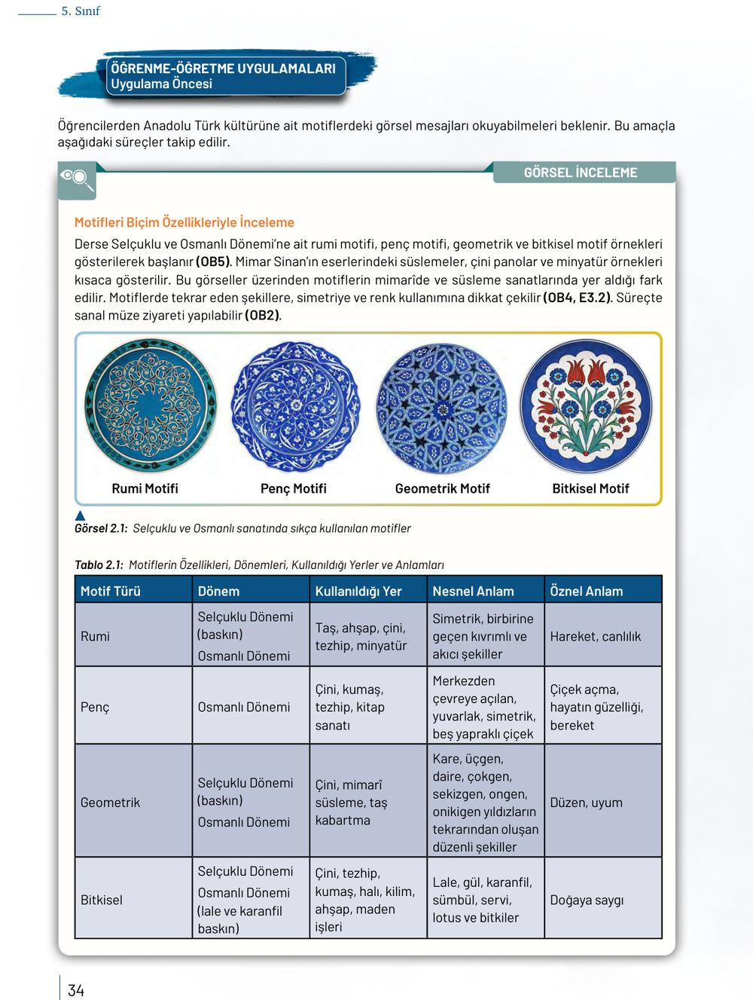
*Görsel 2.1: Selçuklu ve Osmanlı sanatında sıkça kullanılan motifler*

**Tablo 2.1: Motiflerin Özellikleri, Dönemleri, Kullanıldığı Yerler ve Anlamları**

| Motif Türü | Dönem | Kullanıldığı Yer | Nesnel Anlam | Öznel Anlam |
| :--- | :--- | :--- | :--- | :--- |
| Rumi | Selçuklu Dönemi (baskın) Osmanlı Dönemi | Taş, ahşap, çini, tezhip, minyatür | Simetrik, birbirine geçen kıvrımlı ve akıcı şekiller | Hareket, canlılık |
| Penç | Osmanlı Dönemi | Çini, kumaş, tezhip, kitap sanatı | Merkezden çevreye açılan, yuvarlak, simetrik, beş yapraklı çiçek | Çiçek açma, hayatın güzelliği, bereket |
| Geometrik | Selçuklu Dönemi (baskın) Osmanlı Dönemi | Çini, mimarî süsleme, taş kabartma | Kare, üçgen, daire, çokgen, sekizgen, ongen, onikigen yıldızların tekrarından oluşan düzenli şekiller | Düzen, uyum |
| Bitkisel | Selçuklu Dönemi Osmanlı Dönemi (lale ve karanfil baskın) | Çini, tezhip, kumaş, halı, kilim, ahşap, maden işleri | Lale, gül, karanfil, sümbül, servi, lotus ve bitkiler | Doğaya saygı |

<!-- sayfa 34 -->

Tablo 2.1'de yer alan bilgilerden yararlanılarak motiflerin hangi dönemde ve nerelerde kullanıldığı öğrencilerle gözden geçirilebilir. Bu süreçte Selçuklu ve Osmanlı motiflerinin benzer ve farklı yönleri sınıf içinde gruplar hâlinde kısa paylaşımlarla belirlenir (**KB2.7, SDB2.2, OB7**). Motiflerde simetrinin önemli bir özellik olduğu birlikte fark edilir. Süreçte çalışma kâğıtlarından (**Bk. Ek 1**) veya aşağıdaki örnek sorulardan faydalanılabilir.

* Motifte tekrar eden geometrik şekiller nelerdir?
* Motifte bitki veya hayvan figürleri var mıdır? Varsa bunlar nelerdir?
* Motifin merkezinde ve kenarlarında neler yer almaktadır?
* Motifin ortasından dikey bir çizgi çizildiğinde sağ ve sol kısımlar birbirine ne kadar benzemektedir?
* Motifte kullanılan renkler nelerdir? En çok kullanılan renk hangisidir?
* Sizce motifteki renkler birbiriyle uyumlu mudur? Neden?

Motiflerin hem süsleme amacıyla kullanıldığı hem de anlamının olduğu belirtilir (**D7.1, D19.3**). Öğrenciler motiflere yeniden bakarken bu şekillerin dalga, güneş, çiçek veya yıldız gibi doğal unsurları çağrıştırıp çağrıştırmadığını düşünür ve hangi duyguları hissettirdiğini ifade eder (**SDB1.1**). Osmanlı çinilerinde görülen lale motifinin zarafet ve tevazuyu, Selçuklu yıldız motifinin ise düzen ve ilmi temsil ettiği açıklanır. Öğrenciler motiflerin görünen biçimi ile hissettirdikleri arasında bağ kurar (**OB1, KB2.14**). Bu noktada kültürel mirasın korunmasının önemi kısaca hatırlatılır (**D19.2, D15.2**). Sürecin değerlendirilmesinde gözlem formu (**Bk. Ek 2**) kullanılabilir.

# Tasarım Geliştirme:
## Selçuklu ve Osmanlı Dönemlerine Ait Motiflerle Asimetrik Kompozisyon Tasarlama

Öğrencilerin Anadolu Türk kültürüne özgü estetik motiflerle asimetrik denge temelinde sanatsal üretim yapabilmeleri beklenir. Geleneksel motiflerin günümüzde farklı tasarım alanlarında kullanıldığı karşılaştırmalı olarak hatırlatılır (**KB2.7**). Öğrenciler günlük hayatta gördükleri motifleri örneklendirir. Simetri ve asimetri arasındaki fark kısa bir açıklamayla gösterilir. Motiflerin genellikle simetrik düzen taşıdığı ancak bir kompozisyon içinde farklı büyüklük ve yönlerde yerleştirilebileceği ifade edilir (**KB2.18**).

Bedri Rahmi Eyüboğlu’nun Anadolu motiflerini modern yorumla kullandığı eserleri (**Bk. Görsel 2.7**) ile Henri Matisse’in kolaj örnekleri (**Bk. Görsel 2.8**) gösterilerek motiflerin modern çalışmalarda farklı yön ve büyüklüklerde alabildiği fark edilir. Öğrenciler seçtikleri bir motif üzerinden sayfada farklı bir yerleşim dener (**E3.3**). Motifi tam ortaya koymak yerine sayfanın farklı bir bölümüne yerleştirerek asimetrik bir düzen planlar. Gerekirse bir motifi büyüklük veya renk ile öne çıkarır. Çalışma taslak düzeyinde planlanır.

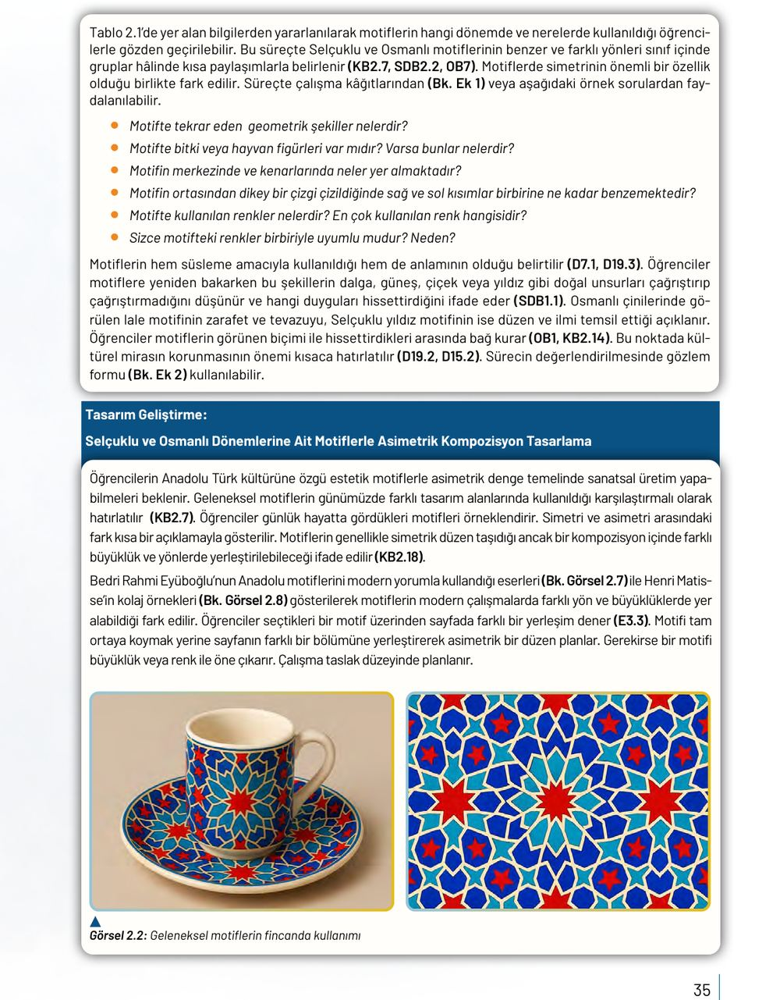

▲ Görsel 2.2: Geleneksel motiflerin fincanda kullanımı

<!-- sayfa 35 -->

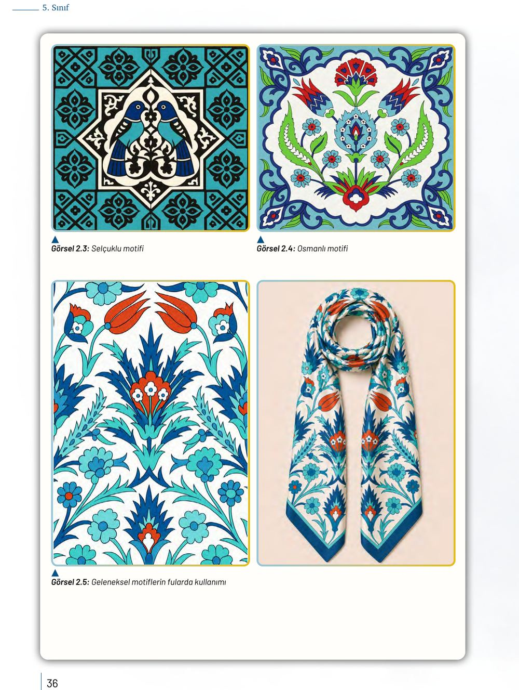

Görsel 2.3: Selçuklu motifi
Görsel 2.4: Osmanlı motifi
Görsel 2.5: Geleneksel motiflerin fularda kullanımı

<!-- sayfa 36 -->

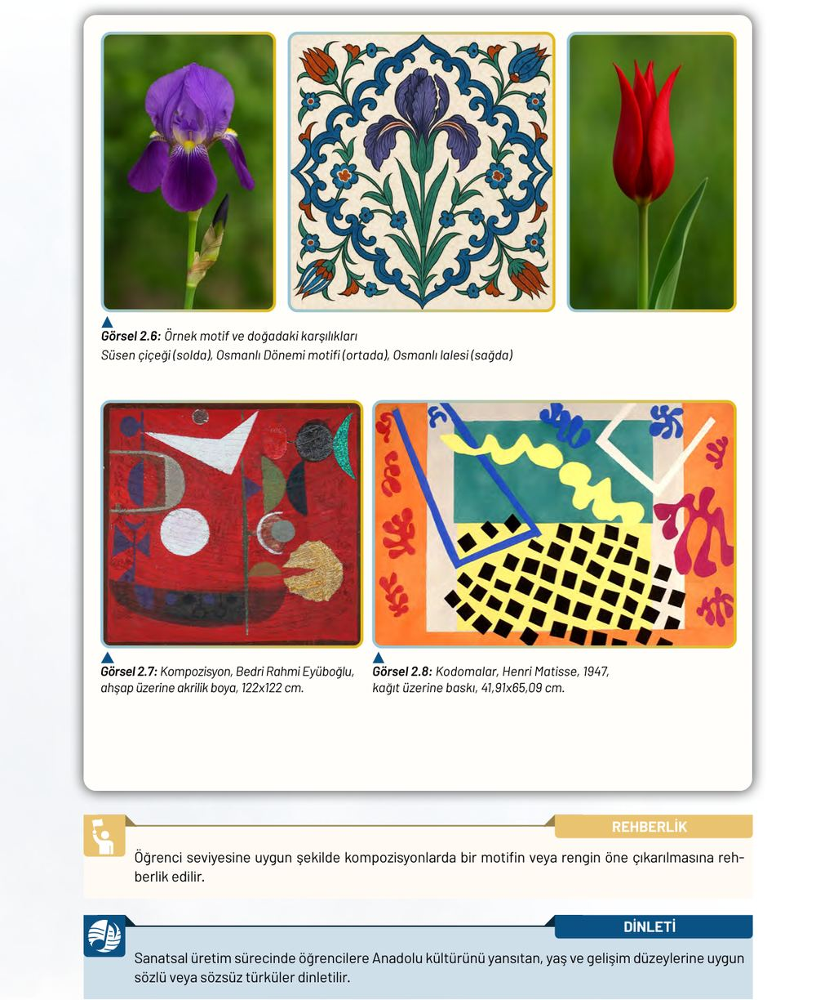

**Görsel 2.6:** *Örnek motif ve doğadaki karşılıkları*
Süsen çiçeği (solda), Osmanlı Dönemi motifi (ortada), Osmanlı lalesi (sağda)

**Görsel 2.7:** *Kompozisyon, Bedri Rahmi Eyüboğlu, ahşap üzerine akrilik boya, 122x122 cm.*

**Görsel 2.8:** *Kodomalar, Henri Matisse, 1947, kağıt üzerine baskı, 41,91x65,09 cm.*

---

| REHBERLİK |
| :--- |
| Öğrenci seviyesine uygun şekilde kompozisyonlarda bir motifin veya rengin öne çıkarılmasına rehberlik edilir. |

| DİNLETİ |
| :--- |
| Sanatsal üretim sürecinde öğrencilere Anadolu kültürünü yansıtan, yaş ve gelişim düzeylerine uygun sözlü veya sözsüz türküler dinletilir |

<!-- sayfa 37 -->

# Uygulama Sırası

Selçuklu ve Osmanlı Dönemlerine ait motiflerle asimetrik denge temelinde kompozisyon oluşturmaları için öğrencilerden tasarımları doğrultusunda geleneksel veya dijital teknikleri kullanarak kolaj yapmaları istenir **(KB2.20)**.

⚠️ Öğrenciler aşağıdaki etkinliklerden birine yönlendirilir.

## Seçmeli Etkinlik 1: Motiflerle Asimetrik Kolaj Yapma

Öğrenciler aşağıdaki aşamaları sırasıyla gerçekleştirerek Selçuklu ve Osmanlı Dönemlerine ait motiflerle asimetrik kolaj hazırlar.

1. Selçuklu ve Osmanlı Dönemi’ne ait lale, yıldız veya çiçek motiflerinden birkaçını seçer.
2. Seçtiği motiflerin renk ve biçim özelliklerini inceler.
3. Kumaş, karton, ip, tül, el işi kâğıdı ve dergi parçalarını hazırlar **(D16.3, SDB1.2)**.
4. Kullanacağı malzemeleri kendi tercihine göre belirler **(D16.1, SDB1.2, SDB2.2)**.
5. Katlama, yırtma, kesme ve yapıştırma tekniklerini uygulayabilir.
6. Motifi sağa, sola, yukarı veya aşağı kaydırarak simetriden uzaklaştırır.
7. Motifleri üst üste yerleştirerek katman oluşturur.
8. Yüzeyde boş ve dolu alan dengesine dikkat eder.
9. Bazı bölümleri boya ile renklendirebilir.
10. İp, kâğıt veya boya kullanarak yüzeyde farklı dokular oluşturabilir.
11. Kolajına kısa bir tanıtım etiketi hazırlayabilir.
12. Süreçte karşılaştığı sorunlara çözüm üretir **(SDB3.2, E1.3)**.
13. Süreci ve ürününü öz değerlendirme formu **(Bk. Ek 3)** ile değerlendirir.

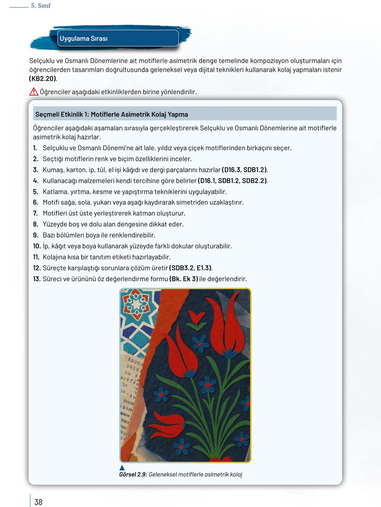

Görsel 2 9: Geleneksel motiflerle asimetrik kolaj

<!-- sayfa 38 -->

# Seçmeli Etkinlik 2: Dijital Motiflerle Asimetrik Kolaj Yapma

Öğrenciler Selçuklu ve Osmanlı Dönemlerine ait motiflerle dijital çizim araçlarını kullanarak asimetrik kolaj hazırlamak için aşağıdaki aşamaları sırasıyla gerçekleştirir.

1. Dijital kolaj için kullanacağı uygun programı seçer (**OB2**).
2. Selçuklu ve Osmanlı Dönemi’ne ait lale, yıldız veya çiçek motiflerinden birkaçını belirler.
3. Çalışma öncesinde kullanacağı görselleri veya dijital dosyaları hazırlar (**D16.3, SDB1.2**).
4. Motifin renk ve biçim özelliklerini inceleyerek kullanacağı renkleri belirler.
5. Programda katman oluşturarak motifleri üst üste yerleştirir.
6. Motifleri büyütür, küçültür, döndürür veya saydamlaştırabilir.
7. Renk ve boyut değişiklikleri yaparak çalışmasında asimetrik denge oluşturur.
8. Çalışmasına kısa bir etiket ekleyebilir.
9. Karşılaştığı sorunlara çözüm üretir (**SDB3.2, E1.3**).
10. Süreci ve ürününü öz değerlendirme formu (**Bk. Ek 3**) ile değerlendirir.

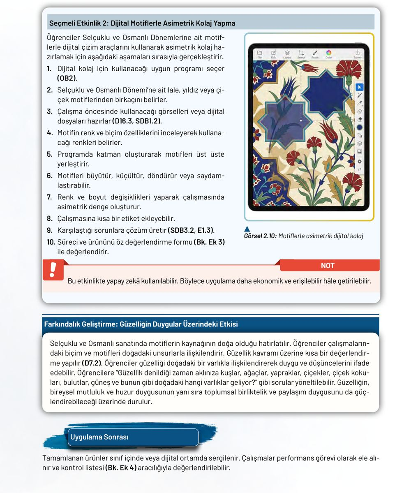
*Görsel 2.10: Motiflerle asimetrik dijital kolaj*

> **! NOT**
> Bu etkinlikte yapay zekâ kullanılabilir. Böylece uygulama daha ekonomik ve erişilebilir hâle getirilebilir.

## Farkındalık Geliştirme: Güzelliğin Duygular Üzerindeki Etkisi

Selçuklu ve Osmanlı sanatında motiflerin kaynağının doğa olduğu hatırlatılır. Öğrenciler çalışmalarındaki biçim ve motifleri doğadaki unsurlarla ilişkilendirir. Güzellik kavramı üzerine kısa bir değerlendirme yapılır (**D7.2**). Öğrenciler güzelliği doğadaki bir varlıkla ilişkilendirerek duygu ve düşüncelerini ifade edebilir. Öğrencilere “Güzellik denildiği zaman aklınıza kuşlar, ağaçlar, yapraklar, çiçekler, çiçek kokuları, bulutlar, güneş ve bunun gibi doğadaki hangi varlıklar geliyor?” gibi sorular yöneltilebilir. Güzelliğin, bireysel mutluluk ve huzur duygusunun yanı sıra toplumsal birliktelik ve paylaşım duygusunu da güçlendirebileceği üzerinde durulur.

### Uygulama Sonrası

Tamamlanan ürünler sınıf içinde veya dijital ortamda sergilenir. Çalışmalar performans görevi olarak ele alınır ve kontrol listesi (**Bk. Ek 4**) aracılığıyla değerlendirilebilir.

<!-- sayfa 39 -->

# FARKLILAŞTIRMA

## Zenginleştirme

⚠️ Öğrenciler aşağıdaki etkinliklerden birine yönlendirilebilir.

### Seçmeli Etkinlik 1: Kolaj ile Baskı Tekniğini Birleştirme

Öğrenciler aşağıdaki aşamaları takip ederek Selçuklu ve Osmanlı motiflerinden hareketle kolaj tekniğini baskı uygulamalarıyla birleştirir.

1. Selçuklu ve Osmanlı Dönemi’ne ait lale, yıldız veya çiçek motiflerinden birini seçer.
2. Karton, ip, kumaş veya kalın kâğıt gibi malzemelerle motifin kabartma yüzeyini oluşturur.
3. Sünger veya fırça yardımıyla kalıbın üzerine boya sürer.
4. Kalıbı kâğıt üzerine bastırarak baskı alır.
5. Baskıdan sonra yüzeye kolaj parçaları ekleyerek çalışmayı zenginleştirir.
6. Motifleri yüzeyde farklı yerlere yerleştirerek simetriden uzak bir düzen kurar.
7. Boş ve dolu alan dengesine dikkat eder.
8. Çalışmasına kısa bir tanıtım etiketi hazırlar.
9. Süreci ve ürününü öz değerlendirme formu (**Bk. Ek 3**) ile değerlendirir.

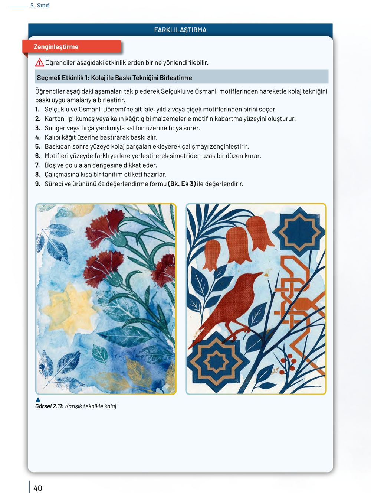

Görsel 2.11: Karışık teknikle kolaj

<!-- sayfa 40 -->

# Seçmeli Etkinlik 2: Motifleri Sadeleştirerek Resmetme

Öğrenciler motifleri sadeleştirerek kompozisyon hazırlamak için aşağıdaki aşamaları gerçekleştirir.

1. Selçuklu ve Osmanlı Dönemi’ne ait lale, yıldız veya çiçek motiflerinden birkaçını seçer.
2. Seçtiği motifin temel şekillerini ve tekrar düzenini inceler.
3. Kullanacağı boyaları kendi tercihine göre belirler.
4. Motifi ayrıntılarını azaltarak daha basit bir şekle dönüştürür.
5. En az iki yöntem uygular:
    * Dış hatları koruyarak sadeleştirir.
    * Kavisleri geometrik şekle dönüştürür.
    * Aynı birimi tekrar ederek ritim oluşturur.
6. Motifleri simetriden uzak yerleştirir ve boş-dolu alan dengesine dikkat eder.
7. Süreci ve ürününü öz değerlendirme formu (**Bk. Ek 3**) ile değerlendirir.

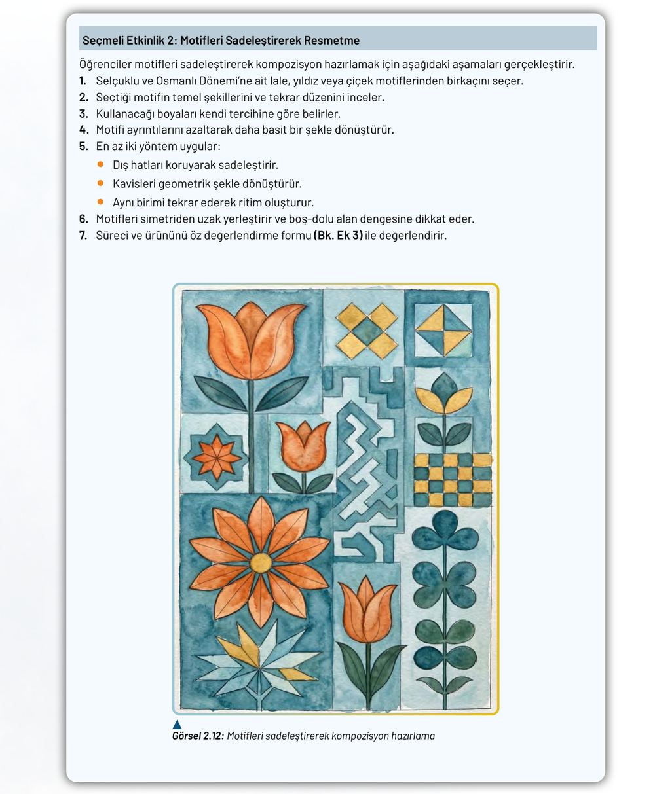

**Görsel 2.12: Motifleri sadeleştirerek kompozisyon hazırlama**

<!-- sayfa 41 -->

# Destekleme

⚠️ Öğrenciler aşağıdaki etkinliklerden birine yönlendirilebilir.

## Seçmeli Etkinlik 1: Hazır Motif Görselleriyle Kolaj Yapma

Öğrenciler öğretmen rehberliğinde hazır motif görsellerini kullanarak asimetrik kolaj oluşturmak için aşağıdaki aşamaları gerçekleştirir.

1. Selçuklu ve Osmanlı Dönemi'ne ait lale, yıldız veya çiçek motiflerinden birkaçını belirler.
2. Motifleri yırtarak veya makasla keserek hazırlar.
3. Motifleri yapıştırmadan önce zemine yerleştirerek farklı düzenlemeler dener.
4. Motifleri farklı yönlere çevirir ve üst üste yerleştirir.
5. Bazı motifleri öne, bazılarını arkaya yerleştirerek katman oluşturur.
6. Boş ve dolu alan dengesine dikkat eder.
7. Düzenlemeyi mum tipi yapıştırıcı ile sabitler.
8. İsterse motiflerin bazı bölümlerini renklendirir.
9. Süreci ve ürününü öz değerlendirme formu (Bk. Ek 3) ile değerlendirir.

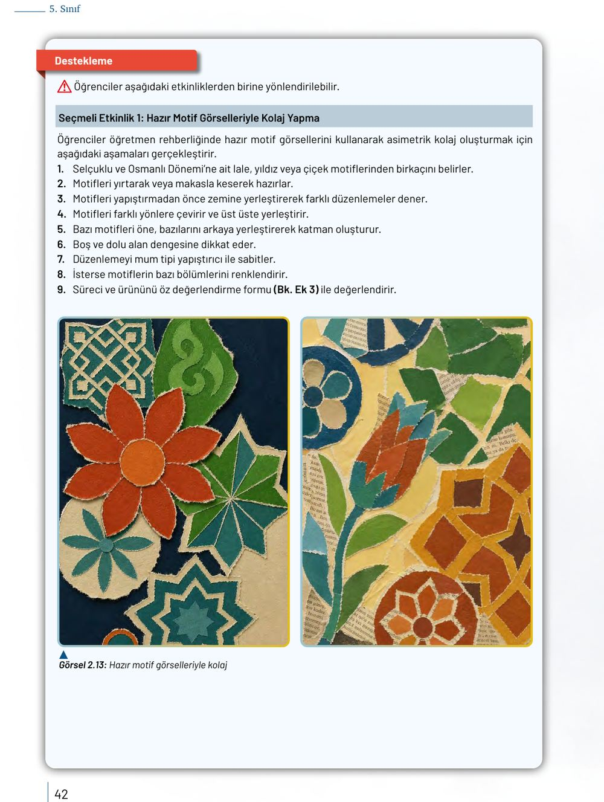

Görsel 2.13: Hazır motif görselleriyle kolaj

<!-- sayfa 42 -->

# Seçmeli Etkinlik 2: Motif Tamamlama

Öğrenciler öğretmen rehberliğinde yarım bırakılmış motifleri tamamlayarak asimetrik bir motif oluşturmak için aşağıdaki aşamaları gerçekleştirir.

1. Öğrencilere Selçuklu ve Osmanlı Dönemi’ne ait yarım bırakılmış motif görselleri dağıtılır.
2. Öğrenciler motifler arasından bir motif seçer.
3. Motifi resim kâğıdının köşesine yapıştırır.
4. Kullanacağı boyaları kendi tercihine göre belirler.
5. Motiften hareketle eksik kısmı çizer.
6. Motifi simetrik yapmadan farklı yöne doğru tamamlar.
7. Tamamladığı bölümleri renklendirir.
8. Süreci ve ürününü öz değerlendirme formu (**Bk. Ek 3**) ile değerlendirir.

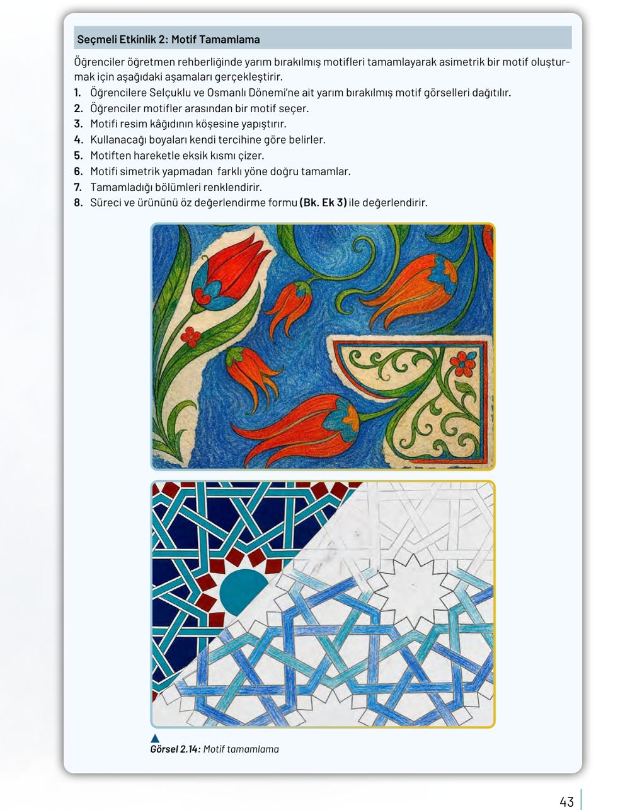

Görsel 2.14: Motif tamamlama

<!-- sayfa 43 -->

EK 1. ÇALIŞMA KÂĞIDI

# ÇALIŞMA KÂĞIDI

**Etkinlik Adı**: Selçuklu ve Osmanlı Motiflerini Karşılaştırma  
**Adı-Soyadı**: ...........................................................................  
**Sınıfı-Numarası**: ............ / ............  
**Tarih**: ............ / ............ / 20......

Aşağıdaki motifleri sorular eşliğinde aşamalı olarak inceleyiniz ve notlar alınız.

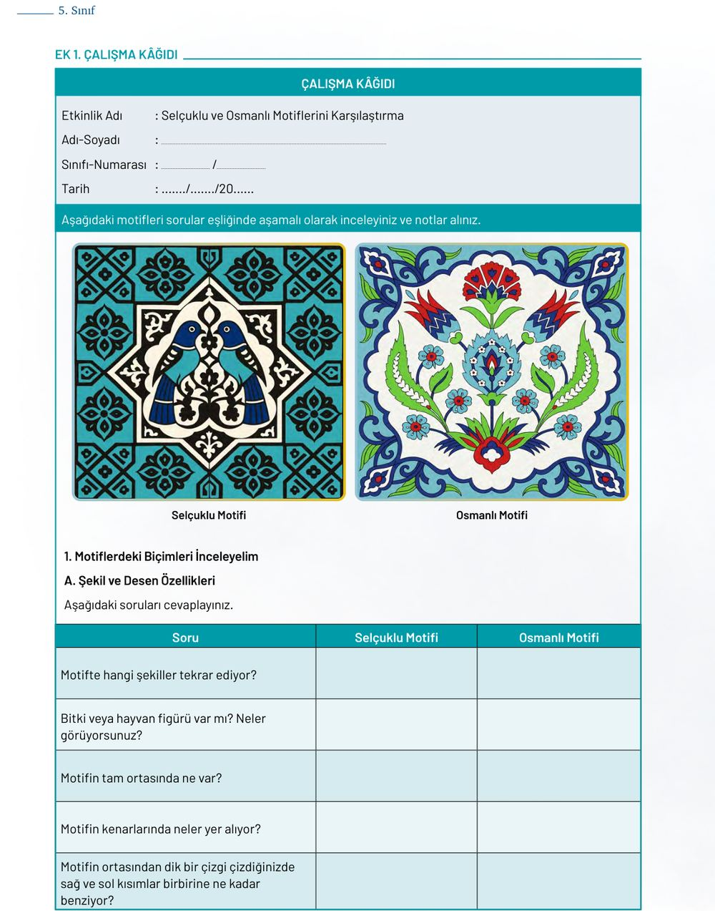

**Selçuklu Motifi** | **Osmanlı Motifi**

## 1. Motiflerdeki Biçimleri İnceleyelim
### A. Şekil ve Desen Özellikleri
Aşağıdaki soruları cevaplayınız.

| Soru | Selçuklu Motifi | Osmanlı Motifi |
| :--- | :--- | :--- |
| Motifte hangi şekiller tekrar ediyor? | | |
| Bitki veya hayvan figürü var mı? Neler görüyorsunuz? | | |
| Motifin tam ortasında ne var? | | |
| Motifin kenarlarında neler yer alıyor? | | |
| Motifin ortasından dik bir çizgi çizdiğinizde sağ ve sol kısımlar birbirine ne kadar | | |

<!-- sayfa 44 -->

# B. Renk ve Uyum

| Soru | Selçuklu Motifi | Osmanlı Motifi |
| :--- | :--- | :--- |
| Motifte hangi renkler var? | | |
| En çok kullanılan renk hangisi? | | |
| Renkler birbiriyle uyumlu mu? Neden? | | |

## 2. Motifleri Karşılaştıralım

Aşağıdaki başlıkların altına motiflerin benzer ve farklı yönlerini yazınız.

| Benzerlikler | Farklılıklar |
| :--- | :--- |
| | |

“Çalışma Kâğıdı”na karekod üzerinden erişebilirsiniz.
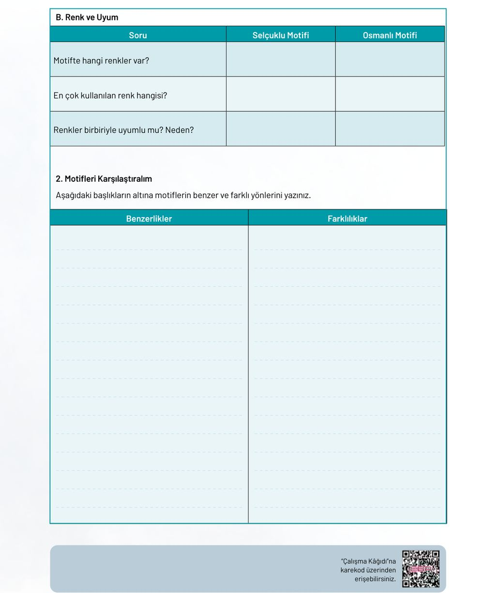

<!-- sayfa 45 -->

EK 2. GÖZLEM FORMU

Bu gözlem formu öğrencilerin öğrenme sürecindeki davranışlarını, katılım düzeylerini ve gelişim alanlarını izlemek amacıyla hazırlanmıştır. Elde edilen bulguları, öğrencilere yapıcı geri bildirim vermek ve öğretim sürecini geliştirmek amacıyla kullanınız.

# GÖZLEM FORMU

Bu form öğrenci performanslarını değerlendirmeniz amacıyla hazırlanmıştır. Listedeki her maddeyi inceleyerek öğrencinize en uygun olan seçeneği işaretleyiniz. “Hiç Uygun Değil” ve “Biraz Uygun” olarak işaretlediğiniz öğrenci davranışlarını geliştirmeye çalışınız.

Etkinlik Adı : ........................................................................................................................
Adı-Soyadı : ..........................................................................................................................
Sınıfı-Numarası : .......... / ..........
Tarih : .......... / .......... / 20......

| No | Ölçütler | Hiç uygun değil | Biraz uygun | Büyük ölçüde uygun | Tamamen uygun |
|---|---|---|---|---|---|
| 1 | Motiflerde tekrar eden şekilleri açıklar. | | | | |
| 2 | Motiflerin renk özelliklerini açıklar. | | | | |
| 3 | Arkadaşlarının görüşlerini saygıyla dinler. | | | | |
| 4 | Düşüncelerini sırayla paylaşır. | | | | |

**Öğretmen Görüşleri/Açıklamalar:** .................................................................................................................................................................................................................................................................................................................................................................................................................................................................................................................................................................................................................................................................................................................................

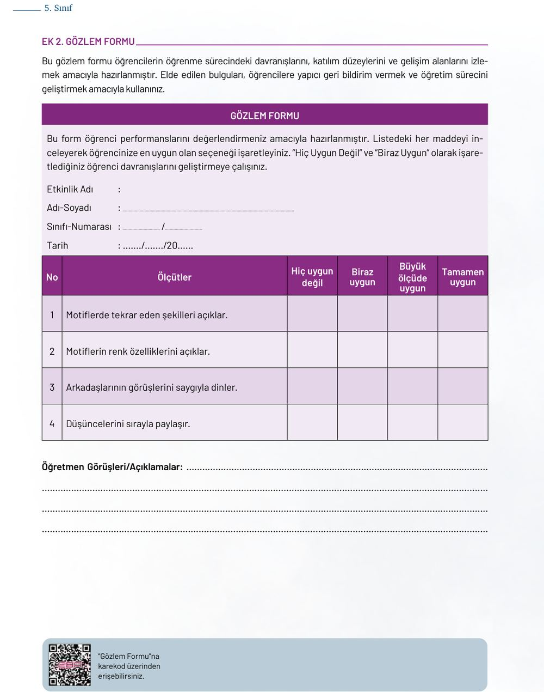
<!-- yer tutucu bulunamadı: sayfa sonuna eklendi -->

<!-- sayfa 46 -->

# EK 3. ÖZ DEĞERLENDİRME FORMU

Bu form öğrencilerin bireysel öğrenme süreçlerine yönelik farkındalık geliştirmelerini ve sorumluluk almalarını desteklemek amacıyla hazırlanmıştır. Formdaki her ölçütü öğrencilerle gözden geçiriniz. Değerlendirme sürecinde öğrencilerin tarafsız olmalarına rehberlik ediniz.

## ÖZ DEĞERLENDİRME FORMU

Bu form, performansınızı değerlendirmeniz amacıyla hazırlanmıştır. Sizden duygu ve düşüncelerinizi samimi ve dürüst olarak bu forma yansıtmanız beklenmektedir. Her ölçüt için en uygun olduğunu düşündüğünüz seçeneği işaretleyiniz. “Hiçbir Zaman” ve “Bazen” olarak işaretlediğiniz cevaplarınızı öğretmeniniz rehberliğinde değerlendiriniz.

Etkinlik Adı :
Adı-Soyadı : _________________________________________________
Sınıfı-Numarası : ________ / ______________
Tarih : ________/________/20......

| No | Ölçütler | Hiçbir zaman | Bazen | Her zaman |
|---|---|---|---|---|
| 1 | Selçuklu ve Osmanlı Dönemi’ne ait motifler arasından seçim yaptım. | | | |
| 2 | Motifleri kaydırarak simetriden uzaklaştırdım. | | | |
| 3 | Çalışmamda farklı malzemeler kullanarak yüzeyde doku çeşitliliği oluşturdum. | | | |
| 4 | Karşılaştığım sorunlarda farklı yollar deneyerek çözüm buldum. | | | |
| 5 | Çalışmamı zamanında tamamladım. | | | |

**Öğrencinin Ek Yorumu:**

**Çalışmanızda en çok hangi bölümü beğendiniz? Neden?**
........................................................................................................................................................................
........................................................................................................................................................................

**Bir sonraki çalışmanızda neleri farklı yapmak istersiniz?**
........................................................................................................................................................................
........................................................................................................................................................................

"Öz Değerlendirme Formu"na karekod üzerinden erişebilirsiniz.
[QR KOD]

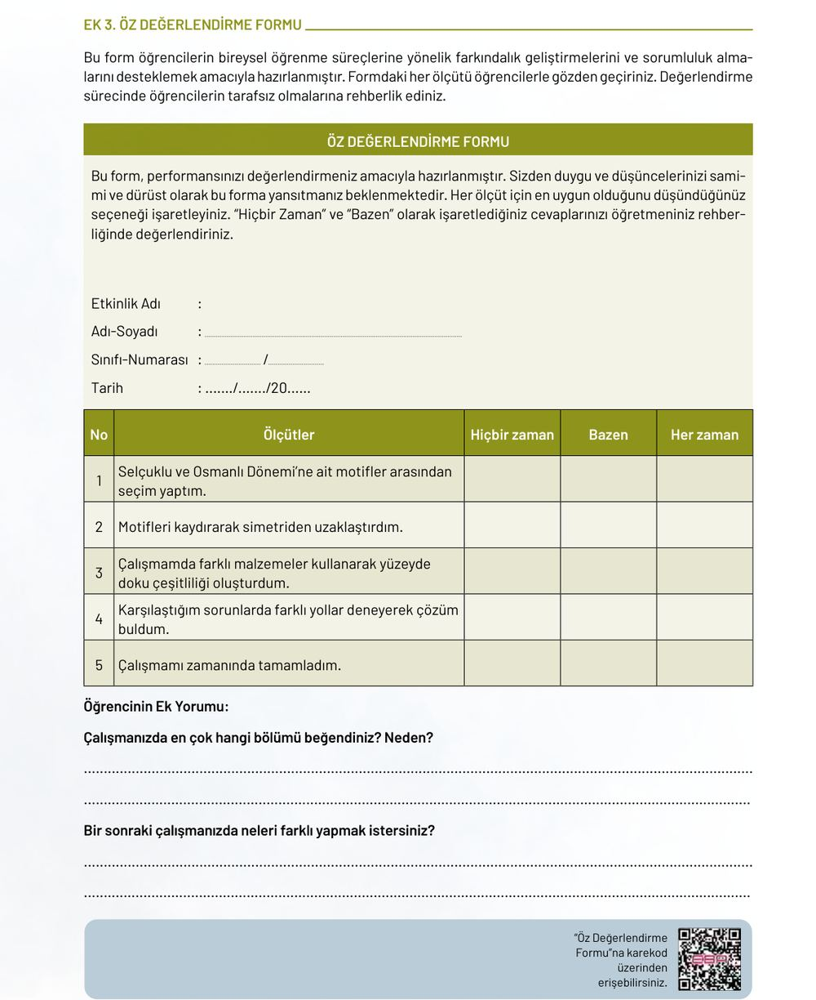
<!-- yer tutucu bulunamadı: sayfa sonuna eklendi -->

<!-- sayfa 47 -->

# EK 4. KONTROL LİSTESİ

Bu form öğrenci performanslarını değerlendirmeniz amacıyla hazırlanmıştır. Listedeki her maddeyi inceleyerek öğrencinize uygun olan “Evet” veya “Hayır” seçeneklerinden birini işaretleyiniz. “Hayır” olarak işaretlediğiniz öğrenci davranışlarını geliştirmeye çalışınız.

| KONTROL LİSTESİ | | | |
| :--- | :--- | :--- | :--- |
| Etkinlik Adı | : | | |
| Adı-Soyadı | : | ____________________________________ | |
| Sınıfı-Numarası | : | ________ / ________ | |
| Tarih | : | ......../......../20...... | |

| No | Ölçütler | Hayır | Evet |
| :--- | :--- | :--- | :--- |
| 1 | Seçtiği motifleri inceleyerek çalışmasına bilinçli biçimde aktardı. | | |
| 2 | Kompozisyonunu asimetrik dengeyi dikkate alarak oluşturdu. | | |
| 3 | Çalışmasında doku etkisi oluşturmak için farklı malzemeleri kullandı. | | |
| 4 | Süreç boyunca zorlandığı durumlarda alternatif çözümler üretti. | | |
| 5 | Çalışmasını zamanında tamamladı. | | |

**Öğretmen Görüşleri/Açıklamalar:** ..................................................................................................................
........................................................................................................................................................................
........................................................................................................................................................................
........................................................................................................................................................................

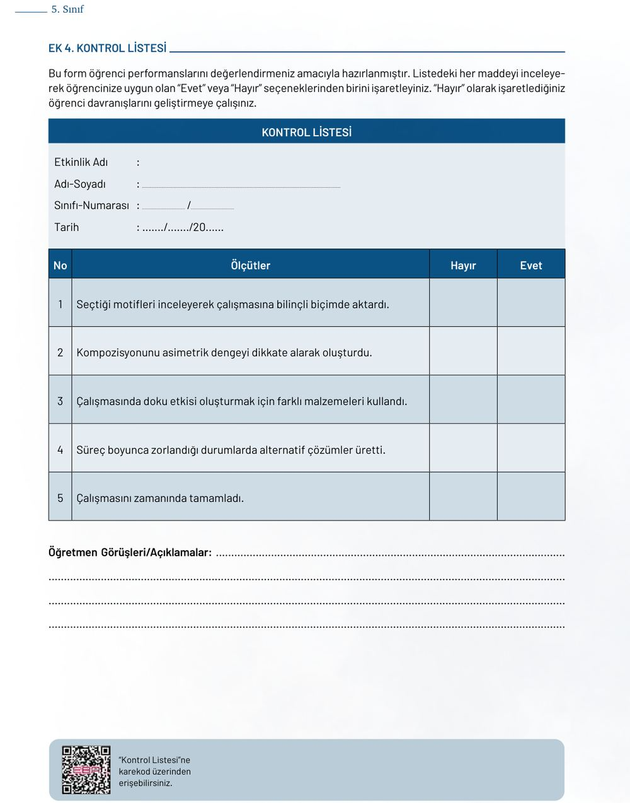 "Kontrol Listesi"ne karekod üzerinden erişebilirsiniz.

<!-- sayfa 48 -->

5. Sınıf

# 3. TEMA

# SANATÇILAR VE ESERLERİ

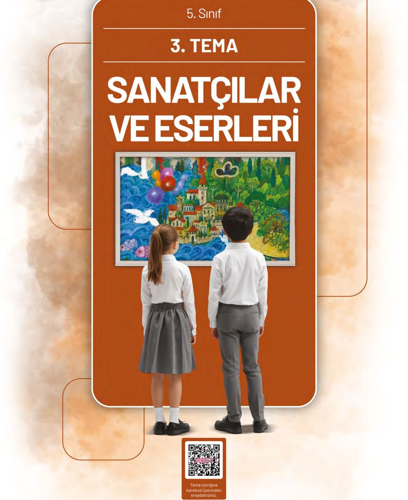

Tema içeriğine 
karekod üzerinden

<!-- sayfa 49 -->

| TEMA ADI | Sanatçılar ve Eserleri |
| :--- | :--- |
| **SINIF DÜZEYİ** | 5 |
| **TEMA KAPSAMI** | Öğrencilerin minyatür sanatının temel özelliklerini ve tarihî gelişimini öğrenmeleri, geleneksel ve çağdaş minyatür eserlerini incelemeleri, tarihî ve mitolojik konulardan hareketle minyatür etkisi içeren sanatsal ürünler oluşturmaları amaçlanmaktadır. |
| **DERS SAATİ** | 5 |
| **ALAN BECERİLERİ** | SAB3. Sanat Eserini İnceleme, SAB4. Sanatsal Üretim Yapma |
| **KAVRAMSAL BECERİLER** | - |
| **EĞİLİMLER** | E1.2. Bağımsızlık, E1.6. Seçicilik, E3.3. Yaratıcılık, E3.4. Gerçeği Arama, E3.5. Açık Fikirlilik, E3.6. Analitiklik, E3.7. Sistematiklik |

### PROGRAMLAR ARASI BİLEŞENLER

| SOSYAL-DUYGUSAL ÖĞRENME BECERİLERİ | SDB1.1. Kendini Tanıma (Öz Farkındalık), SDB1.2. Kendini Düzenleme (Öz Düzenleme), SDB2.2. İş Birliği, SDB2.3. Sosyal Farkındalık, SDB3.3. Sorumlu Karar Verme |
| :--- | :--- |
| **DEĞERLER** | D12. Sabır, D15. Sevgi, D17. Tasarruf, D19. Vatanseverlik |
| **OKURYAZARLIK BECERİLERİ** | OB1. Bilgi Okuryazarlığı, OB2. Dijital Okuryazarlık, OB4. Görsel Okuryazarlık, OB5. Kültür Okuryazarlığı, OB9. Sanat Okuryazarlığı |
| **DİSİPLİNLER ARASI İLİŞKİLER** | Sosyal Bilgiler, Türkçe |
| **BECERİLER ARASI İLİŞKİLER** | KB1. Temel Beceriler, KB2.3. Özetleme, KB2.4. Çözümleme, KB2.7. Karşılaştırma, KB2.17. Değerlendirme, KB3.1. Karar Verme, SAB2.1. Görsel Mesajı Algılama |

### ÖĞRENME ÇIKTILARI VE SÜREÇ BİLEŞENLERİ

**GS.5.3.1. Geleneksel minyatürlerle minyatür etkisi taşıyan çağdaş sanat eserlerini karşılaştırmalı olarak inceleyebilme**
a) Geleneksel minyatürlerle minyatür etkisi taşıyan çağdaş sanat eserlerini sanatsal açıdan betimler.
b) Geleneksel minyatürlerle minyatür etkisi taşıyan çağdaş sanat eserlerini sanatsal açıdan çözümler.
c) Geleneksel minyatürlerle minyatür etkisi taşıyan çağdaş sanat eserlerini sanatsal açıdan yorumlar.
ç) Geleneksel minyatürlerle minyatür etkisi taşıyan çağdaş sanat eserleri hakkında sanatsal yargıda bulunur.

**GS.5.3.2. Tarihî ve mitolojik konularda minyatür özelliği gösteren sanatsal üretim yapabilme**
a) Espası, vurguyu ve hiyerarşiyi kullanarak minyatür özelliği gösteren kompozisyon tasarlar.
b) Espası, vurguyu ve hiyerarşiyi kullanarak minyatür özelliği gösteren kompozisyon oluşturur.

| İÇERİK ÇERÇEVESİ | Resim Sanatında Minyatür Etkisi   Espas, Vurgu ve Hiyerarşi |
| :--- | :--- |
| **ANAHTAR KAVRAMLAR** | düzlemsellik, espas, hiyerarşi, minyatür, negatif alan, pozitif alan, vurgu |
| **ÖĞRENME KANITLARI (ÖLÇME VE DEĞERLENDİRME)** | Öğrenme çıktıları, gözlem formları ve kontrol listeleri kullanılarak değerlendirilebilir. Performans görevi olarak öğrencilerden Türk tarihi veya mitolojisine ait bir sahneyi minyatür sanatının özelliklerine uygun şekilde tasarlayarak resim veya kolaj tekniğiyle görselleştirmeleri istenir. Çalışmalarında espas, vurgu ve hiyerarşiyi kullanarak ana figürleri öne çıkarmaları; geleneksel desen ve süsleme tekniklerine yer vermeleri beklenir. |

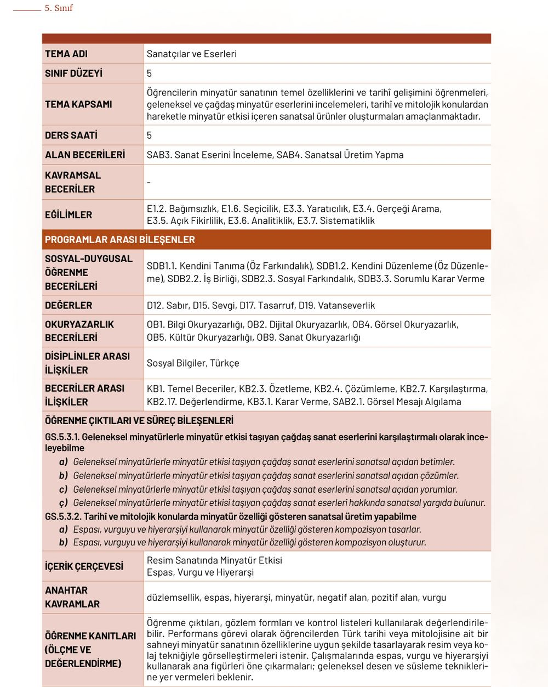
<!-- yer tutucu bulunamadı: sayfa sonuna eklendi -->

<!-- sayfa 50 -->

# TEMA AKIŞI

* Geleneksel ve Çağdaş Minyatür Örneklerini İnceleme
* Minyatür Sanatının Farklı Kültürlere Etkisine Yönelik Farkındalık Geliştirme
* Minyatür Özelliği Gösteren Kompozisyon Tasarlama
* Minyatür Özelliği Gösteren Resim veya Kolaj Yapma
* Çalışma Ortamını Düzenleme
* Değerlendirme
* Sergileme
* Farklılaştırma

# ÖĞRETMEN HAZIRLIĞI

Ders öncesinde minyatür, espas, vurgu ve hiyerarşi konularına ilişkin kavramlar kısaca gözden geçirilir. Hazırlık kapsamında aşağıdaki örneklerin hazır bulundurulması önerilir.

* Oğuz Kağan Destanı, Manas Destanı, Dede Korkut Hikâyeleri veya Malazgirt Savaşı gibi Türk tarihi veya mitolojisine ait hikâyeler yahut eğitici videolar hazırlanabilir.
* Motif tamamlama çalışmaları için kullanılabilecek minyatür kesitleri bu temada yer almaktadır. Matrakçı Nasuh'un Kanûnî Sultan Süleyman'ın 1534-1536 Irakeyn Seferi güzergâhındaki şehirlerin panoramik minyatürlerini içeren “Beyân-ı Menâzil-i Sefer-i ‘İrâkeyn Sultan Süleyman Han” adlı eserindeki minyatür örnekleri incelenebilir.

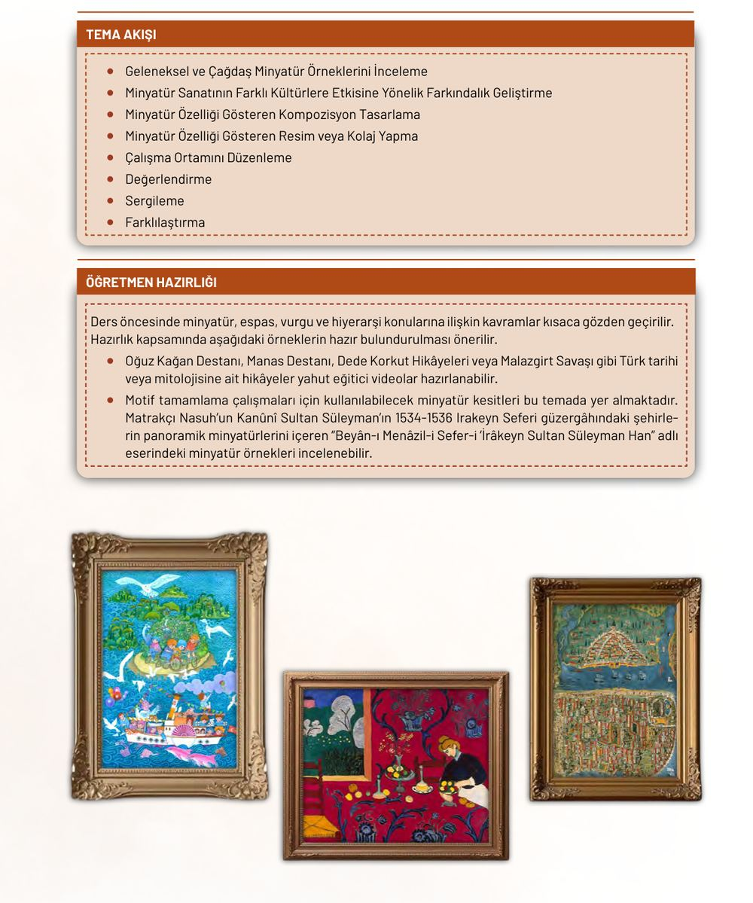

<!-- sayfa 51 -->

# ÖĞRENCİ HAZIRLIĞI VE ETKİNLİK MALZEMELERİ

Ders öncesinde minyatür sanatıyla ilgili kısa bir araştırma yapılır. Uygulamada kullanılacak malzemeler öğrencilerle paylaşılır. Bu temadaki çalışmaların büyük bölümünde ortak malzemeler kullanılmaktadır. Bu nedenle malzeme listesi toplu olarak sunulmuştur. Zenginleştirme ve destekleme etkinliklerinde de temel malzemeler esas alınır. Gerektiğinde ek materyaller kullanılabilir.

---

### Ortak Etkinlik Malzemeleri

* Resim kâğıdı
* Pastel boya, sulu boya, guaj boya veya renkli kuru boya kalemleri
* Sulu boya fırçaları (seçilen malzemeye bağlı)
* Su kabı (seçilen malzemeye bağlı)
* Palet (seçilen malzemeye bağlı)

---

### Kolaj Çalışmaları İçin

* Resim kâğıdı, mukavva veya karton
* Renkli kâğıtlar
* Tekstil parçaları, folyo, gazete veya dergi görselleri
* Mum tipi yapıştırıcı
* Küt uçlu makas

---

### Dijital Çalışmalar ve Animasyon İçin

* Başlangıç düzeyinde dijital tasarım programları
* Dijital çizim araçları

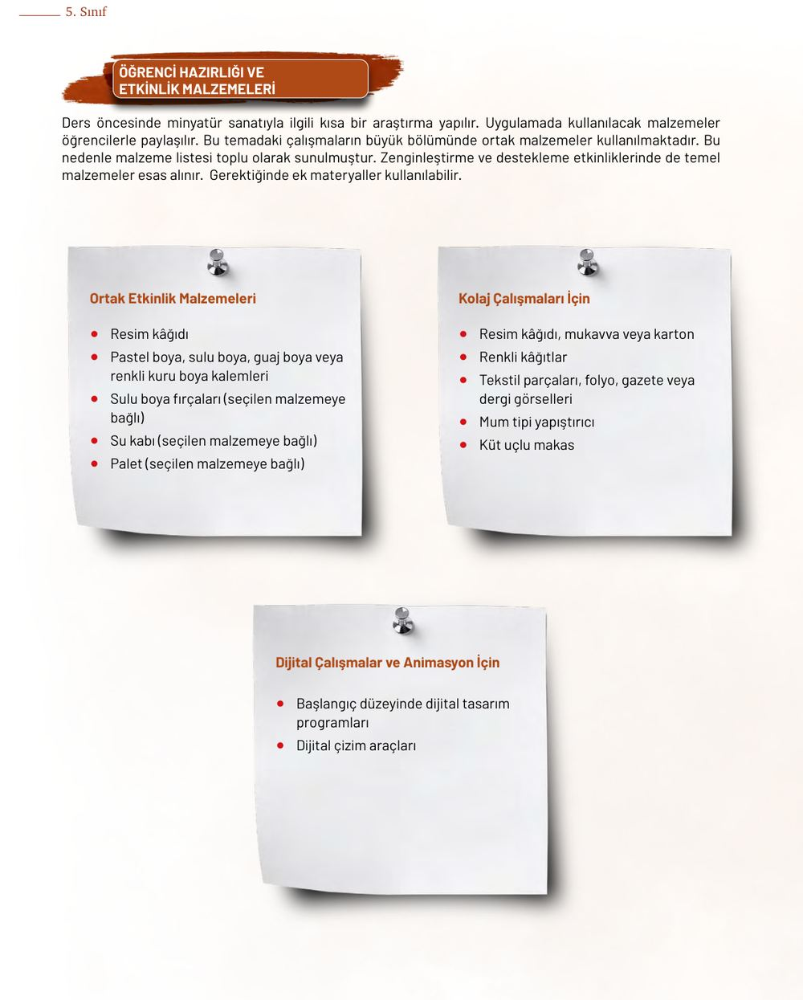
<!-- yer tutucu bulunamadı: sayfa sonuna eklendi -->

<!-- sayfa 52 -->

# ÖĞRENME-ÖĞRETME YAŞANTILARI

**TEMEL KABULLER**

Öğrencilerin nesneler arasındaki yakın-uzak ilişkisini ve ışık-gölgenin nesneler üzerindeki etkilerini algılayabildikleri kabul edilmektedir.

**ÖN DEĞERLENDİRME SÜRECİ**

Öğrencilerin nesneler arasındaki yakın-uzak ilişkisini ve nesneler üzerindeki ışık-gölge etkilerini algılama düzeyleri, aşağıdakilere benzer sorulara verdikleri yanıtlarla ölçülür:

* Yakındaki ve uzaktaki bir nesnenin ayrıntıları arasındaki farkları açıklayabilir misiniz?
* Bir kâğıt üzerinde nesnelerin hacimli görünmesini nasıl sağlayabilirsiniz?

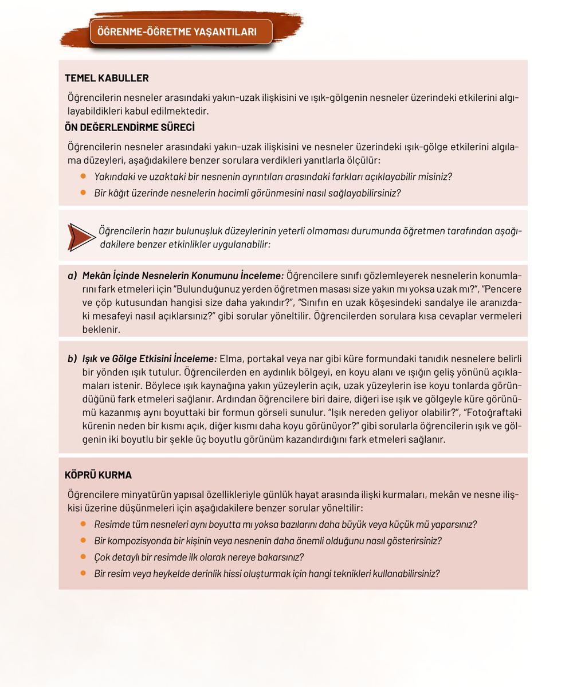

Öğrencilerin hazır bulunuşluk düzeylerinin yeterli olmaması durumunda öğretmen tarafından aşağıdakilere benzer etkinlikler uygulanabilir:

**a) Mekân İçinde Nesnelerin Konumunu İnceleme:** Öğrencilere sınıfı gözlemleyerek nesnelerin konumlarını fark etmeleri için “Bulunduğunuz yerden öğretmen masası size yakın mı yoksa uzak mı?”, “Pencere ve çöp kutusundan hangisi size daha yakındır?”, “Sınıfın en uzak köşesindeki sandalye ile aranızdaki mesafeyi nasıl açıklarsınız?” gibi sorular yöneltilir. Öğrencilerden sorulara kısa cevaplar vermeleri beklenir.

**b) Işık ve Gölge Etkisini İnceleme:** Elma, portakal veya nar gibi küre formundaki tanıdık nesnelere belirli bir yönden ışık tutulur. Öğrencilerden en aydınlık bölgeyi, en koyu alanı ve ışığın geliş yönünü açıklamaları istenir. Böylece ışık kaynağına yakın yüzeylerin açık, uzak yüzeylerin ise koyu tonlarda göründüğünü fark etmeleri sağlanır. Ardından öğrencilere biri daire, diğeri ise ışık ve gölgeyle küre görünümü kazanmış aynı boyuttaki bir formun görseli sunulur. “Işık nereden geliyor olabilir?”, “Fotoğraftaki kürenin neden bir kısmı açık, diğer kısmı daha koyu görünüyor?” gibi sorularla öğrencilerin ışık ve gölgenin iki boyutlu bir şekle üç boyutlu görünüm kazandırdığını fark etmeleri sağlanır.

**KÖPRÜ KURMA**

Öğrencilere minyatürün yapısal özellikleriyle günlük hayat arasında ilişki kurmaları, mekân ve nesne ilişkisi üzerine düşünmeleri için aşağıdakilere benzer sorular yöneltilir:

* Resimde tüm nesneleri aynı boyutta mı yoksa bazılarını daha büyük veya küçük mü yaparsınız?
* Bir kompozisyonda bir kişinin veya nesnenin daha önemli olduğunu nasıl gösterirsiniz?
* Çok detaylı bir resimde ilk olarak nereye bakarsınız?
* Bir resim veya heykelde derinlik hissi oluşturmak için hangi teknikleri kullanabilirsiniz?

<!-- sayfa 53 -->

# ÖĞRENME-ÖĞRETME UYGULAMALARI
## Uygulama Öncesi

Öğrencilerden geleneksel minyatürlerle minyatür etkisi taşıyan çağdaş sanat eserlerini karşılaştırmalı olarak inceleyebilmeleri beklenir. Bu amaçla aşağıdaki süreçler takip edilir.

# HATIRLATMA

### Türk Minyatür Sanatının Gelişimi ve Sanattaki Yeri

Türk minyatür sanatı Türkistan’dan Anadolu’ya uzanan köklü bir geleneğe dayanır. Selçuklu ve Osmanlı dönemlerinde yaşanan tarihî olayları, günlük yaşamı ve kültürel değerleri anlatan önemli bir görsel ifade biçimi hâline gelmiştir. Minyatürlerde figürler aynı düzlemde yer alır, renkler sembolik anlam taşır ve ayrıntılar önemlidir. Cumhuriyet sonrasında ise bu gelenek, çağdaş sanatçılar tarafından yeniden yorumlanmıştır.

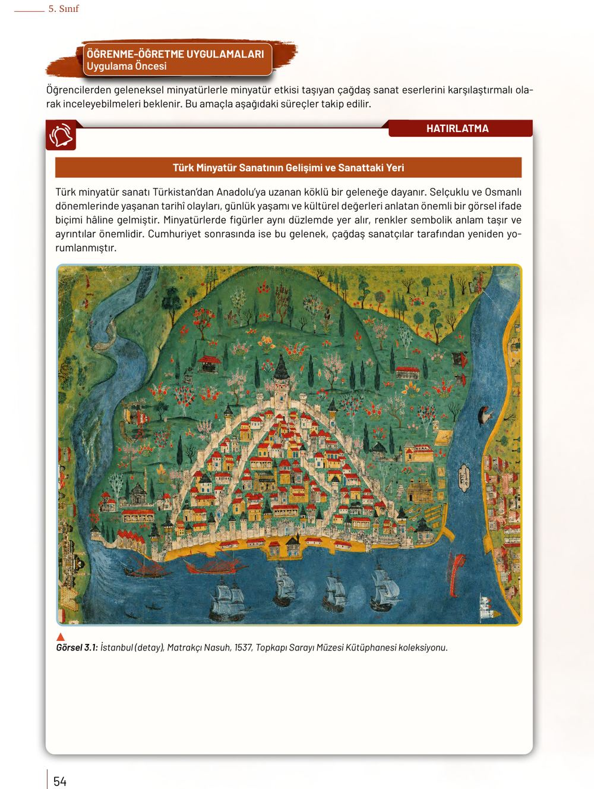

**Görsel 3.1:** *İstanbul (detay), Matrakçı Nasuh, 1537, Topkapı Sarayı Müzesi Kütüphanesi koleksiyonu.*

<!-- sayfa 54 -->

# ESER İNCELEME

## Geleneksel ve Çağdaş Minyatür Örneklerini İnceleme

Derse geleneksel minyatür örnekleri ile minyatür etkisi taşıyan çağdaş sanat örnekleri gösterilerek başlanır (OB5). İstenirse Nusret Çolpan, Cahide Keskiner gibi sanatçıların eserlerinden yararlanılabilir. Öğrenciler eserleri incelerken şehir manzarasında nelerin öne çıktığını, renklerin nasıl kullanıldığını ve figürlerin nasıl yerleştirildiğini fark etmeye yönlendirilir. Ardından geleneksel ve çağdaş bir eser çifti karşılaştırmalı şekilde incelenmek üzere seçilir (E1.2, KB2.7). Nazan Erkmen-Levni veya Bedri Rahmi Eyüboğlu-Matrakçı Nasuh örnekleri tercih edilebilir. Belirlenen eserler incelenmek üzere dijital veya basılı olarak paylaşılır (OB4). Öğrenciler hangi eser çiftinin ilgilerini daha çok çektiğini, ilgilerini çekmesinin nedenini, eserler arasındaki benzerlik ve farklılıkları kısaca paylaşır (KB3.1, SDB1.1, E1.6).

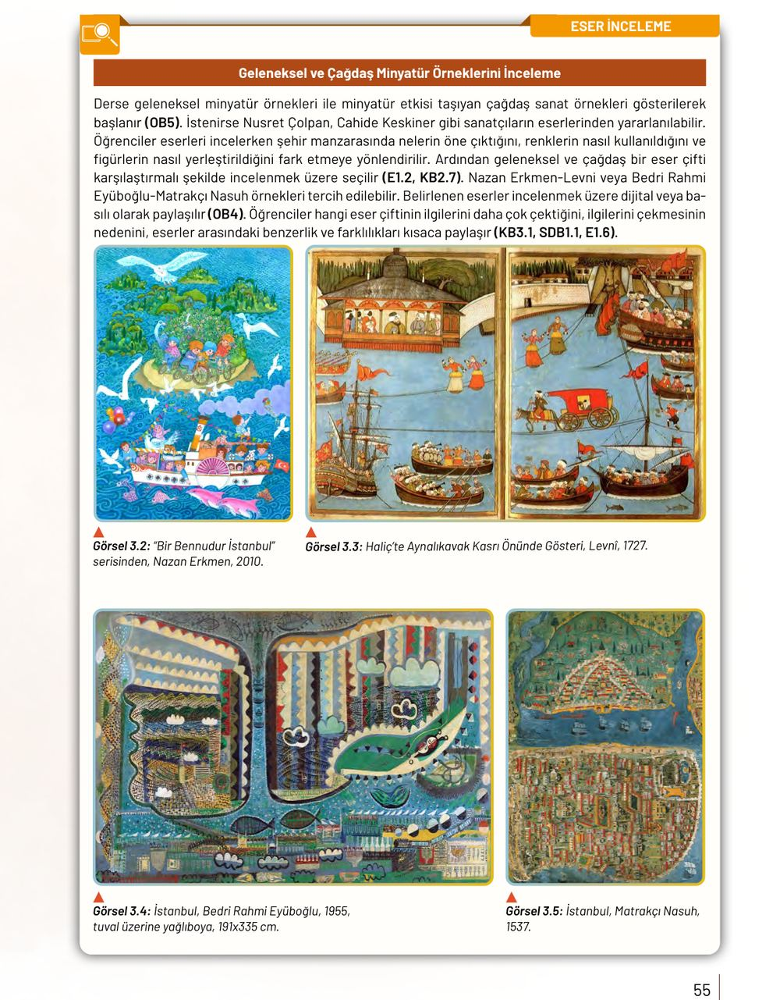

**Görsel 3.2:** “Bir Bennudur İstanbul” serisinden, Nazan Erkmen, 2010.

**Görsel 3.3:** Haliç'te Aynalıkavak Kasrı Önünde Gösteri, Levnî, 1727.

**Görsel 3.4:** *İstanbul*, Bedri Rahmi Eyüboğlu, 1955, tuval üzerine yağlıboya, 191x335 cm.

**Görsel 3.5:** *İstanbul*, Matrakçı Nasuh, 1537.

<!-- sayfa 55 -->

Eser inceleme süreci şu dört aşamaya göre yapılır:

* Sanatsal Betimleme
* Sanatsal Çözümleme
* Sanatsal Yorumlama
* Sanatsal Yargı

### Sanatsal Betimleme
Seçilen eserler üzerinden öğrenciler gördüklerini ifade eder. Eserin bir minyatür mü yoksa çağdaş bir resim mi olduğu, hangi malzemeyle yapılmış olabileceği ve yaklaşık hangi döneme ait olduğu üzerine tahmin yürütür (OB1). Tahminlerini görselde gördükleri ayrıntılara dayandırarak açıklar (SDB3.3). Eserdeki figür, renk ve küçük ayrıntılar birlikte fark edilir (E3.4). Bu aşama uzun listeleme yerine kısa sözlü paylaşımlarla yürütülür.

### Sanatsal Çözümleme
Öğrenciler eserlerde figürlerin mekâna nasıl yerleştirildiğine dikkat eder (KB2.4, OB4). Minyatürlerde tüm figürlerin aynı düzlemde gösterildiği, derinlik yerine yüzey düzeninin öne çıktığı fark edilir. Pozitif ve negatif alan, figür-zemin ilişkisi üzerinden kısaca gösterilir. Bazı figürlerin büyük, bazılarının küçük çizildiği; açık ve koyu bölgelerin dikkati belirli bir yere yönlendirdiği birlikte fark edilir. Böylece espas, oran-orantı, zıtlık, vurgu ve hiyerarşi kavramları örnek üzerinden kısaca tanıtılır (OB9). Kavram tanımları uzun anlatım yerine eser üzerinde gösterilerek açıklanır. Bu aşamada Tablo 3.1’de yer alan şablon ifadelerden faydalanılabilir.

**Tablo 3.1:** *Çözümleme Sürecinde Kullanılabilecek Soru ve İfade Şablonları*

| Soru | Şablon İfade | İlişkili Kavram |
| :--- | :--- | :--- |
| Eserlerdeki figürler ve nesneler mekâna nasıl yerleştirilmiştir? | “Uzakta olanlar daha küçük, yakında olanlar daha büyük çizilmiştir. Ancak hepsi aynı yüzey üzerinde yer almaktadır.” | Espas Düzlemsellik |
| Ön, orta ve arka planda neler bulunmaktadır? | “Ön planda ..., orta planda ..., arka planda ... yer almaktadır.” | Espas |
| Eserlerde yan yana veya üst üste yerleştirilen hangi figürler görülüyor? | “Aynı sahnede birden fazla olay görülmektedir. Örneğin ... ve ... birlikte resmedilmiştir.” | Düzlemsellik |
| Figür (pozitif) olan kısım neresi, zemin (negatif) olan kısım neresidir? | “Öne çıkan bölüm ..., arka plan ise ... olarak görülmektedir.” | Pozitif alan Negatif alan Zıtlık |
| İki eser arasında boş ve dolu alanların kullanımı açısından fark var mıdır? | “Birinci eserde boş alan daha az/çok kullanılmıştır. İkinci eserde ise boşluk daha belirgindir.” | Boş-dolu alan |
| Nesnelerden hangileri büyük, hangileri küçük çizilmiştir? | “Büyük çizilen ..., küçük çizilen ...’dır. Büyük olan daha önemli gösterilmiştir.” | Oran-orantı Vurgu |
| Sanatçı eserde hangi figürü veya nesneyi daha önemli göstermek istemiştir? Bunu nasıl anlıyorsunuz? | “Gerçekte küçük olan ... burada büyük çizilmiştir. Bu da onun daha önemli olduğunu göstermektedir.” | Hiyerarşi |
| Eserlerdeki en açık ve en koyu yer neresidir? | “En koyu bölüm ..., en açık bölüm ...’dir. Bu fark ... bölümünü öne çıkarmaktadır.” | Zıtlık |
| Eserlere baktığınızda dikkatinizi ilk çeken yer neresidir? | “Esere baktığımda ilk olarak ... dikkatimi çekti.” | Vurgu |

<!-- yer tutucu bulunamadı: sayfa sonuna eklendi -->

<!-- sayfa 56 -->

# Sanatsal Yorumlama
Öğrenciler eserin anlattığı hikâye üzerine düşünür (E3.6). Renklerin özel bir anlam taşıyıp taşımadığı, bazı figürlerin neden daha büyük çizildiği veya hangi bölümün daha dikkat çekici olduğu üzerine kısa paylaşımlar yapılır (SAB2.1, SDB2.3). Minyatür sanatının dönemin sosyal yaşamını ve kültürel değerlerini yansıttığı vurgulanır (OB9). Öğrenciler geleneksel anlatım dili ile çağdaş yorum arasındaki farklılıkları görsel üzerinden fark etmeye yönlendirilir. İstenirse öğrenciler minyatürün temel özelliklerini aşağıdakilere benzer biçimde kendi cümleleriyle özetler (KB2.3, OB2):

* Minyatürlerde ayrıntılar çok önemli olduğu için tüm detaylar dikkatle çizilir.
* Minyatürlerde tüm nesneler yan yana ve aynı düzlemde gösterilir.
* Minyatürlerde gölge ve derinlik yoktur.

# Sanatsal Yargıda Bulunma
Öğrenciler inceledikleri eser hakkında görüş bildirir. Figürlerin gerçeğe benzer olup olmadığı, eserin kendilerinde hangi duyguyu uyandırdığı ve eseri beğenip beğenmedikleri üzerine düşüncelerini ifade eder (KB2.17, E3.5, SDB1.1). Sanatçıların kültüre kattığı değer hatırlatılarak saygı ve vefa bilinci vurgulanır (D15.2). Süreç gözlem formu (Bk. Ek 1) ile değerlendirilebilir.

---

## Farkındalık Geliştirme: Minyatür Sanatının Farklı Kültürlere Etkisi

Henri Matisse’in “Kırmızıdaki Armoni” veya “Patlıcanlı Natürmort” eserlerinden biri gösterilir. Öğrenciler yüzey düzeni, desen ve renk kullanımı açısından minyatürlerle benzerlik olup olmadığını düşünür (OB9). Minyatür sanatının İran, Türk ve Çin sanatlarıyla etkileşim içinde geliştiği kısaca hatırlatılabilir. Türk minyatüründe tarihî olaylar ve günlük yaşamın; İran minyatüründe zengin renk ve detayın; Çin minyatüründe doğa ve sembolizmin öne çıktığı belirtilir (OB5). Bu bölüm bilgilendirme niteliğinde kısa tutulur.

▲ **Görsel 3.6:** Kırmızıdaki Armoni, Henri Matisse, 1908, tuval üzerine yağlıboya, 180x221 cm., Ermitaj Müzesi.

▲ **Görsel 3.7:** Patlıcanlı Natürmort, Henri Matisse, 1911, 212x246 cm., Grenoble Müzesi.

<!-- sayfa 57 -->

**Tasarım Geliştirme:**
**Minyatür Özelliği Gösteren Kompozisyon Tasarlama**

Öğrencilerden tarihî ve mitolojik konularda minyatür özelliği gösteren sanatsal üretim yapabilmeleri beklenir. Türk tarihinden veya destanlardan bir sahne seçilir. Öğrencilere Türk tarihi ve mitolojisine ait hikâyeler veya eğitici videolar izletilebilir. Oğuz Kağan Destanı, Manas Destanı, Dede Korkut Hikâyeleri veya Malazgirt Savaşı gibi kahramanlık anlatılarından sahneler seçilebilir. Öğrenciler hikâyedeki ana karakter, olayın geçtiği mekân ve verilmek istenen mesajı düşünür (**E3.3, SDB1.2**). Resimlerinde en önemli figürü nasıl öne çıkaracaklarını, diğer figürleri nasıl yerleştireceklerini ve boş alanları nerede bırakacaklarını planlayarak taslak çizim yapar (**KB1**). Türk-İslam sanatında görülen zarif ve dengeli anlatım biçimi kısaca hatırlatılır. Figürlerin yan yana ve aynı yüzey üzerinde yerleştirilebileceği belirtilir.

**DİNLETİ**
Sanatsal üretim sürecinde odaklanmalarını ve güdülenmelerini sağlamak amacıyla öğrencilere tarihî bağlama uygun sözsüz müzikler dinletilir.

**Uygulama Sırası**

Espas, vurgu ve hiyerarşiyi kullanarak minyatür özelliği gösteren kompozisyon oluşturmaları için öğrencilerden, tasarımlarını resim veya kolaj çalışması şeklinde düzenleyerek görselleştirmeleri beklenir. Ayrıca dijital çizim programları veya yapay zekâ kullanılarak minyatür etkisi oluşturan çalışmalar yapmalarına da imkân tanınır (**OB2**).

⚠️ Öğrenciler aşağıdaki etkinliklerden birine yönlendirilir.

**Seçmeli Etkinlik 1: Minyatür Özelliği Gösteren Resim Yapma**

Öğrenciler aşağıdaki aşamaları sırasıyla gerçekleştirerek minyatür özelliği gösteren resim oluşturur.
1. Pastel boya, sulu boya, guaj boya veya renkli kuru kalemlerden birini seçer (**SDB1.2**).
2. Seçtiği malzemeleri hazırlar ve dikkatli kullanır (**D17.3**).
3. Figür ve nesneleri aşağıdan yukarıya veya yan yana yerleştirir.
4. Önemli kişi ve nesneyi daha büyük veya daha koyu renkle çalışır (**E3.7**).
5. Canlı renkler kullanır.
6. Ana unsurları öne çıkarmak için bazı alanları boş bırakır.
7. Küçük ayrıntıları dikkatli çizmeye gayret eder (**D12.3, SDB1.2**).
8. Geleneksel motiflerden yararlanır (**D19.1**).
9. Süreci ve ürününü öz değerlendirme formu (**Bk. Ek 2**) ile değerlendirir.

<!-- sayfa 58 -->

**Görsel 3.8:** Minyatür özelliği gösteren resim. Manas Destanı’ndan, ormanda geyikli bir sahne

# Seçmeli Etkinlik 2: Minyatür Özelliği Gösteren Kolaj Yapma

Öğrenciler aşağıdaki aşamaları sırasıyla gerçekleştirerek minyatür özelliği gösteren kolaj oluşturur.
1. Renkli kâğıt, kumaş, folyo, gazete ve dergi parçalarından seçim yapar (**SDB1.2**).
2. Seçtiği malzemeleri hazırlar ve dikkatli kullanır (**D17.3**).
3. Hikâyedeki karakter ve mekânı temsil eden parçalar keser.
4. Parçaları aşağıdan yukarıya veya yan yana yerleştirir.
5. Farklı dokuları bir arada kullanır.
6. Önemli kişi ve nesneyi daha büyük veya daha koyu renkle çalışır (**E3.7**).
7. Ana unsurları öne çıkarmak için bazı alanları boş bırakır.
8. Küçük ayrıntıları dikkatli yerleştirir (**D12.3, SDB1.2**).
9. Geleneksel desenlerden yararlanır (**D19.1**).
10. Süreci ve ürününü öz değerlendirme formu (**Bk. Ek 2**) ile değerlendirir.

**Görsel 3.9:** Minyatür özelliği gösteren kolaj. Oğuz Kağan Destanı’ndan bir sahne

<!-- sayfa 59 -->

# Seçmeli Etkinlik 3: Minyatür Özelliği Gösteren Dijital Resim Yapma

Öğrenciler aşağıdaki aşamaları sırasıyla gerçekleştirerek minyatür özelliği gösteren dijital resim oluşturur.

1. Öğrencilere uygun dijital çizim programları tanıtılır.
2. Öğrenci bir program seçer (**SDB1.2**).
3. Programın temel araçlarını kullanarak çizimini yapar.
4. Figürleri aşağıdan yukarıya veya yan yana yerleştirir.
5. Önemli kişi ve nesneyi daha büyük veya daha koyu renkle gösterir (**E3.7**).
6. Diğer figürleri daha küçük veya daha açık tonla çizer.
7. Dijital motifler ekler (**D19.1**).
8. Dijital araçları dikkatli kullanır (**D17.3**).
9. Süreci ve ürününü öz değerlendirme formu (**Bk. Ek 2**) ile değerlendirir.

**Görsel 3.10:** Minyatür özelliği gösteren dijital resim. Türk mitolojisinden Umay Ana

> ! **NOT**
> Bu etkinlikte yapay zekâ kullanılabilir. Böylece uygulama daha ekonomik ve erişilebilir hâle getirilebilir.

> 🔔 **HATIRLATMA**
> Uygulama dijital ortamda yapılacaksa öğrencilerin dijital çizim araçlarına erişim ve kullanım düzeyleri göz önünde bulundurulur. Gerekli durumlarda temel araçlar (fırça, renk seçimi, katman gibi) kısaca hatırlatılarak öğrencilerin süreci rahat yürütmeleri sağlanır.

## Uygulama Sonrası

Çalışma sonunda öğrencilerden ortamı iş birliği içinde düzenlemeleri istenir (**SDB2.2**). Tamamlanan ürünler sınıf içinde veya dijital ortamda sergilenir. Çalışmalar performans görevi olarak ele alınır ve süreç kontrol...

<!-- sayfa 60 -->

# FARKLILAŞTIRMA

## Zenginleştirme

⚠️ Öğrenciler aşağıdaki etkinliklerden birine yönlendirilebilir.

### Seçmeli Etkinlik 1: Minyatürü Animasyona Dönüştürme

Öğrenciler özgün minyatür tasarımlarını dijital ortama aktararak animasyona dönüştürmek için aşağıdaki aşamaları sırasıyla gerçekleştirir.

1. Minyatür özelliği gösteren bir sahne çizer veya yapay zekâ ile minyatür tarzında bir görsel üretir.
2. Sahnedeki ana karakteri ve diğer figürleri belirler.
3. Çizimini fotoğraf çekerek veya tarayarak dijital ortama aktarabilir yahut yapay zekâ ile oluşturduğu görseli indirir.
4. Düzeyine uygun bir stop-motion, 2D animasyon veya yapay zekâ destekli animasyon aracı seçer.
5. Karakter ve nesneleri ayrı parçalar hâline getirir veya yapay zekâdan hareketli versiyonunu üretmesini ister.
6. Figürleri hareketlendirmek için yürüme, bayrak sallama, at binme veya koşma gibi kolay hareketler seçer.
7. Figürü dijital ortamda hareketlendirir veya yapay zekâ aracılığıyla hareket efekti uygular.
8. İsterse kısa bir ses veya müzik ekler.
9. Süreci ve ürününü öz değerlendirme formu (**Bk. Ek 2**) ile değerlendirir.

*Görsel 3.11: Animasyonlu minyatür kompozisyonu*

> ! **NOT**
> Bu etkinlikte yapay zekâ kullanılabilir. Böylece uygulama daha ekonomik ve erişilebilir hâle getirilebilir.

<!-- sayfa 61 -->

# Seçmeli Etkinlik 2: Çağdaş Sanatta Minyatür Motifleriyle İlgili Bilgi Görseli Hazırlama

Öğrenciler çağdaş sanatta minyatür etkisi gösteren örnekleri Henri Matisse’in eserleri üzerinden inceleyerek bilgi görseli hazırlar.

1. Renkli kâğıt, dergi görselleri, makas ve yapıştırıcıyı hazırlar.
2. Öğretmenin paylaştığı Henri Matisse’in desenli iç mekân resimlerini inceler.
3. Matisse’in resimlerinde yer alan Doğu sanatından bir motif öğrencilere verilir.
4. İki görseli yan yana yerleştirir ve benzerliği tek cümleyle yazar. Örneğin “Bu ağaç motifleri bizim kültürümüzde de görülür.”
5. Görsellerin yanına kısa ve açıklayıcı notlar ekleyebilir.
6. Çalışmasını sınıfta paylaşır.
7. Süreci ve ürününü öz değerlendirme formu (**Bk. Ek 2**) ile değerlendirir.

*Görsel 3.12: Doğu-Batı desenleriyle bilgi görseli*

> **! NOT**
> Bu etkinlikte bilgi görseli, dijital ortamda poster veya tek slayt olarak hazırlanabilir. Yapay zekâdan destek alınabilir. Öğrencilerin yapay zekâdan aldığı bilgiyi kendi cümleleriyle yeniden yazması önerilir.

<!-- sayfa 62 -->

# Destekleme

⚠️ Öğrenciler aşağıdaki etkinliklerden birine yönlendirilebilir.

## Seçmeli Etkinlik 1: Günlük Yaşam Sahnesini Yansıtan Minyatür Yapma

Öğrenciler öğretmen rehberliğinde aşağıdaki aşamaları sırasıyla gerçekleştirerek günlük yaşamlarından bir anıyı veya çevrelerinde gördükleri ağaç, ev, insan figürü gibi nesneleri minyatür tarzında resmeder.

1. Pastel boya, sulu boya, guaj boya veya renkli kuru boya kalemleri arasından seçim yapar.
2. Öğretmenin gösterdiği minyatür örneklerini inceler.
3. Günlük yaşamından bir anı veya çevresinden bir sahne seçer.
4. Seçtiği sahnenin ana figürlerini kâğıda çizer.
5. Figürleri yan yana yerleştirir.
6. Canlı ve parlak renkler kullanır.
7. Çalışmasını sınıfta paylaşır.
8. Süreci ve ürününü öz değerlendirme formu (**Bk. Ek 2**) ile değerlendirir.

**Görsel 3.13:** Günlük hayat sahnelerini yansıtan resimler

<!-- sayfa 63 -->

# Seçmeli Etkinlik 2: Eksik Minyatür Bölümü Tamamlama

Öğrenciler aşağıdaki aşamaları sırasıyla gerçekleştirerek tarihî konulu minyatür eserlerden seçilen görsellerde eksik bırakılan bölümleri tamamlar.

1. Renkli kuru boya kalemlerini hazırlar.
2. Öğrencilere tarihî konulu ve bir bölümü eksik bırakılmış minyatür görseli verilir.
3. Öğrenciler eksik bölümde ne olabileceğini tahmin eder.
4. Gözlemlerine göre eksik kısmı kendi çizimiyle tamamlar.
5. Tamamladığı bölümü orijinal görselle birlikte sınıfta gösterir.
6. Çalışmasını kısaca açıklar.
7. Süreci ve ürününü öz değerlendirme formu (**Bk. Ek 2**) ile değerlendirir.

**Görsel 3.14:** Tamamlanmış minyatür örneği

<!-- sayfa 64 -->

Görsel 3.16: Eksik minyatür şablonu, “Matrakçı Nasuh’tan Tebriz Minyatürü”

Görsel 3.17: Eksik minyatür şablonu, “Kanûnî Sultan Süleyman’ın Erdel Kralı János Zsigmond’u Kabulü”

Görsel 3.18: Eksik minyatür şablonu, “Kanûnî Sultan Süleyman’ın Şeyh Abdüllatif’i Kâbulü”

<!-- sayfa 65 -->

EK 1. GÖZLEM FORMU

Bu gözlem formu öğrencilerin öğrenme sürecindeki davranışlarını, katılım düzeylerini ve gelişim alanlarını izlemek amacıyla hazırlanmıştır. Elde edilen bulguları, öğrencilere yapıcı geri bildirim vermek ve öğretim sürecini geliştirmek amacıyla kullanınız.

# GÖZLEM FORMU

Bu form öğrenci performanslarını değerlendirmeniz amacıyla hazırlanmıştır. Listedeki her maddeyi inceleyerek öğrencinize en uygun olan seçeneği işaretleyiniz. “Hiç Uygun Değil” ve “Biraz Uygun” olarak işaretlediğiniz öğrenci davranışlarını geliştirmeye çalışınız.

Etkinlik Adı : ........................................................................................................................................
Adı-Soyadı : ..........................................................................................................................................
Sınıfı-Numarası : ............ / ............
Tarih : ......../......../20......

| No | Ölçütler | Hiç uygun değil | Biraz uygun | Büyük ölçüde uygun | Tamamen uygun |
|---|---|---|---|---|---|
| 1 | Geleneksel minyatür ile çağdaş eserde gördüğü görsel özellikleri sözel olarak ifade eder. | | | | |
| 2 | Geleneksel minyatür ile çağdaş eseri karşılaştırır. | | | | |
| 3 | Eserlerin konusu hakkında görüşünü açıklar. | | | | |
| 4 | Eserler hakkında estetik değerlendirmede bulunur. | | | | |
| 5 | Minyatür sanatının kültürel miras açısından önemini ifade eder. | | | | |

**Öğretmen Görüşleri/Açıklamalar:** ...........................................................................................................................................
....................................................................................................................................................................................................
....................................................................................................................................................................................................
....................................................................................................................................................................................................

 “Gözlem Formu”na karekod üzerinden erişebilirsiniz.

<!-- sayfa 66 -->

# EK 2. ÖZ DEĞERLENDİRME FORMU

Bu form öğrencilerin bireysel öğrenme süreçlerine yönelik farkındalık geliştirmelerini ve sorumluluk almalarını desteklemek amacıyla hazırlanmıştır. Formdaki her ölçütü öğrencilerle gözden geçiriniz. Değerlendirme sürecinde öğrencilerin tarafsız olmalarına rehberlik ediniz.

## ÖZ DEĞERLENDİRME FORMU

Bu form, performansınızı değerlendirmeniz amacıyla hazırlanmıştır. Sizden duygu ve düşüncelerinizi samimi ve dürüst olarak bu forma yansıtmanız beklenmektedir. Her ölçüt için en uygun olduğunu düşündüğünüz seçeneği işaretleyiniz. “Hiçbir Zaman” ve “Bazen” olarak işaretlediğiniz cevaplarınızı öğretmeniniz rehberliğinde değerlendiriniz.

Etkinlik Adı : ........................................................................................................................................
Adı-Soyadı : ..........................................................................................................................................
Sınıfı-Numarası : ......... / .........
Tarih : ......... / ......... / 20......

| No | Ölçütler | Hiçbir zaman | Bazen | Her zaman |
|---|---|---|---|---|
| 1 | Çalışmam için bir konu seçtim. | | | |
| 2 | Resmimde boşlukları kullandım. | | | |
| 3 | Resmimde önemli olan bölümü daha dikkat çekici yaptım. | | | |
| 4 | Çalışmamda minyatür sanatının özelliklerini göstermeye çalıştım. | | | |
| 5 | Çalışma sonunda çalışma alanımı temiz bıraktım. | | | |
| 6 | Çalışmamı zamanında tamamladım. | | | |

**Öğrencinin Ek Yorumu:**

**Çalışmanızda en çok hangi bölümü beğendiniz? Neden?**
........................................................................................................................................................................
........................................................................................................................................................................

**Bir sonraki çalışmanızda neleri farklı yapmak istersiniz?**
........................................................................................................................................................................
........................................................................................................................................................................

“Öz Değerlendirme Formu”na karekod üzerinden erişebilirsiniz.

<!-- sayfa 67 -->

# EK 3. KONTROL LİSTESİ

Bu kontrol listesi öğrencilerden beklenen becerilerin, belirlenen ölçütler doğrultusunda gerçekleşme düzeyini değerlendirmek amacıyla hazırlanmıştır. Değerlendirme sürecini puanlama yapmadan, öğrencinin bireysel gelişimi dikkate alarak ve süreç odaklı bir yaklaşımla yürütünüz.

## KONTROL LİSTESİ

Bu form öğrenci performanslarını değerlendirmeniz amacıyla hazırlanmıştır. Listedeki her maddeyi inceleyerek öğrencinize uygun olan “Evet” veya “Hayır” seçeneklerinden birini işaretleyiniz. “Hayır” olarak işaretlediğiniz öğrenci davranışlarını geliştirmeye çalışınız.

Etkinlik Adı : ............................................................
Adı-Soyadı : ............................................................
Sınıfı-Numarası : ............ / ............
Tarih : ......../......../20......

| No | Ölçütler | Hayır | Evet |
|---|---|---|---|
| 1 | Çalışması için bir konu belirledi. | | |
| 2 | Kompozisyonunda boşluk-doluluk ilişkisini uyguladı. | | |
| 3 | Kompozisyonunda önemli ögeleri vurguladı. | | |
| 4 | Çalışmasında minyatür sanatının temel özelliklerini yansıttı. | | |
| 5 | Çalışmasını zamanında tamamladı. | | |

**Öğretmen Görüşleri/Açıklamalar:** .................................................................................................................................................................................................................................................................................................................................................................................................................................................................................................................................................................................................................................................................

<!-- yer tutucu bulunamadı: sayfa sonuna eklendi -->

<!-- sayfa 68 -->

5. Sınıf

# 4. TEMA
# ÇİZİM VE GÖRSEL İFADE

Tema içeriğine
karekod üzerinden

<!-- sayfa 69 -->

| TEMA ADI | Çizim ve Görsel İfade |
| :--- | :--- |
| **SINIF DÜZEYİ** | 5 |
| **TEMA KAPSAMI** | Öğrencilerin doğal nesnelerin farklı doku özelliklerini gözlemlemeleri, ışık ve gölgenin dokular üzerindeki etkisini analiz etmeleri, tonlama ve gölgelendirme tekniklerini kullanarak farklı dokularla estetik bir desen çalışması oluşturmaları amaçlanmaktadır. |
| **DERS SAATİ** | 5 |
| **ALAN BECERİLERİ** | SAB4. Sanatsal Üretim Yapma |
| **KAVRAMSAL BECERİLER** | - |
| **EĞİLİMLER** | E3.5. Açık Fikirlilik, E3.7. Sistematiklik |

## PROGRAMLAR ARASI BİLEŞENLER

| SOSYAL-DUYGUSAL ÖĞRENME BECERİLERİ | SDB1.2. Kendini Düzenleme (Öz Düzenleme), SDB1.3. Kendine Uyarlama (Öz Yansıtma), SDB2.1. İletişim |
| :--- | :--- |
| **DEĞERLER** | D7. Estetik, D12. Sabır |
| **OKURYAZARLIK BECERİLERİ** | OB1. Bilgi Okuryazarlığı, OB4. Görsel Okuryazarlık |
| **DİSİPLİNLER ARASI İLİŞKİLER** | Fen Bilimleri |
| **BECERİLER ARASI İLİŞKİLER** | KB1. Temel Beceriler, KB2.2. Gözlemleme, KB2.4. Çözümleme, KB2.7. Karşılaştırma, SAB1.2. Sanatsal Gözlemleme |

## ÖĞRENME ÇIKTILARI VE SÜREÇ BİLEŞENLERİ

**GS.5.4.1. Doğal nesnelerin doku özelliklerini yansıtan desen yapabilme**
a) *Doğal nesnelerin doku özelliklerine uygun kompozisyon tasarlar.*
b) *Tonlama ve gölgelendirme tekniklerini kullanarak doğal dokularla desen oluşturur.*

| İÇERİK ÇERÇEVESİ | Doğal Nesnelerin Doku Özellikleri Işığın Doku Algısına Etkisi Desende Tonlama ve Gölgelendirme |
| :--- | :--- |
| **ANAHTAR KAVRAMLAR** | doğal doku, doğal ışık, sepya kalem, yapay ışık |
| **ÖĞRENME KANITLARI (ÖLÇME VE DEĞERLENDİRME)** | Öğrenme çıktıları, kontrol listeleri ve öz değerlendirme formları kullanılarak değerlendirilebilir. Sınıf içi performans görevi olarak öğrencilerden grafit veya sepya kalem kullanarak iki veya daha fazla dokuyu içeren bir desen çalışması yapmaları istenir. Çalışmalarında tonlama ve gölgelendirme tekniklerini kullanarak dokuların ışık ve gölge etkilerini gerçekçi bir şekilde yansıtmaları beklenir. |

<!-- yer tutucu bulunamadı: sayfa sonuna eklendi -->

<!-- sayfa 70 -->

# TEMA AKIŞI

* Doğal Nesnelerin Doku Özelliklerini İnceleme
* Doğal Nesnelerle Natürmort Tasarlama
* Doğal Nesnelerden Oluşan Natürmort Çizimi Yapma
* Çalışma Ortamını Düzenleme
* Değerlendirme
* Sergileme
* Farklılaştırma

# ÖĞRETMEN HAZIRLIĞI

Ders öncesinde konuyu destekleyecek görseller ve örnek materyaller gözden geçirilir. Hazırlık kapsamında aşağıdaki örneklerin hazır bulundurulması önerilir.

* Bu temada yer alan Süleyman Seyyid Bey’in “Portakallı Natürmort” eseri temel örnek olarak kullanılabilir. Türk resim sanatından farklı natürmort örnekleri de sürece dâhil edilebilir.
* Doğal dokuları örneklendiren birkaç nesne sınıf ortamında hazır bulundurulur.
* Işık ve gölge etkisini incelemek amacıyla masa lambası, el feneri veya benzeri yapay ışık kaynakları sınıfa getirilir.

<!-- sayfa 71 -->

# ÖĞRENCİ HAZIRLIĞI VE ETKİNLİK MALZEMELERİ

Uygulamada kullanılacak malzemeler öğrencilerle paylaşılır. Bu temadaki çalışmaların büyük bölümünde çizim malzemeleri kullanılmaktadır. Bu nedenle malzeme listesi toplu olarak sunulmuştur. Zenginleştirme ve destekleme etkinliklerinde de temel malzemeler esas alınır. Gerektiğinde farklı çizim araçları tercih edilebilir.

### Ortak Çizim Malzemeleri

* Resim kâğıdı
* Grafit kalemler (F, HB, B, 2B, 3B, 4B)
* Sepya kalemler (isteğe bağlı)

### Alternatif / Zenginleştirme Çalışmaları İçin

* Kömür kalem veya füzen
* Peçete (ton dağıtımı için)

<!-- sayfa 72 -->

# ÖĞRENME-ÖĞRETME YAŞANTILARI

**TEMEL KABULLER**

Öğrencilerin doğal ve yapay nesneleri ayırt edebildikleri kabul edilmektedir.

**ÖN DEĞERLENDİRME SÜRECİ**

Öğrencilerin doğal ve yapay nesnelere ilişkin bilgi düzeyleri aşağıdakilere benzer sorulara verdikleri yanıtlarla ölçülür:

* Çevrenizdeki doğal nesnelere örnekler verir misiniz?
* Taş, yapay bir malzeme midir?

Öğrencilerin hazır bulunuluk düzeylerinin yeterli olmaması durumunda öğretmen tarafından aşağıdakilere benzer etkinlikler uygulanabilir:

**a) Doğal ve Yapay Nesnelerle Eşleştirme Yapma:** Doğal ve yapay nesnelerin isimleri öğrencilerle paylaşılır. Öğrencilerden nesnelerin “doğal” veya “yapay” olduğunu söylemeleri istenir. Her doğru cevap sonrası öğrencilere “Taş doğaldır çünkü doğada kendiliğinden oluşur.”, “Plastik şişe yapaydır çünkü insanlar tarafından üretilmiştir.” gibi kısa açıklamalar yapılır.

**b) Doğal ve Yapay Nesnelerin Kökenlerini Sorgulama:** Öğrencilere günlük yaşamda sıkça karşılaşılan kâğıt gibi bir nesne örneği sunularak öğrencilerin, bu nesnenin kökeni ve üretildiği doğal kaynak hakkında açıklama yapmaları sağlanır. Öğrencilerden örneklendirilen nesnenin üretim sürecini “Kâğıt $\rightarrow$ Ağaç $\rightarrow$ Doğa” biçiminde bir ilişki zinciriyle ifade etmeleri beklenir.

**KÖPRÜ KURMA**

Doğal nesnelerin dokularının ışık ve gölge etkisiyle belirginleştiğini ve bunları resim teknikleriyle iki boyutlu yüzeye aktarılabileceğini anlamaları için öğrencilere aşağıdakilere benzer sorular sorulur:

* Yumuşak bir yüzeyde ışık etkisi pürüzlü bir yüzeyden farklı mı görünür?
* Bir yaprağın damarlarını kağıt üzerinde nasıl daha belirgin hâle getirebilirsiniz?

<!-- sayfa 73 -->

# ÖĞRENME-ÖĞRETME UYGULAMALARI
## Uygulama Öncesi

Öğrencilerden doğal nesnelerin doku özelliklerini yansıtan desen yapabilmeleri beklenir. Bu amaçla aşağıdaki süreçler takip edilir.

### Tasarım Geliştirme:
#### Doğal Nesnelerle Natürmort Tasarlama

Derse farklı doğal dokulara dikkat çekilerek başlanır. Öğrenciler çevrelerinde bulunan pürüzlü, pürüzsüz, sert, yumuşak, damarlı veya pullu yüzeyleri ışık altında inceler (**SAB1.2, KB2.2, OB1**). Öğrencilerin nesne yüzeylerinin ışıkla nasıl değiştiğini fark etmeleri sağlanır. Örneğin bir yaprağın damarlı yapısı, ceviz kabuğunun sert yüzeyi veya bir mantarın yumuşak dokusu birlikte gözlemlenir.

*Görsel 4.1: Doğal doku gözlemi*

*Görsel 4.2: Doğal nesnelerin doku özellikleri*

Dokuların yüzey özellikleri ve ışık altındaki görünümleri üzerine karşılaştırmalı kısa paylaşımlar yapılır (**KB2.7, OB4, SDB2.1**). İstenirse kısa bir doku gözlem formu hazırlanarak nesnenin adı, dokunun yapısı ve ışık altındaki görünümü not edilebilir (**OB1**). Böylece doğadaki doku çeşitliliği ve estetik değer fark edilir (**D7.1**). Ardından ışığın yönünün dokuyu nasıl değiştirdiği basit uygulamalarla gösterilir (**E3.7**). Işık sağdan geldiğinde bir yüzeyin nasıl aydınlandığı, soldan geldiğinde gölgelerin nasıl yer değiştirdiği birlikte gözlemlenir. Öğrencilerin nesne üzerindeki en açık, orta ve en koyu alanları fark etmeleri sağlanır (**KB2.4**). Işığa en yakın bölümün neden daha açık göründüğüne veya ışık uzaklaştıkça tonların nasıl koyulaştığına dikkat çekilir. Bu aşamada ışık ve doku ilişkisi Süleyman Seyyid’in eserleri üzerinden de kısaca incelenebilir.

<!-- sayfa 74 -->

▲
**Görsel 4.3:** Portakallı Natürmort, Süleyman Seyyid Bey, 1904, tuval üzerine yağlıboya, 33x40.5 cm., Ankara Resim Heykel Müzesi.

▲
**Görsel 4.4:** Portakallı Natürmort, Süleyman Seyyid Bey, 1902, tuval üzerine yağlıboya, 38x74 cm.

Daha sonra öğrenciler kompozisyonlarında bir arada kullanmak istedikleri iki veya daha fazla doğal dokuyu belirler. Hangi dokuyu öne çıkarmak istediklerine ve ışığı nasıl kullanacaklarına karar verirler (**SDB1.2**). Seçilen doğal nesnelerle natürmort düzeni kurulur. Öğrenciler belirlenen ışık kaynağı altında nesneleri dikkatle inceler ve nesnelerin taslak çizimlerini oluşturur (**KB1**). Kompozisyon oluşturulurken dokuların uyumu ve estetik etkisi gözetilir. Işığın yönü netleştirilir ve açık-orta-koyu ton geçişlerine dikkat edilir. Çalışma başlamadan önce kâğıt sabitlenir ve temiz bir zemin hazırlanır.

<!-- sayfa 75 -->

**Görsel 4.5:** *Doğal ve yapay ışık etkisinde natürmort düzenlemesi*

---

### Uygulama Sırası

Tonlama ve gölgelendirme tekniklerini kullanarak doğal dokularla desen oluşturmaları için öğrencilerden hazırladıkları kompozisyonları yüzeye aktarmaları beklenir.

#### 1. ETKİNLİK
**Doğal Nesnelerden Oluşan Natürmort Çizimi Yapma**

Öğrenciler tonlama ve gölgelendirme tekniklerini kullanarak doğal dokularla natürmort çizimi yapmak için aşağıdaki aşamaları sırasıyla gerçekleştirir.

1. Farklı sertlik derecelerine sahip grafit kalemleri veya sepya kalemleri hazırlar.
2. Kalemlerin açık ve koyu ton oluşturma özelliklerini inceler.
3. Açık ton için kalemi hafif bastırır, koyu ton için daha güçlü bastırır.
4. Kompozisyonu hafif çizgilerle yerleştirir.
5. Nesneler arasındaki büyüklük ve uzaklığı kontrol eder.
6. Işık yönünü belirler.
7. Açık, orta ve koyu tonları kullanarak gölgelendirme yapar **(KB1)**.
8. Silgiyi ışık etkisi vermek için kullanır.
9. Tonların dengeli dağılmasına dikkat eder.
10. Çalışma sürecinde sabırlı ve dikkatli davranır **(D12.3)**.
11. Süreci ve ürününü öz değerlendirme formu (Bk Ek 1) ile değerlendirir.

<!-- sayfa 76 -->

**Görsel 4.6:** *Doğal ve yapay ışık kaynakları altında natürmort*

**Görsel 4.7:** *Sepya tonlarında natürmort*

---

| REHBERLİK |
| :--- |
| Süreç boyunca öğrencilerin doku ve ışık kullanımına ilişkin olası kavram yanılgıları fark edilerek öğrencilere kısa ve bireysel geri bildirimler verilir. Gerektiğinde ton geçişleri ve yüzey özellikleri yeniden hatırlatılır. Böylece öğrencilerin çalışmaları aşamalı olarak geliştirilir. |

### Uygulama Sonrası

Tamamlanan çalışmalar sınıf içinde veya dijital ortamda sergilenir. Öğrencilerden süreç boyunca edindikleri deneyimleri kısaca değerlendirmeleri istenir (**E3.5, SDB1.2**). Bu aşamada öğrencilerin kendi çalışmalarına bakarak hangi bölümlerde dokuyu daha başarılı yansıttıklarını ve bir sonraki çalışmada neleri geliştirebileceklerini düşünmeleri sağlanır (**SDB1.3**). Çalışmalar performans görevi olarak ele alınır ve süreç, kontrol lis-

<!-- sayfa 77 -->

# FARKLILAŞTIRMA

## Zenginleştirme

⚠️ Öğrenciler aşağıdaki etkinliklerden birine yönlendirilebilir.

### Seçmeli Etkinlik 1: Kömür Kalem veya Füzenle Doğal Doku Etüdü Yapma

Öğrenciler kömür kalem veya füzen kullanarak doğal doku etüdü yapmak için aşağıdaki aşamaları sırasıyla gerçekleştirir.

1. Kömür kalem veya füzen, resim kâğıdı ve silgiyi hazırlar.
2. Kozalak, yaprak veya ağaç kabuğu gibi doğal bir nesne seçer.
3. Nesnenin yüzeyini inceler.
4. Açık ton için hafif bastırır, koyu ton için daha güçlü bastırır.
5. Doku etkisi için çizgileri yan yana, üst üste, düz veya çapraz kullanır.
6. Kompozisyonu hafif çizgilerle yerleştirir.
7. Işık yönünü belirler ve açık-koyu alanları işaretler.
8. Tonlama ve gölgelendirme ile dokunun aydınlık ve gölgeli kısımlarını çizer.
9. Silgiyi ışık etkisi ve ton açma için kullanır.
10. Açık, orta ve koyu tonların dengeli dağılmasına dikkat eder.
11. Çalışma boyunca sabırlı ve dikkatli gözlem yapar.
12. Süreci ve ürününü öz değerlendirme formu (Bk. Ek 1) ile değerlendirir.

*Görsel 4.8: Füzenle doku etüdü*

*Görsel 4.9: Füzenle doku etüdü*

<!-- sayfa 78 -->

# Seçmeli Etkinlik 2. Doğal Nesneleri Yeniden Yorumlama

Öğrenciler doğal dokuya sahip bir nesneyi yorumlayarak başka nesnelere dönüştürmek için aşağıdaki adımları sırasıyla takip eder.

1. Grafit veya sepya kalemleri, resim kâğıdı ve silgiyi hazırlar.
2. Yaprak, ağaç dalı, kozalak veya çiçek gibi doğal bir nesne seçer.
3. Nesnenin dokusunu inceler.
4. Bu nesneyi hangi nesneye dönüştüreceğine karar verir.
5. Kompozisyonu hafif çizgilerle yerleştirir.
6. Açık, orta ve koyu tonları kullanarak çizimini yapar.
7. Silgiyi ışık etkisi için kontrollü kullanır.
8. Dönüşümünü “Yaprağın dokusunu balığın pullarına dönüştürdüm çünkü...” gibi tek cümleyle açıklar.
9. Çalışma boyunca sabırlı ve dikkatli davranır.
10. Süreci ve ürününü öz değerlendirme formu (**Bk. Ek 1**) ile değerlendirir.

**Görsel 4.10:** Yeniden yorumlanmış doğal nesneler

**Görsel 4.11:** Yeniden yorumlanmış doğal nesneler

<!-- sayfa 79 -->

**Görsel 4.12:** Yaprak ve ağaç dallarının kurbağaya dönüşümü

# Seçmeli Etkinlik 3: Farklı Yüzey Özelliğine Sahip Nesnelerle Natürmort Yapma

Öğrenciler aşağıdaki aşamaları sırasıyla takip ederek farklı yüzey özelliklerine sahip doğal ve yapay nesnelerle natürmort yapar.

1. Grafit veya sepya kalemleri, resim kâğıdı ve silgiyi hazırlar.
2. Çömlek vazo, metal havan, sarımsak ve kumaş gibi nesnelerden oluşturulan natürmort düzeneğini gözlemler.
3. Işık yönünü belirler ve nesnelerdeki açık, orta ve koyu alanları fark eder.
4. Açık ton için kaleme hafif bastırır, koyu ton için daha güçlü bastırır.
5. Kısa denemeler yaparak ton geçişlerini çalışır.
6. Kompozisyonu hafif çizgilerle yerleştirir.
7. Nesnelerin oran ve uzaklık ilişkisini kontrol eder.
8. Tonlama ve gölgelendirme ile nesnelerin doku ve hacmini çizer.
9. Silgiyi ışık etkisi vermek için kontrollü kullanır.
10. Açık, orta ve koyu tonların dengeli dağılmasına dikkat eder.
11. Çalışma boyunca sabırlı ve dikkatli gözlem yapar.
12. Süreci ve ürününü öz değerlendirme formu (**Bk. Ek 1**) ile değerlendirir.

<!-- sayfa 80 -->

# Destekleme

⚠️ Öğrenciler aşağıdaki etkinliklerden birine yönlendirilebilir.

## Seçmeli Etkinlik 1: Sürtme (Frotaj) Tekniğiyle Doku Transferi Yapma

Öğrenciler öğretmen rehberliğinde aşağıdaki aşamaları sırasıyla takip ederek, sürtme (frotaj) tekniğini kullanarak doku transferi yapar.

1. Yaprak, ağaç dalı, pürüzlü taş veya kabuk gibi dokulu nesneleri hazırlar
2. Seçtiği dokulu nesnenin üzerine kâğıdı yerleştirir.
3. Kalemin yan yüzeyiyle kağıdın üzerine hafifçe sürter.
4. Daha koyu ton için kaleme daha fazla bastırır.
5. Farklı dokularla birkaç frotaj örneği oluşturur.
6. Açık, orta ve koyu ton farklarını inceler.
7. Çalışma boyunca dikkatli ve sabırlı davranır.
8. Süreci ve ürününü öz değerlendirme formu (**Bk. Ek 1**) ile değerlendirir.

**Görsel 4.14:** Doku transferi uygulaması

**Görsel 4.15:** Sürtme (frotaj) tekniğinin aşamaları

> ❗ **NOT**
> Bu etkinlikte öğrenciler oluşturdukları dokuları keserek kolaj çalışmasında kullanabilir.

<!-- sayfa 81 -->

# Seçmeli Etkinlik 2: Dokuların Özelliklerini Açıklama

Öğrenciler öğretmen rehberliğinde dokuların temel özelliklerini dokunarak fark etmek veya dokulu yüzeylerin görsel özelliklerini açıklamak için aşağıdaki aşamaları sırasıyla gerçekleştirir.

1. Domates, elma, mandalina, tüy, ceviz, deniz kabuğu ve kuru dal gibi doğal nesneleri veya görsellerini inceler.
2. Nesnelere dokunarak yüzey özelliklerini hisseder veya doku özelliklerini tahmin eder.
3. Pürüzlü, yumuşak, sert veya gözenekli gibi doku özelliklerini söyler.
4. “Bu yüzey sert mi?”, “Bu yüzeye dokunsanız ne hissederdiniz?” gibi sorulara cevap verir.
5. Benzer ve farklı dokuları karşılaştırır.
6. Dokuyu hem dokunarak hem de görerek ayırt eder.
7. Süreci ve ürününü öz değerlendirme formu (Bk. Ek 1) ile değerlendirir.

**Görsel 4.16:** *Dokuların özelliklerini açıklama*

<!-- sayfa 82 -->

# EK 1. ÖZ DEĞERLENDİRME FORMU

Bu form öğrencilerin bireysel öğrenme süreçlerine yönelik farkındalık geliştirmelerini ve sorumluluk almalarını desteklemek amacıyla hazırlanmıştır. Formdaki her ölçütü öğrencilerle gözden geçiriniz. Değerlendirme sürecinde öğrencilerin tarafsız olmalarına rehberlik ediniz.

## ÖZ DEĞERLENDİRME FORMU

Bu form, performansınızı değerlendirmeniz amacıyla hazırlanmıştır. Sizden duygu ve düşüncelerinizi samimi ve dürüst olarak bu forma yansıtmanız beklenmektedir. Her ölçüt için en uygun olduğunu düşündüğünüz seçeneği işaretleyiniz. “Hiçbir Zaman” ve “Bazen” olarak işaretlediğiniz cevaplarınızı öğretmeniniz rehberliğinde değerlendiriniz.

Etkinlik Adı :
Adı-Soyadı : _________________________________________________
Sınıfı-Numarası : ________ / ______________
Tarih : ......... / ......... / 20......

| No | Ölçütler | Hiçbir zaman | Bazen | Her zaman |
|---|---|---|---|---|
| 1 | Çalışmaya başlamadan önce malzemelerimi hazırladım. | | | |
| 2 | Çizime başlamadan önce nesnelerin yüzeylerini dikkatle gözlemledim. | | | |
| 3 | Farklı tonları nesnelerin üzerinde gösterdim. | | | |
| 4 | Çalışmamda farklı tonları kullandım. | | | |
| 5 | Çalışmamı zamanında tamamladım. | | | |

**Öğrencinin Ek Yorumu:**

**Çalışmanızda en çok hangi bölümü beğendiniz? Neden?**
........................................................................................................................................................................
........................................................................................................................................................................

**Bir sonraki çalışmanızda neleri farklı yapmak istersiniz?**
........................................................................................................................................................................
........................................................................................................................................................................

"Öz Değerlendirme Formu"na karekod üzerinden erişebilirsiniz.

<!-- sayfa 83 -->

# EK 2. KONTROL LİSTESİ

Bu form öğrenci performanslarını değerlendirmeniz amacıyla hazırlanmıştır. Listedeki her maddeyi inceleyerek öğrencinize uygun olan “Evet” veya “Hayır” seçeneklerinden birini işaretleyiniz. “Hayır” olarak işaretlediğiniz öğrenci davranışlarını geliştirmeye çalışınız.

| KONTROL LİSTESİ | | | |
| :--- | :--- | :--- | :--- |
| Etkinlik Adı | : | | |
| Adı-Soyadı | : | ___________________________ | |
| Sınıfı-Numarası | : | ________ / ________ | |
| Tarih | : | ......../......../20...... | |

| No | Ölçütler | Hayır | Evet |
| :--- | :--- | :--- | :--- |
| 1 | Derse hazırlık yaparak geldi. | | |
| 2 | Uygulama basamaklarını sırasıyla gerçekleştirdi. | | |
| 3 | Nesnelerin doku özelliklerini fark etti. | | |
| 4 | Malzemeleri amacına uygun kullandı. | | |
| 5 | Uygulama sürecinde özenli davrandı. | | |

**Öğretmen Görüşleri/Açıklamalar:** ..................................................................................................................
........................................................................................................................................................................
........................................................................................................................................................................
........................................................................................................................................................................

 “Kontrol Listesi”ne karekod üzerinden erişebilirsiniz.

<!-- sayfa 84 -->

5. Sınıf

# 5. TEMA

# RENK VE ESTETİK

Tema içeriğine
karekod üzerinden

<!-- sayfa 85 -->

| TEMA ADI | Renk ve Estetik |
| :--- | :--- |
| **SINIF DÜZEYİ** | 5 |
| **TEMA KAPSAMI** | Öğrencilerin doğal ve yapay nesnelerin doku özelliklerini karşılaştırmaları, sanatta dokunun rolünü kavramaları, Türk ve Batı sanatındaki natürmort örneklerini incelemeleri ve tonlama ile gölgelendirme tekniklerini kullanarak iki renkli natürmort oluşturmaları amaçlanmaktadır. |
| **DERS SAATİ** | 5 |
| **ALAN BECERİLERİ** | SAB4. Sanatsal Üretim Yapma |
| **KAVRAMSAL BECERİLER** | - |
| **EĞİLİMLER** | E3.2. Odaklanma, E3.3. Yaratıcılık, E3.5. Açık Fikirlilik |

### PROGRAMLAR ARASI BİLEŞENLER

| SOSYAL-DUYGUSAL ÖĞRENME BECERİLERİ | SDB1.1. Kendini Tanıma (Öz Farkındalık), SDB1.2. Kendini Düzenleme (Öz Düzenleme), SDB2.1. İletişim, SDB2.2. İş Birliği, SDB2.3. Sosyal Farkındalık |
| :--- | :--- |
| **DEĞERLER** | D7. Estetik, D12. Sabır |
| **OKURYAZARLIK BECERİLERİ** | OB1. Bilgi Okuryazarlığı, OB4. Görsel Okuryazarlık, OB8. Sürdürülebilirlik Okuryazarlığı, OB9. Sanat Okuryazarlığı |
| **DİSİPLİNLER ARASI İLİŞKİLER** | Fen Bilimleri |
| **BECERİLER ARASI İLİŞKİLER** | KB1. Temel Beceriler, KB2.2. Gözlemleme, KB2.7. Karşılaştırma, KB2.20. Sentezleme, SAB2.1. Sanatsal Gözlemleme, SAB3.1. Sanatsal Betimleme, SAB3.2. Sanatsal Çözümleme |

### ÖĞRENME ÇIKTILARI VE SÜREÇ BİLEŞENLERİ

**GS.5.5.1. Doğal ve yapay nesnelerin doku özelliklerini yansıtan iki renkli natürmort yapabilme**
a) Farklı yüzey özelliklerine sahip doğal ve yapay nesnelerden oluşan kompozisyon tasarlar.
b) Tonlama ve gölgelendirme tekniklerini kullanarak doğal ve yapay dokularla iki renkli natürmort oluşturur.

| İÇERİK ÇERÇEVESİ | Doğal ve Yapay Nesnelerin Doku Özellikleri İki Renkli Natürmort |
| :--- | :--- |
| **ANAHTAR KAVRAMLAR** | guaj boya, yapay doku |
| **ÖĞRENME KANITLARI (ÖLÇME VE DEĞERLENDİRME)** | Öğrenme çıktıları; derecelendirme ölçekleri, öz değerlendirme formları ve akran değerlendirme formları kullanılarak değerlendirilebilir. Sınıf içi performans görevi olarak öğrencilerden farklı yüzey özelliklerine sahip doğal ve yapay nesnelerle natürmort çalışması yapmaları istenir. Guaj boya ile tonlama ve gölgelendirme tekniklerini kullanarak dokuların görsel özelliklerini yansıtan iki renkli natürmort oluşturmaları beklenir. |

<!-- yer tutucu bulunamadı: sayfa sonuna eklendi -->

<!-- sayfa 86 -->

# TEMA AKIŞI

* Doğal ve Yapay Işık Kaynaklarının Doku Üzerindeki Etkisini İnceleme
* Doğal ve Yapay Nesnelerle Natürmort Tasarlama
* İki Renkli Natürmort Resmi Yapma
* Çalışma Ortamını Düzenleme
* Değerlendirme
* Sergileme
* Farklılaştırma

# ÖĞRETMEN HAZIRLIĞI

Ders öncesinde konuyu destekleyecek görseller ve örnek materyaller gözden geçirilir. Hazırlık kapsamında aşağıdaki örneklerin hazır bulundurulması önerilir.

* Bu temada Ali Sami Yetik’in “Güller”, Şevket Dağ’ın “Natürmort”, Jean-Baptiste-Siméon Chardin’in “Meyveler, Bardak ve Testi” ve Alfred Sisley’in “Üzümler ve Cevizler” eserleri temel örnek olarak kullanılabilir. Türk ve Batı resim sanatından farklı natürmort örnekleri sürece dâhil edilebilir.
* Doğal ve yapay dokuları örneklendiren birkaç nesne sınıf ortamında hazır bulundurulur.
* Işık ve gölge etkisini incelemek için masa lambası, el feneri veya benzeri yapay ışık kaynakları kullanılabilir.
* Guaj boya tekniklerini tanıtan kısa videolar veya uygulama örnekleri hazırlanabilir.

<!-- sayfa 87 -->

# ÖĞRENCİ HAZIRLIĞI VE ETKİNLİK MALZEMELERİ

Öğrenciler doğal ve yapay dokulara sahip nesneleri belirleyerek sınıfa getirir. Uygulamada kullanılacak malzemeler öğrencilerle paylaşılır. Bu temadaki çalışmaların büyük bölümünde benzer malzemeler kullanılmaktadır. Bu nedenle malzeme listesi toplu olarak sunulmuştur. Zenginleştirme ve destekleme etkinliklerinde de temel malzemeler esas alınır. Renk seçimi çalışmaya göre değişebilir.

### Ortak Etkinlik Malzemeleri

* Resim kâğıdı
* Guaj boya
* Sulu boya fırçaları
* Palet
* Su kabı

### Dijital Natürmort Çalışmaları İçin

* Başlangıç düzeyinde dijital tasarım programları
* Dijital çizim araçları

<!-- sayfa 88 -->

# ÖĞRENME-ÖĞRETME YAŞANTILARI

**TEMEL KABULLER**

Öğrencilerin nesnelerin yüzey özelliklerini tanıdıkları kabul edilmektedir.

**ÖN DEĞERLENDİRME SÜRECİ**

Nesnelerin yüzey özelliklerini tanıma düzeylerini belirlemek için öğrencilere aşağıdakilere benzer kısa cevaplı sorular sorulur:

* Günlük hayatta sıkça karşılaştığınız pürüzsüz yüzeylere örnek verebilir misiniz?
* Pürüzlü bir yüzeye dokunduğunuzda sizde nasıl bir his oluşur?

> Öğrencilerin hazır bulunuşluk düzeylerinin yeterli olmaması durumunda aşağıdakilere benzer etkinlikler uygulanabilir:

**Farklı Yüzey Özelliklerini Betimleme:** Yaprak, ağaç kabuğu, deniz kabuğu, metal kaşık, pamuk, kumaş parçası, keçe, plastik şişe, toprak testi, alüminyum folyo ve sünger gibi yüzey dokusu açısından çeşitlilik gösteren doğal ve yapay nesneler veya nesnelerin görselleri öğrencilere sunulur. Öğrencilerden nesnelerin yüzey özelliklerini kısaca açıklamaları beklenir.

**KÖPRÜ KURMA**

Öğrencilere doğal ve yapay nesnelerin üzerindeki kırılma ve yansımaların, yüzeylerin ışıkla olan etkileşimi sonucunda gerçekleştiğini fark edebilmeleri için aşağıdakilere benzer sorular yöneltilir:

* Bir damla su cam yüzeyinde mi yoksa ahşap yüzeyde mi daha hızlı hareket eder?
* Metal veya kumaş gibi yüzeylerde ışık nasıl yansır?

<!-- yer tutucu bulunamadı: sayfa sonuna eklendi -->

<!-- sayfa 89 -->

# ÖĞRENME-ÖĞRETME UYGULAMALARI
## Uygulama Öncesi

Öğrencilerden, doğal ve yapay nesnelerin doku özelliklerini yansıtan iki renkli natürmort yapabilmeleri beklenir. Bu amaçla aşağıdaki süreçler takip edilir.

> **Gözlem Çalışması:**
> **Doğal ve Yapay Işık Kaynaklarının Doku Üzerindeki Etkisini İnceleme**

Derse öğrencilerin çevrelerinden getirdikleri doğal ve yapay nesneler üzerinden başlanır (**SDB1.1**). Doğal nesnelere (ceviz, portakal, yaprak vb.), yapay nesnelere (seramik tabak, plastik şişe, metal kaşık vb.) ait yüzey özellikleri birlikte incelenir. Nesneler farklı ışık kaynakları altında gözlemlenir. Işığın geliş yönüne ve yoğunluğuna göre dokuların nasıl değiştiği fark edilir (**KB2.2, OB1**). Öğrenciler ışığın hangi yönden geldiğini, ışığa yakın yüzeylerin neden daha açık göründüğünü ve gölgede kalan bölümlerde tonun nasıl koyulaştığını açıklar (**SDB2.1**). Bu süreçte öğrencilerin dikkatli gözlem yapmaları, ayrıntıları fark etmeleri ve nesneleri sabırla incelemeleri desteklenir (**D12.3, E3.2**). Doğal ve yapay dokular yüzey özellikleri açısından kısaca karşılaştırılır (**KB2.7**). Tablo 5.1 referans olarak kullanılabilir. Sürdürülebilir çevre bağlamında doğal ve yapay malzemelerin ekolojik etkilerine de kısaca değinilir (**OB8**). Doğada çözünebilen ve çözünemeyen malzemeler, geri dönüşüm ve çevre dostu kullanım yolları üzerine farkındalık oluşturulur.

**Tablo 5.1: Doğal ve Yapay Nesnelerin Doku Özelliklerini Karşılaştırma**

| Doku Türü | Doğal Nesne Örneği | Yapay Nesne Örneği | Işık Altındaki Görünümü |
| :--- | :--- | :--- | :--- |
| Pürüzlü | Ağaç kabuğu, taş, ceviz kabuğu | Tuğla yüzeyi, mutfak rendesi, örgü sepet | Işık yüzeye eşit dağılmaz. Girintiler gölgede kalır, çıkıntılar aydınlanır. |
| Pürüzsüz | Yumurta kabuğu, kaygan taş | Seramik tabak, plastik şişe, tahta kaşık | Işık düzgün biçimde yansır. Yüzey parlak ve homojen görünür. |
| Sert | Kuru dal parçası, deniz kabuğu | Metal kaşık, cam bilye | Işık keskin biçimde yansır. Parlak alanlar ve sert gölgeler oluşur. |
| Yumuşak | Pamuk, çiçek yaprağı, tüy | Keçe, pelüş oyuncak, kumaş parçası | Işık yüzeyde dağılır ve gölgeler yumuşaktır. |
| Gözenekli | Ponza taşı, toprak parçası | Temizlik süngeri, peynir | Işık küçük deliklere farklı yoğunlukta yansır. Ton farkları belirgindir. |
| Damarlı | Çınar yaprağı, ıspanak yaprağı | Sentetik yapay yaprak, kabartmalı defter kapağı | Işık damarların üstünde açık, aralarında koyu tonlar oluşturur. |
| Pullu | Balık pulu, kozalak yüzeyi | Alüminyum folyo, parlak ambalaj kâğıdı | Işık yüzeye farklı yönlerden çarpar. Parlak, kırıklı bir görünüm oluşur. |

<!-- yer tutucu bulunamadı: sayfa sonuna eklendi -->

<!-- sayfa 90 -->

# ESER İNCELEME

* Öğrencilerin dokunun sanatsal kullanımını fark etmeleri için Türk ve Batı resim sanatından seçilen natürmort örnekleri incelenir (**OB4**). Türk ressamlardan aşağıdaki eser örnekleri seçilebilir (**SAB3.1, SAB3.2**).
    * Süleyman Seyyid, Portakallı Natürmort
    * Şeker Ahmet Paşa, Sepetli Natürmort
    * Şevket Dağ, Natürmort
    * Feyhaman Duran, Balıklı Natürmort
    * Ali Sami Yetik, Güller
* Batı sanatından aşağıdaki eser örnekleri gösterilebilir (**OB9**).
    * Jean-Baptiste-Siméon Chardin, “Meyveler, Bardak ve Testi” (*Fr. Fruits, gobelet et verre, “Fru ü goble ö ver”*)
    * Juan van der Hamen, “Gümüş Tabakta Armutlar” (*Es. Peras en una fuente de plata, “Peras en una fvente de plata”*)
    * Alfred Sisley, “Üzümler ve Cevizler” (*Fr. Raisins et noix, “Rezeng e nua”*)
* Öğrenciler eserlerde kompozisyon düzenini, eserdeki ton farklarını ve sanatçıların dokuyu nasıl yansıttığını gözlemler (**SAB2.1**). Işığın yüzey üzerindeki etkisi üzerine kısa değerlendirmeler yapılır.

**Görsel 5.1:** *Güller, Ali Sami Yetik, 1934, mukavva üzerine yağlı boya, 54x68 cm., Ankara Resim Heykel Müzesi*

<!-- sayfa 91 -->

▲
**Görsel 5.2:** *Natürmort*, Şevket Dağ, 1914, tuval üzerine yağlı boya, 56x74 cm.

▲
**Görsel 5.3:** *Meyveler, Bardak ve Testi*, Jean-Baptiste-Siméon Chardin, 1726-1728, tuval üzerine yağlı boya, 33.5x43 cm., Washington Ulusal Sanat Galerisi

▲
**Görsel 5.4:** *Üzümler ve Cevizler*, Alfred Sisley, 1876, tuval üzerine yağlı boya, 38.1x55.2 cm., Güzel Sanatlar Müzesi

<!-- sayfa 92 -->

# Tasarım Geliştirme:
## Doğal ve Yapay Nesnelerle Natürmort Tasarlama

Öğrenciler küçük gruplar hâlinde doğal ve yapay nesneleri bir araya getirerek kompozisyon denemeleri yapar **(D7.2, SDB2.2, E3.3)**. Bu amaçla aşağıdaki süreçler izlenir. Kompozisyon oluşturulurken ışık kaynağı belirlenir, ışığın yönü netleştirilir ve farklı doku türlerinin bir arada görünmesine dikkat edilir. Doku çeşitliliği sağlanarak dengeli bir yerleşim yapılır. Gruplar kompozisyonlarının taslak çizimlerini oluşturur **(KB1, SDB1.2)**.

REHBERLİK
Kompozisyonda seçilen doku türlerinin öğrencilerin gelişim düzeyine uygun olmasına dikkat edilir.

### Uygulama Sırası

Tonlama ve gölgelendirme tekniklerini kullanarak doğal ve yapay dokularla iki renkli natürmort oluşturmaları için öğrencilerden gruplar halinde hazırladıkları kompozisyonlar arasından seçim yaparak kompozisyonlarını yüzeye aktarmaları istenir **(KB2.20, SDB1.2)**.

## 1. ETKİNLİK
### İki Renkli Natürmort Resmi Yapma

Öğrenciler tonlama ve gölgelendirme tekniklerini kullanarak doğal ve yapay dokularla iki renkli natürmort yapmak için aşağıdaki adımları sırasıyla takip eder.

1. Resim kâğıdı, guaj boya, fırça, su kabı ve paleti hazırlar.
2. Natürmorttaki nesnelerin oran ve uzaklıklarını kontrol eder.
3. Kompozisyonu hafif çizgilerle yerleştirir.
4. Yeşil-mor, turuncu-yeşil, mor-turuncu veya kırmızı-mavi renk çiftlerinden birini seçer.
5. Boyayı az suyla karıştırarak uygun kıvamı oluşturur.
6. Karışıma açık ton için beyaz, koyu ton için siyah ekler.
7. Tonlama ve gölgelendirme ile nesnelere hacim verir.
8. Kuru fırça veya tampon tekniğiyle doku etkisi oluşturabilir.
    * Kuru fırça ve tampon uygulaması: *Pürüzlü yüzey etkisi elde etmek için az miktarda boya, sert fırça veya süngerle yüzeye sürülür.*
9. Katmanlama yaparak renk geçişleri sağlayabilir.
    * Katmanlama uygulaması: *Kuruyan yüzey üzerine ikinci renk tonu uygulanarak geçişler oluşturulur.*
10. Çalışmasının renk ve doku özelliklerini kısaca açıklar **(D7.1)**.
11. Süreci ve ürününü öz değerlendirme formu **(Bk. Ek 3)** ile değerlendirir.

<!-- yer tutucu bulunamadı: sayfa sonuna eklendi -->

<!-- sayfa 93 -->

*Görsel 5.5: İki renkle natürmort*

---

**REHBERLİK**

Öğrencilere süreç içinde kavram yanılgıları ve öğrenme eksikleri hakkında geri bildirim verilir.

**Uygulama Sonrası**

Tamamlanan çalışmalar sınıf içinde veya dijital ortamda sergilenir. Öğrencilerin birbirlerinin çalışmalarını dikkatle incelemeleri ve güçlü yönlerini fark ederek kısa, yapıcı geri bildirimlerde bulunmaları sağlanır (E3.5, SDB2.3). Çalışmalar performans görevi olarak ele alınır. Süreç derecelendirme ölçeği (Bk. Ek 2) aracılığıyla değerlendirilebilir.

<!-- sayfa 94 -->

# FARKLILAŞTIRMA

## Zenginleştirme

⚠️ Öğrenciler aşağıdaki etkinliklerden birine yönlendirilebilir.

### Seçmeli Etkinlik 1: Zıt Renkleri veya Tüm Renkleri Kullanarak Natürmort Resmi Yapma

Öğrenciler zıt renk çiftlerinden biriyle veya tüm renklerle natürmort çalışması yapmak için aşağıdaki basamakları sırasıyla gerçekleştirir.

1. Resim kâğıdı, guaj boya, fırça, su kabı ve paleti hazırlar.
2. Doğal ve yapay nesnelerle bir kompozisyon hazırlar veya hazır kompozisyondan seçim yapar.
3. Nesnelerin oran ve uzaklıklarını kontrol eder.
4. Kompozisyonu hafif çizgilerle yerleştirir.
5. Zıt renk çiftlerinden birini seçer veya tüm renkleri kullanmaya karar verir.
6. Guaj boyayı paletin ayrı bölümlerinde hazırlar.
7. Boyayı az suyla karıştırarak uygun kıvamı oluşturur.
8. Karışıma açık ton için beyaz, koyu ton için siyah ekler.
9. Işık etkisi için açık tonları koyu alanların üzerine uygular.
10. Kuru fırça veya tampon tekniğiyle doku etkisi oluşturabilir.
11. Katmanlama yaparak renk geçişleri sağlayabilir.
12. Çalışmasının renk ve doku özelliklerini kısaca açıklar.
13. Süreci ve ürününü öz değerlendirme formu (Bk. Ek 1) ile değerlendirir.

*Görsel 5.6: Zıt renklerle natürmort*
*Görsel 5.7: Renkli natürmort*

<!-- sayfa 95 -->

# Seçmeli Etkinlik 2: Dijital Araçlarla Tüm Renkleri veya Zıt Renkleri Kullanarak Natürmort Yapma

Öğrenciler aşağıdaki basamakları sırasıyla gerçekleştirerek doğal ve yapay dokularla tüm renkleri veya zıt renkleri kullanarak dijital araçlarla natürmort oluşturur.

1. Öğrencilere düzeyine uygun dijital çizim programları tanıtılır.
2. Öğrenci bir program seçer.
3. Doğal ve yapay nesnelerle bir kompozisyon hazırlar veya hazır kompozisyondan seçim yapar.
4. Nesnelerin oran ve uzaklıklarını kontrol eder.
5. Kompozisyonu dijital ortamda hafif çizgilerle yerleştirir.
6. Zıt renk çiftlerinden birini seçer ya da tüm renkleri kullanmaya karar verir.
7. Programın çizim ve renk doldurma araçlarını kullanır.
8. Açık, orta ve koyu tonları kullanarak gölgelendirme yapar.
9. Tonlama ile nesnelere hacim kazandırır.
10. Gerekli gördüğü yerlerde basit dijital efektler uygulayabilir.
11. Çalışmasının renk ve doku özelliklerini kısaca açıklar.
12. Süreci ve ürününü öz değerlendirme formu (Bk. Ek 1) ile değerlendirir.

▲
Görsel 5.8: Tüm renklerle dijital natürmort

▲
Görsel 5.9: Zıt renklerle dijital natürmort

<!-- sayfa 96 -->

# Destekleme

**Etkinlik 1: Geometrik Formlara Benzeyen Doğal ve Yapay Nesnelerle Tek Renkli Natürmort Resmi Yapma**

Öğrenciler öğretmen rehberliğinde küp, küre, üçgen prizma gibi temel geometrik formlara benzeyen doğal ve yapay nesnelerle tek renkli natürmort çalışması yapmak için aşağıdaki basamakları sırasıyla takip eder.

1. Resim kâğıdı, guaj boya, fırça, su kabı ve paleti hazırlar.
2. Küp, küre veya prizmaya benzeyen nesnelerden oluşan kompozisyonu inceler.
3. Nesnelere dokunarak yüzey özelliklerini fark eder.
4. Nesnelerin oran ve uzaklıklarını kontrol eder.
5. Kompozisyonu hafif çizgilerle yerleştirir.
6. Mavi, mor, yeşil, kahverengi veya turkuaz renklerinden bir tanesini seçer.
7. Nesnelerdeki açık, orta ve koyu tonları tespit eder.
8. Boyayı suyla karıştırarak uygun kıvamı oluşturur.
9. Açık ton için beyaz, koyu ton için siyah ekler.
10. Tonlama ve gölgelendirme ile nesnelere hacim verir.
11. Işık etkisi için açık tonları koyu alanların üzerine uygular.
12. Süreci ve ürününü öz değerlendirme formu (**Bk. Ek 1**) ile değerlendirir.

▲
**Görsel 5.10:** *Tek renkli natürmort*

<!-- sayfa 97 -->

EK 1. ÖZ DEĞERLENDİRME FORMU

Bu form öğrencilerin bireysel öğrenme süreçlerine yönelik farkındalık geliştirmelerini ve sorumluluk almalarını desteklemek amacıyla hazırlanmıştır. Formdaki her ölçütü öğrencilerle gözden geçiriniz. Değerlendirme sürecinde öğrencilerin tarafsız olmalarına rehberlik ediniz.

# ÖZ DEĞERLENDİRME FORMU

Bu form, performansınızı değerlendirmeniz amacıyla hazırlanmıştır. Sizden duygu ve düşüncelerinizi samimi ve dürüst olarak bu forma yansıtmanız beklenmektedir. Her ölçüt için en uygun olduğunu düşündüğünüz seçeneği işaretleyiniz. “Hiçbir Zaman” ve “Bazen” olarak işaretlediğiniz cevaplarınızı öğretmeniniz rehberliğinde değerlendiriniz.

Etkinlik Adı : ..................................................................................................................................
Adı-Soyadı : ...................................................................................................................................
Sınıfı-Numarası : ......... / .........
Tarih : ........ / ........ / 20 ......

| No | Ölçütler | Hiçbir zaman | Bazen | Her zaman |
|---|---|---|---|---|
| 1 | Çalışmaya başlamadan önce malzemelerimi hazırladım. | | | |
| 2 | Farklı doku türlerini inceledim. | | | |
| 3 | Çalışmamda açık tonları kullandım. | | | |
| 4 | Çalışmamda koyu tonları kullandım. | | | |
| 5 | Çalışmamı zamanında tamamladım. | | | |

**Öğrencinin Ek Yorumu:**

**Çalışmanızda en çok hangi bölümü beğendiniz? Neden?**

........................................................................................................................................................................
........................................................................................................................................................................

**Bir sonraki çalışmanızda neleri farklı yapmak istersiniz?**

 “Öz Değerlendirme Formu”na karekod üzerinden

<!-- sayfa 98 -->

# EK 2. DERECELENDİRME ÖLÇEĞİ

Bu derecelendirme ölçeği öğrencilerden beklenen becerilerin, belirlenen ölçütler doğrultusunda gerçekleşme düzeyini değerlendirmek amacıyla hazırlanmıştır. Ölçek, öğrencilerin güçlü ve zayıf yönlerini belirlemenize yardımcı olacaktır.

## DERECELENDİRME ÖLÇEĞİ

Bu form etkinlikteki öğrenci davranışlarını değerlendirmeniz amacıyla hazırlanmıştır. Listedeki her maddeyi inceleyerek öğrencinize en uygun olan seçeneği işaretleyiniz. “Hiçbir Zaman” ve “Nadiren” olarak işaretlediğiniz öğrenci davranışlarını geliştirmeye çalışınız.

Etkinlik Adı :
Adı-Soyadı : __________________________________________
Sınıfı-Numarası : ________ / ________
Tarih : ......../......../20.......

| No | Ölçütler | Başarı Düzeyleri/Dereceler | | | |
| :--- | :--- | :---: | :---: | :---: | :---: |
| | | **Hiçbir zaman** | **Nadiren** | **Sık sık** | **Her zaman** |
| 1 | Kompozisyonunda farklı doku türlerini kullandı. | | | | |
| 2 | Nesnelerin doku özelliklerini yansıttı. | | | | |
| 3 | Tonlama tekniklerini kullanarak nesnelere hacim kazandırdı. | | | | |
| 4 | Çalışmasını zamanında tamamladı. | | | | |
| 5 | Çalışma sürecinde arkadaşlarıyla iş birliği içinde çalıştı. | | | | |

**Öğretmen Görüşleri/Açıklamalar:** .................................................................................................................................................................................................................................................................................................................................................................................................................................................................................................................................................................................................................................................................................................................................

<!-- yer tutucu bulunamadı: sayfa sonuna eklendi -->

<!-- sayfa 99 -->

ÖĞRETMEN NOTU

<!-- yer tutucu bulunamadı: sayfa sonuna eklendi -->

<!-- sayfa 100 -->

5. Sınıf

# 6. TEMA
# MİLLÎ DEĞERLER VE SANAT

Tema içeriğine
karekod üzerinden

<!-- sayfa 101 -->

| TEMA ADI | Millî Değerler ve Sanat |
| :--- | :--- |
| **SINIF DÜZEYİ** | 5 |
| **TEMA KAPSAMI** | Öğrencilerin millî bayramlara ilişkin birlik, beraberlik, dayanışma gibi değerleri geleneksel çocuk oyunlarıyla ilişkilendirerek kültürel sürekliliği fark etmeleri ve bu anlayışı sanatsal ürünlere yansıtmaları amaçlanmaktadır. |
| **DERS SAATİ** | 4 |
| **ALAN BECERİLERİ** | SAB4. Sanatsal Üretim Yapma |
| **KAVRAMSAL BECERİLER** | - |
| **EĞİLİMLER** | E2.1. Empati, E2.2. Sorumluluk, E3.7. Sistematiklik |

## PROGRAMLAR ARASI BİLEŞENLER

| SOSYAL-DUYGUSAL ÖĞRENME BECERİLERİ | SDB1.2. Kendini Düzenleme (Öz Düzenleme), SDB1.3. Kendine Uyarlama (Öz Yansıtma), SDB2.2. İş Birliği, SDB3.1. Uyum, SDB3.2. Esneklik, SDB3.3. Sorumlu Karar Verme |
| :--- | :--- |
| **DEĞERLER** | D1. Adalet, D4. Dostluk, D19. Vatanseverlik, D20. Yardımseverlik |
| **OKURYAZARLIK BECERİLERİ** | OB2. Dijital Okuryazarlık, OB4. Görsel Okuryazarlık, OB5. Kültür Okuryazarlığı |
| **DİSİPLİNLER ARASI İLİŞKİLER** | Sosyal Bilgiler, Türkçe, Beden Eğitimi ve Spor |
| **BECERİLER ARASI İLİŞKİLER** | KB2.4. Çözümleme, KB2.6. Bilgi Toplama, KB2.7. Karşılaştırma, KB2.14. Yorumlama, KB2.18. Tartışma, KB2.20. Sentezleme, SAB3. Sanat Eserini İnceleme |

### ÖĞRENME ÇIKTILARI VE SÜREÇ BİLEŞENLERİ

GS.5.6.1. Millî bayramlarla ilgili değerleri geleneksel çocuk oyunlarıyla ilişkilendirerek sanatsal üretim yapabilme
a) Millî bayramlarla ilgili değerleri geleneksel çocuk oyunlarıyla ilişkilendirerek sanatsal ürün tasarlar.
b) Millî bayramlarla ilgili değerleri geleneksel çocuk oyunlarıyla ilişkilendirerek sanatsal ürün oluşturur.

| İÇERİK ÇERÇEVESİ | Millî Bayramlara İlişkin Değerler ve Geleneksel Çocuk Oyunları |
| :--- | :--- |
| **ANAHTAR KAVRAMLAR** | beraberlik, birlik, dayanışma |
| **ÖĞRENME KANITLARI (ÖLÇME VE DEĞERLENDİRME)** | Öğrenme çıktıları, kontrol listeleri ve akran değerlendirme formları kullanılarak değerlendirilebilir. Sınıf içi performans görevi olarak öğrencilerden millî bayramlarla ilgili birlik, beraberlik, dayanışma gibi değerleri geleneksel çocuk oyunlarıyla ilişkilendirerek sanatsal ürünler oluşturmaları istenir. Çalışmalarında figür ve mekân ilişkisini resim veya dijital tasarım teknikleriyle tarihî ve kültürel bağlam içinde kurgulayarak görselleştirmeleri beklenir. |

<!-- yer tutucu bulunamadı: sayfa sonuna eklendi -->

<!-- sayfa 102 -->

# TEMA AKIŞI

* Geleneksel Çocuk Oyunlarının Kazandırdığı Değerlere Yönelik Farkındalık Geliştirme
* Millî Bayram ve Geleneksel Oyun İlişkisini Yansıtan Resim Tasarlama
* Millî Bayramlarla İlgili Değerleri Çocuk Oyunlarıyla İlişkilendirerek Resim Yapma
* Çalışma Ortamını Düzenleme
* Değerlendirme
* Sergileme
* Farklılaştırma

# ÖĞRETMEN HAZIRLIĞI

Ders öncesinde konuyu destekleyecek görseller ve örnek materyaller gözden geçirilir. Hazırlık kapsamında aşağıdaki örneklerin hazır bulundurulması önerilir.

* Malik Aksel’in “Bayram Hazırlığı” adlı eseri temel örnek olarak kullanılabilir. Türk resim sanatından benzer içerikte farklı örnekler de sürece dâhil edilebilir.
* Geleneksel çocuk oyunlarına (seksek, misket, mendil kapmaca, körebe, kutu kutu pense, halat çekme vb.) ilişkin görsel veya kısa videolar tercih edilebilir.
* Destekleme etkinliği için geçmiş ve günümüz okul yaşamını gösteren sınıf düzenleri, okul binaları ve öğrenci etkinliklerine ait görseller ile geleneksel çocuk oyunlarını betimleyen fotoğraflar gözden geçirilebilir.

<!-- sayfa 103 -->

# ÖĞRENCİ HAZIRLIĞI VE ETKİNLİK MALZEMELERİ

Ders öncesinde seksek, misket, ip atlama, mendil kapmaca, körebe, kutu kutu pense, saklambaç, halat çekme, birdirbir gibi geleneksel çocuk oyunları araştırılır. Uygulanacak etkinliğin malzeme listesi öğrencilerle paylaşılabilir. Bu temada yer alan etkinliklerin büyük bölümünde ortak malzemeler kullanılmaktadır. Bu nedenle malzeme listesi toplu olarak sunulmuştur. Zenginleştirme ve destekleme etkinliklerinde de temel malzemeler esas alınır. Gerektiğinde kolaj için ek malzemeler kullanılabilir.

## Ortak Etkinlik Malzemeleri

* Resim kâğıdı
* Pastel boya, sulu boya veya guaj boya
* Sulu boya fırçaları (seçilen malzemeye bağlı)
* Su kabı (seçilen malzemeye bağlı)
* Palet (seçilen malzemeye bağlı)

## Dijital Uygulamalar İçin

* Başlangıç düzeyinde dijital tasarım programı
* Dijital çizim araçları

## Kolaj ve Tarih Şeridi Çalışmaları İçin

* Renkli fon kartonları
* Küt uçlu makas
* Mum tipi yapıştırıcı

<!-- yer tutucu bulunamadı: sayfa sonuna eklendi -->

<!-- sayfa 104 -->

# ÖĞRENME-ÖĞRETME YAŞANTILARI

## TEMEL KABULLER
Öğrencilerin millî bayramlar, bu bayramlarda öne çıkan birlik, beraberlik, dayanışma gibi değerler ile Türk toplum hayatındaki geleneksel çocuk oyunlarına ilişkin temel bilgilere sahip oldukları kabul edilmektedir.

## ÖN DEĞERLENDİRME SÜRECİ
Millî bayramlar, bu bayramlarda vurgulanan birlik, beraberlik, dayanışma gibi değerler ile Türk toplum hayatındaki geleneksel çocuk oyunlarına yönelik ön bilgilerini ölçmek amacıyla öğrencilere aşağıdakilere benzer sorular yöneltilir:

* Millî bayramlardan hangilerini biliyorsunuz?
* Seksek, körebe, mendil kapmaca gibi geleneksel oyunları oynadınız mı?
* Birlik, beraberlik ve dayanışma dendiğinde aklınıza neler geliyor?

*Öğrencilerin hazır bulunuşluk düzeylerinin yeterli olmaması durumunda aşağıdakilere benzer etkinlikler uygulanabilir:*

**a) Millî Bayramlar ile Anlamlarını Eşleştirme:** Tahtada bayram adları ve temel kavramlar karışık biçimde gösterilir. Öğrenciler 23 Nisan-Ulusal Egemenlik, 29 Ekim-Cumhuriyet gibi temel eşleştirmeleri hızlı bir şekilde yapar.

**b) Oyunlar ile Değerleri Eşleştirme:** Birkaç geleneksel çocuk oyununun adı tahtaya yazılır. “Bu oyunda hangi davranış dayanışmayı gösterir?” sorusu yöneltilir. Öğrenciler oyun-değer ilişkisini tek kelimeyle (paylaşma, iş birliği, kural vb.) ifade eder.

## KÖPRÜ KURMA
Millî ve dinî bayramlar ile geleneksel oyunlardaki ortak değerlerin toplum hayatındaki sürekliliğini vurgulamak amacıyla öğrencilere aşağıdakilere benzer sorular yöneltilir:

* Geleneksel çocuk oyunları da tıpkı millî bayramlar gibi insanları bir araya getiriyor olabilir mi? Neden?
* Geleneksel çocuk oyunlarıyla birlik, beraberlik, dayanışma gibi değerler arasında nasıl bir ilişki olabilir?
* Sizce bugün oynadığınız oyunlardan hangileri geçmişten bugüne ulaşmıştır?
* İnsanları bir araya getiren başka hangi bayramlar var?

<!-- sayfa 105 -->

# ÖĞRENME-ÖĞRETME UYGULAMALARI
## Uygulama Öncesi

Öğrencilerden millî bayramlarla ilgili değerleri geleneksel çocuk oyunlarıyla ilişkilendirerek sanatsal üretim yapabilmelerinin beklenir. Bu amaçla aşağıdaki süreçler takip edilir.

### Farkındalık Geliştirme:
#### Geleneksel Çocuk Oyunlarının Kazandırdığı Değerler

Derse öğrencilerin araştırdığı geleneksel çocuk oyunları hatırlatılarak başlanır. Seksek, mendil kapmaca, ip atlama, misket, halat çekme gibi oyunlar üzerinden birlikte hareket etme, kurallara uyma ve dayanışma gibi değerler üzerinde durulur (**KB2.6, OB5**). Öğrenciler kısa grup paylaşımlarıyla bir oyunun okul ortamında nasıl yaşatılabileceğini düşünür (**KB2.18**). İmkân varsa oyunlardan biri sınıf içinde kısaca canlandırılır. Bu süreçte öğrencilerin birlikte hareket etmenin, yardımlaşmanın ve kurallara uymanın oyunu nasıl kolaylaştırdığını fark etmeleri sağlanır (**D19.2, D20.2**). Oyunlarda yaşanan birlik ve dayanışma duygusunun millî bayramlarda da yaşatıldığı hatırlatılır. Örneğin 23 Nisan'da birlikte kutlama yapmanın, 19 Mayıs'ta ortak hareket etmenin, Ramazan ve Kurban Bayramı'nda yardımlaşma ve paylaşmanın, Kızılay'ın yardım kampanyalarında paylaşma ve empatinin benzer değerleri taşıdığı vurgulanır (**D19.2**). Öğrencilerin oyununda üstlendikleri roller ve hissettikleri duygular üzerine kısa paylaşımlar yapılır (**SDB3.1, SDB3.2, E2.1**). Böylece birlikte hareket etmenin bireysel ve toplumsal önemini fark etmeleri desteklenir (**D1.1, D4.1, D20.1**).

### Tasarım Geliştirme:
#### Millî Bayram ve Geleneksel Oyun İlişkisini Yansıtan Resim Tasarlama

Öğrencilerden bir “bayram yeri sahnesi” hayal etmeleri istenir. Uygun sorularla bu sahnede geleneksel çocuk oyunu oynayan çocukları düşünmeleri sağlanır. Bu aşamada Malik Aksel'in “Çocuklar” veya “Bayram Hazırlığı” eserleri incelenir (**SAB3, OB4**). Öğrenciler eserdeki figürleri, oyun atmosferini ve bayram hazırlıklarına ait ayrıntıları gözlemler. Görseller üzerinden geçmiş ve günümüz okul ortamları kısaca karşılaştırılır (**KB2.4, KB2.7, SDB2.2**). Öğrenciler eserde dikkatlerini çeken ayrıntılara dayanarak görüşlerini paylaşır (**SDB3.3, E3.7**). Millî bayramlarla ilişkilendirmek istedikleri bir değeri (birlik, beraberlik, dayanışma vb.) seçer. Ardından bu değeri temsil edecek bir geleneksel oyun belirler. Seçilen oyun, bayram atmosferini yansıtan sembollerle (Türk bayrağı, balon, süslemeler vb.) birlikte düşünülerek kompozisyon planlanır (**KB2.14**). Figürlerin ve oyun alanının kâğıt üzerindeki yerleşimi hafif çizgilerle taslak olarak belirlenir. Kompozisyonda hareket, birlik duygusu ve etkileşim ön planda tutulur.

**Görsel 6.1:**
Malik Aksel,
Bayram Hazırlığı,
1939, tuval üzerine
yağlı boya,
95,5x77,5 cm.,
Gazi Üniversitesi
Koleksiyonu

**Görsel 6.2:**
Çocuklar, Malik
Aksel, 1937,
kâğıt üzerine
karışık teknik,
32x47 cm.

---

**DİNLETİ**

Sanatsal üretim sürecinde yaş ve gelişim düzeyleri dikkate alınarak öğrencilere millî kimliği yansıtan sözsüz müzikler dinletilir.

<!-- sayfa 106 -->

# Uygulama Sırası

Millî bayramlarla ilgili değerleri geleneksel çocuk oyunlarıyla ilişkilendirerek sanatsal ürün oluşturmaları için öğrencilerden hayal ettikleri bayram yeri sahnesini resim veya dijital düzenleme teknikleriyle görselleştirmeleri istenir (**OB2, OB4**).

## 1. ETKİNLİK
### Millî Bayramlarla İlgili Değerleri Çocuk Oyunlarıyla İlişkilendirerek Resim Yapma

Öğrenciler millî bayramlara ilişkin birlik, beraberlik, dayanışma değerlerini geleneksel çocuk oyunlarıyla ilişkilendirerek resim yapmak için aşağıdaki adımları sırasıyla gerçekleştirir.
1. Pastel, sulu boya veya guaj boyadan birini seçer ve malzemelerini hazırlar (**SDB1.2**).
2. Bir millî bayram ve bir geleneksel çocuk oyunu seçer.
3. Kompozisyonu hafif çizgilerle yerleştirir (**KB2.20**).
4. Figürleri ve mekânı oranına dikkat ederek çizer.
5. Birlik ve dayanışmayı figürlerin hareketleri ve etkileşimleriyle gösterir.
6. Figürleri belirgin, arka planı daha açık tonlarda çalışır.
7. Açık, orta ve koyu ton geçişlerine dikkat eder.
8. Türk bayrağı, Atatürk portresi, TBMM binası gibi bayramı hatırlatan ögelere yer verir.
9. Renk, doku ve millî bayram sembollerini kullanarak çalışmasında tarihî ve kültürel sürekliliği yansıtır (**D19.3**).
10. Çalışmasını sınıfta açıklar (**E2.2, SDB1.3**).
11. Süreci ve ürününü kontrol listesi (**Bk. Ek 1**) veya akran değerlendirme formu (**Bk. Ek 2**) ile değerlendirir.

*Görsel 6.3: Millî bayramlar ve çocuk oyunlarıyla ilgili resim*
*Görsel 6.4: Millî bayramlar ve çocuk oyunlarıyla ilgili resim*

> **! NOT**
> Bu etkinlik dijital çizim programları kullanılarak da uygulanabilir.

# Uygulama Sonrası

Tamamlanan çalışmalar sınıf içinde veya dijital ortamda sergilenir. Çalışmalar performans görevi kapsamın-

<!-- sayfa 107 -->

# FARKLILAŞTIRMA

## Zenginleştirme

⚠️ Öğrenciler aşağıdaki etkinliklerden birine yönlendirilebilir.

**Seçmeli Etkinlik 1: Cumhuriyet Dönemi’ndeki Önemli Gelişmeleri Yansıtan Görsel Tarih Şeridi Oluşturma**

Öğrenciler aşağıdaki aşamaları sırasıyla gerçekleştirerek Cumhuriyet Dönemi’ndeki önemli gelişmeleri kronolojik sırayla yansıtan görsel tarih şeridi oluşturur.

1. Cumhuriyet Dönemi’ndeki önemli gelişmelerden birini veya birkaçını seçer.
    * Cumhuriyet’in ilanı (1923)
    * 23 Nisan’ın millî bayram olarak kabulü (1924)
    * 23 Nisan’ın çocuklara armağan edilmesi (1929)
    * Takvim, saat ve ölçü birimlerinde değişiklik (1931)
    * Kadınlara seçme ve seçilme hakkı verilmesi (1934)
2. Seçtiği gelişme hakkında kısa bilgi toplar.
3. Pastel, sulu boya veya guaj boyadan birini seçer ve malzemelerini hazırlar.
4. Gelişmeyi temsil eden bir çizim yapar ve renklendirir.
5. Yazı ve görselin uyumuna dikkat eder.
6. Kartonları kronolojik sırayla dizer.
7. Çalışmaya genel bir başlık ekler.
8. Tarih şeridini sınıf panosuna yerleştirir.
9. Çalışmasını kısaca açıklar.
10. Süreci ve ürününü kontrol listesi (**Bk. Ek 1**) ile değerlendirir.

▲
**Görsel 6.5:** Görsel tarih şeridi

<!-- sayfa 108 -->

# Seçmeli Etkinlik 2: Cumhuriyet’in Getirdiği Yenilikleri Ele Alan Öykü veya Şiir Görselleştirme

Öğrenciler Cumhuriyet’in getirdiği yenilikleri ele alan bir öykü veya şiirden hareketle ilgili temaları görsel-
leştirmek için aşağıdaki adımları sırasıyla takip eder.

1. Pastel, sulu boya veya guaj boyadan birini seçer.
2. Cumhuriyet’in getirdiği yenilikleri anlatan bir öyküyü, şiiri dinler veya okur (**Bk. Tablo 6.1**).
3. Metinde hangi yeniliklerin anlatıldığını belirleyerek metinden bölüm seçer.
4. Kompozisyonu hafif çizgilerle yerleştirir.
5. Figür ve mekânı oranına dikkat ederek çizer.
6. Cumhuriyet’i simgeleyen TBMM binası, Türk bayrağı, bayram kutlayan çocuklar, özgür seçimleri an-
latan sahneler gibi ögelere yer verir.
7. Çalışmasını sınıfta açıklar.
8. Süreci ve ürününü öz değerlendirme formu (**Bk. Ek 1**) ile değerlendirir.

**Tablo 6.1: Cumhuriyet’in Getirdiği Yenilikleri Anlatan Şiir ve Öykü Örneği**

| Şiir: 23 Nisan Coşkusu | Öykü: Yaşasın 23 Nisan! |
| :--- | :--- |
| Mecliste yükselir milletin sesi, Egemenlik bizdedir, budur gerçeği. Çocuklar neşeyle doldurur meydanı, 23 Nisan’dır özgürlük zamanı. | Sabahın ilk ışıkları köy okulunun penceresinden içeri süzülü- yordu. Ama bugün sıradan bir gün değildi. Okulun duvarları bayraklarla süslenmiş, pencerelere kırmızı beyaz kurdeleler asılmıştı. Emel, elinde Türk bayrağıyla heyecanla sıraya geçti. Öğretmen gülümseyerek “Bugün 23 Nisan! Bu bayram siz çocukların bayramı!” dedi. Sınıftaki herkes alkışladı. Elif sevinçle kardeşinin elini tuttu. İlk kez köyde bütün çocuklar birlikte bayram kutluyordu. Tören başladı. Şiirler okundu, şarkılar söylendi. Yunus Emre yüksek sesle, “Egemenlik milletindir!” diye bağırınca köy meydanı alkışlarla doldu. Büyükler de çocukların sevincini izlerken gururla gülümsüyordu. Tören bitince köy meydanında davul zurlanalar eşliğinde çocuklar oyunlar oynadı, balonlar uçurdu. Köy meydanı kahkahalarla çınladı. |

▲
Görsel 6.6: Cumhuriyetin getirdiği yenilikler

<!-- sayfa 109 -->

# Destekleme

⚠️ Öğrenciler aşağıdaki etkinliklerden birine yönlendirilebilir.

**Seçmeli Etkinlik 1: Geçmiş ve Günümüz 23 Nisan Kutlamalarını Yansıtan Pano veya Kolaj Yapma**

Öğrenciler öğretmen rehberliğinde geçmişte ve günümüzde 23 Nisan kutlamalarında okuldaki etkinlikleri kullanarak pano veya kolaj çalışması yapmak için aşağıdaki basamakları sırasıyla takip eder.

1. Geçmişte ve günümüzde 23 Nisan kutlamalarına ait görselleri inceler.
2. Görselleri öğretmenin sunduğu kaynaklardan seçer.
3. Fon kartonu, makas ve yapıştırıcıyı hazırlar.
4. Çalışma yüzeyini “Geçmiş” ve “Günümüz” olarak iki bölüme ayırır.
5. Her bölüm için uygun görselleri seçer ve yapıştırır.
6. Görsellerin altına kısa açıklama yazar.
7. Çalışmaya genel bir başlık ekler.
8. Çalışmasını sınıfta açıklar.
9. Süreci ve ürününü öz değerlendirme formu (**Bk. Ek 1**) ile değerlendirir.

**Görsel 6.7:** Geçmiş ve günümüz okul yaşamını yansıtan kolaj

<!-- sayfa 110 -->

# Seçmeli Etkinlik 2: Bayram Alanını Hayal Ederek Çocuk Oyunlarını Resmetme

Öğrenciler öğretmen rehberliğinde geçmişe ait bir okul bahçesi veya bayram alanını gösteren bir görselden yola çıkarak Türk bayrağı, balon, bayram süsü gibi millî bayramların coşkusunu çağrıştıran unsurları ve oyun oynayan çocuk figürlerini çalışmalarına eklemek için aşağıdaki adımları sırasıyla takip eder.

1. Pastel, sulu boya veya guaj boyadan birini seçer ve malzemelerini hazırlar.
2. Geçmişe ait bir okul bahçesi veya bayram alanı görselini inceler.
3. Görseldeki mekân ve süsleme ayrıntılarını fark eder.
4. Seksek, ip atlama, misket, mendil kapmaca gibi geleneksel oyunlardan birini veya birkaçını seçer.
5. Çalışmasının genel yerleşimini hafif çizgilerle belirler.
6. Oyun oynayan çocuk figürlerini çizer.
7. Bayram coşkusunu göstermek için Türk bayrağı, balon veya süsleme gibi ögeler ekler.
8. Figürleri belirgin, arka planı daha açık tonlarda çalışır.
9. Açık, orta ve koyu tonlarla derinlik oluşturur.
10. Işık yönünü belirler ve gölgeleri ekler.
11. Çalışmasını sınıfta açıklar.
12. Süreci ve ürününü öz değerlendirme formu (Bk. Ek 1) ile değerlendirir.

▲ **Görsel 6.8:** Geçmişte bir okul bahçesi
▲ **Görsel 6.9:** Geçmişte okul bahçesinde seksek oynayan çocuklar
▲ **Görsel 6.10:** Geçmişte okul bahçesinde yakantop oynayan çocuklar

<!-- sayfa 111 -->

EK 1. ÖZ DEĞERLENDİRME FORMU

Bu form öğrencilerin bireysel öğrenme süreçlerine yönelik farkındalık geliştirmelerini ve sorumluluk almala- rını desteklemek amacıyla hazırlanmıştır. Formdaki her ölçütü öğrencilerle gözden geçiriniz. Değerlendirme sürecinde öğrencilerin tarafsız olmalarına rehberlik ediniz.

# ÖZ DEĞERLENDİRME FORMU

Bu form, performansınızı değerlendirmeniz amacıyla hazırlanmıştır. Sizden duygu ve düşüncelerinizi sami- mi ve dürüst olarak bu forma yansıtmanız beklenmektedir. Her ölçüt için en uygun olduğunu düşündüğünüz seçeneği işaretleyiniz. “Hiçbir Zaman” ve “Bazen” olarak işaretlediğiniz cevaplarınızı öğretmeniniz rehberli- ğinde değerlendiriniz.

Etkinlik Adı : ...........................................................................................
Adı-Soyadı : ...........................................................................................
Sınıfı-Numarası : ......... / ........................................................................
Tarih : ......... / ......... / 20 ......

| No | Ölçütler | Hiçbir zaman | Bazen | Her zaman |
|---|---|---|---|---|
| 1 | Çalışmaya başlamadan önce malzemelerimi hazırladım. | | | |
| 2 | Çalışmamda millî bayramlarla geleneksel çocuk oyunla- rını ilişkilendirdim. | | | |
| 3 | Çalışmamda nesneleri büyüklük-küçüklüklerine dikkat ederek yerleştirdim. | | | |
| 4 | Çalışmamda bayramı hatırlatan millî simgeleri kullandım. | | | |
| 5 | Çalışmamı zamanında tamamladım. | | | |

**Öğrencinin Ek Yorumu:**

**Çalışmanızda en çok hangi bölümü beğendiniz? Neden?**

........................................................................................................................................................................
........................................................................................................................................................................

**Bir sonraki çalışmanızda neleri farklı yapmak istersiniz?**

 "Öz Değerlendirme Formu"na karekod üzerinden

<!-- sayfa 112 -->

# EK 2. AKRAN DEĞERLENDİRME FORMU

Bu form öğrencilerin birbirlerini gözlemleme, değerlendirme ve birbirlerine yapıcı geri bildirim verme becerilerini geliştirmek için hazırlanmıştır. Formdaki her ölçütü öğrencilerle gözden geçiriniz. Değerlendirme sürecinde öğrencilerin tarafsız, adil ve saygılı olmalarına rehberlik ediniz.

## AKRAN DEĞERLENDİRME FORMU

Bu form, grup arkadaşınızın performansını değerlendirmeniz amacıyla hazırlanmıştır. Sizden duygu ve düşüncelerinizi samimi ve dürüst olarak bu forma yansıtmanız beklenmektedir. Her ölçüt için en uygun olduğunu düşündüğünüz seçeneği işaretleyiniz.

Etkinlik Adı : __________________________________________________________
Adı-Soyadı : ___________________________________________________________
Sınıfı-Numarası : ________ / ________
Değerlendirilen Öğrencinin Adı-Soyadı: ______________________________________
Tarih : ......./......./20......

| No | Ölçütler | Hayır | Kısmen | Evet |
|---|---|---|---|---|
| 1 | Arkadaşım çalışmaya başlamadan önce gerekli malzemelerini hazırladı. | | | |
| 2 | Millî bayramlara ait değerlerle geleneksel çocuk oyunlarını ilişkilendirdi. | | | |
| 3 | Çalışmasında nesneleri, büyüklük-küçüklüklerine dikkat ederek düzenledi. | | | |
| 4 | Çalışmasında bayramı hatırlatan millî simgeleri kullandı. | | | |
| 5 | Çalışmasını paylaşırken arkadaşlarına saygılı davrandı. | | | |

**Akranın Ek Yorumu:**
(Bence senin en güçlü yönün ... vb.)
........................................................................................................................................................................
........................................................................................................................................................................
........................................................................................................................................................................

“Akran Değerlendirme Formu”na karekod üzerinden erişebilirsiniz

<!-- sayfa 113 -->

**EK 3. KONTROL LİSTESİ**

Bu form öğrenci performanslarını değerlendirmeniz amacıyla hazırlanmıştır. Listedeki her maddeyi inceleyerek öğrencinize uygun olan “Evet” veya “Hayır” seçeneklerinden birini işaretleyiniz. “Hayır” olarak işaretlediğiniz öğrenci davranışlarını geliştirmeye çalışınız.

| KONTROL LİSTESİ | | | |
| :--- | :--- | :--- | :--- |
| Etkinlik Adı | : | | |
| Adı-Soyadı | : | ____________________________________ | |
| Sınıfı-Numarası | : | ________ / ________ | |
| Tarih | : | ......../......../20...... | |

| No | Ölçütler | Hayır | Evet |
| :--- | :--- | :--- | :--- |
| 1 | Derse hazırlık yaparak geldi. | | |
| 2 | Geçmiş bayram atmosferlerini sanat eserleri üzerinden inceleyerek analiz etti. | | |
| 3 | Millî bayram değerlerini çocuk oyunlarıyla ilişkilendirerek özgün bir kompozisyon oluşturdu. | | |
| 4 | Kompozisyonundaki ögeleri oran-orantı ilkesine uygun yerleştirdi. | | |
| 5 | Çalışmasını zamanında tamamladı. | | |

**Öğretmen Görüşleri/Açıklamalar:** ...........................................................................................................................
..........................................................................................................................................................................................
..........................................................................................................................................................................................
..........................................................................................................................................................................................

 “Kontrol Listesi”ne karekod üzerinden erişebilirsiniz.

<!-- sayfa 114 -->

5. Sınıf

# 7. TEMA

# MÜZE VE KÜLTÜR

Tema içeriğine
karekod üzerinden

<!-- sayfa 115 -->

| TEMA ADI | Müze ve Kültür |
| :--- | :--- |
| **SINIF DÜZEYİ** | 5 |
| **TEMA KAPSAMI** | Öğrencilerin müzelerin sergileme mekânlarını karşılaştırmaları, arkeolojik eserlerin korunma ve sergilenme süreçlerini kavramaları, kültürel miras bağlamında değerlendirmeleri ve okullarında arkeoloji müzesi oluşturmaları amaçlanmaktadır. |
| **DERS SAATİ** | 6 |
| **ALAN BECERİLERİ** | SAB4. Sanatsal Üretim Yapma |
| **KAVRAMSAL BECERİLER** | KB2.7. Karşılaştırma |
| **EĞİLİMLER** | E2.3. Girişkenlik, E2.5. Oyunseverlik, E3.5. Açık Fikirlilik, E3.7. Sistematiklik |

## PROGRAMLAR ARASI BİLEŞENLER

| SOSYAL-DUYGUSAL ÖĞRENME BECERİLERİ | SDB1.1. Kendini Tanıma (Öz Farkındalık), SDB1.2. Kendini Düzenleme (Öz Düzenleme), SDB2.1. İletişim, SDB3.1. Uyum, SDB3.2. Esneklik |
| :--- | :--- |
| **DEĞERLER** | D1. Adalet, D3. Çalışkanlık, D16. Sorumluluk, D17. Tasarruf, D19. Vatanseverlik |
| **OKURYAZARLIK BECERİLERİ** | OB1. Bilgi Okuryazarlığı, OB2. Dijital Okuryazarlık, OB4. Görsel Okuryazarlık, OB5. Kültür Okuryazarlığı, OB8. Sürdürülebilirlik Okuryazarlığı |
| **DİSİPLİNLER ARASI İLİŞKİLER** | Sosyal Bilgiler |
| **BECERİLER ARASI İLİŞKİLER** | KB2.5. Sınıflandırma, KB2.6. Bilgi Toplama, KB2.7. Karşılaştırma, KB2.8. Sorgulama, KB2.18. Tartışma, KB2.20. Sentezleme, SAB2.1. Sanatsal Gözlemleme |

## ÖĞRENME ÇIKTILARI VE SÜREÇ BİLEŞENLERİ

**GS.5.7.1. Sergileme mekânlarına göre müzeleri karşılaştırabilme**
a) Müzelerdeki sergileme mekânlarının temel özelliklerini belirler.
b) Müzelerin sergileme mekânları arasındaki benzerlikleri listeler.
c) Müzelerin sergileme mekânları arasındaki farklılıkları listeler.

**GS.5.7.2. Okulunda arkeoloji müzesi yapabilme**
a) Arkeoloji müzesi koleksiyonuna uygun nesne ve objeler tasarlar.
b) Arkeoloji müzesi koleksiyonuna uygun eserlerle müze oluşturur.

| İÇERİK ÇERÇEVESİ | Sergileme Mekânlarına Göre Müze Türleri Arkeoloji Müzesi |
| :--- | :--- |
| **ANAHTAR KAVRAMLAR** | açık hava müzesi, arkeoloji müzesi, geleneksel müzeler, kapalı mekân müzesi |
| **ÖĞRENME KANITLARI (ÖLÇME VE DEĞERLENDİRME)** | Öğrenme çıktıları; çıkış kartları, derecelendirme ölçekleri ve öz değerlendirme formları kullanılarak değerlendirilebilir. Sınıf içi performans görevi olarak öğrencilerden arkeoloji müzesi koleksiyonuna uygun nesne ve objeler tasarlayarak üç boyutlu modellere dönüştürmeleri ve okullarında arkeoloji müzesi oluşturmaları istenir. Tasarım sürecinde eserlerin tarihî bağlamını, kullanım amacını, estetik özelliklerini korumaları, koleksiyonu uygun şekilde sınıflandırmaları ve estetik bir sergileme alanında sunmaları beklenir. |

<!-- yer tutucu bulunamadı: sayfa sonuna eklendi -->

<!-- sayfa 116 -->

# TEMA AKIŞI

* Sergileme Mekânlarına Göre Müzeleri Karşılaştırma
* Arkeoloji Müzesi Koleksiyonuna Uygun Ürün Tasarlama
* Tarihî Bir Eseri Yorumlayarak Arkeoloji Müzesi Oluşturma
* Çalışma Ortamını Düzenleme
* Değerlendirme
* Sergileme
* Farklılaştırma

# ÖĞRETMEN HAZIRLIĞI

Ders öncesinde konuyu destekleyecek görseller ve örnek materyaller gözden geçirilir. Hazırlık kapsamında aşağıdaki örneklerin hazır bulundurulması önerilir.

* Kapalı müze, açık hava müzesi ve sanal müze örneklerine ilişkin basılı ya da dijital görseller tercih edilebilir. Anadolu Medeniyetleri Müzesi; Karatepe-Aslantaş, Nemrut, Bergama veya Kapadokya gibi açık hava müzeleri; Çayönü ve Hacılar gibi ören yerleri örnek olarak kullanılabilir.
* Çatalhöyük ve Göbeklitepe’ye ait materyaller üzerinden kısa bir sanal müze incelemesi planlanabilir.
* Okul müzesi hazırlığı için okulda kullanılmayan vitrin, sehpa, masa veya raf gibi mevcut donanım gözden geçirilir.
* Zenginleştirme çalışmaları kapsamında farklı medeniyetlere ait arkeolojik buluntu ve anıt örnekleri (Stonehenge, Rosetta Taşı, Mısır Piramitleri vb.) görsel olarak sürece dâhil edilebilir.

<!-- sayfa 117 -->

# ÖĞRENCİ HAZIRLIĞI VE ETKİNLİK MALZEMELERİ

Ders öncesinde müzelerin sergileme mekânlarına ilişkin kısa bir araştırma yapılır. Uygulamada kullanılacak malzemeler öğrencilerle paylaşılır. Bu temadaki çalışmaların büyük bölümünde üç boyutlu modelleme malzemeleri kullanılmaktadır. Bu nedenle malzeme listesi toplu olarak sunulmuştur. Zenginleştirme ve destekleme etkinliklerinde de temel malzemeler esas alınır. Dijital araçlar veya maket araçları gerektiğinde eklenebilir.

## Ortak Modelleme Malzemeleri

* Seramik hamuru, kil, plastilin veya oyun hamuru
* Kâğıt hamuru
* Mukavva, karton veya renkli kâğıtlar
* Tel, ahşap çubuk, kürdan, pipet gibi sürdürülebilir malzemeler
* Renkli boyalar
* Palet ve su kabı
* Gazete veya koruyucu örtü

## Maket ve Sergi Düzenleme İçin Ek Malzemeler

* Beyaz tutkal, sıcak silikon veya mum tipi yapıştırıcı
* Küt uçlu makas
* Silgi, cetvel
* Hazır minyatür objeler (isteğe bağlı)
* LED şerit veya aydınlatma araçları

## Dijital Arkeoloji Müzesi Çalışmaları İçin

* Arkeolojik eser görselleri
* Başlangıç düzeyinde dijital tasarım programları

<!-- sayfa 118 -->

# ÖĞRENME-ÖĞRETME YAŞANTILARI

## TEMEL KABULLER
Öğrencilerin yakın çevrelerindeki somut kültürel miras ögelerini tanıdıkları ve müze deneyimine sahip oldukları kabul edilmektedir.

## ÖN DEĞERLENDİRME SÜRECİ
Öğrencilerin yakın çevrelerindeki somut kültürel miras ögeleri hakkındaki bilgileri ve müze deneyimleri aşağıdakilere benzer sorulara verdikleri yanıtlarla ölçülür:

* Yakın çevrenizde tarihî bir çeşme, köprü veya anıt var mı?
* Daha önce müzeye gittiniz mi? Gittiyseniz en çok hangi eser dikkatinizi çekti ve neden?
* Bir müzeyi gezerken ilk olarak nelere dikkat edersiniz?

> Öğrencilerin hazır bulunuşluk düzeylerinin yeterli olmaması durumunda aşağıdakilere benzer etkinlikler uygulanabilir:

**a) Tarihî Yapıları Keşfetme:** Farklı bölgelerden seçilmiş köprü, çeşme, cami, medrese, kervansaray ve saat kulesi gibi yapıların görselleri gösterilir. Öğrencilerden yaşadıkları çevrede bu yapılara benzer örnekler olup olmadığını belirtmeleri istenir. Yapıların nerede bulunduğu, belirgin mimari özellikleri ve taşıdığı tarihî değer üzerine kısa paylaşımlar yapılır.

**b) Müze Deneyimini Paylaşma:** Öğrencilere daha önce bir müze ziyaret edip etmedikleri sorulur. Ziyaret deneyimi olan öğrencilerden müzenin türü, eserlerin sergilendiği mekânın görünümü ve ortamda dikkatlerini çeken unsurlar hakkında kısa paylaşımlar yapmaları istenir. Müze deneyimi olmayan öğrenciler ise bir müzede eserlerin nasıl bir ortamda sergilendiğini hayal ederek düşüncelerini paylaşır.

## KÖPRÜ KURMA
Öğrencilere müzelerin mekânsal çeşitliliğini keşfetmeleri ve arkeolojik koleksiyonların sergilenme biçimleri hakkında düşünmeleri için aşağıdakilere benzer sorular yöneltilir:

* Arkeoloji müzesini hiç duydunuz mu veya ziyaret ettiniz mi? Bu müzelerde genellikle hangi tür eserler sergilenir?
* Sizce müzeler yalnızca kapalı mekânlardan mı oluşur yoksa açık hava müzeleri de olabilir mi?
* Taş alet, yazıt, seramik gibi tarihî eserler açık havada mı yoksa kapalı alanda mı daha etkili sergilenirdi?

<!-- yer tutucu bulunamadı: sayfa sonuna eklendi -->

<!-- sayfa 119 -->

# ÖĞRENME-ÖĞRETME UYGULAMALARI
## Uygulama Öncesi

Derse biri açık alan, diğeri kapalı alan sergilemesine ait iki görsel gösterilerek başlanır. Öğrenciler mekânlar arasındaki temel farkları belirtir. Eserlerin neden açık veya kapalı alanlarda sergilenebileceği üzerine kısa bir fikir paylaşımı yapılır (**E2.3, E3.5**). Öğrenciler müze türlerine ilişkin daha önce inceledikleri kaynaklardan edindikleri temel bilgileri notlarından yararlanarak paylaşır (**KB2.6, OB1, OB2, D3.3**). Kapalı mekân müzeleri, açık hava müzeleri ve sanal müzeler örnek görsellerle tanıtılır (**OB2**). Anadolu Medeniyetleri Müzesi; Karatepe-Aslantaş, Nemrut veya Bergama; Çatalhöyük ve Göbeklitepe gibi alanlar örnek olarak gösterilebilir. Müzeler Haftası (18-24 Mayıs) kapsamında sanal veya fiziksel bir ziyaret planlanabilir. Öğrenciler dikkat çeken noktaları not alır (**OB1, OB5, E3.7**). Bu aşamada gözlem formları (**Bk. Ek 1**) kullanılabilir. Müze türleri arasındaki benzerlik ve farklılıklar temel ölçütler üzerinden karşılaştırılır (**KB2.7**). Tablo 7.1 referans olarak kullanılabilir.

**Tablo 7.1:** *Doğal ve Yapay Nesnelerin Doku Özelliklerini Karşılaştırma*

| Özellik | Kapalı Mekân Müzesi | Açık Hava Müzesi | Sanal Müze |
| :--- | :---: | :---: | :---: |
| Ziyaret için ücret gerekebilir. | | | |
| Gezmek için rehber desteği tercih edilir. | | | |
| Teknolojik alt yapıdan faydalanılarak hazırlanmıştır. | | | |
| Hava koşullarından etkilenir. | | | |
| İnternet aracılığıyla ziyaret edilir. | | | |
| Fiziksel eserler sergilenir. | | | |
| Kültürel mirası koruma amacı taşır. | | | |

Öğrenciler müzeleri sergileme biçimi, eser yerleşimi ve ziyaretçi deneyimi açısından değerlendirir (**SDB1.2, SDB3.1**). Işık, akustik ve mekân düzeninin ziyaretçi deneyimine etkisi üzerine kısa paylaşımlar yapılır. Sanal müzelerin erişilebilirlik açısından sunduğu imkânlar ile fiziksel müzelerin deneyim boyutu fikir alışverişi yapılarak karşılaştırılır (**KB2.18, D1.3, E3.5**). Farklı müze türlerinin ortak amacının kültürel mirası korumak ve bilgiyi gelecek kuşaklara aktarmak olduğu sonucuna ulaşmaları sağlanır (**KB2.8**). Müzelerin toplum için önemi ve kültürel mirasın korunmasında bireysel sorumluluklar üzerinde durulur (**D16.2**). Süreç çıkış kartları ile değerlendirilebilir (**Bk. Ek 2**).

<!-- yer tutucu bulunamadı: sayfa sonuna eklendi -->

<!-- sayfa 120 -->

**Tablo 7.2:** Arkeoloji Müzeleri ile Anıt Müzelerinin Koruma ve Sergileme Yöntemleri

| Müze Türü | Koruma Yöntemi | Sergileme Yöntemi |
| :--- | :--- | :--- |
| Arkeoloji Müzeleri | Arkeoloji müzelerinde korunacak eserler genellikle kazılarda çıkarılan özgün arkeolojik buluntulardır. Bu eserler fiziksel, kimyasal ve biyolojik bozulmalara karşı koruma altına alınır. Koruma sürecinde sıcaklık, nem, ışık yoğunluğu ve hava sirkülasyonu gibi çevresel koşullar düzenlenir. Eserler doğrudan temas riskini ortadan kaldırmak amacıyla camekân, vitrin veya teşhir kutularında sergilenir. Gerektiğinde özel ışıklandırma sistemleriyle eserlerin malzeme yapısı korunarak görünürlüğü artırılır. | Sergileme anlayışı, ziyaretçilere tarihsel bir bütünlük ve kronolojik gelişim sunmayı hedefler. Eserler genellikle dönemsel, kültürel veya tematik sınıflamalara göre düzenlenir. Her eserin yanında, orijinaline ilişkin bilgileri içeren eser bilgi kartları (adı, dönemi, malzemesi, kullanım amacı vb.) ve yönlendirici etiketler yer alır. Dijital ekranlar veya etkileşimli sunumlar aracılığıyla da eserlerin bağlamı zenginleştirilir. |
| Anıt Müzeler | Anıt müzelerde koruma yaklaşımı, yapının kendisinin tarihî bir eser olarak ele alınmasına dayanır. Bu nedenle koruma süreci, binanın özgün malzeme dokusuna ve mimari bütünlüğüne saygı gösterilerek yürütülür. Yapının zaman içinde zarar gören bölümleri restorasyon teknikleriyle güçlendirilir, çevresi düzenlenir ve güvenli ziyaret alanları oluşturulur. Gerektiğinde destekleyici koruma önlemleri (taşıyıcı sistem güçlendirme, nem yalıtımı, ışık ve sıcaklık kontrolü vb.) uygulanır. | Sergileme biçimi doğrudan mekân deneyimine dayanır. Ziyaretçiler, tarihî yapının içinde veya çevresinde dolaşarak mekânı bir “eser” olarak algılar. Eser anlatımı, yapının mimarisi, döneme özgü atmosferi ve tarihî bağlamı üzerinden kurulur. Ziyaretçilerin deneyimi bilgilendirici panolar, yönlendirme levhaları, dijital rehber sistemleri ve bazen de sanal gerçeklik uygulamalarıyla desteklenir. |

---

**Tasarım Geliştirme:**
**Arkeoloji Müzesi Koleksiyonuna Uygun Ürün Tasarlama**

Öğrencilerin okullarında arkeoloji müzesi yapabilmeleri beklenir. Tasarım sürecine geçmeden önce arkeolojik eserlerin nasıl korunduğuna ve sergilendiğine kısaca değinilir. Arkeolojik buluntuların çıkarılma ve korunma sürecini gösteren görseller gösterilebilir veya kısa bir video izletilebilir. Öğrenciler eserlerin malzemesi, biçimi ve kullanım amacı üzerine düşünür (**SAB2.1, SDB1.1**). Arkeoloji müzeleri ile anıt müzeler arasındaki temel farklara genel hatlarıyla değinilir (**KB2.7**). İstenirse müze türlerini hatırlatmak amacıyla kısa eşleştirme çalışması yapılır (**KB2.5, E2.5**). Yaşadıkları çevrede bulunan tarihî yapı veya arkeolojik eserler üzerine kısaca düşünmeleri istenir (**SDB1.2**). Müzelerin hem sergileme alanı hem de kültürel aktarımın önemli bir parçası olduğu vurgulanır (**KB2.18**).

Taş alet, çömlek, heykel veya yazıt gibi örnekler incelenir (**OB4**). Eserlerin hangi döneme ait olabileceği ve ne amaçla kullanılmış olabileceği üzerine düşünülür (**OB1**). Öğrenciler seçtikleri eser için kısa bir “eser günlüğü” hazırlar (**SDB1.2**). Günlükte eserin adı, dönemi, kullanım amacı ve malzemesi yer alır. Sonrasında öğrenciler seçtikleri arkeolojik formu, tarihî kimliğini koruyarak günlük yaşamda kullanılabilecek bir tasarıma dönüştürür (**SDB3.2**). Öğrenciler aşağıdakilere benzer uyarlamalar yapmaları için yönlendirilebilir.

* Antik bir çömlek formundan bir saksı
* Eski bir mühür biçiminden anahtarlık veya aksesuar
* Mozaik deseninden defter kapağı

<!-- yer tutucu bulunamadı: sayfa sonuna eklendi -->

<!-- sayfa 121 -->

> ! NOT
> Tasarımlarda eserin özgün biçim özelliklerinin korunmasına dikkat edilir. Birebir taklit yerine yorumlama yaklaşımı benimsenir.

Arkeoloji müzesi koleksiyonuna uygun eserlerle müze oluşturmaları için öğrencilerden arkeolojik eserlerden ilham alarak tasarladıkları ürünleri üç boyutlu hâle getirmeleri beklenir (**KB2.20**).

# 1. ETKİNLİK
## Tarihî Bir Eseri Yorumlayarak Arkeoloji Müzesi Oluşturma

Öğrenciler belirledikleri arkeolojik eseri günlük yaşama uyarlayarak arkeoloji müzesi koleksiyonuna uygun eserler oluşturmak için aşağıdaki basamakları takip eder.

1. Bir arkeolojik eser seçer.
2. Seçtiği eserin hangi döneme ait olduğunu ve ne amaçla kullanıldığını öğrenir.
3. Eserin biçim ve desen özelliklerini inceler.
4. Bu eseri günümüzde hangi amaçla kullanacağını belirler.
5. Tasarlayacağı yeni ürünü taslak olarak çizer.
6. Çalışmak için seramik hamuru, kâğıt hamuru, kil, plastilin, oyun hamuru, tel, ahşap, mukavva, renkli kâğıtlar arasından uygun olanları seçer (**SDB2.1, D16.1**).
7. Seçtiği malzeme ile çalışmasının temel formunu oluşturur.
8. Eserin desen ve ayrıntılarını ekler.
9. Kuruyan çalışmasını istediği boyalarla renklendirebilir.
10. Çalışması için kısa bir etiket hazırlar (**Bk. Tablo 7.3**).
11. Çalışmasını sergilemek için karton kutular, streç film ve diğer sürdürülebilir malzemelerle teşhir kutusu hazırlayabilir.
12. Çalışmasını okul müzesinde heykel, mühür, çömlek gibi bölümlerden uygun olanına yerleştirir ve sergiler.
13. Kültürel mirası tanıma ve aktarma sorumluluğu gösterir (**D19.3, OB5**).
14. Süreci ve ürününü öz değerlendirme formu (**Bk. Ek 3**) ile değerlendirir.

Tablo 7.3: Etiket Örneği

| Eser Bilgi Kartı | |
| :--- | :--- |
| **Orijinal Eserin Adı** | : Metal Miğfer |
| **Kullanım Amacı** | : Güvenlik |
| **Uyarlanan Eserin Adı** | : Mumluk |
| **Yeni Kullanım Amacı** | : Dekorasyon |
| **Malzemesi** | : Seramik kili ve akrilik boya |

<!-- sayfa 122 -->

**Görsel 7.1:** Hitit Dönemi mühründen uyarlanan anahtarlık çizimi ve üç boyutlu uygulama

**Görsel 7.2:** Roma Dönemi’ne ait amforadan uyarlanan abajur çizimi ve üç boyutlu uygulama

**Görsel 7.3:** Hitit Dönemi’ne ait vazodan uyarlanan kalemlik çizimi ve üç boyutlu kalemlik örnekleri

<!-- sayfa 123 -->

**Görsel 7.4:** Frig Dönemi’ne ait metal miğferden uyarlanan mumluk çizimi ve üç boyutlu uygulama

### Okul Müzesi Nasıl Oluşturulur?

Öğrenciler tasarladıkları ürünleri arkeoloji müzesi koleksiyon mantığıyla sınıflandırır ve hep birlikte okul içinde sergi alanı oluşturulur (**KB2.5**). Sergi alanı hazırlanırken okulda kullanılmayan vitrinler, raflar, masalar ve sıralar değerlendirilir. Mevcut eşyaların düzenlenmesiyle müze atmosferi oluşturulur (**D17.3, OB8**). Teşhir kutuları sürdürülebilir malzemelerle hazırlanabilir. Karton kutuların ön yüzeyi streç filmle kaplanarak vitrin etkisi oluşturulabilir veya plastik şişeler kesilerek küçük objeler için koruyucu sergileme alanları hazırlanabilir. Mukavva, kumaş ve geri dönüştürülebilir malzemelerle gerçek bir müze atmosferini anımsatan sergileme alanı oluşturulur (**OB8**). Öğrenciler ürünlerini sergi alanına yerleştirir, sergiler ve müze ziyaretini deneyimler. Öğrenciler eserlerin yerleşimine ilişkin fikirlerini paylaşır (**SDB2.1**). Süreç sonunda kültürel mirası koruma ve gelecek kuşaklara aktarma sorumluluğu üzerine düşünür (**D19.3, OB5**). Sergi hazırlık sürecinde dikkat ettikleri noktaları ve geliştirmek istedikleri yönleri kısaca değerlendirir (**SDB1.2**).

| DİNLETİ |
| :--- |
| Sergi sürecinde fonda geleneksel ezgilerden oluşan sözsüz müzikler çalınır. |

<!-- sayfa 124 -->

**Görsel 7.6:** Okul koridorunda arkeoloji müzesi

**Görsel 7.7:** Okul koridorunda arkeoloji müzesi

**Görsel 7.8:** Sürdürülebilir malzemelerden üretilmiş teşhir kutusu

---

**Uygulama Sonrası**

Çalışmalar performans görevi kapsamında ele alınır ve süreç derecelendirme ölçeği (**Bk. Ek 4**) ile değerlen-

<!-- sayfa 125 -->

# FARKLILAŞTIRMA

## Zenginleştirme

⚠️ Öğrenciler aşağıdaki etkinliklerden birine yönlendirilebilir.

### Seçmeli Etkinlik 1: Dijital Arkeoloji Müzesi Oluşturma

Öğrenciler düzeylerine uygun dijital arkeoloji müze oluşturmak için aşağıdaki adımları sırasıyla gerçekleştirir.

1. Öğrencilere Göbeklitepe, Stonehenge gibi iki arkeolojik eser görseli sunulur.
2. Bu eserlerin hangi uygarlığa ait olduğunu ve ne amaçla yapıldığını öğrenir.
3. Her eser için kısa bir bilgi kartı hazırlar:
    * Eserin adı
    * Uygarlığı
    * Kullanım amacı
4. Seçtiği eser görsellerini önerilen dijital sunum sayfasına yerleştirir.
5. Görsellerin altına hazırladığı kısa bilgileri ekler.
6. İki eser arasındaki bir benzerliği tek cümleyle yazar. Örneğin “İkisi de taşlardan yapılmıştır.”
7. Çalışmasını sınıfta paylaşır.
8. Süreci ve ürününü öz değerlendirme formu (**Bk. Ek 3**) ile değerlendirir.

Görsel 7.9: Dijital arkeoloji müzesi

> ❗ **NOT**
> Bu etkinlikte yapay zekâ kullanılabilir. Böylece uygulama daha ekonomik ve erişilebilir hâle getirilebilir.

<!-- sayfa 126 -->

# Seçmeli Etkinlik 2: Arkeoloji Müzesi Maketi Hazırlama

Öğrenciler aşağıdaki aşamaları sırasıyla gerçekleştirerek arkeolojik objelerin minyatür temsillerinden oluşan arkeoloji müzesi maketi hazırlar.

1. Paylaşılan arkeolojik eser görsellerini inceler.
2. Maketinde çalışacağı temayı Anadolu Medeniyetleri, Neolitik Dönem gibi konular arasından seçer.
3. Makette yer vereceği 2-3 eseri belirler.
4. Müze maketinin genel yerleşimini gösteren bir taslak çizim hazırlar.
5. Makette kullanacağ kil, plastilin, mukavva, tel, renkli kâğıt gibi malzemeleri seçer.
6. Arkeolojik objeleri uygun malzemelerle şekillendirerek makete yerleştirir.
7. Müze girişine isim tabelası ekler.
8. Her obje için bilgi kartları hazırlar ve kartları objelerin yanına yerleştirir.
    * Eserin adı
    * Dönemi
    * Kullanım amacı
9. Hazırladığı müze maketini sınıfa sunar.
10. Süreci ve ürününü öz değerlendirme formu (**Bk. Ek 3**) ile değerlendirir.

Görsel 7.10: Arkeoloji müzesi maketi

<!-- sayfa 127 -->

# Destekleme

## Etkinlik 1: Arkeolojik Eserlerin Günümüzdeki Karşılıklarını Modelleme

Öğrenciler öğretmen rehberliğinde kil, oyun hamuru, kâğıt hamuru, çamur, karton gibi malzemelerle arkeolojik eserlerin günümüzdeki karşılıklarını belirleyerek bu eserlerin giriş düzeyinde modellerini oluşturmak için aşağıdaki aşamaları sırasıyla gerçekleştirir.

1. Öğrencilere arkeolojik eser görselleri sunulur.
2. Öğrenciler eserlerin biçim özelliklerini inceler.
3. Öğrencilere eşleştirmeleri için arkeolojik eserler ile günümüzdeki karşılıklarını gösteren aşağıdakilere benzer örnekler sunulabilir.
    * Antik mühür $\rightarrow$ Günümüz kaşesi
    * Antik Dönem seramik kap $\rightarrow$ Günümüz mutfak kasesi, sürahi veya vazo
    * Orta Çağ miğferi $\rightarrow$ Günümüz inşaat baretleri veya motosiklet kaskı
    * Roma Dönemi yağ lambası $\rightarrow$ Günümüz masa lambası
    * Toprak testi $\rightarrow$ Günümüz su matarası veya termos
    * Kil tablet $\rightarrow$ Günümüz not defteri
    * Taş takı $\rightarrow$ Günümüz cam, seramik, altın veya gümüş kolyeler
4. Öğrenciler eşleştirdiği eserlerden birini seçer.
5. Seçtiği eserin geçmişte ne amaçla kullanıldığını öğrenir.
6. Üç boyutlu şekillendirme için kil, oyun hamuru, kâğıt hamuru, çamur, karton, renkli kâğıtlar kullanabilir.
7. Seçtiği malzeme ile eserin modelini oluşturur.
8. Eserin kulp, kabartma, motifler gibi belirgin bir özelliğini çalışmasına ekler.
9. Kuruyan çalışmasını istediği boyalarla renklendirebilir.
10. Çalışması için kısa bir etiket hazırlar (**Bk. Tablo 7.4**).
11. Çalışmasını sergilemek için karton kutular, streç film ve diğer sürdürülebilir malzemelerle teşhir kutusu hazırlayabilir.
12. Çalışmasını okul müzesinde heykel, mühür, çömlek gibi bölümlerden uygun olanına yerleştirir ve sergiler.
13. Süreci ve ürününü öz değerlendirme formu (**Bk. Ek 3**) ile değerlendirir.

**Tablo 7.4: Etiket Örneği**

| Eser Bilgi Kartı | |
| :--- | :--- |
| **Orijinal Eserin Adı** | : Yağ lambası |
| **Kullanım Amacı** | : Aydınlatma |
| **Eserin Günümüzdeki Karşılığı** | : Masa lambası |
| **Yeni Kullanım Amacı** | : Dekorasyon |
| **Malzemesi** | : Mukavva, karton, guaj boya |

**NOT**

Bu etkinlikte dijital çizim programları veya yapay zekâ kullanılabilir.

<!-- sayfa 128 -->

**Görsel 7.11:** Roma Dönemi yağ lambasının günümüz karşılığı: masa lambası ve mumluk örnekleri

**Görsel 7.12:** Orta Çağ miğferinin günümüz karşılığı: motosiklet kaskı ve inşaat bareti örnekleri

<!-- sayfa 129 -->

EK 1. MÜZE GÖZLEM KARTI

Bu gözlem kartının amacı öğrencilerin bir nesneyi, eseri, mekânı veya süreci detaylı incelemelerini; gözlemlerini sistemli şekilde kaydetmelerini ve bu gözlemler üzerinden anlamlı çıkarımlar yapmalarını sağlamaktır.

# MÜZE GÖZLEM KARTI

Adınız-Soyadınız : _________________________________________________

Ziyaret Ettiğiniz Müzenin Adı: _______________________________________

Ziyaret Türü: [ ] Kapalı Mekân Müzesi [ ] Açık Hava Müzesi [ ] Sanal Müze

Tarih : ......./......./20......

Müzeye girdiğinizde ilk fark ettiğiniz şey neydi?
______________________________________________________________________
______________________________________________________________________

Aşağıdaki tabloya müzede dikkatinizi çeken üç eseri yazınız.
______________________________________________________________________
______________________________________________________________________
______________________________________________________________________
______________________________________________________________________

Aşağıdaki soruları işaretleyin ve kısa açıklamalar yazın.

**Eserler nerede sergilenmişti?**
[ ] Vitrin içinde
[ ] Açık alanda
[ ] Duvar panolarında
[ ] Dijital ekranlarda

Bu müzeye yeni bir şey ekleyebilseydiniz ne eklerdiniz?
______________________________________________________________________
______________________________________________________________________

Müze deneyiminizi bir kelimeyle anlatın (Seçin.)
[ ] Etkileyici [ ] Merak uyandırıcı [ ] Öğretici [ ] Eğlenceli [ ] Şaşırtıcı [ ] Diğer: ________

 “Müze Gözlem Kartı”na karekod üzerinden erişebilirsiniz.

<!-- sayfa 130 -->

# EK 2. ÇIKIŞ KARTI

Çıkış kartları öğrencilerin ders sonunda edindikleri bilgileri, süreçte fark ettikleri önemli noktaları ve anlamakta zorlandıkları konuları yansıtmak amacıyla hazırlanmıştır. Kartlardan elde edilen yanıtlarla sınıfın genel öğrenme düzeyi ve bireysel ihtiyaçları belirlenmelidir. Elde edilen bilgiler sonraki dersin planlanmasında, tekrar gerektiren noktaların belirlenmesinde ve öğrenme sürecinin iyileştirilmesinde yol gösterici olarak kullanılmalıdır.

---

| ÇIKIŞ KARTI |
| :--- |
| Aşağıdaki soruları ders boyunca edindiğiniz deneyimleri düşünerek cevaplayınız. Cevaplarınızı kısa ifadelerle belirtiniz. Kartınızı tamamladıktan sonra öğretmeninize teslim ediniz. |
| Adı-Soyadı : .................................................................................................................................. Sınıfı-Numarası : ................. / ................................................................................................... Tarih : ........./........./20...... |
| **1. Müzelerdeki sergileme mekânları hakkında öğrendiğiniz en önemli bilgiyi yazınız.** __________________________________________________________________________________________ __________________________________________________________________________________________ __________________________________________________________________________________________ __________________________________________________________________________________________ |
| **2. İncelediğiniz tarihî eserin dikkat çeken üç özelliğini belirtiniz.** __________________________________________________________________________________________ __________________________________________________________________________________________ __________________________________________________________________________________________ __________________________________________________________________________________________ |
| **3. Bu çalışmada nelere ihtiyaç duyduğunuzu yazınız.** __________________________________________________________________________________________ __________________________________________________________________________________________ __________________________________________________________________________________________ 

<!-- sayfa 131 -->

EK 3. ÖZ DEĞERLENDİRME FORMU

Bu form öğrencilerin bireysel öğrenme süreçlerine yönelik farkındalık geliştirmelerini ve sorumluluk almalarını desteklemek amacıyla hazırlanmıştır. Formdaki her ölçütü öğrencilerle gözden geçiriniz. Değerlendirme sürecinde öğrencilerin tarafsız olmalarına rehberlik ediniz.

# ÖZ DEĞERLENDİRME FORMU

Bu form, performansınızı değerlendirmeniz amacıyla hazırlanmıştır. Sizden duygu ve düşüncelerinizi samimi ve dürüst olarak bu forma yansıtmanız beklenmektedir. Her ölçüt için en uygun olduğunu düşündüğünüz seçeneği işaretleyiniz. “Hiçbir Zaman” ve “Bazen” olarak işaretlediğiniz cevaplarınızı öğretmeniniz rehberliğinde değerlendiriniz.

Etkinlik Adı : _________________________________________________
Adı-Soyadı : _________________________________________________
Sınıfı-Numarası : ________ / ________
Tarih : ........ / ........ / 20......

| No | Ölçütler | Hiçbir zaman | Bazen | Her zaman |
|---|---|---|---|---|
| 1 | Çalışmaya başlamadan önce malzemelerimi hazırladım. | | | |
| 2 | Seçtiğim arkeolojik eseri inceledim. | | | |
| 3 | Seçtiğim eseri dönüştürürken eserin tarihî özelliklerini korudum. | | | |
| 4 | Sanatsal ürünümde özgün fikirlerime yer verdim. | | | |
| 5 | Çalışmamı zamanında tamamladım. | | | |
| 6 | Sanatsal ürünüme etiket hazırladım. | | | |
| 7 | Okul müzesini arkadaşlarımla iş birliği içinde kurdum. | | | |

**Öğrencinin Ek Yorumu:**

**Çalışmanızda en çok hangi bölümü beğendiniz? Neden?**

........................................................................................................................................................................
........................................................................................................................................................................

**Bir sonraki çalışmanızda neleri farklı yapmak istersiniz?**

|  | “Öz Değerlendirme Formu”na karekod üzerinden erişebilirsiniz |
|---|---|

<!-- sayfa 132 -->

# EK 4. DERECELENDİRME ÖLÇEĞİ _________________________________________________________________

Bu derecelendirme ölçeği öğrencilerden beklenen becerilerin, belirlenen ölçütler doğrultusunda gerçekleşme düzeyini değerlendirmek amacıyla hazırlanmıştır. Ölçek, öğrencilerin güçlü ve zayıf yönlerini belirlemenize yardımcı olacaktır.

## DERECELENDİRME ÖLÇEĞİ

Bu form etkinlikteki öğrenci davranışlarını değerlendirmeniz amacıyla hazırlanmıştır. Listedeki her maddeyi inceleyerek öğrencinize en uygun olan seçeneği işaretleyiniz. “Hiçbir Zaman” ve “Nadiren” olarak işaretlediğiniz öğrenci davranışlarını geliştirmeye çalışınız.

Etkinlik Adı :
Adı-Soyadı : ____________________________________
Sınıfı-Numarası : ________ / ________
Tarih : ........./........./20.......

| No | Ölçütler | Başarı Düzeyleri/Dereceler | | | |
| :--- | :--- | :---: | :---: | :---: | :---: |
| | | **Hiçbir zaman** | **Nadiren** | **Sık sık** | **Her zaman** |
| 1 | Derse hazırlık yaparak geldi. | | | | |
| 2 | Arkeolojik eserin tarihî kimliğini koruyarak özgün bir uygulama yaptı. | | | | |
| 3 | Malzemelerini temiz biçimde kullandı. | | | | |
| 4 | Arkadaşlarıyla iş birliği içinde çalıştı. | | | | |
| 5 | Çalışma sürecinde sabırlı davrandı. | | | | |
| 6 | Çalışmasını zamanında tamamladı. | | | | |

**Öğretmen Görüşleri/Açıklamalar:** ...........................................................................................................................................
......................................................................................................................................................................................................
......................................................................................................................................................................................................
......................................................................................................................................................................................................

"Derecelendirme Ölçeği"ne karekod üzerinden erişebilirsiniz.

<!-- sayfa 133 -->

# TERİMLER SÖZLÜĞÜ

## 1. TEMA TERİMLER SÖZLÜĞÜ

* **Resimleme:** İllüstrasyon bir düşünceyi, bilgiyi veya metni açıklamak ya da görünür hâle getirmek, görsel aidan temsil etmek yahut yazıyı süslemek amacıyla kullanılan görsel iletişim biçimidir (Male, 2007, s.11).
* **Yazı düzeni:** Bir mesajı iletmek, bir görseli geliştirmek veya bir düşünceyi görselleştirmek için metnin ve görsellerin algılanabilir ve görülebilir bir düzlemde organize edilmesini içeren yaratıcı bir süreçtir.

## 2. TEMA TERİMLER SÖZLÜĞÜ

* **Asimetri:** Bir sanat eserinde biçim, renk, çizgi veya boşlukların karşılıklı olarak birbirinin aynısı olacak şekilde tekrarlanmaması durumudur. Asimetride ögeler eşit dağıtılmaz ve bu durum esere hareket kazandırır.
* **Asimetrik denge:** Kompozisyondaki ögelerin karşılıklı olarak birbirinin aynısı olmamasına rağmen görsel ağırlıklarının dengeli bir bütünlük oluşturmasıdır. Bu denge türü, simetri olmaksızın düzen ve uyumu bir arada sunar.

## 3. TEMA TERİMLER SÖZLÜĞÜ

* **Minyatür:** Minyatür, tarihî, edebî veya günlük yaşam sahnelerinin ayrıntıya önem verilerek, derinlik ve perspektif kurallarına bağlı kalmadan yüzeysel bir düzen içinde betimlendiği resimleme geleneğidir. Türk Dil Kurumu’na (TDK) göre minyatür, genellikle eski yazma eserlerde görülen ve ışık–gölge etkisi kullanılmadan yapılan küçük ölçekli renkli resim sanatıdır (TDK, 2023).
* **Espas:** Bir sanat eserinde figürler ve nesnelerin birbirine olan mesafesi ve yerleşim düzenidir. TDK’ye göre espas, ögeler arasındaki aralığı ifade eden bir kavramdır (TDK, 2023).
* **Pozitif alan:** Bir sanat eserindeki figürler (insanlar, hayvanlar, ağaçlar, binalar, eşyalar vb.) eserdeki dolu kısımlar pozitif alandır.
* **Negatif alan:** Bir sanat eserindeki figürlerin ve nesnelerin yer almadığı, onların etrafındaki, arasındaki veya arkasındaki boşluklar negatif alandır.
* **Vurgu:** Bir eserde dikkati ilk çeken, en önemli olarak algılanan bölgedir.
* **Hiyerarşi:** Bir kompozisyonda yer alan ögelerin önem sırasına göre düzenlenmesi ve bu sıralamanın boyut, konum, renk, ayrıntı veya vurgu yoluyla izleyiciye aktarılmasıdır.
* **Zıtlık:** Bir eserde farklı ögelerin (çizgi, renk, şekil, doku, ışık-gölge vb.) yan yana gelerek yarattığı görsel gerilimdir.

<!-- sayfa 134 -->

# 4. TEMA TERİMLER SÖZLÜĞÜ

* **Doku:** Görsel sanatlar alanında bir yüzeyin görsel veya dokunsal algılanma biçimini tanımlayan temel bir plastik ögedir. Doku fiziksel olarak hissedilebilen gerçek doku ve çizim, boya, baskı veya dijital araçlarla oluşturulan görsel doku olmak üzere iki biçimde kullanılmaktadır. Gerçek doku malzemenin kendine özgü fiziksel yapısından kaynaklanmaktadır. Görsel doku ise bu etkiyi iki boyutlu yüzeyde gölgelendirme, tonlama, çizgi ve renk düzenlemeleriyle simüle etmektedir.
* **Doğal doku:** Doğal doku doğada kendiliğinden oluşan yüzeylerin fiziksel ve görsel özelliklerini ifade eden doku türüdür. Taş, yaprak, ağaç kabuğu, kum, toprak veya hayvansal yüzeyler gibi doğaya ait malzemelerde gözlemlenen doğal doku, insan müdahalesi olmadan biçimlenmektedir.
* **Doğal ışık:** Güneşten doğrudan gelen ışık ile gökyüzünde saçılıp çevre yüzeylerinden yansıyarak gelen ışığın, günün saati ve hava durumuna bağlı toplam aydınlatma etkisidir.
* **Frotaj:** Bir sanat eserinin temelini oluşturmak için pürüzlü veya dokulu bir yüzeyden sürtme yoluyla izin aktarılması esasına dayanan sanat tekniğidir (Chilvers & Glaves-Smith, 2009). Frotaj (frottage), Fransızca “sürtmek” anlamına gelen “frotter” sözcüğünden türemiştir.
* **Sepya kalem:** Yumuşak geçişler ve sıcak ton etkisiyle çizimlere klasik ve estetik bir ifade kazandıran kahverengimsi tonlardaki çizim aracıdır.
* **Yapay ışık:** İnsan tarafından üretilen enerji dönüşümleri sonucunda ışık yayan kaynaklardır. Ampul, LED, floresan ve projektör gibi örneklerle temsil edilen bu kaynaklar ışığın yönü, şiddeti ve rengi üzerinde denetim olanağı sağlayarak sanat, tasarım ve fotoğraf uygulamalarında kompozisyonun atmosferini ve algısal derinliğini belirlemede önemli bir işlev üstlenmektedir.

# 5. TEMA TERİMLER SÖZLÜĞÜ

* **Katmanlama tekniği:** Bir yüzey üzerinde renklerin veya tonların üst üste uygulanmasıyla derinlik, ton geçişi ve doku etkisi elde edilmesini sağlayan resim tekniklerinden biridir. Bu teknikte önceki boya tabakası tamamen kuruduktan sonra yeni bir renk veya ton uygulanmaktadır. Katmanlama özellikle guaj, akrilik ve sulu boya tekniklerinde renk doygunluğunu artırmak, ton geçişlerini zenginleştirmek ve yüzeyde estetik bir bütünlük sağlamak amacıyla kullanılmaktadır.
* **Kuru fırça tekniği:** Boyanın fırçaya çok az miktarda alınarak neredeyse kuru bir şekilde yüzeye uygulanmasıyla gerçekleştirilen bir resim tekniğidir. Bu teknik yüzey dokusunun fiziksel özelliklerini belirginleştirmek, malzeme dokusuna özgü geçişleri vurgulamak ve görsel derinlik oluşturmak amacıyla kullanılmaktadır. Genellikle dokulu yüzeylerde tercih edilmektedir ve tonlama, gölgelendirme ve doku etkilerinin oluşturulmasına olanak tanımaktadır.
* **Tampon uygulaması:** Boyanın sünger, kumaş veya fırçanın uç kısmı ile yüzeye bastırma, dokundurma veya vurma hareketleriyle aktarılması esasına dayanan bir yüzey boyama tekniğidir. Böylece pürüzlü, gözenekli veya doğal yüzeylerin görsel etkisini taklit edilmektedir.
* **Yapay doku:** İnsan eliyle üretilmiş ve doğada kendiliğinden oluşmayan doku türüdür. Tahta kaşığın pürüzsüz yüzeyi, zımpara kâğıdının pütürlü yapısı veya plastik bir şişenin parlak yüzeyi yapay dokuya örnek gösterilebilir.

<!-- sayfa 135 -->

# 6. TEMA TERİMLER SÖZLÜĞÜ

* **Görsel tarih şeridi:** Tarihî olay ve olguları kronolojik bir düzen içerisinde resim, fotoğraf, sembol veya grafik gibi görsel ögelerle destekleyerek sunan bir öğretim materyalidir.

# 7. TEMA TERİMLER SÖZLÜĞÜ

* **Amfora:** Sıvıların ve tarımsal ürünlerin depolanması ve taşınması için kullanılan iki dikey kulplu seramik kaptır (Wilson, 2006). Amforalar temel olarak Akdeniz boyunca ticareti yapılan zeytinyağı ve diğer ürünler için taşıma kapları olarak kullanılmıştır (Hayes, 1997). Yunanca “iki taraftan taşınan kap” anlamına gelen “amphoreus” sözcüğünden türemiştir.
* **Açık hava müzesi:** Tarihî değere sahip evlerin, atölyelerin, günlük yaşamda kullanılan eşyaların ve diğer kültürel yapıların açık bir alanda, doğal ortamında sergilendiği müze türüdür.
* **Arkeoloji müzesi:** Kazılar sırasında ortaya çıkarılan eski dönemlere ait eşyaların, yapı parçalarının, heykellerin ve diğer buluntuların toplandığı, korunduğu ve sergilendiği müzedir.
* **Geleneksel müzeler:** Eserleri toplayan, koruyan ve vitrinlerde düzenli bir şekilde sergileyen; bilgiyi çoğunlukla yazılı panolar ve tek yönlü anlatımla sunan müze modelidir.
* **Kapalı mekân müzesi:** Tüm eserlerin bir bina içinde sergilendiği, ışık, nem, sıcaklık ve güvenlik koşullarının kontrol altında tutulduğu müze türüdür.

<!-- sayfa 136 -->

# KAYNAKÇA

* Chilvers, I., & Glaves-Smith, J. (2009). *A dictionary of modern and contemporary art*. Oxford University Press.
* Hayes, J. W. (1997). *Handbook of Mediterranean Roman Pottery*. British Museum Press.
* Male, A. (2007). *Illustration: A theoretical and contextual perspective*. AVA Publishing.
* Wilson, N. G. (Ed.). (2006). *Encyclopedia of ancient Greece*. Routledge.

Bu kılavuz kitapta yer alan kaynakça ve atıflar, APA 7 (American Psychological Association 7. baskı) kurallarına uygun olarak düzenlenmiştir.

GÖRSEL VE GENEL AĞ KAYNAKÇASI

<!-- sayfa 137 -->

50°D
45°D
40°D
35°D
30°D
25°D
40°K
35°K

RUSYA FEDERASYONU
UKRAYNA
ROMANYA
BULGARİSTAN
YUNANİSTAN
EGE DENİZİ
KARADENİZ
GÜRCİSTAN
ERMENİSTAN
AZERBAYCAN
NAHÇIVAN Ö.C. (AZERBAYCAN)
İRAN
IRAK
SURİYE
LÜBNAN
Şam
Beyrut
FİLİSTİN
İSRAİL
Tel Aviv
Doğu Kudüs
Gazze Şeridi
Batı Şeria
KUZEY KIBRIS TÜRK CUMHURİYETİ
GÜNEY KIBRIS RUM YÖNETİMİ
LİBYA
MISIR
Nil N.
Süveyş K.
AKDENİZ
HAZAR DENİZİ

TÜRKİYE'NİN MÜLKİ İDARE BÖLÜMLERİ İLE KARA VE DENİZ KOMŞULARI HARİTASI

BAŞKENT
• Ankara
İL MERKEZİ
• Elâzığ
GÖL
• Tuz Gölü
• Van Gölü
• Urumiye Gölü
AKARSU
• Meriç N.
• Tuna N.
• Sakarya N.
• Kızılırmak N.
• Yeşilırmak N.
• Çoruh N.
• Fırat N.
• Dicle N.
• Aras N.
• Kura N.
• Asi N.
• Seyhan N.
• Ceyhan N.
• Göksu N.
• Büyük Menderes N.
• Küçük Menderes N.
• Bakırçay N.
• Gediz N.

ÜLKE SINIRI
ÖZERK BÖLGE SINIRI

0 50 100 200 300 400 km

Harita Genel Müdürlüğü tarafından üretilmiştir.

<!-- sayfa 138 -->

# TÜRK DÜNYASI HARİTASI

**Bağımsız Türk Devletleri**
**Türk Cumhuriyetleri, Türk Bölgeleri**
**Türk Toplulukları**

| km | 0 | 500 | 1.000 | 1.500 | 2.000 |
|---|---|---|---|---|---|
| | 0 | 250 | | | |

**TÜRK CUMHURİYETLERİ, TÜRK BÖLGELERİ**
1 GAGAVUZ YERİ
2 KARAÇAY-ÇERKESYA
3 KABARDİN-BALKARYA C.
4 DAĞISTAN C.
5 ÇUVAŞİSTAN C.
6 TATARİSTAN C.
7 BAŞKURT C.
8 KARAKALPAKİSTAN C.
9 ALTAY C.
10 HAKASYA C.

**TÜRK TOPLULUKLARI**
**Avrupa'daki Türkler**
a Kosova Türkleri
b Yunanistan Türkleri
c Bulgaristan Türkleri
d Romanya Türkleri
e Suriye Türkmenleri
f Irak Türkmenleri
g İran Türkleri
h Afganistan Türkmenleri
ı Pakistan Türkmenleri
i Hindistan Türkmenleri
j Çin H. C. Türkleri
k Moğolistan Türkleri
l Rusya Federasyonu Türkleri

**ÜLKE KISALTMALARI**
ARN ARNAVUTLUK
BEL BELÇİKA
BH BOSNA - HERSEK
GKR GKRY (GÜNEY KIBRIS RUM YÖNETİMİ)
HRV HRVATİSTAN
İSV İSVİÇRE
KMKD KUZEY MAKEDONYA
KKTC KUZEY KIBRIS TÜRK CUMHURİYETİ
KRD KARADAĞ
KSV KOSOVA
LİH LİHTENŞTAYN
SRB SIRBİSTAN

---

**Harita Üzerindeki Bazı Yer İsimleri ve Koordinatlar (Metin Katmanından):**

**Denizler ve Okyanuslar:**
Norveç Denizi, Barents Denizi, Ohotsk Denizi, Bering Denizi, Güney Çin Denizi, Doğu Çin Denizi, Japon Denizi, Doğu Denizi, Sarı Deniz, Akdeniz, Ege Denizi, Adriyatik Denizi, Tiren Denizi, Baltık Denizi, Kuzey Denizi, Manş Denizi, Umman Denizi, Kızıldeniz, Hazar Denizi.

**Nehirler ve Göller:**
Volga N., Ural N., Don N., Obi N., Yenisey N., Lena N., Amur N., İrtiş N., Sırderya N., Nil N., Fırat N., Dicle N., Tuna N., Baykal G., Aral G., Ladoga G., Balkaş G., Onega G., Van G., Urumiye G., Hulun G., Tuz G.

**Şehirler:**
Londra, Paris, Berlin, Roma, Atina, Moskova, Kiev, Varşova, İstanbul, Ankara, Bakü, Taşkent, Bişkek, Aşkabat, Duşanbe, Pekin, Tokyo, İslamabad, Kâbil, Tahran, Bağdat, Riyad, Kahire.

**Koordinat Sistemi:**
$180^\circ$ <!-- KONTROL: Marker'da karşılığı yok, uydurma olabilir -->, $170^\circ\text{D}$ <!-- KONTROL: Marker'da karşılığı yok, uydurma olabilir -->, $160^\circ\text{D}$ <!-- KONTROL: Marker'da karşılığı yok, uydurma olabilir -->, $150^\circ\text{D}$ <!-- KONTROL: Marker'da karşılığı yok, uydurma olabilir -->, $140^\circ\text{D}$ <!-- KONTROL: Marker'da karşılığı yok, uydurma olabilir -->, $130^\circ\text{D}$ <!-- KONTROL: Marker'da karşılığı yok, uydurma olabilir -->, $120^\circ\text{D}$ <!-- KONTROL: Marker'da karşılığı yok, uydurma olabilir -->, $110^\circ\text{D}$ <!-- KONTROL: Marker'da karşılığı yok, uydurma olabilir -->, $100^\circ\text{D}$ <!-- KONTROL: Marker'da karşılığı yok, uydurma olabilir -->, $90^\circ\text{D}$ <!-- KONTROL: Marker'da karşılığı yok, uydurma olabilir -->, $80^\circ\text{D}$ <!-- KONTROL: Marker'da karşılığı yok, uydurma olabilir -->, $70^\circ\text{D}$ <!-- KONTROL: Marker'da karşılığı yok, uydurma olabilir -->, $60^\circ\text{D}$ <!-- KONTROL: Marker'da karşılığı yok, uydurma olabilir -->, $50^\circ\text{D}$ <!-- KONTROL: Marker'da karşılığı yok, uydurma olabilir -->, $40^\circ\text{D}$ <!-- KONTROL: Marker'da karşılığı yok, uydurma olabilir -->, $30^\circ\text{D}$ <!-- KONTROL: Marker'da karşılığı yok, uydurma olabilir -->, $20^\circ\text{D}$ <!-- KONTROL: Marker'da karşılığı yok, uydurma olabilir -->, $10^\circ\text{D}$ <!-- KONTROL: Marker'da karşılığı yok, uydurma olabilir -->, $0^\circ$ <!-- KONTROL: Marker'da karşılığı yok, uydurma olabilir -->, $10^\circ\text{B}$ <!-- KONTROL: Marker'da karşılığı yok, uydurma olabilir -->, $20^\circ\text{B}$ <!-- KONTROL: Marker'da karşılığı yok, uydurma olabilir -->, $30^\circ\text{B}$ <!-- KONTROL: Marker'da karşılığı yok, uydurma olabilir -->
$50^\circ\text{K}$ <!-- KONTROL: Marker'da karşılığı yok, uydurma olabilir -->, $40^\circ\text{K}$ <!-- KONTROL: Marker'da karşılığı yok, uydurma olabilir -->, $30^\circ\text{K}$ <!-- KONTROL: Marker'da karşılığı yok, uydurma olabilir -->, $20^\circ\text{K}$ <!-- KONTROL: Marker'da karşılığı yok, uydurma olabilir -->, $10^\circ\text{K}$ <!-- KONTROL: Marker'da karşılığı yok, uydurma olabilir -->
