# Hayat Bilgisi 1.Sınıf Ders Kitabı (1.Kitap)

<!-- sayfa 0 -->

İLKOKUL

# HAYAT BİLGİSİ

## 1. Sınıf
### Ders Kitabı

#### 1. Kitap

**Yazarlar**
Dr. Nagihan ŞAHİN
Ali HEMDE
Betül ALTUNTAŞ
Gürhan DİKMEN
Hüseyin GÜLEÇ
Nuray BAŞPINAR
Nurgül GENÇ
Selma TAŞCI

<!-- sayfa 1 -->

MİLLÎ EĞİTİM BAKANLIĞI YAYINLARI ................................................................. : 2020
DERS KİTAPLARI DİZİSİ ...................................................................................... : 9599

Her hakkı saklıdır ve Millî Eğitim Bakanlığına aittir. Kitabın metin, soru ve şekilleri kısmen de olsa hiçbir surette alınıp yayımlanamaz.

**Editör**
Dr. Öznur TUNALI

**Dil Uzmanı**
Aylin ALTINBAŞ

**Görsel Tasarımcı**
Evren SAVAŞ
Fatma Nilgün TURŞUCULAR
Gülçen YILMAZ DÜZGÜN
Neşe ASLAN
Orhan ATEŞ

**Çoklu Ortam Tasarımcısı**
Hatice MÜLKOĞLU

**Program Geliştirme Uzmanı**
Hilal ALTINTAŞ

**Ölçme ve Değerlendirme Uzmanı**
Elif Ebru DOĞANGÜZEL

**Rehberlik Uzmanı**
Dr. Nilgün KORKMAZ

**Baskı**
Baskı Matbaanın Adı ve Ticaret Unvanı
Tel: (0000) 000 00 00

ISBN 978-975-11-8009-4

Millî Eğitim Bakanlığı, Talim ve Terbiye Kurulu Başkanlığının 17.07.2024 tarih ve 110460159 sayılı yazısı ile eğitim aracı olarak kabul edilmiştir.

Kurulca bu kitabın kabul edilmiş olması eğitim aracından yayınevi ve yazarın sorumluluğunu kaldırmaz.

<!-- sayfa 2 -->

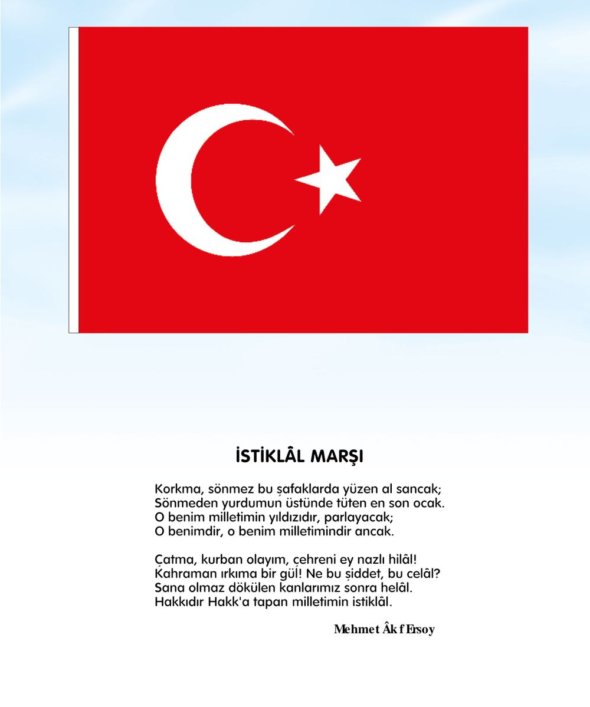

# İSTİKLÂL MARŞI

Korkma, sönmez bu şafaklarda yüzen al sancak;
Sönmeden yurdumun üstünde tüten en son ocak.
O benim milletimin yıldızıdır, parlayacak;
O benimdir, o benim milletimindir ancak.

Çatma, kurban olayım, cehren ey nazlı hilâl!
Kahraman ırkıma bir gül! Ne bu şiddet, bu celâl?
Sana olmaz dökülen kanlarımız sonra helâl.
Hakkıdır Hakk'a tapan milletimin istiklâl.

Mehmet Âkif Ersoy

<!-- sayfa 3 -->

ANDIMIZ

Türküm, doğruyum, çalışkanım.

İlkem küçüklerimi korumak, büyüklerimi saymak; yurdumu, milletimi özümden çok sevmektir.

Ülküm yükselmek, ileri gitmektir.

Ey Büyük Atatürk!

Açtığın yolda, gösterdiğin hedefe durmadan yürüyeceğime ant içerim.

Varlığım Türk varlığına armağan olsun.

Ne mutlu Türküm diyene!

<!-- sayfa 4 -->

MUSTAFA KEMAL ATATÜRK

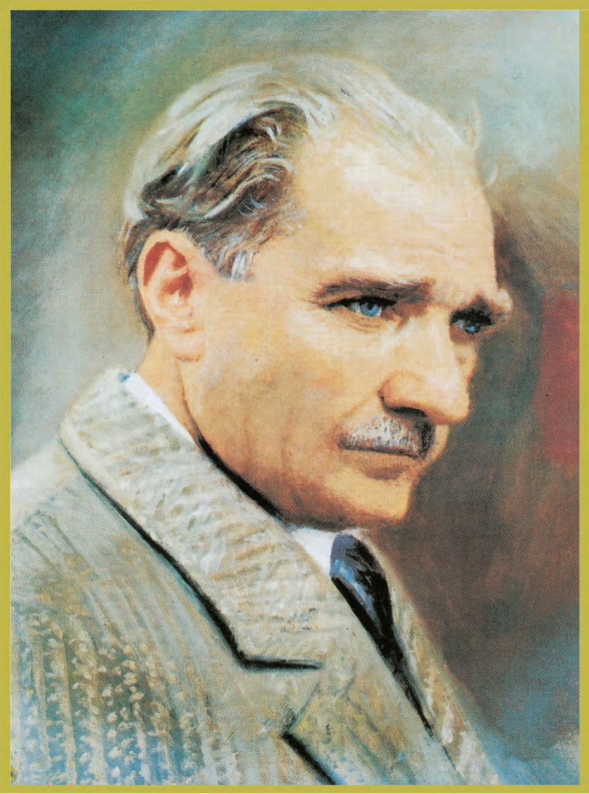
<!-- yer tutucu bulunamadı: sayfa sonuna eklendi -->

<!-- sayfa 5 -->

Verdiğiniz metin katmanı boş olduğu için (`<<< >>>` arası boş) dönüştürülecek bir içerik bulunmamaktadır. Lütfen metin katmanını içeren içeriği paylaşın, böylece kurallara uygun şekilde Markdown formatına çevirebilirim.

<!-- sayfa 6 -->

# İÇİNDEKİLER

Kitabımızı Tanıyalım ........................................................................................................................ 8
Hazırlık Listesi ............................................................................................................................... 10

## 1. ÖĞRENME ALANI BEN VE OKULUM

Belirli Gün ve Haftalar ........................................................................................................... 14
Haydi Tanışalım ............................................................................................................................ 16
Okulumu Keşfediyorum ............................................................................................................. 22
Kurallar Her Yerde ....................................................................................................................... 28
Nasıl Görünüyor, Neler Hissediyorum? .............................................................................. 34
Performans Görevi ...................................................................................................................... 40
Tekrar Zamanı ............................................................................................................................... 42

## 2. ÖĞRENME ALANI SAĞLIĞIM VE GÜVENLİĞİM

Belirli Gün ve Haftalar ........................................................................................................... 50
Sağlıklı Hayat Ne Güzel .......................................................................................................... 52
Kişisel Alanıma Dikkat! ............................................................................................................. 58
Trafik Kuralları İyi ki Var ........................................................................................................ 64
Performans Görevi ...................................................................................................................... 69
Eyvah, Acil Durum! ...................................................................................................................... 72
Tekrar Zamanı ............................................................................................................................... 79

## 3. ÖĞRENME ALANI AİLEM VE TOPLUM

Belirli Gün ve Haftalar ........................................................................................................... 84
Bizim Ev .......................................................................................................................................... 86
Nezaketli ve Görgülüyüz ........................................................................................................ 92
Biz İyi Bir Takımız ....................................................................................................................... 98
Performans Görevi .................................................................................................................... 102
Tekrar Zamanı ............................................................................................................................. 104

Ekler ................................................................................................................................................ 109
Sözlük ............................................................................................................................................ 121
Kaynakça ..................................................................................................................................... 124
Cevap Anahtarı .......................................................................................................................... 125
Görsel ve Genel Ağ Kaynakçası .......................................................................................... 125
Türkiye'nin Mülki İdare Bölümleri ile Kara ve Deniz Komşuları Haritası ........................ 126

<!-- sayfa 7 -->

# KİTABIMIZI TANIYALIM

Kitabımız 6 öğrenme alanından oluşmaktadır. Bu öğrenme alanlarının 3 tanesi 1. kitapta bulunmaktadır.

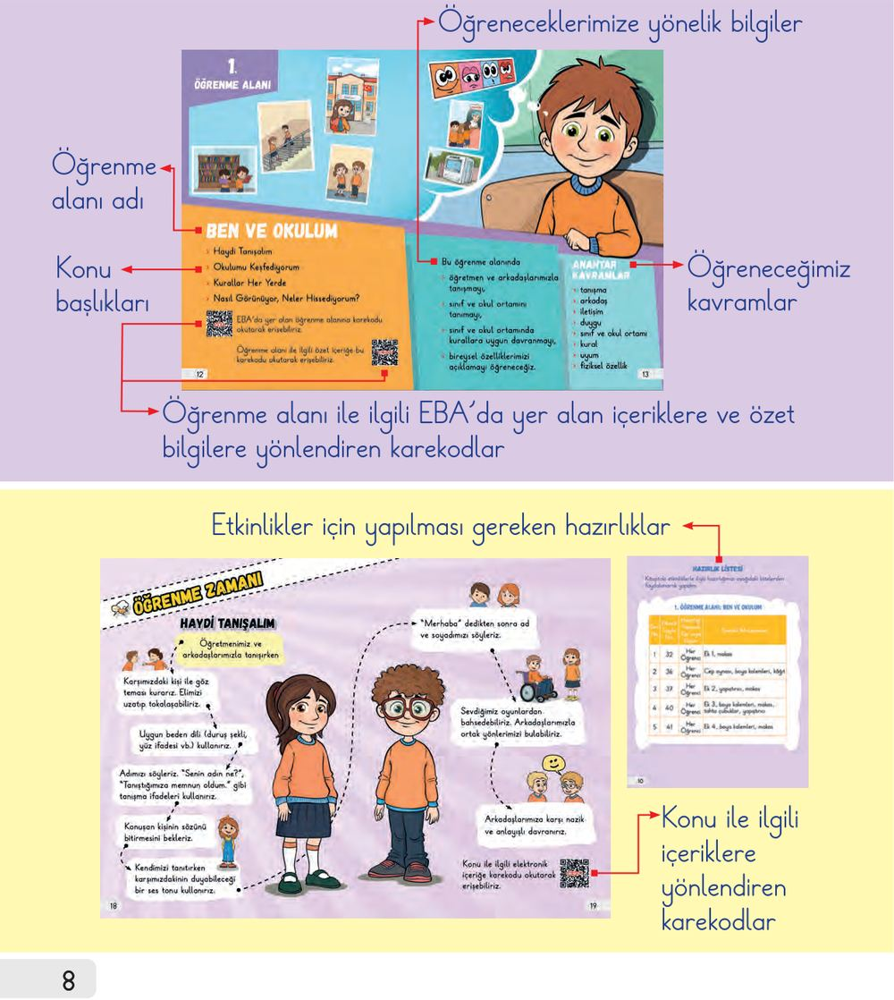

* Öğrenme alanı adı
* Konu başlıkları
* Öğreneceklerimize yönelik bilgiler
* Öğreneceğimiz kavramlar
* Öğrenme alanı ile ilgili EBA’da yer alan içeriklere ve özet bilgilere yönlendiren karekodlar

## Etkinlikler için yapılması gereken hazırlıklar

* Konu ile ilgili içeriklere yönlendiren karekodlar

<!-- sayfa 8 -->

Öğrenme alanında her bir konu “Düşünme Zamanı, Keşif Zamanı, Öğrenme Zamanı, Pekiştirme Zamanı ve Değerlendirme Zamanı” olmak üzere 5 başlıktan oluşmaktadır. Her öğrenme alanının sonunda “Tekrar Zamanı” bulunmaktadır.

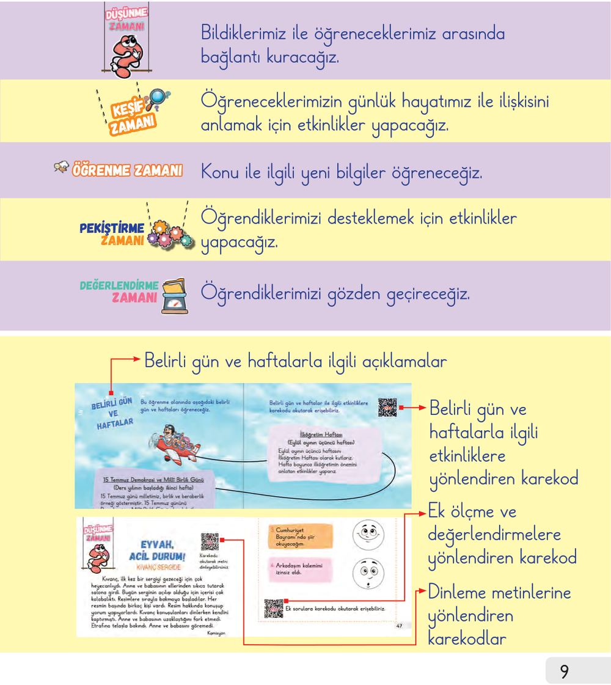 DÜŞÜNME ZAMANI Bildiklerimiz ile öğreneceklerimiz arasında bağlantı kuracağız.

 KEŞİF ZAMANI Öğreneceklerimizin günlük hayatımız ile ilişkisini anlamak için etkinlikler yapacağız.

 ÖĞRENME ZAMANI Konu ile ilgili yeni bilgiler öğreneceğiz.

 PEKİŞTİRME ZAMANI Öğrendiklerimizi desteklemek için etkinlikler yapacağız.

 DEĞERLENDİRME ZAMANI Öğrendiklerimizi gözden geçireceğiz.

---

 Belirli gün ve haftalarla ilgili açıklamalar

 BELİRLİ GÜN VE HAFTALAR Bu öğrenme alanında aşağıdaki belirli gün ve haftaları öğreneceğiz.

Belirli gün ve haftalar ile ilgili etkinliklere karekod okutarak erişebiliriz.

İlköğretim Haftası
(Eylül ayının üçüncü haftası)
Eylül ayının üçüncü haftası İlköğretim Haftası olarak kutlanır. Hafta boyunca ilköğretimin önemini anlatan etkinlikler yaparız.

15 Temmuz Demokrasi ve Millî Birlik Günü
(Ders yılının başladığı ikinci hafta)
15 Temmuz günü milletimiz, birlik ve beraberlik örneği göstermiştir. 15 Temmuz gününü...

 Belirli gün ve haftalarla ilgili etkinliklere yönlendiren karekod

 Ek ölçme ve değerlendirmelere yönlendiren karekod

 Dinleme metinlerine yönlendiren karekod

 DÜŞÜNME ZAMANI

EYVAH, ACİL DURUM!
KİVANO SERGİDE

Kıvanç, iki kez bir sergiyi gezeceği için heyecanlandı. Anne ve babasının yanında olacak tutarak salona girdi. Büğün serginin açılışı için çok kalabalıktı. Resimlere bakmaya başladı. Her resmin başında farklı bir kişi vardı. Resim hakkında konuşup yorum yapıyordu. Kıvanç konuşmaya çalışırken bir şeyi kaptırmış. Anne ve babasının uzaklaştığını fark etmiş. Telaşla telaşla baktı. Anne ve babasını göremedi.

Karekod:
Kıvanç'ın metni dinleyebiliriz.

3. Cumhuriyet Bayramı'nda şiir okuyacağım.
4. Arkadaşım kalemini izinsiz aldı.

Ek sorulara karekod okutarak erişebiliriz.

<!-- sayfa 9 -->

# HAZIRLIK LİSTESİ

Kitaptaki etkinliklerle ilgili hazırlığımızı aşağıdaki listelerden faydalanarak yapalım.

## 1. ÖĞRENME ALANI: BEN VE OKULUM

| Sıra No. | Etkinlik Sayfa No. | Hazırlığı Yapacak Kişi veya Kişiler | Gerekli Malzemeler |
| :--- | :--- | :--- | :--- |
| 1 | 32 | Her Öğrenci | Ek 1, makas, boya kalemleri |
| 2 | 36 | Her Öğrenci | Cep aynası, boya kalemleri, kâğıt |
| 3 | 37 | Her Öğrenci | Ek 2, yapıştırıcı, makas |
| 4 | 40 | Her Öğrenci | Ek 3, boya kalemleri, makas, tahta çubuklar, yapıştırıcı |
| 5 | 41 | Her Öğrenci | Ek 4, boya kalemleri, makas |

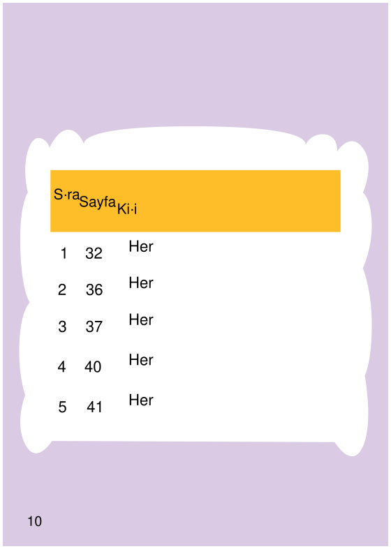
<!-- yer tutucu bulunamadı: sayfa sonuna eklendi -->

<!-- sayfa 10 -->

# 2. ÖĞRENME ALANI: SAĞLIĞIM VE GÜVENLİĞİM

| Sıra No. | Etkinlik Sayfa No. | Hazırlığı Yapacak Kişi veya Kişiler | Gerekli Malzemeler |
| :--- | :--- | :--- | :--- |
| 1 | 57 | Her Öğrenci | Ek 5, makas, yapıştırıcı |
| 2 | 59 | Her Öğrenci | A4 kâğıdı, boya kalemleri, çember |
| 3 | 68-69 | Gruptan Bir Öğrenci | Renkli kartonlar, beyaz tebeşir, makas, yapıştırıcı, boya kalemleri |
| 4 | 76-77 | Her Öğrenci | Ek 6, makas |

# 3. ÖĞRENME ALANI: AİLEM VE TOPLUM

| Sıra No. | Etkinlik Sayfa No. | Hazırlığı Yapacak Kişi veya Kişiler | Gerekli Malzemeler |
| :--- | :--- | :--- | :--- |
| 1 | 102 | Her Öğrenci | Ek 7, makas, yapıştırıcı |

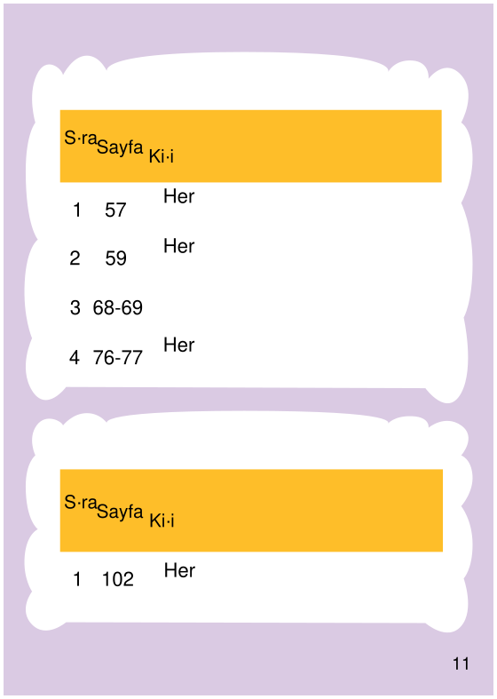
<!-- yer tutucu bulunamadı: sayfa sonuna eklendi -->

<!-- sayfa 11 -->

# 1. ÖĞRENME ALANI

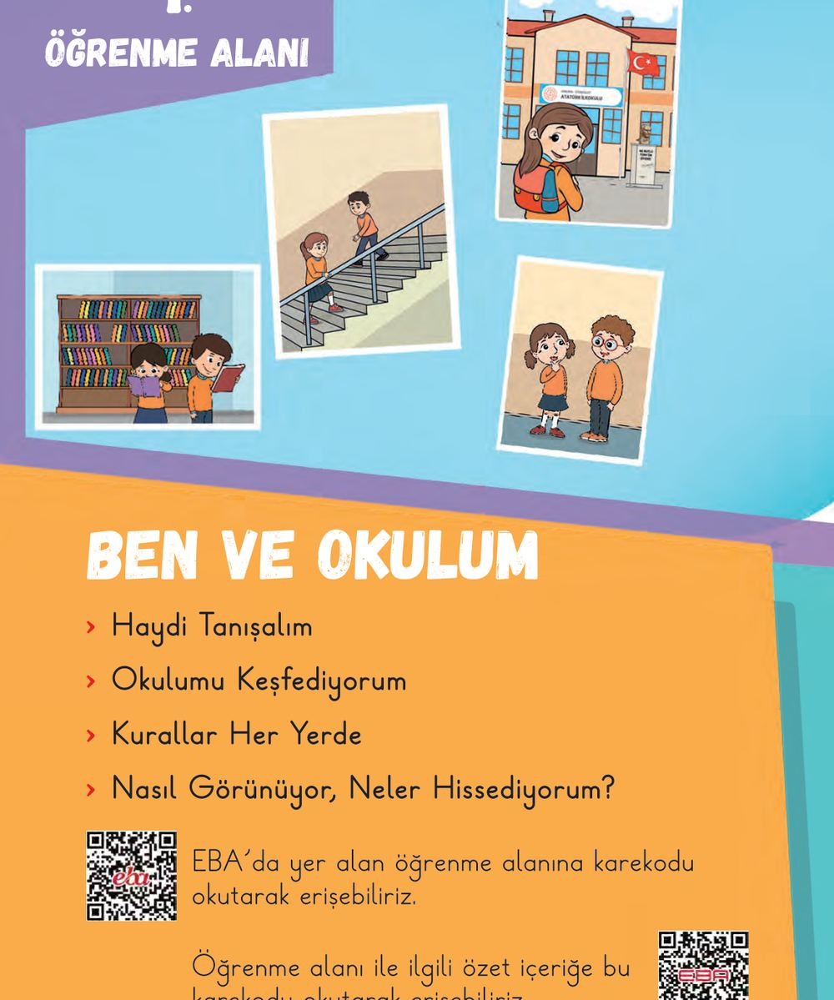

# BEN VE OKULUM

> Haydi Tanışalım
> Okulumu Keşfediyorum
> Kurallar Her Yerde
> Nasıl Görünüyor, Neler Hissediyorum?

EBA’da yer alan öğrenme alanına karekodu okutarak erişebiliriz.

Öğrenme alanı ile ilgili özet içeriğe bu karekodu okutarak erişebiliriz

<!-- sayfa 12 -->

Bu öğrenme alanında
> öğretmen ve arkadaşlarımızla tanışmayı,
> sınıf ve okul ortamını tanımayı,
> sınıf ve okul ortamında kurallara uygun davranmayı,
> bireysel özelliklerimizi

## ANAHTAR KAVRAMLAR
> tanışma
> arkadaş
> iletişim
> duygu
> sınıf ve okul ortamı
> kural
> uyum

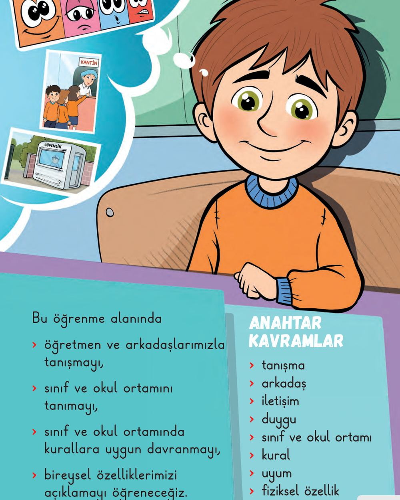
<!-- yer tutucu bulunamadı: sayfa sonuna eklendi -->

<!-- sayfa 13 -->

# BELİRLİ GÜN VE HAFTALAR

Bu öğrenme alanında aşağıdaki belirli gün ve haftaları öğreneceğiz.

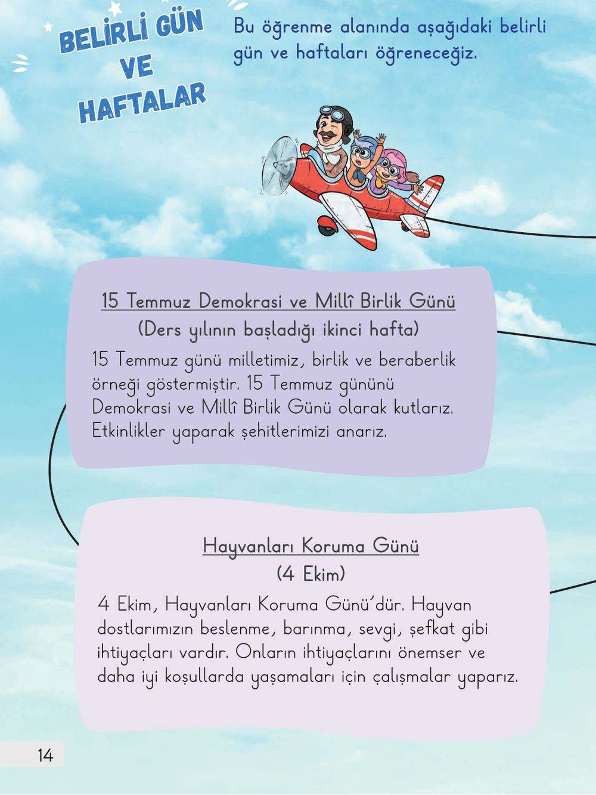

## 15 Temmuz Demokrasi ve Millî Birlik Günü
(Ders yılının başladığı ikinci hafta)

15 Temmuz günü milletimiz, birlik ve beraberlik örneği göstermiştir. 15 Temmuz gününü Demokrasi ve Millî Birlik Günü olarak kutlarız. Etkinlikler yaparak şehitlerimizi anarız.

## Hayvanları Koruma Günü
(4 Ekim)

4 Ekim, Hayvanları Koruma Günü’dür. Hayvan dostlarımızın beslenme, barınma, sevgi, şefkat gibi ihtiyaçları vardır. Onların ihtiyaçlarını önemser ve daha iyi koşullarda yaşamaları için çalışmalar yaparız.

<!-- sayfa 14 -->

Belirli gün ve haftalar ile ilgili etkinliklere karekodu okutarak erişebiliriz.

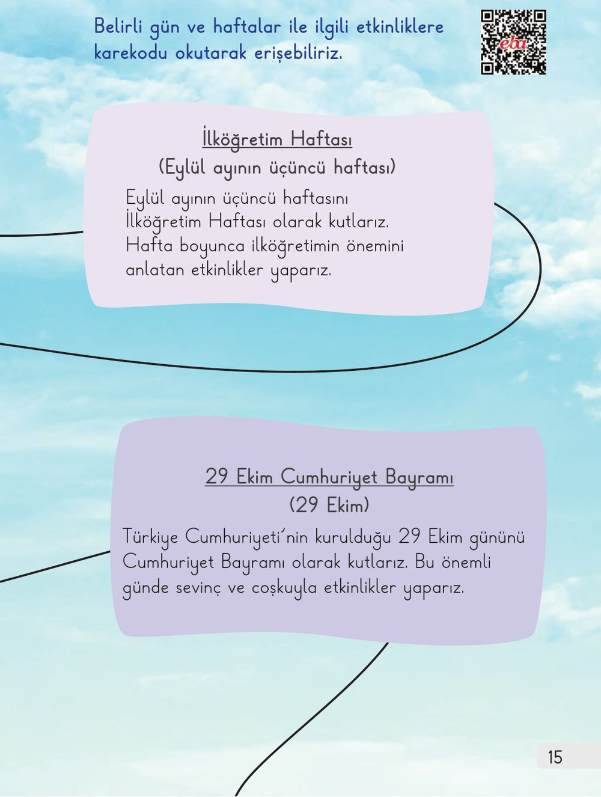

## İlköğretim Haftası
(Eylül ayının üçüncü haftası)

Eylül ayının üçüncü haftasını İlköğretim Haftası olarak kutlarız. Hafta boyunca ilköğretimin önemini anlatan etkinlikler yaparız.

## 29 Ekim Cumhuriyet Bayramı
(29 Ekim)

Türkiye Cumhuriyeti’nin kurulduğu 29 Ekim gününü Cumhuriyet Bayramı olarak kutlarız. Bu önemli günde sevinç ve coşkuyla etkinlikler yaparız.

<!-- sayfa 15 -->

# HAYDİ TANIŞALIM

> Görseli inceleyelim.

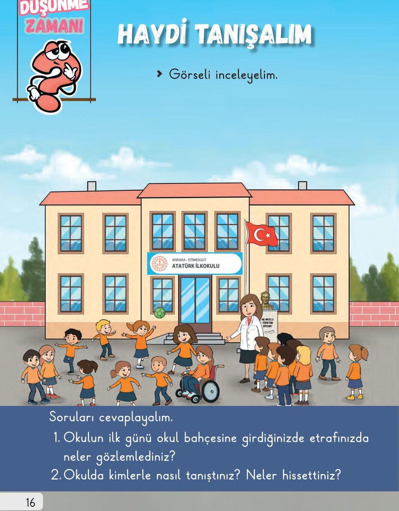

Soruları cevaplayalım.

1. Okulun ilk günü okul bahçesine girdiğinizde etrafınızda neler gözlemlediniz?
2. Okulda kimlerle nasıl tanıştınız? Neler hissettiniz?

<!-- sayfa 16 -->

# KEŞİF ZAMANI

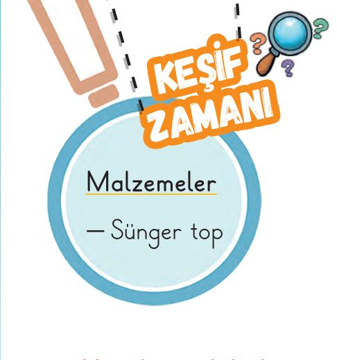

**Malzemeler**
— Sünger top

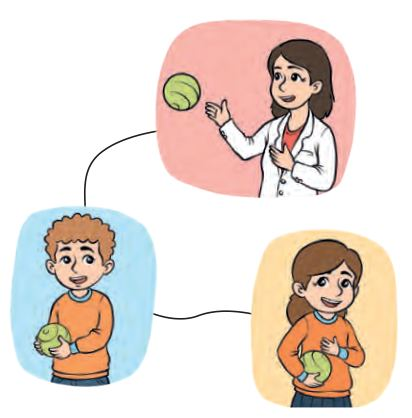

› Uygulama adımlarını takip ederek etkinliği yapalım.

## Uygulama Adımları

▶ Arkadaşlarımız ve öğretmenimizle yuvarlak oluşturalım.
▶ Oyunu başlatacak arkadaşımızı seçerek topu ona verelim.
▶ Öğretmenimiz ve arkadaşlarımız kendilerini tanıtırken onları dikkatlice dinleyelim.
▶ Söz istemeden önce konuşan kişinin sözünü bitirmesini bekleyelim. Konuşan kişi ile göz teması kuralım.
▶ Arkadaşımızdan kendisini tanıtarak topu başkasına atmasını isteyelim. Topu birbirimize atarken arkadaşlarımızın zarar görmemesine dikkat edelim.
▶ Sınıftaki herkes kendini tanıtana kadar oyuna devam edelim.
▶ Arkadaşlarımıza karşı nazik olalım.

1. Kendinizi tanıtırken nelerden bahsettiniz?
2. Tanışma sürecinde nelere dikkat ettiniz?
3. Tanışma etkinliği sırasında neler hissettiniz?
4. Günlük yaşamınızda tanışma sürecinde nelere dikkat ediyorsunuz? Örnekler vererek açıklayalım.

<!-- sayfa 17 -->

# ÖĞRENME ZAMANI

## HAYDİ TANIŞALIM

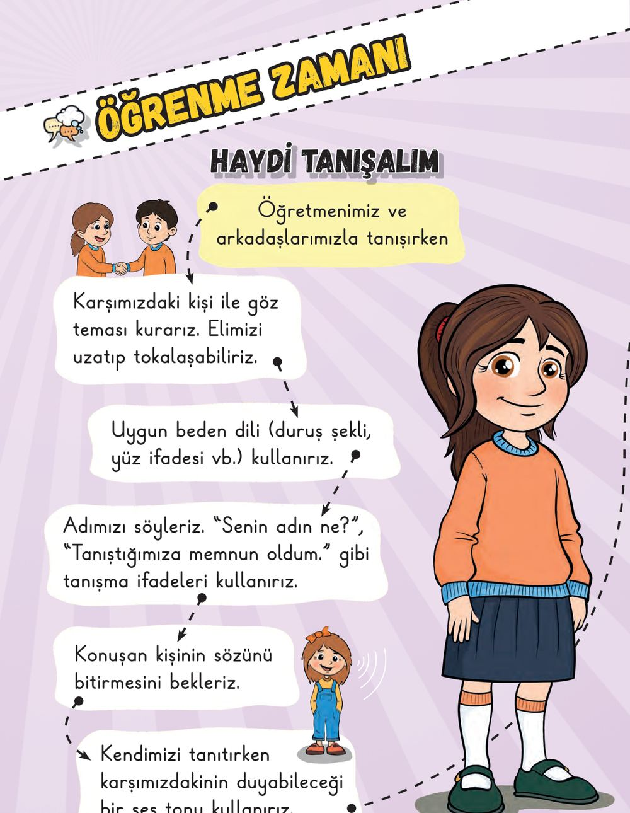: Öğretmenimiz ve arkadaşlarımızla tanışırken

* Karşımızdaki kişi ile göz teması kurarız. Elimizi uzatıp tokalaşabiliriz.
* Uygun beden dili (duruş şekli, yüz ifadesi vb.) kullanırız.
* Adımızı söyleriz. “Senin adın ne?”, “Tanıştığımıza memnun oldum.” gibi tanışma ifadeleri kullanırız.
* Konuşan kişinin sözünü bitirmesini bekleriz.
* Kendimizi tanıtırken karşımızdakinin duyabileceği bir ses tonu kullanırız.

<!-- sayfa 18 -->

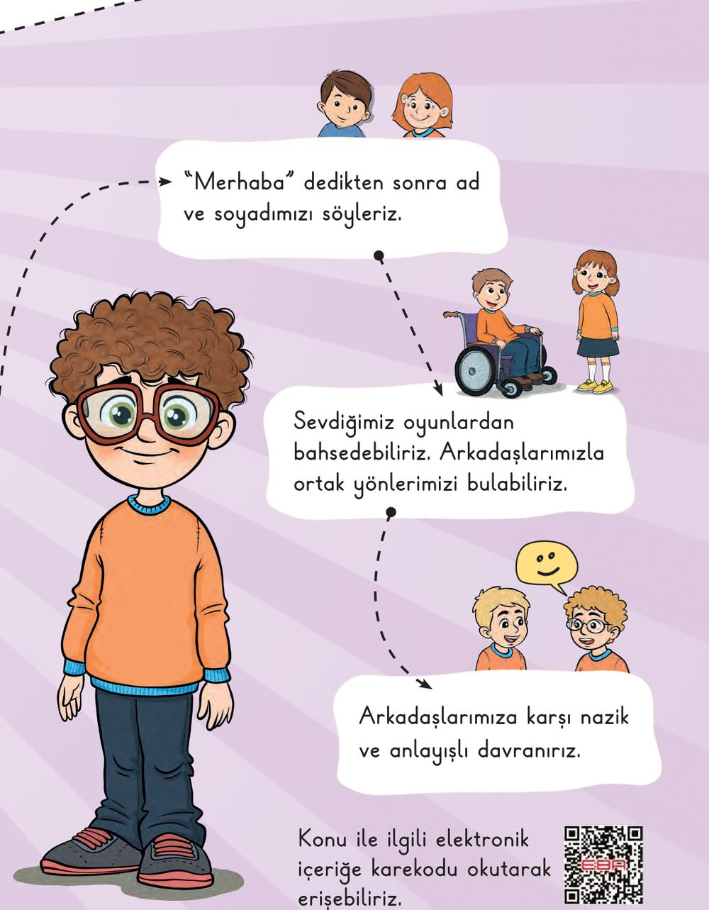 “Merhaba” dedikten sonra ad ve soyadımızı söyleriz.

 Sevdiğimiz oyunlardan bahsedebiliriz. Arkadaşlarımızla ortak yönlerimizi bulabiliriz.

 Arkadaşlarımıza karşı nazik ve anlayışlı davranırız.

Konu ile ilgili elektronik içeriğe karekodu okutarak erişebiliriz.

<!-- sayfa 19 -->

# PEKİŞTİRME ZAMANI

› Uygulama adımlarını takip ederek etkinliği yapalım.

## Uygulama Adımları

▶ Tahtaya gelerek ad ve soyadımızı söyleyelim.

▶ Tanışma ifadelerini ve uygun beden dilini kullanalım.

▶ Bizi tanıtan özelliklerimizi (sevdiğiniz sanat ve spor etkinlikleri gibi) hareketlerle veya resim çizerek anlatalım.

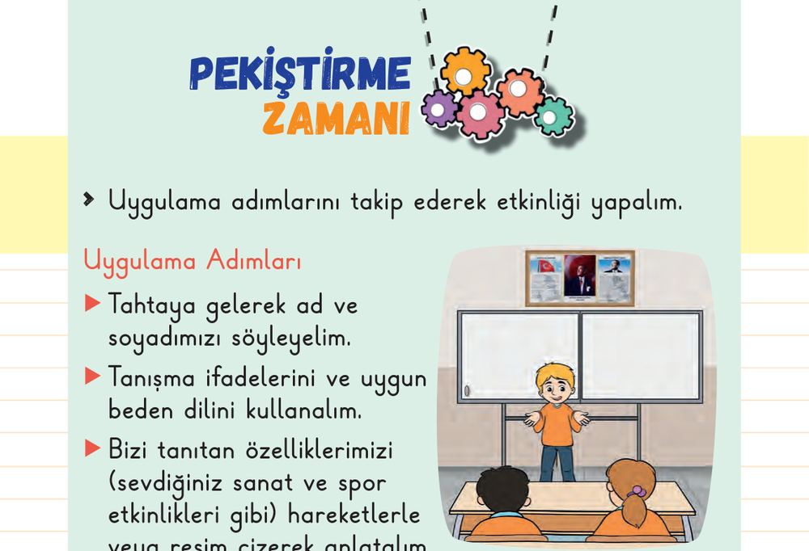

▶ Arkadaşlarımızdan özelliklerimizi tahmin etmelerini isteyelim.

▶ Söz istemeden önce konuşan kişinin sözünü bitirmesini bekleyelim.

▶ Konuşan kişi ile göz teması kuralım. Etkinlik süresince arkadaşlarımıza karşı anlayışlı olalım ve onları yakından tanıyalım.


▶ Onları sabırla ve dikkatlice izleyelim.

Soruları cevaplayalım.
1. Arkadaşlarınızla ilgili neler öğrendiniz?
2. Arkadaşlarınızla ortak yönleriniz nelerdir?

<!-- sayfa 20 -->

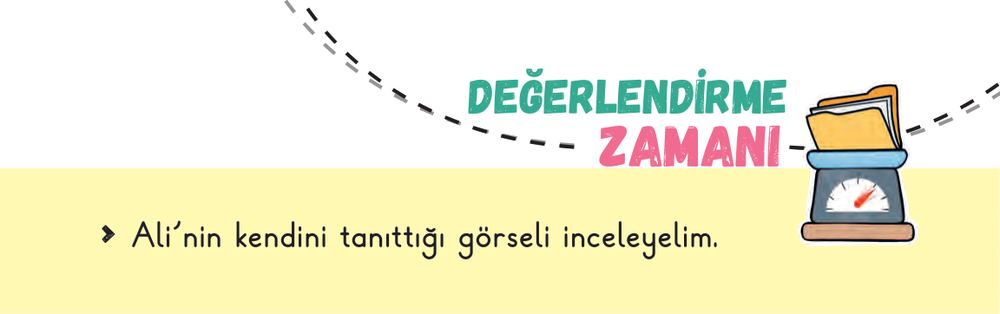
# DEĞERLENDİRME ZAMANI

> Ali’nin kendini tanıttığı görseli inceleyelim. 

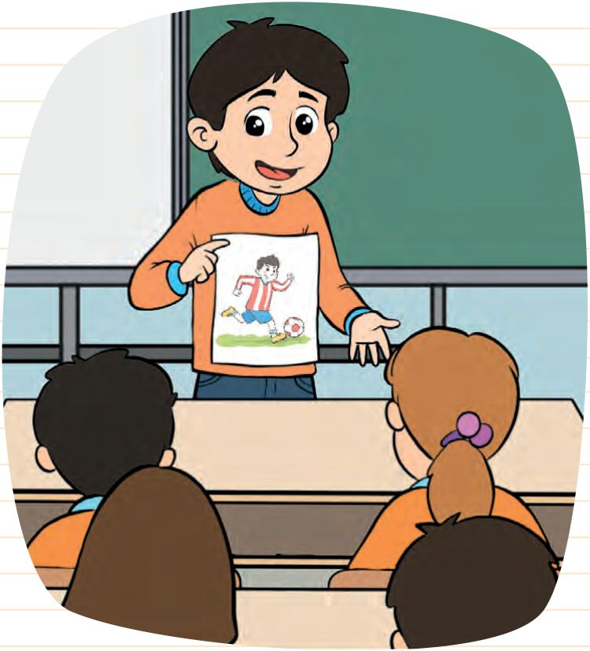

Soruları cevaplayalım.
1. Ali kendini tanıtırken hangi özelliğinden bahsetmiştir?
2. Ali kendini tanıtırken nelere dikkat etmelidir?
3. Sınıf arkadaşları Ali’yi dinlerken nasıl davranmalıdır?

<!-- sayfa 21 -->

# OKULUMU KEŞFEDİYORUM

> Görselleri inceleyelim.

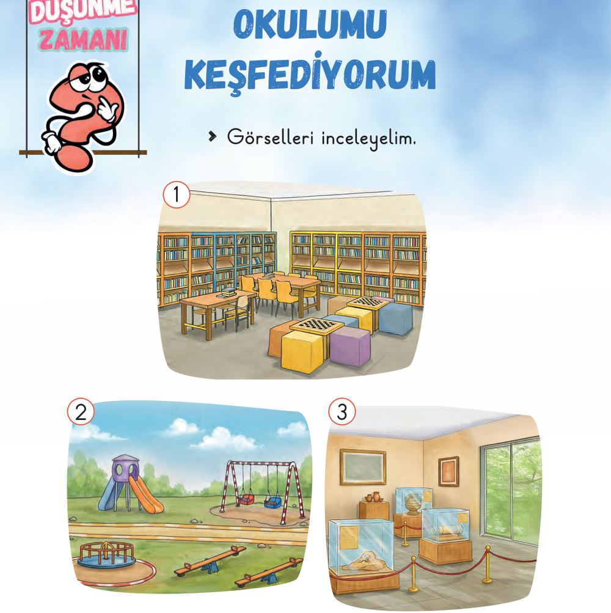

Soruları cevaplayalım.
1. Görsellerde hangi ortamlara yer verilmiştir?
2. Bu ortamlardaki deneyimleriniz nelerdir?

<!-- sayfa 22 -->

› Yağız’ı labirentte bulunan okul bölümlerinin hepsinden geçirerek sınıfına ulaştıralım.

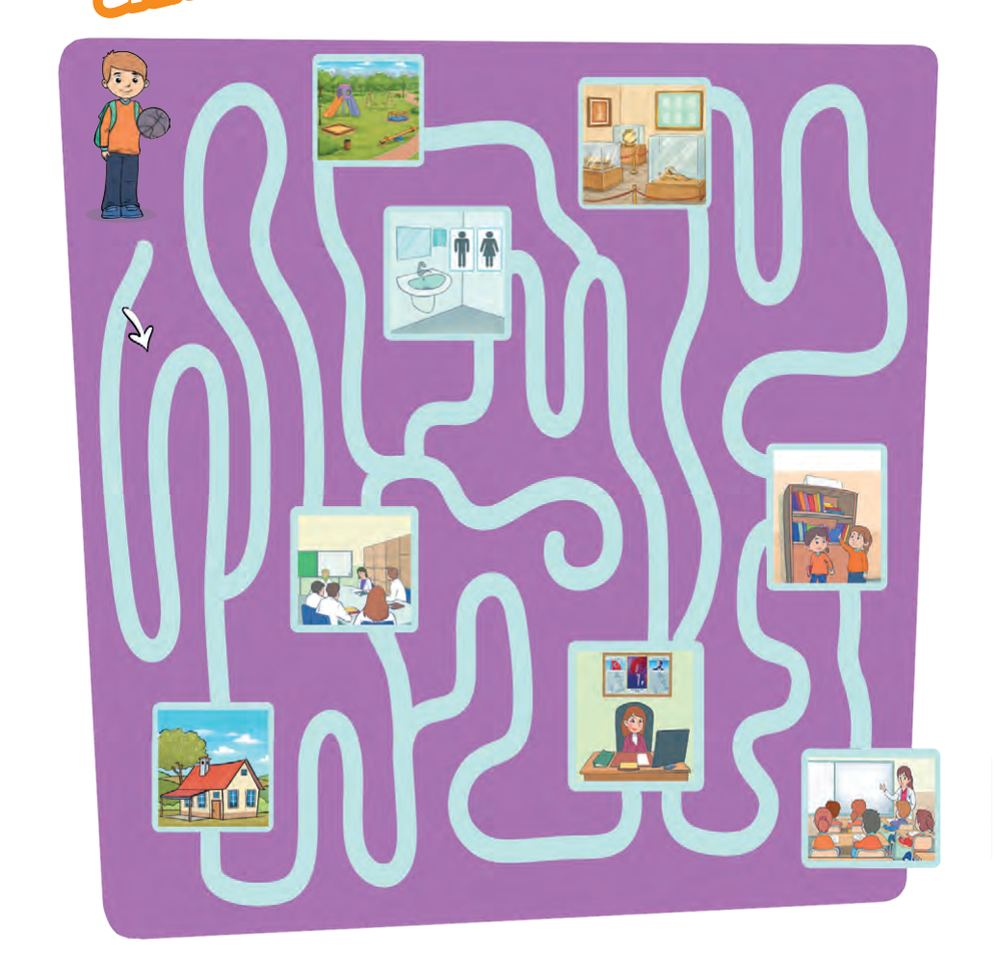

Soruları cevaplayalım.
1. Yağız’ın geçtiği okul bölümlerinin adları neler olabilir?
2. Okulun kütüphane, kantin, tuvalet gibi bölümlerinde nelere dikkat etmek gerekir? Neden?
3. Okul çalışanları ile nasıl iletişim kurarsınız?

<!-- sayfa 23 -->

# ÖĞRENME ZAMANI

## OKULUMU KEŞFEDİYORUM

Okulumuz, öğrenmemize ve güvenli bir ortamda zaman geçirmemize yardımcı olan birçok bölümden oluşur. Sınıfımızda kullandığımız araç gereç ve şeref köşesi de okul yaşamımızın önemli bir parçasıdır.

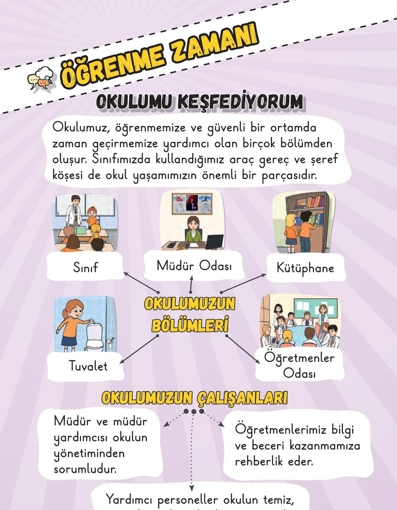
Sınıf

Müdür Odası

Kütüphane

Tuvalet

Öğretmenler Odası

## OKULUMUZUN BÖLÜMLERİ

## OKULUMUZUN ÇALIŞANLARI

Müdür ve müdür yardımcısı okulun yönetiminden sorumludur.

Öğretmenlerimiz bilgi ve beceri kazanmamıza rehberlik eder.

Yardımcı personeller okulun temiz,

<!-- sayfa 24 -->

# ŞEREF KÖŞESİ

Sınıfımızda yazı tahtasının üzerinde şeref köşesi bulunur.

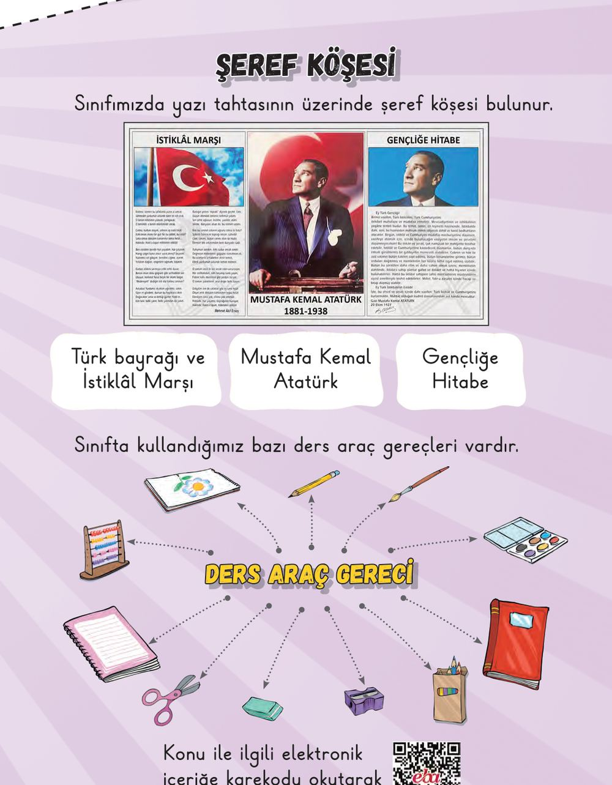

* Türk bayrağı ve İstiklâl Marşı
* Mustafa Kemal Atatürk
* Gençliğe Hitabe

Sınıfta kullandığımız bazı ders araç gereçleri vardır.

DERS ARAÇ GEREÇİ

Konu ile ilgili elektronik içeriğe karekodu okutarak

<!-- sayfa 25 -->

# PEKİŞTİRME ZAMANI

› Uygulama adımlarını takip ederek etkinliği yapalım.

## Uygulama Adımları

▶ Okulumuzun bölümlerini gezelim. Gezi sırasında okulun bölümlerini ve çalışanlarını dikkatlice gözlemleyelim.

▶ Gezi sırasında okul çalışanlarıyla tanışalım ve görevleri hakkında bilgi alalım.

▶ Gezi sonrasında sınıf arkadaşlarımızla çember oluşturup duygu, düşünce ve izlenimlerimizi paylaşalım.

▶ Sınıftan iki arkadaşımızı seçelim.

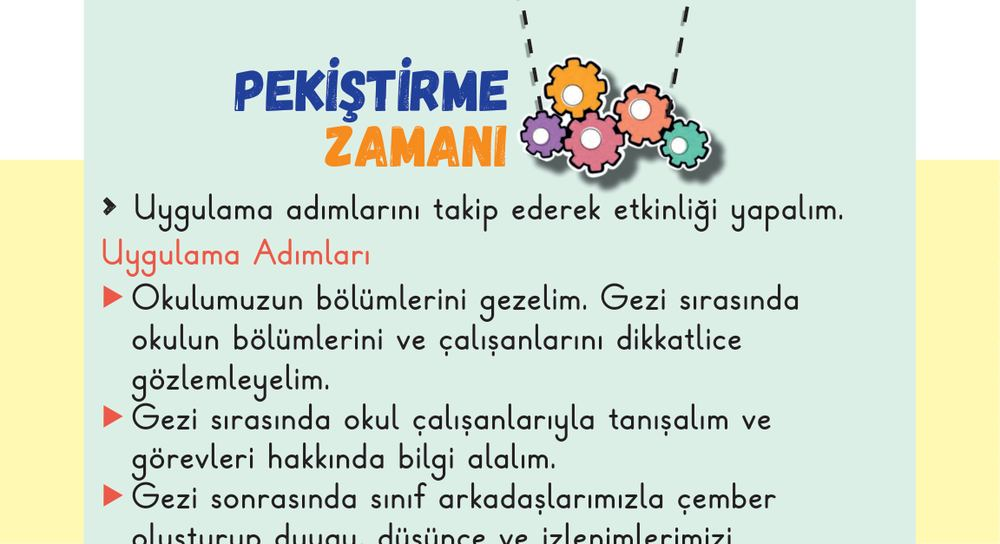

▶ Arkadaşlarımızın birinden okul bölümü, çalışanı veya ders araç gerecini aklından belirlemesini ve söylememesini isteyelim.

▶ Diğer arkadaşımızın belirlenen bölümü, çalışanı veya araç gereci bulmak için arkadaşına sorular sormasını isteyelim.

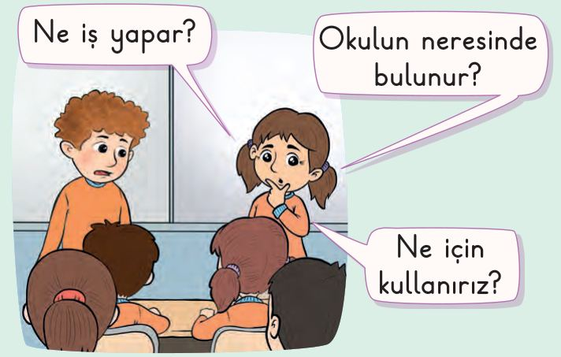

▶ Arkadaşımız cevabı bulduktan sonra farklı kişiler belirleyerek etkinliğe devam edelim.

Ne iş yapar?
Okulun neresinde bulunur?
Ne için kullanırız?

<!-- sayfa 26 -->

# DEĞERLENDİRME ZAMANI 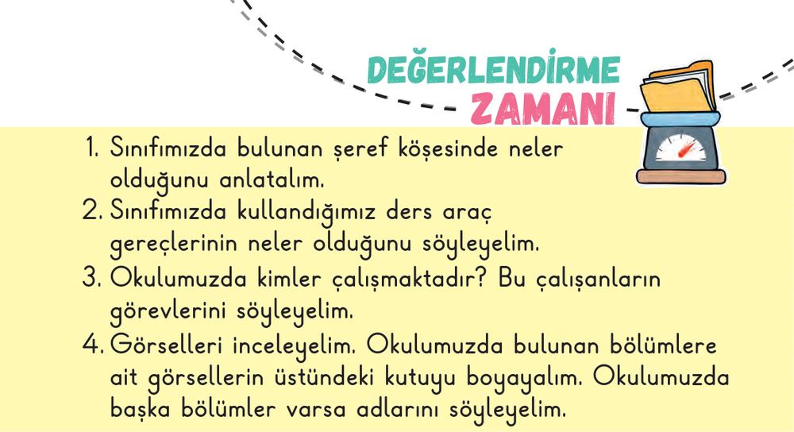

1. Sınıfımızda bulunan şeref köşesinde neler olduğunu anlatalım. 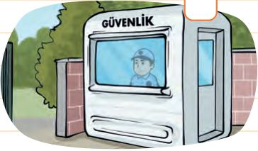
2. Sınıfımızda kullandığımız ders araç gereçlerinin neler olduğunu söyleyelim. 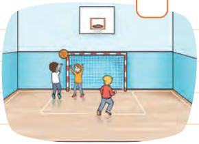
3. Okulumuzda kimler çalışmaktadır? Bu çalışanların görevlerini söyleyelim. 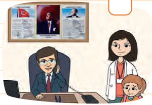
4. Görselleri inceleyelim. Okulumuzda bulunan bölümlere ait görsellerin üstündeki kutuyu boyayalım. Okulumuzda başka bölümler varsa adlarını söyleyelim. 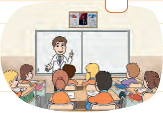

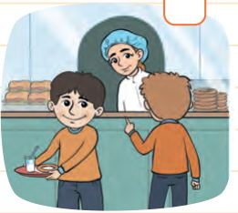 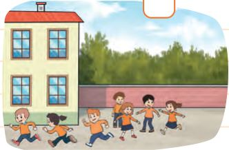 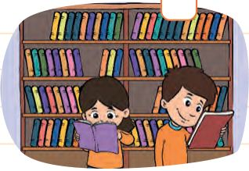

<!-- sayfa 27 -->

# DUŞUNME ZAMANI
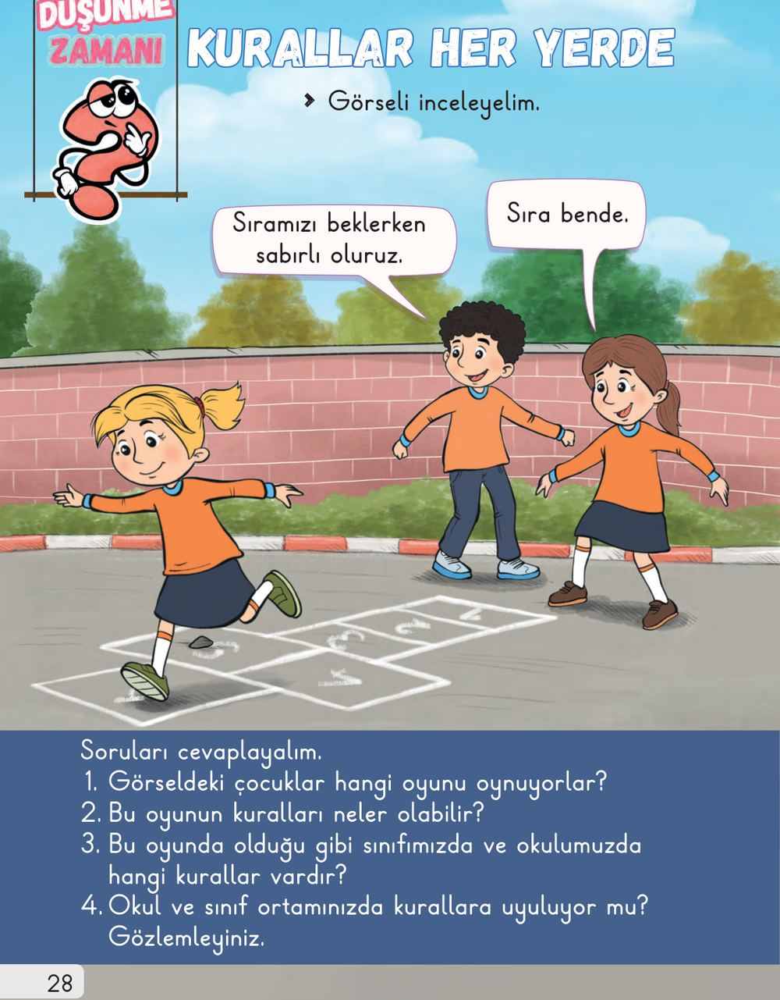: Düşünen bir karakter figürü.

# KURALLAR HER YERDE
> Görseli inceleyelim.

: Üç çocuğun sokakta seksek oynadığı görsel. Konuşma balonlarında "Sıramızı beklerken sabırlı oluruz." ve "Sıra bende." yazmaktadır.

Soruları cevaplayalım.
1. Görseldeki çocuklar hangi oyunu oynuyorlar?
2. Bu oyunun kuralları neler olabilir?
3. Bu oyunda olduğu gibi sınıfımızda ve okulumuzda hangi kurallar vardır?
4. Okul ve sınıf ortamınızda kurallara uyuluyor mu? Gözlemleyiniz.

<!-- sayfa 28 -->

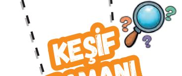

* Sınıf ve okul ortamındaki kurallara ilişkin yaptığımız gözlem ve deneyimlerimizi arkadaşlarımızla paylaşalım.
* Sınıf arkadaşlarımızla beş grup oluşturalım.
* Sınıf ve okul ortamındaki kuralların neler olması gerektiği üzerine ortak karara varalım. Kuralları belirlerken arkadaşlarımızın da hakları olduğunu unutmayalım. Sıra bize geldiğinde düşüncelerimizi nazik bir dille paylaşalım.
* Grubumuzla belirlediğimiz kuralları sınıf arkadaşlarımızla paylaşalım. Sınıf kurallarını oylayarak belirleyelim.
* Okul ortamındaki genel davranışlar hakkında gözlem yaparak okul kurallarına örnekler verelim.
* Sınıf ve okul ortamında kurallara uygun davranışlar sergileyelim.

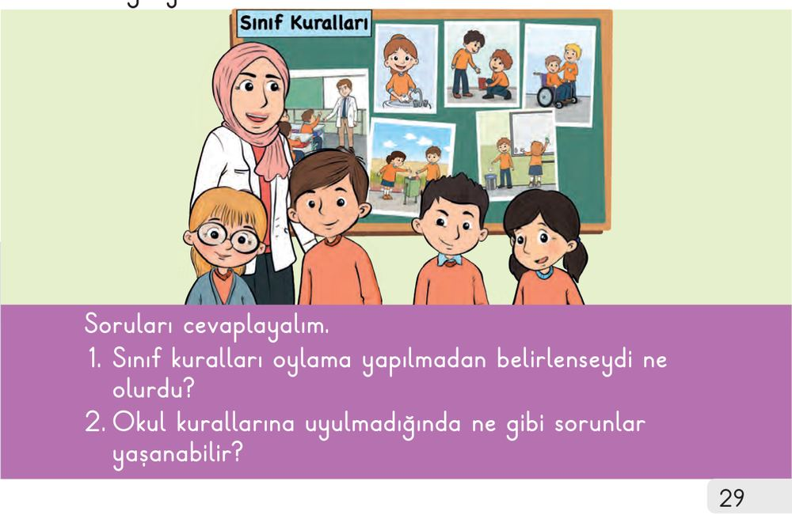

**Sınıf Kuralları**

Soruları cevaplayalım.
1. Sınıf kuralları oylama yapılmadan belirlenseydi ne olurdu?
2. Okul kurallarına uyulmadığında ne gibi sorunlar yaşanır?

<!-- sayfa 29 -->

# ÖĞRENME ZAMANI

## KURALLAR HER YERDE

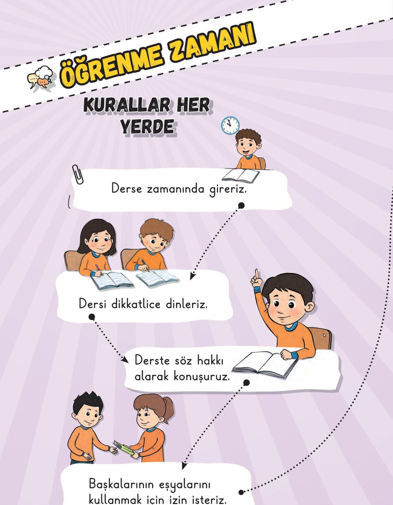 Derse zamanında gireriz.

 Dersi dikkatlice dinleriz.

 Derste söz hakkı alarak konuşuruz.

 Başkalarının eşyalarını kullanmak için izin isteriz.

<!-- sayfa 30 -->

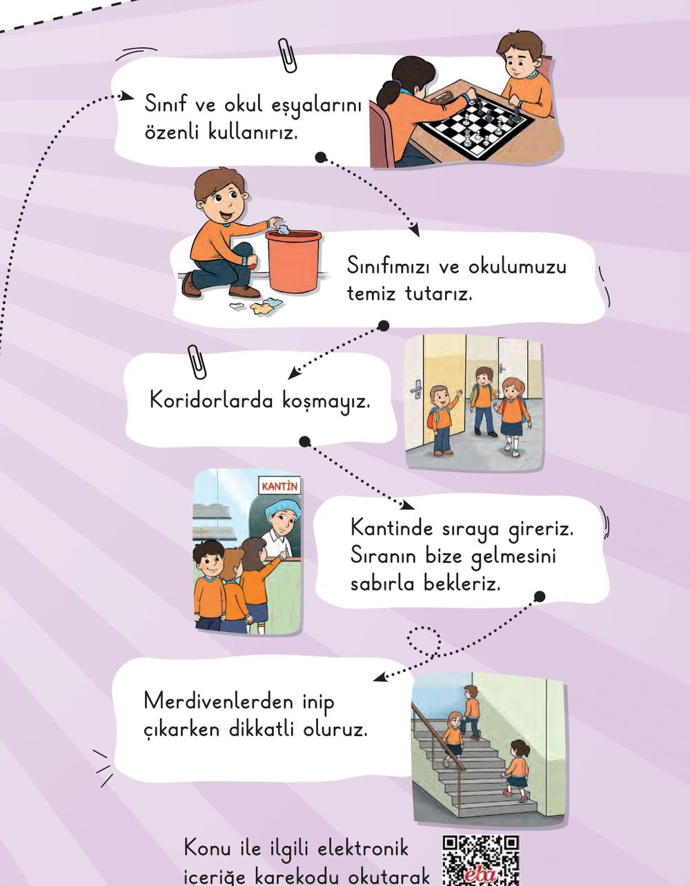 Sınıf ve okul eşyalarını özenli kullanırız.

 Sınıfımızı ve okulumuzu temiz tutarız.

 Koridorlarda koşmayız.

 Kantinde sıraya gireriz. Sıranın bize gelmesini sabırla bekleriz.

 Merdivenlerden inip çıkarken dikkatli oluruz.

Konu ile ilgili elektronik içeriğe karekodu okutarak

<!-- sayfa 31 -->

# PEKİŞTİRME ZAMANI

> Uygulama adımlarını takip ederek etkinliği yapalım.

## Malzemeler
— Ek 1
— Makas
— Boya kalemleri

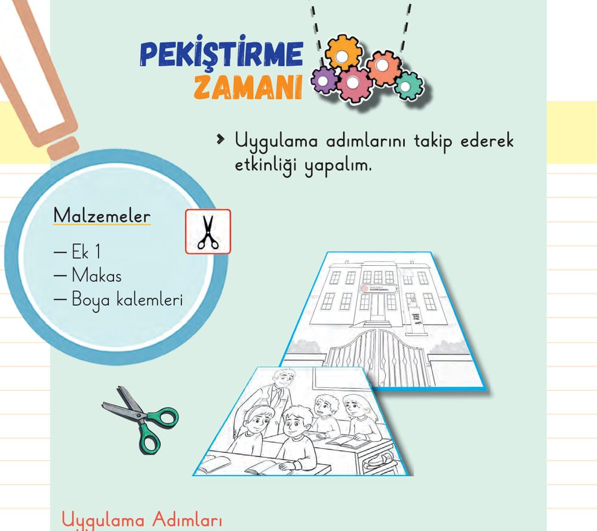

## Uygulama Adımları
▶ Ekler bölümünde bulunan Ek 1'deki görselleri noktalı yerlerden kesip boyayalım.
▶ Sınıf arkadaşlarımızla sırayla tahtaya çıkalım.
▶ Tahtadaki arkadaşımızdan sınıf veya okul kurallarından birini söylemesini isteyelim.
▶ Söylenen kural sınıf kuralıysa sınıf görselini, okul kuralıysa okul görselini gösterelim. Hem sınıf hem okul kuralıysa iki görseli de gösterelim.

<!-- sayfa 32 -->

# DEĞERLENDİRME ZAMANI

> Aşağıdaki kurallara uyuyorsak mutlu yüzü, uymuyorsak üzgün yüzü boyayalım.

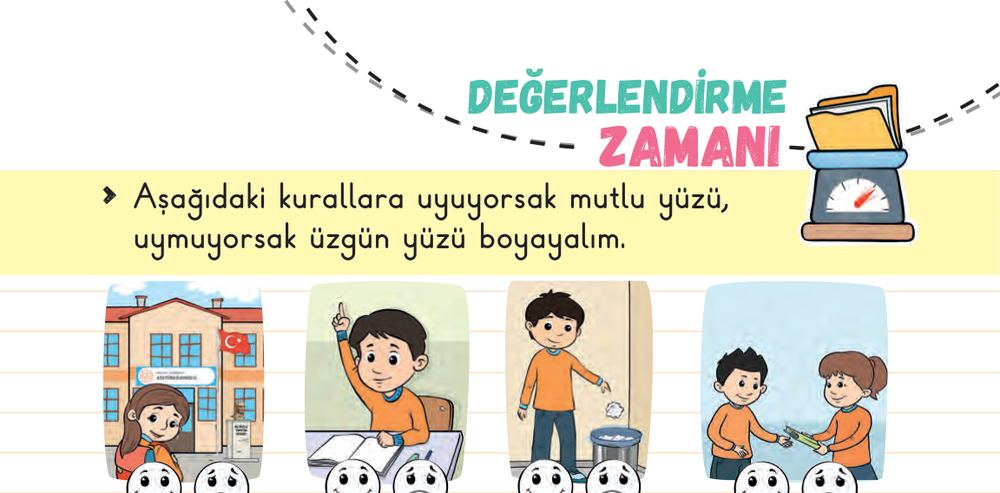
Okula zamanında gelirim.

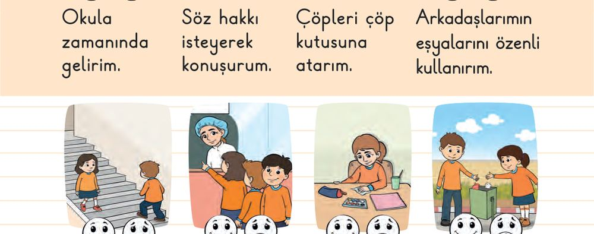
Söz hakkı isteyerek konuşurum.

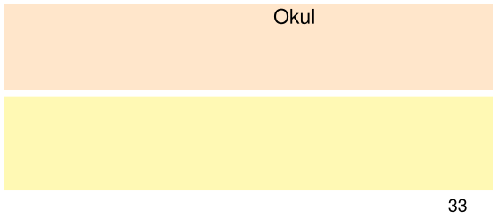
Çöpleri çöp kutusuna atarım.

Arkadaşlarımın eşyalarını özenli kullanırım.

Merdivenlerden koşmadan inip çıkarım.

Kantinde sıraya girerim.

Okul eşyalarını özenli kullanırım.

Okulumu temiz tutarım.

> Boyadığımız ifadelerin hepsi mutlu yüzse tebrikler! Okul ve sınıf kurallarına uyuyoruz.
> Üzgün yüzü boyadığımız okul ve sınıf kurallarına dikkat edelim. Bu kurallara uygun davranalım.

<!-- sayfa 33 -->

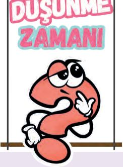

# NASIL GÖRÜNÜYOR, NELER HİSSEDİYORUM?

1. Aşağıdaki görseller Elif, Asya, Alya ve Ece’ye aittir. Görsellerin hangi öğrencilere ait olduğunu ipuçlarından faydalanarak söyleyelim. Öğrencilerin bireysel özelliklerini ifade edelim.

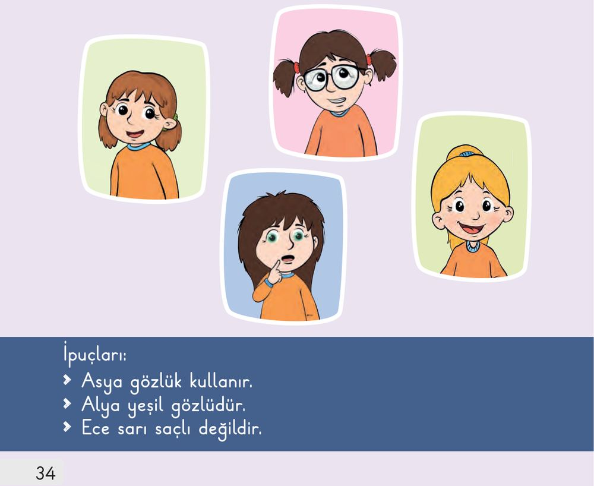

### İpuçları:
* Asya gözlük kullanır.
* Alya yeşil gözlüdür.
* Ece sarı saçlı değildir.

<!-- sayfa 34 -->

2. Aşağıdaki görseller Âkif, Emre, Ege ve Fatih’e aittir. 
Görsellerin hangi öğrencilere ait olduğunu ipuçlarından 
faydalanarak söyleyelim.

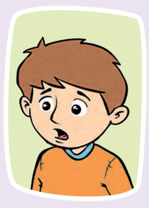
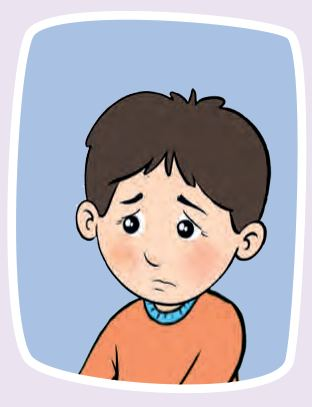
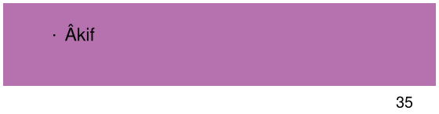
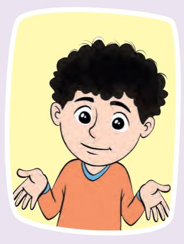
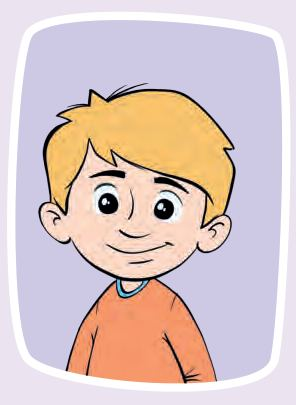

İpuçları:
› Âkif şaşırmıştır.
› Emre mutlu olmuştur.
› Fatih üzgün değildir.

<!-- sayfa 35 -->

# KEŞİF ZAMANI

› Uygulama adımlarını takip ederek etkinliği yapalım.

## Malzemeler
— Cep aynası
— Boya kalemleri
— Kâğıt

## Uygulama Adımları
▶ Aynaya bakarak kendimizi inceleyelim.
▶ Aynada gördüğümüz fiziksel özelliklerimizi sözlü olarak ifade edelim.
▶ Aynadaki görüntümüzü renkli boya kalemleri kullanarak kâğıda çizelim.

<!-- sayfa 36 -->

# › Uygulama adımlarını takip ederek etkinliği yapalım.

## Malzemeler
— Ek 2
— Makas

## Uygulama Adımları
▶ Ekler bölümünde bulunan Ek 2’deki görseli noktalı yerlerden keselim.
▶ Sınıftan iki arkadaşımızı belirleyelim. Belirlenen kişilerin seçtikleri görsellerle tahtaya gelmelerini isteyelim.
▶ Arkadaşlarımızın seçtikleri görsellere uygun olarak yaşadıkları olayları anlatmalarını isteyelim.
▶ Ardından iki arkadaşımızı daha belirleyelim. Onların da tahtaya kalkarak benzer şekilde örnek vermelerini isteyelim.
▶ Son olarak dört arkadaşımızı daha belirleyelim. Onların da yaşadıkları olayları seçtikleri kartlara göre anlatmalarını isteyelim.
▶ Tüm arkadaşlarımız örnek verene kadar etkinliğe devam edelim.

<!-- sayfa 37 -->

# ÖĞRENME ZAMANI

## NASIL GÖRÜNÜYOR, NELER HİSSEDİYORUM?

Saç ve göz rengimiz, boyumuz ve kilomuz fiziksel özelliklerimizdir.

Biz büyürken bazı fiziksel özelliklerimiz değişir.

Örneğin boyumuz uzar, kilomuz artar.

<!-- sayfa 38 -->

Mutluluk, üzüntü, heyecan, sevinç, endişe temel duygularımıza örnektir.

 Sürprizler karşısında hem sevinir hem de heyecanlanırız.

 Sevdiğimiz bir eşyamızı kaybettiğimizde üzülürüz.

 Duygularımızı sözlerimiz ve yüz ifadelerimizle belli ederiz. Aynı olaya farklı kişiler farklı tepkiler verebilir.

 Fiziksel ve duygusal özelliklerimizi biliriz. Kendimizi tanıtırken bu özelliklerimizi ifade ederiz.

Konu ile ilgili elektronik içeriğe karekodu okutarak

<!-- sayfa 39 -->

# PEKİŞTİRME ZAMANI
## PERFORMANS GÖREVİ

> Aşağıdaki performans görevini yapalım.

**Süre :** İki ders saati
**Konu :** Fiziksel özelliklerimiz ve duygularımız
**Görev:** Fiziksel özelliklerimiz ve duygularımızla ilgili kukla çalışması yapmak

### Malzemeler
— Ek 3
— Boya kalemleri
— Makas
— Tahta çubuklar
— Yapıştırıcı

### Uygulama Adımları

▶ Ekler bölümünde bulunan Ek 3’teki görselleri noktalı yerlerden keselim.

▶ Görsellere kendi saçınızın şekline göre çizim yapalım. Saç ve göz rengimize göre görselleri boyayalım.

▶ Görsellerin arkasına çubukları yapıştıralım. Kuklamızı oluşturalım.

▶ Ek 3’teki örnek olayları uygun kuklaları kullanarak sıra arkadaşımızla canlandıralım.

▶ Örnek olaylar ile ilgili duygularımızı söyleyelim.

▶ Arkadaşlarımızla yaşadığımız benzer veya farklı d

<!-- sayfa 40 -->

# DEĞERLENDİRME ZAMANI

* Ekler bölümünde bulunan Ek 4’teki görseli noktalı yerlerden keselim.
* Öğrencilerin görsellerini aşağıdaki ipuçlarından yararlanarak bulalım. Öğrencileri fiziksel özelliklerine göre boyayalım.

İpuçları

— Zehra’nın uzun, sarı ve kıvırcık saçları vardır. Zehra mavi gözlüdür.
— Meltem, kızlar arasında en uzun boyludur. Meltem’in saçları ve gözleri kahverengidir.
— Ayça; Meltem’den kısa, Zehra’dan uzundur. Ayça’nın saç rengi siyah, göz rengi mavidir.
— Hasan, Veysel’den uzundur. Hasan sarı saçlı, kahverengi gözlüdür.
— Veysel’in açık kahverengi saçları ve yeşil gözleri vardır.

* Çocukların yaşadığı duyguları söyleyelim. Bu duyguları...

<!-- sayfa 41 -->

# TEKRAZAMANI

1. Tanışma sırasında doğru davranışta bulunan öğrencilerin yanındaki kutuları boyayalım. Yanlış davranışların doğrularını söyleyelim.

 Emre
Kendimi tanıtırken “Merhaba” dedim ve adımı söyledim.

 Emel
Arkadaşımın sözünü kesip kendimi tanıttım.

 Aslıhan
Bir arkadaşım kendini tanıtırken sıra arkadaşımla konuştum.

 Ahmet
Arkadaşlarımla tanışırken nazik davrandım.

 Merve
Öğretmenim kendini tanıtırken onu dinledim.

<!-- sayfa 42 -->

2. Aşağıdaki durumlarda gidilmesi gereken okul bölümüne karar verelim. İfadeleri uygun görsellerle çizgi çizerek eşleştirelim.

Ders zili çaldı.

Hastalandığım için annemle müdür yardımcısından izin istedik.

Ellerimi yıkamam gerekti.

<!-- sayfa 43 -->

3. Okul çalışanlarının bulunduğu görsellerin üstündeki kutuları boyayalım. Bu okul çalışanlarının görevlerini söyleyelim.

4. Şeref köşesinde bulunması gerekenlerin üstündeki kutuları boyayalım.

5. Sınıflarda bulunan ders araç gereçlerine ait olan görselleri belirleyelim. Görsellerin üstündeki kutuları boyayalım.

<!-- sayfa 44 -->

6. Aşağıdaki görselleri inceleyelim. Görseldeki davranış doğru ise $\checkmark$ <!-- KONTROL: Marker'da karşılığı yok, uydurma olabilir --> işaretini, yanlış ise $\text{\red{X}}$ <!-- KONTROL: Marker'da karşılığı yok, uydurma olabilir --> işaretini yuvarlak içine alarak ilerleyelim. Ulaştığımız rakamı söyleyip boyayalım.

$\checkmark$ <!-- KONTROL: Marker'da karşılığı yok, uydurma olabilir --> $\quad$ <!-- KONTROL: Marker'da karşılığı yok, uydurma olabilir --> $\text{\red{X}}$ <!-- KONTROL: Marker'da karşılığı yok, uydurma olabilir -->
$\downarrow$ <!-- KONTROL: Marker'da karşılığı yok, uydurma olabilir --> $\quad$ <!-- KONTROL: Marker'da karşılığı yok, uydurma olabilir --> $\downarrow$ <!-- KONTROL: Marker'da karşılığı yok, uydurma olabilir -->

 $\quad$ <!-- KONTROL: Marker'da karşılığı yok, uydurma olabilir --> 

$\checkmark$ <!-- KONTROL: Marker'da karşılığı yok, uydurma olabilir --> $\quad$ <!-- KONTROL: Marker'da karşılığı yok, uydurma olabilir --> $\text{\red{X}}$ <!-- KONTROL: Marker'da karşılığı yok, uydurma olabilir --> $\quad$ <!-- KONTROL: Marker'da karşılığı yok, uydurma olabilir --> $\checkmark$ <!-- KONTROL: Marker'da karşılığı yok, uydurma olabilir --> $\quad$ <!-- KONTROL: Marker'da karşılığı yok, uydurma olabilir --> $\text{\red{X}}$ <!-- KONTROL: Marker'da karşılığı yok, uydurma olabilir -->
$\downarrow$ <!-- KONTROL: Marker'da karşılığı yok, uydurma olabilir --> $\quad$ <!-- KONTROL: Marker'da karşılığı yok, uydurma olabilir --> $\downarrow$ <!-- KONTROL: Marker'da karşılığı yok, uydurma olabilir --> $\quad$ <!-- KONTROL: Marker'da karşılığı yok, uydurma olabilir --> $\downarrow$ <!-- KONTROL: Marker'da karşılığı yok, uydurma olabilir --> $\quad$ <!-- KONTROL: Marker'da karşılığı yok, uydurma olabilir --> $\downarrow$ <!-- KONTROL: Marker'da karşılığı yok, uydurma olabilir -->

 $\quad$ <!-- KONTROL: Marker'da karşılığı yok, uydurma olabilir -->  $\quad$ <!-- KONTROL: Marker'da karşılığı yok, uydurma olabilir -->  $\quad$ <!-- KONTROL: Marker'da karşılığı yok, uydurma olabilir --> 

$\checkmark$ <!-- KONTROL: Marker'da karşılığı yok, uydurma olabilir --> $\quad$ <!-- KONTROL: Marker'da karşılığı yok, uydurma olabilir --> $\text{\red{X}}$ <!-- KONTROL: Marker'da karşılığı yok, uydurma olabilir --> $\quad$ <!-- KONTROL: Marker'da karşılığı yok, uydurma olabilir --> $\checkmark$ <!-- KONTROL: Marker'da karşılığı yok, uydurma olabilir --> $\quad$ <!-- KONTROL: Marker'da karşılığı yok, uydurma olabilir --> $\text{\red{X}}$ <!-- KONTROL: Marker'da karşılığı yok, uydurma olabilir --> $\quad$ <!-- KONTROL: Marker'da karşılığı yok, uydurma olabilir --> $\checkmark$ <!-- KONTROL: Marker'da karşılığı yok, uydurma olabilir --> $\quad$ <!-- KONTROL: Marker'da karşılığı yok, uydurma olabilir --> $\text{\red{X}}$ <!-- KONTROL: Marker'da karşılığı yok, uydurma olabilir --> $\quad$ <!-- KONTROL: Marker'da karşılığı yok, uydurma olabilir --> $\checkmark$ <!-- KONTROL: Marker'da karşılığı yok, uydurma olabilir --> $\quad$ <!-- KONTROL: Marker'da karşılığı yok, uydurma olabilir --> $\text{\red{X}}$ <!-- KONTROL: Marker'da karşılığı yok, uydurma olabilir -->
$\downarrow$ <!-- KONTROL: Marker'da karşılığı yok, uydurma olabilir --> $\quad$ <!-- KONTROL: Marker'da karşılığı yok, uydurma olabilir --> $\downarrow$ <!-- KONTROL: Marker'da karşılığı yok, uydurma olabilir --> $\quad$ <!-- KONTROL: Marker'da karşılığı yok, uydurma olabilir --> $\downarrow$ <!-- KONTROL: Marker'da karşılığı yok, uydurma olabilir --> $\quad$ <!-- KONTROL: Marker'da karşılığı yok, uydurma olabilir --> $\downarrow$ <!-- KONTROL: Marker'da karşılığı yok, uydurma olabilir --> $\quad$ <!-- KONTROL: Marker'da karşılığı yok, uydurma olabilir --> $\downarrow$ <!-- KONTROL: Marker'da karşılığı yok, uydurma olabilir --> $\quad$ <!-- KONTROL: Marker'da karşılığı yok, uydurma olabilir --> $\downarrow$ <!-- KONTROL: Marker'da karşılığı yok, uydurma olabilir --> $\quad$ <!-- KONTROL: Marker'da karşılığı yok, uydurma olabilir --> $\downarrow$ <!-- KONTROL: Marker'da karşılığı yok, uydurma olabilir --> $\quad$ <!-- KONTROL: Marker'da karşılığı yok, uydurma olabilir --> $\downarrow$ <!-- KONTROL: Marker'da karşılığı yok, uydurma olabilir -->

① $\quad$ <!-- KONTROL: Marker'da karşılığı yok, uydurma olabilir --> ② $\quad$ <!-- KONTROL: Marker'da karşılığı yok, uydurma olabilir --> ③ $\quad$ <!-- KONTROL: Marker'da karşılığı yok, uydurma olabilir --> ④ $\quad$ <!-- KONTROL: Marker'da karşılığı yok, uydurma olabilir --> ⑤ $\quad$ <!-- KONTROL: Marker'da karşılığı yok, uydurma olabilir --> ⑥ $\quad$ <!-- KONTROL: Marker'da karşılığı yok, uydurma olabilir --> ⑦ $\quad$ <!-- KONTROL: Marker'da karşılığı yok, uydurma olabilir --> ⑧

<!-- sayfa 45 -->

7. Fiziksel özelliklerin hangi öğrencilere ait olduğunu bulalım. Öğrencilerin fiziksel özelliklerini çizgi çizerek eşleştirelim.

1. Sarı saçlı ve mavi gözlüyüm.

2. Saçlarım uzun, kıvırcık ve kahverengi. Göz rengim kahverengi.

3. Saçlarım düz ve siyah renkte.

4. Saçlarım açık kahverengi. Göz rengim yeşil.

<!-- sayfa 46 -->

8. Aşağıdaki örnek olaylar karşısında hangi duyguları yaşarız? Yüz ifadelerini uygun cümlelerle çizgi çizerek eşleştirelim. Örnek olaylar birden fazla yüz ifadesiyle eşleşebilir.

1. Öğretmenim yaptığım resmi panoya astı. 

2. Çok sevdiğim arkadaşımın okul değiştireceğini öğrendim. 

3. Cumhuriyet Bayramı'nda şiir okuyacağım. 

4. Arkadaşım kalemimi izinsiz aldı. 

 Ek sorulara karekodu okutarak erişebiliriz.

<!-- sayfa 47 -->

# ÖĞRENME ALANI

# SAĞLIĞIM VE GÜVENLİĞİM

> Sağlıklı Hayat Ne Güzel
> Kişisel Alanıma Dikkat!
> Trafik Kuralları İyi ki Var
> Eyvah, Acil Durum!

EBA’da yer alan öğrenme alanına karekodu okutarak erişebiliriz.

Öğrenme alanı ile ilgili özet içeriğe bu 

<!-- sayfa 48 -->

Bu öğrenme alanında

> sağlıklı büyüme ve gelişme için yapmamız gerekenleri belirlemeyi,
> kişisel alanımızın sınırlarını korumayı,
> temel trafik kurallarına uygun davranmayı,
> acil bir durumda yapılması gerekenleri belirlemeyi

## ANAHTAR KAVRAMLAR

> sağlıklı büyüme ve gelişme
> kişisel alan
> temel trafik kuralları
> güvenlik
> acil durum

<!-- yer tutucu bulunamadı: sayfa sonuna eklendi -->

<!-- sayfa 49 -->

# BELİRLİ GÜN VE HAFTALAR

Bu öğrenme alanında aşağıdaki belirli gün ve haftaları öğreneceğiz.

## Afet Eğitimi Hazırlık Günü (12 Kasım)

12 Kasım, Afet Eğitimi Hazırlık Günü'dür. Deprem, sel, heyelan gibi afetleri tanımanın ve afet konusunda bilgi sahibi olmanın önemini kavrarız.

## Dünya Çocuk Hakları Günü (20 Kasım)

Her 20 Kasım'da Dünya Çocuk Hakları Günü'nü kutlarız. Çocukların eğitim, barınma, sağlık hakları hakkında konuşuruz. Çocuk hakları ile ilgili etkinliklere katılırız.

<!-- sayfa 50 -->

Belirli gün ve haftalar ile ilgili etkinliklere karekodu okutarak erişebiliriz. 

## Kızılay Haftası
### (29 Ekim-4 Kasım)

Kızılay; afet, savaş gibi durumlarda yardıma ihtiyacı olanlara destek olur. Barınma, beslenme gibi ihtiyaçları karşılar. Ayrıca kan bağışlarını kabul eder ve ihtiyaç sahiplerine ulaştırır. 29 Ekim ile 4 Kasım tarihleri arasında Kızılay Haftası’nı kutlarız. Hafta boyunca Kızılay’ı tanımak ve tanıtmak için çalışırız.

## Atatürk Haftası
### (10-16 Kasım)

Cumhuriyetimizin kurucusu Mustafa Kemal Atatürk, 10 Kasım günü hayata veda etmiştir. Her yıl 10 Kasım’ın içinde bulunduğu hafta boyunca Atatürk’ü anarız. Ona olan sevgimizi anlatmak için resimler yapar, şiirler okuruz.

## Öğretmenler Günü
### (24 Kasım)

24 Kasım gününü Öğretmenler Günü olarak kutlarız. Bu önemli günde öğrettikleriyle bize ışık tutan öğretmenlerimize teşekkür ederiz. Onlara saygılarımızı sunmak için çeşitli

<!-- sayfa 51 -->

# SAĞLIKLI HAYAT NE GÜZEL

> Fatma’ya ait görselleri inceleyelim.

Soruları cevaplayalım.
1. Fatma görsellerde neler yapıyor? Neden?
2. Sağlıklı olmak için neler yapıyorsunuz?

<!-- sayfa 52 -->

# KEŞİF ZAMANI

 Karekodu okutarak şiiri dinleyebiliriz.

* Şiiri dikkatlice dinleyelim.
* Şiire göre sağlıklı olmak için neler yapmamız gerektiğini düşünelim.
* Aklımıza gelen fikirleri sınıf arkadaşlarımızla paylaşalım.
* Arkadaşlarımızın fikirlerini dinleyelim.

## SAĞLIKLI BÜYÜYORUM

Sağlığım kıymetlidir benim,
Kahvaltımı güzelce ederim.
Düzenli spor ve kişisel temizlik,
Ne kadar önemlidir bilirim.

Abur cuburdan uzak dururum.
Akşamları erkenden uyurum.
Bunlara dikkat et sen de
Sağlıkla büyüyelim birlikte.

Komisyon

### Soruları cevaplayalım.

1. Şiirde çocuk sağlıklı olmak için neler yapıyor?
2. Siz sağlıklı büyümek için neler yapıyorsunuz?
3. Sağlıklı olmakla ilgili merak ettiğiniz sorular nelerdir?

<!-- sayfa 53 -->

# ÖĞRENME ZAMANI
## SAĞLIKLI HAYAT NE GÜZEL

 Sağlıklı büyümek ve gelişmek için dengeli besleniriz.

*  Öğün atlamayız.
*  Vücudumuza yararlı olan besinlerden yeteri kadar yer ve içeriz.

 Düzenli olarak spor yaparız.

 Düzenli ve yeterli uyumaya dikkat ederiz.

<!-- sayfa 54 -->

Kişisel bakımımıza özen gösteririz.

Saçlarımızı tararız.
Dişlerimizi fırçalarız.
Ellerimizi yıkarız.
Banyo yaparız.
Tırnaklarımızın temizliğine dikkat ederiz.

Konu ile ilgili elektronik içeriğe karekodu okutarak

<!-- sayfa 55 -->

# PEKİŞTİRME ZAMANI

* Aşağıda verilen haftalık sağlık programını uygulayalım.
* Davranışları yerine getirdikçe mutlu yüzleri boyayalım.

## HAFTALIK SAĞLIK PROGRAMIM

| Günler | Pazartesi | Salı | Çarşamba | Perşembe | Cuma | Cumartesi | Pazar |
| :--- | :---: | :---: | :---: | :---: | :---: | :---: | :---: |
| **Davranışlar** | | | | | | | |
| Düzenli olarak spor yaparım.  | 🙂 | 🙂 | 🙂 | 🙂 | 🙂 | 🙂 | 🙂 |
| Gerektiğinde ellerimi yıkarım.  | 🙂 | 🙂 | 🙂 | 🙂 | 🙂 | 🙂 | 🙂 |
| Öğünlerde yeterli ve dengeli besinler tüketirim.  | 🙂 | 🙂 | 🙂 | 🙂 | 🙂 | 🙂 | 🙂 |
| Yemeklerden sonra dişlerimi fırçalarım.  | 🙂 | 🙂 | 🙂 | 🙂 | 🙂 | 🙂 | 🙂 |
| Yeterli ve düzenli uyurum.  | 🙂 | 🙂 | 🙂 | 🙂 | 🙂 | 🙂 | 🙂 |

* Bu davranışları uygulamadığımızda neler olabileceğini

<!-- sayfa 56 -->

# DEĞERLENDİRME ZAMANI 

> Ekler bölümünde bulunan Ek 5’teki görselleri noktalı yerlerden keselim. Sağlıklı büyüme ve gelişmeye uygun görselleri belirleyelim. Görsel kavram haritasındaki kutulara yapıştıralım. 

## Sağlıklı Büyüme ve Gelişme 

**Soruyu cevaplayalım.**
> Yapıştırdığımız görsellerle sağlıklı büyüme ve gelişme arasındaki ilişki nedir?

<!-- sayfa 57 -->

# DUŞUNME ZAMANI

: Düşünen bir karakter figürü.

## KİŞİSEL ALANIMA DİKKAT!

› Görselleri inceleyelim.

### Soruları cevaplayalım.

1. İki görsel arasındaki farklar nelerdir?
2. İkinci görseldeki mavi montlu çocuk nasıl hissediyor olabilir? Neden?
3. Kişisel alan denildiğinde ne anlıyorsunuz?

<!-- sayfa 58 -->

# KEŞİF ZAMANI

> Uygulama adımlarını takip ederek etkinliği yapalım.

## Malzemeler
— A4 kâğıdı
— Boya kalemleri
— Çember

## Uygulama Adımları
▶ Kişisel eşyalarımızı ve yaşadığımız ortamı anlatan bir resim çizelim.
▶ Çizdiğimiz resmi arkadaşlarımızla paylaşalım.
▶ Sonrasında çemberlerimizle okul bahçesine çıkalım.
▶ Çemberlerimizi birbirimize yaklaşmadan çevirmeye başlayalım.
▶ Çemberlerimizi birbirimize yaklaşarak çevirmeye devam edelim. Çemberimiz yoksa etkinliği kollarımızı iki yana açarak da yapabiliriz.

## Soruları cevaplayalım.
1. Çemberinizi hangi durumda daha rahat çevirebildiniz? Neden?
2. Arkadaşlarınız size çemberinizi çeviremeyeceğiniz kadar yaklaştığında ne hissettiniz?

<!-- sayfa 59 -->

# ÖĞRENME ZAMANI

## KİŞİSEL ALANIMA DİKKAT!

Kişisel alanımız, kendimizi rahat ve güvende hissettiğimiz alandır.

: Bir çocuğun etrafını saran mor halkalar (görünmez çemberi temsil eden halkalar).

Bu alanı çevremizdeki görünmez bir çember gibi düşünebiliriz.

Bu çemberin içine güvendiğimiz kişileri alırız.

<!-- sayfa 60 -->

# Kişisel Alan Sınırlarını İhlal Eden Davranışlar:

* İzin almadan birine fazla yaklaşmak
* İzin almadan karşımızdakine dokunmak veya sarılmak
* Başkaları ile alay etmek, onlara lakap takmak
* Tanımadığımız kişilerle iletişim kurmak
* Kişisel bilgi ve fotoğrafları herkesle paylaşmak

## Kişisel Alanımızı Korumak İçin

* istemediğimiz kişilerin kişisel alanımıza girmesine izin vermeyiz.
* duygu ve düşüncelerimizi kimlerle ne kadar paylaşacağımıza dikkat ederiz.
* kişisel bilgilerimizi tanımadığımız kişilerle paylaşmayız.
* tanımadığımız kişilerle iletişim kurmayız.
* istemediğimiz söz ve davranışlarla karşılaştığımızda “Hayır!” deriz. Gerekirse ortamdan uzaklaşırız, yüksek sesle yardım isteriz.
* rahatsız olduğumuz durumlar devam ederse güvendiğimiz bir büyüğümüze haber veririz.
* başkalarının kişisel alanına saygı göstererek ve bu davranışları uygulayarak kendimizi güvende tutarız.

Konu ile ilgili elektronik içeriğe karekodu okutarak

<!-- sayfa 61 -->

# PEKİŞTİRME ZAMANI

**Malzemeler**
— Küçük kâğıtlar

> Uygulama adımlarını takip ederek etkinliği yapalım.

### Uygulama Adımları

▶ Sınıf içinde 4-6 kişilik gruplar oluşturalım.
▶ Aşağıdaki örnek olayları okuyalım.
1. Ahmet kantin sırasında beklerken, arkasındaki arkadaşı ona çok yakın duruyor ve sürekli omzuna dokunuyor. Ahmet bu durumdan hiç hoşlanmıyor.
2. Zeynep okuldan çıkarken tanımadığı bir yetişkin yanına geliyor. “Anket yapıyorum” diyerek Zeynep’in adını, ev adresini ve telefonunu istiyor.
3. Naz o gün çok üzgün ama nedenini arkadaşlarına anlatmak istemiyor. “Bu ailemle ilgili özel bir durum” diyor. Ama arkadaşları ısrarla soru sormaya devam ediyor.

▶ Okuduğumuz örnek olaylardan birini grupça seçelim.
▶ Sırayla tahtaya çıkarak seçtiğimiz olayı sınıfta canlandıralım.

▶ Canlandırmanın ardından aşağıdaki soruları sırayla cevaplayalım ve arkadaşlarımızı dikkatle dinleyelim.
1. Bu olayda rahatsız edici olan davranış nedir?
2. Sizce bu davranış doğru mu, yanlış mı? Neden?
3. Seçtiğiniz örnek olayda rahatsız edilen çocuk o an ne hissetmiş olabilir?
4. Bu çocuk kendini korumak için o an ne yapmalıdır?
5. Kişisel alanımızı korumak neden önemlidir?
▶ Etkinliğin sonunda arkadaşlarımızla kişisel alanımızı...

<!-- sayfa 62 -->

# DEĞERLENDİRME ZAMANI 

* Aşağıdaki yuvarlağın ortasına kendimizi çizelim.
* Kişisel alanımızı nasıl koruduğumuzu düşünelim.
* Yuvarlağın içine almak istediğimiz kişileri çizelim.
* Kişisel alanımızı istediğimiz renge boyayalım.

Soruyu cevaplayalım.
* Kişisel alanımızın sınırlarını korumak neden önemlidir?

<!-- sayfa 63 -->

# DUŞUNME ZAMANI

# TRAFİK KURALLARI İYİ Kİ VAR

› Görselleri inceleyelim.

Soruları cevaplayalım.
1. Birinci ve ikinci görseldeki kişilerin davranışları arasındaki farklar nelerdir?
2. Hangi görseldeki kişilerin güvende olduğunu düşünüyorsunuz? Neden?

<!-- sayfa 64 -->

> Görselleri inceleyelim.

Soruları cevaplayalım.
1. Görsellerdeki kişiler trafikte nelere dikkat ediyorlar?
2. Trafikte yaya olarak yaşadığınız deneyimler nelerdir?
3. Trafikte yolcu olarak yaşadığınız deneyimler nelerdir?
4. Yaya ve yolcu olma durumunuza göre trafik kurallarına örnekler veriniz.

<!-- sayfa 65 -->

# ÖĞRENME ZAMANI
## TRAFİK KURALLARI İYİ Kİ VAR

 Emniyet kemerimizi bağlarız.

 Sürücünün dikkatini dağıtmazız.

 Araçta arka koltuğa otururuz.

<!-- sayfa 66 -->

Karşıdan karşıya geçişlerde alt veya üst geçidi kullanırız.

Yaya geçidi olan yerlerde karşıdan karşıya geçerken yaya geçitlerini tercih ederiz.

Karşıdan karşıya geçerken önce sola sonra sağa bakarız. Sonra tekrar sola bakıp karşıya geçeriz.

Yayalar için kırmızı ışık yandığında dururuz. Yeşil ışık yandığında karşıya geçeriz.

Konu ile ilgili elektronik içeriğe karekodu okutarak

<!-- sayfa 67 -->

# PEKİŞTİRME ZAMANI

## Malzemeler
— boya kalemleri

> Uygulama adımlarını takip ederek etkinliği yapalım.

### Uygulama Adımları

▶ Aşağıdaki görselleri inceleyelim.
▶ Görsellerde anlatılan davranış doğruysa üstteki kutucuğu yeşile, yanlışsa kırmızıya boyayalım.
▶ Yanlış olduğunu belirlediğimiz görsellerdeki davranışların doğrusunu söyleyelim.

▶ Cevaplarımızı arkadaşlarımızla karşılaştıralım.
▶ Trafik kurallarına uyduğumuz durumlara günlük...

<!-- sayfa 68 -->

# Malzemeler
— Renkli kartonlar
— Boya kalemleri
— Beyaz tebeşir
— Makas
— Yapıştırıcı

› Aşağıdaki performans görevini yapalım.

Süre : İki ders saati
Konu : Trafik kuralları
Görev: Trafik kurallarını canlandırmak

# Uygulama Adımları
▶ Kartonlardan trafik ışıkları ile alt ve üst geçit levhaları hazırlayalım.
▶ Aramızdan levha tutacak kişileri, trafik polisini, sürücüleri ve yayaları seçelim.
▶ Okul bahçesinde uygun bir alana tebeşirle yaya geçidi çizelim.
▶ Rolleri paylaşarak aşağıdaki durumlarda nasıl davranacağımızı canlandıralım:
1. Durum: Ümit okula servisle gidiyor.
2. Durum: Özlem okula yürüyerek gidiyor.
3. Durum: Çınar'ı okula annesi arabayla götürüyor.
▶ Trafik kurallarıyla ilgili benzer durumlar bularak canlandırmaya devam edelim.
▶ Soruları cevaplayalım.

1. Yaya olduğumuzda nelere dikkat ettik?
2. Yolcu olduğumuzda nelere dikkat ettik?
3. Kurallara uyulduğunda neler yaşandı?
4. Kurallara uyulmadığında neler yaşandı?

<!-- sayfa 69 -->

# DEĞERLENDİRME ZAMANI 

> Görselleri inceleyelim. Kurallara uyuyorsak mutlu yüzü, uymuyorsak üzgün yüzü boyayalım.

😊
☹️
Karşıdan karşıya geçerken önce sola sonra sağa sonra tekrar sola bakarım. Araç yoksa kontrollü bir şekilde karşıya geçerim.

😊
☹️
Karşıya geçmek için yayalara yeşil ışığın yanmasını beklerim.

😊
☹️
Trafik işaretlerinin ve işaret levhalarının olmadığı yerlerde karşıya geçmek için üst geçidi kullanırım.

<!-- sayfa 70 -->

😊 Araçta seyahat ederken arka koltukta otururum.
☹️

 
😊 Karşıdan karşıya geçmek için yaya geçidini kullanırım.
☹️

😊 Seyahat ederken emniyet kemerimi bağlarım.
☹️

  
😊 Araçta seyahat ederken sürücünün dikkatini dağıtmam.
☹️

* Boyadığımız ifadelerin hepsi mutlu yüzse tebrikler! Trafik kurallarına uygun davranıyoruz.
* Üzgün yüzü boyadığımız trafik kurallarına dikkat edelim. Bu kurallara uygun davranalım.
* Bu kurallara uygun davranmadığımızda neler olabileceğini söyleyelim.

<!-- sayfa 71 -->

# EYVAH, ACİL DURUM!
## KIVANÇ SERGİDE

Karekod okutarak metni dinleyebiliriz.

Kıvanç, ilk kez bir sergiyi gezeceği için çok heyecanlıydı. Anne ve babasının ellerinden sıkıca tutarak salona girdi. Bugün serginin açılışı olduğu için içerisi çok kalabalıktı. Resimlere sırayla bakmaya başladılar. Her resmin başında birkaç kişi vardı. Resim hakkında konuşup yorum yapıyorlardı. Kıvanç konuşulanları dinlerken kendini kaptırmıştı. Anne ve babasının uzaklaştığını fark etmedi. Etrafına telaşla bakındı. Anne ve babasını göremedi.

Komisyon

### Soruları cevaplayalım.
1. Kıvanç bu durumda ne yapmış olabilir?
2. Metinde yaşanan durum acil bir durum olarak değerlendirilebilir mi? Neden?
3. Günlük yaşamınızda karşılaşabileceğiniz acil durumlar neler olabilir? Örnekler verelim.

<!-- sayfa 72 -->

> Görseli inceleyelim.

1-A
1-B

Soruları sınıf arkadaşlarımızla tartışarak cevaplayalım.
1. Görselde yaşanan olay nedir?
2. Okulda görseldekine benzer yaşanabilecek olaylar nelerdir?
3. Bu gibi durumlarda neler yapabilirsiniz?

<!-- sayfa 73 -->

# ÖĞRENME ZAMANI

## EYVAH, ACİL DURUM!

Çarpma, düşme, gaz kaçağı, kaybolma, zehirlenme, trafik kazası gibi durumlar **acil durumlardır.**

# ACİL DURUMLAR

örnektir.
örnektir.

için

Adresimizi ve telefon numaramızı biliriz.

<!-- sayfa 74 -->

# Acil Durumlarda Yapılması Gerekenler

* Öncelikle sakin kalmaya çalışırız.
* Evimizdeysek aile büyüklerimizden yardım isteriz.
* Kalabalıkta kaybolursak polis, güvenlik personeli gibi görevlilerden yardım alırız.
* Okuldaysak öğretmenlerimizden yardım isteriz.
* Acil Çağrı Merkezine ulaşmak için 1-1-2’yi ararız.

Konu ile ilgili elektronik içeriğe karekodu okutarak erişebiliriz.

<!-- sayfa 75 -->

# PEKİŞTİRME ZAMANI 

## Malzemeler
— Ek 6
— Makas 

› Acil durumlarda aile büyüklerimizin telefon numarasını ve adresimizi bilmek önemlidir. Ekler bölümünde bulunan Ek 6’daki acil durum bilgi kartını ailemizden yardım alarak dolduralım.

## Uygulama Adımları
▶ Sınıf arkadaşlarımızla 5-6 kişilik gruplar oluşturalım.
▶ Acil durumlarda doğru davranmanın önemini grup arkadaşlarımızla konuşalım. Düşüncelerimizi grup arkadaşlarımızla paylaşalım. 
▶ Yan sayfadaki acil durumları grup arkadaşlarımızla canlandıralım.

(Görsel içeriği: Sınıf ortamında öğretmen ve öğrencilerin olduğu bir çizim. Tahtada "Ders: Hayat Bilgisi Konu: Acil Durumlar" yazmaktadır.)

<!-- sayfa 76 -->

# ACİL DURUMLAR

1. Merdivenlerden koşarak inerken arkadaşımla çarpışarak yere düştüm. Bacağım çok ağrıdığı için yerden kalkamadım.
2. Odamda oyun oynarken mutfaktaki ocaktan yoğun bir koku geldiğini fark ettim. Midem bulanmaya başladı.
3. Pazarda alışveriş yaparken annemi yanımda göremeyince çok korktum.
4. Açıkta satılan tostlardan aldım. Bir süre sonra karnım çok ağrımaya başladı.
5. Annemle okula giderken iki aracın çarpıştığını gördük.

## Soruları cevaplayalım.

1. Acil durumlarda yapılması gereken davranışlardan hangilerini canlandırdınız?
2. Hangi acil durumda acil durum bilgi kartını kullandınız?
3. Başka hangi durumlarda acil durum bilgi kartına ihtiyaç duyabilirsiniz?

<!-- sayfa 77 -->

# DEĞERLENDİRME ZAMANI

* Acil durumlara örnekler verelim.
* Soruları cevaplayalım.

1. Acil bir durumda hangi numarayı aramalıyız?

2. Okulda meydana gelebilecek acil durumlarda kimlere haber vermeliyiz?

3. Acil bir durumda nasıl davranmalıyız?

4. Evimizde meydana gelebilecek acil durumlarda kimlere haber vermeliyiz?

<!-- sayfa 78 -->

# TEKRAZAMANI

1. Aşağıdaki alana sağlıklı büyüme ve gelişme için yapılması gerekenlerle ilgili görseller çizip boyayalım.

2. Kişisel alanla ilgili doğru ifadeleri belirleyelim. Belirlediğimiz ifadelere mutlu yüz çizelim. Yanlış ifadelerin doğrularını söyleyelim.

| | |
| :--- | :--- |
| Kişisel alanıma dikkat edilmediğinde rahatsız olurum.  | Kişisel alanımda genellikle ailem, yakın arkadaşlarım yer alır.  |
| Biri bana sarılmak istediğinde rahatsız olursam “Hayır!” derim.  | Arkadaşımın çantasını istediğim zaman karıştırabilirim.  |

<!-- sayfa 79 -->

3. Trafik kurallarıyla ilgili doğru ifadelerin yanındaki yıldızları boyayalım. Yanlış ifadelerin doğrularını söyleyelim.

Okula servisle gelirken sürücüyle sohbet ederiz. 

 Yayalar için yeşil ışık yandığında karşıdan karşıya geçeriz.

Yolculuk sırasında emniyet kemerini çıkarabiliriz. 

 Karşıdan karşıya geçerken alt veya üst geçidi kullanırız.

Araç içinde arka koltukta otururuz. 

 Karşıdan karşıya geçmeden önce sağa bakmamız yeterlidir.

<!-- sayfa 80 -->

4. Aşağıdaki durumlarda kimden yardım istenmesi gerektiğini çizgi çizerek belirtelim.

  ◯  ◯ 
Bahar alışveriş merkezinde kayboldu.

  ◯  ◯ 
Tolga mutfakta gaz kokusu olduğunu fark etti.

  ◯  ◯ 
Melis teneffüste düştü.

5. Trafik kazası, zehirlenme gibi acil durumlarda hangi numarayı aramamız gerektiğini söyleyelim.

6. Acil durum bilgi kartında hangi bilgiler yer almalıdır?

 Ek sorulara karekodu okutarak erişebiliriz.

<!-- sayfa 81 -->

# ÖĞRENME ALANI

3.

# AİLEM VE TOPLUM

> Bizim Ev
> Nezaketli ve Görgülüyüz
> Biz İyi Bir Takımız

 EBA’da yer alan öğrenme alanına karekodu okutarak erişebiliriz.

Öğrenme alanı ile ilgili özet içeriğe bu

<!-- sayfa 82 -->

Bu öğrenme alanında
> ailenin özelliklerini ifade etmeyi,
> aile yaşamında nezaket ve görgü kurallarına uygun davranmayı,
> aile bireylerinin görev ve sorumluluklarını çözümlemeyi

# ANAHTAR KAVRAMLAR
> aile
> nezaket
> görgü
> görev
> sorumluluk
> saygı
> sevgi

<!-- sayfa 83 -->

# BELİRLİ GÜN VE HAFTALAR

Bu öğrenme alanında aşağıdaki belirli gün ve haftaları öğreneceğiz.

## İnsan Hakları ve Demokrasi Haftası
### (10 Aralık gününü içine alan hafta)

10 Aralık gününü içine alan haftayı İnsan Hakları ve Demokrasi Haftası olarak kutlarız. Bu haftada tüm insanların eşit haklara sahip olduğunu anlatan etkinlikler yaparız. İnsanların yaşama, barınma, sağlık, seyahat gibi temel haklarına saygı duymanın önemini vurgularız.

## Tutum, Yatırım ve Türk Malları Haftası
### (12-18 Aralık)

12-18 Aralık tarihleri arasında Tutum, Yatırım ve Türk Malları Haftası’nı kutlarız. Tutumlu olmanın ve yerli malı kullanmanın önemi ile...

<!-- sayfa 84 -->

Belirli gün ve haftalar ile ilgili etkinliklere karekodu okutarak erişebiliriz. 

## Dünya Engelliler Günü
### (3 Aralık)
3 Aralık, Dünya Engelliler Günü’dür. Her 3 Aralık günü özel gereksinimli bireylerin sorunlarına dikkat çekeriz. Onları daha iyi anlar ve farklılıklara saygı duyarız.

## Enerji Tasarrufu Haftası
### (Ocak ayının ikinci haftası)
Ocak ayının ikinci haftasını Enerji Tasarrufu Haftası olarak kutlarız. Bu haftada su, elektrik gibi kaynaklarımızın sınırlı olduğunu anlatan etkinlikler yaparız. Kaynaklarımızı tasarruflu kullanmanın önemini vurgularız.

<!-- sayfa 85 -->

# BİZİM EV

› Görselleri inceleyelim.

**Soruları cevaplayalım.**

1. Birinci görseldeki aile kimlerden oluşmaktadır?
2. İkinci görseldeki aile kimlerden oluşmaktadır?
3. Aile deyince aklınıza neler geliyor?

<!-- sayfa 86 -->

Karekodu okutarak metni dinleyebiliriz.

13 Aralık

Sevgili Günlük,

Bizim ailede herkesin bir yeteneği var. Babam saz çalar, annem güzel sesiyle şarkılar söyler. Ablam çok güzel resim yapar. "Peki, benim hiç mi yeteneğim yok?" diye kara kara düşünüyordum. Okulda öğretmenim "Elif, Okuma Bayramı Töreni'nde 'Aile Olmak Ne Güzel' şiirini okumak ister misin?" diye sorunca heyecanlandım. Hemen kabul ettim. Belki de benim gizli yeteneğim şiir okumaktı. Okumayı yeni öğrendiğim için yavaş okuyordum. O yüzden ablamın yardımıyla şiiri güzelce ezberledim. Evde provalar yapmaya başladık. Ablam, öğretmenim, annemle babam izleyicilerim oldu. Bazen izleyicilere büyükannemle dedem de katıldı. Hatta bazı akşamlar, babam sazıyla şiirime eşlik etti. Büyük gün geldi çattı. Şimdi son prova için herkes beni bekliyor. Ailem de benim kadar heyecanlı. Törene hep birlikte gideceğiz. Sahiden günlük; aile olmak ne güzel, ne kıymetli şey! Onları çok seviyorum.

Sevgiler Elif

Komisyon

Soruları cevaplayalım.
1. Metindeki aile kimlerden oluşmaktadır?
2. Metinde anlatılanlara göre aile üyeleri birlikte neler yapmıştır?
3. Aileniz sizin için neden önemlidir?

<!-- sayfa 87 -->

# ÖĞRENME ZAMANI
## BİZİM EV

Çekirdek aile; anne, baba ve çocuklardan oluşur.

Aile olmak önemlidir. Çünkü ailemizde kendimizi güvende ve güçlü hissederiz.

<!-- sayfa 88 -->

Konu ile ilgili elektronik içeriğe karekodu okutarak erişebiliriz. 

> Geniş aile; anne, baba, çocuklar dışında başka aile bireylerinin de bulunduğu büyük ailedir.

> Ailemizi bir arada tutan değerler vardır. Sevgi, şefkat, fedakârlık, anlayışlı olmak, birlik ve beraberlik bu değerlerdendir.

<!-- sayfa 89 -->

# PEKİŞTİRME ZAMANI

* Sınıf arkadaşlarımızla dört grup oluşturalım.
* Örnek durumlardan birini grupça seçelim.
* Seçtiğimiz duruma ait görseli inceleyelim.
* Grup arkadaşlarımızla rol dağılımı yapalım.
* Seçtiğimiz örnek durumu canlandıralım.
* Diğer grupların canlandırmalarını dikkatlice izleyelim.

## Örnek Durumlar

1. Ailece oyunlar oynayarak birlikte güzel vakit geçiririz.

2. Aile büyüklerimizin anlattığı masalları heyecanla dinleriz. Birbirimizi sever ve sayarız.

3. Ailemizden biri hasta olursa onun ihtiyaçlarıyla ilgileniriz.

4. Yemeğimizi ailece yerken gün içinde yaptıklarımızı konuşuruz.

Soruların cevaplarını arkadaşlarımızla tartışalım.

1. Örnek durumlarda ailedeki bireylerin davranışları aile bağlarını nasıl etkiler?
2. Ailede herkes birbirine yardım ettiğinde neler değişir?
3. Bir aile üyesi üzgün olduğunda sevgi ve anlayış göstermek neden önemlidir?
4. Ailede bazen kendi isteklerimizden vazgeçmek, fedakârlık

<!-- yer tutucu bulunamadı: sayfa sonuna eklendi -->

<!-- sayfa 90 -->

# DEĞERLENDİRME ZAMANI

1. Ailenizde yaşayan bireyleri aşağıdaki alana çizerek gösteriniz. Ailenizin çekirdek aile mi geniş aile mi olduğunu söyleyiniz.

| |
| :--- |
| |
| |
| |
| |
| |
| |
| |
| |
| |
| |
| |
| |
| |
| |
| |
| |
| |
| |
| |
| |
| |
| |
| |
| |
| |
| |
| |
| |
| |
| |
| |
| |
| |
| |
| |
| |
| |
| |
| |
| |
| |
| |
| |
| |
| |
| |
| |
| |
| |
| |
| |
| |
| |
| |
| |
| |
| |
| |
| |
| |
| |
| |
| |
| |
| |
| |
| |
| |
| |
| |
| |
| |
| |
| |
| |
| |
| |
| |
| |
| |
| |
| |
| |
| |
| |
| |
| |
| |
| |
| |
| |
| |
| |
| |
| |
| |
| |
| |
| |
| |
| |
| |
| |
| |
| |
| |
| |
| |
| |
| |
| |
| |
| |
| |
| |
| |
| |
| |
| |
| |
| |
| |
| |
| |
| |
| |
| |
| |
| |
| |
| |
| |
| |
| |
| |
| |
| |
| |
| |
| |
| |
| |
| |
| |
| |
| |
| |
| |
| |
| |
| |
| |
| |
| |
| |
| |
| |
| |
| |
| |
| |
| |
| |
| |
| |
| |
| |
| |
| |
| |
| |
| |
| |
| |
| |
| |
| |
| |
| |
| |
| |
| |
| |
| |
| |
| |
| |
| |
| |
| |
| |
| |
| |
| |
| |
| |
| |
| |
| |
| |
| |
| |
| |
| |
| |
| |
| |
| |
| |
| |
| |
| |
| |
| |
| |
| |
| |
| |
| |
| |
| |
| |
| |
| |
| |
| |
| |
| |
| |
| |
| |
| |
| |
| |
| |
| |
| |
| |
| |
| |
| |
| |
| |
| |
| |
| |
| |
| |
| |
| |
| |
| |
| |
| |
| |
| |
| |
| |
| |
| |
| |
| |
| |
| |
| |
| |
| |
| |
| |
| |
| |
| |
| |
| |
| |
| |
| |
| |
| |
| |
| |
| |
| |
| |
| |
| |
| |
| |
| |
| |
| |
| |
| |
| |
| |
| |
| |
| |
| |
| |
| |
| |
| |
| |
| |
| |
| |
| |
| |
| |
| |
| |
| |
| |
| |
| |
| |
| |
| |
| |
| |
| |
| |
| |
| |
| |
| |
| |
| |
| |
| |

<!-- yer tutucu bulunamadı: sayfa sonuna eklendi -->

<!-- sayfa 91 -->

# NEZAKETLİ VE GÖRGÜLÜYÜZ

> Görseli inceleyelim.

Elinize sağlık, yemek çok lezzetli olmuş.
Afiyet olsun.
Afiyet olsun.

Soruları cevaplayalım.
1. Görseldeki aile yemek yerken nelere dikkat ediyor?
2. Aile yaşamında hangi nezaket ve görgü kurallarına uymanız gerekir?

<!-- sayfa 92 -->

) 
> Aşağıdaki örnek durumları inceleyelim. Soruları nedenlerini açıklayarak cevaplayalım.

1. Kardeşimden silgi almak için odasına girmek istiyorum. Nasıl davranmalıyım? Kardeşime ne söylemeliyim?

2. Sabah uyandım ve babamı kahvaltıyı hazırlarken gördüm. Ona ne söylemeliyim?

3. Oyuncağa basıp yere düştüm. Ablam bana yardım etti. Ona ne söylemeliyim?

4. Okuldan geldiğimde annemin hastalandığını fark ettim. Nasıl davranmalıyım? Anneme ne söylemeliyim?

> Evde kullandığımız nezaket ifadeleri nelerdir?

<!-- sayfa 93 -->

# ÖĞRENME ZAMANI

## NEZAKETLİ VE GÖRGÜLÜYÜZ

Konu ile ilgili elektronik içeriğe karekodu okutarak erişebiliriz.

> Aile yaşamında nezaket ifadelerini kullanırız.

* Günaydın
* Elinize sağlık.
* Lütfen!
* Teşekkür ederim.

<!-- sayfa 94 -->

Aile içinde uymamız gereken nezaket ve görgü kuralları vardır. Bu kurallara dikkat etmemiz aile içi iletişimimizi güçlendirir.

* Yemekte çatal, kaşık, peçete kullanırız.
* Aile bireylerimizin eşyalarını izin alarak özenli kullanırız.
* Aile bireylerinin odalarına girerken kapıyı çalarız.
* Sofraya beraber oturup sofradan beraber kalkarız.
* Büyüklerimize karşı saygılı oluruz.

<!-- sayfa 95 -->

# PEKİŞTİRME ZAMANI

> Aşağıdaki örnek olayları dinleyelim.

## 1. Örnek Olay

Eylül, sabah mutfaktan gelen kokularla uyandı. Mutfağa gittiğinde annesinin kahvaltıyı hazırladığını gördü. Annesi beslenme saati için ona tost da hazırlamıştı. Eylül kahvaltısını yaptı. Annesinin hazırladığı tostu beslenme çantasına koydu. Resim çantasını da eline aldı. Kapıyı açamadığı için annesinden yardım istedi. Okula gitmek için evden çıktı.

## 2. Örnek Olay

Ömer, okuldan döndüğünde anne ve babasının yemek hazırladığını gördü. Ömer de sofrayı kurmaya yardım etti. Yemek sırasında gün içinde yaşadıklarından bahsettiler. Yemekten sonra sofrayı hep birlikte topladılar.

Soruları cevaplayalım.

1. Örnek olaylarda dikkat edilen nezaket ve görgü kuralları nelerdir? Hangi nezaket ifadeleri kullanılmış olabilir?
2. Ailede nezaket ve görgü kurallarına uygun davranmamızın aile içi iletişimimize katkısı nedir?

<!-- yer tutucu bulunamadı: sayfa sonuna eklendi -->

<!-- yer tutucu bulunamadı: sayfa sonuna eklendi -->

<!-- sayfa 96 -->

# DEĞERLENDİRME
# ZAMANI 

> Aşağıda bazı nezaket ve görgü kuralları verilmiştir. Kurallara uyuyorsak mutlu yüzü, uymuyorsak üzgün yüzü boyayalım.

1. “Günaydın”, “Teşekkür ederim.” gibi nezaket ifadeleri kullanırım. 
2. Aile üyelerinin odasına girerken kapıyı çalarak izin isterim. 
3. Yemeğimi üstüme dökmeden yemeye dikkat ederim. 
4. Yemeğimi sofrada ailemle yerim. 
5. Yemekte çatal ve kaşık kullanırım. 
6. Gerekli durumlarda peçete kullanırım. 

> Boyadığımız ifadelerin hepsi mutlu yüzse tebrikler! Nezaket ve görgü kurallarına uyuyoruz.
> Üzgün yüzü boyadığımız nezaket ve görgü kurallarına dikkat edelim. Bu kurallara uygun davranalım.

<!-- sayfa 97 -->

# DUŞUNME ZAMANI

# BİZ İYİ BİR TAKIMIZ

> Görseli inceleyelim.

Soruları cevaplayalım.
1. Görselde yapılması gereken işler nelerdir?
2. Görseldeki işleri yapmak kimlerin görevi olabilir?
3. Ailede üzerinize düşen görevler nelerdir?

<!-- sayfa 98 -->

 Karekodu okutarak metni dinleyebiliriz.

# BONCUK BENDE, HOROZ VE TAVUKLAR SENDE

“Üüürüüüü...” Ahmet, sabahları bu sesle uyanmayı çok seviyordu. Pencereyi açarak tertemiz havayı içine çekti. “Günaydın benim çilli horozum.” dedi. Köpekleri Boncuk, tavuklar ve horoz “Çok acıktık.” der gibi bakıyorlardı. Ahmet, kardeşini de uyandırdı. Yataklarını topladılar. Ellerini yüzlerini yıkayıp bahçeye çıktılar. Ninesi çoktan uyanmış, gözleme yapmaya başlamıştı. Ahmet ve kardeşi her sabah yardımlaşarak bahçedeki hayvanların yemlerini ve sularını veriyordu. Kardeşi “Boncuk bende, horoz ve tavuklar sende.” dedi. Bugün de görevlerini neşeyle yerine getirdiler. Ahmet, kümeste taptaze dört yumurtayı görünce çok sevindi. Ellerinde sıcak yumurtalarla ninesinin yanına koştu. Bu arada gözlemeler hazırdı. Yumurtalar da piştikten sonra hep birlikte kahvaltı sofrasına oturdular. Bugün çocuklar okula, büyükler tarlaya gidecekti. Gümüştepe köyünde güneşli bir gün daha başlıyordu.

Komisyon

## Soruları cevaplayalım.

1. Metne göre Ahmet ve kardeşinin ailesinde nasıl bir iş bölümü yapılmıştır?
2. Aile bireylerinizin evdeki görev ve sorumlulukları nelerdir?

<!-- sayfa 99 -->

# ÖĞRENME ZAMANI

## BİZ İYİ BİR TAKIMIZ

Ailede herkesin görev ve sorumlulukları vardır.

Bunun için öncelikle aile içindeki görev ve sorumluluklarımızı belirleriz. Görev paylaşımı yaparız.

### Örnekler

Anne ve babamız temizlik yaparken oyuncaklarımızı toplayabiliriz.

Evcil hayvanımız varsa onun bakımını üstlenebiliriz.

Annemiz yemek hazırlarken babamızla sofra kurabiliriz.

Büyüklerimize bahçe işlerinde yardımcı olabiliriz.

<!-- sayfa 100 -->

aramızdaki sevgi, saygı ve bağlılık artar.

işlerimizi daha hızlı bitiririz.

: Ailedeki görev ve sorumluluklarımızı yerine getirdiğimizde

aile yaşantımız düzenli olur.

birbirimize daha fazla zaman ayırırız.

birlik ve beraberlik duygumuz gelişir.

Konu ile ilgili elektronik içeriğe karekodu okutarak erişebiliriz.

<!-- sayfa 101 -->

# PEKİŞTİRME ZAMANI

> Aşağıdaki performans görevini yapalım.
> Süre : İki ders saati
> Konu : Görev ve sorumluluklar
> Görev: Aile bireylerinin görev ve sorumlulukları ile ilgili görsel kartlarını uygun aile bireyleriyle eşleştirmek

### Malzemeler
— Ek 7
— Makas
— Yapıştırıcı

## Uygulama Adımları

▶ Ekler bölümünde bulunan Ek 7’deki görselleri noktalı yerlerden keselim.
▶ Kartlardaki görevlerin kimlerin sorumluluğunda olduğunu düşünelim. Kartları uygun kutulara yapıştıralım.

| Anne | Baba | Çocuklar | Ailece |
| :--- | :--- | :--- | :--- |
| | | | |

> Aile bireyleri sorumluluklarını yerine getirmediklerinde

<!-- sayfa 102 -->

# DEĞERLENDİRME ZAMANI 

> Doğru ifadelerde "✔️" işaretini, yanlış ifadelerde "❌" işaretini yuvarlak içine alarak ilerleyelim. Ulaştığımız rakamı söyleyip boyayalım.

Ailede iş bölümünün yapılması düzeni sağlar.

*   (✔️) Ailedeki tüm sorumluluklar babaya aittir.
    *   (✔️) Evdeki tüm işleri anne ve babalar yapar. $\rightarrow$ <!-- KONTROL: Marker'da karşılığı yok, uydurma olabilir --> 1
    *   (❌) Evdeki tüm işleri anne ve babalar yapar. $\rightarrow$ <!-- KONTROL: Marker'da karşılığı yok, uydurma olabilir --> 2
    *   (✔️) Evde çocukların da yapabileceği işler vardır. $\rightarrow$ <!-- KONTROL: Marker'da karşılığı yok, uydurma olabilir --> 3
    *   (❌) Evde çocukların da yapabileceği işler vardır. $\rightarrow$ <!-- KONTROL: Marker'da karşılığı yok, uydurma olabilir --> 4
*   (❌) Ailedeki tüm sorumluluklar babaya aittir.
    *   (✔️) Ailede herkes üzerine düşen görevi yerine getirmelidir.
        *   (✔️) Her ailede iş bölümü birbirinden farklıdır. $\rightarrow$ <!-- KONTROL: Marker'da karşılığı yok, uydurma olabilir --> 5
        *   (❌) Her ailede iş bölümü birbirinden farklıdır. $\rightarrow$ <!-- KONTROL: Marker'da karşılığı yok, uydurma olabilir --> 6
        *   (✔️) Her ailede iş bölümü aynıdır. $\rightarrow$ <!-- KONTROL: Marker'da karşılığı yok, uydurma olabilir --> 7
        *   (❌) Her ailede iş bölümü aynıdır. $\rightarrow$ <!-- KONTROL: Marker'da karşılığı yok, uydurma olabilir --> 8
    *   (❌) Ailede herkes üzerine düşen görevi yerine getirmelidir.

1 2 3 4 5 6 7 8

<!-- sayfa 103 -->

# TEKRAR ZAMANI

1. Görselleri inceleyelim. Geniş aile görselinin altındaki kutuyu maviyye boyayalım. Çekirdek aile görselinin altındaki kutuyu ise turuncuya boyayalım.

2. Aşağıdaki cümlelerle uygun görselleri çizgi çizerek eşleştirelim.

| | |
| :--- | :--- |
| Bayramlarda ailece birlik beraberlik içinde oluruz. | ○  |
| Ailece birbirimizi çok severiz. Birlikte etkinlikler yaparak güzel vakit geçiririz. | ○  |
| | ○  |

<!-- sayfa 104 -->

3. Ailedeki nezaket ve görgü kurallarıyla ilgili cümleleri okuyalım. Doğru cümlelerin yanındaki kutuları boyayalım. Yanlış cümlelerin doğrularını söyleyelim.

$\square$ <!-- KONTROL: Marker'da karşılığı yok, uydurma olabilir --> Yemeğim bittiğinde anneme ve babama “Elinize sağlık.” derim.

$\square$ <!-- KONTROL: Marker'da karşılığı yok, uydurma olabilir --> Sabah uyandığımda anneme “Günaydın” derim.

$\square$ <!-- KONTROL: Marker'da karşılığı yok, uydurma olabilir --> Babam bana bir hediye aldığında ona teşekkür ederim.

$\square$ <!-- KONTROL: Marker'da karşılığı yok, uydurma olabilir --> Ablamın odasına istediğim zaman girerim.

$\square$ <!-- KONTROL: Marker'da karşılığı yok, uydurma olabilir --> Anneme “Saçımı topla” derim.

<!-- sayfa 105 -->

4. Aşağıdaki soruların cevaplarına ait görselleri bulalım. Bulduğumuz görsellerin etrafındaki kesik çizgileri birleştirelim (Bir sorunun birden fazla cevabı olabilir.).

* Ailede yemeği yapma görevi kimlere ait olabilir?

* Evde oyuncakları toplama sorumluluğu kimlere ait olabilir?

* Evi temizleme ve düzenleme görevi kimlere ait olabilir?

<!-- sayfa 106 -->

* Sofrayı toplama görevi kimlere ait olabilir?

* Çamaşır yıkama görevi kimlere ait olabilir?

* Evcil hayvanlara bakma sorumluluğu kimlere ait olabilir?

* Çiçekleri sulama görevi kimlere ait olabilir?

 Ek sorulara karekodu okutarak erişebiliriz.

<!-- sayfa 107 -->

Verdiğiniz metin katmanı boş olduğu için (`<<< >>>` arası boş) dönüştürülecek bir içerik bulunmamaktadır. Lütfen metin katmanını içeren içeriği paylaşın, böylece talimatlarınıza uygun şekilde Markdown formatına çevirebilirim.

<!-- sayfa 108 -->

# EK 1
# EKLER

<!-- sayfa 109 -->

Verdiğiniz metin katmanı boş olduğu için (`<<< >>>` arası boş) dönüştürülecek bir içerik bulunmamaktadır. Lütfen metin katmanını içeren içeriği paylaşın, böylece talimatlarınıza uygun şekilde Markdown formatına çevirebilirim.

<!-- sayfa 110 -->

EK 2

<!-- sayfa 111 -->

Verdiğiniz metin katmanı boş olduğu için (`<<< >>>` arası boş) dönüştürülecek bir içerik bulunmamaktadır. Lütfen metin katmanını içeren içeriği paylaşın, böylece talimatlarınıza uygun şekilde Markdown formatına çevirebilirim.

<!-- sayfa 112 -->

EK 3
Örnek Olaylar:
1. Arkadaşımızın en sevdiği oyuncağını ödünç aldık. Oyuncağı yanlışlıkla düşürüp kırdık.
2. Arkadaşımız çantamızı bizden izinsiz açtı. Kalemimizi alarak kullanmaya başladı.
3. Sıra arkadaşımız okula çocuk tiyatrosu geleceğini söyledi.

<!-- sayfa 113 -->

Verdiğiniz metin katmanı boş olduğu için (`<<< >>>` arası boş) dönüştürülecek bir içerik bulunmamaktadır. Lütfen metin katmanını içeren içeriği paylaşın, böylece kurallara uygun şekilde Markdown formatına çevirebilirim.

<!-- sayfa 114 -->

EK 4

<!-- sayfa 115 -->

Verdiğiniz metin katmanı boş olduğu için (`<<< >>>` arası boş) dönüştürülecek herhangi bir içerik bulunmamaktadır. Lütfen metin katmanını içeren içeriği paylaşın, böylece talimatlarınıza uygun şekilde Markdown formatına çevirebilirim.

<!-- sayfa 116 -->

# EK 5

<!-- sayfa 117 -->

Verdiğiniz mesajda PDF metin katmanı boş görünüyor (`<<< >>>` arası boş). Lütfen dönüştürülmesini istediğiniz metni veya görseli paylaşın, böylece kurallarınıza uygun şekilde Markdown formatına çevirebilirim.

<!-- sayfa 118 -->

EK 6

EK 7

<!-- sayfa 119 -->

Verdiğiniz metin katmanı boş olduğu için (`<<< >>>` arası boş) dönüştürülecek bir içerik bulunmamaktadır. Lütfen metin katmanını içeren içeriği paylaşın, böylece talimatlarınıza uygun şekilde Markdown formatına çevirebilirim.

<!-- sayfa 120 -->

# SÖZLÜK

| A-B-C-Ç | |
| :--- | :--- |
| acil durum | : Hemen müdahale edilmesi gereken bir olayın içinde bulunmak. |
| adres | : Herhangi bir kişi veya mekânın bulunduğu şehir, ilçe, mahalle, cadde, sokak, kapı veya daire numarasının belirtildiği bilgi. |
| afet | : Çeşitli doğa olaylarının sebep olduğu yıkım. |
| afiş | : Bir şeyi duyurmak veya tanıtmak için hazırlanan resimli duvar ilanı. |
| aile | : Evlilik ve kan bağına dayanan toplum içindeki en küçük birlik. |
| albüm | : Fotoğraf, pul gibi şeyleri saklamaya yarayan bir defter türü. |
| arkadaş | : Birbirine karşı sevgi ve anlayış gösteren kimselerden her biri. |
| bayram | : Millî veya dinî bakımdan önemi olan ve kutlanan günler. |

| D-E-F-G-Ğ | |
| :--- | :--- |
| duygu | : Belirli nesne, olay veya bireylerin insanın iç dünyasında uyandırdığı his. |
| fiziksel özellik | : Bir kişinin başka kişilerden ayrılmasını sağlayan dış görünüş. |
| görev | : Bir nesne veya bir kimsenin yaptığı iş. |
| görgü | : Bir toplum içinde var olan ve uyulması gereken saygı ve incelik davranışları. |
| görgü kuralları | : Bir toplumda davranışları denetlemeye yönelik olan kurallar bütünü. |
| gözlem | : Bir nesnenin, olayın dikkatli ve planlı olarak ele alınıp incelenmesi |

<!-- sayfa 121 -->

| | |
| :--- | :--- |
| grup | : Birbirine benzer veya aynı cinsten olan şeylerin oluşturduğu bütün. |
| günlük | : Kişinin günlük olarak yaşadıklarını, duygularını yazdığı defter, günce. |
| güvenlik | : Toplum yaşamında düzenin aksamadan yürütülmesi, emniyet. |

| H-I-İ-J-K | |
| :--- | :--- |
| halka | : Çember biçiminde dizilmiş topluluk. |
| iletişim | : Duygu, düşünce veya bilgilerin başkalarına aktarılması. |
| ipucu | : İnsanı aradığı gerçeğe ulaştırabilecek belirti. |
| kayıp | : Kaybolmuş, görünürde olmayan kişi veya nesne. |
| kişisel alan | : Etkileşim içinde bulunan insanların birbirlerinden uzaklıkları ve birbirlerine göre konumları. |
| kukla | : Hareketli yerleri iplikle sanatçının parmaklarına bağlanarak veya bir perdenin üzerinden oynatılan figür. |
| kural | : Davranışlarımıza yön veren, uyulması gereken ilke. |

| L-M-N-O-Ö-P-R | |
| :--- | :--- |
| labirent | : Çıkış yeri bulunmaya çalışılan, karışık koridorları olan yapı. |
| levha | : Bir yere asılmak için yazılmış yazı. |
| millî bayram | : Ülke için önemli ulusal günlerin yıl dönümünde yapılan kutlamalar. |
| nazik | : Başkalarına karşı saygılı davranan. |
| nezaket | : Başkalarına karşı saygılı ve kibar davranma, |

<!-- sayfa 122 -->

| | |
| :--- | :--- |
| ortak | : Birden çok kimse veya nesneyi ilgilendiren, onlara özgü olan. |
| öğün | : Yemek vakti. |
| **S-Ş-T-U-Ü-V-Y-Z** | |
| sağlıklı büyüme ve gelişme | : Doğru beslenme, düzenli uyku gibi alışkanlıklarla sağlıklı ve mutlu şekilde büyümek. |
| saygı | : Değeri, üstünlüğü, kutsallığı nedeniyle bir kimseye, bir şeye karşı dikkatli, özenli davranmaya sebep olan sevgi duygusu. |
| sevgi | : İnsanı bir şeye veya bir kimseye karşı yakın ilgi ve bağlılık göstermeye yönelten duygu. |
| sınıf ve okul ortamı | : Öğrencilerin öğrenim için geldiği kurum ve orada bulunduğu bölümdeki hareket alanı. |
| sorumluluk | : Kişinin kendi davranışlarının sonuçlarını üstlenmesi. |
| tanışmak | : Daha önce birbirini tanımayan kimselerin birbirini tanır duruma gelmesi. |
| teknoloji | : İnsanların ihtiyaçlarına uygun alet ve araçların üretilmesi için gerekli bilgi ve yetenek. |
| trafik kuralları | : Ulaşım yollarının yayalar ve her türlü taşıt tarafından güvenle kullanılması için belirlenmiş kurallar. |
| tören | : Anma, kutlama, nişan, evlenme, ölüm gibi sebeplerle yapılan toplantı. |
| uyum | : Bir bütünün parçaları arasında bulunan uygunluk. |
| yakınlık | : İki kişi arasındaki akrabalığın ne kadar yakın |

<!-- sayfa 123 -->

# KAYNAKÇA

Afet ve Acil Durum Yönetimi (AFAD). (2014). *Açıklamalı afet yönetimi terimleri sözlüğü*. Afet ve Acil Durum Yönetimi Başkanlığı.

Akay, C. (2019). Öğrenmeyi etkileyen temel faktörler ve genel öğrenme öğretme ilkeleri. Yanpar Yelken, T. ve Akay, C. (Ed.), *Öğretim ilke ve yöntemleri içinde* (s. 25–42). Anı Yayıncılık.

Gök, B. (2016). Hayat bilgisi öğretiminde ölçme ve değerlendirme. Güven, S. ve Kaymakçı, S. (Ed.), *Hayat bilgisi öğretimi içinde* (s. 294–345). Pegem Akademi.

Kaşkaya, A. (2020). Hayat bilgisi programına ilişkin örnek uygulamalar ve sınıf içi etkinliklerin değerlendirilmesi. V. Aktepe ve M. Gündüz (Ed.), *Kuramdan uygulamaya hayat bilgisi öğretimi içinde* (s. 273–321). Pegem Akademi.

Millî Eğitim Bakanlığı. Talim ve Terbiye Kurulu (2026). *Hayat Bilgisi Dersi Öğretim Programı (İlkokul 1, 2 ve 3. Sınıflar)*. Ankara.

Millî Eğitim Bakanlığı. Talim ve Terbiye Kurulu (2026). *Türkiye Yüzyılı Maarif Modeli Öğretim Programları Ortak Metni*. Ankara.

Şimşek, N. (2013). Hayat Bilgisinde Kişisel Nitelik (Değer) Öğretimi. *International Journal of Social Science*. 6(1), 1325–1346.

Üstündağ, T. (2022). *Yaratıcı drama öğretmenimin günlüğü*. Pegem Akademi.

(Kaynakça APA 7’ye göre düzenlenmiştir.)

<!-- sayfa 124 -->

 Cevap anahtarına bu karekodu okutarak erişebiliriz.

Görsel ve genel ağ kaynakçasına bu karekodu okutarak erişebiliriz. 

<!-- sayfa 125 -->

: Türkiye'nin mülki idare bölümleri, kara ve deniz komşuları haritası.

# TÜRKİYE'NİN MÜLKİ İDARE BÖLÜMLERİ İLE KARA VE DENİZ KOMŞULARI HARİTASI

**İl Listesi:**
Adana, Adıyaman, Afyonkarahisar, Ağrı, Amasya, Ankara, Antalya, Artvin, Aydın, Balıkesir, Bilecik, Bingöl, Bitlis, Bolu, Burdur, Bursa, Çanakkale, Çankırı, Çorum, Denizli, Diyarbakır, Edirne, Elâzığ, Erzincan, Erzurum, Eskişehir, Gaziantep, Giresun, Gümüşhane, Hakkâri, Hatay, Isparta, Mersin, İstanbul, İzmir, Kars, Kastamonu, Kayseri, Kırklareli, Kırşehir, Kocaeli, Konya, Kütahya, Malatya, Manisa, Kahramanmaraş, Mardin, Muğla, Muş, Nevşehir, Niğde, Ordu, Rize, Sakarya, Samsun, Siirt, Sinop, Sivas, Tekirdağ, Tokat, Trabzon, Tunceli, Şanlıurfa, Uşak, Van, Yozgat, Zonguldak, Aksaray, Bayburt, Karaman, Kırıkkale, Batman, Şırnak, Bartın, Ardahan, Iğdır, Yalova, Karabük, Kilis, Osmaniye, Düzce.

**Coğrafi Unsurlar ve Komşular:**
* **Denizler:** KARADENİZ, EGE DENİZİ, AKDENİZ, MARMARA DENİZİ, HAZAR DENİZİ.
* **Ülkeler:** ROMANYA, BULGARİSTAN, YUNANİSTAN, GÜRCİSTAN, ERMENİSTAN, AZERBAYCAN, NAHÇIVAN Ö.C. (AZERBAYCAN), İRAN, IRAK, SURİYE, LÜBNAN, KUZEY KIBRIS TÜRK CUMHURİYETİ, GÜNEY KIBRIS RUM YÖNETİMİ, İSRAİL, FİLİSTİN, MISIR, LİBYA.
* **Şehirler/Başkentler:** Sofya, Bükreş, Tiflis, Erivan, Bağdat, Şam, Beyrut, Kudüs, Tel Aviv, Lefkoşa, Ankara.
* **Akarsular:** Tuna N., Meriç N., Sakarya N., Kızılırmak N., Yeşilırmak N., Çoruh N., Aras N., Kura N., Fırat N., Dicle N., Seyhan N., Ceyhan N., Asi N., Nil N.
* **Göller:** Van Gölü, Tuz Gölü, Urumiye Gölü.

**Harita Lejantı:**
* ● BAŞKENT
* ● İL MERKEZİ
* ● Elâzığ (Örnek)
* 🟦 GÖL
* 〰️ AKARSU
* ─ ÜLKE SINIRI
* -·- ÖZERK BÖLGE SINIRI

**Koordinatlar:**
$25^\circ\text{D}$ <!-- KONTROL: Marker'da karşılığı yok, uydurma olabilir -->, $30^\circ\text{D}$ <!-- KONTROL: Marker'da karşılığı yok, uydurma olabilir -->, $35^\circ\text{D}$ <!-- KONTROL: Marker'da karşılığı yok, uydurma olabilir -->, $40^\circ\text{D}$ <!-- KONTROL: Marker'da karşılığı yok, uydurma olabilir -->, $45^\circ\text{D}$ <!-- KONTROL: Marker'da karşılığı yok, uydurma olabilir -->, $50^\circ\text{D}$ <!-- KONTROL: Marker'da karşılığı yok, uydurma olabilir -->
$25^\circ$ <!-- KONTROL: Marker'da karşılığı yok, uydurma olabilir -->, $30^\circ$ <!-- KONTROL: Marker'da karşılığı yok, uydurma olabilir -->, $35^\circ$ <!-- KONTROL: Marker'da karşılığı yok, uydurma olabilir -->, $40^\circ$ <!-- KONTROL: Marker'da karşılığı yok, uydurma olabilir -->

**Ölçek:**
0 --- 100 --- 200 --- 300 --- 400 km

Harita Genel Müdürlüğü tarafından üretilmiştir.

<!-- sayfa 126 -->

: TÜRK DÜNYASI HARİTASI

**TÜRK CUMHURİYETLERİ, TÜRK BÖLGELERİ**
1 GAGAVUZ YERİ
2 KARAÇAY-ÇERKESYA
3 KABARDİN-BALKARYA C.
4 DAĞISTAN C.
5 ÇUVAŞİSTAN C.
6 TATARİSTAN C.
7 BAŞKURT C.
8 KARAKALPAKİSTAN C.
9 ALTAY C.
10 HAKASYA C.

**TÜRK TOPLULUKLARI**
*Avrupa'daki Türkler*
a Kosova Türkleri
b Yunanistan Türkleri
c Bulgaristan Türkleri
ç Romanya Türkleri
d Suriye Türkmenleri
e Irak Türkmenleri
f İran Türkleri
g Afganistan Türkmenleri
h Pakistan Türkmenleri
ı Hindistan Türkmenleri
i Çin H. C. Türkleri
j Moğolistan Türkleri
k Rusya Federasyonu Türkleri

**ÜLKE KISALTMALARI**
ARN ARNAVUTLUK
BEL BELÇİKA
BH BOSNA - HERSEK
DK KROATYA (KRD)
GKRY GÜNEY KIBRIS RUM YÖNETİMİ
HRV HIRVATİSTAN
İSV İSVİÇRE
KMKD KUZEY MAKEDONYA
KKTC KUZEY KIBRIS TÜRK CUMHURİYETİ
KRD KARADAĞ
KSV KOSOVA
LİH LİHTENŞTAYN
SRB SIRBİSTAN

**LEJAND**
* Bağımsız Türk Devletleri
* Türk Cumhuriyetleri, Türk Bölgeleri
* Türk Toplulukları

**ÖLÇEK**
0 500 1.000 1.500 2.000 km

**KOORDİNATLAR VE COĞRAFİ İSİMLER (Harita Üzerinden Seçilmiş Örnekler)**
* **Denizler:** Akdeniz, Karadeniz, Hazar Denizi, Kızıldeniz, Umman Denizi, Japon Denizi, Bering Denizi, Norveç Denizi, Baltık Denizi, Adriyatik Denizi, Ege Denizi, Azak Denizi, Sarı Deniz, Doğu Çin Denizi, Güney Çin Denizi, Ohotsk Denizi, Kuzey Denizi.
* **Nehirler/Su Kütleleri:** Nil N., Volga N., Ural N., İrtiş N., Dicle N., Fırat N., Tuna N., Amur N., Obi N., Yenisey N., Lena N., Baykal G., Aral G., Ladoga G., Balkaş G.
* **Ülkeler/Bölgeler:** TÜRKİYE, AZERBAYCAN, KAZAKİSTAN, ÖZBEKİSTAN, TÜRKMENİSTAN, KIRGIZSTAN, AFGANİSTAN, İRAN, IRAK, SURİYE, RUSYA FEDERASYONU, ÇİN HALK CUMHURİYETİ, SİNCAN UYGUR ÖZERK BÖLGESİ, MOĞOLİSTAN, PAKİSTAN, HİNDİSTAN, SAHA (YAKUT) C., TUVA C.
* **Şehirler:** Ankara, Bakü, Aşkabat, Taşkent, Bişkek, Astana, Moskova, İstanbul, Tahran, Bağdat, Şam, Kahire, Pekin, Ulanbator, Yeni Delhi, Londra, Paris, Berlin, Atina.

<!-- sayfa 127 -->

# Bu kitaba sığmayan daha neler var!

eba
www.eba.gov.tr

: QR kod ve "Karekodu okut, bu kitapla ilgili EBA içeriklerine ulaş!" metni.

## Teknoloji Yolculuğumuz

: Farklı teknolojik araçların (uçak, gemi, tren, uydu, roket vb.) yer aldığı illüstrasyon.

* İstanbul Havalimanı
* Mikro Uydu Fırlatma Sistemi
* TÜRKSAT
* KAAN
* İnsansız Hava Aracı
* Yerli ve Milli Otomobil
* TCG Anadolu
* GÖKMEN
* GÖKBEY
* Sondaj ve Sismik Arama Gemisi
* Yüksek Hızlı Tren
* Turbofan Motoru

BU DERS KİTABI MİLLÎ EĞİTİM BAKANLIĞINCA ÜCRETSİZ OLARAK VERİLMİŞTİR.
PARA İLE SATILAMAZ.
