# Hayat Bilgisi 1.Sınıf Ders Kitabı (2.Kitap)

<!-- sayfa 0 -->

T.C. MİLLİ EĞİTİM BAKANLIĞI | İLKOKUL | DERS KİTABI

# HAYAT BİLGİSİ
2. Kitap

## 1. Sınıf

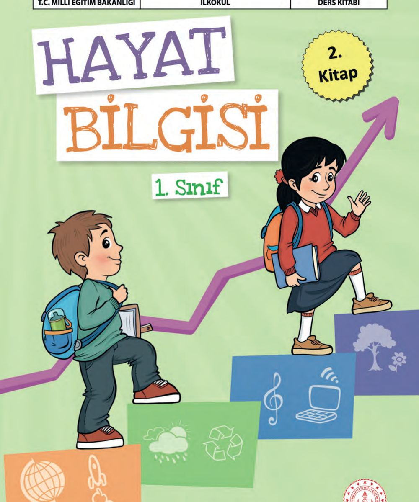

<!-- sayfa 1 -->

İLKOKUL

# HAYAT BİLGİSİ

## 1. Sınıf
### Ders Kitabı
### 2. Kitap

#### Yazarlar
Dr. Nagihan ŞAHİN
Ali HEMDE
Betül ALTUNTAŞ
Gürhan DİKMEN
Hüseyin GÜLEÇ
Nuray BAŞPINAR
Nurgül GENÇ
Selma TAŞCI

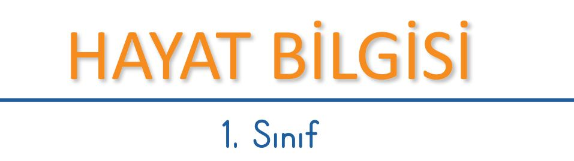

<!-- sayfa 2 -->

MİLLÎ EĞİTİM BAKANLIĞI YAYINLARI ................................................................. : 2020
DERS KİTAPLARI DİZİSİ ...................................................................................... : 9599

Her hakkı saklıdır ve Millî Eğitim Bakanlığına aittir. Kitabın metin, soru ve şekilleri kısmen de olsa hiçbir surette alınıp yayımlanamaz.

**Editör**
Dr. Öznur TUNALI

**Dil Uzmanı**
Aylin ALTINBAŞ

**Görsel Tasarımcı**
Evren SAVAŞ
Fatma Nilgün TURŞUCULAR
Gülçen YILMAZ DÜZGÜN
Neşe ASLAN
Orhan ATEŞ

**Çoklu Ortam Tasarımcısı**
Hatice MÜLKOĞLU

**Program Geliştirme Uzmanı**
Hilal ALTINTAŞ

**Ölçme ve Değerlendirme Uzmanı**
Elif Ebru DOĞANGÜZEL

**Rehberlik Uzmanı**
Dr. Nilgün KORKMAZ

**Baskı**
Baskı Matbaanın Adı ve Ticaret Unvanı
Tel: (0000) 000 00 00

ISBN 978-975-11-8009-4

Millî Eğitim Bakanlığı, Talim ve Terbiye Kurulu Başkanlığının 17.07.2024 tarih ve 110460159 sayılı yazısı ile eğitim aracı olarak kabul edilmiştir.

Kurulca bu kitabın kabul edilmiş olması eğitim aracından yayınevi ve yazarın sorumluluğunu kaldırmaz.

<!-- sayfa 3 -->

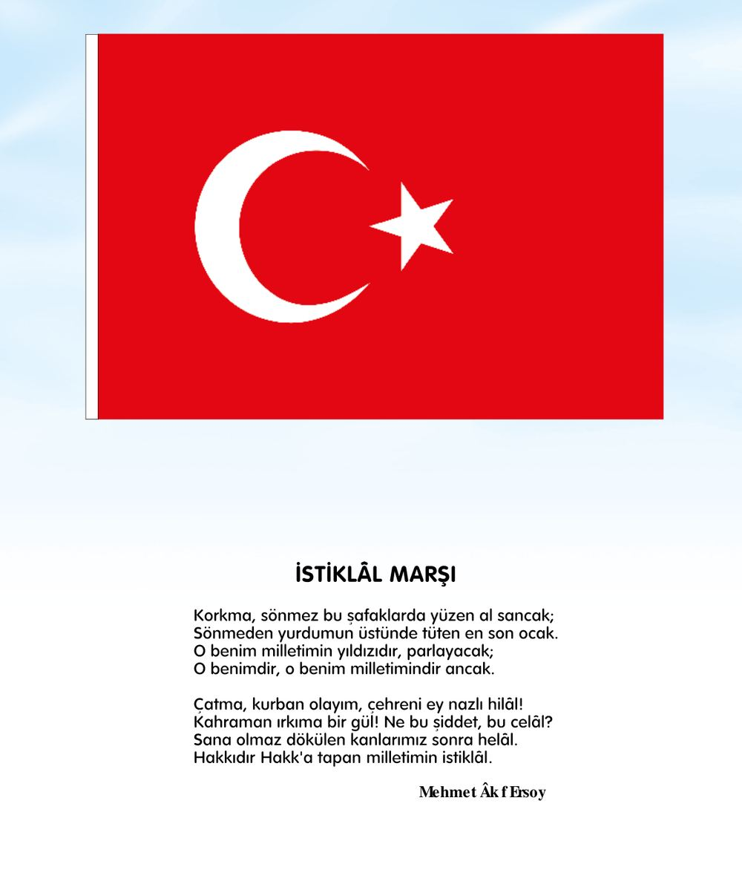

# İSTİKLÂL MARŞI

Korkma, sönmez bu şafaklarda yüzen al sancak;
Sönmeden yurdumun üstünde tüten en son ocak.
O benim milletimin yıldızıdır, parlayacak;
O benimdir, o benim milletimindir ancak.

Catma, kurban olayım, cehrini ey nazlı hilâl!
Kahraman ırkıma bir gül! Ne bu şiddet, bu celâl?
Sana olmaz dökülen kanlarımız sonra helâl.
Hakkıdır Hakk'a tapan milletimin istiklâl.

Mehmet Âkif Ersoy

<!-- sayfa 4 -->

ANDIMIZ

Türküm, doğruyum, çalışkanım.

İlkem küçüklerimi korumak, büyüklerimi saymak; yurdumu, milletimi özümden çok sevmektir.

Ülküm yükselmek, ileri gitmektir.

Ey Büyük Atatürk!

Açtığın yolda, gösterdiğin hedefe durmadan yürüyeceğime ant içerim.

Varlığım Türk varlığına armağan olsun.

Ne mutlu Türküm diyene!

<!-- sayfa 5 -->

MUSTAFA KEMAL ATATÜRK

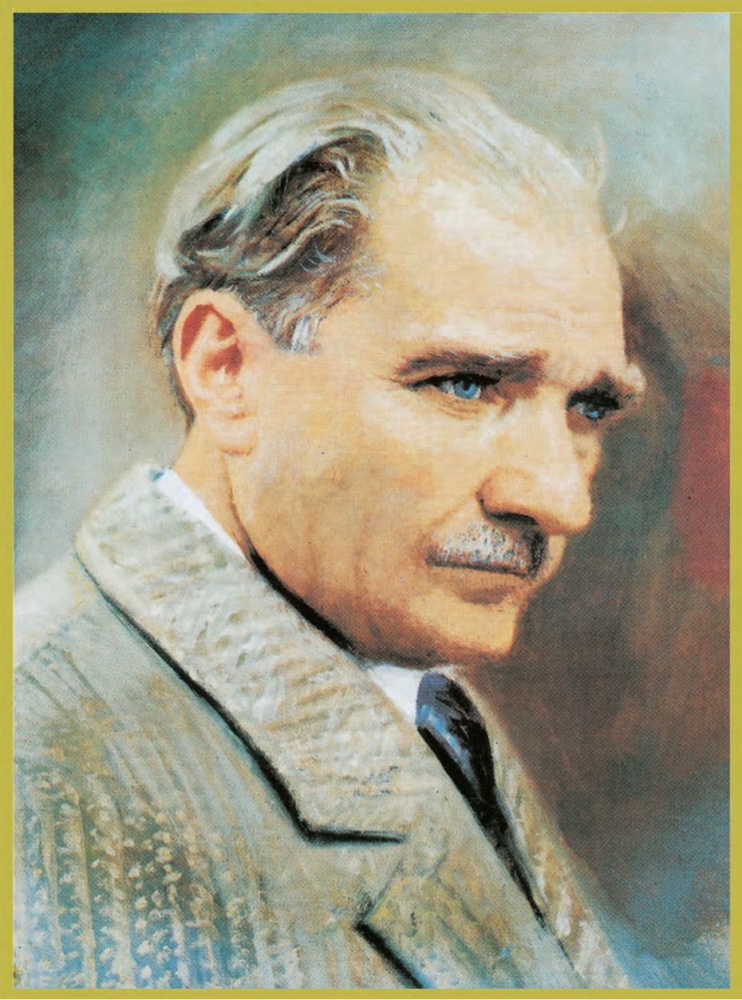
<!-- yer tutucu bulunamadı: sayfa sonuna eklendi -->

<!-- sayfa 6 -->

Verdiğiniz metin katmanı boş olduğu için (`<<< >>>` arası boş) dönüştürülecek bir içerik bulunmamaktadır. Lütfen metin katmanını içeren içeriği paylaşın, böylece kurallara uygun şekilde Markdown formatına çevirebilirim.

<!-- sayfa 7 -->

Kitabımızı Tanıyalım ........................................................................................................................ 8
Hazırlık Listesi ......................................................................................................................................10

### 4. ÖĞRENME ALANI: YAŞADIĞIM YER VE ÜLKEM
Belirli Gün ve Haftalar ...........................................................................................................14
Yaşadığım Yer ve Güzel Ülkem ......................................................................................16
Bayrağım ve Marşımla Gururluyum .........................................................................24
Atatürk’ü Tanıyalım ......................................................................................................................30
Performans Görevi ......................................................................................................................34
Al Bayrağı, Koş Bayrama .....................................................................................................36
El Öpenleriniz Çok Olsun .....................................................................................................42
Tekrar Zamanı ....................................................................................................................................48

### 5. ÖĞRENME ALANI: DOĞA VE ÇEVRE
Belirli Gün ve Haftalar ...........................................................................................................54
Doğayla Baş Başa ..........................................................................................................................56
Gökyüzünde Neler Var?..........................................................................................................62
Afetleri Tanıyalım ............................................................................................................................68
Atma, Yazık Olur! .........................................................................................................................74
Performans Görevi ........................................................................................................................78
Tekrar Zamanı ....................................................................................................................................80

### 6. ÖĞRENME ALANI: BİLİM, TEKNOLOJİ VE SANAT
Belirli Gün ve Haftalar ......................................................................................................... 86
Bilimin Peşindeyiz ............................................................................................................................ 88
Teknolojiyi Keşfedelim ............................................................................................................... 96
Sanat Bize İyi Gelir......................................................................................................................104
Performans Görevi .....................................................................................................................108
Tekrar Zamanı ..................................................................................................................................112

Ekler .............................................................................................................................................................115
Sözlük .........................................................................................................................................................121
Kaynakça ................................................................................................................................................125
Cevap Anahtarı ..............................................................................................................................126
Görsel ve Genel Ağ Kaynakçası .................................................................................126
Türkiye’nin Mülki İdare Bölümleri ile Kara ve Deniz Komşuları Haritası ....................................................................................................................................................................127
Türk Dünyası Haritası ..........................................................................................................................128

<!-- sayfa 8 -->

# KİTABIMIZI TANIYALIM

Kitabımız 6 öğrenme alanından oluşmaktadır. Bu öğrenme alanlarının 3 tanesi 2. kitapta bulunmaktadır.

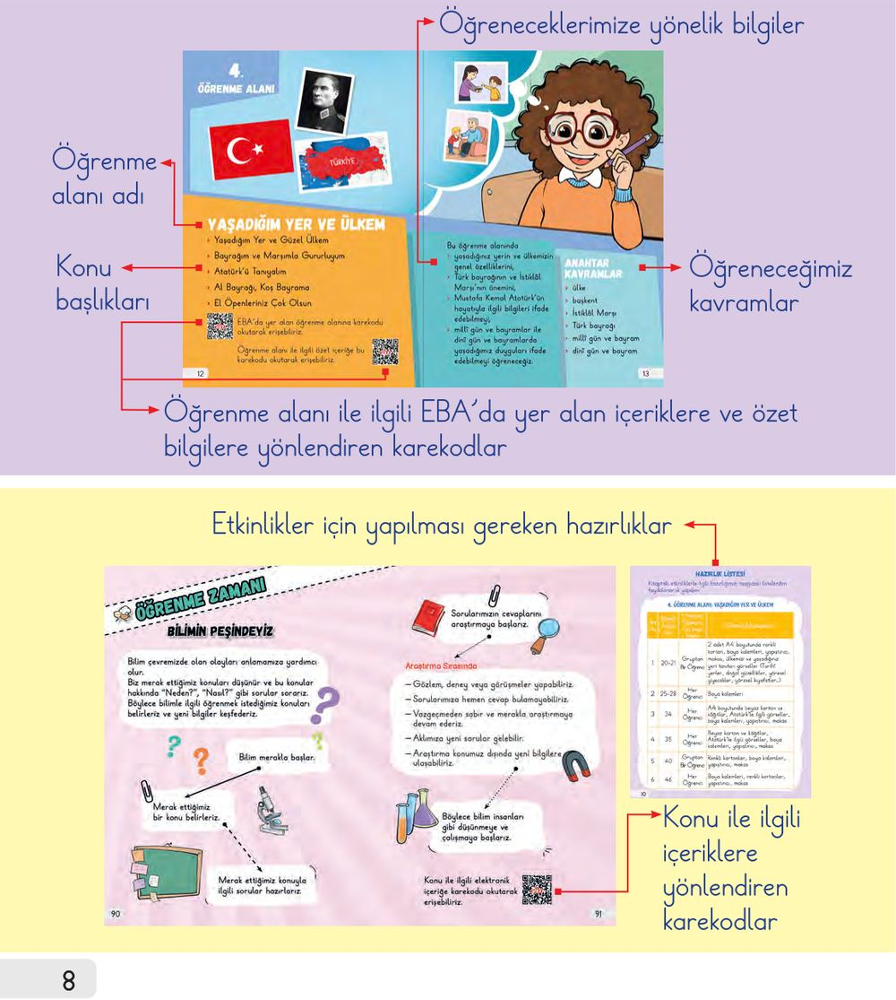

* Öğrenme alanı adı
* Konu başlıkları
* Öğreneceklerimize yönelik bilgiler
* Öğreneceğimiz kavramlar
* Öğrenme alanı ile ilgili EBA’da yer alan içeriklere ve özet bilgilere yönlendiren karekodlar

## Etkinlikler için yapılması gereken hazırlıklar

* Konu ile ilgili içeriklere yönlendiren karekodlar

<!-- sayfa 9 -->

Öğrenme alanında her bir konu “Düşünme Zamanı, Keşif Zamanı, Öğrenme Zamanı, Pekiştirme Zamanı ve Değerlendirme Zamanı” olmak üzere 5 başlıktan oluşmaktadır. Her öğrenme alanının sonunda “Tekrar Zamanı” bulunmaktadır.

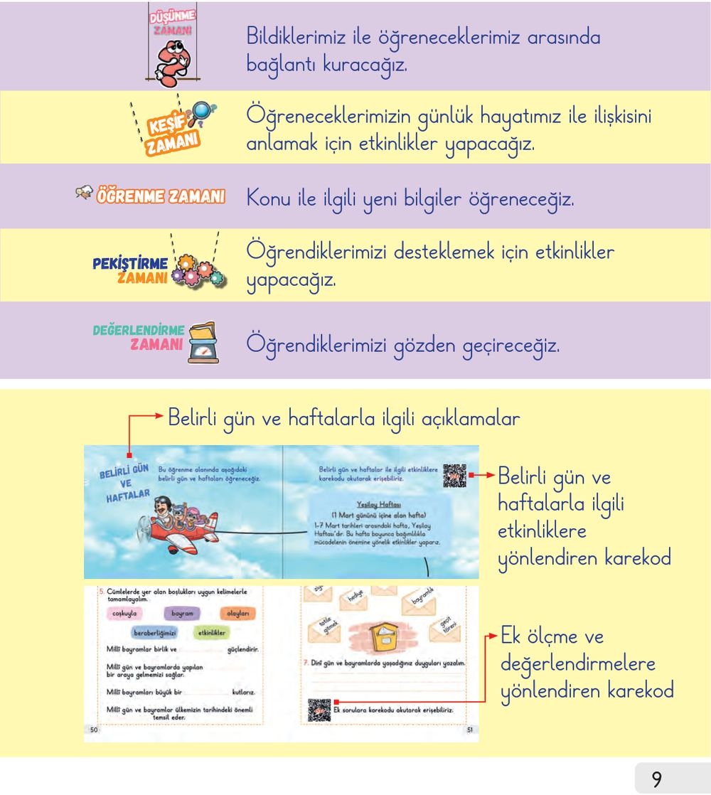 DÜŞÜNME ZAMANI Bildiklerimiz ile öğreneceklerimiz arasında bağlantı kuracağız.

 KEŞİF ZAMANI Öğreneceklerimizin günlük hayatımız ile ilişkisini anlamak için etkinlikler yapacağız.

 ÖĞRENME ZAMANI Konu ile ilgili yeni bilgiler öğreneceğiz.

 PEKİŞTİRME ZAMANI Öğrendiklerimizi desteklemek için etkinlikler yapacağız.

 DEĞERLENDİRME ZAMANI Öğrendiklerimizi gözden geçireceğiz.

Belirli gün ve haftalarla ilgili açıklamalar
 Belirli gün ve haftalarla ilgili etkinliklere yönlendiren karekod

BELİRLİ GÜN VE HAFTALAR Bu öğrenme alanında aşağıdaki belirli gün ve haftaları öğreneceğiz.

Belirli gün ve haftalar ile ilgili etkinliklere karekod okutarak erişebiliriz.

Yeşilay Haftası
(1 Mart gününe sığan hafta)
1-7 Mart tarihleri arasındaki hafta, Yeşilay Haftası'dır. Bu hafta bayrağımızla mücadelenin önemine yönelik etkinlikler yaparız.

 Belirli gün ve haftalarla ilgili etkinliklere yönlendiren karekod

5. Cümlelerde yer alan boşlukları uygun kelimelerle tamamlayalım.

coşkuyla | bayram | olaylar | beraberliğimizi | etkinlikler | güçlendirir.

Millî bayramlar birlik ve coşkuyla güçlendirir.
Millî gün ve bayramlarda yapılan kutlular büyük bir temsil eder.

 Ek ölçme ve değerlendirmelere yönlendiren karekod
Ek sorulara karekod okutarak erişebiliriz.

<!-- sayfa 10 -->

# HAZIRLIK LİSTESİ

Kitaptaki etkinliklerle ilgili hazırlığımızı aşağıdaki listelerden faydalanarak yapalım.

## 4. ÖĞRENME ALANI: YAŞADIĞIM YER VE ÜLKEM

| Sıra No. | Etkinlik Sayfa No. | Hazırlığı Yapacak Kişi veya Kişiler | Gerekli Malzemeler |
| :--- | :--- | :--- | :--- |
| 1 | 20-21 | Gruptan Bir Öğrenci | 2 adet A4 boyutunda renkli karton, boya kalemleri, yapıştırıcı, makas, ülkemizi ve yaşadığınız yeri tanıtan görseller (Tarihî yerler, doğal güzellikler, yöresel yiyecekler, yöresel kıyafetler...) |
| 2 | 25-28 | Her Öğrenci | Boya kalemleri |
| 3 | 34 | Her Öğrenci | A4 boyutunda beyaz karton ve kâğıtlar, Atatürk’le ilgili görseller, boya kalemleri, yapıştırıcı, makas |
| 4 | 35 | Her Öğrenci | Beyaz karton ve kâğıtlar, Atatürk’le ilgili görseller, boya kalemleri, yapıştırıcı, makas |
| 5 | 40 | Gruptan Bir Öğrenci | Renkli kartonlar, boya kalemleri, yapıştırıcı, makas |
| 6 | 46 | Her Öğrenci | Boya kalemleri, renkli kartonlar, yapıştırıcı, makas |

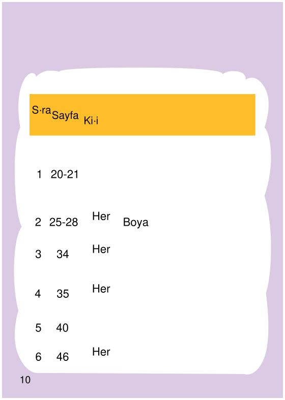
<!-- yer tutucu bulunamadı: sayfa sonuna eklendi -->

<!-- sayfa 11 -->

# 5. ÖĞRENME ALANI: DOĞA VE ÇEVRE

| Sıra No. | Etkinlik Sayfa No. | Hazırlığı Yapacak Kişi veya Kişiler | Gerekli Malzemeler |
| :--- | :--- | :--- | :--- |
| 1 | 61 | Her Öğrenci | A3 büyüklüğünde renkli karton, gözlemlediğiniz varlıkların görselleri, yapıştırıcı, makas |
| 2 | 66 | Her Öğrenci | Farklı renklerde oyun hamurları |
| 3 | 72 | Her Öğrenci | Ek 1, Ek 2, yapıştırıcı, makas |
| 4 | 78 | Gruptan Bir Öğrenci | Karton kutu, yapıştırıcı, boya kalemleri, makas, atık kâğıtlar |
| 5 | 79 | Her Öğrenci | Ek 3, yapıştırıcı, makas |

# 6. ÖĞRENME ALANI: BİLİM, TEKNOLOJİ VE SANAT

| Sıra No. | Etkinlik Sayfa No. | Hazırlığı Yapacak Kişi veya Kişiler | Gerekli Malzemeler |
| :--- | :--- | :--- | :--- |
| 1 | 92-93 | Gruptan Bir Öğrenci | İp, balon, bant, pipet, makas |
| 2 | 105 | Her Öğrenci | Ek 4, keçeli kalem veya kuru boya, makas |
| 3 | 108-109 | Her Öğrenci | Kil, oyun blokları, boya, fırça, makas, karton, yapıştırıcı, bant, |

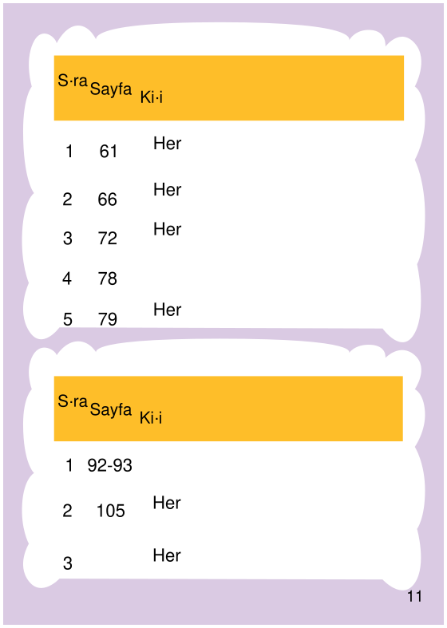
<!-- yer tutucu bulunamadı: sayfa sonuna eklendi -->

<!-- sayfa 12 -->

4.
ÖĞRENME ALANI

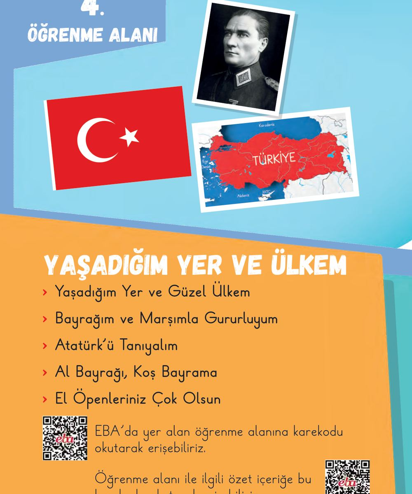

# YAŞADIĞIM YER VE ÜLKEM

> Yaşadığım Yer ve Güzel Ülkem
> Bayrağım ve Marşımla Gururluyum
> Atatürk’ü Tanıyalım
> Al Bayrağı, Koş Bayrama
> El Öpenleriniz Çok Olsun

 EBA’da yer alan öğrenme alanına karekodu okutarak erişebiliriz.

Öğrenme alanı ile ilgili özet içeriğe bu 

<!-- sayfa 13 -->

Bu öğrenme alanında
> yaşadığınız yerin ve ülkemizin genel özelliklerini,
> Türk bayrağının ve İstiklâl Marşı’nın önemini,
> Mustafa Kemal Atatürk’ün hayatıyla ilgili bilgileri ifade edebilmeyi,
> millî gün ve bayramlar ile dinî gün ve bayramlarda yaşadığımız duyguları ifade edebilmeyi.

# ANAHTAR KAVRAMLAR
> ülke
> başkent
> İstiklâl Marşı
> Türk bayrağı
> millî gün ve bayram
> dinî gün ve bayram

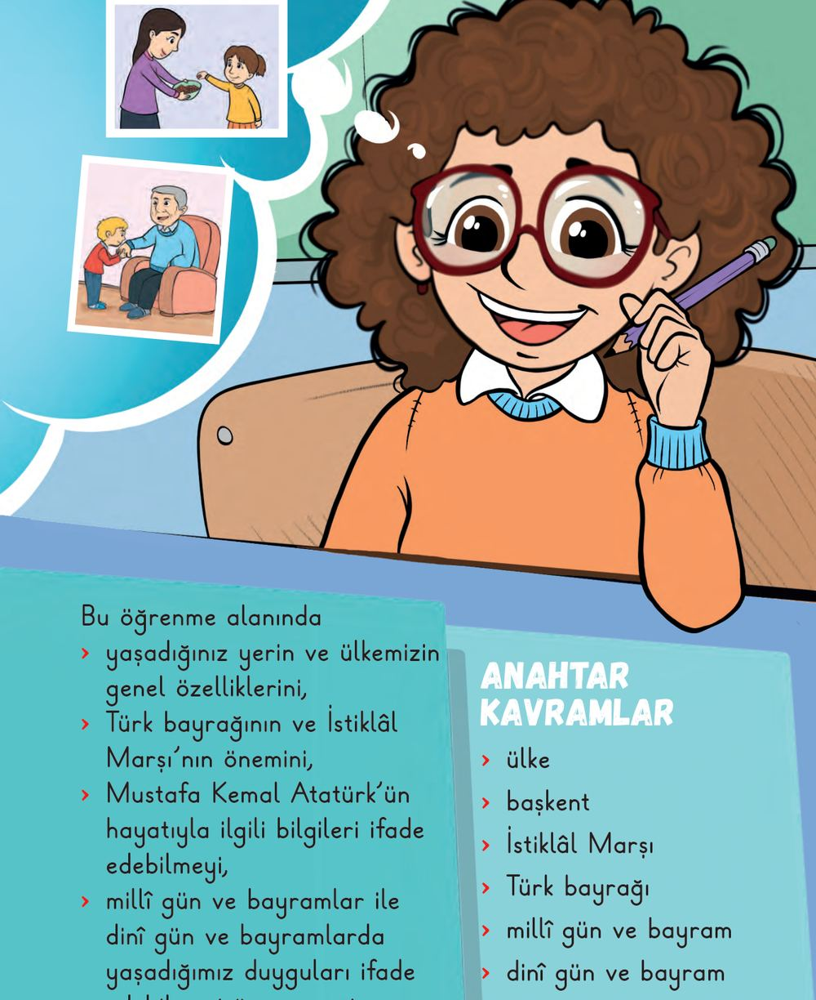
<!-- yer tutucu bulunamadı: sayfa sonuna eklendi -->

<!-- sayfa 14 -->

# BELİRLİ GÜN VE HAFTALAR

Bu öğrenme alanında aşağıdaki belirli gün ve haftaları öğreneceğiz.

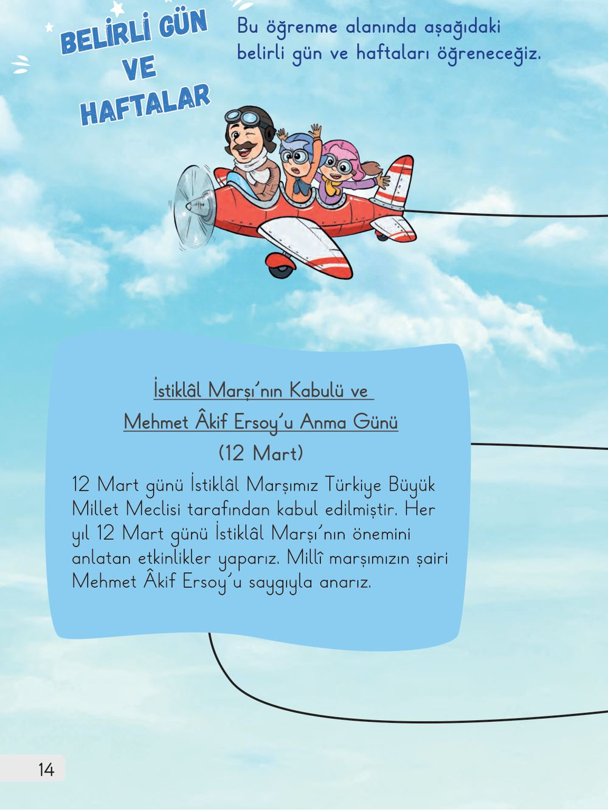

## İstiklâl Marşı’nın Kabulü ve Mehmet Âkif Ersoy’u Anma Günü (12 Mart)

12 Mart günü İstiklâl Marşımız Türkiye Büyük Millet Meclisi tarafından kabul edilmiştir. Her yıl 12 Mart günü İstiklâl Marşı’nın önemini anlatan etkinlikler yaparız. Millî marşımızın şairi Mehmet Âkif Ersoy’u saygıyla anarız.

<!-- sayfa 15 -->

Belirli gün ve haftalar ile ilgili etkinliklere karekodu okutarak erişebiliriz. 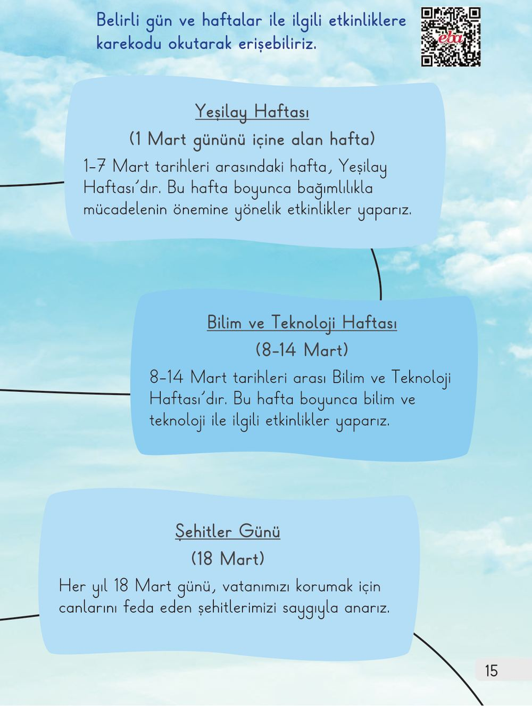

# Yeşilay Haftası
## (1 Mart gününü içine alan hafta)
1-7 Mart tarihleri arasındaki hafta, Yeşilay Haftası'dır. Bu hafta boyunca bağımlılıkla mücadelenin önemine yönelik etkinlikler yaparız.

# Bilim ve Teknoloji Haftası
## (8-14 Mart)
8-14 Mart tarihleri arası Bilim ve Teknoloji Haftası'dır. Bu hafta boyunca bilim ve teknoloji ile ilgili etkinlikler yaparız.

# Şehitler Günü
## (18 Mart)
Her yıl 18 Mart günü, vatanımızı korumak için canlarını feda eden şehitlerimizi saygıyla anarız.

<!-- sayfa 16 -->

# DUŞUNME ZAMANI

# YAŞADIĞIM YER VE GÜZEL ÜLKEM

> Görselleri inceleyelim. Çocukların yaşadıkları yerle ilgili söylediklerini okuyalım.

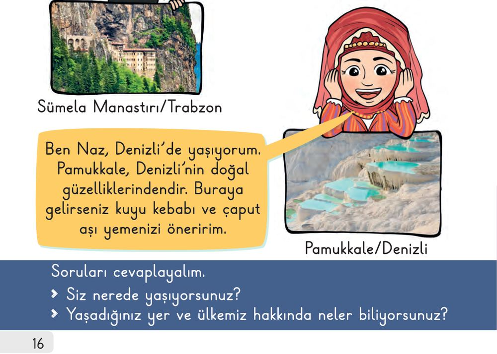

Ben Umut, güzel ülkemiz Türkiye’nin Trabzon şehrinde yaşıyorum. Sümela Manastırı ve Atatürk Köşkü Trabzon’un tarihî yerlerindendir. Hamsi tavamız ve kuymağımız meşhurdur.

Sümela Manastırı/Trabzon

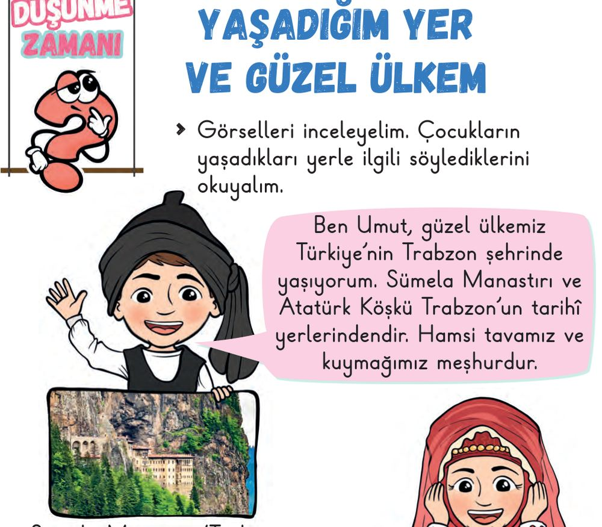

Ben Naz, Denizli’de yaşıyorum. Pamukkale, Denizli’nin doğal güzelliklerindendir. Buraya gelirseniz kuyu kebabı ve çaput aşı yemenizi öneririm.

Pamukkale/Denizli

***

Soruları cevaplayalım.

> Siz nerede yaşıyorsunuz?
> Yaşadığınız yerin güzelliklerinden hangilerini biliyorsunuz?

<!-- sayfa 17 -->

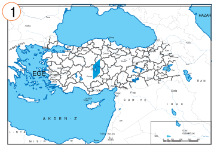

# › Görselleri inceleyelim.

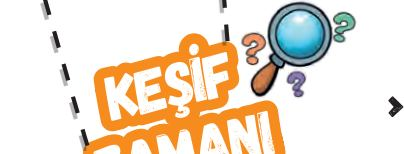

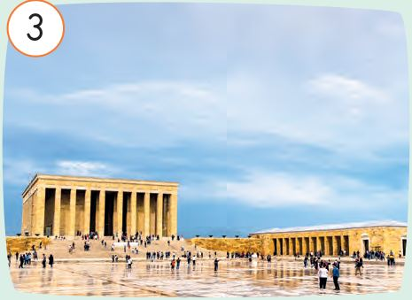

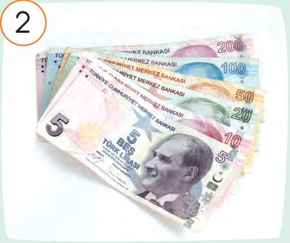

# Soruları cevaplayalım.

1. Türkiye haritasında neler dikkatinizi çekmektedir?
2. İkinci görselde bulunan paraları inceleyiniz. Paraların üzerinde neler görüyorsunuz?
3. Üçüncü görselde yer alan Anıtkabir hangi şehirdedir?
4. Yaşadığınız yerde ve ülkemizde hangi yerleri gezip görmeyi istersiniz?

<!-- sayfa 18 -->

# ÖĞRENME ZAMANI

## YAŞADIĞIM YER VE GÜZEL ÜLKEM

Yaşadığımız yeri diğer yerlerden ayıran özellikler vardır.

* Yaşadığımız yerde doğal güzellikler ve tarihî yerler bulunur.
    * 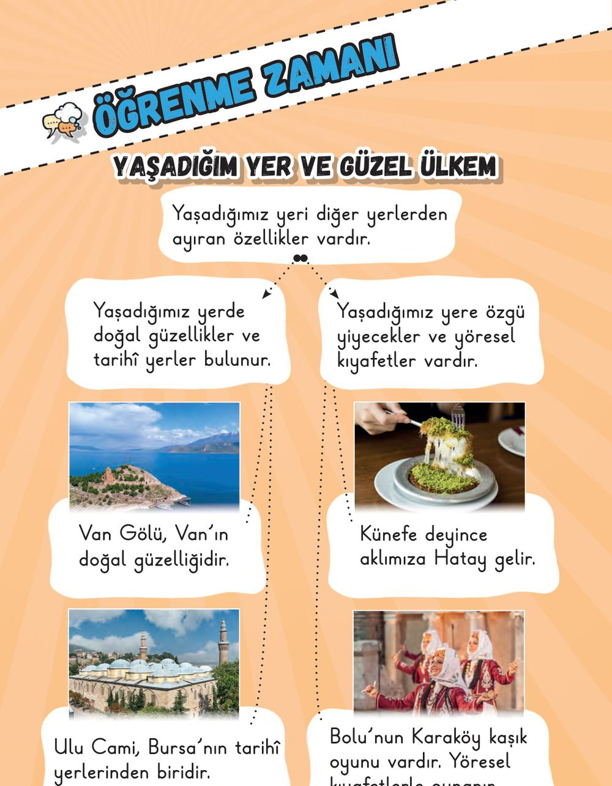
    * Van Gölü, Van’ın doğal güzelliğidir.
    * 
    * Ulu Cami, Bursa’nın tarihî yerlerinden biridir.

* Yaşadığımız yere özgü yiyecekler ve yöresel kıyafetler vardır.
    * 
    * Künefe deyince aklımıza Hatay gelir.
    * 
    * Bolu’nun Karaköy kaşık oyunu vardır. Yöresel kıyafetlerle oynanır.

<!-- sayfa 19 -->

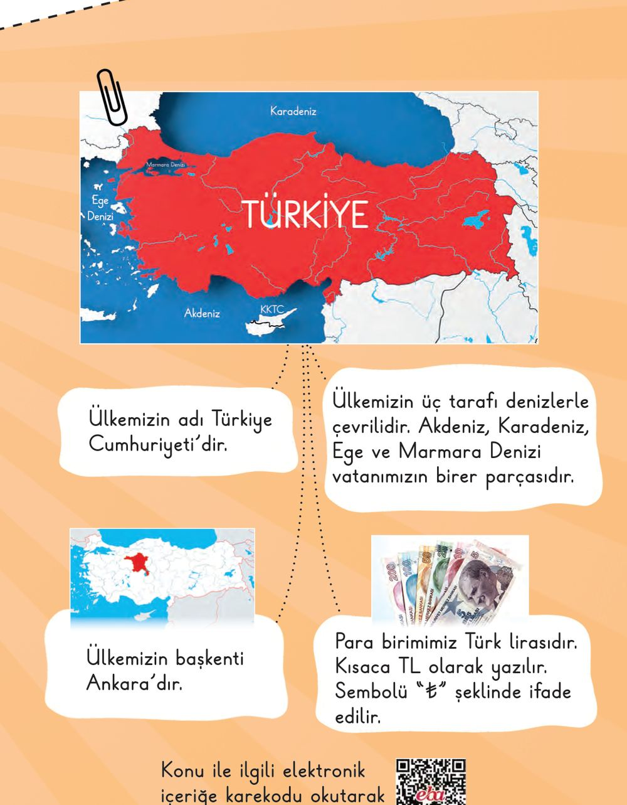

Ülkemizin adı Türkiye Cumhuriyeti'dir.

Ülkemizin üç tarafı denizlerle çevrilidir. Akdeniz, Karadeniz, Ege ve Marmara Denizi vatanımızın birer parçasıdır.

Ülkemizin başkenti Ankara'dır.

Para birimimiz Türk lirasıdır. Kısaca TL olarak yazılır. Sembolü "₺" şeklinde ifade edilir.

Konu ile ilgili elektronik içeriğe karekodu okutarak

<!-- sayfa 20 -->

# PEKİŞTİRME ZAMANI

> Uygulama adımlarını takip ederek etkinliği yapalım.
> Bilgi kartlarını oluşturalım.

## Malzemeler

— 2 adet A4 boyutunda renkli karton
— Boya kalemleri
— Yapıştırıcı
— Makas
— Ülkemizi ve yaşadığınız yeri tanıtan görseller (tarihî yerler, doğal güzellikler, yöresel yiyecekler, yöresel kıyafetler...)

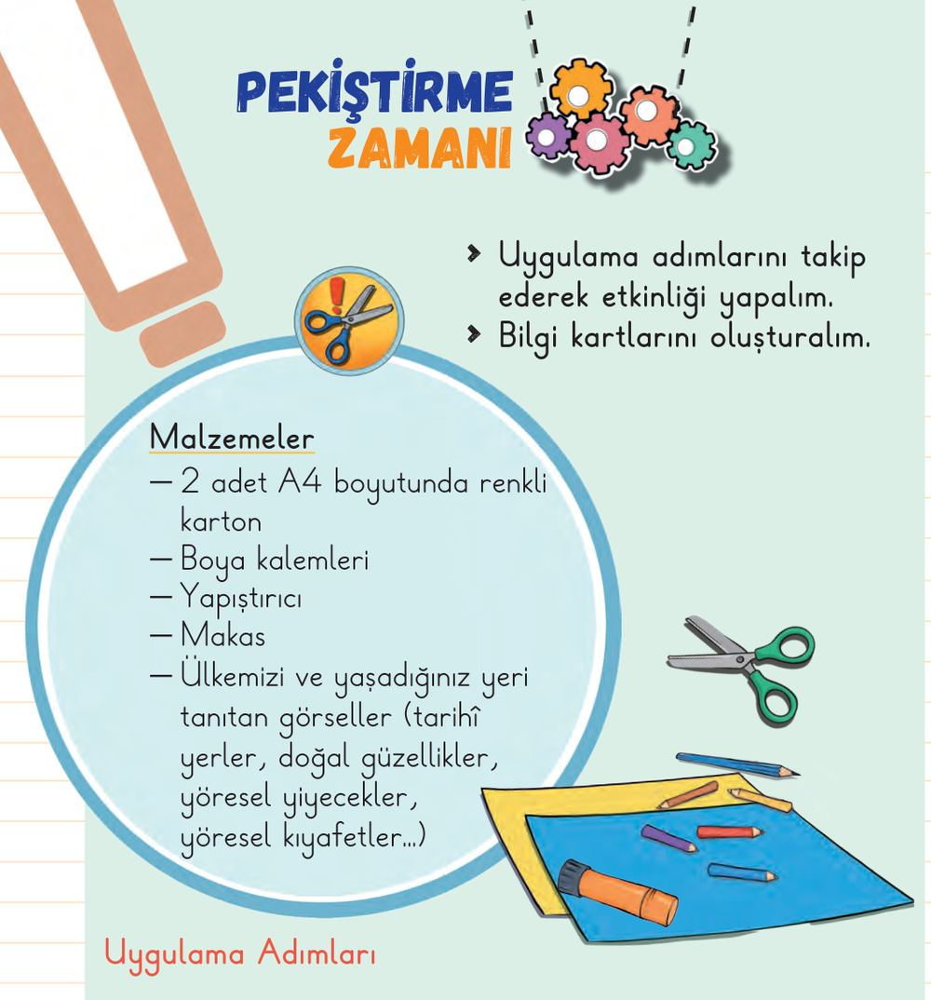

## Uygulama Adımları

▶ Sınıf içinde 4-6 kişilik gruplar oluşturalım.
▶ Kartonları görseldeki gibi 4 parçaya bölelim.

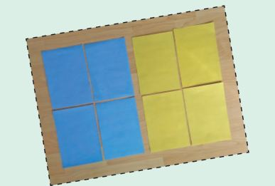

<!-- sayfa 21 -->

▶ Parçalardan birine ülkemizin adını, birine başkentimizin adını, birine para birimimizi yazalım. Yazdığımız bilgilerle ilgili görselleri yapıştıralım.

▶ Diğer parçaları yaşadığımız yerin özelliklerine göre hazırlayalım. Bu parçalara tarihî yer, doğal güzellik, yöresel yiyecek ve kıyafet görsellerini yapıştıralım. Görsellerin açıklamalarını yazalım.

▶ Hazırladığımız çalışmayı arkadaşlarımıza sunalım.

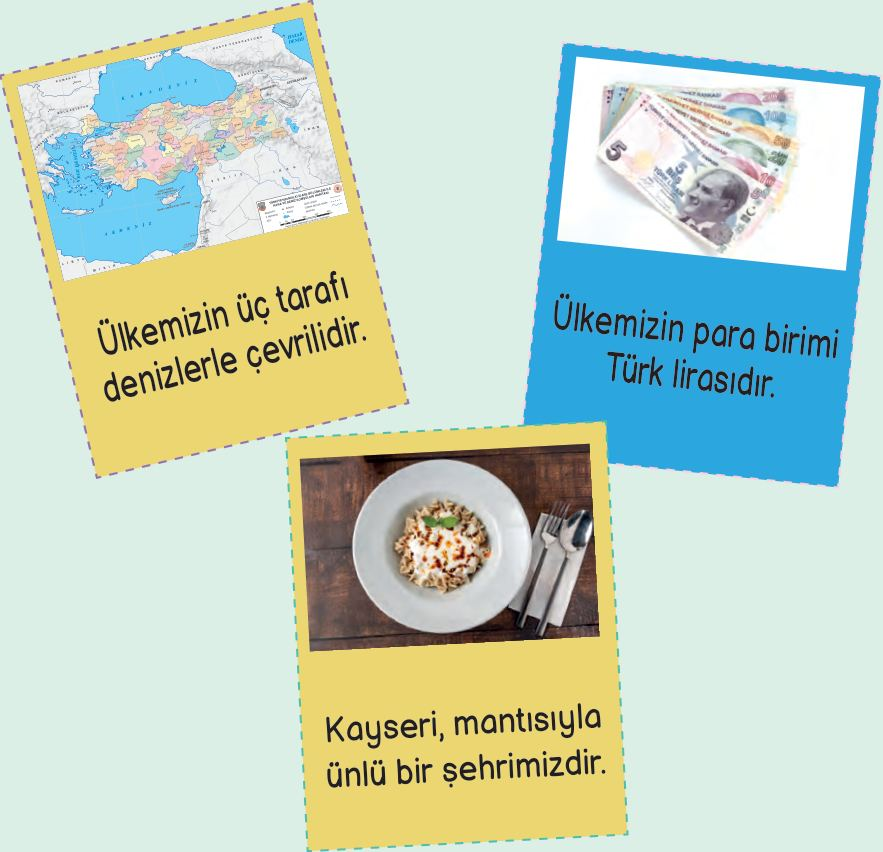

Ülkemizin üç tarafı denizlerle çevrilidir.

Ülkemizin para birimi Türk lirasıdır.

Kayseri, mantısıyla ünlü bir şehrimizdir.

<!-- sayfa 22 -->

# DEĞERLENDİRME ZAMANI

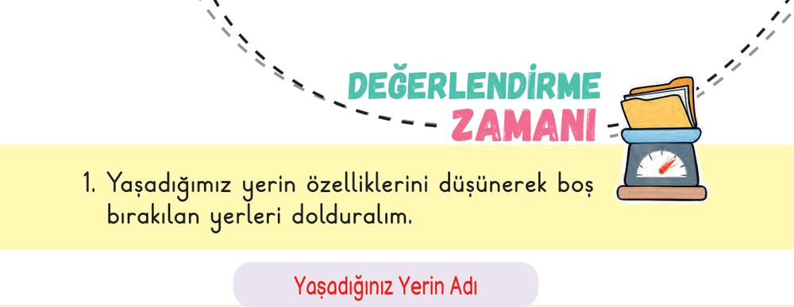

1. Yaşadığımız yerin özelliklerini düşünerek boş bırakılan yerleri dolduralım.

**Yaşadığınız Yerin Adı**

| Tarihî Yerleri | Doğal Güzellikleri |
| :--- | :--- |
| | |
| | |
| | |
| | |
| | |
| | |
| | |
| **Yöresel Yiyecekleri** | **Yöresel Kıyafetleri** |
| | |
| | |
| | |
| | |
| | |
| | |
| | |

<!-- sayfa 23 -->

2. Haritayı inceleyelim. Yaşadığımız yeri ve başkentimizi harita üzerinde bulalım. Yuvarlak içine alalım.

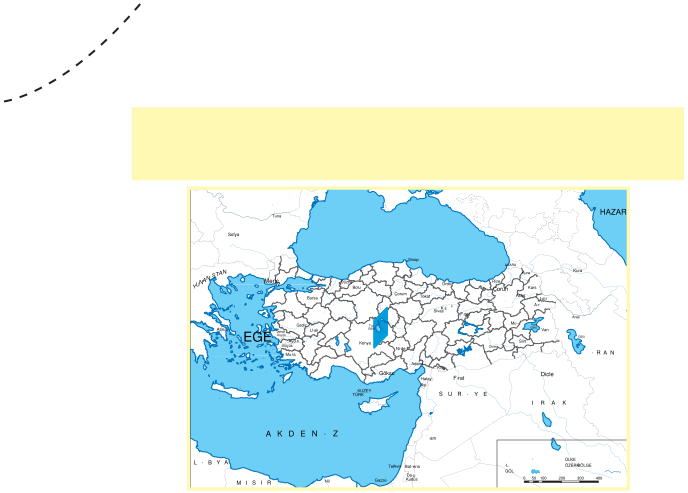

> Aşağıdaki soruları cevaplayalım.

Ülkemizin adı nedir?

Başkentimizin adı nedir?

Ülkemizin para birimi nedir?

Denizlerimizin adları nelerdir?

<!-- sayfa 24 -->

# DUŞUNME ZAMANI
# BAYRAĞIM VE MARŞIMLA GURURLUYUM

> Görseli inceleyelim.

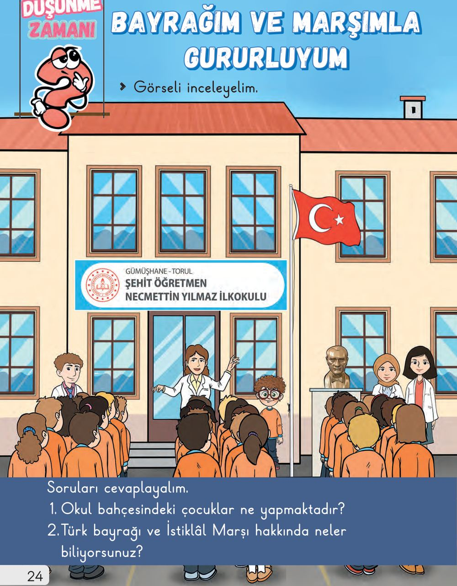

Soruları cevaplayalım.
1. Okul bahçesindeki çocuklar ne yapmaktadır?
2. Türk bayrağı ve İstiklâl Marşı hakkında neler biliyorsun?

<!-- sayfa 25 -->

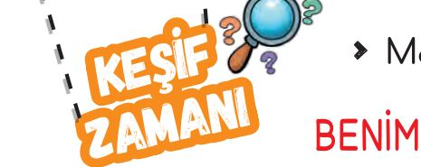

> Metni okuyalım.

# BENİM YERİM GÖKLERDİR

Kırmızı ve beyaz... İşte benim güzel renklerim. Özgürce dalgalanırım. Göklerdir yerim. Hele bir de İstiklâl Marşı’nı duyuyorsam coştukça coşarım. Ben coştukça gururlandığınızı görürüm. Genç, yaşlı; kadın, erkek... Omuz omuza, yürek yüreğe... Yıllar sürmüş mücadele. Bağımsızlık için ne emekler verilmiş, hissederim.

Ah, o büyük şair Mehmet Âkif Ersoy! 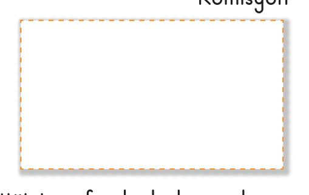 Sözlerine şöyle başlamıştı:
“Korkma, sönmez bu şafaklarda yüzen al sancak;
Sönmeden yurdumun üstünde tüten en son ocak.”
Siz bana sancak deyin, bayrak deyin, hilâl deyin. Ben size can derim, millet derim, vatan derim. Bu topraklarda sonsuza kadar dalgalanacağımı bilirim.

Komisyon

>  Boş bırakılan alana rengine ve şekline uygun olarak bayrağımızı çizip boyayalım.
> Törenlerde İstiklâl Marşı okunurken nasıl davranmamız gerektiğini sınıf arkadaşlarımızla canlandıralım.

Soruları cevaplayalım.
1. Metne göre İstiklâl Marşı okunurken coşan kimdir?
2. İstiklâl Marşı’nı okuduğunuzda veya duyduğunuzda...

<!-- sayfa 26 -->

# ÖĞRENME ZAMANI

## BAYRAĞIM VE MARŞIMLA GURURLUYUM

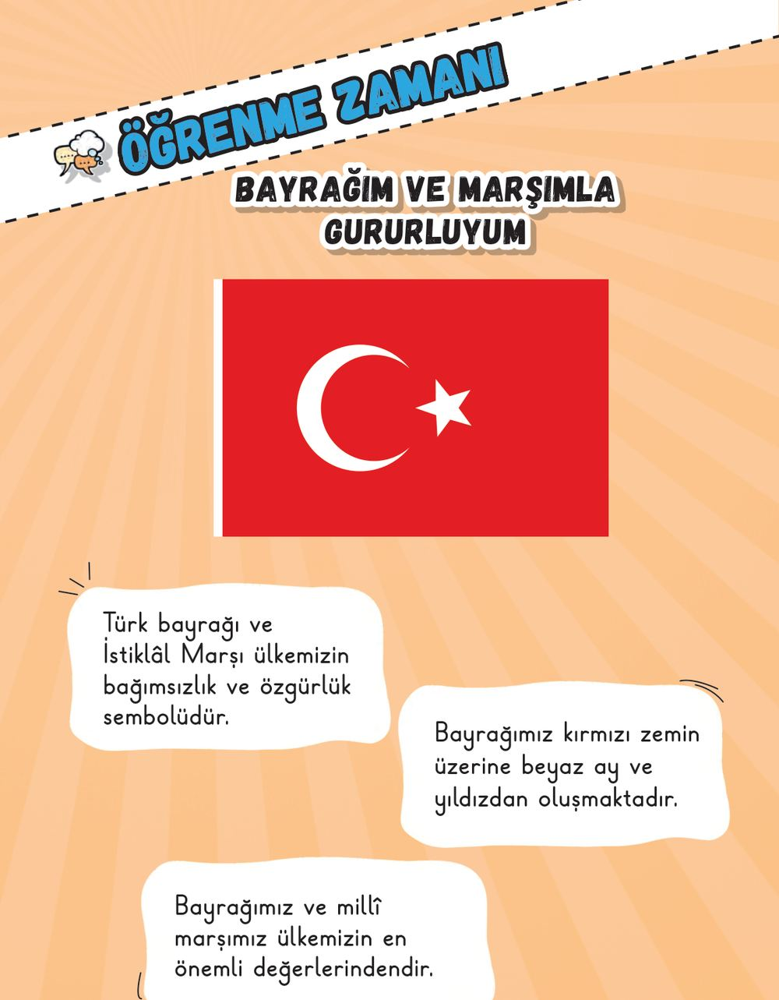

Türk bayrağı ve İstiklâl Marşı ülkemizin bağımsızlık ve özgürlük sembolüdür.

Bayrağımız kırmızı zemin üzerine beyaz ay ve yıldızdan oluşmaktadır.

Bayrağımız ve millî marşımız ülkemizin en önemli değerlerindendir.

<!-- sayfa 27 -->

# İSTİKLÂL MARŞI

Korkma, sönmez bu şafaklarda yüzen al sancak;
Sönmeden yurdumun üstünde tüten en son ocak.
O benim milletimin yıldızıdır, parlayacak;
O benimdir, o benim milletimindir ancak.

Çatma, kurban olayım, çehreni ey nazlı hilâl!
Kahraman ırkıma bir gül! Ne bu şiddet, bu celâl?
Sana olmaz dökülen kanlarımız sonra helâl.
Hakkıdır Hakk’a tapan milletimin istiklâl.

Mehmet Âkif Ersoy

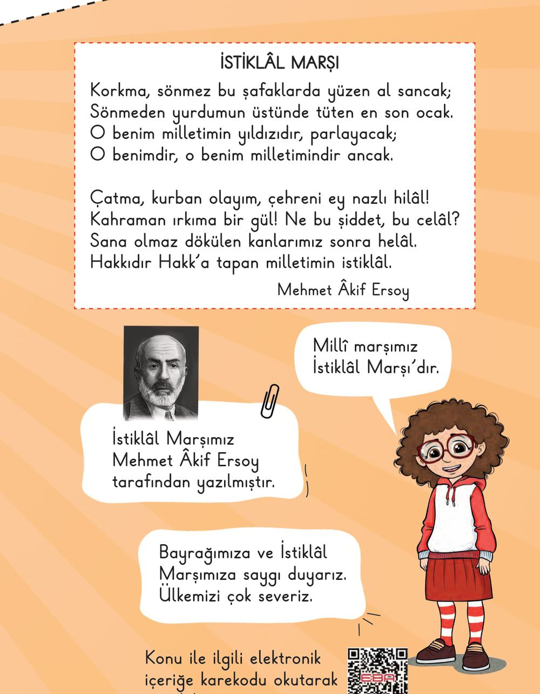 İstiklâl Marşımız Mehmet Âkif Ersoy tarafından yazılmıştır.

Millî marşımız İstiklâl Marşı’dır.

Bayrağımıza ve İstiklâl Marşımıza saygı duyarız. Ülkemizi çok severiz.

Konu ile ilgili elektronik içeriğe karekodu okutarak

<!-- sayfa 28 -->

# PEKİŞTİRME ZAMANI

**Malzemeler**
— Boya kalemleri

> Uygulama adımlarını takip ederek resim çizelim.

### Uygulama adımları:

▶ Okulumuzda katıldığımız bayrak törenlerini düşünelim.
▶ Bayrak törenlerini anlatan bir resim çizelim. Resmimizde Türk bayrağına da yer verelim. 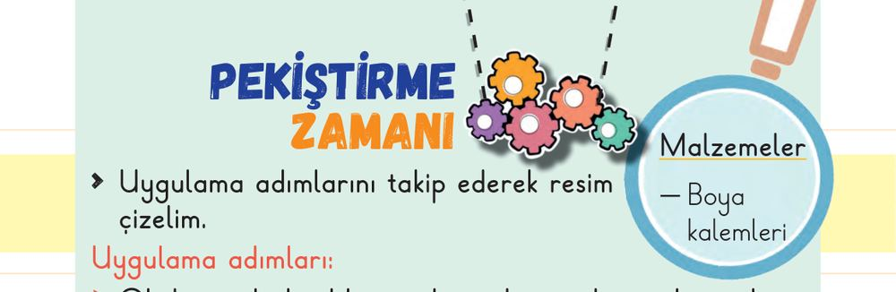
▶ Resimlerimizi arkadaşlarımıza gösterelim.
▶ Sınıfta bir çember oluşturalım. Sırayla söz alarak resmini çizdiğimiz bayrak törenini anlatalım.
▶ Törende neler yaşadığımızı ve nasıl hissettiğimizi arkadaşlarımızla paylaşalım. 

<!-- sayfa 29 -->

# DEĞERLENDİRME ZAMANI
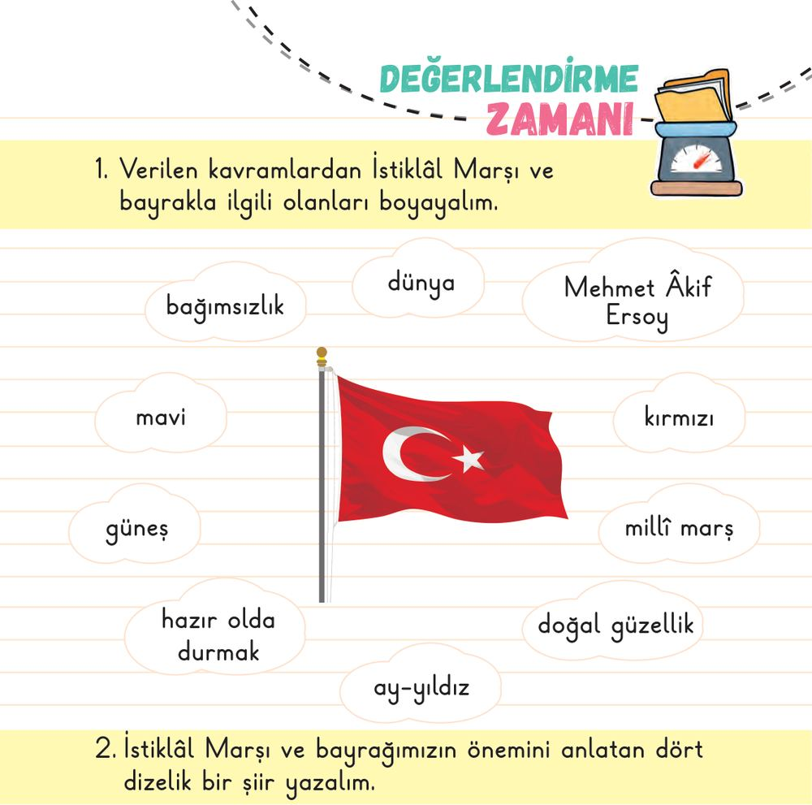

1. Verilen kavramlardan İstiklâl Marşı ve bayrakla ilgili olanları boyayalım.

bağımsızlık | dünya | Mehmet Âkif Ersoy
---|---|---
mavi |  | kırmızı
güneş | millî marş
hazır olda durmak | doğal güzellik
ay-yıldız

2. İstiklâl Marşı ve bayrağımızın önemini anlatan dört dizelik bir şiir yazalım.

<!-- sayfa 30 -->

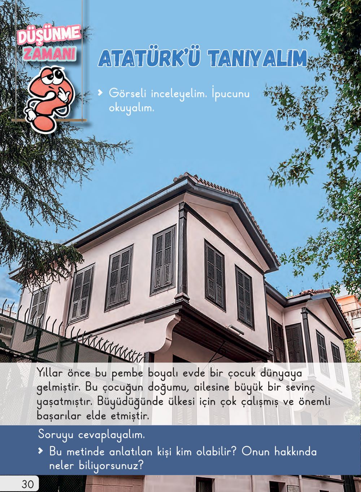

# ATATÜRK'Ü TANIYALIM

> Görseli inceleyelim. İpucunu okuyalım.

Yıllar önce bu pembe boyalı evde bir çocuk dünyaya gelmiştir. Bu çocuğun doğumu, ailesine büyük bir sevinç yaşatmıştır. Büyüdüğünde ülkesi için çok çalışmış ve önemli başarılar elde etmiştir.

Soruyu cevaplayalım.
> Bu metinde anlatılan kişi kim olabilir? Onun hakkında...

<!-- sayfa 31 -->

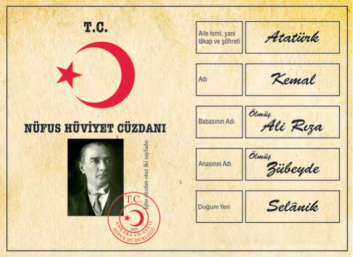

> Aşağıdaki kimliği inceleyelim.

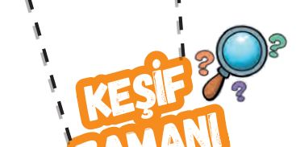

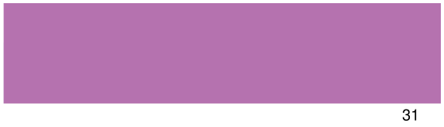

> Metni okuyalım.

Mustafa’nın ortaokulda en sevdiği ders matematikti. Zor soruları çözene kadar uğraşırdı. Azimli çalışması öğretmenlerinin dikkatini çekerdi. Eğitim hayatı boyunca düzenli ve planlı çalıştı. Bu özellikleri sayesinde büyük başarılar kazandı.

Soruları cevaplayalım.
1. Kimlikte Mustafa Kemal Atatürk’le ilgili hangi bilgiler verilmiştir?
2. Atatürk, hangi özellikleri sayesinde büyük başarılar kazanmıştır?

<!-- sayfa 32 -->

# ÖĞRENME ZAMANI

## ATATÜRK'Ü TANIYALIM

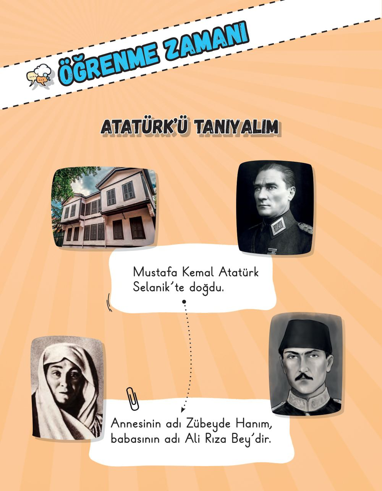

Mustafa Kemal Atatürk Selanik'te doğdu.

Annesinin adı Zübeyde Hanım, babasının adı Ali Rıza Bey'dir.

<!-- sayfa 33 -->

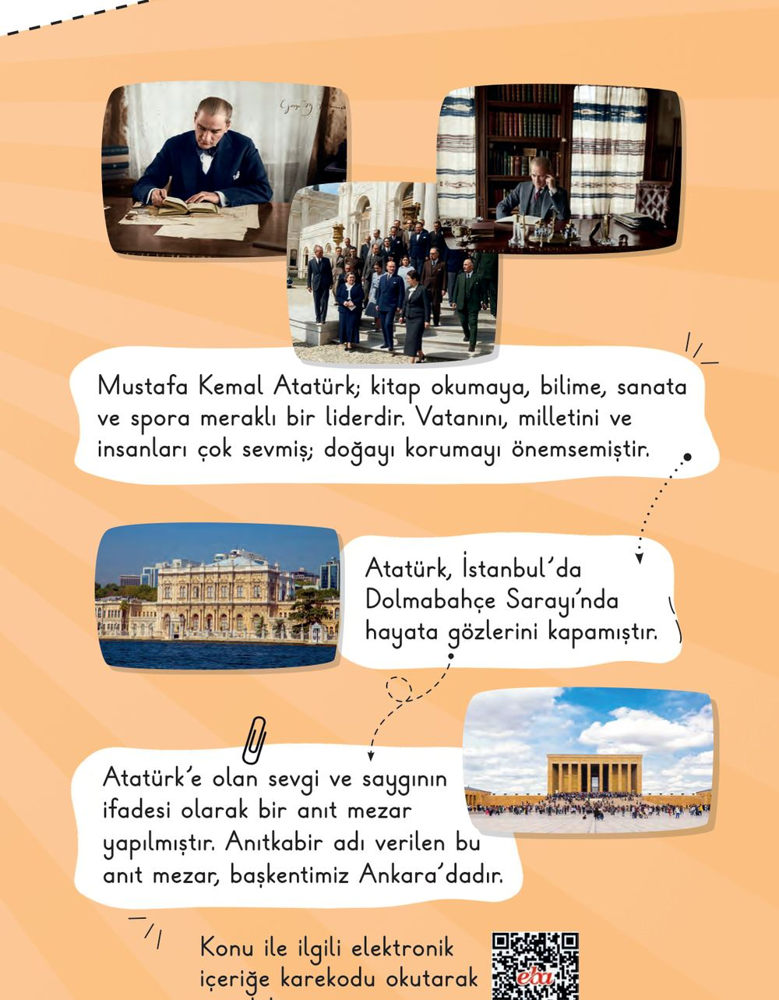

Mustafa Kemal Atatürk; kitap okumaya, bilime, sanata ve spora meraklı bir liderdir. Vatanını, milletini ve insanları çok sevmiş; doğayı korumayı önemsemiştir.

Atatürk, İstanbul’da Dolmabahçe Sarayı’nda hayata gözlerini kapamıştır.

Atatürk’e olan sevgi ve saygının ifadesi olarak bir anıt mezar yapılmıştır. Anıtkabir adı verilen bu anıt mezar, başkentimiz Ankara’dadır.

Konu ile ilgili elektronik içeriğe karekodu okutarak

<!-- sayfa 34 -->

# PEKİŞTİRME ZAMANI

## Malzemeler
— Beyaz karton ve kâğıtlar
— Atatürk’le ilgili görseller
— Boya kalemleri
— Yapıştırıcı
— Makas

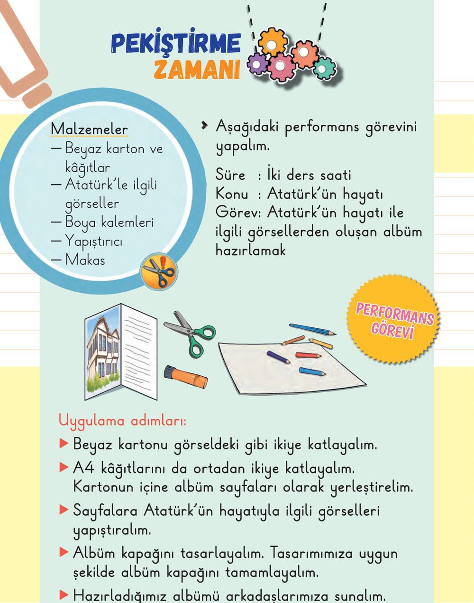

> Aşağıdaki performans görevini yapalım.

**Süre :** İki ders saati
**Konu :** Atatürk’ün hayatı
**Görev:** Atatürk’ün hayatı ile ilgili görsellerden oluşan albüm hazırlamak

## Uygulama adımları:
▶ Beyaz kartonu görseldeki gibi ikiye katlayalım.
▶ A4 kâğıtlarını da ortadan ikiye katlayalım. Kartonun içine albüm sayfaları olarak yerleştirelim.
▶ Sayfalara Atatürk’ün hayatıyla ilgili görselleri yapıştıralım.
▶ Albüm kapağını tasarlayalım. Tasarımımıza uygun şekilde albüm kapağını tamamlayalım.
▶ Hazırladığımız albümü arkadaşlarımıza sunalım.

<!-- sayfa 35 -->

# DEĞERLENDİRME ZAMANI

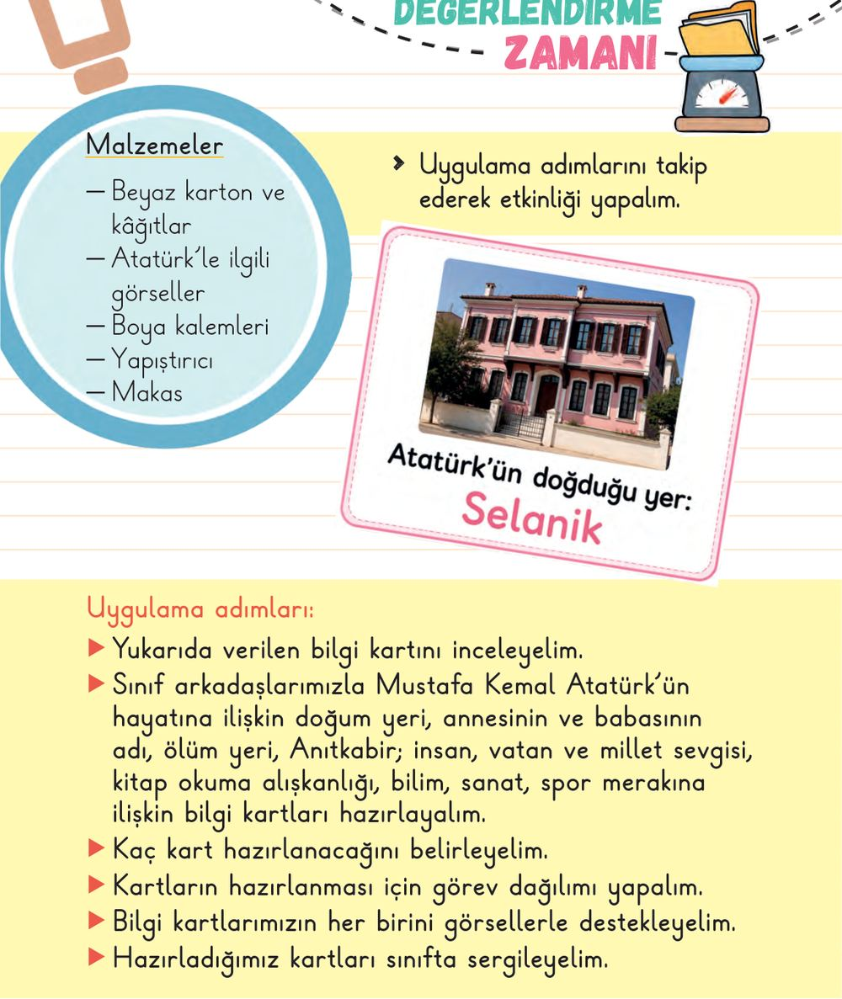

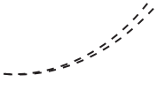
## Malzemeler
— Beyaz karton ve kâğıtlar
— Atatürk’le ilgili görseller
— Boya kalemleri
— Yapıştırıcı
— Makas

> Uygulama adımlarını takip ederek etkinliği yapalım.

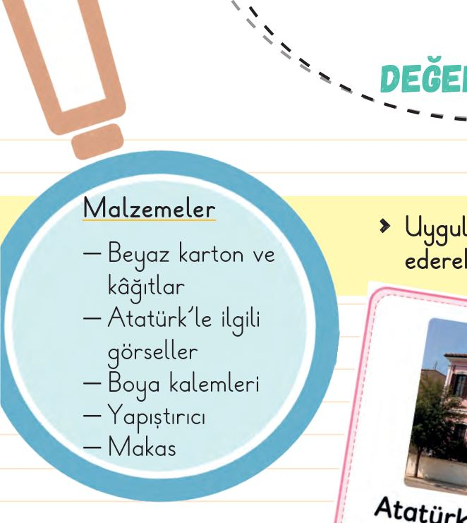
Atatürk'ün doğduğu yer:
**Selanik**

### Uygulama adımları:
▶ Yukarıda verilen bilgi kartını inceleyelim.
▶ Sınıf arkadaşlarımızla Mustafa Kemal Atatürk’ün hayatına ilişkin doğum yeri, annesinin ve babasının adı, ölüm yeri, Anıtkabir; insan, vatan ve millet sevgisi, kitap okuma alışkanlığı, bilim, sanat, spor merakına ilişkin bilgi kartları hazırlayalım.
▶ Kaç kart hazırlanacağını belirleyelim.
▶ Kartların hazırlanması için görev dağılımı yapalım.
▶ Bilgi kartlarımızın her birini görsellerle destekleyelim.
▶ Hazırladığımız kartları sınıfta sergileyelim.

<!-- sayfa 36 -->

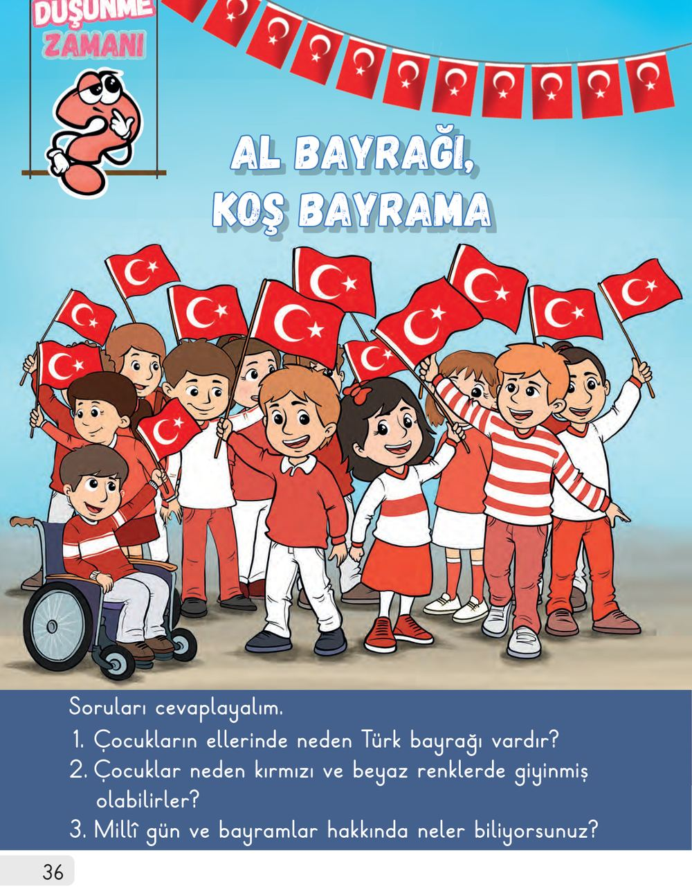

# AL BAYRAĞI, KOŞ BAYRAMA

Soruları cevaplayalım.

1. Çocukların ellerinde neden Türk bayrağı vardır?
2. Çocuklar neden kırmızı ve beyaz renklerde giyinmiş olabilirler?
3. Millî gün ve bayramlar hakkında neler biliyorsunuz?

<!-- sayfa 37 -->

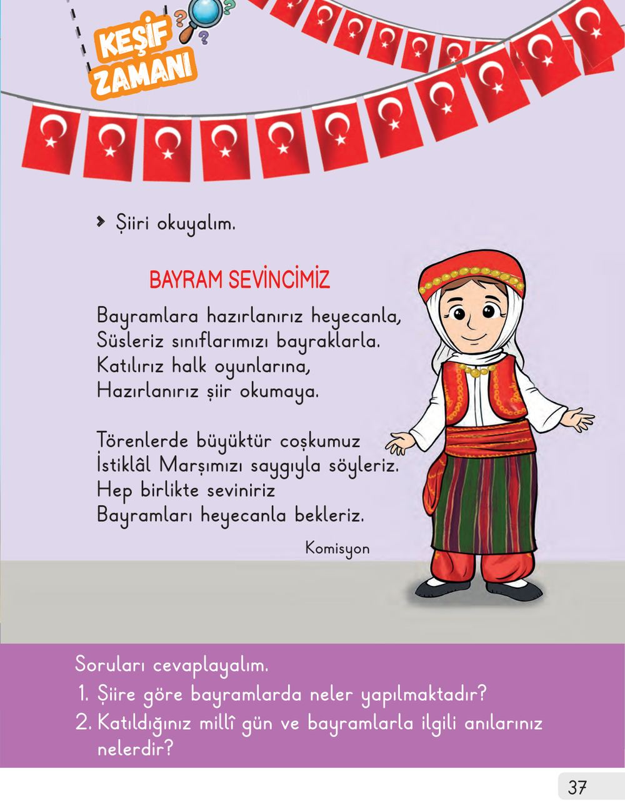

> Şiiri okuyalım.

# BAYRAM SEVİNCİMİZ

Bayramlara hazırlanırız heyecanla,
Süsleriz sınıflarımızı bayraklarla.
Katılırız halk oyunlarına,
Hazırlanırız şiir okumaya.

Törenlerde büyüktür coşkumuz
İstiklâl Marşımızı saygıyla söyleriz.
Hep birlikte seviniriz
Bayramları heyecanla bekleriz.

Komisyon

Soruları cevaplayalım.
1. Şiire göre bayramlarda neler yapılmaktadır?
2. Katıldığınız millî gün ve bayramlarla ilgili anılarınız nelerdir?

<!-- sayfa 38 -->

# ÖĞRENME ZAMANI

## AL BAYRAĞI, KOŞ BAYRAMA

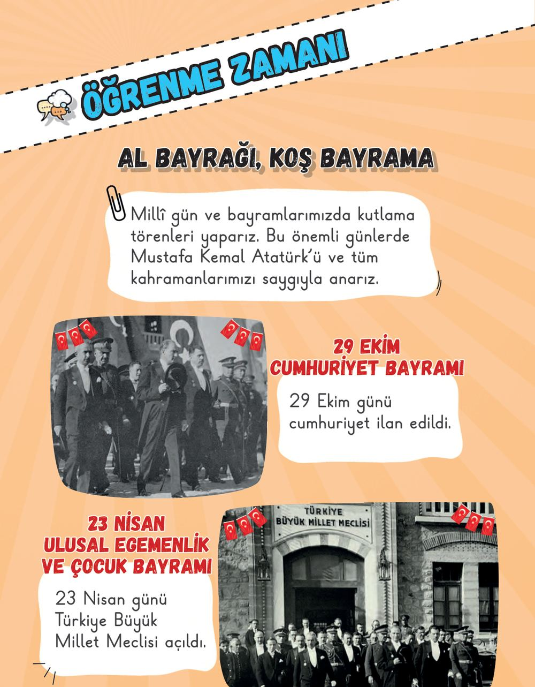: Millî gün ve bayramlarımızda kutlama törenleri yaparız. Bu önemli günlerde Mustafa Kemal Atatürk’ü ve tüm kahramanlarımızı saygıyla anarız.

### 29 EKİM CUMHURİYET BAYRAMI
29 Ekim günü cumhuriyet ilan edildi.

### 23 NİSAN ULUSAL EGEMENLİK VE ÇOCUK BAYRAMI
23 Nisan günü Türkiye Büyük Millet Meclisi açıldı.

<!-- sayfa 39 -->

# 19 MAYIS ATATÜRK'Ü ANMA VE GENÇLİK VE SPOR BAYRAMI
19 Mayıs günü Atatürk Samsun’a giderek Millî Mücadele’yi başlattı.

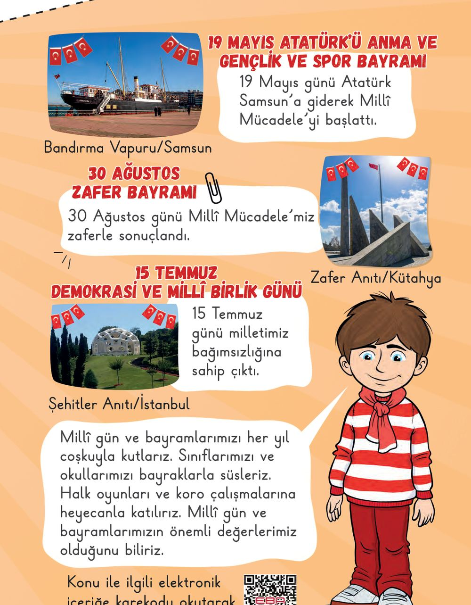
Bandırma Vapuru/Samsun

## 30 AĞUSTOS ZAFER BAYRAMI
30 Ağustos günü Millî Mücadele’miz zaferle sonuçlandı.

Zafer Anıtı/Kütahya

# 15 TEMMUZ DEMOKRASİ VE MİLLÎ BİRLİK GÜNÜ
15 Temmuz günü milletimiz bağımsızlığına sahip çıktı.

Şehitler Anıtı/İstanbul

Millî gün ve bayramlarımızı her yıl coşkuyla kutlarız. Sınıflarımızı ve okullarımızı bayraklarla süsleriz. Halk oyunları ve koro çalışmalarına heyecanla katılırız. Millî gün ve bayramlarımızın önemli değerlerimiz olduğunu biliriz.

Konu ile ilgili elektronik içeriğe karekodu okutarak

<!-- sayfa 40 -->

# PEKİŞTİRME ZAMANI

> Katıldığımız millî gün ve bayramları hatırlayalım. Sırayla söz alarak bu günlerde neler yaptığımızı ve nasıl hissettiğimizi arkadaşlarımızla paylaşalım. Ardından uygulama adımlarını takip ederek millî gün ve bayramların bizde uyandırdığı duyguları anlatan bir pano hazırlayalım.

## Malzemeler

— Renkli kartonlar
— Boya kalemleri
— Yapıştırıcı
— Makas

## Uygulama Adımları

▶ Sınıfta beş grup oluşturalım.
▶ Grubumuz için bir millî gün veya bayram belirleyelim.
▶ Belirlediğimiz millî gün veya bayramla ilgili afiş hazırlayalım. Afişimiz için renkli kartonları kullanalım.
▶ Çalışmalarımızı panoda sergileyelim.
▶ Panoyu inceleyelim. Duygu ve düşüncelerimizi ifade edelim.

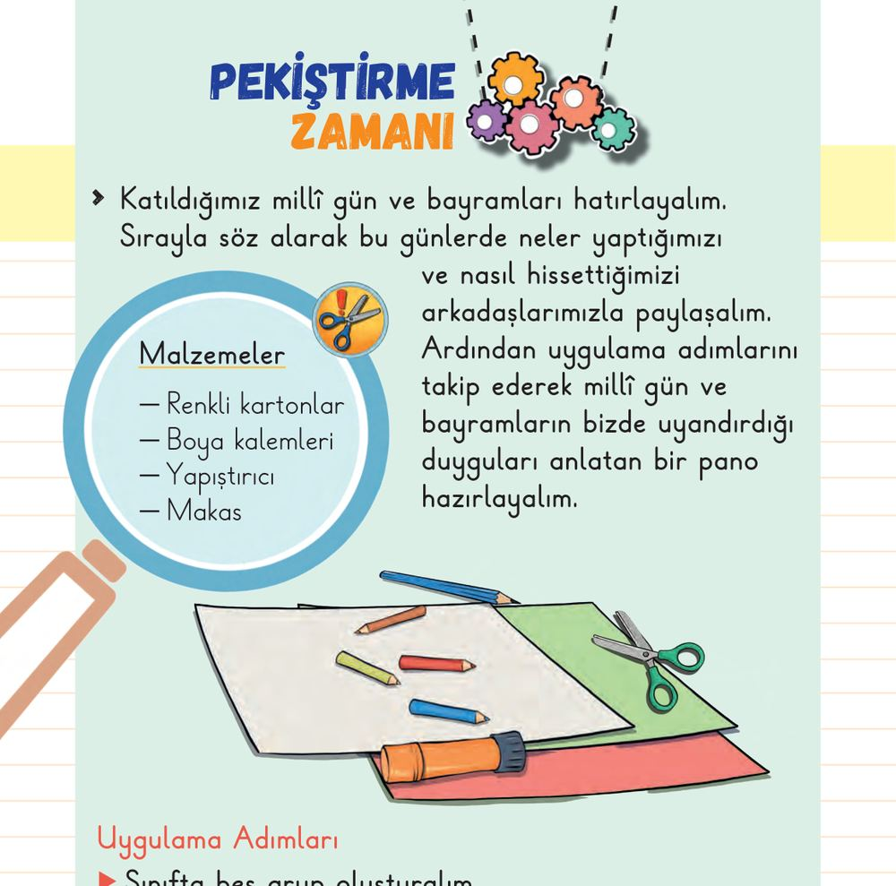

<!-- sayfa 41 -->

# DEĞERLENDİRME ZAMANI

1. Cümlelerin ilgili olduğu millî gün veya bayramların adlarını yazalım.

a. 29 Ekim’den önce sınıfımızı bayraklarla süsledik.
__________________________________________________________________

b. 23 Nisan’da “Atatürk’ün Çocuk Sevgisi” şiirini okudum.
__________________________________________________________________

c. 19 Mayıs koşusu Samsun’da yapıldı.
__________________________________________________________________

ç. 15 Temmuz şehitleri için şiir yazdık.
__________________________________________________________________

d. 30 Ağustos’ta ailece bayram törenini izledik.
__________________________________________________________________

2. Millî gün ve bayramlarda neler hissettiğimizi yazalım.
__________________________________________________________________

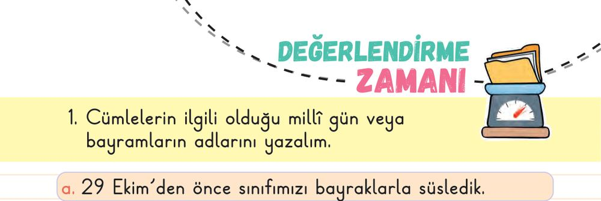
<!-- yer tutucu bulunamadı: sayfa sonuna eklendi -->

<!-- sayfa 42 -->

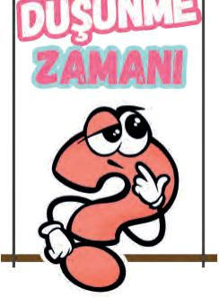

# EL ÖPENLERİNİZ ÇOK OLSUN

> Görseli inceleyelim.

Soruları cevaplayalım.
1. Hale’nin akrabaları bayramda bir araya geldiler. Hangi bayramda bir araya gelmiş olabilirler?
2. Hale ve ailesi bayram için ne gibi hazırlıklar yapmış olabilir?
3. Dinî gün ve bayramlar hakkında neler biliyorsunuz?

<!-- sayfa 43 -->

> Görselleri inceleyelim.

1
2
3
4
5

Soruları cevaplayalım.
1. Görsellerde bayramlarla ilgili neler anlatılıyor?
2. Görsellerde anlatılan durumlarda neler hissediyorsunuz?
3. Dinî gün ve bayramlarda neler yapıyorsunuz? Bunlarla ilgili anılarımızı paylaşalım.

<!-- sayfa 44 -->

# ÖĞRENME ZAMANI

## EL ÖPENLERİNİZ ÇOK OLSUN

: Ramazan Bayramı ve Kurban Bayramı dinî bayramlarımızdır.

: Bayram öncesinde hazırlıklar yaparız. Bayram temizliği yaparız, gelecek misafirlere ikramlar hazırlarız.

: Kadir Gecesi, Aşure Günü ve kandiller dinî gün ve gecelerimizdir.

<!-- sayfa 45 -->

Dinî gün ve bayramlarımız özel ve önemli günlerdir. Dinî gün ve bayramlarda büyüklerimizi ziyaret ederiz. Uzakta olan yakınlarımızı ararız veya onlara tebrik kartı göndeririz.

Dinî gün ve bayramlarda dayanışma ve yardımlaşma içinde oluruz. Böylece sevdiklerimizle bağlarımız güçlenir.

Konu ile ilgili elektronik içeriğe karekodu okutarak erişebiliriz.

<!-- sayfa 46 -->

# PEKİŞTİRME ZAMANI

> Uygulama adımlarını takip ederek dinî gün veya bayramlarla ilgili pano hazırlayalım.

## Malzemeler
— Renkli kartonlar
— Boya kalemleri
— Yapıştırıcı
— Makas

## Uygulama Adımları
▶ Sınıfta beş grup oluşturalım.
▶ Dinî gün ve bayramlarda yaşadığımız duygu ve düşünceler hakkında arkadaşlarımızla konuşalım.
▶ Grubumuz için bir dinî gün veya bayram belirleyelim.
▶ Belirlediğimiz dinî gün veya bayramla ilgili şiir yazalım, resim yapalım, bayram tebrik kartı veya afiş hazırlayalım.
▶ Çalışmalarımızı panoda sergileyelim.
▶ Panoyu inceleyelim. Duygu ve düşüncelerimizi ifade edelim.

<!-- sayfa 47 -->

# DEĞERLENDİRME ZAMANI

> “Ramazan Geldi” şiirini okuyalım. Şiirde eksik bırakılan yerleri uygun ifadelerle tamamlayalım.

### RAMAZAN GELDİ

Ramazan gelir,
Sofralar şenlenir.

..................................................
Gönlüme huzur verir.

Şekerler toplanır,
Baklava paylaşılır.

..................................................
Sevgiyle kucaklaşır.

---

Soruyu cevaplayalım.
> Bayramlarda yardımlaşma ve paylaşma neden önemlidir?

<!-- sayfa 48 -->

# TEKRAR ZAMANI

1. Farklı bir yerden gelen misafirimize yaşadığımız yeri tanıttığımızı düşünelim. Yaşadığımız yerin adını söyleyelim. Soruları cevaplayalım.

Tarihî yerler ve doğal güzelliklerden nereleri gezdiririz?
__________________________________________________________________
__________________________________________________________________

Yöresel yemeklerimizden hangilerini ikram ederiz?
__________________________________________________________________
__________________________________________________________________

Yöresel kıyafetlerimizle ilgili neler söyleriz?
__________________________________________________________________
__________________________________________________________________

2. Birbirine uygun ifadeleri çizgi çizerek eşleştirelim.

Ülkemizin adı •                                     • Akdeniz
Denizlerimizden biri •                              • Türk lirası
Para birimimiz •                                    • Türkiye Cumhuriyeti
Başkentimiz •                                       • Ankara
                                                    • Bursa

<!-- yer tutucu bulunamadı: sayfa sonuna eklendi -->

<!-- sayfa 49 -->

3. Aşağıda İstiklâl Marşımız ve bayrağımızla ilgili ifadeler yer almaktadır. İfadelerin başındaki numaraları ilgili kutulara yazalım. Bazı ifadeler her iki kutuya da ait olabilir.

1.
Bağımsızlığımızın sembolüdür.

2.
Kırmızı zemin üzerine beyaz ay ve yıldızdan oluşur.

3.
Mehmet Âkif Ersoy tarafından yazılmıştır.

4.
Ülkemize ait önemli bir değerdir.

5.
Resmî törenlerde coşkuyla söylenir.

Bayrağımız
[ ]

İstiklâl Marşımız
[ ]

<!-- sayfa 50 -->

4. Atatürk’ün hayatı ile ilgili bilgileri noktalı yerlere yazalım.

| Annesi | Babası |
| :---: | :---: |

| Doğduğu yer | Anıt mezarı |
| :---: | :---: |

| Vefat ettiği yer |
| :---: |

5. Cümlelerde yer alan boşlukları uygun kelimelerle tamamlayalım.

| coşkuyla | bayram | olayları |
| :---: | :---: | :---: |
| **beraberliğimizi** | **etkinlikler** | |

Millî bayramlar birlik ve ......................................................................... güçlendirir.

Millî gün ve bayramlarda yapılan ......................................................................... bir araya gelmemizi sağlar.

Millî bayramları büyük bir ......................................................................... kutlarız.

Millî gün ve bayramlar ülkemizin tarihindeki önemli ......................................................................... temsil eder.

<!-- sayfa 51 -->

6. Dinî gün ve bayramlarla ilgili kavramların yazılı olduğu kartları boyayalım.

7. Dinî gün ve bayramlarda yaşadığınız duyguları yazalım.

__________________________________________________________________

 Ek sorulara karekodu okutarak erişebiliriz.

<!-- sayfa 52 -->

5.
ÖĞRENME ALANI

DOĞA VE ÇEVRE

> Doğayla Baş Başa
> Gökyüzünde Neler Var?
> Afetleri Tanıyalım
> Atma, Yazık Olur!

 EBA’da yer alan öğrenme alanına karekodu okutarak erişebiliriz.

Öğrenme alanı ile ilgili özet içeriğe bu kod okutarak ulaşabilirsiniz.

<!-- sayfa 53 -->

Bu öğrenme alanında
> yakın çevrenizde bulunan doğadaki varlıkları gözlemlemeyi,
> modeller üzerinden gök cisimlerini karşılaştırmayı,
> afet türlerini tanımayı,
> geri dönüştürülebilen atıkları

# ANAHTAR KAVRAMLAR
> doğa
> gök cisimleri
> afet
> geri dönüşüm

<!-- yer tutucu bulunamadı: sayfa sonuna eklendi -->

<!-- sayfa 54 -->

# BELİRLİ GÜN VE HAFTALAR

Bu öğrenme alanında aşağıdaki belirli gün ve haftaları öğreneceğiz.

## Dünya Su Günü
### (22 Mart)

Her 22 Mart gününü Dünya Su Günü olarak kutlarız. Suyun önemi ve tasarruflu kullanımı ile ilgili etkinlikler yaparız.

## Kütüphaneler Haftası
### (Mart ayının son pazartesi gününü içine alan hafta)

Mart ayının son pazartesi gününü içine alan haftayı Kütüphaneler Haftası olarak kutlarız. Bu haftada kütüphanelerin önemini anlatan etkinlikler yaparız.

<!-- sayfa 55 -->

Belirli gün ve haftalar ile ilgili etkinliklere karekodu okutarak erişebiliriz. 

# Orman Haftası
## (21-26 Mart)

21-26 Mart tarihleri arasında Orman Haftası’nı kutlarız. Bu haftada ormanların önemini anlatan çalışmalar yaparız. Fidan dikme etkinlikleri düzenleriz.

# 23 Nisan Ulusal Egemenlik ve Çocuk Bayramı
## (23 Nisan)

23 Nisan’da Türkiye Büyük Millet Meclisi açılmıştır. Mustafa Kemal Atatürk, bu önemli günü çocuklara bayram olarak armağan etmiştir. Ulusal Egemenlik ve Çocuk Bayramı’nı sevinç ve coşkuyla kutlarız.

<!-- sayfa 56 -->

# DOĞAYLA BAŞ BAŞA

> Doğada gözlemlenebilecek varlıklardan bazıları görselde gizlenmiştir. Varlıkları bulup boyayalım.

Soruları cevaplayalım.
1. Doğada hangi varlıklar vardır?
2. Görseldeki varlıklardan hangilerini yakın çevrenizde görüyorsunuz?

<!-- sayfa 57 -->

# KEŞİF ZAMANI

* Doğada neleri merak ettiğimizi konuşalım ve yakın çevremize bir doğa gezisi planlayalım.
* Geziye çıkmadan önce doğayı gözlemlerken nelere dikkat etmemiz gerektiğini, doğayı ve canlıları nasıl koruyacağımızı söyleyelim.
* Belirlediğimiz doğa alanına gidelim. Taş gibi cansız varlıklar ile bitki ve hayvan gibi canlıları doğaya zarar vermeden dikkatlice inceleyelim.
* İncelediğimiz canlı ve cansız varlıkların fotoğraflarını çekelim veya resimlerini çizelim.
* Sınıfa dönünce bir konuşma halkası oluşturalım. Hem gözlemlerimizi hem de gezi sırasında dikkat ettiğimiz kuralları arkadaşlarımızla paylaşalım.

Soruları cevaplayalım.
1. Gözlem yaparken amacınız neydi?
2. Hangi canlı ve cansız varlıkları gözlemlediniz?
3. Doğadaki varlıkları gözlemlerken nelere dikkat ettiniz?

<!-- sayfa 58 -->

# ÖĞRENME ZAMANI

## DOĞAYLA BAŞ BAŞA

Doğada birçok canlı ve cansız varlık bulunur. Bu varlıkları daha yakından tanımak için gözlem yaparız. Gözlem yaparken neyi merak ettiğimizi ve neyi öğrenmek istediğimizi belirleriz.

Yapraklar, kuşlar hatta uykumuzu bölen sivrisinekler de doğanın bir parçasıdır.

Doğadaki varlıkların renklerini, şekillerini gözlemleyebiliriz. Bu bilgileri not alabilir, resim çizebilir veya fotoğraf çekebiliriz.

<!-- sayfa 59 -->

Doğadaki tüm varlıklara duyarlı ve merhametli davranırız. Doğaya saygı duyar, onu koruruz. Doğaya ve bütün canlılara karşı sevgi gösteririz.

Biz insanlar da doğanın bir parçasıyız. Doğayı tanır, sever ve koruruz.

Konu ile ilgili elektronik içeriğe karekodu okutarak 

<!-- sayfa 60 -->

# PEKİŞTİRME ZAMANI

* Doğa gezisinde gözlemlediğimiz varlıkları inceleyelim.
* Gözlemlediğimiz varlıkların renklerine dikkat edelim.
* Varlıkları renklerine göre sınıflandıralım. Örneğin mavi tonlarındaki varlıkları mavi bölüme, yeşil tonlarındaki varlıkları yeşil bölüme resimlerini çizelim veya adını yazalım.

* Gözlemlediğimiz farklı renkteki varlıkları da boş kutuya çizip boyayalım.

| | |
| :--- | :--- |
| | |
| | |
| | |

| |
| :--- |
| |
| |
| |

| |
| :--- |
| |
| |
| |

| |
| :--- |
| |
| |
| |
| |
| |

* Gözlemlediğimiz canlı ve cansız varlıklardan ikişer 

<!-- sayfa 61 -->

# DEĞERLENDİRME ZAMANI

> Uygulama adımlarını takip ederek poster hazırlayalım.

## Malzemeler

— A3 büyüklüğünde renkli karton
— Gözlemlediğiniz varlıkların görselleri
— Yapıştırıcı
— Makas

## Uygulama Adımları

▶ Doğa gezisinde çektiğimiz fotoğrafları veya çizdiğimiz resimleri kartona yapıştıralım.
▶ Görsellerdeki varlıkların isimlerini yazalım. Bu varlıkları canlı veya cansız olma özellikleriyle belirtelim.
▶ Posterimize doğa gözlemimizle ilgili kısa açıklamalar ekleyelim.
▶ Doğaya karşı nasıl davranmamız gerektiğini anlatan bir slogan veya kısa bir cümle yazalım.
▶ Hazırladığımız posteri sınıf arkadaşlarımıza sunalım.

<!-- sayfa 62 -->

# GÖKYÜZÜNDE NELER VAR?
## Emir’in Hayali

“On, dokuz, sekiz, yedi, altı, beş, dört, üç, iki, bir, sıfır.” Emir ve ailesi televizyonun karşısındaydı. İlk Türk astronotun uzay yolculuğu için geriye doğru saydılar. İşte, uzay aracı harekete geçmişti.

Yatağına yattığında Emir’in kalbi hâlâ küt küt atıyordu. Astronot olma düşüncesiyle uykuya daldı. Rüyasında bir uzay aracındaydı. Uzay boşluğundan Dünya’ya baktı. Dünya’nın yakınında Dünya’dan daha küçük yuvarlak bir şey gördü. Gördükleri karşısında çok etkinlenmişti.

Emir, pencereden süzülen parlak ışıkların yüzüne vurmasıyla uyandı. Gördüğünün harika bir rüya olduğunu anladı. Yüzünde kocaman bir gülümseme kaldı.

Komisyon

Soruları cevaplayalım.
1. Emir rüyasında hangi gök cisimlerini görmüştür?
2. Emir’in gördüğü gök cisimlerinin şekilleri neye benzemektedir?
3. Emir’in uyanmasını sağlayan ışık hangi gök cisminden geliyor olabilir?

<!-- sayfa 63 -->

> Görseli inceleyelim.

# GÖK CİSİMLERİ

* Görseldeki gök cisimlerinin adlarını yazalım.
* Güneş ve Ay ile ilgili gözlemlerimizi paylaşalım.
  Dünya'nın görünümü ile ilgili düşüncelerimizi ifade edelim.
* Bu gök cisimleriyle ilgili merak ettiğimiz soruları yazalım.

__________________________________________________________________

* Yazdığımız soruların cevaplarını araştıralım.

<!-- sayfa 64 -->

# ÖĞRENME ZAMANI

## GÖKYÜZÜNDE NELER VAR?

Güneş, Dünya ve Ay gök cisimleridir. Şekilleri topa benzer.

Güneş
Dünya
Ay

<!-- sayfa 65 -->

Güneş’i gündüz görebiliriz.

Güneş, Dünya’dan ve Ay’dan daha büyüktür.

Dünya, üzerinde yaşadığımız gök cismidir.

Dünya; Güneş’ten daha küçük, Ay’dan daha büyüktür.

Ay’ı daha çok geceleri görebiliriz.

Ay, Güneş ve Dünya’dan daha küçüktür.

Konu ile ilgili elektronik içeriğe karekodu okutarak

<!-- sayfa 66 -->

# PEKİŞTİRME ZAMANI

> Uygulama adımlarını takip ederek Güneş, Dünya ve Ay modelleri oluşturalım.

## Malzemeler
— Farklı renklerde oyun hamurları

## Uygulama Adımları
▶ Oluşturacağımız modeller için uygun renkteki oyun hamurlarını seçelim.
▶ Güneş, Dünya ve Ay’ın şekil ve büyüklük özelliklerini dikkate alarak modellerimizi hazırlayalım.

▶ Hazırlanan Güneş, Dünya ve Ay modellerini inceleyelim. Şekilleri ve büyüklükleri ile ilgili özellikleri belirleyelim.
▶ Güneş, Dünya ve Ay’ın özellikleri hakkında soru-cevap etkinliği yapalım. Arkadaşlarımızın sorularını dinleyelim ve düşüncelerimizi paylaşalım.
▶ Bir kâğıdın ortasına “Güneş, Dünya ve Ay” yazalım. Etrafına şekil ve büyüklük özellikleri ile benzerlik ve farklılıklarını yazarak bir zihin haritası oluşturalım.
▶ Zihin haritamızı resimler ve uygun renklerle tamamlayalım.
▶ Hazırladığımız çalışmayı sınıf arkadaşlarımıza sunalım.
▶ Sunum sırasında gök cisimlerinin benzerliklerini ve ...

<!-- sayfa 67 -->

# DEĞERLENDİRME ZAMANI

1. Gök cisimleriyle ilgili ifadeleri okuyalım. Gök cisimlerinin numaralarını uygun ifadelerin yanındaki kutulara yazalım.

1. Güneş 
2. Dünya 
3. Ay 

| | İfade |
|---|---|
| [ ] | Üzerinde yaşadığımız gök cismidir. |
| [ ] | Daha çok gece karanlığında görebildiğimiz gök cismidir. |
| [ ] | Gündüz görebildiğimiz gök cismidir. |

2. Doğru cümlelerin başına “D”, yanlış cümlelerin başına “Y” yazalım. Yanlış cümlelerin doğrularını altlarındaki boşluklara yazalım.

| | Cümle |
|---|---|
| [ ] | Güneş, Dünya’dan daha büyüktür. |
| | _________________________________________________ |
| [ ] | Ay, Güneş’ten daha büyüktür. |
| | _________________________________________________ |
| [ ] | Güneş, Dünya ve Ay’ın şekli topa benzer. |
| | _________________________________________________ |
| [ ] | Gece gökyüzüne baktığımızda Güneş’i görebiliriz. |
| | _________________________________________________ |

<!-- sayfa 68 -->

# AFETLERİ TANIYALIM

> Görselleri inceleyelim.

Soruları cevaplayalım.
1. Görseller arasındaki farklar nelerdir?
2. Yağışların artması durumunda görsellerdeki bölgede neler olabilir?

<!-- sayfa 69 -->

> Görselleri inceleyerek örnek olayları okuyalım.

---

Haberlerde dikkatsizlik nedeniyle çıkan orman yangınlarından bahsediliyordu.

---

Yer altındaki hareketlenme ile aniden başlayan şiddetli sarsıntılar bazı evlerin zarar görmesine neden oldu.

---

Soruları cevaplayalım.
1. Örnek olaylarda yaşanan afet türleri neler olabilir?
2. Bu afetlerin yaşanma nedenleri nelerdir?
3. Afetler sonucunda neler yaşanmıştır?

<!-- sayfa 70 -->

# ÖĞRENME ZAMANI

## AFETLERİ TANIYALIM

Çevreye büyük zarar veren, can ve mal kayıplarına neden olan olaylara **afet** denir. Deprem, sel, orman yangını, çığ ve heyelan afet türlerindendir.

**Heyelan;** kaya, toprak veya çamurun yüksek ve eğimli arazilerden aşağı doğru hareket etmesidir.

<!-- sayfa 71 -->

Yer kabuğundaki ani ve şiddetli sarsıntılara **deprem** denir.

Yağmurun şiddetli ve çok yağmasıyla oluşan ani su baskınlarına **sel** denir.

Ormanlarda çıkan ve yayılan yangınlar ağaçlara, bitkilere ve canlılara zarar verir. Bu tür yangınlara **orman yangını** denir.

Afetler can ve mal kaybına neden olabilir.

**Çığ**, karın dağlık alanlar gibi yüksek yerlerden aşağı doğru hızla kaymasıdır.

Bazen doğa olayları, bazen de insanların hataları afetlere yol açar. Afetler evlerimize ve doğaya büyük zararlar verir. Bu zararları önlemek için afetlerin nedenlerini öğrenmeli, afetlere karşı her zaman hazırlıklı ve dikkatli olmalıyız.

Konu ile ilgili elektronik içeriğe karekodu okutarak

<!-- sayfa 72 -->

# PEKİŞTİRME ZAMANI

* Uygulama adımlarını takip ederek broşür hazırlayalım.
* Afet türleri ve afetleri tanımanın önemi hakkındaki fikirlerimizi arkadaşlarımızla paylaşalım.
* Afetlerin nedenleri ve sonuçlarıyla ilgili öğrendiklerimizi arkadaşlarımıza anlatalım.

## Malzemeler
— Ek 1
— Ek 2
— Yapıştırıcı
— Makas

## Uygulama Adımları
▶ Beş kişilik gruplar oluşturalım.
▶ Gruplarımızda afetleri insanlara en kolay ve anlaşılır şekilde nasıl anlatabileceğimizi konuşalım.
▶ Ekler bölümünde bulunan Ek 1 ve Ek 2’deki görselleri noktalı yerlerden keselim.
▶ Ek 1’deki broşür şablonunu belirtilen yerlerden katlayalım.
▶ Ek 2’den kestiğimiz görselleri şablona istediğimiz gibi yapıştıralım.
▶ Görsellerdeki afetleri tanıtan ifadeleri yazarak broşürümüzü tamamlayalım.

<!-- sayfa 73 -->

# DEĞERLENDİRME ZAMANI 

> Aşağıda özellikleri verilen afet türlerinin adlarını yanlarındaki boşluğa yazalım. Bu adları bulmacada bularak boyayalım.

| Özellik | Boşluk |
| :--- | :--- |
| Ağaçlara, bitkilere ve canlılara zarar veren kontrolsüz yanma olayıdır.  | |
| Karın dağlık alanlardan aşağı doğru kayması sonucu oluşur. | |
| Toprağın yüksek ve eğimli arazilerden aşağı doğru kaymasıyla oluşur. | |
| Şiddetli yağışlar sonucu oluşan su baskınlarıdır. | |
| Ani gelişen ve yıkımlara neden olan yer sarsıntılarıdır. | |

| A | S | D | E | P | R | E | M | G | B | N | K | S | H | V |
|---|---|---|---|---|---|---|---|---|---|---|---|---|---|---|
| Z | F | B | N | M | J | M | K | L | I | A | D | Z | E | A |
| D | G | H | İ | Z | R | Y | İ | E | D | T | U | Ş | Y | G |
| Ç | A | Ş | L | E | D | K | G | K | U | P | F | R | E | J |
| I | H | E | Y | B | S | E | L | R | H | Y | I | C | L | İ |
| Ğ | İ | K | P | N | K | Ğ | V | Ş | J | Ü | Ç | G | A | E |
| F | O | R | M | A | N | Y | A | N | G | I | N | I | N | D |

<!-- sayfa 74 -->

# ATMA, YAZIK OLUR!

› Görselleri inceleyelim.

Soruları cevaplayalım.
1. Görselde neler görüyorsunuz?
2. Görseldekileri nasıl gruplandırabilirsiniz?

<!-- sayfa 75 -->

# KEŞİF ZAMANI

# ÇÖPTEKİ DAYANIŞMA

Çöp kutusunda telaşlı bir gündü. Konserve kutusu ağlamaklıydı. “Buradaki

atıklar bana hiç benzemiyor. Metal arkadaşlarım nerede?” diye söylendi. O sırada çöp kutusunun kapağı açıldı. Şangır şungur bir ses duyuldu. Şişe “Yavaş olsana, neredeyse kırılacaktım!” dedi. Atılan cam bir şişeydi. Cam şişe ile konserve kutusu üzüntüyle konuşmaya başladı. Konserve kutusu “Daha önce bir içecek kutusuydum. Şimdi ise bir konserve kutusuyum.” dedi. Cam şişe üzüntüyle iç çekti: “Ah, neler neler olmuşsun! Ben ise henüz yeni üretilmiştim. Bundan sonra bir kâse olabilirdim. Yiyecekleri taptaze tutardım. Aslında süs eşyası

olmak da yakışırdı bana.” diye devam etti. Konserve kutusu ile cam şişe endişeyle beklerken çöp kutusunun kapağı yeniden açıldı. Temizlik görevlisi “Aaa, sizin ne işiniz var burada?” dedi. İkisini de alarak farklı kutulara koydu. Onlar için artık yeni bir macera başlıyordu.

Komisyon

---

## Soruları cevaplayalım.

1. Metinde geçen geri dönüştürülebilir atıklar sizce nelerdir?
2. Konserve kutusu daha önce ne olarak kullanılmıştır?
3. Temizlik görevlisi, konserve kutusu ile cam şişeyi neden farklı kutulara koymuştur? Bunun önemi nedir?

---

> Bir sonraki derse gelirken evimizden geri dönüştürülebileceğini düşündüğümüz birkaç atık getirelim

<!-- sayfa 76 -->

# ÖĞRENME ZAMANI

## ATMA, YAZIK OLUR!

: Geri dönüşüm, bazı atık malzemelerin tekrar kullanılabilecek hâle getirilmesidir.

* Kullanılmış defter, gazete, karton kutular kâğıt atıklardandır.
* İçecek şişeleri, konserve ve reçel kavanozları cam atıklardandır.
* Pet şişeler, şişe kapakları, su damacanaları ve naylon poşetler plastik atıklardandır.
* Alüminyum içecek kutuları, yağ ve salça tenekeleri, konserve kutuları metal atıklardandır.
* Kullanılmış piller pil atıklarıdır.

: Konu ile ilgili elektronik içeriğe karekodu okutarak erişebiliriz.

<!-- sayfa 77 -->

 Kâğıt atıklarımızı mavi kutuda toplarız.

 Cam atıklarımızı yeşil kutuya atarız.

 Plastik atıkları sarı kutuda toplarız.

 Metal atıkları gri kutuda toplarız.

 Biten pilleri kırmızı atık pil kutusuna atarız.

Ülkemizde uygulanan Sıfır Atık Projesi ile atıkların geri dönüştürülmesi hedeflenir. Biz de geri dönüşüme katkıda bulunarak bu projeye destek veririz. Böylelikle doğanın kirlenmesini önler, kaynaklarımızı koruruz.

<!-- sayfa 78 -->

# PEKİŞTİRME ZAMANI

> Aşağıdaki performans görevini yapalım.
**Süre :** İki ders saati
**Konu :** Geri dönüşüm
**Görev:** Geri dönüşüm kutusu hazırlamak

![PERFORMANS GÖREVİ]

## Malzemeler
— Karton kutu
— Yapıştırıcı
— Boya kalemleri
— Makas

## Uygulama Adımları

 ▶ Sınıfa getirdiğimiz geri dönüştürülebilir atıkları inceleyelim.
▶ Atıkları kağıt, plastik, cam ve metal olarak sınıflandıralım.
▶ Sınıfta 5 grup oluşturalım ve her grup bir atık türü (kâğıt, plastik, cam, metal, pil) seçsin.
▶ Kutumuzu uygun renge boyayalım (örneğin cam için yeşil, plastik için sarı).
▶ Kutunun üzerine içine ne atılacağını gösteren bir etiket hazırlayıp yapıştıralım.
▶ Sınıflandırdığımız atıkları hazırladığımız bu yeni kutulara yerleştirelim.
▶ Kutuları sınıfta veya okulda sergileyip atık toplamak için kullanalım.
▶ Kutular dolunca geri dönüşüm merkezine gitmesi için öğretmenimizden yardım isteyelim.
▶ Çevreyi temiz tutmanın ve doğaya değer vermenin

<!-- sayfa 79 -->

# DEĞERLENDİRME ZAMANI 

* Ekler bölümünde bulunan Ek 3’teki görselleri noktalı yerlerden keselim.
* Kestiğimiz görselleri uygun atık kutusunun olduğu bölüme yapıştıralım. 

| | |
| :---: | :--- |
| ![Sarı çöp kutusu] | |
| ![Mavi çöp kutusu] | |
| ![Yeşil çöp kutusu] | |
| ![Gri çöp kutusu] | |
| ![Kırmızı çöp kutusu] | |

<!-- sayfa 80 -->

# TEKRAR ZAMANI

1. Doğadaki varlıkların bulunduğu görsellerin altındaki kutuları boyayalım.

1

2

3

4

5

6

<!-- sayfa 81 -->

2. Güneş, Ay ve Dünya görsellerini uygun cümlelerle eşleştirelim.

: "Dünya’dan büyüküm ve topa benziyorum." metninin yanında/yakınında

: "İnsanların üzerinde yaşadığı gök cismiyim." metninin yanında/yakınında

: "Daha çok geceleri görünürüm." metninin yanında/yakınında

<!-- sayfa 82 -->

3. Cümlelerde yer alan boşlukları uygun kelimelerle tamamlayalım.

| yağmur | heyelan |
| :---: | :---: |
| çığ | deprem | sel |

Taş ve toprak parçalarının ani bir şekilde aşağı doğru kaymasına ........................................... denir.

Çığ, yangın, heyelan, sel ve ........................................... afet türlerindendir.

Karın dağlık alanlardan aşağı doğru kaymasına ........................................... denir.

Yağmurun şiddetli yağmasıyla oluşan su baskınlarına ........................................... denir.

4. Afetlerin sonucunda neler olabilir? Aşağıdaki alana yazalım.

......................................................................................................................................................

<!-- yer tutucu bulunamadı: sayfa sonuna eklendi -->

<!-- sayfa 83 -->

5. Görseldeki atıkları ait oldukları geri dönüşüm kutularıyla çizgi çizerek eşleştirelim. Geri dönüşüm kutularını uygun renklere boyayalım.

: Metal, Cam, Kâğıt, Atık Pil, Plastik yazılı geri dönüşüm kutuları ve ortadaki sarı daire içinde çeşitli atıkların bulunduğu görsel.

Ek sorulara karekodu okutarak erişebiliriz.

<!-- sayfa 84 -->

# 6. ÖĞRENME ALANI

BİLİM, TEKNOLOJİ VE SANAT

> Bilimin Peşindeyiz
> Teknolojiyi Keşfedelim
> Sanat Bize İyi Gelir

 EBA’da yer alan öğrenme alanına karekodu okutarak erişebiliriz.

Öğrenme alanı ile ilgili özet içeriğe bu karekodu okutarak ulaşabiliriz.

<!-- sayfa 85 -->

# ANAHTAR KAVRAMLAR

Bu öğrenme alanında
> bilim, teknoloji ve sanat ile ilgili merak ettiğimiz soruları soracağız.

## ANAHTAR KAVRAMLAR
> bilim
> teknoloji
> sanat

<!-- sayfa 86 -->

# BELİRLİ GÜN VE HAFTALAR

Bu öğrenme alanında aşağıdaki belirli gün ve haftaları öğreneceğiz.

## 19 Mayıs Atatürk’ü Anma ve Gençlik ve Spor Bayramı
### (19 Mayıs)
Atatürk, 19 Mayıs’ta Bandırma Vapuru’yla Samsun’a giderek Millî Mücadele’yi başlatmıştır. Atatürk, bu önemli günü Türk gençlerine bayram olarak armağan etmiştir. Bu günü, Atatürk’ü Anma ve Gençlik ve Spor Bayramı olarak kutlarız.

## Müzeler Haftası
### (18-24 Mayıs)
18-24 Mayıs tarihleri arasını Müzeler Haftası olarak kutlarız. Müzelerin önemini anlatan çalışmalar yaparız. Hafta boyunca çevremizdeki müzeleri ziyaret ederiz.

## Çevre ve İklim Değişikliği Haftası
### (Haziran ayının ikinci haftası)
Haziran ayının ikinci haftasını Çevre ve İklim Değişikliği Haftası olarak kutlarız. Doğal çevremizin korunmasının önemine dikkat

<!-- sayfa 87 -->

Belirli gün ve haftalar ile ilgili etkinliklere karekodu okutarak erişebiliriz. 

---

# Trafik ve İlk Yardım Haftası
## (Mayıs ayının ilk haftası)
Mayıs ayının ilk haftasını Trafik ve İlk Yardım Haftası olarak kutlarız. Trafik kurallarına uymanın ve ilk yardımın önemini anlatan etkinlikler yaparız.

---

# Anneler Günü
## (Mayıs ayının ikinci pazar günü)
Mayıs ayının ikinci pazar gününü “Anneler Günü” olarak kutlarız. Bizi sevgi ve emekle büyüten annelerimize sevgimizi her zaman gösteririz.

---

# 30 Ağustos Zafer Bayramı
## (30 Ağustos)
Millî Mücadele’miz 30 Ağustos günü zaferle sonuçlanmıştır. Bu günü, Zafer Bayramı olarak coşkuyla kutlarız.

<!-- sayfa 88 -->

# BİLİMİN PEŞİNDEYİZ

> Görselleri inceleyelim.

Soruları cevaplayalım.

1. Görsellerde neler görüyorsunuz?
2. Görsellerde hangi konularda araştırma yapılıyor olabilir?
3. Bilim deyince aklınıza ne geliyor?

<!-- sayfa 89 -->

# KEŞİF ZAMANI

> Metni okuyalım.

Utku çok meraklı bir çocuktu. Ablasının yaptığı deneylerde ona yardımcı oluyordu. Mikroskopla yaprak örneklerini incelediler. Araştırmalarıyla ilgili merak ettiklerini not aldılar.

> Mikroskobu icat eden ve geliştiren kişiler hakkında bilgi:
> İlk mikroskobu Hans Janssen (Hans Yansen) ve oğlu Zacharias Janssen (Zakaryas Yansen) yapmıştır. Mercekleri kullanarak küçük nesneleri daha büyük görmeyi başarmışlardır.

Soruları cevaplayalım.
1. Bilim ve merak arasındaki ilişki nedir?
2. Mikroskopla neleri incelemek isterdiniz?
3. Mikroskobun icat edilmesi, bizim hastalıklardan korunmamızı ve sağlıklı büyümemizi nasıl etkilemiştir?

<!-- sayfa 90 -->

# ÖĞRENME ZAMANI

## BİLİMİN PEŞİNDEYİZ

Bilim çevremizde olan olayları anlamamıza yardımcı olur. Biz merak ettiğimiz konuları düşünür ve bu konular hakkında “Neden?”, “Nasıl?” gibi sorular sorarız. Böylece bilimle ilgili öğrenmek istediğimiz konuları belirleriz ve yeni bilgiler keşfederiz.

Bilim merakla başlar.

Merak ettiğimiz bir konu belirleriz.

Merak ettiğimiz konuyla ilgili sorular hazırlarız.

<!-- sayfa 91 -->

Sorularımızın cevaplarını araştırmaya başlarız.

# Araştırma Sırasında

— Gözlem, deney veya görüşmeler yapabiliriz.
— Sorularımıza hemen cevap bulamayabiliriz.
— Vazgeçmeden sabır ve merakla araştırmaya devam ederiz.
— Aklımıza yeni sorular gelebilir.
— Araştırma konumuz dışında yeni bilgilere ulaşabiliriz.

Böylece bilim insanları gibi düşünmeye ve çalışmaya başlarız.

Konu ile ilgili elektronik içeriğe karekodu okutarak

<!-- sayfa 92 -->

# PEKİŞTİRME ZAMANI

**Malzemeler:**
— İp
— Balon
— Bant
— Pipet
— Makas

1. Malzemeleri inceleyelim. Bu malzemelerle nasıl bir etkinlik yapabileceğimizi düşünelim. Öğrenme günlüğümüzün birinci bölümüne yazalım.
2. Uygulama adımlarını takip ederek etkinliği yapalım.

## Uygulama Adımları 

▶ 4 kişilik gruplar oluşturalım.
▶ 2-3 kulaç uzunluğundaki ipi pipetin içinden geçirelim. 

▶ Gruptan bir arkadaşımızla ipin uçlarından karşılıklı olarak tutalım. 
▶ İpin gergin olmasına dikkat edelim.

<!-- sayfa 93 -->

▶ Gruptaki üçüncü arkadaşımızdan balonu şişirmesini isteyelim. Balonun ağzını tutmasını söyleyelim.

▶ Gruptaki dördüncü arkadaşımızdan ip geçirdiğimiz pipete balonu yapıştırmasını söyleyelim. Öğrenme günlüğümüzün ikinci bölümündeki soruyu cevaplayalım.

▶ Balonun ağzını tutan arkadaşımıza balonu bırakmasını söyleyelim.

▶ Gözlem sonucunu öğrenme günlüğümüzün üçüncü bölümüne yazalım.

▶ Bilim ile ilgili merak ettiğimiz konular ve bu konularda sormak istediğimiz soruları düşünelim.

▶ Merak ettiğimiz soruları araştıralım. Bulduğumuz bilgilerden hangilerinin bizim seçtiğimiz soruyu açıkladığını seçelim ve cevaplarımızı buna göre yazalım. Merak ettiğimiz soruları etkinlik sonunda verilen Öğrenme Günlüğüm 1’e yazalım.

<!-- sayfa 94 -->

# ÖĞRENME GÜNLÜĞÜM

## › 1. BÖLÜM
Verilen malzemelerle nasıl bir etkinlik yapabilirim?

## › 2. BÖLÜM
Balonu bıraktığımızda ne olabilir?

: Bilimle ilgili merak ettiğim sorular:

## › 3. BÖLÜM
Balonu bırakınca ne oldu?

Araştırmalarım sonucunda ulaştığım cevaplar:

<!-- sayfa 95 -->

# DEĞERLENDİRME ZAMANI

Ece ve Buğra bir dergide okudukları etkinliği yapmaya karar verdi. Malzeme olarak birer balon aldılar. Ayrıca atık kâğıtlardan küçük parçalar kırpıp masanın üzerine koydular. Ece balonun kâğıtları çekip çekmeyeceğini, Buğra ise daha büyük balon kullanırsa durumun nasıl değişeceğini merak ediyordu.

Etkinlik için şişirdikleri balonları saçlarına sürttüler. Balonları masanın üzerindeki kırpılmış kâğıtlara doğru tuttular. Kâğıtların hareket edişini şaşkınlıkla izlediler.

Aşağıdaki soruları cevaplayalım.

1. Bu deneyi siz yapsaydınız neleri merak ederdiniz?
__________________________________________________________________

2. Bilimle ilgili hangi konuları merak ettiğimizi yazalım.
__________________________________________________________________

3. Merak ettiğimiz konularla ilgili sorularımızı yazalım.
__________________________________________________________________

<!-- sayfa 96 -->

# DUŞUNME ZAMANI

# TEKNOLOJİYİ KEŞFEDELİM

> Görselleri inceleyelim.

Soruları cevaplayalım.

1. Görsellerde hangi teknolojik ürünleri görüyorsunuz?
2. Çevrenizde kullanılan teknolojik ürünler nelerdir?
3. Çevrenizdeki teknolojik ürünlerden nasıl faydalanırsınız?

<!-- sayfa 97 -->

# › Metni okuyalım.

## Küçük Araştırmacı İş Başında

Elif, okulunda TEKNOFEST (Havacılık, Uzay ve Teknoloji Festivali) afişi gördü. Afişte yazan hava gösterileri ve konserler ilgisini çekti. Türkiye’nin ilk ve tek Havacılık, Uzay ve Teknoloji Festivali’ne katılmaya karar verdi. Yarışmalara katılabilmek için bir etkinlik planlaması gerekiyordu. Aklına ilk Türk astronot Alper Gezeravcı’nın uzaya çıktığı araç geldi. Uzay araçlarını merak etti. Ben de bir uzay aracı tasarlayabilirim, diye düşündü. Hemen araştırma yapmaya başladı.

---

Soruları cevaplayalım.
1. Elif, niçin bir uzay aracı tasarlamaya karar vermiştir?
2. TEKNOFEST’e katılsaydınız nasıl bir teknolojik ürün tasarlardınız?
3. Kullandığınız teknolojik ürünler nelerdir? Listeleyiniz veya resimlerini çiziniz.

<!-- sayfa 98 -->

# ÖĞRENME ZAMANI

## TEKNOLOJİYİ KEŞFEDELİM

Teknolojik gelişmeler ve ürünler çoğu zaman ilgimizi çeker.

Teknolojiyle ilgili aklımıza pek çok soru gelebilir.

Merak ettiğimiz konuyla ilgili sorular sorarız. Örneğin “Bu araç ne işe yarar?” ve “Nasıl çalışır?” gibi sorular sorarız. Böylece öğrenmek istediğimiz teknoloji konularını belirleriz.

Sorularımıza cevaplar ararız.

 Bu soru ve cevaplar teknolojik gelişmelerde büyük rol oynar.

Konu ile ilgili elektronik içeriğe karekodu okutarak ulaşabilirsiniz.

<!-- sayfa 99 -->

Teknolojik ürünler sağlık, eğitim, ulaşım, iletişim gibi alanlarda kullanılır.

Sağlık
Eğitim
Ulaşım
İletişim

Teknolojiyi amacımıza uygun şekilde kullanırız.

Tablet, telefon gibi teknolojik ürünleri ihtiyacımız kadar kullanırız.

Genel ağda paylaşılan bilgi ve görsellerin kalıcı olduğunu biliriz. Bu nedenle kişisel bilgilerimizi ve fotoğraflarımızı

<!-- sayfa 100 -->

# PEKİŞTİRME ZAMANI

Arkadaşalar, teknoloji ile ilgili merak ettiğim pek çok konu var. Siz teknoloji alanında hangi konuları merak ediyorsunuz? Örneğin “ANKA” adı verilen insansız hava aracını daha önce duydunuz mu?

Bu araç, Türk Havacılık ve Uzay Sanayii tarafından yapılmıştır. Uçuşunu yapay zekâ desteğiyle gerçekleştirmektedir. Araç, yakıt almadan bir gün boyunca havada kalabilir. Gözlem görevini gelişmiş kamerasıyla yerine getirir.

<!-- sayfa 101 -->

> ANKA son teknolojik bilgilerle geliştirilmiştir. Biz de teknolojik bir ürün tasarlayalım. Boş alana tasarladığımız teknolojik ürünün resmini çizip resmi boyayalım.

> Teknolojik ürünlerimizi sırayla tanıtalım.
> Tasarladığımız teknolojik ürünle ilgili Öğrenme Günlüğüm 2’nin ilk sorusunu cevaplayalım.
> Teknoloji ile ilgili merak ettiğimiz konularda araştırma yaparak Öğrenme Günlüğüm 2’yi tamamlayalım
> Bulduğumuz bilgilerden hangilerinin bizim seçtiğimiz soruyu açıkladığını seçelim ve cevaplarımızı buna göre yazalım.
> Teknolojiyi amacımıza uygun ve güvenli bir şekilde kullanmayı unutmayalım. Sorularımızı ve ulaştığımız

<!-- sayfa 102 -->

# ÖĞRENME GÜNLÜĞÜM 2

Teknolojik ürünümü tasarlarken neler düşündüm?
__________________________________________________________________
__________________________________________________________________
__________________________________________________________________

Eğitim, ulaşım, iletişim ve sağlık alanlarında kullanılan teknolojilerle ilgili merak ettiğim konular:
__________________________________________________________________
__________________________________________________________________
__________________________________________________________________

Merak ettiğim konularla ilgili sorular:
__________________________________________________________________
__________________________________________________________________
__________________________________________________________________

Araştırmalarım sonucu ulaştığım cevaplar:
__________________________________________________________________
__________________________________________________________________
__________________________________________________________________

<!-- yer tutucu bulunamadı: sayfa sonuna eklendi -->

<!-- sayfa 103 -->

# DEĞERLENDİRME ZAMANI

> Metni okuyalım.

Gün içinde birçok teknolojik araç kullanırız. Okulda derslerimizi yaparken akıllı tahtalar ve bilgisayarlar bize yardımcı olur. Bir yerden başka bir yere giderken otobüsler, arabalar ve uçaklar sayesinde yolculuk yaparız. Sevdiklerimizle konuşmak için telefonları ve tabletleri kullanırız. Hasta olduğumuzda doktorlar, bizi kontrol etmek için bazı özel cihazlardan yararlanır. Teknoloji, hayatımızı kolaylaştırır ve işlerimizi daha hızlı yapmamıza yardımcı olur.

> Soruları cevaplayalım.

1. Metinde hangi teknolojik alanlara yer verilmiştir? İşaretleyelim.

$\square$ <!-- KONTROL: Marker'da karşılığı yok, uydurma olabilir --> Eğitim $\quad$ <!-- KONTROL: Marker'da karşılığı yok, uydurma olabilir --> $\square$ <!-- KONTROL: Marker'da karşılığı yok, uydurma olabilir --> Tarım $\quad$ <!-- KONTROL: Marker'da karşılığı yok, uydurma olabilir --> $\square$ <!-- KONTROL: Marker'da karşılığı yok, uydurma olabilir --> Güvenlik
$\square$ <!-- KONTROL: Marker'da karşılığı yok, uydurma olabilir --> Ulaşım $\quad$ <!-- KONTROL: Marker'da karşılığı yok, uydurma olabilir --> $\square$ <!-- KONTROL: Marker'da karşılığı yok, uydurma olabilir --> İletişim $\quad$ <!-- KONTROL: Marker'da karşılığı yok, uydurma olabilir --> $\square$ <!-- KONTROL: Marker'da karşılığı yok, uydurma olabilir --> Sağlık

2. Metindeki teknolojik alanlardan hangileri ilginizi çekiyor?
__________________________________________________________________

3. Teknolojiyle ilgili merak ettiğiniz konuları yazınız.
__________________________________________________________________

4. Merak ettiğiniz konularla ilgili sorularınızı yazınız.
__________________________________________________________________

<!-- sayfa 104 -->

# SANAT BİZE İYİ GELİR

> Görselleri inceleyelim.

Soruları cevaplayalım.

1. Görsellerdeki çocuklar neler yapıyor?
2. Görsellerde yapılanlarla ilgili merak ettikleriniz nelerdir?
3. Sergi, tiyatro, müze gezisi gibi sanatsal etkinlikler ...

<!-- sayfa 105 -->

# KEŞİF ZAMANI

**Malzemeler**
— Ek 4
— Keçeli kalem veya kuru boya
— Makas

▶ Aşağıda verilen örnek sanat etkinliğini uygulama adımlarına göre yapalım.
▶ Ekler bölümünde bulunan Ek 4’teki görseli keselim. Sayfadaki her satırı farklı renk olacak şekilde boyayalım.

1. Görselde ne gibi bir farklılık ortaya çıkmıştır?
___________________________________________________________________________
___________________________________________________________________________

2. Etkinlikle ilgili merak ettiğimiz soruları yazalım.
___________________________________________________________________________
___________________________________________________________________________

3. Boya kalemleri, kâğıt ve makas kullanarak farklı bir etkinlik planlayalım. Planladığımız etkinliği yazalım.

___________________________________________________________________________
___________________________________________________________________________

Soruları cevaplayalım.
1. İlgi duyduğunuz sanat alanları nelerdir?
2. Daha önce hangi sanat etkinliklerine katıldınız? Varsa elimizdeki sanat çalışmalarımızı veya fotoğrafları sınıf arkadaşlarımızla beraber inceleyelim.

<!-- sayfa 106 -->

# ÖĞRENME ZAMANI

## SANAT BİZE İYİ GELİR

Sanat; duygu ve düşünceleri resim, ebru, müzik, heykel, yazı, tiyatro gibi alanlarda ifade etmektir.

Sanat eserleri bizde merak, heyecan gibi duygular uyandırabilir. Aklımıza pek çok soru gelebilir.

Bu soruların cevaplarını araştırmak sanat konusunda gelişmemizi sağlar.

<!-- sayfa 107 -->

Sanatçılar hayal gücü yüksek insanlardır. Kendi alanlarında özgün eserler üretirler.

Sanat, bilim ve teknoloji birbirinden etkilenir.

Örneğin üç boyutlu filmlerde veya animasyon filmlerinde teknolojik gelişmelerden faydalanılır.

Konu ile ilgili elektronik içeriğe karekodu okutarak ulaşabilirsiniz.

<!-- sayfa 108 -->

# PEKİŞTİRME ZAMANI

> Aşağıdaki performans görevini yapalım.

**Süre :** İki ders saati
**Konu :** Sanat
**Görev:** Sanatsal bir ürün oluşturarak sunmak

### Malzemeler
- Kil
- Oyun blokları
- Boya
- Fırça
- Makas
- Karton
- Yapıştırıcı
- Bant
- Müzik aletleri
- Oyun hamuru

> Aşağıda müzik, resim, tiyatro ve ebruya ilişkin verilen görselleri inceleyelim.

<!-- sayfa 109 -->

* Sanatla ilgili merak ettiğimiz konuları sınıf arkadaşlarımızla paylaşalım.
* Konu ile ilgili merak ettiğimiz soruları ve bu sorularla ilgili yaptığımız araştırma sonuçlarını Öğrenme Günlüğüm 3’te uygun bölüme yazalım.
* Malzemelerden istediklerimizi kullanarak sanatsal bir ürün oluşturalım. Oluşturduğumuz ürünle ilgili Öğrenme Günlüğüm 3’ün ilgili bölümlerini dolduralım.
    ▶ İstediğimiz bir resmi yapabiliriz.
    ▶ Oyun hamuru veya kilden şekil oluşturabiliriz.
    ▶ Oyun bloklarıyla bir yapı oluşturabiliriz.
    ▶ İstediğimiz bir müzik aleti ile beste yapabiliriz.
    ▶ Karton kullanarak kuklalar oluşturabilir, oyun sergileyebiliriz.

* Ürünümüzü farklı malzemelerle de oluşturabiliriz.

* Oluşturduğumuz ürünleri arkadaşlarımıza sunalım.

<!-- sayfa 110 -->

# ÖĞRENME GÜNLÜĞÜM 3

Oluşturduğum sanatsal ürün nedir?
__________________________________________________________________
__________________________________________________________________

Ürünümü oluştururken neler düşündüm?
__________________________________________________________________
__________________________________________________________________
__________________________________________________________________
__________________________________________________________________

Sanatla ilgili merak ettiğim sorular:
__________________________________________________________________
__________________________________________________________________
__________________________________________________________________
__________________________________________________________________

Araştırmalarım sonucu ulaştığım cevaplar:
__________________________________________________________________
__________________________________________________________________
__________________________________________________________________
__________________________________________________________________
__________________________________________________________________

<!-- yer tutucu bulunamadı: sayfa sonuna eklendi -->

<!-- sayfa 111 -->

# DEĞERLENDİRME ZAMANI 

> Metni okuyalım.

Elif ve arkadaşları mahallelerinde düzenlenen “Sanat Günü” etkinliğine katıldılar. Etkinlikte bir ressam resim yapıyordu. Bir müzisyen gitar çalıp şarkı söylüyordu. Bir grup öğrenci etkinlik alanındaki tiyatro gösterisini seyrediyordu. Etkinlikte en çok ebru sanatının yapıldığı masa çocukların dikkatini çekmişti. Çocuklar, su dolu bir kaba damlatılan boyaların nasıl şekiller oluşturduğunu hayranlıkla izlediler. Etkinlik sonunda Elif’in aklında sanatla ilgili merak ettiği birçok konu ve sorular oluştu.

> Soruları cevaplayalım.

1. Elif ve arkadaşları hangi sanat dallarıyla karşılaşmıştır?

2. Bu sanat dallarından hangileri ilginizi çekiyor? Neden?

3. İlgi duyduğunuz sanat dallarına yönelik merak ettiğiniz konular nelerdir?

4. İlgi duyduğunuz konular hakkında neleri merak ediyorsunuz?

<!-- sayfa 112 -->

# TEKRAR ZAMANI

1. Ergün, aşağıdaki malzemeleri kullanarak bir deney yapıyor.

**Malzemeler**
— Bardak
— Sıvı yağ
— Su

### Ergün'ün Deneyi

Ergün bardağa bir miktar su koydu. Suyun üzerine sıvı yağı dökerek bardağı doldurdu. Su ve sıvı yağın birbirine karışmadığını gördü. Sıvı yağ suyun üstünde kaldı.

Deneyle ilgili merak ettiğimiz soruları yazalım.

__________________________________________________________________
__________________________________________________________________
__________________________________________________________________
__________________________________________________________________
__________________________________________________________________

<!-- sayfa 113 -->

2.

# Bilgisayarların Atası

Görseldekinin bir bilgisayar olduğuna inanmak çok zor, değil mi? Neredeyse bir oda büyüklüğündeki bu araç, ilk bilgisayarlardan biridir. Hem çok büyük hem de çok ağırdır. Bilgisayarın atası sayılabilecek bu bilgisayar, günümüzde bir müzede sergilenmektedir.

Bilgisayarın değişimiyle ilgili merak ettiğimiz soruları yazalım.

..........................................................................................................................................
..........................................................................................................................................
..........................................................................................................................................

<!-- sayfa 114 -->

3.

# Çini Sanatı

Çinicilik; vazo, tabak, sürahi gibi eşyaları süsleme sanatıdır. Cami, çeşme, saray gibi önemli yapıları süslemek için de kullanılır. Çini sanatçıları özel boyalar kullanarak eserlerin üzerine motifler çizerler. Bu motifleri yapmak için kullanılan özel renkler vardır. İznik kırmızısı, Kütahya mavisi bunlara örnektir.

Çinicilik hakkında merak ettiğimiz soruları yazalım.

__________________________________________________________________
__________________________________________________________________
__________________________________________________________________

 Ek sorulara karekodu okutarak erişebiliriz.

<!-- sayfa 115 -->

EK 1

# EKLER

<!-- sayfa 116 -->

<!-- yer tutucu bulunamadı: sayfa sonuna eklendi -->

<!-- sayfa 117 -->

# EK 2

# EK 3

|  |  |  |  |  |
| :---: | :---: | :---: | :---: | :---: |
|  |  |  |  |  |
|  |  |  |  |  |
|  |  |  |  |  |

<!-- sayfa 118 -->

Verdiğiniz metin katmanı boş olduğu için (`<<< >>>` arası boş) dönüştürülecek bir içerik bulunmamaktadır. Lütfen metin katmanını içeren içeriği paylaşın, böylece talimatlarınıza uygun şekilde Markdown formatına çevirebilirim.

<!-- sayfa 119 -->

# EK 4

<!-- sayfa 120 -->

Verdiğiniz metin katmanı boş olduğu için (`<<< >>>` arası boş) dönüştürülecek bir içerik bulunmamaktadır. Lütfen metin katmanını içeren içeriği paylaşın, böylece kurallara uygun şekilde Markdown formatına çevirebilirim.

<!-- sayfa 121 -->

# SÖZLÜK

| A-B-C-Ç | |
| :--- | :--- |
| afet | : Çeşitli doğa olaylarının sebep olduğu yıkım. |
| afiş | : Bir şeyi duyurmak veya tanıtmak için hazırlanan resimli duvar ilanı. |
| aile | : Evlilik ve kan bağına dayanan toplum içindeki en küçük birlik. |
| albüm | : Fotoğraf, pul gibi şeyleri saklamaya yarayan bir defter türü. |
| anıt | : Önemli bir olayın veya kişinin gelecek kuşaklarca tarih boyunca anılması için yapılan yapı. |
| arkadaş | : Birbirine karşı sevgi ve anlayış gösteren kimselerden her biri. |
| azimli | : Kararında direnen, kararlı olan kişi. |
| bağımsızlık | : Bağımsız olma durumu. |
| başkent | : Bir devletin yönetim merkezi olan şehir. |
| bilim | : Deneye dayanan yöntemler ve gerçeklikten yararlanarak sonuç çıkarmaya çalışan düzenli bilgi, ilim. |

| D-E-F | |
| :--- | :--- |
| deney | : Bilimsel bir gerçeği göstermek, bir varsayımı kanıtlamak amacıyla yapılan işlem. |
| dinî bayram | : Kökeni ve kuralları dine dayanan, o dine inananların kutladığı gün veya günler. |
| doğa | : Kendi kuralları çerçevesinde sürekli gelişen, değişen canlı ve cansız varlıklar. |
| duygu | : Belirli nesne, olay veya bireylerin insanın iç dünyasında uyandırdığı his. |
| felaket | : Büyük zarar, üzüntü ve sıkıntılara yol açan |

<!-- sayfa 122 -->

# G-Ğ-H

| | |
| :--- | :--- |
| genel ağ | : Bilgisayarlar, telefon gibi teknolojik aletlerin birbirine bağlanmasını sağlayan bilgi iletişim ağı, internet. |
| geri dönüşüm | : Atıkların yeniden değerlendirilmesi durumu. |
| gök cisimleri | : Evrende yer alan gezegen, yıldız gibi gözlenebilen cisimler. |
| görev | : Bir nesne veya bir kimsenin yaptığı iş. |
| gözlem | : Bir nesnenin, olayın dikkatli ve planlı olarak ele alınıp incelenmesi. |
| grup | : Birbirine benzer veya aynı cinsten olan şeylerin oluşturduğu bütün. |

# I-İ-J

| | |
| :--- | :--- |
| iletişim | : Duygu, düşünce veya bilgilerin başkalarına aktarılması. |
| İstiklâl Marşı | : Mehmet Âkif Ersoy’un sözlerini yazdığı, Zeki Üngör’ün bestelediği Türkiye Cumhuriyeti’nin millî marşı. |

# K-L

| | |
| :--- | :--- |
| kayıp | : Kaybolmuş, görünürde olmayan kişi veya nesne. |
| kimlik | : Kişinin kim olduğunu tanıtan belge. |
| kukla | : Hareketli yerleri iplikle sanatçının parmaklarına bağlanarak veya bir perdenin üzerinden oynatılan figür. |
| kuymak | : Karadeniz Bölgesi’nde yapılan bir yemek türü. |
| künefe | : Sıcak yenilen bir tür peynirli tel kadayıf. |

<!-- sayfa 123 -->

# M-N-O-Ö

| | |
| :--- | :--- |
| millî bayram | : Ülke için önemli ulusal günlerin yıl dönümünde yapılan kutlamalar. |
| mücadele | : Birbirlerine isteklerini kabul ettirmek için iki taraf arasında yapılan çaba. |
| ortak | : Birden çok kimse veya nesneyi ilgilendiren, onlara özgü olan. |

# P-R-S-Ş

| | |
| :--- | :--- |
| poster | : Duvara asılan büyük boy resim. |
| sanat | : Duygu ve düşünceleri göze ve gönle hitap edecek şekilde söz, yazı, resim gibi yöntemlerle ifade etme. |
| sancak | : Çoğunlukla askerî birliklere verilen işlemeli, saçaklı ve gönderli bayrak. |
| saygı | : Değeri, üstünlüğü, kutsallığı nedeniyle bir kimseye, bir şeye karşı dikkatli, özenli davranmaya sebep olan sevgi duygusu. |
| sergi | : Halkın gezip görmesi, tanıması için uygun biçimde yerleştirilmiş ürünlerin, sanat eserlerinin tümü. |
| sevgi | : İnsanı bir şeye veya bir kimseye karşı yakın ilgi ve bağlılık göstermeye yönelten duygu. |
| sorumluluk | : Kişinin kendi davranışlarının sonuçlarını üstlenmesi. |

<!-- sayfa 124 -->

| T-U-Ü | |
| :--- | :--- |
| tarihî | : Geçmiş yüzyıllardan günümüze ulaşmış olan. |
| teknoloji | : İnsanların ihtiyaçlarına uygun alet ve araçların üretilmesi için gerekli bilgi ve yetenek. |
| tören | : Anma, kutlama, nişan, evlenme, ölüm gibi sebeplerle yapılan toplantı. |
| ülke | : Bir devletin yönetimi altında bulunan toprakların tümü. |
| **V-Y-Z** | |
| yöresel | : Belli bir yöre ile ilgili olan, yerel. |

<!-- sayfa 125 -->

# KAYNAKÇA

Afet ve Acil Durum Yönetimi (AFAD). (2014). Açıklamalı afet yönetimi terimleri sözlüğü. Afet ve Acil Durum Yönetimi Başkanlığı.

Akay, C. (2019). Öğrenmeyi etkileyen temel faktörler ve genel öğrenme öğretme ilkeleri. Yanpar Yelken, T. ve Akay, C. (Ed.), *Öğretim ilke ve yöntemleri içinde* (s. 25-42). Anı Yayıncılık.

Arıburnu, K. (1969). *Atatürk’ten Anılar*. Türkiye İş Bankası Yayınları.

Başol, G. (2019). *Eğitimde ölçme ve değerlendirme*. Pegem Akademi.

Girmen, P. (2017). Hayat bilgisi dersi ve kavram öğretimi. Bayram, T. (Ed.), *Etkinlik örnekleriyle hayat bilgisi öğretimi içinde* (s. 257-280). Pegem Akademi.

Gök, B. (2016). Hayat bilgisi öğretiminde ölçme ve değerlendirme. Güven, S. ve Kaymakçı, S. (Ed.), *Hayat bilgisi öğretimi içinde* (s. 294-345). Pegem Akademi.

Halıcı, Ş. (2005). İsmail Müştak Mayakon’dan Yayımlanmamış Bir Anı: Atatürk’ün Bir Çocukla Söyleşisi ve Ona Armağanı. *Atatürk Araştırma Merkezi Dergisi*, 21(63), 961-967.

Kabapınar, Y. (2021). *Kuramdan uygulamaya sosyal bilgiler öğretimi hayat bilgisi öğretiminden tarih öğretimine*. Pegem Akademi.

Karatekin, K. (2016). Hayat bilgisi öğretiminde doğa ve çocuk. Güven, S. ve Kaymakçı, S. (Ed.), *Hayat bilgisi öğretimi içinde* (s. 440-467). Pegem Akademi.

Kaşkaya, A. (2020). Hayat bilgisi programına ilişkin örnek uygulamalar ve sınıf içi etkinliklerin değerlendirilmesi. V. Aktepe ve M. Gündüz (Ed.), *Kuramdan uygulamaya hayat bilgisi öğretimi içinde* (s. 273-321). Pegem Akademi.

<!-- sayfa 126 -->

Millî Eğitim Bakanlığı. Talim ve Terbiye Kurulu (2026). Hayat Bilgisi Dersi Öğretim Programı (İlkokul 1, 2 ve 3. Sınıflar). Ankara.

Millî Eğitim Bakanlığı. Talim ve Terbiye Kurulu (2026). Türkiye Yüzyılı Maarif Modeli Öğretim Programları Ortak Metni. Ankara.

Sandell, K & Öhman, J. (2013). An educational tool for outdoor education an environmental concern. *Journal of Adventure Education and Outdoor Learning*, 13(1), 36–55.

Şimşek, N. (2013). Hayat Bilgisinde Kişisel Nitelik (Değer) Öğretimi. *International Journal of Social Science*. 6(1), 1325-1346.

Topçu, E. (2017). Out of school learning environments in social studies education: A phenomenological research with teacher candidates. *International Education Studies*, 10(7), 126-142.

Ürey, M. ve Kaymakçı, S. (2020). Sınıf öğretmenlerinin hayat bilgisi dersinde kullanılan okul dışı öğrenme ortamları ve uygulamaları hakkındaki görüşleri. *Millî Eğitim Dergisi*, 49 (227), 7-32.

(Kaynakça APA 7’ye göre düzenlenmiştir.)

 Cevap anahtarına bu karekodu okutarak erişebiliriz.

Görsel ve genel ağ kaynakçasına bu karekodu okutarak erişebiliriz. 

<!-- sayfa 127 -->

50°D 45°D 40°D 35°D 30°D 25°D
25°D 30°D 35°D 40°D 45°D 50°D

UKRAYNA
RUSYA FEDERASYONU
HAZAR DENİZİ
AZERBAYCAN
ERMENİSTAN
NAHÇIVAN Ö.C. (AZERBAYCAN)
İRAN
İRAK
SURİYE
LÜBNAN
Şam
Güney Kıbrıs Rum Yönetimi
Kuzey Kıbrıs Türk Cumhuriyeti
Lefkoşa
Erenköy
Filistin
Batı Şeria
Gazze Şeridi
İsrail
Tel Aviv
Kudüs
Mısır
Libya
Akdeniz
Ege Denizi
Karadeniz
Bulgaristan
Yunanistan
Atina
Romanya
Bükreş
Sofya
Tuna N.
Meriç N.
Aras N.
Kura N.
Çoruh N.
Fırat N.
Dicle N.
Kızılırmak N.
Yeşilırmak N.
Sakarya N.
Gediz N.
Büyük Menderes N.
Küçük Menderes N.
Bakırçay N.
Seyhan N.
Ceyhan N.
Göksu N.
Van Gölü
Tuz Gölü
Urumiye Gölü
Nil N.
Süveyş K.

Adana
Adıyaman
Afyonkarahisar
Ağrı
Amasya
Ankara
Antalya
Artvin
Aydın
Balıkesir
Bilecik
Bingöl
Bitlis
Bolu
Burdur
Bursa
Çanakkale
Çankırı
Çorum
Denizli
Diyarbakır
Edirne
Elâzığ
Erzincan
Erzurum
Eskişehir
Gaziantep
Giresun
Gümüşhane
Hakkâri
Hatay
Isparta
Mersin
İstanbul
İzmir
Kars
Kastamonu
Kayseri
Kırklareli
Kırşehir
Kocaeli
Konya
Kütahya
Malatya
Manisa
Kahramanmaraş
Mardin
Muğla
Muş
Nevşehir
Niğde
Ordu
Rize
Sakarya
Samsun
Siirt
Sinop
Sivas
Tekirdağ
Tokat
Trabzon
Tunceli
Şanlıurfa
Uşak
Van
Yozgat
Zonguldak
Aksaray
Bayburt
Karaman
Kırıkkale
Batman
Şırnak
Bartın
Ardahan
Iğdır
Yalova
Karabük
Kilis
Osmaniye
Düzce

TÜRKİYE'NİN MÜLKİ İDARE BÖLÜMLERİ İLE KARA VE DENİZ KOMŞULARI HARİTASI

BAŞKENT
* Ankara
İL MERKEZİ
* Elâzığ
GÖL
ÜLKE SINIRI
ÖZERK BÖLGE SINIRI
AKARSU

Harita Genel Müdürlüğü tarafından üretilmiştir.

0 50 100 200 300 400 km

<!-- sayfa 128 -->

: TÜRK DÜNYASI HARİTASI

**Lejant:**
- Bağımsız Türk Devletleri
- Türk Cumhuriyetleri, Türk Bölgeleri
- Türk Toplulukları

**Ölçek:**
0 250 500 1.000 1.500 2.000 km

**Koordinatlar:**
180° 170°D 160°D 150°D 140°D 130°D 120°D 110°D 100°D 90°D 80°D 70°D 60°D 50°D 40°D 30°D 20°D 10°D 0° 10°B 20°B 30°B
50°K 40°K 30°K 20°K 10°K 0° 10°K 20°K 30°K 40°K 50°K

**TÜRK CUMHURİYETLERİ, TÜRK BÖLGELERİ**
1 GAGAVUZ YERİ
2 KARAÇAY-ÇERKESYA
3 KABARDİN-BALKARYA C.
4 DAĞISTAN C.
5 ÇUVAŞİSTAN C.
6 TATARİSTAN C.
7 BAŞKURT C.
8 KARAKALPAKİSTAN C.
9 ALTAY C.
10 HAKASYA C.

**TÜRK TOPLULUKLARI**
**Avrupa'daki Türkler**
a Kosova Türkleri
b Yunanistan Türkleri
c Bulgaristan Türkleri
ç Romanya Türkleri
d Suriye Türkmenleri
e Irak Türkmenleri
f İran Türkleri
g Afganistan Türkmenleri
ğ Pakistan Türkmenleri
h Hindistan Türkmenleri
ı Çin H. C. Türkleri
i Moğolistan Türkleri
j Rusya Federasyonu Türkleri

**ÜLKE KISALTMALARI**
ARNAVUTLUK ARN
BELÇİKA BEL
BOSNA - HERSEK BH
BULGARİSTAN BG
ÇEK CUMHURİYETİ ÇK (Metinde geçmiyor ancak listede yer alabilir, mevcut metne sadık kalıyorum)
HIRVATİSTAN HRV
HOLLANDA (Metinde Hollanda olarak geçiyor)
İSPANYA İSP
İSVİÇRE İSV
KARADAĞ KRD
KAZAKİSTAN (Metinde kısaltma yok)
KIRGIZİSTAN (Metinde kısaltma yok)
KOSOVA KSV
KUZEY MAKEDONYA KMKD
KUZEY KIBRIS TÜRK CUMHURİYETİ KKTC
LİHTENŞTAYN LİH
LÜBNAN (Metinde yok)
MACARİSTAN (Metinde yok)
MOLDOVA (Metinde yok)
ROMANYA R (Metinde R olarak geçiyor)
SIRBİSTAN SRB
TÜRKİYE (Metinde yok)
YUNANİSTAN (Metinde yok)
GÜNEY KIBRIS RUM YÖNETİMİ GKRY

**Harita Üzerindeki Bazı Yer İsimleri ve Coğrafi Unsurlar:**
(Harita içeriği çok yoğun olduğu için sadece ana başlıklar ve belirgin isimler seçilmiştir)

**Denizler ve Okyanuslar:**
Bering Denizi, Ohotsk Denizi, Kuzey Denizi, Barents Denizi, Norveç Denizi, Baltık Denizi, Adriyatik Denizi, Tiren Denizi, Akdeniz, Karadeniz, Azak Denizi, Ege Denizi, Umman Denizi, Kızıldeniz, Hint Okyanusu, Güney Çin Denizi, Japon Denizi, Doğu Denizi, Sarı Deniz.

**Nehirler ve Göller:**
Volga N., Ural N., Don N., Ob N., Yenisey N., Lena N., Amur N., İrtiş N., Sırderya N., Nil N., Fırat N., Dicle N., Tuna N., Volga N., Baykal G., Aral G., Ladoga G., Balkaş G., Onega G., Van G., Urumiye G., Hulun G., Tuz G.

**Ülkeler:**
RUSYA FEDERASYONU, UKRAYNA, TÜRKİYE, AZERBAYCAN, TÜRKMENİSTAN, ÖZBEKİSTAN, KAZAKİSTAN, KIRGIZSTAN, TACİKİSTAN, AFGANİSTAN, PAKİSTAN, HİNDİSTAN, ÇİN HALK CUMHURİYETİ, MOĞOLİSTAN, İRAN, IRAK, SURİYE, LÜBNAN, İSRAİL, ÜRDÜN, SUUDİ ARABİSTAN, YEMEN, OMAN (UMMAN), BİRLEŞİK ARAP EMİRLİKLERİ, KATAR, KUVEYT, MISIR, SUDAN, LİBYA, CEZAYİR, TUNUS, FAS, İSPANYA, PORTEKİZ, FRANSA, ALMANYA, POLONYA, BELARUS, ROMANYA, BULGARİSTAN, YUNANİSTAN, İTALYA, İRLANDA, BİRLEŞİK KRALLIK.

**Şehirler:**
Moskova, Kiev, Ankara, Bakü, Taşkent, Astana, Bişkek, Aşkabat, Duşanbe, Tahran, Bağdat, Şam, Riyad, Kahire, Pekin, Ulanbator, Berlin, Paris, Londra, Atina, Sofya, Bükreş, Varşova, Madrid, Lizbon, Oslo, Stockholm, Helsinki, Kopenhag, Yeni Delhi, İslamabad, Kâbil.

<!-- sayfa 129 -->

# Bu kitaba sığmayan daha neler var!

eba
www.eba.gov.tr

Karekodu oku, bu kitapla ilgili EBA içeriklerine ulaş!

## Teknoloji Yolculuğumuz

* İstanbul Havalimanı
* Mikro Uydu Fırlatma Sistemi
* TÜRSAT
* KAAN
* İnsansız Hava Aracı
* Yerli ve Milli Otomobil
* TCG Anadolu
* Turbofan Motoru
* Yüksek Hızlı Tren
* Sondaj ve Sismik Arama Gemisi
* GÖKBEY
* GÖKMEN

BU DERS KİTABI MİLLÎ EĞİTİM BAKANLIĞINCA ÜCRETSİZ OLARAK VERİLMİŞTİR.
PARA İLE SATILAMAZ.
