# Hayat Bilgisi 2.Sınıf Ders Kitabı (1.Kitap)

<!-- sayfa 0 -->

# HAYAT BİLGİSİ

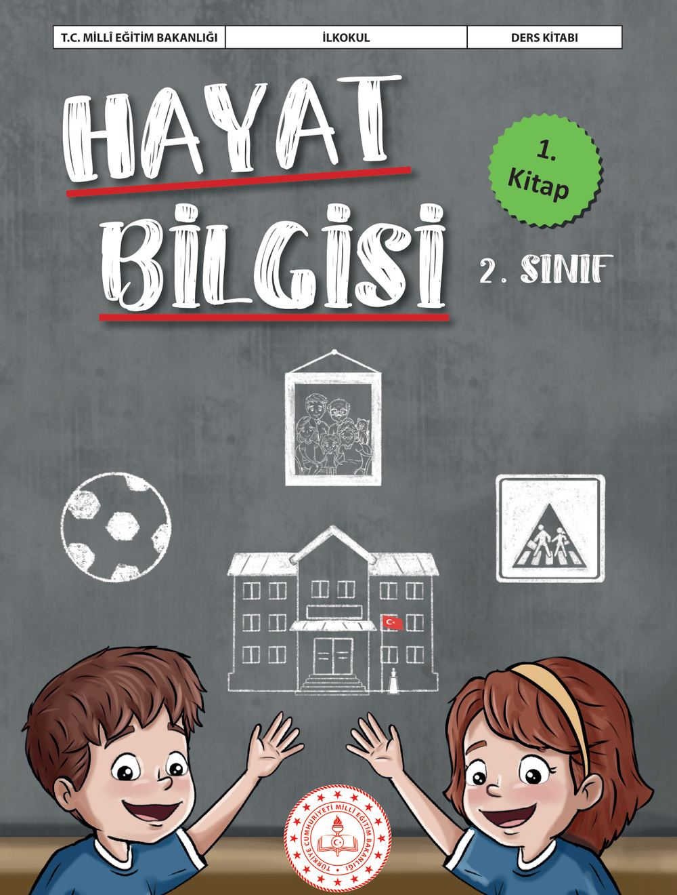 1. Kitap
2. SINIF

<!-- sayfa 1 -->

İLKOKUL

# HAYAT BİLGİSİ

## 2. Sınıf
### Ders Kitabı
#### 1. Kitap

**Yazarlar**
Dr. Nagihan ŞAHİN
Betül ALTUNTAŞ
Gürhan DİKMEN
Hüseyin GÜLEÇ
Nurgül GENÇ

DEVLET KİTAPLARI

<!-- sayfa 2 -->

MİLLÎ EĞİTİM BAKANLIĞI YAYINLARI ................................................................. : 10251
DERS KİTAPLARI DİZİSİ ...................................................................................... : 2256

Her hakkı saklıdır ve Millî Eğitim Bakanlığına aittir. Kitabın metin, soru ve şekilleri kısmen de olsa hiçbir surette alınıp yayımlanamaz.

**Editör**
Dr. Öznur TUNALI

**Dil Uzmanı**
Aylin ALTINBAŞ

**Görsel Tasarımcı**
Gülçen Yılmaz DÜZGÜN
Orhan ATEŞ

**Çoklu Ortam Tasarımcısı**
Bahar ŞAHİN ŞEHİR
Coşkun İNCE
Çağdaş SEVİNÇ
Dilek FİDANCI
Evren SAVAŞ
Fatma Öznur USLU
Hayriye KAFTAN AYAN
Neslihan YILDIRIM ÇAYIRCI
Neşe ASLAN
Onur TÜLÜ
Selma ÇELİK
Tuğçe Burçin ARTUKOĞLU

**Program Geliştirme Uzmanı**
Hilal ALTINTAŞ

**Ölçme ve Değerlendirme Uzmanı**
Elif Ebru DOĞANGÜZEL

**Rehberlik Uzmanı**
Dr. Nilgün KORKMAZ

ISBN 978-975-11-8768-0

Millî Eğitim Bakanlığı, Talim ve Terbiye Kurulu Başkanlığının 7.05.2025 tarih ve 131944960 sayılı yazısı ile eğitim aracı olarak kabul edilmiştir.

Kurulca bu kitabın kabul edilmiş olması eğitim aracından yayınevi ve

<!-- sayfa 3 -->

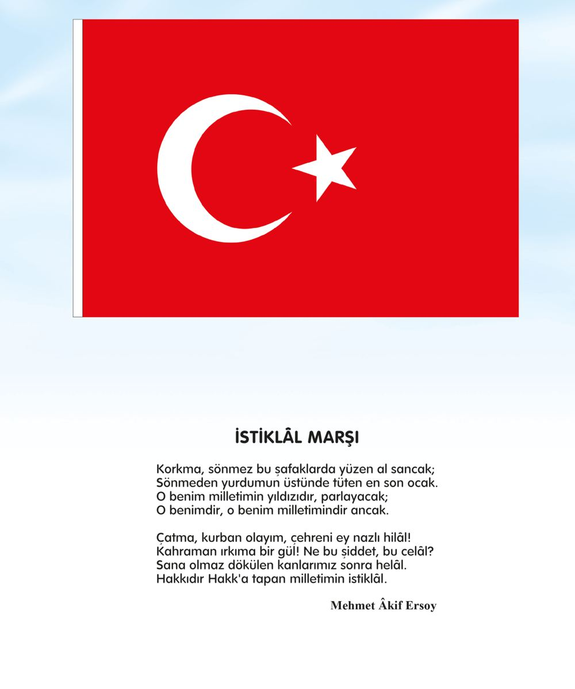

# İSTİKLÂL MARŞI

Korkma, sönmez bu şafaklarda yüzen al sancak;
Sönmeden yurdumun üstünde tüten en son ocak.
O benim milletimin yıldızıdır, parlayacak;
O benimdir, o benim milletimindir ancak.

Çatma, kurban olayım, çehreni ey nazlı hilâl!
Kahraman ırkıma bir gül! Ne bu şiddet, bu celâl?
Sana olmaz dökülen kanlarımız sonra helâl.
Hakkıdır Hakk'a tapan milletimin istiklâl.

Mehmet Âkif Ersoy

<!-- sayfa 4 -->

ANDIMIZ

Türküm, doğruyum, çalışkanım.

İlkem küçüklerimi korumak, büyüklerimi saymak; yurdumu, milletimi özümden çok sevmektir.
Ülküm yükselmek, ileri gitmektir.

Ey Büyük Atatürk!

Açtığın yolda, gösterdiğin hedefe durmadan yürüyeceğime ant içerim.

Varlığım Türk varlığına armağan olsun.

Ne mutlu Türküm diyene!

<!-- sayfa 5 -->

MUSTAFA KEMAL ATATÜRK

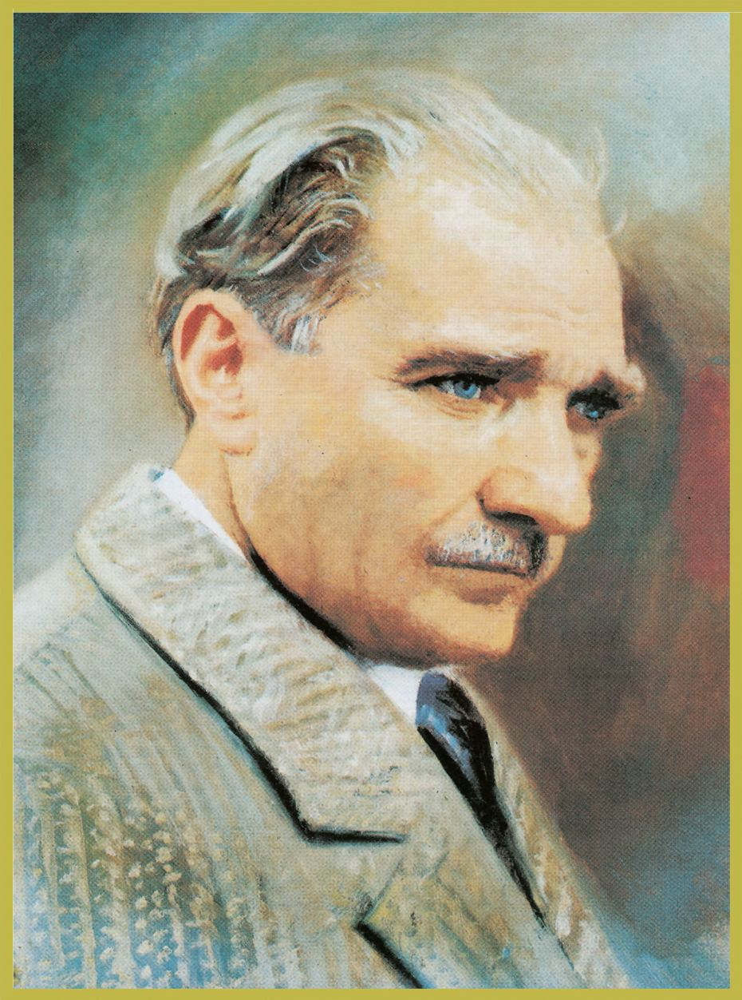
<!-- yer tutucu bulunamadı: sayfa sonuna eklendi -->

<!-- sayfa 6 -->

Verdiğiniz mesajda PDF metin katmanı boş görünüyor (`<<< >>>` arası boş). Lütfen dönüştürülmesini istediğiniz metni veya görseli paylaşın, böylece kurallara uygun şekilde Markdown formatına çevirebilirim.

<!-- sayfa 7 -->

# İÇİNDEKİLER

Kitabımızı Tanıyalım .....................................................................................................................8

## 1. ÖĞRENME ALANI BEN VE OKULUM ...................................................................10

Belirli Gün ve Haftalar .....................................................................................12
Planlı Olmak ..............................................................................................................14
İletişim Var, Sorun Yok ..................................................................................22
Arkadaşlık İlişkilerimiz .......................................................................................28
Karar Verme Zamanı ........................................................................................34
Performans Görevi ...............................................................................................38
Tekrar Zamanı ..........................................................................................................40

## 2. ÖĞRENME ALANI SAĞLIĞIM VE GÜVENLİĞİM ...........................................44

Belirli Gün ve Haftalar ....................................................................................46
Sağlıklı Alışkanlıklar .............................................................................................48
Çevrim İçi Güvenliğim .......................................................................................54
Dikkat, Levha Çıkabilir! .....................................................................................60
Performans Görevi ...............................................................................................66
Acilse Ne Yaparım? ..............................................................................................68
Tekrar Zamanı ..........................................................................................................74

## 3. ÖĞRENME ALANI AİLEM VE TOPLUM ............................................................78

Belirli Gün ve Haftalar ....................................................................................80
Canım Ailem ..............................................................................................................82
Toplumda Nezaket ve Görgü ......................................................................88
Görevim, Sorumluluğum ................................................................................94
Performans Görevi ...............................................................................................98
Tekrar Zamanı ........................................................................................................100
Ekler ......................................................................................................................................................103

Sözlük ..................................................................................................................................119
Kaynakça ..........................................................................................................................121
Cevap Anahtarı ........................................................................................................................122
Görsel ve Genel Ağ Kaynakçası ............................................................................122
Türkiye’nin Mülki İdare Bölümleri ile Kara ve Deniz Komşuları Haritası ...............................................................................................................................................123

<!-- sayfa 8 -->

# KITABIMIZI TANIYALIM

Kitabımız 6 öğrenme alanından oluşmaktadır. Bu öğrenme alanlarının 3 tanesi 1. kitapta bulunmaktadır.

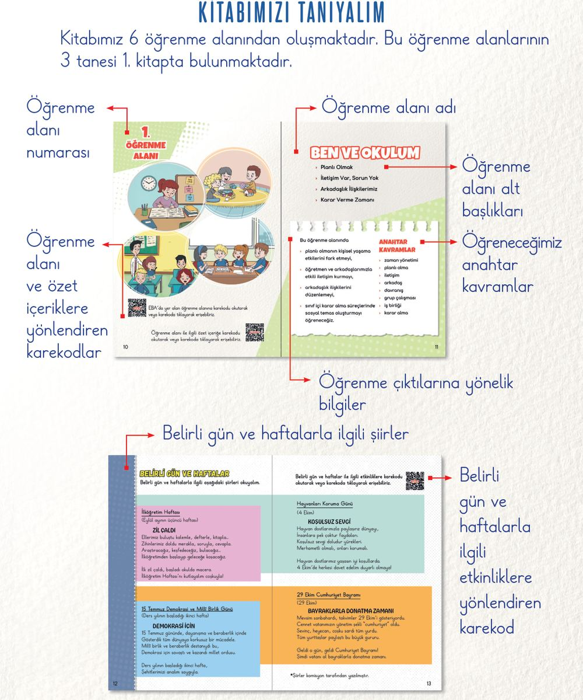 Öğrenme alanı numarası

 Öğrenme alanı adı

 Öğrenme alanı alt başlıkları

 Öğreneceğimiz anahtar kavramlar

 Öğrenme alanı ve özet içeriklere yönlendiren karekodlar

 Öğrenme çıktılarına yönelik bilgiler

 Belirli gün ve haftalarla ilgili şiirler

 Belirli gün ve haftalarla ilgili etkinliklere yönlendiren karekod

---

**1. ÖĞRENME ALANI**

**BEN VE OKULUM**
* Planlı Olmak
* İletişim Var, Sorun Yok
* Arkadaşlık İlişkilerimiz
* Karar Verme Zamanı

Bu öğrenme alanında;
* planlı olmanın kişisel yaşama etkilerini fark etmeyi,
* öğretmen ve arkadaşlarımızla etkili iletişim kurmayı,
* arkadaşlık ilişkilerini düzenlemeyi,
* sınıf içi karar alma süreçlerinde sosyal temas oluşturmayı öğreneceğiz.

**ANAHTAR KAVRAMLAR**
* zaman yönetimi
* planlı olma
* iletişim
* arkadaş
* davranış
* grup çalışması
* iş birliği
* karar alma

---

**BELİRLİ GÜN VE HAFTALAR**
Belirli gün ve haftalarla ilgili şiirleri okuyalım.

**İlköğretim Haftası**
(Eylül ayının üçüncü haftası)
**ZİL ÇALDI**
Ellerimiz buluştu kalemle, defterle, kitapla..
Zihinlerimiz merakla, soruyla, cevapla.
Araştıracağız, keşfedeceğiz, bulacağız..
İlköğretimden başlayıp geleceğe koşacağız.
İlk zil çaldı, başladı okulda macera.
İlköğretim Haftasını kutlayalım coşkuyla!

**15 Temmuz Demokrasi ve Millî Birlik Günü**
(Ders yılının başladığı ikinci hafta)
**DEMOKRASİ İÇİN**
15 Temmuz gününde, dayanışma ve beraberlik içinde gösterdik tüm dünyaya korkusuz bir mücadele. Millî birlik ve beraberlik destanı bu, Demokrasi için savaştı ve kazandı millet ordusu.
Ders yılının başladığı ikinci hafta, şehitlerimizi anayım.

**Hayvanları Koruma Günü**
(4 Ekim)
**KOŞUNSUZ SEVGİ**
Hayvan dostlarımızla paylaştığımız dünyay, İnsanlara pek çakır faydaları. Koşunsuz sevgi dolu yürekleri. Merhametli olmalı, onları korumalı. Hayvan dostlarımız yasal uyumlu koşullarda. 4 Ekim'de herkes devlet edimli duyarlı olmalı!

**29 Ekim Cumhuriyet Bayramı**
(29 Ekim)
**BAYRAKLARLA DONATMA ZAMANI**
Mevsim sonbaharı, takvimler 29 Ekim'i gösteriyor. Cennet vaktinin yönetim şekli "cumhuriyet" oldu. Sevinç, heyecan, coşku sardı tüm yurdu. Tüm yurttaşlar paylaştı büyük gururu.
Geldi o gün, geldi Cumhuriyet Bayramı! Şimdi vatanı bayraklarla donatma zamanı!

*Şiirler komisyon tarafından yazılmıştır.

<!-- sayfa 9 -->

Öğrenme alanında her bir konu “Hatırlayalım, Keşfedelim, Bilgi Yolculuğumuz, Uygulayalım ve Neler Öğrendik?” olmak üzere 5 başlıktan oluşmaktadır. Her öğrenme alanının sonunda “Tekrar Zamanı” bulunmaktadır.

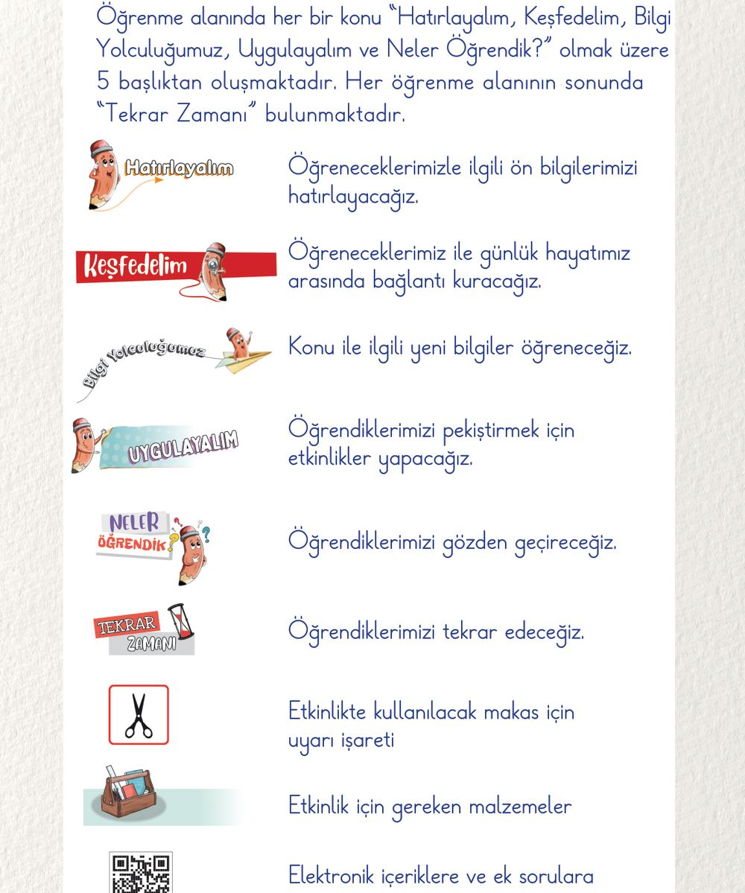 Hatırlayalım  Öğreneceklerimizle ilgili ön bilgilerimizi hatırlayacağız.

 Keşfedelim  Öğreneceklerimiz ile günlük hayatımız arasında bağlantı kuracağız.

 Bilgi Yolculuğumuz  Konu ile ilgili yeni bilgiler öğreneceğiz.

 UYGULAYALIM  Öğrendiklerimizi pekiştirmek için etkinlikler yapacağız.

 NELER ÖĞRENDİK  Öğrendiklerimizi gözden geçireceğiz.

 TEKRAR ZAMANI  Öğrendiklerimizi tekrar edeceğiz.

 Etkinlikte kullanılacak makas için uyarı işareti

 Etkinlik için gereken malzemeler

 Elektronik içeriklere ve ek sorulara

<!-- sayfa 10 -->

# ÖĞRENME ALANI

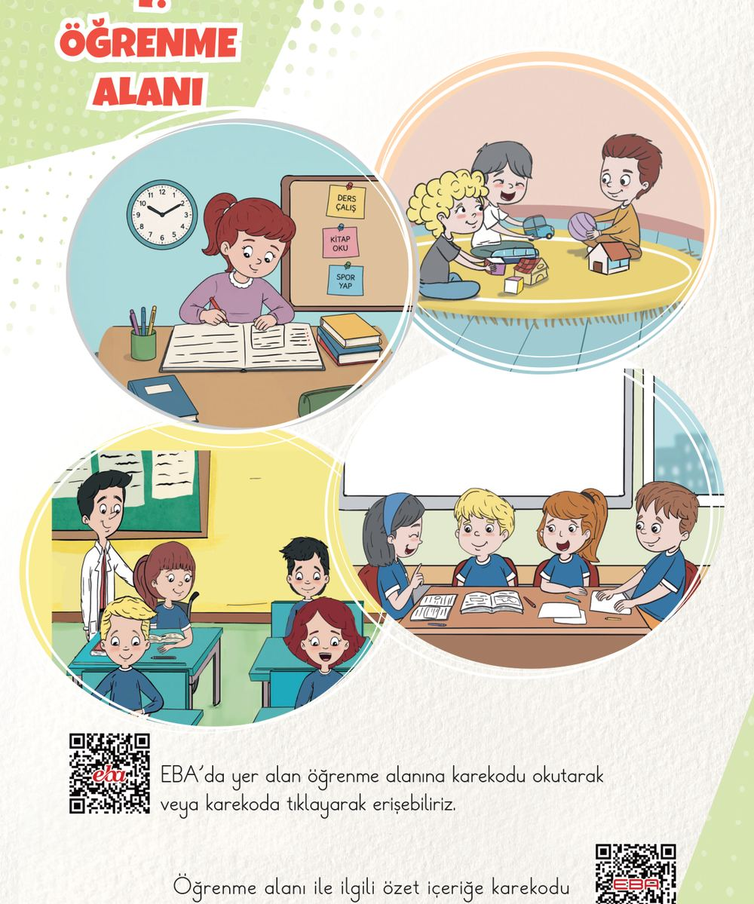

EBA’da yer alan öğrenme alanına karekodu okutarak veya karekoda tıklayarak erişebiliriz.

Öğrenme alanı ile ilgili özet içeriğe karekodu

<!-- sayfa 11 -->

# BEN VE OKULUM

* Planlı Olmak
* İletişim Var, Sorun Yok
* Arkadaşlık İlişkilerimiz
* Karar Verme Zamanı

Bu öğrenme alanında

* planlı olmanın kişisel yaşama etkilerini fark etmeyi,
* öğretmen ve arkadaşlarımızla etkili iletişim kurmayı,
* arkadaşlık ilişkilerini düzenlemeyi,
* sınıf içi karar alma süreçlerinde sosyal temas oluşturmayı öğreneceğiz.

## ANAHTAR KAVRAMLAR

* zaman yönetimi
* planlı olma
* iletişim
* arkadaş
* davranış
* grup çalışması
* iş birliği
* karar alma

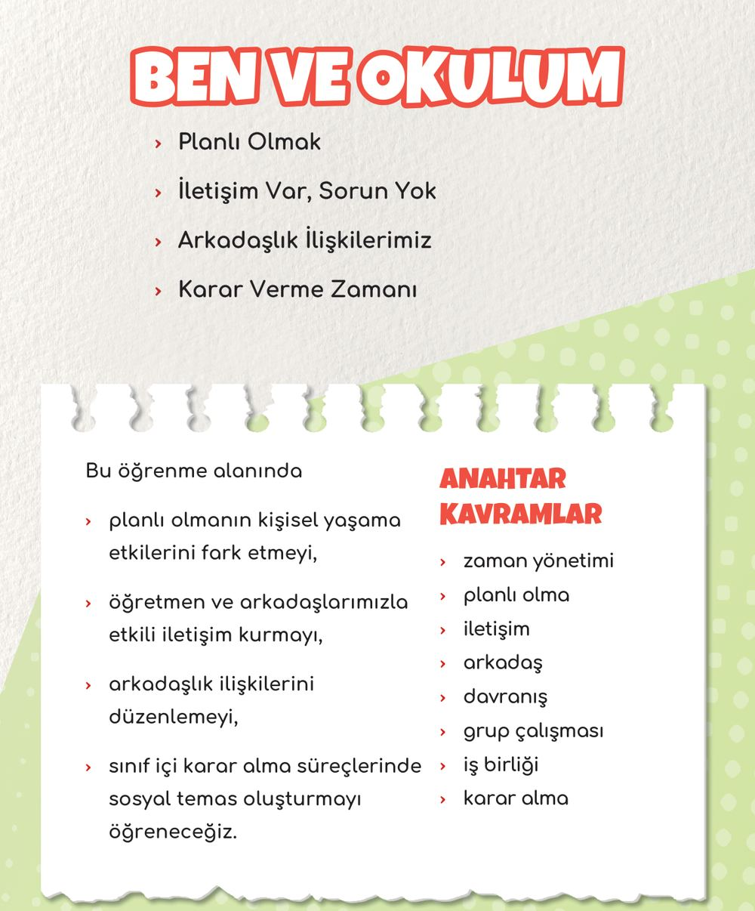
<!-- yer tutucu bulunamadı: sayfa sonuna eklendi -->

<!-- sayfa 12 -->

# BELİRLİ GÜN VE HAFTALAR

Belirli gün ve haftalarla ilgili aşağıdaki şiirleri okuyalım.

## İlköğretim Haftası
(Eylül ayının üçüncü haftası)

### ZİL ÇALDI
Ellerimiz buluştu kalemle, defterle, kitapla...
Zihinlerimiz doldu merakla, soruyla, cevapla.
Araştıracağız, keşfedeceğiz, bulacağız...
İlköğretimden başlayıp geleceğe koşacağız.

İlk zil çaldı, başladı okulda macera.
İlköğretim Haftası’nı kutlayalım coşkuyla!

## 15 Temmuz Demokrasi ve Millî Birlik Günü
(Ders yılının başladığı ikinci hafta)

### DEMOKRASİ İÇİN
15 Temmuz gününde, dayanışma ve beraberlik içinde
Gösterdik tüm dünyaya korkusuz bir mücadele.
Millî birlik ve beraberlik destanıydı bu,
Demokrasi için savaştı ve kazandı millet ordusu.

Ders yılının başladığı ikinci hafta,
Şehitlerimizi analım saygıyla.

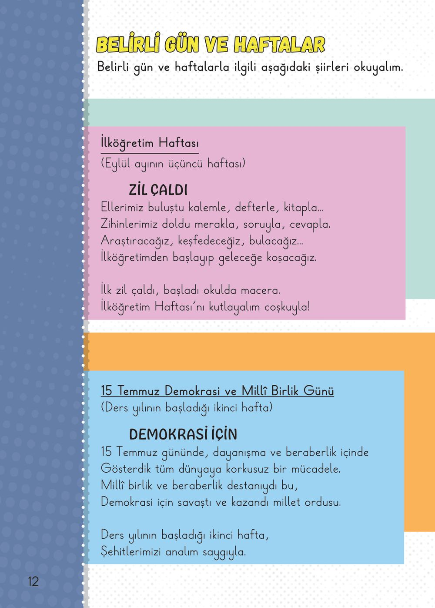
<!-- yer tutucu bulunamadı: sayfa sonuna eklendi -->

<!-- sayfa 13 -->

Belirli gün ve haftalar ile ilgili etkinliklere karekodu okutarak veya karekoda tıklayarak erişebiliriz. 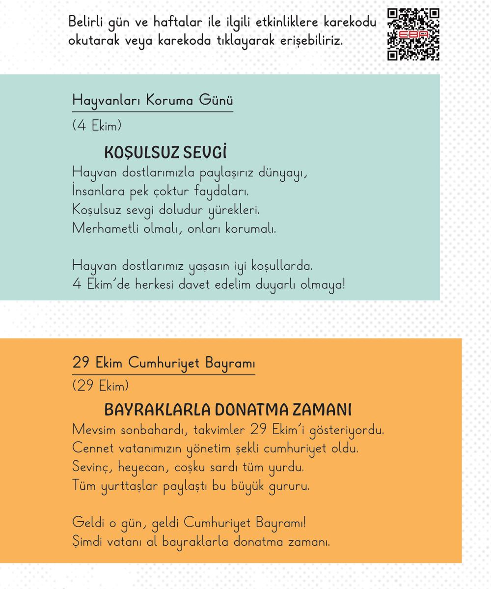

## Hayvanları Koruma Günü
(4 Ekim)

### KOŞULSUZ SEVGİ
Hayvan dostlarımızla paylaşırız dünyayı,
İnsanlara pek çoktur faydaları.
Koşulsuz sevgi doludur yürekleri.
Merhametli olmalı, onları korumalı.

Hayvan dostlarımız yaşasın iyi koşullarda.
4 Ekim’de herkesi davet edelim duyarlı olmaya!

## 29 Ekim Cumhuriyet Bayramı
(29 Ekim)

### BAYRAKLARLA DONATMA ZAMANI
Mevsim sonbahardı, takvimler 29 Ekim’i gösteriyordu.
Cennet vatanımızın yönetim şekli cumhuriyet oldu.
Sevinç, heyecan, coşku sardı tüm yurdu.
Tüm yurttaşlar paylaştı bu büyük gururu.

Geldi o gün, geldi Cumhuriyet Bayramı!
Şimdi vatanı al bayraklarla donatma zamanı.

<!-- sayfa 14 -->

# PLANLI OLMAK

## Hatırlayalım

➢ Görseli inceleyelim. Metni okuyalım.

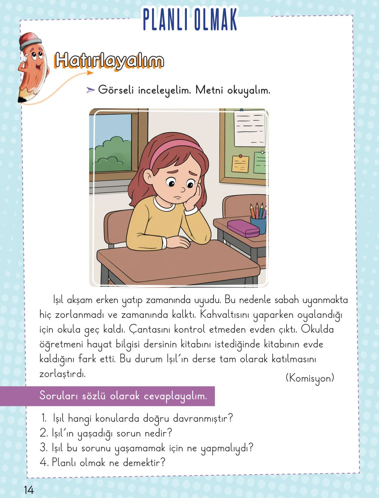

Işıl akşam erken yatıp zamanında uyudu. Bu nedenle sabah uyanmakta hiç zorlanmadı ve zamanında kalktı. Kahvaltısını yaparken oyalandığı için okula geç kaldı. Çantasını kontrol etmeden evden çıktı. Okulda öğretmeni hayat bilgisi dersinin kitabını istediğinde kitabının evde kaldığını fark etti. Bu durum Işıl’ın derse tam olarak katılmasını zorlaştırdı.

(Komisyon)

### Soruları sözlü olarak cevaplayalım.

1. Işıl hangi konularda doğru davranmıştır?
2. Işıl’ın yaşadığı sorun nedir?
3. Işıl bu sorunu yaşamamak için ne yapmalıydı?
4. Planlı olmak ne demektir?

<!-- sayfa 15 -->

# Keşfedelim

➣ Uygulama adımlarını takip ederek etkinliği yapalım.

## Uygulama Adımları

➠ Gün içinde neler yaptığımızı düşünelim. Sabah uyandığımız andan itibaren gece uyuduğumuz ana kadar yaptığımız işleri aşağıdaki çizgili alana listeleyelim.

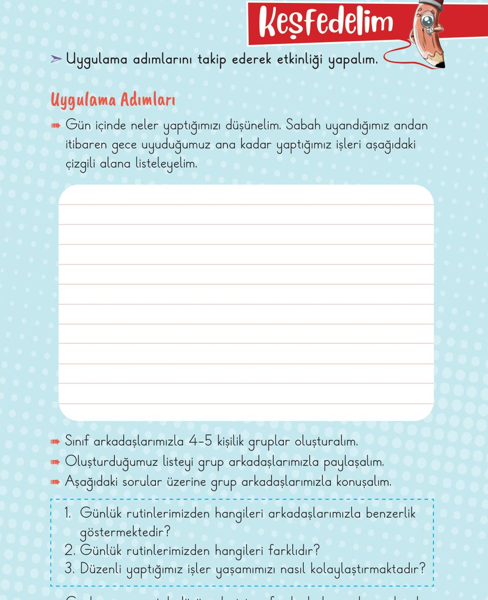

➠ Sınıf arkadaşlarımızla 4-5 kişilik gruplar oluşturalım.
➠ Oluşturduğumuz listeyi grup arkadaşlarımızla paylaşalım.
➠ Aşağıdaki sorular üzerine grup arkadaşlarımızla konuşalım.

1. Günlük rutinlerimizden hangileri arkadaşlarımızla benzerlik göstermektedir?
2. Günlük rutinlerimizden hangileri farklıdır?
3. Düzenli yaptığımız işler yaşamımızı nasıl kolaylaştırmaktadır?

<!-- sayfa 16 -->

# Bilgi Yolculuğumuz

## PLAN YAPARIM, ZAMANI İYİ KULLANIRIM

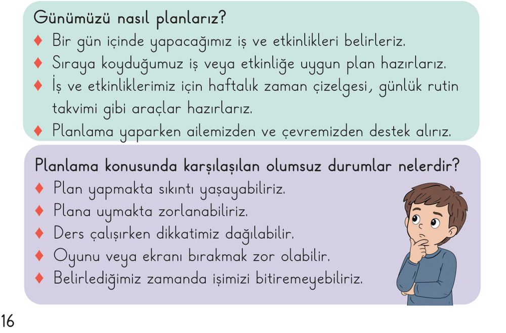

**Bir gün içinde neler yaparız?**

* **BESLENME**
* **DERS ÇALIŞMA**
* **OYUN OYNAMA**
* **UYUMA**
* **AİLESİ VE ARKADAŞLARIYLA NİTELİKLİ ZAMAN GEÇİRME**
* **DİNLENME**
* **OKUMA**
* **KİTLE İLETİŞİM ARAÇLARINI KULLANMA**

### Günümüzü nasıl planlarız?

♦ Bir gün içinde yapacağımız iş ve etkinlikleri belirleriz.
♦ Sıraya koyduğumuz iş veya etkinliğe uygun plan hazırlarız.
♦ İş ve etkinliklerimiz için haftalık zaman çizelgesi, günlük rutin takvimi gibi araçlar hazırlarız.
♦ Planlama yaparken ailemizden ve çevremizden destek alırız.

### Planlama konusunda karşılaşılan olumsuz durumlar nelerdir?

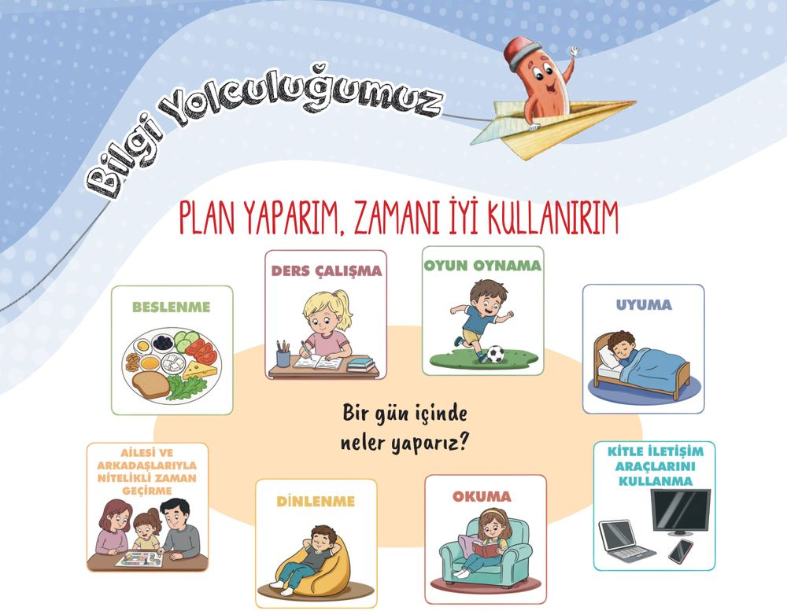

♦ Plan yapmakta sıkıntı yaşayabiliriz.
♦ Plana uymakta zorlanabiliriz.
♦ Ders çalışırken dikkatimiz dağılabilir.
♦ Oyunu veya ekranı bırakmak zor olabilir.
♦ Belirlediğimiz zamanda işimizi bitiremeyebiliriz.

<!-- sayfa 17 -->

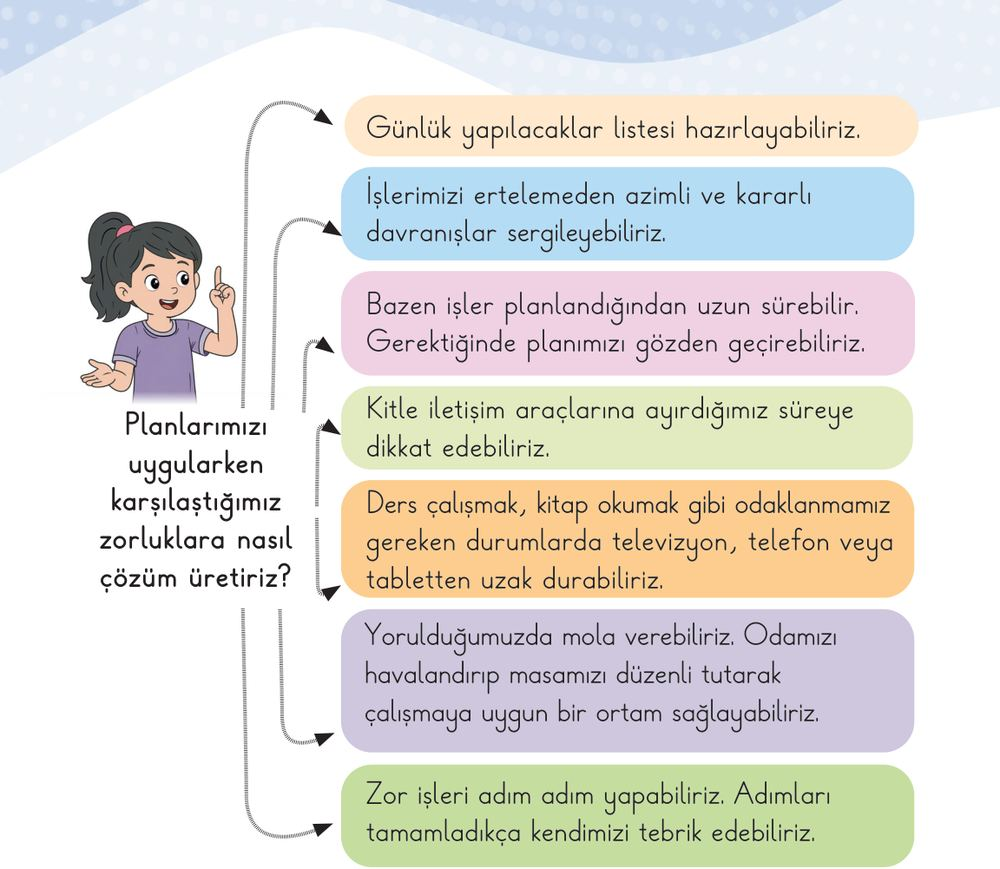

Planlarımızı uygularken karşılaştığımız zorluklara nasıl çözüm üretiriz?

* Günlük yapılacaklar listesi hazırlayabiliriz.
* İşlerimizi ertelemeden azimli ve kararlı davranışlar sergileyebiliriz.
* Bazen işler planlandığından uzun sürebilir. Gerektiğinde planımızı gözden geçirebiliriz.
* Kitle iletişim araçlarına ayırdığımız süreye dikkat edebiliriz.
* Ders çalışmak, kitap okumak gibi odaklanmamız gereken durumlarda televizyon, telefon veya tabletten uzak durabiliriz.
* Yorulduğumuzda mola verebiliriz. Odamızı havalandırıp masamızı düzenli tutarak çalışmaya uygun bir ortam sağlayabiliriz.
* Zor işleri adım adım yapabiliriz. Adımları tamamladıkça kendimizi tebrik edebiliriz.

Planlı olduğumuzda her şeyi yapabileceğimize inanalım ve kendimize güvenelim!

Planlı olmanın kişisel yaşamımıza etkileri nelerdir?

♦ Zamanı daha verimli kullanırız.
♦ Hayatımız kolaylaşır. İşlerimizi zamanında yaparız, daha düzenli oluruz.
♦ Derslerimizde başarılı oluruz.
♦ Oyuna ve yapmak istediğimiz etkinliklere daha çok zaman ayırırız.

Konu ile ilgili elektronik içeriğe karekodu okutarak

<!-- sayfa 18 -->

# UYGULAYALIM

➢ Aşağıdaki listede bulunmayan günlük işlerimizi boş bırakılan bölümlere ekleyelim. Bir gün içinde yaptığımız işleri gruplandıralım.

| Günlük İşlerim | Güne Başlarken Yaptıklarım | Okuldan Sonra Yaptıklarım | Dinlenirken Yaptıklarım | Günü Tamamlarken Yaptıklarım |
| :--- | :---: | :---: | :---: | :---: |
| Ders çalışmak | | | | |
| Kitap okumak | | | | |
| Oyun oynamak | | | | |
| Dinlenmek | | | | |
| Uyumak | | | | |
| Yemek yemek | | | | |
| Ailemle zaman geçirmek | | | | |
| Arkadaşlarımla vakit geçirmek | | | | |
| Televizyon izlemek | | | | |
| Tablet/bilgisayar kullanmak | | | | |
| .......................................... | | | | |
| .......................................... | | | | |
| .......................................... | | | | |

➢ Tabloda işaretlediklerimize göre günlük yaşantımızda bu işlere

<!-- yer tutucu bulunamadı: sayfa sonuna eklendi -->

<!-- yer tutucu bulunamadı: sayfa sonuna eklendi -->

<!-- sayfa 19 -->

➢ Uygulama adımlarını takip ederek etkinliği yapalım.

## Uygulama Adımları

 ➠ Sınıf arkadaşlarımızla bir çember oluşturalım.
 ➠ Aşağıdaki soruları sırayla söz alarak konuşalım.
> 1. Hangi işler her gün düzenli yapılmalıdır?
> 2. Hangi işler önce yapılırsa günümüz daha kolay ilerler?

 3. Oyun, dinlenme, ders çalışma ve aileyle vakit geçirme arasında nasıl denge kurulabilir? 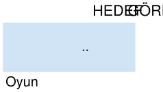 Haftalık görev çizelgesini dolduralım.

# HEDEF GÖREV ÇİZELGEM

| Günlük İş | Pazartesi | Salı | Çarşamba | Perşembe | Cuma | Cumartesi | Pazar |
| :--- | :---: | :---: | :---: | :---: | :---: | :---: | :---: |
| Oyun oynamak | | | | | | | |
| Ders çalışmak | | | | | | | |
| Kitap okumak | | | | | | | |
| Dinlenmek | | | | | | | |
| Uyumak | | | | | | | |
| Beslenmek | | | | | | | |
| Ailesi ve arkadaşlarıyla nitelikli zaman geçirmek | | | | | | | |
| Kitle iletişim araçlarını kullanmak | | | | | | | |

➢ Haftalık görev çizelgemizi kullanarak bir hafta boyunca bu planı uygulayalım. Planımızı uygularken karşılaştığımız

<!-- sayfa 20 -->

# UYGULAYALIM

➢ Bir hafta boyunca uyguladığımız planı ve aldığımız notları inceleyelim.
➢ Uygulama adımlarını takip ederek etkinliği yapalım.

## Uygulama Adımları

➠ Sınıf arkadaşlarımızla 4-5 kişilik gruplar oluşturalım. Hangi işleri ertelediğimizi ve hangi işleri düzenli yapabildiğimizi konuşalım.
➠ Planımızı uygularken karşılaştığımız zorluklarla ilgili notlarımızı sırayla okuyalım.
➠ Planımı uygularken en kolay yaptığım iş neydi?”, “Hangi işi yapmakta zorlandım?”, “Zorlandığım işleri nasıl çözdüm?, “Bir işi unutunca ya da erteleyince ne oldu?”, “Planlı olmak günümü nasıl kolaylaştırdı? gibi soruların cevaplarını aramızda tartışalım.
➠ Çözüm üretemediğimiz zorlukları arkadaşlarımızla paylaşalım. Çözüm yollarını birlikte tartışalım.
➠ Son olarak, günlük yaşamda neden plan yaptığımızı ve bu planlamanın günlük yaşantımıza etkilerini anlamak için aşağıdaki boş bırakılan yerleri örnekteki gibi dolduralım.

### GÜNLÜK YAŞAMDA PLAN YAPMANIN NEDENLERİ VE SONUÇLARI

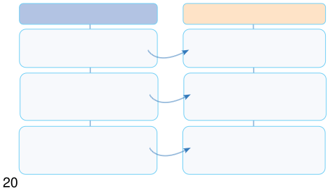

| Nedenler | Sonuçlar |
| :--- | :--- |
| 1. Zamanı daha verimli kullanmak | 1. Ödevlerimiz zamanında biter. |
| 2. ........................................... ........................................... | 2. ........................................... ........................................... |
| 3. ........................................... ........................................... | 3. ........................................... ........................................... |

<!-- sayfa 21 -->

# NELER ÖĞRENDİK?

➢ Metni okuyalım. Soruları metne göre cevaplayalım.

## Ahmet ve Fatma’nın Bir Günü

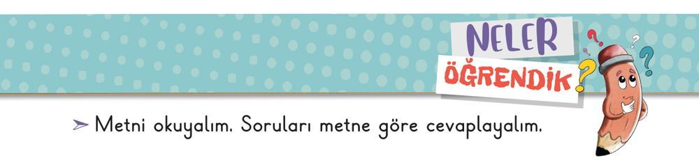

2. sınıfa giden Ahmet okuldan eve gelir gelmez çantasını odasına bıraktı. Dinlenmek yerine uzun süre televizyon izledi, sonra oyun oynadı. Zamanın nasıl geçtiğini fark etmedi. Akşam olunca ödevlerini yapmadığını hatırladı. Ödevlerini tamamlamak için geç saate kadar çalıştı. Bu yüzden kitap okuyamadı ve zamanında uyuyamadı. Ertesi sabah okula yorgun ve uykusuz gitti.

3. sınıfa giden kardeşi Fatma ise okuldan geldikten sonra günlük planına baktı. Önce biraz dinlendi. Daha sonra ödevlerini yaptı, kitap okudu, oyun oynadı ve ailesiyle zaman geçirdi. Akşam olunca yemeğini yiyip uyku saatinde yatağına gitti. Ertesi gün okula dinlenmiş, mutlu ve enerjik bir şekilde geldi.

(Komisyon)

1. Ahmet’in ertesi gün okula yorgun ve uykusuz gitmesinin nedenleri nelerdir?
__________________________________________________________________________
__________________________________________________________________________

2. Fatma’nın gününü düzenli ve planlı geçirmesinin, günlük yaşamındaki olumlu etkileri ve sonuçları neler olmuştur?
__________________________________________________________________________
__________________________________________________________________________

3. Fatma gibi planlı yaşamak ve zamanı boşa harcamamak bize neler kazandırır?
__________________________________________________________________________
__________________________________________________________________________

<!-- sayfa 22 -->

# İLETİŞİM VAR, SORUN YOK

## Hatırlayalım

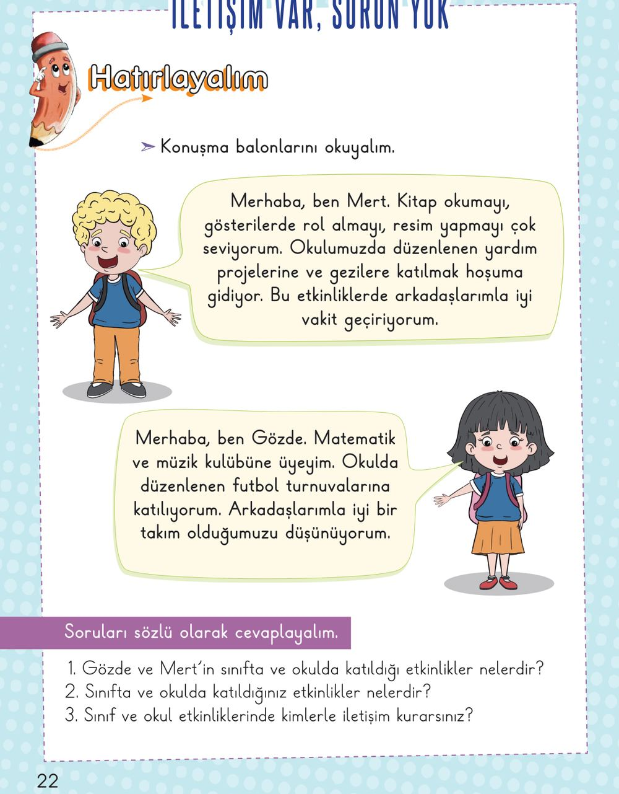

➢ Konuşma balonlarını okuyalım.

Merhaba, ben Mert. Kitap okumayı, gösterilerde rol almayı, resim yapmayı çok seviyorum. Okulumuzda düzenlenen yardım projelerine ve gezilere katılmak hoşuma gidiyor. Bu etkinliklerde arkadaşlarımla iyi vakit geçiriyorum.

Merhaba, ben Gözde. Matematik ve müzik kulübüne üyeyim. Okulda düzenlenen futbol turnuvalarına katılıyorum. Arkadaşlarımla iyi bir takım olduğumuzu düşünüyorum.

## Soruları sözlü olarak cevaplayalım.

1. Gözde ve Mert’in sınıfta ve okulda katıldığı etkinlikler nelerdir?
2. Sınıfta ve okulda katıldığınız etkinlikler nelerdir?
3. Sınıf ve okul etkinliklerinde kimlerle iletişim kurarsınız?

<!-- sayfa 23 -->

# Keşfedelim

➣ Görselleri inceleyelim.

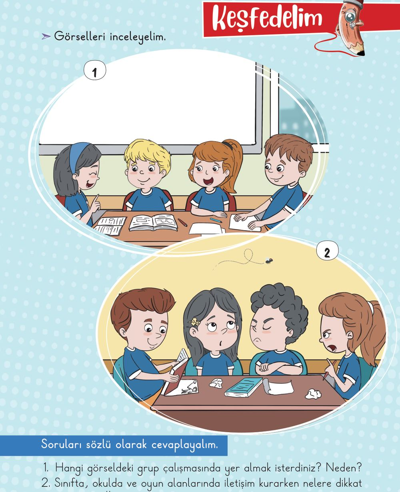

### Soruları sözlü olarak cevaplayalım.

1. Hangi görseldeki grup çalışmasında yer almak isterdiniz? Neden?
2. Sınıfta, okulda ve oyun alanlarında iletişim kurarken nelere dikkat edilmelidir?

<!-- sayfa 24 -->

# Bilgi Yolculuğumuz

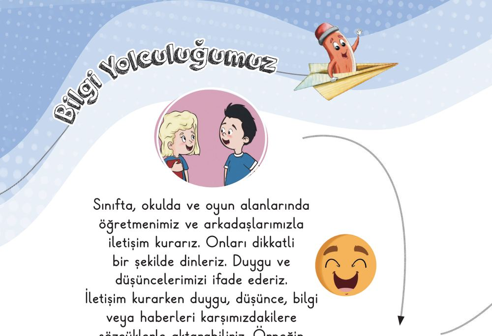

Sınıfta, okulda ve oyun alanlarında öğretmenimiz ve arkadaşlarımızla iletişim kurarız. Onları dikkatli bir şekilde dinleriz. Duygu ve düşüncelerimizi ifade ederiz. İletişim kurarken duygu, düşünce, bilgi veya haberleri karşımızdakilere sözcüklerle aktarabiliriz. Örneğin “Bugün çok sevinçliyim, okula çocuk tiyatrosu geliyormuş!” 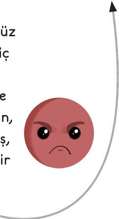 gibi cümleler kurarız. Bazen sözcüklerimize beden dilimiz veya yüz ifadelerimiz eşlik eder. Bazen de hiç sözcük kullanmadan el, yüz hareketlerimiz veya beden dilimizle kendimizi ifade ederiz. Üzgün, şaşkın, mutlu yüz ifadelerimiz veya ürkmüş, çekingen duruşumuz da iletişimin bir parçasıdır. 

# İLETİŞİM

<!-- sayfa 25 -->

Öğretmenimizi veya arkadaşımızı etkin bir şekilde dinlemek için

♦ başka bir şeyle ilgilenmeden dikkatimizi konuşan kişiye veririz.
♦ sözsüz mesajlarımıza dikkat ederiz (Karşımızdaki kişiye dönük durmak, göz teması kurmak, başımızı sallayarak dinlediğimizi belli etmek vb.).
♦ konuşan kişinin sözünü kesmeyiz, konuşmasını bitirmesini bekleriz.
♦ konuşan kişinin ne hissettiğini anlamaya çalışırız.
♦ konuşma arasında ne anladığımızı konuşan kişiye ifade ederiz. Böylece onu dinlediğimizi hissettirir, doğru anlayıp anlamadığımızı ona onaylatırız.

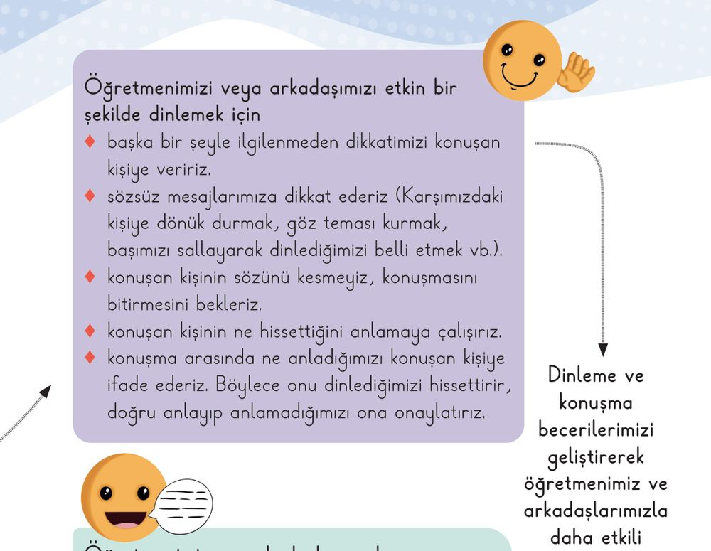

Dinleme ve konuşma becerilerimizi geliştirerek öğretmenimiz ve arkadaşlarımızla daha etkili bir iletişim kurabiliriz.

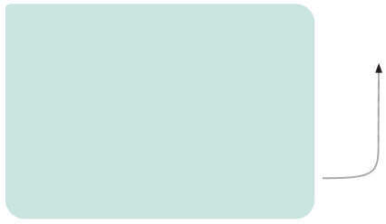

Öğretmenimiz ve arkadaşlarımızla konuşurken

♦ konuşan kişi sözünü bitirdikten sonra konuşmak için söz isteriz.
♦ ses tonumuzu herkesin duyabileceği şekilde ayarlarız.
♦ anlamlı cümleler kurar, akıcı bir şekilde konuşuruz.
♦ göz teması kurarız.
♦ konuşurken Türkçemizi doğru kullanmaya ve nazik olmaya dikkat ederiz.

Konu ile ilgili elektronik içeriğe karekodu okutarak veya karekoda tıklayarak erişebiliriz.

<!-- sayfa 26 -->

# UYGULAYALIM

➢ Uygulama adımlarını takip ederek etkinliği yapalım.

**Malzemeler:** renkli kalemler ve beyaz A3 boyutunda karton.

## Uygulama Adımları

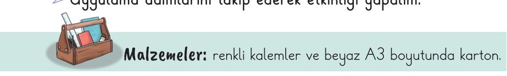
➠ Sınıf arkadaşlarımızla 4-5 kişilik gruplar oluşturalım.
➠ Özel gereksinimli çocukların güvenle oynayabileceği bir park hayal edelim. Parkta hangi oyun araçlarına yer vereceğimizi tartışalım.
➠ Konuşurken ve dinlerken iletişim kurallarına uyalım.
➠ Hayal ettiğimiz parkı, kartonun üzerine renkli kalemlerle çizelim.
➠ Çizdiğimiz parkı arkadaşlarınıza sunalım. Sunum sırasında etkili iletişim kurallarını uygulamaya özen gösterelim.

**Soruları sözlü olarak cevaplayalım.**

1. Grup içinde iletişim kurarken neler yaşadınız?
2. Sunum yaparken neler yaşadınız?
3. Arkadaşlarınız sunum yaparken neler yaşadı? Onların yerinde olsaydınız ne yapardınız?
4. Öğretmeninizin sizinle iletişimi nasıldı? Öğretmeninizin yerinde olsaydınız ne yapardınız?

➢ Süreç boyunca dikkat ettiğimiz iletişim kurallarını listeleyelim.

| İletişim Kuralları |
| :--- |
| |
| |
| |
| |
| |

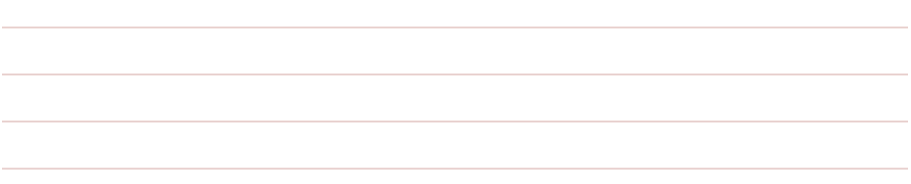

<!-- sayfa 27 -->

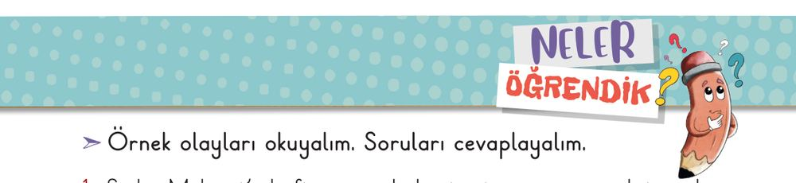
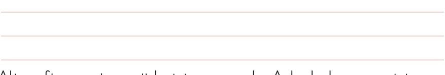

# NELER ÖĞRENDİK?

➤ Örnek olayları okuyalım. Soruları cevaplayalım.

1. Seda, Mehmet’e hafta sonu izlediği tiyatro oyununu anlatıyordu. Mehmet, bazen Seda’nın sözünü kesiyor bazen de bahçede top oynayan arkadaşlarına bakıyordu.
**Mehmet’in dikkat etmesi gereken iletişim kuralları nelerdir?**
__________________________________________________________________
__________________________________________________________________

2. Ali sınıfta araştırma ödevini sunuyordu. Arkadaşlarına sesini duyurmakta zorlanıyordu. Ara sıra konu ile ilgisi olmayan şeyler de söylüyordu. Sınıfın dikkati dağılmaya başlamıştı.
**Ali sunumunu yaparken nelere dikkat etmelidir?**
__________________________________________________________________
__________________________________________________________________

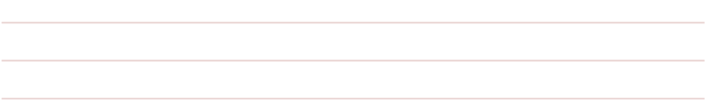
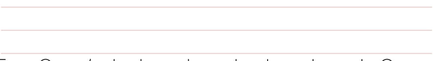
3. Öğretmen, Burcu’ya söz hakkı vermişti ancak Burcu konuşurken Efe parmak kaldırmaya devam ediyordu.
**Öğretmenin yerinde olsaydınız Efe’yle nasıl iletişim kurardınız?**
__________________________________________________________________
__________________________________________________________________

4. Esra, Gamze’ye kendisini çok üzen bir olayı anlatıyordu. Gamze, arkadaşını tepki vermeden dinliyordu. Esra üzgün bir şekilde Gamze’ye “Beni anladığını düşünmüyorum arkadaşım.” dedi.
**Gamze’nin yerinde olsaydınız Esra’yla nasıl iletişim kurardınız?**
__________________________________________________________________
__________________________________________________________________

<!-- sayfa 28 -->

# ARKADAŞLIK İLİŞKİLERİMİZ

## Hatırlayalım

➢ Görselleri inceleyelim.

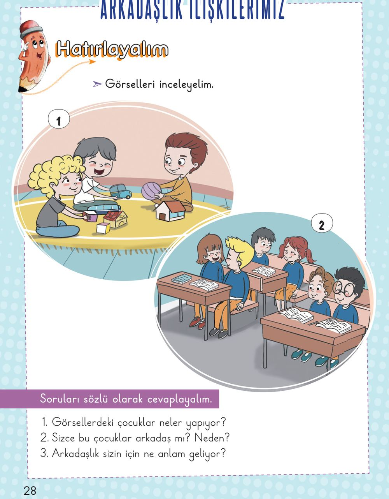

**Soruları sözlü olarak cevaplayalım.**

1. Görsellerdeki çocuklar neler yapıyor?
2. Sizce bu çocuklar arkadaş mı? Neden?
3. Arkadaşlık sizin için ne anlam geliyor?

<!-- sayfa 29 -->

# Keşfedelim
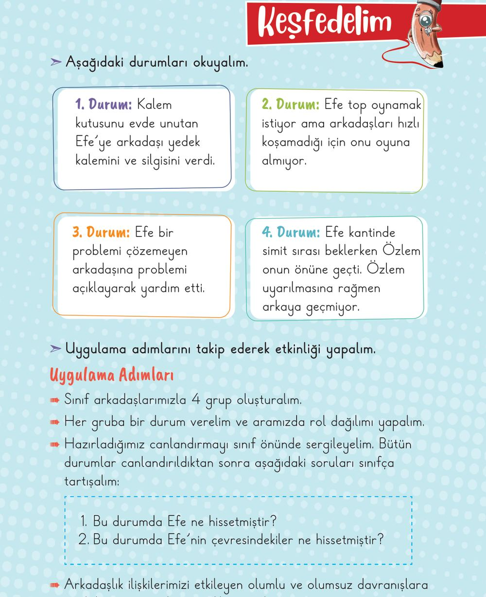

➢ Aşağıdaki durumları okuyalım.

> **1. Durum:** Kalem kutusunu evde unutan Efe’ye arkadaşı yedek kalemini ve silgisini verdi.

> **2. Durum:** Efe top oynamak istiyor ama arkadaşları hızlı koşamadığı için onu oyuna almıyor.

> **3. Durum:** Efe bir problemi çözemeyen arkadaşına problemi açıklayarak yardım etti.

> **4. Durum:** Efe kantinde simit sırası beklerken Özlem onun önüne geçti. Özlem uyarılmasına rağmen arkaya geçmiyor.

➢ Uygulama adımlarını takip ederek etkinliği yapalım.

## Uygulama Adımları

➠ Sınıf arkadaşlarımızla 4 grup oluşturalım.
➠ Her gruba bir durum verelim ve aramızda rol dağılımı yapalım.
➠ Hazırladığımız canlandırmayı sınıf önünde sergileyelim. Bütün durumlar canlandırıldıktan sonra aşağıdaki soruları sınıfça tartışalım:

> 1. Bu durumda Efe ne hissetmiştir?
> 2. Bu durumda Efe’nin çevresindekiler ne hissetmiştir?

➠ Arkadaşlık ilişkilerimizi etkileyen olumlu ve olumsuz davranışlara

<!-- sayfa 30 -->

# Bilgi Yolculuğumuz

## ARKADAŞLIK İLİŞKİLERİMİZ

Arkadaşlık ilişkilerimizde birbirimize karşı gösterdiğimiz davranışlardan karşılıklı olarak etkileniriz. Bazı davranışlarımız karşımızdakilerde olumlu duygulara yol açarak arkadaşlık ilişkilerimizi geliştirebilir. Bazı davranışlarımız ise olumsuz duygulara neden olarak arkadaşlık ilişkilerimize zarar verebilir.

| Olumlu Davranış Örnekleri | Hissedilebilecek Duygular |
| :--- | :--- |
| ♦ Selamlaşmak | Güven |
| ♦ Güler yüzlü davranmak | Sevgi |
| ♦ İsteklerimizi nazikçe dile getirmek | Saygı |
| ♦ Yardımlaşmak | Huzur |
| ♦ Nezaket sözcükleri kullanmak (lütfen, teşekkür ederim vb.) | Aidiyet |
| | Mutluluk |

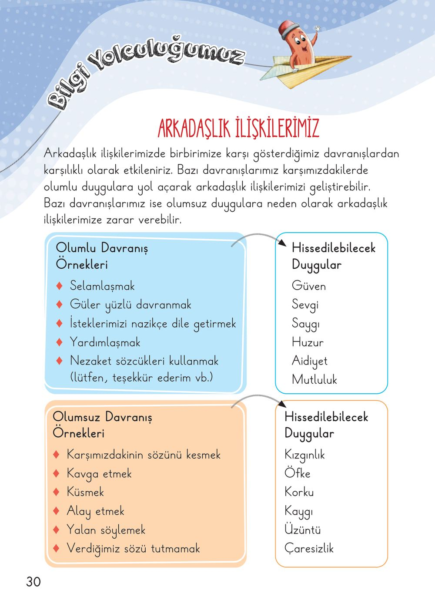

| Olumsuz Davranış Örnekleri | Hissedilebilecek Duygular |
| :--- | :--- |
| ♦ Karşımızdakinin sözünü kesmek | Kızgınlık |
| ♦ Kavga etmek | Öfke |
| ♦ Küsmek | Korku |
| ♦ Alay etmek | Kaygı |
| ♦ Yalan söylemek | Üzüntü |
| ♦ Verdiğimiz sözü tutmamak | Çaresizlik |

<!-- sayfa 31 -->

Olumlu davranışlarımızı artırmak ve olumsuz davranışlarımızı azaltmak için öncelikle kendi davranışlarımız ile ilgili öz değerlendirme yapabilmemiz gerekir. Bu değerlendirme güçlü ve zayıf yönlerimizi ortaya çıkararak davranışlarımızı geliştirmemizi sağlar. Her gün kendimize “Bugün arkadaşlarıma karşı davranışlarım nasıldı?” sorusunu sorabiliriz. Davranışlarımızda kontrollü olmaya çalışırız.

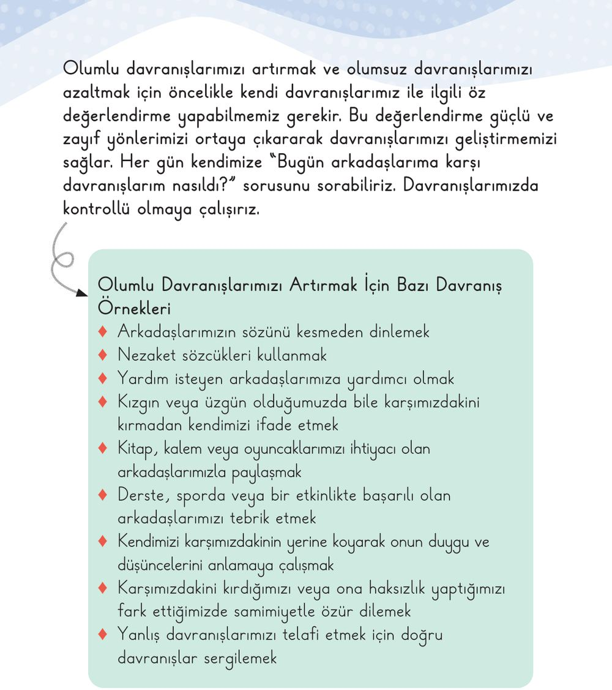

> ### Olumlu Davranışlarımızı Artırmak İçin Bazı Davranış Örnekleri
>
> ♦ Arkadaşlarımızın sözünü kesmeden dinlemek
>
> ♦ Nezaket sözcükleri kullanmak
>
> ♦ Yardım isteyen arkadaşlarımıza yardımcı olmak
>
> ♦ Kızgın veya üzgün olduğumuzda bile karşımızdakini kırmadan kendimizi ifade etmek
>
> ♦ Kitap, kalem veya oyuncaklarımızı ihtiyacı olan arkadaşlarımızla paylaşmak
>
> ♦ Derste, sporda veya bir etkinlikte başarılı olan arkadaşlarımızı tebrik etmek
>
> ♦ Kendimizi karşımızdakinin yerine koyarak onun duygu ve düşüncelerini anlamaya çalışmak
>
> ♦ Karşımızdakini kırdığımızı veya ona haksızlık yaptığımızı fark ettiğimizde samimiyetle özür dilemek
>
> ♦ Yanlış davranışlarımızı telafi etmek için doğru davranışlar sergilemek

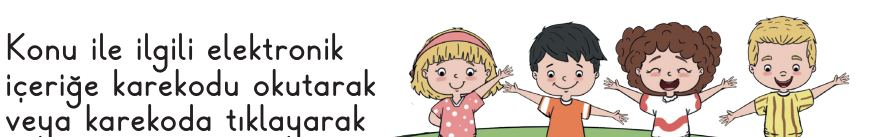

Konu ile ilgili elektronik içeriğe karekodu okutarak veya karekoda tıklayarak

<!-- sayfa 32 -->

# UYGULAYALIM

➢ Aşağıdaki örnek olayları okuyalım. Örnek olaylardan hangisinin olumlu, hangisinin olumsuz olduğunu sınıfça tartışalım.

> 1. Sınıfımıza yeni katılan arkadaşımızı teneffüste hep beraber oynamaya çağırdık.
> 2. Öğretmenimin sorduğu soruyu bilemediğimde bazı arkadaşlarımın bana güldüğünü fark ettim.
> 3. Futbol maçında golü kaçırdığı için üzülen arkadaşımızı bir dahaki maçta daha iyi olacağı konusunda motive ettik.
> 4. Arkadaşım çantamdan bana sormadan boya kalemlerimi almış.

➢ Okuduğumuz örnek olaylardan hareketle aşağıda verilen alana arkadaşlık ilişkilerimizi etkileyen olumlu ve olumsuz davranışları ve bu davranışlar sonucunda hissedebileceğimiz duyguları listeleyelim.

| | Arkadaşlık İlişkilerimi Etkileyen Davranışlar | Bu Davranışlar Sonucunda Hissettiklerim |
| :--- | :--- | :--- |
| Olumlu | | |
| Olumsuz | | |

**Soruları sözlü olarak cevaplayalım.**

1. Sizce hangi davranışlar arkadaşlıkları güçlendirir? Neden?
2. Bir arkadaşınızı üzdüğünüzü veya kırdığınızı fark ederseniz nasıl

<!-- sayfa 33 -->

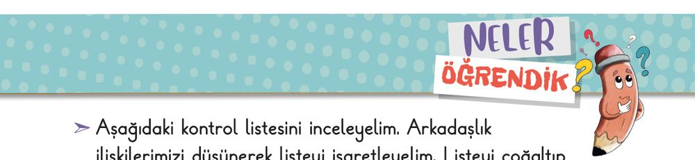

➢ Aşağıdaki kontrol listesini inceleyelim. Arkadaşlık ilişkilerimizi düşünerek listeyi işaretleyelim. Listeyi çoğaltıp hafta boyunca kullanalım. Zaman zaman listemizi tekrar inceleyerek arkadaşlık ilişkilerimizde kendimizi değerlendirelim.

| KONTROL LİSTESİ | | |
| :--- | :---: | :---: |
| **Davranışlar** | **Evet** | **Hayır** |
| 1. Duygu ve düşüncelerimi nazikçe ifade ederim. | | |
| 2. Arkadaşlarımın duygu ve düşüncelerine saygı gösteririm. | | |
| 3. İhtiyaç duyduklarında arkadaşlarıma destek olurum. | | |
| 4. Olumsuz davranışlar karşısında duygu ve düşüncelerimi kontrol edebilirim. | | |
| 5. Karşılaştığım olumsuz davranışları sorun yaratmadan, konuşarak çözmeye çalışırım. | | |

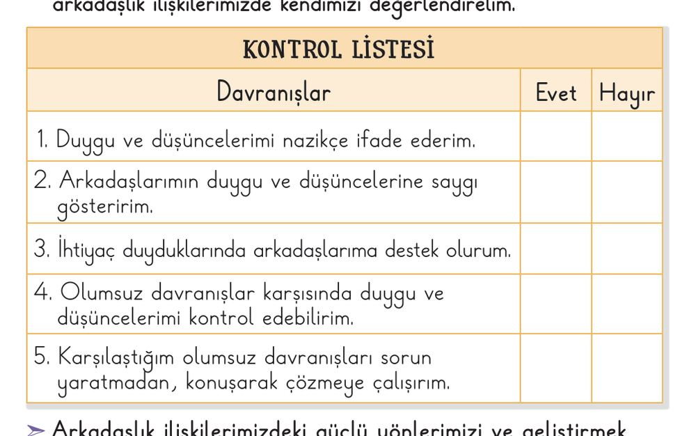

➢ Arkadaşlık ilişkilerimizdeki güçlü yönlerimizi ve geliştirmek istediğimiz özelliklerimizi düşünerek ilgili alanlara yazalım.

| |
| :--- |
| Güçlü Yönlerim: ........................................................................................................................................ |
| ...................................................................................................................................................................... |
| ...................................................................................................................................................................... |
| Geliştirmek İstediğim Özelliklerim: .......................................................................................................... |
| ...................................................................................................................................................................... |
| ...................................................................................................................................................................... |

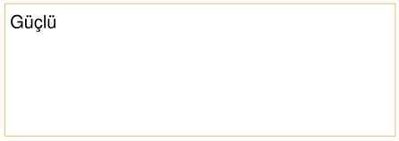

Arkadaşlık ilişkilerimizde geliştirmek istediğimiz özelliklerimizi güçlendirmek için neler yapabileceğimizi düşünelim. Davranışlarımızı

<!-- sayfa 34 -->

# KARAR VERME ZAMANI

## Hatırlayalım

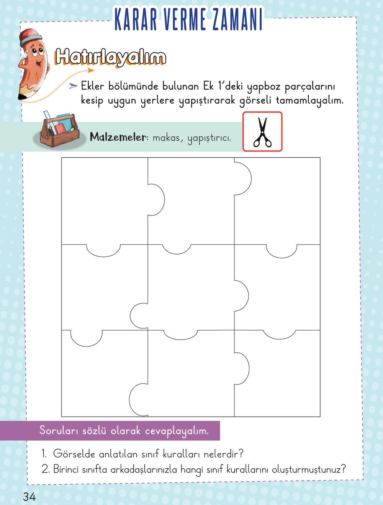

➣ Ekler bölümünde bulunan Ek 1’deki yapboz parçalarını kesip uygun yerlere yapıştırarak görseli tamamlayalım.

**Malzemeler:** makas, yapıştırıcı. 

### Soruları sözlü olarak cevaplayalım.

1. Görselde anlatılan sınıf kuralları nelerdir?
2. Birinci sınıfta arkadaşlarınızla hangi sınıf kurallarını oluşturmuştunuz?

<!-- sayfa 35 -->

# Keşfedelim

➢ Görseldeki öğrenciler okullarını ilgilendiren bir konuda görüşlerin paylaşarak ortak bir karar almaya çalışıyor. Konuşma balonlarındaki önerileri düşünelim. Bu öneriler değerlendirilirken nasıl davranılması gerektiğini söyleyelim.

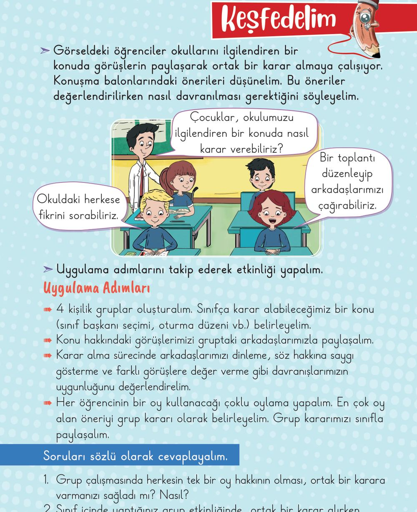
*   Çocuklar, okulumuzu ilgilendiren bir konuda nasıl karar verebiliriz?
*   Bir toplantı düzenleyip arkadaşlarımızı çağırabiliriz.
*   Okuldaki herkese fikrini sorabiliriz.

➢ Uygulama adımlarını takip ederek etkinliği yapalım.

## Uygulama Adımları

➠ 4 kişilik gruplar oluşturalım. Sınıfça karar alabileceğimiz bir konu (sınıf başkanı seçimi, oturma düzeni vb.) belirleyelim.
➠ Konu hakkındaki görüşlerimizi gruptaki arkadaşlarımızla paylaşalım.
➠ Karar alma sürecinde arkadaşlarımızı dinleme, söz hakkına saygı gösterme ve farklı görüşlere değer verme gibi davranışlarımızın uygunluğunu değerlendirelim.
➠ Her öğrencinin bir oy kullanacağı çoklu oylama yapalım. En çok oy alan öneriyi grup kararı olarak belirleyelim. Grup kararımızı sınıfla paylaşalım.

## Soruları sözlü olarak cevaplayalım.

1. Grup çalışmasında herkesin tek bir oy hakkının olması, ortak bir karara varmanızı sağladı mı? Nasıl?
2. Sınıf içinde yaptığınız grup etkinliğinde ortak bir karar alırken...

<!-- sayfa 36 -->

# Bilgi Yolculuğumuz

## SINIFTA KARAR ALIRKEN

Sınıf içinde birçok konuda ortak karar alırız.

* Sınıf oturma düzeninin oluşturulması
* Sınıf kurallarının oluşturulması
* Gezi, bayram kutlamaları gibi etkinliklerin belirlenip planlanması
* Panoların hazırlanması
* Sınıf başkanının belirlenmesi

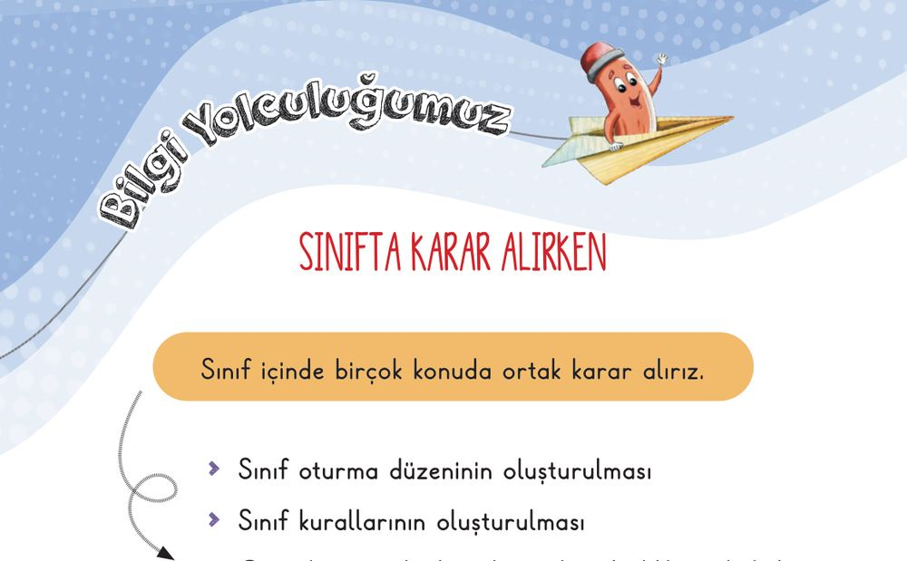

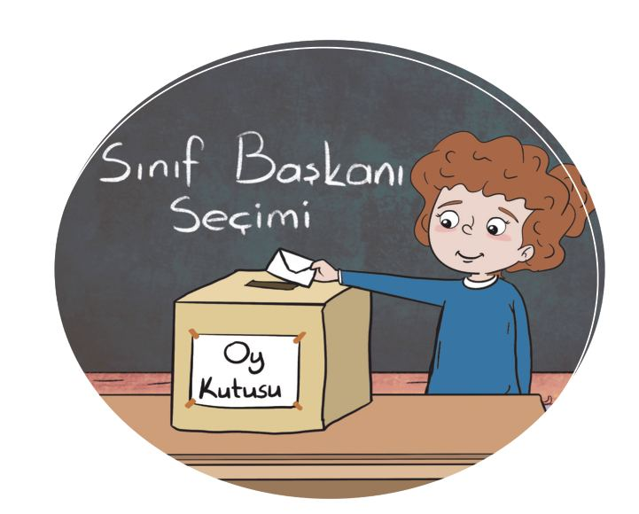

<!-- sayfa 37 -->

# Sınıf içi karar alma sürecinde

* düşüncelerimizi paylaşarak grup iletişimini başlatırız.
* arkadaşlarımızın fikirlerini dinler ve grup etkileşimine katılırız.
* görüş ve önerilerimizi söyleyerek grup iletişimine katkıda bulunuruz.
* farklı düşüncelere saygı gösteririz.
* tüm arkadaşlarımızın görüşlerini ifade etmelerine fırsat veririz.
* karar alma sürecini değerlendirerek neleri iyi yaptığımızı ve neleri geliştirebileceğimizi düşünürüz.

Etkili bir grup iletişimi kurarak ortak kararlar alır ve bu kararları birlikte uygularız.

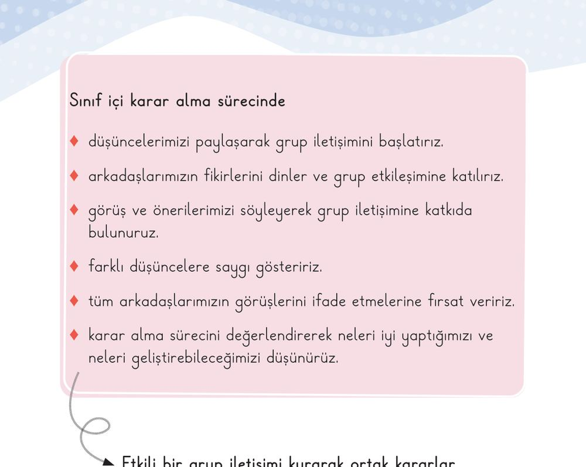
## Birlikte Karar Alırken Neler Yaparız?
Fikrimi söylerim.
Arkadaşlarımı dinlerim.
Düşüncelerimizi paylaşırız.
Kararımızı değerlendiririz.

 Konu ile ilgili elektronik içeriğe karekodu okutarak veya karekoda tıklayarak erişebiliriz.

<!-- sayfa 38 -->

# UYGULAYALIM

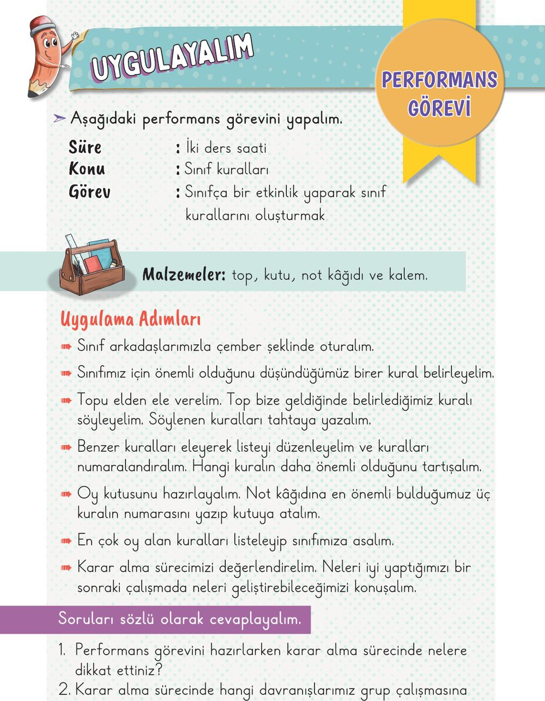

# PERFORMANS GÖREVİ

➢ Aşağıdaki performans görevini yapalım.

**Süre:** İki ders saati
**Konu:** Sınıf kuralları
**Görev:** Sınıfça bir etkinlik yaparak sınıf kurallarını oluşturmak

**Malzemeler:** top, kutu, not kâğıdı ve kalem.

## Uygulama Adımları

➠ Sınıf arkadaşlarımızla çember şeklinde oturalım.
➠ Sınıfımız için önemli olduğunu düşündüğümüz birer kural belirleyelim.
➠ Topu elden ele verelim. Top bize geldiğinde belirlediğimiz kuralı söyleyelim. Söylenen kuralları tahtaya yazalım.
➠ Benzer kuralları eleyerek listeyi düzenleyelim ve kuralları numaralandıralım. Hangi kuralın daha önemli olduğunu tartışalım.
➠ Oy kutusunu hazırlayalım. Not kâğıdına en önemli bulduğumuz üç kuralın numarasını yazıp kutuya atalım.
➠ En çok oy alan kuralları listeleyip sınıfımıza asalım.
➠ Karar alma sürecimizi değerlendirelim. Neleri iyi yaptığımızı bir sonraki çalışmada neleri geliştirebileceğimizi konuşalım.

**Soruları sözlü olarak cevaplayalım.**

1. Performans görevini hazırlarken karar alma sürecinde nelere dikkat ettiniz?
2. Karar alma sürecinde hangi davranışlarımız grup çalışmasına

<!-- sayfa 39 -->

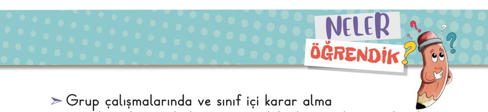

➢ Grup çalışmalarında ve sınıf içi karar alma süreçlerinde sergilediğimiz aşağıdaki davranışları inceleyelim. Bize en uygun olan “Her Zaman”, “Bazen” veya “Hiçbir Zaman” seçeneklerinden birini işaretleyelim.

# ÖZ DEĞERLENDİRME FORMU

| Davranışlar | Her Zaman | Bazen | Hiçbir Zaman |
| :--- | :---: | :---: | :---: |
| 1. Arkadaşlarımın sözünü keserim. | | | |
| 2. Fikrimi uygun zamanda söylerim. | | | |
| 3. Farklı görüşleri dinlerim. | | | |
| 4. Grup çalışmalarını değerlendiririm. | | | |
| 5. Ortak kararlara saygı gösteririm. | | | |

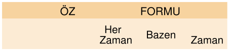

Formdaki davranışların tamamı için “Her Zaman” cevabını vermek sınıf içi karar alma süreçlerine ve grup iletişimine olumlu katkılarda bulunduğumuzu gösterir. “Bazen” veya “Hiçbir Zaman” işaretlediğimiz seçenekleri yeniden inceleyerek bu yönlerimizi geliştirmek için adımlar atabiliriz.

<!-- sayfa 40 -->

# ZAMANI

1. Aşağıda üç arkadaşın “Zamanı nasıl kullanmalıyız?” konusu üzerindeki tartışmaları yer almaktadır. Konuşma balonlarını dikkatlice okuyalım. Soruları cevaplayalım.

 **Emre**
> Bence okuldan eve gelince canımız ne isterse sadece onu yapmalıyız. Önce saatlerce tabletle oynayıp video izlemeliyiz. Canımız sıkılınca veya uykumuz gelince biraz ödev yaparız, ne fark eder ki?

 **Canan**
> Bence günümüzü mutlaka planlamalıyız arkadaşlar. Ders çalışmak, oyun oynamak, kitap okumak ve ailemizle güzel zaman geçirmek için en uygun süreleri önceden belirlemeliyiz. Zamanımızı planladığımızda daha düzenli ve başarılı olabiliriz.

 **Yusuf**
> Plan yapmak çok sıkıcı! Ben canım ne zaman isterse o zaman uyurum, ne zaman isterse o zaman yemek yerim. Canım istemezse o gün hiç ders de çalışmam! Bence kendimizi saatlerle kısıtlamamalıyız.

a. Yukarıdaki çocuklardan hangisinin düşüncesi zamanı verimli kullanmaya, başarılı ve düzenli olmaya katkıda bulunur? Doğru düşünen çocuğun altındaki kutucuğu boyayalım.

☐ Emre &nbsp;&nbsp;&nbsp;&nbsp; ☐ Canan &nbsp;&nbsp;&nbsp;&nbsp; ☐ Umut

b. Seçtiğiniz çocuğun neden haklı olduğunu düşünüyorsunuz?
__________________________________________________________________
__________________________________________________________________

c. Yanlış düşünen çocuklara planlı olmanın kişisel yaşama etkileri hakkında nasıl bir çözüm önerirdiniz?
__________________________________________________________________
__________________________________________________________________

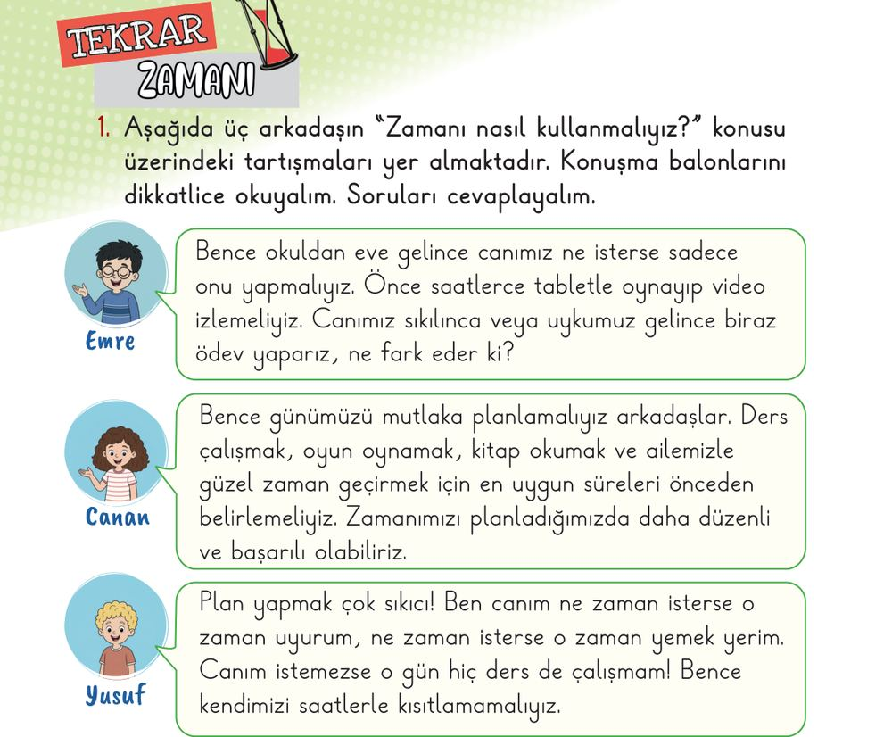
<!-- yer tutucu bulunamadı: sayfa sonuna eklendi -->

<!-- sayfa 41 -->

2. Cümlelerde boş bırakılan yerlere aşağıdaki sözcüklerden uygun olanları yazalım.

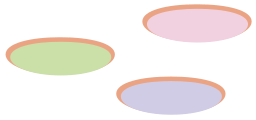

a. Duygu ve düşüncelerimizi akıcı ve .................................. cümleler kurarak ifade ederiz.

b. Söz istemeden önce konuşan kişinin .................................. bitirmesini bekleriz.

c. Öğretmenimizi veya arkadaşlarımızı dinlerken .................................. teması kurarız.

ç. İletişim kurarken karşımızdaki kişiye .................................. davranırız.

d. Öğretmen ve arkadaşlarımızla konuşurken uygun bir .................................. tonu kullanırız.

e. Karşımızdaki kişiyi dinlerken .................................. dilimizi kullanarak da

<!-- sayfa 42 -->

3. Metni okuyalım. Soruları metne göre cevaplayalım.

# Melis ve Hazal Teneffüste

Melis ikinci sınıf öğrencisidir. Öğretmeni geri dönüşüm ile ilgili bir araştırma ödevi vermiştir. Melis, öğle arasında sınıf kütüphanesinden konu ile ilgili kitaplar bulur ve kitapları okumaya başlar. Sınıf arkadaşı Barış da kütüphanededir. Melis’e ödevi ile ilgili kitap tavsiyesinde bulunur. Melis, Barış’a teşekkür eder. O sırada yakın arkadaşı Hazal, Melis’in yanına gelir. Babasının yeni bir top aldığını söyler ve bahçeye beraber çıkmayı teklif eder. Melis bahçeye gelmeyeceğini, ödevini tamamlamak istediğini söyler. Hazal bu cevabı duyunca kızar. Melis’in kendisine değer vermediğini söyler. Hazal sinirli bir şekilde sınıftan çıkar.

(Komisyon)

a. Arkadaşlık ilişkisini olumlu etkileyen davranışlar nelerdir? Bu davranış sonucunda hangi duygular hissedilmiş olabilir?
____________________________________________________________________________________________________
____________________________________________________________________________________________________

b. Arkadaşlık ilişkisini olumsuz etkileyen davranışlar nelerdir? Bu davranış sonucunda hangi duygular hissedilmiş olabilir?
____________________________________________________________________________________________________
____________________________________________________________________________________________________

c. Hazal arkadaşlık ilişkisinin olumsuz etkilenmemesi için davranışlarında ne gibi değişiklikler yapmalıdır?
____________________________________________________________________________________________________
____________________________________________________________________________________________________

ç. Melis veya Hazal’ın yerinde olduğunuzu düşündüğünüzde siz nasıl davranırdınız?
____________________________________________________________________________________________________
____________________________________________________________________________________________________

<!-- sayfa 43 -->

4. “Başla” kapısından etkinliğe başlayalım. Bulunduğumuz odadaki cümle doğru ise merdivenden yukarı çıkalım. Cümle yanlış ise doğru ifadenin bulunduğu yan odaya geçelim. Doğru çıkıştaki ifadeyi cümle içinde kullanalım. Cümlemizi boş bırakılan alana yazalım.

| İletişim Kurmak | Karar Almak | Saygılı Olmak |
| :--- | :--- | :--- |
| **1. Çıkış** | **2. Çıkış** | **3. Çıkış** |
| Sınıfça alınan kararlardan istediğimize uyarız. | Arkadaşımız ile aynı fikirde değilsek ona kızarız. | Sınıfça alınan kararları hep birlikte uygularız. |
| Alınan kararlara uymak zorunda değiliz. | Görüşlerimizle grup iletişimine katkıda bulunuruz. | Sınıfta bütün kararları öğretmen verir. |
| Farklı görüşlere saygı duyarız. | En çok oy alan fikre karar veririz. | Sınıfla ilgili kararları sınıf başkanı alır. |

**Cümle** ...........................................................................................................................................................

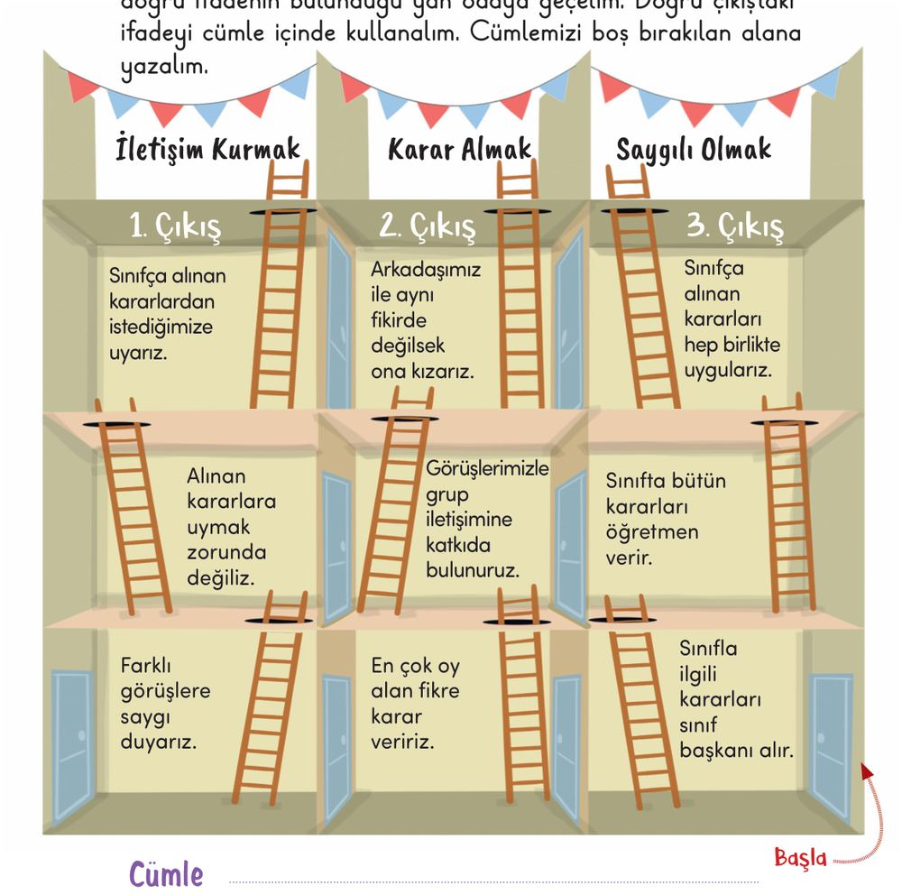 Ek sorulara karekodu okutarak veya karekoda tıklayarak erişebiliriz....

<!-- sayfa 44 -->

# 2. ÖĞRENME ALANI

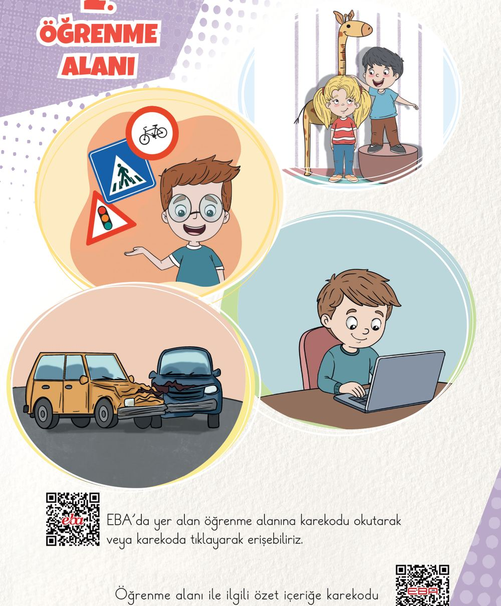

EBA’da yer alan öğrenme alanına karekodu okutarak veya karekoda tıklayarak erişebiliriz.

Öğrenme alanı ile ilgili özet içeriğe karekodu

<!-- sayfa 45 -->

# SAĞLIĞIM VE GÜVENLİĞİM

> Sağlıklı Alışkanlıklar
> Çevrim içi Güvenliğim
> Dikkat, Levha Çıkabilir!
> Acilse Ne Yaparım?

Bu öğrenme alanında

> sağlıklı büyüyüp gelişme ile alışkanlıklarımız arasındaki ilişkileri çözümlemeyi,
> çevrim içi ortamlarda kişisel güvenliğimizi sağlamayı,
> temel trafik işaret levhalarını tanımayı,
> acil bir durumda yetkililerle iletişim kurmayı öğreneceğiz.

## ANAHTAR KAVRAMLAR

> alışkanlıklar
> kişisel alan
> güvenlik
> trafik işaret levhaları
> acil durum

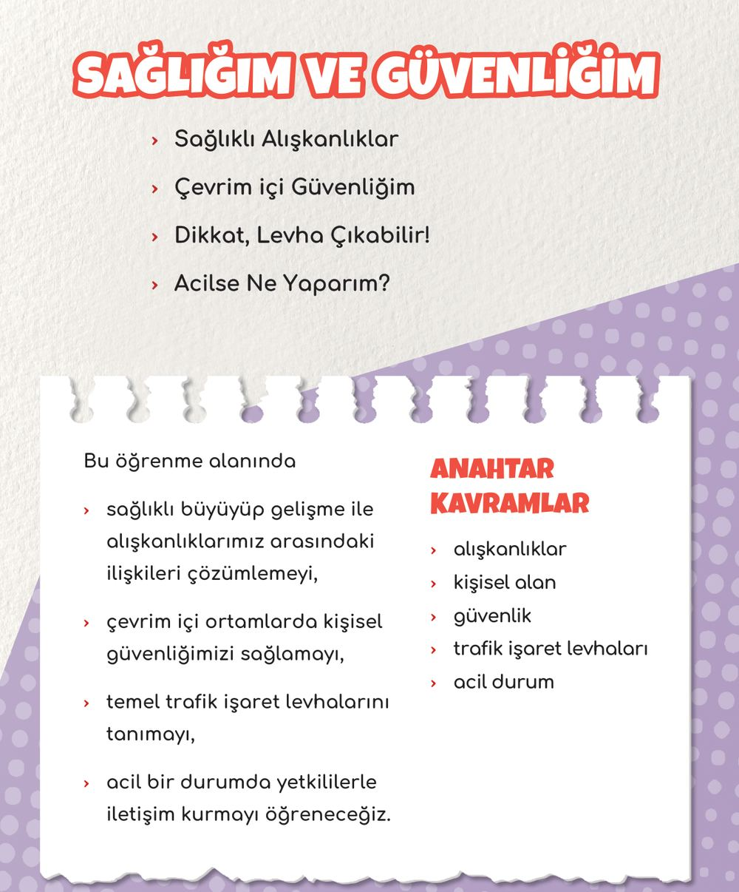
<!-- yer tutucu bulunamadı: sayfa sonuna eklendi -->

<!-- sayfa 46 -->

# BELİRLİ GÜN VE HAFTALAR
Belirli gün ve haftalarla ilgili şiirleri okuyalım.

## Kızılay Haftası
(29 Ekim-4 Kasım)

### KIZILAY YETİŞİR
Yangın, deprem, sel, çığ gibi afetler olabilir.
Kızılay’ın yardıma koşacağını herkes bilir.
Kalacak bir yer, bir tas çorba, bir battaniye...
Kan ihtiyacı olana da Kızılay yetişir.

## Atatürk Haftası
(10-16 Kasım)

### ATATÜRK’Ü ANMAK
Dokuzu beş geçe kalbimize dolar sızı.
Anıtkabir’e koşar kadını erkeği, genci yaşlısı.
Vatansever, dürüst, azimli, çalışkan...
Tüm özellikleriyle, saygıyla anarız Ata’mızı.

<!-- yer tutucu bulunamadı: sayfa sonuna eklendi -->

<!-- sayfa 47 -->

Belirli gün ve haftalar ile ilgili etkinliklere karekodu okutarak veya karekoda tıklayarak erişebiliriz. 

## Afet Eğitimi Hazırlık Günü
(12 Kasım)

### HAZIR OL, ZARARLARI KOV
Aniden çalar kapıyı, hayatımız olumsuz etkilenir.
Farkında olursak afetlere karşı alabiliriz tedbir.
Heyelan, deprem, çığ, sel, yangın...
Tatbikat yapan çocuklar nasıl davranacağını bilir.

## Dünya Çocuk Hakları Günü
(20 Kasım)

### HAKLARI OLAN BİR ÇOCUĞUM
Sağlıklı yaşamak ve gönlümce oynamak isterim.
Tehlikelerden korunursam güvende hissederim.
Vatanıma yararlı bir birey olabilmek için
Okula gitmek de en doğal hakkım benim.

## Öğretmenler Günü
(24 Kasım)

### ÖĞRETMEN NE İSTER?
Öğretmenler ne çiçek ister ne hediye,
Gurur duymak ister öğrencileriyle.
Olduysanız azimli, dürüst, çalışkan...
Dünyaları verdiniz öğretmeninize!

<!-- sayfa 48 -->

# SAĞLIKLI ALIŞKANLIKLAR

## Hatırlayalım

➢ Metni okuyalım.

### Hayat Bilgisi Dersimiz

Bugün öğretmenimiz derse başlayacakken sıra arkadaşım Semih’ten komik bir mide gurultusu geldi. Öğretmenimiz “Aramızda kahvaltı etmemiş bir arkadaşınız var galiba.” dedi. Hepimiz çok güldük. Biz hep birlikte gülünce Hale bir anda ayağa kalkıp bir yandan da gözlerini ovuşturarak “Ne oluyor?” diye seslendi. Öğretmenimiz “Anlaşıldı çocuklar. Dersimizin konusu tam bugüne göre sağlıklı büyüme ve gelişme ile alışkanlıklarımız arasındaki ilişki. Semih kahvaltısını etmemiş, Hale de yeterince uyumamış.”

(Komisyon)

---

Soruları cevaplayalım.

1. Semih ve Hale sağlıklı büyüme ve gelişmeyle ilgili gerekenleri yapıyorlar mı? Nedenini söyleyelim.
2. Sağlıklı büyüme ve gelişme için neler yapıyorsunuz? Zihin haritasındaki boş bırakılan yerlere yazalım.

Sağlıklı büyümek ve gelişmek için

<!-- sayfa 49 -->

# Keşfedelim

➣ Ali, sağlıklı büyüme ve gelişmeyle ilgili görselleri takip ederek çıkışa ulaşacaktır. Başlangıç noktasından başlayalım. Ali’nin geçeceği yolu çizgi ile çizerek Ali’yi bitişe ulaştıralım.

: Başlangıç noktasından bitiş noktasına kadar uzanan, içinde çeşitli nesnelerin (el yıkama, diş fırçalama, meyve tabağı, cips, lolipop, pasta, kirli eller) bulunduğu bir labirent yolu.

### Soruları sözlü olarak cevaplayalım.

1. Ali’nin geçtiği yolda sağlıklı büyüme ve gelişmeyle ilgili hangi alışkanlıkların görselleri vardır?

<!-- sayfa 50 -->

# Bilgi Yolculuğumuz

## SAĞLIKLI BÜYÜMEK VE GELİŞMEK İÇİN

Düzenli olarak spor yapmak vücudumuzun gelişmesine yardımcı olur. Bu nedenle ilgi alanlarımıza uygun spor dalları belirleriz. Spor yaparak sağlıklı ve dinç oluruz.

Spor

Et, süt, yumurta, yoğurt, sebze, meyve, baklagiller ve kuru yemişler sağlıklı besinlerdendir. Gazlı içecekler, cips, şeker gibi paketli yiyecekler ise sağlıksızdır. Bedensel ve zihinsel yönden sağlıklı olmak için öğün atlamayız ve sağlıklı yiyeceklerle besleniriz.

<!-- sayfa 51 -->

**Uyku**
Sağlıklı büyüyüp gelişebilmek için düzenli uykuya ihtiyaç duyarız. Akşamları erken uyuyup sabah erken uyanmaya özen gösteririz.

**Kişisel Bakım**
Ellerimizi yıkamak, banyo yapmak, dişlerimizi fırçalamak ve tırnaklarımızı kesmek kişisel bakımımız için gereklidir. Kişisel bakımımızı düzenli yaparsak hastalıklardan korunabiliriz.

**Temizlik**
Okul, sınıf, ev gibi yaşadığımız ortamları temiz tutmaya özen gösteririz. Yerlere çöp atmayız, kapalı ortamları belli aralıklarla havalandırırız. Sağlıklı ve temiz bir ortam ile bulaşıcı hastalıklardan da korunmuş oluruz.

Alışkanlıklarımız sağlıklı büyüyüp gelişmemizi doğrudan etkiler. Bu nedenle beslenme, temizlik, kişisel bakım, ağız ve diş sağlığı, uyku ve spor alışkanlıklarımızı geliştirmeliyiz.

 Konu ile ilgili elektronik içeriğe karekodu okutarak veya karekoda tıklayarak erişebiliriz.

<!-- sayfa 52 -->

# UYGULAYALIM

➣ Uygulama adımlarını takip ederek etkinliği yapalım.

**Malzemeler:** not kâğıdı ve kalem.

## Uygulama Adımları

➡ Sağlıklı büyüme ve gelişmeye ilişkin davranışlarımızı düşünelim. Ekler bölümündeki Ek 2’de verilen Öz Değerlendirme Formu’nu buna göre dolduralım.

➡ Sınıf arkadaşlarımızla 4–5 kişilik gruplar oluşturalım.

➡ Sağlıklı büyümek ve gelişmek için yapılması gerekenleri grup arkadaşlarımızla tartışalım. Konuşurken farklı fikirlere saygı gösterelim.

➡ Tartışma sonucunda sağlıklı büyüme ve gelişmeyle ilgili yapılması gerekenleri listeleyelim.

➡ Hazırladığımız listeyi sınıf arkadaşlarımızla paylaşalım. Listelerdeki maddeleri sınıfça tartışarak benzer düşünceleri birleştirelim. Listemizin son hâlini düzenleyelim.

➡ Hazırlanan listeyi görsellerle destekleyerek sınıf panosunda sergileyelim.

<!-- sayfa 53 -->

# NELER ÖĞRENDİK?

1. Eksik kalan ifadeleri uygun ifadelerle eşleştirerek cümleleri tamamlayalım. İfadelerin başındaki harfleri eşleştirdiğimiz ifadelerin başına yazalım.

( a )  Vücudumuzu temiz tutmak için  (   ) düzenli spor yaparız.
( b )  Yemeklerden sonra dişlerimizi (   ) temizliğine dikkat ederiz.
( c )  Vücudumuzun gelişip güçlenmesi için (   ) düzenli olarak banyo yaparız.
( ç )  Gün içinde ellerimizin (   ) alışkanlıklarımızı biliriz.
                                            (   ) düzenli olarak fırçalarız.

2. Doğru ifadelerin başına “D”, yanlış ifadelerin başına “Y” yazalım. Yanlış ifadelerin doğrularını altlarındaki boşluklara yazalım.

( ....... ) a. Tırnaklarımızın temizliğine ve bakımına dikkat ederiz.
__________________________________________________________________

( ....... ) b. Et, süt ve yumurta gibi sağlıklı yiyecekler yeriz.
__________________________________________________________________

( ....... ) c. Kişisel bakımımızı düzenli olarak yaparız.
__________________________________________________________________

( ....... ) ç. Akşamları geç uyuruz, sabahları geç kalkarız.
__________________________________________________________________

3. Yaşadığınız ortamı temiz ve düzenli tutmak için neler yaparsınız?
__________________________________________________________________

<!-- sayfa 54 -->

# ÇEVRİM İÇİ GÜVENLİĞİM

## Hatırlayalım

➣ Görselleri inceleyelim.

**Soruları sözlü olarak cevaplayalım.**

1. Kişisel alan sınırlarının ihlal edildiği görsel hangisidir? Neden?
2. Kişisel alan sınırlarınızı korumak için neler yapıyorsunuz?

<!-- sayfa 55 -->

# Keşfedelim

➣ Görselleri inceleyelim.

1
Kişisel bilgilerini paylaşma
Sadece tanıdığın kişilerle sohbet et
Güçlü şifre kullan ve kimseyle paylaşma
Tanımadığın kişilerin mesajlarına dikkat et
Rahatsız olduğun bir durumda güvendiğin bir yetişkinden yardım iste

Forma bilgilerinizi yazın. Sürpriz hediye kazanın.

## Soruları sözlü olarak cevaplayalım.

1. Görsellerdeki çocuklar, çevrim içi ortamda kişisel alan sınırlarını belirlemek ve bu sınırları korumak için neler yapabilirler?
2. Çevrim içi ortamlarda güvende olabilmek için neler yapıyorsunuz?

<!-- sayfa 56 -->

# Bilgi Yolculuğumuz

## ÇEVRİM İÇİ ORTAMLARDA KİŞİSEL GÜVENLİĞİM

Günümüzde tablet, telefon, bilgisayar gibi araçlarla genel ağı sıkça kullanıyoruz. Oyun oynarken, video izlerken veya mesajlaşırken çevrim içi ortamlarda bulunuyoruz. Bu ortamlarda güvende olmak için kişisel alanımızı korumalıyız.

Bu nedenle kimlik ve iletişim bilgilerimiz, fotoğraf ve şifreler gibi kişisel bilgilerimizin gizliliğine dikkat etmeliyiz. Genel ağda geçerli yaş sınırlamalarına ve ailemizle belirlediğimiz kurallara uymalıyız.

**Tanımadığımız kişilerin bizden**

* kişisel bilgilerimizi istemeleri,
* şifrelerimizi öğrenmeye çalışmaları,
* fotoğraf veya video göndermemizi istemeleri veya bize fotoğraf, video ve ısrarla mesaj göndermeleri kişisel alanımızı ihlal eder.

**Çevrim içi ortamlarda güvenli olmak için**

* kişisel bilgilerimizi paylaşmamalıyız.
* güçlü ve gizli şifreler kullanmalıyız.
* tanımadığımız kimselerle iletişim kurmamalıyız.
* şüpheli durumlarda hemen bir aile büyüğüne veya öğretmenimize haber vermeliyiz.

Kimlik, fotoğraf, adres, şifre, kişisel bilgilerimizle ilgili sınırlarımızdır. Örneğin çevrim içi ortamlarda kullandığımız şifreleri en yakın

<!-- sayfa 57 -->

# Çevrim İçi Ortamları İhlal Eden Davranışlar

♦ Bir kişinin iletisini, fotoğrafını, adresini, telefon veya şifre bilgilerini izinsiz paylaşmak

♦ Yüz yüze veya çevrim içi ortamlarda ailemizin izin verdiği sınırlar dışında paylaşımlarda bulunmak

## Çevrim İçi Ortamda Kişisel Alan Sınırlarımızı Korumak İçin Yapılabilecekler

♦ Rahatsız eden mesajlar veya istekler karşısında kararlı bir şekilde “Hayır!” demek ve iletişimi sonlandırmak

♦ Kişisel bilgilerimizi isteyen, bizi rahatsız eden, tehdit eden veya nazikçe bile olsa ısrarcı davranan kişileri engellemek ve durumu aile büyüklerimize bildirmek

♦ Güvensiz olduğunu düşündüğümüz çevrim içi ağ, oyun veya uygulamadan hemen çıkmak ve güvenli ortamlara yönelmek

♦ Çevrim içi ortamda kişisel alan sınırlarımızla ilgili rahatsız olduğumuz davranışlarla karşılaştığımızda ailemizden, öğretmenlerimizden yardım istemek

  Konu ile ilgili elektronik içeriğe karekodu okutarak veya karekoda tıklayarak erişebiliriz

<!-- sayfa 58 -->

# UYGULAYALIM

➢ Aşağıdaki örnek olayı ve çocukların bu konuyla ilgili söylediklerini okuyalım. Konu ile ilgili düşüncemizi söyleyelim.

> **Örnek Olay**
> Aslı, okul kermesinde velilerin haberleşmesi için çevrim içi bir grup kuracaktı. Bunun için arkadaşlarından ailelerinin telefon numaralarını istedi.

Hande: Anneme sormadan onun telefon numarasını paylaşamam.
İsmail: Tabii, hemen söylüyorum.

➢ Uygulama adımlarını takip ederek etkinliği yapalım.

## Uygulama Adımları

➠ Sınıf arkadaşlarımızla 4 kişilik gruplar oluşturalım.
➠ Aşağıdaki durumları inceleyelim. Bu durumlar karşısında neler yapabileceğimizi grup arkadaşlarımızla tartışalım. 

1. Akif ve Eylül çevrim içi ders yaparken Eylül, ders sırasında sohbet bölümüne gereksiz mesajlar ve emojiler göndererek ekranı karıştırıyor.
2. Fatma, çevrim içi ortamda araştırma yaparken önüne bir sayfa çıktı. Sayfada anne ve babasının adı, işi, adresi ile ilgili bilgiler soruluyordu.
3. Ayşegül, Ahmet ve Enes çevrim içi bir oyunda oynarken tanımadıkları biri onlardan fotoğraflarını göndermelerini istiyor.

<!-- sayfa 59 -->

➢ Aşağıdaki örnek durumları okuyalım. Bu durumlarda yapılması gerekenleri boş bırakılan alanlara yazalım.
➢ Ekler bölümündeki Ek 3’te verilen Öz Değerlendirme Formu’nu dolduralım.

| Örnek Durumlar | Yapılması Gerekenler |
| :--- | :--- |
| 1. Çevrim içi ortamda tanıştığımız biri fotoğrafımızı göndermemizi isterse... | |
| 2. Çevrim içi ortamda veya e-posta yoluyla tanımadığımız bir kişi ısrarla mesaj gönderirse... | |
| 3. Çevrim içi ortamda biri bizimle alay eder ve hoşlanmadığımız isimlerle bize seslenirse... | |
| 4. Çevrim içi ortamda tanımadığımız biri bize hediye puan vermek ister ve bunun için ısrar ederse... | |

<!-- sayfa 60 -->

# DİKKAT, LEVHA ÇIKABİLİR!

## Hatırlayalım

➣ Uygulama adımlarını takip ederek etkinliği yapalım.

**Malzemeler:** kutu, not kâğıtları ve kalem.

## Uygulama Adımları

➠ Not kâğıtlarına sınıftaki öğrenci sayısı kadar rol yazalım (Yaya, trafik polisi, sürücü, özel gereksinimli birey, dede, nine gibi rollere yer verebiliriz.). Kâğıtları bir kutuya koyalım.

➠ Sınıf arkadaşlarımızla 5 veya 6 kişilik gruplar oluşturalım.

➠ Kutudan birer not kâğıdı seçerek rollerimizi öğrenelim.

➠ Bir trafik kuralını grup olarak belirleyelim. Belirlediğimiz kurala ve gruptaki rollerimize uygun senaryo hazırlayalım.

➠ Senaryolarımızı sırayla canlandıralım.

**Soruyu sözlü olarak cevaplayalım.**

Hazırladığınız senaryolarda hangi trafik kurallarına yer verdiniz?

<!-- sayfa 61 -->

# Keşfedelim

➣ Uygulama adımlarını takip ederek etkinliği yapalım.

**Malzemeler:** makas.

## Uygulama Adımları

➠ Ekler bölümünde bulunan Ek 4’teki kartları noktalı yerlerden keselim.

➠ Oyunu 2 veya 4 kişi oynayabiliriz. Kartları trafik işaret levhaları görünmeyecek şekilde sıramıza koyalım. Kapalı kartları aramızda eşit şekilde paylaşalım.

➠ Oyuna başlayacak oyuncuyu sayışma yaparak belirleyelim. İlk oyuncunun kendi istediği kartı ortaya koymasını bekleyelim. Kartları aynı trafik işaret levhalarını koymaya devam ederek uç uca ekleyelim.

➠ Oyun oynarken ortaya koyduğumuz kartların anlamlarını söyleyelim veya tahmin edelim.

➠ Bazı durumlarda oyuncuların elinde ortaya koyacakları uygun kart olmayabilir. Bu durumda sıra karşı oyuncuya geçer. Karşı oyuncunun koyduğu karta göre oyun devam eder. Tüm hamleler yapıldıktan sonra kartları biten veya elinde en az kart kalan oyuncu oyunu kazanır.

## Soruları sözlü olarak cevaplayalım.

1. Oyundaki trafik işaret ve levhalarından hangilerini günlük yaşamınızda görüyorsunuz?
2. Günlük yaşamınızda karşılaştığınız trafik işaret ve levhaları nelerdir?

<!-- sayfa 62 -->

# Bilgi Yolculuğumuz

## TRAFİK İŞARET LEVHALARI

Yayalara bilgi vermek amacıyla yollarda bazı trafik işaret levhaları bulunur.

**Yaya Geçidi:** Yaya geçidinden kontrollü olarak karşıya geçilebilir.

**Okul Geçidi:** Okul geçidinden kontrollü olarak karşıya geçilebilir.

**Alt Geçit:** Alt geçitten karşıya geçilebilir.

**Üst Geçit:** Üst geçitten karşıya geçilebilir.

Bu trafik işaret levhalarının olduğu yerlerden güvenle karşıya geçebiliriz.

Sürücüleri uyarmak amacıyla yollarda bazı trafik işaret levhaları bulunur.

Babam araç kullanırken bu trafik işaret levhalarını gördüğünde aracın hızını düşürüyor.

**Yaya Geçidi:** Yaya geçidinden kontrollü olarak karşıya geçilebilir.

**Okul Geçidi:** Okul geçidinden kontrollü olarak karşıya geçilebilir.

**Işıklı İşaret Cihazı:** Işıklı işaret cihazı olduğunu gösterir.

<!-- sayfa 63 -->

Trafiği düzenlemek amacıyla yollarda bazı trafik işaret levhaları bulunur.

* **Bisiklet Giremez:** Bu yolda bisiklet sürmek yasaktır.
* **Yaya Giremez:** Bu yola yayaların girmesi yasaktır.
* **Mecburi Bisiklet Yolu:** Bisiklet sürmek için bu yol kullanılmalıdır.
* **Mecburi Yaya Yolu:** Yayalar bu yolu kullanmalıdır.

Kırmızı çember içindeki trafik işaret levhaları yasakları anlatıyor, fark ettin mi?

Trafik işaret levhalarını bilmek hem kendi güvenliğimiz hem de diğer insanların güvenliği için önemlidir. Trafik kurallarına uyduğumuzda, trafik işaret levhalarına dikkat ettiğimizde trafikte güvende olabiliriz. Bu nedenle trafik kurallarına ve işaret levhalarına uymak, toplumsal hayattaki görev ve sorumluluğumuzdur.

Konu ile ilgili elektronik içeriğe karekodu okutarak veya karekoda tıklayarak erişebilirsiniz.

<!-- sayfa 64 -->

➣ Afişi inceleyelim.

# KURALLARA UYALIM, GÜVENDE OLALIM

***

Soruları sözlü olarak cevaplayalım.

1. Afişte hangi trafik işaret levhalarına yer verilmiştir?

<!-- sayfa 65 -->

➣ Uygulama adımlarını takip ederek etkinliği yapalım.

**Malzemeler:** A4 kâğıtları ve kalem. 

# Uygulama Adımları

➠ Sınıf arkadaşlarımızla üç grup oluşturalım. Bir öğrenciyi hakem olarak belirleyelim. Her grubun üçer tane trafik işaret levhası belirlemesini sağlayalım.

➠ Belirlediğimiz trafik işaret levhalarını A4 kâğıtlarına çizelim.

➠ Okul bahçesine çıkalım. Çizdiğimiz trafik işaret levhalarını okul duvarına yapıştıralım.

➠ Okul duvarından on metre uzaklıkta başlangıç çizgisi çizelim. Başlangıç çizgisinin arkasına gruplar tek sıra olacak şekilde dizilelim.

➠ “Başla” işareti ile birlikte duvara doğru koşalım. Hakemin söylediği trafik işaret levhasını gösterelim (Önce giden ve levhayı doğru gösteren öğrenci grubuna puan kazandırır. Tüm öğrenciler bu şekilde oyuna dâhil edilir.).

➠ Oyunun sonunda en çok puan alan grubu tebrik edelim.

## Soruları sözlü olarak cevaplayalım.

1. Trafik işaret levhaları niçin gereklidir?
2. Trafik işaret levhaları olmasaydı neler olurdu?

<!-- sayfa 66 -->

# UYGULAYALIM

# PERFORMANS GÖREVİ

➢ Aşağıdaki performans görevini yapalım.

**Süre:** İki ders saati
**Konu:** Resimli trafik işaret levhaları albümü
**Görev:** Temel trafik işaret levhası görsellerini çizmek ve bir albüm oluşturmak

**Malzemeler:** makas, renkli kartonlar, beyaz kâğıt, yapıştırıcı, zımba, boya kalemleri ve cetvel.

## Uygulama Adımları

➢ Ekler bölümünde bulunan Ek 5’teki otomobil şablonunu keselim.
➢ Renkli kartonların üzerine şablon yardımıyla otomobil çizelim. Çizdiğimiz otomobilleri keselim. Çizimimizi istediğimiz sayıda çoğaltalım. Hazırladığımız otomobil şeklindeki kartonları albüm sayfası olarak kullanalım.
➢ Beyaz kâğıtlara temel trafik işaret levhası görsellerini cetvel ve renkli kalemler kullanarak çizelim. Doğru renkleri kullandığımıza emin olalım.
➢ Levhaların anlamlarını altlarına yazalım.
➢ Hazırladığımız trafik işaret levhalarını albümümüzün sayfalarına yapıştıralım.
➢ Albümün kapağını hazırlayalım ve süsleyelim. Kapağa adımızı yazalım.
➢ Sayfaları dizip kapağı en başa koyalım. Albümü sol tarafından zımbalayalım.
➢ Albümümüzü arkadaşlarımıza tanıtalım. Çizdiğimiz trafik  işaret levhalarının anlamlarını söyleyelim....

<!-- sayfa 67 -->

<!-- yer tutucu bulunamadı: sayfa sonuna eklendi -->

<!-- yer tutucu bulunamadı: sayfa sonuna eklendi -->

<!-- yer tutucu bulunamadı: sayfa sonuna eklendi -->

<!-- yer tutucu bulunamadı: sayfa sonuna eklendi -->

<!-- yer tutucu bulunamadı: sayfa sonuna eklendi -->

<!-- sayfa 68 -->

# ACİLSE NE YAPARIM?

## Hatırlayalım

➢ Görselleri inceleyelim.

## Soruları sözlü olarak cevaplayalım.

1. Trafikte bu araçları gördüğünüzde ve siren seslerini duyduğunuzda ne düşünürsünüz?
2. “Acil durum” ne demektir?
3. Acil bir durumla karşılaştığınızda neler yaparsınız?

<!-- sayfa 69 -->

# Keşfedelim 

➢ 1-1-2 Acil Çağrı Merkezi yetkilisi ile arayan kişi arasındaki konuşma metnini okuyalım.

## 1-1-2 Arandığında

**Yetkili:** 1-1-2 Acil Çağrı Merkezi, buyurun.  
**Arayan kişi:** Benim adım Ayşegül.  
**Yetkili:** Evet Ayşegül Hanım, sorun nedir?  
**Arayan kişi:** Ben ambulans istiyorum.  
**Yetkili:** Olay nedir?  
**Arayan kişi:** Polis de olur, lütfen buraya çok hızlı gelsinler!  
**Yetkili:** Olay hakkında bilgi verir misiniz?  
**Arayan kişi:** Burada trafik kazası oldu. Araçların fren sesi ile balkona çıktım. Balkondan görüyorum, arabalardan dumanlar çıkıyor. Araçlardan bir tanesi de kamyonet.  
**Yetkili:** Yaralı var mı? Görebiliyor musunuz?  
**Arayan kişi:** Emin değilim.  
**Yetkili:** Ayşegül Hanım, adres nedir?  
**Arayan kişi:** Dumanlar çok arttı, itfaiye de gelsin lütfen!  
**Yetkili:** Ayşegül Hanım, adres nedir? Paylaşabilir misiniz?  
**Arayan kişi:** Söylemedim mi ben adresi? Hemen söylüyorum: Akdeniz Caddesi Mavi Sokak Numara: 15.  
**Yetkili:** Hattan ayrılmayın lütfen!  
**Arayan kişi:** (Telefonu kapatır, sinyal sesi duyulur.)

### Soruları sözlü olarak cevaplayalım.

1. Metne göre doğru, yanlış ve eksik davranışlar hangileri olabilir?  
2. Böyle bir durumda arayan kişi siz olsaydınız nasıl iletişim kurardınız?

➢ Acil bir durumda 1-1-2 Acil Çağrı Merkezi ile nasıl iletişim kurabileceğinizi sıra arkadaşınız ile tartışarak kendi aranızda...

<!-- sayfa 70 -->

# Bilgi Yolculuğumuz

## ACİL DURUMLARDA İLETİŞİM

Evde, okulda, parkta veya sokakta acil bir durum ile karşılaşabiliriz. Deprem, yangın, sel, gaz kaçağı, zehirlenme, trafik kazası gibi durumlar acil durumlara örnektir.

Acil bir durum olduğunda en kısa zamanda “1-1-2 Acil Çağrı Merkezi” aranmalıdır.

Acil Çağrı Merkezi 7 gün 24 saat ücretsiz olarak hizmet vermektedir. Telefonda hat olmasa da 1-1-2 tuşlanarak Acil Çağrı Merkezi aranabilir.

<!-- sayfa 71 -->

> Acil durumlarda yetkililer ile iletişim kurarken nelere dikkat ederiz?
>
> ♦ Sakin kalmaya çalışırız, sabırlı oluruz. Olumlu düşünmeye çalışırız.
>
> ♦ Yetkili tarafından sorulan sorulara kısa, net ve anlamlı cevaplar veririz.
>
> ♦ Acil durumun tanımını yaparız.
>
> ♦ Hasta veya yaralı sayısı ve durumları hakkında bilgi veririz.
>
> ♦ Herhangi bir ilk yardım uygulaması yapıldıysa bunun ne olduğunu söyleriz.
>
> ♦ Olayın olduğu yer, zaman ve adres bilgilerini söyleriz. Olay yerine yakın bir caddenin veya çok bilinen bir yerin adını verebiliriz.
>
> ♦ Kendimizi tanıtır, telefon numaramız istenirse veririz.
>
> ♦ Acil Çağrı Merkezi yetkilisi tarafından verilen talimatları yerine getiririz.
>
> ♦ Acil Çağrı Merkezi onayladığında telefonu kapatırız.

1-1-2 Acil Çağrı Merkezi sadece acil durumlar için hizmet vermektedir. 
1-1-2 Acil Çağrı Merkezi gereksiz çağrılarla meşgul edilmemelidir. 
Gereksiz aramalar, acil durumlara müdahale edilmesini geciktirebilir.

 Konu ile ilgili elektronik içeriğe karekodu okutarak veya karekoda tıklayarak erişebiliriz.

<!-- sayfa 72 -->

# UYGULAYALIM

➢ Ekler bölümündeki Ek 6’daki Acil Durum Bilgi Kartı’nı dolduralım. Kartı noktalı alanlardan keselim ve yanımızda taşıyalım.
➢ Hazırladığımız acil durum bilgi kartını hangi durumlarda kullanabileceğimize örnek verelim.
➢ Örnek durumları okuyalım. Uygulama adımlarını takip ederek etkinliği yapalım.

**1. Durum**
Parkta bisikletlerini hızlı süren iki çocuk, sert bir şekilde çarpıştı. Çocuklardan biri yerde yaralı olarak yatıyor.

**2. Durum**
Evimizin karşısındaki dükkânın kapısını açmaya çalışan yabancı kişiler gördük.

**3. Durum**
Komşumuzun bahçesinden dumanlar yükseliyor.

## Uygulama Adımları

➠ Sınıf arkadaşlarımızla 2 kişilik gruplar oluşturalım.
➠ Birimiz 1-1-2 Acil Çağrı Merkezini arayan kişi, birimiz telefona cevap veren yetkili kişi olacak şekilde rollerimizi belirleyelim.
➠ Yukarıdaki acil durum örneklerini canlandıralım.
➠ Rollerimizi değiştirerek canlandırmayı tekrarlayalım.

### Soruları sözlü olarak cevaplayalım.

1. Acil Çağrı Merkezi yetkilisiyle konuşurken nelere dikkat ettiniz?
2. Acil Çağrı Merkezi yetkilisini dinlerken nelere dikkat ettiniz?

<!-- sayfa 73 -->

# NELER ÖĞRENDİK?

➢ Acil Çağrı Merkezi yetkilisiyle iletişim kurarken yapılması gereken doğru davranışları belirleyelim. Doğru davranışların numaralarını altta verilen sarı kutuya yazalım. Yanlış davranışların numaralarını mavi kutuya yazalım, doğrularını söyleyelim.

1
Olaydan etkilenen kişi sayısı ve bu kişilerin durumları hakkında bilgi verilir.

2
Yetkili ile panik hâlinde konuşulur.

3
Olayın geçtiği yer ve zaman hakkında bilgi verilir.

4
Yetkilinin yönlendirmeleri yerine çevredekileri dinlemek gerekir.

5
Arayan kişi yetkiliye kendini tanıtır.

6
Yetkilinin sorularına uzun uzun cevaplar verilir.

7
Yetkili söyleyene kadar telefon açık tutulur.

<!-- sayfa 74 -->

# ZAMANI

1. Sağlıklı büyüme ve gelişmeye uygun alışkanlıkların olduğu görsellerin altındaki kutuları işaretleyelim. Sağlıklı büyüme ve gelişme ile ilgili alışkanlıklarımıza örnek verelim.

a

[]

b

[]

c
[]

ç
[]

d
[]

e
[]

<!-- sayfa 75 -->

2. Çevrim içi ortamlarda kişisel güvenlik ile ilgili doğru cümlelerin başındaki heceleri boyayalım. Heceleri aşağıdaki kutuya sırayla yazarak şifreyi bulalım.

 ÖR Çevrim içi ortamlarda tanımadığım kişilerden gelen arkadaşlık isteklerini kabul ederim.
 GÖR Çevrim içi ortamda e-posta adresimin izinsiz paylaşıldığını görürsem bu durumu görmezden gelirim.
 GÜ Kendi fotoğraflarımı veya ailemin fotoğraflarını çevrim içi ortamda paylaşmadan önce mutlaka büyüklerime sorarım.
 YE Çevrim içi bir oyunda kaynağını bilmediğim bir bağlantı (link) gönderilirse ona tıklarım.
 VEN Çevrim içi ortamda kullandığım şifreleri ve ev adresimi ailem dışında hiç kimseyle paylaşmam.
 LIK Çevrim içi ortamlarda birisi benden özel bilgilerimi isterse bilgilerimi isteyen kişiye veririm.
 ÇI Çevrim içi ortamlarda ücretsiz ödül vermek isteyen sitelerle kişisel bilgilerimi paylaşırım.
 DE Çevrim içi ortamlarda kişisel bilgilerimi paylaşmam gerekirse önce aileme danışırım.
 OL Tanımadığım kişilerden gelen mesajları açmam ve onlarla genel ağ üzerinden konuşmam.

ŞİFRE: ____________________________________

<!-- sayfa 76 -->

3. Aşağıdaki trafik işaret levhalarının anlamlarının doğru veya yanlış olduğunu belirleyelim. Başlangıç noktasından başlayalım. Yönlendirmeler doğrultusunda ok işareti çizerek ilerleyelim. Ulaştığımız ilin altındaki kutuyu işaretleyelim.

| Trafik İşaret Levhaları | Doğru | Yanlış |
| :--- | :--- | :--- |
| 1.  Yaya Giremez | 4 aşağı | 6 sağa |
| 2.  Okul Geçidi | 5 aşağı | 1 sağa |
| 3.  Üst Geçit | 6 sağa | 3 sola |
| 4.  Işıklı İşaret Cihazı | 3 aşağı | 2 sola |

| | | | | | | | | |
|---|---|---|---|---|---|---|---|---|
| | | | | | | | | |
| | | | | | | | | |
| | | | | | | | | |
| | | | | | | | | |
| | | | | | | | | |
| | | | | | | | | |
| | | | | | | | | |
| | | | | | | | | |
| | | | | | | | | |

 Giresun
[ ]

 Edirne
[ ]

 Van
[ ]

 Mersin
[ ]

4. Trafik işaret levhalarına uymanın toplumsal açıdan önemi nedir?

<!-- sayfa 77 -->

5. 1-1-2 Acil Çağrı Merkezi yetkilisiyle iletişim kurarken yapılan doğru davranışları maviye, yanlış davranışları kırmızıya boyayalım. Oluşan şeklin altındaki kutuyu işaretleyelim.

(Diyagram içeriği):
- telefonu istediğim zaman kapatırım.
- kısa ve net cevaplar veririm.
- eksik ve yanıltıcı bilgi veririm.
- bilgi vermekten kaçınırım.
- 1-1-2 Acil Çağrı Merkezi yetkilisiyle iletişim kurarken
- yetkiliye olaydan etkilenen kişi sayısı hakkında bilgi veririm.
- olayı sakince anlatırım.
- yetkiliyle sohbet ederim.
- olayın geçtiği yerin adresini veririm.

   

Ek sorulara karekodu okutarak veya karekoda tıklayarak erişebiliriz.

<!-- sayfa 78 -->

# 3. ÖĞRENME ALANI

EBA’da yer alan öğrenme alanına karekodu okutarak veya karekoda tıklayarak erişebiliriz.

Öğrenme alanı ile ilgili özet içeriğe karekodu

<!-- sayfa 79 -->

# AİLEM VE TOPLUM

> Canım Ailem
> Toplumda Nezaket ve Görgü
> Görevim, Sorumluluğum

Bu öğrenme alanında

> ailenin önemini yorumlayabilmeyi,
> toplumsal yaşamda nezaket ve görgü kurallarına uygun davranabilmeyi,
> yakın çevremizde üzerimize düşen görev ve sorumlulukları günlük yaşamımıza yansıtabilmeyi öğreneceğiz.

## ANAHTAR KAVRAMLAR

> aile
> nezaket ve görgü kuralları
> görev ve sorumluluk

<!-- yer tutucu bulunamadı: sayfa sonuna eklendi -->

<!-- sayfa 80 -->

# BELİRLİ GÜN VE HAFTALAR

Belirli gün ve haftalarla ilgili aşağıdaki şiirleri okuyalım.

## Dünya Engelliler Günü
(3 Aralık)

### ANLAYIŞ VE SAYGI
Aynı dünyayı paylaşsak da
İhtiyaçlarımız farklı farklı.
Özel gereksinimli bireyler olarak
Beklediğimiz, anlayış ve saygı.

## İnsan Hakları ve Demokrasi Haftası
(10 Aralık gününü içine alan hafta)

### HERKES İÇİN DEMOKRASİ
Demokrasi ile seçeriz bizi yönetenleri.
Adalet ülkede eşit kılar hepimizi.
Hürriyet, kardeşlik, birlik ve beraberlik
Bunlardır huzur içinde yaşamanın temeli.

<!-- yer tutucu bulunamadı: sayfa sonuna eklendi -->

<!-- sayfa 81 -->

Belirli gün ve haftalar ile ilgili etkinliklere karekodu okutarak veya karekoda tıklayarak erişebiliriz. 

---

### Tutum, Yatırım ve Türk Malları Haftası
(12-18 Aralık)

#### BİZİM OLAN YERLİ MALI
Yerli malı alalım, giyelim, yiyelim.
Paramız yurdumuzda kalsın.
Yerli Üretim logosunu bilelim.
Kaynaklarımızdan milletimiz yararlansın.

---

### Enerji Tasarrufu Haftası
(Ocak ayının 2. haftası)

#### GELECEK İÇİN ENERJİNİ KORU
Su, elektrik, petrol, doğal gaz...
Sanma ki hiç bitmeyecek.
Bu kaynaklar boşa harcanmaz.
Bekliyor bizi güzel bir gelecek.

<!-- sayfa 82 -->

# CANIM AİLEM

## Hatırlayalım

➢ Görselleri inceleyelim.

**Soruları sözlü olarak cevaplayalım.**

1. “Çekirdek aile” ve “geniş aile” denildiğinde ne anlıyorsunuz?
2. Görsellerden hangisi çekirdek aileye, hangisi geniş aileye örnektir?
3. Aileniz sizin için neden önemlidir?

<!-- sayfa 83 -->

# Keşfedelim

› Aşağıda Yağız’ın bir gününü anlattığı günlük sayfasını okuyalım.

> 10 Mayıs
>
> Sevgili Günlük,
>
> Bugün cumartesi, hava güneşli. Hafta sonları hava güzelse kahvaltıyı balkonda yaparız ancak bir süredir balkonumuzu “kuş ailesi” kullanıyor. Birkaç hafta önce balkondaki çiçekleri sularken güzeller güzeli bir kumru ile göz göze geldim. Güzel kumru meğer bizim saksıya yumurtlamış. O günden sonra balkon manzarası oldu mu sana kumru manzarası? Anne ve baba kuş, yumurtalarını gözleri gibi korudu. Beslenmeye bile sırayla gitti. Biz de onları merak ve sevgiyle izledik. Nihayet bebek kuşlar yumurtadan çıktı. Bu defa anne ile babanın onları besleme telaşı içimizi ısıttı. Sırada ise uçuş denemeleri var. Anne ile baba, yavrularının minik kanat hareketlerini nasıl da gururla izliyor. Bu demek oluyor ki kuş ailemiz bir süre sonra bize veda edecek. Bize de onlardan gördüğümüz aile sıcaklığı ve onlara yardım etmenin mutluluğu kalacak. Tabii bir de balkonumuz!
>
> Yağız

## Soruları sözlü olarak cevaplayalım.

1. Yağız’ın ailesiyle yaşadığı bu olayın ona neler hissettirmiş olabileceğini arkadaşlarımızla tartışalım.

<!-- sayfa 84 -->

# Bilgi Yolculuğumuz

# AİLENİN ÖNEMİ

Ailenin önemi ile ilgili elektronik içeriğe karekodu okutarak veya karekoda tıklayarak erişelim.

Hayata ilişkin ilk bilgi ve becerilerimizi ailemizden öğreniriz. Ailemizde birbirimize gösterdiğimiz ilgi ve sevgi bizlere güç verir. Yaşam boyu devam eden aile bağlarımız sayesinde kendimizi güvende hissederiz. Bu nedenle ailemizle vakit geçirmemiz ve aile bağlarımızın güçlü olması çok önemlidir.

 Özel günlerde bir araya geliriz.

Aile içinde birbirimize sevgi ve saygı gösteririz. Hem mutlu anlarımızda hem de zor zamanlarımızda sevdiklerimizle beraber oluruz.

 Kişisel alanlarımıza saygı duyarız.

 Birbirimize yardım ederiz.

<!-- sayfa 85 -->

 Bayramlarda büyüklerimizi ziyaret ederiz.

Birbirimizi dinleriz. Evdeki herkesin görüşüne değer veririz.

Aile bireylerimize destek oluruz.

Bize destek oldukları için aile bireylerlerimize teşekkür ederiz. 

Aile birliğinin korunmasında sevgi ve saygı çok önemlidir. Ailece geçirilen vakitler, aile büyüklerine gösterilen saygı aile içi iletişimi güçlendirir.

<!-- sayfa 86 -->

# UYGULAYALIM

➣ Uygulama adımlarını takip ederek etkinliği yapalım.

**Malzemeler:** torba, kâğıt ve kalem.

## Uygulama Adımları

➠ Aşağıdaki kelimeleri sınıf tahtasına yazalım.

➠ Ailenin önemine ilişkin yazdığımız bu kavram örneklerini inceleyelim.

➠ Sınıf arkadaşlarımızla çember şeklinde oturalım.

➠ Tahtaya yazdığımız kelimelerden yola çıkarak “Ailemiz neden önemlidir?” sorusunun cevabını düşünelim.

➠ Cevaplarımızı sırayla söyleyelim.

➠ Cevabımızı verirken bir örnekle açıklayalım.

➠ Arkadaşlarımızın cevabını dikkatle dinleyelim.

<!-- sayfa 87 -->

# NELER ÖĞRENDİK?

➣ Uygulama adımlarını takip ederek etkinliği yapalım.

**Malzemeler:** Ek 7, makas, kalem, boya kalemleri.

## Uygulama Adımları

➠ Ekler bölümündeki Ek 7’yi belirtilen yerden keselim.

➠ Ailenin önemi ile ilgili bir hikâye planlayalım.

➠ Hikâyemizin kahramanlarını belirleyelim.

➠ Hikâyemizde yazacağımız olayları düşünelim.

➠ Hikâyemizde aile birliğinin korunmasında sevgi ve saygının önemini anlatalım.

➠ Ailece geçirilen vakitlerin, aile bireylerinin birbirine gösterdiği saygının aile içi iletişimi güçlendirmedeki önemine yer verelim.

➠ Ek 7’yi kullanarak hikâyemizi planımıza göre yazalım.

➠ Yazdığımız hikâyeye uygun bir görsel hazırlayalım.

➠ Hikâyemize uygun başlık yazalım.

➣ Hikâyemizi sınıf arkadaşlarımızla paylaşalım ve sınıf panosunda sergileyelim.

<!-- sayfa 88 -->

# TOPLUMDA NEZAKET VE GÖRGÜ

## Hatırlayalım

: "Hatırlayalım" metninin yanında/yakınında

➢ Görselleri inceleyelim.

: "Sabah kalktığımda aileme 'Günaydın' derim." ve "Sofraya ailemle beraber oturur, beraber kalkarım." metinlerinin yanında/yakınında

---

## Soruları sözlü olarak cevaplayalım.

1. Görseldeki çocukların ifade ettikleri davranışlar ailelerine neler hissettirir?
2. Aile içinde dikkat ettiğiniz nezaket ve görgü kuralları nelerdir?

<!-- sayfa 89 -->

# Keşfedelim

➣ Uygulama adımlarını takip ederek etkinliği yapalım.

**Malzemeler:** 3 adet sarı kâğıt, 3 adet beyaz kâğıt ve kalem.

## Uygulama Adımları

➠ Sınıf arkadaşlarımızla 6 grup oluşturalım.

➠ 3 gruba beyaz, 3 gruba sarı olacak şekilde kâğıtları paylaşalım.

➠ Beyaz kâğıt alan gruptaysak sınıf, okul, hastane gibi toplumsal alanlarda uymamız gereken nezaket kurallarını yazalım.

➠ Sarı kâğıt alan gruptaysak sınıf, okul, hastane gibi toplumsal alanlarda uymamız gereken görgü kurallarını yazalım.

➠ Yazdığımız kâğıdı diğer grubun kâğıdı ile değiştirelim.

➠ Diğer gruptaki arkadaşlarımızın yazdıklarını okuyarak yazılanların altına biz de bir kural yazalım.

➠ Etkinlik tamamlandıktan sonra grup olarak tahtaya çıkarak yazdığımız kuralları okuyalım.

### Soruları sözlü olarak cevaplayalım.

1. Etkinlikte yazılan nezaket ve görgü kurallarından hangilerine günlük yaşamınızda uyuyorsunuz?
2. Günlük yaşamınızda nezaket ve görgü kurallarına uygun olmayan davranışlarla karşılaşırsanız neler hissedersiniz?

<!-- sayfa 90 -->

# Bilgi Yolculuğumuz

## NEZAKET VE GÖRGÜ KURALLARI

Nezaket ve görgü kuralları günlük yaşamda insanlarla olan ilişkilerimizin ve davranışlarımızın temelini oluşturur. Nezaket ve görgü kurallarına uymak, insana ve topluma değer verdiğimizi gösterir.

### Nezaket Kuralları

Başkalarına saygılı ve duyarlı davranmaktır. Toplumsal yaşamda başkalarının haklarını ve duygularını gözetmek, kibar ve anlayışlı olmak, nezaket kurallarından bazılarıdır.

### Görgü Kuralları

İnsanların toplum içinde birbirlerine karşı davranışlarını düzenlemeye yönelik kurallara görgü kuralları denir. Bu kurallar, toplumsal yaşamda bireylerin birbirlerine saygılı ve anlayışlı davranmalarını amaçlar.

<!-- sayfa 91 -->

♦ Günlük yaşantımızda yakın çevremizle etkileşimde bulunurken iletişim kurmak

♦ Saygılı ve anlayışlı olmak

♦ Gerektiğinde özür dilemeyi ve teşekkür etmeyi bilmek

♦ Gerekli yerlerde sıranın bize gelmesini beklemek

♦ Ağzımızda yiyecek varken konuşmamak

♦ Cami, kütüphane, müze gibi ortamlarda gürültü yapmamak

♦ Toplu taşıma araçlarında yaşlı, özel gereksinimli vb. bireylere yer vermek

♦ Yüksek sesle konuşmamak

Nezaket ve görgü kurallarına uyduğumuzda toplumsal yaşama uygun hareket etmiş oluruz. Böylece huzur içinde yaşarız.

 Konuyla ilgili elektronik içeriğe karekodu okutarak veya karekoda tıklayarak erişebiliriz.

<!-- sayfa 92 -->

# UYGULAYALIM

➣ Uygulama adımlarını takip ederek etkinliği yapalım.

**Malzemeler:** torba, kâğıt, makas ve kalem.

## Uygulama Adımları

➠ Sınıftaki öğrenci sayısı kadar küçük kâğıt parçaları hazırlayalım.

➠ Kâğıtların yarısına “Nezaket ve Görgü Takımı”, yarısına da “Farkındalık Takımı” yazalım.

➠ Kâğıtları bir torbaya atalım.

➠ Sırayla kâğıt çekerek hangi takımın üyesi olduğumuzu belirleyelim. Ancak arkadaşlarımıza söylemeyelim.

➠ Nezaket ve görgü takımında görevliysek gün boyunca her fırsatta arkadaşlarımıza nezaket ve görgü kurallarına uygun davranışlar sergileyelim.

➠ Farkındalık takımındaysak gün boyunca gözlemlediğimiz nezaket ve görgü kurallarına uygun davranışları not edelim.

**Soruları sözlü olarak cevaplayalım.**

1. Gün boyunca uyduğunuz veya gözlemlediğiniz nezaket ve görgü kuralları nelerdir?
2. Toplumsal yaşamda nezaket ve görgü kurallarına uymak neden ...

<!-- sayfa 93 -->

➢ Aşağıdaki kontrol listesini inceleyelim. Uyduğumuz nezaket ve görgü kuralları için “Evet”, uymadıklarımız için “Hayır” seçeneğini işaretleyelim. Listeyi çoğaltarak haftalık olarak kullanabiliriz. Boş satırlara uygulanması gereken başka nezaket veya görgü kurallarını yazıp işaretleyelim.

| KONTROL LİSTESİ | | |
| :--- | :---: | :---: |
| **Davranışlar** | **Evet** | **Hayır** |
| 1. Başkalarıyla iletişim kurarken onlara karşı nazik davranırım. | | |
| 2. İletişim kurduğum kişiyi sözünü kesmeden, dikkatlice dinlerim. | | |
| 3. Hatalı davrandığım durumlarda özür dilerim. | | |
| 4. “Teşekkür ederim.”, “Lütfen.” gibi nezaket ifadelerini kullanırım. | | |
| 5. Gerekli yerlerde sıranın bana gelmesini sabırla beklerim. | | |
| 6. Ağzımda yiyecek varken konuşmam. | | |
| 7. Yemeklerde çatal, kaşık ve peçete kullanırım. | | |
| 8. Sofraya ailemle beraber oturup sofradan ailemle beraber kalkarım. | | |
| 9. | | |
| 10. | | |
| 11. | | |

Tüm davranışlarda “Evet” seçeneğini işaretlediysek tebrikler! Toplumsal yaşamda nezaket ve görgü kurallarına uygun davranışlarda bulunuyoruz. “Hayır” seçeneğini işaretlediğimiz davranışlarımız için kendimizi geliştirmeliyiz. Toplumsal yaşamda nezaket ve görgü

<!-- sayfa 94 -->

# GÖREVİM, SORUMLULUĞUM

## Hatırlayalım

➢ Görselleri inceleyelim.
➢ İki görsel arasındaki farkları bulalım ve yuvarlak içine alalım.

**Soruları sözlü olarak cevaplayalım.**

1. Görseller arasındaki farkların sebebi ne olabilir?
2. Aile içindeki görev ve sorumluluklarınız nelerdir?

<!-- sayfa 95 -->

# Keşfedelim

➢ Verilen örnek olayları inceleyelim.

Asel, parkta oyun oynuyor. Elindeki çöpü çöp kutusuna atıyor.

Apartmanımızın bahçesinde komşularımızla baktığımız bir kedimiz var. Kediyi her pazar Yiğit besliyor.

➢ Yakın çevremizdeki bireylerin görev ve sorumluluklarını gözlemleyelim.

**1. Örnek:**
__________________________________________________________________
__________________________________________________________________
__________________________________________________________________

**2. Örnek:**
__________________________________________________________________
__________________________________________________________________
__________________________________________________________________

<!-- sayfa 96 -->

# Bilgi Yolculuğumuz

## GÖREV VE SORUMLULUKLARIMIZ

Hepimizin üzerine düşen görev ve sorumluluklar vardır. örneğin

: Odamızı, çalışma masamızı, oyuncaklarımızı, giysilerimizi temiz ve düzenli tutarız.

: Çevremizdeki insanları rahatsız etmemek için gürültü yapmayız.

: Sınıf, kantin, tuvalet, park gibi ortak alanları özenli ve temiz kullanırız.

: Okula zamanında gider, derslerimizi dikkatlice dinleriz.

<!-- sayfa 97 -->

Su, elektrik gibi kaynakları tasarruflu kullanırız.

Kantin, market, oyun alanı gibi yerlerde sıramızı bekler; insanlara saygılı davranırız.

 Çevremizdeki canlıları koruruz.

Okuldaki yardımlaşma ve dayanışma etkinliklerine katılırız.

Görev ve sorumluluklarımızı zamanında ve eksiksiz yapmaya özen gösteririz.

Sonucunda

Toplumsal yaşamımızı düzenleyen kurallara uygun hareket etmiş oluruz. Topluma karşı görev ve sorumluluklarımızı yerine getiririz. Toplumsal yaşamda düzen ve huzura katkıda bulunmuş oluruz.

Konuyla ilgili elektronik içeriğe karekodu okutarak veya karekoda tıklayarak erişebiliriz

<!-- sayfa 98 -->

# UYGULAYALIM

➢ Aşağıdaki performans görevini yapalım.

**Süre** : 7 Gün  
**Konu** : Sınıf kuralları  
**Görev** : Yakın çevremizde üzerimize düşen görev ve sorumluluklar ile ilgili günlük tutma

**Malzemeler:** makas, kâğıt, kalem ve zımba.

## Uygulama Adımları

➠ Ekler bölümünde bulunan Ek 8’i noktalı yerlerden keselim. Beyaz veya renkli kâğıtları da kapak boyutunda keserek yedi tane iç sayfa hazırlayalım.  
➠ Kapak ve iç sayfalarımızı ortadan ikiye katlayalım. Sayfalarımızı kapağımız dışta kalacak şekilde iç içe yerleştirelim. Katladığımız yerlerin aynı tarafta olmasına dikkat edelim.  
➠ Hazırladığımız günlüğün dağılmaması için günlüğü katladığımız kenarından zımbalayalım.  
➠ Günlüğün her bir sayfasına haftanın günlerini sırayla yazalım.  
➠ Günlük yaşamda yerine getirdiğimiz görev ve sorumlulukları hazırladığımız günlüğe gün gün yazalım.  
➠ Yazdıklarımızı arkadaşlarımızla paylaşalım. Aşağıdaki soruların cevaplarını sınıf arkadaşlarımızla tartışalım.

### Soruları sözlü olarak cevaplayalım.

1. Sizin ve arkadaşlarınızın görev ve sorumlulukları arasındaki benzerlik ve farklılıkların sebepleri nelerdir?

<!-- sayfa 99 -->

➢ Görev ve sorumluluk günlüğümüzden yararlanarak aşağıdaki davranış takip çizelgesini dolduralım. Davranışlarımıza uygun olarak “Her Zaman”, “Bazen” veya “Hiçbir Zaman” seçeneklerinden birini işaretleyelim. Boş satırlara başka görev ve sorumluluklarımız varsa yazıp işaretleyelim.

| DAVRANIŞ TAKİP ÇİZELGESİ | | | |
| :--- | :---: | :---: | :---: |
| **Davranışlar** | **Her Zaman** | **Bazen** | **Hiçbir Zaman** |
| 1. Odamı temiz ve düzenli tutarım. | | | |
| 2. Giysilerimi temiz ve düzenli kullanırım. | | | |
| 3. Kişisel temizliğime özen gösteririm. | | | |
| 4. Yapabileceğim işlerde aileme yardım ederim. | | | |
| 5. Sınıf, kantin, tuvalet, park gibi ortak alanları özenli ve temiz kullanırım. | | | |
| 6. Okula zamanında giderim. | | | |
| 7. Derslerimi dikkatlice dinlerim. | | | |
| 8. İnsanlara saygılı ve nazik davranırım. | | | |
| 9. İhtiyaç duyduklarında arkadaşlarıma yardımcı olurum. | | | |
| 10. | | | |
| 11. | | | |

Tüm davranışlar için “Her Zaman” seçeneğini işaretlediysek tebrikler! Görev ve sorumluluklarımızı yerine getiriyoruz. “Bazen” veya “Hiçbir...

<!-- sayfa 100 -->

# TEKRAR ZAMANI

1. Ailenin önemini anlatan kısa bir metin yazalım.

2. Aşağıdaki örnek durumları nezaket ve görgü kurallarına uygun olacak şekilde tamamlayalım.

a. Ailemle toplu taşıma aracında oturarak seyahat ederken yaşlı veya hamile birini görürsem __________________________________________________________________________

b. Ailemle gittiğimiz misafirlikte ikram zamanı geldiğinde _________________________

c. Okula giderken komşumuz ile karşılaşırsak _____________________________________

ç. Bir arkadaşımız kantin sırasında önümüze geçtiğinde _____________________________

<!-- sayfa 101 -->

3. Günlük yaşamda üzerimize düşen görev ve sorumluluklarla ilgili ifadeleri eşleştirerek tamamlayalım. Boş bırakılan yuvarlak alanlara tamamladığımız ifadelerin numaralarını yazalım.

a. Su, elektrik gibi kaynakları $\bigcirc$

b. Okulda derslerimizi $\bigcirc$

c. Odamızı ve eşyalarımızı $\bigcirc$

ç. Çevremizdeki insanları rahatsız etmemek için $\bigcirc$

d. Görev ve sorumluluklarımızı $\bigcirc$

e. Kantin, market gibi yerlerde $\bigcirc$

1. temiz ve düzenli tutarız.
2. sıramızı bekleriz.
3. dikkatlice dinleriz.
4. en ön sıraya geçeriz.
5. zamanında ve eksiksiz yaparız.
6. tasarruflu kullanırız.
7. gürültü yapmayız.

Ek sorulara karekodu okutarak veya karekoda

<!-- sayfa 102 -->

Verdiğiniz mesajda PDF metin katmanı boş görünüyor (`<<< >>>` arası boş). Lütfen dönüştürülmesini istediğiniz metni veya görseli paylaşın, böylece kurallara uygun şekilde Markdown formatına çevirebilirim.

<!-- sayfa 103 -->

# EK 1

<!-- sayfa 104 -->

Verdiğiniz mesajda PDF metin katmanı boş görünüyor (`<<< >>>` arası boş). Lütfen dönüştürülmesini istediğiniz metni veya görseli paylaşın. Metni paylaştığınızda kurallara uygun şekilde Markdown formatına çevirebilirim.

<!-- sayfa 105 -->

EK 2

# ÖZ DEĞERLENDİRME FORMU

| Davranışlar | Her Zaman | Bazen | Hiçbir Zaman |
| :--- | :---: | :---: | :---: |
| 1. Sağlıklı ve sağlıksız besinleri ayırt ederim. | | | |
| 2. Sağlıklı besinleri tüketirim. | | | |
| 3. Düzenli spor yaparım. | | | |
| 4. Erken yatar, erken kalkarım. | | | |
| 5. Düzenli olarak banyo yaparım. | | | |
| 6. Tırnaklarımın temizliğine ve bakımına özen gösteririm. | | | |
| 7. Yemeklerden sonra dişlerimi fırçalarım. | | | |
| 8. Yaşadığım ortamı temiz tutarım. | | | |
| 9. Yaşadığım ortamı düzenli tutarım. | | | |
| 10. Gerektiğinde ellerimi yıkarım. | | | |

Tüm davranışlarda “Her Zaman” seçeneğini işaretlediysek tebrikler! Sağlıklı büyüme ve gelişme için doğru davranışlarda bulunuyoruz. “Bazen” veya “Hiçbir Zaman” seçeneklerini işaretlediğimiz davranışlar için kendimizi geliştirmeliyiz. Sağlıklı büyüme ve gelişme için doğru davranışlarda bulunmalıyız.

<!-- yer tutucu bulunamadı: sayfa sonuna eklendi -->

<!-- sayfa 106 -->

Verdiğiniz mesajda PDF metin katmanı boş (`<<< >>>`) görünüyor. Sayfayı Markdown formatına çevirebilmem için lütfen metin katmanını içeriğe ekleyin veya ilgili görseli paylaşın. Metni sağladığınızda kurallara tam uyarak çeviriyi hemen yapabilirim.

<!-- sayfa 107 -->

EK 3

# ÖZ DEĞERLENDİRME FORMU

| Davranışlar | Her Zaman | Bazen | Hiçbir Zaman |
| :--- | :---: | :---: | :---: |
| 1. Çevrim içi ağda kişisel bilgilerimi (ad, soyad, adres, telefon vb.) gizlerim. | | | |
| 2. Çevrim içi ağda kullandığım şifreleri gizli tutarım. | | | |
| 3. Çevrim içi ağda tanımadığım kişilerden gelen mesajlara dikkatli yaklaşırım. | | | |
| 4. Çevrim içi ağda ailemden izin alarak fotoğraf ve video paylaşırım. | | | |
| 5. Çevrim içi oyunlarda ve uygulamalarda kişisel bilgilerimi saklı tutarım. | | | |
| 6. Çevrim içi ağda rahatsız edici bir durumla karşılaştığımda aile büyüklerime veya öğretmenime haber veririm. | | | |
| 7. Çevrim içi ağda gördüğüm bilgilerin doğruluğunu kontrol ederim. | | | |
| 8. Çevrim içi ortamlarda güvenli davranış kurallarına uyarım. | | | |

Tüm davranışlarda “Her Zaman” seçeneğini işaretlediysek tebrikler! Çevrim içi ortamlarda güvenli davranışlar gösteriyoruz. “Bazen” veya “Hiçbir Zaman” seçeneğini işaretlediğimiz davranışları gözden geçirerek kendimizi geliştirmeli ve kişisel bilgilerimizi korumaya özen

<!-- yer tutucu bulunamadı: sayfa sonuna eklendi -->

<!-- sayfa 108 -->

Verdiğiniz mesajda PDF metin katmanı boş görünüyor (`<<< >>>` arası boş). Lütfen dönüştürülmesini istediğiniz metni veya görüntüyü paylaşın. Metni paylaştığınızda kurallara uygun şekilde Markdown formatına çevirebilirim.

<!-- sayfa 109 -->

<!-- sayfa 110 -->

Verdiğiniz mesajda PDF metin katmanı boş görünüyor (`<<< >>>` arası boş). Lütfen dönüştürülmesini istediğiniz metni veya görseli paylaşın, böylece kurallara uygun şekilde Markdown formatına çevirebilirim.

<!-- sayfa 111 -->

EK 5

<!-- sayfa 112 -->

Verdiğiniz metin katmanı boş olduğu için (`<<< >>>` arası boş) dönüştürülecek herhangi bir içerik bulunmamaktadır. Lütfen metin katmanını içeren içeriği tekrar gönderin.

<!-- sayfa 113 -->

EK 6

# Çocuk Acil Durum Bilgi Kartı

Adı Soyadı :
Doğum Tarihi :
T.C. Kimlik No. :
Kan Grubu :
Okul Adı :
Okul Tel. No. :
Ev Adresi :

| FOTOĞRAF |
| :---: |

Sürekli Hastalığı :
Alerjisi :
Kullandığı İlaçlar :
Geçirdiği Ameliyat :
Afet Hâlinde Aile Buluşma Noktası :

Diğer Bilgiler :

<!-- sayfa 114 -->

Kart Sahibi İçin Acil Durumlarda
1. Yakınının
Adı Soyadı :
Yakınlık Derecesi :
Tel. No. :

Kart Sahibi İçin Acil Durumlarda
2. Yakınının
Adı Soyadı :
Yakınlık Derecesi :
Tel. No. :

Bilmeniz Gereken Önemli Telefon Numarası
**Acil Çağrı Merkezi: 1-1-2**

Lütfen bu kartı sürekli olarak okul çantamızda bulunduralım. Olası acil durumlarda da boynumuza asmamız gerektiğini unutmayalım.

<!-- sayfa 115 -->

EK 7

Hikâyenin Adı:

<!-- sayfa 116 -->

Girdiğiniz mesajda herhangi bir metin veya görsel bulunmamaktadır. Lütfen dönüştürülmesini istediğiniz metni `<<< >>>` işaretleri arasına ekleyin veya ilgili görseli paylaşın. Veri sağlandığında kurallara uygun şekilde Markdown formatına çevirebilirim.

<!-- sayfa 117 -->

EK 8

# GÖREV VE SORUMLULUK GÜNLÜĞÜM

Bu Günlüğün Sahibi: ........................................

Üzerimize düşen görev ve sorumlulukları zamanında ve eksiksiz yerine getirmeyi unutmayalım!

<!-- sayfa 118 -->

<!-- yer tutucu bulunamadı: sayfa sonuna eklendi -->

<!-- sayfa 119 -->

# SÖZLÜK

## A-B-C-Ç-D

**alay etmek** : Ses tonu, söz veya mimiklerle bir kimsenin veya bir durumun gülünç, kusurlu, eksik yönlerini eğlence konusu yapmak.

**alışkanlık** : Bir şeye alışmış olma durumu.

**antik** : İlk Çağ’daki uygarlıklarla ilgili olan.

**broşür** : Genellikle bir şeyi tanıtmayı amaçlayan kitapçık.

**çevrim içi** : Bir bilgisayarın sunucuya ve bilgisayar ağına bağlı olarak çalışır olma durumu.

## E-F-G-Ğ-H

**emanet** : Birine geçici olarak bırakılan ve teslim alınana kadar korunması beklenen eşya, kimse vb.

## I-İ-J-K-L

**ihlal** : Bozma, zarar verme.

**ileti** : Yazı veya sözle verilen, gönderilen bilgi; mesaj.

**keşfetmek** : Kimsenin bilmediği bir yeri veya bir şeyi ortaya çıkarmak.

## M-N-O-Ö-P

**panik** : Ani dehşet duygusu, büyük korku.

## R-S-Ş-T-U-Ü

**rastgele** : Seçmeden, gelişigüzel şekilde olan.

<!-- sayfa 120 -->

**reddetmek** : Verilen veya yapılması istenen bir şeyi kabul etmemek, geri çevirmek.

**rol** : Bir kişiliği canlandıran oyuncunun söylemesi ve yapması gereken hareketlerin genel adı.

**sancak** : Çoğunlukla askerî birliklere verilen yazı işlemeli, kenarları saçaklı ve gönderli bayrak.

**sayışma** : Çocuk oyunlarında sayı sayarak ebeyi belirleme.

**slogan** : Bir düşünceyi kolay hatırlanıp tekrarlanabilir bir biçimde ifade eden kısa, çarpıcı söz.

**siren** : İtfaiye, cankurtaran ve polis araçlarında bulunan, tiz ses çıkaran uyarıcı alet.

**sis:** : Atmosferdeki su buharının yeryüzüne yakın yerlerde bulut tabakası şeklinde olması.

**tangram** : Bir kareden belli bir düzene göre kesilmiş geometrik şekillerin yer aldığı eski bir Çin bulmacası.

**tarih** : Toplumları, milletleri, kuruluşları ve bunların birbiriyle ilişkilerini inceleyen; önemli olayları zaman ve yer belirterek anlatan bilim dalı.

**tasarruf** : Tükenebilecek şeyleri dikkatli kullanmak.

**tatbikat** : Acil durumlara hazırlıklı olmak için yapılan deneme.

### V-Y-Z

**yurttaş** : Aynı vatan içinde yaşayan, duyguları bir olan her bir vatandaş.

**zihin** : Canlıların anlama, kavrama ve algılama yetisi.

<!-- sayfa 121 -->

# KAYNAKÇA

Afet ve Acil Durum Yönetimi (AFAD). (2014). Açıklamalı afet yönetimi terimleri sözlüğü. Afet ve Acil Durum Yönetimi Başkanlığı.

Akay, C. (2019). Öğrenmeyi etkileyen temel faktörler ve genel öğrenme öğretme ilkeleri. Yanpar Yelken, T. ve Akay, C. (Ed.), *Öğretim ilke ve yöntemleri içinde* (s. 25-42). Anı Yayıncılık.

Aygören, F ve Er, K.O. (Ed.) (2023). *Eğitimde program değerlendirme*. Pegem Akademi.

Başol, G. (2019). *Eğitimde ölçme ve değerlendirme*. Pegem Akademi.

Ekici, G. ve Güven, M. (Ed.) (2023). *Yeni öğrenme öğretme yaklaşımları ve uygulama örnekleri*. Pegem Akademi.

Gök, B. (2016). Hayat bilgisi öğretiminde ölçme ve değerlendirme. Güven, S. ve Kaymakçı, S. (Ed.), *Hayat bilgisi öğretimi içinde* (s. 294-345). Pegem Akademi.

Güven, M ve Aslan, S (Ed.) (2023). *Çağdaş gelişmeler ışığında eğitimde program geliştirme ve değerlendirme*. Pegem Akademi.

Kabapınar, Y. (2021). *Kuramdan uygulamaya sosyal bilgiler öğretimi hayat bilgisi öğretiminden tarih öğretimine*. Pegem Akademi.

Kaşkaya, A. (2020). Hayat bilgisi programına ilişkin örnek uygulamalar ve sınıf içi etkinliklerin değerlendirilmesi. V. Aktepe ve M. Gündüz (Ed.), *Kuramdan uygulamaya hayat bilgisi öğretimi içinde* (s.273-321). Pegem Akademi.

Millî Eğitim Bakanlığı. Talim ve Terbiye Kurulu (2026). *Hayat Bilgisi Dersi Öğretim Programı (İlkokul 1, 2 ve 3. Sınıflar)*. Ankara.

Millî Eğitim Bakanlığı. Talim ve Terbiye Kurulu (2026). *Türkiye Yüzyılı Maarif Modeli Öğretim Programları Ortak Metni*.

<!-- sayfa 122 -->

Ormancı, Ü. ve Çepni, S. (Ed.) (2021). *Kuramdan uygulamaya 21. yüzyıl becerileri ve öğretimi*. Nobel Akademik Yayıncılık.

Şimşek, N. (2013). Hayat Bilgisinde Kişisel Nitelik (Değer) Öğretimi. *International Journal of Social Science*. 6(1), 1325-1346.

Tekindal, S. (2019). *Okullarda ölçme ve değerlendirme yöntemleri*. Nobel Akademik Yayıncılık.

Toklu, O.R. ve Arslantaş, A. (2023). Ordinaryüs Profesör Doktor Mahmut Gazi YAŞARGİL. *Osmangazi Tıp Dergisi. Türk Tıbbına Hizmet Veren Bilim İnsanları Özel Sayısı*, 84-89.

Üstündağ, T. (2022). *Yaratıcı drama öğretmenimin günlüğü*. Pegem Akademi.

Yararkaptan, S. (Ed.) (2019). *Hayat bilgisi ve sosyal bilgiler derslerinde uygulamalı değer yönetimi*. Eğiten Kitap Yayıncılık.

(Kaynakça APA 7’ye göre düzenlenmiştir.)

Cevap anahtarına bu karekodu okutarak erişebiliriz. 

Görsel kaynakçaya ve genel ağ kaynakçasına bu karekodu okutarak erişebiliriz. 

<!-- sayfa 123 -->

<!-- yer tutucu bulunamadı: sayfa sonuna eklendi -->

<!-- sayfa 124 -->

# TÜRK DÜNYASI HARİTASI

**TÜRK CUMHURİYETLERİ, TÜRK BÖLGELERİ**
1 GAGAVUZ YERİ
2 KARAÇAY-ÇERKESYA
3 KABARDİN-BALKARYA C.
4 DAĞISTAN C.
5 ÇUVAŞSTAN C.
6 TATARSTAN C.
7 BASTURK C.
8 KARAKALPAKSTAN C.
9 ALTAY C.
10 HAKASYA C.

**TÜRK TOPLULUKLARI**
a Avusturyalı Türkler
b Avusturya Türkleri
c Bulgaristan Türkleri
d Romanya Türkleri
e Suriye Türkleri
f Irak Türkleri
g İran Türkleri
h Afganistan Türkmenleri
i Pakistan Türkmenleri
j Hindistan Türkmenleri
k Moğolistan Türkleri
l Çin H. Türkleri
m Rusya Federasyonu Türkleri

**ÜLKE KISALTMALARI**
ARN ARNAVUTLUK
BEL BELGİKA
BOS BOSNA-HERSEK
GÜN GÜNEY KIBRIS K. YÖNETİMİ
HIR HİBRİS
İSV İSVİÇRE
İTA İTALYA
KAZ KAZAKİSTAN
KOS KOSOVA
KIR KRİMDAN
KUZ KUZEY KIBRIS TÜRK CUMHURİYETİ
LİM LİTBANYA
SRB SIRBİSTAN

**LEJAND**
- Bağımsız Türk Devletleri (Turuncu)
- Türk Cumhuriyetleri, Türk Bölgeleri (Sarı)
- Türk Toplulukları (Açık Sarı/Bej)

**ÖLÇEK**
0 250 500 1.000 1.500 2.000 km

<!-- sayfa 125 -->

# Bu kitaba sığmayan daha neler var!

eba
www.eba.gov.tr

: Karekodu okut, bu kitapla ilgili EBA içeriklerine ulaş!

## Teknoloji Yolculuğumuz

* İstanbul Havalimanı
* Mikro Uydu Fırlatma Sistemi
* TÜRK SAT
* KAAN
* İnsansız Hava Aracı
* Yerli ve Millî Otomobil
* TCG Anadolu
* GÖKMEN
* GÖKBEY
* Sondaj ve Sismik Arama Gemisi
* Yüksek Hızlı Tren
* Turbofan Motoru

BU DERS KİTABI MİLLÎ EĞİTİM BAKANLIĞINCA
