# Hayat Bilgisi 2.Sınıf Ders Kitabı (2.Kitap)

<!-- sayfa 0 -->

# HAYAT BİLGİSİ

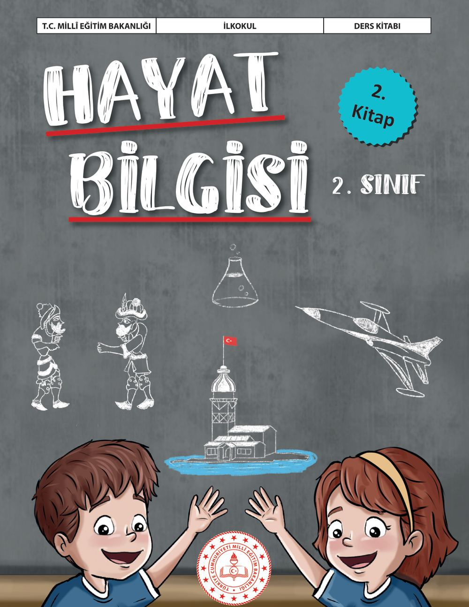 2. Kitap

2. SINIF

<!-- sayfa 1 -->

İLKOKUL

# HAYAT BİLGİSİ

## 2. Sınıf
### Ders Kitabı
### 2. Kitap

**Yazarlar**

Dr. Nagihan ŞAHİN
Betül ALTUNTAŞ
Gürhan DİKMEN
Hüseyin GÜLEÇ
Nurgül GENÇ

DEVLET KİTAPLARI

<!-- sayfa 2 -->

MİLLÎ EĞİTİM BAKANLIĞI YAYINLARI ................................................................. : 10251
DERS KİTAPLARI DİZİSİ ...................................................................................... : 2256

Her hakkı saklıdır ve Millî Eğitim Bakanlığına aittir. Kitabın metin, soru ve şekilleri kısmen de olsa hiçbir surette alınıp yayımlanamaz.

**Editör**
Dr. Öznur TUNALI

**Dil Uzmanı**
Aylin ALTINBAŞ

**Görsel Tasarımcı**
Gülçen Yılmaz DÜZGÜN
Orhan ATEŞ

**Çoklu Ortam Tasarımcısı**
Bahar ŞAHİN ŞEHİR
Coşkun İNCE
Çağdaş SEVİNÇ
Dilek FİDANCI
Evren SAVAŞ
Fatma Öznur USLU
Hayriye KAFTAN AYAN
Neslihan YILDIRIM ÇAYIRCI
Neşe ASLAN
Onur TÜLÜ
Selma ÇELİK
Tuğçe Burçin ARTUKOĞLU

**Program Geliştirme Uzmanı**
Hilal ALTINTAŞ

**Ölçme ve Değerlendirme Uzmanı**
Elif Ebru DOĞANGÜZEL

**Rehberlik Uzmanı**
Dr. Nilgün KORKMAZ

ISBN 978-975-11-8768-0

Millî Eğitim Bakanlığı, Talim ve Terbiye Kurulu Başkanlığının 7.05.2025 tarih ve 131944960 sayılı yazısı ile eğitim aracı olarak kabul edilmiştir.

Kurulca bu kitabın kabul edilmiş olması eğitim aracından yayınevi ve

<!-- sayfa 3 -->

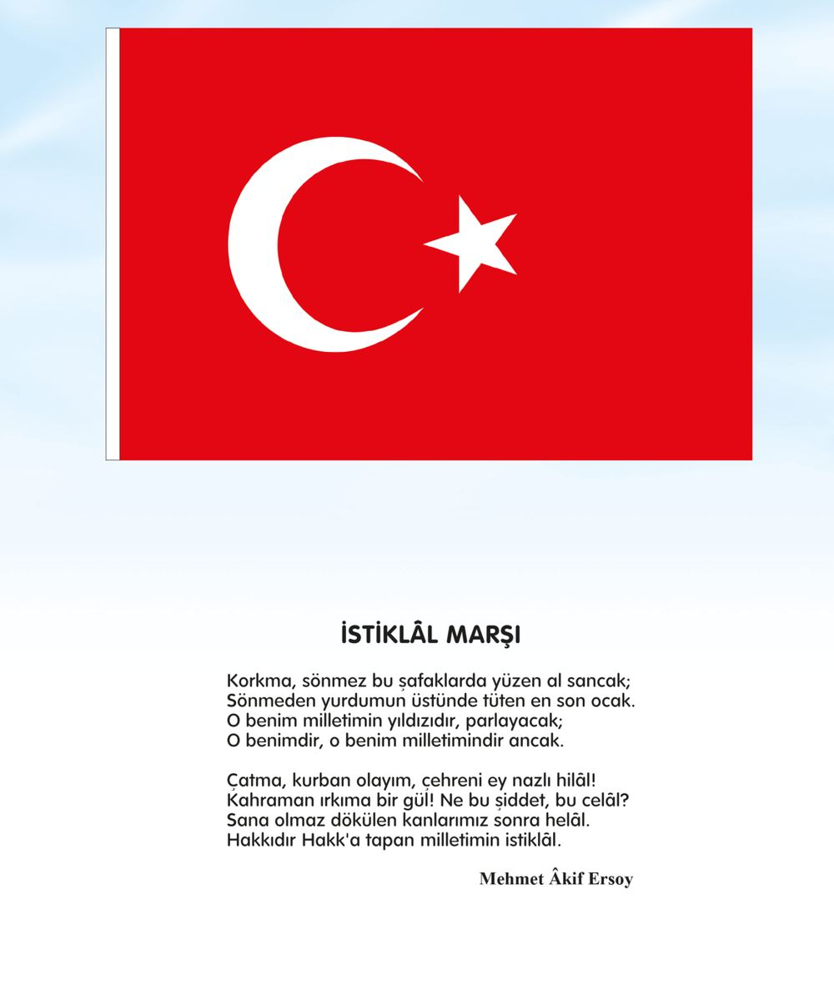

# İSTİKLÂL MARŞI

Korkma, sönmez bu şafaklarda yüzen al sancak;
Sönmeden yurdumun üstünde tüten en son ocak.
O benim milletimin yıldızıdır, parlayacak;
O benimdir, o benim milletimindir ancak.

Çatma, kurban olayım, çehreni ey nazlı hilâl!
Kahraman ırkıma bir gül! Ne bu şiddet, bu celâl?
Sana olmaz dökülen kanlarımız sonra helâl.
Hakkıdır Hakk'a tapan milletimin istiklâl.

Mehmet Âkif Ersoy

<!-- sayfa 4 -->

ANDIMIZ

Türküm, doğruyum, çalışkanım.

İlkem küçüklerimi korumak, büyüklerimi saymak; yurdumu, milletimi özümden çok sevmektir.
Ülküm yükselmek, ileri gitmektir.

Ey Büyük Atatürk!

Açtığın yolda, gösterdiğin hedefe durmadan yürüyeceğime ant içerim.

Varlığım Türk varlığına armağan olsun.

Ne mutlu Türküm diyene!

<!-- sayfa 5 -->

MUSTAFA KEMAL ATATÜRK

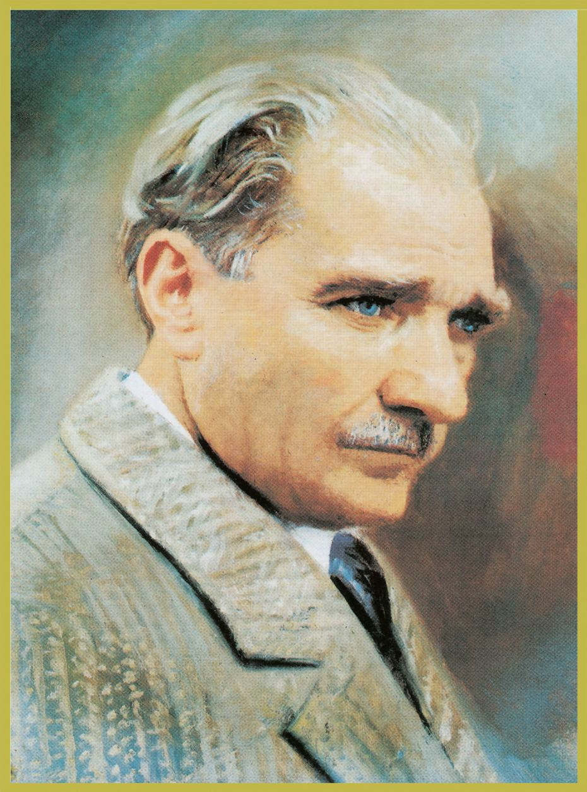
<!-- yer tutucu bulunamadı: sayfa sonuna eklendi -->

<!-- sayfa 6 -->

Verdiğiniz mesajda PDF metin katmanı boş görünüyor (`<<< >>>` arası boş). Lütfen dönüştürülmesini istediğiniz metni veya görseli paylaşın, böylece kurallara uygun şekilde Markdown formatına çevirebilirim.

<!-- sayfa 7 -->

# İÇİNDEKİLER

Kitabımızı Tanıyalım .....................................................................................................................8

## 4. ÖĞRENME ALANI YAŞADIĞIM YER VE ÜLKEM ................................................... 10

Belirli Gün ve Haftalar .....................................................................................12
Tarihin ve Doğanın İzinde .................................................................................14
Performans Görevi ................................................................................................19
Yönetim Birimlerini Tanıyorum ....................................................................20
Mustafa Kemal Atatürk Nasıl Bir Öğrenciydi?............................26
Bayramlarımızla Gururluyuz .......................................................................32
Bayram Gelince ......................................................................................................38
Tekrar Zamanı ...........................................................................................................44

## 5. ÖĞRENME ALANI DOĞA VE ÇEVRE ................................................................. 48

Belirli Gün ve Haftalar ....................................................................................50
Hava Olayları ve Mevsimler .......................................................................52
Doğadan Yararlanarak Yön Bulma ........................................................60
Afetlere Karşı Alınacak Önlemler ..........................................................68
Performans Görevi ..............................................................................................74
Tasarruf Bizim İşimiz  .........................................................................................76
Tekrar Zamanı ..........................................................................................................84

## 6. ÖĞRENME ALANI BİLİM, TEKNOLOJİ VE SANAT ......................................... 88

Belirli Gün ve Haftalar ....................................................................................90
Bilim İnsanları İyi ki Var ...................................................................................92
Performans Görevi ...............................................................................................99
Eskisi, Yenisi ..............................................................................................................100
Performans Görevi ..............................................................................................105
Hayat Sanatla Güzel ......................................................................................106
Tekrar Zamanı .........................................................................................................114

Ekler .................................................................................................................................118
Sözlük ..............................................................................................................................125
Kaynakça ......................................................................................................................128
Cevap Anahtarı .....................................................................................................128
Görsel ve Genel Ağ Kaynakçası .....................................................................128
Türkiye’nin Mülki İdare Bölümleri ile Kara ve Deniz Komşuları Haritası ...........................................................................................................................129

<!-- sayfa 8 -->

# KİTABIMIZI TANIYALIM

Kitabımız 6 öğrenme alanından oluşmaktadır. Bu öğrenme alanlarının 3 tanesi 2. kitapta bulunmaktadır.

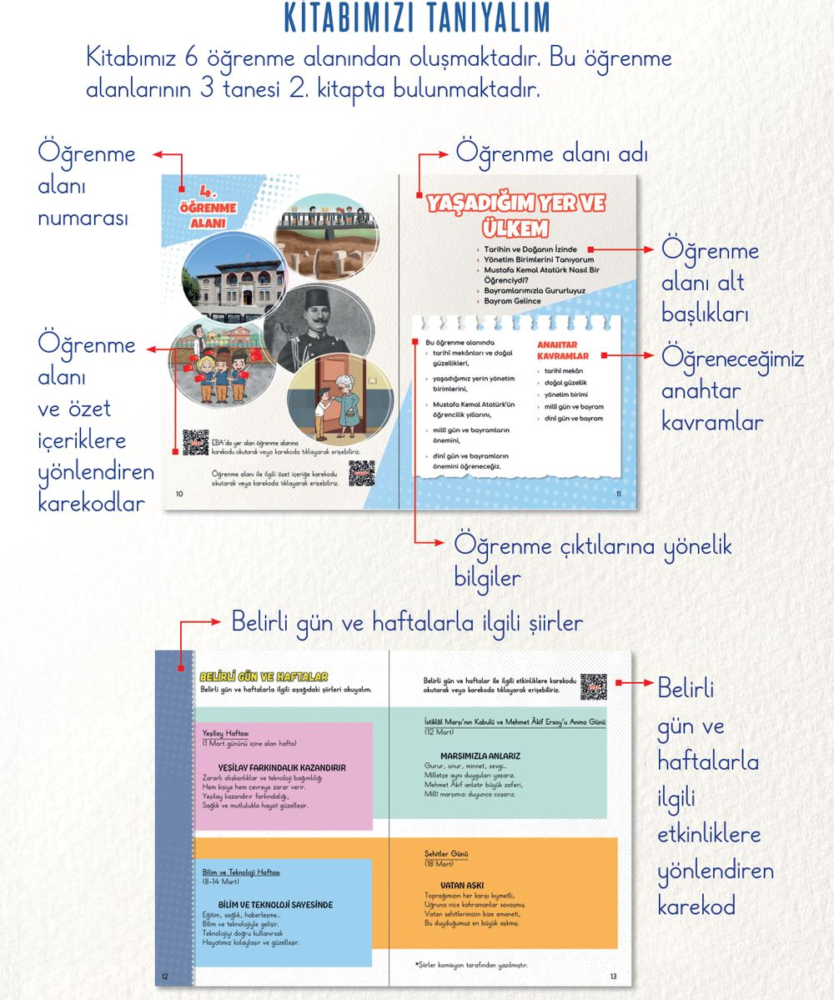

* Öğrenme alanı numarası
* Öğrenme alanı ve özet içeriklere yönlendiren karekodlar
* Öğrenme alanı adı
* Öğrenme alanı alt başlıkları
* Öğreneceğimiz anahtar kavramlar
* Öğrenme çıktılarına yönelik bilgiler

## Belirli gün ve haftalarla ilgili şiirler

* Belirli gün ve haftalarla ilgili etkinliklere yönlendiren karekod

<!-- sayfa 9 -->

Öğrenme alanında her bir konu “Hatırlayalım, Keşfedelim, Bilgi Yolculuğumuz, Uygulayalım ve Neler Öğrendik?” olmak üzere 5 başlıktan oluşmaktadır. Her öğrenme alanının sonunda “Tekrar Zamanı” bulunmaktadır.

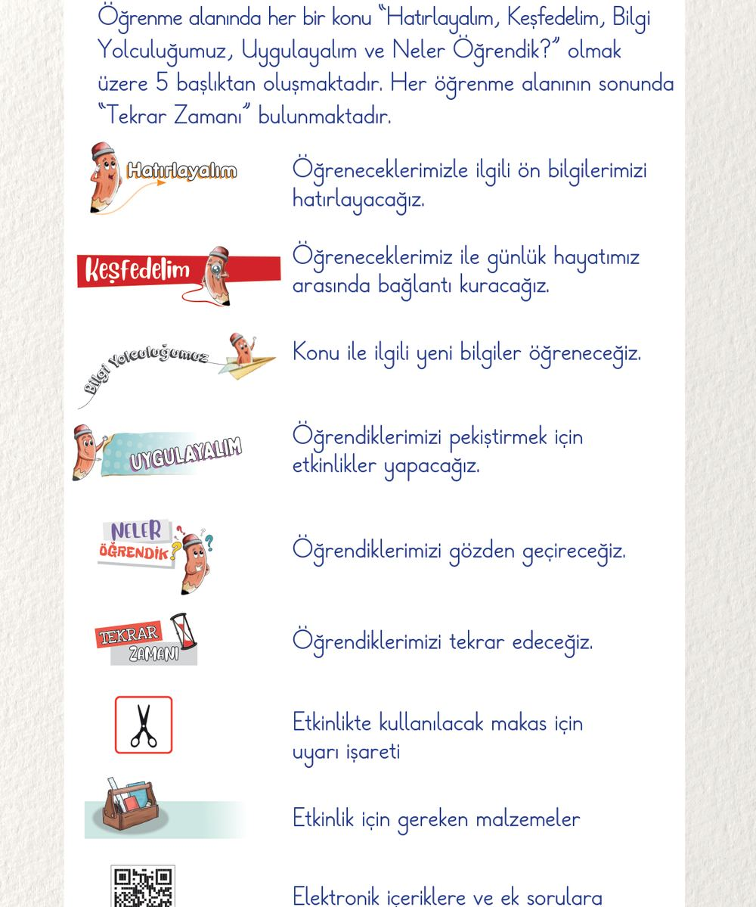 Hatırlayalım: Öğreneceklerimizle ilgili ön bilgilerimizi hatırlayacağız.

 Keşfedelim: Öğreneceklerimiz ile günlük hayatımız arasında bağlantı kuracağız.

 Bilgi Yolculuğumuz: Konu ile ilgili yeni bilgiler öğreneceğiz.

 UYGULAYALIM: Öğrendiklerimizi pekiştirmek için etkinlikler yapacağız.

 NELER ÖĞRENDİK: Öğrendiklerimizi gözden geçireceğiz.

 TEKRAR ZAMANI: Öğrendiklerimizi tekrar edeceğiz.

 Etkinlikte kullanılacak makas için uyarı işareti

 Etkinlik için gereken malzemeler

 Elektronik içeriklere ve ek sorulara

<!-- sayfa 10 -->

# ÖĞRENME ALANI

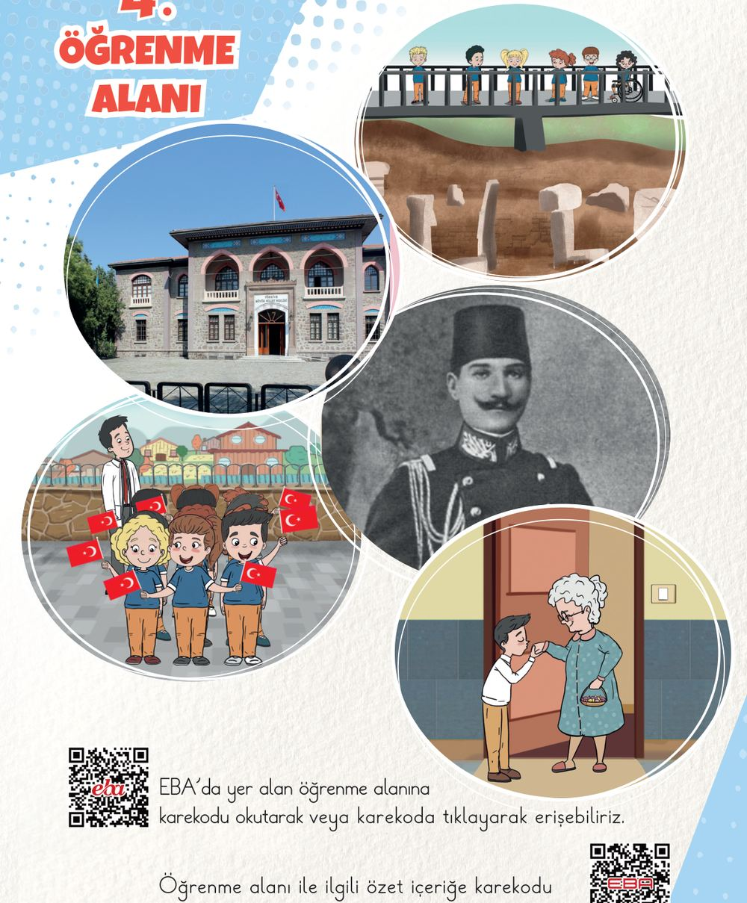

EBA’da yer alan öğrenme alanına karekodu okutarak veya karekoda tıklayarak erişebiliriz.

Öğrenme alanı ile ilgili özet içeriğe karekodu

<!-- sayfa 11 -->

# YAŞADIĞIM YER VE ÜLKEM

* Tarihin ve Doğanın İzinde
* Yönetim Birimlerini Tanıyorum
* Mustafa Kemal Atatürk Nasıl Bir Öğrenciydi?
* Bayramlarımızla Gururluyuz
* Bayram Gelince

Bu öğrenme alanında

* tarihî mekânları ve doğal güzellikleri,
* yaşadığımız yerin yönetim birimlerini,
* Mustafa Kemal Atatürk’ün öğrencilik hayatı,
* millî gün ve bayramların önemini,
* dinî gün ve bayramların önemini öğreneceğiz.

## ANAHTAR KAVRAMLAR

* tarihî mekân
* doğal güzellik
* yönetim birimi
* millî gün ve bayram
* dinî gün ve bayram

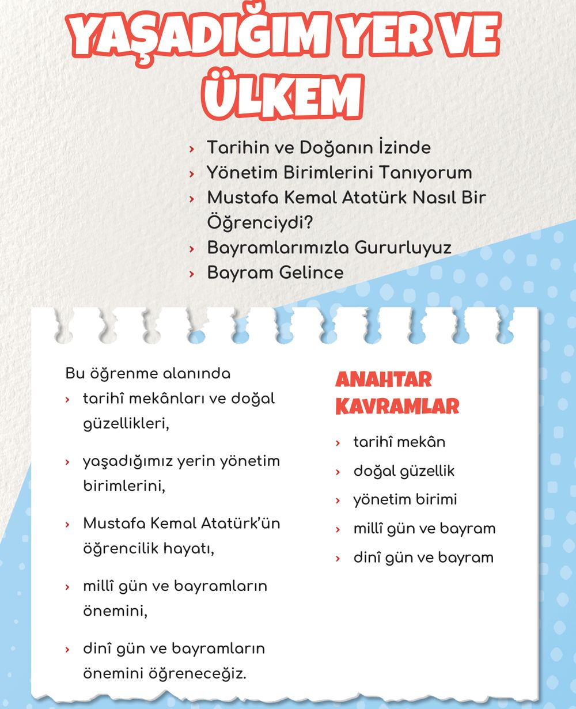
<!-- yer tutucu bulunamadı: sayfa sonuna eklendi -->

<!-- sayfa 12 -->

# BELİRLİ GÜN VE HAFTALAR
Belirli gün ve haftalarla ilgili aşağıdaki şiirleri okuyalım.

## Yeşilay Haftası
(1 Mart gününü içine alan hafta)

### YEŞİLAY FARKINDALIK KAZANDIRIR
Zararlı alışkanlıklar ve teknoloji bağımlılığı
Hem kişiye hem çevreye zarar verir.
Yeşilay kazandırır farkındalığı,
Sağlık ve mutlulukla hayat güzelleşir.

## Bilim ve Teknoloji Haftası
(8-14 Mart)

### BİLİM VE TEKNOLOJİ SAYESİNDE
Eğitim, sağlık, haberleşme...
Bilim ve teknolojiyle gelişir.
Teknolojiyi doğru kullanırsak
Hayatımız kolaylaşır ve güzelleşir.

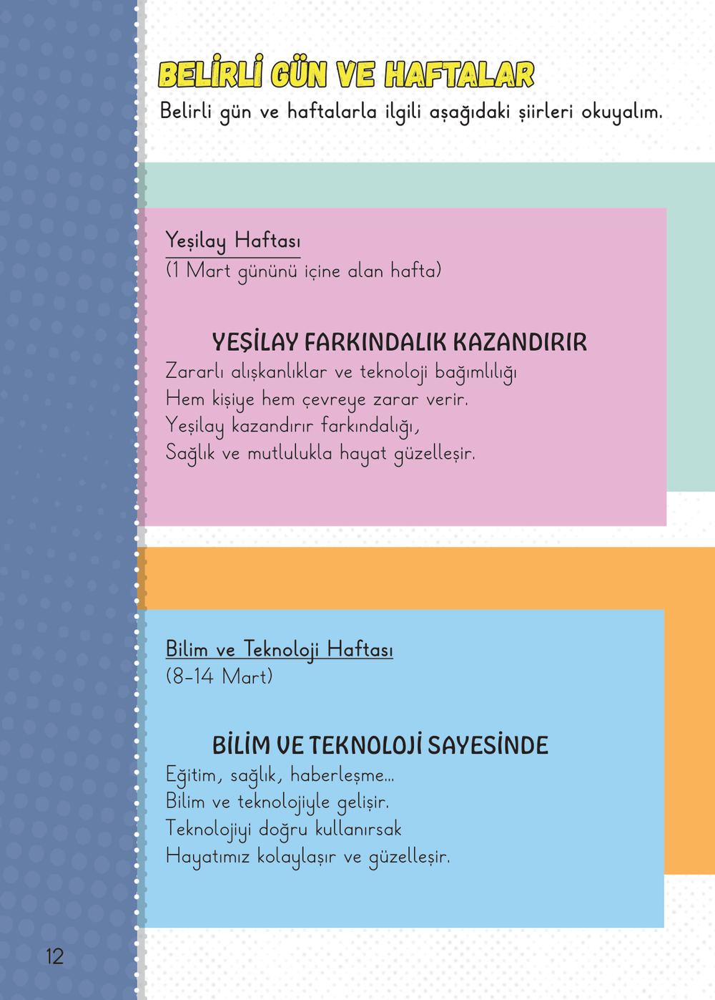
<!-- yer tutucu bulunamadı: sayfa sonuna eklendi -->

<!-- sayfa 13 -->

Belirli gün ve haftalar ile ilgili etkinliklere karekodu okutarak veya karekoda tıklayarak erişebiliriz. 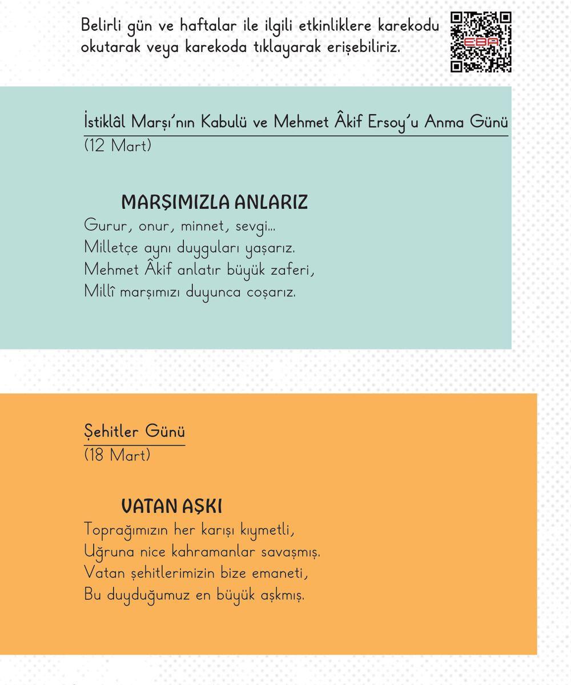

---

# İstiklâl Marşı’nın Kabulü ve Mehmet Âkif Ersoy’u Anma Günü
(12 Mart)

## MARŞIMIZLA ANLARIZ
Gurur, onur, minnet, sevgi...
Milletçe aynı duyguları yaşarız.
Mehmet Âkif anlatır büyük zaferi,
Millî marşımızı duyunca coşarız.

---

# Şehitler Günü
(18 Mart)

## VATAN AŞKI
Toprağımızın her karışı kıymetli,
Uğruna nice kahramanlar savaşmış.
Vatan şehitlerimizin bize emaneti,
Bu duyduğumuz en büyük aşkmış.

<!-- sayfa 14 -->

# TARİHİN VE DOĞANIN İZİNDE

## Hatırlayalım

➢ Aşağıda Tokat ilimizde ziyaret edebileceğimiz yerlere örnekler verilmiştir. İnceleyelim.

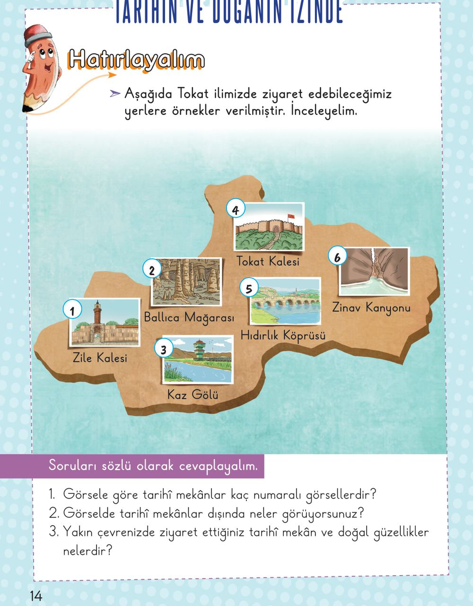

1: Zile Kalesi
2: Ballıca Mağarası
3: Kaz Gölü
4: Tokat Kalesi
5: Hıdırlık Köprüsü
6: Zinav Kanyonu

## Soruları sözlü olarak cevaplayalım.

1. Görsele göre tarihî mekânlar kaç numaralı görsellerdir?
2. Görselde tarihî mekânlar dışında neler görüyorsunuz?
3. Yakın çevrenizde ziyaret ettiğiniz tarihî mekân ve doğal güzellikler nelerdir?

<!-- sayfa 15 -->

# Keşfedelim

➢ Mahmut ve Neslihan’ın gezip gördükleri tarihî mekân ve doğal güzelliklerle ilgili deneyimlerini okuyalım.

Yaz tatilinde ailemle Edirne’ye gittik. Burada bulunan Selimiye Camisi görülmeye değerdi. Bu kocaman cami Mimar Sinan tarafından yapılmış. Mimar Sinan, Selimiye Camisi için ustalık eserim, demiş. Hepimiz camiye hayran kaldık.

Gökyüzüne uzanan dört minareyi görünce ağzım açık kaldı. Annem de içerideki nakışlı süslemelere bayıldı. Rehberin anlattıklarını ilgiyle dinledik. Sonra caminin avlusunda biraz oturduk. Bu avludan kim bilir kimler geçti, diye düşünerek hayallere daldım. Zamanın nasıl geçtiğini anlayamadım.

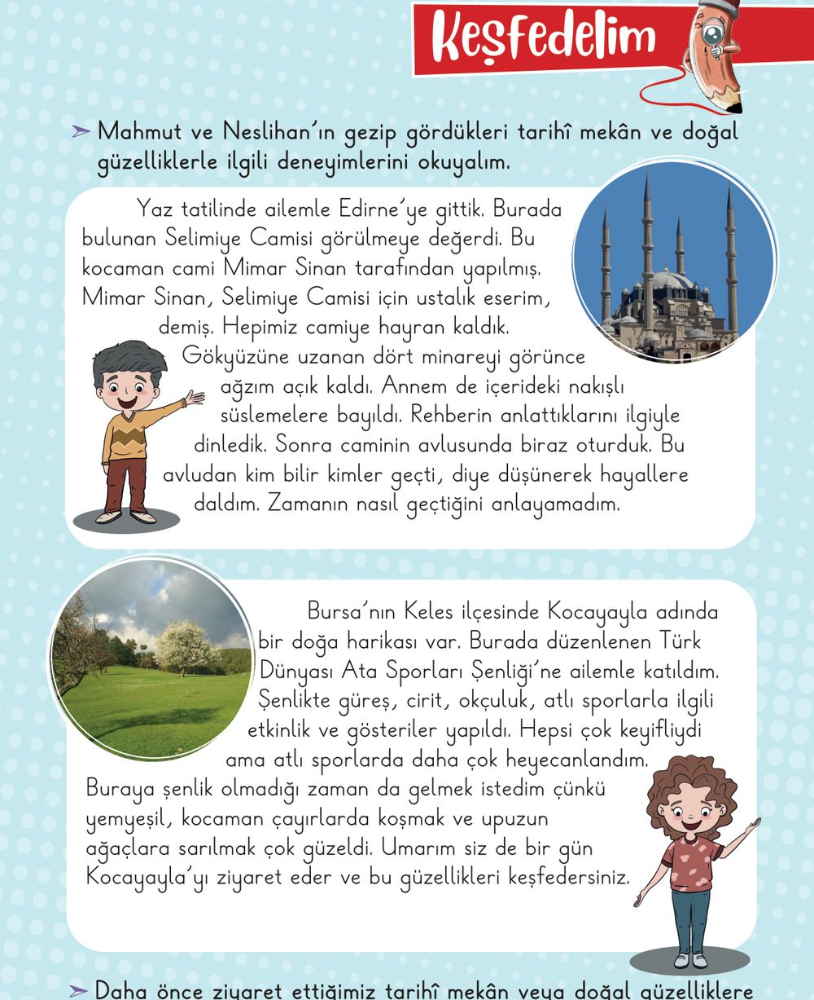

Bursa’nın Keles ilçesinde Kocayayla adında bir doğa harikası var. Burada düzenlenen Türk Dünyası Ata Sporları Şenliği’ne ailemle katıldım. Şenlikte güreş, cirit, okçuluk, atlı sporlarla ilgili etkinlik ve gösteriler yapıldı. Hepsi çok keyifliydi ama atlı sporlarda daha çok heyecanlandım. Buraya şenlik olmadığı zaman da gelmek istedim çünkü yemyeşil, kocaman çayırlarda koşmak ve upuzun ağaçlara sarılmak çok güzeldi. Umarım siz de bir gün Kocayayla’yı ziyaret eder ve bu güzellikleri keşfedersiniz.

➢ Daha önce ziyaret ettiğimiz tarihî mekân veya doğal güzelliklere

<!-- sayfa 16 -->

# Bilgi Yolculuğumuz

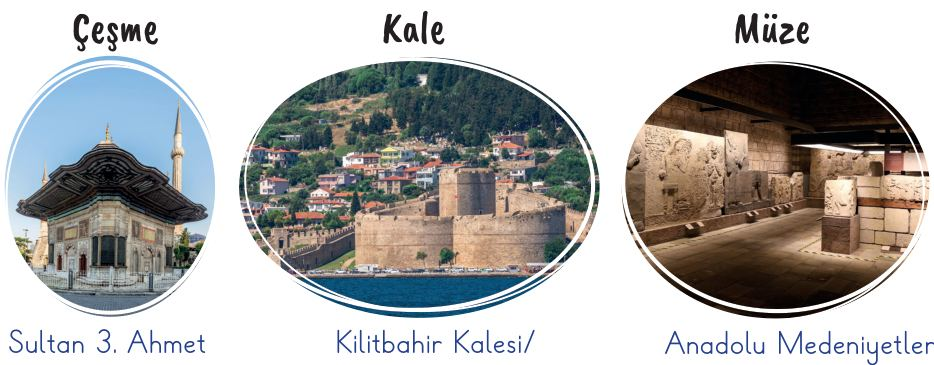

## TARİHİN VE DOĞANIN İZİNDE

Tarihî mekânlar geçmişte önemli olayların yaşandığı, tarihî ve kültürel değeri olan yerlerdir. Bu yerler kültürel mirasımızı korumamız ve gelecek nesillere aktarmamız için çok önemlidir. Ülkemiz tarihî mekânlar bakımından oldukça zengindir. Müzeler ise kültürel mirasımızı koruyan ve gelecek nesillere aktaran önemli yerlerdir. Müzelerdeki eserlere dikkatli davranmalı, zarar vermemeli ve müze kurallarına uymalıyız.

**Çeşme**
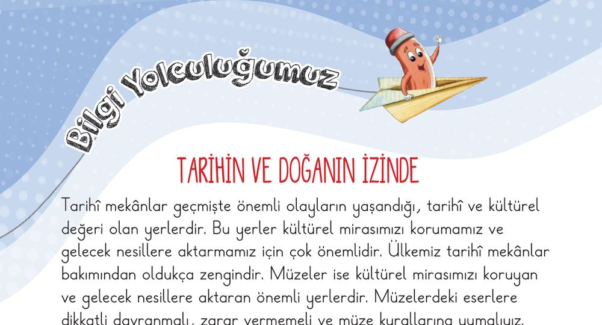
Sultan 3. Ahmet Çeşmesi/İstanbul

**Kale**
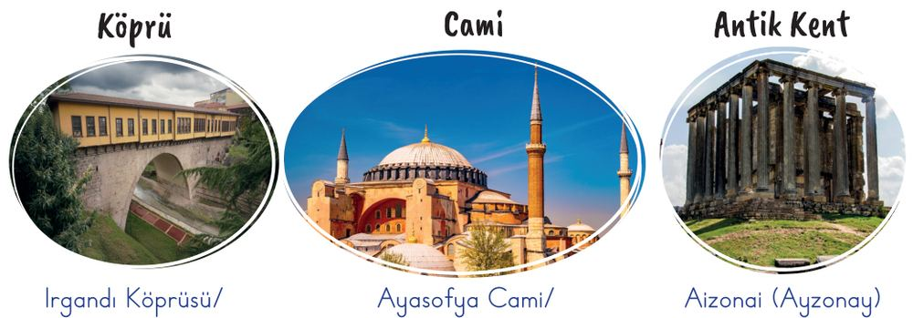
Kilitbahir Kalesi/Çanakkale

**Müze**

Anadolu Medeniyetleri Müzesi/Ankara

**Köprü**

Irgandı Köprüsü/

**Cami**

Ayasofya Cami/

**Antik Kent**

Aizonai (Ayzonay)

<!-- sayfa 17 -->

Doğal güzellikler, insan müdahalesi olmadan doğada kendiliğinden oluşan ve gezilip görülmeye değer yerlerdir. Türkiye’miz doğal güzellikler bakımından da oldukça zengindir.

**Dağ**
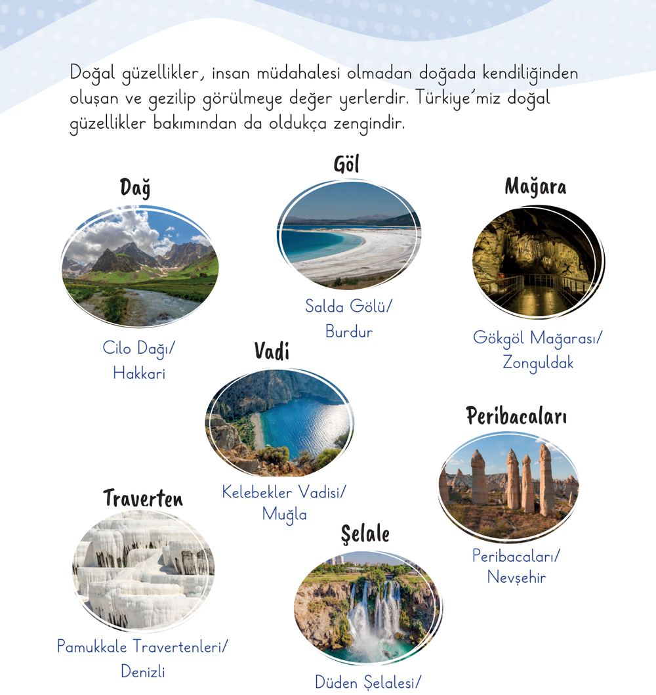
Cilo Dağı/
Hakkari

**Göl**

Salda Gölü/
Burdur

**Mağara**

Gökgöl Mağarası/
Zonguldak

**Vadi**

Kelebekler Vadisi/
Muğla

**Peribacaları**

Peribacaları/
Nevşehir

**Traverten**

Pamukkale Travertenleri/
Denizli

**Şelale**

Düden Şelalesi/
Antalya

Tarihî mekân ve doğal güzellikler millî ve manevi değerlerimizdir. Bu değerlerimizi yakından tanımalı ve korumaya karşı duyarlı olmalıyız.

 Konu ile ilgili elektronik içeriğe karekodu okutarak

<!-- sayfa 18 -->

# UYGULAYALIM

➣ Uygulama adımlarını takip ederek etkinliği yapalım.

## Uygulama Adımları

➠ Yakın çevremizdeki tarihî mekân ve doğal güzellikleri araştıralım. Bunun için aile büyüklerimizden yardım alabiliriz. Ailemizle genel ağda Türkiye Kültür Portalı’nı ziyaret edebilir, keşfetmek istediğimiz ille ilgili ayrıntılı bilgi edinebiliriz.

➠ Araştırma yaptığımız tarihî mekân veya doğal güzelliklerden birine öğretmenimizin rehberliğinde gezi planlayalım. Sınıfça sanal müze gezisi de yapabiliriz.

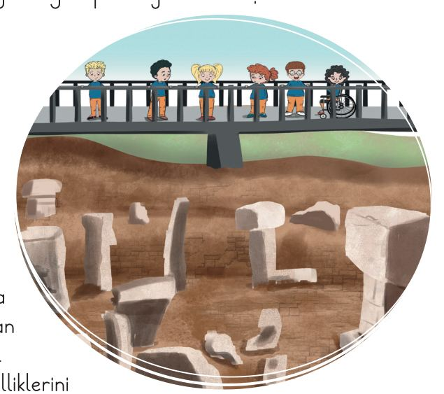

➠ Gezi sırasında ziyaret ettiğimiz tarihî mekân veya doğal güzellikle ilgili merak ettiklerimizi gezi rehberimize veya öğretmenimize soralım.

➠ Araştırmalarımızdan ve yaptığımız geziden sonra yakın çevremizde bulunan tarihî mekân veya doğal güzelliklerin belirgin özelliklerini listeleyelim.

➣ Geziden ve araştırmalarımızdan sonra notlarımızı arkadaşlarımızla paylaşalım.

➣ Tarihî mekân ve doğal güzelliklerimize sahip çıkmanın önemini arkadaşlarımızla tartışalım.

<!-- yer tutucu bulunamadı: sayfa sonuna eklendi -->

<!-- sayfa 19 -->

# PERFORMANS GÖREVİ

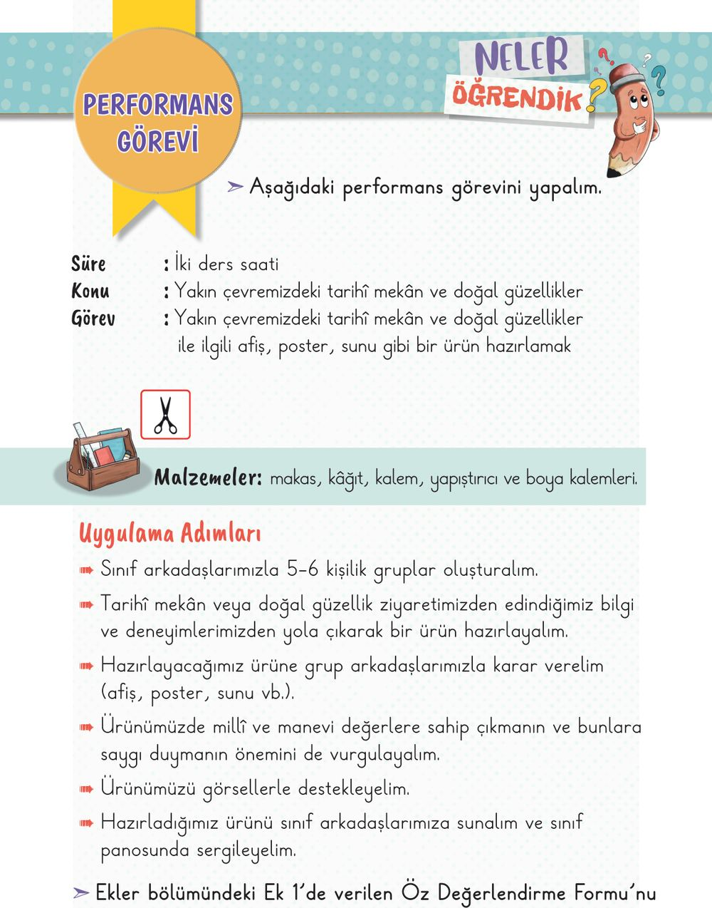: "NELER ÖĞRENDİK?" yazılı konuşma balonu ve kalem figürü

> Aşağıdaki performans görevini yapalım.

**Süre:** İki ders saati
**Konu:** Yakın çevremizdeki tarihî mekân ve doğal güzellikler
**Görev:** Yakın çevremizdeki tarihî mekân ve doğal güzellikler ile ilgili afiş, poster, sunu gibi bir ürün hazırlamak

: Makas simgesi ve içinde kırtasiye malzemeleri olan kutu görseli

**Malzemeler:** makas, kâğıt, kalem, yapıştırıcı ve boya kalemleri.

## Uygulama Adımları

* Sınıf arkadaşlarımızla 5-6 kişilik gruplar oluşturalım.
* Tarihî mekân veya doğal güzellik ziyaretimizden edindiğimiz bilgi ve deneyimlerimizden yola çıkarak bir ürün hazırlayalım.
* Hazırlayacağımız ürüne grup arkadaşlarımızla karar verelim (afiş, poster, sunu vb.).
* Ürünümüzde millî ve manevi değerlere sahip çıkmanın ve bunlara saygı duymanın önemini de vurgulayalım.
* Ürünümüzü görsellerle destekleyelim.
* Hazırladığımız ürünü sınıf arkadaşlarımıza sunalım ve sınıf panosunda sergileyelim.

> Ekler bölümündeki Ek 1’de verilen Öz Değerlendirme Formu’nu

<!-- sayfa 20 -->

# YÖNETİM BİRİMLERİNİ TANIYORUM

## Hatırlayalım

➢ Metni okuyalım.

### Oyun Parkı

Ömer ve Masal okuldan dönerken mahallelerinde bazı değişiklikler fark ettiler. Parka yeni oyun araçları yerleştirilmiş, sokaklardaki bazı eksikler giderilmişti. “Bu çalışmaları kimler yapıyor acaba?” diye merak ettiler. Yaşadıkları yerin yöneticilerini öğrenmek için araştırma yapmaya karar verdiler. Eve giderken bu bilgileri kimlerden ve nerelerden öğrenebilecekleri üzerine konuştular.

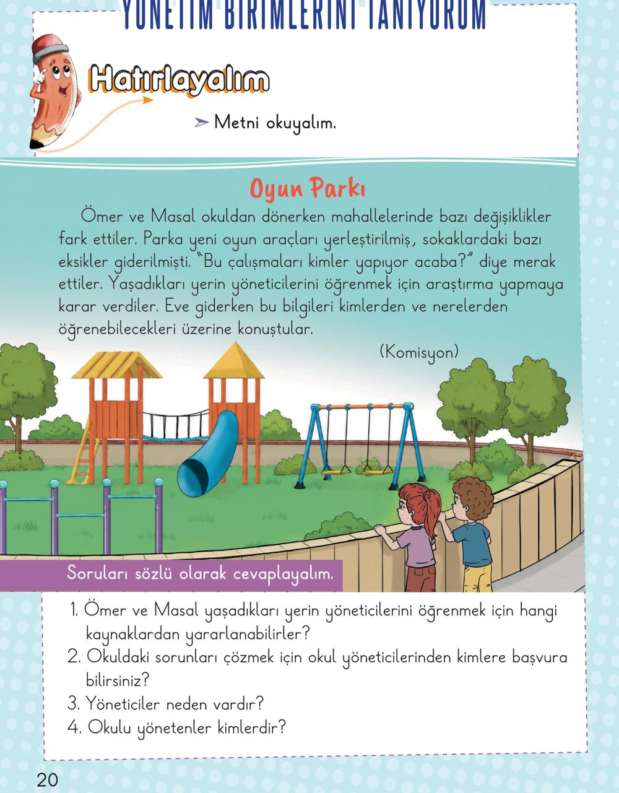

(Komisyon)

#### Soruları sözlü olarak cevaplayalım.

1. Ömer ve Masal yaşadıkları yerin yöneticilerini öğrenmek için hangi kaynaklardan yararlanabilirler?
2. Okuldaki sorunları çözmek için okul yöneticilerinden kimlere başvura bilirsiniz?
3. Yöneticiler neden vardır?
4. Okulu yönetenler kimlerdir?

<!-- sayfa 21 -->

# Keşfedelim

➤ Noktalı alanlara yaşadığımız yerlerin adlarını yazalım.

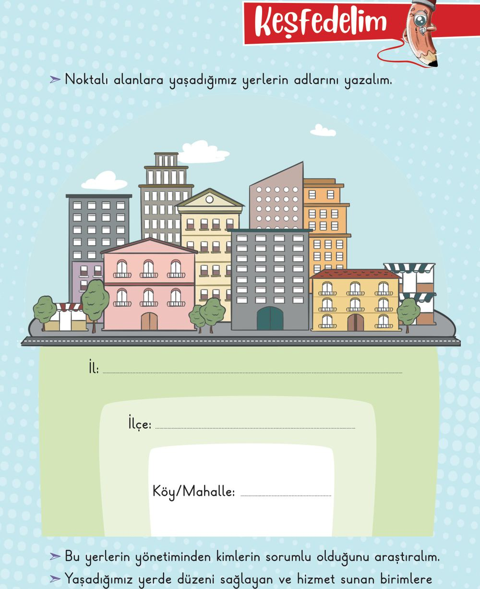

İl: ..........................................................................................................................................................................................

İlçe: ........................................................................................................................................................................................

Köy/Mahalle: .........................................................................................................................................................................

➤ Bu yerlerin yönetiminden kimlerin sorumlu olduğunu araştıralım.

➤ Yaşadığımız yerde düzeni sağlayan ve hizmet sunan birimlere

<!-- sayfa 22 -->

# Bilgi Yolculuğumuz

## YÖNETİM BİRİMLERİNİ TANIYORUM

Yerleşim yerleri büyüklüklerine göre il, ilçe, köy veya mahalle olarak ayrılır. İl, ilçe ve köylerde hizmetlerin düzenli ve eşit şekilde ulaşması için çalışan yönetim birimleri vardır.

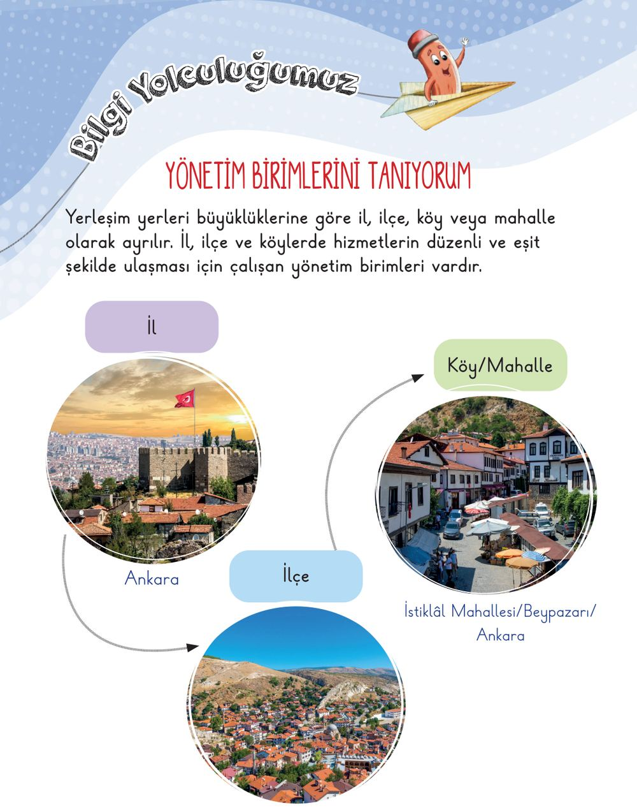
**İl**
Ankara

**İlçe**

**Köy/Mahalle**
İstiklâl Mahallesi/Beypazarı/Ankara

<!-- sayfa 23 -->

# YÖNETİM BİRİMLERİ

**İl**
* En büyük yerleşim birimidir.
* İli vali yönetir.

**İlçe**
* İlden küçük, köy ve mahalleden büyük yerleşim birimidir.
* İlçeyi kaymakam yönetir.

**Köy/Mahalle**
* En küçük yerleşim birimleridir.
* Mahalle ve köyleri muhtar yönetir.

**Belediye**
* İl ve ilçelerde bulunur.
* Belediyeyi belediye başkanı yönetir.

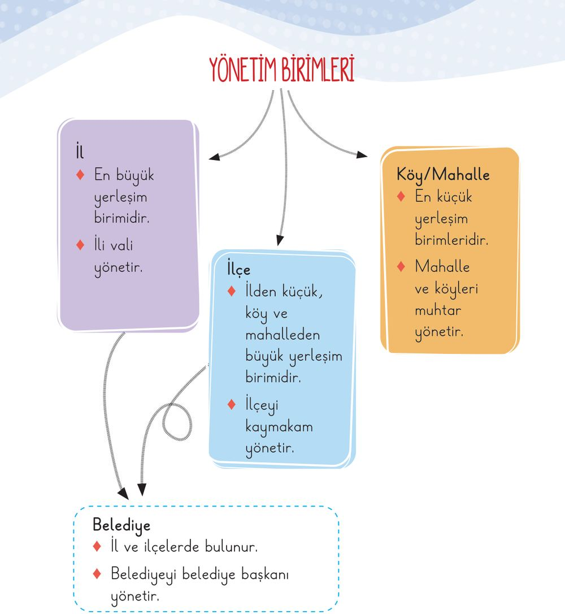

Vali ve kaymakamlar, bulundukları yönetim birimlerindeki güvenlik, sağlık, eğitim gibi hizmetlerin yürütülmesinden sorumludur. Muhtarlar, görevli oldukları köy ve mahalledeki ihtiyaçlara yönelik çalışmalar yaparlar. Belediye başkanları temizlik, ulaşım, sosyal ve kültürel

<!-- sayfa 24 -->

# UYGULAYALIM

➣ Uygulama adımlarını takip ederek etkinliği yapalım.

## Uygulama Adımları

➠ Yaşadığımız yerin yönetim birimleri hakkında bilgi edinmek için yararlanabileceğimiz kaynakları (muhtarlık, belediye, kaymakamlık, genel ağ, kitaplar vb.) belirleyelim.

➠ Sınıf arkadaşlarımızla 5-6 kişilik gruplar oluşturalım.

➠ Belirlediğimiz kaynaklardan bilgi toplayıp notlar alalım ve bunları grup arkadaşlarımızla paylaşalım.

➠ Belirlediğimiz kaynaklardan görüşme yapabileceğimiz bir yönetim birimini seçerek öğretmenimizin rehberliğinde gezi düzenleyelim.

➠ Grup arkadaşlarımızla görüşme formuna ekleyebileceğimiz sorulara karar verelim.

➠ Aşağıdaki görüşme formunu kullanarak seçtiğimiz yöneticiyle görüşme yapalım ve aldığımız cevapları not alalım.

➠ Görüşme notlarımızı arkadaşlarımızın notlarıyla karşılaştıralım.

➠ Daha önce topladığımız bilgiler ile görüşmeden elde ettiğimiz bilgilerin benzer ve farklı yönlerini belirleyelim.

> ### GÖRÜŞME FORMU SORULARI
>
> Görüşmeyi Yapan Kişinin Adı Soyadı:
>
> Görüşme Konusu:
>
> Kendinizi kısaca tanıtır mısınız?
>
> Görevleriniz nelerdir?
>
> Size bu görevde kimler yardımcı oluyor?

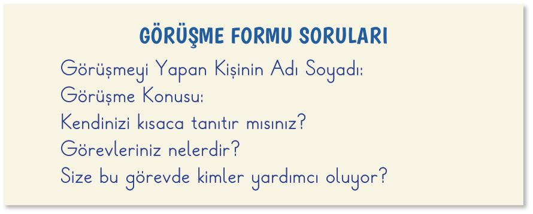

➣ Ziyaret ettiğimiz yönetim biriminin ve kullandığımız diğer kaynakların yaşadığımız yer hakkında bilgi edinmek için uygun

<!-- sayfa 25 -->

1. Yönetim birimlerindeki yöneticileri tanımlarıyla eşleştirelim.

a. Muhtar  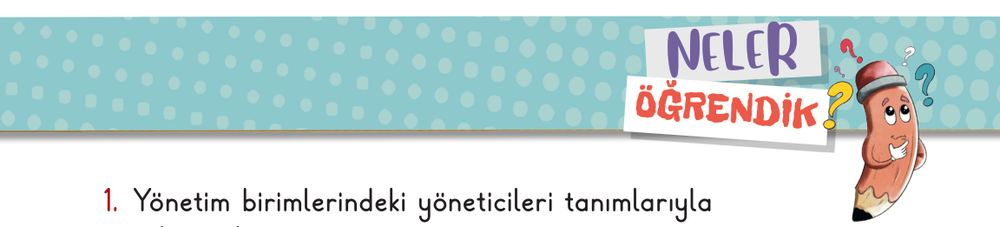

b. Belediye başkanı 

c. Kaymakam

ç. Vali

1. Bir ilin yönetiminden sorumlu en yetkili kişidir.

2. İl ve ilçelerdeki temizlik, ulaşım gibi hizmetlerin yürütülmesinden sorumlu kişidir.

3. Bir ilçenin yönetiminden sorumlu en yetkili kişidir.

4. Köy veya mahalledeki belirli işleri yürüten kişidir.

5. İl, ilçe ve köylerde okulları yöneten kişidir.

<!-- sayfa 26 -->

# MUSTAFA KEMAL ATATÜRK NASIL BİR ÖĞRENCİYDİ?

## Hatırlayalım

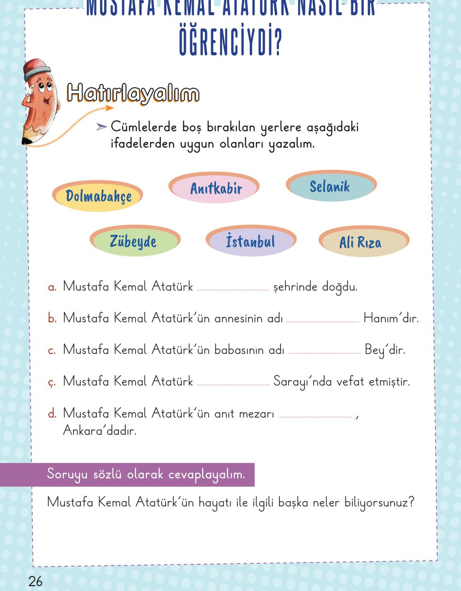

➢ Cümlelerde boş bırakılan yerlere aşağıdaki ifadelerden uygun olanları yazalım.

| Dolmabahçe | Anıtkabir | Selanik |
| :---: | :---: | :---: |
| **Zübeyde** | **İstanbul** | **Ali Rıza** |

a. Mustafa Kemal Atatürk \_\_\_\_\_\_\_\_\_\_\_\_\_\_\_ şehrinde doğdu.

b. Mustafa Kemal Atatürk’ün annesinin adı \_\_\_\_\_\_\_\_\_\_\_\_\_\_\_ Hanım’dır.

c. Mustafa Kemal Atatürk’ün babasının adı \_\_\_\_\_\_\_\_\_\_\_\_\_\_\_ Bey’dir.

ç. Mustafa Kemal Atatürk \_\_\_\_\_\_\_\_\_\_\_\_\_\_\_ Sarayı’nda vefat etmiştir.

d. Mustafa Kemal Atatürk’ün anıt mezarı \_\_\_\_\_\_\_\_\_\_\_\_\_\_\_, Ankara’dadır.

***

**Soruyu sözlü olarak cevaplayalım.**

Mustafa Kemal Atatürk’ün hayatı ile ilgili başka neler biliyorsunuz?

<!-- sayfa 27 -->

# Keşfedelim

➣ Mustafa Kemal Atatürk’e ait anı örneğini okuyalım.

Atatürk’ün evindeki yardımcısı Cemal Grand anlatıyor:

Atatürk yine bir gün tarihle ilgili kalın bir kitap okuyordu. Öylesine dalmıştı ki çevresini görecek hâli yoktu. Bir sürü yurt sorunu dururken devlet başkanının kendini tarihe vermesi Vasıf Çınar’ın biraz canını sıkmış olacak ki Atatürk’e şöyle dediğini duydum:
— Paşam! Tarihle uğraşıp kafanı yorma. 19 Mayıs’ta kitap okuyarak mı Samsun’a çıktın?
Atatürk, Vasıf Çınar’ın bu çok samimi yakınmasına gülümseyerek şöyle karşılık verdi:
— Ben çocukken fakirdim. İki kuruş elime geçince bunun bir kuruşunu kitaba verirdim. Eğer böyle olmasaydı bu yaptıklarımın hiçbirini yapamazdım.

Turhan Gürkan
(Kısaltılmıştır.)

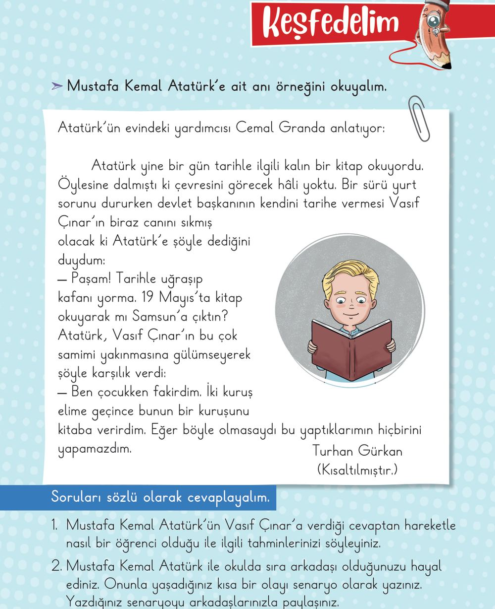

## Soruları sözlü olarak cevaplayalım.

1. Mustafa Kemal Atatürk’ün Vasıf Çınar’a verdiği cevaptan hareketle nasıl bir öğrenci olduğu ile ilgili tahminlerinizi söyleyiniz.
2. Mustafa Kemal Atatürk ile okulda sıra arkadaşı olduğunuzu hayal ediniz. Onunla yaşadığınız kısa bir olayı senaryo olarak yazınız. Yazdığınız senaryoyu arkadaşlarınızla paylaşınız.

<!-- sayfa 28 -->

# Bilgi Yolculuğumuz

# ATATÜRK NASIL BİR ÖĞRENCİYDİ?

Mustafa Kemal Atatürk, Selanik’te Mahalle Mektebinde eğitime başlamış, ardından Şemsi Efendi Okulunda öğrenimine devam etmiştir. Küçük yaşlardan itibaren öğrenmeye meraklı ve çalışkan bir öğrenci olan Mustafa Kemal, derslerini dikkatlice takip etmiş ve kendini geliştirmek için çaba göstermiştir. Eğitim hayatını Selanik Askerî Rüştiyesi ve Manastır Askerî İdadisinde sürdüren Mustafa Kemal, özellikle matematik dersine ilgi duymuş ve bu derste başarılı olmuştur. Daha sonra İstanbul’daki Harp Okulu ve Harp Akademisinde eğitimine devam eden Mustafa Kemal düşüncelerini açıkça ifade eden, arkadaşlarıyla iyi ilişkiler kuran ve güvenilir bir öğrenci olarak tanınmıştır.

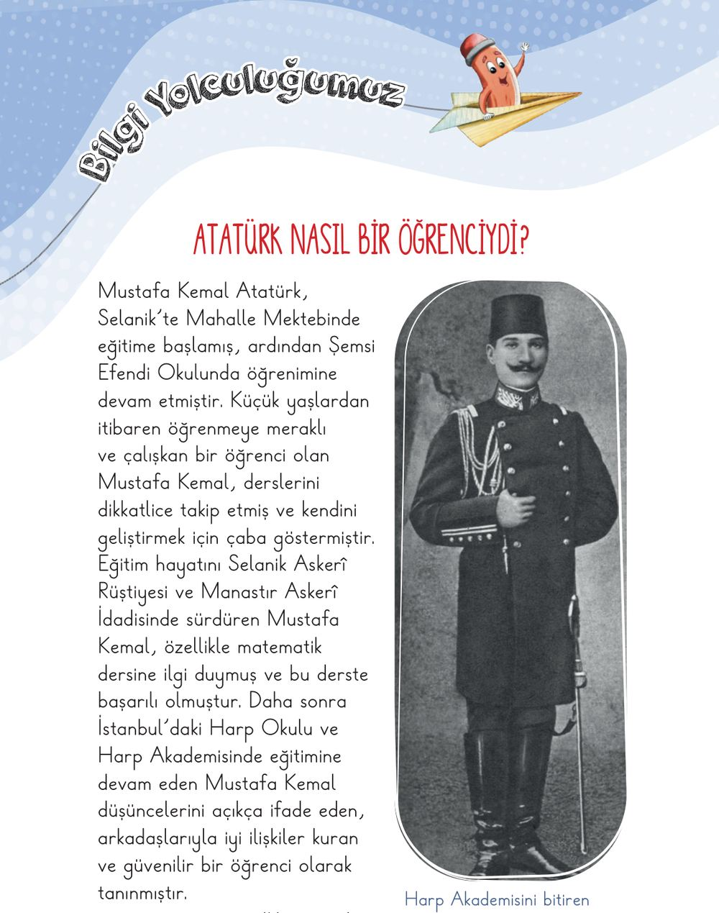
Harp Akademisini bitiren

<!-- sayfa 29 -->

# Mustafa Kemal Atatürk’ün öğrencilik yılları ile ilgili anısı

> Ortaokulda tüm dersleri çok sevmeme rağmen matematiğe ilgi duydum. Matematik derslerini can kulağıyla dinler, öğretmenime hayranlık duyardım. Dersleri dinlemekle kalmıyor, yazılı sorular hazırlıyordum. Matematik öğretmenim de benim bu ilgimden memnun oluyor, sorularıma yazılı olarak cevap veriyordu. Öğretmenimin ismi Mustafa idi. Bir gün bana dedi ki: “Oğlum, senin de ismin Mustafa, benim de. Bu böyle olmayacak. Arada bir fark bulunmalı. Bundan sonra senin adın Mustafa Kemal olsun! O günden sonra adım Mustafa Kemal oldu.”
>
> (Genel ağdan alınmıştır.)

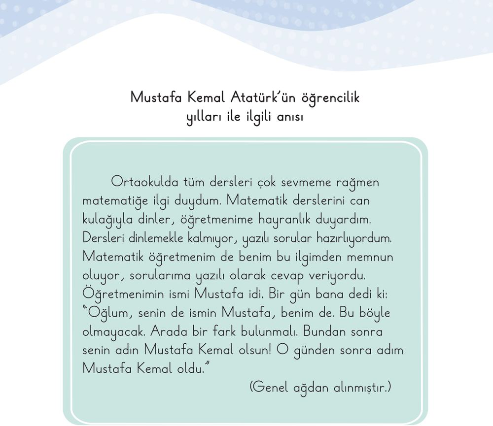

Mustafa Kemal Atatürk, öğrenmeye meraklı, çalışkan ve başarılı bir öğrenciydi. Kitap okumayı çok sever, anlamadığı konuları öğrenmek için çaba gösterirdi. Azimli bir öğrenciydi. Mustafa Kemal Atatürk’ün çalışkanlığı ve azmi, ileride onun nasıl bir lider olacağını bizlere göstermektedir.

 Konu ile ilgili elektronik içeriğe karekodu okutarak veya karekoda tıklayarak erişebiliriz.

<!-- sayfa 30 -->

# UYGULAYALIM

➢ Uygulama adımlarını takip ederek etkinliği yapalım.

## Uygulama Adımları

➠ Sınıf arkadaşlarımızla 4-5 kişilik gruplar oluşturalım.
➠ Mustafa Kemal Atatürk’ün okuduğu okullardan birinde bulunduğumuzu hayal edelim.
➠ Atatürk’ün çalışkan, azimli, güvenilir veya düşüncelerini açıkça ifade eden bir öğrenci olduğunu gösteren bir durum belirleyelim.
➠ Belirlediğimiz duruma uygun kısa bir canlandırma hazırlayalım.
➠ Canlandırmamızı sınıfta arkadaşlarımıza sunalım.

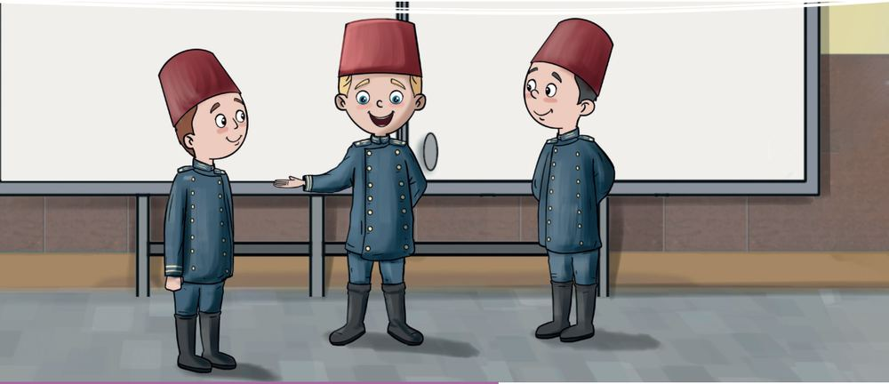

### Soruları sözlü olarak cevaplayalım.

1. Canlandırdığınız durumda Mustafa Kemal Atatürk hangi okulda öğrenim görüyor olabilir?
2. Bu canlandırmada Atatürk’ün öğrenciliğine ait hangi özelliklerini gördünüz?
3. Mustafa Kemal Atatürk’ün elde ettiği başarıların öğrencilik

<!-- sayfa 31 -->

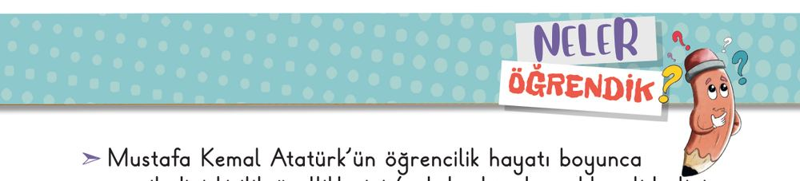

➢ Mustafa Kemal Atatürk’ün öğrencilik hayatı boyunca sergilediği kişilik özelliklerini (çalışkanlığı, kararlılığı, liderliği vb.) düşünelim. Bu özellikleri anlatan bir resim tasarlayarak aşağıdaki boş alana çizelim.

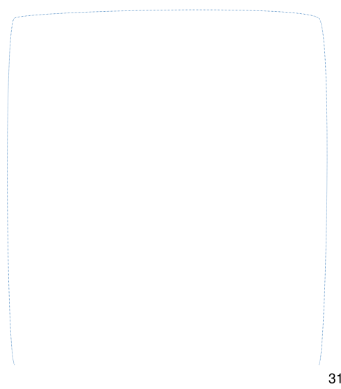

<!-- sayfa 32 -->

# BAYRAMLARIMIZLA GURURLUYUZ

## Hatırlayalım

➢ Afişi inceleyelim.

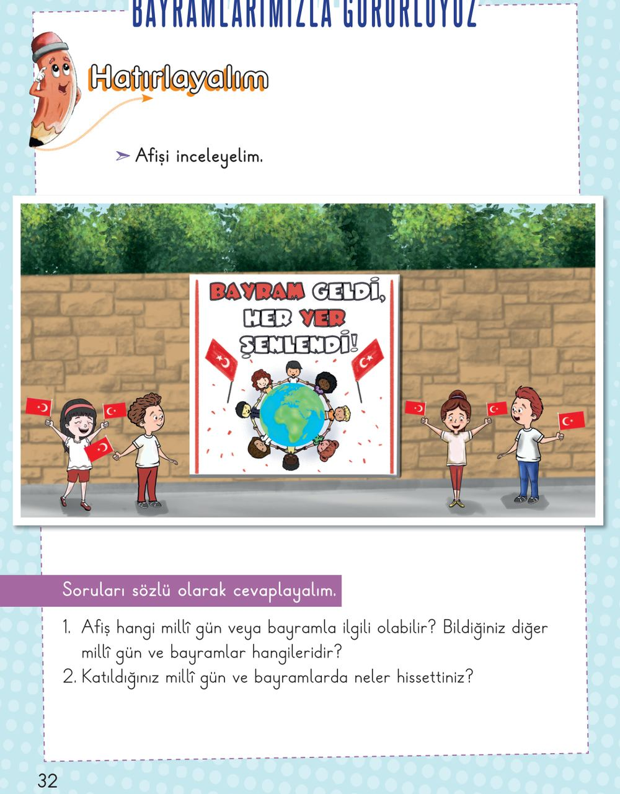: "BAYRAM GELDİ, HER YER ŞENLENDİ!" yazılı, çocukların dünya etrafında el ele tutuştuğu ve Türk bayrakları tuttuğu bir afişin çocuklarla birlikte gösterildiği resim.

### Soruları sözlü olarak cevaplayalım.

1. Afiş hangi millî gün veya bayramla ilgili olabilir? Bildiğiniz diğer millî gün ve bayramlar hangileridir?
2. Katıldığınız millî gün ve bayramlarda neler hissettiniz?

<!-- sayfa 33 -->

# Keşfedelim

➣ Öğrencilerin konuşma balonlarında anlattıklarını okuyalım.

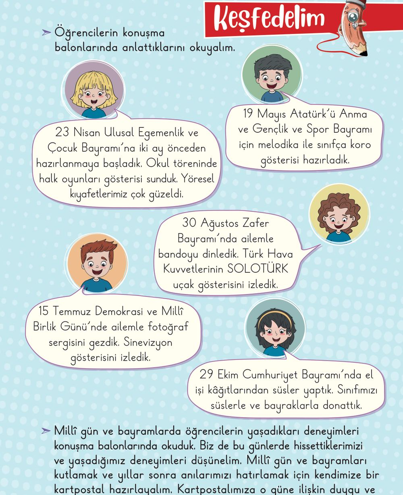: 23 Nisan Ulusal Egemenlik ve Çocuk Bayramı’na iki ay önceden hazırlanmaya başladık. Okul töreninde halk oyunları gösterisi sunduk. Yöresel kıyafetlerimiz çok güzeldi.

: 19 Mayıs Atatürk’ü Anma ve Gençlik ve Spor Bayramı için melodika ile sınıfça koro gösterisi hazırladık.

: 30 Ağustos Zafer Bayramı’nda ailemle bandoyu dinledik. Türk Hava Kuvvetlerinin SOLOTÜRK uçak gösterisini izledik.

: 15 Temmuz Demokrasi ve Millî Birlik Günü’nde ailemle fotoğraf sergisini gezdik. Sinevizyon gösterisini izledik.

: 29 Ekim Cumhuriyet Bayramı’nda el işi kâğıtlarından süsler yaptık. Sınıfımızı süslerle ve bayraklarla donattık.

➣ Millî gün ve bayramlarda öğrencilerin yaşadıkları deneyimleri konuşma balonlarında okuduk. Biz de bu günlerde hissettiklerimizi ve yaşadığımız deneyimleri düşünelim. Millî gün ve bayramları kutlamak ve yıllar sonra anılarımızı hatırlamak için kendimize bir kartpostal hazırlayalım. Kartpostalımıza o güne ilişkin duygu ve

<!-- sayfa 34 -->

# Bilgi Yolculuğumuz

## MİLLÎ GÜN VE BAYRAMLARIMIZIN ÖNEMİ

Türk milleti olarak birlik ve beraberlik içinde kutladığımız, kahramanlarımızı saygıyla andığımız millî gün ve bayramlarımız şunlardır:

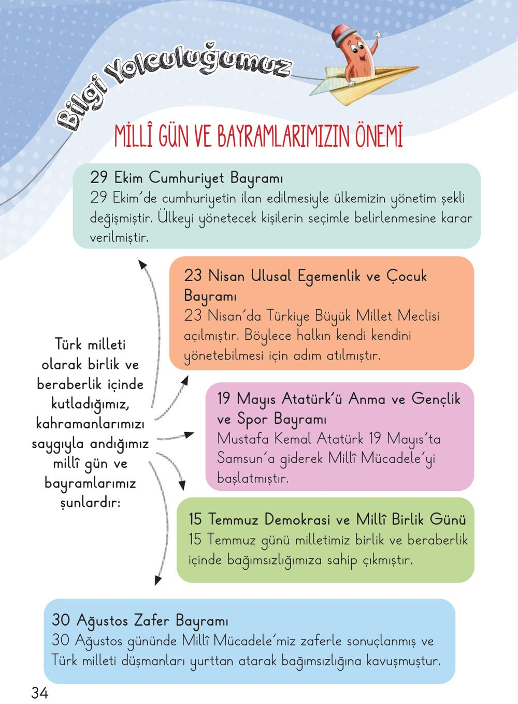

### 29 Ekim Cumhuriyet Bayramı
29 Ekim’de cumhuriyetin ilan edilmesiyle ülkemizin yönetim şekli değişmiştir. Ülkeyi yönetecek kişilerin seçimle belirlenmesine karar verilmiştir.

### 23 Nisan Ulusal Egemenlik ve Çocuk Bayramı
23 Nisan’da Türkiye Büyük Millet Meclisi açılmıştır. Böylece halkın kendi kendini yönetebilmesi için adım atılmıştır.

### 19 Mayıs Atatürk’ü Anma ve Gençlik ve Spor Bayramı
Mustafa Kemal Atatürk 19 Mayıs’ta Samsun’a giderek Millî Mücadele’yi başlatmıştır.

### 15 Temmuz Demokrasi ve Millî Birlik Günü
15 Temmuz günü milletimiz birlik ve beraberlik içinde bağımsızlığımıza sahip çıkmıştır.

### 30 Ağustos Zafer Bayramı
30 Ağustos gününde Millî Mücadele’miz zaferle sonuçlanmış ve Türk milleti düşmanları yurttan atarak bağımsızlığına kavuşmuştur.

<!-- sayfa 35 -->

Millî gün ve bayramlar; geçmişte yaşanan mücadeleleri, zaferleri, kahramanlıkları günümüze taşıdığı için kültürel mirasımızdır. Milletimiz bir araya gelerek o günlerde yaşananları hatırlar ve anar. Çocuklar ve gençler, ülkelerinin tarihi hakkında bilgi edinir. Millî ve manevi değerlere saygı duymayı öğrenir. Millî gün ve bayramlarda millî birlik ve beraberliğimiz daha güçlü hâle gelir.

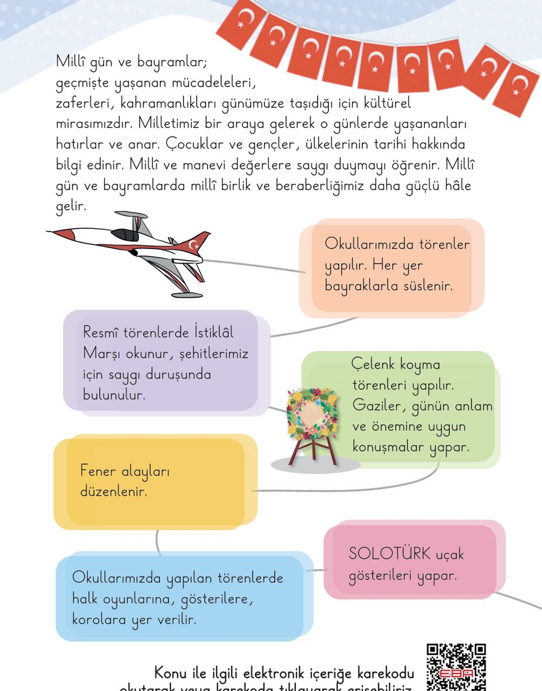

Okullarımızda törenler yapılır. Her yer bayraklarla süslenir.

Resmî törenlerde İstiklâl Marşı okunur, şehitlerimiz için saygı duruşunda bulunulur.

Çelenk koyma törenleri yapılır. Gaziler, günün anlam ve önemine uygun konuşmalar yapar.

Fener alayları düzenlenir.

Okullarımızda yapılan törenlerde halk oyunlarına, gösterilere, korolara yer verilir.

SOLOTÜRK uçak gösterileri yapar.

Konu ile ilgili elektronik içeriğe karekodu okutarak veya karekoda tıklayarak erişebiliriz

<!-- sayfa 36 -->

# UYGULAYALIM

➢ Metni okuyalım.

## Haydi Bayrama!

O sabah kardeşim ve ben gözlerimizi heyecanla açtık. Günlerdir bütün köy bayrama hazırlanıyorduk. Annem mutfaktan seslendi: “Haydi, yarışmanın yumurtaları hazır!”

Okul yolunda kalbimiz küt küt atıyordu. Vardığımızda çocuklar yürüyüş için çoktan sıraya girmişti. Önde büyük sınıflardan bir kız ve bir erkek öğrenci, kocaman bayrağımızı gururla taşıyordu. Arkada okulun bando takımı ve biz vardık. Köy halkı yürüyüşümüzü alkışlarla destekledi. Köy meydanından da geçtikten sonra okul bahçesine döndük.

Mustafa Kemal Atatürk ve şehitlerimiz için saygı duruşuyla başlayan tören İstiklâl Marşı ile devam etti. Muhtarımızın konuşmasından sonra sıra köyün en yaşlısının konuşmasına geldi. “Aferin çocuklar! Siz böyle birlik ve beraberlik içinde oldukça hep güçlü olacaksınız.” diyerek bizi tebrik etti. Sonra şiirler, şarkılar, halk oyunu gösterileri...

Sırada kaşıkla yumurta taşıma, yoğurt yeme ve çuval yarışı vardı. Birbirimizin hâline bakıp güldük, eğlendik.

Eve dönünce dedem bizi karşısına aldı. “Evlatlar!” dedi. “Bayramlar paylaştıkça güzeldir, insanları bir araya getirir. Bu anılarınızı hiç unutmayın. Büyüdüğünüzde siz de torunlarınıza anlatacaksınız.”

(Komisyon)

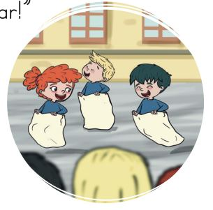

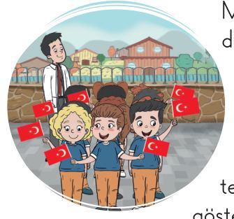

# Soruları sözlü olarak cevaplayalım.

1. Köyün en yaşlısı konuşmasında ne demek istemiştir?

<!-- sayfa 37 -->

# NELER ÖĞRENDİK?

➣ Uygulama adımlarını takip ederek etkinliği yapalım.

**Malzemeler:** kalem, kâğıt, boya kalemleri, müzik aletleri, plastik kutu ve tahta kaşık.

## Uygulama Adımları

➠ Millî gün ve bayramlardan birini seçelim.

➠ Seçtiğimiz millî gün ve bayramın önemini anlatan özgün bir şiir veya şarkı yazalım. 

> ### Şiir yazacaksak
> ● şiirimize başlık belirleyelim.
> ● şiirimizde duygularımızı birbirine uyumlu sözcükler ile ifade etmeye çalışalım.
> ● şiirimizin etrafına kenar süsü çizebilir, kenar süsünü boyayabiliriz.
>
> ### Şarkı yazacaksak
> ● şarkı sözlerini yazalım.
> ● şarkımıza ezgi belirleyelim.
> ● bir müzik aleti çalmayı biliyorsak şarkı sözlerine müzik aletimizle eşlik edelim.
> ● dilersek boş kutu, tahta kaşık gibi malzemeleri de müzik aleti olarak kullanabiliriz.

➠ Çalışmamızda millî gün ve bayramların önemini vurgulayalım.

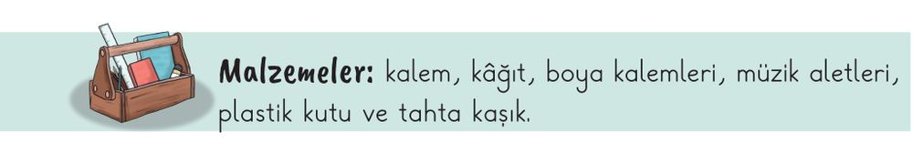

<!-- sayfa 38 -->

# BAYRAM GELİNCE

## Hatırlayalım

➢ Görselleri inceleyelim.

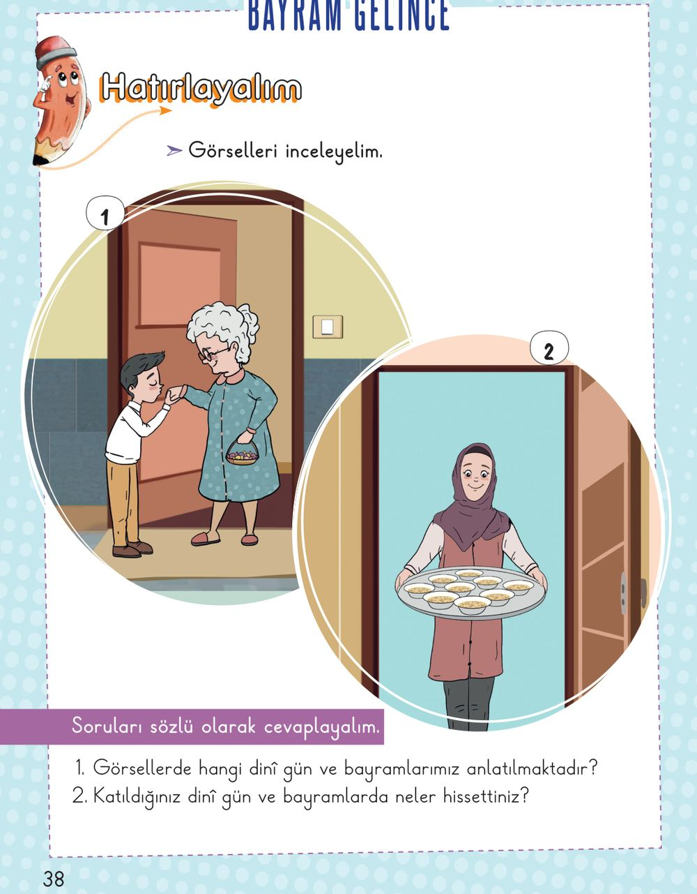

**Soruları sözlü olarak cevaplayalım.**

1. Görsellerde hangi dinî gün ve bayramlarımız anlatılmaktadır?
2. Katıldığınız dinî gün ve bayramlarda neler hissettiniz?

<!-- sayfa 39 -->

# Keşfedelim

➤ Metni okuyalım.

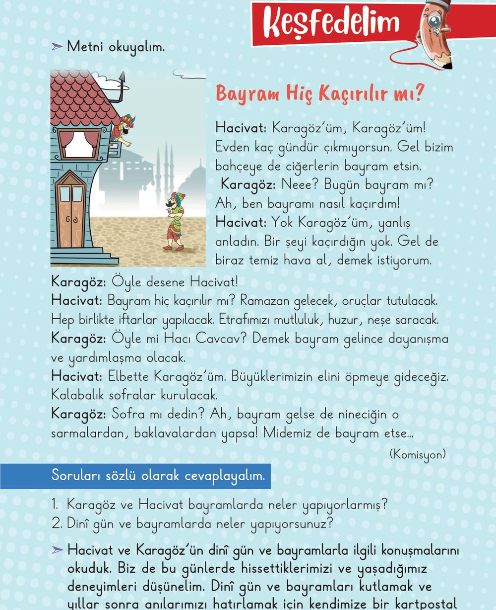

## Bayram Hiç Kaçırılır mı?

**Hacivat:** Karagöz’üm, Karagöz’üm! Evden kaç gündür çıkmıyorsun. Gel bizim bahçeye de ciğerlerin bayram etsin.
**Karagöz:** Neee? Bugün bayram mı? Ah, ben bayramı nasıl kaçırdım!
**Hacivat:** Yok Karagöz’üm, yanlış anladın. Bir şeyi kaçırdığın yok. Gel de biraz temiz hava al, demek istiyorum.
**Karagöz:** Öyle desene Hacivat!
**Hacivat:** Bayram hiç kaçırılır mı? Ramazan gelecek, oruçlar tutulacak. Hep birlikte iftarlar yapılacak. Etrafımızı mutluluk, huzur, neşe saracak.
**Karagöz:** Öyle mi Hacı Cavcav? Demek bayram gelince dayanışma ve yardımlaşma olacak.
**Hacivat:** Elbette Karagöz’üm. Büyüklerimizin elini öpmeye gideceğiz. Kalabalık sofralar kurulacak.
**Karagöz:** Sofra mı dedin? Ah, bayram gelse de nineciğin o sarmalardan, baklavalardan yapsa! Midemiz de bayram etse...
(Komisyon)

### Soruları sözlü olarak cevaplayalım.

1. Karagöz ve Hacivat bayramlarda neler yapıyorlarmış?
2. Dinî gün ve bayramlarda neler yapıyorsunuz?

➤ Hacivat ve Karagöz’ün dinî gün ve bayramlarla ilgili konuşmalarını okuduk. Biz de bu günlerde hissettiklerimizi ve yaşadığımız deneyimleri düşünelim. Dinî gün ve bayramları kutlamak ve yıllar sonra anılarımızı hatırlamak için kendimize bir kartpostal...

<!-- sayfa 40 -->

# Bilgi Yolculuğumuz

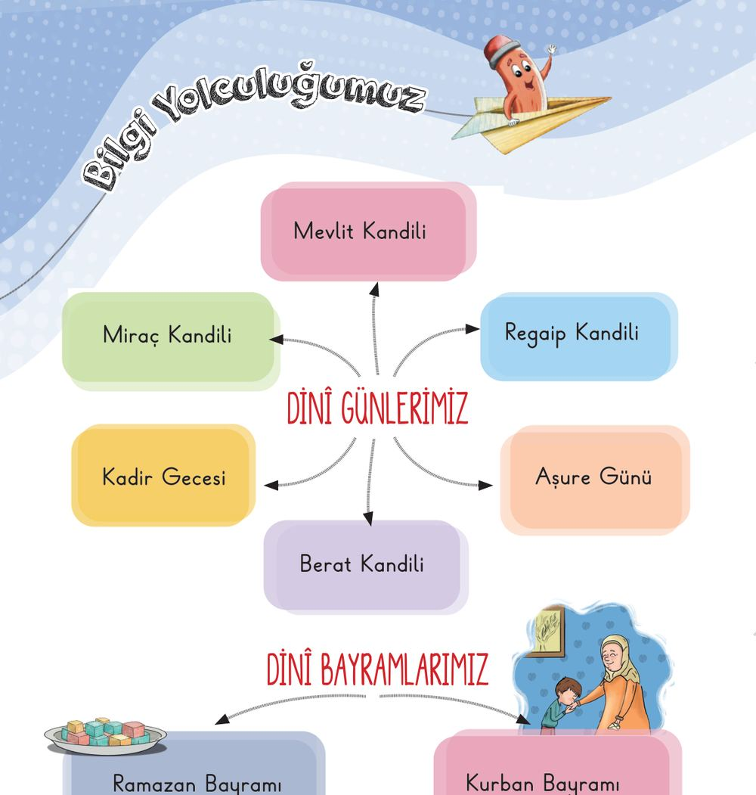

## DİNÎ GÜNLERİMİZ

* Mevlit Kandili
* Regaip Kandili
* Aşure Günü
* Berat Kandili
* Kadir Gecesi
* Miraç Kandili

## DİNÎ BAYRAMLARIMIZ

* Ramazan Bayramı
* Kurban Bayramı

Dinî gün ve bayramlar millî ve manevi değerlerimizdir. Bu önemli ve özel günlerde ailece bir arada bulunuruz. Dinî gün ve bayramları dayanışma, yardımlaşma, birlik ve beraberlik içinde kutlarız.

<!-- sayfa 41 -->

# Dinî Gün ve Bayramlarda

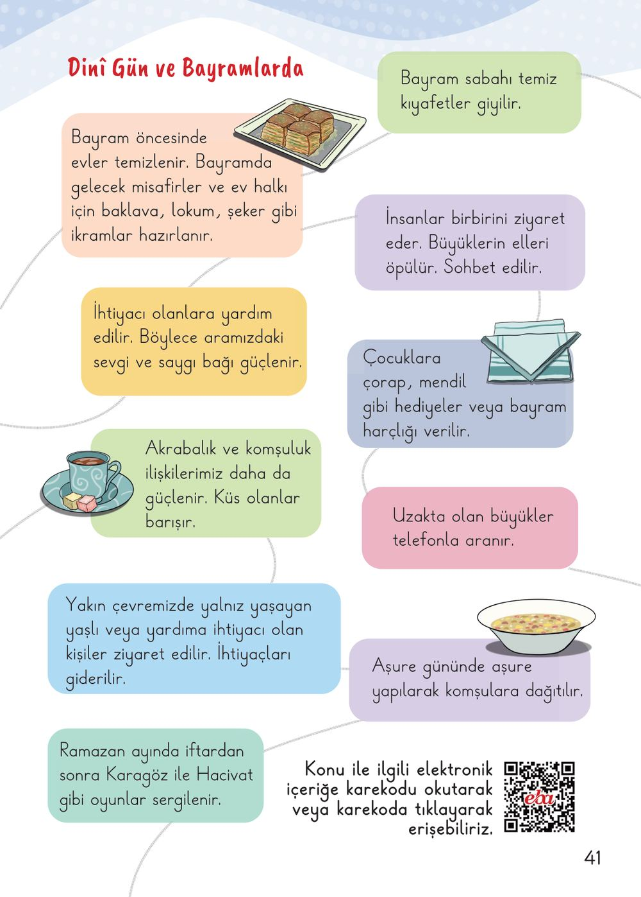 Bayram öncesinde evler temizlenir. Bayramda gelecek misafirler ve ev halkı için baklava, lokum, şeker gibi ikramlar hazırlanır.

Bayram sabahı temiz kıyafetler giyilir.

İnsanlar birbirini ziyaret eder. Büyüklerin elleri öpülür. Sohbet edilir.

 Çocuklara çorap, mendil gibi hediyeler veya bayram harçlığı verilir.

İhtiyacı olanlara yardım edilir. Böylece aramızdaki sevgi ve saygı bağı güçlenir.

 Akrabalık ve komşuluk ilişkilerimiz daha da güçlenir. Küs olanlar barışır.

Uzakta olan büyükler telefonla aranır.

Yakın çevremizde yalnız yaşayan yaşlı veya yardıma ihtiyacı olan kişiler ziyaret edilir. İhtiyaçları giderilir.

 Aşure gününde aşure yapılarak komşulara dağıtılır.

Ramazan ayında iftardan sonra Karagöz ile Hacivat gibi oyunlar sergilenir.

Konu ile ilgili elektronik içeriğe karekodu okutarak veya karekoda tıklayarak 

<!-- sayfa 42 -->

# UYGULAYALIM

➣ Görselleri inceleyelim.

1
2
3

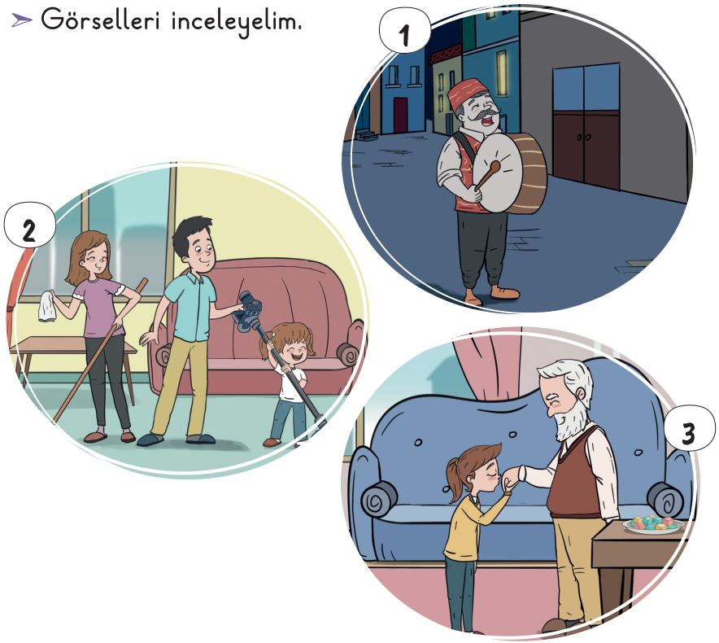

➣ Uygulama adımlarını takip ederek etkinliği yapalım.

## Uygulama Adımları

➠ Görsellerde dinî gün ve bayramlarla ilgili neler yapıldığını söyleyelim.
➠ Sınıf arkadaşlarımızla 4-5 kişilik gruplar oluşturalım.
➠ Dinî gün ve bayramları gruplar arasında paylaşalım.
➠ Seçtiğimiz dinî gün veya bayramı nasıl kutladığımızı sınıfta canlandıralım.

<!-- sayfa 43 -->

# NELER ÖĞRENDİK?

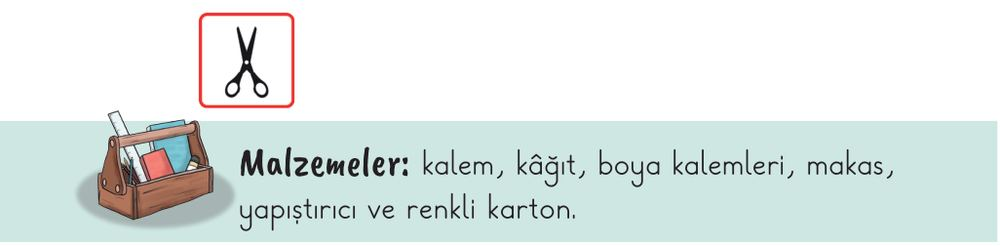
➣ Uygulama adımlarını takip ederek etkinliği yapalım.

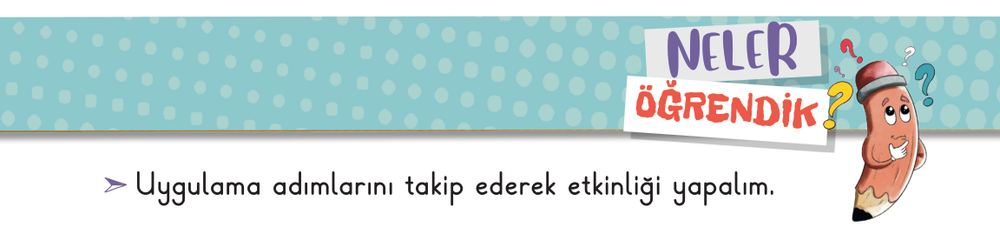
**Malzemeler:** kalem, kâğıt, boya kalemleri, makas, yapıştırıcı ve renkli karton.

## Uygulama Adımları

➠ Dinî gün ve bayramlardan birini seçelim.
➠ Seçtiğimiz dinî gün ve bayramın önemini anlatan özgün bir resim yapalım veya konuya uygun afiş tasarlayalım. 

> ### Resim yapacaksak
> ● kâğıdı ve boya kalemlerini hazırlayalım.
> ● ne çizeceğimize karar verelim.
> ● resmimizi yapalım.
>
> ### Afiş hazırlayacaksak
> ● karton, kâğıt, yapıştırıcı, makas gibi malzemeleri hazırlayalım.
> ● ne çizeceğimize veya hangi görselleri kullanacağımıza karar verelim.
> ● afişimize uygun bir slogan bulalım ve sloganı dikkat çekici bir biçimde yazalım.

➠ Çalışmamızda dinî gün ve bayramların önemini vurgulayalım.
➠ Hazırladığımız çalışmayı arkadaşlarımıza sunalım.

<!-- sayfa 44 -->

# TEKRAR ZAMANI

1. Uzak bir şehirden aile dostlarımızın bizi ziyaret edeceğini düşünelim. Misafirlerimizi yakın çevremizde hangi tarihî mekân ve doğal güzelliklere götürürüz? Aşağıdaki tabloyu başlıklara uygun şekilde dolduralım.

**Gezi Programı Tablosu**

| Yakın Çevremdeki Tarihî Mekanlar | Misafirlerime Anlatacaklarımla İlgili Gezi Notlarım |
| :--- | :--- |
| | |
| | |
| **Yakın Çevremdeki Doğal Güzellikler** | |
| | |
| | |

2. Aşağıdaki bulmacayı ipuçlarından yararlanarak dolduralım.

**İpuçları**

1. Valinin yönettiği yerleşim yerinin adıdır.
2. Kaymakamın yönettiği yerleşim yerinin adıdır.
3. Belediye başkanının yönettiği birimin adıdır.
4. Muhtarın yönettiği yerleşim yerinin adıdır.

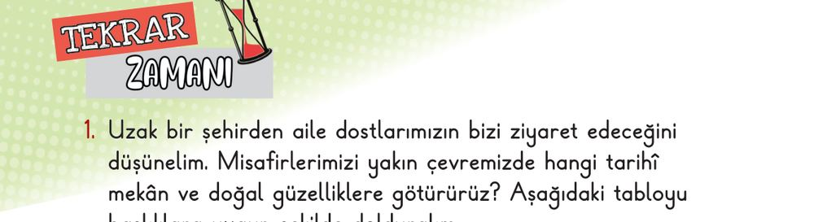
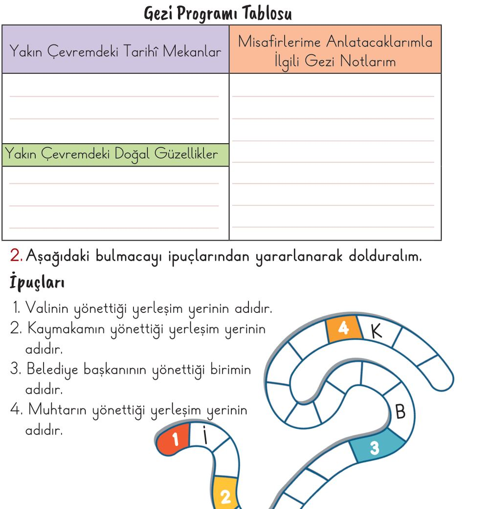

<!-- sayfa 45 -->

3. Metni okuyup soruları cevaplayalım.

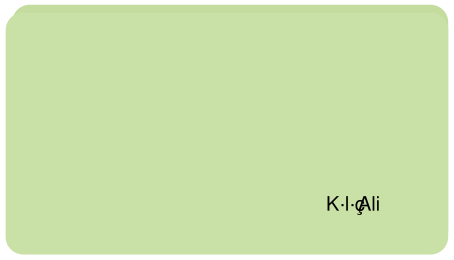
> Mustafa Kemal Atatürk’ün annesi Zübeyde Hanım anlatıyor:
>
> Mustafa’m küçücük çocukken bile gayet temiz giyinirdi. Büyük adam tavırları takınır, herkesle büyükmüş gibi konuşurdu. Konu komşu herkes onu çok severdi. Çok zekiydi. Daha rüştiyede iken Selanik eşrafından Evranoszade Muhsin Bey’in oğluna ders verirdi.
>
> Kılıç Ali
> (Kısaltılmıştır.)

a. Metne göre Mustafa Kemal Atatürk’ün öğrencilik yıllarında sahip olduğu özellikler nelerdir?
__________________________________________________________________________
__________________________________________________________________________
__________________________________________________________________________
__________________________________________________________________________

b. Mustafa Kemal Atatürk’ün öğrencilik yıllarındaki hangi özelliğini kendinize örnek alıyorsunuz? Neden?
__________________________________________________________________________
__________________________________________________________________________
__________________________________________________________________________
__________________________________________________________________________

<!-- sayfa 46 -->

4. Millî gün ve bayramlarla ilgili cümleleri okuyalım. Cümle doğruysa “Doğru” kutusunu, yanlışsa “Yanlış” kutusunu boyayalım. Boyanmayan heceleri yazarak şifredeki atasözüne ulaşalım.

| İfadeler | Doğru | Yanlış |
| :--- | :---: | :---: |
| 1. Baklava yapar, misafirlerimize ikram ederiz. | BİR | GENÇ |
| 2. Kültürel mirasımızdır. | LER | LİK |
| 3. Birlik ve beraberliği güçlendirir. | SÖZ | TEN |
| 4. Her millet millî gün ve bayramları aynı şekilde kutlar. | KUV | YEN |
| 5. Şehit ve gazilerimize saygı gösteririz. | MİŞ | VET |
| 6. Komşularımızı ziyaret eder, şeker toplarız. | DO | SON |
| 7. Okulumuzu, sınıfımızı bayraklarla süsleriz. | DUR | ĞAR |

ŞİFRE: _________________________________________________

5. Millî gün ve bayramların önemiyle ilgili aklımıza gelen beş kelimeyi yazalım. Yazdığımız kelimelerden birini seçerek cümle içinde kullanalım.
__________________________________________________________________________
__________________________________________________________________________
__________________________________________________________________________
__________________________________________________________________________
__________________________________________________________________________

<!-- yer tutucu bulunamadı: sayfa sonuna eklendi -->

<!-- yer tutucu bulunamadı: sayfa sonuna eklendi -->

<!-- sayfa 47 -->

6. Aşağıdaki cümleleri okuyalım. Dinî gün ve bayramlarla ilgili cümlelerin yer aldığı kutuların altındaki harfleri boyayalım. Boyadığımız harfleri kutulara yazarak şifreyi bulalım.

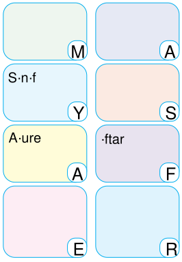
| | | |
| :--- | :--- | :--- |
| Bayrak töreni yapılır.   **U** | Baklava, lokum gibi ikramlıklar hazırlanır.   **M** | Stadyumlarda gösteriler düzenlenir.   **A** |
| Çocuklara harçlık, mendil gibi hediyeler verilir.   **İ** | Sınıf panoları ve camlar süslenir.   **Y** | Birlik ve beraberliğimiz güçlenir.   **S** |
| Fener alayları düzenlenir.   **Z** | Aşure yapılarak komşulara dağıtılır.   **A** | İftar sofraları kurulur.   **F** |
| Ramazan ayında iftardan sonra çocuklar için eğlenceler düzenlenir.   **İ** | Törenlerde konuşmalar yapılır.   **E** | Büyüklerin eli öpülür.   **R** |

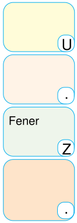
ŞİFRE: [ ][ ][ ][ ][ ][ ][ ]

7. Dinî gün ve bayramlarla ilgili deneyimlerimizi arkadaşlarımızla paylaşalım.

8. Dinî gün ve bayramların neden önemli olduğunu söyleyelim.

 Ek sorulara karekodu okutarak veya karekoda tıklayarak erişebiliriz.

<!-- sayfa 48 -->

# 5. ÖĞRENME ALANI

EBA’da yer alan öğrenme alanına karekodu okutarak veya karekoda tıklayarak erişebiliriz.

Öğrenme alanı ile ilgili özet içeriğe karekodu

<!-- sayfa 49 -->

# DOĞA VE ÇEVRE

> Hava Olayları ve Mevsimler
> Doğadan Yararlanarak Yön Bulma
> Afetlere Karşı Alınacak Önlemler
> Tasarruf Bizim İşimiz

Bu öğrenme alanında

> hava olaylarını ve mevsimleri,
> doğadan yararlanarak yön bulmayı,
> afetlere karşı alınabilecek önlemleri,
> doğal kaynakları tasarruflu kullanmayı öğreneceğiz.

## ANAHTAR KAVRAMLAR

> hava olayları
> mevsimler
> ana yönler
> doğada yön bulma
> afet
> kaynak
> tasarruf

<!-- yer tutucu bulunamadı: sayfa sonuna eklendi -->

<!-- sayfa 50 -->

# BELİRLİ GÜN VE HAFTALAR

Belirli gün ve haftalarla ilgili aşağıdaki şiirleri okuyalım.

## Orman Haftası
(21-26 Mart)

### ORMANLAR CİĞERLERİMİZDİR
Yemyeşil süsler yurdumuzu,
Ormanlar ciğerlerimizdir.
Sele, heyelana karşı koruyucu
Ormanlar hazinemizdir.

## Dünya Su Günü
(22 Mart)

### SUYUMUZ ÇOK KIYMETLİ
Suya muhtaçtır tüm canlılar,
Sanmayın ki hiç bitmeyecek.
Kıymetini susuz kalan anlar,
Tasarruflu kullanmak gerek!

<!-- yer tutucu bulunamadı: sayfa sonuna eklendi -->

<!-- sayfa 51 -->

Belirli gün ve haftalar ile ilgili etkinliklere karekodu okutarak veya karekoda tıklayarak erişebiliriz. 

## Kütüphaneler Haftası
(Mart ayının son pazartesi gününü içine alan hafta)

### BİR DÜNYA KİTAP
Raflarda rengârenk kitaplar,
Sayfalarında dünyaları saklar.
Keşfetmek, bilmek isteyen çocuklar
Düzenli olarak kütüphaneye uğrar.

## 23 Nisan Ulusal Egemenlik ve Çocuk Bayramı
(23 Nisan)

### GELDİ ÇOCUK BAYRAMI
Ne mutlu bize, geldi çocuk bayramı.
Bugün Atatürk’ün bize armağanı.
Süslemeli sınıfları bayraklarla;
Şiirlerle, marşlarla kutlamalı.

<!-- sayfa 52 -->

# HAVA OLAYLARI VE MEVSİMLER

## Hatırlayalım

➢ Görselleri inceleyelim.

1

2

3

4

**Soruları sözlü olarak cevaplayalım.**

1. Görseller arasındaki farklar nelerdir? Bu farklılıklar neden oluşur?
2. En çok hangi mevsimi seviyorsunuz? Neden?

<!-- sayfa 53 -->

# Keşfedelim

➢ Aşağıdaki hava olaylarının hangi mevsimlerde görülebileceğini işaretleyelim.

| Hava Olayı | İlkbahar | Yaz | Sonbahar | Kış |
| :--- | :---: | :---: | :---: | :---: |
| ☀️ Güneşli | ☐ | ☐ | ☐ | ☐ |
| 🌧️ Yağmurlu | ☐ | ☐ | ☐ | ☐ |
| 💨 Rüzgarlı | ☐ | ☐ | ☐ | ☐ |
| ❄️ Karlı | ☐ | ☐ | ☐ | ☐ |

## Aşağıdaki soruları cevaplayalım.

1. Birden fazla mevsimde görülebilen hava olayları hangileridir?
___________________________________________________________________________
___________________________________________________________________________

2. Bir mevsimde birden fazla hava olayı görülebilir mi? Örnek veriniz.
___________________________________________________________________________
___________________________________________________________________________

3. Size göre hangi hava olayları insanların günlük yaşamını daha çok etkiler?
___________________________________________________________________________
___________________________________________________________________________

<!-- yer tutucu bulunamadı: sayfa sonuna eklendi -->

<!-- sayfa 54 -->

# Bilgi Yolculuğumuz

## HAVA OLAYLARI VE MEVSİMLER ARASINDAKİ İLİŞKİ

 Bulutlardaki su buharının soğuk hava ile karşılaşarak su damlacıkları hâlinde yeryüzüne düşmesine **yağmur** deriz.

 Su buharının donarak beyaz ve hafif tanecikler hâlinde yağmasına **kar** deriz.

Yağmur, kar, dolu, rüzgâr hava olaylarındandır.

 Su damlacıklarının yeryüzüne inerken donarak buz parçaları hâlinde yağmasına **dolu** deriz.

 Sıcak ve soğuk havanın yer değiştirmesi sonucu oluşan esintiye **rüzgâr** deriz.

<!-- sayfa 55 -->

Sonbahar mevsiminde havalar serinler. Sert rüzgârlar esebilir. Bulutlu günlerin sayısı artar. Yağmurlar görülebilir. Eylül, ekim ve kasım sonbahar mevsiminin aylarıdır.

Kış mevsiminde havalar soğur. Yağmur, kar, dolu gibi hava olayları yaşanabilir. Aralık, ocak ve şubat kış mevsiminin aylarıdır.

Hava olayları ve mevsimler birbiriyle ilişkilidir. Yağış türleri mevsimlere göre değişiklik gösterebilir.

İlkbahar mevsiminde havalar ısınmaya başlar. Yağmur ve dolu şeklinde yağışlar görülebilir. Mart, nisan ve mayıs ilkbahar mevsiminin aylarıdır.

Yaz mevsiminde havalar güneşli ve oldukça sıcaktır. Haziran, temmuz ve ağustos yaz mevsiminin aylarıdır.

Konu ile ilgili elektronik içeriğe karekodu okutarak...

<!-- sayfa 56 -->

# UYGULAYALIM

➢ Öğretmenimiz rehberliğinde bir doğa gezisi düzenleyelim.
➢ Gezi sırasında çevremizdeki hava durumunu ve hava olaylarını gözlemleyelim.

**Gözlemlerimizden hareketle aşağıdaki soruları cevaplayalım.**

1. Gözleminiz sırasında hava durumu nasıldı?
__________________________________________________________________
__________________________________________________________________

2. Hangi hava olaylarını gözlemleyebildiniz?
__________________________________________________________________
__________________________________________________________________

3. Hava olayları ile ilgili neleri merak ettiniz?
__________________________________________________________________
__________________________________________________________________

<!-- sayfa 57 -->

➢ Yaptığımız doğa gezisinden sonra, hava durumundaki değişimleri incelemek amacıyla bir hafta boyunca hava durumunu takip edelim.

➢ Tabloda boş bırakılan yerlere haftanın günlerini ve hava olaylarının isimlerini yazalım.

➢ Her gün hava durumunu dikkatlice inceleyelim.

➢ Günlük olarak gözlemlediğimiz hava olayını tabloda uygun kutucuğu işaretleyerek gösterelim.

# HAVA OLAYLARI TABLOSU

| Günler | Hava Olayı | ☀️ | 🌧️ | 🌨️ | ❄️ | ☁️ | 💨 |
| :--- | :--- | :---: | :---: | :---: | :---: | :---: | :---: |
| .................... | | | | | | | |
| .................... | | | | | | | |
| .................... | | | | | | | |
| .................... | | | | | | | |
| .................... | | | | | | | |
| .................... | | | | | | | |

➢ Aynı gün içinde birden fazla hava olayının yaşandığı günleri ve bu günlerde hangi hava olaylarının bir arada görüldüğünü

<!-- sayfa 58 -->

# UYGULAYALIM

➢ Uygulama adımlarını takip ederek etkinliği yapalım.

**Malzemeler:** karton (her bir grup için bir adet), boya kalemleri, mevsimlerle ilgili materyaller (çiçek, yeşil veya sararmış yaprak vb.) ve yapıştırıcı.

## Uygulama Adımları

☞ Sınıf arkadaşlarımızla 4 grup oluşturalım. Her grup bir mevsimden sorumlu olacak şekilde mevsimleri paylaşalım.

☞ Grubumuza ait mevsimde görülen hava olayları, mevsimde yer alan aylar gibi mevsimin özelliklerini yansıtan bir çalışma hazırlayalım. Çalışmamızı görsellerle destekleyelim.

☞ Grup arkadaşlarımızla iş bölümü yaparak çalışmamızı tamamlayalım. Tamamladığımız çalışmayı gruplar hâlinde sunalım.

☞ Sunumumuz sırasında sorulan sorulara cevap verelim. Diğer grupların sunumlarını dinleyelim. Merak ettiğimiz soruları arkadaşlarımıza soralım.

☞ Grupların çalışmalarını mevsim sırasına göre bir araya getirelim. Kenarlarından yan yana yapıştıralım.

☞ Sınıfça oluşturduğumuz mevsim şeridini sınıfımızın uygun bir yerine asalım.

<!-- yer tutucu bulunamadı: sayfa sonuna eklendi -->

<!-- sayfa 59 -->

# NELER ÖĞRENDİK?

1. Görseller ile hava olaylarını çizgi çizerek eşleştirelim.

• Karlı • Yağmurlu • Bulutlu • Sisli • Rüzgârlı • Dolu yağışlı • Güneşli

2. Doğru cümlelerin başına “D”, yanlış ifadelerin başına “Y” yazalım. Yanlış cümlelerin doğrularını altlarındaki boşluklara yazalım.

( ) a. İlkbahar, kar yağışının en çok görüldüğü mevsimdir.
__________________________________________________________________

( ) b. Sonbahar mevsiminde havalar soğumaya başlar.
__________________________________________________________________

( ) c. Yaz mevsiminde havalar sıcak olur.
__________________________________________________________________

( ) ç. Kış mevsiminin ayları eylül, ekim ve kasımdır.
__________________________________________________________________

3. Hava olayları ve mevsimler arasında nasıl bir ilişki vardır? Örnek vererek açıklayalım.
__________________________________________________________________
__________________________________________________________________

<!-- yer tutucu bulunamadı: sayfa sonuna eklendi -->

<!-- sayfa 60 -->

# DOĞADAN YARARLANARAK YÖN BULMA

## Hatırlayalım

➢ Görseli inceleyelim.

### Soruları sözlü olarak cevaplayalım.

1. Görseldeki okulun çevresinde hangi yerler bulunmaktadır?
2. Sizin okulunuzun çevresinde hangi yerler bulunmaktadır?
3. Okulunuzun çevresini arkadaşınıza nasıl tarif edersiniz?

<!-- sayfa 61 -->

# Keşfedelim

➢ Güneş’in gökyüzündeki konumu doğada yön bulmak için kullanılan yöntemlerden biridir. Buna göre görseli inceleyelim.

➢ Uygulama adımlarını takip ederek etkinliği yapalım.

## Uygulama Adımları

➠ Güneş’in doğduğu ve battığı yönleri görselde gösterelim.
➠ Sabah ve akşam saatlerinde Güneş’in gökyüzündeki konumunu gözlemleyelim.
➠ Gözlem sonuçlarımızı arkadaşlarımızla paylaşalım.
➠ Doğada yön bulmak için kullanılan farklı yöntemler biliyorsak yazalım.
➠ Bu yöntemler hakkında merak ettiğimiz soruları yazalım.

__________________________________________________________________
__________________________________________________________________
__________________________________________________________________
__________________________________________________________________
__________________________________________________________________

➢ Tüm soruları sınıf arkadaşlarımızla tartışarak cevaplayalım.
➢ Arkadaşlarımızın düşüncelerini dinleyelim, farklı fikirlere

<!-- sayfa 62 -->

# Bilgi Yolculuğumuz

## DOĞADAN YARARLANARAK YÖN BULMA

Belli bir noktaya göre bulunduğumuz yere **yön** denir. Dört ana yön vardır. Bunlar: **Doğu, batı, kuzey ve güneydir.**

Ana yönleri ifade eden yön oku, yönleri tespit etmemize yardımcı olur. Örneğin aşağıdaki sınıf tahtasının kuzeyinde şeref köşesi, güneyinde top bulunmaktadır. Tahtanın doğusunda saat, batısında dolap vardır.

<!-- sayfa 63 -->

# Güneş’in Konumu

Güneş’in doğduğu yere sağ kolumuzu uzattığımızda sağ kolumuz doğu, sol kolumuz batı yönünü gösterir. Yüzümüz kuzeyi, sırtımız güneyi gösterir.

Bulunduğumuz yeri belirleyebilmek veya başka bir yere ulaşmak için yön bulma yöntemlerini kullanırız. Yönümüzü bulmak için doğadan yararlanabiliriz.

## Karınca Yuvası

Karıncalar yuvalarının ağzını hep güneye doğru yaparlar. Yuvalarından çıkardıkları toprakları kuzeye yığarlar.

## Kutup Yıldızı

Kutup Yıldızı kuzey yönünü gösterir. Gökyüzünün bulutsuz olduğu gecelerde parlaklığıyla dikkat çekmektedir.

## Yosunlar

Ağaçların veya taşların yosunlu kısımları kuzey yönünü gösterir.

Konu ile ilgili elektronik içeriğe karekodu okutarak...

<!-- sayfa 64 -->

# UYGULAYALIM

➣ Uygulama adımlarını takip ederek etkinliği yapalım.

## Uygulama Adımları

➠ Sınıf arkadaşlarımızla 4 kişilik gruplar oluşturalım.

➠ Sınıfımızdaki nesneleri inceleyelim. Yön okunu kullanarak nesnelerin hangi yönde bulunduğunu belirleyelim. 

➠ Her yön için uygun gördüğümüz üç nesneyi ilgili bölüme yazalım.

Kuzey
1. \_\_\_\_\_\_\_\_\_\_\_\_\_\_\_\_
2. \_\_\_\_\_\_\_\_\_\_\_\_\_\_\_\_
3. \_\_\_\_\_\_\_\_\_\_\_\_\_\_\_\_

Batı          Doğu
1. \_\_\_\_\_\_\_\_\_\_\_\_\_\_\_\_  1. \_\_\_\_\_\_\_\_\_\_\_\_\_\_\_\_
2. \_\_\_\_\_\_\_\_\_\_\_\_\_\_\_\_  2. \_\_\_\_\_\_\_\_\_\_\_\_\_\_\_\_
3. \_\_\_\_\_\_\_\_\_\_\_\_\_\_\_\_  3. \_\_\_\_\_\_\_\_\_\_\_\_\_\_\_\_

Güney
1. \_\_\_\_\_\_\_\_\_\_\_\_\_\_\_\_
2. \_\_\_\_\_\_\_\_\_\_\_\_\_\_\_\_
3. \_\_\_\_\_\_\_\_\_\_\_\_\_\_\_\_

➠ Grup arkadaşlarımızla belirlediğimiz nesnelerden dört tanesini seçelim. Bu nesnenin hangi yönde bulunduğunu nasıl belirlediğimizi 

<!-- sayfa 65 -->

➢ Aşağıdaki görselleri inceleyelim. Sizce hangileri yön bulmamıza yardımcı olabilir? İşaretleyelim.

|  |  |  |  |
| :---: | :---: | :---: | :---: |
| ☐ Güneş | ☐ Mantar | ☐ Karınca Yuvası | ☐ Papatya |

|  |  |  |  |
| :---: | :---: | :---: | :---: |
| ☐ Kelebek | ☐ Kuş | ☐ Kutup Yıldızı | ☐ Yosunlu Ağaç Gövdesi |

➢ Uygulama adımlarını takip ederek etkinliği yapalım.

# Uygulama Adımları

➠ Öğretmenimizin rehberliğinde okul bahçesindeki toprak bir alana çubuğu görseldeki gibi yerleştirelim. 
➠ Çubuğun yere düşen gölgesinin en uç kısmını işaretleyelim.
➠ 15-20 dakika sonra çubuğun gölgesinin yer değiştirdiğini göreceğiz. Çubuğun yeni gölgesinin uç kısmını işaretleyelim.
➠ İlk ve ikinci işaretlediğimiz yer arasına bir çizgi çizelim. Bu çizgi doğu, batı yönünü göstermektedir.
➠ Sol ayağımız ile birinci işaretlediğimiz yere, sağ ayağımız ile ikinci işaretlediğimiz yere basalım. Artık yüzümüz kuzey yönünü göstermektedir.

<!-- sayfa 66 -->

# UYGULAYALIM

➢ Uygulama adımlarını takip ederek etkinliği yapalım.

## Uygulama Adımları

➠ Okul bahçesinde sınıf arkadaşlarımızla 4 grup oluşturalım.

➠ Yön okunu kullanarak kuzey, güney, doğu ve batı yönünde grup üyeleri olarak sıra olalım.

➠ Yön okunun merkezine eşit uzaklıkta dört başlangıç çizgisi belirleyelim.

➠ İşaret verildiğinde sıranın başındaki arkadaşımızın koşarak yön okunun merkezine dokunmasını isteyelim.

➠ Yön okunun merkezine dokunan öğrencinin kendi sırasının en arkasına geçmesini söyleyelim.

➠ Sıradaki öğrencilerin tamamı parkuru tamamlayana kadar oyuna devam edelim. Parkuru önce tamamlayan grubu tebrik edelim.

➠ Etkinliği tamamladığımızda grup olarak saat yönünde hareket edelim. Bir sonraki grup ile yer değiştirelim.

➠ Yeni geldiğimiz yönün adını söyleyelim.

<!-- yer tutucu bulunamadı: sayfa sonuna eklendi -->

<!-- sayfa 67 -->

# NELER ÖĞRENDİK?

➣ Görsellerden ve ipuçlarından yararlanarak boş alanlara yönleri yazalım.

(Boş kutucuklar ve yönler içeren görsel şema)
- Üstteki görsel (Yatakta oturan çocuk):
    - Batı
    - [ ]
    - [ ]
    - [ ]
    - [ ]

- Ortadaki sol görsel (Toprak deliği):
    - Kuzey
    - [ ]
    - [ ]
    - [ ]
    - [ ]

- Ortadaki sağ görsel (Gece gökyüzü):
    - Batı
    - Kutup Yıldızı
    - [ ]
    - [ ]
    - [ ]
    - [ ]

- Alttaki görsel (Ağaç):
    - Güney
    - [ ]
    - [ ]
    - [ ]
    - [ ]

<!-- sayfa 68 -->

# AFETLERE KARŞI ALINACAK ÖNLEMLER

## Hatırlayalım

➢ Görselleri inceleyelim.

1. 
2. 

**Soruları sözlü olarak cevaplayalım.**

1. Yukarıdaki görselleri inceleyelim. Deprem, görsellerdeki odaları nasıl etkilemiştir?
2. “Önlem almak hayat kurtarır.” sözü size ne ifade ediyor?

<!-- sayfa 69 -->

# Keşfedelim

➢ Daha önce öğrendiğiniz afet türlerinden hangilerini hatırlıyorsunuz? Afet sırasında güvende kalmak için nelere dikkat etmeniz gerektiğini söyleyiniz.

➢ Katıldığınız bir afet tatbikatını düşününüz. Tatbikat sırasında hissettiğiniz duyguları nasıl ifade edersiniz? İşaretleyiniz.

☐ Sakin hissettim.
☐ Heyecanlandım.
☐ Biraz endişelendim.
☐ Kendimi güvende hissettim.

➢ Ekler bölümündeki Ek 2’de bulunan görselleri keselim. Aşağıdaki alana tatbikat aşamalarına dikkat ederek yapıştıralım.

 **Malzemeler:** makas ve yapıştırıcı.

Soruları sözlü olarak cevaplayalım.

1. Görsellerle ifade edilen tatbikatın aşamaları nelerdir?
2. Tatbikat sırasındaki aşamalara neden dikkat etmeliyiz?
3. Tatbikata hazırlık için kimlerden veya hangi kaynaklardan bilgi...

<!-- sayfa 70 -->

# Bilgi Yolculuğumuz
# AFETLERE KARŞI ALINACAK ÖNLEMLER

Afetlere karşı hazırlıklı olmak can ve mal kayıplarını azaltır. Afetlerden korunmak için alınması gereken bazı önlemler bulunmaktadır.

**Deprem**
Binaların zeminlerinin sağlamlığı ve depreme dayanıklılığı kontrol ettirilir.

**Sel**
Eğimli arazilere veya dere yataklarına yerleşim yapılmaz. Sel ile ilgili uyarılar radyo ve televizyondan takip edilir.

**Orman Yangını**
Orman yangınlarını önlemek için ormanlık alanlarda ateş yakılmaz, cam ve yanıcı maddeler doğaya bırakılmaz. Yangın fark edildiğinde yetkililere haber verilir.

**Çığ**
Eğimli ve çok kar yağışı alan bölgelere yerleşim alanları yapılmaz. Hava ve yol durumu haberleri takip edilir.

**Heyelan**
Bol yağışlı ve eğimli arazilerin olduğu bölgelere yerleşim alanı yapılmaz.

Afetler doğada büyük zararlara yol açar. Afetlerden korunmak için gerekli önlemleri almalıyız. Böylece ülkemizin varlıklarını koruyabilir ve geleceğimizi güvende tutabiliriz.

Konu ile ilgili elektronik içeriğe karekodu okutarak veya karekoda tıklayarak erişebiliriz. 

<!-- yer tutucu bulunamadı: sayfa sonuna eklendi -->

<!-- sayfa 71 -->

# Tehlike Avı
Afet durumunda bulunduğumuz yerde devrilme, kırılma, düşme sonucu yaralanmaya sebep olacak eşyaları belirleriz. Bu tehlikelere çözümler bularak tehlike avı yaparız.

1. **Tespit Etme:** Evinizin odalarının fotoğraflarını çekiniz ve tehlikeli olabilecek unsurları belirleyiniz.
2. **Riskleri Tanımlama:** Hangi eşya nasıl bir tehlike oluşturuyor?
3. **Çözüm Bularak Uygulama:** Afet sırasında devrilip düşebilecek eşyalar sabitlenir veya uygun bir yere kaldırılır.

# Afet ve Acil Durum Planı
Herhangi bir afet anında yapılabilecekleri önceden planlayarak “Afet ve Acil Durum Planı” hazırlarız.

1. Afet ve acil durum çantanızı hazırlayınız.
2. Acil durum numarasını öğreniniz.
3. Tahliye planı hazırlayınız ve tatbikat yapınız.
4. Toplanma alanınızı belirleyiniz.
5. Evcil hayvanlarınızı da plana dâhil etmeyi unutmayınız.
6. Afet ve acil durum bilgi kartı hazırlayınız.
7. Afet ve acil durumlarda yapılması gerekenleri konuşunuz.

# Afet ve Acil Durum Çantası
Afet sonrası acil yardım ekipleri bize ulaşana kadar ihtiyaçlarımızı karşılayabilecek “Afet ve Acil Durum Çantası” hazırlarız. Bu çantayı altı ayda bir güncelleriz.

### Afet ve acil durum çantasında bulunması gerekenler
1. İlkyardım çantası
2. Çabuk bozulmayacak yiyecek ve su
3. Önemli belgeler (kimlik kartı)
4. Giyecek
5. Diğer malzemeler (düdük, radyo ve el feneri vb.)

<!-- sayfa 72 -->

# UYGULAYALIM

➢ Uygulama adımlarını takip ederek etkinliği yapalım.

Afetlere karşı alınması gereken önlemlerle ilgili merak ettiğimiz soruları yazalım.
___________________________________________________________________________
___________________________________________________________________________
___________________________________________________________________________
___________________________________________________________________________
___________________________________________________________________________

Sorularımız hakkında araştırma yaparak bilgi toplayalım. Topladığımız bilgileri yazalım.
___________________________________________________________________________
___________________________________________________________________________
___________________________________________________________________________
___________________________________________________________________________
___________________________________________________________________________

➢ Sorularımızı ve topladığımız bilgileri arkadaşlarımızla paylaşalım.
➢ Topladığımız bilgilerin doğru olup olmadığını farklı kaynaklardan kontrol edelim.
➢ Ekler bölümünde bulunan Ek 3’teki tehlike avı adımlarını takip

<!-- sayfa 73 -->

➢ Afet ve acil durum çantasında bulunması gereken eşyaları listeleyelim. Bu eşyaların kullanım amaçlarını araştırarak söyleyelim.

1. ____________________________________
2. ____________________________________
3. ____________________________________
4. ____________________________________
5. ____________________________________
6. ____________________________________
7. ____________________________________
8. ____________________________________
9. ____________________________________
10. ___________________________________
11. ___________________________________
12. ___________________________________
13. ___________________________________
14. ___________________________________
15. ___________________________________

➢ Evde ailemiz, okulumuzda öğretmenimizle afet ve acil durum çantası hazırlayalım. Hazırladığımız çantayı kolay ulaşabileceğimiz bir yere yerleştirelim.

➢ İkinci öğrenme alanının 72. sayfasında hazırladığımız “Acil...

<!-- sayfa 74 -->

# UYGULAYALIM

**PERFORMANS GÖREVİ**

➤ Aşağıdaki performans görevini yapalım.

**Malzemeler:** karton (5 adet), kalem ve boya kalemleri.

## Uygulama Adımları

➠ Sınıf arkadaşlarımızla 5 grup oluşturalım.
➠ Her grup bir afetten sorumlu olacak şekilde görev paylaşımı yapalım.

➠ Grup arkadaşlarımızla sorumlu olduğumuz afet hakkında araştırma yapalım.
➠ Araştırma sonucunda ulaştığımız bilgileri not edelim.
➠ Afişimiz için gerekli materyalleri belirleyelim.
➠ Grubumuzla bir afiş planı oluşturalım.
➠ Hazırladığımız plana uygun olarak afiş çalışmamızı tamamlayalım.
➠ Tamamladığımız afişleri gruplar hâlinde sunalım.
➠ Sunduğumuz afişlerle ilgili arkadaşlarımızın sorularını cevaplayalım.

<!-- sayfa 75 -->

# NELER ÖĞRENDİK?

1. Afetlere karşı alınması gereken önlemlerle ilgili cümlelerin hangi afetle ilgili olduğunu belirleyelim. Boş bırakılan yerlere uygun rakamları yazarak eşleştirelim.

(.....) a. Karlı havalarda yol durumu haberlerini dinler ve dikkatli oluruz. 
(.....) b. Evlerimizin sağlamlığını kontrol ettiririz.
(.....) c. Evlerimizi dere yataklarına yapmayız.
(.....) ç. Piknik sonrası ateşin tamamen söndüğünden emin oluruz.
(.....) d. Yerleşim yerlerini eğimsiz ve kayma riski olmayan bölgelere kurarız.

1 deprem
2 sel
3 hortum
4 heyelan
5 çığ
6 orman yangını

2. Doğru cümlelerin başına “D”, yanlış cümlelerin başına “Y” yazalım. Yanlış cümlelerin doğrularını altlarındaki boşluklara yazalım.

(.....) a. Afet ve acil durum çantasını ulaşamayacağımız bir yerde saklarız. 
__________________________________________________________________

(.....) b. Ağaçlandırma yaparak çığın zararlarını azaltabiliriz.
__________________________________________________________________

(.....) c. Afetler için afet ve acil durum planı hazırlarız.
__________________________________________________________________

(.....) ç. Devrilebilecek eşyaları dolabın üstüne koyarız.
__________________________________________________________________

3. Afetlere hazırlıklı olmak için evde ve okulda neler yaparız?
__________________________________________________________________

<!-- sayfa 76 -->

# TASARRUF BİZİM İŞİMİZ

## Hatırlayalım

➢ Metni okuyalım.

### Doğadaki Ayak İzim

4 Mayıs

Merhaba Sevgili Günlük,

Bugün çok ilginç bir ifade öğrendim: doğadaki ayak izi. Öğretmenim “Doğada hepimizin bıraktığı izler vardır.” dedi. Nasıl mı? Hemen anlatayım. Günlük yaşantımızda ihtiyaçlarımızı karşılarken doğal kaynaklardan yararlanıyoruz. Örneğin dişlerimizi fırçalarken su, evimizi aydınlatırken elektrik kullanıyoruz. Bu kaynakları her kullandığımızda doğada bazı değişiklikler oluyormuş. Bu değişikliklere doğada bıraktığımız ayak izi denirmiş. Doğadaki ayak izimizin büyüklüğü doğal kaynakları ne kadar hızlı tükettiğimiz anlamına gelirmiş.

Öğretmenimiz, yakın yerlere araba ile değil de yürüyerek gitmenin doğadaki ayak izimizi azaltabileceğini söyledi. Bence de çok güzel fikir. Sen ne dersin sevgili günlük? Doğadaki ayak izimizin büyümemesi için başka neler yapabiliriz?

(Komisyon)

#### Soruları sözlü olarak cevaplayalım.

1. Doğadaki ayak izinizi incelediğinizde hangi kaynakları kullandığınızı görüyorsunuz?
2. Su ve elektrik gibi kaynaklar sınırsız mıdır? Neden?
3. Kaynakları kullanırken nelere dikkat ediyorsunuz?

<!-- sayfa 77 -->

# Keşfedelim

➤ Su, elektrik ve ormanlardan elde edilen kaynakları kullanırken nelere dikkat edilmesi gerektiğini yazalım.

### Kaynakları Kullanırken Nelere Dikkat Etmeliyiz?

➤ Etkinliği tamamladıktan sonra sıra arkadaşımızla kitaplarımızı değiştirelim.
➤ Arkadaşımızın cevaplarını okuyalım. Arkadaşımızla benzer ve farklı olan davranışlarımızı değerlendirelim.
➤ Su, maden, toprak ve orman gibi doğal kaynakları kullanırken nelere dikkat etmemiz gerektiği hakkında konuşalım.
➤ Kendi davranışlarımızı düşünelim. Kaynakları korumak için daha dikkatli yapabileceğimiz bir davranışı söyleyelim.

<!-- sayfa 78 -->

# Bilgi Yolculuğumuz

# DOĞAL KAYNAKLARIN TASARRUFLU KULLANIMI

Doğada bulunan su, ormanlar, toprak, madenler ve enerji kaynakları yaşamımız için çok önemlidir. Bu kaynaklar ihtiyaçlarımızı karşılamamızı sağlar. Ancak doğal kaynaklar sınırsız değildir.

Gereksiz yanan lambaları kapatarak kaynakları tasarruflu kullanmış oluruz. 

Kaynakları tasarruflu ve verimli kullanmalıyız. Kaynakların tükenebileceğini unutmamalıyız.

 Aydınlatma için daha az enerji harcayan ampuller kullanırız.

Dünyamızdaki kaynaklar sınırlıdır. Kâğıtları ve suyu tasarruflu kullanabilir, metal kutuları ve kapakları geri dönüşüme atabiliriz. Böylece ormanları koruyabilir, maden kaynaklarının daha uzun süre kullanılmasına katkıda bulunabiliriz. Çevremizi temiz tutarak toprağı koruyabiliriz. Enerji kaynaklarını evimizde ve okulumuzda tasarruflu kullanarak bu kaynakların daha uzun süre kullanılmasına yardımcı

<!-- sayfa 79 -->

Evimizde kullandığımız tüm kaynaklar için aile bütçesinden harcama yaparız. Bu yüzden kaynakları ihtiyacımız kadar kullanarak israfı önleyebiliriz.

* Buzdolabının kapağını uzun süre açık bırakmayız.
* Banyo yaparken veya dişlerimizi fırçalarken ihtiyacımız kadar su kullanırız.
* Gereksiz yanan lambaları kapatırız.
* Gıdalarımızı israf etmeyiz.
* Ailemize su sızdıran muslukların tamir edilmesi gerektiğini hatırlatırız.
* Ders araç gereçlerimizi ve kıyafetlerimizi temiz ve özenli kullanırız.
* Bilgisayar, televizyon gibi elektrikli aletleri işimiz bittiğinde kapatırız. Kullanmadığımız zaman bu aletlerin fişlerinin çekilmesi gerektiğini ailemize söyleriz.

Bu davranışları sürekli ve düzenli olarak uygulamak doğal kaynakların korunmasına yardımcı olur. Kaynakların gereksiz yere tüketilmesini ve israf edilmesini önler. Tasarruflu kullanımı bir alışkanlık hâline getirdiğimizde hem çevremizi korumuş oluruz hem de doğal kaynakların daha uzun süre kullanılmasını sağlarız. Böylece kaynakları verimli kullanırken aile ve ülke bütçemize de katkıda bulunabiliriz.

 Konu ile ilgili elektronik içeriğe karekodu okutarak veya karekoda tıklayarak erişebiliriz.

<!-- yer tutucu bulunamadı: sayfa sonuna eklendi -->

<!-- sayfa 80 -->

# UYGULAYALIM

➤ Uygulama adımlarını takip ederek etkinliği yapalım.

## Uygulama Adımları

➠ Sınıf arkadaşlarımızla 4-5 kişilik gruplar oluşturalım.
➠ Evimizde ve okulumuzda kaynakların tasarruflu kullanımı ile ilgili gözlem yapalım.
➠ Gözlem yaparken yan sayfadaki gözlem formunu kullanalım.
➠ Kaynakların kullanımının tasarruflu olup olmadığını gözlem sonuçlarından yararlanarak açıklayalım.
➠ Kaynakların tasarruflu kullanıldığı ortak bir durum belirleyelim.
➠ Bu durumu canlandırmak için görev paylaşımı yapalım.
➠ Belirlediğimiz durumu sınıfta canlandıralım.
➠ Tüm grupların canlandırmaları bittiğinde tasarruflu olmak için neler yaptığımızı açıklayalım. Canlandırmalarımızdan yola çıkarak kaynakları tasarruflu kullanmanın neden önemli olduğunu açıklayalım.

<!-- sayfa 81 -->

# KAYNAK KULLANIMI GÖZLEM FORMU

| EVDE KAYNAK KULLANIMI | | |
| :--- | :--- | :--- |
| Kullanılan kaynak | Hangi amaçla kullanılıyor? | Tasarruflu kullanılıyor mu? |
| | | |
| | | |
| | | |
| | | |
| | | |
| | | |

| OKULDA KAYNAK KULLANIMI | | |
| :--- | :--- | :--- |
| Kullanılan kaynak | Hangi amaçla kullanılıyor? | Tasarruflu kullanılıyor mu? |
| | | |
| | | |
| | | |
| | | |
| | | |
| | | |

<!-- sayfa 82 -->

# UYGULAYALIM

➢ Metni okuyalım.

## Okul Yolu

Aysun zilin çalması ile sınıftan çıktı. Okulun kapısında onu bekleyen annesinin yanına koştu. Annesi ve Aysun eve gitmek için parkın içindeki yürüyüş yolunu kullandılar. Yol boyunca gün içinde yaşadıkları hakkında konuştular.

**Aysun:** Anneciğim, bugün hayat bilgisi dersinde kaynakların kullanımı konusunu işledik. Ben de bu konuda bazı kararlar aldım.

**Anne:** Nasıl kararlar aldığını merak ediyorum.

**Aysun:** Örneğin evde gereksiz yanan lambaları kontrol ederek kapatacağım. Böylece enerji tasarrufu yapmış olurum.

**Anne:** Bence çok güzel bir fikir. Ben de evden çıkarken ve akşam yatmadan önce televizyonun fişini çekebilirim.

**Aysun:** Abime de kullanmadığı zamanlarda bilgisayarının fişini çekmesini söyleyeceğim. Evimizde tasarruflu olmak için başka neler yapmalıyız? Hep beraber plan yapalım mı anne, ne dersin?

**Anne:** Çok güzel fikir tatlım. Bu akşam baban, abin, sen ve ben bir araya gelelim. Evimizdeki kaynakları tasarruflu kullanma planı yapalım.

(Komisyon)

## Uygulama Adımları

➡ Aysun ve annesinin kaynakları tasarruflu kullanma konusundaki önerilerinin neler olduğunu söyleyelim.

➡ Kaynakları tasarruflu kullanmak için kendi evimiz ile ilgili plan yapalım.

<!-- yer tutucu bulunamadı: sayfa sonuna eklendi -->

<!-- sayfa 83 -->

# NELER ÖĞRENDİK?

➤ Metni okuyalım.

## Tasarruf Dedektifi

Merhaba arkadaşlar, benim adım Ayça. Ben ve arkadaşlarım okulumuzun tasarruf ekibinde görevliyiz. Öğretmenlerimizin rehberliğinde okulumuzda kaynakların tasarruflu kullanımı ile ilgili çalışmalar yaparız. Bu hafta okulumuzda kaynak kullanımı ile ilgili gözlem yaptık. Yaptığımız gözlemler sırasında

* koridorlarda gereksiz yanan lambalar,
* tuvaletlerde boşa akan musluklar,
* kaloriferler yanarken açık unutulan pencereler,
* beslenme saatinde yarım bırakılan ve atılan yiyecekler,
* gereksiz kullanılan kâğıtlar gördük.

(Komisyon)

➤ Uygulama adımlarını takip ederek etkinliği yapalım.

**Malzemeler:** A3 boyutunda karton (her grup için bir tane), makas, yapıştırıcı ve boya kalemleri.

## Uygulama Adımları

➠ Sınıf arkadaşlarımızla 5 kişilik gruplar oluşturalım.
➠ Grubumuzla Ayça ve arkadaşlarının gözlem sonuçlarından birini seçelim.
➠ Seçtiğimiz olumsuz durumu düzeltmek için neler yapabileceğimizi grubumuzla tartışalım.
➠ Seçtiğimiz durumla ilgili poster hazırlayalım. Posterimizde önerilerimize yer verelim.
➠ Posterimizde konuya uygun görsel veya çizimler kullanalım.

<!-- sayfa 84 -->

1. Aşağıdaki tabloda mevsimler ve hava olayları ile ilgili istenen bilgileri dolduralım.

# Mevsimler ve Hava Olayları

| Mevsimin Adı | Özellikleri | Görülebilecek Hava Olayları ve Özellikleri |
| :--- | :--- | :--- |
|  ___  |  ___ ___ ___  |  ___ ___ ___  |
|  ___  |  ___ ___ ___  |  ___ ___ ___  |
|  ___  |  ___ ___ ___  |  ___ ___ ___  |
|  ___  |  ___ ___ ___  |  ___ ___ ___  |

<!-- sayfa 85 -->

2. Aşağıdaki görselde Güneş’in doğduğu yöne doğru hareket eden araçlar bulunmaktadır. Buna göre soruları cevaplayalım.

a. 1 numaralı aracın güneyinde hangi araç vardır? [ ]
b. 8 numaralı aracın batısında hangi araç vardır? [ ]
c. 3 numaralı aracın doğusunda hangi araç vardır? [ ]
ç. 9 numaralı aracın batısında hangi araç vardır? [ ]
d. 6 numaralı aracın kuzeyinde hangi araç vardır? [ ]
e. 10 numaralı aracın kuzeyinde hangi araç vardır? [ ]

<!-- sayfa 86 -->

3. Görselleri inceleyelim. Afetler ile ilgili istenen bilgileri yazarak tabloyu dolduralım.

| Görsel | Afetin Adı | Afet Yaşanmadan Önce Alınabilecek Önlemler |
| :---: | :---: | :---: |
|  | \_\_\_\_\_\_\_\_\_\_ | \_\_\_\_\_\_\_\_\_\_ \_\_\_\_\_\_\_\_\_\_ \_\_\_\_\_\_\_\_\_\_ \_\_\_\_\_\_\_\_\_\_ |
|  | \_\_\_\_\_\_\_\_\_\_ | \_\_\_\_\_\_\_\_\_\_ \_\_\_\_\_\_\_\_\_\_ \_\_\_\_\_\_\_\_\_\_ \_\_\_\_\_\_\_\_\_\_ |
|  | \_\_\_\_\_\_\_\_\_\_ | \_\_\_\_\_\_\_\_\_\_ \_\_\_\_\_\_\_\_\_\_ \_\_\_\_\_\_\_\_\_\_ \_\_\_\_\_\_\_\_\_\_ |
|  | \_\_\_\_\_\_\_\_\_\_ | \_\_\_\_\_\_\_\_\_\_ \_\_\_\_\_\_\_\_\_\_ \_\_\_\_\_\_\_\_\_\_ \_\_\_\_\_\_\_\_\_\_ |
|  | \_\_\_\_\_\_\_\_\_\_ | \_\_\_\_\_\_\_\_\_\_ \_\_\_\_\_\_\_\_\_\_ \_\_\_\_\_\_\_\_\_\_ \_\_\_\_\_\_\_\_\_\_ |

<!-- sayfa 87 -->

4. Aşağıda kaynakların tasarruflu kullanımı ile ilgili davranışların nasıl sonuçları olabileceğini boş bırakılan bölümlere yazalım.

1. Duş alırken suyu tasarruflu kullanırız. $\rightarrow$ Böylece [ ]

2. Evimizin dış cephesini sıcaktan ve soğuktan koruyan malzemeler ile kaplatırız. $\rightarrow$ Böylece [ ]

3. Kullanmadığımız teknolojik ürünlerin fişini çekeriz. $\rightarrow$ Böylece [ ]

4. Evimize elektrikli eşya alırken enerjiyi verimli kullananları tercih ederiz. $\rightarrow$ Böylece [ ]

5. Buzdolabının kapağını işimiz bitince kapatırız. $\rightarrow$ Böylece [ ]

 Ek sorulara karekodu okutarak veya karekoda tıklayarak erişebiliriz

<!-- sayfa 88 -->

# 6. ÖĞRENME ALANI

EBA’da yer alan öğrenme alanına karekodu okutarak veya karekoda tıklayarak erişebiliriz.

Öğrenme alanı ile ilgili özet içeriğe karekodu

<!-- sayfa 89 -->

# BİLİM, TEKNOLOJİ VE SANAT

> Bilim İnsanları İyi ki Var
> Eskisi, Yenisi
> Hayat Sanatla Güzel

Bu öğrenme alanında

> bilim insanlarını ve onların bilime katkılarını,
> teknolojik ürünlerin değişim ve sürekliliğini,
> sanatın günlük yaşamdaki yerini öğreneceğiz.

## ANAHTAR KAVRAMLAR

> bilim
> teknoloji
> değişim
> süreklilik
> sanat

<!-- yer tutucu bulunamadı: sayfa sonuna eklendi -->

<!-- sayfa 90 -->

# BELİRLİ GÜN VE HAFTALAR
Belirli gün ve haftalarla ilgili şiirleri okuyalım.

## Trafik ve İlk Yardım Haftası
(Mayıs ayının ilk haftası)

### SAĞLIKLA HEP BERABER
Trafik kurallarına hepimiz uyalım,
Böylece trafikte güvende olalım.
İlk yardımın kıymetini bilelim.
Hep beraber sağlıkla yaşayalım.

## Anneler Günü
(Mayıs ayının ikinci pazar günü)

### ANNE SEVGİSİ
Şefkatle bakan, emek veren,
İyi olmamızı isteyen annelerdir.
Dualar eden, yolumuzu gözleyen
Annedir veya anne gibi sevendir.

## 19 Mayıs Atatürk’ü Anma ve Gençlik ve Spor Bayramı
(19 Mayıs)

### BU ÖNEMLİ GÜN
Bandırma Vapuru dalgaları aştı.
Atatürk, 19 Mayıs’ta Samsun’a çıktı.
Millet birlik ve beraberlik içindeydi,

<!-- yer tutucu bulunamadı: sayfa sonuna eklendi -->

<!-- sayfa 91 -->

Belirli gün ve haftalar ile ilgili etkinliklere karekodu okutarak veya karekoda tıklayarak erişebiliriz. 

## Müzeler Haftası
(18-24 Mayıs)

### MÜZELER BİZİM DEĞERLERİMİZ
Eserlere baktıkça geçmişe gideriz.
Her parça bize bir haber getirir.
Hepsini ilgiyle gezer, bilgileniriz.
Müzeler ülkemizin değerleridir.

## Çevre ve İklim Değişikliği Haftası
(Haziran ayının ikinci haftası)

### DOĞAYA SAHİP ÇIKALIM
Yeşil alanlar azaldıkça,
Zehirli gazlar arttıkça,
İklim değişiyor dünyada.
Sahip çıkalım doğaya!

## 30 Ağustos Zafer Bayramı
(30 Ağustos)

### 30 AĞUSTOS NEDİR?
Düşmanları yurttan kovmanın,
Bu toprakları vatan yapmanın,
Vatanımızda özgürce yaşamanın
Bayramıdır 30 Ağustos!

<!-- sayfa 92 -->

# BİLİM İNSANLARI İYİ Kİ VAR

## Hatırlayalım

➣ Seda’nın bilimle ilgili merak ettiği soruları ve araştırmaları sonucunda ulaştığı cevapları okuyalım.

> ● Dünyadaki en küçük kuş türü hangisidir?
> ● İlk yerli uçağı kim yapmıştır?
> ● Kutup ayıları üşüyor mudur?

## Ulaştığı Cevaplar

| ● Dünyadaki en küçük kuş türü arı sinek kuşlarıdır. Arı sinek kuşu yaklaşık beş santimetre boyundadır. | ● Türkiye’nin ilk yerli uçağı Vecihi Hürkuş tarafından yapılmıştır. Vecihi Hürkuş, ilk uçuşunu İzmir’de gerçekleştirmiştir. | ● Kuzey kutbunda yaşayan kutup ayılarının kılları onları soğuktan korur. Bu kıllar saydam bir tüp biçimindedir. Tüplerin içi hava ile dolar. Böylece kutup ayısı soğuktan daha az etkilenir. Ayrıca bu hava, kılların donmamasına da yardımcı olur. |
| :--- | :--- | :--- |
|  |  |  |

(Genel ağdan alınmıştır.)

---

**Soruyu sözlü olarak cevaplayalım.**

Bilimle ilgili neler biliyorsunuz?

<!-- sayfa 93 -->

# Keşfedelim

➣ Gazete haberini okuyalım.

# GAZETE

TEKNOFEST’te (Havacılık, Uzay ve Teknoloji Festivali) gençlerle buluştu.

 Nobel ödüllü Türk bilim insanı Prof. Dr. (Profesör Doktor) Aziz Sancar, buluşmada gençlere tavsiyelerde bulundu ve onların sorularını yanıtladı. Sancar, elde ettiği bilimsel başarıların çok çalışmaya, azimli olmaya ve inanmaya bağlı olduğunu söyledi.

(Genel ağdan alınmıştır.)

Soruları sözlü olarak cevaplayalım.

1. Gazete haberinde Türk bilim insanı Prof. Dr. Aziz Sancar ile ilgili hangi bilgiler verilmiştir?
2. TEKNOFEST etkinliğindeki buluşmada olsaydınız Aziz Sancar’a ne sorardınız?
3. Daha önce adını duyduğunuz bilim insanları kimlerdir?

<!-- sayfa 94 -->

# Bilgi Yolculuğumuz

## BİLİM İNSANLARI VE BİLİME KATKILARI

Bilim insanları; matematik, fizik, gök bilimi, arkeoloji, uzay, havacılık, tarih gibi alanlarda araştırma yaparlar. Yeni bilgilere ulaşır ve keşiflerde bulunurlar. Ülkemizde çok değerli Türk bilim insanları olduğu gibi dünyada da birçok bilim insanı vardır. Bilim insanları ülkelerinin gelişimine katkıda bulunurken insanlık için de faydalı çalışmalar yaparlar.

## Türk Bilim İnsanları ve Onların Bilime Katkıları

Ali Kuşçu
Gök cisimlerini araştırarak kitap yazmıştır. Güneş saatini icat etmiştir.

El-Cezerî
Su makineleri, robotlar, saatler tasarlayıp hayata geçirmiştir.

Alper Gezeravcı
Uzaya giden ilk Türk astronottur.

Afet İnan
Cumhuriyetimizin ilk kadın tarih profesörlerindendir.

<!-- sayfa 95 -->

 Engin Arık
Temiz enerji kaynakları ile ilgili çalışma yapmış bilim insanımızdır.

 Jale İnan
İlk kadın arkeoloğumuzdur.

 Uluğ Bey
Ünlü bir matematikçi ve gök bilimcidir.

 Fuat Sezgin
İslam tarihi konusunda çalışmış bilim insanımızdır.

 Cahit Arf
TÜBİTAK’ın (Türkiye Bilimsel ve Teknolojik Araştırma Kurumu) kurucularındandır. Matematik alanında çalışmış dünyaca ünlü bir bilim insanımızdır.

 Halil İnalcık
Tarih alanında araştırmalar yapmış bilim insanımızdır.

 İlber Ortaylı
Tarih alanında yaptığı çalışmalarla tanınır. Türkiye’de ve dünyanın çeşitli üniversitelerinde dersler verdi. Aynı zamanda entelektüel yönü güçlü bir kültür insanıydı.

<!-- sayfa 96 -->

# Bilgi Yolculuğumuz

## Dünyadan Bilim İnsanları ve Onların Bilime Katkıları

**Albert Einstein**
(Albert Aynştayn)
Fizik alanında birçok çalışma yapmış Nobel ödüllü, dünyaca ünlü bilim insanıdır.

**Marie Curie**
(Mari Küri)
Tıp alanında görüntüleme ve tedavi amaçlı kullanılan maddeyi keşfetmiştir. İki kez Nobel ödülü kazanan bilim insanıdır.

**Thomas Edison**
(Tamıs Edisın)
Akkor lamba, sinema makinesi, mikrofon, gramofon, elektrikli otomobil gibi icatlar yapmıştır.

**Alexander Graham Bell**
(Aleksandır Greyım Bel)
Telefonu icat etmiştir.

(Görseller temsilîdir.)

Farklı ülkelerde ve kültürlerde çalışmalarına rağmen bilim insanlarının pek çok ortak yönü, kişilik özelliği ve sahip oldukları değerler vardır.

### Bilim İnsanlarının Ortak Özellikleri

* Meraklıdırlar.
* Farklı ve yenilikçi fikirleri vardır.
* Azimli, kararlı ve planlıdırlar.
* Çalışkan ve disiplinlidirler.
* Zamanı doğru şekilde kullanırlar.
* Doğru ve güvenilir bilgiyi ayırt edebilirler.
* Üretken ve öz denetim sahibidirler.
* Kendilerine güvenirler.
* Çok soru sorarlar ve sorularının

<!-- sayfa 97 -->

Bilim insanları ve merak ettiğimiz konularda bizler de kaynaklardan araştırma yaparak bilgi toplayabiliriz.

### 1. Araştırma yaparken nelere dikkat edilmelidir?
* Hangi konuyu araştıracağımızı belirleyelim.
* Konuya uygun bilgi kaynaklarını düşünelim.
* Sınıf veya okul kütüphanesindeki kaynaklardan yararlanalım. Dergiler, ansiklopediler, gazeteler ve genel ağ bilgi kaynağıdır.
* Araştırma yaptığımız alandaki uzman kişilere danışalım. Örneğin sağlık alanında bir konu araştırıyorsak bir doktor veya hemşire ile görüşebiliriz.

### 2. Seçtiğimiz kaynaklar uygun mu?

* Seçtiğimiz kaynağın doğru bilgi verip vermediğini başka kaynaklara bakarak kontrol edelim.
* Bilimsel ve güncel bilgiler içeren, alanında uzman olan kişilerin kaynaklarını tercih edelim.
* Genel ağdan araştırma yapacaksak resmî kurumların genel ağ sitelerini kullanalım.

### 3. Topladığımız bilgileri nasıl kaydedelim?

* Araştırma yaptığımız konuda edindiğimiz bilgileri not alalım.
* Not alırken bilgilerin karışmaması için düzenli olalım.
* Varsa bulduğumuz görselleri veya yaptığımız çizimleri ekleyelim.

<!-- sayfa 98 -->

# UYGULAYALIM

➣ Uygulama adımlarını takip ederek etkinliği yapalım.

**Malzemeler:** 5 adet beyaz karton.

## Uygulama Adımları

➠ Bilimle ilgili merak ettiğimiz konuları belirleyelim.

➠ Belirlediğimiz konularla ilgilenen bilim insanlarını, onların eserlerini ve ülkelerine olan katkılarını sınıf veya okul kütüphanesindeki kaynaklardan, resmi kurumlara ait genel ağ sitelerinden araştırarak bilgi toplayalım. Topladığımız bilgilerin bilimsel ve güncel olmasına dikkat edelim.

➠ Bilgileri başka kaynaklara da bakarak kontrol edelim.

➠ Topladığımız bilgileri Ekler bölümünde bulunan Ek 4’teki araştırma formuna kaydedelim.

➠ Sınıf arkadaşlarımızla 5 grup oluşturalım.

➠ Bilim insanları ve onların eserleriyle ilgili topladığımız bilgileri grubumuzla paylaşarak kartona yazalım.

➠ Çalışmalarımızı sınıfımızda farklı yerlere asalım. Diğer grupların çalışmalarına yazdığı bilgileri grup olarak okuyalım.

➠ Sınıfta asılı olan çalışmalardaki yazıları dikkatlice inceleyelim.

➠ Yazılardaki bilgileri değerlendirirken 5N1K sorularını (ne, nerede, ne zaman, nasıl, neden ve kim) kullanalım.

➠ Bilgilerin doğru ve güvenilir olup olmadığına karar vererek gerekçelerimizi arkadaşlarımızla paylaşalım.

➠ Araştırmaları ile ilgili merak ettiğimiz soruları diğer gruplara soralım. Öğrendiğimiz farklı bilgileri kendi kartonumuza yazalım.

➠ Bilim insanlarının başarı göstermelerinde hangi özelliklerinin ve

<!-- sayfa 99 -->

# NELER ÖĞRENDİK?

# PERFORMANS GÖREVİ

➢ Aşağıdaki performans görevini yapalım.

**Süre:** İki ders saati
**Konu:** Bilim insanları ve eserleri
**Görev:** Bilim insanlarının eserlerini ve ülkelerine olan katkılarını araştırarak poster hazırlamak

**Malzemeler:** beyaz karton, bilim insanlarının görselleri, makas ve yapıştırıcı.

➠ Bilim insanları ve yaptıkları çalışmalarla ilgili poster hazırlamak için sınıf arkadaşlarımızla 5 grup oluşturalım.

➠ Posterimizde yer vereceğimiz bilim insanları ve onların eserlerine ilişkin edindiğimiz bilgilerin doğruluğunu kontrol edelim.

➠ Bilim insanları ve yaptıkları çalışmalarla ilgili topladığımız bilgilerden yararlanarak poster hazırlayalım.

➠ Posterimizi görsellerle destekleyelim.

➠ Posterimize uygun başlık yazalım.

➠ Posterimizi sınıf arkadaşlarımıza sunarak sınıf panosunda sergileyelim.

<!-- sayfa 100 -->

# ESKİSİ, YENİSİ

## Hatırlayalım

➣ Aşağıdaki bilmecelerin cevaplarını bulmacada uygun yerlere yazalım. Bulmaca içindeki sayılara karşılık gelen harfleri numarasına göre yazıp bulmacada gizlenen teknolojik aleti bulalım.

### BİLMECELER

1. Kapımı aç kapat, kokular yayılsın.
   Yemekler pişsin, kekler kabarsın.
2. Döner, durur, dans ederim.
   Çırpar, karıştırır, hazır ederim.
3. Ses, mesaj, daha neler gönderirim.
   Uzakları anında yakın ederim.
4. Bazen müzik, bazen ders
   Kulağında sana özel bir ses

| ŞİFRE: | 1 | 2 | 3 | 4 | 5 | 6 |
| :--- | :---: | :---: | :---: | :---: | :---: | :---: |
| | | | | | | A |

**Soruyu sözlü olarak cevaplayalım.**

Çevrenizde en sık karşılaştığınız veya kullandığınız teknolojik ürünler nelerdir?

<!-- sayfa 101 -->

# Keşfedelim

➢ Mete, Ece ve Deniz’i geçmişte kullanılan teknolojik ürünlerle buluşturalım. Ulaştıkları teknolojik ürünün yenisini bulmacanın altındaki görsellerden bulalım. Bulduğumuz kutuya çocuğun adını yazalım.

**Soruyu sözlü olarak cevaplayalım.**

Günlük hayatta kullandığımız teknolojik ürünlerin eski durumları ile günümüzdeki durumlarına ilişkin düşüncelerimizi söyleyelim.

<!-- sayfa 102 -->

# Bilgi Yolculuğumuz

## DEĞİŞEN TEKNOLOJİ

Yaşamımızda kullandığımız teknolojik ürünler, teknolojinin gelişimiyle zaman içinde değişir. Geçmişte kullanılan araç gerecin değişimini kitaplardan okuduğumuzda, müzeleri ziyaret ettiğimizde açıkça görebiliriz. Bazen aile büyüklerimizin evlerini ziyaret ettiğimizde de bu ürünlerin eski hâllerine rastlayabiliriz. Bu eşyaların dış görünüşleri ne kadar değişirse değişsin, bize yardım ettikleri temel konular neredeyse hep aynı kalır. Ürünlerin dış görünüşünün değişmesi onun değişimini, işlevinin aynı kalması ise onun sürekliliğini gösterir. Örneğin günümüzdeki çamaşır makinelerine dokunmatik ekranlar ve pek çok yeni özellik gelse de bu makineler hâlâ ilk günkü gibi çamaşır yıkamaya devam ediyor. Böylece teknoloji gelişirken ürünlerin temel amaçları korunmuş oluyor.

<!-- sayfa 103 -->

 Teknolojik ürünlerin geliştirilmesinin temelinde ihtiyaç ve merak vardır. Yaşamımızı kolaylaştırmak için teknolojik ürünlere ihtiyaç duyarız. Bu ürünleri kullanarak işlerimizi daha kısa sürede ve kolaylıkla yaparız. “Daha iyisi nasıl olabilir? Daha hızlısı veya güvenlisi mümkün mü?” gibi soruların cevaplarını merak eder, bu duygunun peşinden gideriz. Araştırır ve sorgularız. Bu merak, araştırma ve sorgulama teknolojik gelişmelerin temelini oluşturur.

 Teknoloji, insanların ihtiyaçları değiştikçe sürekli gelişmeye devam eder. Örneğin geçmişte mektupla haberleşen insanlar, bugün akıllı telefonlar sayesinde saniyeler içinde iletişim kurabilmektedir. Genel ağın yaygınlaşması da bilgiye ulaşmayı daha hızlı ve kolay hâle getirmiştir.

 Teknolojik gelişmeleri takip edebileceğimiz, fikirlerimizi paylaşabileceğimiz ortamlarda bulunmamız önemlidir. Okulumuzda veya yakın çevremizdeki teknoloji fuarı, bilim şenliği gibi etkinlikleri takip edebiliriz.

 Konu ile ilgili elektronik içeriğe karekodu okutarak veya karekoda tıklayarak erişebilirsiniz.

<!-- sayfa 104 -->

# UYGULAYALIM

➢ Uygulama adımlarını takip ederek etkinliği yapalım.

## Uygulama Adımları

➠ Elektrikli süpürgenin geçmişte ve günümüzde görülen özelliklerini uygun başlıklar altına yazalım. Geçmişte ve günümüzde ortak olan özelliklerini “Benzer Özellikleri” başlığının altına yazalım.

| Geçmişteki Farklı Özellikleri | Benzer Özellikleri | Günümüzdeki Farklı Özellikleri |
| :---: | :---: | :---: |
| | | |

<!-- sayfa 105 -->

# PERFORMANS GÖREVİ

> Aşağıdaki performans görevini yapalım.

**Süre:** İki ders saati
**Konu:** Teknolojinin dünü ve bugünü albümü
**Görev:** Teknolojik bir ürünün zaman içindeki değişimini araştırmak, araştırma sonuçlarını görsellerle destekleyen bir albüm hazırlamak

**Malzemeler:** teknolojik ürünlerle ilgili görseller, makas, yapıştırıcı, beyaz A4 kâğıdı ve renkli kalemler.

## Uygulama Adımları

➠ Performans görevimizin konusu ile ilgili bir teknolojik ürün belirleyelim.

➠ Bu ürünün zaman içindeki değişimlerini araştıralım.

➠ A4 kâğıtlarına ürünün geçmişte ve günümüzdeki hâllerini gösteren fotoğraflar yapıştıralım veya resim çizelim.

➠ Görsellerin altına teknolojik ürünün zaman içindeki değişimine, benzerlik ve farklılıklarına ilişkin açıklamalar yazalım.

➠ Albümümüze bir isim verelim ve bir kapak sayfası hazırlayalım.

➠ Albümümüzü arkadaşlarımıza tanıtalım.

<!-- sayfa 106 -->

# HAYAT SANATLA GÜZEL

## Hatırlayalım

➣ Görselleri inceleyelim.

**Soruları sözlü olarak cevaplayalım.**

1. Görsellerde hangi sanat dallarından örnekler verilmiştir?
2. Bildiğiniz sanat dalları nelerdir? Örnek veriniz.

<!-- sayfa 107 -->

# Keşfedelim

➢ Gazete haberlerini inceleyelim.

# GAZETE

İlimizde yapılan çocuk festivalinde pek çok etkinlik çocuklarla buluştu. Karagöz ve Hacivat gösterileri, kukla ve Anadolu masalları saatine ilgi büyüktü. Öğrencilerle şiir ve hikâye yazma atölyeleri gerçekleştirildi. Çocuklar yazdıkları şiir ve hikâyeleri festival duvarında sergileme olanağı buldular. 

Konya’da bulunan Selimiye Cami’nin duvarlarında hat sanatının geçmişten günümüze gelen örnekleri görülmektedir. Hat sanatını çeşme süslemelerinde veya duvarlarımıza astığımız tablolarda da görebiliriz. 

Türk Halk Dansları Topluluğu pek çok ülkede gösteriler yaparak ülkemizin dans ve müzik kültürünü sergiledi. Biletleri günler öncesinde tükenen gösteri, sanatseverlere unutulmaz anlar yaşattı. 

Soruları sözlü olarak cevaplayalım.

1. Gazete haberlerinde hangi sanat dallarından bahsedilmektedir?

<!-- sayfa 108 -->

# Bilgi Yolculuğumuz

## HAYATIMIZDAKİ SANAT

Sanat; duygu ve düşüncelerin söz, yazı, resim, müzik gibi yollarla ifade edilmesidir. Sanatın hayatımızda önemli rolü vardır.

* İnsanlar duygu, düşünce ve hayallerini sanatla anlatırlar. Bunun için bir şiir veya yazı yazabilir, resim yapabiliriz.
* Sanat, insanları mutlu eder. Bir müzik aleti çalmak veya müzik dinlemek bizi dinlendirir.
* Sanat, insanlara farklı bakış açıları kazandırır. İzlediğimiz bir tiyatro oyunu, dinlediğimiz bir müzik yaratıcılığımızı geliştirebilir.
* Sanat insanları bir araya getirir. Bir konserde veya sinema salonunda pek çok insan sanatsal etkinlik için bir arada olabilir.
* Sanat farkındalık yaratır. Toplumsal sorunlara dikkat çeken bir tiyatro oyunu veya sinemada bir film seyredebiliriz. Öğrendiklerimizle bir problemin çözümünde rol alabiliriz.

<!-- sayfa 109 -->

Gölge oyunu günümüz tiyatrosunun temel ögelerindendir. Karagöz ve Hacivat eski zamanlardan beri oynanmaya devam etmektedir.

Darbuka; düğün, kına gecesi gibi eğlencelerimizde eskiden beri yer almaktadır.

Ağaç, yaprak, çiçek ve hayvan desenleri yüz yıllardır kilim dokumalarına yansımaktadır. Resim sanatında da benzer motifleri görmekteyiz.

Sanatın geçmişten günümüze günlük yaşamımıza yansımaları vardır.

Ebru sanatına kitapların kenar süslemelerinde ve kıyafetlerde rastlayabiliriz.

Sinema sanatı siyah beyaz filmlerle başlamıştır. Günümüzde ise üç boyutlu gözlüklerle film izleyebiliriz.

Halk edebiyatının ozanlarından Aşık Veysel’in kendi sazıyla okuduğu şiirler, söylediği türküler günümüze kadar gelmiştir.

(Görsel temsilîdir.)

Konu ile ilgili elektronik içeriğe karekodu okutarak veya

<!-- sayfa 110 -->

# UYGULAYALIM

➢ Uygulama adımlarını takip ederek etkinliği yapalım.

 **Malzemeler:** not kâğıdı, kalem ve sınıf içindeki eşyalar.

## Uygulama Adımları

➠ Sınıf arkadaşlarımızla 4-5 kişilik gruplar oluşturalım.
➠ Sanatın günlük yaşamdaki yeriyle ilgili düşüncelerimizi söyleyelim.
➠ Fikirlerimizin her birini not kâğıdımıza yazalım.
➠ Günlük yaşamımızda karşılaştığımız sanat unsurlarını listeleyelim.
➠ Yazdığımız fikirleri ve listelerimizi diğer gruplarla paylaşalım.

➢ Bir kuş sesindeki melodi, bir damlanın oluşturduğu desen gibi sanatın günlük yaşamda birçok yansıması vardır. Bu yansımalara üç örnek yazalım.

__________________________________________________________________
__________________________________________________________________
__________________________________________________________________
__________________________________________________________________
__________________________________________________________________
__________________________________________________________________

<!-- yer tutucu bulunamadı: sayfa sonuna eklendi -->

<!-- sayfa 111 -->

➣ Görseli inceleyelim. Metni okuyalım.

İstanbul’da bulunan Sultan Ahmet Cami’nin yapımında çok sayıda İznik çinisi kullanılmıştır. Günün belli saatlerinde çinilere vuran güneş, mavi ışık yansıması oluşturur. Bu nedenle burası “Mavi Cami” olarak da adlandırılır. İznik çini desenlerini günlük hayatta kahve fincanlarında da görebiliriz.

**Soruları cevaplayalım.**

1. Sultan Ahmet Cami’nin duvarlarındaki çinilerden yansıyan ışık size ne hissettiriyor? Neler düşündürüyor?
2. Bu desenleri günlük hayatta başka nerelerde görüyorsunuz?
3. Bir sanat eserini incelerken, tiyatro izlerken, müzik dinlerken hangi

<!-- sayfa 112 -->

# UYGULAYALIM

➢ Görseli inceleyelim. Metni okuyalım.

Ebru bir kâğıt boyama sanatıdır. Ebru sanatının kendine özgü malzeme ve uygulamaları vardır. Yoğun bir sıvı üzerine damlayan renkler pek çok desen oluşturabilir. Günlük hayatta ebru uygulamalarını eşarp, tişört gibi eşyaların üzerinde görebiliriz.

➢ Aşağıdaki çizgili alana sanata yönelik düşüncelerimizle ilgili bir şiir veya kısa bir hikâye yazalım. Şiir veya hikâyemize başlık koyalım.

__________________________________________________________________
__________________________________________________________________
__________________________________________________________________
__________________________________________________________________
__________________________________________________________________

<!-- sayfa 113 -->

# NELER ÖĞRENDİK?

➤ Görseli inceleyelim. Metni okuyalım.

Kilimler atalarımızın geçmişteki yaşamını, duygularını ve kültürünü günümüze ulaştıran çok değerli birer mirastır. Kilimlerin üzerindeki şekillere motif, bu şekillerin birleşmesine ise desen denir. Türk kilimlerinde ağaç, hayvan, meyve, su gibi pek çok güzel motif görebiliriz.

**Soruları cevaplayalım.**

1. Görselde hangi sanat örneklerini görüyoruz?
___________________________________________________________________________

2. Günlük yaşamınızda buna benzer örnekleri nerelerde görüyoruz?
___________________________________________________________________________

3. Kilimin üzerindeki desenler neyi anlatıyor olabilir?
___________________________________________________________________________

4. Bu kilimi siz dokusaydınız, hangi renkleri ve şekilleri kullanırdınız?
___________________________________________________________________________

<!-- sayfa 114 -->

# ZAMANI

1. Türk bilim insanlarının isimlerini oluşturan harfler karışık olarak verilmiştir. İpuçlarından faydalanarak noktalı alanlara Türk bilim insanlarının isimlerini yazalım. Bu bilim insanlarımızın ülkemizin gelişimine katkılarını söyleyelim.

| | |
| :--- | :--- |
| NEİNG AIKR _N___ A___ | AİL ÇŞUUK __İ __Ş__ |
| UUĞL BYE ___Ğ __Y | AEPLR VGEERZACI  ___E_ _E_____C_ |
| LJAE İANN _A__ _N__ | HCATİ RAF ____T __F |
| RLBİE AOTYLRI  İ____ _R_____ | AETF İANN  _F__ __A_ |
| AFUT NSEGZİ _U__ ___G__ | İALHL İNCKIAL __L__ İ______ |

<!-- sayfa 115 -->

2. Aşağıdaki bilim insanlarını yaptıkları çalışmalarla eşleştirelim. Bilim insanlarının ülkelerin gelişimine katkılarını söyleyelim.

3. Bilim insanlarının başarıya ulaşmalarını sağlayan özelliklerini boş alanlara örnekteki gibi yazalım.

<!-- sayfa 116 -->

4. Aşağıdaki teknolojik ürün görsellerinin numaralarını ilgili kutuların içine yazalım.

**Geçmişte kullanılan teknolojik ürünler**
[ ]

**Günümüzde kullanılan teknolojik ürünler**
[ ]

5. Geçmişte kullanılan teknolojik ürünler ile günümüzde kullanılan teknolojik ürünler arasındaki benzerlik ve farklılıklar nelerdir?

__________________________________________________________________________
__________________________________________________________________________
__________________________________________________________________________

<!-- sayfa 117 -->

6. Çini desenini örnekteki gibi boyayalım. Boyadığımız deseni noktalı alanlardan keserek sınıf panosunda sergileyelim.

7. Çini sanatının günlük yaşamda kullanıldığı yerlere örnekler yazalım.
__________________________________________________________________
__________________________________________________________________

 Ek sorulara karekodu okutarak veya karekoda tıklayarak erişebiliriz.

<!-- sayfa 118 -->

EK 1

Performans görevimizi hazırlarken grup içindeki davranışlarımızı düşünelim. Bizi en iyi yansıtan seçeneği işaretleyelim.

| ÖZ DEĞERLENDİRME FORMU | | |
| :--- | :---: | :---: |
| **Davranışlar** | **Evet** | **Hayır** |
| 1. Hazırlanacak ürüne karar verme sürecine katıldım. | | |
| 2. Çalışmalara aktif katıldım. | | |
| 3. Özgün fikirler ürettim. | | |
| 4. Arkadaşlarımla iyi ilişkiler kurdum. | | |
| 5. Farklı fikirlere saygı gösterdim. | | |
| 6. Arkadaşlarımla iş birliği içinde çalıştım. | | |
| 7. Görev ve sorumluluğumu zamanında yerine getirdim. | | |

Tüm davranışlarda “Evet” seçeneğini işaretlediysek tebrikler! Grup çalışmalarına uygun davranışlarda bulunuyoruz. “Hayır” seçeneğini işaretlediğimiz davranışlarımız için kendimizi geliştirmeli ve uygun davranışlarda bulunmalıyız.

<!-- sayfa 119 -->

# EK 2

<!-- sayfa 120 -->

Verdiğiniz mesajda PDF metin katmanı boş görünüyor (`<<< >>>` arası boş). Lütfen dönüştürülmesini istediğiniz metni veya görseli paylaşın. Metni paylaştığınızda tüm kurallara uyarak (LaTeX kullanımı, Markdown yapısı vb.) çeviriyi hemen gerçekleştirebilirim.

<!-- sayfa 121 -->

# EK 3
## Tehlike Avının Adımları

### 1 Tespit Edelim: Afet anında evimizde ve okulumuzda tehlikeli olabilecek eşyaları belirleyerek yazalım.

| Ev | Okul |
| :--- | :--- |
| | |
| | |
| | |
| | |

### 2 Tehlikeleri Tanımlayalım: Hangi eşyanın nasıl bir tehlike oluşturduğunu yazalım.

### 3 Çözüm Bularak Uygulayalım: Belirlediğimiz tehlikelere karşı çözüm önerilerimizi yazalım.

<!-- sayfa 122 -->

Verdiğiniz mesajda PDF metin katmanı boş görünüyor (`<<< >>>` arası boş). Lütfen dönüştürülmesini istediğiniz metni veya görseli paylaşın. Metni paylaştığınızda kurallara uygun şekilde Markdown formatına çevirebilirim.

<!-- sayfa 123 -->

# ARAŞTIRMA FORMU

Araştırma Konusu: __________________________________________________________
Araştırma Yapan Kişi: _______________________________________________________
Araştırma Yapılan Kaynaklar: _________________________________________________

## Bilimle İlgili Merak Ettiğim Konular
___________________________________________________________________________
___________________________________________________________________________
___________________________________________________________________________

## Konuyla İlgili Çalışma Yapan Bilim İnsanları
___________________________________________________________________________
___________________________________________________________________________
___________________________________________________________________________

## Bilim İnsanlarının Konuyla İlgili Eserleri
___________________________________________________________________________
___________________________________________________________________________
___________________________________________________________________________

## Bilim İnsanlarının Ülkelerin Gelişimine Olan Katkıları
___________________________________________________________________________
___________________________________________________________________________
___________________________________________________________________________

<!-- sayfa 124 -->

Verdiğiniz mesajda PDF metin katmanı boş görünüyor (`<<< >>>` arası boş). Lütfen dönüştürülmesini istediğiniz metni veya görseli paylaşın, böylece kurallara uygun şekilde Markdown formatına çevirebilirim.

<!-- sayfa 125 -->

# SÖZLÜK

## A-B-C-Ç-D

**akkor lamba** : Işık saçacak beyazlığa varıncaya kadar ısıtılmış olan lamba.

**arkeoloji** : Tarih öncesi ve eski çağlardan kalma eserleri inceleyen bilim dalı.

**aşure** : Buğday, nohut vb. tanelerle kuru yemişlerin bir arada şekerle kaynatılmasıyla yapılan bir tatlı.

**atölye** : Bir konu ile ilgili yapılan uygulamalı eğitim.

**bando** : Üflemeli ve vurmalı çalgılardan oluşan ve genellikle geçit törenlerinde yer alan müzik topluluğu.

**bölge** : Toprak, iklim ve bitki özelliklerinin benzerliğine veya üzerinde yaşayan insanların aynı soydan gelmiş olmalarına göre belirlenen toprak parçası.

**buhar** : Isı etkisiyle sıvıların dönüştüğü bir durum.

**buzul** : Kutup bölgelerinde veya belirli yüksekliklerde bulunan buz kütlesi.

**bütçe** : Gelir ve giderlerin durumu.

**cirit** : At koşturup birbirine değnek atarak takım hâlinde oynanan oyun.

**çayır** : Üzerinde gür ot biten düz ve nemli yer.

**darbuka** : Toprak veya madenden yapılan vurmalı çalgı.

**dayanışma** : Bir topluluğu oluşturanların duygu, düşünce ve ortak çıkarlarda birbirlerine karşılıklı bağlanması.

**desen** : Tahta, çini, kumaş, kâğıt vb. yüzeylerin üzerine yapılan çizim.

<!-- sayfa 126 -->

# E-F

**entelletüel** : Kültürlü, okumuş, görgülü, ileri düşünceli kimse.
**eşraf** : Bir yerin zenginleri, sözü geçenler, ileri gelenler.
**fener alayı** : Bayram gecelerinde halkın ellerinde fener veya meşalelerle şehri dolaşarak yaptıkları gösteri.
**festival** : Zamanı, yeri, içeriği bir programla belli olan sanat etkinliği.

# G-Ğ-H

**gök bilimi** : Gök cisimlerini inceleyen bilim dalı.
**gramofon** : Önceden özel bir madde üzerine kaydedilmiş sesleri, istenildiğinde dinleten alet.

# I-İ-J-K-L

**kor** : İyice yanarak ateş durumuna gelmiş kömür veya odun parçası.

# M-N-O-Ö-P

**manevi** : Gözle görülüp elle tutulamayan, inançla ilgili olan.
**mektep** : Eğitim ve öğretim için belirli bir program uygulanan yer, okul.
**mevlit** : Hz. Muhammed’in doğumunu ve hayatını anlatan eser.
**mevsim** : Güneşten ısı, ışık alma durumuna göre farklılık gösteren yılın dört farklı zamanı.
**mikrofon** : Elektrik akımı etkisiyle sesi yükselten ve uzaktaki kişilere ulaştıran araç.
**minnet** : Yapılan bir iyiliğe karşı kendini borçlu sayma.
**motif** : Yan yana gelerek göze hoş gelen bir bütün oluşturan ögelerden her biri.

<!-- sayfa 127 -->

önlem : Kötü veya yanlış bir şeyi önleyecek yol, tedbir.
özgü : Birine, bir şeye özel olan.
portal : Belirli bir konuya özgü bilgilerin yer aldığı genel ağ sayfası.
profesör : Yükseköğretim kuruluşlarında en üst aşamada olan ünvan.

# R-S-Ş-T-U-Ü

rüştiye : Ortaokul derecesinde olan eğitim kurumu.
sanatsever : Sanatla iç içe olmaktan zevk alan, sanatı koruyan ve yaşatan kimse.
saydam : İçinden ışığın geçmesine ve arkasındaki nesnelerin görülmesine engel olmayan cisim.
sinevizyon : Sunumların beyaz perdeye yansıtılması.
tavsiye : Bir şeyin, bir yerin, bir kimsenin faydalı ve iyi olduğunu ilgili kişi veya kişilere söyleme.
tatbikat : Acil durumlarda yapacaklarımızla ilgili deneyim kazanmak için yapılan prova.
traverten : Kaynak sularının dibinde biriken yumuşak yapılı pamuk taşı.
tuval : Üzerine resim yapılan gerdirilmiş keten veya pamuklu kaba kumaş.

# V-Y-Z

yansıma : Bir kavramın farklı bir kavrama çağrışım yapması.
yoğun : Güçlü bir etkiye sahip olan.
yosun : Ağaç veya taşların üzerinde yetişen bir çeşit bitki.
yurt : Bir halkın hâkim olduğu, üzerinde yaşadığı, kültürünü

<!-- sayfa 128 -->

# KAYNAKÇA

Afet ve Acil Durum Yönetimi (AFAD). (2014). Açıklamalı afet yönetimi terimleri sözlüğü. Afet ve Acil Durum Yönetimi Başkanlığı.

Gök, B. (2016). Hayat bilgisi öğretiminde ölçme ve değerlendirme.

Gürkan, T. (1973). *Atatürk’ün uşağı idim*. (Anlatan: Cemal Granda). Hürriyet Yayınları.

Güven, S. ve Kaymakçı, S. (Ed.), *Hayat bilgisi öğretimi içinde* (s. 294-345). Pegem Akademi.

Kılıç, A. (1998). *Atatürk’ün hususiyetleri*. Yenigün Haber Ajansı Basın ve Yayıncılık.

Millî Eğitim Bakanlığı. Talim ve Terbiye Kurulu (2026). *Hayat Bilgisi Dersi Öğretim Programı (İlkokul 1, 2 ve 3. Sınıflar)*. Ankara. Millî Eğitim Bakanlığı.

Millî Eğitim Bakanlığı. Talim ve Terbiye Kurulu (2026). *Türkiye Yüzyılı Maarif Modeli Öğretim Programları Ortak Metni*. Ankara.

Yararkaptan, S. (Ed.) (2019). *Hayat bilgisi ve sosyal bilgiler derslerinde uygulamalı değer yönetimi*. Eğiten Kitap Yayıncılık

(Kaynakça APA 7’ye göre düzenlenmiştir.)

Cevap anahtarına bu karekodu okutarak erişebiliriz.

Görsel kaynakçaya ve genel ağ kaynakçasına bu karekodu okutarak erişebiliriz.

<!-- sayfa 129 -->

# TÜRKİYE'NİN MÜLKİ İDARE BÖLÜMLERİ İLE KARA VE DENİZ KOMŞULARI HARİTASI

**Lejant:**
* ÜLKE SINIRI
* BAŞKENT • Ankara
* İL MERKEZİ • Elâzığ
* GÖL
* AKARSU

**Harita Bilgileri:**
* 0 50 100 200 300 400 km
* Harita Genel Müdürlüğü tarafından üretilmiştir.

**Coğrafi Konum ve Komşular:**
* **Kuzey:** UKRAYNA, RUSYA FEDERASYONU, GÜRCİSTAN, ERMENİSTAN, AZERBAYCAN
* **Güney:** SURİYE, IRAK, LÜBNAN, İSRAİL
* **Batı:** YUNANİSTAN, BULGARİSTAN
* **Denizler:**
    * KARADENİZ
    * HAZAR DENİZİ
    * AKDENİZ
    * EGE DENİZİ
    * MARMARA DENİZİ

**Koordinatlar:**
* 25°D, 30°D, 35°D, 40°D, 45°D, 50°D
* 35°K, 40°K

<!-- sayfa 130 -->

180° 170° 160° 150° 140° 130° 120° 110° 100° 90° 80° 70° 60° 50° 40° 30° 20° 10° 0° 10°B 20°B 30°B
50°K 40°K 30°K 20°K 10°K
10°K
20°K
30°K
40°K
50°K

**TÜRK DÜNYASI HARİTASI**

| Renk | Açıklama |
| :--- | :--- |
|  | Bağımsız Türk Devletleri |
|  | Türk Cumhuriyetleri, Türk Bölgeleri |
|  | Türk Toplulukları |

0 250 500 1.000 1.500 2.000 km

**TÜRK CUMHURİYETLERİ, TÜRK BÖLGELERİ**
1 GAGAVUZ YERİ
2 KARAÇAY-ÇERKESYA
3 KABARDİN-BALKARYA C.
4 DAĞISTAN C.
5 ÇUVAŞİSTAN C.
6 TATARİSTAN C.
7 BASKURT C.
8 KARAKALPAKİSTAN C.
9 ALTAY C.
10 HAKASYA C.

**TÜRK TOPLULUKLARI**
a Avrupalıdakiler
b Yunanistan Türkleri
c Bulgaristan Türkleri
d Romanya Türkleri
e Sunye Türkmenleri
f Irak Türkmenleri
g İran Türkmenleri
h Afganistan Türkmenleri
i Pakistan Türkmenleri
j Hindistan Türkmenleri
k Çin H. Türkleri
l Moğolistan Türkleri
m Rusya Federasyonu Türkleri

**ÜLKE KISALTMALARI**
ARN ARNAVUTLUK
BEL BELÇİKA
BOS BOSNA-HERSEK
GÜN GÜNEY KIBRIS ROM YÖNETİMİ
HRV HIRVATİSTAN
KYV KYRGUZİSTAN
KRD KARADAĞ
KSV KOSOVA
KMZ KAZAKİSTAN
LHB LİTBANYA
SRB SIRBİSTAN

(Harita üzerindeki diğer metinler: Bering Denizi, Chotşki Denizi, Lena N., Saha (Yakut) C., Moğolistan, Tuva C., K., Sincan Uygur Özerk Bölgesi, Özbekistan, Türkmenistan, Tacikistan, Kırgızistan, Kazakistan, Rusya Federasyonu, Ukrayna, Belarus, Polonya, Almanya, Fransa, İspanya, Portekiz, İtalya, Yunanistan, Türkiye, Suriye, Irak, İran, Afganistan, Pakistan, Hindistan, Bangladeş, Umman Denizi, Yemen Denizi, Suudi Arabistan, Katar, BAE, Umman, Yemen, Çad, Libya, Mısır, Sudan, Cezayir, Tunus, Akdeniz, Ege Denizi, Karadeniz, Azak Denizi, Norveç Denizi, Barents Denizi, İzlanda, İsveç, Finlandiya, Danimarka, Hollanda, Belçika, Almanya, Polonya, Rusya, Kazakistan, Özbekistan, Türkmenistan, Kırgızistan, Tacikistan, Afganistan, Pakistan, Hindistan, Moğolistan, Çin Halk Cumhuriyeti, K.)

30°B 40°B 50°B 60°B 70°B 80°B 90°B 100°B 110°B 120°B
30°G 40°G 50°G 60°G 70°G 80°G 90°G 100°G 110°G 120°G

<!-- sayfa 131 -->

# Bu kitaba sığmayan daha neler var!

eba
www.eba.gov.tr

Karekodu okut, bu kitapla ilgili EBA içeriklerine ulaş!

## Teknoloji Yolculuğumuz

* GÖKBEY
* GÖKMEN
* İstanbul Havalimanı
* Mikro Uydu Fırlatma Sistemi
* TÜRKSAT
* KAAN
* İnsansız Hava Aracı
* Yerli ve Millî Otomobil
* TCG Anadolu
* Sondaj ve Sismik Arama Gemisi
* Yüksek Hızlı Tren
* Turbofan Motoru
