# Hayat Bilgisi 3.Sınıf Ders Kitabı (1.Kitap)

<!-- sayfa 0 -->

T.C. MİLLÎ EĞİTİM BAKANLIĞI
İLKOKUL
DERS KİTABI

# HAYAT BİLGİSİ
## 3. SINIF

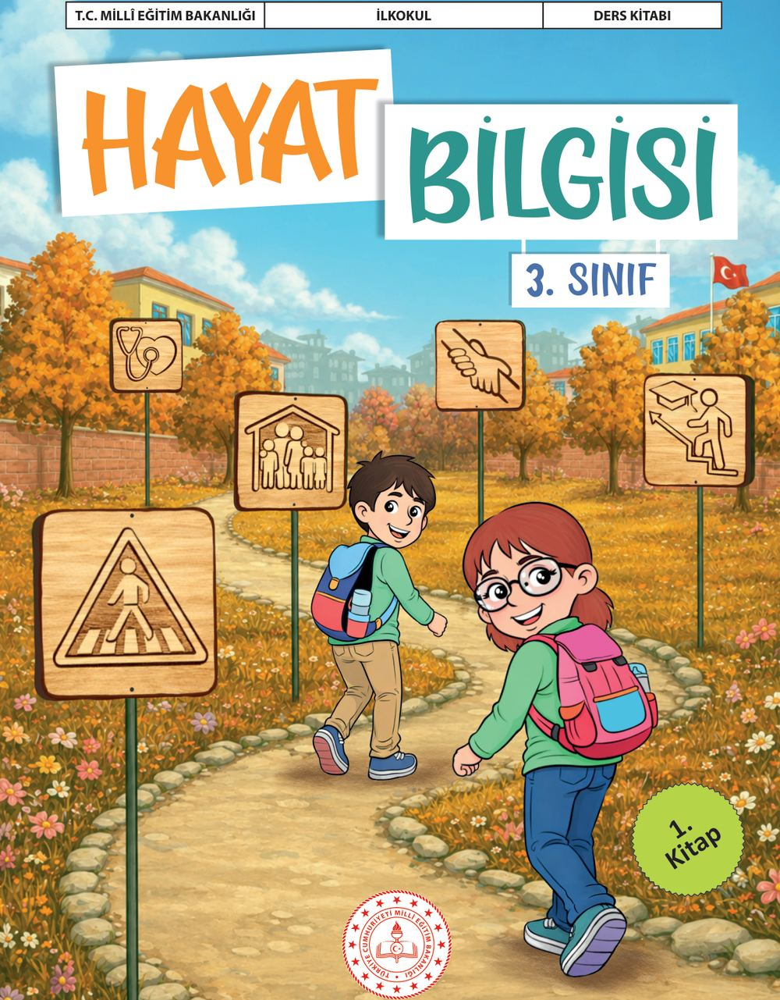

1. Kitap

<!-- sayfa 1 -->

# İLKOKUL

# HAYAT BİLGİSİ

## 3. Sınıf

### Ders Kitabı
### 1. Kitap

**Yazarlar**
Dr. Nagihan ŞAHİN
Betül ALTUNTAŞ
Gürhan DİKMEN
Hüseyin GÜLEÇ
Nurgül GENÇ

<!-- sayfa 2 -->

MİLLÎ EĞİTİM BAKANLIĞI YAYINLARI .......................................................................... 10770
DERS KİTAPLARI DİZİSİ ................................................................................................... 2520

**Editör**
Dr. Öznur TUNALI
Prof. Dr. Recep KAHRAMANOĞLU

**Dil Uzmanı**
Aylin ALTINBAŞ
Hatice MÜLKOĞLU

**Görsel Tasarımcı**
Evren SAVAŞ
Gülçen YILMAZ DÜZGÜN
Neşe ASLAN
Orhan ATEŞ
Selma TAŞCI

**Çoklu Ortam Tasarımcısı**
Abidin AYDIN
Bahar ŞAHİN ŞEHİR
Belkıs DOĞAN AYVAR
Coşkun İNCE
Çağdaş SEVİNÇ
Derya Kader KAHRAMANSOY
Dilek FİDANCI
Elif ULUTAŞ
Ezgi KEVRAN SARINÇ
Fatih UÇAR
Hayriye KAFTAN AYAN
Mustafa YILMAZ
Neslihan YILDIRIM ÇAYIRCI
Onur TÜLÜ
Seda UÇAR
Selma ÇELİK
Tuğçe Burçin ARTUKOĞLU

**Program Geliştirme Uzmanı**
Hilal ALTINTAŞ

**Ölçme ve Değerlendirme Uzmanı**
Elif Ebru DOĞANGÜZEL

**Rehberlik Uzmanı**
Dr. Nilgün KORKMAZ

**Baskı**
Baskı Matbaanın Adı ve Ticaret Unvanı

ISBN 978-975-11-9895-2

<!-- sayfa 3 -->

![Türk Bayrağı]

# İSTİKLÂL MARŞI

Korkma, sönmez bu şafaklarda yüzen al sancak;
Sönmeden yurdumun üstünde tüten en son ocak.
O benim milletimin yıldızıdır, parlayacak;
O benimdir, o benim milletimindir ancak.

Çatma, kurban olayım, çehreni ey nazlı hilâl!
Kahraman ırkıma bir gül! Ne bu şiddet, bu celâl?
Sana olmaz dökülen kanlarımız sonra helâl.
Hakkıdır Hakk'a tapan milletimin istiklâl.

Mehmet Âkif Ersoy

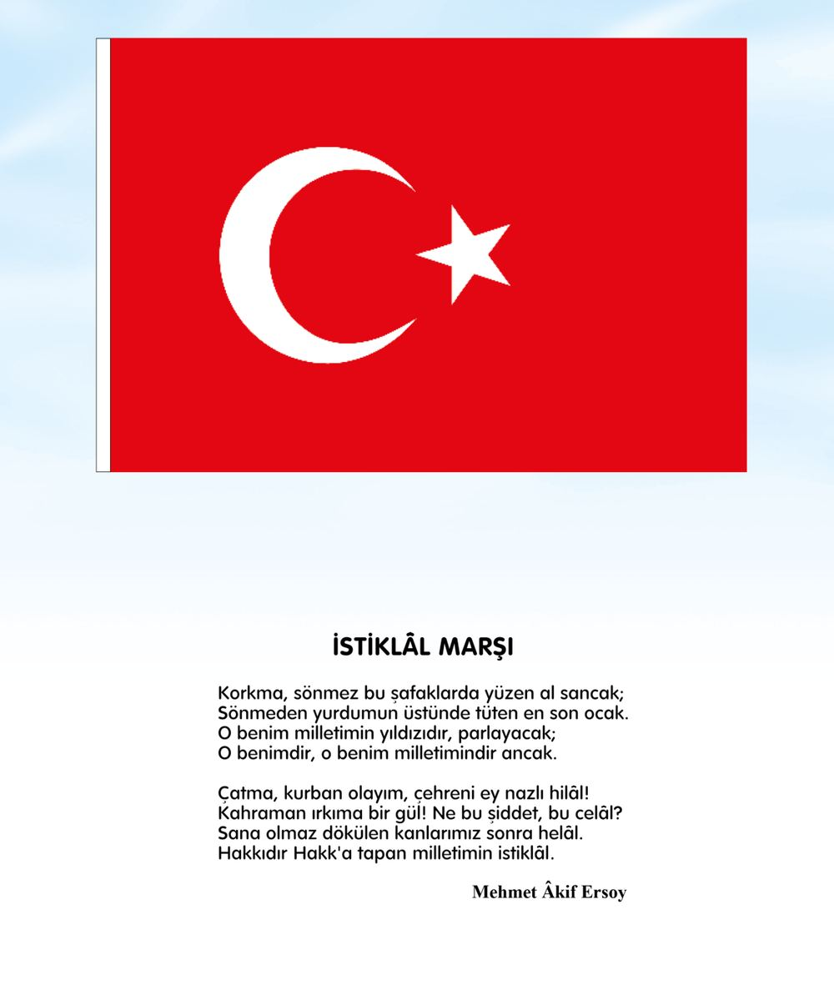
<!-- yer tutucu bulunamadı: sayfa sonuna eklendi -->

<!-- sayfa 4 -->

ANDIMIZ

Türküm, doğruyum, çalışkanım.

İlkem küçüklerimi korumak, büyüklerimi saymak; yurdumu, milletimi özümden çok sevmektir.
Ülküm yükselmek, ileri gitmektir.

Ey Büyük Atatürk!

Açtığın yolda, gösterdiğin hedefe durmadan yürüyeceğime ant içerim.

Varlığım Türk varlığına armağan olsun.

Ne mutlu Türküm diyene!

<!-- sayfa 5 -->

MUSTAFA KEMAL ATATÜRK

<!-- yer tutucu bulunamadı: sayfa sonuna eklendi -->

<!-- sayfa 6 -->

Verdiğiniz metin katmanı boş olduğu için (`<<< >>>` arası boş) dönüştürülecek bir içerik bulunmamaktadır. Lütfen metin katmanını içeren içeriği paylaşın, böylece talimatlarınıza uygun şekilde Markdown formatına çevirebilirim.

<!-- sayfa 7 -->

# İÇİNDEKİLER

**KİTABIMIZI TANIYALIM** ....................................................................................... 8
**HAZIRLIK LİSTESİ** ................................................................................................. 10

**BEN VE OKULUM** ................................................................................................... 12

* BELİRLİ GÜN VE HAFTALAR ................................................................................. 14
* GÜÇLÜYÜM, GELİŞİYORUM ................................................................................. 16
* HAKKIM DA VAR SORUMLULUĞUM DA ............................................................. 24
* ÇOCUĞUM, HAKLARIMLA VARIM ......................................................................... 33
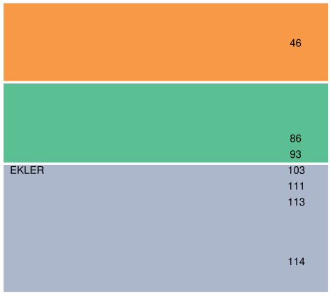

**SAĞLIĞIM VE GÜVENLİĞİM** ................................................................................. 42
* BELİRLİ GÜN VE HAFTALAR ................................................................................. 44
* SAĞLIĞIMI KORUYORUM ....................................................................................... 46
* GÜVENLİĞİMİZİ TEHDİT EDEN DURUMLAR .................................................... 53
* TRAFİK KURALLARININ ÖNEMİ .......................................................................... 63

**AİLEM VE TOPLUM** ............................................................................................... 74
* BELİRLİ GÜN VE HAFTALAR ................................................................................. 76
* AİLE VE TOPLUM .................................................................................................... 78
* YARDIMLAŞMA ....................................................................................................... 86
* MESLEKLER .............................................................................................................. 93

**EKLER** ..................................................................................................................... 103
**SÖZLÜK** .................................................................................................................. 111
**KAYNAKÇA** ............................................................................................................. 113
**CEVAP ANAHTARI** ................................................................................................. 113
**GÖRSEL VE GENEL AĞ KAYNAKÇASI** ................................................................... 113
**TÜRKİYE'NİN MÜLKİ İDARE BÖLÜMLERİ İLE KARA VE DENİZ KOMŞULARI HARİTASI** ............................................................................................................... 114
**TÜRK DÜNYASI HARİTASI** ................................................................................... 115

<!-- sayfa 8 -->

# KİTABIMIZI TANIYALIM

Kitabımız 6 öğrenme alanından oluşmaktadır. Bu öğrenme alanlarının 3 tanesi 1. kitapta bulunmaktadır.

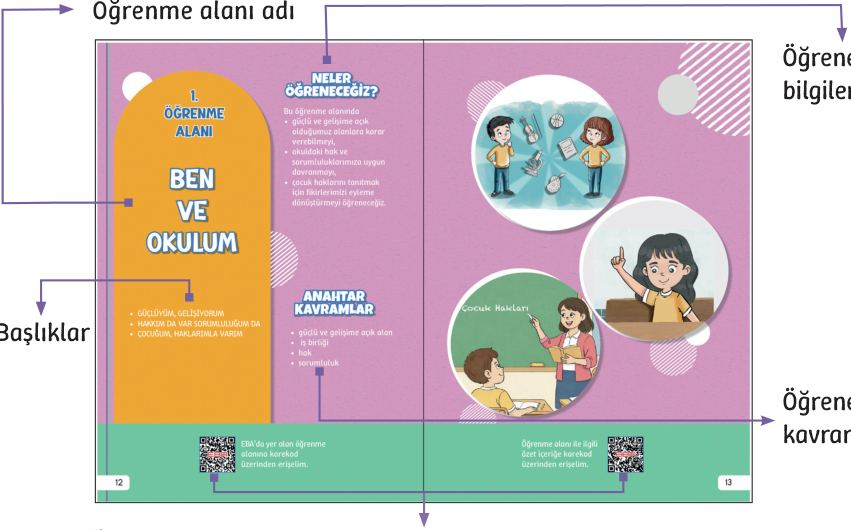

* Öğrenme alanı adı
* Başlıklar
* Öğreneceğimiz bilgiler
* Öğreneceğimiz kavramlar
* Öğrenme alanı ile ilgili EBA’da yer alan içeriklere ve özet bilgilere yönlendiren karekodlar

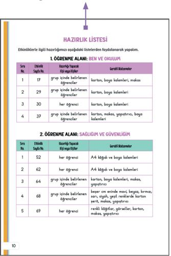

## HAZIRLIK LİSTESİ
Etkinliklerle ilgili hazırlıklarımızı aşağıdaki listelerden faydalanarak yapalım.

### 1. ÖĞRENME ALANI: BEN VE OKULUM

| Sıra No | Etkinlik Sayfa No | İhtiyaç Duyulan Malzemeler | Gerekli Malzemeler |
| :--- | :--- | :--- | :--- |
| 1 | 17 | grup içinde belirlenen öğrenciler | karton, boya kalemleri, makas |
| 2 | 29 | grup içinde belirlenen öğrenciler | karton, boya kalemleri |
| 3 | 30 | her öğrenci | karton, boya kalemleri |
| 4 | 37 | grup içinde belirlenen öğrenciler | karton, makas, yapıştırıcı, boya kalemleri |

### 2. ÖĞRENME ALANI: SAĞLIĞIM VE GÜVENLİĞİM

| Sıra No | Etkinlik Sayfa No | İhtiyaç Duyulan Malzemeler | Gerekli Malzemeler |
| :--- | :--- | :--- | :--- |
| 1 | 52 | her öğrenci | A4 kağıdı ve boya kalemleri |
| 2 | 62 | her öğrenci | A4 kağıdı ve boya kalemleri |
| 3 | 64 | grup içinde belirlenen öğrenciler | karton, boya kalemleri, makas, yapıştırıcı |
| 4 | 68 | grup içinde belirlenen öğrenciler | benzer bir on iki mesajı, boya, kurşun kalem, renkli kalemler, sert makas, yapıştırıcı |
| 5 | 69 | her öğrenci | renkli kağıtlar, görseller, karton, makas, yapıştırıcı |

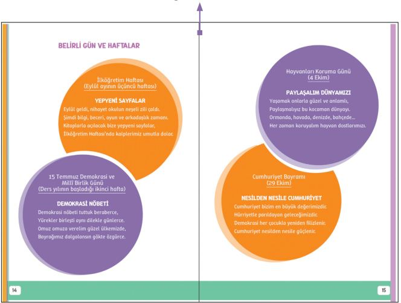

## BELİRLİ GÜN VE HAFTALAR

### İLKOKREM HAFTASI
(Eylül ayının üçüncü haftası)

**YENİPİN YAP SAYFALAR**
Eylül geldi, hayat yeniden renkli zehirli çadı.
Şimdi yeni, heyecan dolu bir akademik zaman.
Kitaplarla arkadaş olalım, okuyalım, öğrenelim.
İlkokulun Haftasıyla kalplerimizi umutla doldur.

### 15 Temmuz Demokrasi ve Milli Birlik Günü
(Dersin yardımcı bilgisi içerir)

**DEMOKRASİ NÖBETİ**
Demokrasi nöbeti tutarak beraberce,
Vatanımız için vazgeçmeden, canla başla,
Omuz omuza verelim güzel ülkemizde,
Bağımsızlığa dalgalan göklerde özgürce.

### Hayvanları Koruma Günü (4 Ekim)

**PAYLAŞALIM DÜNYAMIZI**
Yaşamak onlarla kolay ve anlamlı,
Paylaşamazsak bu dünyayı, ormanda, havada, buzda...
Her zaman koruyalım hayvan dostlarımızı.

### Cumhuriyet Bayramı (29 Ekim)

**NESİLLERLE NEŞE CUMHURİYET**
Cumhuriyet bizim en büyük değerimizdir.
Hürriyetle parlayan geleceğimizdir.
Demokrasi ile yeniden filizlenen,
Cumhuriyet nesilde neşeyle gülsün.

<!-- sayfa 9 -->

Öğrenme alanında her bir konu "Düşünelim, Keşfedelim, Öğrenelim, Uygulayalım, Değerlendirelim" bölümlerinden oluşmaktadır. Bölüm aralarında etkinliklere yer verilmiştir. Her öğrenme alanının sonunda "Neler Öğrendik?" bölümü bulunmaktadır.

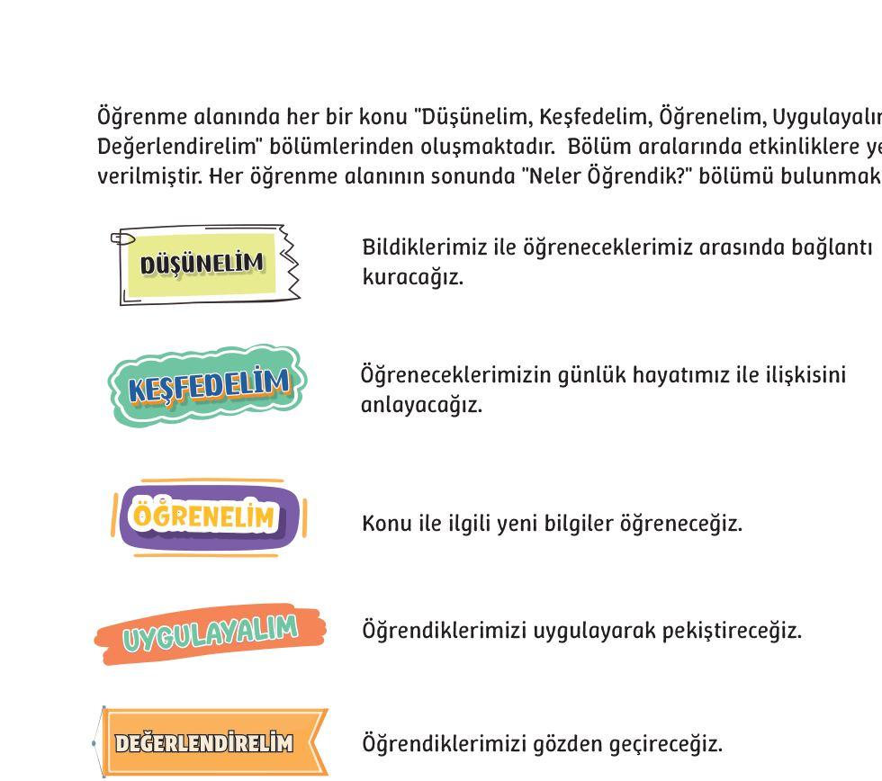 Bildiklerimiz ile öğreneceklerimiz arasında bağlantı kuracağız.

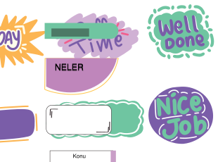 Öğreneceklerimizin günlük hayatımız ile ilişkisini anlayacağız.

 Konu ile ilgili yeni bilgiler öğreneceğiz.

 Öğrendiklerimizi uygulayarak pekiştireceğiz.

 Öğrendiklerimizi gözden geçireceğiz.

 Yeni konuyu öğrenmek veya öğrendiklerimizi pekiştirmek için etkinlikler yapacağız.

 Öğrendiklerimizi tekrar edeceğiz.

 Sınıf içi performans görevi yapacağız.

 Konu ile ilgili içeriklere karekod üzerinden erişeceğiz.

 Ek ölçme ve değerlendirmelere karekod üzerinden erişilecektir.

<!-- sayfa 10 -->

# HAZIRLIK LİSTESİ

Etkinliklerle ilgili hazırlığımızı aşağıdaki listelerden faydalanarak yapalım.

## 1. ÖĞRENME ALANI: BEN VE OKULUM

| Sıra No. | Etkinlik Sayfa No. | Hazırlığı Yapacak Kişi veya Kişiler | Gerekli Malzemeler |
| :--- | :--- | :--- | :--- |
| 1 | 17 | grup içinde belirlenen öğrenciler | karton, boya kalemleri, makas |
| 2 | 29 | grup içinde belirlenen öğrenciler | karton, boya kalemleri |
| 3 | 33 | grup içinde belirlenen | karton, boya kalemleri, makas, bant |
| 4 | 37 | grup içinde belirlenen öğrenciler | karton, makas, yapıştırıcı, boya kalemleri |

## 2. ÖĞRENME ALANI: SAĞLIĞIM VE GÜVENLİĞİM

| Sıra No. | Etkinlik Sayfa No. | Hazırlığı Yapacak Kişi veya Kişiler | Gerekli Malzemeler |
| :--- | :--- | :--- | :--- |
| 1 | 52 | her öğrenci | A4 kâğıdı ve boya kalemleri |
| 2 | 62 | her öğrenci | A4 kâğıdı ve boya kalemleri |
| 3 | 64 | grup içinde belirlenen öğrenciler | karton, boya kalemleri, makas, yapıştırıcı |
| 4 | 68 | grup içinde belirlenen öğrenciler | beşer cm eninde mavi, beyaz, kırmızı, sarı, siyah, yeşil renklerde karton şerit, makas, yapıştırıcı |
| 5 | 69 | her öğrenci | renkli kâğıtlar, görseller, karton, makas, yapıştırıcı |

<!-- sayfa 11 -->

# 3. ÖĞRENME ALANI: AİLEM VE TOPLUM

| Sıra No. | Etkinlik Sayfa No. | Hazırlığı Yapacak Kişi veya Kişiler | Gerekli Malzemeler |
| :--- | :--- | :--- | :--- |
| 1 | 86 | her öğrenci | balon |
| 2 | 88 | grup içinde belirlenen öğrenciler | karton, boya kalemleri |
| 3 | 91 | grup içinde belirlenen öğrenciler | karton, makas, yapıştırıcı, boya kalemleri |
| 4 | 99 | grup içinde belirlenen öğrenciler | boya kalemleri, karton, yapıştırıcı, makas |

<!-- sayfa 12 -->

# 1. ÖĞRENME ALANI
# BEN VE OKULUM

* GÜÇLÜYÜM, GELİŞİYORUM
* HAKKIM DA VAR SORUMLULUĞUM DA
* ÇOCUĞUM, HAKLARIMLA VARIM

## NELER ÖĞRENECEĞİZ?

Bu öğrenme alanında
* güçlü ve gelişime açık olduğumuz alanlara karar verebilmeyi,
* okuldaki hak ve sorumluluklarımıza uygun davranmayı,
* çocuk haklarını tanıtmak için fikirlerimizi eyleme dönüştürmeyi öğreneceğiz.

## ANAHTAR KAVRAMLAR

* güçlü ve gelişime açık alan
* iş birliği
* hak
* sorumluluk

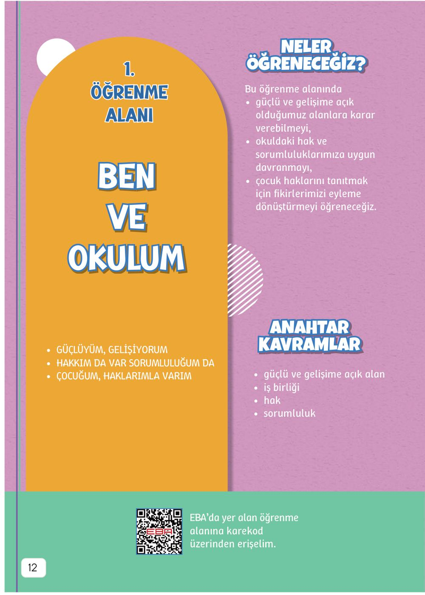 EBA’da yer alan öğrenme alanına karekod üzerinden erişelim

<!-- sayfa 13 -->

Öğrenme alanı ile ilgili 
özet içeriğe karekod 
üzerinden erişelim

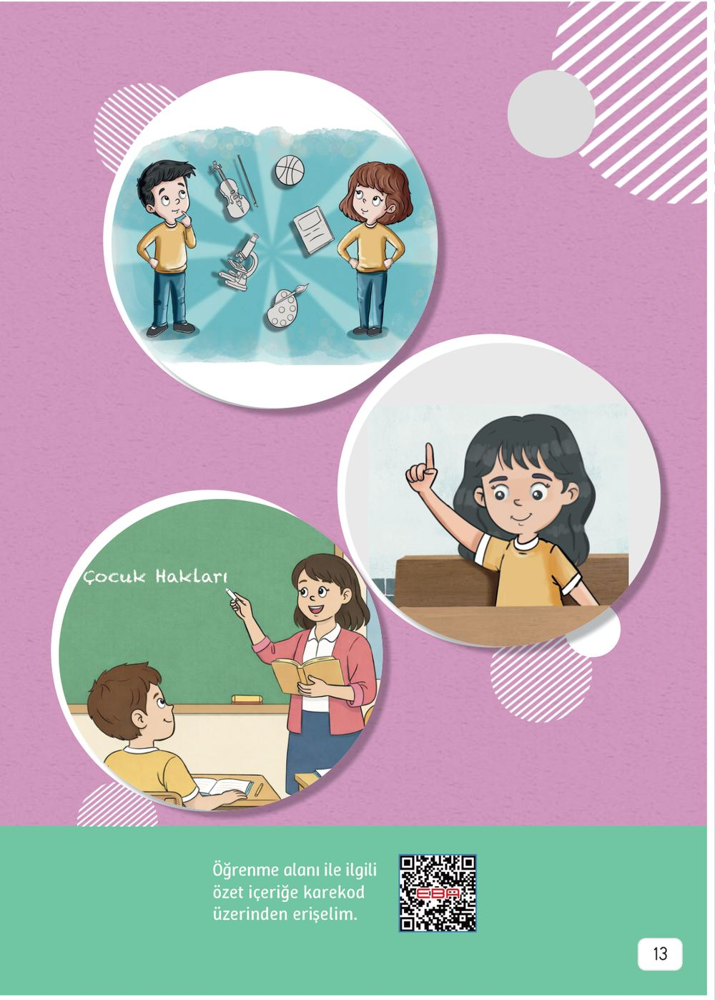

<!-- sayfa 14 -->

# BELİRLİ GÜN VE HAFTALAR

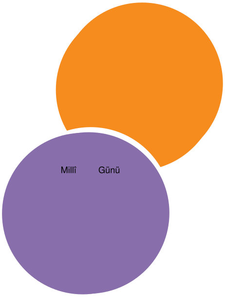

## İlköğretim Haftası
### (Eylül ayının üçüncü haftası)

**YEPYENİ SAYFALAR**

Eylül geldi, nihayet okulun neşeli zili çaldı.
Şimdi bilgi, beceri, oyun ve arkadaşlık zamanı.
Kitaplarla açılacak bize yepyeni sayfalar,
İlköğretim Haftası’nda kalplerimiz umutla dolar.

## 15 Temmuz Demokrasi ve Millî Birlik Günü
### (Ders yılının başladığı ikinci hafta)

**DEMOKRASİ NÖBETİ**

Demokrasi nöbeti tuttuk beraberce,
Yürekler birleşti aynı dilekle günlerce.
Omuz omuza verelim güzel ülkemizde,
Bayrağımız dalgalansın gökte özgürce.

<!-- sayfa 15 -->

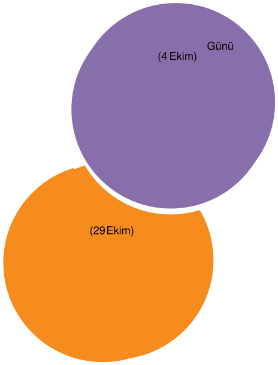

Hayvanları Koruma Günü
(4 Ekim)

PAYLAŞALIM DÜNYAMIZI
Yaşamak onlarla güzel ve anlamlı,
Paylaşmalıyız bu kocaman dünyayı.
Ormanda, havada, denizde, bahçede...
Her zaman koruyalım hayvan dostlarımızı.

Cumhuriyet Bayramı
(29 Ekim)

NESİLDEN NESİLE CUMHURİYET
Cumhuriyet bizim en büyük değerimizdir.
Hürriyetle parıldayan geleceğimizdir.
Demokrasi her çocukla yeniden filizlenir.
Cumhuriyet nesilden nesile güçlenir.

<!-- sayfa 16 -->

# GÜÇLÜYÜM, GELİŞİYORUM

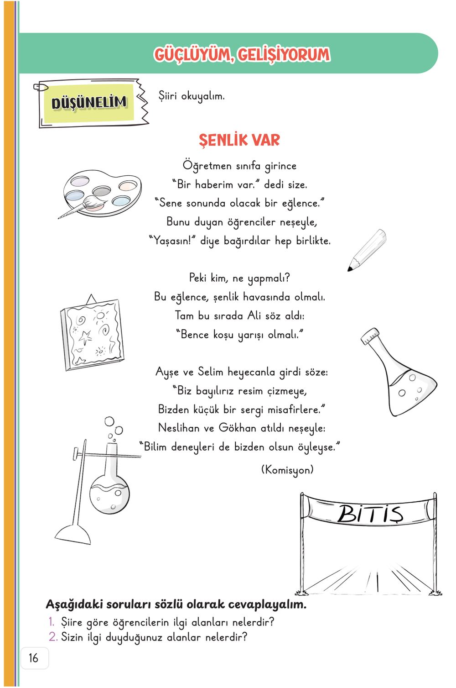
Şiiri okuyalım.

## DÜŞÜNELİM

# ŞENLİK VAR

Öğretmen sınıfa girince
“Bir haberim var.” dedi size.
“Sene sonunda olacak bir eğlence.”
Bunu duyan öğrenciler neşeyle,
“Yaşasın!” diye bağırdılar hep birlikte.

Peki kim, ne yapmalı?
Bu eğlence, şenlik havasında olmalı.
Tam bu sırada Ali söz aldı:
“Bence koşu yarışı olmalı.”

Ayşe ve Selim heyecanla girdi söze:
“Biz bayılırız resim çizmeye,
Bizden küçük bir sergi misafirlere.”
Neslihan ve Gökhan atıldı neşeyle:
“Bilim deneyleri de bizden olsun öyleyse.”
(Komisyon)

# BİTİŞ

**Aşağıdaki soruları sözlü olarak cevaplayalım.**

1. Şiire göre öğrencilerin ilgi alanları nelerdir?

<!-- sayfa 17 -->

**Malzemeler:** karton, boya kalemleri, makas.

# KEŞFEDELİM

Uygulama adımlarını takip ederek etkinliği yapalım.

## Uygulama Adımları

* Yanda verilen ilgi alanı bilgi kartını inceleyelim. Bu kartı örnek alarak “Düşünelim” etkinliğinde söylediğimiz veya ilgi duyduğumuz diğer alanlara ilişkin bilgi kartları hazırlayalım.

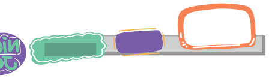

* Kaç bilgi kartı hazırlayacağımıza karar verelim ve kartların hazırlanması için görev dağılımı yapalım.
* Hazırladığımız kartları sınıfın uygun bölümlerine asalım.
* İlgi duyduğumuz alanın bilgi kartının bulunduğu yere geçerek gruplar oluşturalım.
* Grup arkadaşlarımızla aşağıdaki soruların cevaplarını tartışalım ve görüşlerimizi sınıf arkadaşlarımızla paylaşalım.

### Aşağıdaki soruları sözlü olarak cevaplayalım.

1. İlgi duyduğunuz alanlarda kendinizi geliştirmek için neler yapabilirsiniz?
2. Güçlü ve gelişime açık alanlarınızı belirlemenin amacı nedir?
3. Güçlü ve gelişime açık alanları belirlemek neden önemlidir?

## Etkinlik: GÖRÜŞME ZAMANI

## Uygulama Adımları

* Sınıf arkadaşlarımızla küçük gruplar oluşturalım. Güçlü ve gelişime açık yönlerimiz hakkında konuşup bu yönlerimizi belirleyelim.
* Görüşmede onlara sormak için güçlü ve gelişime açık alanlarımızla ilgili sorular hazırlayalım.
* Aile bireyleri, rehber öğretmenimiz, sınıf öğretmenimiz gibi yakın çevremizdeki kişilerle görüşme yapalım.
* Hazırladığımız soruları soralım ve cevaplarımızı not edelim.
* İlgi duyduğumuz alanlarda kendimizi geliştirmek için neler yapabileceğimize ilişkin kitap, belgesel gibi kaynakları inceleyelim.

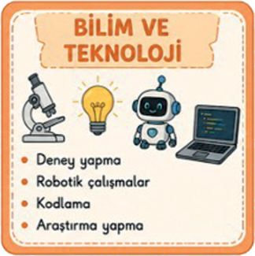
<!-- yer tutucu bulunamadı: sayfa sonuna eklendi -->

<!-- sayfa 18 -->

# ÖĞRENELİM

Konu ile ilgili e-içeriğe karekod üzerinden erişelim.

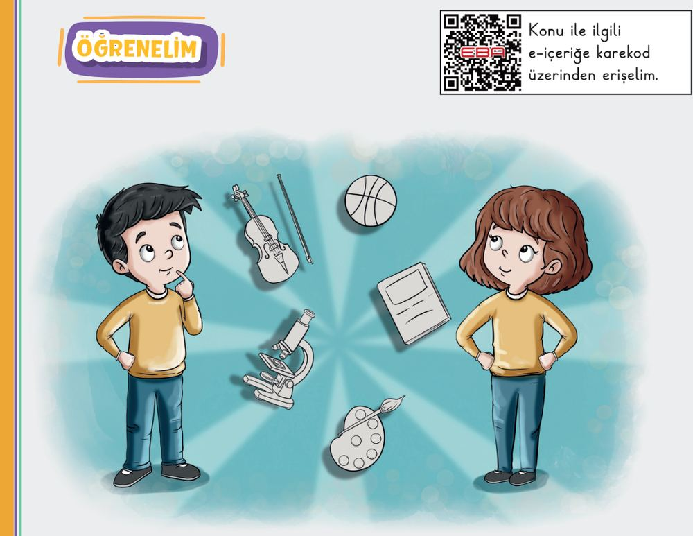

Bilim, spor veya sanatta güçlü ve gelişime açık yönlerimiz olabilir. Bilim alanında sağlık konularına, gökyüzüne, teknolojiye veya canlılar dünyasına ilgi duyabiliriz. Voleybol, futbol, tenis, yüzme gibi farklı spor alanlarına yönelmek isteyebiliriz. Tiyatro, müzik, halk oyunları gibi sanat alanlarıyla ilgilenebiliriz.

## 1. GÜÇLÜ ALANLARIMIZ

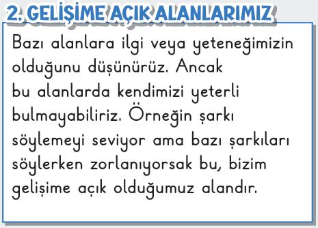
Genellikle merak ettiğimiz ve ilgi duyduğumuz, yetenekli olduğumuz alanlar güçlü alanlarımızdır. Örneğin masa tenisi oynamayı seviyor ve masa tenisinde başarılıysak bu, bizim güçlü olduğumuz alandır.

## 2. GELİŞİME AÇIK ALANLARIMIZ

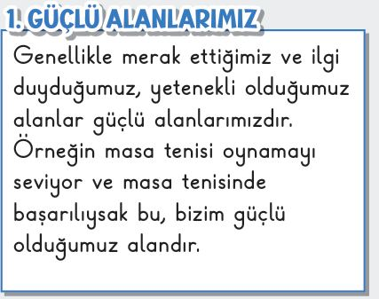
Bazı alanlara ilgi veya yeteneğimizin olduğunu düşünürüz. Ancak bu alanlarda kendimizi yeterli bulmayabiliriz. Örneğin şarkı söylemeyi seviyor ama bazı şarkıları söylerken zorlanıyorsak bu, bizim gelişime açık olduğumuz alandır.

<!-- sayfa 19 -->

> Öğretmenim, bu hafta kulüp seçimi yapmamız gerekiyor. Hangi kulübü seçeceğime bir türlü karar veremiyorum.

> Bunun için bir toplantı yapabiliriz Adacığım. İstersen bu toplantıya sınıf öğretmenini ve aileni de çağırabiliriz.

Güçlü ve gelişime açık alanlarımızı belirlerken bilgi toplayarak işe başlayabiliriz. Aile bireylerimiz, rehber öğretmenimiz, sınıf öğretmenimiz veya konunun uzmanlarına merak ettiğimiz soruları sorabiliriz. İlgi duyduğumuz bu alanlardaki başarılı ve ünlü insanların yaşam hikâyelerini araştırabiliriz. Kendimizi geliştirmek için neler yapabileceğimize ilişkin kitap, dergi, belgesel veya güvenilir genel ağ kaynaklarını inceleyebiliriz. Katılabileceğimiz etkinlikleri belirleyebiliriz. Ardından araştırdığımız alanlardan kendimize uygun olduğunu düşündüğümüz seçenekleri belirleriz. Bu sırada

“Neyi iyi yapıyorum?”, “Güçlü yönlerim nelerdir?”
“Neyi daha iyi yapabilirim?”, “Geliştirmek istediğim bir yönüm var mı?”

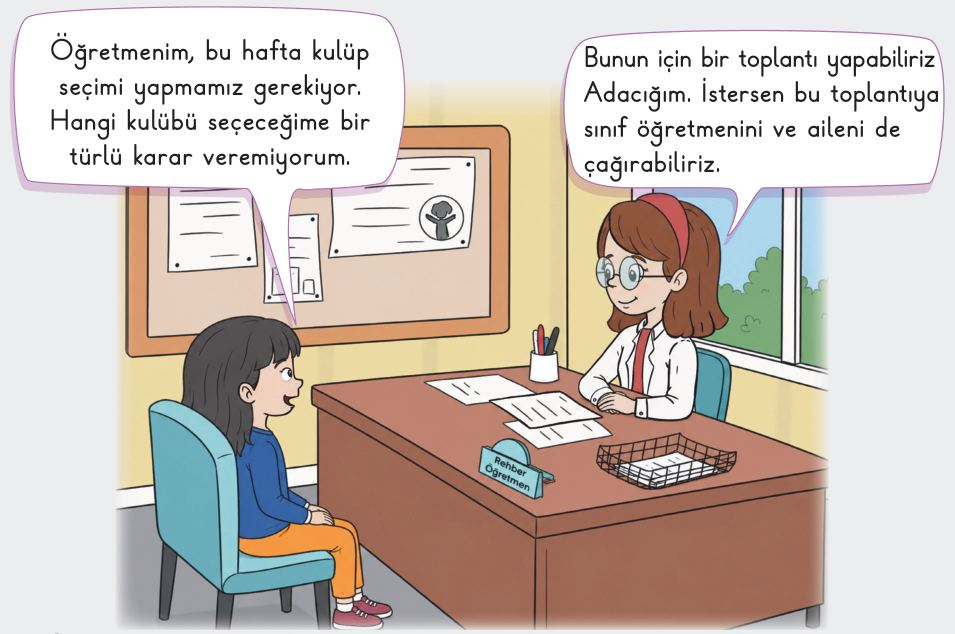

vb. soruları kendimize sorabiliriz. Seçenekleri düşündükten sonra hangisinin güçlü veya gelişime açık alanımız olduğuna karar veririz. Kararımızı gözden geçirirken

“Bu alanı seçme sebebim nedir?”
“Bu alanda çalışırken kendimi nasıl hissediyorum?”
“Bu alanın güçlü yönüm olduğunu nasıl anladım?”
“Daha güçlü olmak için kimlerden yardım alabilirim?”

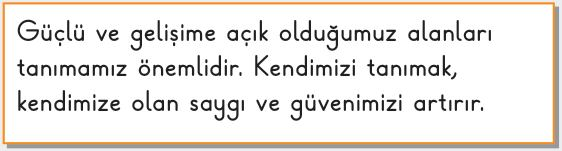

sorularını kendimize sorarız. Böylece verdiğimiz kararların uygunluğunu değerlendiririz. Gerekirse değişiklikler ve eklemeler yaparız.

> Güçlü ve gelişime açık olduğumuz alanları tanımamız önemlidir. Kendimizi tanımak, kendimize olan saygı ve güvenimizi artırır...

<!-- sayfa 20 -->

# UYGULAYALIM

Ülkemize katkıda bulunmuş, alanında tanınmış ve tarihe geçmiş kişilerle ilgili bilgileri okuyalım.

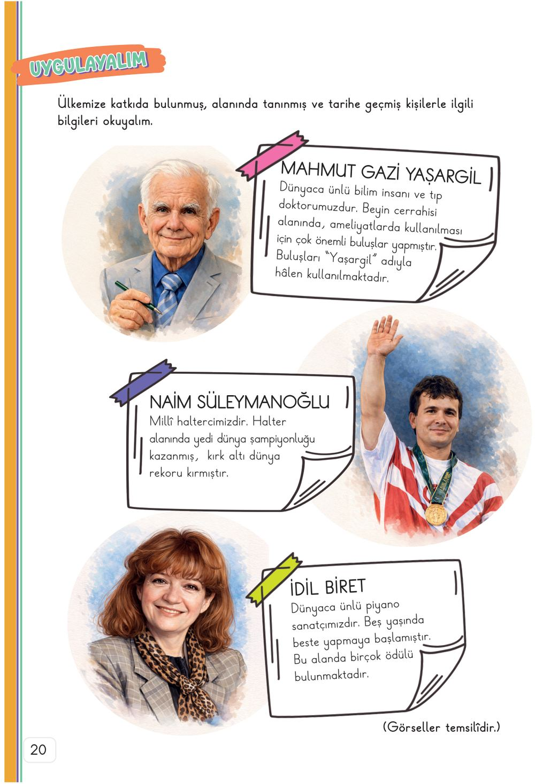

## MAHMUT GAZİ YAŞARGİL
Dünyaca ünlü bilim insanı ve tıp doktorumuzdur. Beyin cerrahisi alanında, ameliyatlarda kullanılması için çok önemli buluşlar yapmıştır. Buluşları “Yaşargil” adıyla hâlen kullanılmaktadır.

## NAİM SÜLEYMANOĞLU
Millî haltercimizdir. Halter alanında yedi dünya şampiyonluğu kazanmış, kırk altı dünya rekoru kırmıştır.

## İDİL BİRET
Dünyaca ünlü piyano sanatçımızdır. Beş yaşında beste yapmaya başlamıştır. Bu alanda birçok ödülü bulunmaktadır.

<!-- sayfa 21 -->

İlgi duyduğumuz bir alanda ülkemize büyük katkılarda bulunmuş, alanında tanınmış ve tarihe geçmiş bir kişiyi seçelim. Bu kişinin hayatını araştırarak başarılarına örnekler verelim.

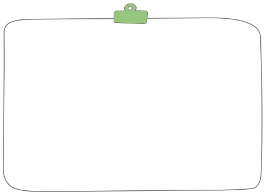

Bu kişinin resmini çizelim veya fotoğrafını yapıştıralım.

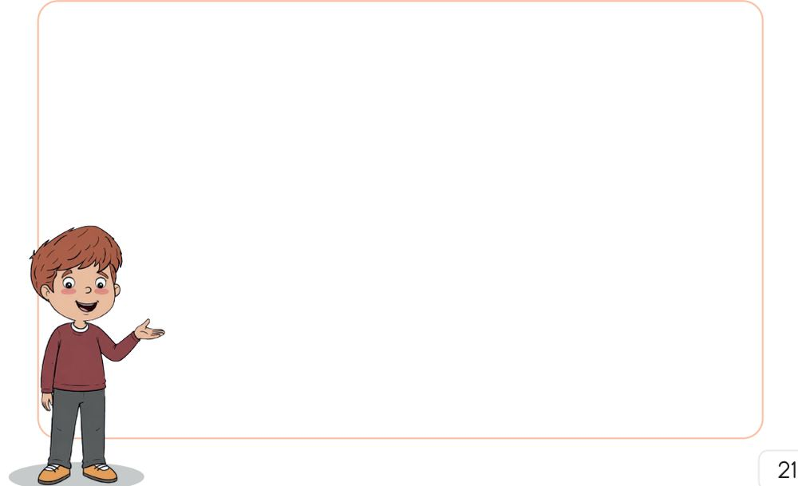

<!-- sayfa 22 -->

Bir önceki sayfada örnek verdiğimiz kişiyle konuştuğumuzu düşünelim. Kendimizi bu alanda geliştirmek için ona sormak istediğimiz soruları yazalım. Sorularımızın cevaplarını araştıralım.

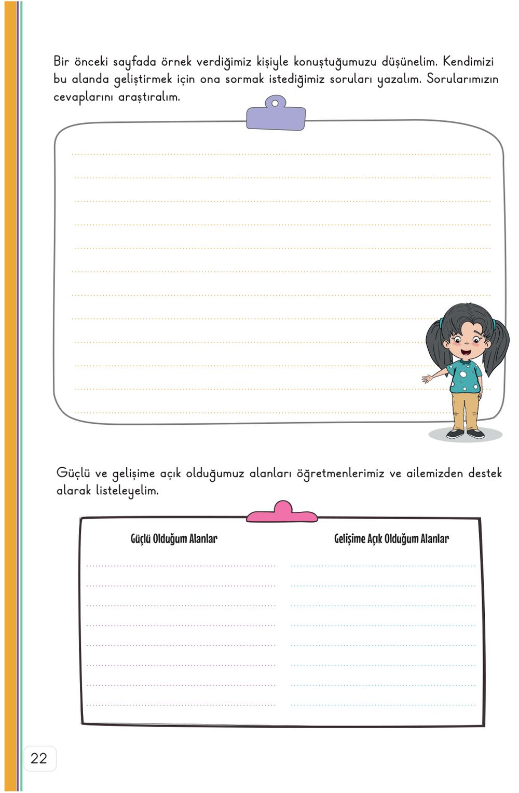

Güçlü ve gelişime açık olduğumuz alanları öğretmenlerimiz ve ailemizden destek alarak listeleyelim.

| Güçlü Olduğum Alanlar | Gelişime Açık Olduğum Alanlar |
| :--- | :--- |
| | |
| | |
| | |
| | |
| | |
| | |
| | |
| | |

<!-- sayfa 23 -->

# DEĞERLENDİRELİM

* Ekler bölümünde bulunan Ek 1'deki Öz Değerlendirme Formu'nu dolduralım. Edindiğimiz bilgilerden ve formdan yararlanarak ağaçtaki boş bırakılan alanları dolduralım.

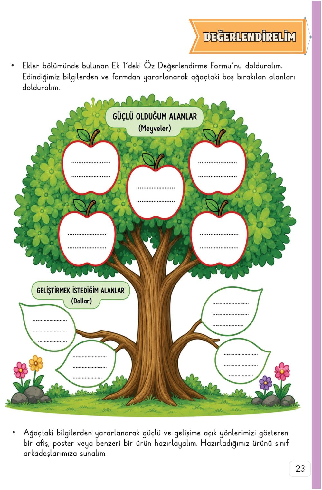

* Ağaçtaki bilgilerden yararlanarak güçlü ve gelişime açık yönlerimizi gösteren bir afiş, poster veya benzeri bir ürün hazırlayalım. Hazırladığımız ürünü sınıf

<!-- sayfa 24 -->

# HAKKIM DA VAR SORUMLULUĞUM DA

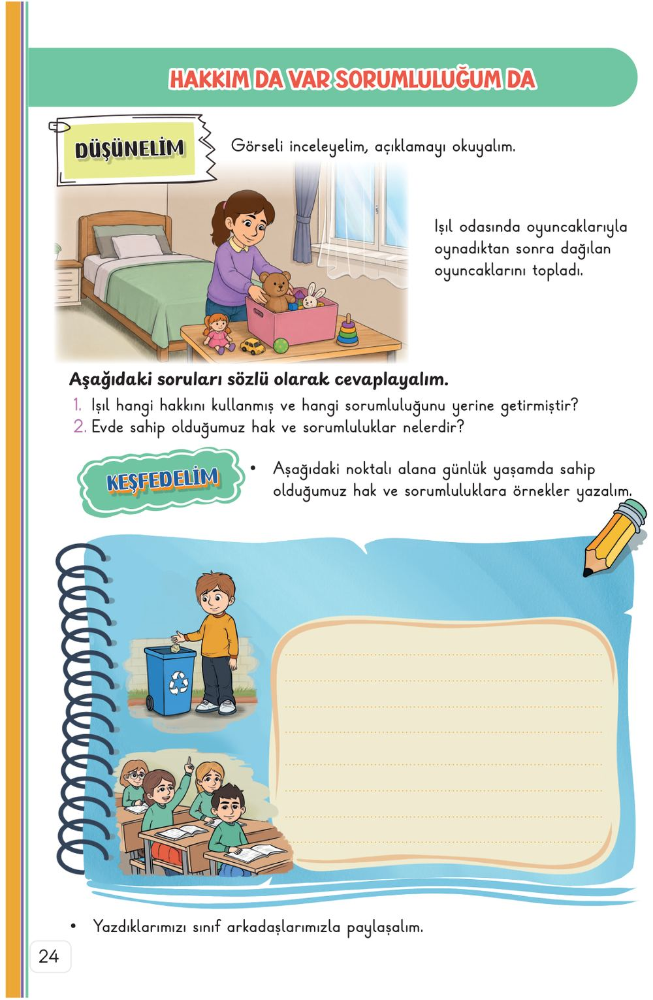

**DÜŞÜNELİM** Görseli inceleyelim, açıklamayı okuyalım.

Işıl odasında oyuncaklarıyla oynadıktan sonra dağılan oyuncaklarını topladı.

**Aşağıdaki soruları sözlü olarak cevaplayalım.**

1. Işıl hangi hakkını kullanmış ve hangi sorumluluğunu yerine getirmiştir?
2. Evde sahip olduğumuz hak ve sorumluluklar nelerdir?

**KEŞFEDELİM**
* Aşağıdaki noktalı alana günlük yaşamda sahip olduğumuz hak ve sorumluluklara örnekler yazalım.

<!-- sayfa 25 -->

# Etkinlik: HAYALİMDEKİ OKUL

Uygulama adımlarını takip ederek etkinliği yapalım.

## Uygulama Adımları

* Hak ve sorumluluklarımızı sadece kendimizin belirleyeceği bir okul hayal edelim.
* Sınıf arkadaşlarımız arasından bir gönüllü belirleyelim.
* Gönüllü arkadaşımızdan aşağıdaki soruları tahtaya yazmasını isteyelim.

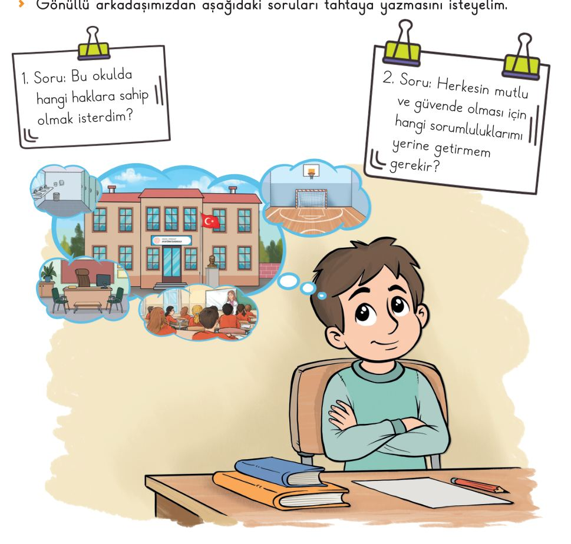

* 1. sorunun cevabı için üç dakika düşünelim.
* Aklımıza gelen cevapları sırayla söyleyelim. Gönüllü arkadaşımızdan verilen cevapların hepsini tahtaya yazmasını isteyelim.
* Tahtaya yazılan cevapların uygunluğunu sınıfça tartışalım.

<!-- sayfa 26 -->

**Etkinlik: RÖPORTAJ**

Uygulama adımlarını takip ederek etkinliği yapalım.

### Uygulama Adımları

* Sınıf arkadaşlarımızla üç grup oluşturalım. Grubumuza bir isim verelim.
* Ekler bölümündeki Ek 2’yi inceleyelim. Ek 2’deki “Giriş” bölümünü dolduralım.
* Grup arkadaşlarımızla birlikte okuldaki hak ve sorumluluklarımızla ilgili sorular belirleyelim.
* Belirlediğimiz soruları Ek 2’deki “Sorular” bölümüne yazalım.
* Röportaj yapmak istediğimiz öğretmen veya okul yöneticisini belirleyelim.
* Röportaj yapacağımız kişiden randevu alalım.
* Randevu gün ve saatinde röportaj yapacağımız kişi ile görüşelim, Ek 2’ye yazdığımız soruları sırayla soralım.
* Sorulara verilen cevapları Ek 2’deki “Cevaplar” bölümüne yazalım.

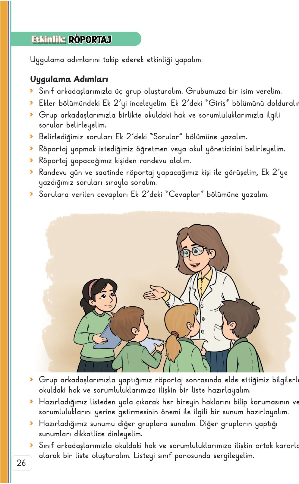

* Grup arkadaşlarımızla yaptığımız röportaj sonrasında elde ettiğimiz bilgilerle okuldaki hak ve sorumluluklarımıza ilişkin bir liste hazırlayalım.
* Hazırladığımız listeden yola çıkarak her bireyin haklarını bilip korumasının ve sorumluluklarını yerine getirmesinin önemi ile ilgili bir sunum hazırlayalım.
* Hazırladığımız sunumu diğer gruplara sunalım. Diğer grupların yaptığı sunumları dikkatlice dinleyelim.

<!-- sayfa 27 -->

![QR Kod] Konu ile ilgili e-içeriğe karekod üzerinden erişelim.

# ÖĞRENELİM

Okulda sahip olduğumuz bazı haklar vardır. Haklarımızı bilmemiz, kullanmamız, başkalarının da bu haklara saygı göstermeleri; güvenli, sağlıklı, mutlu ve başarılı bir okul ortamı için çok önemlidir.

## OKULDAKİ HAKLARIMIZ

**Eğitim Hakkı:** Derslere katılır, yeni bilgiler öğrenir, kendimizi geliştiririz.

**Güvenlik Hakkı:** Okulda kendimizi güvende hissederiz. Yabancı kişiler, kazalar, afetler gibi tehlike oluşturabilecek durumlara karşı önlemler alındığını biliriz.

**Kendini İfade Etme Hakkı:** Bazı kuralları belirlerken görüşlerimizi belirtir, oy hakkımızı kullanırız.

**Dinlenme ve Oyun Oynama Hakkı:** Teneffüslerde oyunlar oynayabilir, arkadaşlarımızla vakit geçirebilir, sınıfta veya okul bahçesinde dinlenebiliriz. Dinlenme ve oyun için okulumuzda yeterli ve uygun alanlarımız vardır. Bu alanlar sosyalleşmemize de imkân verir.

**Sağlık Hakkı:** Temiz bir okulumuz ve sağlıklı bir sınıf ortamımız vardır.

**Erişebilirlik Hakkı:** Sınıfımız ve okulumuz özel gereksinimli bireylerin ihtiyaçlarına uygundur.

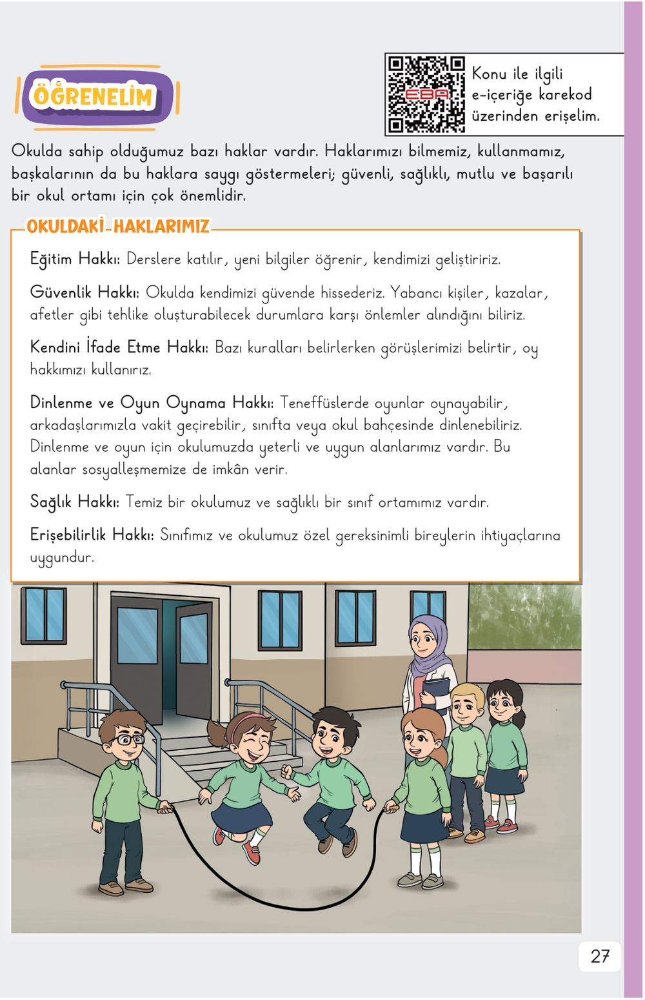

<!-- sayfa 28 -->

Okulda haklarımız olduğu gibi yerine getirmemiz gereken sorumluluklarımız da vardır. Sorumluluk, yapmamız gereken işleri uygun şekilde yerine getirmek ve bu işlerin sonuçlarını üstlenmek anlamına gelir.

---

# OKULDAKİ SORUMLULUKLARIMIZ

**Derse Katılmak:** Okula ve derse zamanında geliriz. Öğretmenimizi dikkatlice dinler, arkadaşlarımızın çalışmalarına engel olacak davranışlardan kaçınırız.

**Kurallara Uymak:** Sınıfımızın ve okulumuzun kurallarına uyarız.

**Eşyaları Korumak:** Sınıfımızın ve okulumuzun masa, sıra ve diğer araçlarını temiz ve dikkatli kullanırız.

**Arkadaşlarımıza ve Okul Çalışanlarına Saygı Göstermek:** Sınıf ve okulumuzda herkes ile olumlu bir iletişim içinde oluruz. Çevremizdekilere rahatsızlık veya zarar verecek davranışlardan kaçınırız. Paylaşma ve yardımlaşmaya önem veririz.

**Temizliğe Dikkat Etmek:** Çöpleri çöp kutusuna atar, sınıfımızı ve okulumuzun bölümlerini temiz tutarız.

---

Haklarımızı bilmek ve korumak gibi sorumluluklarımızı yerine getirmek de görevimizdir. Sorumluluklarımızı yerine getirdiğimizde başkalarının haklarını da korumuş oluruz. Örneğin çöpümüzü çöp kutusuna atarsak çevremiz temiz olur. Böylece arkadaşlarımızın temiz bir ortamda eğitim alma haklarına saygı göstermiş oluruz. Derste söz hakkı alarak konuşursak arkadaşlarımızın konuşma ve ders dinleme haklarına saygı göstermiş oluruz. Haklarımızı korumanın bir yolu da sorumluluklarımızı yerine getirmektir.

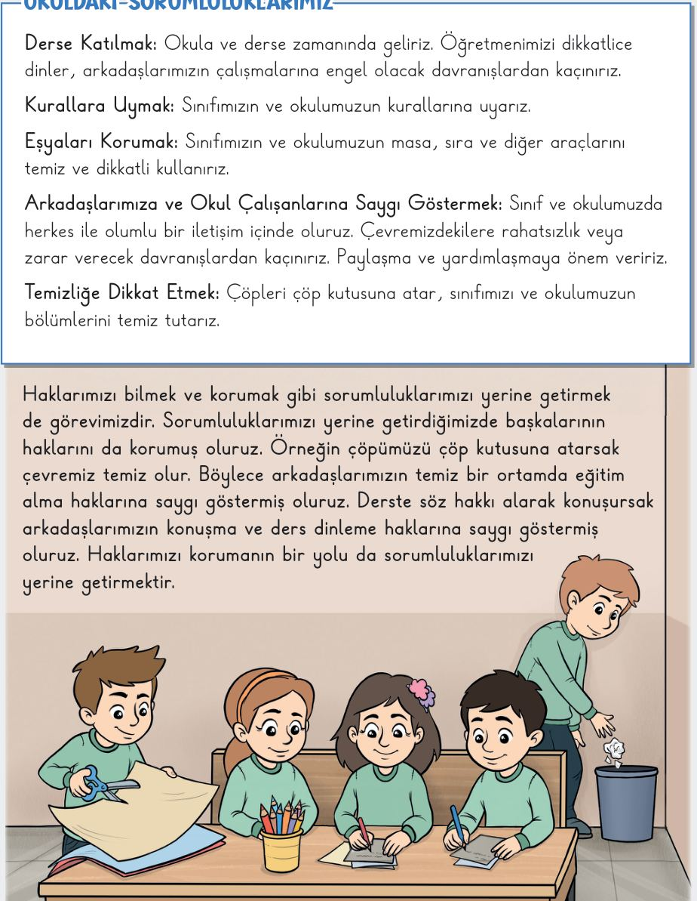

<!-- sayfa 29 -->

# UYGULAYALIM

**Etkinlik: ARAŞTIRALIM**

**Malzemeler:** karton, boya kalemleri.

Uygulama adımlarını takip ederek etkinliği yapalım.

**Uygulama Adımları**

* Eğitim, dinlenme, kendini ifade etme ve sağlık konuları ile ilgili sınıfımızda dört istasyon hazırlayalım.
* Her istasyonda kartonlar ve renkli kalemler bulunmasını sağlayalım.
* Sınıf arkadaşlarımız ile dört grup oluşturalım.
* Grupça bir istasyon seçelim. İstasyondaki konuyla ilgili okulda uygulayabileceğimiz bir sosyal etkinlik önerisini kartonlara yazalım. 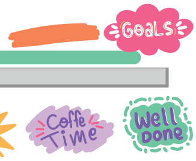 
* Grup arkadaşlarımızla birlikte sırayla diğer istasyonlara geçelim.
* Önceki grubun fikirlerini okuyalım, kendi önerilerimizi ekleyelim.
* Her istasyonda tüm gruplar çalışana kadar etkinliğe devam edelim.
* Son turda grup olarak etkinliğe ilk başladığımız istasyona dönelim.
* Bu istasyondaki sosyal etkinlik önerilerini sınıfa sunalım.

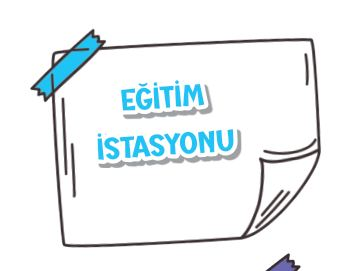

* Okulumuzda uygulayacağımız bu sosyal etkinlik çalışmalarında hak ve 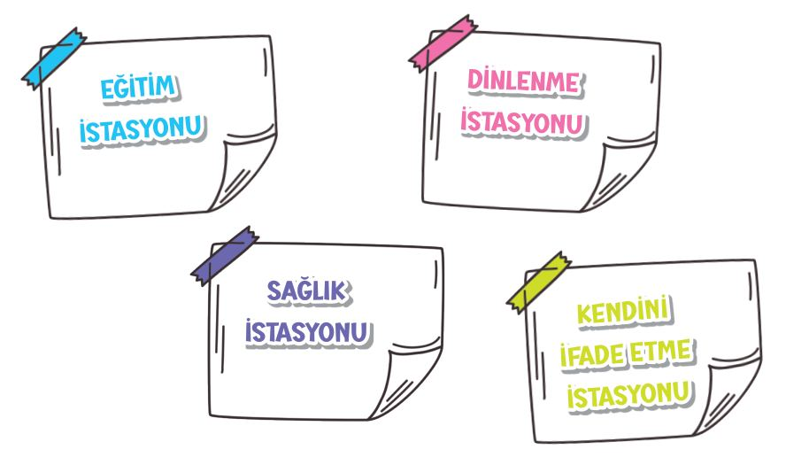

<!-- sayfa 30 -->

**Etkinlik: DAVRANIŞ ÇİZELGEM**

Uygulama adımlarını takip ederek etkinliği yapalım.

**Uygulama Adımları**

* Yan sayfadaki Davranış Çizelgesi'ni beş gün boyunca, günlük olarak dolduralım.
* Davranış çizelgesine
  derse katılmak,
  kurallara uymak,
  eşyaları korumak,
  temizliğe dikkat etmek,
  arkadaşlarımıza, okul çalışanlarına saygı göstermek
  gibi görev ve sorumluluklarımızdan hangilerini yerine getirdiğimizi yazalım.
* Beş gün sonunda aşağıdaki soruları cevaplayarak kendimizi değerlendirelim.

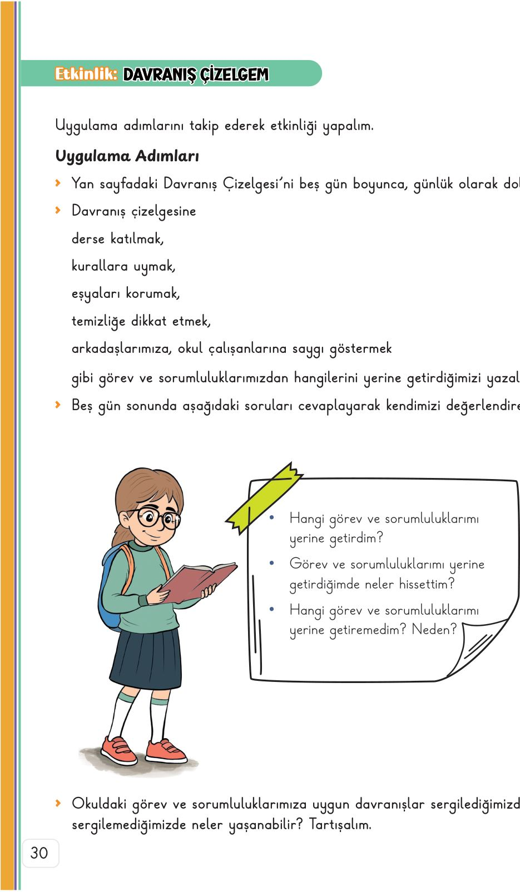

* Hangi görev ve sorumluluklarımı yerine getirdim?
* Görev ve sorumluluklarımı yerine getirdiğimde neler hissettim?
* Hangi görev ve sorumluluklarımı yerine getiremedim? Neden?

* Okuldaki görev ve sorumluluklarımıza uygun davranışlar sergilediğimizde ve

<!-- sayfa 31 -->

# DAVRANIŞ ÇİZELGESİ

| Gün | Hangi görev ve sorumluluğumu yerine getirdim? | Açıklama |
| :--- | :--- | :--- |
| Örnek | Sınıfımızı temiz tuttum. | Sınıftan çıkarken çöplerimi çöp kutusuna attım. |
| Pazartesi | | |
| Salı | | |
| Çarşamba | | |
| Perşembe | | |
| Cuma | | |

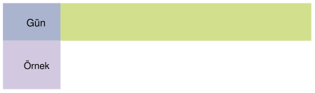
<!-- yer tutucu bulunamadı: sayfa sonuna eklendi -->

<!-- sayfa 32 -->

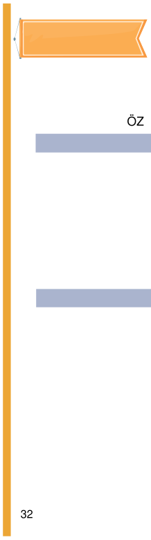

Aşağıdaki form, okuldaki hak ve sorumluluklarımız konusu ile ilgili düşünce ve davranışlarımızı değerlendirmemiz için hazırlanmıştır. Değerlendirme yaparken “Evet”, “Kısmen” veya “Hayır” seçeneklerinden uygun olanı işaretleyelim.

# ÖZ DEĞERLENDİRME FORMU

| Haklarım | Evet | Kısmen | Hayır |
| :--- | :---: | :---: | :---: |
| 1. Teneffüsü ihtiyaçlarımı karşılamak için kullanırım. | | | |
| 2. Seçtiğim spor etkinliklerine katılırım. | | | |
| 3. Seçtiğim kulüp etkinliklerine katılırım. | | | |
| 4. Sınıf ortamında düşüncelerimi paylaşırım. | | | |
| 5. Sınıfımızda yeni bilgiler öğrenebildiğim bir ortama sahibim. | | | |
| 6. Temiz bir okul ortamına sahibim. | | | |
| 7. Güvenli bir okul ortamına sahibim. | | | |

| Sorumluluklarım | Evet | Kısmen | Hayır |
| :--- | :---: | :---: | :---: |
| 1. Söz hakkı alarak konuşurum. | | | |
| 2. Okul eşyalarını dikkatli kullanırım. | | | |
| 3. Çöplerimi çöp kutusuna atarım. | | | |
| 4. Derslere zamanında girerim. | | | |
| 5. Okulda sıraya girmem gereken durumlarda uygun davranış sergilerim. | | | |
| 6. Bayrak törenlerinde kurallara uyarım. | | | |
| 7. Grup çalışmalarında görevlerimi ve sorumluluklarımı yerine getiririm. | | | |
| 8. Arkadaşlarıma saygılı davranırım. | | | |

Cevaplarımızın hepsinin “Evet” olması okuldaki haklarımızı bildiğimizi ve sorumluluklarımızı yerine getirdiğimizi gösterir. “Kısmen” ve “Hayır” cevaplarımız için öğretmenimiz ve

<!-- sayfa 33 -->

# ÇOCUĞUM, HAKLARIMLA VARIM

**DÜŞÜNELİM** Aşağıdaki görselleri inceleyelim.

[Görsel: Bir okul binası önünde sırt çantalı iki çocuk ve yanlarında bir yetişkin; bir doktorun bir çocuğu muayene etmesi; bir çocuğun masada yemek yemesi]

**Aşağıdaki soruları sözlü olarak cevaplayalım.**
1. Bu görsellerdeki çocukların hangi ihtiyaçları karşılanmaktadır?
2. Sizce bütün çocukların sahip olması gereken şeyler nelerdir?
3. Çocuk hakları ile ilgili neler bildiğimizi örneklerle açıklayalım.

**KEŞFEDELİM** Malzemeler: karton, boya kalemleri, makas, bant.

Uygulama adımlarını takip ederek etkinliği yapalım.

**Uygulama Adımları**
* Üç veya dört kişilik gruplar oluşturalım.
* Yandaki not kâğıdında verilen çocuk hakkını okuyalım ve bu hakkın ne gibi durumlarda kullanılabileceğini tartışalım.
* Buna benzer başka hangi haklara sahip olmak istediğimizi düşünelim.
* Renkli kartonlardan çiçekler keselim ve üzerine bu haklardan bir tanesini yazalım.
* Sınıf tahtasının bir bahçe olduğunu düşünerek tahtaya dallar ve yapraklar çizelim.
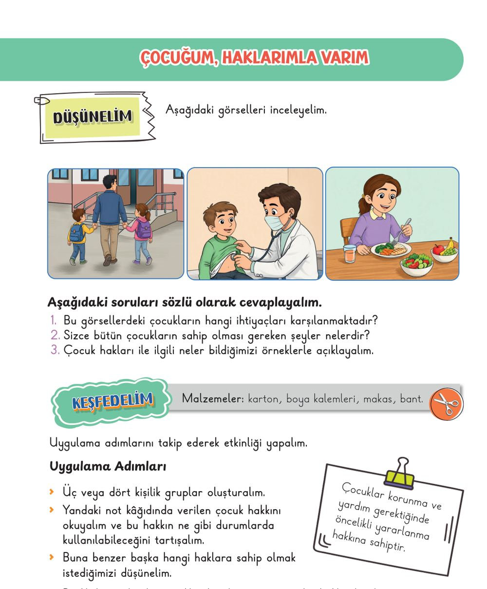
* Grupça tahtaya çıkıp çiçeklerimizi bantla yapıştıralım.

[Not kâğıdı görseli içinde:]
Çocuklar korunma ve yardım gerektiğinde öncelikli yararlanma hakkına sahiptir.

<!-- sayfa 34 -->

# ÖĞRENELİM

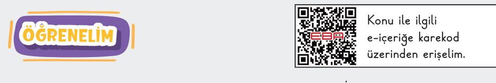
Konu ile ilgili e-içeriğe karekod üzerinden erişelim.

Biz çocuklar, doğduğumuz andan itibaren bazı haklara sahibiz. İsim ve kimlik hakkı, yaşama hakkı, sağlıklı beslenmek, okula gitmek, oyun oynamak birer haktır. Bu haklar kişiliğimizin gelişmesi ve mutlu bir ortamda büyümemiz için çok önemlidir.

Çocuk haklarını korumak amacıyla Birleşmiş Milletler Genel Kurulu tarafından Çocuk Hakları Sözleşmesi hazırlanmıştır. Bu sözleşmeyi kabul eden ülkeler, çocukların haklarını korur ve onların daha iyi koşullarda yaşaması için çalışır. Çocuk Hakları Sözleşmesi'nde yer alan maddelerden örnekler inceleyelim.

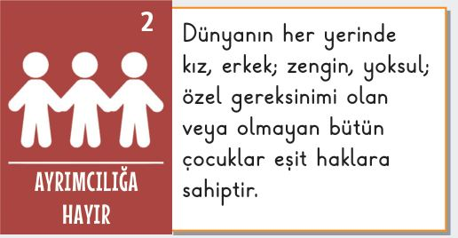
1
ÇOCUĞUN TANIMI
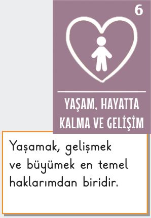
18 yaşıma kadar çocuğum.

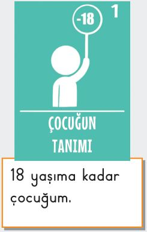
2
AYRIMCILIĞA HAYIR
Dünyanın her yerinde kız, erkek; zengin, yoksul; özel gereksinimi olan veya olmayan bütün çocuklar eşit haklara sahiptir.

3
ÇOCUĞUN EN YÜKSEK YARARI
Annem, babam veya beni büyüten diğer kişiler karar alırken beni düşünmeli ve benim için en iyisini yapmalıdır. Devlet, haklarımın korunup korunmadığını takip etmelidir.

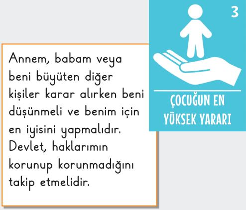
6
YAŞAM, HAYATTA KALMA VE GELİŞİM
Yaşamak, gelişmek ve büyümek en temel haklarımdan biridir.

<!-- sayfa 35 -->

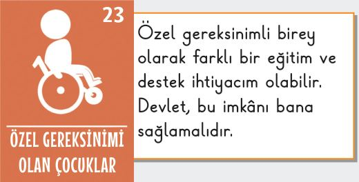
12
ÇOCUKLARIN GÖRÜŞLERİNE SAYGI

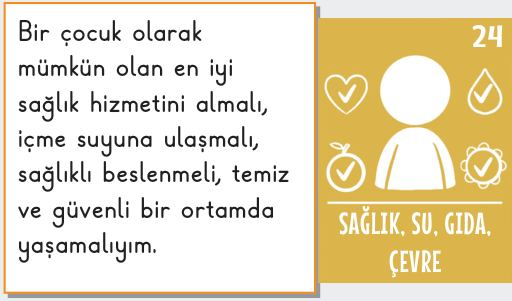
Beni ilgilendiren konularda ne düşündüğümü özgürce söyleyebilmeliyim. Yetişkinler beni dinlemeli, duygu ve düşüncelerimi ciddiye almalılar.

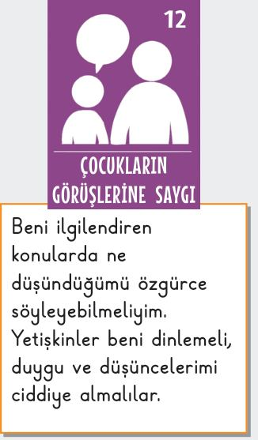
23
ÖZEL GEREKSİNİMİ OLAN ÇOCUKLAR

Özel gereksinimli birey olarak farklı bir eğitim ve destek ihtiyacım olabilir. Devlet, bu imkânı bana sağlamalıdır.

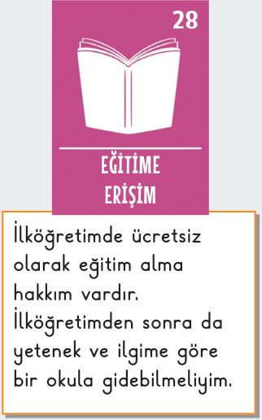
Bir çocuk olarak mümkün olan en iyi sağlık hizmetini almalı, içme suyuna ulaşmalı, sağlıklı beslenmeli, temiz ve güvenli bir ortamda yaşamalıyım.

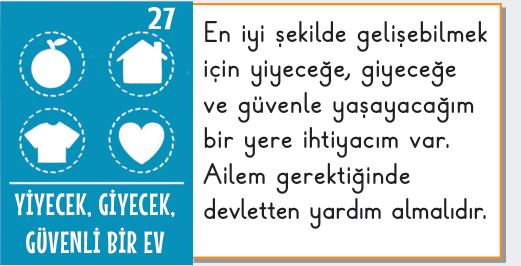
24
SAĞLIK, SU, GIDA, ÇEVRE

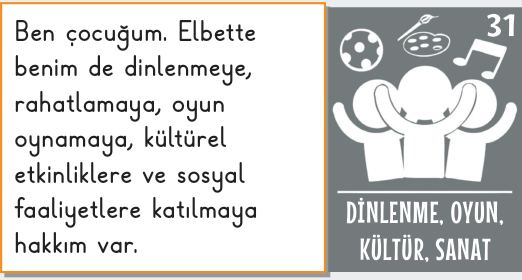
27
YİYECEK, GİYECEK, GÜVENLİ BİR EV

En iyi şekilde gelişebilmek için yiyeceğe, giyeceğe ve güvenle yaşayacağım bir yere ihtiyacım var. Ailem gerektiğinde devletten yardım almalıdır.

28
EĞİTİME ERİŞİM

İlköğretimde ücretsiz olarak eğitim alma hakkım vardır. İlköğretimden sonra da yetenek ve ilgime göre bir okula gidebilmeliyim.

Ben çocuğum. Elbette benim de dinlenmeye, rahatlamaya, oyun oynamaya, kültürel etkinliklere ve sosyal faaliyetlere katılmaya hakkım var.

31
DİNLENME, OYUN, KÜLTÜR, SANAT

<!-- sayfa 36 -->

# UYGULAYALIM

Aşağıdaki metni okuyalım.

> ## EĞİTİM HAKKI
> Harun ve Salih’in ailesi her yıl nisan ayı geldiğinde başka şehirlere giderek mevsimlik tarım işçisi olarak çalışırlar. Harun ve Salih, bu yıl da ikinci dönemin yarısına geldiklerinde yaşadıkları yerdeki okuldan ayrıldılar. Aileleriyle başka bir şehre gittiler. Anne ve babaları gittikleri şehirdeki tarlalarda birkaç ay çalıştı. Eylül ayı geldiğinde aile yaşadıkları şehre geri döndü. Harun ve Salih de okula devam etti.

Uygulama adımlarını takip ederek etkinliği yapalım.

### Uygulama Adımları
* Sınıf arkadaşlarımızın arasından bir gönüllü belirleyelim.
* Gönüllü olan arkadaşımızdan sınıf tahtasını çizgiyle üç bölüme ayırmasını ve bölümlere sırasıyla “Katılıyorum.”, “Kararsızım.” ve “Katılmıyorum.” yazmasını isteyelim.
* Konu ile ilgili aşağıdaki 1. düşünceyi okuyalım.

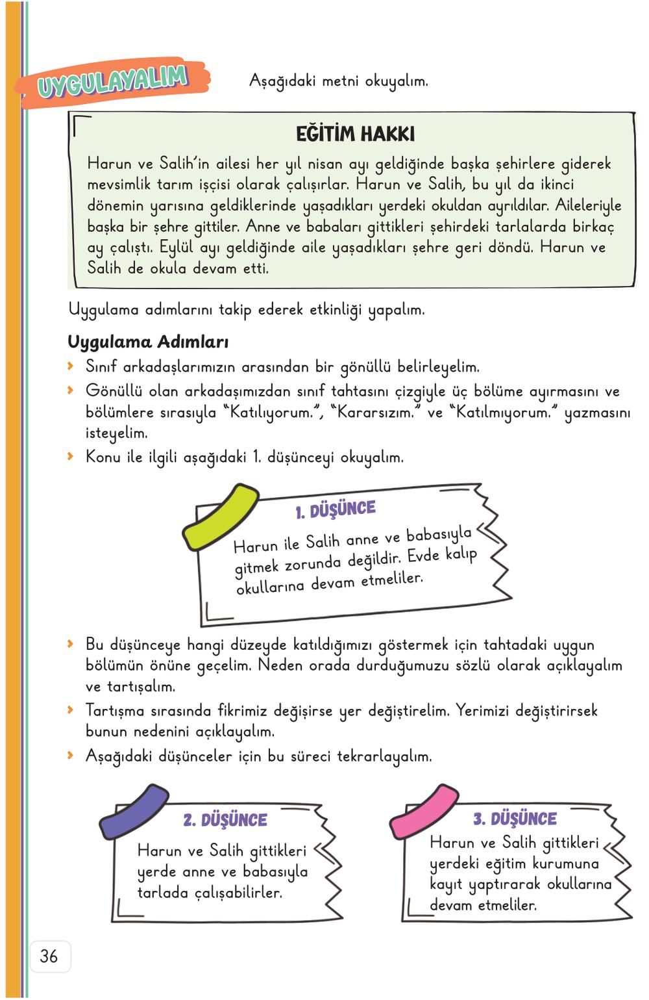
> #### 1. DÜŞÜNCE
> Harun ile Salih anne ve babasıyla gitmek zorunda değildir. Evde kalıp okullarına devam etmeliler.

* Bu düşünceye hangi düzeyde katıldığımızı göstermek için tahtadaki uygun bölümün önüne geçelim. Neden orada durduğumuzu sözlü olarak açıklayalım ve tartışalım.
* Tartışma sırasında fikrimiz değişirse yer değiştirelim. Yerimizi değiştirirsek bunun nedenini açıklayalım.
* Aşağıdaki düşünceler için bu süreci tekrarlayalım.

> #### 2. DÜŞÜNCE
> Harun ve Salih gittikleri yerde anne ve babasıyla tarlada çalışabilirler.

> #### 3. DÜŞÜNCE
> Harun ve Salih gittikleri yerdeki eğitim kurumuna kayıt yaptırarak okullarına devam etmeliler.

<!-- sayfa 37 -->

# PERFORMANS GÖREVİ

Malzemeler: karton, makas, yapıştırıcı, boya kalemleri. 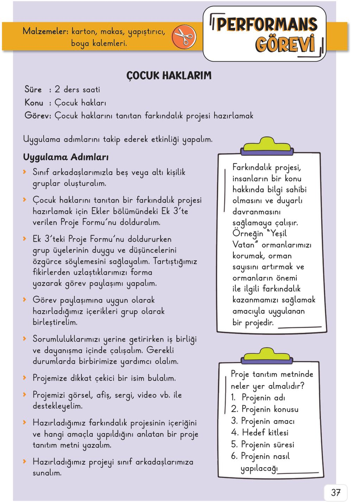

## ÇOCUK HAKLARIM

**Süre :** 2 ders saati  
**Konu :** Çocuk hakları  
**Görev :** Çocuk haklarını tanıtan farkındalık projesi hazırlamak

Uygulama adımlarını takip ederek etkinliği yapalım.

### Uygulama Adımları

* Sınıf arkadaşlarımızla beş veya altı kişilik gruplar oluşturalım.
* Çocuk haklarını tanıtan bir farkındalık projesi hazırlamak için Ekler bölümündeki Ek 3'te verilen Proje Formu'nu dolduralım.
* Ek 3'teki Proje Formu'nu doldururken grup üyelerinin duygu ve düşüncelerini özgürce söylemesini sağlayalım. Tartıştığımız fikirlerden uzlaştıklarımızı forma yazarak görev paylaşımı yapalım.
* Görev paylaşımına uygun olarak hazırladığımız içerikleri grup olarak birleştirelim.
* Sorumluluklarımızı yerine getirirken iş birliği ve dayanışma içinde çalışalım. Gerekli durumlarda birbirimize yardımcı olalım.
* Projemize dikkat çekici bir isim bulalım.
* Projemizi görsel, afiş, sergi, video vb. ile destekleyelim.
* Hazırladığımız farkındalık projesinin içeriğini ve hangi amaçla yapıldığını anlatan bir proje tanıtım metni yazalım.
* Hazırladığımız projeyi sınıf arkadaşlarımıza...

Farkındalık projesi, insanların bir konu hakkında bilgi sahibi olmasını ve duyarlı davranmasını sağlamaya çalışır. Örneğin "Yeşil Vatan" ormanlarımızı korumak, orman sayısını artırmak ve ormanların önemi ile ilgili farkındalık kazanmamızı sağlamak amacıyla uygulanan bir projedir.

Proje tanıtım metninde neler yer almalıdır?
1. Projenin adı
2. Projenin konusu
3. Projenin amacı
4. Hedef kitlesi
5. Projenin süresi
6. Projenin nasıl yapılacağı

<!-- sayfa 38 -->

# DEĞERLENDİRELİM

Aşağıdaki form, farkındalık projesi hazırlama sürecinde kendimizi değerlendirmemiz amacıyla hazırlanmıştır. Değerlendirme yaparken “Evet”, “Kısmen” veya “Hayır” seçeneklerinden uygun olanı işaretleyelim.

## ÖZ DEĞERLENDİRME FORMU

| Değerlendirilecek Davranışlar | Evet | Kısmen | Hayır |
| :--- | :---: | :---: | :---: |
| 1. Proje hazırlamaya başlarken ilgili formu doldurdum. | | | |
| 2. Formu doldururken duygu ve düşüncelerimi özgürce söyledim. | | | |
| 3. Arkadaşlarımın duygu ve düşüncelerini dinledim. | | | |
| 4. Grup arkadaşlarımla farklı düşüncelerim olduğunda konuşarak uzlaştım. | | | |
| 5. Grup arkadaşlarımla görev paylaşımı yaptım. | | | |
| 6. Görev paylaşımına uygun olarak hazırladığım içeriği grup arkadaşlarımın içerikleri ile birleştirdim. | | | |
| 7. Projemize dikkat çekici isim bulmaya katkıda bulundum. | | | |
| 8. Projemizin görsel, afiş, sergi, video vb. ile desteklenmesine yardımcı oldum. | | | |
| 9. Proje metni hazırlanmasında görev aldım. | | | |
| 10. Hazırladığımız projeyi sundum. | | | |

Tüm davranışları “Evet” olarak işaretlediysek, grup içinde üzerimize düşen görevleri yerine getirdiğimizi ve çocuk haklarını tanıtmak için amacına uygun bir farkındalık projesi geliştirdiğimizi söyleyebiliriz.

“Kısmen” veya “Hayır” işaretlediğimiz davranışlar varsa bu davranışlarımızı tekrar düşünmeliyiz. Bir sonraki projede daha dikkatli çalışarak görevlerimizi daha iyi...

<!-- yer tutucu bulunamadı: sayfa sonuna eklendi -->

<!-- sayfa 39 -->

# 1. ÖĞRENME ALANI DEĞERLENDİRME SORULARI

1. Metni okuyalım. Soruları cevaplayalım.

## KİM HANGİ ALANDA GÜÇLÜ

Nergis, Mehmet ve Cemil üçüncü sınıf öğrencileridir. Nergis’i teneffüslerde kolunun altında bir topla görebilirsiniz. Okulun atletizm takımındadır. Nergis, müzik dersini sever ama şarkı söylemek için parmak kaldırmaktan çekinir. Mehmet konuşmayı, anlatmayı sever. Tiyatro kulübündeki arkadaşlarıyla oyunlar hazırlar ve sunar. Mehmet proje çalışmaları için araştırma yapmakta zorlanır. Cemil ise belgesel izlemeyi, deneyler yapmayı çok sever. Aziz Sancar’ı kendisine örnek aldığını söyler. Cemil, başarılı olamayacağını düşündüğü için okuldaki top oyunlarına katılmaktan çekinir.

(Komisyon)

a. Öğrencilerin güçlü ve gelişime açık oldukları alanları tabloda işaretleyelim. Noktalı yere kendi adımızı yazarak güçlü ve gelişime açık olduğumuz alanı işaretleyelim.

| Kişiler | Güçlü Olduğu Alan | | | Gelişime Açık Olduğu Alan | | |
| :--- | :---: | :---: | :---: | :---: | :---: | :---: |
| | Bilim | Sanat | Spor | Bilim | Sanat | Spor |
| Nergis | | | | | | |
| Mehmet | | | | | | |
| Cemil | | | | | | |
| ...................... | | | | | | |

b. Mehmet, Nergis ve Cemil’e gelişime açık oldukları alanlarda neler yapmalarını önerirsiniz?

..........................................................................................................................................................................

<!-- sayfa 40 -->

2. Aşağıdaki örnek olaya göre soruları cevaplayalım.

Aysun sabah okula biraz geç kaldı. Özür dileyerek sırasına oturdu. Derste öğretmenini dikkatlice dinledi. Ders sırasında söz istedi ve fikrini söyledi. Teneffüste arkadaşlarıyla bahçede oyun oynarken sırayla oynamaları gerektiğini bilmesine rağmen kurallara uymadı. Öğle teneffüsünde kantinden ayran almak için sıraya girdi. Sırayı beklemeden alışveriş yapmak isteyen bir arkadaşını uygun bir dille uyardı.

a. Aysun hangi sorumluluklarını yerine getirmiştir?
__________________________________________________________________________
__________________________________________________________________________
__________________________________________________________________________

b. Aysun hangi sorumluluklarını yerine getirmemiştir?
__________________________________________________________________________
__________________________________________________________________________
__________________________________________________________________________

c. Aysun hangi haklarını kullanmıştır?
__________________________________________________________________________
__________________________________________________________________________
__________________________________________________________________________

ç. Aysun’a hak ve sorumluluklarına daha uygun davranması için hangi davranışlarını değiştirmesini önerirsiniz?
__________________________________________________________________________
__________________________________________________________________________
__________________________________________________________________________

<!-- yer tutucu bulunamadı: sayfa sonuna eklendi -->

<!-- sayfa 41 -->

3. Görseli inceleyelim, açıklamayı okuyalım. Öğrendiklerimizden yola çıkarak bu örneğin çocuk haklarından hangisiyle ilgili olduğunu yazalım.

: Aslı’nın mahallesindeki oyun parkında oyun araçları kırık olduğundan çocuklar başka mahallelerdeki parklara gidiyorlarmış.
**İlgili Olduğu Çocuk Hakkı**
..................................................................

Bu konu hakkında bir farkındalık projesi hazırlayalım.

a. Projenin adı:
..................................................................
b. Projenin konusu:
..................................................................
c. Projenin amacı:
..................................................................
ç. Hedef kitlesi:
..................................................................
d. Projenin süresi:
..................................................................
e. Projede yapılacaklar:
..................................................................
..................................................................
..................................................................

Konu ile ilgili ek ölçme ve değerlendirme sorularına karekodu okutarak erişebiliriz.

<!-- sayfa 42 -->

# 2. ÖĞRENME ALANI
# SAĞLIĞIM VE GÜVENLİĞİM

* SAĞLIĞIMI KORUYORUM
* GÜVENLİĞİMİZİ TEHDİT EDEN DURUMLAR
* TRAFİK KURALLARININ ÖNEMİ

## NELER ÖĞRENECEĞİZ?

Bu öğrenme alanında
* sağlığımızı korumaya yönelik davranışlarımızı düzenlemeyi,
* güvenliğimizi tehdit eden bir durumla karşılaştığımızda yapmamız gerekenleri sorgulamayı,
* trafik kurallarına uymanın önemine ilişkin özgün ürünler oluşturmayı öğreneceğiz.

## ANAHTAR KAVRAMLAR

* sağlık
* güvenlik
* trafik kuralları

 EBA’da yer alan öğrenme alanına karekod üzerinden erişelim

<!-- sayfa 43 -->

Öğrenme alanı ile ilgili 
özet içeriğe karekod 
üzerinden erişelim

<!-- sayfa 44 -->

# BELİRLİ GÜN VE HAFTALAR

Kızılay Haftası
(29 Ekim-4 Kasım)

**DOST ELİ**
Kara gün dostudur, uzatır eli,
Afet anlarında sarar Kızılay.
Çorbası sıcaktır, şefkatli dili,
Sevgiyle sarılan koldur Kızılay.

Atatürk Haftası
(10-16 Kasım)

**ATA'NIN DÜŞÜ**
Atatürk cesur, kararlı, ileri görüşlü...
Milletine adadı bütün ömrünü.
Vatan sevgisi öylesine büyüktü.
Geleceğimizi en büyük düşü.

<!-- sayfa 45 -->

Afet Eğitimi Hazırlık Günü
(12 Kasım)

AFET BİLİNCİ
Doğal afet bir gerçektir,
Tedbir almak gerekir.
Kurallara uyan toplum,
Güvenle yükselecektir.

Dünya Çocuk Hakları Günü
(20 Kasım)

ÇOCUK HAKLARI
Dünya çocuklarla güzel ve anlamlı.
Her çocuk bilmeli haklarını.
Sağlık, eğitim, oyun, güvenlik...
Her çocuğun vazgeçilmez hakkı.

Öğretmenler Günü
(24 Kasım)

ÖĞRETMEN
Sevgiyle yaklaşan, sabırla öğreten,
Bilgi ve becerisiyle rehberlik eden,
Şefkatiyle yüreğimizi büyüten
Unutulmaz kişidir öğretmen!

<!-- sayfa 46 -->

# SAĞLIĞIMI KORUYORUM

: DÜŞÜNELİM Sağlıklı büyüme ve gelişmemize katkıda bulunan alışkanlıklarımızı düşünelim. Cümleleri uygun ifadelerle tamamlayalım.

: Sağlıklı büyüme ve gelişme için
- yeterli ve dengeli besleniyorum.
- ........................................................................................................................
- ........................................................................................................................
- ........................................................................................................................
- ........................................................................................................................

: KEŞFEDELİM Aşağıdaki örnek olayları okuyalım.

: 1. Örnek Olay: Alper; karlı bir günde mont, bere, bot gibi kışlık giysilerini giymeden evinin bahçesinde oyun oynadı. O günden sonra ateşlendi ve öksürmeye başladı. Kendini iyi hissetmiyordu. Ailesi ile doktora gitti. İlaç kullanmaya başladı. Bir hafta boyunca okula gidemedi.

: 2. Örnek Olay: Ayşe, akşamları geç yattığı için sabahları uyanırken çok zorlanıyordu. Çoğu zaman kahvaltı yapmaya vakti kalmıyordu. Bazı günler bile geç kalıyordu. Karnı aç olduğu için dersi dinlemekte zorlanıyordu.

**Aşağıdaki soruları sözlü olarak cevaplayalım.**

1. Alper ve Ayşe sağlıklarını korumak için davranışlarını nasıl değiştirmelidir?

<!-- sayfa 47 -->

Etkinlik: **ALİ'NİN ALIŞKANLIKLARI**

* Aşağıdaki görselleri inceleyelim.

**Aşağıdaki soruları sözlü olarak cevaplayalım.**

1. Görsellerde yer alan davranışlardan hangisi veya hangileri Ali'nin sağlığını korumaya yöneliktir?
2. Görsellerdeki davranışlardan hangisi veya hangileri Ali'nin sağlığını korumasına yönelik değildir? Bu davranışlarını düzeltmesi için Ali'ye hangi önerilerde bulunabilirsiniz?
3. Sağlığınızı korumak için neler yapıyorsunuz?
4. Sağlığınızı korumaya yönelik hangi davranışlarınızın değişmesi gerektiğini düşünüyorsunuz? Neden?

* Sağlığımızı korumaya yönelik yaptığımız davranışları değerlendirmek için

<!-- yer tutucu bulunamadı: sayfa sonuna eklendi -->

<!-- sayfa 48 -->

# ÖĞRENELİM

 Konu ile ilgili e-içeriğe karekod üzerinden erişelim.

Günlük yaşamda sahip olduğumuz davranışlar sağlığımızı korumaya yönelik olmalıdır. Sağlığımızı koruyacak davranışlarda bulunmak, sağlıklı bir şekilde büyüyüp gelişmemizi sağlar. Bu nedenle önce davranışlarımızı değerlendiririz. Sağlıklı olmadığını düşündüğümüz bir davranışımız varsa onu değiştiririz.

Aşağıda ve yan sayfada verilen Sağlıklı Yaşam Yol Haritası'nı inceleyelim. Kendi sağlıklı yaşam yol haritamızın nasıl olacağını düşünelim.

Günlük yaşamdaki davranışlarım sağlığımı korumak için uygun mu?

* **Evet**
    * **Örneğin**
        * Dişlerimi düzenli fırçalayarak çürüklerden koruyorum.
        * Mikroplardan korunmak için gerektiğinde ellerimi yıkıyorum.
        * Kişisel ve ortak kullanım alanlarındaki temizliğime dikkat ediyorum.
        * Hasta olmamak için mevsime uygun giyiniyorum.
        * Sağlıklı büyümek için düzenli spor...

* **Hayır**
    * **Örneğin**
        * Erken yatmadığım için sabah erken kalkamıyorum. Okulda kendimi yorgun hissediyorum.
        * Yeterli ve dengeli beslenmeye dikkat etmiyorum. Öğünlerimi bazen atıştırmalıklarla geçiştiriyorum.

Nedenini biliyor musun?

* **Evet**
* **Hayır** $\rightarrow$ Nedenini bul.

<!-- sayfa 49 -->

<u>Örneğin</u>
* Geç saatlere kadar televizyon izlemeyi ve sağlıksız atıştırmalık yemeyi alışkanlık hâline getirdim.

Uygun olmayan davranışlarını değiştirmek için ne yapacağını biliyor musun?

Hayır $\rightarrow$ Hedef belirle.

Evet $\rightarrow$

<u>Örneğin</u>
* 21.30’da yatma alışkanlığı kazanmak için her gün bir önceki günden 15 dakika erken yatacağım.
* Canım sağlıksız atıştırmalık istediğinde fındık, ceviz gibi kuru yemişler yiyeceğim. Öğün saatini bekleyeceğim.

Hedef belirledikten sonra ne yapacağını biliyor musun?

Hayır $\rightarrow$ Plan yap ve uygula.

Evet $\rightarrow$

<u>Örneğin</u>
* Hedefe ulaşmak için yapacaklarımı yazdım.
* Ailem, öğretmenim ve uzmanlardan destek aldım.
* İlerlememi takip ettim.
* Başardıkça kendimi ödüllendirdim.
* Yeni alışkanlıklarımı sürdürüyorum.
* Sağlıklı yeni davranış ve alışkanlıklar ekleyerek yol haritamı geliştiriyorum.

"Hayır" dediğimiz davranışlarımız varsa örnek davranışları inceleyerek kendi yol

<!-- sayfa 50 -->

# UYGULAYALIM

Uygulama adımlarını takip ederek etkinliği yapalım.

## Uygulama Adımları

* Sınıf arkadaşlarımızla dört veya beş kişilik gruplar oluşturalım.
* Aşağıdaki konulardan birini seçelim.

* Seçtiğimiz konu ile ilgili araştırma yapalım.
* Bilgi toplarken T.C. Sağlık Bakanlığının Halk Sağlığı Genel Müdürlüğünde yer alan kaynaklardan yararlanabiliriz. Örneğin aşağıdaki afiş Halk Sağlığı Genel Müdürlüğünün genel ağında yer alan bilgilerden yararlanarak hazırlanmıştır.

: 1, 2, 3, 4 numaralı el yıkama aşamalarını gösteren ve ortasında "ELİNİ YIKARSAN MİKROPLARI KOVARSIN" yazan turuncu afiş.

* Topladığımız bilgileri yan sayfadaki Araştırma Raporu'na yazalım.

<!-- sayfa 51 -->

# ARAŞTIRMA RAPORU

1. Araştırmanın Adı
__________________________________________________________________
__________________________________________________________________

2. Araştırmanın Konusu
__________________________________________________________________
__________________________________________________________________

3. Araştırma Soruları
__________________________________________________________________
__________________________________________________________________

4. Araştırma Sorularının Cevapları
__________________________________________________________________
__________________________________________________________________
__________________________________________________________________
__________________________________________________________________

5. Araştırmanın Sonucu
__________________________________________________________________
__________________________________________________________________

6. Yararlandığım Kaynaklar
__________________________________________________________________
__________________________________________________________________

<!-- yer tutucu bulunamadı: sayfa sonuna eklendi -->

<!-- yer tutucu bulunamadı: sayfa sonuna eklendi -->

<!-- yer tutucu bulunamadı: sayfa sonuna eklendi -->

<!-- sayfa 52 -->

# PERFORMANS GÖREVİ

Malzemeler: A4 kâğıdı ve boya kalemleri.

## ÜRÜN HAZIRLIYORUZ

**Süre :** 2 ders saati  
**Konu :** Sağlığımızı korumanın önemi  
**Görev:** Sağlığımızı korumaya yönelik yaptığımız araştırma sonuçlarına göre hikâye, şiir, şarkı gibi özgün bir ürün hazırlamak

Uygulama adımlarını takip ederek etkinliği yapalım.

### Uygulama Adımları

* Sağlığımızı korumaya yönelik araştırdığımız konuya uygun hazırlayacağımız bir ürün (hikâye, şiir, şarkı) belirleyelim.

#### Hikâye
* Hikâyenin başı, ortası ve sonunda neler olacağını planlayalım.
* Hikâyenin kahramanlarını, olay yerini, hikâyede geçen zamanı açık ve anlaşılır şekilde yazalım.

#### Şiir
* Şiirimizde duygularımızı uygun sözcüklerle anlatalım.
* Cümlelerimizin kısa ve birbiriyle uyumlu olmasına dikkat edelim.

#### Şarkı
* Önce şarkının sözlerini yazalım.
* Şarkı sözlerini bir ezgi oluşturarak veya ritim tutarak seslendirelim.

* Hazırladığımız ürünü A4 kâğıdına yazalım. Kâğıdımızı boya kalemlerimizi kullanarak süsleyelim.

<!-- sayfa 53 -->

# GÜVENLİĞİMİZİ TEHDİT EDEN DURUMLAR

**DÜŞÜNELİM**

Aşağıdaki cümlelerde örnek durumlar verilmiştir. Bu cümlelerden üçü doğru, biri yanlış davranışı belirtmektedir. Bunların hangilerinin doğru, hangisinin yanlış olduğunu arkadaşlarımızla tartışarak bulalım. Bu davranışların neden doğru veya yanlış olduğunu açıklayalım.

1. Kaybolduğum zaman tanıdığım ve güvendiğim kişilerden veya güvenlik görevlilerinden yardım isterim.

2. Okul çıkışında birisi yanıma yaklaşıp “Eve dönmen için ailen beni gönderdi.” dese “Hayır!” derim. Hemen öğretmenime veya aileme haber veririm.

3. Evde tek başımayken kapı çalarsa kapıyı hemen açarım.

4. Genel ağda kişisel bilgilerimi korumaya dikkat ederim.

**Aşağıdaki soruları sözlü olarak cevaplayalım.**

1. Yukarıdaki durumlarda yanlış davranışın doğrusu nasıl olmalıdır?

<!-- sayfa 54 -->

 Uygulama adımlarını takip ederek etkinliği yapalım.

## Uygulama Adımları

* Sınıfın bir köşesini “Güvende Hissediyorum.”, diğer köşesini “Güvende Hissetmiyorum.” olarak belirleyelim.
* Üçer kişilik gruplar oluşturalım.
* Her gruptan bir öğrencinin günlük yaşamlarından kendilerini güvende hissettikleri ve hissetmedikleri durumları söylemesini isteyelim.
* Diğer iki öğrenciye söylenen durumda kendilerini nasıl hissedeceklerini düşünerek uygun köşeye geçmelerini söyleyelim.
* Sınıfın köşelerine geçen öğrencilerden seçimlerinin nedenini açıklamalarını isteyelim.
* Bir grubun çalışmaları tamamlandıktan sonra sıradaki gruptan etkinliğe katılmalarını isteyelim.
* Etkinlik sonunda paylaşılan durumları “Güvenli Durumlar” ve “Güvensiz Durumlar” başlıkları altında defterimize listeleyelim.

## Aşağıdaki soruları sözlü olarak cevaplayalım.

1. Hangi durumda karar vermekte zorlandınız? Neden?
2. Güvenli ve güvensiz durumları ayırt etmek bize nasıl yardımcı olur?

<!-- sayfa 55 -->

# Etkinlik: GÜVENLİ DAVRANIŞLARI KONUŞUYORUZ

Uygulama adımlarını takip ederek etkinliği yapalım.

## Uygulama Adımları

> Aşağıda verilen örnek olayları okuyalım.

| 1. Örnek Olay: | 2. Örnek Olay: |
| :--- | :--- |
| Ela okuldan çıkarken birisi onu durdurup “Aynı sitede oturuyoruz, seni eve bırakabilirim. Aileni tanıyorum.” dedi. Ela bu kişiyi tanımıyordu ancak oturdukları sitenin ismini doğru söylemişti. | Cihan genel ağda araştırma yaparken karşısına bir ileti kutusu çıktı. İletide ne yazdığını merak edip kutuya tıkladı. Açılan sayfada “Hediyeni alabilmek için adresini gönder.” yazıyordu. |

| 3. Örnek Olay: |
| :--- |
| Hande teneffüste arkadaşının defterini izinsiz aldı. Arkadaşı bunu fark edince rahatsız oldu ama Hande’ye bir şey söylemedi. |

> Örnek olaylardaki çocukların güvenliğini tehdit eden durumları söyleyelim.
> Yukarıdaki örnek olayları düşünelim. Aşağıdaki noktalı alana bunlarla ilgili iki tane soru yazalım.

> Soruların cevaplarını birkaç dakika düşünelim. Sınıf arkadaşlarımızla sorularımızın cevaplarını tartışalım.
> Soru ve cevaplarımızı söz hakkı alarak söyleyelim.

<!-- sayfa 56 -->

Etkinlik: **GÜVENLİ YAŞAM**

Aşağıdaki metni okuyalım. Afişleri inceleyelim.

# GÜVENLİK EĞİTİMLERİ

Bugün Toplum Destekli Polis Memuru Ayşe Hanım'ı sınıfımızda misafir ettik. Ayşe Hanım bizlere genel ağın güvenli kullanımı ve teknoloji bağımlılığına ilişkin bilgiler verdi. Ardından sınıfımıza gelen rehber öğretmenimiz de yüz yüze ortamda güvenliğimizi korumaya yönelik bilgilendirme yaptı. İkisi de sınıfımıza konu ile ilgili afiş getirmişti. Onlara teşekkür edip afişleri sınıf panomuza astık. Teneffüslerde bu afişleri dikkatlice inceliyoruz. Güvende olmak için neler yapacağımızı biliyoruz.

(Bu kitap için hazırlanmıştır.)

1. Afiş

2. Afiş

---

**1. Afiş İçeriği:**

# GÜVENLİ GENEL AĞ

* **İZİN AL**
  Genel ağa girmeden önce bir büyüğünden izin al. Güvenli kullanım için ailenin belirlediği kurallara uy.

* **PAYLAŞMA**
  Genel ağda kişisel bilgilerini veya fotoğraflarını asla paylaşma!

* **ANLAT**
  Genel ağda hangi sitelerde dolaştığını, burada neler öğrendiğini anne ve babana her zaman anlat.

---

**2. Afiş İçeriği:**

# BENİM İÇİN GÜVENLİK KURALLARI

### Bu Beden Bana Ait
Biri beni öpmek veya bana sarılmak isterse ona "Hayır!" diyebilirim. Eğer istersem onunla tokalaşırım.

### Güven
Anne ve babama her şeyi anlatabilirim. Onların bana inanacağını ve yardım edeceğini bilirim.

### Sırlar
Tehdit, sır, şaka şeklinde beni rahatsız eden söz veya davranışlara tepki gösteririm. Güvendiğim bir yetişkinden mutlaka yardım isterim.

<!-- sayfa 57 -->

Uygulama adımlarını takip ederek etkinliği yapalım.

## Uygulama Adımları

› Afişlerden elde ettiğimiz bilgilerden yararlanarak güvenliğimizi tehdit eden bir durumla karşılaştığımızda yapmamız gerekenleri not edelim.

› Aldığımız notları sınıf arkadaşlarımızla paylaşalım.
› Güvenliğimizi tehdit eden durumlarda yapmamız gerekenlere örnekler verelim.
› Yüz yüze ve çevrim içi ortamlardaki güvenliğimiz ile ilgili bilgi almak için toplum destekli polis memurunu sınıfımıza davet edebiliriz.
› Bunun için öğretmenimizle bir davetiye hazırlayabilir, öğretmenimizden davetiyeyi ilgili birime ulaştırmasını isteyebiliriz.

<!-- sayfa 58 -->

[QR Kod] Konu ile ilgili e-içeriğe karekod üzerinden erişelim.

# ÖĞRENELİM

Bazen sokakta, okulda, oyun parkında ve çevrim içi ortamlarda (oyunlar, sosyal medya vb.) rahatsız edici veya tehlikeli davranışlarla karşılaşabiliriz. Bu davranışlar, bizim yaşımızdaki çocuklar veya bizden yaşça büyük kişiler tarafından gerçekleştirilebilir. Bu kişiler tanıdık veya yabancı olabilirler.

## Yüz Yüze Ortamda Yaşanabilecek Tehlikeli Durumlar

### Örnek Durumlar

* Tanıdığımız veya tanımadığımız kişilerin bizi evine ya da arabasına çağırması
* Birinin evde yalnız olup olmadığımızı öğrenmeye çalışması veya tanıtım, reklam vb. nedenlerle eve gelmek istemesi
* Tanıdığımız veya tanımadığımız kişilerin bize ısrarla yiyecek ve içecek ikram etmesi
* Bizden izin alınmadan fotoğrafımızın çekilmesi
* Yolda bizi takip ettiğini düşündüğümüz birinin olması
* Otobüs, tren, park vb. yerlerde yabancı kişilerin bizimle ısrarla konuşmak istemesi veya bizi rahatsız edecek kadar yakın mesafede durması
* Sınıf, okul, park gibi yerlerde yaşıtlarımızın sürekli ve bilinçli olarak bizi rahatsız etmesi (harçlık, yiyecek, top gibi kişisel eşyalarımızı vermemiz için bizi zorlaması, tehdit etmesi, vurması, dışlaması, kırıcı sözler söylemesi, isim takması, alay etmesi vb.).

<!-- sayfa 59 -->

# Çevrim İçi Ortamda Yaşanabilecek Tehlikeli Durumlar

**Örnek Durumlar**

* Bir gruba dâhil olma, bir etkinliğe katılma vb. istekler karşısında zorlayıcı davranışlara maruz kalınması
* Fotoğraflarımızın veya kişisel bilgilerimizin izinsiz bir şekilde paylaşılması
* Yaşıtlarımızın veya tanımadığımız kişilerin çevrim içi ortamda olumsuz davranışlar (isim takma, alay etme, tehdit etme, kişisel bilgi veya fotoğrafımızı izinsiz paylaşma vb.) sergilemesi
* Karşımızdaki kişinin yaş, cinsiyet, meslek vb. bilgilerinin gerçek dışı olması
* Çevrim içi oyunların bağımlılık yapması, görev ve sorumlulukların, aile hayatının ve sosyal hayatın ihmal (okula geç kalma, ailece yemek veya etkinlik saatlerini kaçırma, yüz yüze oyun oynamayı ihmal etme vb.) edilmesi
* Çevrim içi ortamlarda “yaş sınırı” kuralına uyulmaması

## GÜVENLİĞİMİZİ TEHDİT EDEN DURUMLARLA KARŞILAŞTIĞIMIZDA NELER YAPABİLİRİZ?

Güvenliğimizi tehdit eden durumlarla karşılaştığımızda bazen nasıl davranacağımızı bilemeyiz. Tedirgin oluruz, kafamız karışır. “Kimden yardım istemeliyim? Tepki versem ayıp olur mu? Karşımdaki kişi ısrar eder veya beni zorlarsa ne yapmalıyım?” gibi sorular aklımıza gelebilir. Böyle durumlarda neler yapabileceğimizi öğrenmek için arka sayfayı dikkatlice inceleyelim.

<!-- sayfa 60 -->

# Yüz Yüze Ortamlarda
* Kararlı bir biçimde “Hayır” deriz.
* Çevremizdekilerden yüksek sesle yardım isteriz.
* Bulunduğumuz ortamdan hemen uzaklaşırız.
* Karşımızdaki ısrar eder veya zorlarsa aile üyelerimizden; öğretmen, polis, güvenlik görevlisi gibi güvendiğimiz bir yetişkinden yardım isteriz.

# Çevrim İçi Ortamlarda
* Tanımadığımız kişilerle iletişime geçmeyiz.
* Çevrim içi ortamlarda “yaş sınırı” uyarılarına uygun davranırız.
* İsim, adres, telefon, şifre gibi kişisel bilgilerimizi ve fotoğraflarımızı paylaşmayız.
* Bizi rahatsız eden bir durum olursa güvendiğimiz bir yetişkinden yardım isteriz.

Tehlikeli durumlar ve güvenlik sorunlarına karşı hazırlıklı olmanın en iyi yollarından biri tedbirli davranmaktır. Bunun için
* kimlerle ve nasıl iletişim kurmamız gerektiğini aile bireylerimizle mutlaka konuşmalıyız.
* yüz yüze ve çevrim içi ortamlarda güvenli iletişim için ailemizin belirlediği kurallar çerçevesinde hareket etmeliyiz.
* bizi rahatsız eden durumları ailemiz veya güvendiğimiz yetişkinlerle (öğretmen, rehber öğretmen, okul yönetimi, polis vb.) mutlaka paylaşmalıyız.
* genel ağ bağımlılığı, genel ağın güvenli kullanımı, dijital okuryazarlık gibi konularda bilgi sahibi olmalıyız.
* yüz yüze veya çevrim içi ortamlarda güvenliğimiz için konunun uzmanlarından bilgi almalıyız. Bu kişiler rehber öğretmen, bilişim teknolojileri öğretmeni, siber

<!-- sayfa 61 -->

# UYGULAYALIM

Uygulama adımlarını takip ederek etkinliği yapalım.

**Uygulama Adımları**

* Sınıf arkadaşlarımız ile beş kişilik gruplar oluşturalım.
* Aşağıdaki başlıklara uygun olacak şekilde güvenliğimizi tehdit eden örnek durumlar düşünelim. Düşüncelerimizi noktalı alanlara yazalım.

### YÜZ YÜZE ORTAM
..........................................................................................................................................
..........................................................................................................................................
..........................................................................................................................................

### ÇEVRİM İÇİ ORTAM
..........................................................................................................................................
..........................................................................................................................................
..........................................................................................................................................

* Belirlediğimiz örnek durumları ve bu durumlarda neler yapacağımızı sözlü olarak veya pandomim (sözsüz oyun) yaparak canlandıralım.

**Aşağıdaki soruları sözlü olarak cevaplayalım.**

1. Canlandırılan durumlarda güvenliği tehdit eden davranışlar nelerdir?
2. Canlandırılan durumlardaki çözüm yolları dışında başka hangi çözüm yolları işe...

<!-- sayfa 62 -->

# DEĞERLENDİRELİM

**Malzemeler:** A4 kâğıdı ve boya kalemleri.

Uygulama adımlarını takip ederek etkinliği yapalım.

### Uygulama Adımları

* Aşağıdaki örnek broşürü inceleyelim. Yüz yüze veya çevrim içi ortamlarda güvenli davranışlar konusunda bir broşür hazırlayalım.
* Broşürümüzü yapmak için öncelikle bir A4 kâğıdını üçe katlayalım.
* Katladığımız bölümlerde hangi bilgi ve görsellere yer vereceğimizi, ön ve arka kapağın nerede olacağını planlayalım.
* Broşürümüzü planımıza uygun olarak hazırlayalım.
* Hazırladığımız broşürü sınıfımızın uygun bir bölümünde sergileyelim.
* Diğer grupların çalışmalarını sırayla inceleyelim. Çalışmalar ile ilgili merak ettiğimiz soruları gruplara soralım.
* Broşürlerden edindiğimiz bilgileri sınıf arkadaşlarımızla paylaşalım.

İç sayfalar (bilgilendirme kısmı)

Arka kapak (kapanış ve ileti) | Kapak (ön yüz)

<!-- sayfa 63 -->

# TRAFİK KURALLARININ ÖNEMİ

**DÜŞÜNELİM** Aşağıdaki trafik işaret levhalarının anlamlarını bulmacadaki uygun yerlere yazalım.

(Bulmaca kısmı görseldeki yapıya göre aşağıdadır)

| | | | | | | | | | | | | | | | | | | | |
| :---: | :---: | :---: | :---: | :---: | :---: | :---: | :---: | :---: | :---: | :---: | :---: | :---: | :---: | :---: | :---: | :---: | :---: | :---: | :---: |
| | | | | **3** | | | | | | | | | | | | **7** | | | |
| | | | | B | | | | | | | | | | | | M | | | |
| | | | | | | | | **4** | | | | | | | | | | | |
| | | | | | | | | O | | | | | | | | | | | |
| | | | **2** | | | | | | | **5** | | | | | | | | | |
| | | | Ü | | | | | | | Y | | | | | | | | | |
| | | | | | | | | | | | | | | | **6** | | | | |
| | | | | | | | | | | | | | | | A | | | | |
| **1** | M | | | | | | | | | | | | | | | | | | |
| | | | | | | | | | | | | | | | | | | | |
| | | | | | | | | | | | | | | | | | | | |
| | | | | | | | | | | | | | | | | | | | |

<!-- sayfa 64 -->

**Malzemeler:** *karton, boya kalemleri, makas, yapıştırıcı.*

Uygulama adımlarını takip ederek etkinliği yapalım.

## Uygulama Adımları

* Sınıf arkadaşlarımızla beş veya altı kişilik gruplar oluşturalım.
* Bir karton üzerine cadde ve sokakların olduğu basit bir çizim yapalım. Ev, okul, hastane gibi mekânların yerini belirleyerek çizime ekleyelim.
* Ekler bölümünde bulunan Ek 6'daki insan figürlerini ve araçları keselim. Grup arkadaşlarımızla yaya veya araç sürücüsü figürlerinden bir tane alarak görev paylaşımı yapalım.
* Görev paylaşımına uygun olarak hazırladığımız karton üzerinde seçtiğimiz figürlerle dolaşmaya başlayalım.
* Üç dakika sonra duralım ve neler yaşadığımızı konuşalım. “Temel trafik işaret levhaları ve trafik kurallarının olmadığı bir ortamda neler olabilir?” sorusunun cevabını grup arkadaşlarımızla tartışalım. Ortak düşüncelerimizi not alalım.
* Düşüncelerimizi sınıf arkadaşlarımızla paylaşalım. Grupların paylaştığı düşünceleri gönüllü bir arkadaşımızdan tahtaya yazmasını isteyelim.
* Tahtaya yazılan cevapların uygunluğunu sınıfça tartışalım.
* Karton üzerinde dolaşırken yaşanan trafik sorunlarını çözmek için trafik işaret ve levhaları hazırlayalım. Hazırladığımız levhaları kartonda uygun yerlere yerleştirelim.
* Görev paylaşımımıza uygun olarak seçtiğimiz figürlerle karton üzerinde yeniden dolaşmaya başlayalım.
* Üç dakika sonra duralım ve yaşadığımız durumu bir önceki deneyimimiz ile karşılaştıralım.
* Sınıf arkadaşlarımızla trafik kurallarının önemi ile ilgili örnekler paylaşalım.

<!-- sayfa 65 -->

# Etkinlik: TRAFİK KURALLARINA NİÇİN UYMALIYIZ?

Uygulama adımlarını takip ederek etkinliği yapalım.

## Uygulama Adımları

* Yakın çevremizden seçeceğimiz bir kişiyle trafik kurallarına uymanın önemine ilişkin bir görüşme yapalım.
* Aşağıdaki Görüşme Formu'nu istenilen şekilde dolduralım.
    * Görüşme yapacağımız kişiye formdaki soruları sırayla soralım.
    * Sorulara verilen cevapları ilgili alanlara yazalım.

 <!-- Bu kısım görseldeki formu temsil eder -->

**GÖRÜŞME FORMU**

Görüşme Yapılan Kişinin Adı Soyadı: __________________________________________

Görüşme Konusu: ___________________________________________________________

Kendinizi kısaca tanıtır mısınız?
___________________________________________________________________________
___________________________________________________________________________
___________________________________________________________________________

Trafik kurallarına uymanın önemi ile ilgili neler düşünüyorsunuz?
___________________________________________________________________________
___________________________________________________________________________
___________________________________________________________________________

* Yaptığımız görüşme sonrasında elde ettiğimiz bilgileri sınıfta sunalım. Diğer arkadaşlarımızın yaptığı sunumları dikkatlice dinleyelim. Elde edilen bilgilerin 

<!-- sayfa 66 -->

# ÖĞRENELİM

![QR Kod] Konu ile ilgili e-içeriğe karekod üzerinden erişelim.

Trafikte insanların güvenliğini ve trafik düzenini sağlamak için belirlenen bazı kurallar vardır. Herkes bu kurallara uymak zorundadır. Trafik kurallarına uymak can ve mal kayıplarının yaşanmasını önler. Böylece evimize, okulumuza veya gitmek istediğimiz başka bir yere güven içinde ulaşabiliriz.

## YAYALAR VE YOLCULAR TRAFİKTE NELERE DİKKAT ETMELİ?

* Karşıdan karşıya geçerken alt geçit, üst geçit veya yaya geçidini kullanmalıyız.
* Yaya geçidi yoksa önce sola, sonra sağa, sonra tekrar sola bakarak dikkatli bir şekilde yolun karşısına geçmeliyiz.
* Trafik ışıklarına uygun davranmalıyız.
* Trafik levhaları bize kuralları ve tehlikeli durumları gösterir. Trafik levhalarına dikkat etmeliyiz.
* Kaldırımda yürümeliyiz, kaldırım yoksa trafik akış yönü karşımızda olacak şekilde yolun sol tarafından yürümeliyiz.

* Yolda dikkatimizin dağılmaması ve çevreden gelen uyarıları duyabilmemiz için cep telefonu ile meşgul olmamalı ve kulaklıkla müzik dinlememeliyiz.
* Arabaya bindiğimizde mutlaka emniyet kemerimizi takmalıyız.
* Çocuklar olarak her zaman arka koltukta oturmalıyız.

<!-- sayfa 67 -->

# ARAÇ SÜRÜCÜLERİ TRAFİKTE NELERE DİKKAT ETMELİ?

* Yaya ve bisikletlilere öncelik vermelidir.
* Trafik ışık ve levhalarına uymalıdır.
* Araba kullanırken mutlaka emniyet kemeri takmalıdır.
* Ani gelişebilecek durumlara hazırlıklı olmak için hız sınırına her zaman uymalıdır.
* Kırmızı ışıkta durmalı ve yayalara güvenli bir şekilde geçiş imkânı sağlamalıdır.
* Araba kullanırken cep telefonu, radyo gibi dikkat dağıtıcı araçlardan uzak durmalıdır.
* İnsan ve hayvanların yola çıkabileceği yerlerde daha dikkatli olmalıdır.
* Diğer sürücülerin haklarına saygılı olmalıdır.

Trafik kuralları herkes için geçerlidir. Toplumsal hayatı düzenleyen kurallara uyarak diğer insanlara karşı görevlerimizi de yerine getirmiş oluruz. Trafik kurallarına uymak hepimizin güvende olmasını sağlar. Böylece kendimizi ve başkalarını korumuş oluruz.

<!-- sayfa 68 -->

# UYGULAYALIM

**Malzemeler:** beşer cm eninde mavi, beyaz, kırmızı, sarı, siyah, yeşil renklerde karton şerit; makas; yapıştırıcı. 

Uygulama adımlarını takip ederek etkinliği yapalım.

## Uygulama Adımları

* Sınıf içinde altı gruba ayrılalım.
* Kura çekerek grubumuzun mavi, beyaz, kırmızı, sarı, siyah ve yeşil renklerden hangisini kullanacağını belirleyelim.
* Grubumuza uygun renkte kartonu alarak kendimize birer temsilî şapka yapalım. Bunun için karton şeridi başımızı çevreleyecek şekilde kıvırıp uçlarını yapıştıralım.
* Aşağıdaki örnek durumları okuyalım ve sınıf arkadaşlarımızla bir durum seçelim.

> **1. Durum:** Yayaların trafik kurallarına uymadığı bir ortamda trafikte yaşanabilecek olaylar
>
> **2. Durum:** Sürücülerin trafik kurallarına uymadığı bir ortamda trafikte yaşanabilecek olaylar
>
> **3. Durum:** Hem yayaların hem sürücülerin trafik kurallarına uymadığı bir ortamda trafikte yaşanabilecek olaylar
>
> **4. Durum:** Yaya ve sürücülerin trafik kurallarına uyduğu bir ortamda trafikte yaşanabilecek olaylar

* Seçtiğimiz durumla ilgili grubumuzun şapka rengine göre cevap vermemiz gereken rehber soruyu inceleyelim.

1.  Bu durum ile ilgili neler biliyoruz?
2.  Bu durumu yaşarsak neler hissederiz?
3.  Bu durumu yaşarsak ne tür sorunlarla karşılaşabiliriz?
4.  Bu durumun bize kazandırabileceği olumlu yönler neler olabilir?
5.  Bu sorunu çözmek için farklı neler yapabiliriz?
6.  Bu düşüncelerden nasıl bir sonuç çıkarabiliriz?

* Soruya vereceğimiz en uygun cevabı grup arkadaşlarımızla kararlaştıralım.
* Cevaplarımızı şapka sırasına göre arkadaşlarımızla paylaşalım: 1. Beyaz, 2. Kırmızı, 3. Siyah, 4. Sarı ve 5. Yeşil. En son 6. mavi şapkalı gruba söz hakkı verelim ve konuşulanları grupça özetlemelerini isteyelim.

<!-- sayfa 69 -->

# DEĞERLENDİRELİM

**Malzemeler:** renkli kâğıtlar, görseller, karton, makas, yapıştırıcı.

Uygulama adımlarını takip ederek etkinliği yapalım.

## Uygulama Adımları

* Trafik kurallarına uymanın güvenlik açısından önemine ilişkin özgün bir afiş oluşturalım. Trafikte yaşanan sorunlara yönelik çözüm önerileri veya trafik kurallarına uymanın önemi gibi toplumsal yaşamı etkileyen konulardan birine yer verebiliriz.
* Seçtiğimiz konuyla ilgili afiş hazırlayalım.

### Afişimizi hazırlarken

* anlatmak istediğimiz konu hakkında bilgi edinelim.
* afişimize uygun ve etkileyici bir slogan bulalım.
* bulduğumuz sloganı afişimizin uygun bir yerine renkli kalemlerimizle yazalım.
* afişte seçtiğimiz konuyu kısaca açıklayacak etkili cümlelere yer verelim.
* afişte görseller kullanarak afişi dikkat çekici hâle getirelim.

* Afişimizi sınıfta sergileyerek paylaşalım.
* Arkadaşlarımızın afişlerini inceleyelim.

<!-- sayfa 70 -->

# NELER ÖĞRENDİK?

## 2. ÖĞRENME ALANI DEĞERLENDİRME SORULARI

1. Aşağıdaki etkinlikte doğru cümlelerde “D”, yanlış cümlelerde “Y” harfini yuvarlak içine alarak çıkışa ilerleyelim. Ulaştığımız çıkışı boyayalım.

Sağlığımızı korumak için her zaman doğru davranışlar sergileriz.

$\rightarrow$ D $\rightarrow$ Acelemiz olduğunda kahvaltı yapmadan okula gideriz.
$\rightarrow$ Y $\rightarrow$ Erken yatıp, erken kalkarak uyku düzenimizi koruruz.

Acelemiz olduğunda kahvaltı yapmadan okula gideriz.
$\rightarrow$ D $\rightarrow$ Her mevsim kalın giysiler giyersek hastalıklardan korunuruz.
$\rightarrow$ Y $\rightarrow$ Yeterli ve dengeli beslenmeye dikkat ederiz.

Erken yatıp, erken kalkarak uyku düzenimizi koruruz.
$\rightarrow$ D $\rightarrow$ Dişimiz ağrıdığında ağrının kendiliğinden geçmesini bekleriz.
$\rightarrow$ Y $\rightarrow$ Kişisel temizliğimize dikkat ederiz.

Her mevsim kalın giysiler giyersek hastalıklardan korunuruz.
$\rightarrow$ D $\rightarrow$ 1. Çıkış
$\rightarrow$ Y $\rightarrow$ 2. Çıkış

Yeterli ve dengeli beslenmeye dikkat ederiz.
$\rightarrow$ D $\rightarrow$ 3. Çıkış
$\rightarrow$ Y $\rightarrow$ 4. Çıkış

Dişimiz ağrıdığında ağrının kendiliğinden geçmesini bekleriz.
$\rightarrow$ D $\rightarrow$ 5. Çıkış
$\rightarrow$ Y $\rightarrow$ 6. Çıkış

Kişisel temizliğimize dikkat ederiz.
$\rightarrow$ D $\rightarrow$ 7. Çıkış
$\rightarrow$ Y $\rightarrow$ 8. Çıkış

<!-- sayfa 71 -->

2. Aşağıdaki davranış ifadelerini okuyalım. Çocukların sağlıklarını koruyabilmeleri için değiştirmeleri gereken davranışları boş kutulara yazalım.

| Davranışlar | Davranışları Değiştirmek İçin Yapılması Gerekenler |
| :--- | :--- |
| a. Asya geç saate kadar televizyon izlediği için sabah derse geç kalır. Derste sürekli uyukladığı için öğretmeninin anlattıklarını anlamakta zorluk çeker. | |
| b. Beren okul yemekhanesindeki yemekleri sevmediği için kantinden kek, çikolata, bisküvi alır. Akşam yemeklerinde ise çok sevdiği için sürekli makarna yemek ister. | |
| c. Canan hava sıcak olmasına rağmen okulda hırkasını hiç çıkarmaz. Teneffüste koşup oynarken çok terlediği için ertesi gün kendini kötü hisseder. | |
| ç. Berke okuldan eve gelir gelmez yemeğini yer. Yemeğini yedikten sonra cips, çikolata gibi sağlıksız besinler tüketir. Bir süre sonra Berke'nin midesi bulanmaya başlar. | |
| d. Mete haftada iki kez dişlerini fırçalar. Bir süre sonra dişlerinde ağrı hissetmeye başlar. | |

<!-- yer tutucu bulunamadı: sayfa sonuna eklendi -->

<!-- sayfa 72 -->

3. Aşağıdaki soruları örnek olaylara göre cevaplayalım.

> #### 1. Örnek Olay
> Bir gün Ülkü okul bahçesinde oyun oynarken arkadaşlarından biri Ülkü'nün topunu zorla almak istedi. Ülkü topunu vermek istemedi. Arkadaşı ona daha önce bu yüzden küsmüş, onu oyuna almamıştı. Diğer arkadaşlarına da Ülkü ile oynamamalarını söylemişti. Ülkü topu vermediğinde yine aynı şeyler olacağını düşünmeye başladı.
>
> a. Ülkü'nün yaşadığı olayda güvenliğini tehdit eden şey nedir?
> ............................................................................................................................................
>
> b. Ülkü yaşadıkları karşısında nasıl davranmalıdır?
> ............................................................................................................................................
>
> c. Böyle bir durumla karşılaşırsak ne yaparız?
> ............................................................................................................................................

> #### 2. Örnek Olay
> Emre bilgisayarını açtı. Çevrim içi ortamda oyun oynarken bir kullanıcı ona ileti gönderdi:
> – Merhaba Emre, çok güzel oyun oynuyorsun. Ben de senin yaşındayım, birlikte oynayalım mı? Bir telefon numarası verirsen seninle konuşabiliriz.
>
> a. Emre'nin yaşadığı olayda güvenliğini tehdit eden şey nedir?
> ............................................................................................................................................
>
> b. Emre yaşadıkları karşısında nasıl davranmalıdır?
> ............................................................................................................................................
>
> c. Böyle bir ileti aldığımızda kimden yardım istemeliyiz?
> ............................................................................................................................................

<!-- yer tutucu bulunamadı: sayfa sonuna eklendi -->

<!-- sayfa 73 -->

4. Aşağıda verilen örnek durumları inceleyelim.
   a. Örnek durumlarda yer alan kişilerin yerinde olduğumuzu düşünelim. Böyle durumlarda nasıl davranmamız gerektiğini ve nedenini ilgili alanlara yazalım.

   1. DURUM: Nalan okul çıkışında araçların olduğu yola birden çıkarak karşıya geçmeye çalıştı. Tam o sırada bir araba aniden fren yapmak zorunda kaldı ve herkes çok korktu.

   Nalan’ın yerinde olsaydım
   ..........................................................................................................................................
   ..........................................................................................................................................
   Çünkü
   ..........................................................................................................................................
   ..........................................................................................................................................

   2. DURUM: Aykut kaldırım olmayan bir yolda yolun sağ tarafından yürümektedir.

   Aykut’un yerinde olsaydım
   ..........................................................................................................................................
   ..........................................................................................................................................
   Çünkü
   ..........................................................................................................................................
   ..........................................................................................................................................

   3. DURUM: Melis yedi yaşındadır. Ailesine araba yolculuğunda ön koltuğa oturma konusunda ısrar etmektedir ancak ailesi Melis'e izin vermemektedir.

   Melis’in yerinde olsaydım
   ..........................................................................................................................................
   ..........................................................................................................................................

<!-- yer tutucu bulunamadı: sayfa sonuna eklendi -->

<!-- sayfa 74 -->

# 3. ÖĞRENME ALANI
# AİLEM VE TOPLUM

* AİLE VE TOPLUM
* YARDIMLAŞMA
* MESLEKLER

## NELER ÖĞRENECEĞİZ?

Bu öğrenme alanında
* aile ve toplum arasındaki ilişkiyi çözümlemeyi,
* yardıma ihtiyacı olan bireylerin yaşamını kolaylaştırmak için fikirlerimizi eyleme dönüştürmeyi,
* mesleklerin toplumsal yaşamdaki önemini yorumlamayı öğreneceğiz.

## ANAHTAR KAVRAMLAR

* aile
* toplum
* yardımlaşma
* meslek

 EBA’da yer alan öğrenme alanına karekod üzerinden erişelim

<!-- sayfa 75 -->

Öğrenme alanı ile ilgili özet içeriğe karekod ile ilgili

<!-- sayfa 76 -->

# BELİRLİ GÜN VE HAFTALAR

**Dünya Engelliler Günü**
**(3 Aralık)**

**SAYGI VE SEVGİ VARSA ENGEL YOK**
Göz görmese de gönül görebilir,
Dil söylemese de kişi anlayabilir.
Saygı, anlayış, yardımseverlik varsa
Sevgi her engelin üstesinden gelir.

**İnsan Hakları ve Demokrasi Haftası**
**(10 Aralık gününü içine alan hafta)**

**İNSANLIĞIN ORTAK MİRASI**
Ne güzeldir barış içinde olmak,
Yakışır insanlara özgürce yaşamak!
İnsanlığın ortak mirasıdır:
Demokrasi, eşitlik, adalet, hak...

<!-- sayfa 77 -->

Tutum, Yatırım ve Türk Malları Haftası (12-18 Aralık)

**BİZİM OLAN BİZE YETER**
Buğday, arpa, pamuk, elma...
Daha nicesi yetişir bu topraklarda.
Kıymetlidir emek, kazanç, alın teri.
Tercih edelim bizim yerli ürünleri.

Enerji Tasarrufu Haftası (Ocak ayının 2. haftası)

**KAYNAKLARI GELECEĞE TAŞIYALIM**
Su, elektrik, kömür, doğal gaz...
Hiç bitmeyecek sanmayalım
Hepsini tasarruflu kullanalım.
Kaynaklarımızı geleceğe taşıyalım.

<!-- sayfa 78 -->

# AİLE VE TOPLUM

 DÜŞÜNELİM

Aşağıdaki metni okuyalım.

## AİLEM

Bir akşam Aras okuldan heyecanla eve geldi. Anne ve babasına “Yarın okulda kaynakları tasarruflu kullanmanın önemi ile ilgili bir sunum hazırlamam gerekiyor.” dedi.

Annesi gülümseyerek “Ne güzel bir konu. Haydi birlikte düşünelim.” dedi. Üçü birlikte masaya oturdular.

Babası Aras’a evde kullanmadıkları bazı kutuları, şişeleri sunumunda kullanabileceğini söyledi. Annesi eski dergilerden konuyla ilgili resimler buldu. Hep birlikte hem çalışıyorlar hem de konu ile ilgili sohbet ediyorlardı. Ali, babasının getirdiği kartona resimleri yapıştırdı ve resimlerle ilgili açıklamaları yazdı. Anne ve babasının desteğiyle güzel bir sunum hazırladı.

(Bu kitap için hazırlanmıştır.)

**Aşağıdaki soruları sözlü olarak cevaplayalım.**

1. Ailesinin bu davranışları Aras’a neler hissettirmiş olabilir?

<!-- sayfa 79 -->

* Hatice’nin hafta sonu planını inceleyelim.

# Hafta Sonu Planım

## Cumartesi

Sabah ailemle kahvaltı yapacağım.
Öğlene kadar ders tekrarı yapacağım.
Öğle yemeğini ailece yedikten sonra birlikte okuldaki resim sergisini gezeceğiz.
Ailece saat 18.00'de sinemada olacağız.
Akşama teyzemlere yemeğe gideceğiz.

## Pazar

Ailece dedemlere sabah kahvaltısına gideceğiz.
Mahalle muhtarımız tarafından düzenlenen "Mahallemizi Yeşillendirelim" etkiliğine katılarak fidan dikeceğiz.
Saat 15.00'te arkadaşlarımla çocuk tiyatrosunda buluşacağız.
Akşam, ertesi gün için okula hazırlık yapacağım.

# Aşağıdaki soruları sözlü olarak cevaplayalım.

1. Hatice’nin ailesiyle yaptığı toplumsal etkinlikler nelerdir?
2. Ailenizle katıldığınız toplumsal etkinliklere (konser, resim sergisi, sinema, tiyatro vb.) örnekler veriniz. Bu etkinliklerle ilgili deneyimlerinizi arkadaşlarınızla paylaşınız.

<!-- sayfa 80 -->

# Etkinlik: TOPLUM İÇİNDE AİLEMİZ

* Uygulama adımlarını takip ederek etkinliği yapalım.

## Uygulama Adımları

> Aşağıdaki ailenin gün içinde neler yaptığını gösteren görsel ve metinleri inceleyelim.

Sabahları ailece kahvaltı yaparak güne başlarız.

Anne ve babamız bizi okula bırakır. Okulumuz topluma hizmet eden önemli bir kurumdur. Okulumuzda öğretmenlerimiz ve arkadaşlarımızla yeni bilgiler öğrenir, yeni beceriler kazanırız. Okul kurallarına uygun hareket ederek hem sorumlu davranır hem de birlikte güzel vakit geçiririz.

Annem bizi okula bıraktıktan sonra hastaneye gider. Hastanede doktor olarak çalışır. Çocukları muayene eder ve gerektiğinde ilaç yazar. İnsanların sağlıklı olması için topluma hizmet eder. Bazen sağlıklı yaşam konusunda davet edildiği kurumlarda gönüllü seminerler verir.

<!-- sayfa 81 -->

Babam, bizi bıraktıktan sonra inşaat alanına gider. İnşaat mühendisi olarak çalışır. Yürütülen çalışmaları kontrol eder. Binaların güvenli, sağlam ve çevreye uygun olmasını sağlar. Gönüllü olarak çalıştığı AFAD'ın (Afet ve Acil Durum Yönetimi Başkanlığı) çalışmalarına destek verir.

Okulda katıldığımız sosyal kulüp çalışmaları ile yeni arkadaşlar ediniriz. Bu çalışmalarda ekip çalışması yaparak üzerimize düşen görev ve sorumlulukları zamanında yerine getiririz.

Sınıfımızın ve okulumuzun kurallarına uyarız. Biz de okuldaki görev ve sorumluluklarımızı yerine getirerek topluma faydalı bireyler olmaya çalışırız.

Akşam yemeklerinden sonra bazen komşularımız bizi ziyaret eder, bazen de biz onlara gideriz. Komşularımızla aynı toplumun bir parçası olduğumuzu biliriz. Onlara saygı duyar, ihtiyaç duyduklarında yardım ederiz.

* İncelediğimiz görsel ve metinlerden yararlanarak aşağıdaki soruları sınıfça tartışalım. Aile ve toplum arasındaki ilişkiyi açıklayalım.

1. Ailenin ve toplumun sahip olması gereken değerler nelerdir?
2. Aile içinde ve toplumda iletişim nasıl olmalıdır? Neden?

<!-- sayfa 82 -->

Konu ile ilgili e-içeriğe karekod üzerinden erişelim.

Aile toplumun en küçük birimidir. Her ailenin sahip olduğu özellikler vardır. Bu özelliklere çeşitli örnekler verebiliriz.

## AİLENİN ÖZELLİKLERİ

Aile üyeleri arasında sevgi, saygı, destek ve güvene dayalı duygusal bağlar vardır.

Aile üyeleri birbirlerine destek olurlar. Örneğin ev işlerini paylaşarak yapabilirler. Abi veya ablalar kardeşlerine derslerinde yardım edebilir.

Aileler; akrabalar, komşular ve arkadaşlar gibi toplumdaki diğer insanlarla yardımlaşma ve dayanışmaya dayalı ilişkiler kurar. Böylece toplumsal bağların güçlenmesine katkıda bulunurlar.

Aile üyeleri yaşam boyu mutlu, heyecanlı, hüzünlü pek çok deneyime ortak olurlar.

Bir ailede bu özellikler ne kadar güçlüyse bireyler kendilerini o kadar güvende, değerli ve o aileye ait hissederler. Birbirlerine bağlılıkları yüksek olur. Böylece aile birliği korunmuş olur.

Aile bireyleri her zaman iletişim içindedirler. Eğlenceli etkinliklere zaman ayırırlar. Bazen de yaşadıkları sorunları birlikte çözerler.

Ailece topluma karşı görev ve sorumluluklarımız vardır. Örneğin aile içinde israftan kaçınırız; suyu, elektriği ve yiyecekleri gerektiği kadar tüketiriz. Bilinçli tüketici davranışları sergileriz, ihtiyacımız kadar alışveriş yaparak paramızı dikkatli kullanırız. Böylece kaynaklarımız boşa gitmez. Hem aile bütçemizi hem de ülke ekonomimizi korumuş oluruz. Vergimizi zamanında veririz. Bu sayede devletin okul, hastane, yol ve parklar yapmasına katkıda bulunuruz. Her aile bu sorumluluklarını yerine getirdiğinde toplumda düzen sağlanmış olur, insanlar daha rahat ve güvenli

<!-- sayfa 83 -->

Toplum; aynı yerde yaşayan, birbirleriyle iletişim kuran, ortak kurallara uyan ve yardımlaşan insanlardan oluşur. Ailemiz, akrabalarımız, komşularımız, mahallemizdeki veya ülkemizdeki insanlar toplumun birer parçasıdır. Her toplumun kendine göre farklı özellikleri vardır.

# TOPLUMUN ÖZELLİKLERİ

Toplumsal yaşamda hepimizin uyması gereken kurallar vardır. Bu kurallar toplum düzeni için çok önemlidir. Aile, okul ve devlet kurumları toplumsal düzenin sağlanmasında önemli görevler üstlenir. Örneğin ailemizden trafik kuralları ile ilgili bilgiler ediniriz. Okulda ise trafik güvenliğiyle ilgili eğitimler alarak bilinçleniriz. Devlet ise trafik kurallarını belirler, yolları düzenler ve kurallara uyulup uyulmadığını denetler.

Toplum olarak sahip olduğumuz ahlaki değerlerimiz, gelenek ve göreneklerimiz vardır. Örneğin akrabalık, komşuluk gibi ilişkilere önem veririz. Onların üzüntü ve sevinçlerini paylaşır birbirimize destek oluruz. Bayramlarda büyüklerimizi ziyaret eder, onların ellerini öperiz. Bunlar bizim toplumumuzun ortak değerleridir.

Toplumda insanların ilgi alanları, yetenekleri ve görevleri birbirinden farklıdır. Bu farklılıklar sayesinde insanlar çeşitli meslekler yapar. Örneğin öğretmenler çocuklara bilgi verir, doktorlar hastaları iyileştirir, çiftçiler yiyecek üretir ve birçok kişi kendi işiyle topluma katkıda bulunur. İnsanlar çalışıp üretmeye, yeni şeyler öğrenmeye ve birbirlerine destek olmaya devam ettikçe toplum da sürekli gelişir ve değişir.

> Bir toplumda bu özellikler ne kadar güçlüyse toplumu oluşturan bireyler kendilerini o kadar güvende, değerli ve o topluma ait hissederler. Birbirlerine ve toplumsal kimliklerine bağlılıkları yüksek olur.

Anayasamızın 41. maddesinde “Aile, Türk toplumunun temelidir.” ifadesi yer alır. Bu ifade ile aile ve toplumun birbiri için önemi vurgulanır. Yardımlaşma ve dayanışmanın olduğu, görev ve sorumlulukların yerine getirildiği ailelerin

<!-- sayfa 84 -->

# UYGULAYALIM

Uygulama adımlarını takip ederek etkinliği yapalım.

## Uygulama Adımları

* Sınıfın üç köşesini şu şekilde belirleyelim.
    1. Köşe: Katılıyorum.
    2. Köşe: Kararsızım.
    3. Köşe: Katılmıyorum.

* Aşağıdaki cümleleri okuması için gönüllü bir arkadaşımızı seçelim.

> Aile toplumun en önemli yapı taşıdır.
> Toplumda yaşanan değişimler aile yaşamını etkiler.
> Bir çocuğun davranışlarını en çok aile şekillendirir.
> Güçlü bir toplum için öncelikle güçlü aileler gerekir.
> Toplum kuralları aile yaşamını etkiler.
> Ailede öğrenilen değerler toplumda başarılı olmaya yardımcı olur.

* Gönüllü arkadaşımızın sırayla okuduğu aile ve toplum arasındaki ilişkiyle ilgili cümleyi düşünerek hangi köşeye gideceğimize karar verelim.
* Kararımızla ilgili köşeye gidelim.
* Herkes köşesine gittikten sonra sırayla neden bu köşeyi seçtiğimizi açıklayalım.
* Herkes açıklamasını tamamladıktan sonra görüşümüzü değiştirdiysek ilgili köşeye gidelim.

**Aşağıdaki soruyu sözlü olarak cevaplayalım.**

<!-- sayfa 85 -->

# DEĞERLENDİRELİM

Aşağıda aile ve toplum ile ilgili cümlelere yer verilmiştir. Cümleleri okuyalım ve boş bırakılan yerleri dolduralım.

## AİLE VE TOPLUM

**Aile**
$\downarrow$
| |
| :--- |
| ............................................................ |

**............................................................**
$\downarrow$
| |
| :--- |
| Aynı çevreyi ve tarihi paylaşan birey ve ailelerden oluşur. |

**Özellikleri**
$\downarrow$
| |
| :--- |
| Sevgi, saygı gibi duygusal bağlar vardır. |
| ............................................................ |
| ............................................................ |
| ............................................................ |

**Özellikleri**
$\downarrow$
| |
| :--- |
| Herkesin uyması gereken kurallar vardır. |
| ............................................................ |
| ............................................................ |
| ............................................................ |

**Aile ve Toplum İlişkisi**
$\downarrow$
| |
| :--- |
| Aileler toplumsal kurallara uyarsa düzen sağlanmış olur. |
| ............................................................ |
| ............................................................ |
| ............................................................ |

<!-- sayfa 86 -->

# YARDIMLAŞMA

**DÜŞÜNELİM**

Malzemeler: balon.

Uygulama adımlarını takip ederek etkinliği yapalım.

**Uygulama Adımları**

* Arkadaşlarımızla el ele tutuşarak bir çember oluşturalım.
* Balonlarımızı şişirelim.
* Balonumuzun üstüne ismimizi yazalım.
* Balonumuzu ortaya atalım ve karıştıralım.
    * Kendi balonumuzu bulmaya çalışalım.
    * Herkes kendi balonunu bulduktan sonra balonları tekrar ortaya atıp karıştıralım.
    * Bu sefer herhangi bir balonu alıp üzerindeki isme bakıp balonu sahibine verelim.

**Aşağıdaki soruları sözlü olarak cevaplayalım.**

1. Herkesin kendi balonunu bulması mı, herhangi bir balonu alıp sahibine vermesi mi daha kısa sürdü?
2. “Bir elin nesi var, iki elin sesi var.” atasözünden ne anlıyorsunuz?

**KEŞFEDELİM**

Aşağıdaki metni okuyalım.

### ÜÇ KARDEŞ

Defne, Doruk ve Duru kardeşler anneleriyle eve dönüyorlardı. O sırada komşuları Ayşe teyzenin elindeki ağır poşetleri taşımakta zorlandığını gördüler. Defne, kardeşleri Doruk ve Duru'ya baktı “Ayşe teyzeye yardım edelim mi, ne dersiniz?” dedi.

1. Kardeşlerin yerinde siz olsaydınız Defne'nin sorusuna ne cevap verirdiniz?
2. Yardıma ihtiyaç duyan kişilerin günlük yaşamlarını kolaylaştırmak için neler...

<!-- sayfa 87 -->

**Etkinlik: YARDIMCI OLALIM**

Aşağıdaki örnek olayı okuyalım. Görseli inceleyelim.

> **Örnek Olay:** Çanakkale’deki şehitlikleri ziyaret etmek için geziye çıkan 3-C sınıfı öğrencileri bir dinlenme tesisinde mola verdiler. Geziye katılan özel gereksinimli bir öğrenci tesisin girişinde rampa olmadığı için tesise giremedi.

Öğrenciler, öğretmenleri ve çevredekilerin yardımıyla geçici bir çözüm üreterek arkadaşlarının tesise girmesini sağladılar. Okula döndüklerinde karşılaştıkları bu duruma yönelik engelsiz ve erişilebilir bir yaşam için farkındalık projesi hazırladılar.

**Aşağıdaki soruları sözlü olarak cevaplayalım.**

1. Sizce 3-C sınıfı öğrencileri nasıl bir proje hazırlamış olabilir?
2. Siz çevrenizde yardıma ihtiyacı olan kişilerin sorunlarını çözmek için neler yapabilirsiniz?

<!-- sayfa 88 -->

**Etkinlik: YARDIM KUTUSU**

**Malzemeler:** karton, boya kalemleri.

Uygulama adımlarını takip ederek etkinliği yapalım.

**Uygulama Adımları**

* Sınıf arkadaşlarımızla dört veya beş kişilik gruplar oluşturalım.
* Getirdiğimiz kutunun üzerine “Yardımlaşma Kutusu” yazalım.
* Grubumuzla belirlediğimiz bir yardım fikrini karta yazalım. “Görme yetersizliği olan birine kitap okuyabilirim.”, “Otobüste yaşlılara yer verebilirim.” gibi fikirler yazabiliriz.
* Yardım fikrimizin yazdığı kartı yardım kutusuna atalım.

* Yardımlaşma kutusundan rastgele bir kart çekelim.
* Çektiğimiz karttaki yardım fikrini arkadaşlarımızla rol dağılımı yaparak canlandıralım.

“Yardım istemek pes etmek değildir, pes etmeyi reddetmektir.”
Charlie Mackesy (Çarli Mekeyzi)

**Aşağıdaki soruları sözlü olarak cevaplayalım.**

1. Yardım eden bir bireyi canlandırmak size kendinizi nasıl hissettirdi?
2. Yardıma ihtiyacı olan bir bireyi canlandırmak size kendinizi nasıl hissettirdi?
3. Günlük yaşamda yardıma ihtiyacı olan kişilerin yaşamını kolaylaştırmak için neler yapabiliriz?

<!-- sayfa 89 -->

# ÖĞRENELİM

Konu ile ilgili e-içeriğe karekod üzerinden erişelim.

Bazı insanların yaşamlarını sürdürebilmesi için geçici veya sürekli olarak dışarıdan destek almaları gerekebilir. Hepimizin çevresinde yardıma ihtiyaç duyan insanlar olabilir. Yaşlı, özel gereksinimli, hasta, ekonomik açıdan dezavantajlı, afet yaşamış kişiler yardıma ihtiyaç duyabilir.

Yardıma ihtiyaç duyan bireyleri fark eden toplumlar, bu bireyleri destekler. Bu destek; aile bireyleri, akrabalar tarafından veya hastane, huzurevi gibi devlet kurumları ile yardım dernekleri gibi topluluklar tarafından verilebilir.

Yardıma ihtiyaç duyan bireyler için bazen en basit ihtiyaçlarını karşılamak bile çok zor olabilir. Bu ihtiyaçları gözlemleyerek farkında olmak önemlidir. Görme yetersizliği olan bir birey için kitap veya gazete okumak, market alışverişi yapmak bu bireyleri destekleyebileceğimiz alanlardandır.

<!-- sayfa 90 -->

Hepimiz yardıma ihtiyacı olan bireylerin yaşamını kolaylaştırmak için bir şeyler yapabiliriz. Bireysel çalışmalarımızla ve grup çalışmalarıyla farkındalık projeleri üretebilir veya bu projelere destek olabiliriz. Bu projeler ile sevgi, saygı, şefkat, sabır gibi değerlerimizi geliştirebiliriz. Kendimizi karşımızdaki insanın yerine koymayı ve onu daha iyi anlamayı öğrenebiliriz. Bu sayede çevremiz ile iletişimimiz artar, sosyal bağlarımız güçlenir ve sorumluluk bilincimiz gelişir.

# YARDIM PROJELERİ NASIL GELİŞTİRİLİR?

* Önce iyi bir gözlemci oluruz. Çevremizde yardıma ihtiyacı olan bireyleri gözlemleriz.
* Sonra bu kişilerin hangi konularda yardıma ihtiyaçları olduğunu belirleriz.
* Ekibimizi oluştururuz.
* Ekibimizle projenin amacını ve hedef kitlesini belirleriz.
* Projemize bir isim veririz.
* Projeyi ne kadar sürede yapacağımızı planlarız.
* Proje kapsamında neler yapacağımızı belirleyerek iş bölümü yaparız.
* Gerçekleştirdiğimiz her adımı ekip olarak değerlendiririz ve raporumuzu yazarız.

<!-- sayfa 91 -->

# UYGULAYALIM

Uygulama adımlarını takip ederek etkinliği yapalım.

**Uygulama Adımları**

* Sınıf arkadaşlarımızla dört kişilik gruplar oluşturalım.
* Yardıma ihtiyacı olan bireylerin yaşamını kolaylaştırmak için plan yapalım. Planımızı yaparken düşüncelerimizi arkadaşlarımızla açık bir şekilde paylaşalım. Farklı düşünceler üzerinde uzlaşalım.
* Bu süreçte sorumluluk alalım ve kendimizi ifade ederken duygu, düşünce ve davranışlarımızda kontrollü olalım.
* Hazırladığımız planda yapacaklarımızı listeleyelim ve bir kontrol listesi oluşturalım.
* Oluşturduğumuz listeye göre görev paylaşımı yapalım.
* Üzerimize düşen görevi zamanında yerine getirelim. Süreç boyunca arkadaşlarımızla yardımlaşma ve dayanışma içinde çalışalım.
* Uyguladığımız planı grup arkadaşlarımızla kontrol listemizi kullanarak değerlendirelim.

---

**Malzemeler:** karton, makas, yapıştırıcı, boya kalemleri.

# PERFORMANS GÖREVİ

## KÜÇÜK YARDIMLAR, BÜYÜK MUTLULUKLAR

**Süre :** İki ders saati
**Konu :** Yardımlaşma
**Görev :** Yardıma ihtiyacı olan bireylerin yaşamını kolaylaştırmak için farkındalık projesi hazırlamak

**Uygulama Adımları**

* Sınıf arkadaşlarımızla dört kişilik gruplar oluşturalım.
* Yardıma ihtiyacı olan bireylerin yaşamını kolaylaştırmak için Ekler bölümündeki Ek 5'i doldurarak görev paylaşımı yapalım.
* Görev paylaşımına uygun olarak hazırladığımız içerikleri grup arkadaşlarımızın içerikleriyle birleştirelim.
* Projemizin içeriğini ve hangi amaçla yapıldığını anlatan bir proje tanıtım metni yazalım. Projemizi görsel, afiş, video vb. ile destekleyelim.

 Sesli Kütüphane Oluşturma

<!-- sayfa 92 -->

# DEĞERLENDİRELİM

Aşağıdaki form, yardıma ihtiyacı olan insanlara destek projemizde grup içi davranışlarımızı değerlendirmek için hazırlanmıştır. Değerlendirme yaparken “Evet”, “Kısmen” veya “Hayır” seçeneklerinden uygun olanı işaretleyelim.

## ÖZ DEĞERLENDİRME FORMU

| Değerlendirilecek Davranışlar | Evet | Kısmen | Hayır |
| :--- | :---: | :---: | :---: |
| 1. Grup üyeleriyle iş birliği yaptım. | | | |
| 2. Üzerime düşen görevi belirlenen sürede tamamladım. | | | |
| 3. Gerekli durumlarda grup üyeleriyle dayanışma içinde oldum. | | | |
| 4. Projeyle ilgili önerilerde bulundum. | | | |
| 5. Projeyi geliştirmek için katkıda bulundum. | | | |
| 6. Projeyi arkadaşlarıma sundum. | | | |

Tüm davranışlar için “Evet” seçeneğini işaretlemek, projede üstlendiğimiz görev ve sorumlulukları yerine getirdiğimizi gösterir. “Kısmen” veya “Hayır” seçeneğini işaretlediğimiz davranışlarda ise öğretmenimizden destek alarak kendimizi geliştirmeliyiz.

<!-- yer tutucu bulunamadı: sayfa sonuna eklendi -->

<!-- sayfa 93 -->

# MESLEKLER

**DÜŞÜNELİM**
Aşağıdaki görselleri inceleyelim.

**Aşağıdaki soruları sözlü olarak cevaplayalım.**
1. Görsellerdeki insanların meslekleri neler olabilir?
2. Çevrenizde gördüğünüz meslekler nelerdir?

<!-- sayfa 94 -->

* Aşağıdaki bilmeceleri okuyalım. Bilmecelerde bahsedilen meslekleri bulmacada bularak işaretleyelim.

1. Hastalıkta teşhis ve tedavidir işim,
   Halıklıktan korunmayı da öğretirim.
2. Siren çalar, lamba kırmızı kırmızı yanar.
   Yangında bu kişiler yardıma koşar.
3. Bilgi ve beceriler öğretirim,
   Sınıfımdır benim ikinci evim.
4. Uçağım ile gökyüzünde gezerim.
   Güvenli ve hızlı ulaşım benim işim.
5. Sağlıklı dişler için bana gelin,
   Yıllık kontrollerinizi ihmal etmeyin.
6. Düdüğü var, mavi ışığı yanar,
   Vatandaşın güvenliğini sağlar.
7. Sağlıklı sebze, meyveler yetiştiririm.
   Topraktır, emek verdiğim iş yerim.
8. Yol, köprü, bina yaparım.
   Hesaplar, planlar, ortaya çıkarırım.

| D | A | Ç | İ | F | T | Ç | İ | D | Y | İ | A |
|---|---|---|---|---|---|---|---|---|---|---|---|
| I | Y | P | O | L | İ | S | Y | İ | C | T | B |
| V | N | P | B | Z | O | L | A | Ş | C | F | S |
| V | C | I | V | D | Z | G | Y | H | O | A | V |
| H | S | M | S | O | G | O | Ö | E | N | İ | I |
| M | R | Ü | Y | K | O | U | Ğ | K | K | Y | J |
| O | P | H | J | T | B | F | R | İ | G | E | N |
| I | P | E | K | O | D | E | E | M | C | C | D |
| R | İ | N | T | R | B | İ | T | İ | C | İ | B |
| O | L | D | V | S | M | S | M | J | I | L | U |
| V | O | İ | S | Y | Z | H | E | Y | G | A | A |
| J | T | S | O | T | L | C | N | K | G | J | N |

* İlgimizi çeken mesleklere örnekler vererek sınıf arkadaşlarımızla paylaşalım.

<!-- yer tutucu bulunamadı: sayfa sonuna eklendi -->

<!-- sayfa 95 -->

Etkinlik: **MESLEKLER ÖNEMLİDİR**

* Aşağıdaki metni okuyalım.

# MESLEKLERİ TANIYORUZ

Naz ile Efe için o gün heyecanlı başladı. Naz’ın babası ile Efe’nin annesi mesleklerini tanıtmak üzere sınıfa gelmişlerdi. Ders başladığında öğretmen “Çocuklar, bu hafta bazı meslekler ile ilgili bilgi sahibi olacağız.” dedi. Bütün öğrenciler sıralarında merakla bekliyordu. İlk olarak Naz'ın babası “Ben bir itfaiyeciyim. Bizler yangın çıktığında olay yerine hemen gideriz. İnsanları kurtarırız, yangını söndürmek için ekip arkadaşlarımızla çalışırız. Afetlerde (deprem, sel vb.) oluşan enkazlarda veya kazalarda gerçekleştirilen arama kurtarma çalışmalarına katılırız.” dedi. Efe’nin annesi ise “Ben bir hemşireyim. Hastanede hastaların iyileşmesine yardımcı olurum. Onlara ilaçlarını verirken moral de veririm. Ateş, nabız, tansiyon ve tahlil sonuçlarını takip edip kaydeder; doktora hastalar hakkında bilgiler veririm.” dedi. Bütün sınıf bu iki mesleği öğrendiği için çok mutlu oldu.

(Bu kitap için hazırlanmıştır.)

## Aşağıdaki soruları cevaplayalım.

1. Metinde geçen mesleklerin toplum için önemi nedir?
___________________________________________________________________________
___________________________________________________________________________

2. Günlük hayatımızda karşılaştığımız farklı mesleklerin toplum için önemi nedir?
___________________________________________________________________________
___________________________________________________________________________

3. Mesleklerin önemine ilişkin merak ettiğiniz sorular nelerdir?
___________________________________________________________________________
___________________________________________________________________________

* Öğretmenimizin rehberliğinde çeşitli meslek sahibi velileri sınıfımıza davet

<!-- sayfa 96 -->

# ÖĞRENELİM

Konu ile ilgili e-içeriğe karekod üzerinden erişelim.

İnsanların yaşamlarını sürdürebilmeleri için birçok farklı ihtiyaçları vardır. Bu ihtiyaçları karşılamak için toplumda çeşitli meslekler ortaya çıkmıştır. İnsanların beceri ve ilgilerine göre eğitim aldıkları ve yaptıkları işe *meslek* denir.

Toplumsal yaşamda her meslek farklı bir ihtiyacı karşılar. Sağlık, güvenlik, bilim, eğitim, kültür, sanat, teknoloji gibi pek çok alanda farklı meslek çalışanları vardır. Her meslek sahibi birbirine ihtiyaç duyar. Örneğin öğretmen öğrencilerini eğitir ancak hastalandığında doktora gider. Doktor ekmek almak için fırına uğrar, fırıncı un almak için çiftçiye ihtiyaç duyar. Herkes birbirinin emeğine değer verir.

**Semercilik**

Mesleklerin her biri toplum için çok önemli ve değerlidir. Gelişen teknoloji, değişen toplum ihtiyaçları gibi nedenlerle bazı mesleklerle günümüzde daha az karşılaşabiliriz. Semercilik, nalbantlık, yorgancılık gibi meslekleri buna örnek olarak verebiliriz.

**Nalbantlık**

<!-- sayfa 97 -->

Doktorluk, öğretmenlik, mühendislik, esnaflık gibi meslekler günlük yaşamda sıkça karşılaştığımız mesleklere örnek olarak verilebilir. Robot teknisyenliği, insansız hava aracı (drone-dıron) pilotluğu, sürdürülebilir enerji mühendisliği, yapay zekâ uzmanlığı gibi meslekler yakın zamanda adını duymaya başladığımız meslekler arasındadır. Gelecekte ise bugün hayal bile edemediğimiz yeni meslek isimleri duyabiliriz.

Doktorluk

Yapay Zekâ Uzmanlığı

Sürdürülebilir Enerji Mühendisliği

Robot Teknisyenliği

Meslekler maddi olarak yaşamımızı sürdürmek ve sahip olduğumuz yetenekleri toplum yararına kullanmak için önemlidir. Mesleğimizle diğer insanlara faydalı olur, toplumun ihtiyaçlarını karşılarız. Meslekler ülkemizin gelişmesi için de çok önemlidir. Bilim, teknoloji, ekonomi, sanat, edebiyat ve spor alanında ileri düzeyde olan toplumlar güçlü ve lider konumda olurlar. Bizler de eğitimimizi en iyi şekilde tamamlayarak mesleğimizle hem ailelerimize hem de ülkemize yararlı...

<!-- sayfa 98 -->

# UYGULAYALIM

Uygulama adımlarını takip ederek etkinliği yapalım.

## Uygulama Adımları

* Aklımızdan bir meslek tutalım ve bu mesleği arkadaşlarımıza söylemeden defterimize yazalım.
* Sırayla tahtaya çıkalım.
* Arkadaşlarımızdan aklımızdaki mesleği bulmak için bize sadece “Evet” veya “Hayır” şeklinde cevaplayabileceğimiz sorular sormalarını isteyelim.
* Sorulara sadece “Evet” veya “Hayır” diyerek cevap verelim.
* Arkadaşlarımız doğru mesleği bulana kadar oyuna devam edelim.
* Oyun bittikten sonra aklımızdan tuttuğumuz mesleği düşünerek aşağıdaki soruları defterimize cevaplayalım.

> ### Sorular
> 1. Bu kişi hangi işleri yapar?
> 2. Nerede çalışır?
> 3. Bu mesleğe ne zaman ihtiyaç duyulur?
> 4. Bu meslek için hangi eğitim veya beceriler gereklidir?
> 5. Bu meslek neden önemlidir?
> 6. Gelecekte bu mesleğin yerini hangi meslekler alabilir?
> 7. Bu meslek nasıl değişebilir?
> 8. Gelecekte bu işi tamamen robotlar ve yapay zekâ mı yapacak, yoksa insanlara hâlâ ihtiyaç olacak mı? Neden?

* Cevaplarımızı tamamladıktan sonra arkadaşlarımızla paylaşalım.

<!-- sayfa 99 -->

# DEĞERLENDİRELİM

**Malzemeler:** boya kalemleri, karton, yapıştırıcı, makas. 

Uygulama adımlarını takip ederek etkinliği yapalım.

## Uygulama Adımları

* Sınıf arkadaşlarımızla üç veya dört kişilik gruplar oluşturalım.
* Gruptaki her bir kişinin ilgi duyduğu mesleklerden ikişer tane belirlemesini isteyelim.
* Grupta belirlenen her bir meslek için mesleğin adını, amacını ve toplum için önemini anlatan bilgi kartları hazırlayalım.
* Hazırladığımız kartlara görseller ekleyerek kartlarımızın içeriğini destekleyelim.
* Hazırladığımız bilgi kartlarını sınıf arkadaşlarımızla paylaşalım.
* Kartlardan ikişer tane yaparak “Meslekler Hafıza Oyunu” hazırlayabiliriz. Kartları kapalı ve karışık olarak masanın üzerine dizip eşini bulma oyunu oynayabiliriz.
* Tüm gruplar sunumunu bitirdiğinde bilgi kartlarını sınıf panosunda sergileyelim.

### Örnek Bilgi Kartı

| ÖĞRETMEN | |
| :--- | :--- |
| **Meslek Alanı** | : Eğitim |
| **Çalışma Yeri** | : Okullar |
| **Kullandığı Araçlar** | : tahta, kalem, kitap, bilgisayar |
| **Yaptığı İş** | : Öğrencilere bilgi ve beceri kazandırmak, onların gelişimine rehberlik etmek |
| **Topluma Katkısı** | : Eğitimli bireyler yetiştirerek toplumun ilerlemesine yardımcı olmak |

<!-- sayfa 100 -->

# 3. ÖĞRENME ALANI DEĞERLENDİRME SORULARI

1. Aşağıdaki metni okuyarak soruları cevaplayalım.

## KÖY HALKI VE YILMAZ AİLESİ

Yılmaz ailesi küçük şirin bir köyde yaşıyordu. Köy halkı gibi Yılmaz ailesi de geçimlerini çiftçilikle sağlıyordu. Köy halkı için birlik, beraberlik, dayanışma içinde olmak çok önemliydi. Anne Fatma Hanım ve baba Hasan Bey işlerinde çok titizlerdi. Yetiştirdikleri ürünlerin insanlara faydalı olması için ellerinden geleni yaparlardı. Üç çocukları vardı: Ali, Baha ve Canan. Ailece birbirlerini çok sever ve sayarlardı. Evde hepsinin uyması gereken kurallar vardı. Sabah kahvaltısı ve akşam yemeğinde mutlaka birlikte olurlardı. Elektriği ve suyu tasarruflu kullanmaya özen gösterirlerdi. Babası hep şöyle derdi: “Her aile tasarruflu davranır ve vergisini düzenli verirse ülke ekonomisine fayda sağlamış olur. Biz de böyle davranarak ülkemizin gelişmesine katkıda bulunuruz.”

(Bu kitap için hazırlanmıştır.)

a. Yılmaz ailesinin özellikleri nelerdir?
__________________________________________________________________________
__________________________________________________________________________

b. Yılmaz ailesinin yaşadığı toplumun özellikleri nelerdir?
__________________________________________________________________________
__________________________________________________________________________

c. Aile ve toplum arasında nasıl bir ilişki vardır?
__________________________________________________________________________
__________________________________________________________________________

<!-- sayfa 101 -->

2. Aşağıdaki görseli inceleyelim. Hasan Bey'in karşılaştığı sorunu arkadaşlarımızla paylaşalım. Günlük yaşamda karşılaşabileceği diğer sorunları da ilgili alana yazalım.

Karşılaşabileceği Sorunlar
__________________________________________________________________
__________________________________________________________________
__________________________________________________________________
__________________________________________________________________
__________________________________________________________________

Yazdığınız sorunları çözmeye yönelik bir farkındalık projesi hazırlayınız.

a. Projenin adı: _________________________________________________
b. Projenin konusu: ______________________________________________
c. Projenin amacı: _______________________________________________
ç. Projenin hedef kitlesi: ________________________________________
d. Projenin süresi: ______________________________________________
e. Projede yapılacaklar: __________________________________________
__________________________________________________________________
__________________________________________________________________
__________________________________________________________________
__________________________________________________________________
__________________________________________________________________

<!-- sayfa 102 -->

3. Aşağıdaki örnek olayları okuyalım. Olayları ilgili oldukları mesleklerle eşleştirelim.

1. Kübra’nın okulundaki genel ağda bilinmeyen bir dosya hızlıca yayılmaya başlar. Öğrencilerin bilgilerinin zarar görmemesi için bir uzman okula çağırılır. Bu uzman genel ağı inceler, zararlı dosyayı siler ve güçlü bir şifreleme sistemi oluşturur.

2. Faruk gece yarısı evinin karşısındaki ormanlık alanda duman görür. Faruk’un babası hemen 112’yi arar. Olay yerine gelen ekipler, aileyi güvenli bölgeye alır ve olası yangını önler.

3. Naz’ın okulunun bahçesinde ağaçlar mevsiminde budanır ve bitkiler özenle korunur. Rengarenk yeni çiçekler dikilir. Bu düzenli çevre bakımı sayesinde okul bahçesi daha da güzelleşir.

4. Görkem’in mahallesindeki dere taşınca bazı evlerin bodrumlarını su basar. Uzman bir ekip taşkının nedenlerini inceler. Yağmur sularının taşmaması ve çöplerin dereye karışmaması için bir plan yapar.

* Doktor
* Siber güvenlik uzmanı
* Bahçıvan
* İtfaiyeci
* Çevre mühendisi

4. Aşağıdaki mesleklerin toplumsal yaşamdaki önemini yazalım.

| Mesleğin Adı | Toplumsal Yaşamdaki Önemi |
| :--- | :--- |
| Ambulans şoförü | |
| Postacı | |
| Aşçı | |
| Yazılım mühendisi | |
| Şehir planlamacısı | |

Konu ile ilgili ölçme ve değerlendirme sorularına karekodu okutarak erişebiliriz.
: karekod

<!-- sayfa 103 -->

Ek 1

Güçlü ve gelişime açık olduğumuz alanları düşünerek aşağıdaki formu dolduralım. 
Bu alanlarda merak/ilgi ve yetenek düzeyimizi gösteren seçeneği işaretleyelim.

# EKLER

## ÖZ DEĞERLENDİRME FORMU

| Alanlar | Merak/İlgi Düzeyim | | | Yetenek Düzeyim | | |
| :--- | :---: | :---: | :---: | :---: | :---: | :---: |
| | Çok İyi | İyi | Geliştirilmeli | Çok İyi | İyi | Geliştirilmeli |
| Bilim Alanı | | | | | | |
| | | | | | | |
| | | | | | | |
| Sanat Alanı | | | | | | |
| | | | | | | |
| | | | | | | |
| Spor Alanı | | | | | | |
| | | | | | | |
| | | | | | | |

Merak/ilgi ve yetenek düzeyinde “Çok İyi” veya “İyi” seçeneğini işaretlediğimiz alanlar, güçlü alanlarımızdır. Bu alanlarda daha güçlü olmak için planlı çalışmalı ve sabırlı olmalıyız. “Geliştirilmeli” seçeneğini işaretlediğimiz alanlar gelişime açık alanlarımızdır. Kendimizi geliştirmek için neler yapabileceğimiz konusunda öğretmenlerimiz ve ailemizden destek alabiliriz.

<!-- sayfa 104 -->

Ek 2

# RÖPORTAJ

## Giriş
Grup ismi: ........................................................................
Sınıfı: ...............................................................................
Röportaj yapılan kişi: .......................................................
Röportajın yapıldığı tarih: ................................................

## Sorular
Öğrencilerin Okuldaki Hak ve Sorumluluklarına İlişkin Sorularımız 
..........................................................................................................................................
..........................................................................................................................................
..........................................................................................................................................
..........................................................................................................................................
..........................................................................................................................................
..........................................................................................................................................
..........................................................................................................................................
................................................................................

<!-- sayfa 105 -->

# RÖPORTAJ

## Cevaplar

<!-- sayfa 106 -->

Ek 3

# ÇOCUK HAKLARI FARKINDALIK PROJESİ FORMU

1. Projenin Adı

2. Projenin Konusu

3. Projenin Amacı

4. Projenin Hedef Kitlesi

5. Projenin Süresi

6. Projede Yapılacaklar

7. Projeyi Hazırlayanlar

<!-- sayfa 107 -->

Ek 4

# SAĞLIK GÜNLÜĞÜM

Aşağıdaki Sağlık Günlüğüm Formu'nu beş gün boyunca dolduralım. Yaptığımız davranışlar için “√”, yapmadığımız davranışlar için “X” işaretini koyalım.

| Sağlıklı Davranışlarım | 1. Gün | 2. Gün | 3. Gün | 4. Gün | 5. Gün |
| :--- | :---: | :---: | :---: | :---: | :---: |
| 1. Yeteri kadar uyudum. | | | | | |
| 2. Erken yatıp erken kalktım. | | | | | |
| 3. Sağlıklı besinler tükettim. | | | | | |
| 4. Dişlerimi sabah ve akşam fırçaladım. | | | | | |
| 5. Ellerimi yemeklerden önce ve sonra yıkadım. | | | | | |
| 6. Hava durumuna uygun giyindim. | | | | | |
| 7. Gün içinde hareketli oyunlar oynadım. | | | | | |

Sağlık Günlüğüm Formu'nda “√” ile işaretlediğimiz davranışlar, sağlığımızı korumaya yönelik doğru davrandığımızı ve bunları alışkanlık hâline getirdiğimizi gösterir. “X” ile işaretlediğimiz davranışları ise düzeltmeli, sağlığımızı korumak için doğru alışkanlıklara dönüştürmeliyiz.

<!-- sayfa 108 -->

Ek 5

# YARDIMA İHTİYACI OLAN BİREYLERİN YAŞAMINI KOLAYLAŞTIRMAK İÇİN FARKINDALIK PROJESİ FORMU

1. Projenin Adı

2. Projenin Konusu

3. Projenin Amacı

4. Projenin Hedef Kitlesi

5. Projenin Süresi

6. Projede Yapılacaklar

7. Projeyi Hazırlayanlar

<!-- sayfa 109 -->

Ek 6

<!-- sayfa 110 -->

Verdiğiniz mesajda PDF metin katmanı boş (`<<< >>>`) görünüyor. Sayfayı Markdown formatına çevirebilmem için lütfen metin katmanını içeriğe ekleyin veya sayfanın görüntüsünü paylaşın. Metni sağladığınızda kurallara tam uyarak çeviriyi yapabilirim.

<!-- sayfa 111 -->

# SÖZLÜK

## A-B-C-Ç-D-E-F

**adil** : Adaletle iş gören, adaletten, doğruluktan ayrılmayan, hakkı yerine getiren; adaletli.

**anayasa** : Bir devletin yönetim biçimini belirten ve vatandaşlarının haklarını bildiren temel yasa.

**atölye** : Uygulamalı derslerde bilgi, beceri ve davranışların kazandırılması amacıyla sağlık ve güvenlik koşulları da dikkate alınarak gerekli donanımı yapılmış eğitim, öğretim, uygulama ve üretim yapılan ortam.

**çevrim içi** : Bir bilgisayarın sunucuya ve bilgisayar ağına bağlı olarak çalışır olma durumu.

**davetiye** : Bir toplantıya, bir yere çağırmak üzere düzenlenen davet yazısı.

**deney** : Bilimsel bir gerçeği göstermek, bir yasayı doğrulamak, bir varsayımı kanıtlamak amacıyla yapılan işlem.

**dernek** : Belirli ve ortak bir amacı gerçekleştirmek için kurulan yasal topluluk.

**dezavantajlı** : Bireyin veya grubun sosyal, ekonomik, fiziksel veya çevresel faktörler nedeniyle akranlarına kıyasla daha geride kalması, fırsat eşitliğinden mahrum olması durumu.

**dijital** : Bilginin sayılarla temsil edildiği, işlendiği, depolandığı sistem veya yöntem.

**ekonomi** : İnsanların ihtiyaçlarını karşılayabilmek için para, mal ve hizmeti nasıl kullandıklarını anlatan kavram.

**enerji** : Maddede var olan ve ısı, ışık biçiminde ortaya çıkan güç.

## G-Ğ-H-I-İ-J

**hedef kitle** : Verilmek istenen mesajın ulaşması hedeflenen grup veya topluluk.

**huzurevi** : Yaşı ilerlemiş kişilerin güvenli, rahat ve bakımlı bir şekilde yaşamaları amacıyla kurulan yatılı sosyal hizmet kuruluşu.

**ileti** : Yazı veya sözle gönderilen bilgi; mesaj.

**istasyon** : Çeşitli araştırma ve çalışmaların yapıldığı yer.

## K-L-M-N-O-Ö

**kanun** : Toplum düzenini sağlamak, hak ve özgürlükleri korumak ve vatandaşların yararını gözetmek amacıyla belirlenmiş kurallar bütünü; yasa.

<!-- sayfa 112 -->

kulüp : Kişilerin, toplulukların oluşturduğu grup.
lakap takma : Bir kimseye onun bir veya birkaç özelliğini niteleyen ad vermek.
nabız : Kalbin dakikadaki atış sayısı.
nalbantlık : Atların ayaklarına nal takan ve onların ayak bakımını yapan kişinin yaptığı iş.

# P-R-S-Ş

plan : Bir işin, bir eserin gerçekleştirilmesi, bir konunun yolunda yürümesi için uyulması tasarlanan düzen.
profesyonel : Bir işte ustalaşmış kimse.
randevu : Belli bir saatte, belli bir yerde iki veya daha çok kişi arasında kararlaştırılan buluşma.
röportaj : Bir veya birden çok kimseye bir konu üzerinde sorular sorarak bilgi almak ve fikrini öğrenmek amacıyla yazılmış gazete veya dergi yazısı.
sanayici : Herhangi bir sanayi dalına yatırım yapmış olan ve o alanda iş gören kimse.
semer : Yük taşıyan hayvanların sırtına konulan, yükün rahat taşınmasını sağlayan araç.
siber : Genel ağa ait olan.
siren : İtfaiye, cankurtaran ve polis araçlarında bulunan, tiz ses çıkaran uyarıcı alet.

# T-Ü-V-Y-Z

tahlil : Vücudumuzdan alınan kan, idrar, dışkı gibi örneklere bakıp inceleme yapma işi.
tansiyon : Kalbimizin vücudumuza kan gönderirken damarlara yaptığı itme gücü.
tedavi : Çeşitli yöntemlerle hastalığı iyileştirme.
teşhis : Ne olduğunu anlama, tanıma.
uzlaşma : Anlaşmazlık yaşayan kişilerin konuşarak ortak bir karar vermesi ve anlaşması.
vergi : Devletin hizmetlerine karşılık vatandaş ve kuruluşlardan yasal olarak topladığı para.
yapay zekâ : Bir bilgisayarın, bilgisayar kontrolündeki bir robotun veya programlanabilir bir aygıtın insana benzer biçimde algılama, öğrenme, fikir yürütme, karar verme, sorun çözme, iletişim kurma vb.

<!-- sayfa 113 -->

# KAYNAKÇA

Akkoyunlu, B., İşman, A. Odabaşı, H.F. (2018). *Eğitim teknolojileri*. Pegem Akademi.
Charlie, M. (2021). *Çocuk, köstebek, tilki ve at*. (T. Baler, Çev.). Dünya Yayıncılık.
Çağan, K. (2016). *Ailenin işlevleri*. Açılım Yayıncılık.
Gök, B. (2016). Hayat bilgisi öğretiminde ölçme ve değerlendirme. Güven, S. ve Kaymakçı, S. (Ed.), *Hayat bilgisi öğretimi içinde* (s.294-345). Pegem Akademi.
Millî Eğitim Bakanlığı. Talim ve Terbiye Kurulu (2026). *Hayat Bilgisi Dersi Öğretim Programı (İlkokul 1, 2 ve 3. Sınıflar)*. Ankara.
Millî Eğitim Bakanlığı. Talim ve Terbiye Kurulu (2026). *Türkiye Yüzyılı Maarif Modeli Öğretim Programları Ortak Metni*. Ankara.
Ocak, İ., Duban, N., ve Yağcı, G. (2016). İlkokul öğrencilerinin kişisel bakım, temizlik ve beslenme ile ilgili görüşleri. *Atatürk Üniversitesi Sosyal Bilimler Enstitüsü Dergisi*, 20(4), 1249-1263.
Sırakaya, M. ve Seferoğlu, S. S. (2018). Çocukların çevrim-içi ortamlarda karşılaştıkları riskler ve güvenli internet kullanımı. Odabaşı, H.F., Akkoyunlu, B. ve İşman, A. (Ed). *Eğitim teknolojileri okumaları içinde*. Pegem Akademi
Şahin, F. (2000). Okul sağlığı. *Sürekli Tıp Eğitimi Dergisi*, 9(6), 40.
Yararkaptan, S. (Ed.) (2019). *Hayat bilgisi ve sosyal bilgiler derslerinde uygulamalı değer yönetimi*. Eğiten Kitap Yayıncılık.
Türk Dil Kurumu (2011). *Türkçe Sözlük*. Türk Dil Kurumu Yayınları.
Türk Dil Kurumu (2012). *Yazım Kılavuzu*. Türk Dil Kurumu Yayınları.

(Kaynakça APA 7’ye göre düzenlenmiştir.)

## CEVAP ANAHTARI

Cevap anahtarına bu karekod üzerinden erişebiliriz.

## GÖRSEL VE GENEL AĞ KAYNAKÇASI

Görsel ve genel ağ kaynakçasına bu karekod üzerinden erişebiliriz.

<!-- sayfa 114 -->

# TÜRKİYE'NİN MÜLKİ İDARE BÖLÜMLERİ İLE KARA VE DENİZ KOMŞULARI HARİTASI

: Türkiye'nin mülki idare bölümlerini, illerini, komşularını, denizlerini ve akarsularını gösteren siyasi ve fiziki harita.

**Lejant:**
* BAŞKENT: Ankara
* İL MERKEZİ
* GÖL
* AKARSU
* ÜLKE SINIRI
* ÖZERK BÖLGE SINIRI

**Koordinatlar:**
$50^\circ\text{D}$ <!-- KONTROL: Marker'da karşılığı yok, uydurma olabilir -->, $45^\circ\text{D}$ <!-- KONTROL: Marker'da karşılığı yok, uydurma olabilir -->, $40^\circ\text{D}$ <!-- KONTROL: Marker'da karşılığı yok, uydurma olabilir -->, $35^\circ\text{D}$ <!-- KONTROL: Marker'da karşılığı yok, uydurma olabilir -->, $30^\circ\text{D}$ <!-- KONTROL: Marker'da karşılığı yok, uydurma olabilir -->, $25^\circ\text{D}$ <!-- KONTROL: Marker'da karşılığı yok, uydurma olabilir -->
$45^\circ$ <!-- KONTROL: Marker'da karşılığı yok, uydurma olabilir -->, $40^\circ$ <!-- KONTROL: Marker'da karşılığı yok, uydurma olabilir -->, $35^\circ$ <!-- KONTROL: Marker'da karşılığı yok, uydurma olabilir -->, $30^\circ$ <!-- KONTROL: Marker'da karşılığı yok, uydurma olabilir -->

**Komşu Ülkeler ve Bölgeler:**
* RUSYA FEDERASYONU
* UKRAYNA
* ROMANYA
* BULGARİSTAN
* YUNANİSTAN
* GÜRCİSTAN
* ERMENİSTAN
* AZERBAYCAN
* NAHÇIVAN Ö.C. (AZERBAYCAN)
* İRAN
* IRAK
* SURİYE
* LÜBNAN
* KUZEY KIBRIS TÜRK CUMHURİYETİ
* GÜNEY KIBRIS RUM YÖNETİMİ
* İSRAİL
* FİLİSTİN (Gazze Şeridi, Batı Şeria)
* MISIR
* LİBYA

**Denizler ve Göller:**
* KARADENİZ
* EGE DENİZİ
* MARMARA DENİZİ
* AKDENİZ
* HAZAR DENİZİ

**Akarsular ve Diğer Coğrafi Unsurlar:**
* Meriç N.
* Sakarya N.
* Kızılırmak N.
* Yeşilırmak N.
* Çoruh N.
* Fırat N.
* Dicle N.
* Aras N.
* Kura N.
* Asi N.
* Ceyhan N.
* Seyhan N.
* Göksu N.
* Büyük Menderes N.
* Küçük Menderes N.
* Bakırçay N.
* Gediz N.
* Nil N.
* Süveyş K.
* Van Gölü
* Tuz Gölü

**İller (Harita üzerinde belirtilenler):**
Adana, Adıyaman, Afyonkarahisar, Ağrı, Amasya, Ankara, Antalya, Artvin, Aydın, Balıkesir, Bilecik, Bingöl, Bitlis, Bolu, Burdur, Bursa, Çanakkale, Çankırı, Çorum, Denizli, Diyarbakır, Edirne, Elâzığ, Erzincan, Erzurum, Eskişehir, Gaziantep, Giresun, Gümüşhane, Hakkâri, Hatay, Isparta, Mersin, İstanbul, İzmir, Kars, Kastamonu, Kayseri, Kırklareli, Kırşehir, Kocaeli, Konya, Kütahya, Malatya, Manisa, Kahramanmaraş, Mardin, Muğla, Muş, Nevşehir, Niğde, Ordu, Rize, Sakarya, Samsun, Siirt, Sinop, Sivas, Tekirdağ, Tokat, Trabzon, Tunceli, Şanlıurfa, Uşak, Van, Yozgat, Zonguldak, Aksaray, Bayburt, Karaman, Kırıkkale, Batman, Şırnak, Bartın, Ardahan, Iğdır, Yalova, Karabük, Kilis, Osmaniye, Düzce.

Harita Genel Müdürlüğü tarafından üretilmiştir.
0 - 100 - 200 - 300 - 400 km

<!-- sayfa 115 -->

# TÜRK DÜNYASI HARİTASI

**TÜRK DÜNYASI HARİTASI**

**Lejant:**
* Bağımsız Türk Devletleri
* Türk Cumhuriyetleri, Türk Bölgeleri
* Türk Toplulukları

**Ölçek:**
0 - 250 km
0 - 500 km
0 - 1.000 km
0 - 1.500 km
0 - 2.000 km

---

**TÜRK CUMHURİYETLERİ, TÜRK BÖLGELERİ**
1. GAGAVUZ YERİ
2. KARAÇAY-ÇERKESYA
3. KABARDİN-BALKARYA C.
4. DAĞISTAN C.
5. ÇUVAŞİSTAN C.
6. TATARİSTAN C.
7. BAŞKURT C.
8. KARAKALPAKİSTAN C.
9. ALTAY C.
10. HAKASYA C.

**TÜRK TOPLULUKLARI**
*Avrupa'daki Türkler*
a. Kosova Türkleri
b. Yunanistan Türkleri
c. Bulgaristan Türkleri
ç. Romanya Türkleri
d. Suriye Türkmenleri
e. Irak Türkmenleri
f. İran Türkleri
g. Afganistan Türkmenleri
h. Pakistan Türkmenleri
ı. Hindistan Türkmenleri
i. Çin H. C. Türkleri
j. Moğolistan Türkleri
k. Rusya Federasyonu Türkleri

**ÜLKE KISALTMALARI**
ARN: ARNAVUTLUK
BEL: BELÇİKA
BH: BOSNA-HERSEK
GKRY: GÜNEY KIBRIS RUM YÖNETİMİ
HRV: HIRVATİSTAN
İSV: İSVİÇRE
KMKD: KUZEY MAKEDONYA
KKTC: KUZEY KIBRIS TÜRK CUMHURİYETİ
KRD: KARADAĞ
KSV: KOSOVA
LİH: LİHTENŞTAYN
SRB: SIRBİSTAN

---

**Coğrafi İsimler ve Yerler (Harita Üzerinden Seçilmiş Örnekler):**

**Denizler ve Okyanuslar:**
* Kuzey Denizi
* Barents Denizi
* Ohotsk Denizi
* Bering Denizi
* Doğu Çin Denizi
* Japon Denizi
* Doğu Denizi
* Sarı Deniz
* Kara Denizi
* Azak Denizi
* Ege Denizi
* Akdeniz
* Tiren Denizi
* Adriyatik Denizi
* Baltık Denizi
* Kızıldeniz
* Umman Denizi
* Yemen Denizi
* Hazar Denizi

**Nehirler ve Göller:**
* Volga N.
* Ural N.
* Don N.
* Dicle N.
* Fırat N.
* Nil N.
* Amur N.
* Obi N.
* Yenisey N.
* Baykal G.
* Aral G.
* Ladoga G.
* Balkaş G.
* Onega G.
* Van G.
* Urumiye G.
* Issık G.

**Ülkeler ve Bölgeler:**
* RUSYA FEDERASYONU
* KAZAKİSTAN
* ÖZBEKİSTAN
* TÜRKMENİSTAN
* KIRGIZİSTAN
* TACİKİSTAN
* AFGANİSTAN
* PAKİSTAN
* HİNDİSTAN
* ÇİN HALK CUMHURİYETİ (Sincan Uygur Özerk Bölgesi)
* MOĞOLİSTAN
* TÜRKİYE
* İRAN
* IRAK
* SURİYE
* AZERBAYCAN
* GÜRCİSTAN
* ARMENYA
* SAHA (YAKUT) C.
* TUVA C.

**Şehirler:**
* Moskova, Astana, Taşkent, Aşkabat, Bişkek, Duşanbe, Ankara, Bakü, Tiflis, Tahran, Bağdat, Şam, Kahire, Riyad, İslamabad, Pekin, Ulanbator, Londra, Paris, Berlin, Varşova, Atina...

<!-- sayfa 116 -->

# Bu kitaba sığmayan daha neler var!

eba
www.eba.gov.tr

Karekodu oku, bu kitapla ilgili EBA içeriklerine ulaş!

## Teknoloji Yolculuğumuz

* İstanbul Havalimanı
* Mikro Uydu Fırlatma Sistemi
* TÜRK SAT
* KAAN
* İnsansız Hava Aracı
* Yerli ve Milli Otomobil
* TCG Anadolu
* GÖKMEN
* GÖKBEY
* Sondaj ve Sismik Arama Gemisi
* Yüksek Hızlı Tren
* Turbofan Motoru

BU DERS KİTABI MİLLÎ EĞİTİM BAKANLIĞINCA ÜCRETSİZ OLARAK VERİLMİŞTİR.
PARA İLE SATILAMAZ.
