# Hayat Bilgisi 3.Sınıf Ders Kitabı (2.Kitap)

<!-- sayfa 0 -->

T.C. MİLLÎ EĞİTİM BAKANLIĞI
İLKOKUL
DERS KİTABI

# HAYAT BİLGİSİ
## 3. SINIF

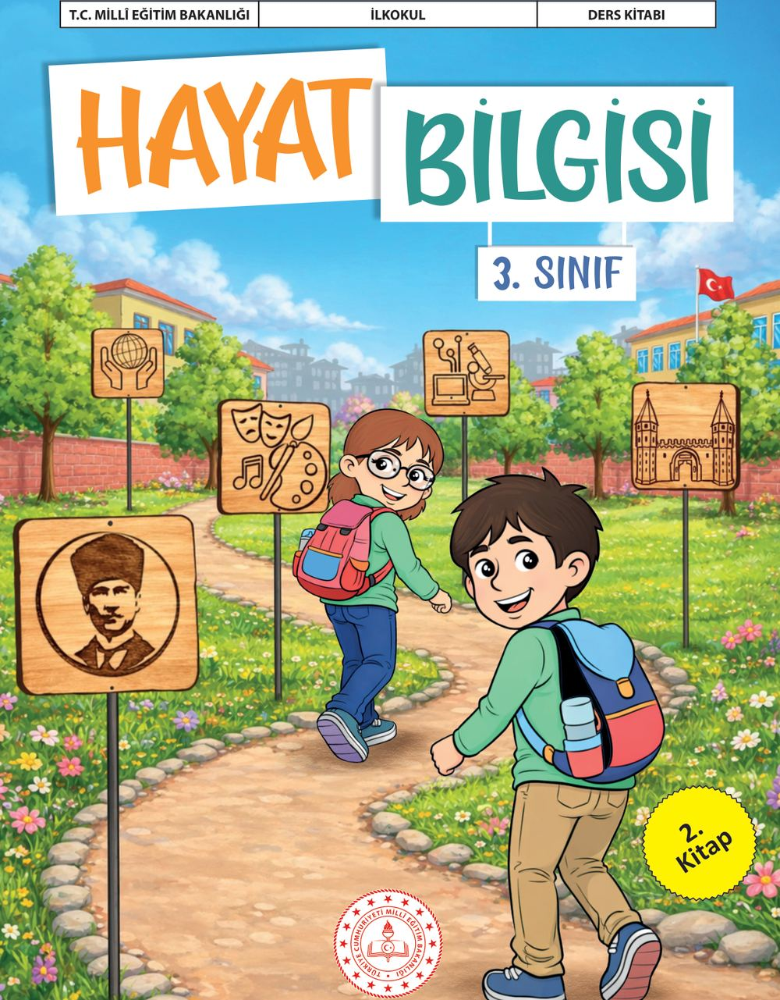

2. Kitap

<!-- sayfa 1 -->

# İLKOKUL

# HAYAT BİLGİSİ

## 3. Sınıf

### Ders Kitabı
### 2. Kitap

**Yazarlar**
Dr. Nagihan ŞAHİN
Betül ALTUNTAŞ
Gürhan DİKMEN
Hüseyin GÜLEÇ
Nurgül GENÇ

<!-- sayfa 2 -->

MİLLÎ EĞİTİM BAKANLIĞI YAYINLARI....................................................................................... 10770
DERS KİTAPLARI DİZİSİ........................................................................................................... 2520

**Editör**
Dr. Öznur TUNALI
Prof. Dr. Recep KAHRAMANOĞLU

**Dil Uzmanı**
Aylin ALTINBAŞ
Hatice MÜLKOĞLU

**Görsel Tasarımcı**
Evren SAVAŞ
Gülçen YILMAZ DÜZGÜN
Neşe ASLAN
Orhan ATEŞ
Selma TAŞCI

**Çoklu Ortam Tasarımcısı**
Abidin AYDIN
Bahar ŞAHİN ŞEHİR
Belkıs DOĞAN AYVAR
Coşkun İNCE
Çağdaş SEVİNÇ
Derya Kader KAHRAMANSOY
Dilek FİDANCI
Elif ULUTAŞ
Ezgi KEVRAN SARINÇ
Fatih UÇAR
Hayriye KAFTAN AYAN
Mustafa YILMAZ
Neslihan YILDIRIM ÇAYIRCI
Onur TÜLÜ
Seda UÇAR
Selma ÇELİK
Tuğçe Burçin ARTUKOĞLU

**Program Geliştirme Uzmanı**
Hilal ALTINTAŞ

**Ölçme ve Değerlendirme Uzmanı**
Elif Ebru DOĞANGÜZEL

**Rehberlik Uzmanı**
Dr. Nilgün KORKMAZ

**Baskı**
Baskı Matbaanın Adı ve Ticaret Unvanı

ISBN 978-975-11-9896-9

Millî Eğitim Bakanlığı Talim ve Terbiye Kurulu Başkanlığının 13.07.2026 tarih ve 164125594 sayılı yazısı ile eğitim aracı olarak kabul edilmiştir Kurulca bu kitabın kabul edilmiş olması ders kitabından

<!-- sayfa 3 -->

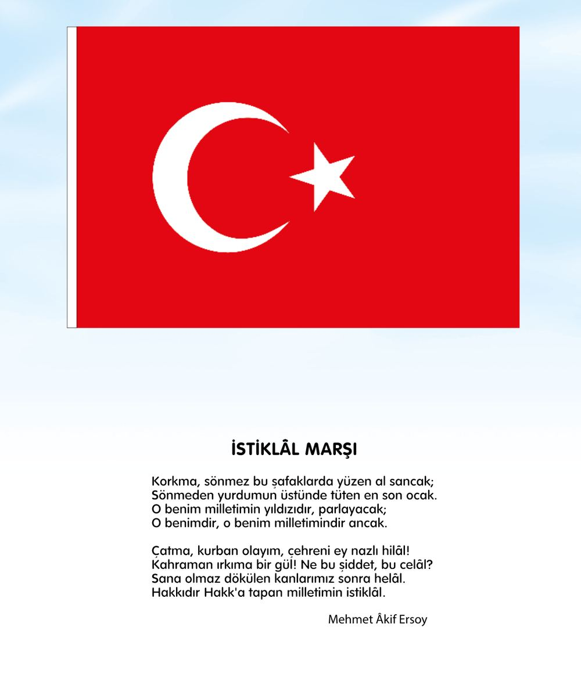

# İSTİKLÂL MARŞI

Korkma, sönmez bu şafaklarda yüzen al sancak;
Sönmeden yurdumun üstünde tüten en son ocak.
O benim milletimin yıldızıdır, parlayacak;
O benimdir, o benim milletimindir ancak.

Catma, kurban olayım, cehrini ey nazlı hilâl!
Kahraman ırkıma bir gül! Ne bu şiddet, bu celâl?
Sana olmaz dökülen kanlarımız sonra helâl.
Hakkıdır Hakk'a tapan milletimin istiklâl.

Mehmet Âkif Ersoy

<!-- sayfa 4 -->

ANDIMIZ

Türküm, doğruyum, çalışkanım.

İlkem küçüklerimi korumak, büyüklerimi saymak; yurdumu, milletimi özümden çok sevmektir.
Ülküm yükselmek, ileri gitmektir.

Ey Büyük Atatürk!

Açtığın yolda, gösterdiğin hedefe durmadan yürüyeceğime ant içerim.

Varlığım Türk varlığına armağan olsun.

Ne mutlu Türküm diyene!

<!-- sayfa 5 -->

MUSTAFA KEMAL ATATÜRK

<!-- yer tutucu bulunamadı: sayfa sonuna eklendi -->

<!-- sayfa 6 -->

Verdiğiniz metin katmanı boş olduğu için (`<<< >>>` arası boş) dönüştürülecek bir içerik bulunmamaktadır. Lütfen metin katmanını içeren içeriği paylaşın, böylece talimatlarınıza uygun şekilde Markdown formatına çevirebilirim.

<!-- sayfa 7 -->

# İÇİNDEKİLER

**KİTABIMIZI TANIYALIM** ........................................................................................................ 8
**HAZIRLIK LİSTESİ** ............................................................................................................... 10

**YAŞADIĞIM YER VE ÜLKEM** ............................................................................................ 12

* BELİRLİ GÜN VE HAFTALAR ........................................................................................... 14
* TARİHÎ MEKÂN VE DOĞAL GÜZELLİKLER ................................................................... 16
* ÜLKEMİZİN YÖNETİM ŞEKLİ .......................................................................................... 24
* MUSTAFA KEMAL ATATÜRK’ÜN BAŞARILARI VE KİŞİLİK ÖZELLİKLERİ ................ 31
* MİLLÎ BİRLİK VE BERABERLİK ..................................................................................... 38
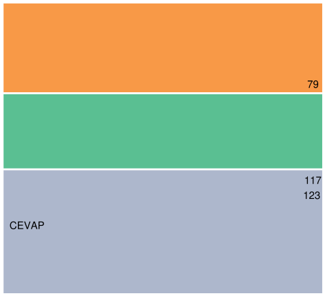

**DOĞA VE ÇEVRE** ................................................................................................................. 50
* BELİRLİ GÜN VE HAFTALAR ........................................................................................... 52
* DOĞADAKİ VARLIKLARIN İNSAN YAŞAMINDAKİ ÖNEMİ ....................................... 54
* KROKİ VE KONUM ........................................................................................................... 63
* AFET ÖNCESİ, AFET ANI VE AFET SONRASINDA YAPILMASI GEREKENLER ..... 70
* ÇEVRESEL SÜRDÜRÜLEBİLİRLİK .................................................................................. 79

**BİLİM, TEKNOLOJİ VE SANAT** ........................................................................................ 90
* BELİRLİ GÜN VE HAFTALAR ........................................................................................... 92
* BİLİMSEL GELİŞMELERİN HAYATIMIZDAKİ ÖNEMİ ................................................ 94
* TEKNOLOJİK GELİŞMELERİN GÜNLÜK YAŞAMA ETKİSİ ........................................ 102
* SANATÇILARIN SANATA KATKILARI ............................................................................ 109

**EKLER** ................................................................................................................................... 117
**SÖZLÜK** ............................................................................................................................... 123
**KAYNAKÇA** .......................................................................................................................... 125
**CEVAP ANAHTARI** ............................................................................................................. 125
**GÖRSEL VE GENEL AĞ KAYNAKÇASI** .......................................................................... 125
**TÜRKİYE'NİN MÜLKİ İDARE BÖLÜMLERİ İLE KARA VE DENİZ KOMŞULARI HARİTASI** .................................................................................................................................... 126
**TÜRK DÜNYASI HARİTASI** ............................................................................................ 127

<!-- sayfa 8 -->

# KİTABIMIZI TANIYALIM

Kitabımız 6 öğrenme alanından oluşmaktadır. Bu öğrenme alanlarının 3 tanesi 2. kitapta bulunmaktadır.

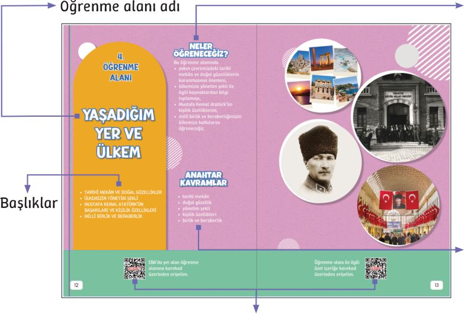

* Öğrenme alanı adı
* Başlıklar
* Öğreneceğimiz bilgiler
* Öğreneceğimiz kavramlar
* Öğrenme alanı ile ilgili EBA’da yer alan içeriklere ve özet bilgilere yönlendiren karekodlar

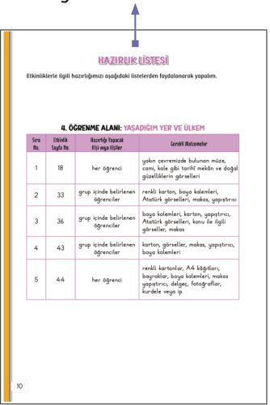

## Etkinlikler için yapılması gereken hazırlıklar

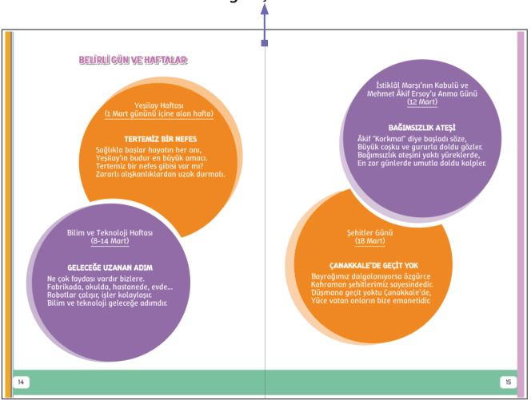

### HAZIRLIK LİSTESİ
Etkinliklerle ilgili hazırlığımız aşağıdaki listelerden faydalanarak yapalım.

| Sıra No | Etkinlik Sayfa No | İhtiyaç Duyulan Malzeme | Gerekli Bilgiler |
| :--- | :--- | :--- | :--- |
| 1 | 18 | her öğrenci | yakın çevremizde bulunan müze, cami, kale gibi tarihi mekân ve doğal güzelliklerin gösterilmesi. |
| 2 | 33 | grup içinde belirlenen öğrenciler | renkli karton, boya kalemleri, makas, yapıştırıcı, atıklar. |
| 3 | 36 | grup içinde belirlenen öğrenciler | boya kalemleri, karton, yapıştırıcı, atıklar. Atıklar görselleri, konu ile ilgili görseller. |
| 4 | 43 | grup içinde belirlenen öğrenciler | karton, görseller, makas, yapıştırıcı, boya kalemleri. |
| 5 | 44 | her öğrenci | renkli karton, A4 kağıtları, resim defteri, boya kalemleri, makas, yapıştırıcı, defter, fotoğraflar, kurdele veya ip |

## Belirli gün ve haftalarla ilgili şiirler

**BELİRLİ GÜN VE HAFTALAR**

**Yeşilay Haftası**
(1 Mart günü inceleme için alta bakınız)

**TERTEMİZ BİR NEFES**
Sağlıklı bir yaşam hayatın en önemli, Yeşilay'ın budur en büyük amacı. Tertemiz bir nefes için, zararlı alışkanlıklardan uzak durmalı.

**Bilim ve Teknoloji Haftası**
(8-14 Mart)

**GELECEĞE AKAN ZİHİN**
Ne çok faydası vardır bitmez Fabrikada, okulda, hastanede, evde... Robotlar çalış, işler kolaylaşsın Bilim ve teknoloji geleceğe adanmış.

**BAĞIMSIZLIĞIMIZ ATEŞ**
İstiklâl Marşı'nın Kabulü ve Mehmet Akif Ersoy'a Anma Günü (12 Mart)

**Bağımsızlık Ateşimiz**
Büyük coşku ve gururla dolu gözler. Bağımsızlık ateşini yakı yüreklerde. En zor günlerde umuda dalıyor kalpler.

**Şehitler Günü**
(18 Mart)

**ÇANAKKALE'DE YAT**
Bayrağımız dalgalanıyor özgürce Kahraman şehitlerimiz sayesinde. Düşmana geçtiler Çanakkale'de. Yüce vatan onlara bak emanet.

<!-- sayfa 9 -->

Öğrenme alanında her bir konu "Düşünelim, Keşfedelim, Öğrenelim, Uygulayalım, Değerlendirelim" bölümlerinden oluşmaktadır. Bölüm aralarında etkinliklere yer verilmiştir. Her öğrenme alanının sonunda "Neler Öğrendik?" bölümü bulunmaktadır.

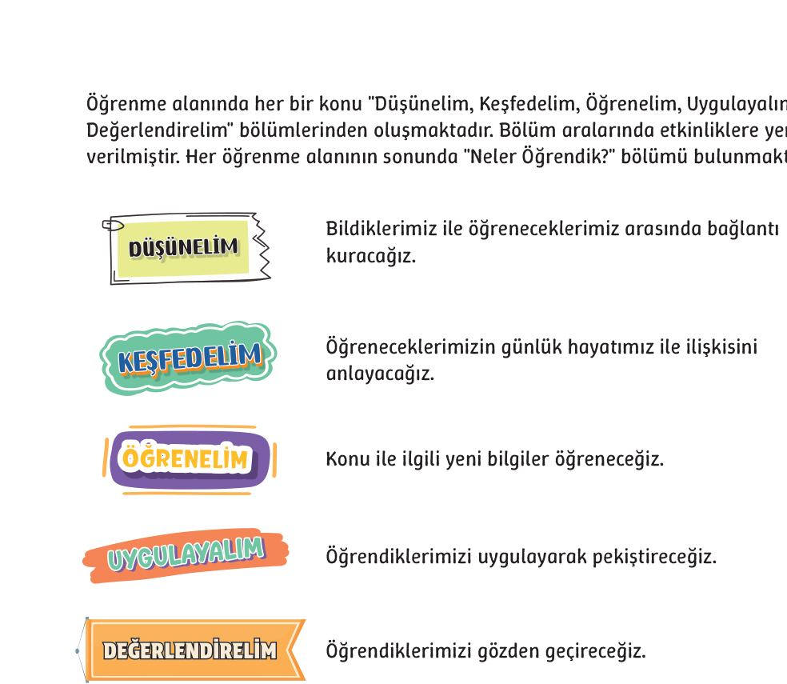 Bildiklerimiz ile öğreneceklerimiz arasında bağlantı kuracağız.

 Öğreneceklerimizin günlük hayatımız ile ilişkisini anlayacağız.

 Konu ile ilgili yeni bilgiler öğreneceğiz.

 Öğrendiklerimizi uygulayarak pekiştireceğiz.

 Öğrendiklerimizi gözden geçireceğiz.

 Yeni konuyu öğrenmek veya öğrendiklerimizi pekiştirmek için etkinlikler yapacağız.

 Öğrendiklerimizi tekrar edeceğiz.

 Sınıf içi performans görevi yapacağız.

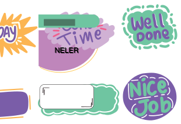 Konu ile ilgili içeriklere karekod üzerinden erişeceğiz.

 Ek ölçme ve değerlendirmelere karekod üzerinden erişeceğiz.

<!-- sayfa 10 -->

# HAZIRLIK LİSTESİ

Etkinliklerle ilgili hazırlığımızı aşağıdaki listelerden faydalanarak yapalım.

## 4. ÖĞRENME ALANI: YAŞADIĞIM YER VE ÜLKEM

| Sıra No. | Etkinlik Sayfa No. | Hazırlığı Yapacak Kişi veya Kişiler | Gerekli Malzemeler |
| :--- | :--- | :--- | :--- |
| 1 | 18 | her öğrenci | yakın çevremizde bulunan müze, cami, kale gibi tarihî mekân ve doğal güzelliklerin görselleri |
| 2 | 33 | grup içinde belirlenen öğrenciler | renkli karton, boya kalemleri, Atatürk görselleri, makas, yapıştırıcı |
| 3 | 36 | grup içinde belirlenen öğrenciler | boya kalemleri, karton, yapıştırıcı, Atatürk görselleri, konu ile ilgili görseller, makas |
| 4 | 43 | grup içinde belirlenen öğrenciler | karton, görseller, makas, yapıştırıcı, boya kalemleri |
| 5 | 44 | her öğrenci | renkli kartonlar, A4 kâğıtları, bayraklar, boya kalemleri, makas yapıştırıcı, delgeç, fotoğraflar, kurdele veya ip |

<!-- sayfa 11 -->

# 5. ÖĞRENME ALANI: DOĞA VE ÇEVRE

| Sıra No. | Etkinlik Sayfa No. | Hazırlığı Yapacak Kişi veya Kişiler | Gerekli Malzemeler |
| :--- | :--- | :--- | :--- |
| 1 | 56 | her öğrenci | doğadan toplanan örnekler, bant veya yapıştırıcı, karton |
| 2 | 61 | grup içinden belirlenen öğrenci | küçük bir yumak ip |
| 3 | 62 | grup içinde belirlenen öğrenciler | resim kâğıdı, boya kalemleri |
| 4 | 68 | grup içinde belirlenen öğrenciler | renkli kâğıt, pul, boncuk, düğme, boya kalemleri vb. |
| 5 | 77 | grup içinde belirlenen öğrenciler | kâğıt, kalem, makas, boya kalemleri, yapıştırıcı, karton, konu ile ilgili görseller |

# 6. ÖĞRENME ALANI: BİLİM, TEKNOLOJİ VE SANAT

| Sıra No. | Etkinlik Sayfa No. | Hazırlığı Yapacak Kişi veya Kişiler | Gerekli Malzemeler |
| :--- | :--- | :--- | :--- |
| 1 | 100 | her öğrenci | karton, boya kalemleri ve kâğıtlar, yapıştırıcı, makas, küçük kutular |
| 2 | 107 | her öğrenci | boya kalemleri |
| 3 | 108 | her öğrenci | kâğıt, kalem, makas, boya kalemleri, yapıştırıcı, karton, konu ile ilgili görseller |
| 4 | 113 | her öğrenci | A4 kâğıdı, konu ile ilgili görseller, boya kalemleri |

<!-- sayfa 12 -->

# 4. ÖĞRENME ALANI

# YAŞADIĞIM YER VE ÜLKEM

* TARİHÎ MEKÂN VE DOĞAL GÜZELLİKLER
* ÜLKEMİZİN YÖNETİM ŞEKLİ
* MUSTAFA KEMAL ATATÜRK’ÜN BAŞARILARI VE KİŞİLİK ÖZELLİKLERİ
* MİLLÎ BİRLİK VE BERABERLİK

## NELER ÖĞRENECEĞİZ?

Bu öğrenme alanında
* yakın çevremizdeki tarihî mekân ve doğal güzelliklerin korunmasının önemini,
* ülkemizin yönetim şekli ile ilgili kaynaklardan bilgi toplamayı,
* Mustafa Kemal Atatürk’ün kişilik özelliklerini,
* millî birlik ve beraberliğimizin ülkemize katkılarını öğreneceğiz.

## ANAHTAR KAVRAMLAR

* tarihî mekân
* doğal güzellik
* yönetim şekli
* kişilik özellikleri
* birlik ve beraberlik

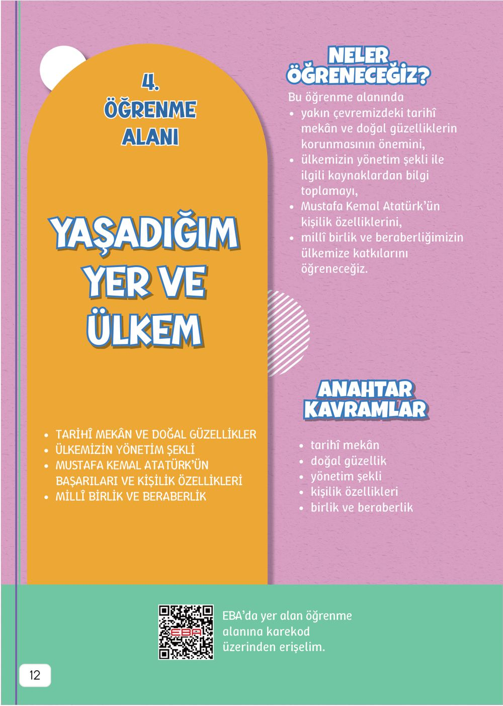 EBA’da yer alan öğrenme alanına karekod üzerinden erişelim

<!-- sayfa 13 -->

Öğrenme alanı ile ilgili 
özet içeriğe karekod 
üzerinden erişelim

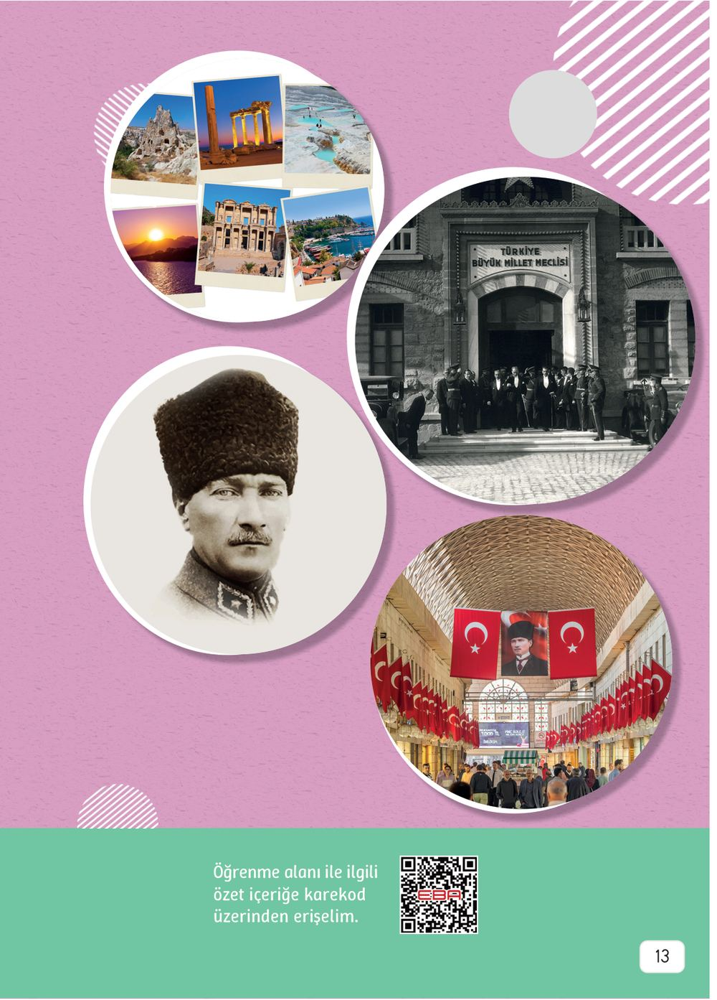

<!-- sayfa 14 -->

# BELİRLİ GÜN VE HAFTALAR

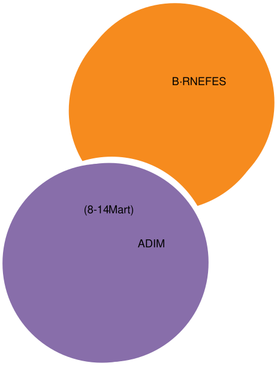

Yeşilay Haftası
(1 Mart gününü içine alan hafta)

**TERTEMİZ BİR NEFES**
Sağlıkla başlar hayatın her anı,
Yeşilay’ın budur en büyük amacı.
Tertemiz bir nefes gibisi var mı?
Zararlı alışkanlıklardan uzak durmalı.

Bilim ve Teknoloji Haftası
(8-14 Mart)

**GELECEĞE UZANAN ADIM**
Ne çok faydası vardır bizlere.
Fabrikada, okulda, hastanede, evde...
Robotlar çalışır, işler kolaylaşır.
Bilim ve teknoloji geleceğe adımdır.

<!-- sayfa 15 -->

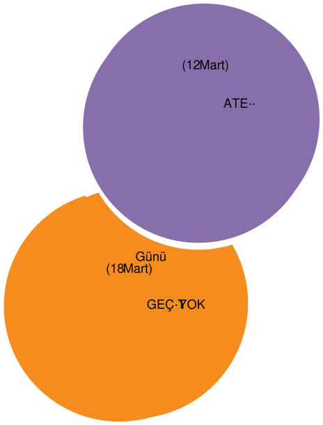

# İstiklâl Marşı’nın Kabulü ve Mehmet Âkif Ersoy’u Anma Günü (12 Mart)

## BAĞIMSIZLIK ATEŞİ
Âkif "Korkma!" diye başladı söze,
Büyük coşku ve gururla doldu gözler.
Bağımsızlık ateşini yaktı yüreklerde,
En zor günlerde umutla doldu kalpler.

# Şehitler Günü (18 Mart)

## ÇANAKKALE’DE GEÇİT YOK
Bayrağımız dalgalanıyorsa özgürce
Kahraman şehitlerimiz sayesindedir.
Düşmana geçit yoktu Çanakkale’de,
Yüce vatan onların bize emanetidir.

<!-- sayfa 16 -->

# TARİHÎ MEKÂN VE DOĞAL GÜZELLİKLER

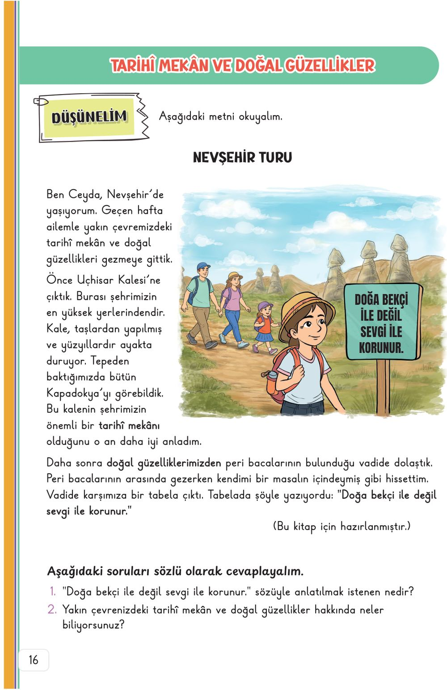 DÜŞÜNELİM Aşağıdaki metni okuyalım.

## NEVŞEHİR TURU

Ben Ceyda, Nevşehir’de yaşıyorum. Geçen hafta ailemle yakın çevremizdeki tarihî mekân ve doğal güzellikleri gezmeye gittik. Önce Uçhisar Kalesi’ne çıktık. Burası şehrimizin en yüksek yerlerindendir. Kale, taşlardan yapılmış ve yüzyıllardır ayakta duruyor. Tepeden baktığımızda bütün Kapadokya’yı görebildik. Bu kalenin şehrimizin önemli bir tarihî mekânı olduğunu o an daha iyi anladım.

Daha sonra doğal güzelliklerimizden peri bacalarının bulunduğu vadide dolaştık. Peri bacalarının arasında gezerken kendimi bir masalın içindeymiş gibi hissettim. Vadide karşımıza bir tabela çıktı. Tabelada şöyle yazıyordu: "Doğa bekçi ile değil sevgi ile korunur."

(Bu kitap için hazırlanmıştır.)

**Aşağıdaki soruları sözlü olarak cevaplayalım.**

1. "Doğa bekçi ile değil sevgi ile korunur." sözüyle anlatılmak istenen nedir?
2. Yakın çevrenizdeki tarihî mekân ve doğal güzellikler hakkında neler biliyorsunuz?

<!-- sayfa 17 -->

Uygulama adımlarını takip ederek etkinliği yapalım.

**Uygulama Adımları**

*  Karekodu okutarak seçtiğimiz bir tarihî mekânı, doğal güzelliği veya müzeyi çevrim içi olarak inceleyelim.

* İncelediğimiz yerin adı, özellikleri ve dikkat çeken yönleri hakkında bilgi edinelim.
* İncelediğimiz yer hakkında öğrendiklerimizi arkadaşlarımızla paylaşalım.
* Bu yerleri ziyaret ettiğimizde tarihî mekânları ve doğal güzellikleri korumak için nelere dikkat etmemiz gerektiğini düşünelim. Görüşlerimizi aşağıdaki boş bırakılan alana yazalım. 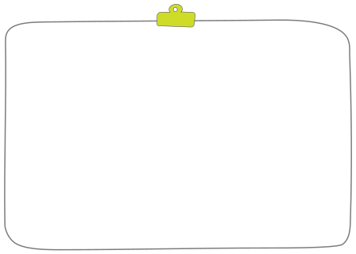
* Tarihî mekânları ve doğal güzellikleri korumanın neden önemli olduğunu açıklayalım.

<!-- sayfa 18 -->

**Etkinlik:** **YAKIN ÇEVREMİZDEKİ GÜZELLİKLERİ KORUMAK**

Aşağıdaki bilgileri okuyup görselleri inceleyelim. Soruları cevaplayalım.

Mimar Sinan, yaşadığı dönemde camiler, köprüler ve birçok önemli yapı inşa etmiş ünlü bir mimardır. Yaptığı eserler sağlamlığı ve estetik yönü ile günümüze kadar ulaşmıştır. Yıllar önce bir gün Selimiye Camisi’nin zemininin zayıf olduğu ve minarelerin yıkılma riski olduğu fark edilmiş. Uluslararası bir ekip toplanıp inceleme yapmış. Uzmanlar minare temellerini metal kelepçelerle sabitlemeyi önermiş. Minarelerin temelleri incelendiğinde Mimar Sinan’ın böyle bir sorunu öngördüğü ve caminin yapımı sırasında uzmanların önerdiği yönteme benzer bir önlem aldığı görülmüştür.

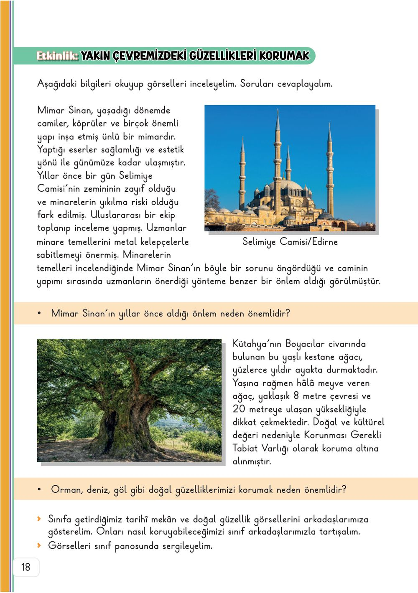
Selimiye Camisi/Edirne

* Mimar Sinan’ın yıllar önce aldığı önlem neden önemlidir?

Kütahya’nın Boyacılar civarında bulunan bu yaşlı kestane ağacı, yüzlerce yıldır ayakta durmaktadır. Yaşına rağmen hâlâ meyve veren ağaç, yaklaşık 8 metre çevresi ve 20 metreye ulaşan yüksekliğiyle dikkat çekmektedir. Doğal ve kültürel değeri nedeniyle Korunması Gerekli Tabiat Varlığı olarak koruma altına alınmıştır.

* Orman, deniz, göl gibi doğal güzelliklerimizi korumak neden önemlidir?

> Sınıfa getirdiğimiz tarihî mekân ve doğal güzellik görsellerini arkadaşlarımıza gösterelim. Onları nasıl koruyabileceğimizi sınıf arkadaşlarımızla tartışalım.

<!-- sayfa 19 -->

Etkinlik: **GEÇMİŞİ KORU, DOĞAYI YAŞAT!**

Konu ile ilgili e-içeriğe karekod üzerinden erişelim.

Uygulama adımlarını takip ederek etkinliği yapalım.

### Uygulama Adımları

* Sınıf arkadaşlarımızla dört grup oluşturalım.
* Tarihî mekân ve doğal güzelliklerin korunması ile ilgili merak ettiğimiz soruları not edelim.
* Not ettiğimiz soruları sınıf arkadaşlarımızla paylaşalım.
* Paylaştığımız sorulardan dört tanesini seçelim.
* Her bir soruyu birer kartona yazalım.
* Sınıfın farklı köşelerinde dört istasyon oluşturalım.
* Her istasyona bir soru kartonu bırakalım.
* İstasyonlara gruplar hâlinde giderek her istasyonda 5 dakika boyunca soru kartonlarına cevaplarımızı yazalım. Süre bitince diğer istasyona geçelim.
* Başladığımız istasyona döndüğümüzde kartonlarda yazılanları grup arkadaşlarımızla sunalım.
* Kartonlarımızı sınıfta sergileyelim.

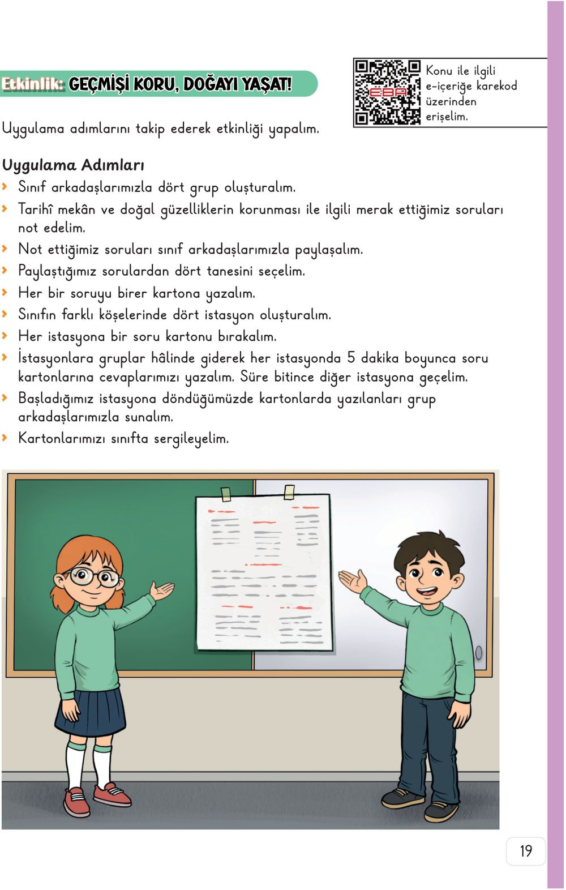

<!-- sayfa 20 -->

# ÖĞRENELİM

Tarihî mekânlarımızı ve doğal güzelliklerimizi korumamız ülkemizin geleceği için çok önemlidir. Tarihî mekânlarımızı korumamız, geçmişimize ve kültürel mirasımıza saygı duyduğumuzu gösterir. Gelecek kuşaklara yaşanabilir bir çevre bırakmak için ise doğal güzelliklerimizi korumamız gereklidir.

Ülkemizde tarihî mekânların korunması için birçok kurum ve kişi görev alır.

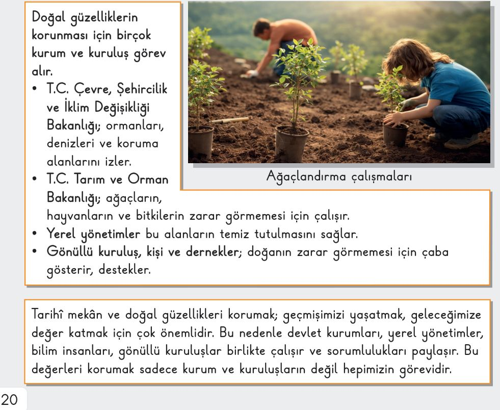

* T.C. Kültür ve Turizm Bakanlığı; müzeleri, camileri, kaleleri ve tarihî eserleri önlemler alarak korur.
* Belediyeler bu alanların temiz ve güvenli olmasını sağlar.
* Bilim insanları ve uzmanlar bu yerlerin nasıl korunacağını planlar.

Ayasofya Camisi/İstanbul (Bakım ve onarım çalışmaları)

Doğal güzelliklerin korunması için birçok kurum ve kuruluş görev alır.

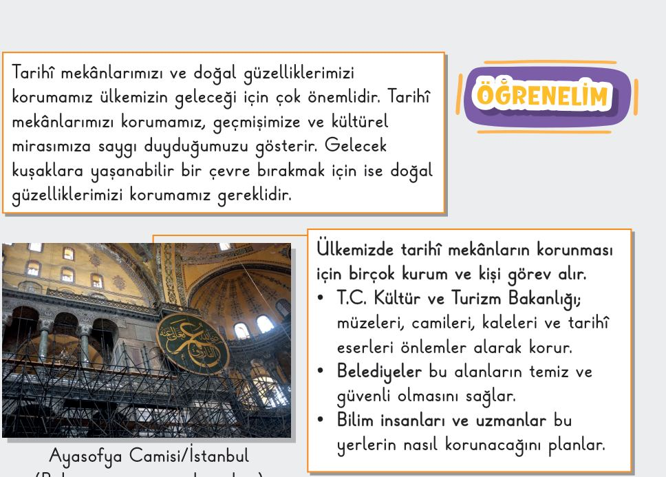

* T.C. Çevre, Şehircilik ve İklim Değişikliği Bakanlığı; ormanları, denizleri ve koruma alanlarını izler.
* T.C. Tarım ve Orman Bakanlığı; ağaçların, hayvanların ve bitkilerin zarar görmemesi için çalışır.
* Yerel yönetimler bu alanların temiz tutulmasını sağlar.
* Gönüllü kuruluş, kişi ve dernekler; doğanın zarar görmemesi için çaba gösterir, destekler.

Ağaçlandırma çalışmaları

Tarihî mekân ve doğal güzellikleri korumak; geçmişimizi yaşatmak, geleceğimize değer katmak için çok önemlidir. Bu nedenle devlet kurumları, yerel yönetimler, bilim insanları, gönüllü kuruluşlar birlikte çalışır ve sorumlulukları paylaşır.

<!-- sayfa 21 -->

Biz çocuklar, tarihî mekânlarımızı ve doğal zenginliklerimizi korumaya katkıda bulunabiliriz.

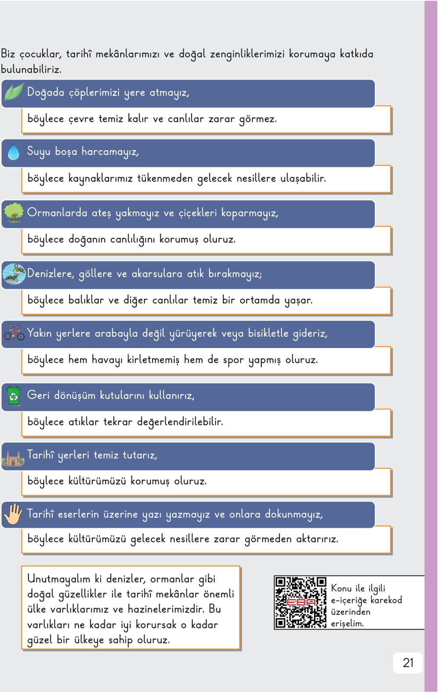 Doğada çöplerimizi yere atmayız,
böylece çevre temiz kalır ve canlılar zarar görmez.

 Suyu boşa harcamayız,
böylece kaynaklarımız tükenmeden gelecek nesillere ulaşabilir.

 Ormanlarda ateş yakmayız ve çiçekleri koparmayız,
böylece doğanın canlılığını korumuş oluruz.

 Denizlere, göllere ve akarsulara atık bırakmayız;
böylece balıklar ve diğer canlılar temiz bir ortamda yaşar.

 Yakın yerlere arabayla değil yürüyerek veya bisikletle gideriz,
böylece hem havayı kirletmemiş hem de spor yapmış oluruz.

 Geri dönüşüm kutularını kullanırız,
böylece atıklar tekrar değerlendirilebilir.

 Tarihî yerleri temiz tutarız,
böylece kültürümüzü korumuş oluruz.

 Tarihî eserlerin üzerine yazı yazmayız ve onlara dokunmayız,
böylece kültürümüzü gelecek nesillere zarar görmeden aktarırız.

Unutmayalım ki denizler, ormanlar gibi doğal güzellikler ile tarihî mekânlar önemli ülke varlıklarımız ve hazinelerimizdir. Bu varlıkları ne kadar iyi korursak o kadar

 Konu ile ilgili e-içeriğe karekod üzerinden erişelim.

<!-- sayfa 22 -->

# UYGULAYALIM

Uygulama adımlarını takip ederek etkinliği yapalım.

## Uygulama Adımları

* Yakın çevremizdeki tarihî mekân ve doğal güzellikleri düşünelim.
* Bu yerlerin neden korunması gerektiği ile ilgili kısa notlar alalım.
* Tarihî mekân ve doğal güzelliklerin korunmasının önemini anlatan metin, hikâye, poster gibi ürünlerden birini hazırlayalım.
* Seçtiğimiz ürünü hazırlarken dikkat edeceğimiz;

| Metin | Hikâye | Poster |
| :--- | :--- | :--- |
| Düşüncelerimizi açık ve kısa cümlelerle yazalım. | Olay akışını, kahramanları, yeri ve zamanı belirleyelim. | Konu ile ilgili kısa bilgilere, dikkat çekici görsellere yer verelim. |

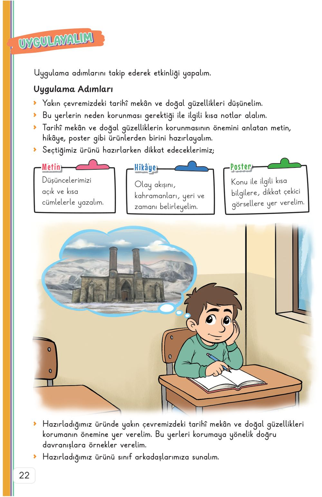

* Hazırladığımız üründe yakın çevremizdeki tarihî mekân ve doğal güzellikleri korumanın önemine yer verelim. Bu yerleri korumaya yönelik doğru davranışlara örnekler verelim.

<!-- sayfa 23 -->

# DEĞERLENDİRELİM

Aşağıdaki form, yakın çevremizdeki tarihî mekân ve doğal güzelliklerin korunmasının önemine ilişkin süreci değerlendirmek amacıyla hazırlanmıştır. Değerlendirme yaparken "Evet", "Kısmen" veya "Hayır" seçeneklerinden uygun olanı işaretleyelim.

## ÖZ DEĞERLENDİRME FORMU

| Davranışlar | Evet | Kısmen | Hayır |
| :--- | :---: | :---: | :---: |
| 1. Tarihî yerlerin bizim için neden önemli olduğunu anlatabilirim. | | | |
| 2. Tarihî yerleri neden korumamız gerektiğini söyleyebilirim. | | | |
| 3. Yakın çevremdeki tarihî yerlere örnek verebilirim. | | | |
| 4. Tarihî bir yeri gezerken kurallara uyarım. | | | |
| 5. Doğal güzelliklerin neden önemli olduğunu anlatabilirim. | | | |
| 6. Yakın çevremdeki doğal güzelliklere örnek verebilirim. | | | |
| 7. Doğal güzellikleri korumak için kurallara uyarım. | | | |
| 8. Çevreye zarar veren davranışları fark edebilirim. | | | |
| 9. Tarihî ve doğal güzellikleri olan yerlerde uyulması gereken kurallara dikkat ederim. | | | |

Tüm davranışlar için "Evet" seçeneğini işaretlememiz, yakın çevremizdeki tarihî mekân ve doğal güzelliklerin korunması için yapılması gerekenleri bildiğimizi gösterir. "Kısmen" veya "Hayır" seçeneklerini işaretlediğimiz davranışlarda ise

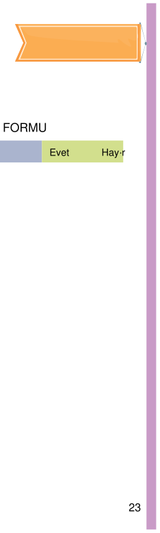
<!-- yer tutucu bulunamadı: sayfa sonuna eklendi -->

<!-- sayfa 24 -->

# ÜLKEMİZİN YÖNETİM ŞEKLİ

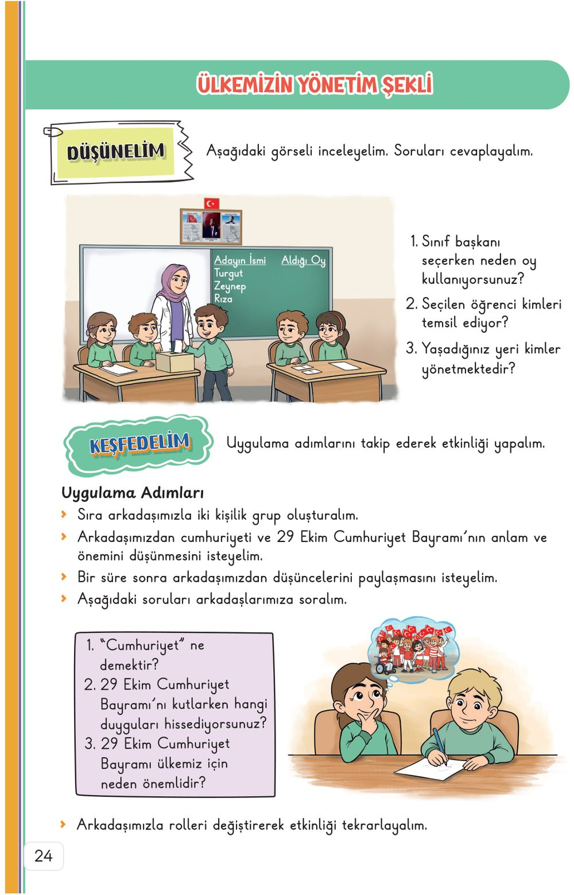

**DÜŞÜNELİM**  
Aşağıdaki görseli inceleyelim. Soruları cevaplayalım.

1. Sınıf başkanı seçerken neden oy kullanıyorsunuz?
2. Seçilen öğrenci kimleri temsil ediyor?
3. Yaşadığınız yeri kimler yönetmektedir?

**KEŞFEDELİM**  
Uygulama adımlarını takip ederek etkinliği yapalım.

**Uygulama Adımları**
* Sıra arkadaşımızla iki kişilik grup oluşturalım.
* Arkadaşımızdan cumhuriyeti ve 29 Ekim Cumhuriyet Bayramı'nın anlam ve önemini düşünmesini isteyelim.
* Bir süre sonra arkadaşımızdan düşüncelerini paylaşmasını isteyelim.
* Aşağıdaki soruları arkadaşlarımıza soralım.

1. “Cumhuriyet” ne demektir?
2. 29 Ekim Cumhuriyet Bayramı'nı kutlarken hangi duyguları hissediyorsunuz?
3. 29 Ekim Cumhuriyet Bayramı ülkemiz için neden önemlidir?

<!-- sayfa 25 -->

Etkinlik: **ARAŞTIRMA ZAMANI**

Uygulama adımlarını takip ederek etkinliği yapalım.

**Uygulama Adımları**

* Sınıf arkadaşlarımızla dört veya beş kişilik gruplar oluşturarak ülkemizin yönetim şekli hakkında araştırma yapalım.
* Ülkemizin yönetim şekli hakkında bilgi toplamak için hangi kaynaklardan yararlanabileceğimizi arkadaşlarımızla tartışalım.
* Bilgi toplamak için aile bireyleriyle görüşme, okul çalışanlarıyla röportaj yapma ve genel ağ araştırması gibi yöntemlerden uygun olanları belirleyelim.
* Belirlediğimiz kaynaklardan ülkemizin yönetim şekliyle ilgili bilgiler toplayalım.
* Kullandığımız kaynakların konuya uygun olup olmadığını arkadaşlarımızla değerlendirelim.
* Ulaştığımız bilgileri araştırma raporuna kaydedelim ve bu bilgilerden hareketle cumhuriyetin önemi hakkında çıkarımlarda bulunalım.
* Ulaştığımız bilgileri ve cumhuriyetin önemi hakkında yaptığımız çıkarımları sınıfımızla paylaşalım.
* Araştırma yaparken ulaştığımız görselleri arka sayfadaki ilgili bölüme yapıştıralım. Kullandığımız kaynakları yazalım.
* Araştırmamızı yaparken şu sorulara grubumuzla cevap arayalım:

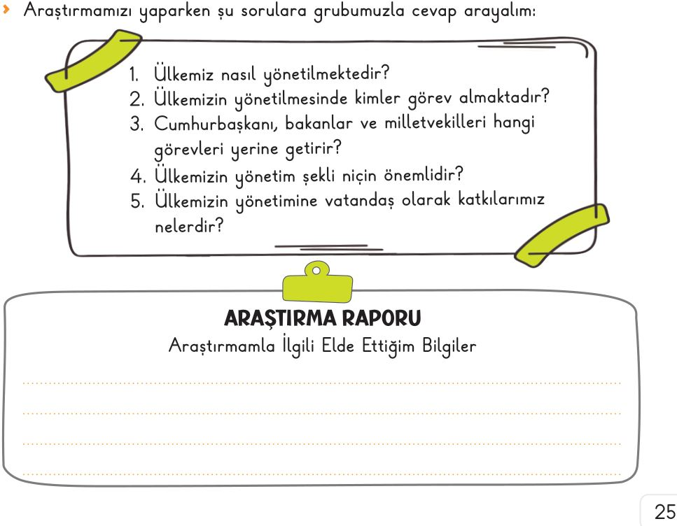
1. Ülkemiz nasıl yönetilmektedir?
2. Ülkemizin yönetilmesinde kimler görev almaktadır?
3. Cumhurbaşkanı, bakanlar ve milletvekilleri hangi görevleri yerine getirir?
4. Ülkemizin yönetim şekli niçin önemlidir?
5. Ülkemizin yönetimine vatandaş olarak katkılarımız nelerdir?

---

# ARAŞTIRMA RAPORU
Araştırmamla İlgili Elde Ettiğim Bilgiler
__________________________________________________________________
__________________________________________________________________
__________________________________________________________________
__________________________________________________________________
__________________________________________________________________

<!-- sayfa 26 -->

# Araştırma Yaparken Ulaştığım Görseller

# Araştırma Yaparken Kullandığım Kaynaklar

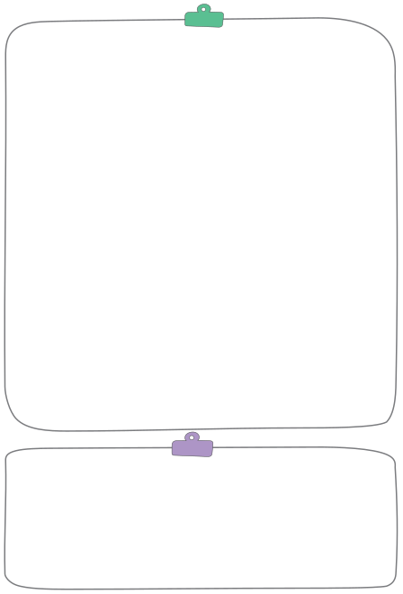 › Topladığımız bilgileri arkadaşlarımızla paylaşalım....

<!-- sayfa 27 -->

# ÖĞRENELİM

Ülkemizin yönetim şekli cumhuriyettir. 29 Ekim'de Türkiye Büyük Millet Meclisinde cumhuriyet ilan edilmiştir. Mustafa Kemal Atatürk Türkiye Cumhuriyeti Devleti'nin ilk cumhurbaşkanı olarak seçilmiştir.

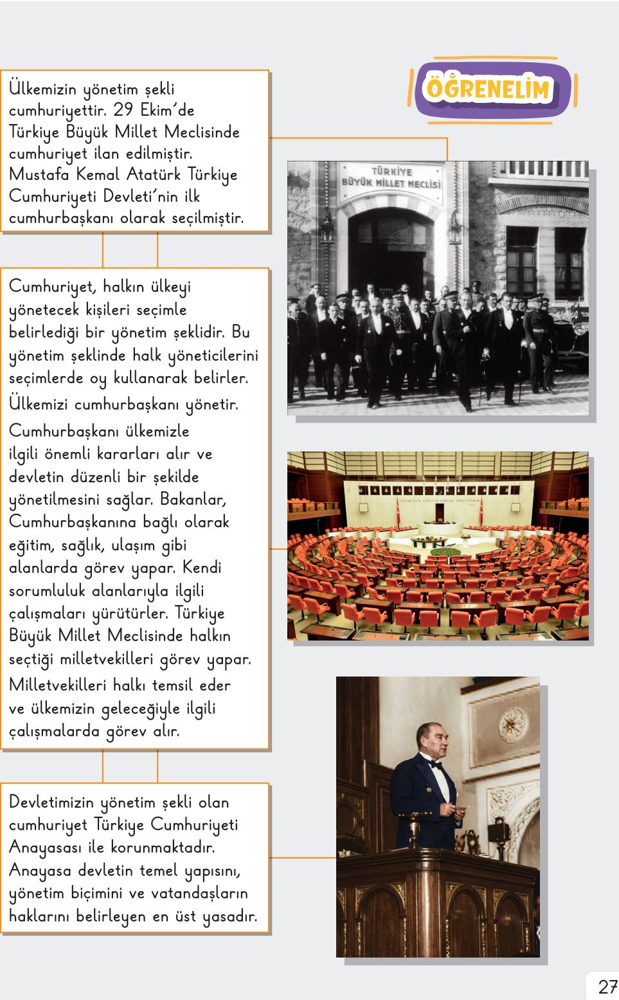

Cumhuriyet, halkın ülkeyi yönetecek kişileri seçimle belirlediği bir yönetim şeklidir. Bu yönetim şeklinde halk yöneticilerini seçimlerde oy kullanarak belirler. Ülkemizi cumhurbaşkanı yönetir. Cumhurbaşkanı ülkemizle ilgili önemli kararları alır ve devletin düzenli bir şekilde yönetilmesini sağlar. Bakanlar, Cumhurbaşkanına bağlı olarak eğitim, sağlık, ulaşım gibi alanlarda görev yapar. Kendi sorumluluk alanlarıyla ilgili çalışmaları yürütürler. Türkiye Büyük Millet Meclisinde halkın seçtiği milletvekilleri görev yapar. Milletvekilleri halkı temsil eder ve ülkemizin geleceğiyle ilgili çalışmalarda görev alır.

Devletimizin yönetim şekli olan cumhuriyet Türkiye Cumhuriyeti Anayasası ile korunmaktadır. Anayasa devletin temel yapısını, yönetim biçimini ve vatandaşların haklarını belirleyen en üst yasadır.

<!-- sayfa 28 -->

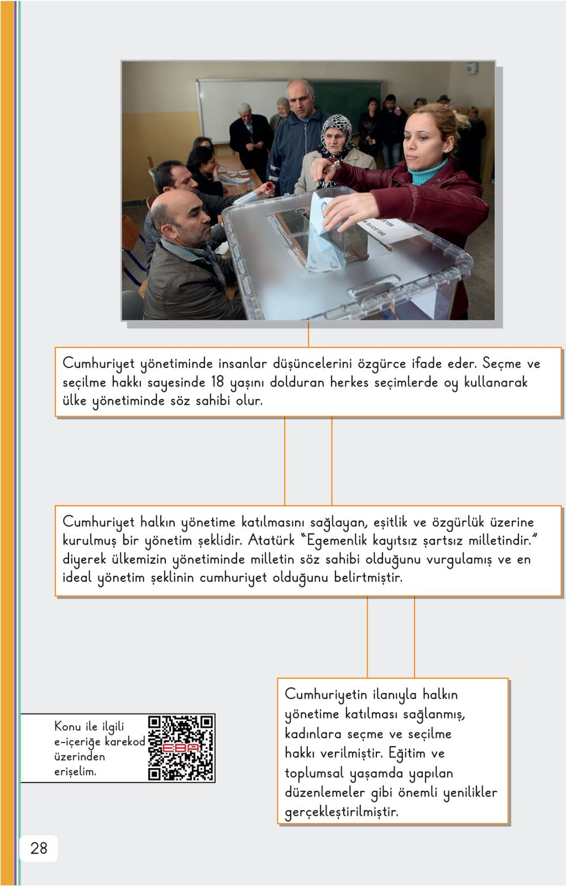

Cumhuriyet yönetiminde insanlar düşüncelerini özgürce ifade eder. Seçme ve seçilme hakkı sayesinde 18 yaşını dolduran herkes seçimlerde oy kullanarak ülke yönetiminde söz sahibi olur.

Cumhuriyet halkın yönetime katılmasını sağlayan, eşitlik ve özgürlük üzerine kurulmuş bir yönetim şeklidir. Atatürk “Egemenlik kayıtsız şartsız milletindir.” diyerek ülkemizin yönetiminde milletin söz sahibi olduğunu vurgulamış ve en ideal yönetim şeklinin cumhuriyet olduğunu belirtmiştir.

Cumhuriyetin ilanıyla halkın yönetime katılması sağlanmış, kadınlara seçme ve seçilme hakkı verilmiştir. Eğitim ve toplumsal yaşamda yapılan düzenlemeler gibi önemli yenilikler gerçekleştirilmiştir.

| Konu ile ilgili e-içeriğe karekod üzerinden erişelim. |  |
| :--- | :---: |

<!-- sayfa 29 -->

# UYGULAYALIM

Aşağıdaki kavramdan yola çıkarak okları takip edelim. Soruların cevaplarını ilgili kutulara yazalım.

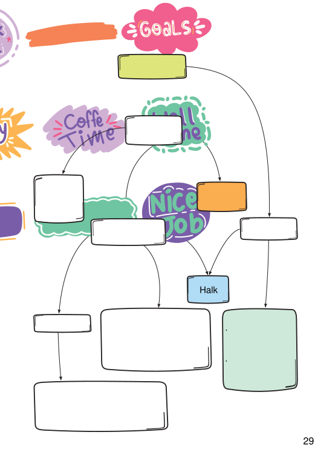

Ülkemizin $\rightarrow$ yönetim şekli nedir? $\rightarrow$ [ ]

$\rightarrow$ kimin önderliğinde kurulmuştur? $\rightarrow$ [ ]

$\rightarrow$ yönetimindeki en yetkili kişi kimdir? $\rightarrow$ [ ]

$\rightarrow$ tarafından atanan ve kendi alanlarında (sağlık, eğitim, güvenlik vb.) görev yapan kişiler kimlerdir? $\rightarrow$ [ ] $\rightarrow$ görevleri nelerdir? $\rightarrow$ [ ]

$\rightarrow$ ne ile güvence altına alınmıştır? $\rightarrow$ Anayasa

$\rightarrow$ yönetiminde halkı temsil etmek üzere mecliste görev yapan kişilere ne ad verilir? $\rightarrow$ [ ] $\rightarrow$ görevleri nelerdir? $\rightarrow$
* Halkı temsil eder.
* Halkın ihtiyaç ve görüşlerini meclise taşır.
* Ülkemizin geleceğiyle ilgili çalışmalar yapar.

[ ] $\rightarrow$ kim tarafından seçilir? $\rightarrow$ Halk

<!-- sayfa 30 -->

# DEĞERLENDİRELİM

1. Aşağıdaki cümlelerden doğru olanların başına "D", yanlış olanların başına "Y" yazalım. Yanlış cümlelerin doğrularını altlarına yazalım.

☐ a. Cumhuriyet yönetiminde egemenlik millete aittir.
..........................................................................................................................................

☐ b. Mustafa Kemal Atatürk, Türkiye Cumhuriyeti’nin ilk cumhurbaşkanıdır.
..........................................................................................................................................

☐ c. Mecliste muhtarlar halkı temsil eder.
..........................................................................................................................................

☐ ç. Cumhurbaşkanı TBMM tarafından seçilir.
..........................................................................................................................................

2. Aşağıdaki ifadeleri uygun açıklamalarla ok çizerek eşleştirelim.

1. milletvekili

2. cumhurbaşkanı

3. seçim

4. TBMM

5. anayasa

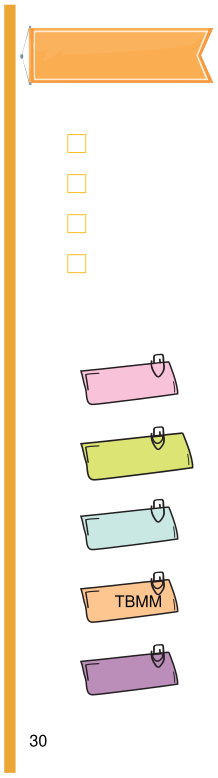
a. Halkın seçtiği milletvekillerinin görev yaptığı yerdir.

b. Halkın oylarıyla seçilerek TBMM’de görev yapan kişidir.

c. Mahalle veya köyün yönetiminden sorumlu olan kişidir.

ç. Vatandaşların yöneticilerini belirlemek için oy kullandıkları süreçtir.

d. Devletimizin yönetim biçimini ve vatandaşların haklarını belirleyen temel yasadır.

e. Ülkemizi yönetmek için halkın oylarıyla seçilen en yetkili

<!-- sayfa 31 -->

# MUSTAFA KEMAL ATATÜRK'ÜN BAŞARILARI VE KİŞİLİK ÖZELLİKLERİ

**DÜŞÜNELİM**
Mustafa Kemal Atatürk'ün öğrencilik yılları ile ilgili anıları okuyalım.

## MUSTAFA KEMAL ATATÜRK'ÜN ÖĞRENCİLİK ANILARI

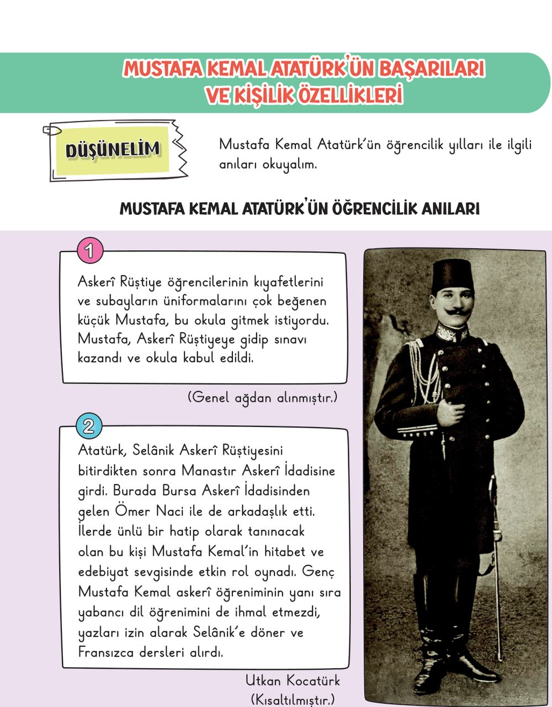

1. Askerî Rüştiye öğrencilerinin kıyafetlerini ve subayların üniformalarını çok beğenen küçük Mustafa, bu okula gitmek istiyordu. Mustafa, Askerî Rüştiyeye gidip sınavı kazandı ve okula kabul edildi.
(Genel ağdan alınmıştır.)

2. Atatürk, Selânik Askerî Rüştiyesini bitirdikten sonra Manastır Askerî İdadisine girdi. Burada Bursa Askerî İdadisinden gelen Ömer Naci ile de arkadaşlık etti. İlerde ünlü bir hatip olarak tanınacak olan bu kişi Mustafa Kemal'in hitabet ve edebiyat sevgisinde etkin rol oynadı. Genç Mustafa Kemal askerî öğreniminin yanı sıra yabancı dil öğrenimini de ihmal etmezdi, yazları izin alarak Selânik'e döner ve Fransızca dersleri alırdı.
Utkan Kocatürk
(Kısaltılmıştır.)

**Aşağıdaki soruları sözlü olarak cevaplayalım.**

1. Okuduğunuz anılara göre Atatürk'ün kişilik özellikleri neler olabilir?
2. [Metin bozuk/eksik]

<!-- sayfa 32 -->

# KEŞFEDELİM

Aşağıda, Mustafa Kemal Atatürk’ün öğrencilik yıllarındaki azim ve çalışkanlığı sayesinde ulaştığı başarıları gösteren bazı görsel ve açıklamalar yer almaktadır. Bu görselleri ve açıklamaları inceleyelim.

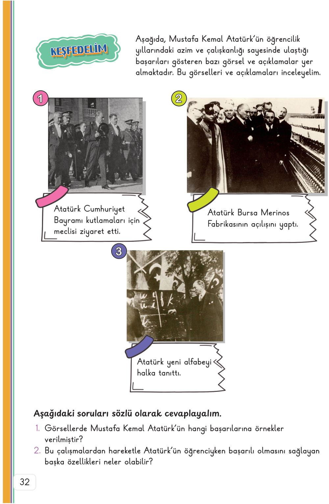
1
Atatürk Cumhuriyet Bayramı kutlamaları için meclisi ziyaret etti.

2
Atatürk Bursa Merinos Fabrikasının açılışını yaptı.

3
Atatürk yeni alfabeyi halka tanıttı.

**Aşağıdaki soruları sözlü olarak cevaplayalım.**

1. Görsellerde Mustafa Kemal Atatürk'ün hangi başarılarına örnekler verilmiştir?
2. Bu çalışmalardan hareketle Atatürk'ün öğrenciyken başarılı olmasını sağlayan başka özellikleri neler olabilir?

<!-- sayfa 33 -->

**Etkinlik: ATATÜRK DİYOR Kİ**

**Malzemeler:** renkli karton, boya kalemleri, Atatürk görselleri, makas, yapıştırıcı. 

Uygulama adımlarını takip ederek etkinliği yapalım.

**Uygulama Adımları**

* Sınıf arkadaşlarımızla dört veya beş kişilik gruplar oluşturalım.
* Mustafa Kemal Atatürk'ün kişilik özelliklerini ve milletimizle birlikte elde ettiği başarıları ön plana çıkaran aşağıdaki sözlerini inceleyerek aralarından birini seçelim.

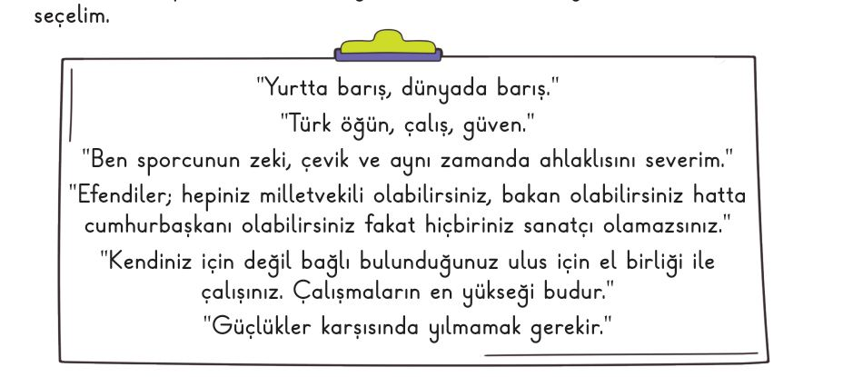
> "Yurtta barış, dünyada barış."
>
> "Türk öğün, çalış, güven."
>
> "Ben sporcunun zeki, çevik ve aynı zamanda ahlaklısını severim."
>
> "Efendiler; hepiniz milletvekili olabilirsiniz, bakan olabilirsiniz hatta cumhurbaşkanı olabilirsiniz fakat hiçbiriniz sanatçı olamazsınız."
>
> "Kendiniz için değil bağlı bulunduğunuz ulus için el birliği ile çalışınız. Çalışmaların en yükseği budur."
>
> "Güçlükler karşısında yılmamak gerekir."

* Seçtiğimiz sözün Atatürk'ün hangi kişilik özelliğini yansıttığını belirleyelim.
* Bu kişilik özelliğinin Atatürk'ün milletimizle birlikte elde ettiği başarılara nasıl katkıda bulunmuş olabileceğini arkadaşlarımızla tartışalım.
* Atatürk'ün seçtiğimiz sözünden hareketle kişilik özelliklerini ve bu özelliklerin başarılarına katkılarını anlatan bir afiş hazırlayalım.
* Hazırladığımız afişi sınıf arkadaşlarımıza sunalım.
* Atatürk'ün milletimizle birlikte elde ettiği başarıları ve kişilik özellikleri arasındaki ilişkiyi sınıf arkadaşlarımızla tartışalım. 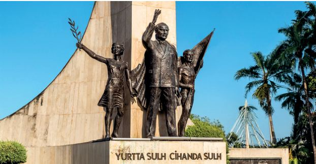

<!-- sayfa 34 -->

Mustafa Kemal Atatürk, ülkemizi düşman işgalinden kurtaran ve Türkiye Cumhuriyeti’ni kuran büyük bir liderdir. Atatürk’ün birçok kişilik özelliği vardır. Bu özellikleri elde ettiği başarıların temelini oluşturur. Bunlardan bazıları çok yönlülüğü, sabırlı ve disiplinli olması, sanatseverliği, vatanına ve milletine olan sevgisidir.

**ÇALIŞKAN**
Hedeflerine ulaşmak için çok çalışır, zamanını asla boşa harcamazdı. Başarının emekle kazanılacağına inanırdı.

**AZİMLİ VE KARARLI**
Karşısına çıkan zorluklar onu yıldırmazdı. Başarmak için sabır ve inançla çalışırdı.

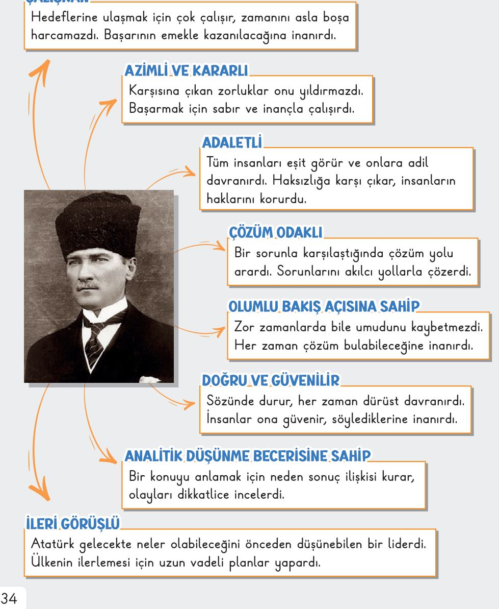

**ADALETLİ**
Tüm insanları eşit görür ve onlara adil davranırdı. Haksızlığa karşı çıkar, insanların haklarını korurdu.

**ÇÖZÜM ODAKLI**
Bir sorunla karşılaştığında çözüm yolu arardı. Sorunlarını akılcı yollarla çözerdi.

**OLUMLU BAKIŞ AÇISINA SAHİP**
Zor zamanlarda bile umudunu kaybetmezdi. Her zaman çözüm bulabileceğine inanırdı.

**DOĞRU VE GÜVENİLİR**
Sözünde durur, her zaman dürüst davranırdı. İnsanlar ona güvenir, söylediklerine inanırdı.

**ANALİTİK DÜŞÜNME BECERİSİNE SAHİP**
Bir konuyu anlamak için neden sonuç ilişkisi kurar, olayları dikkatlice incelerdi.

**İLERİ GÖRÜŞLÜ**
Atatürk gelecekte neler olabileceğini önceden düşünebilen bir liderdi. Ülkenin ilerlemesi için uzun vadeli planlar yapardı.

<!-- yer tutucu bulunamadı: sayfa sonuna eklendi -->

<!-- sayfa 35 -->

# Atatürk'ün Başarıları

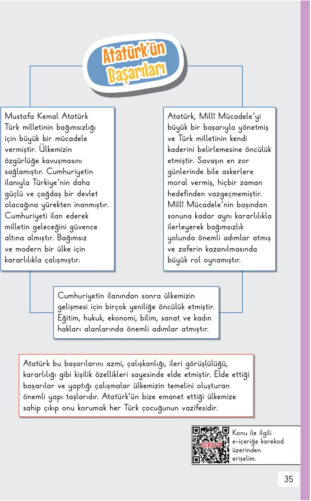

Mustafa Kemal Atatürk Türk milletinin bağımsızlığı için büyük bir mücadele vermiştir. Ülkemizin özgürlüğe kavuşmasını sağlamıştır. Cumhuriyetin ilanıyla Türkiye’nin daha güçlü ve çağdaş bir devlet olacağına yürekten inanmıştır. Cumhuriyeti ilan ederek milletin geleceğini güvence altına almıştır. Bağımsız ve modern bir ülke için kararlılıkla çalışmıştır.

Atatürk, Millî Mücadele’yi büyük bir başarıyla yönetmiş ve Türk milletinin kendi kaderini belirlemesine öncülük etmiştir. Savaşın en zor günlerinde bile askerlere moral vermiş, hiçbir zaman hedefinden vazgeçmemiştir. Millî Mücadele’nin başından sonuna kadar aynı kararlılıkla ilerleyerek bağımsızlık yolunda önemli adımlar atmış ve zaferin kazanılmasında büyük rol oynamıştır.

Cumhuriyetin ilanından sonra ülkemizin gelişmesi için birçok yeniliğe öncülük etmiştir. Eğitim, hukuk, ekonomi, bilim, sanat ve kadın hakları alanlarında önemli adımlar atmıştır.

Atatürk bu başarılarını azmi, çalışkanlığı, ileri görüşlülüğü, kararlılığı gibi kişilik özellikleri sayesinde elde etmiştir. Elde ettiği başarılar ve yaptığı çalışmalar ülkemizin temelini oluşturan önemli yapı taşlarıdır. Atatürk'ün bize emanet ettiği ülkemize sahip çıkıp onu korumak her Türk çocuğunun vazifesidir.

 Konu ile ilgili e-içeriğe karekod üzerinden erişelim

<!-- sayfa 36 -->

# PERFORMANS GÖREVİ

**Malzemeler:** boya kalemleri, karton, yapıştırıcı, Atatürk ve konu ile ilgili görseller, makas 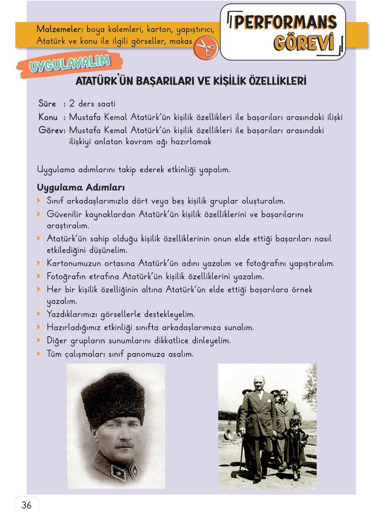

**UYGULAYALIM**

## ATATÜRK'ÜN BAŞARILARI VE KİŞİLİK ÖZELLİKLERİ

**Süre :** 2 ders saati
**Konu :** Mustafa Kemal Atatürk'ün kişilik özellikleri ile başarıları arasındaki ilişki
**Görev:** Mustafa Kemal Atatürk'ün kişilik özellikleri ile başarıları arasındaki ilişkiyi anlatan kavram ağı hazırlamak

Uygulama adımlarını takip ederek etkinliği yapalım.

### Uygulama Adımları
* Sınıf arkadaşlarımızla dört veya beş kişilik gruplar oluşturalım.
* Güvenilir kaynaklardan Atatürk'ün kişilik özelliklerini ve başarılarını araştıralım.
* Atatürk'ün sahip olduğu kişilik özelliklerinin onun elde ettiği başarıları nasıl etkilediğini düşünelim.
* Kartonumuzun ortasına Atatürk'ün adını yazalım ve fotoğrafını yapıştıralım.
* Fotoğrafın etrafına Atatürk'ün kişilik özelliklerini yazalım.
* Her bir kişilik özelliğinin altına Atatürk'ün elde ettiği başarılara örnek yazalım.
* Yazdıklarımızı görsellerle destekleyelim.
* Hazırladığımız etkinliği sınıfta arkadaşlarımıza sunalım.
* Diğer grupların sunumlarını dikkatlice dinleyelim.
* Tüm çalışmaları sınıf panomuza asalım.

<!-- sayfa 37 -->

# DEĞERLENDİRELİM

Aşağıdaki soruları cevaplayalım.

a. Atatürk’ün ileri görüşlülüğü ülke için aldığı kararları nasıl etkilemiştir?
..........................................................................................................................................
..........................................................................................................................................

b. Atatürk’ün sahip olduğu olumlu bakış açısının başarıya ulaşmasındaki etkisi nasıldır?
..........................................................................................................................................
..........................................................................................................................................

c. Atatürk’ün güvenilir olması onun hangi başarılarına katkıda bulunmuştur?
..........................................................................................................................................
..........................................................................................................................................

ç. Atatürk’ün çalışkan ve azimli olması Türkiye Cumhuriyeti’nin kurulmasında nasıl rol oynamıştır?
..........................................................................................................................................
..........................................................................................................................................

d. Sizce Atatürk’ün çözüm odaklı kişiliği olmasaydı bazı başarıları gerçekleşebilir miydi? Neden?
..........................................................................................................................................
..........................................................................................................................................

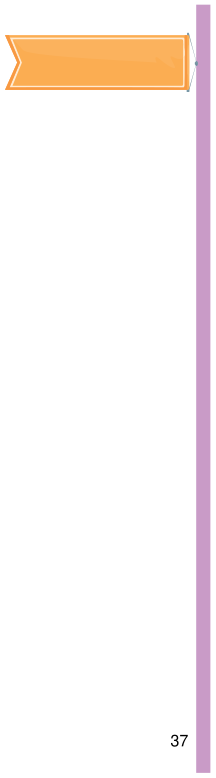
<!-- yer tutucu bulunamadı: sayfa sonuna eklendi -->

<!-- sayfa 38 -->

# MİLLÎ BİRLİK VE BERABERLİK

## DÜŞÜNELİM

### SEDEF’İN ANI DEFTERİ

Sedef anı defteri tutuyor. Anılarını yazıp fotoğraflar yapıştırmayı, bu anlarla ilgili şiirler yazmayı çok seviyor. Defteri inceleyip anılarını hatırladığında mutlu oluyor. Sedef’in anı defterine millî gün ve bayramlarla ilgili yazdığı bölümleri inceleyelim.

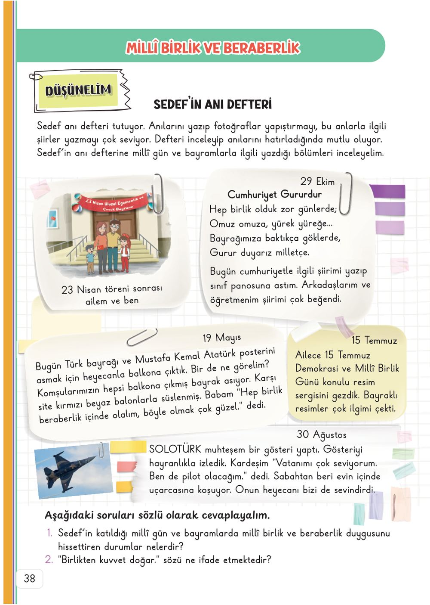
23 Nisan töreni sonrası ailem ve ben

29 Ekim
**Cumhuriyet Gururdur**
Hep birlik olduk zor günlerde;
Omuz omuza, yürek yüreğe...
Bayrağımıza baktıkça göklerde,
Gurur duyarız milletçe.

Bugün cumhuriyetle ilgili şiirimi yazıp sınıf panosuna astım. Arkadaşlarım ve öğretmenim şiirimi çok beğendi.

19 Mayıs
Bugün Türk bayrağı ve Mustafa Kemal Atatürk posterini asmak için heyecanla balkona çıktık. Bir de ne görelim? Komşularımızın hepsi balkona çıkmış bayrak asıyor. Karşı site kırmızı beyaz balonlarla süslenmiş. Babam "Hep birlik beraberlik içinde olalım, böyle olmak çok güzel." dedi.

15 Temmuz
Ailece 15 Temmuz Demokrasi ve Millî Birlik Günü konulu resim sergisini gezdik. Bayraklı resimler çok ilgimi çekti.

30 Ağustos
SOLOTÜRK muhteşem bir gösteri yaptı. Gösteriyi hayranlıkla izledik. Kardeşim "Vatanımı çok seviyorum. Ben de pilot olacağım." dedi. Sabahtan beri evin içinde uçarcasına koşuyor. Onun heyecanı bizi de sevindirdi.

**Aşağıdaki soruları sözlü olarak cevaplayalım.**

1. Sedef'in katıldığı millî gün ve bayramlarda millî birlik ve beraberlik duygusunu hissettiren durumlar nelerdir?

<!-- sayfa 39 -->

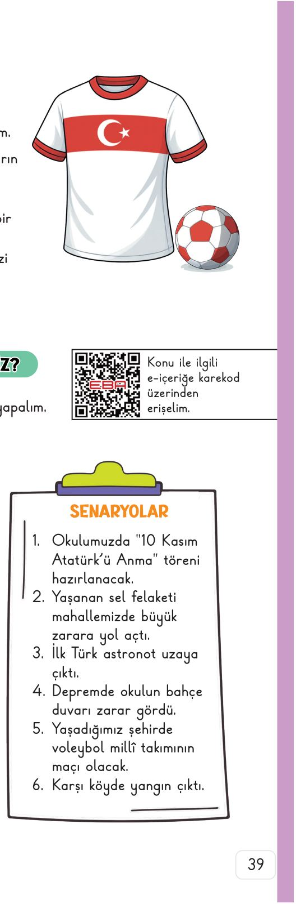

Aşağıdaki soruları sözlü olarak cevaplayalım.

1. Millî gün ve bayramlarda evlerin, okulların ve iş yerlerinin bayrağımızla donatılması size neler hissettiriyor?
2. Millî bir müsabaka sırasında insanların bir araya gelmesi size neler düşündürüyor?
3. Bu durumlar millî birlik ve beraberliğimizi nasıl güçlendirir?

---

**Etkinlik: BİRLİKTE NELER YAPABİLİRİZ?**

Uygulama adımlarını takip ederek etkinliği yapalım.

### Uygulama Adımları

* Sınıf arkadaşlarımızla dört veya beş kişilik gruplar oluşturalım.
* İzlediğimiz e-içerik ile ilgili merak ettiğimiz soruları yazalım.
* Sorularımızı sınıfta paylaşalım. Ortak sorularımızı belirleyerek tahtaya yazalım. Soruların cevaplarını sınıf arkadaşlarımızla tartışalım.
* Birlikte hareket etmenin toplumdaki sevgi ve dayanışma bağımızı nasıl etkilediğini grup arkadaşlarımızla paylaşalım.
* Yandaki senaryoları okuyalım. Millî birlik ve beraberliğin günlük yaşamımız ve toplum hayatımızdaki önemini düşünelim. Bu durumlarda neler hissedeceğimizi ve neler yapabileceğimizi konuşalım.

> **SENARYOLAR**
> 
> 1. Okulumuzda "10 Kasım Atatürk'ü Anma" töreni hazırlanacak.
> 2. Yaşanan sel felaketi mahallemizde büyük zarara yol açtı.
> 3. İlk Türk astronot uzaya çıktı.
> 4. Depremde okulun bahçe duvarı zarar gördü.
> 5. Yaşadığımız şehirde voleybol millî takımının maçı olacak.
> 6. Karşı köyde yangın çıktı.

| | |
| :--- | :--- |
| [[QR KOD]] | Konu ile ilgili e-içeriğe karekod üzerinden erişelim. |

<!-- sayfa 40 -->

Millî birlik ve beraberliğimizin toplum hayatımıza çok büyük katkıları vardır. Bizler aynı vatan üzerinde yaşayan bireyler olarak üzüntülü günlerimizde birbirimize destek olur, mutlu anlarımızı ise neşeyle paylaşırız. Zorluklara karşı beraber hareket ettiğimizde aramızdaki sevgi, saygı ve dayanışma bağları daha da güçlenir. El ele verip ortak bir amaç için çalıştığımızda toplum içindeki huzurumuz artar. Böylece millî birlik ve beraberliğimiz sarsılmaz bir güç kazanır.

ÖĞRENELİM

İstiklâl Marşı, Türk bayrağı, millî gün ve bayramlar millî değerlerimizdir. Merhamet, yardımseverlik, misafirperverlik manevi değerlerimize örnektir. Millî ve manevi değerlerimize saygı göstermemiz çok önemlidir.

Millî gün ve bayramlar bizlere millî kimliğimizi hatırlatır. Millî gün ve bayramların anlamını bilmek ülkemize olan bağlılığımızı güçlendirir. Bu önemli günlerde bayraklarımızı asar, törenler yaparız. Vatanımızı savunmak için canlarını ortaya koyan şehit ve gazilerimizi saygıyla anarız.

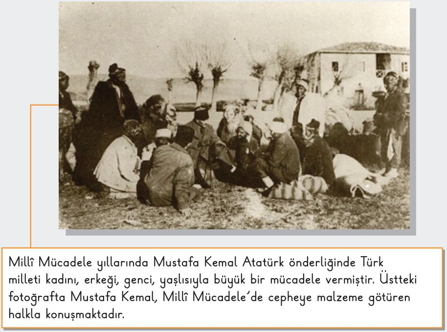

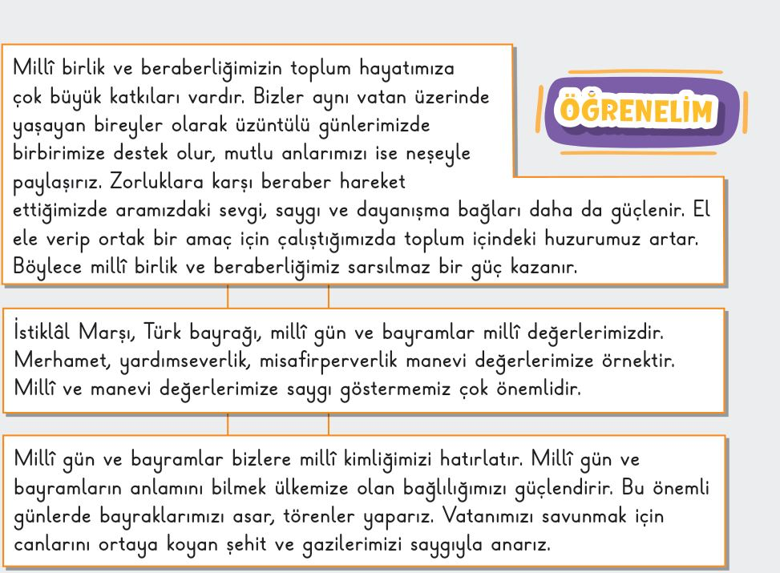

Millî Mücadele yıllarında Mustafa Kemal Atatürk önderliğinde Türk milleti kadını, erkeği, genci, yaşlısıyla büyük bir mücadele vermiştir. Üstteki fotoğrafta Mustafa Kemal, Millî Mücadele'de cepheye malzeme götüren halkla konuşmaktadır.

<!-- sayfa 41 -->

Gördesli Makbule Heykeli/ Manisa

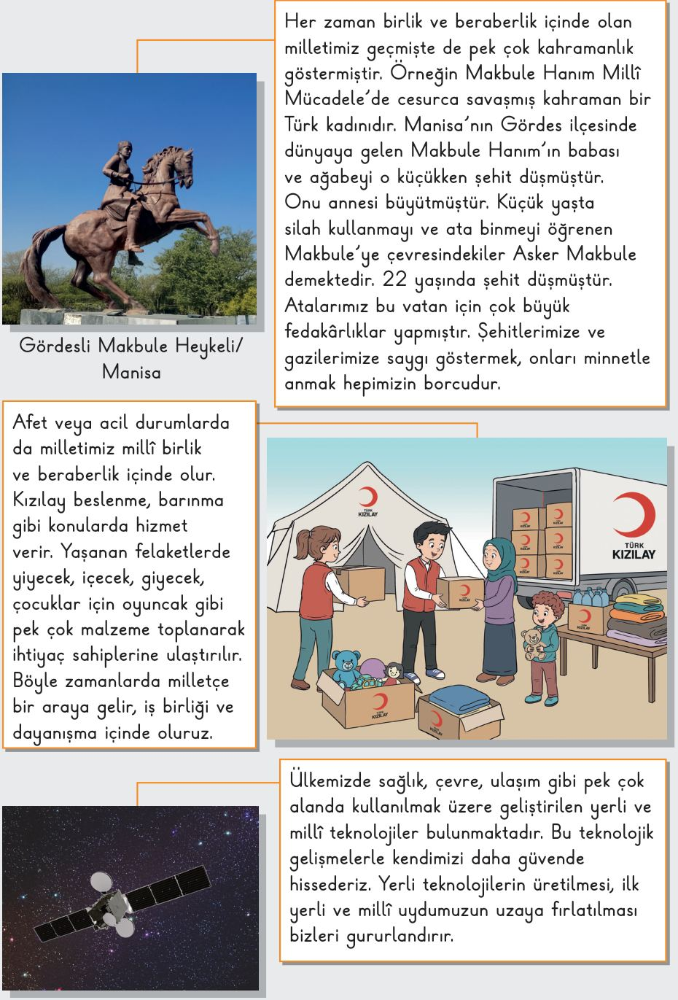

Her zaman birlik ve beraberlik içinde olan milletimiz geçmişte de pek çok kahramanlık göstermiştir. Örneğin Makbule Hanım Millî Mücadele'de cesurca savaşmış kahraman bir Türk kadınıdır. Manisa'nın Gördes ilçesinde dünyaya gelen Makbule Hanım'ın babası ve ağabeyi o küçükken şehit düşmüştür. Onu annesi büyütmüştür. Küçük yaşta silah kullanmayı ve ata binmeyi öğrenen Makbule'ye çevresindekiler Asker Makbule demektedir. 22 yaşında şehit düşmüştür. Atalarımız bu vatan için çok büyük fedakârlıklar yapmıştır. Şehitlerimize ve gazilerimize saygı göstermek, onları minnetle anmak hepimizin borcudur.

Afet veya acil durumlarda da milletimiz millî birlik ve beraberlik içinde olur. Kızılay beslenme, barınma gibi konularda hizmet verir. Yaşanan felaketlerde yiyecek, içecek, giyecek, çocuklar için oyuncak gibi pek çok malzeme toplanarak ihtiyaç sahiplerine ulaştırılır. Böyle zamanlarda milletçe bir araya gelir, iş birliği ve dayanışma içinde oluruz.

Ülkemizde sağlık, çevre, ulaşım gibi pek çok alanda kullanılmak üzere geliştirilen yerli ve millî teknolojiler bulunmaktadır. Bu teknolojik gelişmelerle kendimizi daha güvende hissederiz. Yerli teknolojilerin üretilmesi, ilk yerli ve millî uydumuzun uzaya fırlatılması bizleri gururlandırır.

<!-- sayfa 42 -->

# UYGULAYALIM

Uygulama adımlarını takip ederek etkinliği yapalım.

## Uygulama Adımları

* Sınıf arkadaşlarımızla 23 Nisan Ulusal Egemenlik ve Çocuk Bayramı için tören hazırlığı yapalım.
* Hafta boyunca yapacağımız etkinlik fikirlerini sınıf tahtasına yazalım. Millî bayramların anlam ve önemini anlatan yazı ve şiir yazmak, resim yapmak, halk oyunu veya tiyatro gösterisi hazırlamak, resim yarışması düzenlemek bu etkinliklere örnektir.
* Yapılacak etkinliklere karar vererek görev paylaşımı yapalım.
* Millî ve manevi değerlere uygun içerikler seçelim. Kullanacağımız içerik, görsel ve kıyafetler konusunda öğretmenimizin onayını alalım.
* Çevremizde şehit yakınları veya gaziler varsa onları törene davet edelim.
* Hazırlık sürecinde arkadaşlarımızla dayanışma içinde olalım.
* 23 Nisan öncesinde prova yapalım.
* 23 Nisan gününde törenimizi millî birlik ve beraberlik içinde coşkuyla kutlayalım.

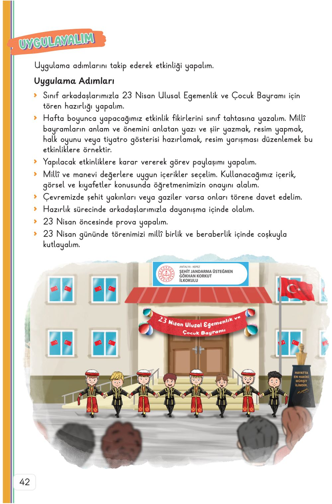

<!-- sayfa 43 -->

# Etkinlik: MİLLÎ BİRLİK VE BERABERLİK İÇİN

**Malzemeler:** karton, görseller, makas, yapıştırıcı, boya kalemleri. 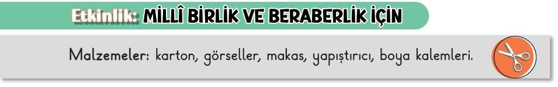

**Süre :** İki ders saati
**Konu :** Millî birlik ve beraberlik
**Görev:** Millî birlik ve beraberliğimizi güçlendirmeye yönelik bir sosyal sorumluluk projesi geliştirmek

Uygulama adımlarını takip ederek etkinliği yapalım.

## Uygulama Adımları

* Sınıf arkadaşlarımızla dört veya beş kişilik gruplar oluşturalım.
* Millî birlik ve beraberliğin toplumumuz için önemini aşağıdaki sorular üzerinden grup arkadaşlarımızla tartışalım. 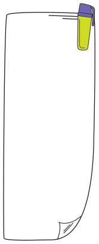
    * Millet olarak bizleri bir araya getiren etkinlikler nelerdir?
    * Millî gün ve bayramlar birlik ve beraberliğimize nasıl katkıda bulunur?
    * Yardımlaşma ve dayanışma toplum için neden önemlidir?
* Ekler bölümündeki Ek 1'de verilen Proje Formu'nu grup arkadaşlarımızla dolduralım.
* Aşağıdaki proje fikirlerinden birini seçelim veya kendi projemizi oluşturalım.
    * Millî bayram kutlama etkinliği hazırlama
    * Şehit yakınları veya gazilere yönelik ziyaret planı hazırlama
    * Millî takım müsabakasını birlikte izleme etkinliği tasarlama
    * Yardımlaşma ve dayanışmaya yönelik sosyal sorumluluk projesi geliştirme
* Projede yapılacaklar için görev paylaşımı yapalım. Hazırladığımız içerikleri grup arkadaşlarımızla birleştirelim.
* Projemize dikkat çekici bir isim bulalım.
* Projemizi görsel, video vb. ile destekleyelim.
* Hazırladığımız projeyi sınıf arkadaşlarımıza sunalım.

> **Sosyal sorumluluk projeleri** başkalarına yardım etmek veya toplumdaki sorunlara çözüm bulmak için yapılan çalışmalardır. Bu projeler karşılık beklemeden yapılır. Gönüllüler gösterişten uzak durur, severek ve isteyerek iyilik yapar. İhtiyacı olan çocuklara oyuncak veya kitap toplamak, görme yetersizliği olan insanlara sesli kütüphane oluşturmak bu projelere örnektir.

**Aşağıdaki soruları sözlü olarak cevaplayalım.**

1. Bu projede grup arkadaşlarınızla çalışırken neler öğrendiniz?

<!-- sayfa 44 -->

# DEĞERLENDİRELİM

**Malzemeler:** renkli kartonlar, A4 kâğıtları, bayraklar, boya kalemleri, makas, yapıştırıcı, delgeç, fotoğraflar, kurdele veya ip. 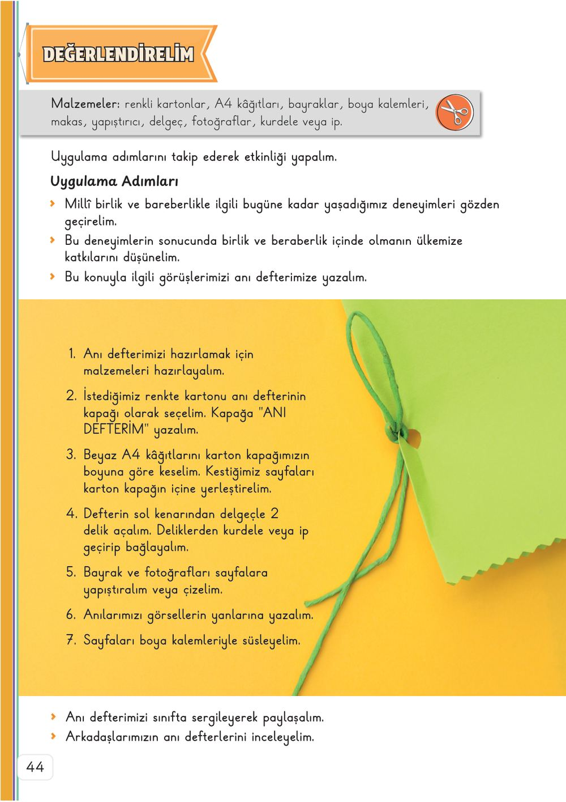

Uygulama adımlarını takip ederek etkinliği yapalım.

## Uygulama Adımları

* Millî birlik ve beraberlikle ilgili bugüne kadar yaşadığımız deneyimleri gözden geçirelim.
* Bu deneyimlerin sonucunda birlik ve beraberlik içinde olmanın ülkemize katkılarını düşünelim.
* Bu konuyla ilgili görüşlerimizi anı defterimize yazalım.

1. Anı defterimizi hazırlamak için malzemeleri hazırlayalım.
2. İstediğimiz renkte kartonu anı defterinin kapağı olarak seçelim. Kapağa "ANI DEFTERİM" yazalım.
3. Beyaz A4 kâğıtlarını karton kapağımızın boyuna göre keselim. Kestiğimiz sayfaları karton kapağın içine yerleştirelim.
4. Defterin sol kenarından delgeçle 2 delik açalım. Deliklerden kurdele veya ip geçirip bağlayalım.
5. Bayrak ve fotoğrafları sayfalara yapıştıralım veya çizelim.
6. Anılarımızı görsellerin yanlarına yazalım.
7. Sayfaları boya kalemleriyle süsleyelim.

* Anı defterimizi sınıfta sergileyerek paylaşalım.

<!-- sayfa 45 -->

# 4. ÖĞRENME ALANI
## DEĞERLENDİRME SORULARI

**NELER ÖĞRENDİK?**

1. Aşağıdaki metni okuyalım. Soruları cevaplayalım.

### EFES ANTİK KENTİ

İzmir’in Selçuk ilçesinde bulunan Efes Antik Kenti çok eski bir yerleşim yeridir. Binlerce yıl önce burada insanlar yaşamış; tiyatrolar, tapınaklar ve kütüphaneler inşa etmiştir. Burayı görmek için her yıl yüzlerce yerli ve yabancı turist Efes’e gelir. Bu ziyaretlerin hem ülkemizin tanınmasına hem de turizm geliri olarak ülke ekonomimize büyük katkısı vardır. Efes Antik Kenti dünyanın önemli tarihî kentlerinden biri olarak UNESCO (Birleşmiş Milletler Eğitim, Bilim ve Kültür Örgütü) Dünya Mirası Listesi’nde yer almaktadır. Efes Antik Kenti gibi tarihi yerleri korumak geçmişi geleceğe taşımaktır.

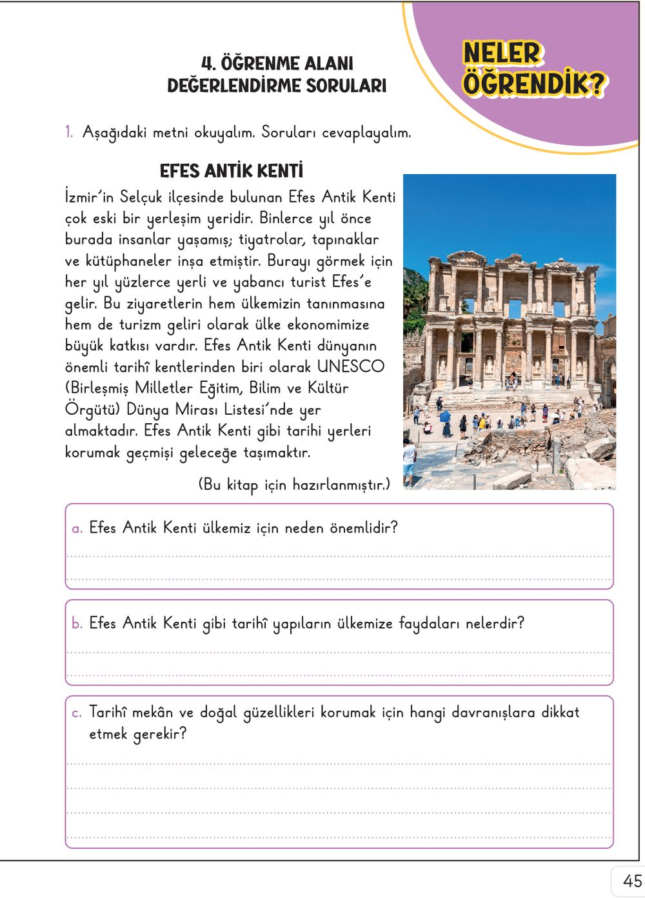

(Bu kitap için hazırlanmıştır.)

a. Efes Antik Kenti ülkemiz için neden önemlidir?
___________________________________________________________________________
___________________________________________________________________________

b. Efes Antik Kenti gibi tarihî yapıların ülkemize faydaları nelerdir?
___________________________________________________________________________
___________________________________________________________________________

c. Tarihî mekân ve doğal güzellikleri korumak için hangi davranışlara dikkat etmek gerekir?
___________________________________________________________________________
___________________________________________________________________________

<!-- sayfa 46 -->

2. Aşağıdaki ifadelerin doğru veya yanlış olduğuna karar vererek ilerleyelim.
Ulaştığımız çıkışı boyayalım.

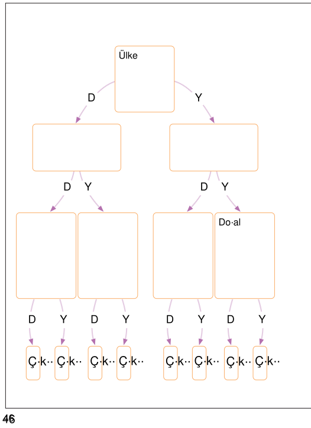: Akış şeması içeren bir karar ağacı diyagramı.

Ülke varlıklarını korumak gelecek nesillere değerlerimizi aktarmamıza yardımcı olur.
  D $\rightarrow$ Tarihî mekânları korumak doğal güzellikleri korumaktan daha önemlidir.
    D $\rightarrow$ Ormanlık alanlarda istediğimiz zaman mangal yakabiliriz.
      D $\rightarrow$ 1. Çıkış
      Y $\rightarrow$ 2. Çıkış
    Y $\rightarrow$ Geçmişimizi yansıtan tarihî mekânların zarar görmesi kültürel değerlerimizin kaybolmasına neden olabilir.
      D $\rightarrow$ 3. Çıkış
      Y $\rightarrow$ 4. Çıkış
  Y $\rightarrow$ Tarihî mekânların ve doğal güzelliklerin korunması için birçok kişi ve kurum görev alır.
    D $\rightarrow$ Tarihî mekânların duvarına istediğimiz gibi resim çizebilir veya yazı yazabiliriz.
      D $\rightarrow$ 5. Çıkış
      Y $\rightarrow$ 6. Çıkış
    Y $\rightarrow$ Doğal güzellikleri korumak gelecek nesiller için önemlidir.
      D $\rightarrow$ 7. Çıkış
      Y $\rightarrow$ 8. Çıkış

<!-- sayfa 47 -->

3. Aşağıdaki görseli inceleyelim. Soruları cevaplayalım.

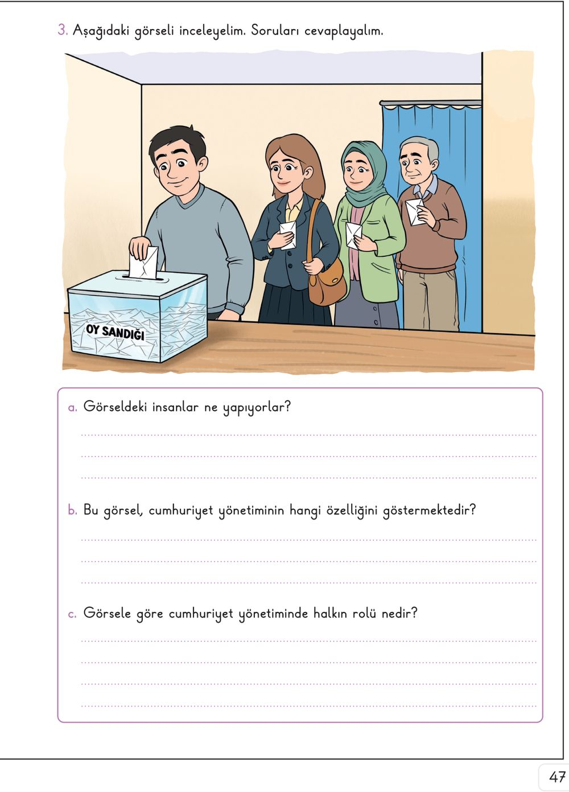

a. Görseldeki insanlar ne yapıyorlar?
___________________________________________________________________________
___________________________________________________________________________

b. Bu görsel, cumhuriyet yönetiminin hangi özelliğini göstermektedir?
___________________________________________________________________________
___________________________________________________________________________

c. Görsele göre cumhuriyet yönetiminde halkın rolü nedir?
___________________________________________________________________________
___________________________________________________________________________

<!-- sayfa 48 -->

4. Aşağıda Mustafa Kemal Atatürk ile ilgili bilgiler verilmiştir. Bu bilgilerin onun hangi kişilik özelliğiyle ilgili olduğunu belirleyelim ve ok çizerek eşleştirelim.

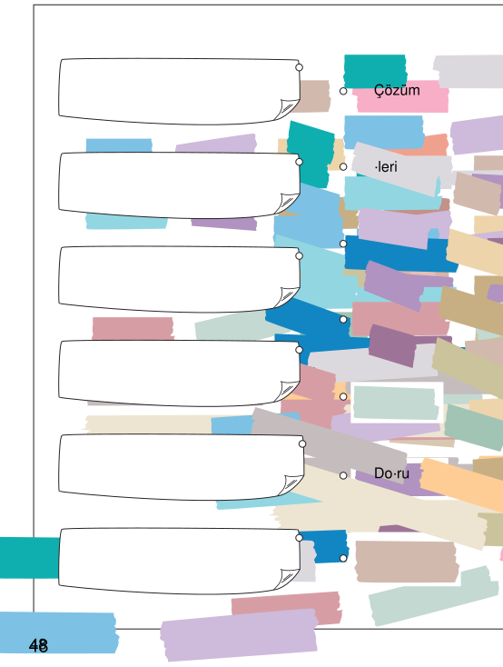
1. Millî Mücadele sırasında birçok zorlukla karşılaşmasına rağmen mücadeleyi bırakmamıştır.

2. Samsun’a çıktıktan sonra halkı bir araya getirerek ülkeyi kurtarmak için yeni bir yol bulmuştur.

3. Gittiği her okulda sınıfının başarılı öğrencilerinden biri olmuştur.

4. Ülkemizin çağdaş bir toplum olabilmesi için cumhuriyeti ilan etmiştir.

5. Savaş yıllarında bile halka moral vermiş, “Umutsuz durum yoktur, umutsuz insan vardır.” diyerek herkesi cesaretlendirmiştir.

6. Türkiye Büyük Millet Meclisinde verdiği her sözü tutarak halkın güvenini kazanmıştır.

○ a. Çözüm odaklılığı
○ b. İleri görüşlülüğü
○ c. Çalışkanlığı
○ ç. Yardımseverliği
○ d. Azimli ve kararlılığı
○ e. Doğru ve güvenilirliği
○ f. Olumlu bakış açısına sahip oluşu

<!-- sayfa 49 -->

5. Aşağıdaki metni okuyalım. Soruları cevaplayalım.

Astronot Alper Gezeravcı, Türkiye'nin ilk insanlı uzay yolculuğunu gerçekleştirdi. Uzayda kaldığı süre boyunca TUA (Türkiye Uzay Ajansı) ve TÜBİTAK (Türkiye Bilimsel ve Teknolojik Araştırma Kurumu) Uzay Komisyonunca hazırlanan 13 deneyi gerçekleştirdi. Uzaydan gerçekleştirilen ilk konuşmasında "Türkiye olarak tarihimizde bir ilke adım atmanın mutluluğunu yaşıyoruz. Buradaki bilim ve araştırma çalışmalarına katkıda bulunmak için sabırsızlanıyoruz. Türkiye Cumhuriyeti'ni kurarak bizlere emanet eden Gazi Mustafa Kemal Atatürk ve silah arkadaşlarına, bu vatan için canını veren tüm şehitlerimize, buraya adım atmamızı sağlayan güçlü iradesiyle devletimize ve milletimize şükranlarımı sunuyorum. İstikbal göklerdedir." dedi.

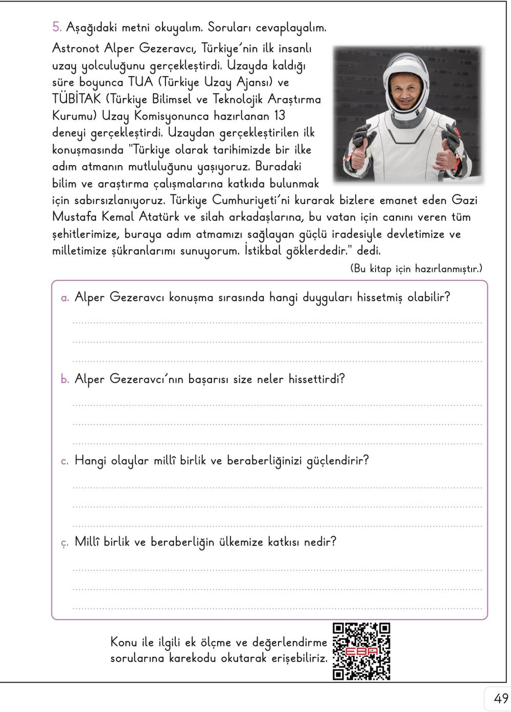

(Bu kitap için hazırlanmıştır.)

> a. Alper Gezeravcı konuşma sırasında hangi duyguları hissetmiş olabilir?
> \_\_\_\_\_\_\_\_\_\_\_\_\_\_\_\_\_\_\_\_\_\_\_\_\_\_\_\_\_\_\_\_\_\_\_\_\_\_\_\_\_\_\_\_\_\_\_\_\_\_\_\_\_\_\_\_\_\_\_\_\_\_\_\_\_\_\_\_\_\_\_\_\_\_\_\_\_\_\_\_\_\_\_\_\_\_\_\_\_\_\_\_\_
> \_\_\_\_\_\_\_\_\_\_\_\_\_\_\_\_\_\_\_\_\_\_\_\_\_\_\_\_\_\_\_\_\_\_\_\_\_\_\_\_\_\_\_\_\_\_\_\_\_\_\_\_\_\_\_\_\_\_\_\_\_\_\_\_\_\_\_\_\_\_\_\_\_\_\_\_\_\_\_\_\_\_\_\_\_\_\_\_\_\_\_\_\_
>
> b. Alper Gezeravcı’nın başarısı size neler hissettirdi?
> \_\_\_\_\_\_\_\_\_\_\_\_\_\_\_\_\_\_\_\_\_\_\_\_\_\_\_\_\_\_\_\_\_\_\_\_\_\_\_\_\_\_\_\_\_\_\_\_\_\_\_\_\_\_\_\_\_\_\_\_\_\_\_\_\_\_\_\_\_\_\_\_\_\_\_\_\_\_\_\_\_\_\_\_\_\_\_\_\_\_\_\_\_
> \_\_\_\_\_\_\_\_\_\_\_\_\_\_\_\_\_\_\_\_\_\_\_\_\_\_\_\_\_\_\_\_\_\_\_\_\_\_\_\_\_\_\_\_\_\_\_\_\_\_\_\_\_\_\_\_\_\_\_\_\_\_\_\_\_\_\_\_\_\_\_\_\_\_\_\_\_\_\_\_\_\_\_\_\_\_\_\_\_\_\_\_\_
>
> c. Hangi olaylar millî birlik ve beraberliğinizi güçlendirir?
> \_\_\_\_\_\_\_\_\_\_\_\_\_\_\_\_\_\_\_\_\_\_\_\_\_\_\_\_\_\_\_\_\_\_\_\_\_\_\_\_\_\_\_\_\_\_\_\_\_\_\_\_\_\_\_\_\_\_\_\_\_\_\_\_\_\_\_\_\_\_\_\_\_\_\_\_\_\_\_\_\_\_\_\_\_\_\_\_\_\_\_\_\_
> \_\_\_\_\_\_\_\

<!-- sayfa 50 -->

# 5. ÖĞRENME ALANI

# DOĞA VE ÇEVRE

* DOĞADAKİ VARLIKLARIN İNSAN YAŞAMINDAKİ ÖNEMİ
* KROKİ VE KONUM
* AFET ÖNCESİ, AFET ANI VE AFET SONRASINDA YAPILMASI GEREKENLER
* ÇEVRESEL SÜRDÜRÜLEBİLİRLİK

## NELER ÖĞRENECEĞİZ?

Bu öğrenme alanında
* doğadaki varlıkların insan yaşamı için önemini yorumlamayı,
* krokiyi kullanarak bulunduğumuz yerin konumunu algılamayı,
* afetlere yönelik yapılması gerekenleri sınıflandırmayı,
* çevresel sürdürülebilirliğe yönelik kaynaklardan bilgi toplamayı öğreneceğiz.

## ANAHTAR KAVRAMLAR

* doğadaki varlıklar
* kroki
* yön
* afet
* çevre
* sürdürülebilirlik

 EBA’da yer alan öğrenme alanına karekod üzerinden erişelim

<!-- sayfa 51 -->

Öğrenme alanı ile ilgili 
özet içeriğe karekod 
üzerinden erişelim

<!-- sayfa 52 -->

# BELİRLİ GÜN VE HAFTALAR

Orman Haftası
21-26 Mart

**HAZİNEMİZ YEŞİL VATAN**
Tertemiz nefes, pırıl pırıl su için
Ormanları koruyalım, fidan dikelim.
Orman yuva demek hayvanlar için
Yeşil vatan bir hazinedir bilelim.

Dünya Su Günü
22 Mart

**SU VARSA HAYAT VAR**
Kıymetlidir her bir damlası,
Yaşam için olmazsa olmazdır.
Suyumuzu boşa harcamamalı,
Unutmayalım ki "Su hayattır!"

<!-- sayfa 53 -->

Kütüphaneler Haftası
Mart ayının son pazartesi ile
başlayan hafta

**KÜTÜPHANEDEN AÇILAN YOLLAR**
Masal, şiir, mektup, roman, hikâye…
Bizi türlü türlü maceralara çağırır.
Bilgiyle doludur her kütüphane,
Okudukça yeni yollar açılır.

23 Nisan Ulusal Egemenlik ve
Çocuk Bayramı

**ÇOCUKLARA YAKIŞIR BAYRAM**
23 Nisan, açıldığı gündür meclisin.
Artık egemenlik kayıtsız, şartsız milletin!
Süslensin sınıflar, dalgalansın bayraklar!
Biz çocuklara yakışır neşeli kutlamalar.

<!-- sayfa 54 -->

# DOĞADAKİ VARLIKLARIN İNSAN YAŞAMINDAKİ ÖNEMİ

**DÜŞÜNELİM**

Aşağıdaki metinleri okuyalım.

1. Müzik denince çoğumuzun aklına enstrümanlar, kulaklıklar veya hoparlörler gelir. Peki, müzik yalnızca bunlarla mı olur? Aslında doğanın da kendine özgü müziği vardır. Rüzgârın uğultusu, yağmurun damlaları, kuşların cıvıltıları... Hepsi kulağa hoş gelen doğal seslerdir. Bu seslere biyomüzik veya doğa müziği adı verilir. Bazı müzisyenler doğadaki bu sesleri kaydedip, düzenleyerek huzur verici müzikler oluşturur. Böylece doğa bize ruhumuzu besleyen bir melodi sunmuş olur.

2. Toprak denince aklımıza genellikle sadece kahverengi bir yüzey gelir. Peki, toprağın altında hangi canlıların yaşadığını, bu canlıların orada neler yaptığını hiç düşündünüz mü? Toprağın altında karıncalar, solucanlar ve daha birçok minik canlı yaşar. Karıncalar yere düşen yaprakları ve yiyecek artıklarını toplar. Bu sayede doğa temiz kalır. Ayrıca toprağın içinde tüneller açarak toprağın havalanmasına yardımcı olur. Toprak havalanınca bitkiler daha güzel büyür. Doğa, bu küçük canlılar sayesinde daha sağlıklı olur.

**Aşağıdaki soruları sözlü olarak cevaplayalım.**

1. Birinci metinde doğadaki seslerin insan yaşamına etkileri ile ilgili neler anlatılmaktadır?
2. İkinci metinde topraktaki canlıların insan yaşamına etkileri ile ilgili neler anlatılmaktadır?

<!-- sayfa 55 -->

# KEŞFEDELİM
Aşağıdaki görseli inceleyelim.

## Aşağıdaki soruları sözlü olarak cevaplayalım.
1. Meyve ve sebzeler nerelerde yetişir?
2. Masa ve sandalyeler hangi maddeden yapılmıştır?
3. Doğadaki varlıkların günlük hayatımızdaki yeri hakkında düşünceleriniz nelerdir?

<!-- sayfa 56 -->

Etkinlik: **DOĞADAN GELEN HAZİNE**

**Malzemeler:** doğadan toplanan örnekler, bant veya yapıştırıcı, karton.

Uygulama adımlarını takip ederek etkinliği yapalım.

### Uygulama Adımları

* Öğretmenimizin rehberliğinde doğa yürüyüşüne çıkarak çevremizi gözlemleyelim.
* Doğa yürüyüşünü okul bahçesi, park veya yakınımızdaki ormanlık alanda yapabiliriz.
* Yürüyüş sırasında doğadan yaprak, kozalak, taş, meşe palamudu gibi örnekler toplayalım. Canlılara zarar vermeden sadece yere düşenleri alalım.
* Yürüyüşümüz bittiğinde merak ettiğimiz soruları arkadaşlarımızla paylaşalım ("Kozalaklar neden bazen kapalı olur?", "Yapraklar neden sararır?" vb.).
* Sınıfa dönünce topladığımız örnekleri kartona yapıştıralım ve bir "Doğa Koleksiyonu" oluşturalım.
* Kartona yapıştırdığımız örneklerin altına isimlerini yazalım.
* Çalışmamızı sınıf arkadaşlarımıza sunalım. Sunumumuzda doğada gözlemlediğimiz varlıkların insan yaşamına etkisine yer verelim (Örneğin ağaçlar gölge sağlar, yapraklarıyla da kompost yapılabilir.)
* Sunumlar bittiğinde gözlemlerimizi ve doğadaki varlıkların insan yaşamına etkilerini düşünelim. Aşağıdaki soruları arkadaşlarımızla tartışalım.

1. Doğayı ve canlıları korumazsak hangi sorunlarla karşılaşabiliriz?
2. Doğayı ve canlıları korumak için neler yapabiliriz?

 DOĞA KOLEKSİYONUM

<!-- sayfa 57 -->

Etkinlik: **DOĞANIN KORUYUCULARI**

Konu ile ilgili e-içeriğe karekod üzerinden erişelim.

Aşağıdaki metni okuyalım.

# BEKÇİ UĞUR BÖCEKLERİ

Bir yaz sabahı Elif, babaannesiyle bahçedeki çiçekleri suluyordu.

Birden domates yapraklarının üzerinde minik kırmızı bir böcek fark etti:

— Baksana babaanneee! Bu böcek, çiçeklerin yapraklarını mı yiyor?

Babaanne gülümsedi:

— Hayır Elif’im, o bir uğur böceği. Aslında tam tersine bitkileri koruyor.

Elif şaşırmıştı:

— Nasıl yani? Bir böcek bitkileri nasıl korur?

Babaanne anlatmaya başladı:

— Uğur böcekleri bitkilere zarar veren küçük böcekleri yer. Bu sayede domates ve biberlerimiz daha sağlıklı büyür. Uğur böcekleri tarlaların gizli bekçileridir.

Elif, böceğe dikkatlice baktı. Minik kanatlarını açıp havalandığında gülümsedi.

Babaannesi:

— Doğadaki her varlık bir şekilde bize yardım eder. Kimi bizi besler, kimi iyileştirir, kimi korur. Bizim de görevimiz doğayı korumaktır.

Elif gülümsedi:

— Doğa bize yardım ediyor, biz de doğayı koruyarak ona yardım etmeliyiz.

(Bu kitap için hazırlanmıştır.)

**Aşağıdaki soruları sözlü olarak cevaplayalım.**

1. Doğadaki canlılar bizlere nasıl yardım eder?
2. Bizler doğaya nasıl yardım edebiliriz?

<!-- sayfa 58 -->

Doğa; insan etkisi dışında kendiliğinden oluşan, sürekli değişen, canlı ve cansız varlıkları içinde barındıran alanın bütünüdür. Yaşamak için doğaya ihtiyaç duyarız. Yemek yemek, su içmek, ısınmak, barınmak gibi ihtiyaçlarımızı doğadaki varlıklardan karşılarız. Doğayı korumamız ve ona zarar vermememiz çok önemlidir.

# ÖĞRENELİM

## SU, HAVA VE GÜNEŞ

Su, hava ve güneş olmadan hiçbir canlı yaşayamaz. Yağmur yağmazsa bitkiler büyüyemez, Güneş olmazsa ısınamayız ve enerji üretemeyiz. Temiz hava olmadan nefes alamayız.

## TOPRAK

Doğanın bir parçası olan toprak insanlar için çok önemlidir. Bütün bitkiler toprakta büyür. Topraktan ayrıca çömlek, kil ve tuğla da yapılır.

<!-- sayfa 59 -->

# AĞAÇLAR

Ağaçlar bize temiz hava sağlar ve sıcak havalarda gölge oluşturur. Kâğıt, masa, kapı, kalem gibi birçok eşya ağaçlardan yapılır. Bazı kuşlar ağaçlara yuva yapar. Ağaçların kökleri toprağı tutar ve toprağın dağılmasını önler. Ayrıca yağışların düzenli olmasına yardımcı olur. Bu yüzden ağaçlar bizim için çok değerlidir.

# BİTKİLER

Elma, portakal, muz, domates, patates, havuç, marul, buğday, pirinç, fasulye, mercimek gibi yiyecekler bitkilerden elde edilir. Bazı bitkilerin yapraklarını, köklerini bazılarının sebzelerini veya meyvelerini yeriz. Bunun dışında bazı bitkiler, insanlara fayda sağlayan ilaçların yapımında da kullanılır.

# HAYVANLAR

Hayvanlar insanların yaşamında önemli bir yere sahiptir. İneklerin sütünden, koyunların hem sütünden hem yününden faydalanırız. Tavuklar bize yumurta verir, arılar bal üretirken bitki çeşitliliğine de katkıda bulunur. Kedi ve köpekler bize arkadaşlık eder. Kuşlar çevremizi güzelleştirir. Balıklar besin kaynağıdır. Tüm hayvanlar doğanın dengesini korumada önemli bir rol oynar.

Doğayı korumak dünyanın geleceğini güvence altına almaktır. Temiz hava, yemyeşil çevre ve sağlıklı yaşam hepimizin bilinçli davranışları ile mümkündür. Unutmayalım ki doğaya

<!-- sayfa 60 -->

# UYGULAYALIM

Uygulama adımlarını takip ederek etkinliği yapalım.

## Uygulama Adımları

* Sınıf arkadaşlarımız ile dört kişilik gruplar oluşturalım.
* Her grubun doğadaki varlıklardan ağaç, su, toprak veya güneşten birini seçmesini sağlayalım.
* Seçtiğimiz varlığın insan yaşamına etkisini ve bu varlığa karşı sorumluluklarımızı anlatan kısa bir senaryo hazırlayalım.
* Hazırladığımız senaryoya göre grup arkadaşlarımız ile rollerimizi belirleyelim.
* Senaryomuzu gruplar hâlinde sırayla canlandıralım.
* Doğadaki varlıkların insan yaşamına etkilerini sınıf arkadaşlarımızla tartışalım.

<!-- sayfa 61 -->

Etkinlik: **DOĞAYI GÖZLEMLİYORUM VE KORUYORUM**

Malzemeler: küçük bir yumak ip.

Uygulama adımlarını takip ederek etkinliği yapalım.

### Uygulama Adımları

* Sınıf arkadaşlarımız ile beş kişilik gruplar oluşturalım.
* Grupça doğadaki varlıklardan beş tane belirleyelim (Ağaç, kuş, arı, çiçek, su, toprak, güneş vb.).
* Grup üyeleri olarak belirlediğimiz varlıklardan birini seçerek temsil edelim.
* Bir yumak ipin ucunu ilk öğrenciden tutmasını isteyelim. Her öğrenciye temsil ettiği varlığın önceki varlıkla nasıl ilişkili olduğunu açıklayarak ipi bir sonraki arkadaşına uzatmasını söyleyelim. Böylece grup içinde bir ekosistem zinciri oluşturalım.
* Daha sonra grup üyelerinin birinden temsil ettiği varlığın doğada azaldığını veya yok olduğunu düşünmesini ve ipi bırakmasını isteyelim.
* Zincirde meydana gelen değişimi gözlemleyelim. Diğer varlıkların bu durumdan nasıl etkilenebileceğini grup içinde tartışalım.
* Tartışma sonunda aşağıdaki soruları cevaplayalım.

**Aşağıdaki soruları sözlü olarak cevaplayalım.**

1. Zincirden çıkan varlık diğer varlıkları nasıl etkiledi?
2. Doğadaki varlıklar neden birbirlerine ihtiyaç duyar?

<!-- sayfa 62 -->

# DEĞERLENDİRELİM

**Malzemeler:** resim kâğıdı, boya kalemleri.

# PERFORMANS GÖREVİ

Süre : 2 ders saati
Konu : Doğal varlıkların insan yaşamına etkisi
Görev: Doğal varlıkların insan yaşamına etkisi hakkında resim hazırlamak.

## DOĞAYI RESMEDELİM

Uygulama adımlarını takip ederek etkinliği yapalım.

### Uygulama Adımları

* Sınıf arkadaşlarımızla dört kişilik gruplar oluşturalım.
* Doğanın insan yaşamı için ne kadar önemli olduğunu anlatan bir resim hazırlayalım. Hazırladığımız çalışmada kitapta verilen örneklerin dışında en az bir özgün örneğe yer verelim.
* Grup olarak görev paylaşımı yapalım (çizimi planlayan, resmi renklendiren, sunumda grubunu temsil eden kişi vb.).
* Grubumuzla tamamladığımız çalışmayı arkadaşlarımıza sunalım.

<!-- sayfa 63 -->

# KROKİ VE KONUM

## DÜŞÜNELİM

Aşağıdaki ipuçlarına göre sınıftaki nesnenin bulunduğu yeri bulalım ve görsel üzerinde yuvarlak içine alalım.

**İpuçları**
* Nesne kapının doğusundadır.
* Nesne öğretmen masasının batısındadır.
* Nesne tahtanın kuzeyindedir.

**Aşağıdaki soruları sözlü olarak cevaplayalım.**
1. Verilen ipuçları nesnenin yerini bulmanıza nasıl yardımcı oldu?
2. Ana yönleri kullanmak bir yerin konumunu belirlemeyi nasıl kolaylaştırır?

## KEŞFEDELİM

Aşağıdaki labirentte evden okula ulaşan farklı yollar bulunmaktadır. Evden başlayarak okula giden doğru yolları bulalım ve her birini farklı renkteki kalemle çizelim.

**Aşağıdaki soruları sözlü olarak cevaplayalım.**
1. Kaç farklı yoldan okula ulaştınız?
2. Bu evde siz yaşasaydınız bu yollardan hangisini tercih ederdiniz? Nedenini açıklayınız.

<!-- sayfa 64 -->

**Etkinlik: ARA YÖNLERİ BELİRLİYORUM**

Uygulama adımlarını takip ederek etkinliği yapalım.

**Uygulama Adımları**

* Öğretmenimizin rehberliğinde sınıf arkadaşlarımızla örnekteki gibi yön tabelası hazırlayalım.
* Hazırladığımız yön tabelasını sınıfın zeminine veya öğretmen masasına yerleştirelim.
* Ana yönlerin isimlerini okların ucuna yazalım.
* İsim yazılmayan yön oklarının her birine örnekteki gibi çanta, kalem kutusu, defter, silgi vb. nesneler bırakalım.

* Aşağıdaki soruları sınıf arkadaşlarımızla tartışarak cevaplayalım.

> Kuzey ile doğu arasındaki nesne nedir? Bu nesne hangi yöndedir?
> Güney ile batı arasındaki nesne nedir? Bu nesne hangi yöndedir?
> Kuzey ile batı arasındaki nesne nedir? Bu nesne hangi yöndedir?
> Güney ile doğu arasındaki nesne nedir? Bu nesne hangi yöndedir?

* Nesnelerin bulunduğu yönlere göre keşfettiğimiz ara yönleri noktalı yerlere yazalım.

<!-- sayfa 65 -->

Etkinlik: **KONUM BİLDİRİYORUM**

[QR KOD] Konu ile ilgili e-içeriğe karekod üzerinden erişelim.

Uygulama adımlarını takip ederek etkinliği yapalım.

### Uygulama Adımları

* Sınıf arkadaşlarımız ile dört veya beş kişilik gruplar oluşturalım.
* Aşağıdaki krokiyi inceleyelim. Krokide yer alan mekânları ve yön okunu belirleyelim.
* Her grup üyesinden mekânların konumlarıyla ilgili bir gözlemini arkadaşlarıyla paylaşmasını isteyelim.
* Grupça mekânların birbirlerine göre konumlarını ana yönleri kullanarak açıklayalım.
* Aşağıdaki soruların cevaplarını grup içinde tartışalım.
    * Krokide hangi mekânlar bulunmaktadır?
    * Hastane, itfaiyenin hangi yönündedir?
    * Kütüphane, belediyenin hangi yönündedir?
    * Parktan hastaneye gitmek isteyen biri hangi yöne ilerlemelidir?
    * Otobüs durağı, kütüphanenin hangi yönündedir?
    * Bu krokide yön oku olmasaydı mekânların konumlarını belirlerken hangi güçlüklerle karşılaşırdık?
* Grup üyelerinin görüşlerini dinleyelim ve ortak cevaplar oluşturalım. Ortak cevaplarımızı sınıf arkadaşlarımızla paylaşalım.

**Aşağıdaki soruları sözlü olarak cevaplayalım.**

1. Grup arkadaşlarınızın görüşleri, soruları cevaplamanıza nasıl yardımcı oldu?

<!-- sayfa 66 -->

# ÖĞRENELİM

Kroki; bir yerin kuş bakışı görünümünün kabataslak, ölçme yapılmadan kâğıda çizilmesidir. Çevremizi yukarıdan görüyormuşuz gibi düşünür ve çevremizde gördüklerimizi basit çizgilerle gösteririz.

## Kroki Çizerken Nelere Dikkat Ederiz?

* Kroki kuş bakışı olarak çizilir.
* Çizim için uzunluk ölçüsü kullanılmaz, göz kararıyla yapılır.
* Önemli yerlerin adları (cadde, sokak, okul vb.) yazılır.
* Ev, okul, park, market gibi yerler sembollerle gösterilir.
* Kullanılan sembollerin anlamları, krokinin alt kısmında yer alan sembol anahtarında açıklanır. Böylece krokiyi inceleyen kişi, her sembolün neyi temsil ettiğini kolayca anlayabilir.
* Krokide yönleri bildiren oklar bulunur.

<!-- sayfa 67 -->

Kroki çizerken çevremizi zihnimizde canlandırırız,

* okulu bina sembolüyle
* parkı yeşil alanla
* yolları çizgilerle
* cami, ev, sağlık ocağı, market gibi yerleri de basit sembollerle gösteririz.

Kroki çevremizi tanımamıza ve yönümüzü bulmamıza yardım eden çok faydalı bir araçtır. Kroki sayesinde bulunduğumuz yerin yönünü ve diğer yerler arasındaki konumunu kolayca algılayabiliriz. Okulun nerede, parkın hangi yönde, hastanenin sokağın sonunda mı yoksa karşısında mı olduğunu kroki üzerinde görebiliriz. Bu nedenle krokiler günlük yaşamın birçok alanında kullanılır. Mimarlar binaları planlarken, mühendisler projelerini çizerken, sürücü ve öğrenciler de bir yere giderken krokiden yararlanırlar.

## KROKİ KULLANIM ALANLARI

* Kartvizitlerde: İş yerlerinin adresi genellikle kartvizitin arkasında küçük bir krokiyle gösterilir. Böylece kişiler o iş yerini kolayca bulabilirler.
* El ilanları ve kataloglarda: Yeni açılan mağazaların, kursların veya iş yerlerinin adresi krokiyle gösterilir. Böylece o yeri bulmak daha kolay olur.
* Alışveriş merkezlerinde: Hangi mağazanın hangi katta olduğunu göstermek için krokiler hazırlanır. Ziyaretçiler, aradıkları mağazayı bu kroki sayesinde rahatça bulurlar.
* Büyük sitelerin girişlerinde: Site içindeki blokların, otoparkın ve sosyal alanların yerini göstermek için krokiler bulunur. Böylece ziyaretçiler gidecekleri yeri kolayca bulabilirler.
* Turizm bürolarında: Şehri tanıtmak amacıyla hazırlanan harita ve broşürlerde, önemli tarihî ve turistik yerlerin konumu krokilerle gösterilir. Böylece ziyaretçiler gezilerini daha kolay planlayabilirler.

<!-- sayfa 68 -->

# UYGULAYALIM

**Etkinlik:** OKULUMUZUN ÇEVRESİNDE NELER VAR?

**Malzemeler:** renkli kâğıt, pul, boncuk, düğme, boya kalemleri vb.

Uygulama adımlarını takip ederek etkinliği yapalım.

### Uygulama Adımları

* Sınıf arkadaşlarımızla beş grup oluşturalım.
* Yönleri kullanarak grubumuzla beraber okulumuzun bulunduğu çevrenin krokisini çizelim.
* Krokimizdeki yerleri renkli kâğıt, pul, boncuk vb. malzemelerle gösterelim.
* Krokinin alt köşesine, kullandığımız bu malzemelerin ne anlama geldiğini açıklayan bir sembol anahtarı ekleyelim.
* Çizdiğimiz krokideki bir nesnenin ana ve ara yönlere göre konumunu belirten kısa notlar yazalım.
* Krokimizi, yönleri ve sembolleri kullanarak çevremizi anlatan renkli bir görsel çalışmaya dönüştürelim.
* Hazırladığımız krokimizi arkadaşlarımıza sunarak paylaşalım.
* Diğer grupların çalışmalarını da inceleyelim.

<!-- sayfa 69 -->

 DEĞERLENDİRELİM

Aşağıdaki form, okulumuzun yakın çevresine yönelik hazırladığımız kroki çalışmasını değerlendirmek amacıyla hazırlanmıştır. Değerlendirme yaparken "Evet", "Kısmen" veya "Hayır" seçeneklerinden uygun olanı işaretleyelim.

# ÖZ DEĞERLENDİRME FORMU

| Davranışlar | Evet | Kısmen | Hayır |
| :--- | :---: | :---: | :---: |
| 1. Krokide okul ve çevresindeki yerleri doğru şekilde gösterdim. | | | |
| 2. Krokide yer alan nesnelerin konumunu yönlere göre (ana ve ara yönler) doğru belirledim. | | | |
| 3. Krokide sembol anahtarı oluşturdum. | | | |
| 4. Yön okunu doğru çizilmiş şekilde uygun yere yerleştirdim. | | | |
| 5. Krokiyi düzenli, okunabilir ve anlaşılır biçimde hazırladım. | | | |
| 6. Malzemeleri (renkli kâğıt, pul, boncuk vb.) uygun şekilde kullandım. | | | |
| 7. Krokide yerlerin konumunu kısa notlarla açıkladım. | | | |
| 8. Kroki hazırlama sürecinde grup arkadaşlarımla iş birliği içinde çalıştım. | | | |

Tüm davranışlar için "Evet" seçeneğini işaretlememiz, yön bilgilerini kullanarak okulumuzun yakın çevresinin krokisini doğru bir şekilde çizdiğimizi gösterir. "Kısmen" veya "Hayır" seçeneklerini işaretlediğimiz davranışlarda ise öğretmenimizden destek alarak kendimizi geliştirmeliyiz.

<!-- sayfa 70 -->

# AFET ÖNCESİ, AFET ANI VE AFET SONRASINDA YAPILMASI GEREKENLER

**DÜŞÜNELİM**
Aşağıdaki görselleri inceleyelim.

**Aşağıdaki soruları sözlü olarak cevaplayalım.**

1. Görsellerdeki kişiler hangi afetlerin yaşanmaması veya etkilerinin azaltılması için önlem alıyor olabilir?

<!-- sayfa 71 -->

![KEŞFEDELİM] Görseldeki öğrencilerin afetlerle ilgili verdikleri bilgileri okuyalım.

Afet deyince aklıma ormanlarımızda çıkan yangınlar geliyor. Yangınlarda birçok canlı zarar gördü. Bu duruma çok üzüldük.

Benim de aklıma gazetede okuduğum sel haberi geliyor. Dere kenarındaki tüm evlerin zarar gördüğünü okumuştum.

6 Şubat'ta yaşadığımız depremi unutmak mümkün değil. Deprem can ve mal kayıplarına yol açtı. Herkes çok üzüldü. Yardım kampanyalarını hep birlikte yürüttük.

**Aşağıdaki soruları sözlü olarak cevaplayalım.**

1. Öğrencilerin verdiği afet örnekleri hakkında neler biliyorsunuz?
2. Bu afet türlerinin zararlarını azaltmak için neler yapılabilir?

<!-- sayfa 72 -->

**Etkinlik: NEYİ, NE ZAMAN YAPMALI?**

Uygulama adımlarını takip ederek etkinliği yapalım.

### Uygulama Adımları

* Sınıf arkadaşlarımızla dört veya beş kişilik gruplar oluşturalım.
* Afetlere yönelik yapılması gerekenler ile ilgili fikirlerimizi grup arkadaşlarımızla paylaşalım. Arkadaşlarımızın fikirlerini dikkatlice dinleyelim.
* Afet öncesinde, anında ve sonrasında yapılması gerekenleri aşağıdaki tabloya not ederek sınıflandıralım.

| AFETLER İÇİN YAPILMASI GEREKENLER | | |
| :--- | :--- | :--- |
| **Afet Öncesinde** | **Afet Anında** | **Afet Sonrasında** |
| | | |
| | | |
| | | |
| | | |
| | | |
| | | |
| | | |

* Yaptığımız sınıflandırmayı sınıf tahtasına yazalım.
* Tüm grupların yazdığı sınıflandırma tablolarını inceleyerek fikrimizi söyleyelim. Fikirler doğrultusunda ortak bir tabloyu sınıf arkadaşlarımızla oluşturalım.
* Deprem, yangın, sel, heyelan, çığ gibi afet durumlarına yönelik merak ettiğimiz soruları soralım.
* Soruların cevapları üzerine sınıfça konuşalım.

<!-- sayfa 73 -->

Afetlere yönelik yapılması gerekenleri **afet öncesi**, **afet anı** ve **afet sonrası** olarak üç grupta sınıflandırabiliriz:

# ÖĞRENELİM

Afetlerde zarar görmemek ve afetlere hazırlıklı olmak için afet öncesinde yapmamız gerekenler vardır.

* Planlı olmamız gerekir. Bu nedenle **afet eylem planı** hazırlarız.
    * Ailemizle Ekler bölümünde verilen Ek 2'yi kullanarak afet eylem planımızı hazırlayalım.

* Kişisel bilgilerimize ihtiyaç duyulabilir. Bu nedenle **acil durum bilgi kartı** hazırlarız.
    * Ekler bölümündeki Ek 3'ü kullanarak acil durum bilgi kartımızı ailemizle hazırlayalım. Hazırladığımız kartı noktalı alanlardan kesip yanımızda taşıyalım.

* Acil yardım ekipleri bize ulaşana kadar bazı eşya, yiyecek ve içeceklere ihtiyaç duyarız. Bu nedenle **afet ve acil durum çantası** hazırlarız.
    * Afet ve acil durum çantamızın içinde bulunması gereken eşyaları düşünerek fikirlerimizi paylaşalım. Çantamızda bulunması gereken eşyalara karar vererek bu eşyaları temin edelim. Çantamızı hazırlayalım ve düzenli aralıklarla kontrol ederek tarihi geçmiş yiyecek ve içecekleri değiştirelim.

* Afet simülasyon merkezlerinde afetlerde yapılması gereken doğru davranışlara yönelik deneyim kazanırız. Afetlerle ilgili tatbikatlar yaparız. Afet sonrasında ortamı hızlıca tahliye ederek acil toplanma alanına gideriz. Böylece afet anlarında nasıl hareket etmemiz gerektiğini tecrübe etmiş oluruz.
    * Sınıfımızda ve evimizde afetlere yönelik tatbikatlar yapalım.

Afet durumunda bulunabileceğimiz yerlerdeki riskli alanları belirleyip, bunlara çözüm...
Ekler bölümünde verilen Ek 4'ü kullanarak sınıfta ve evde tehlike avı yapalım. Riskli alanlar için çözüm önerilerimizi okul için sınıf öğretmenimizle,

<!-- sayfa 74 -->

# AFET ANI

Afet anında doğru davranışlar sergilemeliyiz. Bunun için öncelikle sakin olmalıyız.

# AFETLERE HAZIRLIKLI OLMAK HAYAT KURTARIR!

## DEPREM ANINDA

Bina içindeysek güvenli bir yer buluruz. “Çök, kapan, tutun.” hareketi yaparız, diz üstü çökerek başımızı ve ensemizi koruyacak şekilde kapanırız. Düşmemek için sabit bir yere tutunuruz. Deprem anında sarsıntı durana kadar olduğumuz yerde kalırız. Tekerlekli sandalyedeysek tekerlekleri kilitleyerek başımızı ve boynumuzu korumaya alırız. Açık alandaysak dışarıda kalırız. Enerji hatlarından, binalardan, direklerden, ağaçlardan ve duvar diplerinden uzaklaşırız. Açık arazide çömelerek etraftan gelen tehlikelere karşı hazırlıklı oluruz. Deniz kıyısındaysak kıyıdan uzaklaşırız.

Sınıfımızda ve evimizde afet anında doğru davranışlar sergilemeye yönelik "Çök, kapan, tutun." uygulaması yapalım.

## YANGIN ANINDA

Çevrede yangın ihbar düğmesi varsa basarız. 112 Acil Çağrı Merkezini arayarak yangını itfaiyeye bildiririz. Yangın kapalı alandaysa yayılmasını önlemek için kapı ve pencereleri kapatırız. Bunları yaparken kendimizi ve başkalarını tehlikeye atmayız. Dumandan boğulmamak için yardım gelene kadar eğilerek ve sürünerek hareket ederiz. Ağız ve burnumuzu ıslak bez veya mendille kapatarak nefes alırız. Duman ve yanık kokusu başka odadan geliyorsa kapıyı açmayız. Kıyafetimiz alev almışsa koşmayız, yere yatarak yuvarlanırız. Vücudumuzda yanık oluşursa hemen soğuk suya tutarız.

<!-- sayfa 75 -->

# SEL ANINDA

Sel bölgesini hemen terk ederek yüksek ve güvenli bölgelere gideriz. Bu sırada su olan bir yol veya alandan karşıya geçmeye çalışmayız. Elektrik kaynaklarından uzak dururuz. Ayak bileğimize kadar olan sel suyu bizi, dizimize kadar olan sel suları ise otomobillerimizi sürükleyip götürebilir. Bu nedenle selden kaçmak için sel sularına kesinlikle girmeyiz. Binamızı terk ederken elektrik ve su vanalarını kapatırız.

# HEYELAN ANINDA

Bina içindeysek ve binadan çıkmak için yeterli vaktimiz yoksa binanın içinde kalırız. Sağlam eşyaların altında veya yanında hayat üçgeni oluşturarak "Çök, kapan, tutun." hareketini uygularız. Bina dışında açık alandaysak heyelan veya çamur akıntısının yolundan uzak dururuz, mümkün olduğu kadar yükseklere doğru hemen uzaklaşırız. Çevremizdeki insanları toprak kaymasına karşı uyarırız. Çamur ve moloz akmasından kaçabilecek zamanımız veya etrafımızda arkasına saklanacağımız sağlam bir yapı yoksa "Çök, kapan, tutun." hareketi ile başımızı ve boynumuzu koruruz.

# ÇIĞ ANINDA

En kısa sürede riskli alanı terk ederek daha güvenli yerlere ulaşmaya çalışırız. Bağırarak veya başka ses kaynaklarını (korna, ıslık, düdük vb.) kullanarak çevremizdekileri uyarmaya çalışırız. Kayak yaparken çığın önünde kalırsak çığın rotası dışına doğru kaymaya çalışırız. Eğer çığa yakalanacağımızı anlarsak kayak sopalarını ve kayakları çıkarıp ağaç gibi sabit bir cisme tutunmaya çalışırız.

<!-- sayfa 76 -->

Yaşadığımız afet sonrasında da sakin kalmaya devam ederiz.

* Afet eylem planımızı uygularız.
* Önce güvende olduğumuzdan emin oluruz, sonra çevremizde yardım edebileceğimiz kimse olup olmadığını kontrol ederiz.
* Binadaysak elektrik, gaz ve su kaynaklarını kapatırız. Afet ve acil durum çantamızı yanımıza alırız. Acil durum tahliye yollarını ve çıkış kapısını kullanarak binayı hızlı bir şekilde tahliye ederiz.
* Yaşadığımız yere en yakın acil durum toplanma alanına gideriz.
* Uyarıları radyo gibi kitle iletişim araçlarıyla dinleriz. "Geri dönün!" uyarısı yapılana kadar afet bölgelerine dönmeyiz.
* Yıkıntı veya çığ altında kaldıysak paniklemeden durumumuzu kontrol ederiz. Hareketimiz kısıtlanmışsa hayatımızı riske atacak hareketler yapmayız. Enerjimizi dikkatli kullanarak sesimizi duyurmaya çalışırız.

ACİL ÇIKIŞ KAPISI

ACİL ÇIKIŞ

ACİL DURUM TOPLANMA NOKTASI

Konu ile ilgili e-içeriğe karekod üzerinden erişelim.

Afetlere hazırlıklı olmak, afet anında ve sonrasında doğru davranışlarda bulunmak hayatımız için çok önemlidir.

<!-- sayfa 77 -->

# UYGULAYALIM

## Etkinlik: POSTERİMİZ

**Malzemeler:** kâğıt, kalem, makas, boya kalemleri, yapıştırıcı, karton, konu ile ilgili görseller.

Uygulama adımlarını takip ederek etkinliği yapalım.

### Uygulama Adımları

* Sınıf arkadaşlarımızla beş grup oluşturalım.
* Her bir grup için bir afet türü (deprem, yangın, sel, heyelan ve çığ) belirleyelim.
* Grup arkadaşlarımızla sorumlu olduğumuz afet türü için afet öncesi, anı ve sonrasında yapılması gerekenlerin yer aldığı bir poster tasarlayalım.
* Poster tasarımı için grup arkadaşlarımızla plan yapalım.
* Yaptığımız plan doğrultusunda görev paylaşımı yapalım. Görevimizi zamanında ve uygun bir şekilde yerine getirmeye dikkat edelim.
* Posterimizi konu ile ilgili görsellerle destekleyerek tamamlayalım.

**ÖNCESİ, ANI VE SONRASI YAPILMASI GEREKENLER**

| ÖNCESİ | ANI | SONRASI |
| :---: | :---: | :---: |
| | | |
| | | |

* Posterimizi diğer gruplara sunalım.

<!-- sayfa 78 -->

# DEĞERLENDİRELİM

Aşağıdaki ifadelerin doğru veya yanlış olduğuna karar vererek ilerleyelim.
Ulaştığımız çıkışı boyayalım.

Afet öncesi, anı ve sonrasında yapılması gerekenleri öğrenerek önlemlerimizi almalıyız.
$\swarrow$ D $\searrow$ Y

Afetlere hazırlıklı olmak için afet eylem planı yaparız. $\quad$ Afet anında panikle koşarak dışarı çıkarız.
$\swarrow$ D $\searrow$ Y $\qquad\qquad\qquad\qquad\qquad\qquad\qquad\qquad\qquad\quad \swarrow$ D $\searrow$ Y

Afet sonrasında en yakın acil durum toplanma alanına gideriz. $\quad$ Afet anında deniz kıyısındaysak kıyıda kalırız. $\quad$ Afet sonrasında "Geri dönün!" uyarısı yapılana kadar afet bölgelerine dönmeyiz. $\quad$ Afetlere hazırlıklı olmak için tatbikatlar yaparız.
$\swarrow$ D $\searrow$ Y $\qquad\qquad\qquad\qquad\qquad\quad \swarrow$ D $\searrow$ Y $\qquad\qquad\qquad\qquad\qquad\quad \swarrow$ D $\searrow$ Y $\qquad\qquad\qquad\qquad\qquad\quad \swarrow$ D $\searrow$ Y

1. Çıkış $\quad$ 2. Çıkış $\quad$ 3. Çıkış $\quad$ 4. Çıkış $\quad$ 5. Çıkış $\quad$ 6. Çıkış $\quad$ 7. Çıkış $\quad$ 8. Çıkış

<!-- sayfa 79 -->

# ÇEVRESEL SÜRDÜRÜLEBİLİRLİK

**DÜŞÜNELİM** Aşağıdaki metni okuyalım. Grafikleri inceleyelim.

## ŞEHİRDE SU TASARRUFU ZAMANI

Kerem’in yaşadığı şehirde barajlardaki su seviyesi azalmaya başlamıştı. Suyun tasarruflu kullanılmaması ve yağışların yetersiz olması barajlardaki doluluk oranının düşmesine neden olmuştu. Belediye, barajlardaki doluluk oranının azaldığını gösteren son üç aylık su grafiğini paylaştı ve gerekli önlemlerin alınacağını duyurdu. Bu konuda halkı duyarlı olmaya çağırdı. Bazı günlerde planlı su kesintisi yapılacağını ilan etti. Pazartesi, çarşamba ve cuma günleri akşam 5’ten sabah 5’e kadar sular kesilecekti. Kerem ve ailesi su kesintilerinden dolayı biraz zorlandılar ama kısa sürede bu duruma alıştılar. Şehir halkı suyun kıymetini anlamıştı ve artık suyu tasarruflu kullanmaya başlamıştı. Yetkililer üç ay sonra tasarruf çalışmalarının ve yağışların etkisiyle barajlardaki su seviyesinin yükseldiğini açıkladılar.

(Bu kitap için hazırlanmıştır.)

| Barajlardaki Son Üç Aylık Su Miktarı Grafiği | Tasarruf Sonrası Barajlardaki Üç Aylık Su Miktarı Grafiği |
| :---: | :---: |
|  |  |
| Su Miktarı $\uparrow$   Aylar $\rightarrow$   Ocak Şubat Mart | Su Miktarı $\uparrow$   Aylar $\rightarrow$   Nisan Mayıs Haziran |

**Aşağıdaki soruları sözlü olarak cevaplayalım.**

1. Kerem ve ailesi su kesintisi yapıldığında neden zorlanmış olabilir?
2. Halk su tasarrufuna yönelik neler yapmış olabilir?
3. Grafiklere göre tasarruf sonrası su miktarında nasıl bir değişim olmuştur?

<!-- sayfa 80 -->

 Aşağıdaki görselleri inceleyelim.

| ÖNCESİ | SONRASI |
| :---: | :---: |
|  |  |
| **ÖNCESİ** | **SONRASI** |
|  |  |

**Aşağıdaki soruları sözlü olarak cevaplayalım.**

1. Fotoğrafların öncesi ve sonrası durumları arasındaki farklar nelerdir?
2. Fotoğraflardaki değişikliklerin nedenleri neler olabilir?

<!-- sayfa 81 -->

# Etkinlik: ÇEVRE DOSTU UYGULAMALAR

Uygulama adımlarını takip ederek etkinliği yapalım.

## Uygulama Adımları

* Görseli inceleyelim. Görselde yer alan çevre dostu uygulamaları belirleyelim.
* Bu uygulamaların çevreye ve doğal kaynakların korunmasına nasıl katkıda bulunabileceği hakkında düşüncelerimizi paylaşalım.

* Bu uygulamalar hakkında daha fazla bilgi edinmek için hangi kaynaklardan yararlanabileceğimizi arkadaşlarımızla tartışalım (gözlem, görüşme, kitap, dergi, genel ağ araştırması vb.).
* Sınıf arkadaşlarımız ile üç grup oluşturalım.
* Grupça görselde yer alan uygulamalardan birini seçelim.
* Seçtiğimiz uygulama hakkında farklı kaynaklardan bilgi toplayalım.
* Topladığımız bilgileri grup arkadaşlarımızla inceleyelim ve bilgilerin güvenilir olup olmadığını değerlendirelim. Elde ettiğimiz bilgileri sınıf arkadaşlarımızla paylaşalım.
* Diğer grupların sunumlarını dinleyelim ve doğru olduğunu düşündüğümüz bilgileri not alalım.
* Belirlediğimiz bilgileri kullanarak bir broşür hazırlayalım. Broşürümüzde kısa bilgiler, dikkat çekici başlıklar ve uygun görseller kullanalım.
* Hazırladığımız broşürü sınıf arkadaşlarımızla

[QR KOD] Konu ile ilgili e-içeriğe karekod üzerinden

<!-- sayfa 82 -->

# ÖĞRENELİM

Sürdürülebilirlik bir şeyin uzun süre devam etmesini sağlamak anlamına gelir. Çevresel sürdürülebilirlik ise doğayı koruyup dünyanın uzun yıllar boyunca temiz, sağlıklı ve yaşanabilir kalmasını sağlamaktır. Bunun için çevremizi korumamız ve kaynaklarımıza sahip çıkmamız çok önemlidir.

Çevresel sürdürülebilirliğe yönelik birçok uygulama yapabiliriz.

## UYGULAMA ÖRNEKLERİ

### GERİ DÖNÜŞÜM
Geri dönüştürülebilir atıkları geri dönüşüm kutularına atarız.

### KAYNAK TASARRUFU
Su, elektrik gibi kaynaklarımızı doğru ve tasarruflu kullanırız.

### AĞAÇLANDIRMA
Ormanlarımızı koruruz ve ağaçlandırma çalışmaları yaparız.

### SÜRDÜRÜLEBİLİR ENERJİ
Evde, okulda, bahçede güneş panelleri kullanarak enerji ihtiyacımız için güneşten faydalanırız. Rüzgâr, su gibi kaynaklardan enerji sağlayabiliriz.

<!-- sayfa 83 -->

# YEŞİL ÇATI
Ev, okul gibi yapıların çatılarını bitkilerle kaplayarak havanın temizlenmesine katkıda bulunuruz.

# ÇEVRE DOSTU ARAÇLAR
Ulaşımda elektrikle çalışan araçlar kullanarak havanın temiz kalmasını sağlarız.

# PROJELER
İsraftan kaçınma, doğayı koruma gibi konularda sosyal sorumluluk projeleri hazırlayarak çevremizdekileri bilinçlendiririz. Ülkemizde yürütülen "Enerji Dostu Mavi Yeşil Okul Projesi", "Sıfır Atık Projesi" gibi çevresel sürdürülebilirlik çalışmalarına katılırız.

Doğayı korumak ve çevresel sürdürülebilirliği sağlamak hepimizin sorumluluğudur. Verilen örnek uygulamalardan yapabildiklerimizi yerine getirmemiz çok önemlidir. Bazı uygulamaların hayata geçirilmesi için öğretmenimizden, aile büyüklerimizden destek alabiliriz.

Çevremizde yaşanan ve sürdürülebilirliğe zarar verebilecek sorunlara karşı duyarlı olmalıyız. Bu sorunların çözümü için ailemiz, öğretmenlerimiz, komşularımız, arkadaşlarımızla iş birliği yaparak çalışmalıyız. Unutmayalım ki dünyamız bize atalarımızdan miras kalmıştır. Bu mirası gelecek nesillere en güzel şekilde ulaştırmak hepimizin görevidir.

<!-- sayfa 84 -->

# ÇEVREMDEKİ HİKÂYELER

Uygulama adımlarını takip ederek etkinliği yapalım.

**Uygulama Adımları**

* Çevresel sürdürülebilirlikle ilgili bir hikâye yazalım. Öncelikle bir çevre sorunu belirleyelim (çöplerin yere atılması, ağaçların kesilmesi, suların boşa akması, hava kirliliği vb.).
* Hikâyede, yaşanan çevre sorununun nedenlerine ve çözüm önerilerine yer verelim.
* Hazırladığımız hikâyeyi sınıf arkadaşlarımızla paylaşalım.

**Etkinlik: NE ÖĞRENDİK?**

**Uygulama Adımları**

* Çevresel sürdürülebilirlikle ilgili topladığımız bilgilere göre aşağıdaki tabloyu dolduralım.

| Sürdürülebilir Uygulama Örnekleri | Çevreye Katkısı |
| :--- | :--- |
| | |
| | |
| | |
| | |
| | |

* Tablomuzu arkadaşlarımızın hazırladıkları tablo ile karşılaştıralım. Benzerlik ve farklılıkları inceleyelim.
* Kaynaklarımızın doğru kullanımı ve tasarruflu olmanın önemi ile ilgili kısa bir sunum hazırlayarak arkadaşlarımıza sunalım.
* Sunumlardan öğrendiğimiz doğru bilgileri tablo, afiş veya broşüre...

<!-- sayfa 85 -->

# DEĞERLENDİRELİM

Görselleri inceleyelim. Çevresel sürdürülebilirlik ile ilgili ifadeleri okuyalım. Her ifadenin yanındaki noktalı alana, o ifadeyle ilişkili olan görselin numarasını yazalım (Bir görsel numarası birden fazla ifade için yazılabilir.).

Geri dönüşüme önem veririz. ...........................................................................

Çevremizi ve doğayı temiz tutarız. ...................................................................

Sürdürülebilir enerji kaynaklarını kullanırız. ......................................................

Kaynakları tasarruflu kullanırız. .......................................................................

<!-- sayfa 86 -->

# NELER ÖĞRENDİK?

## 5. ÖĞRENME ALANI DEĞERLENDİRME SORULARI

1. Aşağıdaki tabloda doğadaki bazı varlıkların insan yaşamına katkıları verilmiştir. Bu bilgilerin doğadaki hangi varlıkla ilgili olduğunu belirleyelim. Her bilginin karşısındaki boşluğa doğadaki ilgili varlığın adını yazalım.

**DOĞADAKİ VARLIKLAR**
güneş, bitkiler, su, hayvanlar, hava, ağaç, toprak

| İnsan Yaşamına Olan Katkıları | |
| :--- | :--- |
| Dünyayı ısıtır ve aydınlatır. | |
| Bize sebze, meyve ve oksijen sağlar. | |
| Bitkilerin köklerini tutar ve onlara besin sağlar. | |
| Gölge verir, havanın temizlenmesine yardımcı olur. | |
| Bize süt, yumurta, yün, bal gibi besinler sağlarlar. | |
| Canlıların yaşamsal faaliyetlerini sürdürebilmeleri için gerekli olan sıvı maddedir. | |
| İnsanların ve hayvanların nefes almasını sağlar. | |

2. Doğanın bize kazandırdıkları hakkında kendi düşüncelerimizi yazalım.
__________________________________________________________________________________________
__________________________________________________________________________________________
__________________________________________________________________________________________

3. Doğadaki bir varlık zarar görürse insanların yaşamı nasıl etkilenir? Örnek vererek açıklayalım.
__________________________________________________________________________________________
__________________________________________________________________________________________
__________________________________________________________________________________________

<!-- sayfa 87 -->

4. Yaşadığımız sokağı düşünelim. Boş alana sokağımızın krokisini çizelim ve evimizin yerini krokide uygun şekilde gösterelim.

<!-- sayfa 88 -->

5. Aşağıda afetlere yönelik yapılması gerekenlerle ilgili bazı ifadeler yer almaktadır. İfadeleri okuyalım. Bu davranışları afet öncesi, afet anı ve afet sonrası olarak sınıflandırarak etiketlendirelim. Sınıflandırdığımız ifadelerin numarasını ve etiket ismini uygun alanlara yazalım.

1. "Çök, kapan, tutun." hareketi ile kendimizi koruruz.
2. Afet ve acil durum çantası hazırlarız.
3. Acil durum çıkış kapısını kullanırız.
4. Enkaz altında kalan kişi, sesini duyurmak için bağırmalı ya da bir yere vurmalıdır.
5. Elektrik şalterini, doğal gaz ve su vanalarını kapatırız.
6. Tatbikatlar yaparız.
7. Acil durum bilgi kartı hazırlarız.
8. Yangın ihbar düğmesi varsa düğmeye hemen basarız.

| | | |
|---|---|---|
| | | |
| | | |

6. Aşağıdaki cümleleri okuyalım. Doğru cümlelerin başına "D", yanlış cümlelerin başına "Y" yazalım. Yanlış cümlelerin altlarına doğrularını yazalım.

$\square$ Çevresel sürdürülebilirlik için doğal kaynakları sınırsızca kullanabiliriz.
__________________________________________________________________

$\square$ Elektriği gereksiz kullanmak kaynak israfıdır.
__________________________________________________________________

$\square$ Su tasarrufu çevreyi korumaya katkıda bulunur.
__________________________________________________________________

$\square$ Çevresel sürdürülebilirliği sağlamak yetişkinlerin sorumluluğudur.
__________________________________________________________________

$\square$ Ağaç dikmek çevreyi korumaya yardımcı olur.
__________________________________________________________________

<!-- sayfa 89 -->

7. Aşağıdaki görselde çevreyi korumaya yardımcı uygulamaları bulalım. Uygulamaları ve bunların faydalarını noktalı bölümlere yazalım.

| ÇEVREYİ KORUMAYA YARDIMCI UYGULAMALAR | BU UYGULAMALARIN FAYDALARI |
| :--- | :--- |
| ............................................................ ............................................................ ............................................................ ............................................................ ............................................................ | ............................................................ ............................................................ ............................................................ ............................................................ ............................................................ |

8. Çevreyi koruma ile ilgili bilgi edinmek için kullanabileceğimiz bir kaynak yazalım.

......................................................................................................................................................

a. Bu kaynağın neden uygun olduğunu açıklayalım.

......................................................................................................................................................
......................................................................................................................................................

b. Bu kaynaktan öğrendiğimiz bir bilgiyi not edelim

Konu ile ilgili ek ölçme ve değerlendirme sorularına karekodu okutarak erişebiliriz. 

<!-- sayfa 90 -->

# 6. ÖĞRENME ALANI

# BİLİM, TEKNOLOJİ VE SANAT

* BİLİMSEL GELİŞMELERİN HAYATIMIZDAKİ ÖNEMİ
* TEKNOLOJİK GELİŞMELERİN GÜNLÜK YAŞAMA ETKİSİ
* SANATÇILARIN SANATA KATKILARI

## NELER ÖĞRENECEĞİZ?

Bu öğrenme alanında
* bilimsel gelişmelerin günlük yaşama etkisini yorumlamayı,
* teknolojik gelişmelerin günlük yaşama etkisini çözümlemeyi,
* sanatçıların sanata katkılarına yönelik verilen kaynaklardan bilgi toplamayı öğreneceğiz.

## ANAHTAR KAVRAMLAR

* bilim
* teknoloji
* sanat

EBA’da yer alan öğrenme alanına karekod üzerinden erişelim

<!-- sayfa 91 -->

Öğrenme alanı ile ilgili 
özet içeriğe karekod 
üzerinden erişelim

<!-- sayfa 92 -->

# BELİRLİ GÜN VE HAFTALAR

 Trafik ve İlk Yardım Haftası
(Mayıs ayının ilk haftası)

**KURALLAR OLMAZSA OLMAZ**
Yollarda yayalar, bisikletler, arabalar…
Kurallar sayesinde trafik güvenle akar.
Gerekli durumlarda 112’yi aramak önemlidir.
İlk yardım bilmek de hayat kurtarabilir.

 Anneler Günü
(Mayıs ayının ikinci pazar günü)

**EN BÜYÜK DESTEK**
Sevgi, sabır, şefkatle bakar gözleri;
Emek veren, ilk yolu çizen annedir.
Düşersek tutar, kaldırır güçlü elleri;
Anneler hayattaki en büyük destektir.

 19 Mayıs Atatürk’ü Anma ve Gençlik ve Spor Bayramı

**GENÇLERE ARMAĞAN**
Bandırma Vapuru Samsun’a gelince
İşte, o gün başladı Millî Mücadele.
Millet bir oldu Mustafa Kemal liderliğinde,
Armağan oldu bu özel gün gençlere.

<!-- sayfa 93 -->

# Müzeler Haftası
## (18-24 Mayıs)

### GEÇMİŞTEN HABER VAR
Her bir eser geçmişten haber getirir.
Kültürü, sanatı, tarihi bize öğretir.
Müzeler ülkelerin millî değerleridir.
Gezip görmesi de pek keyiflidir.

# Çevre ve İklim Değişikliği Haftası
## (Haziran ayının ilk haftası)

### DOĞAYI KORU, GELECEĞİ YAŞAT
Doğayı koru; suya, havaya iyi bak.
İklimler değişiyor, aman dikkat!
Ağaç dik, toprağın kıymetini bil.
Geleceğe yemyeşil bir dünya bırak.

# 30 Ağustos Zafer Bayramı

### ZAFERLE GURURLANMA GÜNÜ
Bugün donatırız yeri göğü bayraklarla;
Zaferi kutlama, gururlanma günüdür.
Kahramanlarımızı anarız saygıyla,
Vatanımız sonsuza kadar özgürdür.

<!-- sayfa 94 -->

# BİLİMSEL GELİŞMELERİN HAYATIMIZDAKİ ÖNEMİ

**DÜŞÜNELİM**
Aşağıdaki metni okuyalım.

## ZAMANDA YOLCULUK

Burcu horozun sesiyle gözünü açtı. Şaşırmıştı, "Bu horoz da nereden çıktı? Benim saatin alarmıyla uyanmam gerekmiyor muydu?" diye düşündü. O sırada içeriden annesi seslendi. "Günaydın kızım. Haydi, kahvaltı hazır!"

Burcu okul için hazırlanıp odasından çıktı. Bir de ne görsün? İçeride gürül gürül yanan bir soba, sobanın üstünde kızaran ekmekler ve fokurdayan çaydanlık var. Annesi bulaşıkları elde yıkıyor. Odada ne televizyon ne buzdolabı var. Şaşkınlıkla annesine baktı. "Bizim ocağımız, televizyonumuz, bulaşık makinemiz nerede?" dedi. Annesi bu soru karşısında şaşırdı. "Ne diyorsun kızım? Daha uyanamadın mı? Televizyon ne? Bulaşık yıkayan makine mi varmış?" demesin mi? Burcu bir an durdu, etrafına bir kez daha baktı. Acaba gerçekten zaman geriye mi gitmişti?

O sırada babası içeriye girdi. "Haydi, sen daha hazır değil misin? Düldül’ü hazırladım. Okul uzak, anca gideriz." dedi. Burcu kekeleyerek "Yoksa Düldül de atımız mı?" diye sordu. O sırada Düldül’ün kişnemesini duydu. Burcu gözlerini kapattı, açmaya korkuyordu. "Hayır, olamaz." diye sayıklamaya başladı. Derken annesi yeniden seslendi. "Burcu, günaydın kızım. Ne sayıklıyorsun bakalım? Saatinin alarmını kurmayı mı unuttun? Haydi, kahvaltı hazır!

(Bu kitap için hazırlanmıştır.)

**Aşağıdaki soruları sözlü olarak cevaplayalım.**

1. Burcu’nun yerinde olsaydınız ne hissederdiniz?
2. İcatlar olmasaydı hayatımız nasıl olurdu?
3. Bilim insanları bilime nasıl katkıda bulunur? Örnek verelim.

<!-- sayfa 95 -->

 Bilimsel gelişmeler sayesinde hayatımıza giren gözlük ve adımsayar ile ilgili bilgileri okuyalım.

Bundan yıllar önce görmekte zorlanan insanlar kuvars taşı ile yazıları büyüterek okumaya çalışırmış.

Yapılan ilk gözlük tasarımlarında gözlüğün sapları olmadığından burun üzerinde tutulması gerekiyormuş. Daha sonra başın arkasından kurdele ile bağlanmaya başlanmış. Zamanla daha da gelişmiş ve yaklaşık üç yüz yıl önce günümüzde kullanılanlara benzeyen, sapları olan bir gözlük tasarlanmış.

Adımsayar adım sayısını ölçmek için kullanılır. Harekete duyarlı elektronik algılayıcılar aracılığıyla ölçüm yapar. Belde, bilekte veya kolda taşınabilen modelleri bulunur. Fotoğrafta görüldüğü gibi bir iple boynumuza da asılabilir. Yürüdüğümüz veya koştuğumuz mesafe, harcanan kalori miktarı, kalp atış hızı gibi verileri gösterebilir. Fiziksel aktivitelerin kaydedilerek izlenebilmesine yardımcı olur. Cep telefonlarının bir çoğunda da adımsayar bulunmaktadır.

(Genel ağdan alınmıştır.)

**Aşağıdaki soruları sözlü olarak cevaplayalım.**

1. Gözlük ve adımsayarın günlük hayatımıza etkisi sizce nedir?
2. Bu örneklerden başka ilgi duyduğumuz bilimsel bir alanda (sağlık, uzay, doğa, sosyal bilimler vb.) yaşanan gelişmelere ilişkin örnekler verelim.

<!-- sayfa 96 -->

Etkinlik: **BİLİM HAYATIMIZDA**

96 ve 97. sayfalarda yer alan bilimsel gelişmelerle ilgili metinleri okuyalım.

# BİLİMDE YAŞANAN GELİŞMELER

İbni Sina; tıp, eczacılık, astronomi, jeoloji ve müzik alanlarında eserler vermiş önemli bir bilim insanıdır. Beş yaşında eğitim almaya başlamış, on altı yaşında ise güvenilir bir hekim olarak tanınmıştır. Zamanla “Tıbbın Kanunu” adlı ansiklopedik eserini hazırlamıştır. Tıbbın Kanunu; ilaçların dozlarını, formüllerini ve kullanım şekillerini anlatan ansiklopedik kaynaklardan biri olarak kabul edilmektedir. Günümüzde bile tıp fakültelerinde tıp tarihi kapsamında doktor adaylarına öğretilmektedir.

İbni Sina (temsilî)

Aşı, vücudumuza mikropları tanıtmak ve bizi mikroplardan korumak için uygulanan bir yöntemdir. Aşı olduğumuzda vücudumuz o mikrobu tanır ve bir daha karşılaştığında nasıl savaşacağını bilir.

Geçmişte tedavisi olmadığı düşünülen birçok hastalığın tedavisi bilimsel gelişmeler sayesinde günümüzde bulunmaktadır. Amerikalı mikrobiyolog Maurice Ralph Hilleman (Moris Rolf Helmın) kızamık, kızamıkçık, suçiçeği, menenjit, zatürre ve kabakulak hastalıklarının aşılarını bulmuştur. Bu sayede pek çok çocuğu da kurtararak toplumsal gelişime fayda sağlamıştır.

Maurice Ralph Hilleman

<!-- sayfa 97 -->

Hava durumu erken uyarı sistemleri ile yağmur, fırtına, kar gibi hava olayları önceden haber verilebilir. Bu sistemler sayesinde insanlar gerekli önlemleri alarak daha güvende olabilirler. Örneğin fırtına haberini alan balıkçılar o günlerde denize açılmayabilir. Kar yağışı uyarısı alan sürücüler, yola çıkmadan önce arabalarında zincir bulundurarak olabilecek kazaları önleyebilirler.

Bilimsel gelişmeler sayesinde uzaya yeni uydular gönderilmekte ve uzaydan önemli bilgiler toplanmaktadır. Uzay araştırmaları gelecek yıllarda uzayı daha iyi tanımamıza yardımcı olacaktır.

Bilim insanları yaptıkları bilimsel araştırmalarla geçmişte yaşamış toplumlara ait bilgiler ve kalıntılar bulmaktadır. Gelişen kazı araçları, drone (dıron) ve uydu görüntüleri kazı yapılacak yerlerin kolayca belirlenmesine yardımcı olmaktadır. Göbeklitepe'de bulunan kalıntılar insanların çok eski zamanlarda da büyük yapılar inşa ettiğini göstermiştir.

Göbeklitepe/Şanlıurfa

Metinlerde bahsedilen bilimsel gelişmeleri ve bunların insan hayatına etkilerini ilgili alanlara yazalım.

### BİLİMSEL GELİŞMELER
(Boş alan)

### İNSAN HAYATINA ETKİLERİ
(Boş alan)

<!-- sayfa 98 -->

Bilimsel gelişmelerin günlük yaşamımızdaki etkisini evde, okulda, sokakta hayatımızın her alanında görebiliriz. Bilim, çevremizi daha iyi anlamamızı ve hayatımızı kolaylaştırmamızı sağlar.

# BİLİMSEL GELİŞMELERİN GÜNLÜK YAŞAMIMIZA ETKİLERİ

Bilimsel gelişmeler sayesinde sağlık konusunda bilinç kazanırız. Hijyen kurallarına uymanın, temizliğin ve sağlıklı beslenmenin ne kadar önemli olduğunu anlarız. Mikropların keşfedilmesiyle hastalıkların nedenini öğreniriz.

Uzay araştırmalarının ilerlemesiyle yeni bilgiler ediniriz. Uzaya haberleşme, gözlem gibi amaçlarla uydular göndeririz.

Doğada gerçekleşen olayları bilim sayesinde daha iyi anlıyoruz. Depremlerin nasıl oluştuğunu bilimsel olarak öğrendiğimiz için depreme karşı daha dayanıklı ve güvenli binalar tasarlıyoruz. Aynı şekilde hava durumunu önceden öğrenerek fırtına veya şiddetli yağmura karşı önlemler alabiliyoruz. Bilimin bize sunduğu bu bilgiler güvenli ve huzurlu yaşamamız için büyük bir kolaylık sağlıyor.

Olayları daha iyi anlamak için araştırma yapar ve kanıtlara bakarız. "Neden?" ve "Nasıl?" gibi sorular sormak, eleştirel düşünmemize yardımcı olur. Böylece daha doğru kararlar verebiliriz.

Geçmişte tedavisi olmayan pek çok hastalık günümüzde tedavi edilmektedir.

<!-- sayfa 99 -->

Tarım gelişmiştir. Makineler ve sulama sistemleri ile daha verimli üretim yapılmaktadır. Hatta tarımda insansız hava araçları (İHA) kullanılmaktadır.

Rüzgâr, güneş gibi çevre dostu enerji kaynakları kullanabiliriz. Bu sayede doğayı koruyabiliriz.

Özel gereksinimli bireyler için geliştirilen ilaçlar ve cihazlar onların yaşamlarını kolaylaştırır.

Afetlere karşı erken uyarı sistemleri bizleri önceden uyararak önlem almamızı sağlar.

# Bilimsel Gelişmelerde Yapay Zekânın Etkisi Nedir?

Günümüzde bilimsel gelişmelerin günlük yaşama yansımasına baktığımızda yapay zekânın çok etkili olduğunu görmekteyiz.

Bir insan öğrenmek için gözlem yapar, deneyim kazanır ve bu bilgileri hafızasında saklar. Yapay zekâ ise öğrenmek için çok miktarda veriye ihtiyaç duyar. Bu veriler sayı, fotoğraf, yazı veya ses kaydı olabilir.

Bir veri bilimci bu verileri toplar, temizler ve bilgisayarlarla analiz eder. Elde ettiği sonuçlarla bir hastalığın nasıl yayıldığını veya insanların hangi filmleri sevdiğini belirler. Veri bilimi, sadece bilgisayar uzmanlarının değil farklı alanlardan bilim insanlarının da birlikte çalıştığı bir alandır.

Konu ile ilgili e-içeriğe karekod üzerinden erişelim.

<!-- sayfa 100 -->

# UYGULAYALIM

## Etkinlik: ÜRÜN HAZIRLAYALIM

**Malzemeler:** karton, boya kalemleri ve kâğıtlar, yapıştırıcı, makas, küçük kutular. 

Uygulama adımlarını takip ederek etkinliği yapalım.

### Uygulama Adımları

* Sınıf arkadaşlarımızla dört veya beş kişilik gruplar oluşturalım.
* Bilimsel gelişmelerin günlük yaşama etkisi ile ilgili merak ettiğimiz soruları belirleyelim.
* Sorularımızın cevapları ile ilgili bilgi toplayalım.
* Görev paylaşımı yaparak araştırma sürecine aktif katılım sağlayalım.
* Grup arkadaşlarımızla topladığımız bilgileri bir araya getirerek bir kartona yazalım.
* Kartonlarımızı sınıfta farklı yerlere asalım.
* Diğer grupların kartonlara yazdığı bilgileri grup olarak okuyup inceleyelim.
* Bilimsel gelişmelerin günlük yaşama etkisine yönelik edindiğimiz bilgileri ifade edeceğimiz özgün bir ürün (maket, çizgi roman, gazete haberi) belirleyelim.
* Ürünü belirlerken grup arkadaşlarımızın her birinin düşüncelerini dinleyelim. Belirlediğimiz ürünü aşağıda yer alan açıklamasına uygun olarak hazırlayalım.

| MAKET | ÇİZGİ ROMAN |
| :--- | :--- |
| • Maketin modelini kâğıda çizelim ve parçaları belirleyelim. • Parçaları dikkatlice kesip yapıştıralım. | • Çizgi romanda neler olacağını sahnelere bölerek planlayalım. • Konuşma balonlarını ekleyerek çizimlerini yapalım. |

| GAZETE HABERİ |
| :--- |
| • Haberin ne konuda olacağını planlayalım. • "Ne, nerede, ne zaman, nasıl ve neden" sorularına cevap verecek şekilde haberi yazalım. |

* Hazırladığımız ürünümüzü sınıfta sergileyerek sınıf arkadaşlarımızla paylaşalım.
* Bilimsel gelişmelerin günlük yaşama etkisine ilişkin oluşturduğumuz özgün örnekleri kendi cümlelerimizle arkadaşlarımıza ifade edelim.

<!-- sayfa 101 -->

# DEĞERLENDİRELİM

Aşağıdaki ifadelerin doğru veya yanlış olduğuna karar vererek ok yönünde ilerleyelim. Ulaştığımız çıkışı boyayalım.

Bilimsel çalışmalar toplumsal sorunların çözümüne katkıda bulunmak için yapılır.
- D $\rightarrow$ Aşı vücudumuza mikropları tanıtmak için yapılan bir koruma yöntemidir.
    - D $\rightarrow$ Hava durumu erken uyarı sistemleri hava olaylarının olmasını engeller.
        - D $\rightarrow$ 1. Çıkış
        - Y $\rightarrow$ 2. Çıkış
    - Y $\rightarrow$ Akıllı tahta gibi bilimsel gelişmeler sayesinde eğitim daha eğlenceli hâle gelmiştir.
        - D $\rightarrow$ 3. Çıkış
        - Y $\rightarrow$ 4. Çıkış
- Y $\rightarrow$ Akıllı ev sistemleri hayatımızı kolaylaştırmaktadır.
    - D $\rightarrow$ Bilimsel gelişmeler bilgiye ulaşmayı zorlaştırmıştır.
        - D $\rightarrow$ 5. Çıkış
        - Y $\rightarrow$ 6. Çıkış
    - Y $\rightarrow$ Bilimsel gelişmeler sayesinde uzaya yeni uydular gönderilebilmektedir.
        - D $\rightarrow$ 7. Çıkış
        - Y $\rightarrow$ 8. Çıkış

<!-- sayfa 102 -->

# TEKNOLOJİK GELİŞMELERİN GÜNLÜK YAŞAMA ETKİSİ

**DÜŞÜNELİM**

Aşağıdaki görseli inceleyelim.

**Aşağıdaki soruları sözlü olarak cevaplayalım.**

1. Görselde yer alan teknolojik ürünler nelerdir?
2. Görselde yer alan teknolojik ürünlerden hangileri geçmişte kullanılmıştır?
3. Teknolojik ürünlerin zamanla değişmesinin nedeni nedir?

<!-- sayfa 103 -->

# KEŞFEDELİM

Uygulama adımlarını takip ederek etkinliği yapalım.

## Uygulama Adımları

* Aşağıdaki haber metnini okuyalım ve görseli inceleyelim.

**1G’den 5G’ye Mobil İletişim Teknolojileri**

Günlük yaşamımızın vazgeçilmez bir parçası hâline gelen cep telefonları, her yerde kesintisiz iletişim kurmamızı sağlar. Kablosuz iletişim sistemleri olan bu cihazlar, daha kaliteli ve güvenilir hizmet almamız için geliştirilmektedir. Cep telefonlarıyla genel ağa bağlıyken gördüğümüz 3G veya 4G kısaltmaları bağlantı hızını gösterir. Bu kısaltmalardaki "G" harfi nesil anlamına gelir. Örneğin ülkemizde uygulamaya başlanan yeni nesil 5G teknolojisi, genel ağ erişimini daha hızlı ve verimli hâle getirir.

(Bu kitap için hazırlanmıştır.)

* Aşağıdaki alana teknolojik gelişmelere yönelik bir haber de biz yazalım. Haberimizin yanındaki alana görsel ekleyerek zenginleştirelim.

* Yazdığımız haberi sınıf arkadaşlarımızla paylaşalım. Arkadaşlarımızın paylaşımlarını dikkatlice dinleyelim.

<!-- sayfa 104 -->

**Etkinlik: BROŞÜR VE SORULAR**

Aşağıdaki broşürü inceleyelim.

**EĞİTİM**
**Sınıftaki Tahtalarımız Akıllı**
Eskiden kullanılan sınıf tahtalarına tebeşirle yazı yazardık. Günümüzde kullanılan etkileşimli tahtalara ise parmaklarımızla yazı yazabiliyoruz. Etkileşimli tahtalarla derslerde eğitici oyunlar oynuyor, videolar izliyoruz. Bu sayede sınıfımız artık teknolojik bir dünya!

**ULAŞIM**
**Trenlerimizin Hızı Çok Yüksek**
Geçmişte trenler yavaş giderdi, şimdi rüzgâr gibi gidiyor. Hızlı trenlerle hem rahat seyahat ediyoruz hem de yolculuklar kısa sürüyor.

**İLETİŞİM**
**Telefonlarımız da Artık Bilgisayar**
Geçmişte telefonlarımızı yalnızca arama yapmak için kullanırdık. Günümüzde ise telefonlarımızla mesaj gönderebiliyor, fotoğraf çekebiliyor, genel ağa bağlanabiliyor, bilgi arayabiliyor ve videolar izleyebiliyoruz. Küçük bir cihazla kocaman bir dünya elimizde!

Aşağıdaki soruları sözlü olarak cevaplayalım.
1. Broşürde hangi alanlarda teknolojiden faydalanıldığından bahsedilmiştir?
2. Başka hangi alanlarda teknolojiden faydalanırsınız?
3. Teknolojik gelişmelerin günlük yaşama etkisi nedir?

**Etkinlik: TEKNOLOJİYLE GÜNLÜK YAŞAM**

Uygulama adımlarını takip ederek etkinliği yapalım.

**Uygulama Adımları**
* Sınıf arkadaşlarımızla iki grup oluşturalım.
* Bir grup içte diğer grup dışta olacak şekilde çember oluşturarak oturalım.
* İç gruptaysak konuyu beş dakika boyunca tartışalım, dış gruptaysak dinleyerek not alıp gözlem yapalım.
* Süre bitince diğer grup ile yer değiştirerek bir önceki adımı tekrarlayalım.
* Yapılan tartışmaları değerlendirerek öğrendiklerimizi söyleyelim.
* Arkadaşlarımızı dikkatlice dinleyelim.

**KONU**
Teknolojinin
Yararları ve
Zararları

<!-- sayfa 105 -->

Teknoloji hayatımıza girdiği andan itibaren günlük yaşamımıza önemli etkileri olmuştur. Örneğin önceden ürünlerini elle çok daha uzun sürede toplayan çiftçiler artık makinelerle kısa sürede toplamakta ve daha az yorulmaktadırlar.

Teknoloji gün geçtikçe gelişmektedir ve hayatımızın hemen hemen her alanında kullanılmaktadır.

# ÖĞRENELİM

 Konu ile ilgili e-içeriğe karekod üzerinden erişelim.

## TEKNOLOJİNİN KULLANILDIĞI BAZI ALANLAR

### EĞİTİM

Teknolojinin gelişmesiyle birlikte sınıflarda akıllı tahtalar kullanılmaya başlanmıştır. Öğretmenler akıllı tahtalarda çeşitli etkileşimli içerikleri ve videoları gösterebiliyorlar. Böylece dersler daha eğlenceli geçiyor. Biz de öğrenmek istediğimiz bilgilere bilgisayar, tablet gibi teknolojik ürünler ile genel ağ üzerinden erişebiliyoruz. Araştırmalarımızı daha kolay ve hızlı yapabiliyoruz. Çevrim içi kurslara, derslere katılabiliyoruz. EBA (Eğitim Bilişim Ağı) üzerinden ders videoları, testler ve eğitici içeriklere ulaşabiliyoruz. Kitaplarımızdaki karekodlarla konuyu öğrenmemizi sağlayacak ek bilgi, etkinlik veya videolara ulaşabiliyoruz.

### ULAŞIM

Geçmişte araba, motosiklet, tren ve uçak gibi ulaşım araçları olmadığı için yolculuklar daha uzun sürüyordu. Günümüzde gelişen teknoloji sayesinde daha kısa sürede bir yerden başka bir yere gidebiliyoruz. Ulaşımın gelişmesiyle birlikte trafik düzeninin sağlanması da önemli hâle gelmiştir. Trafik ışıkları bilgisayar sistemleri ile kontrol edilerek trafik düzeni sağlanmaktadır. Ayrıca navigasyon sistemleri, gideceğimiz yönü belirlememize yardımcı olur ve hedefe daha kolay ulaşmamızı sağlar.

<!-- sayfa 106 -->

# İLETİŞİM

Eskiden dünyadaki gelişmelerin neler olduğunu öğrenmek mümkün değildi. Günümüzde ise kitle iletişim araçları sayesinde dünyanın her yerindeki olayları hemen öğrenebiliyoruz. Cep telefonu ile her yerde ve her zaman istediğimiz kişilerle haberleşebiliyoruz. Görüntülü arama yaparak uzaktaki birini hem duyabiliyor hem de görebiliyoruz. Bilgisayar veya telefon kullanarak genel ağ aracılığıyla e-posta gönderebiliyor ve mesajlaşabiliyoruz.

# SAĞLIK

Geçmişte doktorların hastalıkları teşhis edebilmek için kullanabilecekleri çok fazla araç gereç yoktu. Gelişen tıbbi cihazlar ile artık hastalıklarımızı daha hızlı, kolay ve doğru bir şekilde teşhis edebiliyorlar. MR (Manyetik Rezonans Görüntüleme), tomografi gibi tıbbi cihazlar ile vücudumuzun içini ayrıntılı görüntüleyebiliyorlar. Robotik cerrahî yöntemleri kullanarak daha dikkatli ve güvenli ameliyatlar yapabiliyor, teknoloji sayesinde daha etkili ilaçlar üretebiliyorlar. Bunların dışında teknolojik ürün olan akıllı saatler; nabız, adım sayısı ve uyku düzenimizi ölçerek sağlığımız hakkında bizlere bilgi verebiliyor.

Hayatımızın pek çok alanında kullandığımız teknolojinin yaşamımıza olumlu etkileri vardır. Teknolojiyi doğru kullanmadığımızda ise olumsuz etkilerini görebiliriz. Bilgisayar, tablet veya telefonda uzun süre vakit geçirmek dijital bağımlılık veya göz bozuklukları gibi çeşitli sağlık sorunlarına yol açabilir. Ayrıca yüz yüze iletişimi azaltır ve zaman kaybına sebep olur. Bu nedenle teknolojik araçları kullanırken kullanım amacına ve süresine dikkat etmemiz gerekmektedir.

Çevrim içi ve çevrim dışı gerçekleştirdiğimiz etkinliklerin her biri elektronik veri tabanına kaydedilir. Elektronik olarak bırakılan bu kayıtlar dijital ayak izi olarak tanımlanır. Örneğin genel ağda arama motorundan merak ettiğimiz bir şeyi ararken çeşitli dijital izleri de bırakmış oluruz. Bu

<!-- sayfa 107 -->

# PERFORMANS GÖREVİ

Malzemeler: boya kalemleri.

## AKILLI OKULUM

Süre : 2 ders saati
Konu : Teknolojik gelişmelerin günlük yaşama etkisi
Görev: Akıllı bir okul tasarlamak

Uygulama adımlarını takip ederek etkinliği yapalım.

### Uygulama Adımları

* Akıllı bir okul hayal edelim.
* Hayal ettiğimiz okulu tasarlayarak aşağıdaki alana çizelim.
* Çizdiğimiz okulun özelliklerini oklar çizerek gösterelim ve yanlarına yazalım.

* Çizdiğimiz akıllı okulu sınıf arkadaşlarımızla paylaşalım.

<!-- sayfa 108 -->

# DEĞERLENDİRELİM

**Malzemeler:** kâğıt, kalem, makas, boya kalemleri, yapıştırıcı, karton, konu ile ilgili görseller. 

Uygulama adımlarını takip ederek etkinliği yapalım.

**Uygulama Adımları**

* Teknolojik gelişmelerin günlük yaşama etkisini anlatan görsel kavram haritası hazırlayalım.
* Teknolojik gelişmelerin günlük yaşama etkisini düşünerek konu ile ilgili görseller bulalım.
* Kartonumuzun ortasına konu ile ilgili bir başlık yazalım.
* Başlığımızın etrafına konu ile ilgili görsellerimizi yapıştıralım.

* Yapıştırdığımız görsellerin altına görsellerdeki teknolojik ürünün adını ve günlük yaşama etkisini kısaca yazalım.
* Hazırladığımız etkinliği sınıf arkadaşlarımıza sunalım. Arkadaşlarımızın

<!-- sayfa 109 -->

# SANATÇILARIN SANATA KATKILARI

DÜŞÜNELİM Görseli inceleyelim. Metni okuyalım.

## MİMAR VEDAT TEK

Türkiye Büyük Millet Meclisinin ikinci binası Ankara’nın en önemli ve en özel yapılarından biridir. Bu bina Türk mimarlığının ünlü isimlerinden Mimar Vedat Tek tarafından yapılmıştır. Mimar Vedat Tek hayal gücüyle binayı tasarlarken Türk kültürüne özgü süslemeleri ve taş işçiliğini bir araya getirmiş, güçlü ve etkileyici bir yapı oluşturmuştur. Bina dışarıdan bakıldığında sağlam taş duvarları, geniş pencereleri ve dikkat çeken giriş kapısıyla hemen fark edilir. İçeride ise toplantı salonları, çalışma odaları ve tarihin izlerini taşıyan bölümler bulunur. Bu yapı, sadece bir meclis binası değil aynı zamanda Türkiye Cumhuriyeti'nin ilk yıllarında tarihe yön veren kararların alındığı ve önemli olayların yaşandığı bir mekân olarak karşımıza çıkar. İkinci TBMM binası günümüzde Cumhuriyet Müzesi olarak ziyaret edilebilmektedir. Burada insanlar geçmişimizi, Türkiye Cumhuriyeti'nin nasıl kurulduğunu ve devlet yönetiminin nasıl şekillendiğini yakından öğrenme fırsatı bulabilirler. Bu özel yapı hem mimarisi hem de taşıdığı tarihsel değer nedeniyle ülkemizde korunması gereken önemli eserlerden biridir.

(Bu kitap için hazırlanmıştır.)

**Aşağıdaki soruları sözlü olarak cevaplayalım.**

1. Mimar Vedat Tek'in hayal gücü eserlerine nasıl yansımıştır?

<!-- sayfa 110 -->

Aşağıdaki görseli inceleyelim. Ayşe'nin verdiği bilgileri okuyup sorduğu soruyu cevaplayalım.

> Merhaba Arkadaşlar, ben Ayşe.
> Bu hafta sevdiğim bir sanatçı hakkında araştırma yaptım. Resme çok meraklı olduğum için Vincent Van Gogh'u (Vinsınt Van Gog) seçtim. Van Gogh'un resimlerinde parlak renkler, kıvrımlı çizgiler ve hareketli desenler olduğunu öğrendim. En çok da "Yıldızlı Gece" adlı bu tablosundaki gökyüzü desenleri dikkatimi çekti. Bu eserdeki desenler hakkında siz ne düşünüyorsunuz?

> Biz de ilgi duyduğumuz resim, müzik gibi sanat dallarından seçtiğimiz bir sanatçı ve sanat eserine örnek verelim.

<!-- sayfa 111 -->

# ÖĞRENELİM

: Konu ile ilgili e-içeriğe karekod üzerinden erişelim.

Sanatçı, güzel sanatların herhangi bir dalında eser veren; sinema, tiyatro, müzik gibi alanlarda sahne alan, sanat eserini yorumlayan, uygulayan kişidir. Örneğin Muzaffer Sarısözen, Afife Jale, Barış Manço, Leonardo da Vinci (Leonardo da Vinci) kendi alanlarındaki önemli sanatçılardır.

Muzaffer Sarısözen Türk halk müziğini derleyen önemli bir sanatçıdır. Anadolu’nun birçok şehrini gezerek eski türkülerimizi kaydetmiştir. "Yurttan Sesler" korosunu kurmuştur. Halk müziğinin araştırılması ve tanıtılması konusunda çalışmıştır.

Afife Jale Türkiye’de sahneye çıkan ilk kadın tiyatro oyuncusudur. Zorluklara rağmen tiyatro sevgisinden vazgeçmemiştir. Cesaretiyle birçok kadına örnek olmuş, tiyatro tarihinde önemli bir yer edinmiştir.

Barış Manço hem müzisyen hem de televizyon programcısıdır. Çocuklara yönelik sevgi dolu şarkılar yapmıştır. "7'den 77'ye" programıyla her yaştan insana ulaşmıştır. Müzik ve televizyon yoluyla topluma sevgi, barış ve dostluk mesajları vermiştir.

Leonardo da Vinci (Leonardo da Vinci) ressam, heykeltıraş, mucit ve bilim insanıdır. "Mona Lisa" isimli tablosu en ünlü eseridir. Aynı zamanda uçak tasarımlarına benzeyen çizimler yaparak bilim ve

<!-- sayfa 112 -->

Sanatçılar yaptıkları çalışmalarla
* hayal gücümüzü geliştirir,
* duygularımızı ifade etmemize yardımcı olur,
* kültürümüzü gelecek nesillere taşır,
* çevremizi güzelleştirir,
* bize yeni bakış açıları kazandırır.

 

Yakın çevremize dikkatlice baktığımızda birçok sanat eseri görebiliriz. Parkın girişindeki renkli mozaik süslemeler, okulun duvarındaki büyük resim veya meydandaki küçük heykel... Bunların hepsi sanatçıların emeğiyle yapılmıştır. Bu eserler, yaşadığımız yeri daha güzel ve özel hâle getirir. Ülkemizde resim yapan, müzik besteleyen, dans eden, heykel yapan pek çok başarılı sanatçı vardır. Bu sanatçılar, çalışmalarını başka ülkelerde sergileyerek ülkemizi en güzel şekilde temsil eder. Onların emeklerini takdir eder, başarılarıyla gurur duyarız.

Yaşadığımız çevredeki sanat eserleri hakkında araştırma yaparak sonuçlarını sınıf arkadaşlarımızla paylaşabiliriz.

<!-- sayfa 113 -->

# UYGULAYALIM

## Etkinlik: SANATÇILARIN SANATA YAPTIĞI KATKILAR

Malzemeler: A4 kâğıdı, konu ile ilgili görseller, boya kalemleri.

Uygulama adımlarını takip ederek etkinliği yapalım.

### Uygulama Adımları

* Sanatçıların sanata yaptığı katkılarla, sanat ve kültür alanında ülkesini temsil eden sanatçılarla ilgili öğrendiklerimizi hatırlayalım.
* İlgi duyduğumuz sanat alanlarındaki sanatçılar ve onların sanata katkıları hakkında hangi kaynaklardan bilgi toplayabileceğimize sınıf arkadaşlarımızla tartışarak karar verelim. 
* Araştırmamızda güvenilir genel ağ kaynaklarından faydalanalım. 
* Sınıfımızda aynı sanat alanlarını araştırmak isteyen arkadaşlarımızla bir araya gelerek küçük gruplar oluşturalım.
* Belirlediğimiz kaynaklardan bilgi toplayalım.
* Topladığımız bilgilerin kaynaklarının doğru olup olmadığını değerlendirelim.
* Bu bilgilerden yola çıkarak poster hazırlayalım.
* Posterimize bir başlık belirleyelim. Sanatçı hakkında sanat eserleri, elde ettiği başarılar, sanata yaptığı katkılar gibi önemli bilgileri kısa ve anlaşılır cümlelerle yazalım.
* Bilgilere uygun çizim, görsel veya semboller ekleyerek çalışmamızı zenginleştirelim. 
* Hazırladığımız ürünü sınıfta arkadaşlarımıza tanıtalım.

![Konu: Sanatçıların Sanata Yaptığı Katkılar içeren görsel]
Konu: Sanatçıların Sanata Yaptığı Katkılar

Sanatçının Adı:
Sanat Alanı:
Eserleri:
Sanata Yaptığı Katkılar:

<!-- sayfa 114 -->

# DEĞERLENDİRELİM

1. 

 Akın

Müzik ve televizyon yoluyla insanlara sevgi ve barış mesajları vererek sanata anlamlı katkılarda bulunduğunu söyleyebiliriz. "7'den 77'ye" programıyla tüm çocukların gönlünde taht kurmuştur.

Akın'ın konuşma balonunda bahsettiği sanatçının adını ve sanata katkısını yazalım.

__________________________________________________________________
__________________________________________________________________
__________________________________________________________________

2. Aşağıdaki sanatçının sanata katkısını boş bırakılan bölüme yazalım.

Ömer Seyfettin, Türkiye'de hem herkesin anlayabileceği kısa hikâyeler yazdı hem de hikâyelerinde Türkçeyi sadeleştirdi. Çocukluk anıları, toplumsal değerler, kahramanlık ve mizahı ustalıkla birleştirdi. Edebiyatın konu çeşitliliğini genişletti.

Ömer Seyfettin

Sanatçının Sanata Katkısı
__________________________________________________________________
__________________________________________________________________
__________________________________________________________________

<!-- sayfa 115 -->

# 6. ÖĞRENME ALANI
## DEĞERLENDİRME SORULARI

1. Bir yerimiz yaralandığında kullandığımız yara bantlarının nasıl bulunduğunu hiç düşündünüz mü? İlk yara bandı yaklaşık yüz yıl önce eşi mutfakta sürekli yaralanan bir adam tarafından bulunmuştur. Gazlı bez, cerrahi bant gibi pansuman malzemelerinin üretildiği bir firmada çalışan adam daha kullanışlı bir yöntem bulmaya karar verince yara bandı fikri ortaya çıkmıştır. Çalıştığı firma da bu bantları üretmeye başlamıştır. Zamanla artık hepimizin evinde bulunan bir buluş hâline gelmiştir.

Metne göre aşağıdaki cümlelerden hangileri bilimsel gelişmenin günlük yaşama etkisi ile ilgilidir? İşaretleyelim.

$\square$ Yara bandının bulunması, küçük yaralanmaların evde kolayca tedavi edilmesini sağlamıştır.
$\square$ Yara bandını bulan adamın buluşu sadece eşi tarafından kullanılmıştır.
$\square$ Yara bandı hastanelerde kullanılmak üzere tasarlanmıştır.
$\square$ Yara bandını bulan kişi toplumsal gelişime katkıda bulunmuştur.

2. Aşağıdaki bulmacada teknolojik ürünler ve teknolojik sistemlerle ilgili kelimeler gizlenmiştir. Kelimelerin baş harfleri ipucu olarak verilmiştir. Buna göre
    a. İpuçlarından yararlanarak bulmacadaki kelimeleri bulalım (Kelimeler soldan sağa, yukarıdan aşağıya veya aşağıdan yukarıya doğru yer alabilir.).

| İpuçları | | | | | | | | | | | | | | |
| :--- | :--- | :--- | :--- | :--- | :--- | :--- | :--- | :--- | :--- | :--- | :--- | :--- | :--- | :--- |
| B _ _ _ _ _ _ _ _ _ | B | İ | L | G | İ | S | A | Y | A | R | O | | | |
| U _ _ _ | U | Ç | A | K | S | O | C | E | Ç | T | H | | | |
| N _ _ _ _ _ _ _ _ _ | Z | G | J | E | A | Z | K | L | İ | N | E | | | |
| B _ _ _ _ _ _ _ _ | D | N | A | V | İ | G | A | S | Y | O | N | | | |
| T _ _ _ _ _ | O | S | Y | B | Y | A | L | P | Ü | F | L | | | |
| | L | R | U | P | J | N | F | Ö | D | E | N | | | |
| | A | V | B | C | H | U | L | S | Ş | L | I | | | |
| | B | E | T | L | C | Z | N | U | L | E | Ö | | | |
| | I | P | S | O | H | A | C | Ü | G | T | V | | | |

<!-- sayfa 116 -->

b. Bulmacada bulduğumuz kelimelerin ifade ettiği teknolojik gelişmenin günlük yaşama etkisini ve günlük yaşamla ilişkisini açıklayalım.

| Kelimeler | Açıklama |
| :--- | :--- |
| | |
| | |
| | |
| | |
| | |
| | |

3. Aşağıdaki metni okuyalım. Soruları cevaplayalım.

**NEŞET ERTAŞ**

Türk halk müziğinin en önemli sanatçılarından biri olarak bilinen usta bir ozandır. Anadolu'nun farklı bölgelerinde söylenen türküleri öğrenmiş, onları bağlamasıyla yeniden yorumlamıştır. Bağlama çalma tekniği, türküleri ve bozlakları söyleme şekli konservatuvarlarda inceleme konusu olmuştur. Türkülerin unutulmaması için konserler vermiş ve birçok kişiye halk müziğini sevdirmiştir. Neşet Ertaş, müziğiyle insanların duygularını anlatmış ve Türk kültürünün gelecek nesillere taşınmasına katkıda bulunmuştur.

(Bu kitap için hazırlanmıştır.)

Neşet Ertaş

a. Sanatçı hangi sanat dalı ile ilgilenmiştir?
..........................................................................................................................................

b. Neşet Ertaş'ın sanata katkıları nelerdir?
..........................................................................................................................................

c. Metindeki bilgilerden yola çıkarak bu sanatçıyı arkadaşlarınıza nasıl tanıtırsınız?
..........................................................................................................................................
..........................................................................................................................................

Konu ile ilgili ek ölçme ve değerlendirme sorularına karekodu okutarak erişebiliriz.

<!-- sayfa 117 -->

Ek 1

# SOSYAL SORUMLULUK PROJESİ FORMU

1. Projenin Adı

2. Projenin Konusu

3. Projenin Amacı

4. Projenin Hedef Kitlesi

5. Projenin Süresi

6. Projede Yapılacaklar

7. Projeyi Hazırlayanlar

<!-- sayfa 118 -->

Ek 2

# AFET EYLEM PLANI

: Afetin Adı kısmının yanında konuşma balonları görseli bulunmaktadır.

Afetin Adı
__________________________________________________________________
__________________________________________________________________
__________________________________________________________________

Afet Öncesi Alınması Gereken Önlemler
__________________________________________________________________
__________________________________________________________________
__________________________________________________________________
__________________________________________________________________
__________________________________________________________________
__________________________________________________________________

Afet Anında Yapılması Gerekenler
__________________________________________________________________
__________________________________________________________________
__________________________________________________________________
__________________________________________________________________
__________________________________________________________________
__________________________________________________________________

Afet Sonrasında Yapılması Gerekenler
__________________________________________________________________
__________________________________________________________________
__________________________________________________________________
__________________________________________________________________
__________________________________________________________________
__________________________________________________________________

Afet Eylem Planını Hazırlayan
__________________________________________________________________
__________________________________________________________________

<!-- sayfa 119 -->

Ek 3

# AFET VE ACİL DURUM BİLGİ KARTI

Adı Soyadı :
Doğum Tarihi :
T.C. Kimlik No.:
Kan Grubu :
Okul Adı :
Okul Tel. No. :
Ev Adresi :
Sürekli Rahatsızlığı:
Alerjisi :
Kullandığı İlaçlar :
Geçirdiği Ameliyat:
Afet ve Acil Durumlarda Buluşma Noktası :
Diğer Bilgiler :

FOTO

KART SAHİBİ İÇİN ACİL DURUMLARDA 1. YAKIN
Adı Soyadı :
Yakınlık Derecesi:
Tel. No. :

FOTO

KART SAHİBİ İÇİN ACİL DURUMLARDA 2. YAKIN
Adı Soyadı :
Yakınlık Derecesi:
Tel. No. :

<!-- sayfa 120 -->

Verdiğiniz metin katmanı boş olduğu için (`<<< >>>` arası boş) dönüştürülecek bir içerik bulunmamaktadır. Lütfen metin katmanını içeren içeriği paylaşın, böylece kurallarınıza uygun şekilde Markdown formatına çevirebilirim.

<!-- sayfa 121 -->

Ek 4

# TEHLİKE AVI

| Ortam | Tehlike Oluşturan Eşyalar | Eşyanın Oluşturduğu Tehlike | Tehlikeye Karşı Çözüm Önerim |
| :--- | :--- | :--- | :--- |
| Okul | | | |
| Ev | | | |

<!-- yer tutucu bulunamadı: sayfa sonuna eklendi -->

<!-- sayfa 122 -->

Verdiğiniz metin katmanı boş olduğu için (`<<< >>>` arası boş) dönüştürülecek bir içerik bulunmamaktadır. Lütfen metin katmanını içeren içeriği paylaşın, böylece talimatlarınıza uygun şekilde Markdown formatına çevirebilirim.

<!-- sayfa 123 -->

# A-B-C-Ç-D-E-F

**analitik** : Herhangi bir şeyi parçalarına ayırarak, parçaları tek tek açıklayarak çözümleme.

**astronot** : Uzay ile ilgili görev yapan veya uzaya giden kişi.

**askerî idadi** : Lise düzeyindeki okuldur. Rüştiyeden sonra devam edilirdi.

**askerî rüştiye** : Asker olmak için gidilen ortaokul.

**baraj** : Suyu toplama, sulama ve elektrik üretme amacıyla akarsu üzerine yapılan set.

**bozlak** : İçten, hüzünlü ve uzun uzun söylenen bir halk türküsü çeşidi.

**cephe** : Üzerinde savaşın sürdüğü bölge.

**çizgi roman** : Konuyu ve olaylar zincirini kesintisiz olarak resimleme yöntemiyle okuyucuya sunan roman.

**ekosistem** : Canlı ve cansız varlıkların bir arada yaşayıp birbirini etkilediği doğal ortamdır.

**enstrüman** : Müzik yapmamızı sağlayan çalgı aleti.

**fabrika** : İşlenmemiş veya yarı işlenmiş maddelerin makine, araç vb. ile işlenerek tüketime hazır duruma getirildiği sanayi kuruluşu.

# G-Ğ-H-I-İ-J-K-L

**hoparlör** : Sesi yükseltmeye yarayan alet.

**idadi** : Lise derecesindeki okul.

**ihbar** : Yanlış veya tehlikeli bir durumun yetkili kişilere bildirilmesi, haber verilmesi.

**kalori** : Besinlerin sindirilerek vücudun enerjisini sağlama değerlerini gösteren ölçü.

**katalog** : Birçok ürünün, eşyanın veya bilginin sıralanıp gösterildiği bir kitap veya liste.

**kartvizit** : Bir kişinin adı, işi ve iletişim bilgileri yazan küçük kart.

**lakap takmak** : Bir kişiye adı dışında sahip olduğu başka özelliklerinden dolayı farklı bir isim söylemek.

# M-N-O-Ö

**maket** : Bir binanın, aracın veya bir nesnenin küçük ve gerçekmiş gibi yapılan modeli.

**melodi** : Şarkıdaki ses sırası, ezgi.

**mimar** : Yapıları belirli ölçü ve kurallara göre tasarlayan kimse.

**mikrobiyolog** : Mikropları konu alan bilim dalında uzman kişi

<!-- sayfa 124 -->

**mikrop** : Gözle görülemeyen, çürümeye, mayalanmaya ve hastalıklara yol açan bir canlı.
**miras** : Bir toplumun kendinden sonra gelenlere bıraktığı şey.
**moloz** : Toprak ve kireçle karışık taş kırıntıları, yapı döküntüsü; inşaat atığı.
**navigasyon** : Bir yere gitmek için yol gösteren sistem.

### P-R-S-Ş

**plan** : Bir işin, bir eserin gerçekleştirilmesi, bir konunun yolunda yürümesi için uyulması tasarlanan düzen.
**prova** : Bir şeyin amacına uygun, istenilen düzeyde olup olmadığını anlamak için yapılan deneme.
**rota** : Bir gemi veya uçağın gidiş yönü, izleyeceği yol.
**rüştiye** : Ortaokul derecesinde olan eğitim kurumu.
**sembol** : Bir şeyin yerine kullanılan işaret, simge.
**senaryo** : Herhangi bir konuda düşünülüp tasarlanan olaylar dizisi.
**simülasyon** : Gerçek bir durumu veya olayı bilgisayar veya özel araçlarla taklit etme.
**subay** : Ordu veya askerî birliklerde görev yapan ve askerleri yöneten kişi.
**şalter** : Elektriği açıp kapatan elektrik anahtarı.

### T-U-Ü

**tedavi** : Çeşitli yöntemlerle hastalığı iyileştirme.
**teknoloji** : İnsanların işlerini daha kolay ve hızlı yapabilmesi için ürettikleri araçlar, makineler ve akıllı sistemlerin hepsi.
**teşhis** : Ne olduğunu anlama, tanıma.
**turizm** : Bir ülkeye veya bir bölgeye turist çekmek için alınan ekonomik, kültürel, teknik önlemlerin, yapılan çalışmaların tümü.
**uluslararası** : İki veya daha fazla ülkeyi ilgilendiren, çeşitli milletlerle yapılan her türlü anlaşma; iş vb.
**uydu** : Çeşitli amaçlarla uzaya fırlatılan araç.
**uzman** : Belli bir işte, belli bir konuda bilgi, görüş ve becerisi çok olan kimse.
**üniforma** : Aynı işi yapanların veya aynı okula gidenlerin giydikleri bir örnek giysi.

### V-Y-Z

<!-- sayfa 125 -->

# KAYNAKÇA

Afet ve Acil Durum Yönetimi (AFAD). (2014). *Açıklamalı afet yönetimi terimleri sözlüğü*. Afet ve Acil Durum Yönetimi Başkanlığı.

Gök, B. (2016). Hayat bilgisi öğretiminde ölçme ve değerlendirme. Güven, S. ve Kaymakçı, S. (Ed.), *Hayat bilgisi öğretimi içinde*. 294-345. Pegem Akademi.

Kaşkaya, A. (2020). Hayat bilgisi programına ilişkin örnek uygulamalar ve sınıf içi etkinliklerin değerlendirilmesi. V. Aktepe ve M. Gündüz (Ed.), *Kuramdan uygulamaya hayat bilgisi öğretimi içinde*. 273-321. Pegem Akademi.

Kılıç, A. (1998). *Atatürk’ün hususiyetleri*. Yenigün Haber Ajansı Basın ve Yayıncılık.

Kocatürk, U. (1988). *Doğumundan ölümüne kadar kaynakçalı Atatürk günlüğü*. Türkiye İş Bankası Kültür Yayınları.

Millî Eğitim Bakanlığı. Talim ve Terbiye Kurulu (2026). *Hayat Bilgisi Dersi Öğretim Programı (İlkokul 1, 2 ve 3. Sınıflar)*. Ankara.

Millî Eğitim Bakanlığı. Talim ve Terbiye Kurulu (2026). *Türkiye Yüzyılı Maarif Modeli Öğretim Programları Ortak Metni*. Ankara.

Türk Dil Kurumu (2011). *Türkçe Sözlük*. Türk Dil Kurumu Yayınları.

Türk Dil Kurumu (2012). *Yazım Kılavuzu*. Türk Dil Kurumu Yayınları.

Yararkaptan, S. (Ed.) (2019). *Hayat bilgisi ve sosyal bilgiler derslerinde uygulamalı değer yönetimi*. Eğiten Kitap Yayıncılık.

(Kaynakça APA 7’ye göre düzenlenmiştir.)

## CEVAP ANAHTARI

 Cevap anahtarına bu karekod üzerinden erişebiliriz.

## GÖRSEL VE GENEL AĞ KAYNAKÇASI

Görsel ve genel ağ kaynakçasına bu karekod üzerinden erişebiliriz. 

<!-- sayfa 126 -->

# TÜRKİYE'NİN MÜLKİ İDARE BÖLÜMLERİ İLE KARA VE DENİZ KOMŞULARI HARİTASI

: Türkiye'nin mülki idare bölümlerini, illeri, komşu ülkeleri, denizleri, gölleri ve akarsuları gösteren siyasi ve fiziki harita.

**Lejant:**
* BAŞKENT: Ankara
* İL MERKEZİ
* GÖL
* AKARSU
* ÜLKE SINIRI
* ÖZERK BÖLGE SINIRI

**Harita Bilgileri:**
* Harita Genel Müdürlüğü tarafından üretilmiştir.
* Ölçek: 0 - 50 - 100 - 200 - 300 - 400 km

**Coğrafi Koordinatlar:**
* $50^\circ\text{D}$ <!-- KONTROL: Marker'da karşılığı yok, uydurma olabilir -->
* $45^\circ\text{D}$ <!-- KONTROL: Marker'da karşılığı yok, uydurma olabilir -->
* $40^\circ\text{D}$ <!-- KONTROL: Marker'da karşılığı yok, uydurma olabilir -->
* $35^\circ\text{D}$ <!-- KONTROL: Marker'da karşılığı yok, uydurma olabilir -->
* $30^\circ\text{D}$ <!-- KONTROL: Marker'da karşılığı yok, uydurma olabilir -->
* $25^\circ\text{D}$ <!-- KONTROL: Marker'da karşılığı yok, uydurma olabilir -->
* $45^\circ$ <!-- KONTROL: Marker'da karşılığı yok, uydurma olabilir -->
* $40^\circ$ <!-- KONTROL: Marker'da karşılığı yok, uydurma olabilir -->
* $35^\circ$ <!-- KONTROL: Marker'da karşılığı yok, uydurma olabilir -->

**Komşu Ülkeler ve Bölgeler:**
* ROMANYA (Bükreş)
* UKRAYNA
* RUSYA FEDERASYONU
* GÜRCİSTAN (Tiflis)
* ERMENİSTAN (Erivan)
* AZERBAYCAN
* NAHÇIVAN Ö.C. (AZERBAYCAN)
* İRAN
* IRAK (Bağdat)
* SURİYE (Şam)
* LÜBNAN (Beyrut)
* GÜNEY KIBRIS RUM YÖNETİMİ (Lefkoşa)
* KUZEY KIBRIS TÜRK CUMHURİYETİ
* İSRAİL (Tel Aviv)
* FİLİSTİN (Gazze Şeridi, Batı Şeria, Kudüs)
* MISIR
* LİBYA
* YUNANİSTAN (Atina)
* BULGARİSTAN (Sofya)

**Denizler ve Göller:**
* KARADENİZ
* EGE DENİZİ
* MARMARA DENİZİ
* AKDENİZ
* HAZAR DENİZİ
* Van Gölü
* Tuz Gölü
* Urumiye Gölü

**Akarsular ve Diğer Coğrafi Unsurlar:**
* Meriç N.
* Tuna N.
* Sakarya N.
* Kızılırmak N.
* Yeşilırmak N.
* Çoruh N.
* Aras N.
* Kura N.
* Fırat N.
* Dicle N.
* Asi N.
* Seyhan N.
* Ceyhan N.
* Göksu N.
* Büyük Menderes N.
* Küçük Menderes N.
* Bakırçay N.
* Gediz N.
* Nil N.
* Süveyş K.
* Gökçeada
* Bozcaada

**İller (Haritada Belirtilenler):**
Adana, Adıyaman, Afyonkarahisar, Ağrı, Amasya, Ankara, Antalya, Artvin, Aydın, Balıkesir, Bilecik, Bingöl, Bitlis, Bolu, Burdur, Bursa, Çanakkale, Çankırı, Çorum, Denizli, Diyarbakır, Edirne, Elâzığ, Erzincan, Erzurum, Eskişehir, Gaziantep, Giresun, Gümüşhane, Hakkâri, Hatay, Isparta, Mersin, İstanbul, İzmir, Kars, Kastamonu, Kayseri, Kırklareli, Kırşehir, Kocaeli, Konya, Kütahya, Malatya, Manisa, Kahramanmaraş, Mardin, Muğla, Muş, Nevşehir, Niğde, Ordu, Rize, Sakarya, Samsun, Siirt, Sinop, Sivas, Tekirdağ, Tokat, Trabzon, Tunceli, Şanlıurfa, Uşak, Van, Yozgat, Zonguldak, Aksaray, Bayburt, Karaman, Kırıkkale, Batman, Şırnak, Bartın, Ardahan, Iğdır, Yalova, Karabük, Kilis, Osmaniye, Düzce.

<!-- sayfa 127 -->

# TÜRK DÜNYASI HARİTASI

**TÜRK DÜNYASI HARİTASI**

**Lejant:**
* Bağımsız Türk Devletleri
* Türk Cumhuriyetleri, Türk Bölgeleri
* Türk Toplulukları

**Ölçek:**
$0 \quad 500 \quad 1.000 \quad 1.500 \quad 2.000 \text{ km}$ <!-- KONTROL: Marker'da karşılığı yok, uydurma olabilir -->

---

**TÜRK CUMHURİYETLERİ, TÜRK BÖLGELERİ**
1. GAGAVUZ YERİ
2. KARAÇAY-ÇERKESYA
3. KABARDİN-BALKARYA C.
4. DAĞISTAN C.
5. ÇUVAŞİSTAN C.
6. TATARİSTAN C.
7. BAŞKURT C.
8. KARAKALPAKİSTAN C.
9. ALTAY C.
10. HAKASYA C.

**TÜRK TOPLULUKLARI**
*Avrupa'daki Türkler*
a. Kosova Türkleri
b. Yunanistan Türkleri
c. Bulgaristan Türkleri
ç. Romanya Türkleri
d. Suriye Türkmenleri
e. Irak Türkmenleri
f. İran Türkleri
g. Afganistan Türkmenleri
ğ. Pakistan Türkmenleri
h. Hindistan Türkmenleri
ı. Çin H. C. Türkleri
i. Moğolistan Türkleri
j. Rusya Federasyonu Türkleri

**ÜLKE KISALTMALARI**
ARN: ARNAVUTLUK
BEL: BELÇİKA
BH: BOSNA - HERSEK
GKRY: GÜNEY KIBRIS RUM YÖNETİMİ
HRV: HIRVATİSTAN
ISV: İSVİÇRE
KMKD: KUZEY MAKEDONYA
KKTC: KUZEY KIBRIS TÜRK CUMHURİYETİ
KRD: KARADAĞ
KSV: KOSOVA
LİH: LİH-TENŞTAYN
SRB: SIRBİSTAN

---

**Harita Üzerindeki Bazı Yer İsimleri ve Coğrafi Bilgiler (Metin Katmanından):**

**Denizler ve Okyanuslar:**
Bering Denizi, Ohotsk Denizi, Doğu Çin Denizi, Güney Çin Denizi, Japon Denizi, Doğu Denizi, Sarı Deniz, Pasifik Denizi, Kuzey Denizi, Barents Denizi, Norveç Denizi, İzlanda, Atlantik Denizi, Manş Denizi, Akdeniz, Ege Denizi, Adriyatik Denizi, Tiren Denizi, İtalya, Yunanistan, Türkiye, Karadeniz, Azak Denizi, Hazar Denizi, Umman Denizi, Kızıldeniz, Hint Okyanusu, Basra Körfezi, Umman Denizi, Yemen Denizi.

**Nehirler ve Göller:**
Volga N., Ural N., Don N., Peçora N., Obi N., Yenisey N., Lena N., Amur N., İrtiş N., Sırderya N., Nil N., Dicle N., Fırat N., Tuna N., Volga N., Baykal G., Aral G., Ladoga G., Balkaş G., Onega G., Van G., Urumiye G., Hulun G., Tuz G.

**Ülkeler ve Bölgeler:**
RUSYA FEDERASYONU, UKRAYNA, BELARUS, POLONYA, ALMANYA, FRANSA, İSPANYA, PORTEKİZ, İTALYA, YUNANİSTAN, BULGARİSTAN, ROMANYA, MACARİSTAN, AVUSTURYA, ÇEKİYA, SLOVAKYA, SERBİSTAN, KARADAĞ, ALBANİYA, KUZEY MAKEDONYA, KOSOVA, HİNDİSTAN, PAKİSTAN, AFGANİSTAN, İRAN, IRAK, SURİYE, LÜBNAN, İSRAİL, ÜRDÜN, MISIR, SUDAN, ÇAD, NİJER, LİBYA, TUNUS, CEZAYİR, FAS, SAHARA ÇÖLÜ, MOGOLİSTAN, ÇİN HALK CUMHURİYETİ, SİNCAN UYGUR ÖZERK BÖLGESİ, KAZAKİSTAN, ÖZBEKİSTAN, TÜRKMENİSTAN, KIRGIZİSTAN, TACİKİSTAN, AZERBAYCAN, GÜRCİSTAN, ARMENYA, TÜRKİYE, KIBRIS.

**Şehirler:**
Moskova, Kiev, Varşova, Berlin, Paris, Londra, Madrid, Roma, Atina, Sofya, Bükreş, Budapeşte, Viyana, Prag, Brüksel, Amsterdam, Stockholm, Helsinki, Oslo, Kopenhag, Ankara, İstanbul, Bakü, Taşkent, Aşkabat, Bişkek, Duşanbe, Astana, Pekin, Ulanbator, Yeni Delhi, İslamabad, Kâbil, Tahran, Bağdat, Şam, Kahire, Riyad, Muskat, Doha, Kuveyt, Abu Dabi.

**Koordinat Sistemi:**
Boylam: $180^\circ$ <!-- KONTROL: Marker'da karşılığı yok, uydurma olabilir --> ile $10^\circ\text{B}$ <!-- KONTROL: Marker'da karşılığı yok, uydurma olabilir --> arası.
Enlem: $50^\circ$ <!-- KONTROL: Marker'da karşılığı yok, uydurma olabilir --> ile $30^\circ$ <!-- KONTROL: Marker'da karşılığı yok, uydurma olabilir --> arası.

<!-- sayfa 128 -->

# Bu kitaba sığmayan daha neler var!

eba
www.eba.gov.tr

Karekodu oku, bu kitapla ilgili EBA içeriklerine ulaş!

## Teknoloji Yolculuğumuz

* İstanbul Havalimanı
* Mikro Uydu Fırlatma Sistemi
* TÜRKSAT
* KAAN
* İnsansız Hava Aracı
* Yerli ve Milli Otomobil
* TCG Anadolu
* GÖKMEN
* GÖKBEY
* Sondaj ve Sismik Arama Gemisi
* Yüksek Hızlı Tren
* Turbofan Motoru

BU DERS KİTABI MİLLÎ EĞİTİM BAKANLIĞINCA ÜCRETSİZ OLARAK VERİLMİŞTİR.
PARA İLE SATILAMAZ.
