# İngilizce Dersi 2.Sınıf Çalışma Kitabı

<!-- sayfa 0 -->

# ENGLISH
## Year 2

# Workbook

### AUTHORS
Ayşe Gül ÜNLÜ
Emine ÇATLI
Gülden CENGİZ
Remziye GÜLER ASLAN
Sezin SEVİM KULA

<!-- sayfa 1 -->

MİLLÎ EĞİTİM BAKANLIĞI YAYINLARI...................................................................... : 10352
DERS KİTAPLARI DİZİSİ.................................................................................................. : 2296
Her hakkı saklıdır ve Millî Eğitim Bakanlığına aittir. Kitabın metin, soru ve şekilleri kısmen de olsa hiçbir surette alınıp yayımlanamaz.

# EDITOR
Dr. Kamile HAMİLOĞLU

# VISUAL DESIGNERS
Arzu GÜNAL GÜN
Özcan ELGÜNLÜ

# MULTIMEDIA DESIGNERS
Eda ÖZKAN AKAR
Enver ÜLKER
Erhan AY
Hatice YILDIRIM IŞIK
Murat Evren AYDURDU
Nilgün BOZNA
Onur GÖNÜLLÜ

# CURRICULUM DEVELOPMENT SPECIALISTS
Dr. Mehmet AKCAALAN
Dr. Orhan YİĞİTOĞLU
Fatma KELEŞ
Zeynep Nazife ÖNER

# ASSESSMENT AND EVALUATION SPECIALIST
Ercan ARASTAMAN

# GUIDANCE SPECIALIST
Aylin SAZLI SAYICI

ISBN 978-975-11-9182-3

Millî Eğitim Bakanlığı Talim ve Terbiye Kurulu Başkanlığının 14.08.2025 tarih ve 138247582 sayılı yazısı ile eğitim aracı olarak kabul edilmiştir

<!-- sayfa 2 -->

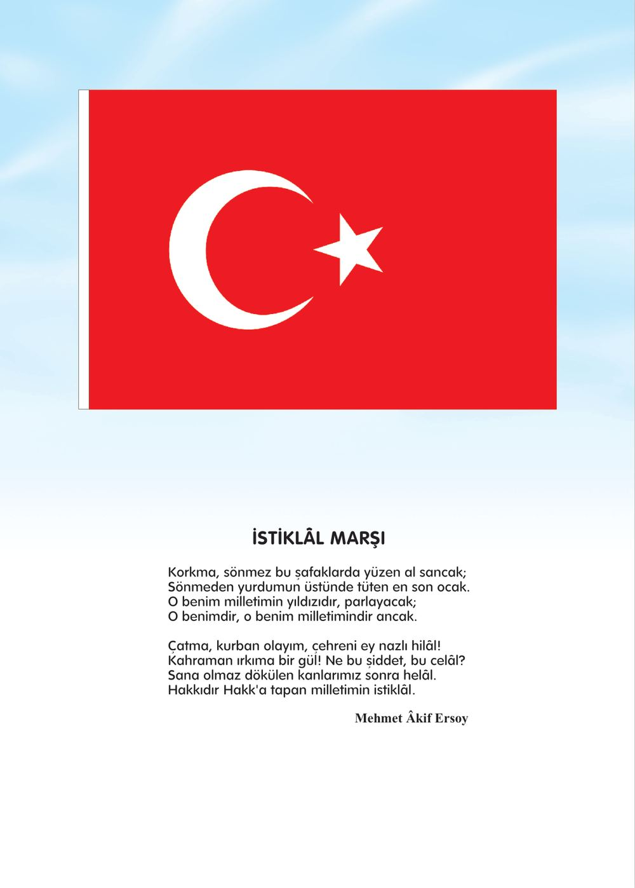

# İSTİKLÂL MARŞI

Korkma, sönmez bu şafaklarda yüzen al sancak;
Sönmeden yurdumun üstünde tüten en son ocak.
O benim milletimin yıldızıdır, parlayacak;
O benimdir, o benim milletimindir ancak.

Çatma, kurban olayım, çehreni ey nazlı hilâl!
Kahraman ırkıma bir gül! Ne bu şiddet, bu celâl?
Sana olmaz dökülen kanlarımız sonra helâl.
Hakkıdır Hakk'a tapan milletimin istiklâl.

Mehmet Âkif Ersoy

<!-- sayfa 3 -->

ANDIMIZ

Türküm, doğruyum, çalışkanım.

İlkem küçüklerimi korumak, büyüklerimi saymak; yurdumu, milletimi özümden çok sevmektir.
Ülküm yükselmek, ileri gitmektir.

Ey Büyük Atatürk!

Açtığın yolda, gösterdiğin hedefe durmadan yürüyeceğime ant içerim.

Varlığım Türk varlığına armağan olsun.

Ne mutlu Türküm diyene!

<!-- yer tutucu bulunamadı: sayfa sonuna eklendi -->

<!-- sayfa 4 -->

MUSTAFA KEMAL ATATÜRK

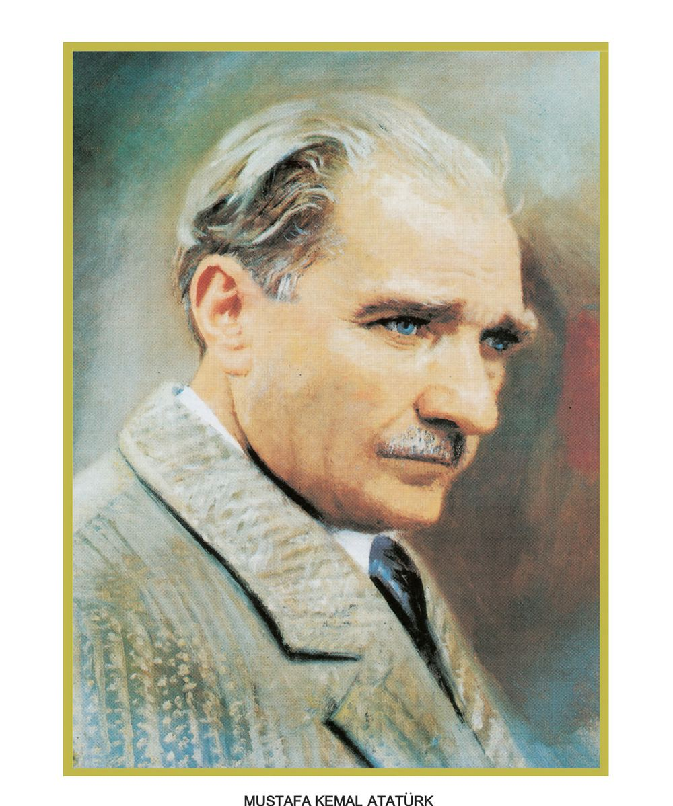
<!-- yer tutucu bulunamadı: sayfa sonuna eklendi -->

<!-- sayfa 5 -->

Verdiğiniz mesajda PDF metin katmanı boş görünüyor (`<<< >>>` arası boş). Lütfen dönüştürülmesini istediğiniz metni veya görseli paylaşın, böylece kurallara uygun şekilde Markdown formatına çevirebilirim.

<!-- sayfa 6 -->

# CONTENTS

| | |
| :--- | ---: |
| **Theme 1** - School Life | 9 |
| **Theme 2** - Classroom Life | 17 |
| **Theme 3** - Personal Life | 25 |
| **Theme 4** - Family Life | 33 |
| **Theme 5** - Homes & Houses & Neighbourhoods | 41 |
| **Theme 6** - Life in the City&the World | 49 |
| **ANSWER KEY** | 57 |
| **REFERENCES** | 57 |
| **VISUAL AND GENERAL WEB REFERENCES** | 57 |
| **Map of Türkiye’s Administrative Divisions and Its Land and Maritime Neighbours** | 58 |
| **Map of the Turkic World** | 59 |

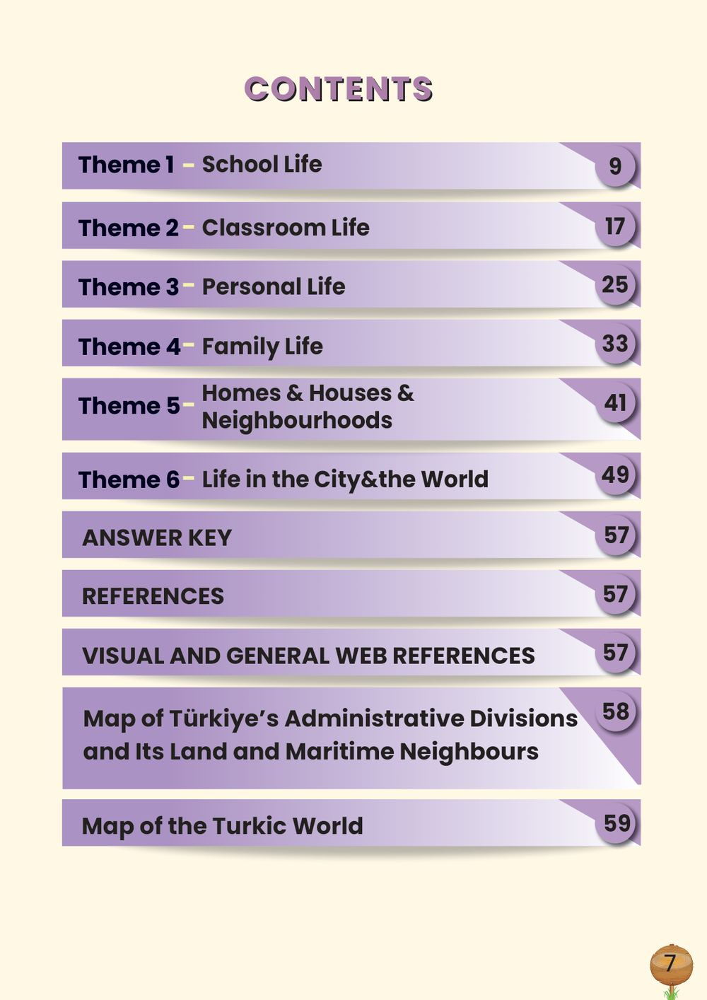
<!-- yer tutucu bulunamadı: sayfa sonuna eklendi -->

<!-- sayfa 7 -->

<<<

>>>

Girdiğiniz mesajda herhangi bir metin veya görsel bulunmamaktadır. Lütfen dönüştürülmesini istediğiniz PDF metin katmanını `<<< ... >>>` arasına ekleyin ve ilgili görseli paylaşın. Verileri sağladığınızda talimatlarınıza uygun şekilde Markdown formatına çevirebilirim.

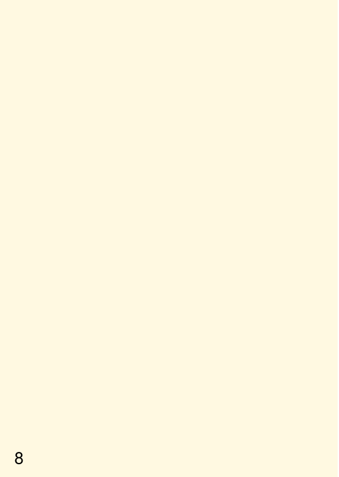
<!-- yer tutucu bulunamadı: sayfa sonuna eklendi -->

<!-- sayfa 8 -->

Theme for EBA

# Theme 1
# SCHOOL LIFE

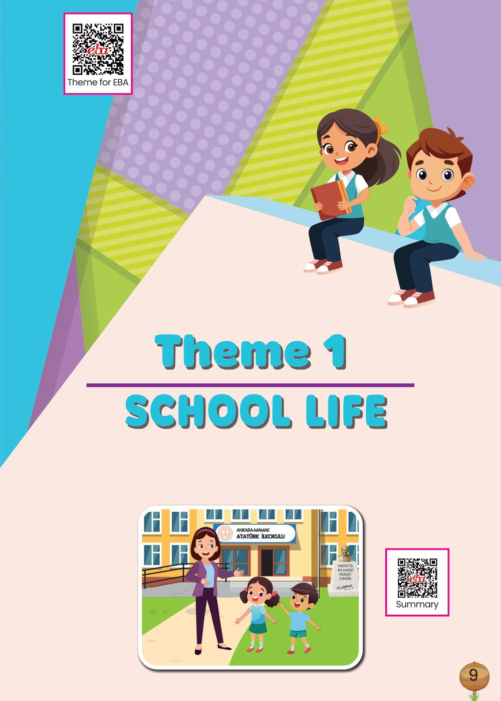

Summary

<!-- sayfa 9 -->

# 1 Choose and ✅ .

1
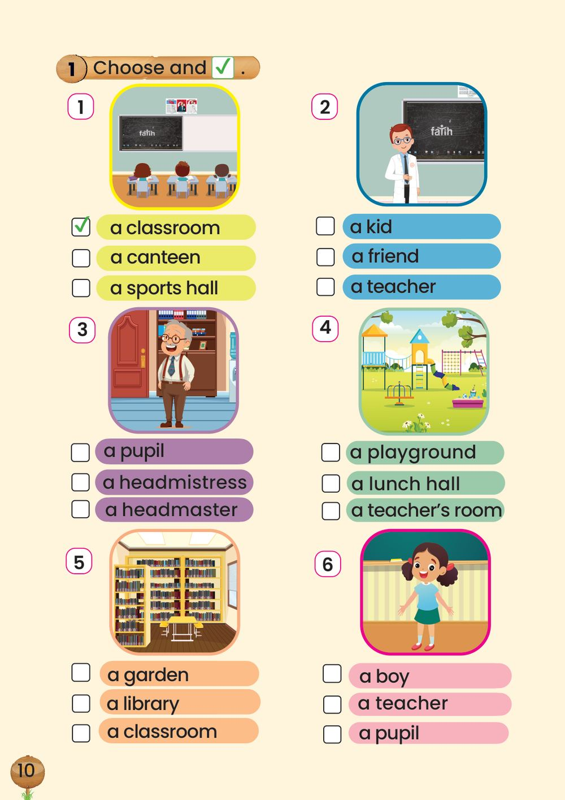
- [x] a classroom
- [ ] a canteen
- [ ] a sports hall

2

- [ ] a kid
- [ ] a friend
- [ ] a teacher

3

- [ ] a pupil
- [ ] a headmistress
- [ ] a headmaster

4

- [ ] a playground
- [ ] a lunch hall
- [ ] a teacher's room

5

- [ ] a garden
- [ ] a library
- [ ] a classroom

6

- [ ] a boy
- [ ] a teacher
- [ ] a pupil

<!-- sayfa 10 -->

# 2 Look and write.

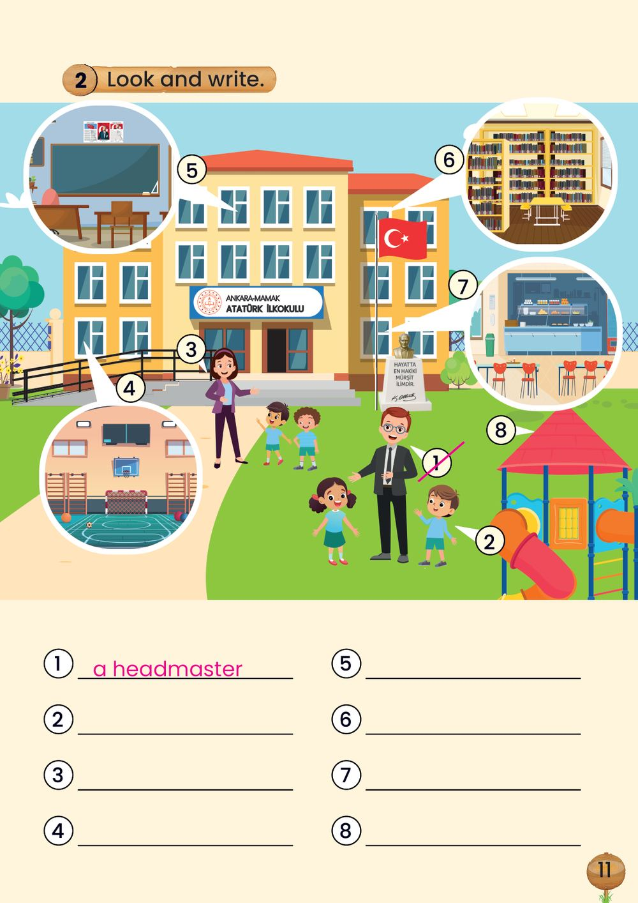

1 a headmaster
2 __________
3 __________
4 __________
5 __________
6 __________
7 __________
8 __________

<!-- sayfa 11 -->

# 3 Order the words. Then match with the answers.

1  is - What - this ____________________? [ d ]

2  he - is - Who _______________________? [    ]

3  Tom - Where - is ____________________? [    ]

4  name - What's - your ________________? [    ]

5  you - are - How _____________________? [    ]

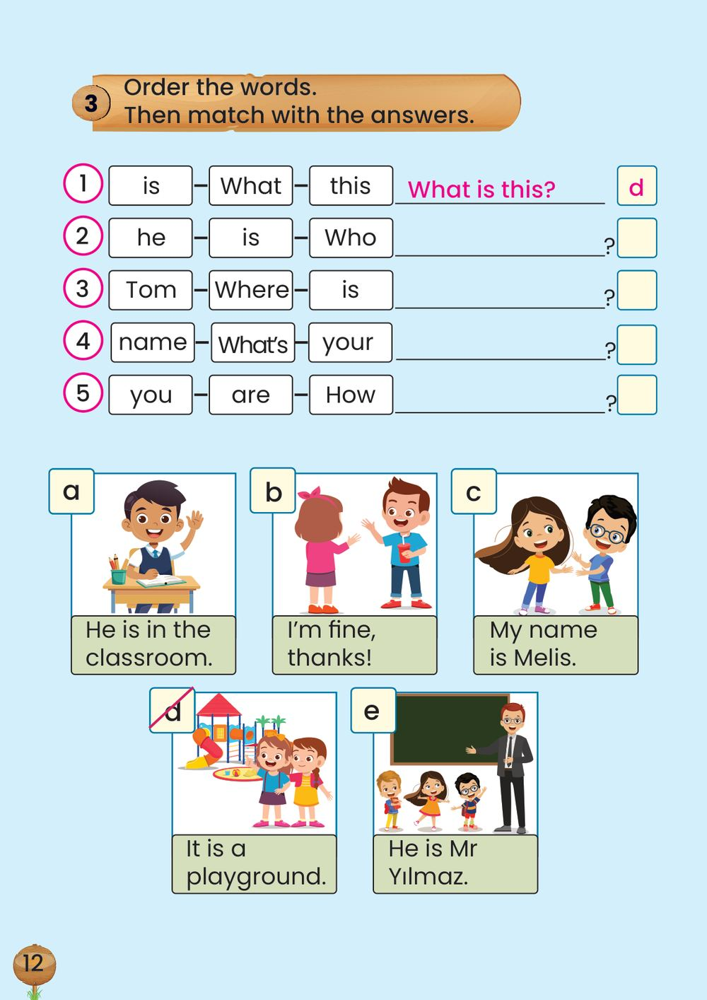

a

He is in the classroom.

b

I'm fine, thanks!

c

My name is Melis.

d

It is a playground.

e

He is Mr Yılmaz.

<!-- sayfa 12 -->

# 4 Look and complete.

| Hello | Goodbye | fine | I'm |
| :---: | :---: | :---: | :---: |
| What's | How | See | your |

---

## 1
Hello! My name is Duru. ________ your name?

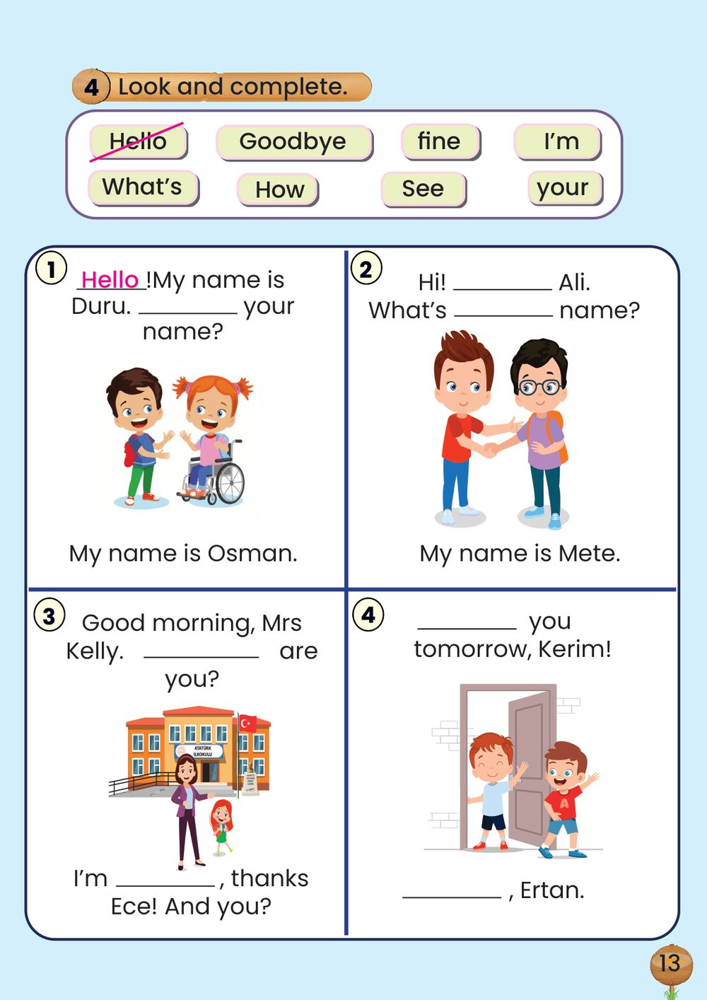

My name is Osman.

## 2
Hi! ________ Ali. What's ________ name?

My name is Mete.

## 3
Good morning, Mrs Kelly. ________ are you?

I'm ________, thanks Ece! And you?

## 4
________ you tomorrow, Kerim!

________, Ertan.

<!-- sayfa 13 -->

# 5 Write the days.

## WHAT DAY IS IT TODAY?

a 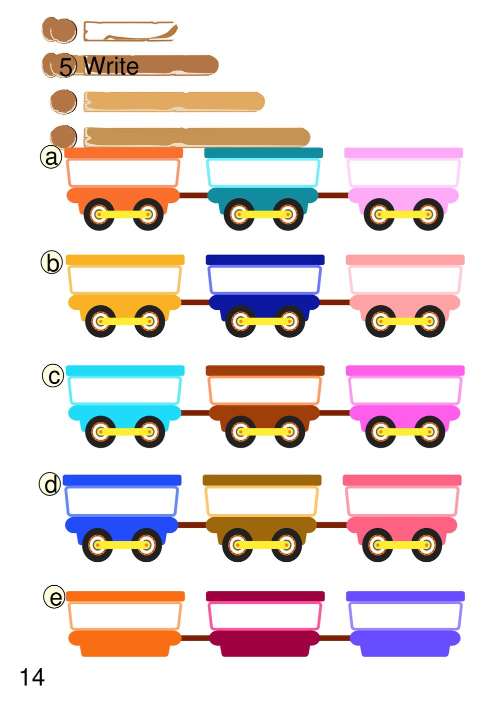
Wednesday | Thursday | Friday

b 
Monday | [ ] | Wednesday

c 
Tuesday | [ ] | Thursday

d 
Friday | [ ] | Sunday

e 
Thursday | [ ] | Saturday

<!-- sayfa 14 -->

# 6 Read and number.

## MY SCHOOL

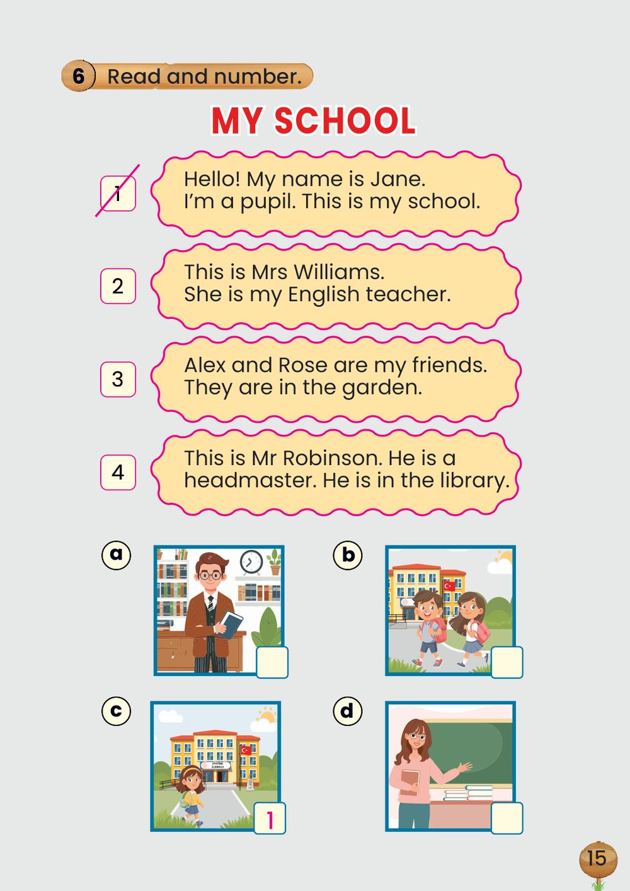
1. Hello! My name is Jane. I'm a pupil. This is my school.

2. This is Mrs Williams. She is my English teacher.

3. Alex and Rose are my friends. They are in the garden.

4. This is Mr Robinson. He is a headmaster. He is in the library.

a 
b 
c 
d 

<!-- sayfa 15 -->

7 Find the people/places in the school.

| | | | | | | | | | | | |
|---|---|---|---|---|---|---|---|---|---|---|---|
| 1. | TEACHER | C | A | N | T | E | E | N | P | B | V | B |
| 2. | _________ | T | G | T | S | B | W | H | A | C | C | O |
| 3. | _________ | E | P | L | A | Y | G | R | O | U | N | D |
| 4. | _________ | A | G | W | H | A | S | B | W | H | P | Z |
| 5. | _________ | C | L | A | S | S | R | O | O | M | U | A |
| 6. | _________ | H | G | S | B | G | T | S | B | H | P | Z |
| 7. | _________ | E | F | R | I | E | N | D | E | S | I | E |
| 8. | _________ | R | G | T | K | K | N | F | K | N | L | W |
| | | M | H | E | A | D | M | A | S | T | E | R |
| | | Z | L | C | G | C | E | R | A | D | A | N |
| | | S | P | O | R | T | S | H | A | L | L | T |

# LET’S CHECK!

| Tick ✅ | Write |
| :--- | :--- |
| My favourite place in the school is | What day is it today? |
| ☐ a garden | It is ______________ . |
| ☐ a classroom | |
| ☐ a library | |
| ☐ a canteen | |
| ☐ a sports hall | |

| Colour |
| :--- |
| How many stars for the theme? |
| ⭐ ⭐ ⭐ ⭐ ⭐ |

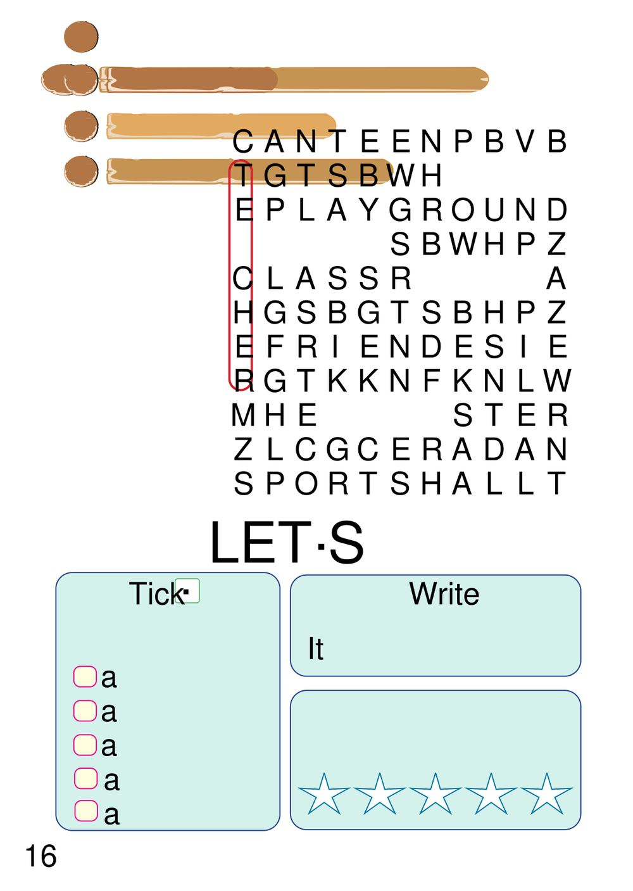
<!-- yer tutucu bulunamadı: sayfa sonuna eklendi -->

<!-- sayfa 16 -->

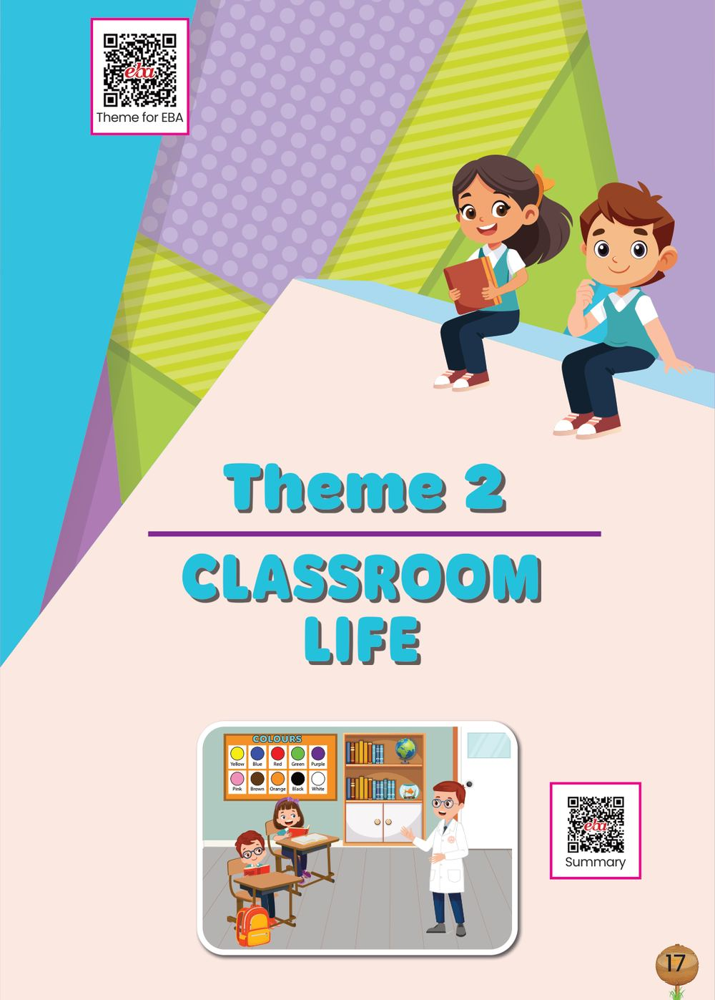

# Theme 2
## CLASSROOM LIFE

| COLOURS | | | | | |
| :--- | :--- | :--- | :--- | :--- | :--- |
| Yellow | Blue | Red | Green | Purple | |
| Pink | Brown | Orange | Black | White | |

<!-- sayfa 17 -->

# 1 Choose and ✅ .

1
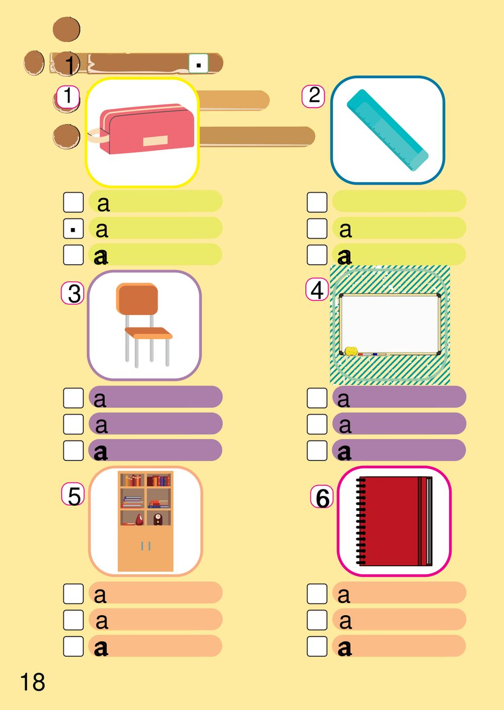
- [ ] a desk
- [x] a pencil case
- [ ] a sharpener

2

- [ ] scissors
- [ ] a ruler
- [ ] a crayon

3

- [ ] a computer
- [ ] a clock
- [ ] a chair

4

- [ ] a table
- [ ] a whiteboard
- [ ] a window

5

- [ ] a bookcase
- [ ] a wall
- [ ] a door

6

- [ ] a tablet
- [ ] a rubber
- [ ] a notebook

<!-- sayfa 18 -->

# 2 Look and number.

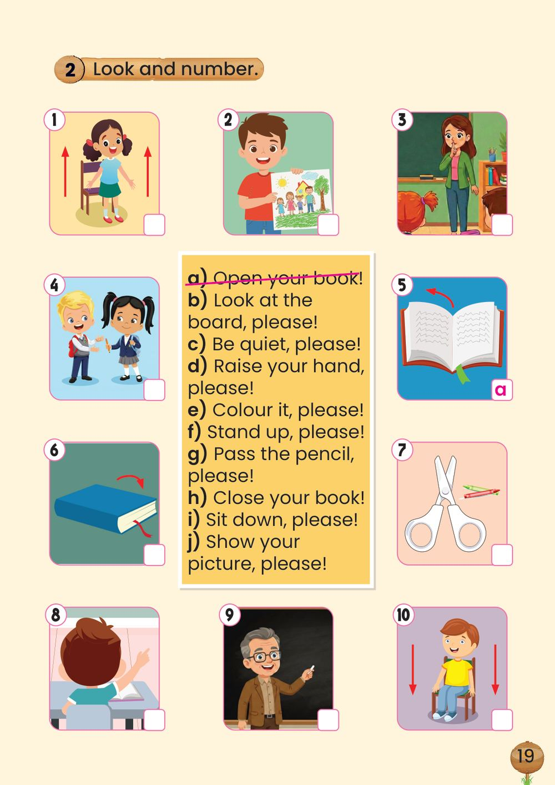

a) ~~Open your book!~~
b) Look at the board, please!
c) Be quiet, please!
d) Raise your hand, please!
e) Colour it, please!
f) Stand up, please!
g) Pass the pencil, please!
h) Close your book!
i) Sit down, please!
j) Show your picture, please!

<!-- sayfa 19 -->

# 3 Look and write.

a) Open the door, please! 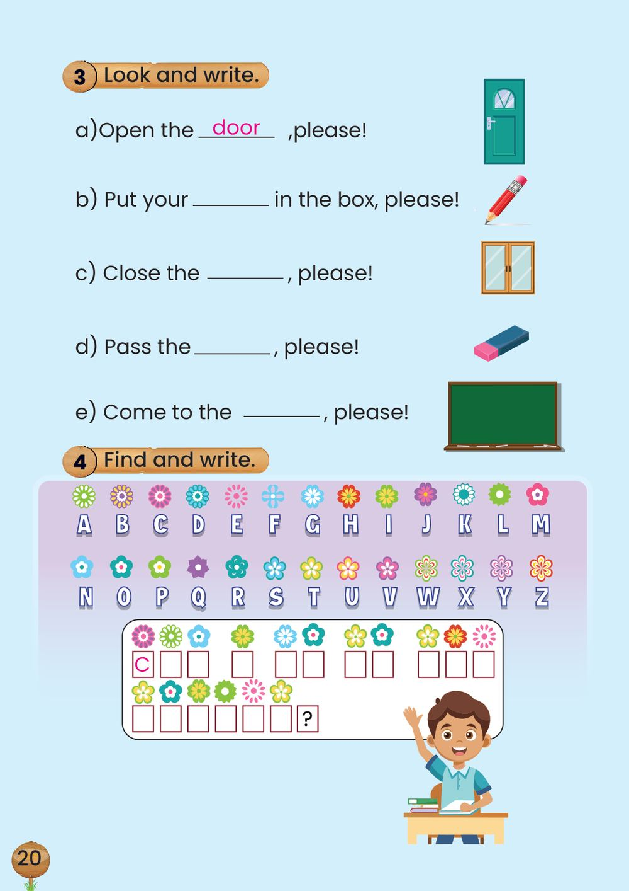
b) Put your ________ in the box, please! 
c) Close the ________, please! 
d) Pass the ________, please! 
e) Come to the ________, please! 

# 4 Find and write.

| 🌼 | 🌸 | 🌺 | 💠 | 🌸 | 💠 | 🌼 | 🌺 | 🌼 | 🌺 | 💠 | 🌼 | 🌸 |
| :---: | :---: | :---: | :---: | :---: | :---: | :---: | :---: | :---: | :---: | :---: | :---: | :---: |
| A | B | C | D | E | F | G | H | I | J | K | L | M |

| 💠 | 💠 | 🌼 | 💜 | 💠 | 💠 | 🌼 | 🌼 | 🌸 | 🌼 | 💠 | 💠 | 🌸 |
| :---: | :---: | :---: | :---: | :---: | :---: | :---: | :---: | :---: | :---: | :---: | :---: | :---: |
| N | O | P | Q | R | S | T | U | V | W | X | Y | Z |

| 🌸 | 🌼 | 💠 | 🌼 | 💠 | 🌼 | 🌼 | 🌼 | 🌸 | 🌸 |
| :---: | :---: | :---: | :---: | :---: | :---: | :---: | :---: | :---: | :---: |
| C | | | | | | | | | |

| 🌼 | 💠 | 🌼 | 🌼 | 🌸 | 🌸 |
| :---: | :---: | :---: | :---: | :---: | :---: |
| | | | | | | ? |

<!-- sayfa 20 -->

# 5 Read and colour.

1 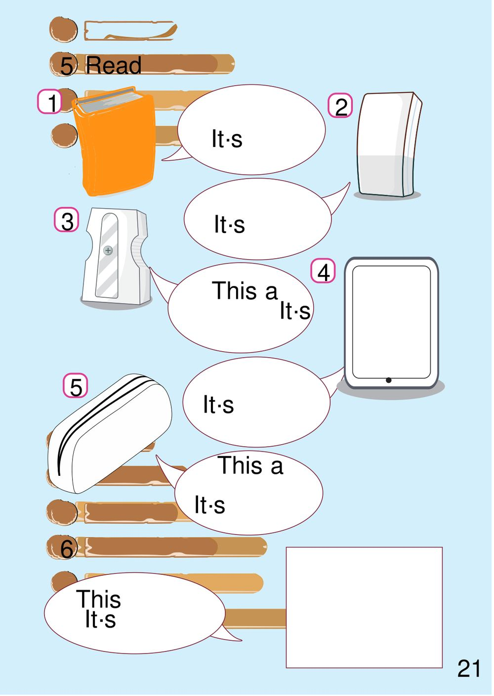
This is a book.
It's orange.

2 
This is a rubber.
It's red and blue.

3 
This is a sharpener. It's yellow.

4 
This is a tablet.
It's white and black.

5 
This is a pencil case.
It's green and brown.

# 6 Draw, colour, and say.

This is ............................
It's ............................

<!-- sayfa 21 -->

# 7 Find and write.

a) $3 + 5 =$ <!-- KONTROL: Marker'da karşılığı yok, uydurma olabilir -->
| T | E | G | I | H |
|---|---|---|---|---|
| E | I | G | H | T |

b) $5 + 6 =$ <!-- KONTROL: Marker'da karşılığı yok, uydurma olabilir -->
| N | L | E | V | E | E |
|---|---|---|---|---|---|
|   |   |   |   |   |   |

c) $12 + 8 =$ <!-- KONTROL: Marker'da karşılığı yok, uydurma olabilir -->
| W | E | T | N | Y | T |
|---|---|---|---|---|---|
|   |   |   |   |   |   |

d) $10 + 6 =$ <!-- KONTROL: Marker'da karşılığı yok, uydurma olabilir -->
| T | S | X | E | N | I | E |
|---|---|---|---|---|---|---|
|   |   |   |   |   |   |   |

e) $7 + 6 =$ <!-- KONTROL: Marker'da karşılığı yok, uydurma olabilir -->
| T | H | I | R | E | T | E | N |
|---|---|---|---|---|---|---|---|
|   |   |   |   |   |   |   |   |

f) $3 + 4 =$ <!-- KONTROL: Marker'da karşılığı yok, uydurma olabilir -->
| V | E | S | E | N |
|---|---|---|---|---|
|   |   |   |   |   |

g) $7 + 8 =$ <!-- KONTROL: Marker'da karşılığı yok, uydurma olabilir -->
| T | E | F | I | E | F | N |
|---|---|---|---|---|---|---|
|   |   |   |   |   |   |   |

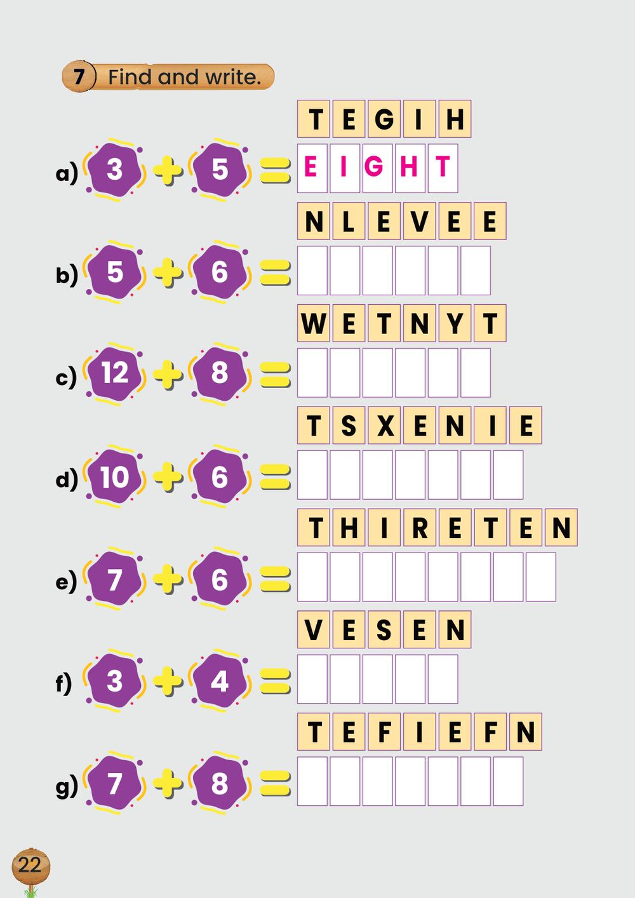
<!-- yer tutucu bulunamadı: sayfa sonuna eklendi -->

<!-- sayfa 22 -->

# 8 Read and complete.

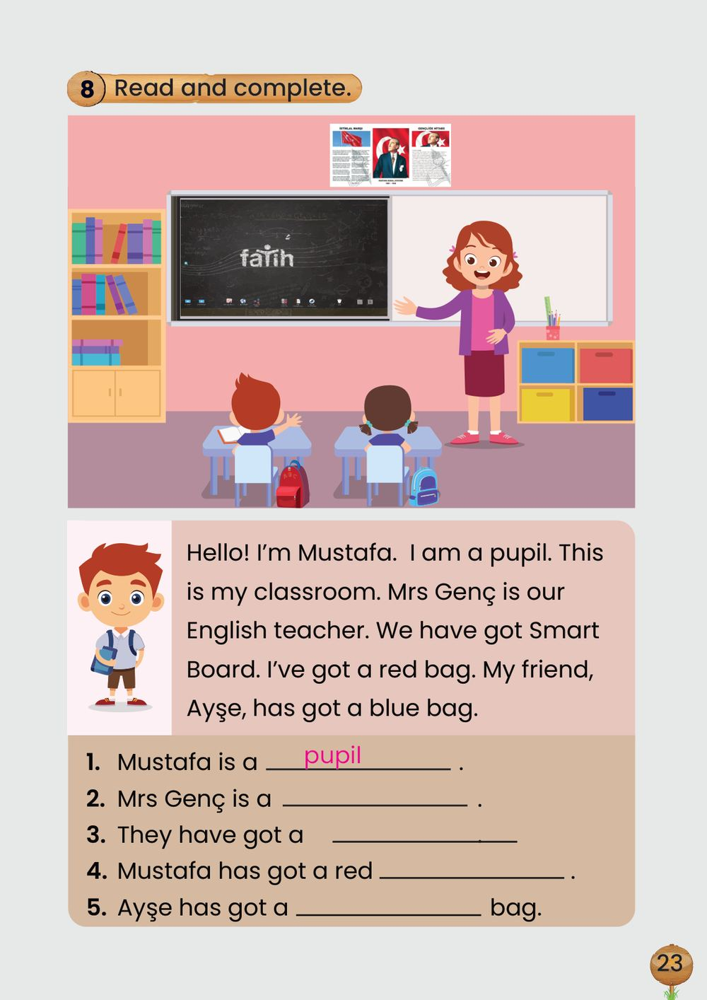

Hello! I’m Mustafa. I am a pupil. This is my classroom. Mrs Genç is our English teacher. We have got Smart Board. I’ve got a red bag. My friend, Ayşe, has got a blue bag.

1. Mustafa is a pupil.
2. Mrs Genç is a ____________________.
3. They have got a ____________________.
4. Mustafa has got a red ____________________.
5. Ayşe has got a ____________________ bag.

<!-- sayfa 23 -->

# 9) Look and write.

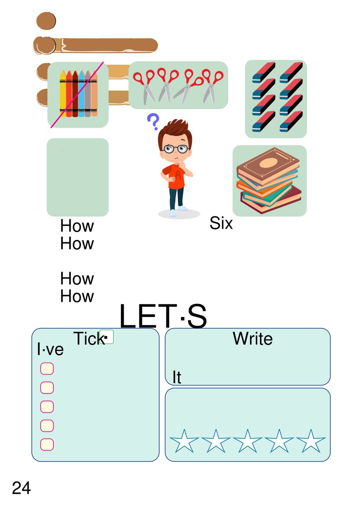

1. How many crayons? \_\_\_\_\_\_\_\_\_\_\_\_\_\_\_ Six crayons.
2. How many rubbers? \_\_\_\_\_\_\_\_\_\_\_\_\_\_\_
3. How many pencil cases? \_\_\_\_\_\_\_\_\_\_\_\_\_\_\_
4. How many scissors? \_\_\_\_\_\_\_\_\_\_\_\_\_\_\_
5. How many books? \_\_\_\_\_\_\_\_\_\_\_\_\_\_\_

# LET'S CHECK!

| Tick ✅ | Write |
| :--- | :--- |
| I've got \_\_\_\_\_\_ pencils. | What colour is your pencil case? |
| ◯ two | It is \_\_\_\_\_\_\_\_\_\_\_\_\_\_\_\_\_\_\_\_\_\_\_\_\_\_\_. |
| ◯ three | |
| ◯ four | **Colour** |
| ◯ five | How many stars for the theme? |
| ◯ six |  |

<!-- sayfa 24 -->

Theme for EBA

# Theme 3
## PERSONAL LIFE

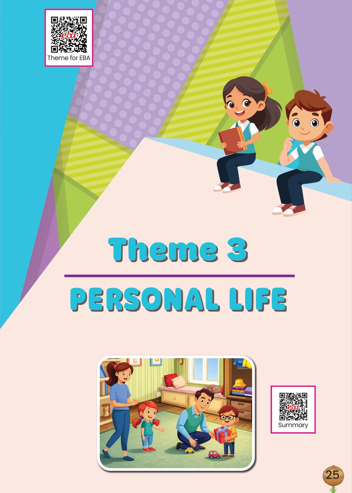

Summary

<!-- sayfa 25 -->

# 1 Look and write.

| | | | |
| :--- | :--- | :--- | :--- |
| a ~~head~~ | a body | an eye | hair |
| an ear | a leg | a nose | a face |
| a hand | a mouth | an arm | |

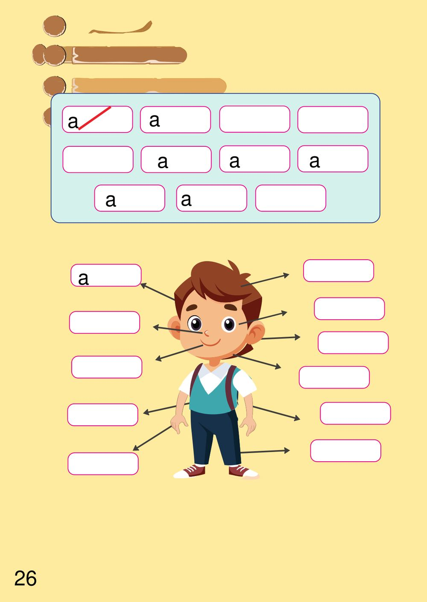

1. a head
2. 
3. 
4. 
5. 
6. 
7. 
8. 
9. 
10. 
11.

<!-- sayfa 26 -->

2) Look and write.

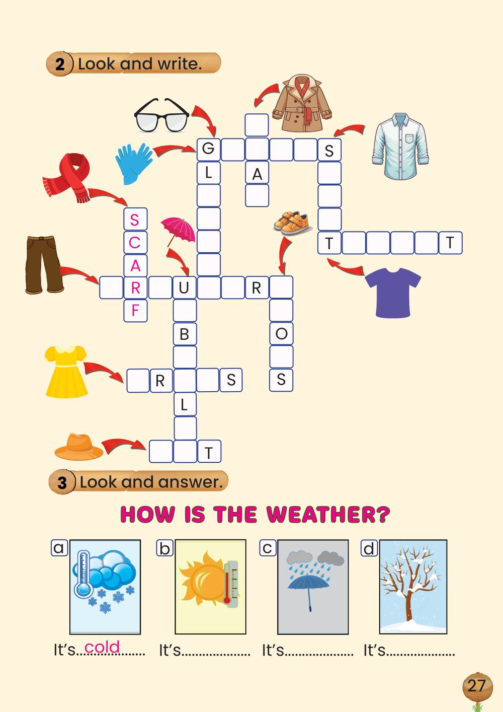

3) Look and answer.

# HOW IS THE WEATHER?

| a | b | c | d |
| :---: | :---: | :---: | :---: |
|  |  |  |  |
| It's cold | It's | It's | It's |

<!-- sayfa 27 -->

# 4 Look and circle.

Ayşe has got green **hair/eyes**.
Melis is **seven/eight**.
Ali is **tall/short**.
Ömer has got a green **hat/scarf**.

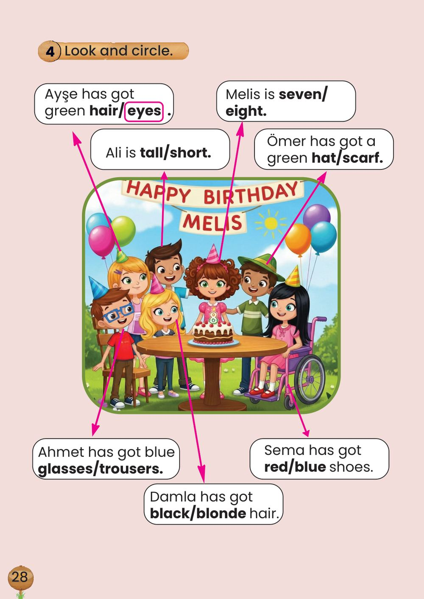

Ahmet has got blue **glasses/trousers**.
Damla has got **black/blonde** hair.
Sema has got **red/blue** shoes.

<!-- sayfa 28 -->

# 5 Order the words. Then match with the answers.

1 you - old - are - How
How old are you? [b]

2 it - today - is - What - day
__________________________________________? [ ]

3 this - What - is
__________________________________________? [ ]

4 colour - is - What - it
__________________________________________? [ ]

5 weather - How - the - is
__________________________________________? [ ]

6 have - you - What - got
__________________________________________? [ ]

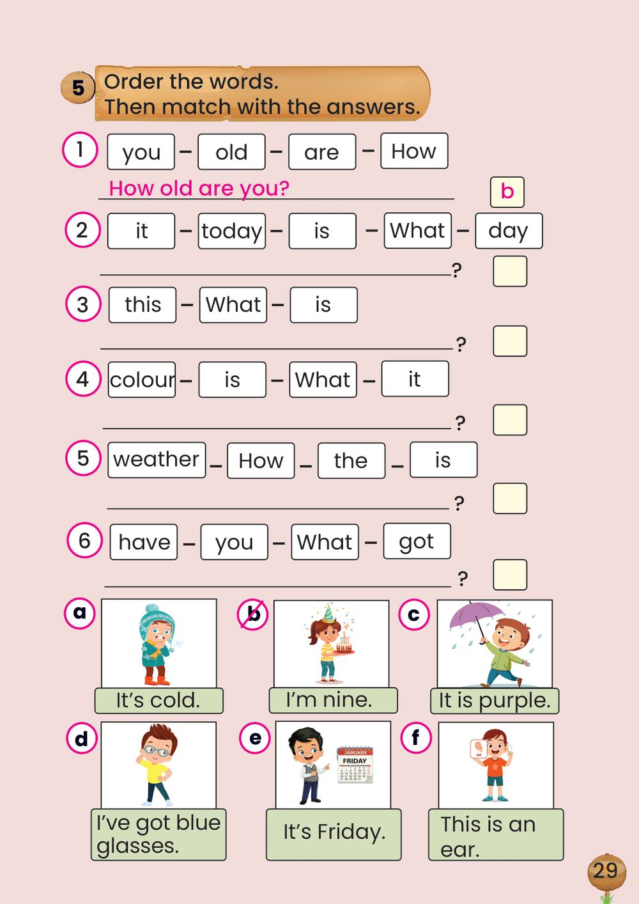

a 
It's cold.

b 
I'm nine.

c 
It is purple.

d 
I've got blue

e 
It's Friday.

f 
This is an

<!-- sayfa 29 -->

# 6 Read, choose, and write.

I am a very 1 \_\_\_\_\_\_ tall animal. I have got four long 2 \_\_\_\_\_\_, two small 3 \_\_\_\_\_\_ on my head. I can see with my big brown 4 \_\_\_\_\_\_. I have got a small 5 \_\_\_\_\_\_. I have got brown spots on my body. Yes, I am a giraffe!

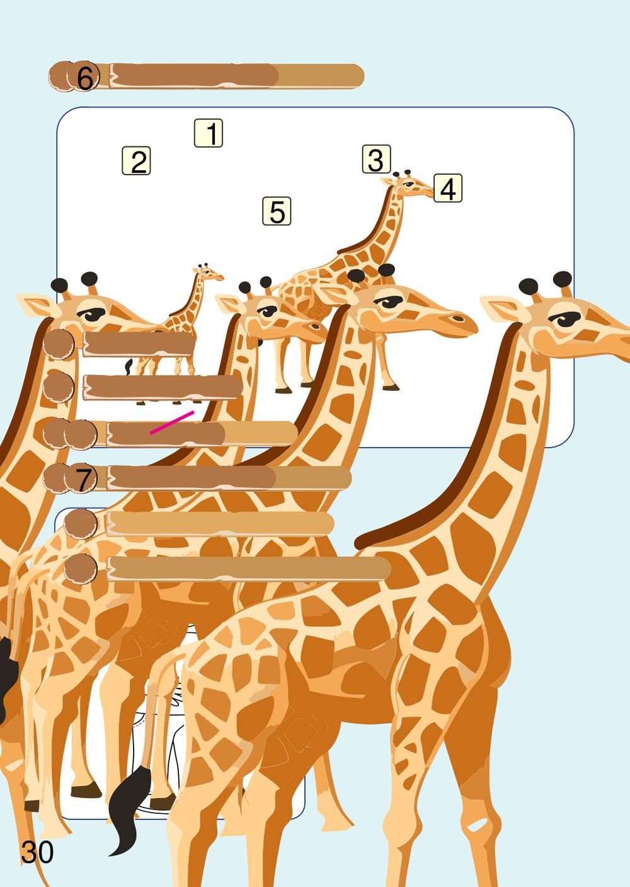

eyes
head
legs
nose
ears
tall

# 7 Read, draw, and colour.

I have got short brown hair and big blue eyes. I’ve got small ears, a big nose and a big mouth. I’ve got a green t-shirt, blue trousers and black shoes. I’ve got red glasses and a yellow hat. Draw and colour me!

<!-- sayfa 30 -->

# 8 Match and write.

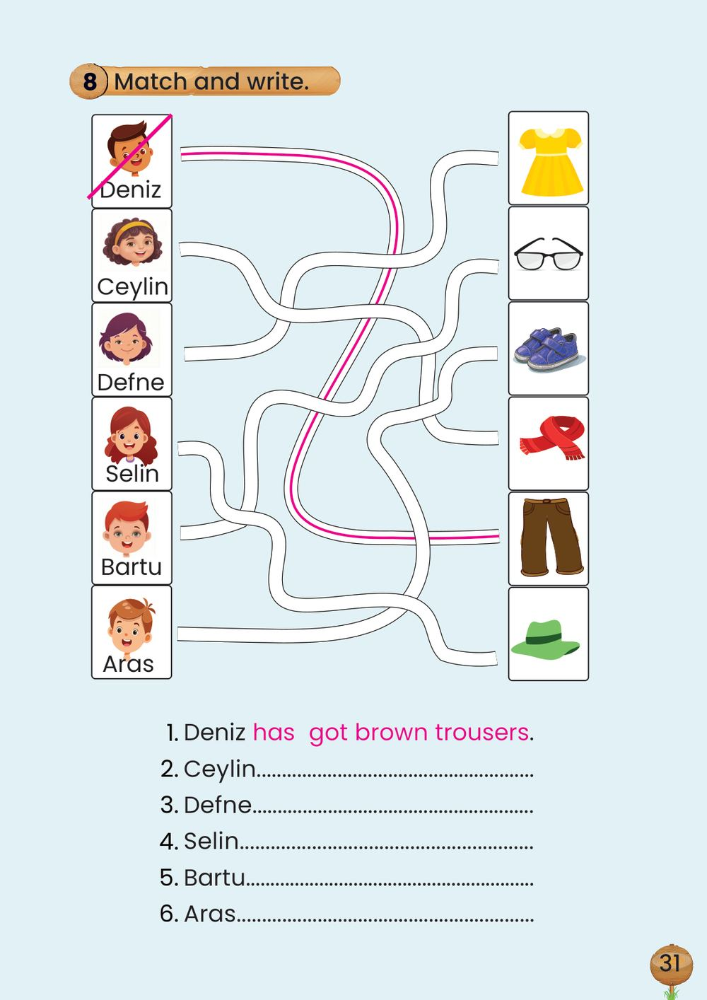

1. Deniz has got brown trousers.
2. Ceylin.......................................................
3. Defne........................................................
4. Selin.........................................................
5. Bartu...........................................................
6. Aras............................................................

<!-- sayfa 31 -->

# 9 Draw and write about you.

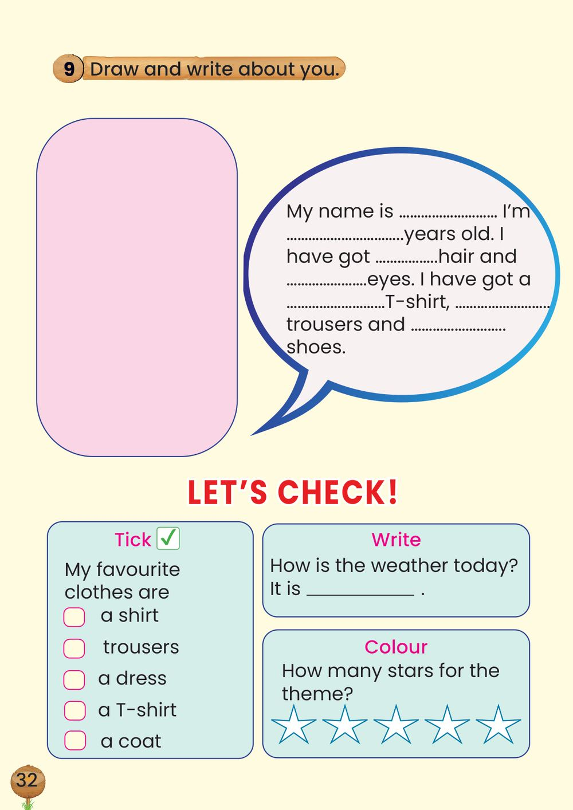

My name is ........................ I’m .......................................years old. I have got ...............hair and ........................eyes. I have got a ...........................T-shirt, ............................ trousers and ............................ shoes.

## LET’S CHECK!

| Tick ✅ | Write |
| :--- | :--- |
| My favourite clothes are | How is the weather today? |
| ☐ a shirt | It is ______________ . |
| ☐ trousers | |
| ☐ a dress | |
| ☐ a T-shirt | |
| ☐ a coat | |

| Colour |
| :--- |
| How many stars for the theme? |
| ☆ ☆ ☆ ☆ ☆ |

<!-- sayfa 32 -->

Theme for EBA

# Theme 4
## FAMILY LIFE

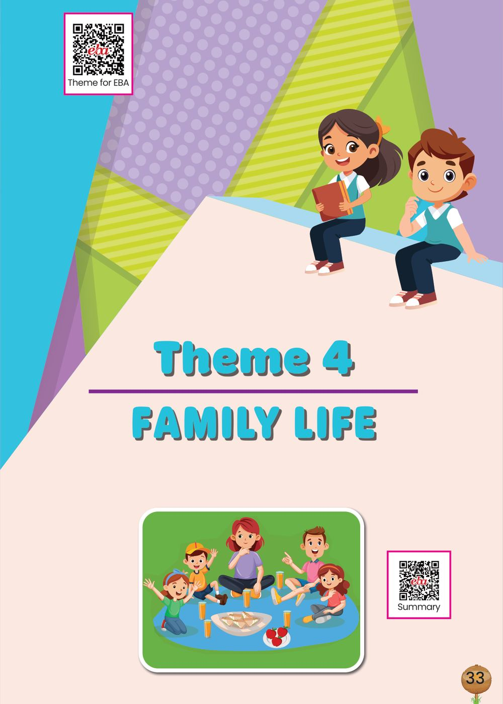

Summary

<!-- sayfa 33 -->

# 1 Look and write.

a mother (crossed out) | a brother | a grandfather
a sister | a grandmother | a father | a baby

[a mother] $\rightarrow$ Zeynep
[ ] $\rightarrow$ Ceyda
[ ] $\rightarrow$ Kerim
[ ] $\rightarrow$ Zehra
[me] $\rightarrow$ Özge
[ ] $\rightarrow$ Çınar
[ ] $\rightarrow$ Ahmet

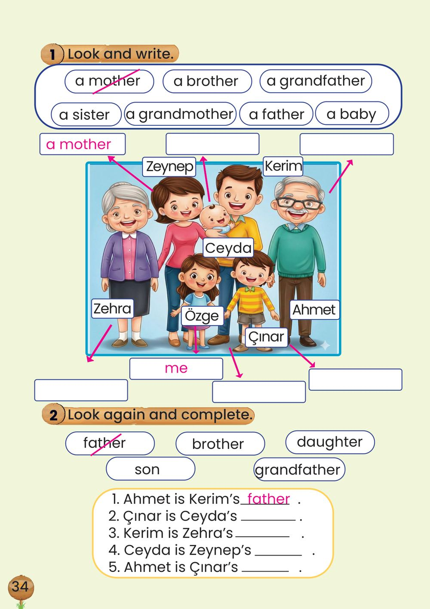

# 2 Look again and complete.

father (crossed out) | brother | daughter
son | grandfather

1. Ahmet is Kerim’s $\text{\underline{father}}$ <!-- KONTROL: Marker'da karşılığı yok, uydurma olabilir -->.
2. Çınar is Ceyda’s \_\_\_\_\_\_\_\_.
3. Kerim is Zehra’s \_\_\_\_\_\_\_\_.
4. Ceyda is Zeynep’s \_\_\_\_\_\_\_\_.

<!-- sayfa 34 -->

# 3 Look and ✔

a 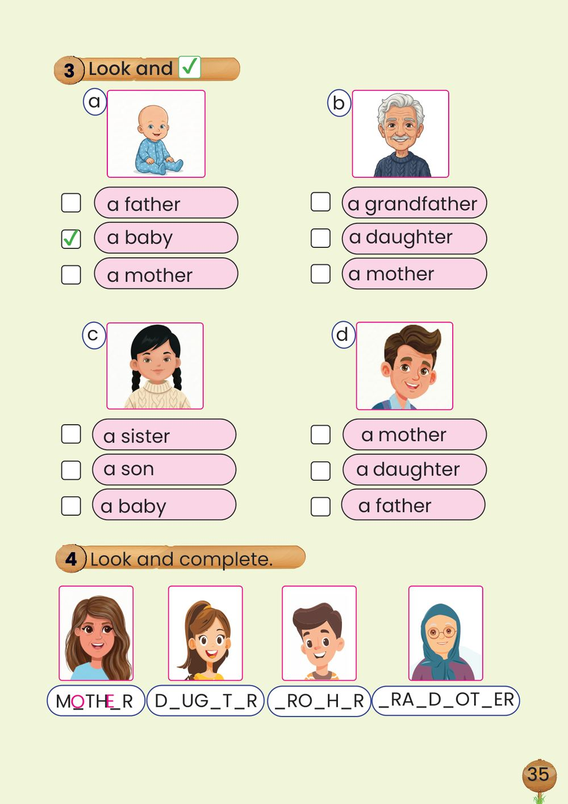
☐ a father
☑ a baby
☐ a mother

b 
☐ a grandfather
☐ a daughter
☐ a mother

c 
☐ a sister
☐ a son
☐ a baby

d 
☐ a mother
☐ a daughter
☐ a father

# 4 Look and complete.

   
M_TH_R  D_UG_T_R  _RO_H_R  _RA_D_OT_ER

<!-- sayfa 35 -->

# 5 Match the questions with the answers.

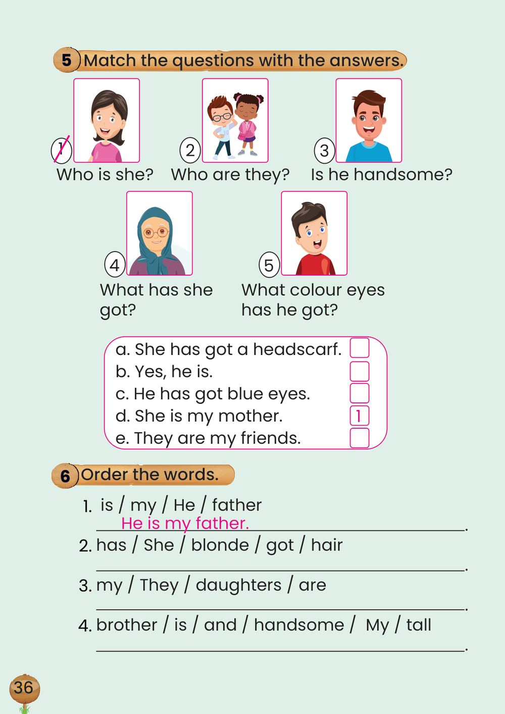
1 Who is she?

2 Who are they?

3 Is he handsome?

4 What has she got?

5 What colour eyes has he got?

| | |
|---|---|
| a. She has got a headscarf. | [ ] |
| b. Yes, he is. | [ ] |
| c. He has got blue eyes. | [ ] |
| d. She is my mother. | [1] |
| e. They are my friends. | [ ] |

# 6 Order the words.

1. is / my / He / father
<u>He is my father.</u>
__________________________________________________________________

2. has / She / blonde / got / hair
__________________________________________________________________

3. my / They / daughters / are
__________________________________________________________________

4. brother / is / and / handsome / My / tall
__________________________________________________________________

<!-- sayfa 36 -->

# 7) Look and answer.

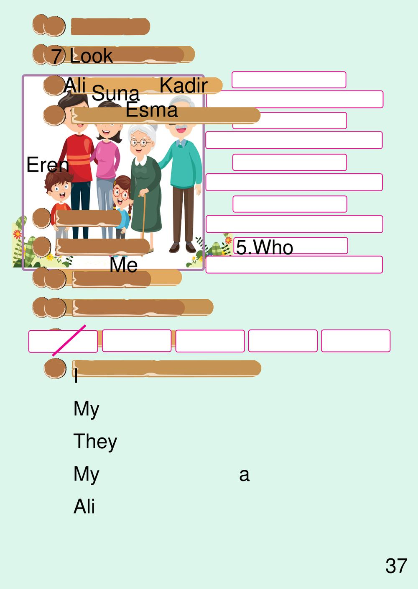

1. Who is Esma?
Esma is my grandmother.

2. Who is Eren?
____________________________________

3. Who is Suna?
____________________________________

4. Who is Ali?
____________________________________

5. Who is Kadir?
____________________________________

# 8) Read and complete.

| am | are | has got | is | have got |
| :--- | :--- | :--- | :--- | :--- |

1. I \_\_\_am\_\_\_ short.

2. My daughters \_\_\_\_\_\_\_\_ beautiful.

3. They \_\_\_\_\_\_\_\_ long blonde hair.

4. My grandfather \_\_\_\_\_\_\_\_ a hat.

5. Ali \_\_\_\_\_\_\_\_ tall and handsome.

<!-- sayfa 37 -->

# 9) Read and complete.

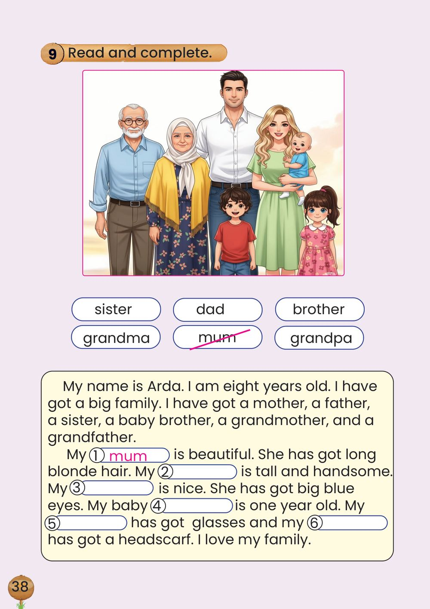

| sister | dad | brother |
| :---: | :---: | :---: |
| grandma | ~~mum~~ | grandpa |

My name is Arda. I am eight years old. I have got a big family. I have got a mother, a father, a sister, a baby brother, a grandmother, and a grandfather.

My ① mum is beautiful. She has got long blonde hair. My ② \_\_\_\_\_\_\_\_\_\_ is tall and handsome. My ③ \_\_\_\_\_\_\_\_\_\_ is nice. She has got big blue eyes. My baby ④ \_\_\_\_\_\_\_\_\_\_ is one year old. My ⑤ \_\_\_\_\_\_\_\_\_\_ has got glasses and my ⑥ \_\_\_\_\_\_\_\_\_\_ has got a headscarf. I love my family.

<!-- sayfa 38 -->

# 10 Read and answer.

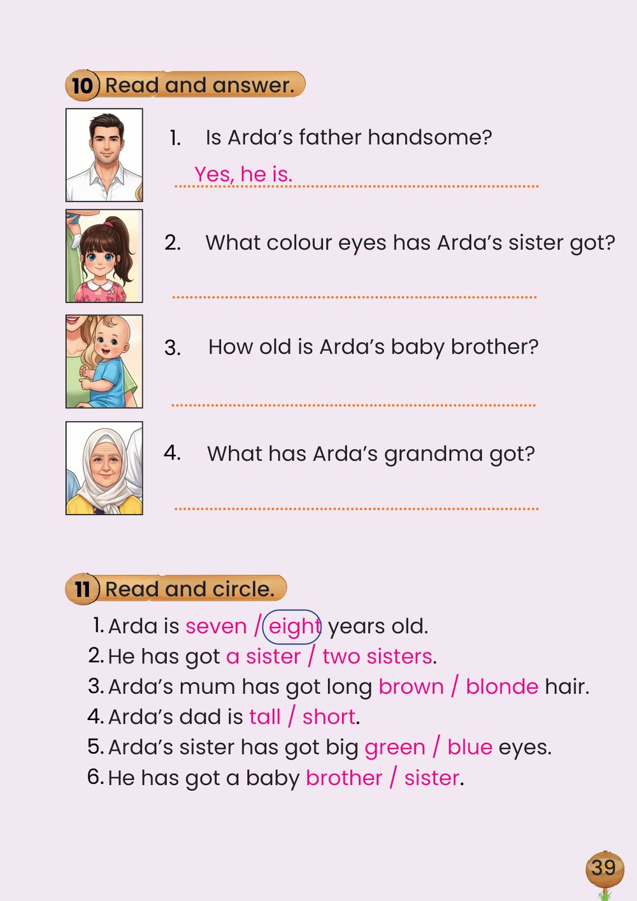 1. Is Arda’s father handsome?
...................................................................................
Yes, he is.

 2. What colour eyes has Arda’s sister got?
...................................................................................

 3. How old is Arda’s baby brother?
...................................................................................

 4. What has Arda’s grandma got?
...................................................................................

# 11 Read and circle.

1. Arda is seven / (eight) years old.
2. He has got a sister / two sisters.
3. Arda’s mum has got long brown / blonde hair.
4. Arda’s dad is tall / short.
5. Arda’s sister has got big green / blue eyes.
6. He has got a baby brother / sister.

<!-- sayfa 39 -->

12) Draw your family tree.

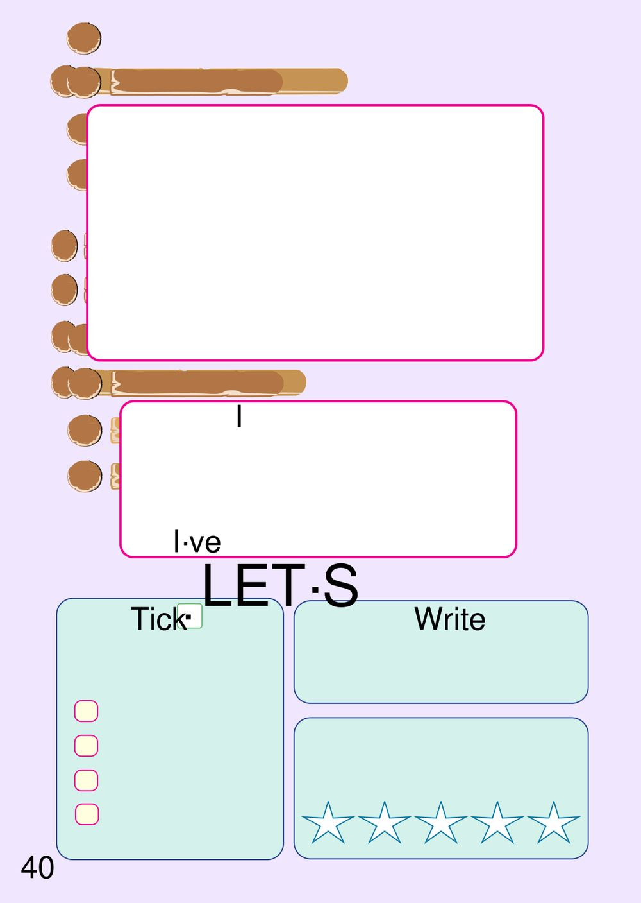

13) Write about you.

1. Hello! I am __________.
2. __________ is my father.
3. __________ is my mother.
4. __________ is my grandmother and
5. __________ is my grandfather.
6. I've got __________.

# LET'S CHECK!

| Tick ✅ | Write |
| :--- | :--- |
| My mother has got   __________ eyes.    ☐ dark   ☐ green   ☐ blue   ☐ brown | My father's name is   ____________________. |

| Colour |
| :--- |
| How many stars for the theme?    |

<!-- sayfa 40 -->

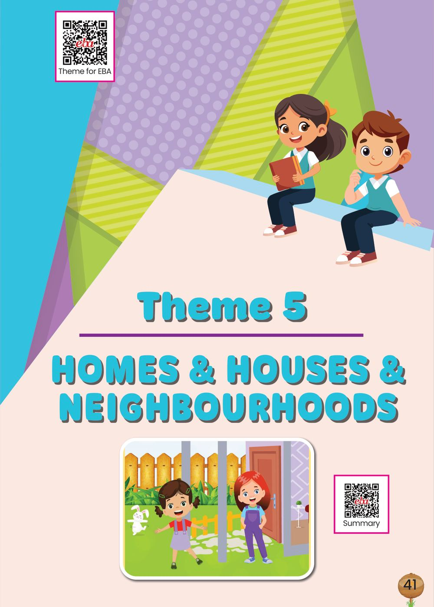

Theme for EBA

# Theme 5
## HOMES & HOUSES & NEIGHBOURHOODS

Summary

<!-- sayfa 41 -->

# 1 Look and number.

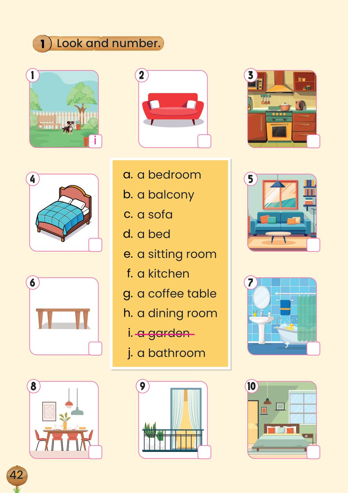 1 [ ] i
 2 [ ]
 3 [ ]
 4 [ ]
 5 [ ]
 6 [ ]
 7 [ ]
 8 [ ]
 9 [ ]
 10 [ ]

a. a bedroom
b. a balcony
c. a sofa
d. a bed
e. a sitting room
f. a kitchen
g. a coffee table
h. a dining room
i. ~~a garden~~
j. a bathroom

<!-- sayfa 42 -->

# 2 Find and write.

| A | B | C | D | E | F | G | H | I | J | K | L | M |
|---|---|---|---|---|---|---|---|---|---|---|---|---|
| 1 | 2 | 3 | 4 | 5 | 6 | 7 | 8 | 9 | 10| 11| 12| 13|

| N | O | P | Q | R | S | T | U | V | W | X | Y | Z |
|---|---|---|---|---|---|---|---|---|---|---|---|---|
| 14| 15| 16| 17| 18| 19| 20| 21| 22| 23| 24| 25| 26|

| 4 | 15 | 7 |
|---|---|---|
| 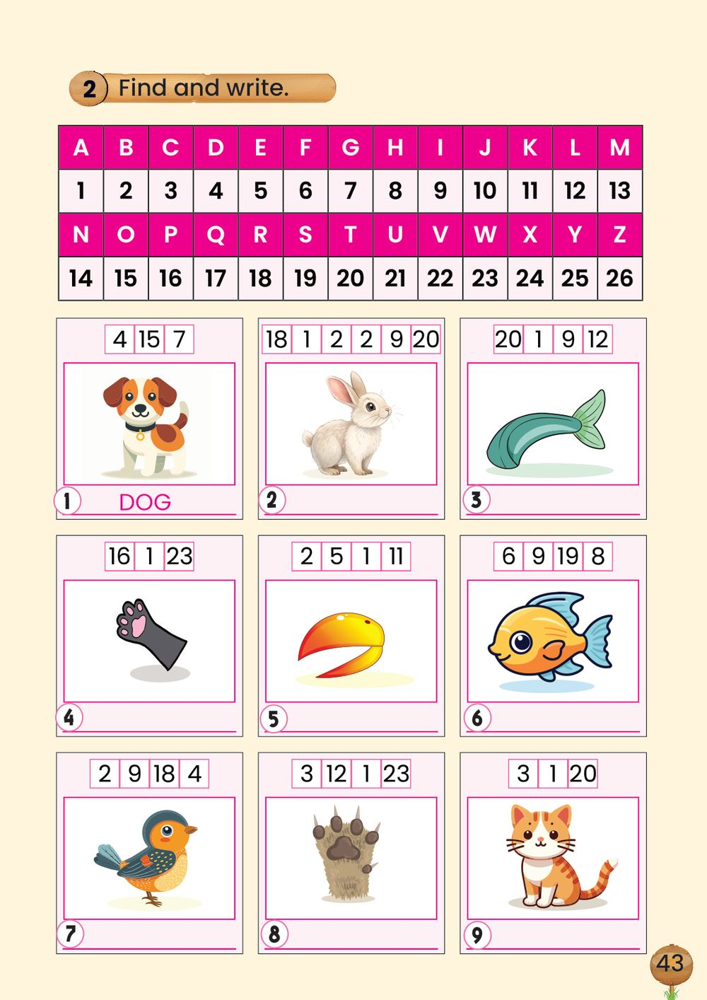 |
| 1 DOG |

| 18 | 1 | 2 | 2 | 9 | 20 |
|---|---|---|---|---|---|
|  |
| 2 |

| 20 | 1 | 9 | 12 |
|---|---|---|---|
|  |
| 3 |

| 16 | 1 | 23 |
|---|---|---|
|  |
| 4 |

| 2 | 5 | 1 | 11 |
|---|---|---|---|
|  |
| 5 |

| 6 | 9 | 19 | 8 |
|---|---|---|---|
|  |
| 6 |

| 2 | 9 | 18 | 4 |
|---|---|---|---|
|  |

| 3 | 12 | 1 | 23 |
|---|---|---|---|
|  |

| 3 | 1 | 20 |
|---|---|---|
|  |

<!-- sayfa 43 -->

# 3 Read, answer, and write.

① They are in the $\rightarrow$
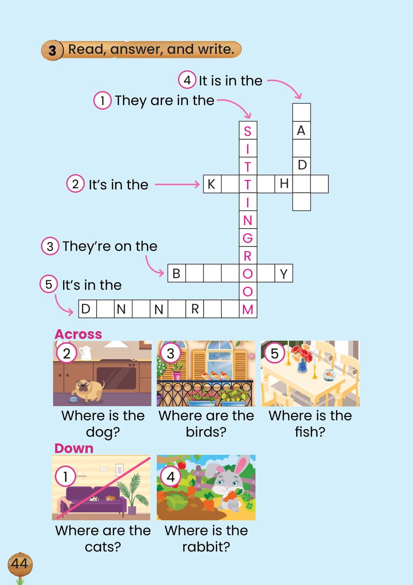
(Bulmaca dikey sütun: S I T T I N G R O O M)

④ It is in the $\rightarrow$

(Bulmaca dikey sütun: _ _ A D H _ _)

② It's in the $\rightarrow$

(Bulmaca yatay satır: K _ T H _)

③ They're on the $\rightarrow$

(Bulmaca yatay satır: B _ _ O Y)

⑤ It's in the $\rightarrow$

(Bulmaca yatay satır: D N N R _ M)

## Across

2 Where is the dog?

3 Where are the birds?

5 Where is the fish?

## Down

1 Where are the...

4 Where is the...

<!-- sayfa 44 -->

# 4 Read and complete.

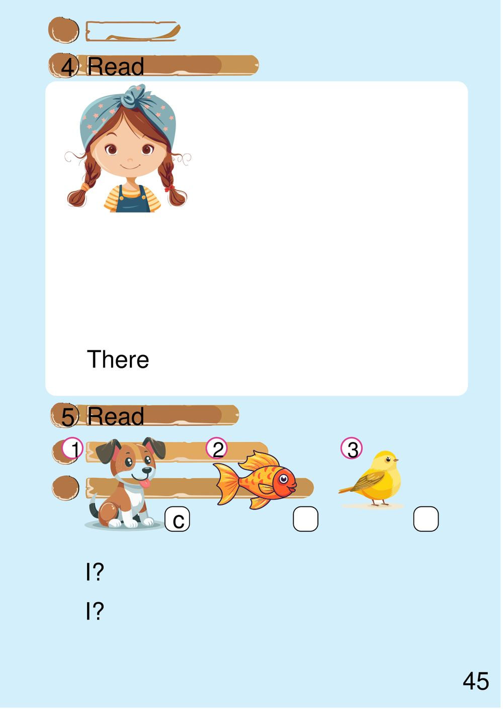

My name is Cindy. We have got a big house. I have got a cute cat. It is in the bedroom. It has got long whiskers. My dog is in the sitting room. It has got a long tail. I have got a goldfish. It is in the kitchen. It is yellow and black. We’ve got rabbits in the garden. They are white. I love my pets and house.

a) The cat is in the $\text{\underline{bedroom}}$ <!-- KONTROL: Marker'da karşılığı yok, uydurma olabilir --> .
b) The dog has got a long $\text{\_\_\_\_\_\_\_\_\_\_}$ .
c) The goldfish is in the $\text{\_\_\_\_\_\_\_\_\_\_}$ .
d) There are $\text{\_\_\_\_\_\_\_\_\_\_}$ in the garden.
e) The rabbits are $\text{\_\_\_\_\_\_\_\_\_\_}$ .

# 5 Read and match.

1  [C]
2  [ ]
3  [ ]

a) I am small. I have got a beak. I am yellow. Who am I?
b) I am orange. I have got a tail. I am small. Who am I?
c) I am cute. I have got paws. I am white and ...

<!-- sayfa 45 -->

# 6 Order the words and write.

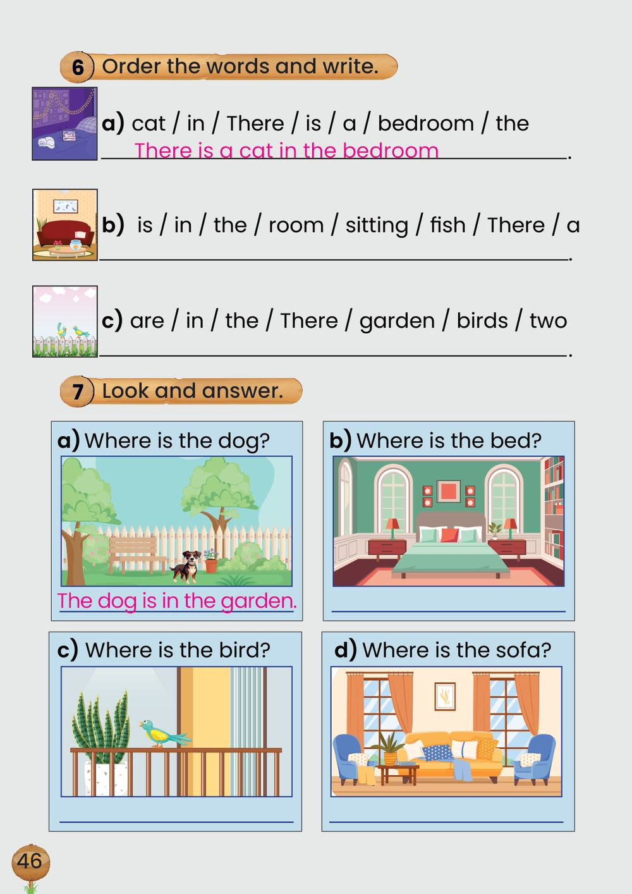 a) cat / in / There / is / a / bedroom / the
<u>There is a cat in the bedroom</u>

 b) is / in / the / room / sitting / fish / There / a
__________________________________________________________

 c) are / in / the / There / garden / birds / two
__________________________________________________________

# 7 Look and answer.

| a) Where is the dog? | b) Where is the bed? |
| :--- | :--- |
|  |  |
| <u>The dog is in the garden.</u> | ________________________ |

| c) Where is the bird? | d) Where is the sofa? |
| :--- | :--- |
|  |  |
| ________________________ | ________________________ |

<!-- sayfa 46 -->

# 8 Look at the house. Then tick the correct pupil.

1 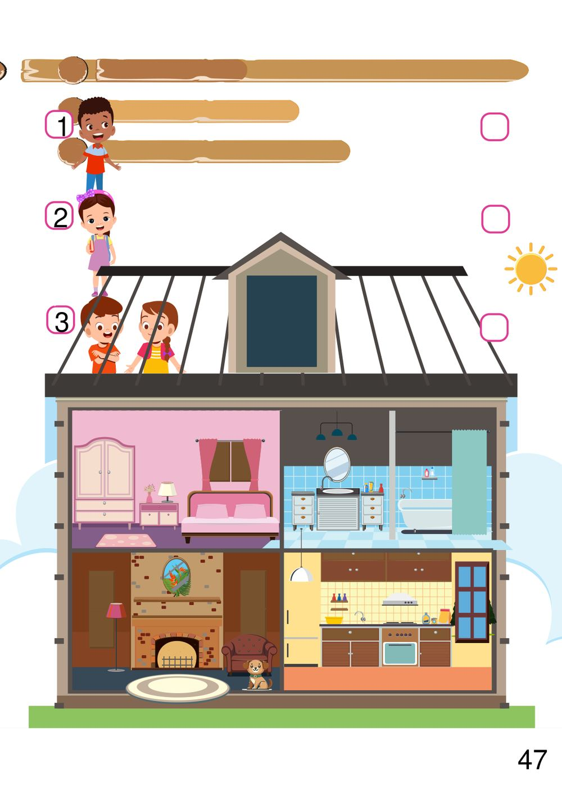 Hi, my name is Tony. This is our house. There are four rooms. My bathroom is very big. There is a cat in the kitchen. [ ]

2  Hello, I'm Clara. We have got a lovely house. There are four rooms. There is a pink bed in the bedroom. I have got a dog. It is in the living room. [ ]

3  Hi, I'm Brad. Our house is very big. There are four rooms. We have got a garden. There are birds in the garden. [ ]

<!-- sayfa 47 -->

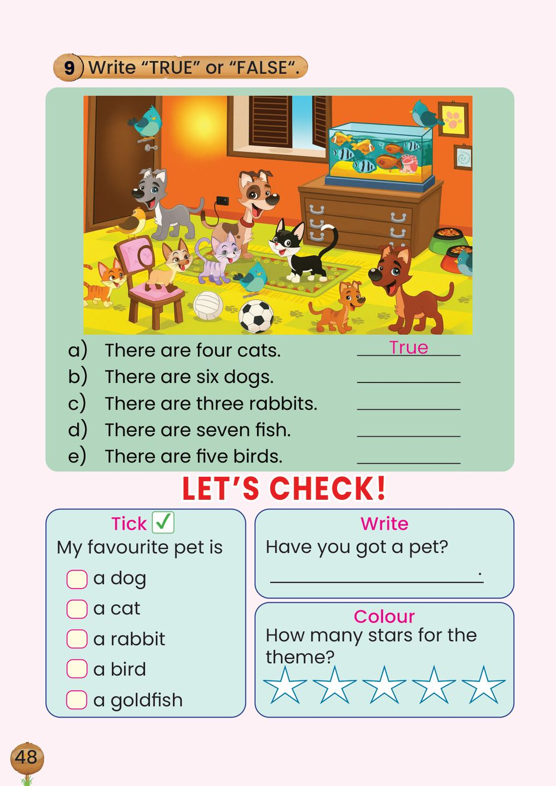
<!-- yer tutucu bulunamadı: sayfa sonuna eklendi -->

<!-- sayfa 48 -->

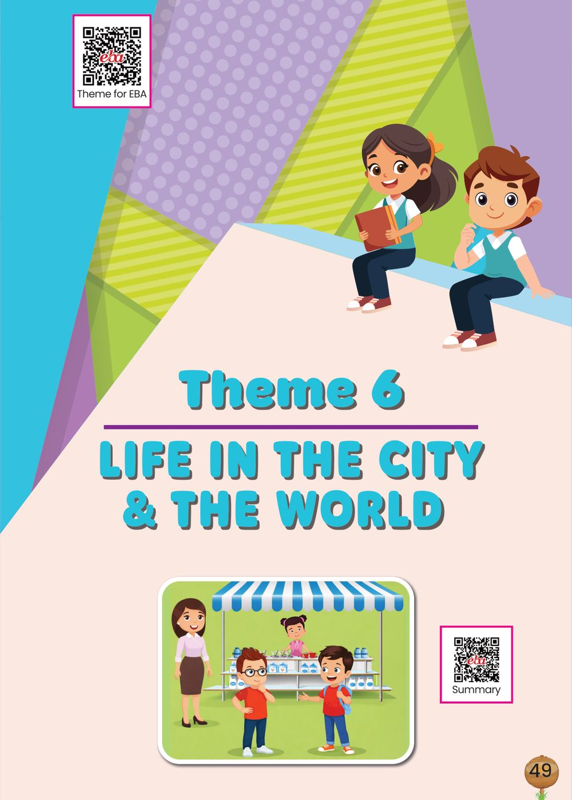

# Theme 6
## LIFE IN THE CITY & THE WORLD

<!-- sayfa 49 -->

# 1 Look and write.

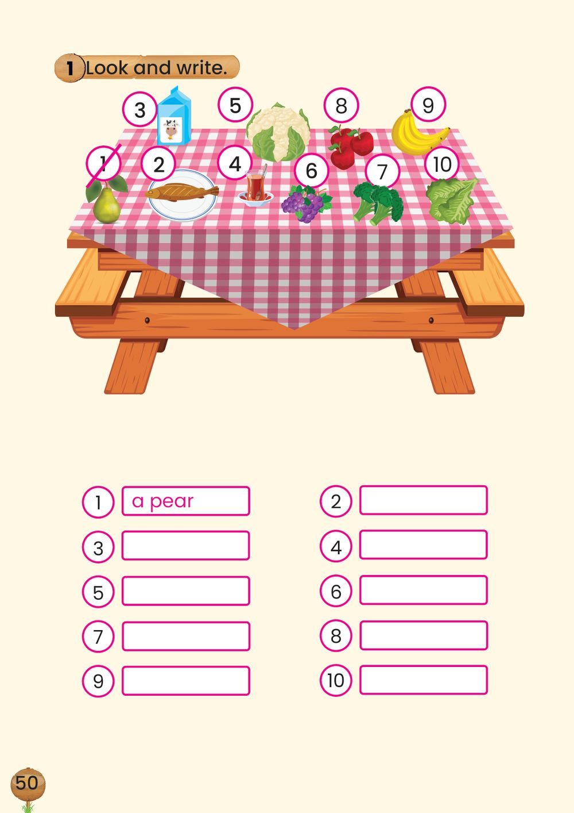

1 a pear
2 
3 
4 
5 
6 
7 
8 
9 
10

<!-- sayfa 50 -->

# 2 Circle the odd one.

1. water — ayran — courgette
2. orange — meat — banana
3. strawberry — chicken — meat
4. pepper — pear — potato
5. garlic — cauliflower — coffee

# 3 Order, write, and draw.

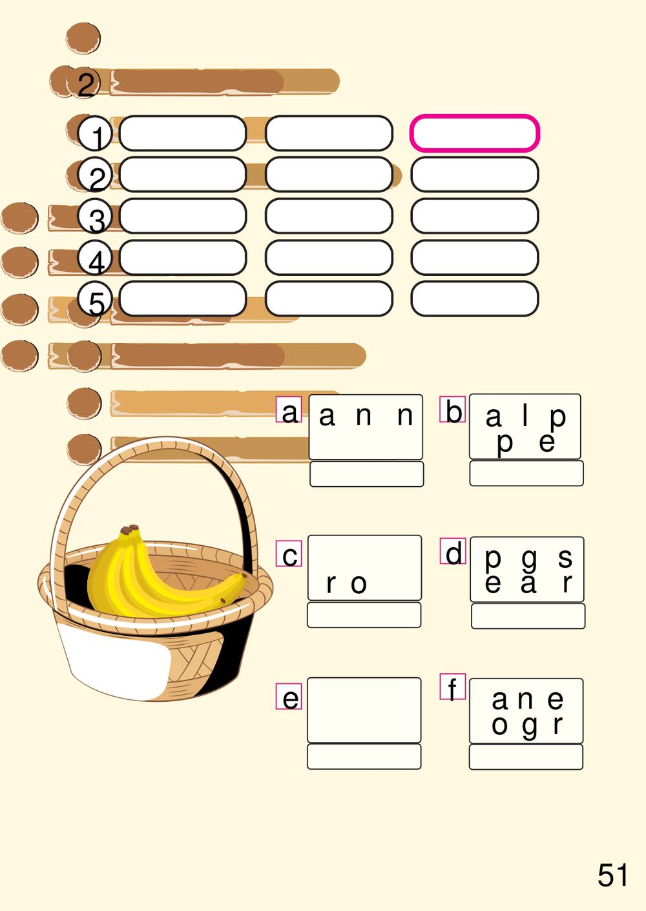

**a**
| a | n | n |
|---|---|---|
| a | s | b |
| a | | |
**bananas**

**b**
| a | l | p |
|---|---|---|
| p | e | |
| | | |

**c**
| a | c | r | t |
|---|---|---|---|
| r | o | | |
| | | | |

**d**
| p | g | s |
|---|---|---|
| e | a | r |
| | | |

**e**
| e | c | e | r |
|---|---|---|---|
| i | r | h | s |
| | | | |

**f**
| a | n | e |
|---|---|---|
| o | g | r |
| | | |

<!-- sayfa 51 -->

# 4 Look, read, and ✅ .

1 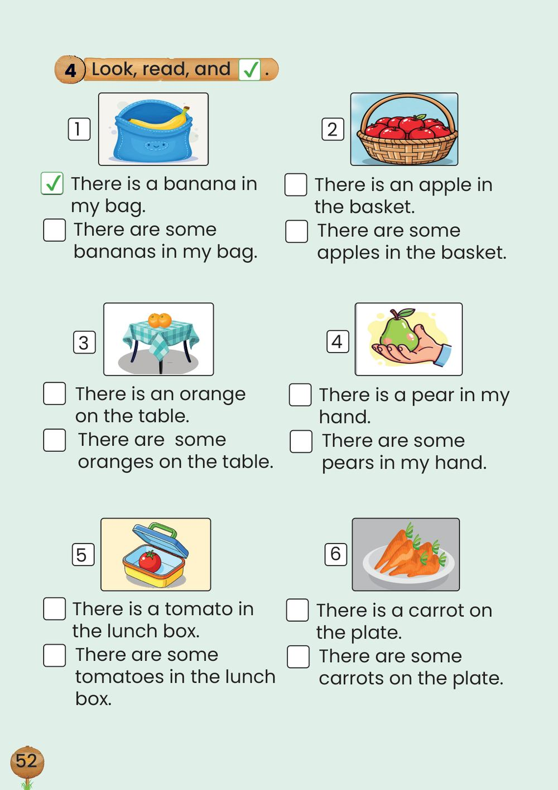
- [x] There is a banana in my bag.
- [ ] There are some bananas in my bag.

2 
- [ ] There is an apple in the basket.
- [ ] There are some apples in the basket.

3 
- [ ] There is an orange on the table.
- [ ] There are some oranges on the table.

4 
- [ ] There is a pear in my hand.
- [ ] There are some pears in my hand.

5 
- [ ] There is a tomato in the lunch box.
- [ ] There are some tomatoes in the lunch box.

6 
- [ ] There is a carrot on the plate.
- [ ] There are some carrots on the plate.

<!-- sayfa 52 -->

# 5 Look and circle the answer.

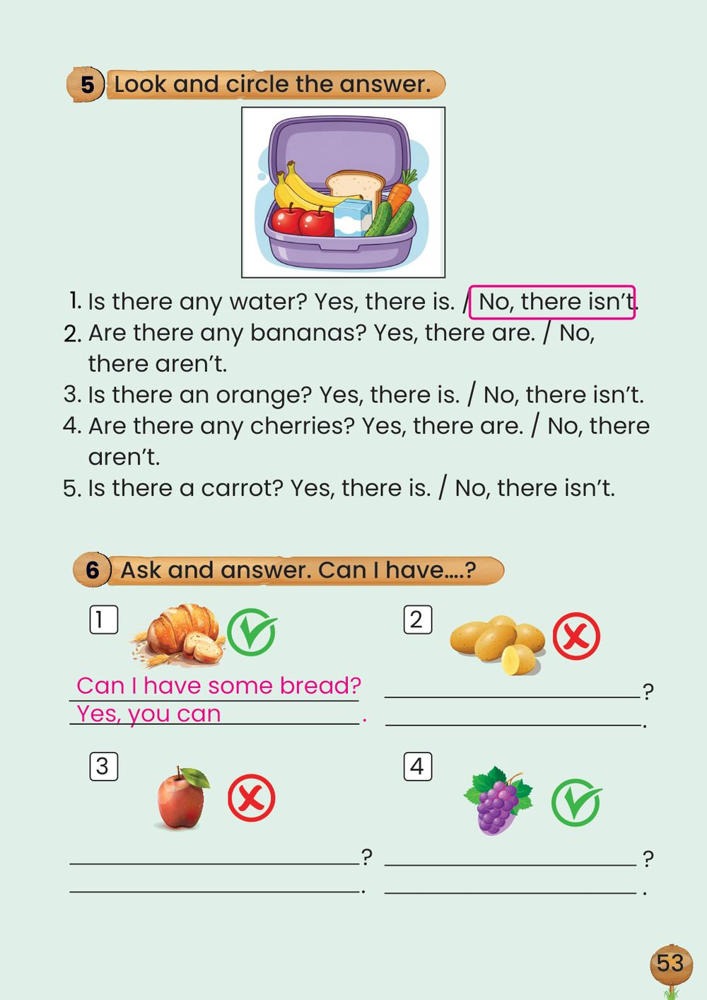

1. Is there any water? Yes, there is. / No, there isn’t.
2. Are there any bananas? Yes, there are. / No, there aren’t.
3. Is there an orange? Yes, there is. / No, there isn’t.
4. Are there any cherries? Yes, there are. / No, there aren’t.
5. Is there a carrot? Yes, there is. / No, there isn’t.

# 6 Ask and answer. Can I have....?

1

Can I have some bread?
Yes, you can.

2

__________________________________________?
__________________________________________.

3

__________________________________________?
__________________________________________.

4

__________________________________________?
__________________________________________.

<!-- sayfa 53 -->

# 7 Read and match.

1
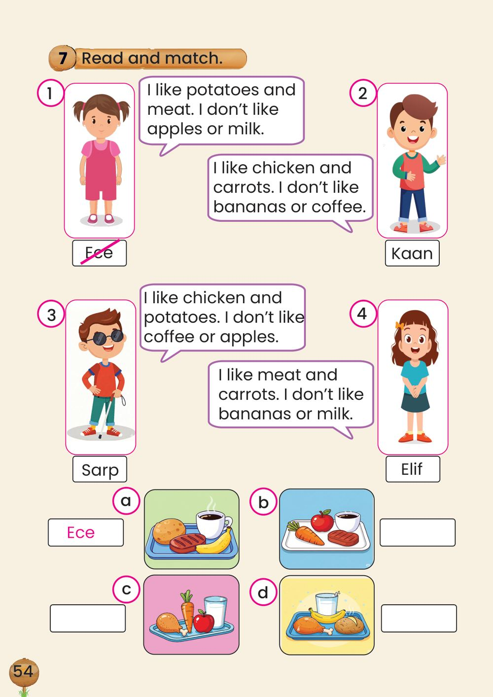
I like potatoes and meat. I don't like apples or milk.
Ece

2

I like chicken and carrots. I don't like bananas or coffee.
Kaan

3

I like chicken and potatoes. I don't like coffee or apples.
Sarp

4

I like meat and carrots. I don't like bananas or milk.
Elif

a

Ece

b

c

d

<!-- sayfa 54 -->

# 8 Read, choose, and write.

| breakfast | ~~enjoy~~ | hungry |
| :---: | :---: | :---: |
| **delicious** | **thirsty** | |

1

- **Enjoy** \_\_\_\_\_\_\_\_ your meal!
- Thanks, mum.

2

- I'm \_\_\_\_\_\_\_\_\_\_\_\_.
- Here is your chicken.

3

- Here is your fish.
- Yummy! It's \_\_\_\_\_\_\_\_\_\_\_\_.

4

- I'm \_\_\_\_\_\_\_\_\_\_\_\_.
- Here is some water.

5

- Time for \_\_\_\_\_\_\_\_\_\_\_\_!
- Yummy! I like eggs.

<!-- sayfa 55 -->

# 9 Write about you.

Hello! My name is ____________________. My favourite food is ____________________. My favourite drink is ____________________. I like ____________________. I don't like ____________________. I like ____________________ for breakfast, ____________________ for lunch and ____________________ for dinner.

# LET'S CHECK!

| Tick ✅ My favourite fruit is | Write Do you like tea? ____________________. |
| :--- | :--- |
| ☐ banana   ☐ pear   ☐ apple   ☐ orange   ☐ cherry | |

| Colour How many stars for the theme? ☆ ☆ ☆ ☆ ☆ |
| :--- |

<!-- sayfa 56 -->

# REFERENCES

**MEB (2025), Primary Education The English Language Curriculum (Years 2-3-4-5-6-7-8), The Century of Türkiye Education Model, Ankara.**

**Oxford University Press (2002) Oxford Collocations Dictionary for Students of English (9th ed.) Oxford.**

**The references in this section have been prepared following the principles and formatting rules of the APA Style 6$^{th}$ <!-- KONTROL: Marker'da karşılığı yok, uydurma olabilir --> Edition.**

# ANSWER KEY

# VISUAL AND GENERAL WEB REFERENCES

<!-- sayfa 57 -->

50°D
45°D
40°D
35°D
30°D
25°D

40°K
35°K

ROMANYA
Bükreş
Sofya
UKRAYNA
RUSYA FEDERASYONU
HAZAR DENİZİ
KARADENİZ
GÜRCİSTAN
Tiflis
ERMENİSTAN
Erivan
AZERBAYCAN
NAHÇIVAN Ö.C. (AZERBAYCAN)
İRAN
Urumiye Gölü
Iğdır
Kars
Ardahan
Artvin
Rize
Trabzon
Gümüşhane
Bayburt
Erzurum
Ağrı
Van Gölü
Bitlis
Muş
Siirt
Batman
Diyarbakır
Şırnak
Hakkâri
Irak
Bağdat
Suriye
Şam
Lübnan
Beyrut
Güney Kıbrıs Rum Yönetimi
Lefkoşa
Kuzey Kıbrıs Türk Cumhuriyeti
Akdeniz
Filistin
Gazze Şeridi
Batı Şeria
Kudüs
Doğu
İsrail
Tel Aviv
Mısır
Nil N.
Süveyş K.
Libya
Yunanistan
Atina
Ege Denizi
Bulgaristan
Türkiye'nin Mülki İdare Bölümleri ile Kara ve Deniz Komşuları Haritası

Adana
Adıyaman
Afyonkarahisar
Ağrı
Amasya
Ankara
Antalya
Artvin
Aydın
Balıkesir
Bilecik
Bingöl
Bitlis
Bolu
Burdur
Bursa
Çanakkale
Çankırı
Çorum
Denizli
Diyarbakır
Edirne
Elâzığ
Erzincan
Erzurum
Eskişehir
Gaziantep
Giresun
Gümüşhane
Hakkâri
Hatay
Isparta
Mersin
İstanbul
İzmir
Kars
Kastamonu
Kayseri
Kırklareli
Kırşehir
Kocaeli
Konya
Kütahya
Malatya
Manisa
Kahramanmaraş
Mardin
Muğla
Muş
Nevşehir
Niğde
Ordu
Rize
Sakarya
Samsun
Siirt
Sinop
Sivas
Tekirdağ
Tokat
Trabzon
Tunceli
Şanlıurfa
Uşak
Van
Yozgat
Zonguldak
Aksaray
Bayburt
Karaman
Kırıkkale
Batman
Şırnak
Bartın
Ardahan
Iğdır
Yalova
Karabük
Kilis
Osmaniye
Düzce

Kızılırmak N.
Sakarya N.
Gediz N.
Büyük Menderes N.
Bakırçay N.
Küçük Menderes N.
Çoruh N.
Aras N.
Kura N.
Fırat N.
Dicle N.
Asi N.
Meriç N.
Tuna N.
Seyhan N.
Ceyhan N.
Göksu N.

Marmara Denizi
Gökçeada
Bozcaada

BAŞKENT
İL MERKEZİ
GÖL
AKARSU
ÜLKE SINIRI
ÖZERK BÖLGE SINIRI

0 50 100 200 300 400 km

Harita Genel Müdürlüğü tarafından üretilmiştir.

<!-- sayfa 58 -->

# TÜRK DÜNYASI HARİTASI

**Lejant:**
* Bağımsız Türk Devletleri
* Türk Cumhuriyetleri, Türk Bölgeleri
* Türk Toplulukları

**TÜRK CUMHURİYETLERİ, TÜRK BÖLGELERİ**
1. GAGAVUZ YERİ
2. KARAÇAY-ÇERKESYA
3. KABARDİN-BALKARYA C.
4. DAĞISTAN C.
5. ÇUVAŞİSTAN C.
6. TATARİSTAN C.
7. BAŞKURT C.
8. KARAKALPAKİSTAN C.
9. ALTAY C.
10. HAKASYA C.

**TÜRK TOPLULUKLARI**
a. Avrupa'daki Türkler
b. Kosova Türkleri
c. Yunanistan Türkleri
ç. Bulgaristan Türkleri
d. Romanya Türkleri
e. Suriye Türkmenleri
f. Irak Türkmenleri
g. İran Türkleri
h. Afganistan Türkmenleri
ı. Pakistan Türkmenleri
i. Hindistan Türkmenleri
j. Çin H. C. Türkleri
k. Moğolistan Türkleri
l. Rusya Federasyonu Türkleri

**ÜLKE KISALTMALARI**
ARN: ARNAVUTLUK
BEL: BELÇİKA
BH: BOSNA - HERSEK
GKRY: GÜNEY KIBRIS RUM YÖNETİMİ
HRV: HRVATİSTAN
ISV: İSVİÇRE
KSV: KOSOVA
KKTC: KUZEY KIBRIS TÜRK CUMHURİYETİ
KMKD: KUZEY MAKEDONYA
KRD: KARADAĞ
LİH: LİHTENŞTAYN
SRB: SIRBİSTAN

**Ölçek:**
0 500 1.000 1.500 2.000 km
0 250
