# İngilizce Dersi 2.Sınıf Ders Kitabı

<!-- sayfa 0 -->

# ENGLISH
# Year 2

## Pupil's Book

### AUTHORS
Ayşe Gül ÜNLÜ
Emine ÇATLI
Gülden CENGİZ
Remziye GÜLER ASLAN
Sezin SEVİM KULA


<!-- sayfa 1 -->

MİLLÎ EĞİTİM BAKANLIĞI YAYINLARI...................................................................... : 10314
DERS KİTAPLARI DİZİSİ.................................................................................................. : 2292
Her hakkı saklıdır ve Millî Eğitim Bakanlığına aittir. Kitabın metin, soru ve şekilleri kısmen de olsa hiçbir surette alınıp yayımlanamaz.

# EDITOR
Dr. Kamile HAMİLOĞLU

# VISUAL DESIGNERS
Arzu GÜNAL GÜN
Özcan ELGÜNLÜ

# MULTIMEDIA DESIGNERS
Eda ÖZKAN AKAR
Enver ÜLKER
Erhan AY
Hatice YILDIRIM IŞIK
Murat Evren AYDURDU
Nilgün BOZNA
Onur GÖNÜLLÜ

# CURRICULUM DEVELOPMENT SPECIALISTS
Dr. Mehmet AKCAALAN
Dr. Orhan YİĞİTOĞLU
Fatma KELEŞ
Zeynep Nazife ÖNER

# ASSESSMENT AND EVALUATION SPECIALIST
Ercan ARASTAMAN

# GUIDANCE SPECIALIST
Aylin SAZLI SAYICI

ISBN 978-975-11-9065-9

Millî Eğitim Bakanlığı Talim ve Terbiye Kurulu Başkanlığının 14.08.2025 tarih ve 138247582 sayılı yazısı ile eğitim aracı olarak kabul edilmiştir

<!-- sayfa 2 -->

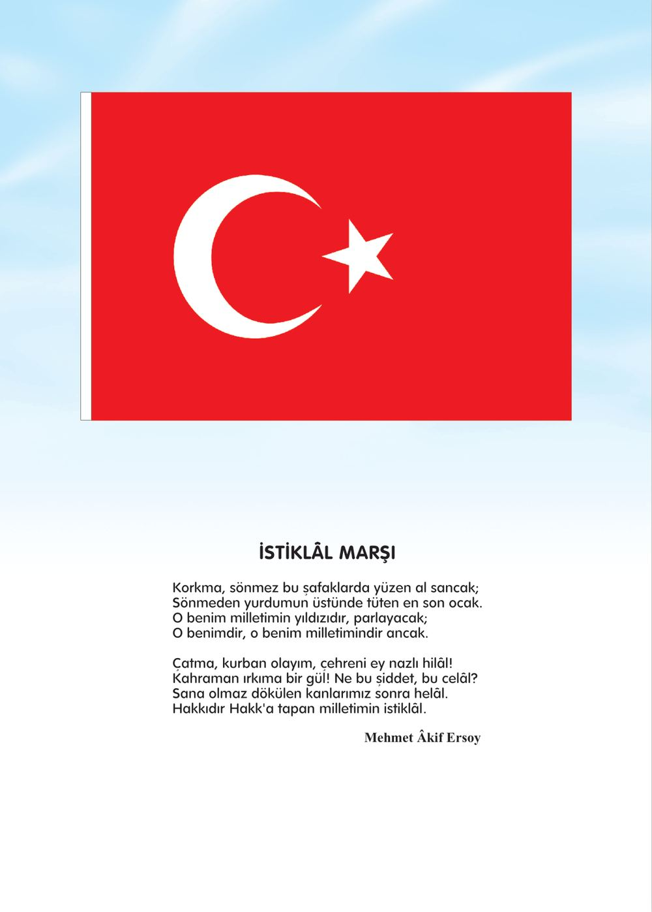

# İSTİKLÂL MARŞI

Korkma, sönmez bu şafaklarda yüzen al sancak;
Sönmeden yurdumun üstünde tüten en son ocak.
O benim milletimin yıldızıdır, parlayacak;
O benimdir, o benim milletimindir ancak.

Çatma, kurban olayım, çehreni ey nazlı hilâl!
Kahraman ırkıma bir gül! Ne bu şiddet, bu celâl?
Sana olmaz dökülen kanlarımız sonra helâl.
Hakkıdır Hakk'a tapan milletimin istiklâl.

Mehmet Âkif Ersoy

<!-- sayfa 3 -->

ANDIMIZ

Türküm, doğruyum, çalışkanım.

İlkem küçüklerimi korumak, büyüklerimi saymak; yurdumu, milletimi özümden çok sevmektir.
Ülküm yükselmek, ileri gitmektir.

Ey Büyük Atatürk!

Açtığın yolda, gösterdiğin hedefe durmadan yürüyeceğime ant içerim.

Varlığım Türk varlığına armağan olsun.

Ne mutlu Türküm diyene!


<!-- yer tutucu bulunamadı: sayfa sonuna eklendi -->

<!-- sayfa 4 -->

MUSTAFA KEMAL ATATÜRK

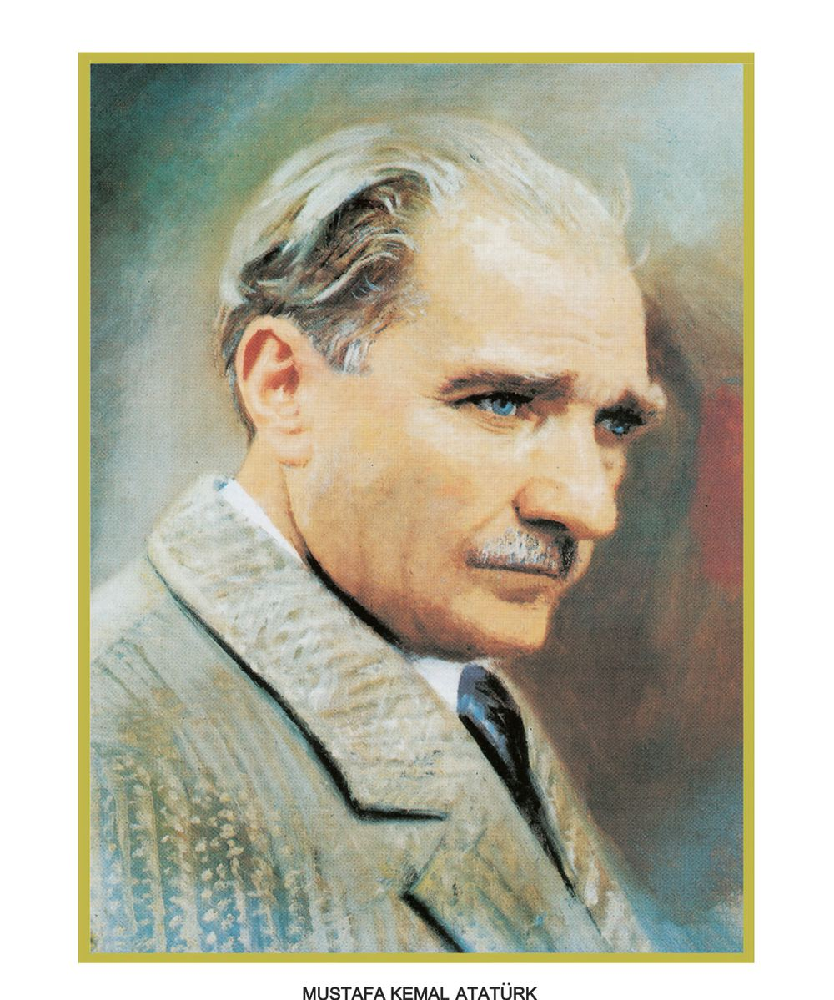
<!-- yer tutucu bulunamadı: sayfa sonuna eklendi -->

<!-- sayfa 5 -->

Girdiğiniz mesajda herhangi bir metin veya görsel bulunmamaktadır. Lütfen dönüştürülmesini istediğiniz PDF metin katmanını `<<< ... >>>` işaretleri arasına ekleyin veya ilgili görseli paylaşın. Veriyi sağladığınızda talimatlarınıza uygun şekilde Markdown formatına çevirebilirim.


<!-- yer tutucu bulunamadı: sayfa sonuna eklendi -->

<!-- sayfa 6 -->

# CONTENTS

| | |
| :--- | :---: |
| TABLE OF CONTENTS | 8 |
| Introduction to the Book | 10 |
| Theme 1 - School Life | 11 |
| Theme 2 - Classroom Life | 27 |
| Theme 3 - Personal Life | 43 |
| Theme 4 - Family Life | 59 |
| Theme 5 - Homes & Houses & Neighbourhoods | 75 |
| Theme 6 - Life in the City&the World | 91 |
| CUT-OUTS | 107 |
| GLOSSARY | 129 |
| ANSWER KEY | 134 |
| REFERENCES | 134 |
| VISUAL AND GENERAL WEB REFERENCES | 134 |
| Map of Türkiye’s Administrative Divisions and Its Land and Maritime Neighbours | 135 |
| Map of the Turkic World | 136 |

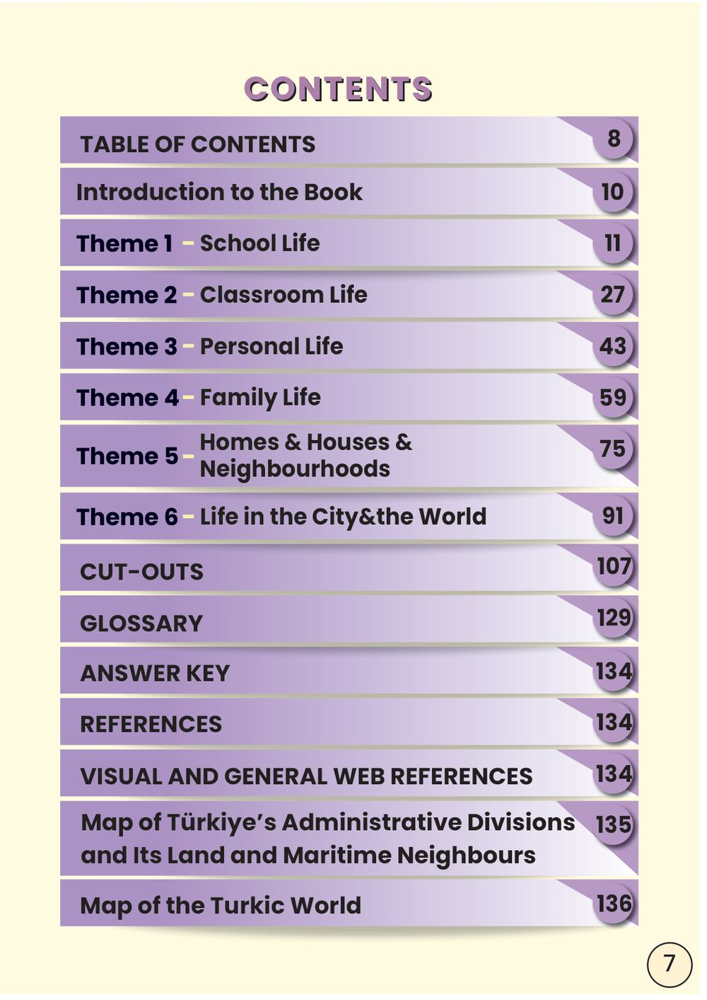
<!-- yer tutucu bulunamadı: sayfa sonuna eklendi -->

<!-- sayfa 7 -->

# TABLE OF CONTENTS

| THEME | MAIN THEME | SUB-THEMES | TITLE of the DIGITAL STORY | CHUNKS | CHUNKS & GAMIFICATION | VOCABULARY | VOCABULARY & GAMIFICATION |
| :--- | :--- | :--- | :--- | :--- | :--- | :--- | :--- |
| 1 | SCHOOL LIFE | Greetings and introductions at school; places, and people at school; days of the week; national and religious days and celebrations. | The New Pupils at School | • What's/is it/this? It's/is a/an...<br>• Who's she/he? She's Mr Aras. He's my English teacher. This is Mr/Mrs/ Miss Hopkins. She/he is a teacher/headmaster etc.<br>• Where is she? She is in the garden.<br>• What's your name? I'm/ am... / My name is...<br>• Come here, please.<br>• What day of the week is it? What day is it today? It's/ is Monday today. | • Let's play. (Places Game)<br>• Basic Skill: Speaking | • People in the school<br>• Places in the school<br>• Days of the week and the weekend<br>• National and religious days, festivals and celebrations | • Watch and match.<br>• Basic Skills: Reading and Listening<br>• Let's do. (Crossword Puzzle)<br>• Basic Skill: Writing |
| 2 | CLASSROOM LIFE | Classroom instructions and language; classroom furniture, devices and objects; colours. Basic Classroom Instructions and classroom language. | What is This? | • What's/is it? It's/is a chair<br>• What colour is it? It's/is blue. What colour is the chair? The chair is blue.<br>• It's blue.<br>• How many chairs? Five chairs.<br>• How's the weather? It's cold.<br>• How?<br>• Can I go outside? Can I go to the bathroom, please? Yes, you can. | • Let's play. (Chinese Whispers)<br>• Basic Skill: Speaking | • Classroom furniture<br>• Classroom objects<br>• Classroom devices<br>• Basic colours<br>• Weather<br>• Numbers: 120 | • Let's find. (Wordsearch puzzle)<br>• Basic Skill: Reading |
| 3 | PERSONAL LIFE | Parts of the body and physical features; clothes; days of the week, ages and birthdays; weather conditions | Yiğit and Robix | • How old are you? I'm/am 7.<br>• Is it your birthday today? Yes, it is.<br>• What's/is it? / It/This is a nose/ a shirt.<br>• What colour is it? (pointing to the nose) It's/is pink.<br>• Is she tall? Yes, she is. No, she isn't/is not. What day is it today? It's/is Monday today.<br>• How's the weather? It's cold.<br>• What have you got? I've got a nose. How many ears have you got? I've got two ears. What have you got? I've got blue trousers. I've got a purple shirt. | • Let's play. (Body Parts)<br>• Basic Skill: Speaking | • Parts of the body<br>• Adjectives<br>• Clothes<br>• Outwear<br>• Ages | • Watch and complete.<br>• Basic Skill: Listening and writing.<br>• Find body parts and circle.<br>• Basic Skill: Reading |
| 4 | FAMILY LIFE | Family members and family members' physical appearances and physical Features | The Family Picnic | • Who is he? Who is she? He's/is my father. She's/is my mother.<br>• What colour eyes has your mother got? My mother's/has got blue eyes. She's/has got blue eyes. | • Let's play. (Bingo Game)<br>• Basic Skill: Speaking | • Family members<br>• Physical appearances | • Reorder the letters.<br>• Look, complete and circle.<br>• Basic Skills: Listening and writing<br>• Follow the way and complete.<br>• Basic Skills: Reading and writing. |
| 5 | HOMES & HOUSES & NEIGHBOURHOODS | Parts, rooms and furniture in the house; pets in the house | Home Sweet Home | • "Have got/has got": (We've/have got a house. We've got two pets).<br>• Where's/is the bed? The bed is in the bedroom. Where's/is the cat?<br>• The cat is in the kitchen.<br>• There are five cats in the sitting room. | • Let's play. (Ask and answer.)<br>• Cut, stick and talk.<br>• Basic Skill: Speaking | • Parts of the house<br>• House furniture<br>• Pets in the house<br>• Parts of the body of a pet | • Watch and match.<br>• Basic Skils: Listening and writing.<br>• Look, complete and say.<br>• Basic Skills: Listening and speaking |
| 6 | LIFE IN THE CITY & THE WORLD | Basic food types, items, and meals | The Healthy Food Festival | • Do you like bread? Yes, I do.<br>• Do you like beans? No, I don't.<br>• Is there a banana in the kitchen? Yes, there is. No, there isn't.<br>• Are there any bananas in the kitchen? Yes, there are. No there aren't.<br>• Can I have bread? Yes, you can. No, you can't. | • Let's play. (What have you got in your basket?)<br>• Basic Skill: Speaking | • Liquids<br>• Fruits<br>• Vegetables<br>• Basic food | • Let's match. (Food and drinks)<br>• Basic Skill: Reading |

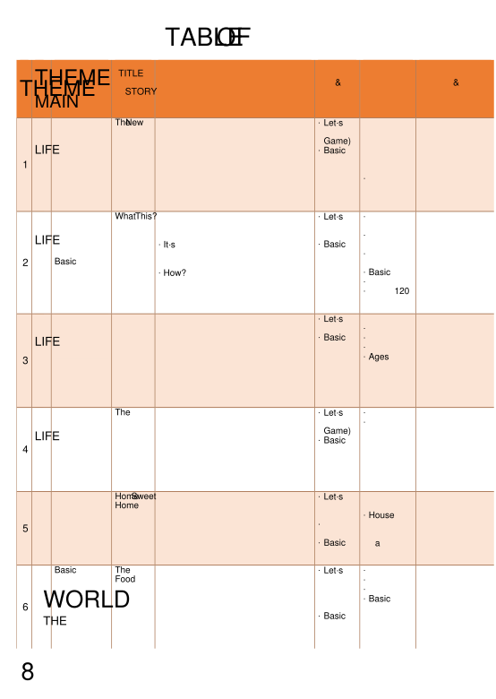
<!-- yer tutucu bulunamadı: sayfa sonuna eklendi -->

<!-- sayfa 8 -->

# TABLE OF CONTENTS

| PRONUNCIATION | LISTENING & WATCHING COMPREHENSION | SPEAKING EXPRESSION | READING COMPREHENSION | WRITING EXPRESSION | CLIL & CULTURE | PROJECTS | CONSOLIDATION | REFLECTION |
| :--- | :--- | :--- | :--- | :--- | :--- | :--- | :--- | :--- |
| • A **c**anteen<br>• A **b**oy | • Listen, complete and sing.<br>• Basic Skills: Listening and writing. | • Read and act.<br>• Basic Skills: Reading and Speaking | • Jungle School.<br>• Basic Skill: Reading | • Find and circle. (Snake Puzzle)<br>• Group and write. (Places and write)<br>• Basic Skill: Writing | • Let’s play. (What is this?)<br>• Objective: Remembering places and people with a board game. | • Draw your school with places and people.<br>• Objective: Remembering places and people by drawing. | • Look and write.<br>• Answer.<br>• Find and circle.<br>• Read and match.<br>• Read, find and write. | • What about you? (Read and colour)<br>• Choosing the right emoji for themselves. |
| • A **c**lassroom<br>• A **d**oor | • Let’s sing. (The Colours Song)<br>• Basic Skill: Listening<br>• Listen, colour and say.<br>• Basic Skills: Listening and Speaking<br>• Listen and repeat. (Numbers)<br>• Basic Skill: Listening and Speaking | • Let’s play. (Guessing Game)<br>• Let’s play. (Do What I Say Game)<br>• Basic Skill: Speaking | • Cute Pupils.<br>• Basic Skill: Reading | • Reorder and write.<br>• Look and complete.<br>• Read and act.<br>• Basic Skill: Writing | • Find and match.<br>• Objective: Remembering numbers with an activity. | • Draw and colour your own classroom. (Write the names of the objects and furniture. Talk about your Picture.)<br>• Objective: Remembering the names of objects and furniture. | • Odd one out.<br>• Read and write.<br>• Read and match.<br>• Read and match.<br>• Match, colour and complete. | • What about you? (Read and colour)<br>• Choosing the right emoji for themselves. |
| • A w**ee**r<br>• F**ou**r<br>• G**l**ue<br>• H**ai**r<br>• F**i**ve<br>• A j**a**cket | • Listen and complete.<br>• Basic Skill: Listening and writing. | • Read and act.<br>• Basic Skills: Speaking and reading. | • Funny Friends.<br>• Basic Skill: Reading | • Now, you draw and write.<br>• Look and complete.<br>• Basic Skills: Writing | • Let’s play. (Board Game)<br>• Objective: Remembering language chunks. | • Make your puppet and talk.<br>• Basic Skill: Speaking | • Find the words and write.<br>• Read and write.<br>• Read and tick or cross.<br>• Read, draw and colour.<br>• Look at the Picture.<br>• Read and write. | • What about you? (Read and colour)<br>• Choosing the right emoji for themselves. |
| • A k**i**d<br>• L**i**sten<br>• A m**u**m<br>• N**i**ne<br>• An O**r**ange<br>• A p**e**ncil | • Watch and complete. (The Kılıç Family)<br>• Basic Skills: Listening and writing. | • Let’s play. (Ask and answer)<br>• Basic Skill: Speaking | • Our Lovely Families.<br>• Basic Skill: Reading | • Look and complete.<br>• Draw your family and write.<br>• Basic Skill: Writing | • Find and match<br>• Objective: Remembering family members with an activity. | • Draw your family tree and talk.<br>• Objective: Remembering the names of the family members. | • Write the family members.<br>• Find the words in the puzzle.<br>• Choose the correct one.<br>• Find the differences and write.<br>• Read and circle. | • What about you? (Read and colour)<br>• Choosing the right emoji for themselves. |
| • A **g**uestion<br>• A **r**abbit<br>• **S**cissors<br>• A **t**eacher<br>• **S**even | • Listen and practice.<br>• Basic Skills: Listening and speaking. | • Look, count and say.<br>• Match the halves and say.<br>• Basic Skill: Speaking | • Milo and His Friends.<br>• Basic Skills: Reading and writing | • Read and complete.<br>• Basic Skill: Writing | • Find, circle and say.<br>• Objective: Remembering the names of pets and parts of the house. | • Draw your house in your notebook. Then, talk about it.<br>• Objective: Remembering the names of pets and parts of the house. | • Read, draw and colour.<br>• Order.<br>• Find the secret code. | • What about you? (Read and colour)<br>• Choosing the right emoji for themselves. |
| • An **u**mbrella<br>• A **w**indow<br>• M**i**x<br>• Y**o**ghurt<br>• A **z**ebra | • Listen and write.<br>• Basic Skills: Listening and writing | • Let’s play. (Who am I?)<br>• Basic Skill: Speaking<br>• Read and act.<br>• Basic Skill: Speaking and | • What’s in the Fridge?<br>• Read and choose.<br>• Basic Skill: Reading | • Look and complete. (Shopping list)<br>• Basic Skill: Writing | • Choose and write. (Crossword puzzle)<br>• Objective: Remembering the names of food and | • Talk to your family members about the food they like or don’t like. Record it and share in the classroom.<br>• Objective: Talking about what other people like or don’t like | • Find, write and answer.<br>• Read and find.<br>• Read and match.<br>• Look and write. | • What about you? (Read and colour)<br>• Choosing the right emoji for themselves. |

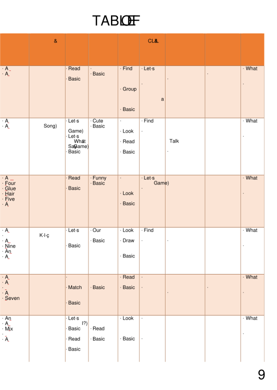
<!-- yer tutucu bulunamadı: sayfa sonuna eklendi -->

<!-- sayfa 9 -->

# INTRODUCTION TO THE BOOK

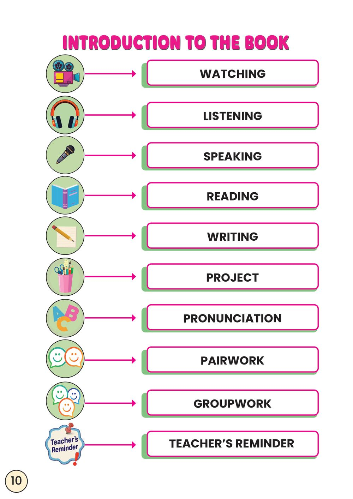 WATCHING
 LISTENING
 SPEAKING
 READING
 WRITING
 PROJECT
 PRONUNCIATION
 PAIRWORK
 GROUPWORK
 TEACHER’S REMINDER

<!-- sayfa 10 -->

Theme for EBA

# Theme 1
# SCHOOL LIFE

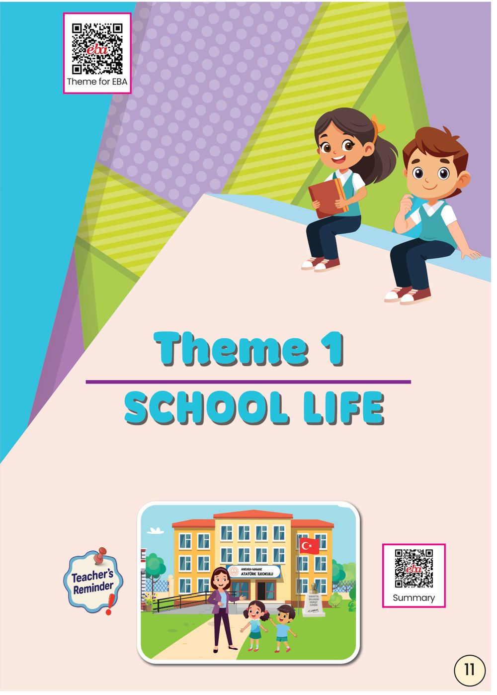

Teacher's Reminder

ANKARA-MAMAK ATATÜRK İLKOKULU

Summary

<!-- sayfa 11 -->

1 Look at the picture. Where are they?
2 Watch the digital story.

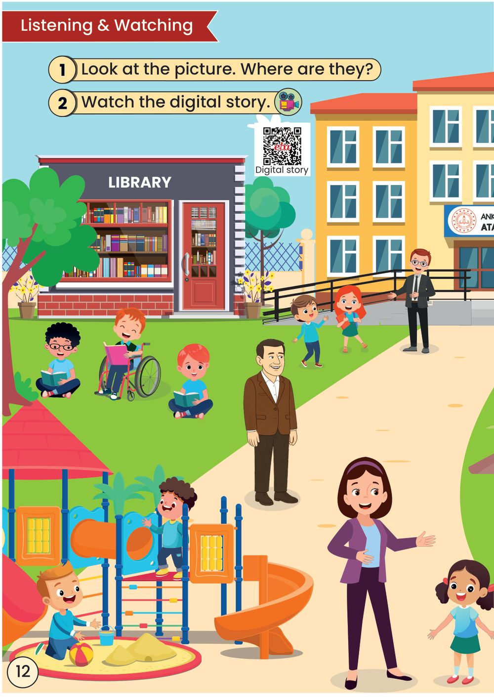

<!-- sayfa 12 -->

KARA-MAMAK
ATÜRK İLKOKULU

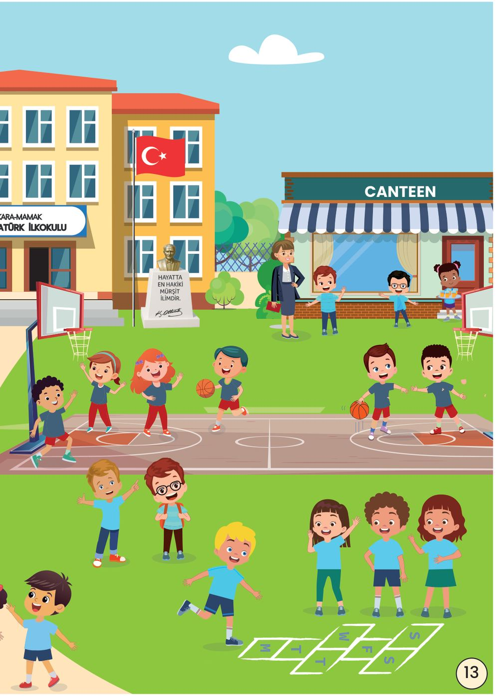

CANTEEN

<!-- sayfa 13 -->

# 3 Watch and ✔️. 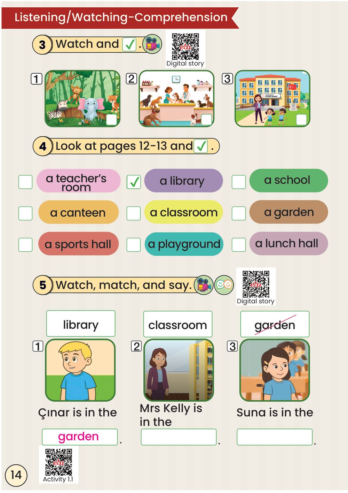


# 4 Look at pages 12–13 and ✔️.
☐ a teacher's room
☑ a library
☐ a school
☐ a canteen
☐ a classroom
☐ a garden
☐ a sports hall
☐ a playground
☐ a lunch hall

# 5 Watch, match, and say. 


| library | classroom | garden |
| :---: | :---: | :---: |
|  |  |  |
| 1 | 2 | 3 |
| Çınar is in the | Mrs Kelly is in the | Suna is in the |
| [ garden ] . | [ ] . | [ ] . |

<!-- sayfa 14 -->

# 6 Let’s play together.

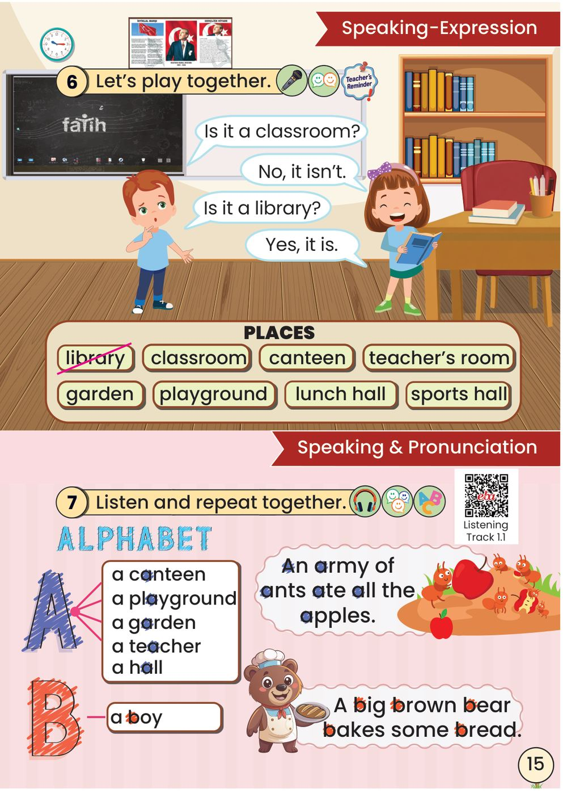

Is it a classroom?
No, it isn’t.
Is it a library?
Yes, it is.

**PLACES**
* ~~library~~
* classroom
* canteen
* teacher’s room
* garden
* playground
* lunch hall
* sports hall

---

## Speaking & Pronunciation

# 7 Listen and repeat together.


### ALPHABET

**A**
* a canteen
* a playground
* a garden
* a teacher
* a hall

An army of ants ate all the apples.

**B**
* a boy
* a big brown bear

<!-- sayfa 15 -->

# 8 Watch, talk, and match.

1 a pupil
2 a sports hall
3 a playground
4 a school
5 a teacher
6 a headmaster
7 a library
8 a lunch hall
9 a classroom

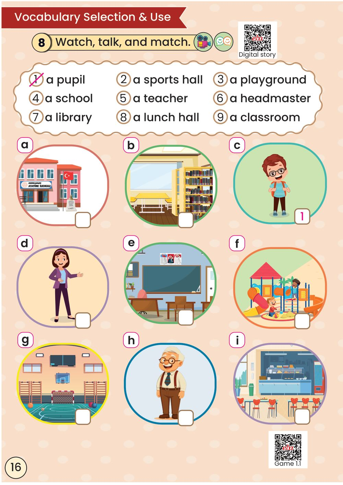 a

 b

 c
1

 d

 e

 f

 g

 h

 i

<!-- sayfa 16 -->

# 9 Look and complete. 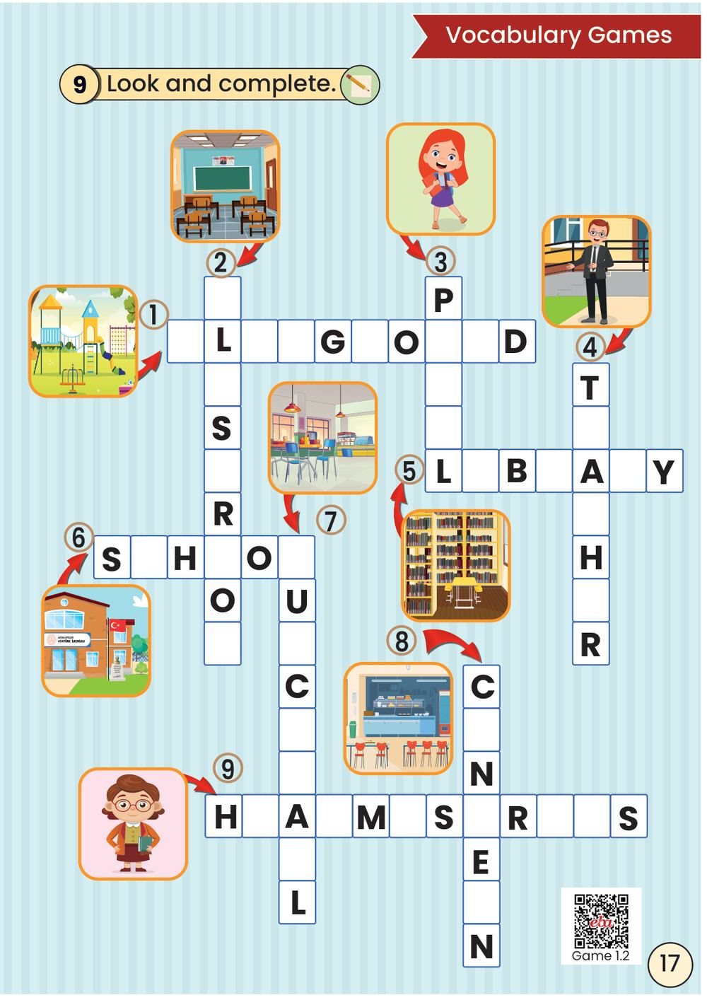

| | | | | | | | | | | | | | | |
|---|---|---|---|---|---|---|---|---|---|---|---|---|---|---|
| | | | | | | | | | | 2 | | | | |
| | | | | | | | | | | | | | | |
| | | | | | | | | | | 3 | | | | |
| | | | | | | | | | | P | | | | |
| 1 | | | | | | | | | | | | | | |
| | L | | | G | | O | | | | D | | | | |
| | | | | | | | | | | | | | | |
| | | | | | | | | | | 4 | | | | |
| | | | | | | | | | | T | | | | |
| | | | | | | | | | | | | | | |
| | | | | | | | | | | | | | | |
| | | | | | | | | | | | | | | |
| | | | | | | | | | | | | | | |
| | | | | | | | | | | | | | | |
| | | | | | | | | | | | | | | |
| | | | | | | | | | | | | | | |
| | | | | | | | | | | | | | | |
| | | | | | | | | | | | | | | |
| | | | | | | | | | | | | | | |
| | | | | | | | | | | | | | | |
| | | | | | | | | | | | | | | |
| | | | | | | | | | | | | | | |
| | | | | | | | | | | | | | | |
| | | | | | | | | | | | | | | |
| | | | | | | | | | | | | | | |
| | | | | | | | | | | | | | | |
| | | | | | | | | | | | | | | |
| | | | | | | | | | | | | | | |
| | | | | | | | | | | | | | | |
| | | | | | | | | | | | | | | |
| | | | | | | | | | | | | | | |
| | | | | | | | | | | | | | | |
| | | | | | | | | | | | | | | |
| | | | | | | | | | | | | | | |
| | | | | | | | | | | | | | | |
| | | | | | | | | | | | | | | |
| | | | | | | | | | | | | | | |
| | | | | | | | | | | | | | | |
| | | | | | | | | | | | | | | |
| | | | | | | | | | | | | | | |
| | | | | | | | | | | | | | | |
| | | | | | | | | | | | | |

<!-- sayfa 17 -->

# 10 Read and talk. 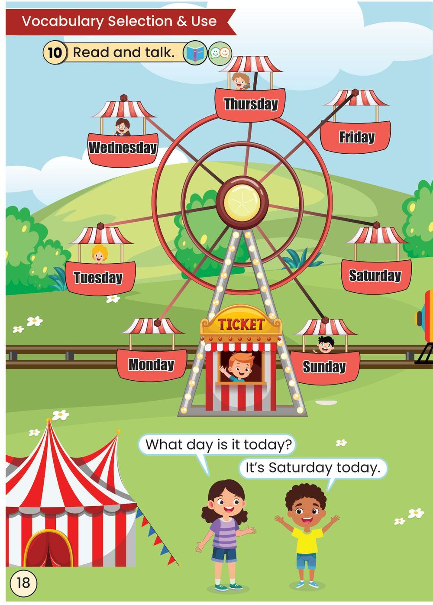


Thursday
Friday
Saturday
Sunday
Monday
Tuesday
Wednesday


What day is it today?
It’s Saturday today.

<!-- sayfa 18 -->

# 11 Listen, complete, and sing. 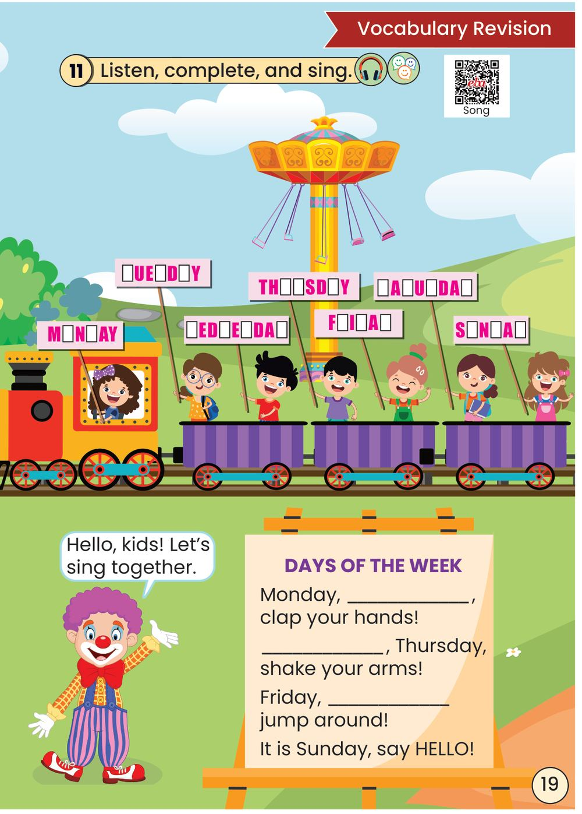


Song


$\square$UE$\square$D$\square$Y
TH$\square\square$SD$\square$Y
$\square$A$\square$U$\square$DA$\square$
M$\square$N$\square$AY
$\square$ED$\square$E$\square$DA$\square$
F$\square$I$\square$A
S$\square$N$\square$A$\square$


Hello, kids! Let's sing together.

**DAYS OF THE WEEK**

Monday, \_\_\_\_\_\_\_\_\_\_\_\_, clap your hands!
\_\_\_\_\_\_\_\_\_\_\_\_, Thursday, shake your arms!
Friday, \_\_\_\_\_\_\_\_\_\_\_\_, jump around!

<!-- sayfa 19 -->

# 12 Watch, read, and act out.

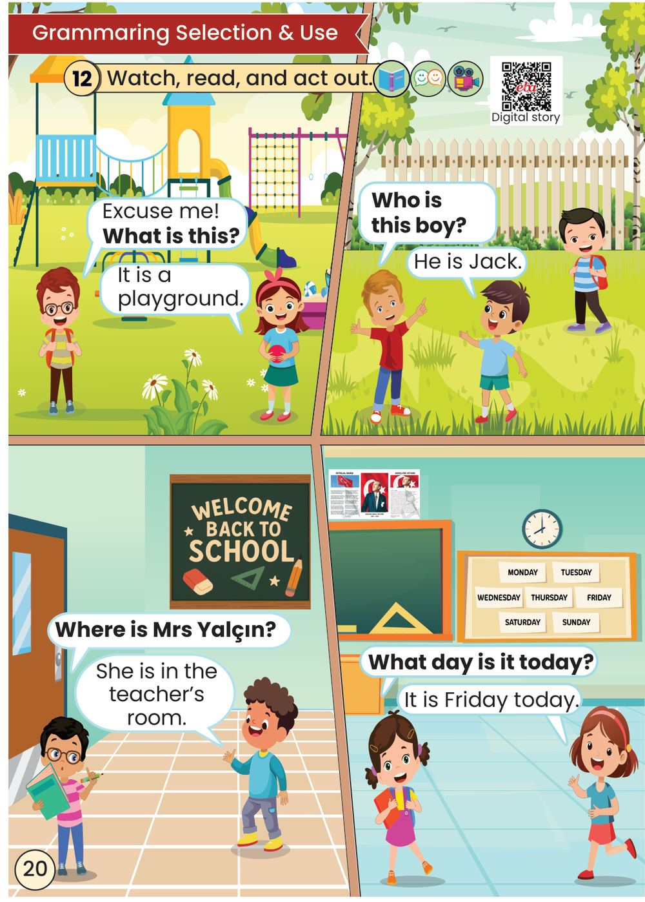

**Panel 1**
Excuse me!
**What is this?**
It is a playground.

**Panel 2**
**Who is this boy?**
He is Jack.

**Panel 3**
**Where is Mrs Yalçın?**
She is in the teacher's room.

**Panel 4**
**What day is it today?**
It is Friday today.

<!-- sayfa 20 -->

# 13 Look and answer. 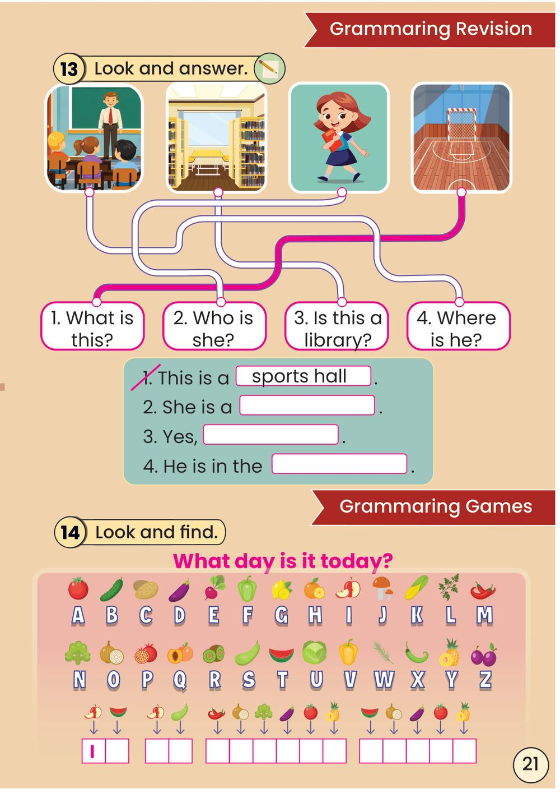


1. What is this?
2. Who is she?
3. Is this a library?
4. Where is he?

1. This is a sports hall.
2. She is a __________.
3. Yes, __________.
4. He is in the __________.

# Grammaring Games

# 14 Look and find.

## What day is it today?


A B C D E F G H I J K L M
N O P Q R S T U V W X Y Z

<!-- sayfa 21 -->

15 Read and ✅ . 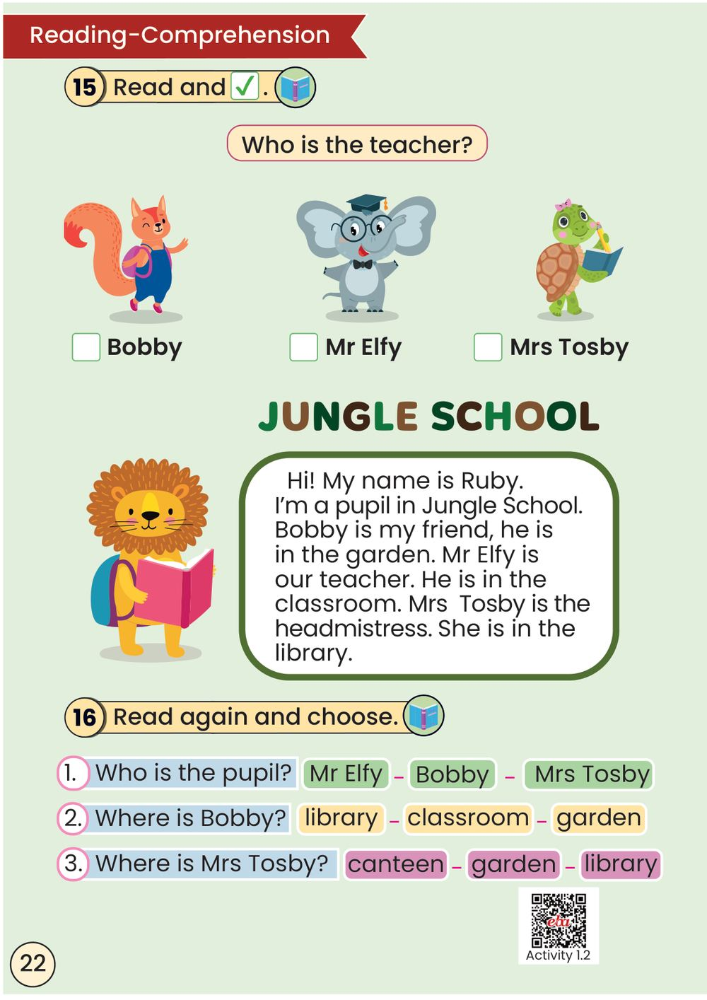

Who is the teacher?


☐ Bobby


☐ Mr Elfy


☐ Mrs Tosby

# JUNGLE SCHOOL


> Hi! My name is Ruby. I’m a pupil in Jungle School. Bobby is my friend, he is in the garden. Mr Elfy is our teacher. He is in the classroom. Mrs Tosby is the headmistress. She is in the library.

16 Read again and choose. 

1. Who is the pupil? Mr Elfy - Bobby - Mrs Tosby
2. Where is Bobby? library - classroom - garden
3. Where is Mrs Tosby? canteen - garden - library

<!-- sayfa 22 -->

17 Find, circle, and say. ✏️ 😊

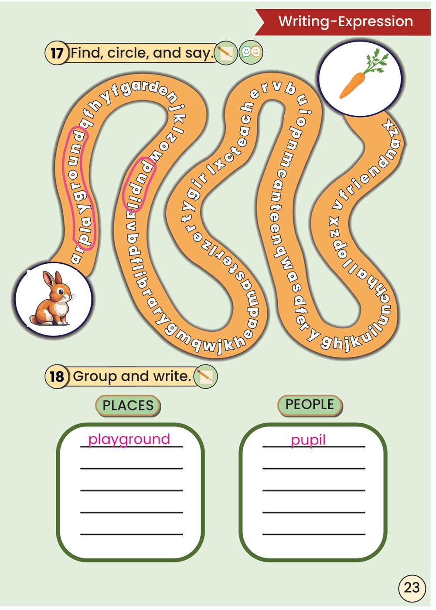

18 Group and write. ✏️

**PLACES**
playground
________________
________________
________________
________________

**PEOPLE**
pupil
________________
________________
________________
________________

<!-- sayfa 23 -->

19 Read and act out. 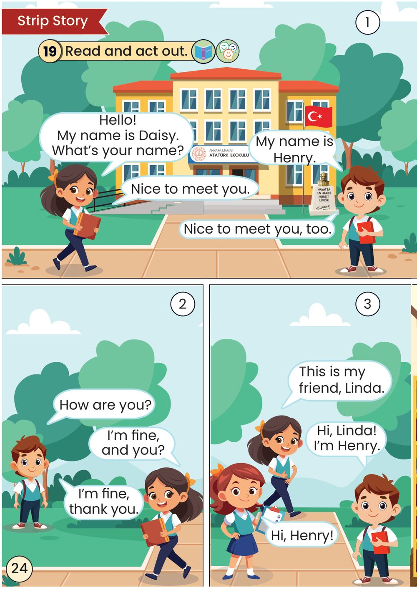

Hello! My name is Daisy. What’s your name?
My name is Henry.
Nice to meet you.
Nice to meet you, too.

2 
How are you?
I’m fine, and you?
I’m fine, thank you.

3 
This is my friend, Linda.
Hi, Linda! I’m Henry.
Hi Henry!

<!-- sayfa 24 -->

Hello, kids!
Who’s this?
This is Mrs Rose.
She is a teacher.

Where is the headmaster?
He is in the teacher’s room.

6
What is this, Daisy?
It’s a library.

7
Is this a sports hall?
Yes, it is.

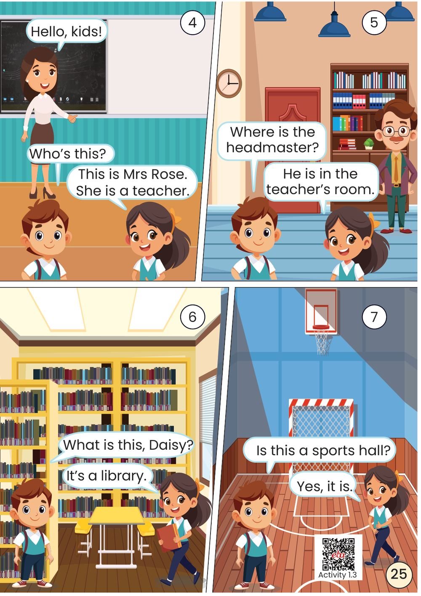
<!-- yer tutucu bulunamadı: sayfa sonuna eklendi -->

<!-- sayfa 25 -->

20 Go to page 107. Draw your school. Cut out the pictures of people and places. Stick them in your notebook. Then talk about them.

21 Let's play. 🙂 🙁 😐 Teacher's Reminder

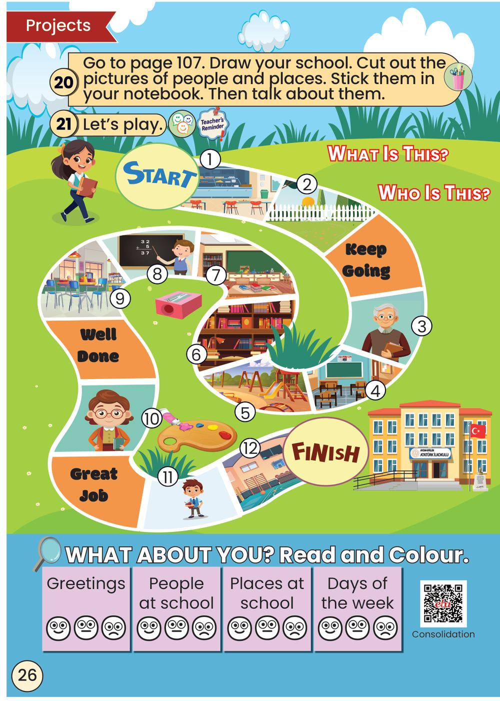

START
1
2
WHAT IS THIS?
WHO IS THIS?
Keep Going
3
4
6
7
8
$$\begin{array}{r@{\quad}l} & 3 \ 2 \\ + & \phantom{3} 5 \\ \hline & 3 \ 7 \end{array}$$
<!-- KONTROL: Marker'da karşılığı yok, uydurma olabilir -->
9
5
Well Done
6
10
11
Great Job
12
FINISH

AYDIN-EFELER
ATATÜRK İLKOKULU

WHAT ABOUT YOU? Read and Colour.

| Greetings | People at school | Places at school | Days of the week |
| :--- | :--- | :--- | :--- |
| 🙂 😐 🙁 | 🙂 😐 🙁 | 🙂 😐 🙁 | 🙂 😐 🙁 |

Consolidation

<!-- sayfa 26 -->

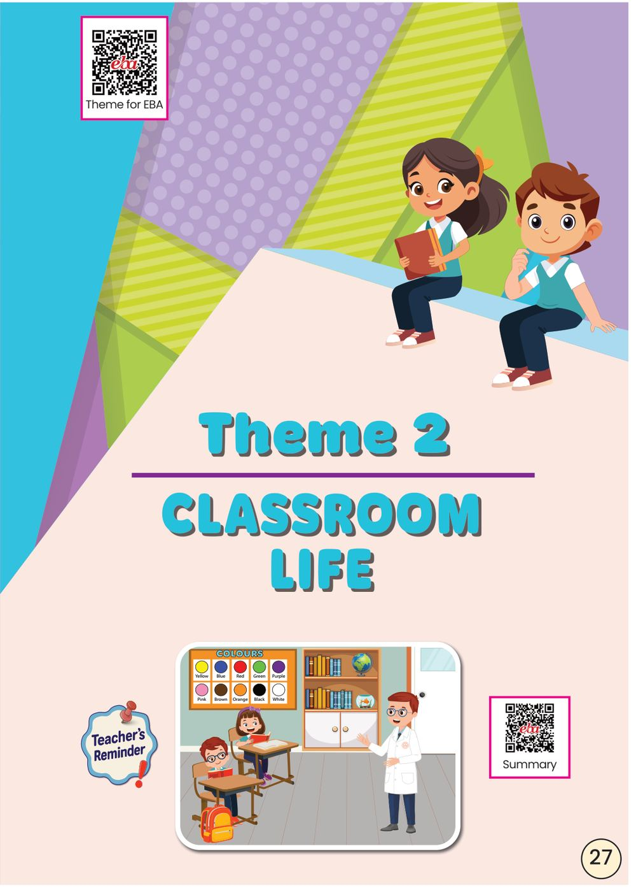

Theme for EBA

# Theme 2
## CLASSROOM LIFE


| COLOURS | | | | |
| :--- | :--- | :--- | :--- | :--- |
| Yellow | Blue | Red | Green | Purple |
| Pink | Brown | Orange | Black | White |


Teacher's Reminder


Summary

<!-- sayfa 27 -->

1 Look at the picture. Where are they?
2 Watch the digital story.

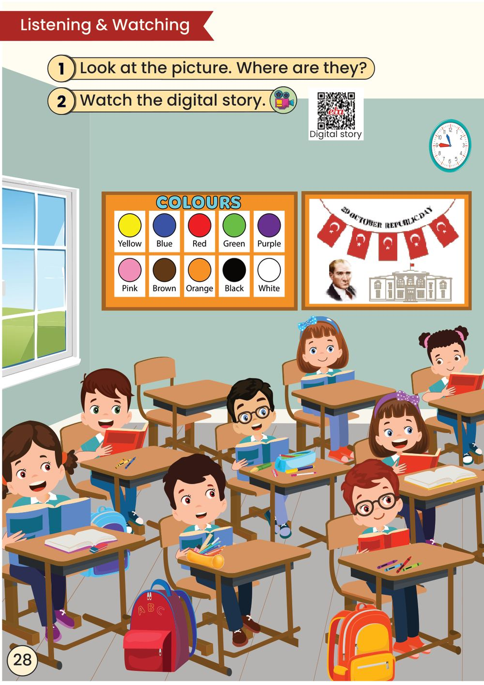

| COLOURS | | | | | |
| :--- | :--- | :--- | :--- | :--- | :--- |
| Yellow | Blue | Red | Green | Purple | |
| Pink | Brown | Orange | Black | White | |

<!-- sayfa 28 -->


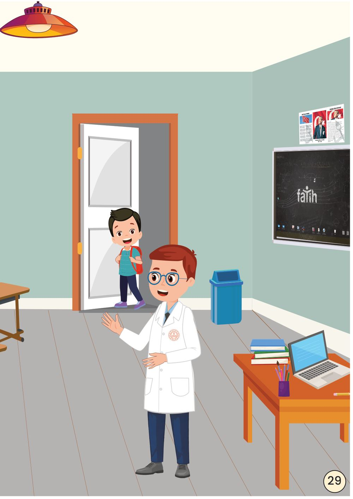
<!-- yer tutucu bulunamadı: sayfa sonuna eklendi -->

<!-- sayfa 29 -->

# 3 Watch and ✔. 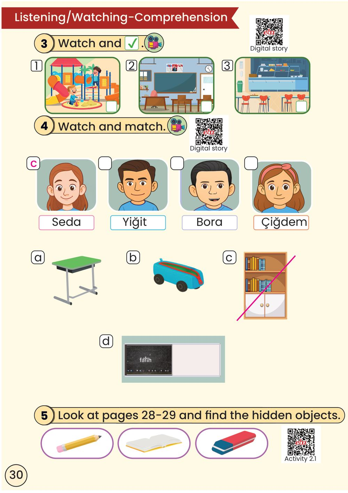

1 
2 
3 

# 4 Watch and match. 
c 

Seda


Yiğit


Bora


Çiğdem

a 
b 
c 
d 

# 5 Look at pages 28-29 and find the hidden objects.


<!-- sayfa 30 -->

# 6 Let's play.
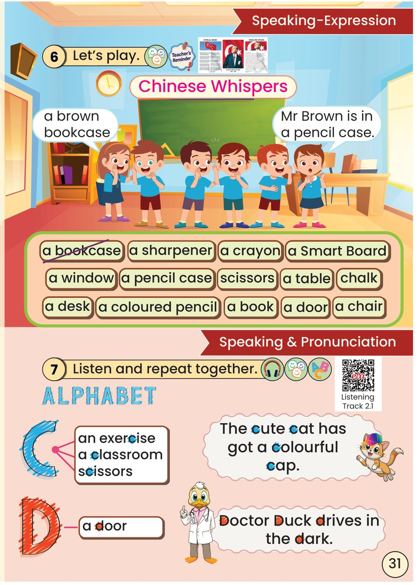

## Chinese Whispers
a brown bookcase
Mr Brown is in a pencil case.

a bookcase
a sharpener
a crayon
a Smart Board
a window
a pencil case
scissors
a table
chalk
a desk
a coloured pencil
a book
a door
a chair

# Speaking & Pronunciation
## 7 Listen and repeat together.


### ALPHABET

an exercise
a classroom
scissors


The cute cat has got a colourful cap.


a door
Doctor Duck drives in

<!-- sayfa 31 -->

# 8 Let's sing "The Colours Song". 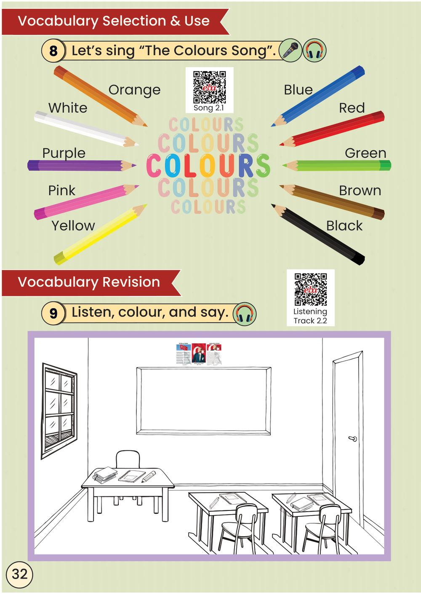


Song 2.1

Orange
Blue
White
Red
Purple
Green
Pink
Brown
Yellow
Black

COLOURS
COLOURS
COLOURS
COLOURS
COLOURS

# Vocabulary Revision

## 9 Listen, colour, and say. 


Listening Track 2.2


<!-- sayfa 32 -->

# 10 Listen and repeat together. 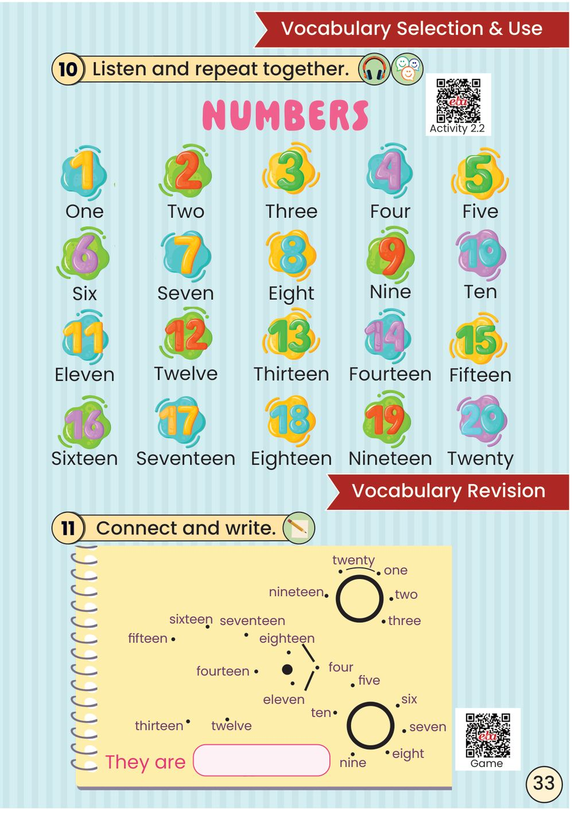

## NUMBERS

1 One
2 Two
3 Three
4 Four
5 Five
6 Six
7 Seven
8 Eight
9 Nine
10 Ten
11 Eleven
12 Twelve
13 Thirteen
14 Fourteen
15 Fifteen
16 Sixteen
17 Seventeen
18 Eighteen
19 Nineteen
20 Twenty

**Vocabulary Revision**

# 11 Connect and write. 


twenty
one
two
three

nineteen.
sixteen seventeen
eighteen
fifteen
fourteen
four
five
six
eleven
ten

thirteen
twelve
seven

<!-- sayfa 33 -->

# 12 Let’s play together.

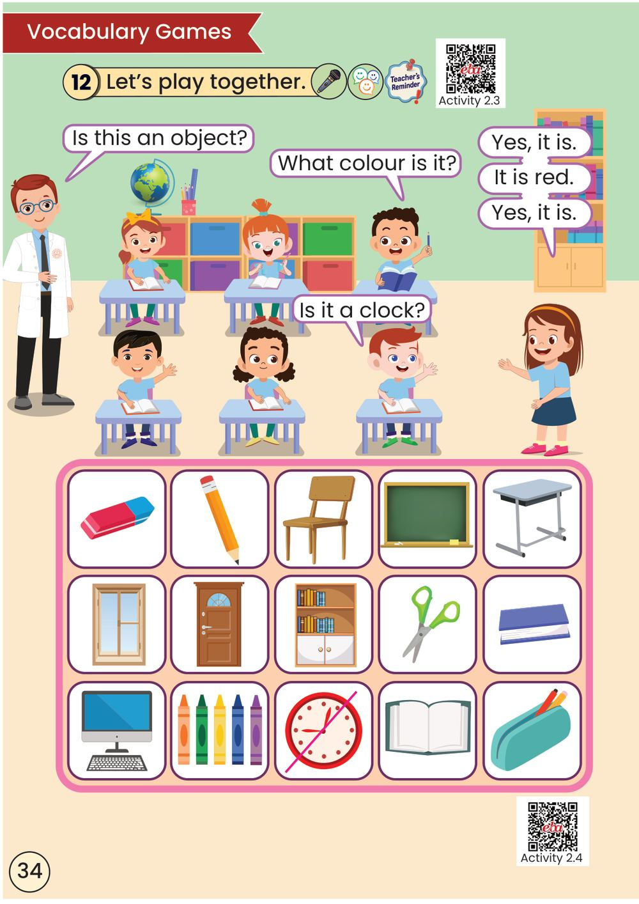

Is this an object?
What colour is it?
Is it a clock?
Yes, it is.
It is red.
Yes, it is.

| | | | | |
| :---: | :---: | :---: | :---: | :---: |
| ![silgi] | ![kalem] | ![sandalye] | ![tahta] | ![masa] |
| ![pencere] | ![kapı] | ![kitaplık] | ![makas] | ![kitap] |
| ![bilgisayar] | ![boya kalemleri] | ![saat] | ![açık kitap] | ![kalemlik] |

<!-- sayfa 34 -->

# 13 Let’s find together. 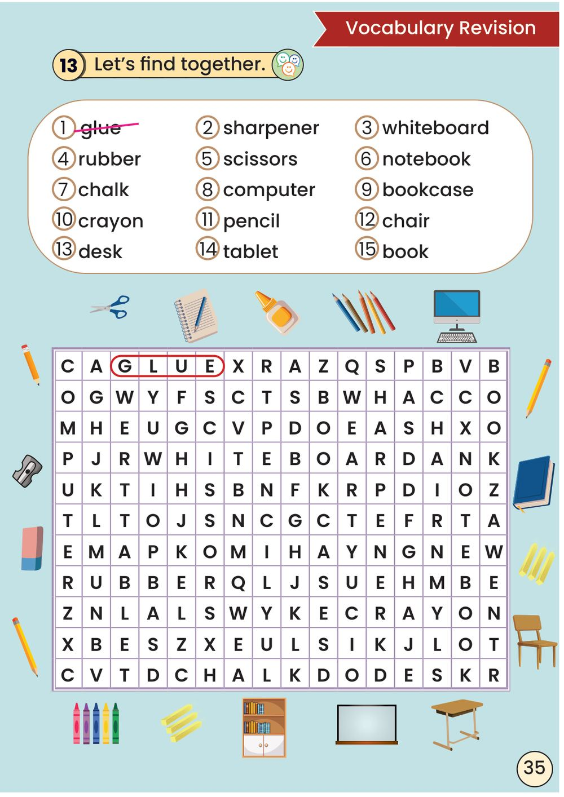

1. ~~glue~~
2. sharpener
3. whiteboard
4. rubber
5. scissors
6. notebook
7. chalk
8. computer
9. bookcase
10. crayon
11. pencil
12. chair
13. desk
14. tablet
15. book

| | | | | | | | | | | | | | | |
|---|---|---|---|---|---|---|---|---|---|---|---|---|---|---|
| C | A | G | L | U | E | X | R | A | Z | Q | S | P | B | V | B |
| O | G | W | Y | F | S | C | T | S | B | W | H | A | C | C | O |
| M | H | E | U | G | C | V | P | D | O | E | A | S | H | X | O |
| P | J | R | W | H | I | T | E | B | O | A | R | D | A | N | K |
| U | K | T | I | H | S | B | N | F | K | R | P | D | I | O | Z |
| T | L | T | O | J | S | N | C | G | C | T | E | F | R | T | A |
| E | M | A | P | K | O | M | I | H | A | Y | N | G | N | E | W |
| R | U | B | B | E | R | Q | L | J | S | U | E | H | M | B | E |
| Z | N | L | A | L | S | W | Y | K | E | C | R | A | Y | O | N |
| X | B | E | S | Z | X | E | U | L | S | I | K | J | L | O | T |
| C | V | T | D | C | H | A | L | K | D | O | D | E | S | K | R |

<!-- sayfa 35 -->

# 14 Watch, read, and act out. 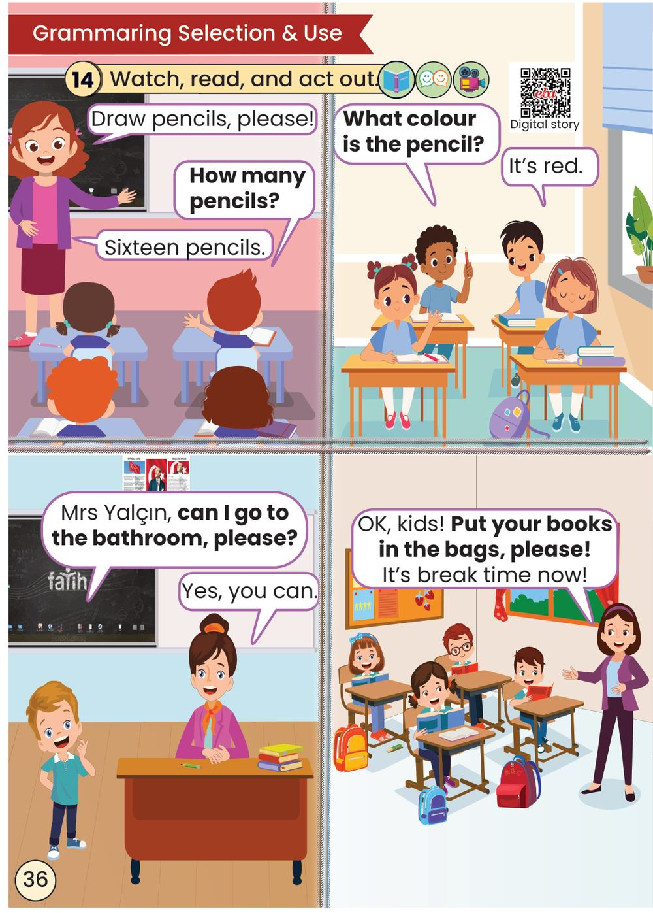

Digital story

Draw pencils, please!
How many pencils?
Sixteen pencils.

What colour is the pencil?
It's red.

Mrs Yalçın, can I go to the bathroom, please?
Yes, you can.

OK, kids! Put your books in the bags, please!
It's break time now!

<!-- sayfa 36 -->

# 15 Let's play together.

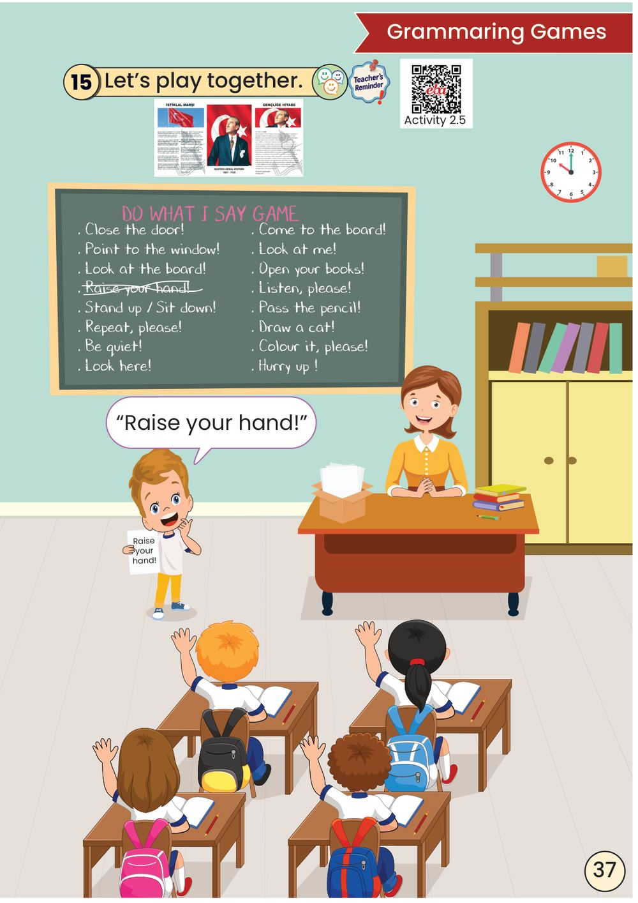

Activity 2.5

**DO WHAT I SAY GAME**

* Close the door!
* Point to the window!
* Look at the board!
* Raise your hand!
* Stand up / Sit down!
* Repeat, please!
* Be quiet!
* Look here!
* Come to the board!
* Look at me!
* Open your books!
* Listen, please!
* Pass the pencil!
* Draw a cat!
* Colour it, please!
* Hurry up!

Raise your hand!
“Raise your hand!”

<!-- sayfa 37 -->

# 16 Read and circle the classroom objects. 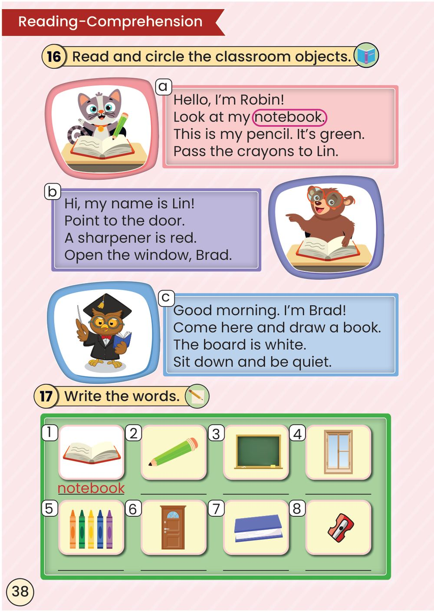

**a**

Hello, I'm Robin!
Look at my notebook.
This is my pencil. It's green.
Pass the crayons to Lin.

**b**
Hi, my name is Lin!
Point to the door.
A sharpener is red.
Open the window, Brad.


**c**

Good morning. I'm Brad!
Come here and draw a book.
The board is white.
Sit down and be quiet.

# 17 Write the words. 

1. 
notebook

2. 
__________

3. 
__________

4. 
__________

5. 
__________

6. 
__________

7. 
__________

8. 
__________

<!-- sayfa 38 -->

# 18 Order and write. ✏️

1. the | to | 🖼️ | please | come
_______________________________________________________
Come to the board, please!

2. 🪟 | please | open | the
_______________________________________________________!

3. the | ✏️ | pass | please
_______________________________________________________!

4. your | please | raise | ✋
_______________________________________________________!

5. 🖍️ | please | it
_______________________________________________________!

# 19 Look, complete, and say. ✏️ 🗣️

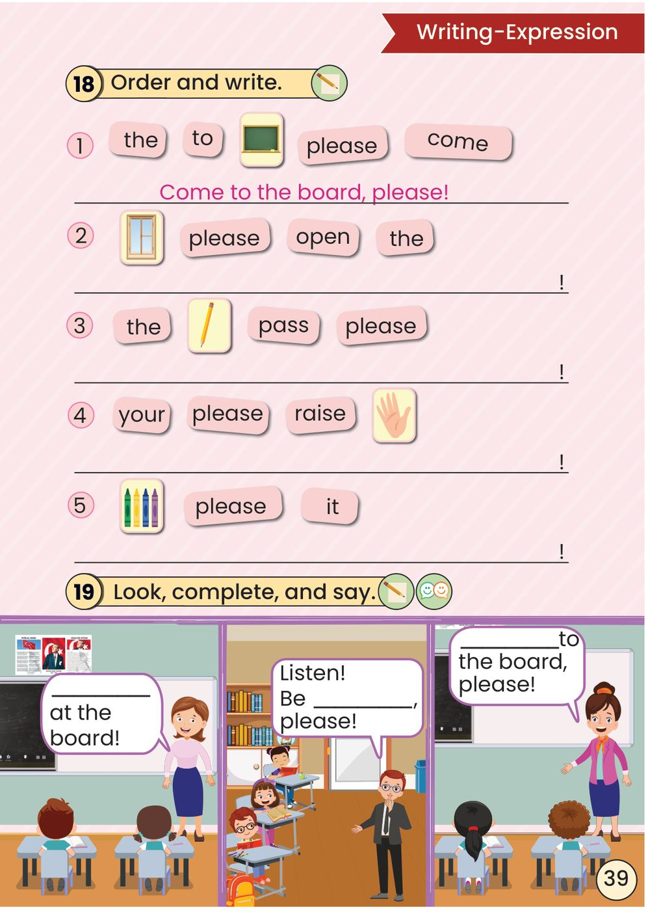
(Konuşma balonu 1):
_________ at the board!


(Konuşma balonu 2):
Listen!
Be _________, please!


(Konuşma balonu 3):
_________ to the board, please!

<!-- sayfa 39 -->

20 Read and act out.

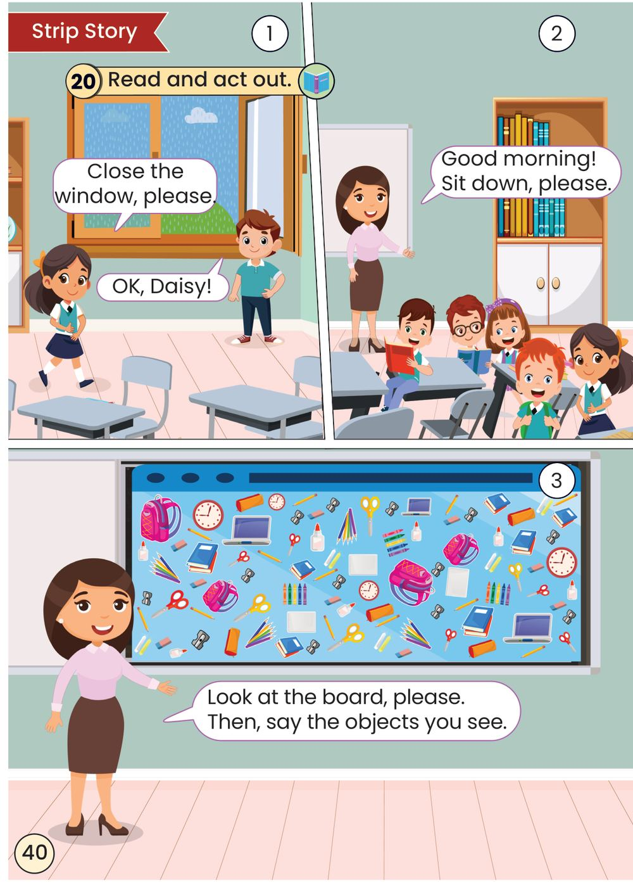

Close the window, please.
OK, Daisy!

Good morning!
Sit down, please.


3

Look at the board, please.
Then, say the objects you see.

<!-- sayfa 40 -->

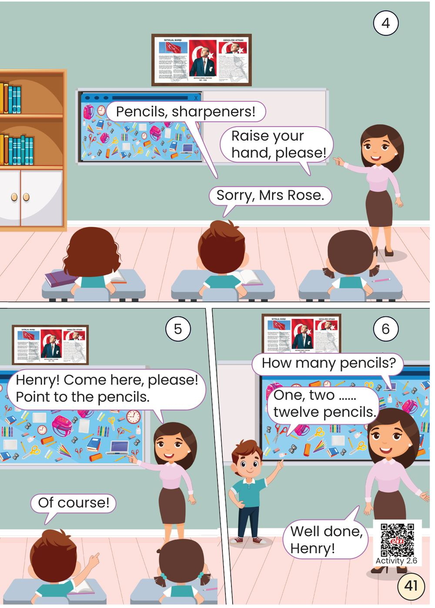

Pencils, sharpeners!
Raise your hand, please!
Sorry, Mrs Rose.

5

Henry! Come here, please! Point to the pencils.
Of course!

6

How many pencils?
One, two ...... twelve pencils.
Well done, Henry!

<!-- sayfa 41 -->

21 Go to pages 109 and 111. Draw your classroom. Cut out the pictures of classroom objects, furniture, and devices. Stick them on your classroom picture. Then talk about them.

22 Find and match.

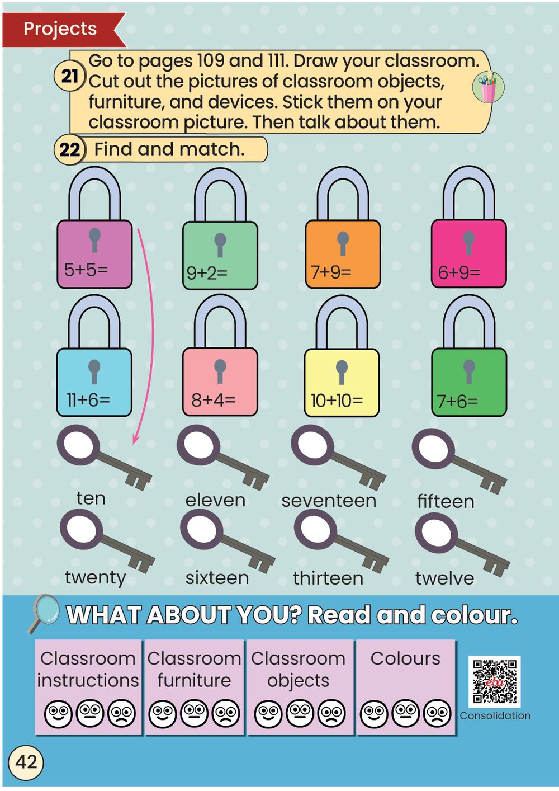

$5+5=$ <!-- KONTROL: Marker'da karşılığı yok, uydurma olabilir -->
$9+2=$ <!-- KONTROL: Marker'da karşılığı yok, uydurma olabilir -->
$7+9=$ <!-- KONTROL: Marker'da karşılığı yok, uydurma olabilir -->
$6+9=$ <!-- KONTROL: Marker'da karşılığı yok, uydurma olabilir -->

$11+6=$ <!-- KONTROL: Marker'da karşılığı yok, uydurma olabilir -->
$8+4=$ <!-- KONTROL: Marker'da karşılığı yok, uydurma olabilir -->
$10+10=$ <!-- KONTROL: Marker'da karşılığı yok, uydurma olabilir -->
$7+6=$ <!-- KONTROL: Marker'da karşılığı yok, uydurma olabilir -->

ten
eleven
seventeen
fifteen
twenty
sixteen
thirteen
twelve

# WHAT ABOUT YOU? Read and colour.

| Classroom instructions | Classroom furniture | Classroom objects | Colours |
| :---: | :---: | :---: | :---: |
| 😀 😀 😀 | 😐 😐 😐 | ☹️ ☹️ ☹️ | 😃 😐 ☹️ |

Consolidation

<!-- sayfa 42 -->

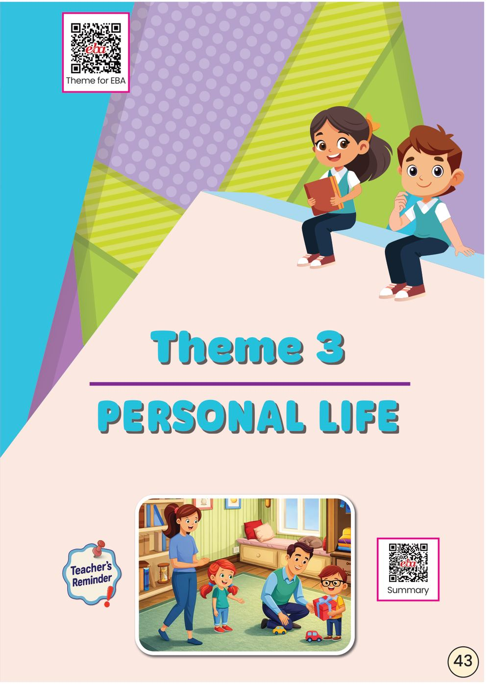

# Theme 3
## PERSONAL LIFE


<!-- sayfa 43 -->

1 Look at the picture. Where are they?
2 Watch the digital story. 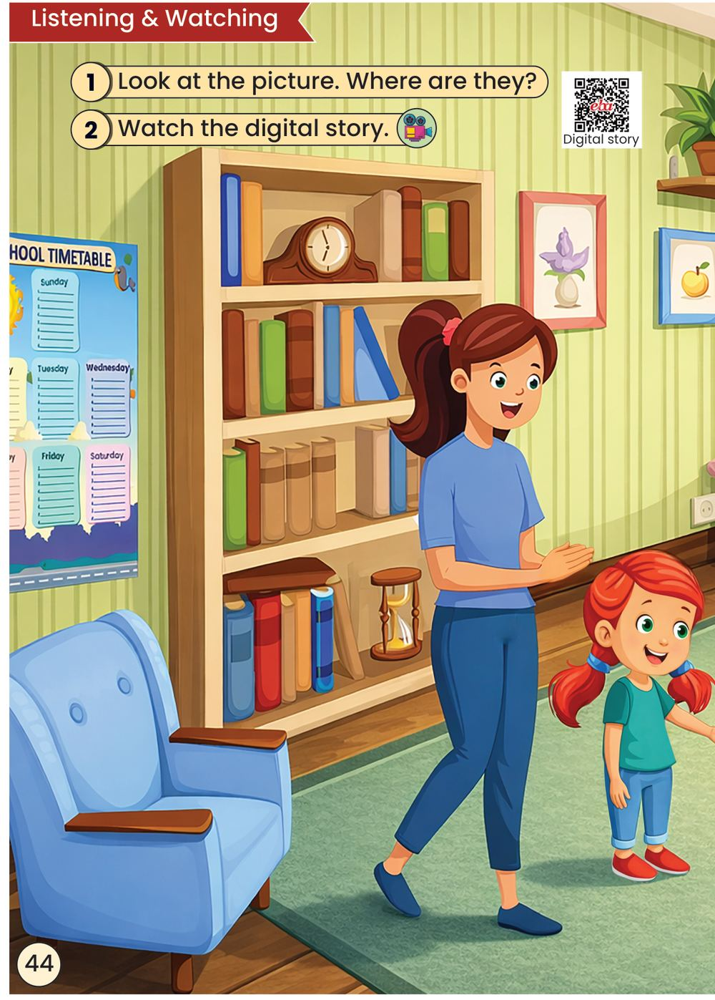


Digital story

<!-- sayfa 44 -->


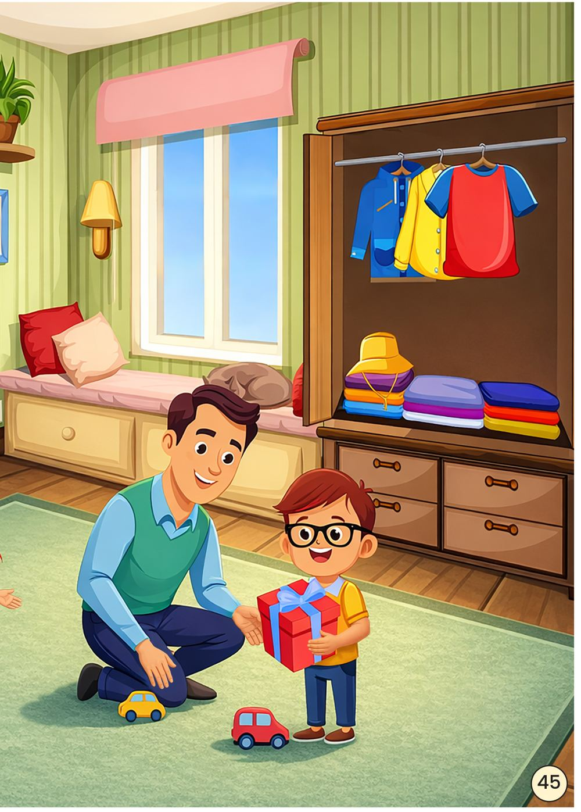
<!-- yer tutucu bulunamadı: sayfa sonuna eklendi -->

<!-- sayfa 45 -->

3 Watch and ✅ 🎥 Digital story
What day is it in the story?
• It's Friday.
• It's Monday.
• It's Sunday.

4 Watch, match, and say. 🎥 💬 🎤 Digital story

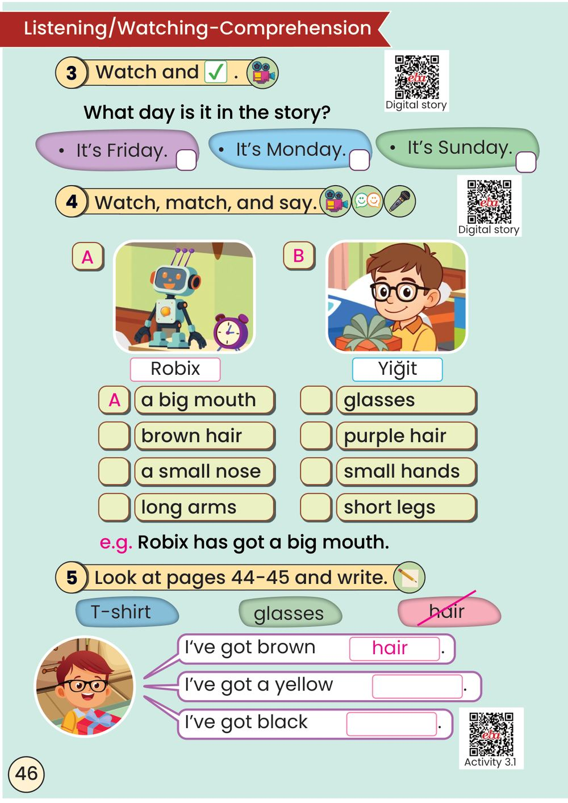
A

Robix

B

Yiğit

A [ ] a big mouth
[ ] brown hair
[ ] a small nose
[ ] long arms

[ ] glasses
[ ] purple hair
[ ] small hands
[ ] short legs

e.g. Robix has got a big mouth.

5 Look at pages 44-45 and write. ✍️
T-shirt glasses ~~hair~~


I've got brown [ hair ].
I've got a yellow [ ].
I've got black [ ].

<!-- sayfa 46 -->

# 6 Let's play together. 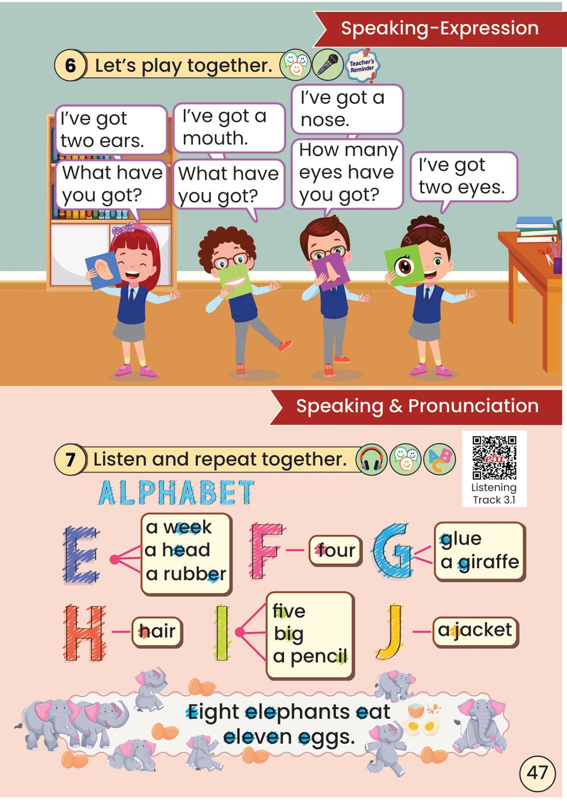


I've got two ears.
What have you got?

I've got a mouth.
What have you got?

I've got a nose.
How many eyes have you got?

I've got two eyes.

---

# Speaking & Pronunciation

## 7 Listen and repeat together. 

### ALPHABET

**E** $\rightarrow$ 
- a week
- a head
- a rubber

**F** $\rightarrow$ four

**G** $\rightarrow$ 
- glue
- a giraffe

**H** $\rightarrow$ hair

**I** $\rightarrow$ 
- five
- big
- a pencil

**J** $\rightarrow$ a jacket

Eight elephants eat 

<!-- sayfa 47 -->

8 Look, write, and say.

a nose | a leg | a head | a face
--- | --- | --- | ---
a hand | a mouth | a body | an ear
hair | an eye | an arm

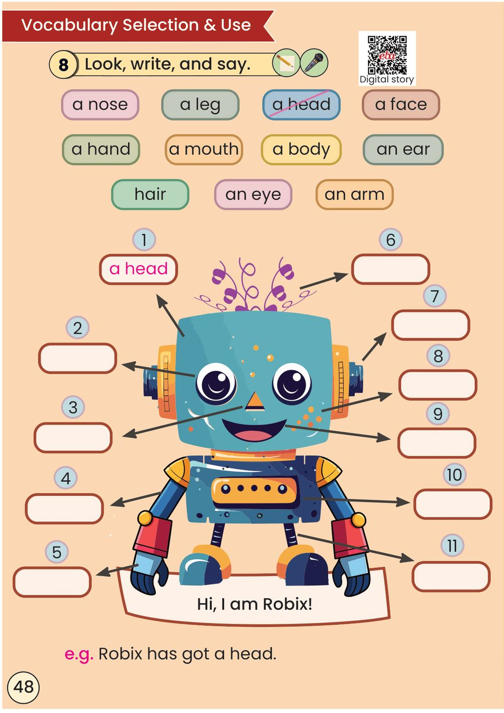

1 a head
2 
3 
4 
5 
6 
7 
8 
9 
10 
11 

Hi, I am Robix!

<!-- sayfa 48 -->

# 9 Find, circle, and say. 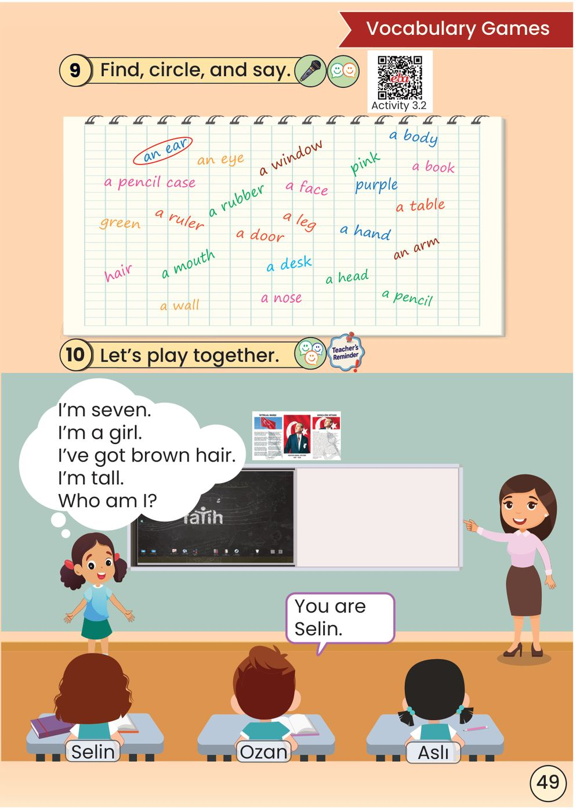


Activity 3.2

an ear
an eye
a window
a body
a pencil case
a face
pink
a book
green
a rubber
purple
a ruler
a table
a leg
a hand
an arm
a door
a desk
a mouth
a head
hair
a wall
a nose
a pencil

# 10 Let's play together. 

I'm seven.
I'm a girl.
I've got brown hair.
I'm tall.
Who am I?

You are Selin.

<!-- sayfa 49 -->

# 11 Read and say.

# HOW IS THE WEATHER?

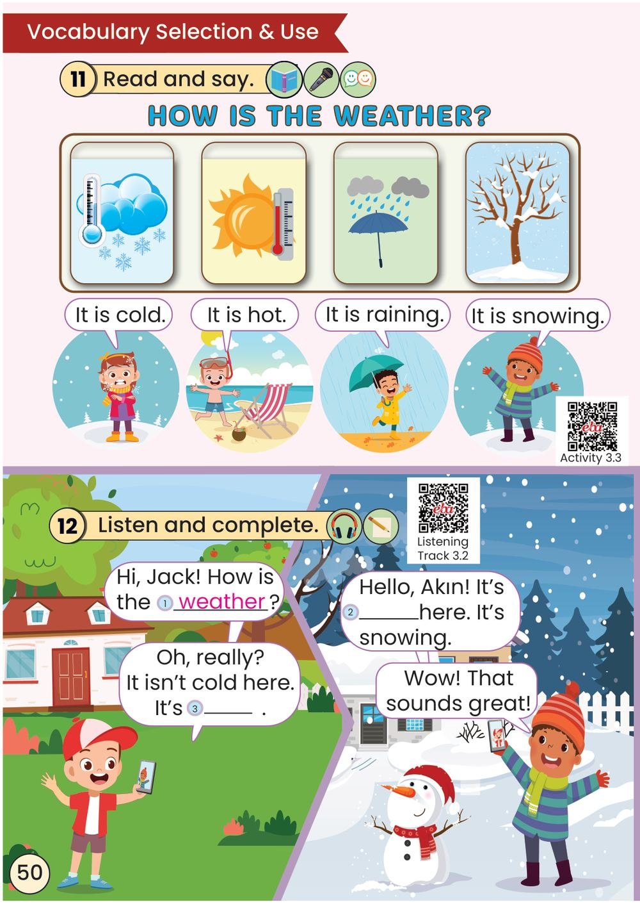

It is cold.
It is hot.
It is raining.
It is snowing.

# 12 Listen and complete.


Hi, Jack! How is the ① weather?

Hello, Akın! It’s ② ______ here. It’s snowing.

Oh, really? It isn’t cold here. It’s ③ ______ .

Wow! That sounds great!

Activity 3.3
Listening Track 3.2

<!-- sayfa 50 -->

# 13 Read, find, and choose.

1 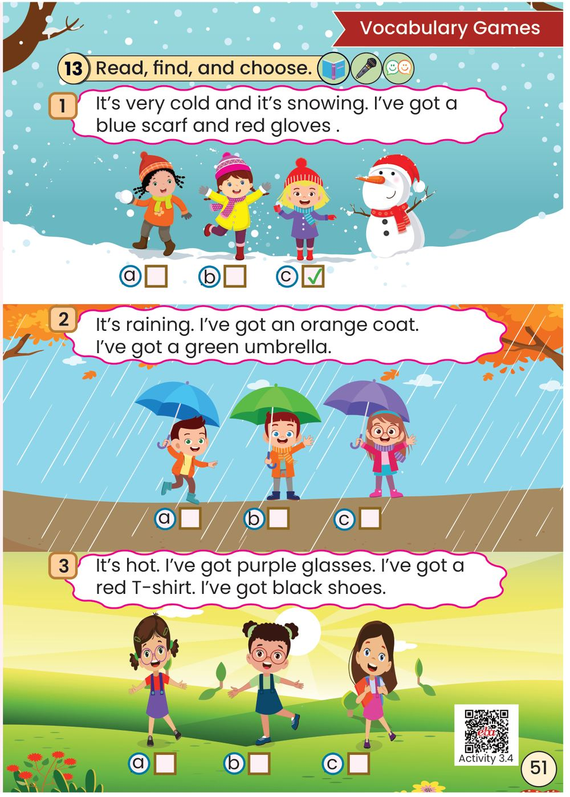
It’s very cold and it’s snowing. I’ve got a blue scarf and red gloves.

a ☐
b ☐
c ☑

2 
It’s raining. I’ve got an orange coat. I’ve got a green umbrella.

a ☐
b ☐
c ☐

3 
It’s hot. I’ve got purple glasses. I’ve got a red T-shirt. I’ve got black shoes.

<!-- sayfa 51 -->

# 14 Watch, read, and act out. 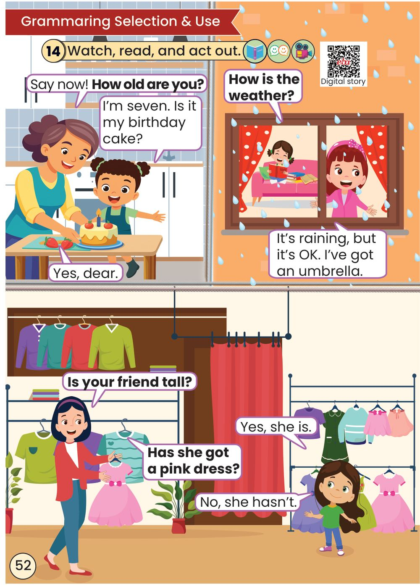

Say now! **How old are you?**

I’m seven. Is it my birthday cake?

Yes, dear.

**How is the weather?**

It’s raining, but it’s OK. I’ve got an umbrella.

**Is your friend tall?**

Yes, she is.

**Has she got a pink dress?**

No, she hasn’t.

<!-- sayfa 52 -->

# 15 Answer and follow. 😊😊

How old are you? 9

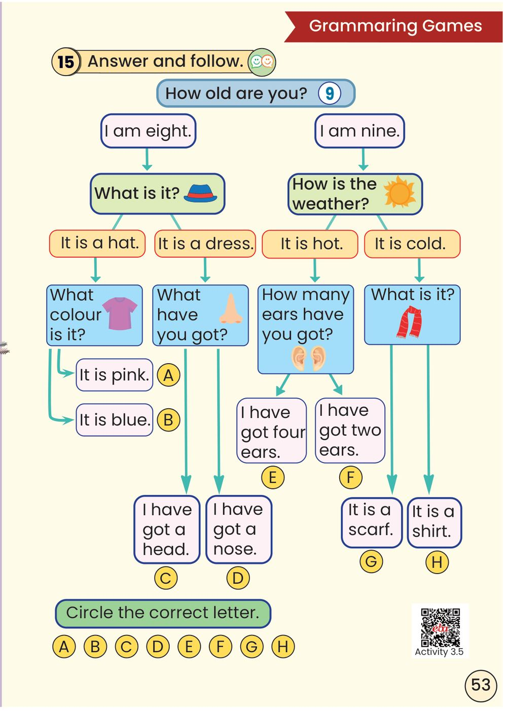

I am eight. $\rightarrow$ What is it? 🧢
- It is a hat. $\rightarrow$ What colour is it? 👕
    - It is pink. A
    - It is blue. B
- It is a dress. $\rightarrow$ What have you got? 👃
    - I have got a head. C
    - I have got a nose. D

I am nine. $\rightarrow$ How is the weather? ☀️
- It is hot.
- It is cold. $\rightarrow$ What is it? 🧣
    - It is a scarf. G
    - It is a shirt. H
How many ears have you got? 👂👂
- I have got four ears. E
- I have got two ears. F

Circle the correct letter.
A B C D E F G H

<!-- sayfa 53 -->

# 16 Read and write the names.

1
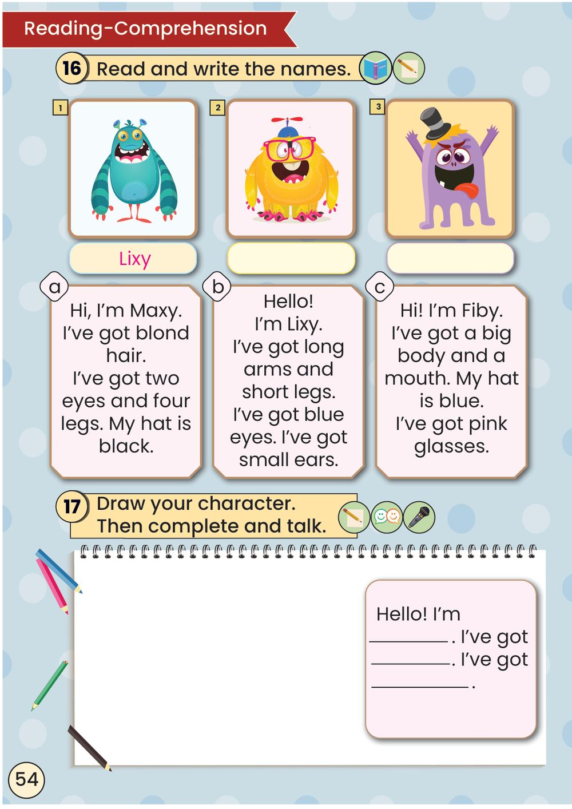
Lixy

2

[ ]

3

[ ]

a
Hi, I'm Maxy.
I've got blond
hair.
I've got two
eyes and four
legs. My hat is
black.

b
Hello!
I'm Lixy.
I've got long
arms and
short legs.
I've got blue
eyes. I've got
small ears.

c
Hi! I'm Fiby.
I've got a big
body and a
mouth. My hat
is blue.
I've got pink
glasses.

# 17 Draw your character.
Then complete and talk.


Hello! I'm
____________________. I've got
____________________. I've got
____________________.

<!-- sayfa 54 -->

# 18 Look and complete. 

| | | | |
| :--- | :---: | :---: | :---: |
| **Zeynep** | ![crossed out eyes] | ![orange coat] | ![dark hair] |
| **Defne** | ![purple dress] | ![blonde hair] | ![green eyes] |
| **Ceylin** | ![blue trousers] | ![brown eyes] | ![brown hair] |

1. Zeynep has got blue `eyes`.
2. Defne has got blonde `hair`.
3. Ceylin has got `brown` hair.
4. Defne has got a purple `dress`.
5. Zeynep has got a `orange` coat.
6. Ceylin has got blue `trousers`.

<!-- sayfa 55 -->

# 19 Read and act out.


OK, kids! What day is it today?

It’s Monday today. It’s our puppet day.

Right! Let’s see your puppets.

2

This is Minky. She’s 7. She’s got big green eyes.

3

It is your turn, Daisy. Show us your puppet.

His name is Bob. He’s got short

<!-- sayfa 56 -->

Dolly has got long blonde hair. She’s got a purple T-shirt.

Tim has got a yellow coat and a red scarf. It’s very cold.

6

 Well done, kids! Great job! Now, it is break time. See you next week.

<!-- sayfa 57 -->

20 Go to pages 113 and 115. Cut out the two puppets. Use the puppets and talk. 
21 Let's play together. 

START
1 What day is it today?
Keep Going
2 How old are you?
3 What is it? 
4 Is it your birthday today?
Well Done
5 What is it? 
6 What is it? 
Great Job
7 How many eyes have you got?
8 How is the weather? 
9 What colour is it? 
10 What have you got? 
11 Is this a leg? 
FINISH

WHAT ABOUT YOU? Read and Colour.

| Parts of the body | Clothes | Days of the week | Weather |
| :---: | :---: | :---: | :---: |
|  |  |  |  |


Consolidation

<!-- sayfa 58 -->


# Theme 4
## FAMILY LIFE


<!-- sayfa 59 -->

1 Look at the picture. Where are they?
2 Watch the digital story.


AYDIN-EFELER
ATATÜRK İLKOKULU

Digital story

<!-- sayfa 60 -->

```

(Not: Paylaştığınız görsel bir matematik ders kitabı sayfası değil, bir parkta piknik yapan insanların olduğu bir illüstrasyondur. İçerisinde herhangi bir metin, matematiksel ifade veya soru bulunmamaktadır. Bu nedenle dönüştürülecek bir metin yoktur.)


<!-- yer tutucu bulunamadı: sayfa sonuna eklendi -->

<!-- sayfa 61 -->

# 3 Watch and ✅ . 
## HOW IS THE WEATHER?
It is cold.
It is hot.
It is raining.

# 4 Look at pages 60–61 and ✅ . Who is missing?
1

☐ father
☑ mother
☐ son

2

☐ grandfather
☐ daughter
☐ grandmother

3

☐ father
☐ brother
☐ sister

# 5 Watch and complete. 
a  This is my __________, Nisa.
b  Beyza is my __________.
c  He is my __________. His

<!-- sayfa 62 -->

# 6 Let's play together.


Grandfather...
Hmm... daughter.

Yes, I've got a grandfather.

---

# Speaking & Pronunciation

## 7 Listen and repeat together.


### ALPHABET

**K** — a **k**id
**L** — **l**isten
**M** — a **m**um
**N** — **n**ine

**O**
one
two
four
a **m**other
an **o**range
a **l**emon

**P** — a **p**encil


One **o**range **o**wl **o**pens the **o**ld **o**ven.

<!-- sayfa 63 -->

# 8 Watch, complete, and talk. 

Digital story

## THE KILIÇ FAMILY


1
2
3
4
5

mother
father
daughter
grandmother
grandfather

<!-- sayfa 64 -->

# 9 Let's order and write. 


M E
T H
R
O
1 [ ][ ][ ][ ][ ][ ]


O E
H B R
R T
2 [ ][ ][ ][ ][ ][ ][ ]


T
H N A
F E D
R A G R
3 [ ][ ][ ][ ][ ][ ][ ][ ][ ][ ][ ][ ]


S
R T
E
I S
4 [ ][ ][ ][ ][ ][ ]


Y B
A B
5 [ ][ ][ ][ ]


M N T E D
A H
G O R R
6 [ ][ ][ ][ ][ ][ ][ ][ ][ ][ ]

Activity 4 2

<!-- sayfa 65 -->

# 10 Look and complete. ✏️ 🗣️


1. Zeynep is Can’s `mother`.
2. Kenan is Sarp’s __________ .
3. Can is Zeynep’s __________ .
4. Ceylin is Defne’s __________ .
5. Elif is Sarp’s __________ .
6. Sarp is Ceylin’s __________ .


# 11 Find 5 words, circle, and say. 🗣️ ✏️

| X | M | R | P | U | I | D | E | W | U | X | C | F | B | S | D |
|---|---|---|---|---|---|---|---|---|---|---|---|---|---|---|---|
| Y | O | F | X | B | N | F | A | S | T | W | F | W | U | G | A |
| T | T | X | G | R | A | N | D | F | A | T | H | E | R | C | U |
| H | H | C | A | E | B | H | S | W | S | G | X | G | S | X | G |
| W | E | E | T | I | Y | B | A | S | I | S | T | E | R | U | H |
| R | R | Z | C | S | O | N | V | L | M | N | V | B | S | G | T |
| C | W | Y | C | E | A | M | N | I | X | C | E | S | A | P | E |

<!-- sayfa 66 -->

# 12 Follow the way and complete. ✏️ 🎤

| My mum has got ① green eyes and ② [ ] hair. | She's my mother. She's got long ③ [ ] hair. | My mother has got ④ [ ] eyes. She's got brown hair. |
| :---: | :---: | :---: |
|  |  |  |


  

[QR Code]
Activity 4.3

<!-- sayfa 67 -->

13 Watch, read, and act out. 

Hi, Elif!
Who is he?

He’s my
brother.

Hi!
I’m Jack.

Hello!
I’m Ahmet.

Oh! It’s nice
to see you
here.

Who are they,
grandma?

They’re my
friends,
honey.

<!-- sayfa 68 -->

# 14 Let's play together.


Who is Ela?
She's Çınar's sister.
She's Emel's daughter.


Okan $\rightarrow$ Emel
$\leftarrow$ Sevim
$\rightarrow$ Rıza
$\leftarrow$ Çınar
$\rightarrow$ Deren

<!-- sayfa 69 -->

# 15 Read and match.


1. Hello! I'm Elif. This is my family. My dad is tall and handsome. I've got a brother. My mum has got long brown hair. My grandpa has got black glasses.

2. Hi! I'm Hakan. I've got a lovely family. I've got a baby brother and a sister. My grandma has got big green eyes. My mother is very beautiful.


a

b

# 16 Read again. Put a ✔ or ❌.


1. Elif has got a brother. ✔
2. Elif's mother has got short brown hair. ☐
3. Hakan has got a sister. ☐
4. Hakan's grandma has got big green eyes. ☐
5. Elif's grandpa has got black glasses. ☐

<!-- sayfa 70 -->

# 17 Look and complete. 


father | sisters
---|---
handsome | ~~family~~ | hair | grandma

Hi! I’m Mehmet. I’m with my ① family.
I’ve got two ② __________. My ③ __________ has got glasses. My ④ __________ is tall and ⑤ __________. My mum has got brown ⑥ __________.

# 18 Draw your family and write. 


<!-- sayfa 71 -->

19 Read and act out.


What is this, Grandpa?
It is our photo album. Come and sit, honey.

Who is she, Grandpa?
She is your grandmother.
She's beautiful.

2

Look at this photo. What about me?
You're very handsome.

3

<!-- sayfa 72 -->

Is this my father?
No, he isn't. He is my brother, Tim.

Who is this baby?
She is my daughter.
Oh, that's my mum.
5

Hey, Grandma! Look at my mother!
Yes, my dear. She is very nice.
We have got a lovely family.
6


<!-- yer tutucu bulunamadı: sayfa sonuna eklendi -->

<!-- sayfa 73 -->


20 Go to page 117. Cut the family tree picture and stick it on your notebook. Draw your family in the tree and talk about them.

21 Find and match.

1 Who is she?
2 Who is he?
3 Who is she?
4 Who is he?
5 Who is she?
6 Who is he?

a He is my father.
b She is my mother.
c He is my brother.
d She is my sister.
e She is my grandmother.
f He is my grandfather.

WHAT ABOUT YOU? Read and Colour.

| Family Members | Physical Appearance |
| :---: | :---: |
| 🙂 🙂 ☹️ | 🙂 🙂 ☹️ |


Consolidation

<!-- sayfa 74 -->


# Theme 5
## HOMES & HOUSES & NEIGHBOURHOODS


Teacher's Reminder


Summary

<!-- sayfa 75 -->

1 Look at the picture. Where are they?
2 Watch the digital story. 

Digital story

<!-- sayfa 76 -->


<!-- yer tutucu bulunamadı: sayfa sonuna eklendi -->

<!-- sayfa 77 -->


# 3 Watch and ✔️ . 
 a 
 b 
 c 

# 4 Look at pages 76-77 and write numbers. 
1 ~~a sitting room~~
2 a dining room
3 a kitchen
4 a bathroom
5 a bedroom
6 a balcony

# 5 Watch, match, and talk.   
Where are they?

 a 
 b 
 c 
 d 

1 a kitchen 
2 a dining room 
3 a sitting room (a) 
4 a garden 

e.g. Where is the cat? It's in the sitting room.


<!-- sayfa 78 -->

# 6 Let's play together.


Where is the sofa?
It's in the sitting room.

* a sofa
* a dog
* a bed
* a chair
* a cat
* a goldfish
* a table
* a coffee table
* a bird

# Speaking & Pronunciation

## 7 Listen and repeat together.


### ALPHABET

**Q** — a **q**uestion
**R** — a **r**abbit, a **l**ibrary, a **c**ucumber
**S** — **s**cissors
**T** — a **t**eacher
**U** — a **u**niform, a **p**upil, an **u**mbrella
**V** — **s**even


There are **s**even **q**uiet rabbits.

<!-- sayfa 79 -->

# 8 Watch, match, and say.

1 ~~a kitchen~~
2 a bedroom
3 a dining room
4 a sofa
5 a bathroom
6 a coffee table
7 a balcony
8 a bed
9 a sitting room

 a

 b

 c

 d

 e

 f

 g

 h

 i

<!-- sayfa 80 -->

# 9 Look, complete, and say.


Hi! I’m Meltem. We’ve got a big house.
My mother is in the ① kitchen and my grandpa is in the ② __________. We’ve got a goldfish in our ③ __________. My sister is in the ④ __________ and my brother is in the ⑤ __________. My grandma and our dog are on the ⑥ __________.

<!-- sayfa 81 -->

10 Listen and repeat together. 

# PETS


a dog
paw
A dog has got paws.


a cat
claw
A cat has got claws.


a fish
tail
A fish has got a tail.


a bird
beak
A bird has


a rabbit
whiskers
A rabbit has

<!-- sayfa 82 -->

# 11 Read and circle.

1. A dog has got a  — .
2. A  has got  whiskers —  a tail.
3. A rabbit has got  — .
4. A  has got  a beak —  claws.
5. A bird has got a  — .

# Vocabulary Games

## 12 Look, count, and say.


There are eleven cats.

<!-- sayfa 83 -->

# 13 Watch, read, and act out.


We've **got** a small house and a nice garden.

This is my dog. It'**s got** a tail, paws, and beautiful eyes.

Where is the cat?

Come and see, mum! It's on

Hey, look! **There are** three rabbits in the garden.

<!-- sayfa 84 -->

# 14 Match the halves and say. 🎤 💬

e.g. 🗨️ There is a cat in the sitting room.

1 
a 

2 
b 

3 
c 

4 
d 

5 
e 

<!-- sayfa 85 -->

# 15 Read and choose a title. 📖

a) Milo and his family
b) Milo and his friends
c) Milo and his school

__________________________________________


Hello, friends! My name’s Milo. I’m a dog. We’ve got a nice house. It’s got four rooms. I’m in the garden. I’ve got three friends.
Silvy is a cat. She’s got long whiskers. Look at her! She’s on the sofa in the sitting room.
Alfie is a rabbit. He’s got a funny tail and a small pink nose. He’s on the bed in his bedroom.
Bella is a bird. She’s got an orange beak. She’s on the table in the kitchen.
I love all my friends. We’re happy in our house.

# 16 Read and ✅. 📖

| | YES | NO |
| :--- | :---: | :---: |
| 1) Milo is in the garden. | ✔ | |
| 2) The house has got six rooms. | | |
| 3) Silvy has got long whiskers. | | |
| 4) Alfie is a bird. | | |
| 5) Bella has got an orange beak. | | |
| 6) Bella is in the bathroom. | | |

<!-- sayfa 86 -->

# 17 Look, read, and complete.

I’ve got a big . There is a  in the bedroom. I’ve got a . It’s on the  in the sitting room. There are chairs and a  in the dining room. I’ve got a small balcony and there are four  on the balcony. Lucky is my  and it’s in the garden.

# 18 Look and say.

e.g. There is a bed in the bedroom.

[[SEKIL:QR_CODE]]
Game 5.4

[[SEKIL:HOUSE_DIAGRAM]]

<!-- sayfa 87 -->

19 Read and act out.


I’ve got pets. They’re in the house. Let’s find them.
Oh, really?
Let’s look at the rooms!


2
Hey, come and see! There’s a dog in the kitchen.


3
The fish is in the sitting room.

<!-- sayfa 88 -->

There’s a bird in the dining room.

Hold on! Where is the cat?
Let’s look at your bedroom.

6


Come on! Let’s look at the balcony. We’ve got four rabbits there.
Shh! The cat is here. It’s on

<!-- sayfa 89 -->

20 Go to pages 119 and 121. Cut out the house picture, the room pictures, and the furniture pictures. Stick the rooms and furniture on the house picture. Then talk about it.

21 Find, circle, and say.
e.g. There are four fish in picture A.
There are three fish in picture B.


A


B


# WHAT ABOUT YOU? Read and Colour.

| Parts of the house | House furniture | Pets | Body parts of pets |
| :---: | :---: | :---: | :---: |
| ☺ ☺ ☺ | ☺ ☺ ☺ | ☺ ☺ ☺ | ☺ ☺ ☺ |


Consolidation

<!-- sayfa 90 -->


# Theme 6
## LIFE IN THE CITY & THE WORLD


<!-- sayfa 91 -->

1 Look at the picture. Where are they?
2 Watch the digital story. 

Digital story
FRUITS

<!-- sayfa 92 -->

# TURKISH HEALTHY KITCHEN FESTIVAL


AYDIN-EFELER
ATATÜRK İLKOKULU

## VEGETABLES

<!-- sayfa 93 -->


3 Watch and $\checkmark$ . 

Digital story

1 
2 
3 

4 Look at pages 92 and 93.
Write $\boxed{\text{F}}$ <!-- KONTROL: Marker'da karşılığı yok, uydurma olabilir --> for fruit and $\boxed{\text{V}}$ <!-- KONTROL: Marker'da karşılığı yok, uydurma olabilir --> for vegetables.


5 Watch and match. 

Digital story

1

$\boxed{\text{d}}$ <!-- KONTROL: Marker'da karşılığı yok, uydurma olabilir --> Çınar

2

$\square$ Lucy

3

$\square$ Selen

4

$\square$ Alex

a) 
b) 
c) 
d) 

<!-- sayfa 94 -->

# 6 Let’s play together. 

What have you got in your basket?
I’ve got some apples, carrots, and bananas.

# Speaking & Pronunciation

## 7 Listen and repeat together. 

### ALPHABET

W — a window
X — mix
Y — yoghurt
Z — a zebra


Mix the yoghurt with zucchini.

 Listening Track 6.1

<!-- sayfa 95 -->

# 8 Watch, match, and say. 🎥🎤💬


| | | |
| :---: | :---: | :---: |
| $\square$ | $\square$ | $\square$ |
| | tea | milk |
| $\square$ | | |
| pears | $\square$ | $\square$ |
| | bananas | eggs |
| $\square$ | | |
| spinach | $\square$ | $\square$ |
| | meat | peppers |
| $\square$ | | |
| carrots | $\square$ | $\square$ |
| | potatoes | cherries |
| $\square$ | $\square$ | $\square$ |
| oranges | strawberries | bread |

| | | | |
| :---: | :---: | :---: | :---: |
| 1 water | 2 tomatoes | 3 garlic | 4 eggs |
| 5 milk | 6 peppers | 7 oranges | 8 broccoli |
| 9 courgette | 10 beans | 11 coffee | 12 meat |
| 13 ayran | 14 fish | 15 apples | |

<!-- sayfa 96 -->


16 bananas | 17 cherries | 18 chicken
---|---|---
19 bread | 20 cauliflower | 21 grapes | 22 pears
23 strawberries | 24 tea | 25 carrots | 26 lettuce
27 potatoes | 28 spinach | 29 cucumber

Activity 6.2

<!-- sayfa 97 -->

9 Watch, read, and act out. 


Digital story

Do you like chicken?
Yes, I do.

Do you like broccoli?
No, I don't.

Is there an apple in your lunch box?
Yes, there is.

What is there in your lunch box?
There are some bananas.

<!-- sayfa 98 -->

10 Work in pairs. Ask and answer. 


Do you like pears?
No, I don't.


Yes, I do.
Do you like coffee?

| | | | |
| :---: | :---: | :---: | :---: |
|  |  |  |  |
| oranges | eggs | carrots | bananas |
|  |  |  |  |
| grapes | fish | bread | chicken |
|  |  |  |  |
| milk | coffee | pears | broccoli |
|  |  |  |  |
| beans | spinach | tea | meat |

<!-- sayfa 99 -->

# 11 Let's play together.


There are two pears, an apple, and some water on my table. Who am I?

Are you Arzu?

Yes! Now, it's your turn.

Activity 6.3

# WHO AM I?

| | | |
| :---: | :---: | :---: |
| <br>Arzu | <br>Ceylin | <br>Mert |
| <br>Eren | <br>Zeynep | <br>Tolga |
| <br>Elif | <br>Defne | <br>Asya |
|  |  |  |

<!-- sayfa 100 -->

# 12 Look and complete.

| I'm thirsty. | ~~Yummy!~~ | I'm hungry. | Time for lunch! |
| :---: | :---: | :---: | :---: |


1
Here is your ice cream.
Yummy!


2
Here you are, dear.


3
Hurray!


4
Let's go to the canteen.

<!-- sayfa 101 -->

# 13 Read and act out. 

**Emre:** Mum, I’m hungry.
**Mum:** Well, let’s look in the fridge. Do you like fish and salad?
**Emre:** Yummy! I like fish and salad.
**Mum:** Ok, dear. There is fish and there are cucumbers and lettuce for the salad.
**Emre:** Are there any carrots and tomatoes?
**Mum:** Yes, there are two carrots and four tomatoes.
**Emre:** Great! Do you need help?
**Mum:** Yes! Can you wash the vegetables, please?
**Emre:** Sure!

# 14 Read and choose. 

1. What is for dinner?
a) ☐ 
b) ☑ 
c) ☐ 

2. Are there cucumbers in the fridge?
a) ☐ Yes, there are.
b) ☐ No, there aren’t.

3. How many carrots and tomatoes?
a) 
b) 
c) 

<!-- sayfa 102 -->

15 Look and write. 

# Shopping list

• three apples ✓
• __________________________________________
• __________________________________________
• __________________________________________
• __________________________________________
• __________________________________________
• __________________________________________
• __________________________________________
• __________________________________________
• __________________________________________

<!-- sayfa 103 -->

16 Read and act out. 

Do you like beans?
Yes, I do.

2
Time’s up! It is lunch time. Enjoy your meal!

3
I’m hungry, Daisy!
Let’s go to the lunch hall.

<!-- sayfa 104 -->

Yummy!
I like chicken!

TODAYS MENU
-Tomato Soup
-Chicken
-Beans
-Fish and potatoes
-Salad
-Banana/Apple

Really?

Can I have
some chicken,
please?

Yes, of
course.

6

I'm thirsty!
Pass the
water,
please!

Here you are!

7

Thanks
for lunch!

You are
welcome.


<!-- yer tutucu bulunamadı: sayfa sonuna eklendi -->

<!-- sayfa 105 -->


17 Go to pages 123, 125 and 127. Cut out the food pictures. Stick them in your notebook. Say what you like and don't like.

18 Choose and write.

1. 
2. 
3. 
4. 
5. 
6. 
7. 
8. 
9. 
10. 


# WHAT ABOUT YOU? Read and Colour.

| Fruit & Vegetables | Drinks | Do you like...? | There is/ There are... |
| :---: | :---: | :---: | :---: |
| 🙂 😐 ☹️ | 🙂 😐 ☹️ | 🙂 😐 ☹️ | 🙂 😐 ☹️ |


Consolidation

<!-- sayfa 106 -->

# CUT-OUTS

## Theme 1 - Page 26 - Activity 20


<!-- sayfa 107 -->

Girdiğiniz mesajda herhangi bir metin veya görsel bulunmamaktadır. Lütfen dönüştürülmesini istediğiniz PDF metin katmanını `<<< >>>` işaretleri arasına ekleyin veya ilgili görseli paylaşın. Veriyi sağladığınızda talimatlarınıza uygun olarak Markdown formatına çevirebilirim.


<!-- yer tutucu bulunamadı: sayfa sonuna eklendi -->

<!-- sayfa 108 -->

Theme 2 - Page 42 - Activity 21


<!-- sayfa 109 -->

Girdiğiniz mesajda herhangi bir metin veya görsel bulunmamaktadır. Lütfen dönüştürülmesini istediğiniz PDF metin katmanını `<<< ... >>>` işaretleri arasına ekleyin ve ilgili görüntüyü paylaşın. Verileri sağladığınızda talimatlarınıza uygun olarak Markdown formatına çevirebilirim.


<!-- yer tutucu bulunamadı: sayfa sonuna eklendi -->

<!-- sayfa 110 -->


<!-- sayfa 111 -->

Girdiğiniz mesajda herhangi bir metin veya görsel bulunmamaktadır. Lütfen dönüştürülmesini istediğiniz PDF metin katmanını `<<< ... >>>` işaretleri arasına ekleyin veya ilgili görseli paylaşın. Veriyi sağladığınızda talimatlarınıza uygun şekilde Markdown formatına çevirebilirim.


<!-- yer tutucu bulunamadı: sayfa sonuna eklendi -->

<!-- sayfa 112 -->

Theme 3 - Page 58 - Activity 20


<!-- sayfa 113 -->

Girdiğiniz mesajda herhangi bir metin veya görsel bulunmamaktadır. Lütfen dönüştürülmesini istediğiniz PDF metin katmanını `<<< ... >>>` arasına ekleyin ve ilgili görüntüyü paylaşın. Verileri sağladığınızda talimatlarınıza uygun olarak Markdown formatına çevirebilirim.


<!-- yer tutucu bulunamadı: sayfa sonuna eklendi -->

<!-- sayfa 114 -->


<!-- sayfa 115 -->

Verdiğiniz mesajda herhangi bir metin veya görsel bulunmamaktadır. Lütfen dönüştürülmesini istediğiniz PDF metin katmanını `<<< ... >>>` işaretleri arasına ekleyin ve ilgili görüntüyü paylaşın. Verileri sağladığınızda talimatlarınıza uygun olarak Markdown formatına çevirebilirim.


<!-- yer tutucu bulunamadı: sayfa sonuna eklendi -->

<!-- sayfa 116 -->

Theme 4 - Page 74 - Activity 20


<!-- sayfa 117 -->

Girdiğiniz mesajda herhangi bir metin veya görsel bulunmamaktadır. Lütfen dönüştürülmesini istediğiniz PDF metin katmanını `<<< ... >>>` işaretleri arasına ekleyin ve ilgili görüntüyü paylaşın. Verileri sağladığınızda talimatlarınıza uygun olarak Markdown formatına çevirebilirim.


<!-- yer tutucu bulunamadı: sayfa sonuna eklendi -->

<!-- sayfa 118 -->

# Theme 5 - Page 90 - Activity 20


<!-- sayfa 119 -->

Henüz bir görsel veya metin katmanı sağlamadınız. Lütfen dönüştürülmesini istediğiniz matematik ders kitabı sayfasının görüntüsünü ve varsa PDF metin katmanını paylaşın. Paylaştığınız anda talimatlarınıza harfiyen uyarak Markdown formatında çevirisini yapacağım.


<!-- yer tutucu bulunamadı: sayfa sonuna eklendi -->

<!-- sayfa 120 -->


<!-- sayfa 121 -->

Verdiğiniz metin katmanı boş olduğu için (`<<< >>>`) dönüştürülecek bir içerik bulunmamaktadır. Lütfen metin katmanını içeren içeriği paylaşın, böylece talimatlarınıza uygun şekilde Markdown formatına çevirebilirim.


<!-- yer tutucu bulunamadı: sayfa sonuna eklendi -->

<!-- sayfa 122 -->

Theme 6 - Page 106 - Activity 17


<!-- sayfa 123 -->

Girdiğiniz mesajda herhangi bir metin veya görsel bulunmamaktadır. Lütfen dönüştürülmesini istediğiniz PDF metin katmanını `<<< ... >>>` işaretleri arasına ekleyin ve ilgili görseli paylaşın. Verileri sağladığınızda talimatlarınıza uygun şekilde Markdown formatına çevirebilirim.


<!-- yer tutucu bulunamadı: sayfa sonuna eklendi -->

<!-- sayfa 124 -->


<!-- sayfa 125 -->

Verdiğiniz mesajda herhangi bir metin veya görsel bulunmamaktadır. Lütfen çevrilmesini istediğiniz metin katmanını `<<< >>>` işaretleri arasına ekleyin veya ilgili görseli paylaşın. Veriyi paylaştığınızda kurallara uygun şekilde Markdown formatına dönüştürebilirim.


<!-- yer tutucu bulunamadı: sayfa sonuna eklendi -->

<!-- sayfa 126 -->


<!-- sayfa 127 -->

Girdiğiniz mesajda herhangi bir metin veya görsel bulunmamaktadır. Lütfen dönüştürülmesini istediğiniz PDF metin katmanını `<<< ... >>>` işaretleri arasına ekleyin ve ilgili görseli paylaşın. Verileri sağladığınızda talimatlarınıza uygun şekilde Markdown formatına çevirebilirim.


<!-- yer tutucu bulunamadı: sayfa sonuna eklendi -->

<!-- sayfa 128 -->

# GLOSSARY

## THEME 1

**big** : büyük  
**boy** : erkek çocuk  
**canteen** : kantin  
**clap** : alkışlamak  
**classroom** : sınıf  
**day** : gün  
**excuse me** : affedersiniz  
**fine** : iyi  
**finish** : bitirmek  
**Friday** : Cuma  
**friend** : arkadaş  
**garden** : bahçe  
**girl** : kız çocuk  
**headmaster** : erkek okul müdürü  
**headmistress** : kadın okul müdürü  
**hello** : merhaba  
**hi** : selam  
**how** : nasıl  
**jump** : zıplamak  
**kid** : çocuk  
**library** : kütüphane  
**lunch hall** : yemekhane  
**meet** : tanışmak  
**Monday** : Pazartesi  
**name** : isim  
**people** : insanlar  
**place** : yer  
**playground** : oyun alanı  
**pupil** : öğrenci  
**Saturday** : Cumartesi  
**school** : okul  
**sing** : şarkı söylemek  
**sports hall** : spor salonu  
**start** : başlamak  
**Sunday** : Pazar  
**teacher** : öğretmen  
**teacher’s room** : öğretmenler odası  
**thank you** : teşekkür ederim  
**Thursday** : Perşembe  
**today** : bugün  
**together** : birlikte  
**Tuesday** : Salı  
**wait** : beklemek  
**Wednesday** : Çarşamba  
**week** : hafta  
**what** : ne  
**where** : nerede  
**who** : kim


<!-- yer tutucu bulunamadı: sayfa sonuna eklendi -->

<!-- sayfa 129 -->

# THEME 2

**bag** : çanta
**black** : siyah
**blackboard** : kara tahta
**blue** : mavi
**board** : tahta
**book** : kitap
**bookcase** : kitaplık
**box** : kutu
**break** : teneffüs
**brown** : kahverengi
**cap** : şapka
**cat** : kedi
**chair** : sandalye
**chalk** : tebeşir
**clock** : duvar saati
**close** : kapatmak
**colour** : boyamak
**come** : gelmek
**computer** : bilgisayar
**crayon** : pastel boya
**dark** : koyu renk
**desk** : sıra
**door** : kapı
**draw** : resim çizmek
**glue** : yapıştırıcı
**green** : yeşil
**help** : yardım
**listen** : dinlemek

**need** : ihtiyaç duymak
**notebook** : defter
**object** : nesne
**open** : açmak
**orange** : turuncu
**pass** : uzatmak
**pencil** : kalem
**pencil case** : kalem kutusu
**picture** : resim
**pink** : pembe
**please** : lütfen
**point** : işaret etmek
**purple** : mor
**put** : koymak
**quiet** : sessiz
**raise** : el kaldırmak
**ready** : hazır
**red** : kırmızı
**repeat** : tekrar etmek
**rubber** : silgi
**say** : söylemek
**scissors** : makas
**sharpener** : kalemtıraş
**show** : göstermek
**sit down** : oturmak
**Smart Board** : akıllı tahta
**table** : masa
**time** : zaman


<!-- yer tutucu bulunamadı: sayfa sonuna eklendi -->

<!-- sayfa 130 -->

**wall** : duvar  
**well done** : aferin  
**white** : beyaz  
**whiteboard** : beyaz tahta  

**window** : pencere  
**yellow** : sarı  

---

# THEME 3

**arm** : kol  
**birthday** : doğum günü  
**blond** : sarı saçlı erkek  
**blonde** : sarı saçlı kadın  
**body** : vücut  
**break time** : teneffüs zamanı  
**cake** : pasta  
**cheer up** : neşelenmek  
**cloth** : giysi  
**coat** : mont  
**cold** : soğuk  
**dark** : karanlık  
**dear** : sevgili  
**dress** : elbise  
**ear** : kulak  
**eye** : göz  
**face** : yüz  
**gift** : hediye  
**glasses** : gözlük  
**gloves** : eldiven  
**great** : harika  
**hair** : saç  

**hand** : el  
**hat** : şapka  
**head** : kafa  
**hot** : sıcak  
**jacket** : ceket  
**leg** : bacak  
**long** : uzun  
**mouth** : ağız  
**nose** : burun  
**puppet** : kukla  
**rain** : yağmur  
**scarf** : atkı  
**shirt** : gömlek  
**shoes** : ayakkabı  
**short** : kısa  
**show** : göstermek  
**small** : küçük  
**snow** : kar  
**tall** : uzun  
**trousers** : pantolon  
**T-shirt** : tişört  
**umbrella** : şemsiye


<!-- yer tutucu bulunamadı: sayfa sonuna eklendi -->

<!-- sayfa 131 -->

# THEME 4

**album** : albüm  
**all right** : tamam  
**baby** : bebek  
**beautiful** : güzel  
**brother** : erkek kardeş  
**dad** : baba  
**daughter** : kız evlat  
**family** : aile  
**father** : baba  
**friend** : arkadaş  
**grandfather** : büyük baba  
**grandmother** : büyük anne  
**handsome** : yakışıklı  
**hungry** : aç  
**lovely** : sevimli  
**lunch** : öğle yemeği  
**lunchtime** : öğle yemeği zamanı  
**mother / mum** : anne  
**nice** : hoş  
**photo** : fotoğraf  
**short** : kısa  
**sister** : kız kardeş  
**son** : erkek evlat  
**sorry** : üzgün  
**tall** : uzun  
**very** : çok  

# THEME 5

**balcony** : balkon  
**bathroom** : banyo  
**beak** : gaga  
**bed** : yatak  
**bedroom** : yatak odası  
**bird** : kuş  
**cat** : kedi  
**claw** : pençe  
**coffee table** : sehpa  
**cucumber** : salatalık  
**dance** : dans etmek  
**dining room** : yemek odası  
**dog** : köpek  
**doorbell** : kapı zili  
**dollhouse** : oyuncak bebek evi  
**find** : bulmak  
**funny** : komik  
**garden** : bahçe  
**goldfish** : japon balığı  
**happy** : mutlu


<!-- yer tutucu bulunamadı: sayfa sonuna eklendi -->

<!-- sayfa 132 -->

**house** : ev  
**kitchen** : mutfak  
**paw** : pati  
**pet** : hayvan  
**rabbit** : tavşan  
**room** : oda  

**sitting room** : oturma odası  
**sofa** : kanepe  
**tail** : kuyruk  
**whiskers** : kedi bıyığı  

---

| THEME 6 | |
| :--- | :--- |
| **apple** : elma | **lunch** : öğle yemeği |
| **banana** : muz | **meat** : et |
| **bean** : fasulye | **milk** : süt |
| **bread** : ekmek | **orange** : portakal |
| **breakfast** : kahvaltı | **pear** : armut |
| **broccoli** : brokoli | **pepper** : biber |
| **carrot** : havuç | **potato** : patates |
| **cauliflower** : karnabahar | **spinach** : ıspanak |
| **cherry** : kiraz | **strawberry** : çilek |
| **chicken** : tavuk | **tea** : çay |
| **coffee** : kahve | **thirsty** : susamış |
| **courgette** : kabak | **tomato** : domates |
| **cucumber** : salatalık | **vegetable** : sebze |
| **delicious** : lezzetli | **water** : su |
| **dinner** : akşam yemeği | **yummy** : nefis |
| **drink** : içecek | |
| **egg** : yumurta | |
| **fish** : balık | |
| **fruit** : meyve | |
| **garlic** : sarımsak | |
| **grape** : üzüm | |
| **lettuce** : marul | |


<!-- yer tutucu bulunamadı: sayfa sonuna eklendi -->

<!-- sayfa 133 -->

# REFERENCES

**MEB (2025), Primary Education The English Language Curriculum (Years 2-3-4-5-6-7-8), The Century of Türkiye Education Model, Ankara.**

**Oxford University Press (2002) Oxford Collocations Dictionary for Students of English (9th ed.) Oxford.**

**The references in this section have been prepared following the principles and formatting rules of the APA Style 6$^{th}$ <!-- KONTROL: Marker'da karşılığı yok, uydurma olabilir --> Edition.**

# ANSWER KEY


# VISUAL AND GENERAL WEB REFERENCES


<!-- sayfa 134 -->

50°D
45°D
40°D
35°D
30°D
25°D

40°K
35°K

ROMANYA
Bükreş
Sofya
UKRAYNA
RUSYA FEDERASYONU
HAZAR DENİZİ
KARADENİZ
GÜRCİSTAN
Tiflis
ERMENİSTAN
Erivan
AZERBAYCAN
NAHÇIVAN Ö.C. (AZERBAYCAN)
İRAN
Urumiye Gölü
IRAK
Bağdat
SÜRİYE
Şam
LÜBNAN
Beyrut
KUZEY KIBRIS TÜRK CUMHURİYETİ
Lefkoşa
GÜNEY KIBRIS RUM YÖNETİMİ
AKDENİZ
FİLİSTİN
Tel Aviv
Batı Şeria
Doğu Kudüs
Gazze Şeridi
İSRAİL
MISIR
Nil N.
Süveyş K.
LİBYA
YUNANİSTAN
Atina
EGE DENİZİ
BULGARİSTAN
MERİÇ N.
Edirne
Kırklareli
Tekirdağ
İstanbul
Marmara Denizi
Bursa
Balıkesir
Çanakkale
İzmir
Aydın
Muğla
Antalya
Konya
Ankara
Sivas
Erzurum
Van
...


TÜRKİYE'NİN MÜLKİ İDARE BÖLÜMLERİ İLE KARA VE DENİZ KOMŞULARI HARİTASI

BAŞKENT ● Ankara
İL MERKEZİ ● Elâzığ
GÖL 
ÖZERK BÖLGE SINIRI
ÜLKE SINIRI
AKARSU

Harita Genel Müdürlüğü tarafından üretilmiştir.

0 50 100 200 300 400 km

<!-- sayfa 135 -->


<!-- yer tutucu bulunamadı: sayfa sonuna eklendi -->
