# İngilizce Dersi 2.Sınıf Öğretmen Kılavuz Kitabı

<!-- sayfa 0 -->

# ENGLISH
## Year 2

# Teacher’s Book

### AUTHORS
Ayşe Gül ÜNLÜ
Emine ÇATLI
Gülden CENGİZ
Remziye GÜLER ASLAN
Sezin SEVİM KULA

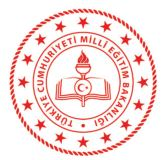

<!-- sayfa 1 -->

MİLLÎ EĞİTİM BAKANLIĞI YAYINLARI...................................................................... : 10555
DERS KİTAPLARI DİZİSİ.................................................................................................. : 2370
Her hakkı saklıdır ve Millî Eğitim Bakanlığına aittir. Kitabın metin, soru ve şekilleri kısmen de olsa hiçbir surette alınıp yayımlanamaz.

# EDITOR
Dr. Kamile HAMİLOĞLU

# VISUAL DESIGNERS
Arzu GÜNAL GÜN
Özcan ELGÜNLÜ

# MULTIMEDIA DESIGNERS
Eda ÖZKAN AKAR
Enver ÜLKER
Erhan AY
Hatice YILDIRIM IŞIK
Murat Evren AYDURDU
Nilgün BOZNA
Onur GÖNÜLLÜ

# CURRICULUM DEVELOPMENT SPECIALISTS
Dr. Mehmet AKCAALAN
Dr. Orhan YİĞİTOĞLU
Fatma KELEŞ
Zeynep Nazife ÖNER

# ASSESSMENT AND EVALUATION SPECIALIST
Ercan ARASTAMAN

# GUIDANCE SPECIALIST
Aylin SAZLI SAYICI

ISBN 978-975-11-9457-2

Millî Eğitim Bakanlığı Talim ve Terbiye Kurulu Başkanlığının 11.02.2026 tarih ve 153199358 sayılı yazısı ile eğitim aracı olarak kabul edilmiştir

<!-- sayfa 2 -->

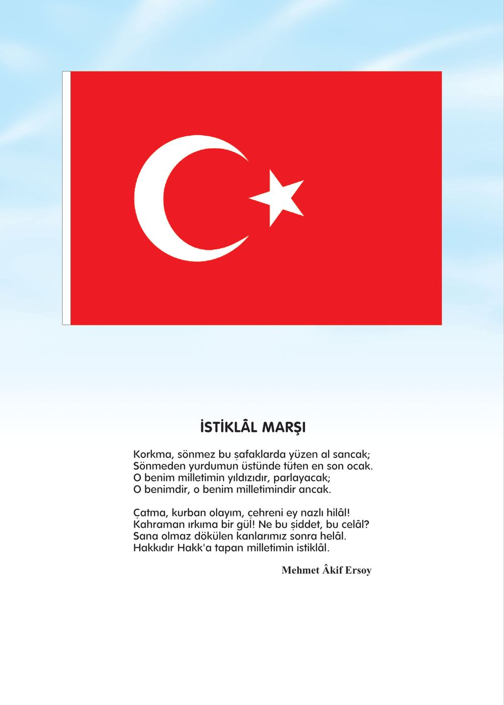

# İSTİKLÂL MARŞI

Korkma, sönmez bu şafaklarda yüzen al sancak;
Sönmeden yurdumun üstünde tüten en son ocak.
O benim milletimin yıldızıdır, parlayacak;
O benimdir, o benim milletimindir ancak.

Çatma, kurban olayım, çehreni ey nazlı hilâl!
Kahraman ırkıma bir gül! Ne bu şiddet, bu celâl?
Sana olmaz dökülen kanlarımız sonra helâl.
Hakkıdır Hakk'a tapan milletimin istiklâl.

Mehmet Âkif Ersoy

<!-- sayfa 3 -->

ANDIMIZ

Türküm, doğruyum, çalışkanım.

İlkem küçüklerimi korumak, büyüklerimi saymak; yurdumu, milletimi özümden çok sevmektir.
Ülküm yükselmek, ileri gitmektir.

Ey Büyük Atatürk!

Açtığın yolda, gösterdiğin hedefe durmadan yürüyeceğime ant içerim.

Varlığım Türk varlığına armağan olsun.

Ne mutlu Türküm diyene!

<!-- yer tutucu bulunamadı: sayfa sonuna eklendi -->

<!-- sayfa 4 -->

MUSTAFA KEMAL ATATÜRK

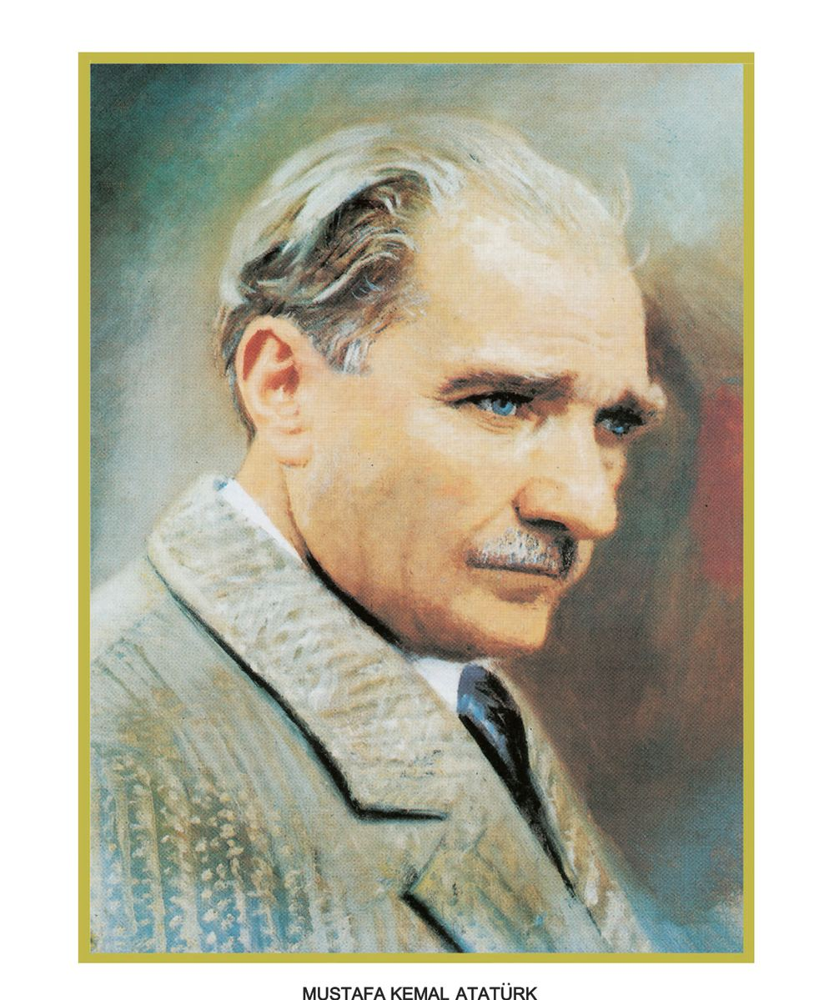
<!-- yer tutucu bulunamadı: sayfa sonuna eklendi -->

<!-- sayfa 5 -->

Verdiğiniz mesajda PDF metin katmanı boş görünüyor (`<<< >>>` arası boş). Lütfen dönüştürülmesini istediğiniz metni veya görseli paylaşın. Metni paylaştığınızda kurallara uygun şekilde Markdown formatına çevirebilirim.

<!-- sayfa 6 -->

# CONTENTS

| | |
| :--- | :---: |
| TABLE OF CONTENTS | 8 |
| Introduction to the Book | 10 |
| Theme 1 - School Life | 11 |
| Theme 2 - Classroom Life | 27 |
| Theme 3 - Personal Life | 43 |
| Theme 4 - Family Life | 59 |
| Theme 5 - Homes & Houses & Neighbourhoods | 75 |
| Theme 6 - Life in the City&the World | 91 |
| CUT-OUTS | 107 |
| GLOSSARY | 129 |
| ANSWER KEY | 134 |
| REFERENCES | 134 |
| VISUAL AND GENERAL WEB REFERENCES | 134 |
| Map of Türkiye’s Administrative Divisions and Its Land and Maritime Neighbours | 135 |
| Map of the Turkic World | 136 |

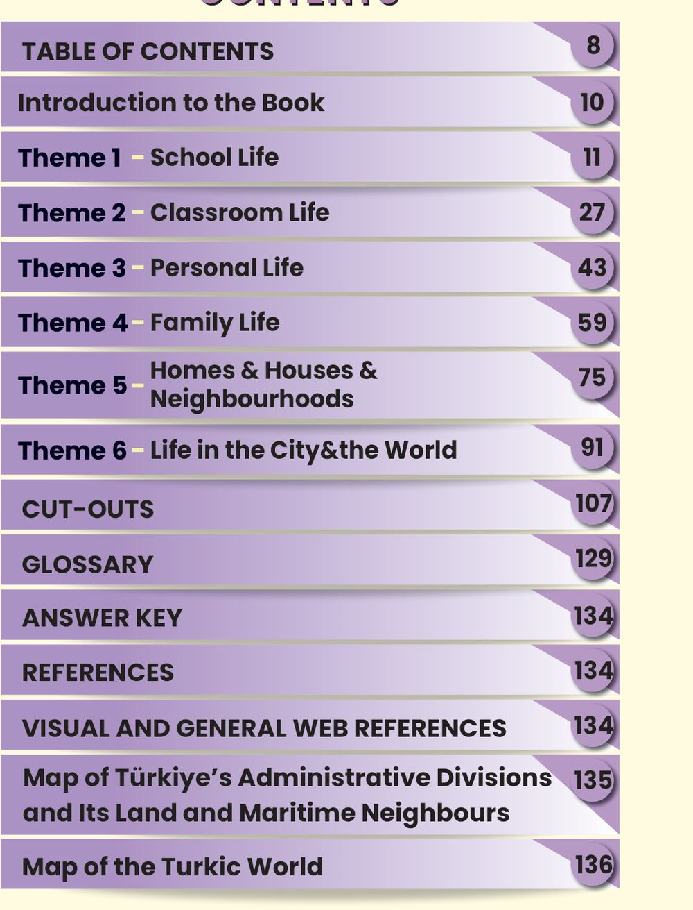
<!-- yer tutucu bulunamadı: sayfa sonuna eklendi -->

<!-- sayfa 7 -->

# TABLE OF CONTENTS

| THEME | MAIN THEME | SUB-THEMES | TITLE of the DIGITAL STORY | CHUNKS | CHUNKS & GAMIFICATION | VOCABULARY | VOCABULARY & GAMIFICATION |
| :--- | :--- | :--- | :--- | :--- | :--- | :--- | :--- |
| 1 | SCHOOL LIFE | Greetings and introductions at school; places, and people at school; days of the week; national and religious days and celebrations. | The New Pupils at School | • What's/is it/this? It's/is a/an... • Who's she/he? She's Mr Aras. He's my English teacher. This is Mr/Mrs/ Miss Hopkins. She/he is a teacher/headmaster etc. • Where is she? She is in the garden. • What's your name? I'm/ am... / My name is... • Come here, please. • What day of the week is it? What day is it today? It's/ is Monday today. | • Let's play. (Places Game) • Basic Skill: Speaking | • People in the school • Places in the school • Days of the week and the weekend • National and religious days, festivals and celebrations | • Watch and match. • Basic Skills: Reading and Listening • Let's do. (Crossword Puzzle) • Basic Skill: Writing |
| 2 | CLASSROOM LIFE | Classroom instructions and language; classroom furniture, devices and objects; colours. Basic Classroom Instructions and classroom language. | What is This? | • What's/is it? It's/is a chair • What colour is it? It's/is blue. What colour is the chair? The chair is blue. • It's blue. • How many chairs? Five chairs. • How's the weather? It's cold. • How? • Can I go outside? Can I go to the bathroom, please? Yes, you can. | • Let's play. (Chinese Whispers) • Basic Skill: Speaking | • Classroom furniture • Classroom objects • Classroom devices • Basic colours • Weather • Numbers: 120 | • Let's find. (Wordsearch puzzle) • Basic Skill: Reading |
| 3 | PERSONAL LIFE | Parts of the body and physical features; clothes; days of the week, ages and birthdays; weather conditions | Yiğit and Robix | • How old are you? I'm/am 7. • Is it your birthday today? Yes, it is. • What's/is it? / It/This is a nose/ a shirt. • What colour is it? (pointing to the nose) It's/is pink. • Is she tall? Yes, she is. No, she isn't/is not. What day is it today? It's/is Monday today. • How's the weather? It's cold. • What have you got? I've got a nose. How many ears have you got? I've got two ears. What have you got? I've got blue trousers. I've got a purple shirt. | • Let's play. (Body Parts) • Basic Skill: Speaking | • Parts of the body • Adjectives • Clothes • Outwear • Ages | • Watch and complete. • Basic Skill: Listening and writing. • Find body parts and circle. • Basic Skill: Reading |
| 4 | FAMILY LIFE | Family members and family members' physical appearances and physical Features | The Family Picnic | • Who is he? Who is she? He's/is my father. She's/is my mother. • What colour eyes has your mother got? My mother's/has got blue eyes. She's/has got blue eyes. | • Let's play. (Bingo Game) • Basic Skill: Speaking | • Family members • Physical appearances | • Reorder the letters. • Look, complete and circle. • Basic Skills: Listening and writing • Follow the way and complete. • Basic Skills: Reading and writing. |
| 5 | HOMES & HOUSES & NEIGHBOURHOODS | Parts, rooms and furniture in the house; pets in the house | Home Sweet Home | • "Have got/has got": (We've/have got a house. We've got two pets). • Where's/is the bed? The bed is in the bedroom. Where's/is the cat? • The cat is in the kitchen. • There are five cats in the sitting room. | • Let's play. (Ask and answer.) • Cut, stick and talk. • Basic Skill: Speaking | • Parts of the house • House furniture • Pets in the house • Parts of the body of a pet | • Watch and match. • Basic Skils: Listening and writing. • Look, complete and say. • Basic Skills: Listening and speaking |
| 6 | LIFE IN THE CITY & THE WORLD | Basic food types, items, and meals | The Healthy Food Festival | • Do you like bread? Yes, I do. • Do you like beans? No, I don't. • Is there a banana in the kitchen? Yes, there is. No, there isn't. • Are there any bananas in the kitchen? Yes, there are. No there aren't. • Can I have bread? Yes, you can. No, you can't. | • Let's play. (What have you got in your basket?) • Basic Skill: Speaking | • Liquids • Fruits • Vegetables • Basic food | • Let's match. (Food and drinks) • Basic Skill: Reading |

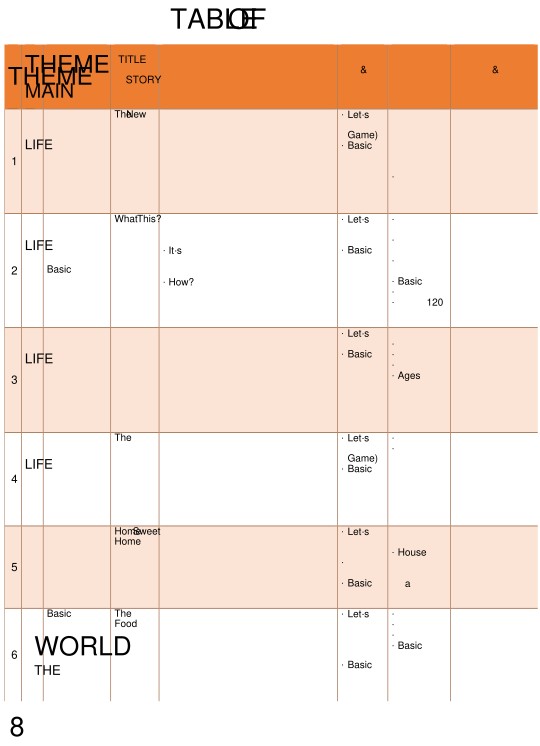
<!-- yer tutucu bulunamadı: sayfa sonuna eklendi -->

<!-- sayfa 8 -->

# TABLE OF CONTENTS

| PRONUNCIATION | LISTENING & WATCHING COMPREHENSION | SPEAKING EXPRESSION | READING COMPREHENSION | WRITING EXPRESSION | CLIL & CULTURE | PROJECTS | CONSOLIDATION | REFLECTION |
| :--- | :--- | :--- | :--- | :--- | :--- | :--- | :--- | :--- |
| • A **c**anteen • A **b**oy | • Listen, complete and sing. • Basic Skills: Listening and writing. | • Read and act. • Basic Skills: Reading and Speaking | • Jungle School. • Basic Skill: Reading | • Find and circle. (Snake Puzzle) • Group and write. (Places and write) • Basic Skill: Writing | • Let’s play. (What is this?) • Objective: Remembering places and people with a board game. | • Draw your school with places and people. • Objective: Remembering places and people by drawing. | • Look and write. • Answer. • Find and circle. • Read and match. • Read, find and write. | • What about you? (Read and colour) • Choosing the right emoji for themselves. |
| • A **c**lassroom • A **d**oor | • Let’s sing. (The Colours Song) • Basic Skill: Listening • Listen, colour and say. • Basic Skills: Listening and Speaking • Listen and repeat. (Numbers) • Basic Skill: Listening and Speaking | • Let’s play. (Guessing Game) • Let’s play. (Do What I Say Game) • Basic Skill: Speaking | • Cute Pupils. • Basic Skill: Reading | • Reorder and write. • Look and complete. • Read and act. • Basic Skill: Writing | • Find and match. • Objective: Remembering numbers with an activity. | • Draw and colour your own classroom. (Write the names of the objects and furniture. Talk about your Picture.) • Objective: Remembering the names of objects and furniture. | • Odd one out. • Read and write. • Read and match. • Read and match. • Match, colour and complete. | • What about you? (Read and colour) • Choosing the right emoji for themselves. |
| • A w**ee**r • F**ou**r • G**l**ue • H**ai**r • F**i**ve • A j**a**cket | • Listen and complete. • Basic Skill: Listening and writing. | • Read and act. • Basic Skills: Speaking and reading. | • Funny Friends. • Basic Skill: Reading | • Now, you draw and write. • Look and complete. • Basic Skills: Writing | • Let’s play. (Board Game) • Objective: Remembering language chunks. | • Make your puppet and talk. • Basic Skill: Speaking | • Find the words and write. • Read and write. • Read and tick or cross. • Read, draw and colour. • Look at the Picture. • Read and write. | • What about you? (Read and colour) • Choosing the right emoji for themselves. |
| • A k**i**d • L**i**sten • A m**u**m • N**i**ne • An O**r**ange • A p**e**ncil | • Watch and complete. (The Kılıç Family) • Basic Skills: Listening and writing. | • Let’s play. (Ask and answer) • Basic Skill: Speaking | • Our Lovely Families. • Basic Skill: Reading | • Look and complete. • Draw your family and write. • Basic Skill: Writing | • Find and match • Objective: Remembering family members with an activity. | • Draw your family tree and talk. • Objective: Remembering the names of the family members. | • Write the family members. • Find the words in the puzzle. • Choose the correct one. • Find the differences and write. • Read and circle. | • What about you? (Read and colour) • Choosing the right emoji for themselves. |
| • A **g**uestion • A **r**abbit • **S**cissors • A **t**eacher • **S**even | • Listen and practice. • Basic Skills: Listening and speaking. | • Look, count and say. • Match the halves and say. • Basic Skill: Speaking | • Milo and His Friends. • Basic Skills: Reading and writing | • Read and complete. • Basic Skill: Writing | • Find, circle and say. • Objective: Remembering the names of pets and parts of the house. | • Draw your house in your notebook. Then, talk about it. • Objective: Remembering the names of pets and parts of the house. | • Read, draw and colour. • Order. • Find the secret code. | • What about you? (Read and colour) • Choosing the right emoji for themselves. |
| • An **u**mbrella • A **w**indow • M**i**x • Y**o**ghurt • A **z**ebra | • Listen and write. • Basic Skills: Listening and writing | • Let’s play. (Who am I?) • Basic Skill: Speaking • Read and act. • Basic Skill: Speaking | • What’s in the Fridge? • Read and choose. • Basic Skill: Reading | • Look and complete. (Shopping list) • Basic Skill: Writing | • Choose and write. (Crossword puzzle) • Objective: Remembering the names of food and | • Talk to your family members about the food they like or don’t like. Record it and share in the classroom. • Objective: Talking about what other people like or don’t like | • Find, write and answer. • Read and find. • Read and match. • Look and write. | • What about you? (Read and colour) • Choosing the right emoji for themselves. |

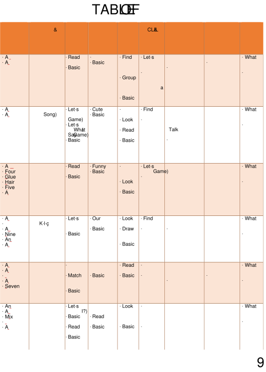
<!-- yer tutucu bulunamadı: sayfa sonuna eklendi -->

<!-- sayfa 9 -->

# INTRODUCTION TO THE BOOK

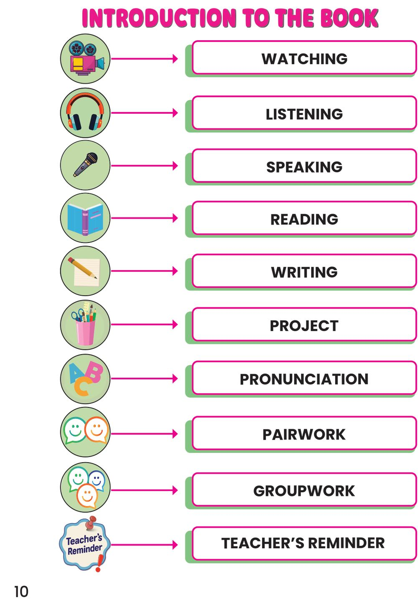 WATCHING
 LISTENING
 SPEAKING
 READING
 WRITING
 PROJECT
 PRONUNCIATION
 PAIRWORK
 GROUPWORK
 TEACHER’S REMINDER

<!-- sayfa 10 -->

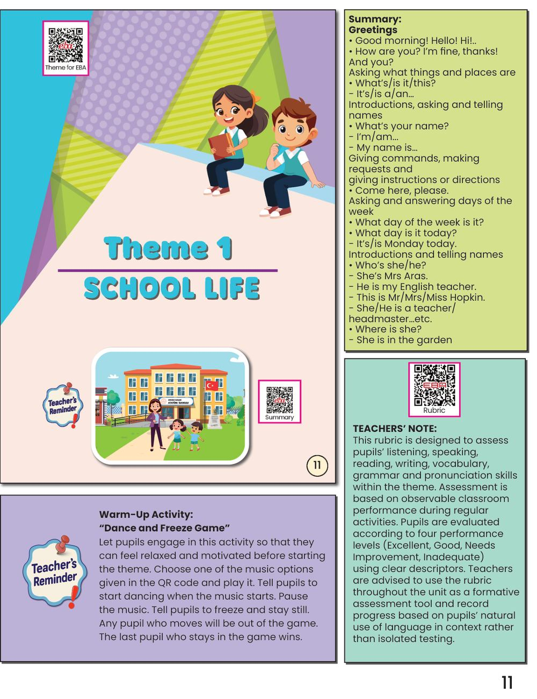

# Theme 1
# SCHOOL LIFE

**Summary:**
**Greetings**
• Good morning! Hello! Hi!..
• How are you? I’m fine, thanks! And you?
**Asking what things and places are**
• What’s/is it/this?
– It’s/is a/an...
**Introductions, asking and telling names**
• What’s your name?
– I’m/am...
– My name is...
**Giving commands, making requests and giving instructions or directions**
• Come here, please.
**Asking and answering days of the week**
• What day of the week is it?
• What day is it today?
– It’s/is Monday today.
**Introductions and telling names**
• Who’s she/he?
– She’s Mrs Aras.
– He is my English teacher.
– This is Mr/Mrs/Miss Hopkin.
– She/He is a teacher/ headmaster...etc.
• Where is she?
– She is in the garden

11

**TEACHERS’ NOTE:**
This rubric is designed to assess pupils’ listening, speaking, reading, writing, vocabulary, grammar and pronunciation skills within the theme. Assessment is based on observable classroom performance during regular activities. Pupils are evaluated according to four performance levels (Excellent, Good, Needs Improvement, Inadequate) using clear descriptors. Teachers are advised to use the rubric throughout the unit as a formative assessment tool and record progress based on pupils’ natural use of language in context rather than isolated testing.

**Warm-Up Activity:**
**“Dance and Freeze Game”**
Let pupils engage in this activity so that they can feel relaxed and motivated before starting the theme. Choose one of the music options given in the QR code and play it. Tell pupils to start dancing when the music starts. Pause the music. Tell pupils to freeze and stay still. Any pupil who moves will be out of the game. The last pupil who stays in the game wins.

<!-- sayfa 11 -->

# Establishing Links
Help pupils understand the topic of the theme in general and show them the picture of the school on page (pages 12-13). Ask simple questions containing words that pupils are already familiar with in their mother tongue like “A school or a cinema?”. Let them shake their heads to say “Yes” or “No” after practising the words “Yes” or “No” with mimics and gestures. As the theme continues, all the pieces will gradually come together in their minds.

# 1 Activity 1
First, practise the question “Where?” with mimics and gestures so that pupils can understand it is used for places. Then ask pupils to look at the pictures on page (pages 12-13). Do not expect full sentences as answers. This is just a practice for the question word “Where?”.

# 2 Activity 2
Let pupils watch the digital story, or alternatively bring a model of a school . Let them watch it without any pause first. Ask the pupils read the whole digital story in chorus. While they are watching for the second time, pause when needed and repeat the words and phrases you want to emphasise by showing and corresponding people the in the story or on the model you have brough into the classroom. Ask the pupils to act out the parts of the digital story after watching.

---

# Listening & Watching

1. Look at the picture. Where are they?
In the school garden.

2. Watch the digital story. 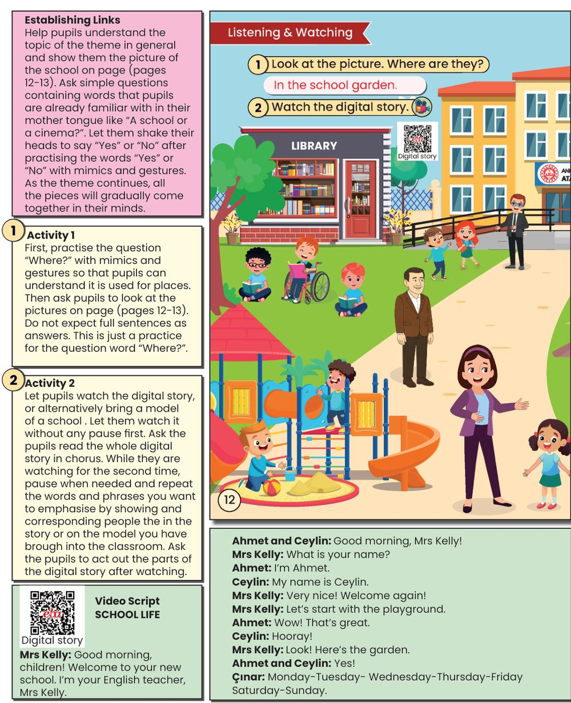

---

# Video Script
## SCHOOL LIFE

**Mrs Kelly:** Good morning, children! Welcome to your new school. I’m your English teacher, Mrs Kelly.

**Ahmet and Ceylin:** Good morning, Mrs Kelly!
**Mrs Kelly:** What is your name?
**Ahmet:** I’m Ahmet.
**Ceylin:** My name is Ceylin.
**Mrs Kelly:** Very nice! Welcome again!
**Mrs Kelly:** Let’s start with the playground.
**Ahmet:** Wow! That’s great.
**Ceylin:** Hooray!
**Mrs Kelly:** Look! Here’s the garden.
**Ahmet and Ceylin:** Yes!
**Çınar:** Monday-Tuesday- Wednesday-Thursday-Friday Saturday-Sunday.

<!-- sayfa 12 -->

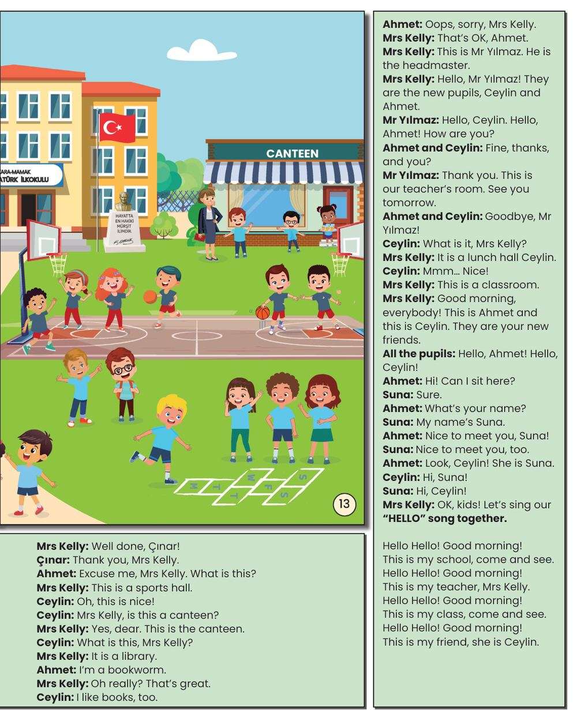

**Mrs Kelly:** Well done, Çınar!
**Çınar:** Thank you, Mrs Kelly.
**Ahmet:** Excuse me, Mrs Kelly. What is this?
**Mrs Kelly:** This is a sports hall.
**Ceylin:** Oh, this is nice!
**Ceylin:** Mrs Kelly, is this a canteen?
**Mrs Kelly:** Yes, dear. This is the canteen.
**Ceylin:** What is this, Mrs Kelly?
**Mrs Kelly:** It is a library.
**Ahmet:** I’m a bookworm.
**Mrs Kelly:** Oh really? That’s great.
**Ceylin:** I like books, too.

**Ahmet:** Oops, sorry, Mrs Kelly.
**Mrs Kelly:** That’s OK, Ahmet.
**Mrs Kelly:** This is Mr Yılmaz. He is the headmaster.
**Mrs Kelly:** Hello, Mr Yılmaz! They are the new pupils, Ceylin and Ahmet.
**Mr Yılmaz:** Hello, Ceylin. Hello, Ahmet! How are you?
**Ahmet and Ceylin:** Fine, thanks, and you?
**Mr Yılmaz:** Thank you. This is our teacher’s room. See you tomorrow.
**Ahmet and Ceylin:** Goodbye, Mr Yılmaz!
**Ceylin:** What is it, Mrs Kelly?
**Mrs Kelly:** It is a lunch hall Ceylin.
**Ceylin:** Mmm... Nice!
**Mrs Kelly:** This is a classroom.
**Mrs Kelly:** Good morning, everybody! This is Ahmet and this is Ceylin. They are your new friends.
**All the pupils:** Hello, Ahmet! Hello, Ceylin!
**Ahmet:** Hi! Can I sit here?
**Suna:** Sure.
**Ahmet:** What’s your name?
**Suna:** My name’s Suna.
**Ahmet:** Nice to meet you, Suna!
**Suna:** Nice to meet you, too.
**Ahmet:** Look, Ceylin! She is Suna.
**Ceylin:** Hi, Suna!
**Suna:** Hi, Ceylin!
**Mrs Kelly:** OK, kids! Let’s sing our “HELLO” song together.

Hello Hello! Good morning!
This is my school, come and see.
Hello Hello! Good morning!
This is my teacher, Mrs Kelly.
Hello Hello! Good morning!
This is my class, come and see.
Hello Hello! Good morning!
This is my friend, she is Ceylin.

<!-- sayfa 13 -->

# Additional Activity

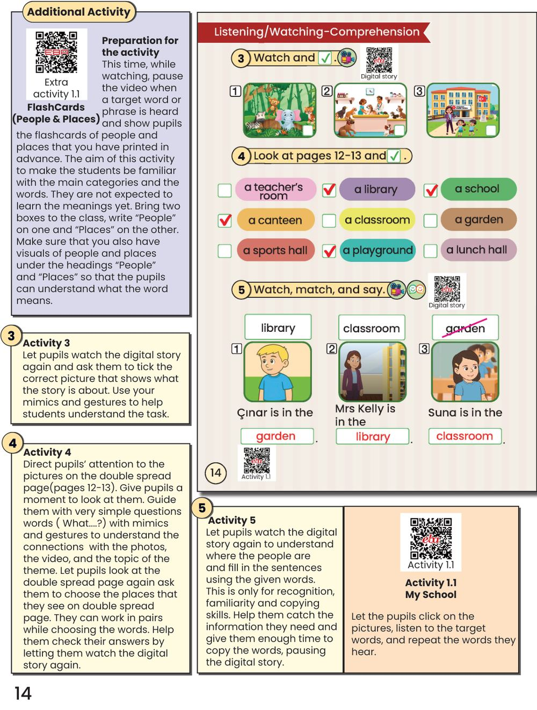

**Preparation for the activity**
This time, while watching, pause the video when a target word or phrase is heard and show pupils the flashcards of people and places that you have printed in advance. The aim of this activity to make the students be familiar with the main categories and the words. They are not expected to learn the meanings yet. Bring two boxes to the class, write “People” on one and “Places” on the other. Make sure that you also have visuals of people and places under the headings “People” and “Places” so that the pupils can understand what the word means.

---

# Listening/Watching-Comprehension

### 3 Watch and [check icon] [video icon]  Digital story

1 
2 
3 

### 4 Look at pages 12-13 and [check icon]

[ ] a teacher's room
[✓] a library
[✓] a school
[✓] a canteen
[ ] a classroom
[ ] a garden
[ ] a sports hall
[✓] a playground
[ ] a lunch hall

### 5 Watch, match, and say. [video icon] [audio icon] [emoji icon]  Digital story

library | classroom | ~~garden~~

1 
Çınar is in the garden.

2 
Mrs Kelly is in the library.

3 
Suna is in the classroom.

 Activity 1.1

---

### 3 Activity 3
Let pupils watch the digital story again and ask them to tick the correct picture that shows what the story is about. Use your mimics and gestures to help students understand the task.

### 4 Activity 4
Direct pupils’ attention to the pictures on the double spread page(pages 12-13). Give pupils a moment to look at them. Guide them with very simple questions words ( What....?) with mimics and gestures to understand the connections with the photos, the video, and the topic of the theme. Let pupils look at the double spread page again ask them to choose the places that they see on double spread page. They can work in pairs while choosing the words. Help them check their answers by letting them watch the digital

### 5 Activity 5
Let pupils watch the digital story again to understand where the people are and fill in the sentences using the given words. This is only for recognition, familiarity and copying skills. Help them catch the information they need and give them enough time to copy the words, pausing

**Activity 1.1 My School**
Let the pupils click on the pictures, listen to the target words, and repeat the words they hear.

<!-- sayfa 14 -->

# Speaking-Expression

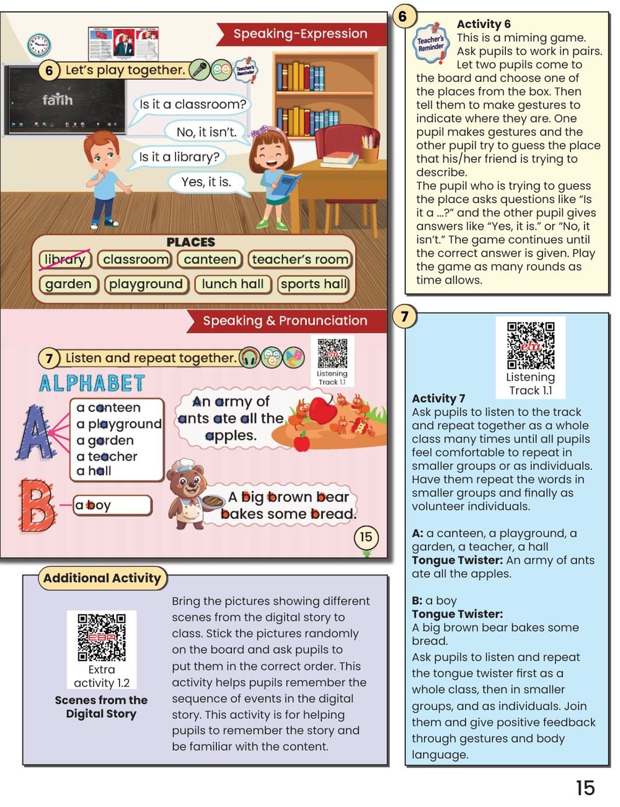

## 6 Let's play together.

Is it a classroom?
No, it isn't.
Is it a library?
Yes, it is.

**PLACES**
library | classroom | canteen | teacher's room
garden | playground | lunch hall | sports hall

---

### 6
**Activity 6**
**Teacher's Reminder**
This is a miming game. Ask pupils to work in pairs. Let two pupils come to the board and choose one of the places from the box. Then tell them to make gestures to indicate where they are. One pupil makes gestures and the other pupil try to guess the place that his/her friend is trying to describe. The pupil who is trying to guess the place asks questions like “Is it a ...?” and the other pupil gives answers like “Yes, it is.” or “No, it isn’t.” The game continues until the correct answer is given. Play the game as many rounds as time allows.

---

# Speaking & Pronunciation

## 7 Listen and repeat together.

**ALPHABET**

**A**
* a canteen
* a playground
* a garden
* a teacher
* a hall

An army of ants ate all the apples.

**B**
* a boy

A big brown bear bakes some bread.

---

### 7

**Listening Track 1.1**

**Activity 7**
Ask pupils to listen to the track and repeat together as a whole class many times until all pupils feel comfortable to repeat in smaller groups or as individuals. Have them repeat the words in smaller groups and finally as volunteer individuals.

**A:** a canteen, a playground, a garden, a teacher, a hall
**Tongue Twister:** An army of ants ate all the apples.

**B:** a boy
**Tongue Twister:** A big brown bear bakes some bread.

Ask pupils to listen and repeat the tongue twister first as a whole class, then in smaller groups, and as individuals. Join them and give positive feedback through gestures and body

---

### Additional Activity

**Extra activity 1.2**
**Scenes from the Digital Story**

Bring the pictures showing different scenes from the digital story to class. Stick the pictures randomly on the board and ask pupils to put them in the correct order. This activity helps pupils remember the sequence of events in the digital story. This activity is for helping pupils to remember the story and

<!-- sayfa 15 -->

# 8

## Activity 8
In this activity, let pupils practise target vocabulary in an efficient and meaningful way in context. Ask pupils to look at each picture carefully. And then, let them read the words in Activity 8. Have them watch the digital story again and match the words with the correct pictures in pairs. Give them enough time to complete the activity. Remind pupils that the first item is given as an example. When all activities finish, let the pupils look at the pictures again and say the words individually in their seats.

---

## Vocabulary Selection & Use

### 8 Watch, talk, and match.

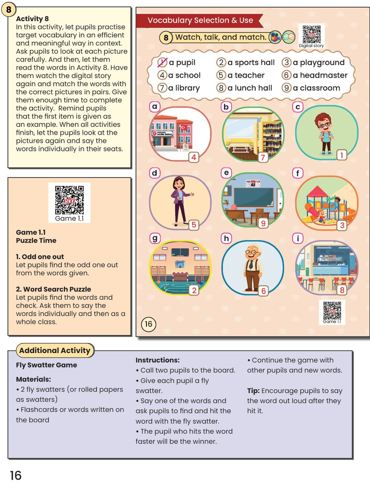
Digital story

1. $\text{\sout{a pupil}}$ <!-- KONTROL: Marker'da karşılığı yok, uydurma olabilir -->
2. a sports hall
3. a playground
4. a school
5. a teacher
6. a headmaster
7. a library
8. a lunch hall
9. a classroom

a: 4

b: 7

c: 1

d: 5

e: 9

f: 3

g: 2

h: 6

i: 8

16

Game 1.1

## Game 1.1
## Puzzle Time

### 1. Odd one out
Let pupils find the odd one out from the words given.

### 2. Word Search Puzzle
Let pupils find the words and check. Ask them to say the words individually and then as a whole class.

---

## Additional Activity

### Fly Swatter Game

**Materials:**
* 2 fly swatters (or rolled papers as swatters)
* Flashcards or words written on the board

**Instructions:**
* Call two pupils to the board.
* Give each pupil a fly swatter.
* Say one of the words and ask pupils to find and hit the word with the fly swatter.
* The pupil who hits the word faster will be the winner.
* Continue the game with other pupils and new words.

**Tip:** Encourage pupils to say the word out loud after they hit it.

<!-- sayfa 16 -->

# Vocabulary Games

## 9 Look and complete.

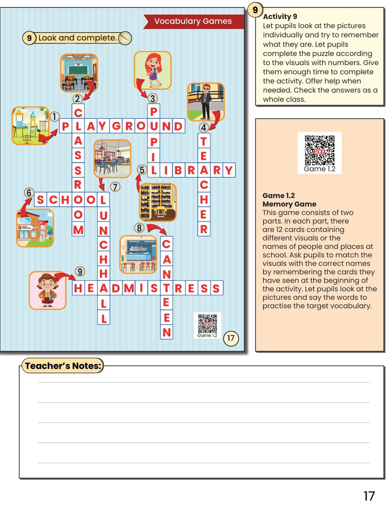

| | | | | | | | | | | | | | | | | | | | | | | | |
|---|---|---|---|---|---|---|---|---|---|---|---|---|---|---|---|---|---|---|---|---|---|---|---|
| | | | | | | | | | | | | | | | | | | | | | | | |
| | | | | | | | | | | | | | | | | | | | | | | | |
| | | | | | | | | | | | | | | | | | | | | | | | |
| | | | | | | | | | | | | | | | | | | | | | | | |
| | | | | | | | | | | | | | | | | | | | | | | | |
| | | | | | | | | | | | | | | | | | | | | | | | |
| | | | | | | | | | | | | | | | | | | | | | | | |
| | | | | | | | | | | | | | | | | | | | | | | | |
| | | | | | | | | | | | | | | | | | | | | | | | |
| | | | | | | | | | | | | | | | | | | | | | | | |
| | | | | | | | | | | | | | | | | | | | | | | | |
| | | | | | | | | | | | | | | | | | | | | | | | |
| | | | | | | | | | | | | | | | | | | | | | | | |
| | | | | | | | | | | | | | | | | | | | | | | | |
| | | | | | | | | | | | | | | | | | | | | | | | |
| | | | | | | | | | | | | | | | | | | | | | | | |
| | | | | | | | | | | | | | | | | | | | | | | | |
| | | | | | | | | | | | | | | | | | | | | | | | |
| | | | | | | | | | | | | | | | | | | | | | | | |
| | | | | | | | | | | | | | | | | | | | | | | | |
| | | | | | | | | | | | | | | | | | | | | | | | |
| | | | | | | | | | | | | | | | | | | | | | | | |
| | | | | | | | | | | | | | | | | | | | | | | | |
| | | | | | | | | | | | | | | | | | | | | | | | |
| | | | | | | | | | | | | | | | | | | | | | | | |
| | | | | | | | | | | | | | | | |

<!-- sayfa 17 -->

# 10

**Activity 10**
Let pupils look at the words on the Ferris Wheel, read them, and say them aloud. Read the dialogue aloud so that pupils can hear the correct pronunciation. Encourage them to read it individually first. Then let them practise the given dialogue in pairs.

---

**Additional Activity**

**Jump On A Day Game**

**Materials:**
* 7 pieces of paper or cards (each with one day of the week: Monday to Sunday)
* Open space in the classroom

**Instructions:**
* Place the cards on the floor in order from Monday to Sunday.
* Invite one pupil to the board
* Ask a volunteer pupil to step or jump on each card while saying the days aloud.
* For the next round, call out a day (e.g. “Jump on Wednesday!”). The pupil must jump to the correct card. Encourage him/her to say the name of the day aloud while jumping.
* If the pupil chooses the wrong card, he/she starts again from the beginning.

---

**Vocabulary Selection & Use**

**10 Read and talk.** 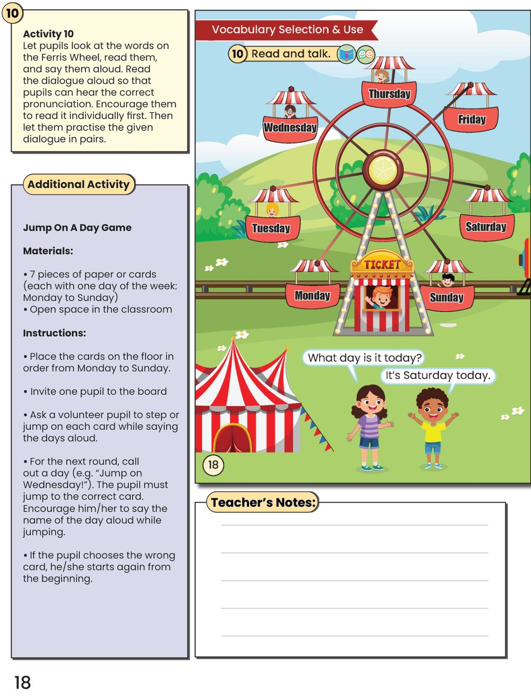

**Teacher’s Notes:**
__________________________________________________________________
__________________________________________________________________
__________________________________________________________________

<!-- sayfa 18 -->

# Vocabulary Revision

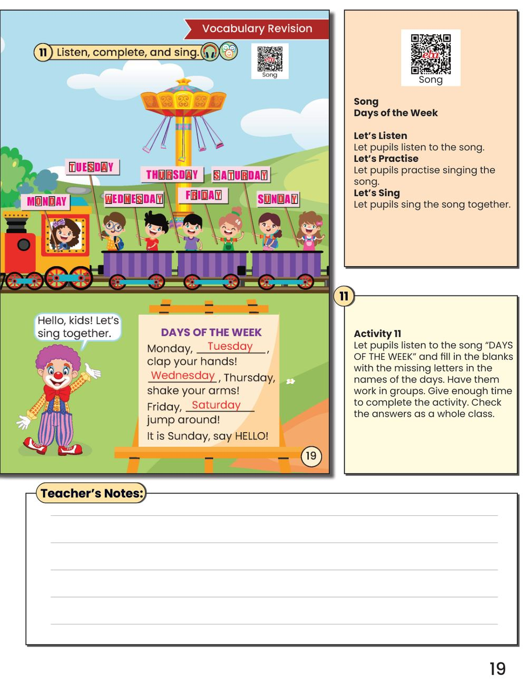

11 Listen, complete, and sing. 

---

Hello, kids! Let's sing together.

**DAYS OF THE WEEK**

Monday, \underline{Tuesday},
clap your hands!
\underline{Wednesday}, Thursday,
shake your arms!
Friday, \underline{Saturday}
jump around!
It is Sunday, say HELLO!

19

---

# Song
**Days of the Week**

**Let's Listen**
Let pupils listen to the song.
**Let's Practise**
Let pupils practise singing the song.
**Let's Sing**
Let pupils sing the song together.

---

11

**Activity 11**
Let pupils listen to the song “DAYS OF THE WEEK” and fill in the blanks with the missing letters in the names of the days. Have them work in groups. Give enough time to complete the activity. Check the answers as a whole class.

---

**Teacher's Notes:**

<!-- sayfa 19 -->

# 12

## Activity 12
Ask pupil to look at the pictures for being familiar with the story. Ask them to look at each picture on the page carefully and individually. First, read the dialogues aloud so that pupils can hear the correct pronunciation. Pay attention to emphasise the target language chunks. Then encourage them to read the dialogues individually and silently in their seats. Let them work in groups. Choose volunteer pupils to act out the dialogues by reading them to the class. Let as many pairs as possible practise this activity. Offer help when needed. The target grammar chunks are given in bold in the dialogues. They are not taught as grammatical structures. Pupils are expected to grasp and learn the grammatical chunks by being exposed to holistically through hearing, seeing, and repeating them in context. Familiarity and exposure are key points.

After practising the dialogues in pairs, invite pupils to the board to act out the dialogues without looking at their books. Tell them that they are supposed to act out only one dialogue they have chosen from the page, as trying to remember all the dialogues can be too challenging at that age.

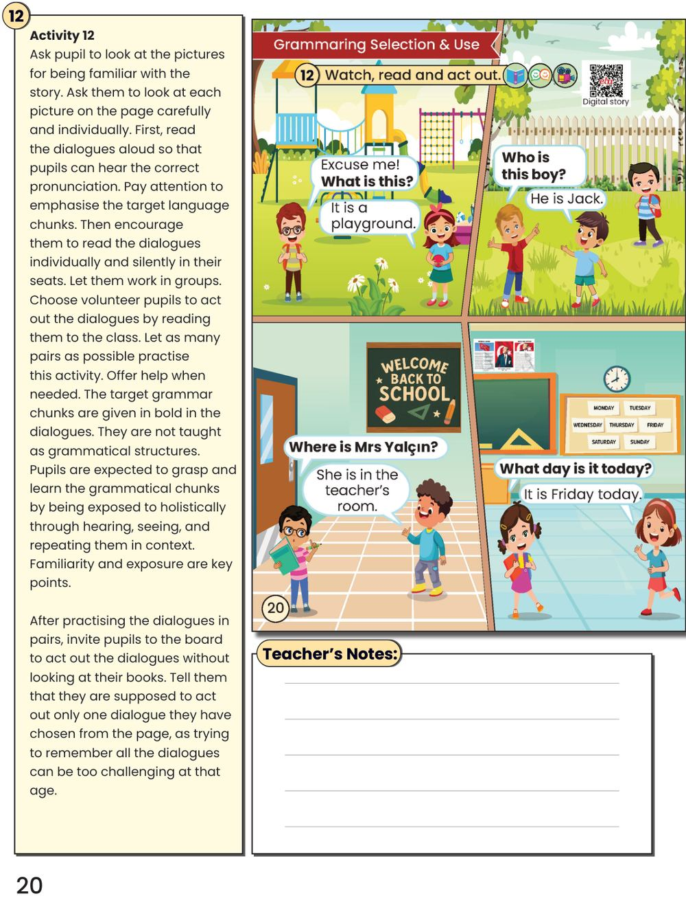

# Grammaring Selection & Use

(12) Watch, read and act out. [icons] Digital story [QR code]

**Panel 1:**
Excuse me!
**What is this?**
It is a **playground.**

**Panel 2:**
**Who is this boy?**
He is Jack.

**Panel 3:**
**Where is Mrs Yalçın?**
She is in the teacher's room.

**Panel 4:**
**What day is it today?**
It is Friday today.

(20)

## Teacher's Notes:
__________________________________________________________________
__________________________________________________________________
__________________________________________________________________

<!-- sayfa 20 -->

# Grammaring Revision

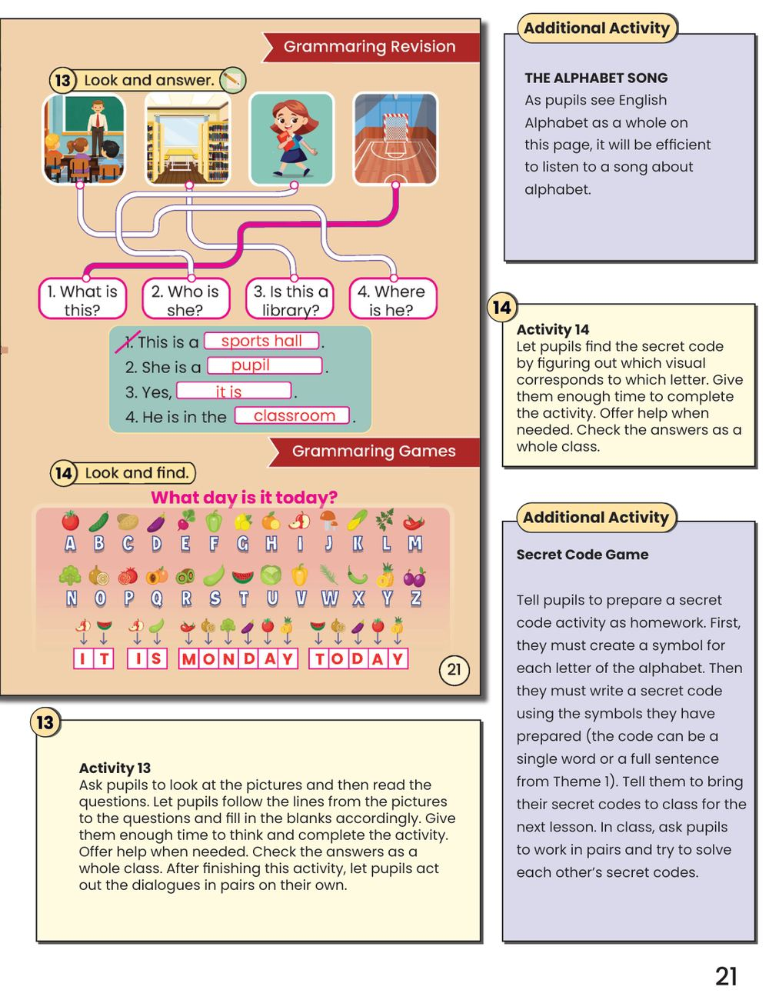

**13 Look and answer.**

1. What is this?
2. Who is she?
3. Is this a library?
4. Where is he?

1. ~~This is a~~ sports hall .
2. She is a pupil .
3. Yes, it is .
4. He is in the classroom .

# Grammaring Games

**14 Look and find.**

What day is it today?

IT IS MONDAY TODAY

---

**Additional Activity**

**THE ALPHABET SONG**

As pupils see English Alphabet as a whole on this page, it will be efficient to listen to a song about alphabet.

---

**14 Activity 14**

Let pupils find the secret code by figuring out which visual corresponds to which letter. Give them enough time to complete the activity. Offer help when needed. Check the answers as a whole class.

---

**Additional Activity**

**Secret Code Game**

Tell pupils to prepare a secret code activity as homework. First, they must create a symbol for each letter of the alphabet. Then they must write a secret code using the symbols they have prepared (the code can be a single word or a full sentence from Theme 1). Tell them to bring their secret codes to class for the next lesson. In class, ask pupils to work in pairs and try to solve each other’s secret codes.

---

**13 Activity 13**

Ask pupils to look at the pictures and then read the questions. Let pupils follow the lines from the pictures to the questions and fill in the blanks accordingly. Give them enough time to think and complete the activity. Offer help when needed. Check the answers as a whole class. After finishing this activity, let pupils act out the dialogues in pairs on their own.

<!-- sayfa 21 -->

# Reading-Comprehension

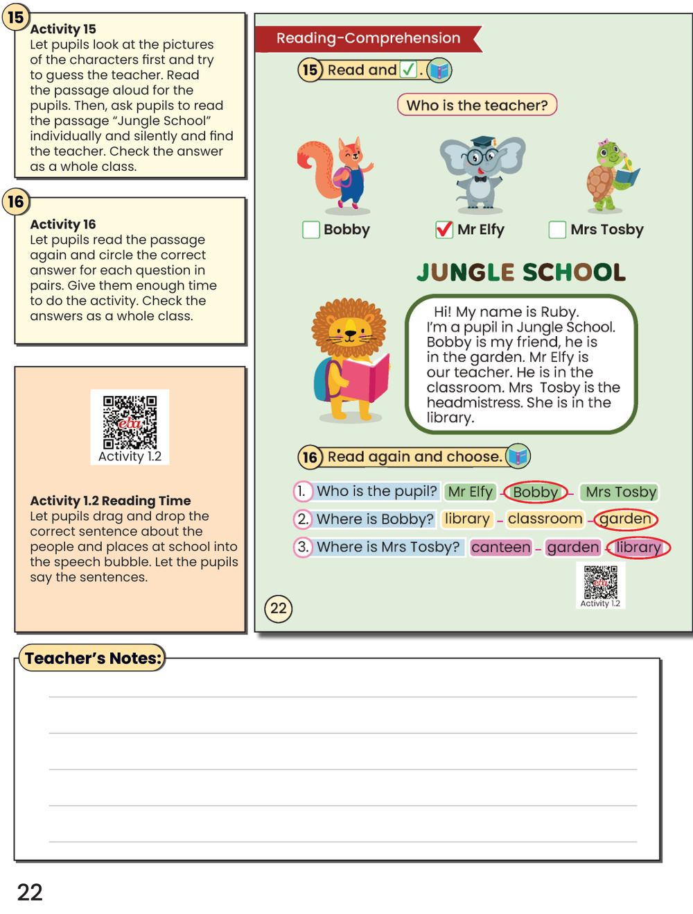

(15) Read and $\checkmark$. 

Who is the teacher?

 $\square$ Bobby
 $\text{\rlap{$\checkmark$}}\square$ Mr Elfy
 $\square$ Mrs Tosby

# JUNGLE SCHOOL

> Hi! My name is Ruby. I'm a pupil in Jungle School. Bobby is my friend, he is in the garden. Mr Elfy is our teacher. He is in the classroom. Mrs Tosby is the headmistress. She is in the library.

(16) Read again and choose. 

1. Who is the pupil? Mr Elfy $\text{\rlap{$\circ$}}$Bobby Mrs Tosby
2. Where is Bobby? library - classroom - $\text{\rlap{$\circ$}}$garden
3. Where is Mrs Tosby? canteen - garden $\text{\rlap{$\circ$}}$library

Activity 1.2

(22)

---

(15)
**Activity 15**
Let pupils look at the pictures of the characters first and try to guess the teacher. Read the passage aloud for the pupils. Then, ask pupils to read the passage “Jungle School” individually and silently and find the teacher. Check the answer as a whole class.

(16)
**Activity 16**
Let pupils read the passage again and circle the correct answer for each question in pairs. Give them enough time to do the activity. Check the answers as a whole class.

**Activity 1.2 Reading Time**
Let pupils drag and drop the correct sentence about the people and places at school into the speech bubble. Let the pupils say the sentences.
Activity 1.2

**Teacher's Notes:**
__________________________________________________________________
__________________________________________________________________
__________________________________________________________________

<!-- sayfa 22 -->

# Writing-Expression

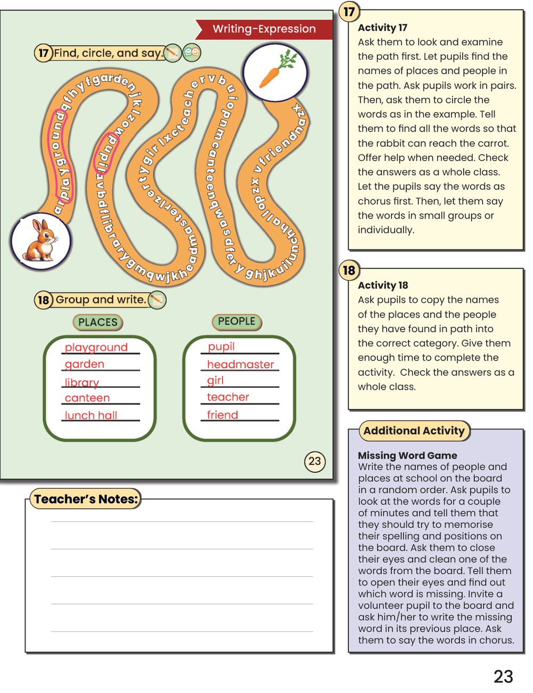

17 Find, circle, and say.  

18 Group and write. 

**PLACES**
- playground
- garden
- library
- canteen
- lunch hall

**PEOPLE**
- pupil
- headmaster
- girl
- teacher
- friend

23

---

**Teacher’s Notes:**
__________________________________________________________________
__________________________________________________________________
__________________________________________________________________
__________________________________________________________________

---

17

**Activity 17**
Ask them to look and examine the path first. Let pupils find the names of places and people in the path. Ask pupils work in pairs. Then, ask them to circle the words as in the example. Tell them to find all the words so that the rabbit can reach the carrot. Offer help when needed. Check the answers as a whole class. Let the pupils say the words as chorus first. Then, let them say the words in small groups or individually.

18

**Activity 18**
Ask pupils to copy the names of the places and the people they have found in path into the correct category. Give them enough time to complete the activity. Check the answers as a whole class.

**Additional Activity**

**Missing Word Game**
Write the names of people and places at school on the board in a random order. Ask pupils to look at the words for a couple of minutes and tell them that they should try to memorise their spelling and positions on the board. Ask them to close their eyes and clean one of the words from the board. Tell them to open their eyes and find out which word is missing. Invite a volunteer pupil to the board and ask him/her to write the missing word in its previous place. Ask them to say the words in chorus

<!-- sayfa 23 -->

# 19

## Activity 19
### Picture Strip Story for Consolidation
After the controlled practice sessions, have pupils practise the target vocabulary and chunks in the picture strip story. This activity gives them the opportunity to consolidate and use the target words and language chunks about the concept of school life in a fun, enjoyable, and versatile way.

First, read the strip story aloud so that pupils can hear the correct pronunciation. Then ask them to read individually and silently. Ask them to work in groups. Choose pupils to act out the story while sitting and read the dialogues to the class. Let them practise this activity as many groups as possible. Offer help for pronunciation, vocabulary, etc. when needed.

As an additional activity, let pupils act out the dialogues by using their own names with their peers.

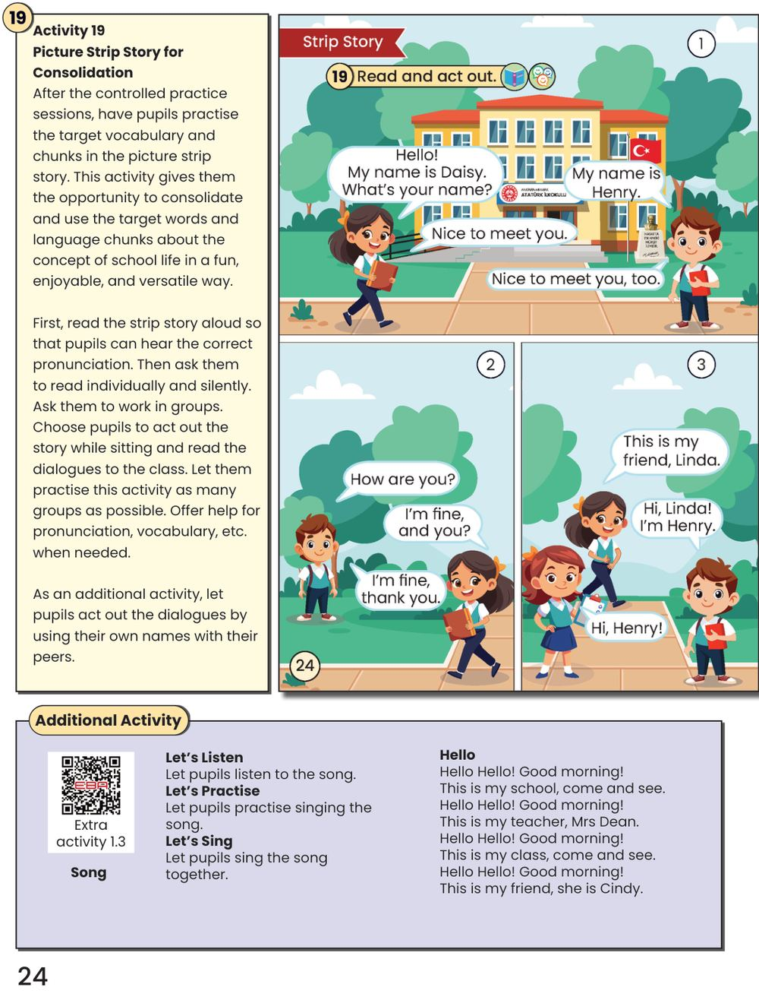

**Strip Story**
**19 Read and act out.**

(Panel 1)
Daisy: Hello! My name is Daisy. What's your name?
Henry: My name is Henry.
Daisy: Nice to meet you.
Henry: Nice to meet you, too.

(Panel 2)
Boy: How are you?
Girl: I'm fine, and you?
Girl: I'm fine, thank you.

(Panel 3)
Girl: This is my friend, Linda.
Linda: Hi, Linda! I'm Henry.
Henry: Hi, Henry!

---

## Additional Activity

**Extra activity 1.3**
**Song**

**Let's Listen**
Let pupils listen to the song.
**Let's Practise**
Let pupils practise singing the song.
**Let's Sing**
Let pupils sing the song together.

**Hello**
Hello Hello! Good morning!
This is my school, come and see.
Hello Hello! Good morning!
This is my teacher, Mrs Dean.
Hello Hello! Good morning!
This is my class, come and see.
Hello Hello! Good morning!
This is my friend, she is Cindy.

<!-- sayfa 24 -->

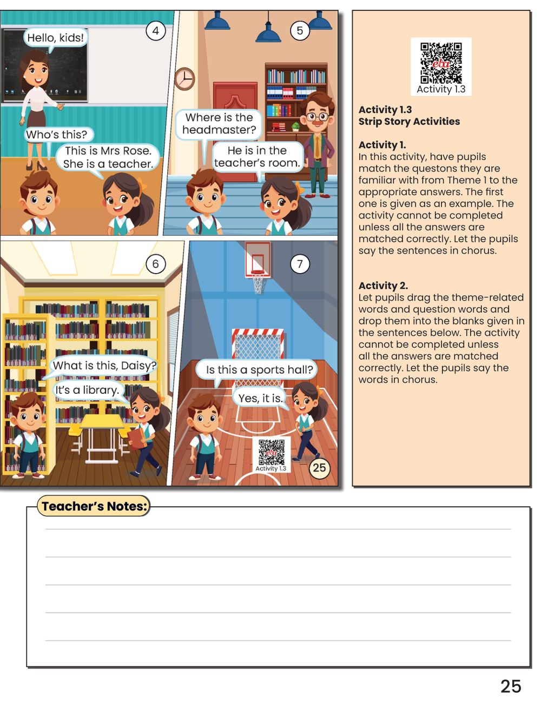

Activity 1.3
**Strip Story Activities**

**Activity 1.**
In this activity, have pupils match the questons they are familiar with from Theme 1 to the appropriate answers. The first one is given as an example. The activity cannot be completed unless all the answers are matched correctly. Let the pupils say the sentences in chorus.

**Activity 2.**
Let pupils drag the theme-related words and question words and drop them into the blanks given in the sentences below. The activity cannot be completed unless all the answers are matched correctly. Let the pupils say the words in chorus.

---

**Teacher’s Notes:**
__________________________________________________________________
__________________________________________________________________
__________________________________________________________________
__________________________________________________________________
__________________________________________________________________

<!-- sayfa 25 -->

# 20
## Activity 20
### Theme Project
Let pupils think about places and people in their school. Let pupils draw their school, cut the pictures of places and people in the school from the cut-out page, and stick them into their drawing.

Ask them to talk about the places and the people in their school by using target chunks and words.

Ask pupils to give feedback to each others’ work. Prepare a chart for this task and give it to pupils so that they can evaluate their classmates’ work. Give pupils enough time to prepare for the given task.

# 21
### Activity 21
Ask pupils to examine the game board first. Let one pupil ask a question and another answer it for each box. Ask pupils to work in groups. Tell them that they cannot move to the next box unless they make a correct sentence. The aim of the game is to reach the finish point. Let pupils ask questions like; “What is this?” or “Who is this?” and give answers like “This/It is a canteen.” or “This/She is a pupil.” Monitor them and give feedback. Play the game as many rounds as time allows. The target grammar chunks and words from later themes will also be revised in this activity.

## What About You? (Self-Assessment)
Before starting the activity, make sure that pupils understand how to reflect on their self evaluation. Let pupils choose one of the emotions that matches how they feel about the given subtopic from the theme and colour it.

---

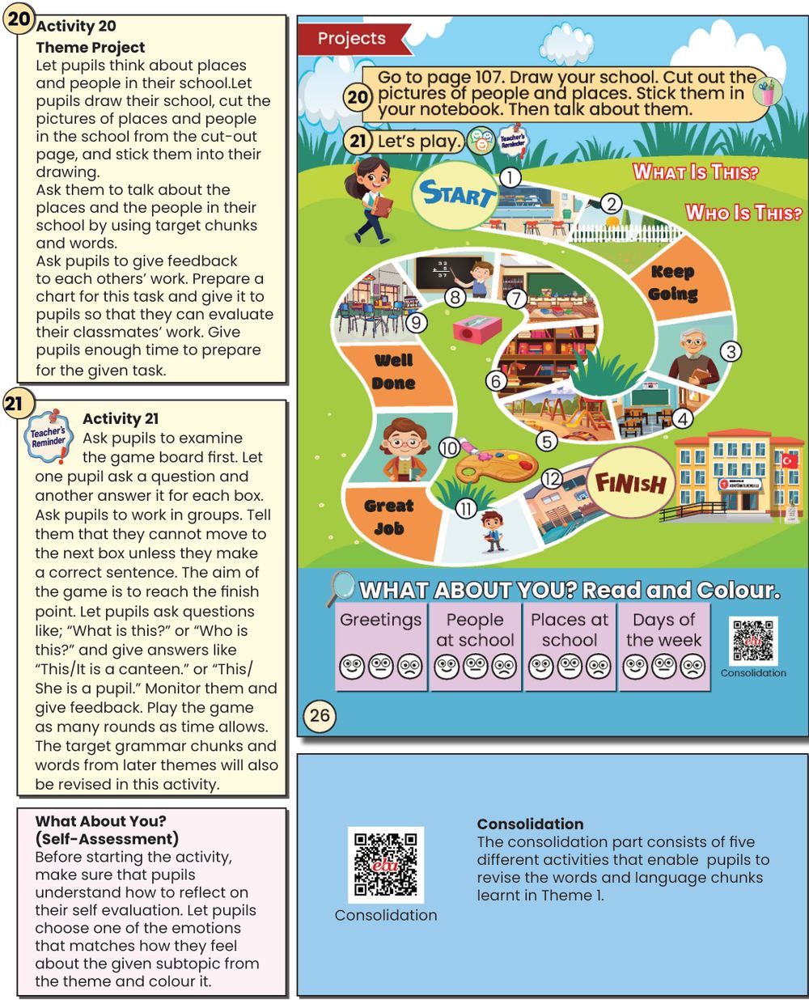

# Projects
(20) Go to page 107. Draw your school. Cut out the pictures of people and places. Stick them in your notebook. Then talk about them.

(21) Let's play.

WHAT IS THIS?
WHO IS THIS?
Keep Going
Well Done
Great Job
FINISH

# WHAT ABOUT YOU? Read and Colour.
| Greetings | People at school | Places at school | Days of the week |
| :---: | :---: | :---: | :---: |
| 🙂 😐 ☹️ | 🙂 😐 ☹️ | 🙂 😐 ☹️ | 🙂 😐 ☹️ |

(26)
Consolidation

# Consolidation
The consolidation part consists of five different activities that enable pupils to revise the words and language chunks learnt in Theme 1.

Consolidation

<!-- sayfa 26 -->

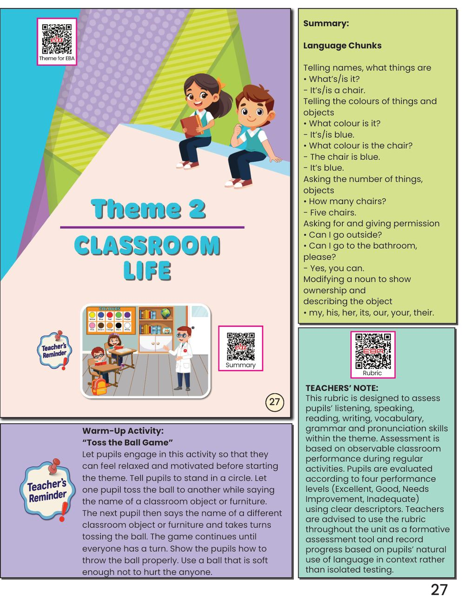

# Theme 2
# CLASSROOM LIFE

## Summary:
### Language Chunks

Telling names, what things are
• What's/is it?
- It's/is a chair.

Telling the colours of things and objects
• What colour is it?
- It's/is blue.
• What colour is the chair?
- The chair is blue.
- It's blue.

Asking the number of things, objects
• How many chairs?
- Five chairs.

Asking for and giving permission
• Can I go outside?
• Can I go to the bathroom, please?
- Yes, you can.

Modifying a noun to show ownership and describing the object
• my, his, her, its, our, your, their.

---

**TEACHERS’ NOTE:**
This rubric is designed to assess pupils’ listening, speaking, reading, writing, vocabulary, grammar and pronunciation skills within the theme. Assessment is based on observable classroom performance during regular activities. Pupils are evaluated according to four performance levels (Excellent, Good, Needs Improvement, Inadequate) using clear descriptors. Teachers are advised to use the rubric throughout the unit as a formative assessment tool and record progress based on pupils’ natural

---

**Warm-Up Activity:**
**“Toss the Ball Game”**
Let pupils engage in this activity so that they can feel relaxed and motivated before starting the theme. Tell pupils to stand in a circle. Let one pupil toss the ball to another while saying the name of a classroom object or furniture. The next pupil then says the name of a different classroom object or furniture and takes turns tossing the ball. The game continues until everyone has a turn. Show the pupils how to

<!-- sayfa 27 -->

# Establishing Links
Help pupils understand the topic of the theme in general and show them the picture of the classroom on page (pages 28-29). Ask simple questions containing the words that the pupils sre already familiar with from the previous theme like “A canteen or a classroom?” After practising the words “Yes” and “No” with mimics and gestures, let them nod or shake their heads to respond. As the theme continues, all the pieces will gradually come together in their minds.

---

# 1 Activity 1
Help pupils understand the topic of the theme in general and show them the picture of the classroom on page (pages 28-29). Ask simple questions containing the words that the pupils are already familiar with from the previous theme like “A canteen or a classroom?” After practising the words “Yes” and “No” with mimics and gestures, let them nod or shake their heads to respond. As the theme continues, all the pieces will gradually come together in their minds.

# 2 Activity 2
Let pupils watch the digital story, or alternatively bring a model of a classroom. Let them watch it without any pause first. Ask the pupils read the whole digital story in chorus. While they are watching for the second time, pause when needed and repeat the words and phrases you want to emphasise by showing the corresponding classroom objects and furniture in the story or on the model you have brought into the classroom. Ask the pupils to act out the parts of the digital story after watching.

---

# Listening & Watching

1. **Look at the picture. Where are they?**
   They are in the classroom.

2. **Watch the digital story.** 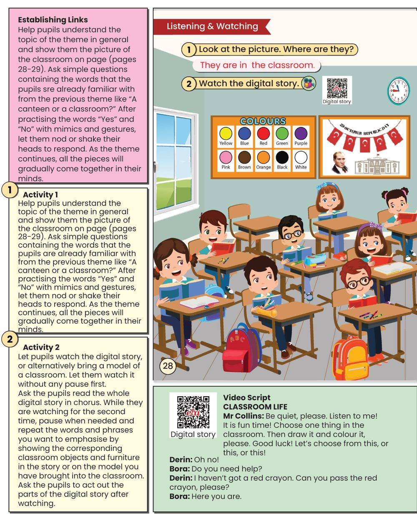

| COLOURS | | | | | |
| :--- | :--- | :--- | :--- | :--- | :--- |
|  |  |  |  |  |  |
| Yellow | Blue | Red | Green | Purple | |
|  |  |  |  |  | |
| Pink | Brown | Orange | Black | White | |

---

**Video Script**
**CLASSROOM LIFE**
**Mr Collins:** Be quiet, please. Listen to me! It is fun time! Choose one thing in the classroom. Then draw it and colour it, please. Good luck! Let’s choose from this, or this, or this!

**Derin:** Oh no!
**Bora:** Do you need help?
**Derin:** I haven’t got a red crayon. Can you pass the red crayon, please?
**Bora:** Here you are.

<!-- sayfa 28 -->

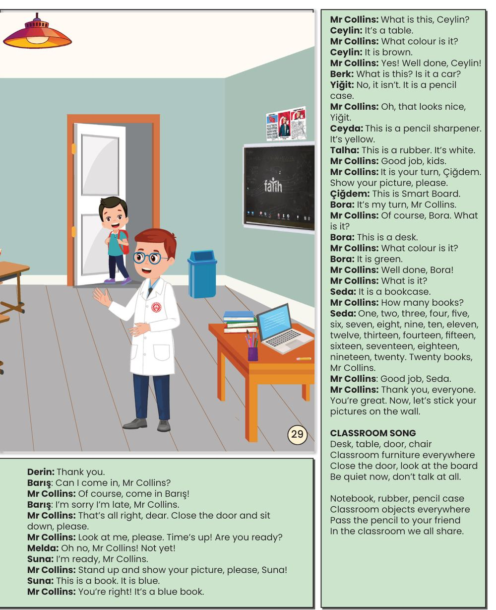

**Derin:** Thank you.
**Barış:** Can I come in, Mr Collins?
**Mr Collins:** Of course, come in Barış!
**Barış:** I’m sorry I’m late, Mr Collins.
**Mr Collins:** That’s all right, dear. Close the door and sit down, please.
**Mr Collins:** Look at me, please. Time’s up! Are you ready?
**Melda:** Oh no, Mr Collins! Not yet!
**Suna:** I’m ready, Mr Collins.
**Mr Collins:** Stand up and show your picture, please, Suna!
**Suna:** This is a book. It is blue.
**Mr Collins:** You’re right! It’s a blue book.
**Mr Collins:** What is this, Ceylin?
**Ceylin:** It’s a table.
**Mr Collins:** What colour is it?
**Ceylin:** It is brown.
**Mr Collins:** Yes! Well done, Ceylin!
**Berk:** What is this? Is it a car?
**Yiğit:** No, it isn’t. It is a pencil case.
**Mr Collins:** Oh, that looks nice, Yiğit.
**Ceyda:** This is a pencil sharpener. It’s yellow.
**Talha:** This is a rubber. It’s white.
**Mr Collins:** Good job, kids.
**Mr Collins:** It is your turn, Çiğdem. Show your picture, please.
**Çiğdem:** This is Smart Board.
**Bora:** It’s my turn, Mr Collins.
**Mr Collins:** Of course, Bora. What is it?
**Bora:** This is a desk.
**Mr Collins:** What colour is it?
**Bora:** It is green.
**Mr Collins:** Well done, Bora!
**Mr Collins:** What is it?
**Seda:** It is a bookcase.
**Mr Collins:** How many books?
**Seda:** One, two, three, four, five, six, seven, eight, nine, ten, eleven, twelve, thirteen, fourteen, fifteen, sixteen, seventeen, eighteen, nineteen, twenty. Twenty books, Mr Collins.
**Mr Collins:** Good job, Seda.
**Mr Collins:** Thank you, everyone. You’re great. Now, let’s stick your pictures on the wall.

**CLASSROOM SONG**
Desk, table, door, chair
Classroom furniture everywhere
Close the door, look at the board
Be quiet now, don’t talk at all.

Notebook, rubber, pencil case
Classroom objects everywhere
Pass the pencil to your friend
In the classroom we all share.

<!-- sayfa 29 -->

# Additional Activity

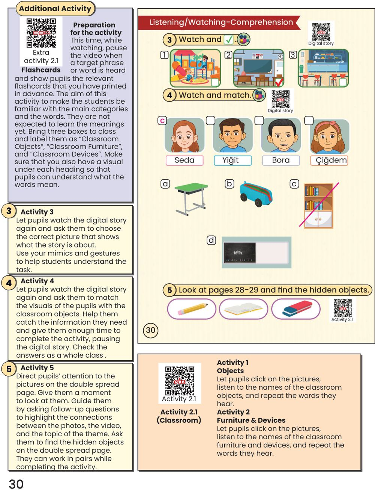

**Preparation for the activity**
This time, while watching, pause the video when a target phrase or word is heard and show pupils the relevant flashcards that you have printed in advance. The aim of this activity to make the students be familiar with the main categories and the words. They are not expected to learn the meanings yet. Bring three boxes to class and label them as “Classroom Objects”, “Classroom Furniture”, and “Classroom Devices”. Make sure that you also have a visual under each heading so that pupils can understand what the words mean.

### 3 Activity 3
Let pupils watch the digital story again and ask them to choose the correct picture that shows what the story is about. Use your mimics and gestures to help students understand the task.

### 4 Activity 4
Let pupils watch the digital story again and ask them to match the visuals of the pupils with the classroom objects. Help them catch the information they need and give them enough time to complete the activity, pausing the digital story. Check the answers as a whole class .

### 5 Activity 5
Direct pupils’ attention to the pictures on the double spread page. Give them a moment to look at them. Guide them by asking follow-up questions to highlight the connections between the photos, the video, and the topic of the theme. Ask them to find the hidden objects on the double spread page. They can work in pairs while

---

# Listening/Watching-Comprehension

### 3 Watch and ✅ 🧩.
1 
2 
3 

### 4 Watch and match. 🧩

 □ Seda
 □ Yiğit
 □ Bora
 □ Çiğdem

a 
b 
c 
d 

### 5 Look at pages 28–29 and find the hidden objects.
   

30

---

**Activity 1**
**Objects**
Let pupils click on the pictures, listen to the names of the classroom objects, and repeat the words they hear.

**Activity 2**
**Furniture & Devices**
Let pupils click on the pictures, listen to the names of the classroom furniture and devices, and repeat the words they hear.

**Activity 2.1 (Classroom)**

<!-- sayfa 30 -->

# Speaking-Expression

## 6 Let's play.
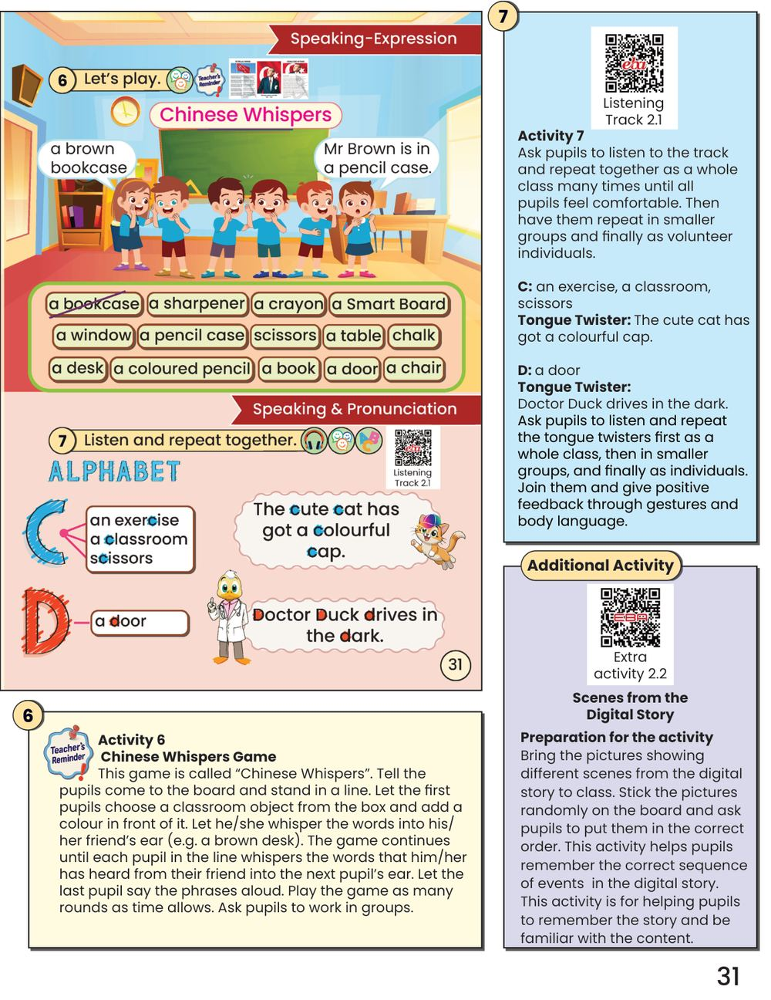

**Chinese Whispers**

a brown bookcase $\rightarrow$ Mr Brown is in a pencil case.

* a bookcase
* a sharpener
* a crayon
* a Smart Board
* a window
* a pencil case
* scissors
* a table
* chalk
* a desk
* a coloured pencil
* a book
* a door
* a chair

---

# Speaking & Pronunciation

## 7 Listen and repeat together.

### ALPHABET

**C**
* an exercise
* a classroom
* scissors

**The cute cat has got a colourful cap.**

**D**
* a door

**Doctor Duck drives in the dark.**

31

---

## 6
**Teacher's Reminder**
### Activity 6
### Chinese Whispers Game
This game is called “Chinese Whispers”. Tell the pupils come to the board and stand in a line. Let the first pupils choose a classroom object from the box and add a colour in front of it. Let he/she whisper the words into his/her friend’s ear (e.g. a brown desk). The game continues until each pupil in the line whispers the words that him/her has heard from their friend into the next pupil’s ear. Let the last pupil say the phrases aloud. Play the game as many rounds as time allows. Ask pupils to work in groups.

---

## 7

Listening Track 2.1

**Activity 7**
Ask pupils to listen to the track and repeat together as a whole class many times until all pupils feel comfortable. Then have them repeat in smaller groups and finally as volunteer individuals.

**C:** an exercise, a classroom, scissors
**Tongue Twister:** The cute cat has got a colourful cap.

**D:** a door
**Tongue Twister:** Doctor Duck drives in the dark.
Ask pupils to listen and repeat the tongue twisters first as a whole class, then in smaller groups, and finally as individuals. Join them and give positive feedback through gestures and body language.

---

## Additional Activity

Extra activity 2.2

### Scenes from the Digital Story

**Preparation for the activity**
Bring the pictures showing different scenes from the digital story to class. Stick the pictures randomly on the board and ask pupils to put them in the correct order. This activity helps pupils remember the correct sequence of events in the digital story. This activity is for helping pupils to remember the story and be

<!-- sayfa 31 -->

# Additional Activity

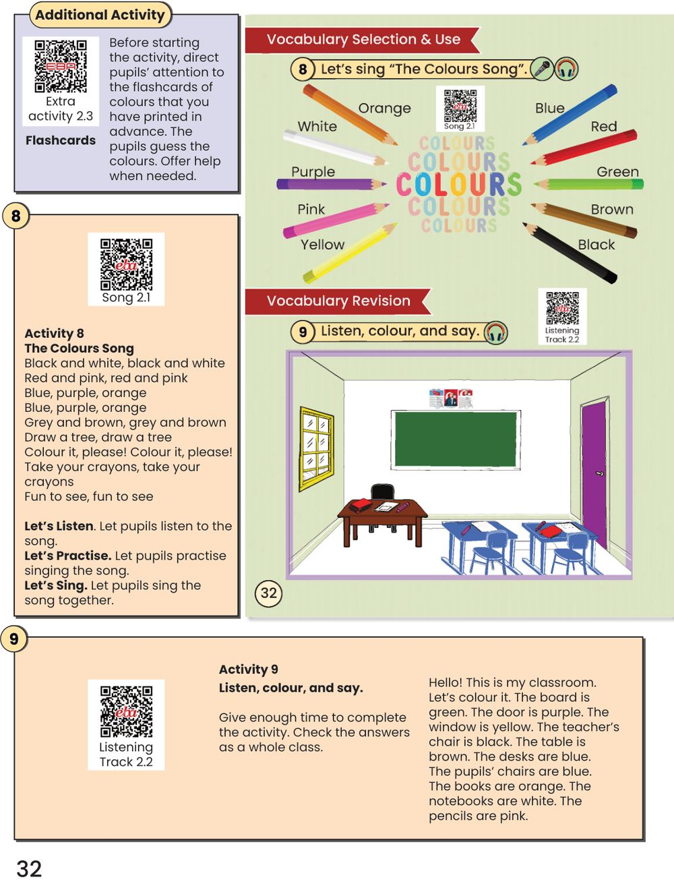

**Extra activity 2.3**
**Flashcards**

Before starting the activity, direct pupils’ attention to the flashcards of colours that you have printed in advance. The pupils guess the colours. Offer help when needed.

---

# Vocabulary Selection & Use

## 8 Let’s sing “The Colours Song”. 

Orange
White
Purple
Pink
Yellow
Blue
Red
Green
Brown
Black

# Activity 8
**The Colours Song**
Black and white, black and white
Red and pink, red and pink
Blue, purple, orange
Blue, purple, orange
Grey and brown, grey and brown
Draw a tree, draw a tree
Colour it, please! Colour it, please!
Take your crayons, take your crayons
Fun to see, fun to see

**Let’s Listen.** Let pupils listen to the song.
**Let’s Practise.** Let pupils practise singing the song.
**Let’s Sing.** Let pupils sing the song together.

---

# Vocabulary Revision

## 9 Listen, colour, and say. 

---

# 9

## Activity 9
**Listen, colour, and say.**

Give enough time to complete the activity. Check the answers as a whole class.

Hello! This is my classroom. Let’s colour it. The board is green. The door is purple. The window is yellow. The teacher’s chair is black. The table is brown. The desks are blue. The pupils’ chairs are blue. The books are orange. The notebooks are white. The pencils are pink.

<!-- sayfa 32 -->

# Vocabulary Selection & Use

## 10 Listen and repeat together.
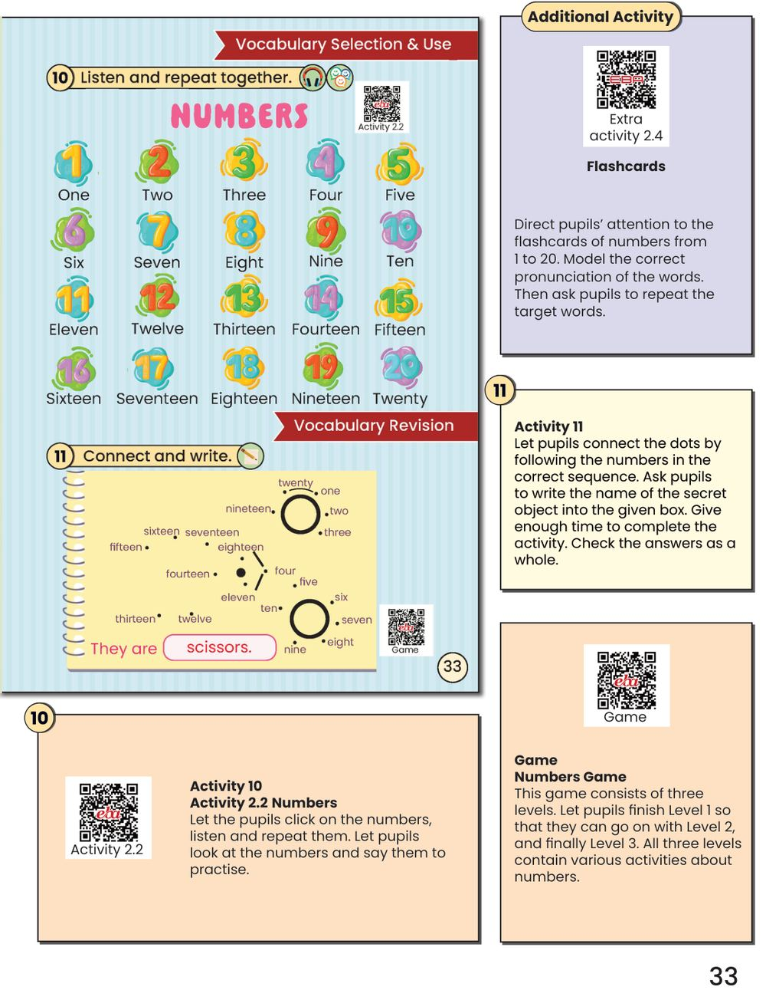

# NUMBERS

1 One
2 Two
3 Three
4 Four
5 Five
6 Six
7 Seven
8 Eight
9 Nine
10 Ten
11 Eleven
12 Twelve
13 Thirteen
14 Fourteen
15 Fifteen
16 Sixteen
17 Seventeen
18 Eighteen
19 Nineteen
20 Twenty

# Vocabulary Revision

## 11 Connect and write.

twenty
one
nineteen
two
three
sixteen seventeen
eighteen
fifteen
four
five
fourteen
six
eleven
seven
ten
eight
thirteen twelve
nine
They are [scissors.]

---

# Additional Activity

Extra activity 2.4

### Flashcards
Direct pupils’ attention to the flashcards of numbers from 1 to 20. Model the correct pronunciation of the words. Then ask pupils to repeat the target words.

---

## 11 Activity 11
Let pupils connect the dots by following the numbers in the correct sequence. Ask pupils to write the name of the secret object into the given box. Give enough time to complete the activity. Check the answers as a whole.

---

## 10 Activity 10

Activity 2.2

### Activity 2.2 Numbers
Let the pupils click on the numbers, listen and repeat them. Let pupils look at the numbers and say them to practise.

---

Game

### Numbers Game
This game consists of three levels. Let pupils finish Level 1 so that they can go on with Level 2, and finally Level 3. All three levels contain various activities about numbers.

<!-- sayfa 33 -->

# 12

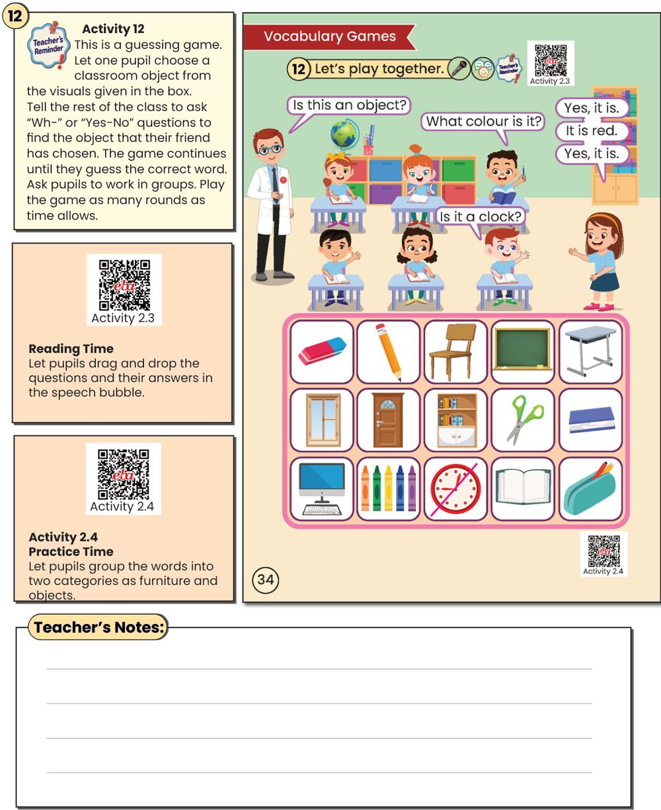

**Teacher's Reminder**
**Activity 12**
This is a guessing game. Let one pupil choose a classroom object from the visuals given in the box. Tell the rest of the class to ask “Wh-” or “Yes-No” questions to find the object that their friend has chosen. The game continues until they guess the correct word. Ask pupils to work in groups. Play the game as many rounds as time allows.

---

Activity 2.3

**Reading Time**
Let pupils drag and drop the questions and their answers in the speech bubble.

---

Activity 2.4

**Activity 2.4**
**Practice Time**
Let pupils group the words into two categories as furniture and objects.

---

# Vocabulary Games

**12 Let’s play together.**   Activity 2.3

"Is this an object?"

"What colour is it?"
"Yes, it is."
"It is red."
"Yes, it is."

"Is it a clock?"

| | | | | |
| :---: | :---: | :---: | :---: | :---: |
|  |  |  |  |  |
|  |  |  |  |  |
|  |  |  |  |  |

Activity 2.4

**34**

---

**Teacher’s Notes:**
___________________________________________________________________________
___________________________________________________________________________
___________________________________________________________________________
___________________________________________________________________________

<!-- sayfa 34 -->

# Vocabulary Revision

## 13 Let's find together.

1. glue
2. sharpener
3. whiteboard
4. rubber
5. scissors
6. notebook
7. chalk
8. computer
9. bookcase
10. crayon
11. pencil
12. chair
13. desk
14. tablet
15. book

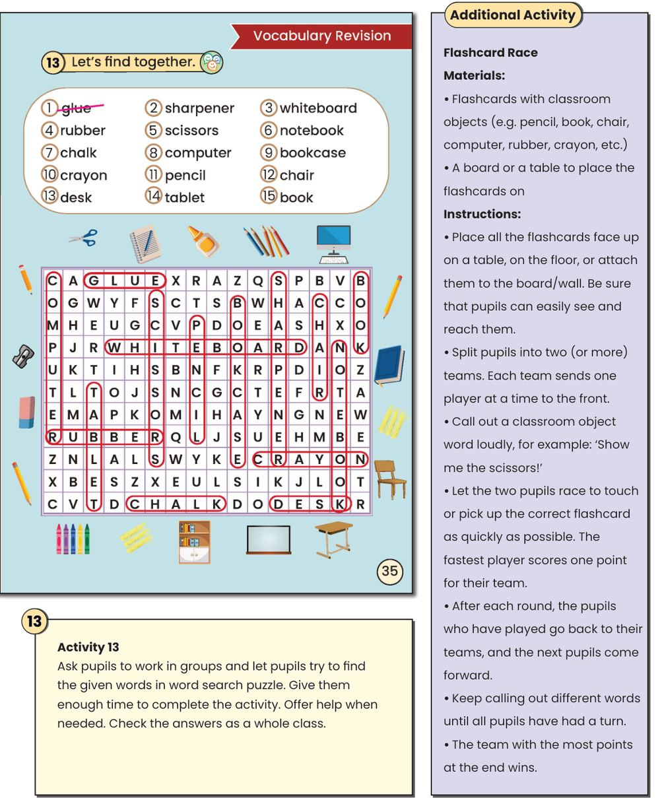

(35)

---

### 13
#### Activity 13
Ask pupils to work in groups and let pupils try to find the given words in word search puzzle. Give them enough time to complete the activity. Offer help when needed. Check the answers as a whole class.

---

# Additional Activity

## Flashcard Race

### Materials:
* Flashcards with classroom objects (e.g. pencil, book, chair, computer, rubber, crayon, etc.)
* A board or a table to place the flashcards on

### Instructions:
* Place all the flashcards face up on a table, on the floor, or attach them to the board/wall. Be sure that pupils can easily see and reach them.
* Split pupils into two (or more) teams. Each team sends one player at a time to the front.
* Call out a classroom object word loudly, for example: ‘Show me the scissors!’
* Let the two pupils race to touch or pick up the correct flashcard as quickly as possible. The fastest player scores one point for their team.
* After each round, the pupils who have played go back to their teams, and the next pupils come forward.
* Keep calling out different words until all pupils have had a turn.
* The team with the most points at the end wins.

<!-- sayfa 35 -->

# 14

**Activity 14**

Ask pupils to look at the pictures for being familiar with the story. Ask them to look at each picture on the page carefully and individually. First, read the dialogues aloud so that pupils can hear the correct pronunciation. Pay attention to emphasise the target language chunks. Then encourage them to read in pairs in their seats individually and sliently. Let them work in groups. Choose volunteer pupils to act out the dialogues by reading them aloud to the class. Let as many pairs as possible practise this activity. Offer help when needed. The target grammar chunks are given in bold in the dialogues. They are not taught as grammatical structures. Pupils are expected to grasp and learn the grammatical chunks holistically-through hearing, seeing, and repeating them in context. Familiarity and exposure are key points. After practising the dialogues in pairs, invite pupils to the board to act out the dialogues without looking their books. Tell pupils that they are supposed to act out only one dialogue they have chosen from the page, as trying to remember all the dialogues can be too challenging at that age.

---

# Grammaring Selection & Use

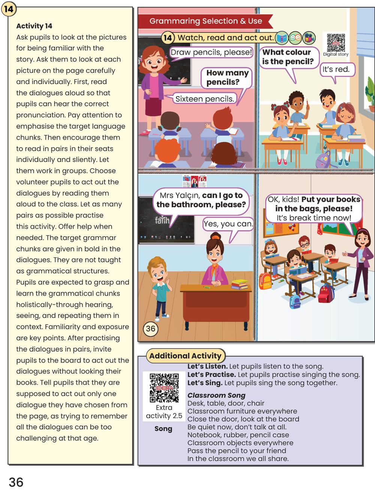

**14 Watch, read and act out.**

*   Draw pencils, please!
*   How many pencils?
*   Sixteen pencils.
*   What colour is the pencil?
*   It's red.
*   Mrs Yalçın, **can I go to the bathroom, please?**
*   Yes, you can.
*   OK, kids! **Put your books in the bags, please! It's break time now!**

---

# Additional Activity

**Let's Listen.** Let pupils listen to the song.
**Let's Practise.** Let pupils practise singing the song.
**Let's Sing.** Let pupils sing the song together.

**Classroom Song**
Desk, table, door, chair
Classroom furniture everywhere
Close the door, look at the board
Be quiet now, don't talk at all.
Notebook, rubber, pencil case
Classroom objects everywhere
Pass the pencil to your friend

| Extra activity 2.5 | Song |
| :--- | :--- |

<!-- sayfa 36 -->

# Grammaring Games

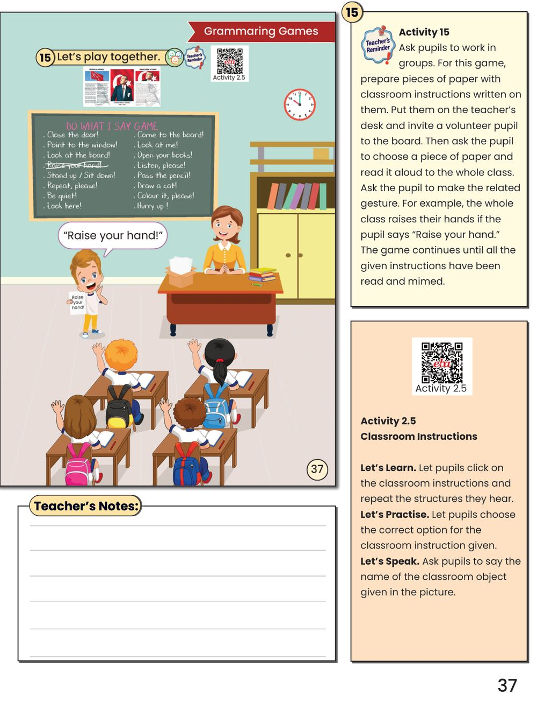

## 15 Let's play together.

**Teacher's Reminder**
Activity 2.5

**DO WHAT I SAY GAME**
* Close the door!
* Point to the window!
* Look at the board!
* Raise your hand!
* Stand up / Sit down!
* Repeat, please!
* Be quiet!
* Look here!
* Come to the board!
* Look at me!
* Open your books!
* Listen, please!
* Pass the pencil!
* Draw a cat!
* Colour it, please!
* Hurry up!

"Raise your hand!"

37

---

### 15

**Teacher's Reminder Activity 15**
Ask pupils to work in groups. For this game, prepare pieces of paper with classroom instructions written on them. Put them on the teacher’s desk and invite a volunteer pupil to the board. Then ask the pupil to choose a piece of paper and read it aloud to the whole class. Ask the pupil to make the related gesture. For example, the whole class raises their hands if the pupil says “Raise your hand.” The game continues until all the given instructions have been read and mimed.

---

Activity 2.5

**Activity 2.5**
**Classroom Instructions**

**Let’s Learn.** Let pupils click on the classroom instructions and repeat the structures they hear.
**Let’s Practise.** Let pupils choose the correct option for the classroom instruction given.
**Let’s Speak.** Ask pupils to say the name of the classroom object given in the picture.

---

**Teacher’s Notes:**
__________________________________________________________________
__________________________________________________________________
__________________________________________________________________
__________________________________________________________________

<!-- sayfa 37 -->

# Reading-Comprehension

**16 Read and circle the classroom objects.** 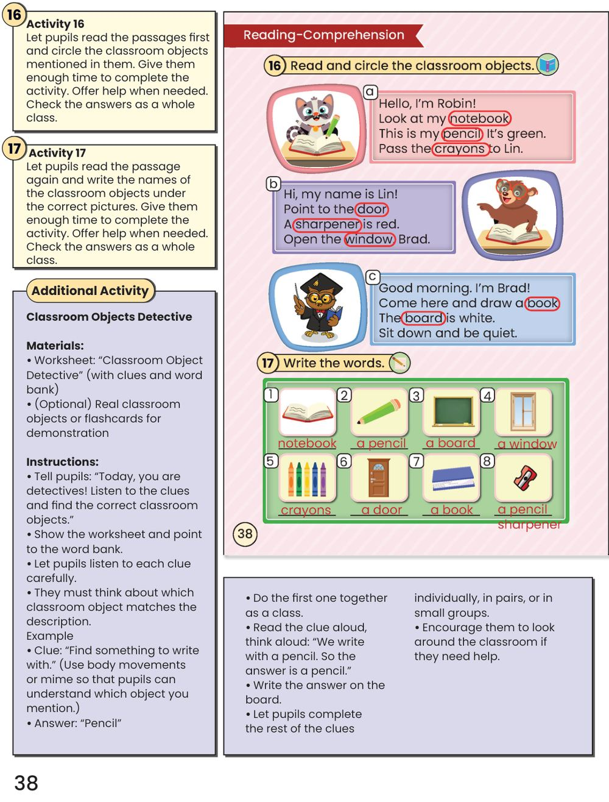

**a**
Hello, I'm Robin!
Look at my **notebook**
This is my **pencil**. It's green.
Pass the **crayons** to Lin.

**b**
Hi, my name is Lin!
Point to the **door**
A **sharpener** is red.
Open the **window** Brad.

**c**
Good morning. I'm Brad!
Come here and draw a **book**
The **board** is white.
Sit down and be quiet.

**17 Write the words.** 

1. notebook
2. a pencil
3. a board
4. a window
5. crayons
6. a door
7. a book
8. a pencil sharpener

---

**16 Activity 16**
Let pupils read the passages first and circle the classroom objects mentioned in them. Give them enough time to complete the activity. Offer help when needed. Check the answers as a whole class.

**17 Activity 17**
Let pupils read the passage again and write the names of the classroom objects under the correct pictures. Give them enough time to complete the activity. Offer help when needed. Check the answers as a whole class.

**Additional Activity**
**Classroom Objects Detective**

**Materials:**
* Worksheet: “Classroom Object Detective” (with clues and word bank)
* (Optional) Real classroom objects or flashcards for demonstration

**Instructions:**
* Tell pupils: “Today, you are detectives! Listen to the clues and find the correct classroom objects.”
* Show the worksheet and point to the word bank.
* Let pupils listen to each clue carefully.
* They must think about which classroom object matches the description.
**Example**
* Clue: “Find something to write with.” (Use body movements or mime so that pupils can understand which object you mention.)
* Answer: “Pencil”
* Do the first one together as a class.
* Read the clue aloud, think aloud: “We write with a pencil. So the answer is a pencil.”
* Write the answer on the board.
* Let pupils complete the rest of the clues individually, in pairs, or in small groups.
* Encourage them to look around the classroom if they need help.

<!-- sayfa 38 -->

# Writing-Expression

## 18 Reorder and write. 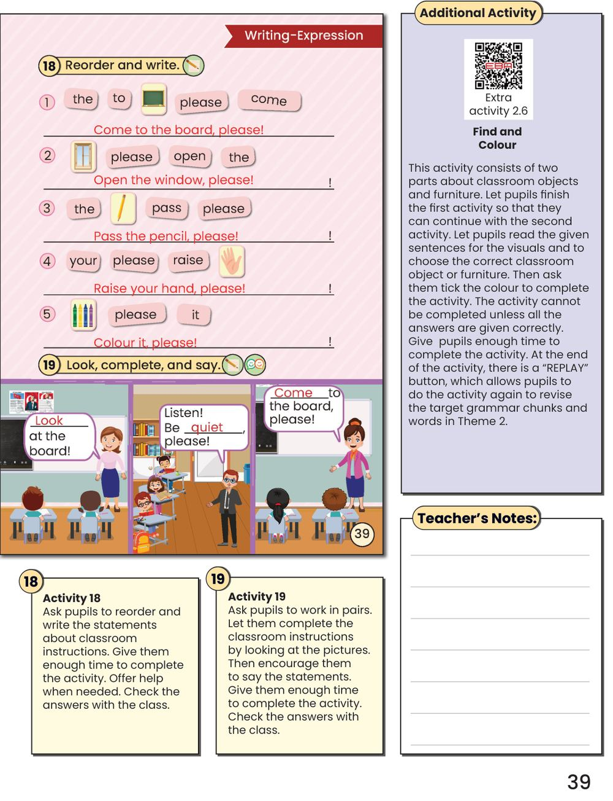

1.  the to  please come
Come to the board, please!

2.  please open the
Open the window, please! !

3. the  pass please
Pass the pencil, please! !

4. your please raise 
Raise your hand, please! !

5.  please it
Colour it, please! !

## 19 Look, complete, and say.  

Look at the board!

Listen! Be quiet please!

Come to the board, please!

39

---

# Additional Activity

Extra activity 2.6

**Find and Colour**

This activity consists of two parts about classroom objects and furniture. Let pupils finish the first activity so that they can continue with the second activity. Let pupils read the given sentences for the visuals and to choose the correct classroom object or furniture. Then ask them tick the colour to complete the activity. The activity cannot be completed unless all the answers are given correctly. Give pupils enough time to complete the activity. At the end of the activity, there is a “REPLAY” button, which allows pupils to do the activity again to revise the target grammar chunks and words in Theme 2.

# Teacher’s Notes:

__________________________________________________________________
__________________________________________________________________
__________________________________________________________________
__________________________________________________________________

---

### 18
**Activity 18**
Ask pupils to reorder and write the statements about classroom instructions. Give them enough time to complete the activity. Offer help when needed. Check the answers with the class.

### 19
**Activity 19**
Ask pupils to work in pairs. Let them complete the classroom instructions by looking at the pictures. Then encourage them to say the statements. Give them enough time to complete the activity. Check the answers with the class.

<!-- sayfa 39 -->

# 20

## Activity 20
### Picture Strip Story for Consolidation
After controlled practice sessions, at this stage have pupils practise the target vocabulary and chunks in this picture strip story. This will be an opportunity for them to consolidate and use the target words and language chunks about the concept of school life in fun, enjoyable and versatile way. First, read the strip story aloud for the pupils to hear the correct pronunciation. Then, ask them to read indivudually and sliently. Ask pupils to work in groups. Choose pupils to act out in their seats as the characters in the story and read the dialogues to the class. Let them practise this activity as many groups as they can. Offer help for pronunciation, vocabulary, etc. when needed. As an additional activity, let pupils act out the dialogues by using their own names with their peers.

**Teacher’s Notes:**
__________________________________________________________________
__________________________________________________________________
__________________________________________________________________
__________________________________________________________________
__________________________________________________________________
__________________________________________________________________
__________________________________________________________________

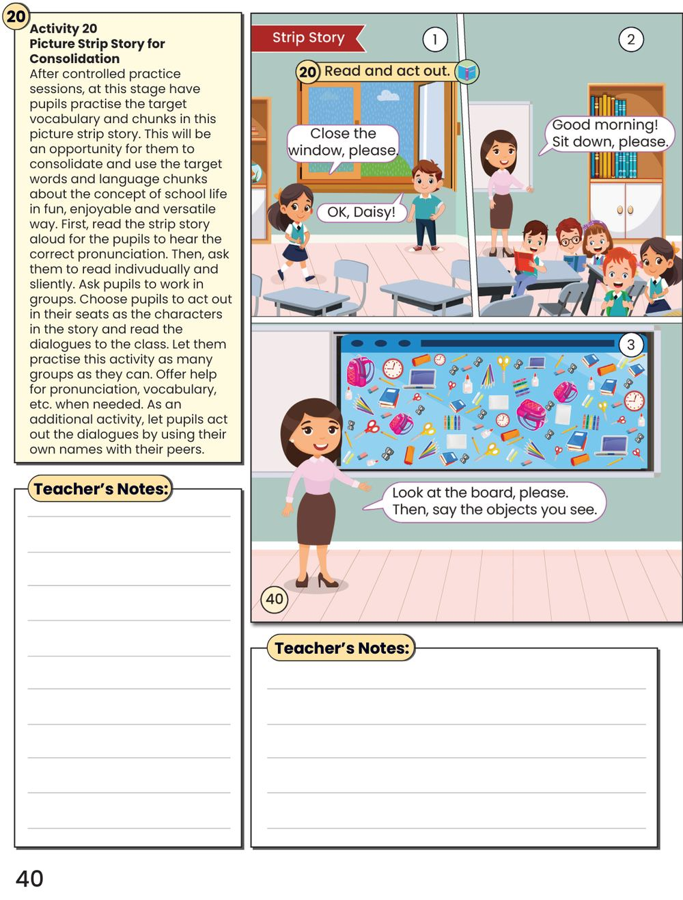

**Strip Story**

**1**

(20) **Read and act out.**
"Close the window, please."
"OK, Daisy!"

**2**

"Good morning! Sit down, please."

**3**

"Look at the board, please. Then, say the objects you see."

(40)

**Teacher’s Notes:**
__________________________________________________________________
__________________________________________________________________
__________________________________________________________________
________________________________________________________________

<!-- sayfa 40 -->

# 4
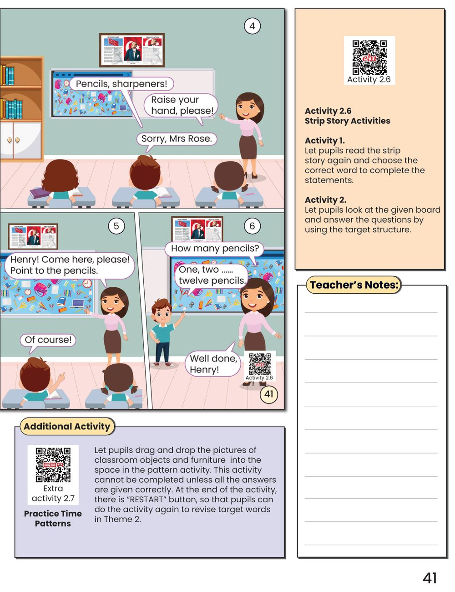

# 5

# 6

---

**Activity 2.6**

**Activity 2.6**
**Strip Story Activities**

**Activity 1.**
Let pupils read the strip story again and choose the correct word to complete the statements.

**Activity 2.**
Let pupils look at the given board and answer the questions by using the target structure.

---

**Teacher’s Notes:**
__________________________________________________________________
__________________________________________________________________
__________________________________________________________________
__________________________________________________________________
__________________________________________________________________

---

**Additional Activity**

**Extra activity 2.7**
**Practice Time Patterns**

Let pupils drag and drop the pictures of classroom objects and furniture into the space in the pattern activity. This activity cannot be completed unless all the answers are given correctly. At the end of the activity, there is “RESTART” button, so that pupils can do the activity again to revise target words in Theme 2.

<!-- sayfa 41 -->

# 21
## Activity 21
### Theme Project
Ask pupils to draw their classroom, cut the pictures of classroom objects, furniture and devices from the cut out page, and stick them into their drawing. Ask them to tell their classmates about their school. Ask them to give feedback on each other’s work. Give pupils enough time to prepare for the task.

# 22
## Activity 22
Ask pupils to solve of the mathematical problems. Then have pupils match the solutions with the correct numbers. Give them enough time to complete the activity. Offer help when needed. Monitor them and give feedback. Check the answers with the class.

# What About You? (Self-Assessment)
Before starting the activity, make sure that pupils understand how to reflect on their self evaluation. Let pupils choose one of the emotions that matches how they feel about the given subtopic from the theme and colour it. Monitor pupils while they are doing the task.

---

# Projects

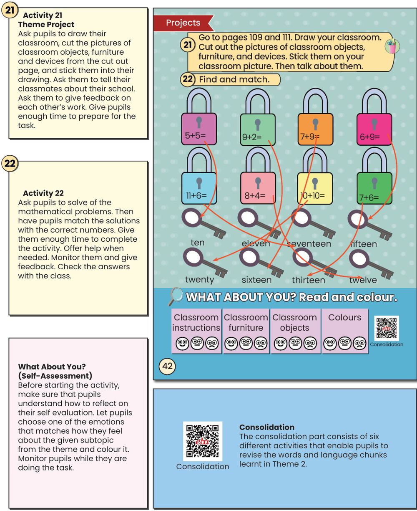
**21** Go to pages 109 and 111. Draw your classroom. Cut out the pictures of classroom objects, furniture, and devices. Stick them on your classroom picture. Then talk about them.

**22** Find and match.

$5+5=$ <!-- KONTROL: Marker'da karşılığı yok, uydurma olabilir -->
$9+2=$ <!-- KONTROL: Marker'da karşılığı yok, uydurma olabilir -->
$7+9=$ <!-- KONTROL: Marker'da karşılığı yok, uydurma olabilir -->
$6+9=$ <!-- KONTROL: Marker'da karşılığı yok, uydurma olabilir -->

$11+6=$ <!-- KONTROL: Marker'da karşılığı yok, uydurma olabilir -->
$8+4=$ <!-- KONTROL: Marker'da karşılığı yok, uydurma olabilir -->
$10+10=$ <!-- KONTROL: Marker'da karşılığı yok, uydurma olabilir -->
$7+6=$ <!-- KONTROL: Marker'da karşılığı yok, uydurma olabilir -->

ten
eleven
seventeen
fifteen
twenty
sixteen
thirteen
twelve

# WHAT ABOUT YOU? Read and colour.

| Classroom instructions | Classroom furniture | Classroom objects | Colours |
| :---: | :---: | :---: | :---: |
| 🙂 😐 ☹️ | 🙂 😐 ☹️ | 🙂 😐 ☹️ | 🙂 😐 ☹️ |

**Consolidation**

# 42

**Consolidation**
The consolidation part consists of six different activities that enable pupils to revise the words and language chunks learnt in Theme 2.

<!-- sayfa 42 -->

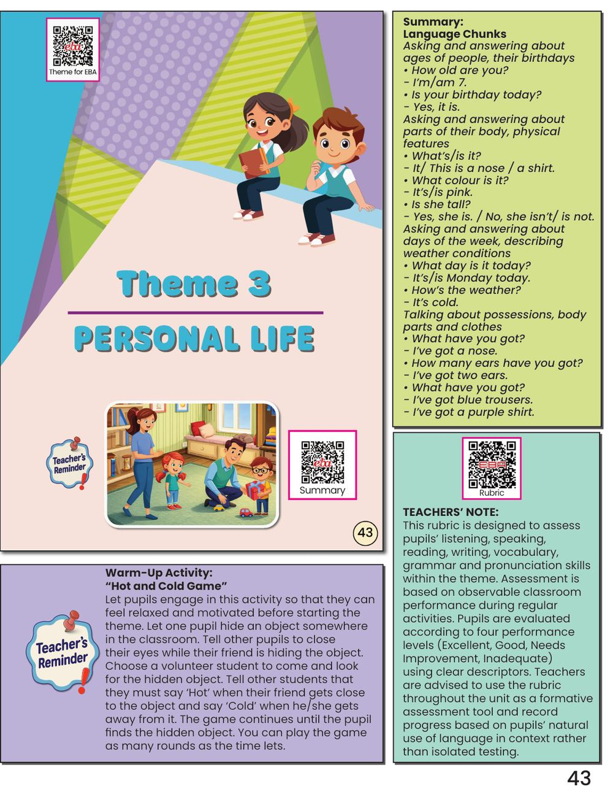

# Theme 3
# PERSONAL LIFE

**Summary:**
**Language Chunks**
Asking and answering about ages of people, their birthdays
• How old are you?
- I’m/am 7.
• Is your birthday today?
- Yes, it is.
Asking and answering about parts of their body, physical features
• What’s/is it?
- It/ This is a nose / a shirt.
• What colour is it?
- It’s/is pink.
• Is she tall?
- Yes, she is. / No, she isn’t/ is not.
Asking and answering about days of the week, describing weather conditions
• What day is it today?
- It’s/is Monday today.
• How’s the weather?
- It’s cold.
Talking about possessions, body parts and clothes
• What have you got?
- I’ve got a nose.
• How many ears have you got?
- I’ve got two ears.
• What have you got?
- I’ve got blue trousers.
- I’ve got a purple shirt.

43

**TEACHERS’ NOTE:**
This rubric is designed to assess pupils’ listening, speaking, reading, writing, vocabulary, grammar and pronunciation skills within the theme. Assessment is based on observable classroom performance during regular activities. Pupils are evaluated according to four performance levels (Excellent, Good, Needs Improvement, Inadequate) using clear descriptors. Teachers are advised to use the rubric throughout the unit as a formative assessment tool and record progress based on pupils’ natural

**Warm-Up Activity:**
**“Hot and Cold Game”**
Let pupils engage in this activity so that they can feel relaxed and motivated before starting the theme. Let one pupil hide an object somewhere in the classroom. Tell other pupils to close their eyes while their friend is hiding the object. Choose a volunteer student to come and look for the hidden object. Tell other students that they must say ‘Hot’ when their friend gets close to the object and say ‘Cold’ when he/she gets away from it. The game continues until the pupil finds the hidden object You can play the game

<!-- sayfa 43 -->

# Listening & Watching

1. Look at the picture. Where are they?
2. Watch the digital story.

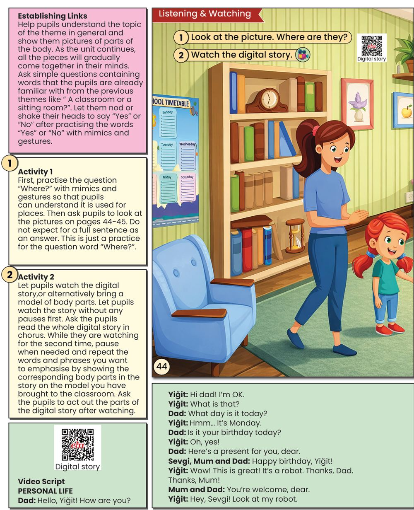

---

### Establishing Links
Help pupils understand the topic of the theme in general and show them pictures of parts of the body. As the unit continues, all the pieces will gradually come together in their minds. Ask simple questions containing words that the pupils are already familiar with from the previous themes like “ A classroom or a sitting room?”. Let them nod or shake their heads to say “Yes” or “No” after practising the words “Yes” or “No” with mimics and gestures.

---

### 1
#### Activity 1
First, practise the question “Where?” with mimics and gestures so that pupils can understand it is used for places. Then ask pupils to look at the pictures on pages 44-45. Do not expect for a full sentence as an answer. This is just a practice for the question word “Where?”.

---

### 2
#### Activity 2
Let pupils watch the digital story,or alternatively bring a model of body parts. Let pupils watch the story without any pauses first. Ask the pupils read the whole digital story in chorus. While they are watching for the second time, pause when needed and repeat the words and phrases you want to emphasise by showing the corresponding body parts in the story on the model you have brought to the classroom. Ask the pupils to act out the parts of the digital story after watching.

---

**Video Script**
**PERSONAL LIFE**

**Dad:** Hello, Yiğit! How are you?
**Yiğit:** Hi dad! I’m OK.
**Yiğit:** What is that?
**Dad:** What day is it today?
**Yiğit:** Hmm... It's Monday.
**Dad:** Is it your birthday today?
**Yiğit:** Oh, yes!
**Dad:** Here's a present for you, dear.
**Sevgi, Mum and Dad:** Happy birthday, Yiğit!
**Yiğit:** Wow! This is great! It's a robot. Thanks, Dad. Thanks, Mum!
**Mum and Dad:** You're welcome, dear.
**Yiğit:** Hey, Sevgi! Look at my robot.

<!-- sayfa 44 -->

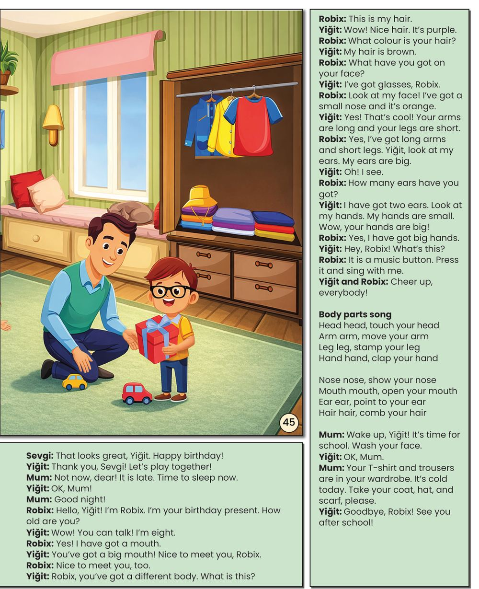

**Sevgi:** That looks great, Yiğit. Happy birthday!
**Yiğit:** Thank you, Sevgi! Let’s play together!
**Mum:** Not now, dear! It is late. Time to sleep now.
**Yiğit:** OK, Mum!
**Mum:** Good night!
**Robix:** Hello, Yiğit! I’m Robix. I’m your birthday present. How old are you?
**Yiğit:** Wow! You can talk! I’m eight.
**Robix:** Yes! I have got a mouth.
**Yiğit:** You’ve got a big mouth! Nice to meet you, Robix.
**Robix:** Nice to meet you, too.
**Yiğit:** Robix, you’ve got a different body. What is this?
**Robix:** This is my hair.
**Yiğit:** Wow! Nice hair. It’s purple.
**Robix:** What colour is your hair?
**Yiğit:** My hair is brown.
**Robix:** What have you got on your face?
**Yiğit:** I’ve got glasses, Robix.
**Robix:** Look at my face! I’ve got a small nose and it’s orange.
**Yiğit:** Yes! That’s cool! Your arms are long and your legs are short.
**Robix:** Yes, I’ve got long arms and short legs. Yiğit, look at my ears. My ears are big.
**Yiğit:** Oh! I see.
**Robix:** How many ears have you got?
**Yiğit:** I have got two ears. Look at my hands. My hands are small. Wow, your hands are big!
**Robix:** Yes, I have got big hands.
**Yiğit:** Hey, Robix! What’s this?
**Robix:** It is a music button. Press it and sing with me.
**Yiğit and Robix:** Cheer up, everybody!

**Body parts song**
Head head, touch your head
Arm arm, move your arm
Leg leg, stamp your leg
Hand hand, clap your hand

Nose nose, show your nose
Mouth mouth, open your mouth
Ear ear, point to your ear
Hair hair, comb your hair

**Mum:** Wake up, Yiğit! It’s time for school. Wash your face.
**Yiğit:** OK, Mum.
**Mum:** Your T-shirt and trousers are in your wardrobe. It’s cold today. Take your coat, hat, and scarf, please.
**Yiğit:** Goodbye, Robix! See you after school!

<!-- sayfa 45 -->

# Additional Activity

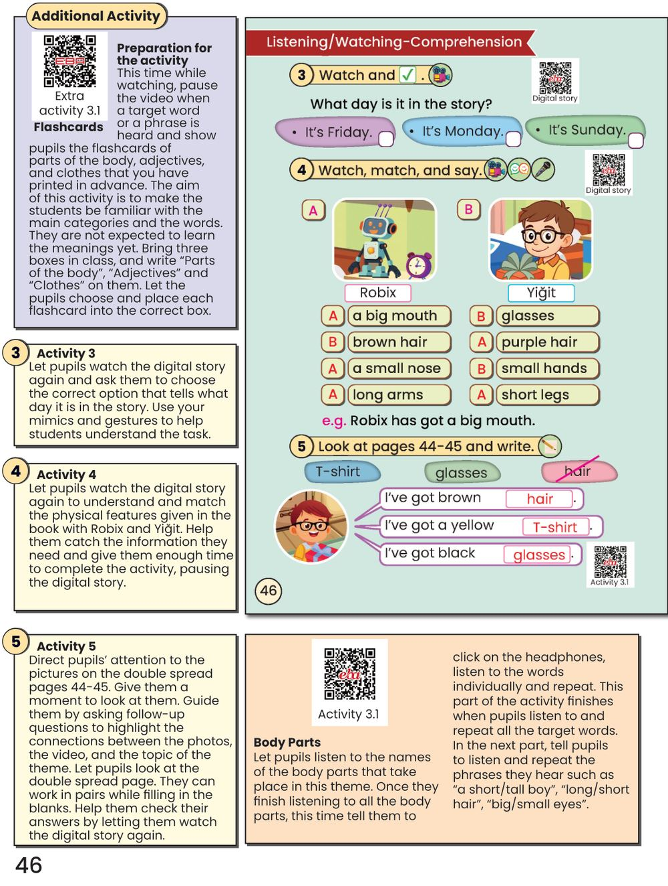
**Extra activity 3.1 Flashcards**

**Preparation for the activity**
This time while watching, pause the video when a target word or a phrase is heard and show pupils the flashcards of parts of the body, adjectives, and clothes that you have printed in advance. The aim of this activity is to make the students be familiar with the main categories and the words. They are not expected to learn the meanings yet. Bring three boxes in class, and write “Parts of the body”, “Adjectives” and “Clothes” on them. Let the pupils choose and place each flashcard into the correct box.

---

### 3 Activity 3
Let pupils watch the digital story again and ask them to choose the correct option that tells what day it is in the story. Use your mimics and gestures to help students understand the task.

### 4 Activity 4
Let pupils watch the digital story again to understand and match the physical features given in the book with Robix and Yiğit. Help them catch the information they need and give them enough time to complete the activity, pausing the digital story.

### 5 Activity 5
Direct pupils’ attention to the pictures on the double spread pages 44-45. Give them a moment to look at them. Guide them by asking follow-up questions to highlight the connections between the photos, the video, and the topic of the theme. Let pupils look at the double spread page. They can work in pairs while filling in the blanks. Help them check their...

---

# Listening/Watching-Comprehension

### 3 Watch and ✅ . 🗣️
**What day is it in the story?**

*   It's Friday. [ ]
*   It's Monday. [ ]
*   It's Sunday. [ ]

 Digital story

### 4 Watch, match, and say. 🗣️ 😊 ✏️
 Digital story

**A** 
**Robix**

**B** 
**Yiğit**

**A** a big mouth
**B** brown hair
**A** a small nose
**A** long arms

**B** glasses
**A** purple hair
**B** small hands
**A** short legs

e.g. Robix has got a big mouth.

### 5 Look at pages 44-45 and write. ✏️
T-shirt | glasses | ~~hair~~

I've got brown [hair]
I've got a yellow [T-shirt]
I've got black [glasses]

 Activity 3.1

**46**

---

Activity 3.1

**Body Parts**
Let pupils listen to the names of the body parts that take place in this theme. Once they finish listening to all the body parts this time tell them to click on the headphones, listen to the words individually and repeat. This part of the activity finishes when pupils listen to and repeat all the target words. In the next part, tell pupils to listen and repeat the phrases they hear such as “a short/tall boy”, “long/short hair”, “big/small eyes”.

<!-- sayfa 46 -->

# Speaking-Expression

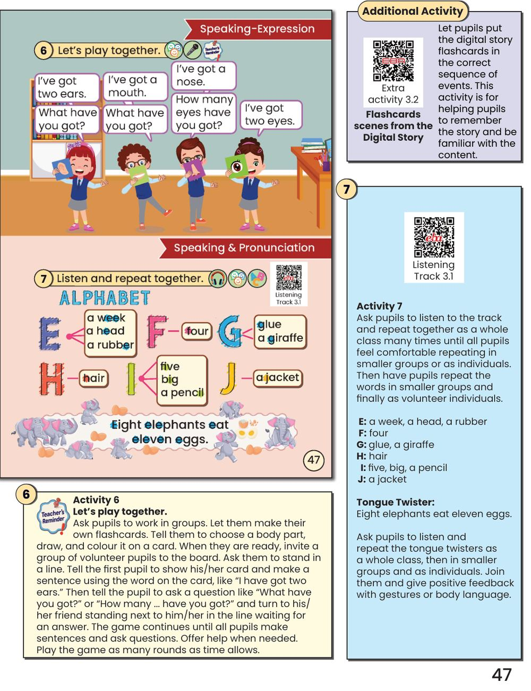

6 Let’s play together.

* I've got two ears.
* What have you got?
* I've got a mouth.
* What have you got?
* I've got a nose.
* How many eyes have you got?
* I've got two eyes.

---

# Speaking & Pronunciation

7 Listen and repeat together.

ALPHABET

* E: a week, a head, a rubber
* F: four
* G: glue, a giraffe
* H: hair
* I: five, big, a pencil
* J: a jacket

Eight elephants eat eleven eggs.

47

---

# Additional Activity

Extra activity 3.2
Flashcards scenes from the Digital Story

Let pupils put the digital story flashcards in the correct sequence of events. This activity is for helping pupils to remember the story and be familiar with the content.

---

# 7

Listening Track 3.1

**Activity 7**
Ask pupils to listen to the track and repeat together as a whole class many times until all pupils feel comfortable repeating in smaller groups or as individuals. Then have pupils repeat the words in smaller groups and finally as volunteer individuals.

**E:** a week, a head, a rubber
**F:** four
**G:** glue, a giraffe
**H:** hair
**I:** five, big, a pencil
**J:** a jacket

**Tongue Twister:**
Eight elephants eat eleven eggs.

Ask pupils to listen and repeat the tongue twisters as a whole class, then in smaller groups and as individuals. Join them and give positive feedback with gestures or body language.

---

# 6

**Activity 6**
**Let’s play together.**
Ask pupils to work in groups. Let them make their own flashcards. Tell them to choose a body part, draw, and colour it on a card. When they are ready, invite a group of volunteer pupils to the board. Ask them to stand in a line. Tell the first pupil to show his/her card and make a sentence using the word on the card, like “I have got two ears.” Then tell the pupil to ask a question like “What have you got?” or “How many ... have you got?” and turn to his/her friend standing next to him/her in the line waiting for an answer. The game continues until all pupils make sentences and ask questions Offer help when needed

<!-- sayfa 47 -->

# 8

## Activity 8
In this activity, let pupils practise the target vocabulary in an efficient and meaningful way in context. Ask pupils to look at the each picture carefully. And then, let them read the words in Activity 8. Let pupils watch the digital story again and fill in the body parts of the robot using the words given above in pairs. Give them enough time to complete the activity. Remind pupils that the first item is given as an example. Offer help when needed. When all activities have been finished, let the pupils look at the pictures again and say the words individually in their seats. Then encourage pupils to make sentences about Robix as in the example.

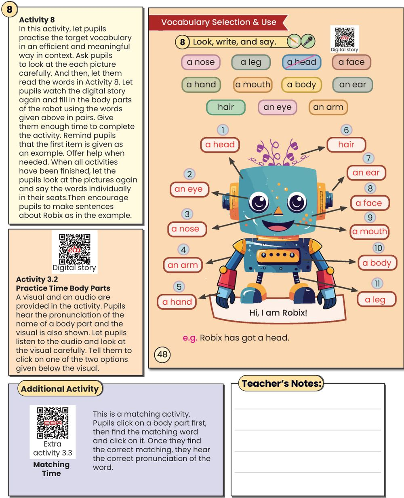
Digital story

## Activity 3.2
### Practice Time Body Parts
A visual and an audio are provided in the activity. Pupils hear the pronunciation of the name of a body part and the visual is also shown. Let pupils listen to the audio and look at the visual carefully. Tell them to click on one of the two options given below the visual.

---

# Vocabulary Selection & Use

## 8 Look, write, and say.

a nose | a leg | a head | a face
--- | --- | --- | ---
a hand | a mouth | a body | an ear
hair | an eye | an arm

1. a head
2. an eye
3. a nose
4. an arm
5. a hand
6. hair
7. an ear
8. a face
9. a mouth
10. a body
11. a leg

Hi, I am Robix!

e.g. Robix has got a head.

48

---

## Additional Activity

Extra activity 3.3
**Matching Time**

This is a matching activity. Pupils click on a body part first, then find the matching word and click on it. Once they find the correct matching, they hear the correct pronunciation of the word.

## Teacher's Notes:

<!-- sayfa 48 -->

# Vocabulary Games

## 9 Find, circle, and say. 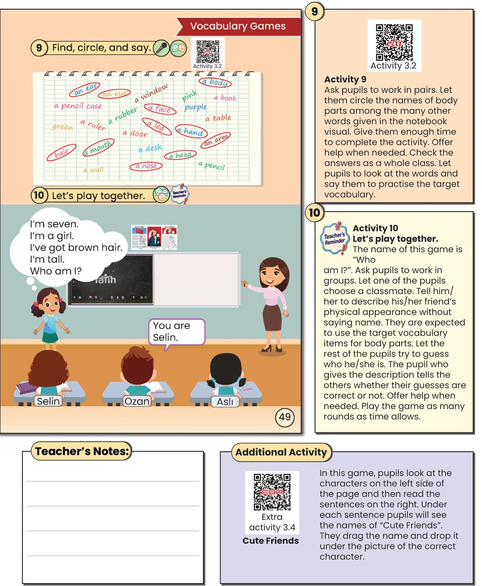

Activity 3.2

an ear, an eye, a window, pink, a book, a body, a pencil case, a rubber, a face, purple, green, a ruler, a table, a door, a leg, a hand, hair, a mouth, a desk, an arm, a wall, a nose, a head, a pencil

## 10 Let’s play together. 
I’m seven.
I’m a girl.
I’ve got brown hair.
I’m tall.
Who am I?

You are Selin.

Selin, Ozan, Aslı

49

---

## 9

Activity 3.2

**Activity 9**
Ask pupils to work in pairs. Let them circle the names of body parts among the many other words given in the notebook visual. Give them enough time to complete the activity. Offer help when needed. Check the answers as a whole class. Let pupils to look at the words and say them to practise the target vocabulary.

## 10

**Activity 10**
**Let’s play together.**
The name of this game is “Who am I?”. Ask pupils to work in groups. Let one of the pupils choose a classmate. Tell him/her to describe his/her friend’s physical appearance without saying name. They are expected to use the target vocabulary items for body parts. Let the rest of the pupils try to guess who he/she is. The pupil who gives the description tells the others whether their guesses are correct or not. Offer help when needed. Play the game as many rounds as time allows.

---

**Teacher’s Notes:**

**Additional Activity**

Extra activity 3.4
**Cute Friends**

In this game, pupils look at the characters on the left side of the page and then read the sentences on the right. Under each sentence pupils will see the names of “Cute Friends”. They drag the name and drop it under the picture of the correct character.

<!-- sayfa 49 -->

# Additional Activity

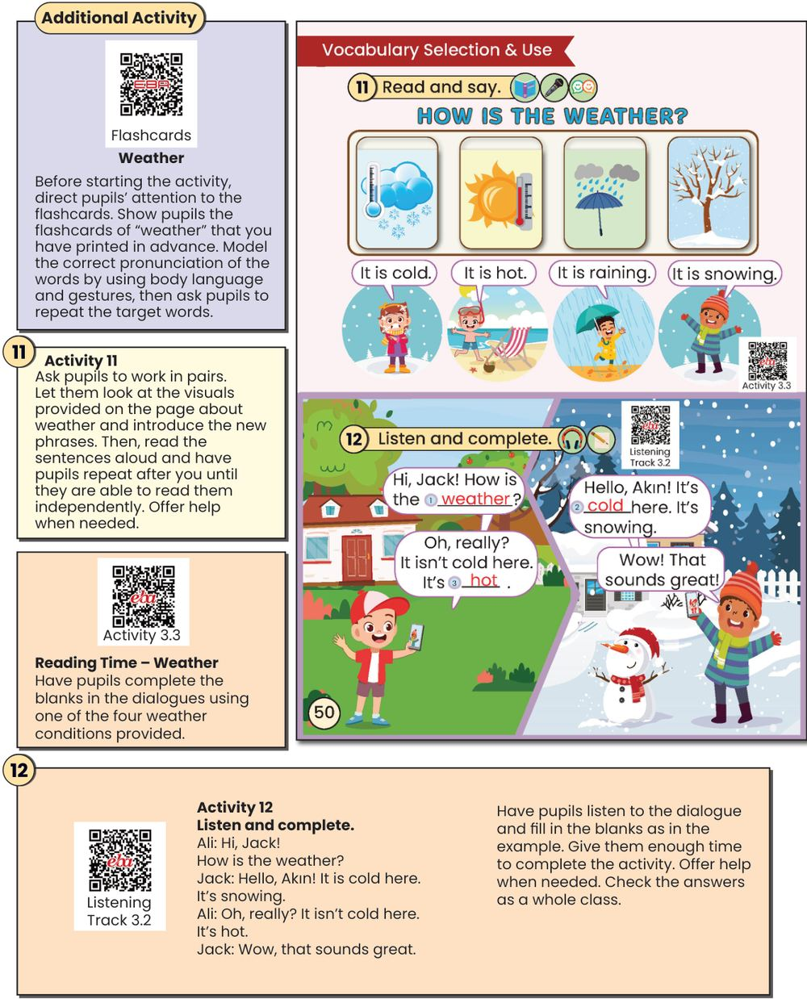

**Flashcards**
**Weather**
Before starting the activity, direct pupils’ attention to the flashcards. Show pupils the flashcards of “weather” that you have printed in advance. Model the correct pronunciation of the words by using body language and gestures, then ask pupils to repeat the target words.

---

## 11 Activity 11
Ask pupils to work in pairs. Let them look at the visuals provided on the page about weather and introduce the new phrases. Then, read the sentences aloud and have pupils repeat after you until they are able to read them independently. Offer help when needed.

**Reading Time – Weather**
Have pupils complete the blanks in the dialogues using one of the four weather conditions provided.
**Activity 3.3**

---

# Vocabulary Selection & Use

## 11 Read and say.
### HOW IS THE WEATHER?

* It is cold.
* It is hot.
* It is raining.
* It is snowing.

---

## 12 Listen and complete.

Hi, Jack! How is the ① **weather**?
Hello, Akın! It's ② **cold** here. It's snowing.
Oh, really? It isn't cold here. It's ③ **hot**.
Wow! That sounds great!

---

## 12 Activity 12
**Listen and complete.**
Ali: Hi, Jack!
How is the weather?
Jack: Hello, Akın! It is cold here.
It’s snowing.
Ali: Oh, really? It isn’t cold here.
It’s hot.
Jack: Wow, that sounds great.

Have pupils listen to the dialogue and fill in the blanks as in the example. Give them enough time to complete the activity. Offer help when needed. Check the answers as a whole class.

<!-- sayfa 50 -->

# Vocabulary Games

## 13 Read, find, and choose.

### 1
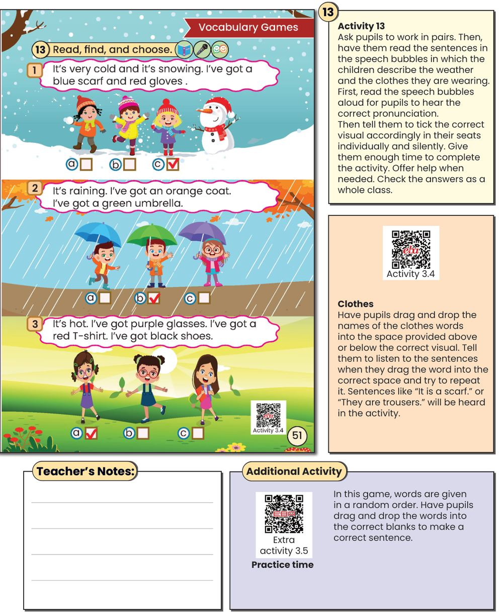
It's very cold and it's snowing. I've got a blue scarf and red gloves.

a $\square$ b $\square$ c $\checkmark$

### 2

It's raining. I've got an orange coat. I've got a green umbrella.

a $\square$ b $\checkmark$ c $\square$

### 3

It's hot. I've got purple glasses. I've got a red T-shirt. I've got black shoes.

a $\checkmark$ b $\square$ c $\square$

Activity 3.4

51

---

### 13
**Activity 13**
Ask pupils to work in pairs. Then, have them read the sentences in the speech bubbles in which the children describe the weather and the clothes they are wearing. First, read the speech bubbles aloud for pupils to hear the correct pronunciation. Then tell them to tick the correct visual accordingly in their seats individually and silently. Give them enough time to complete the activity. Offer help when needed. Check the answers as a whole class.

Activity 3.4

**Clothes**
Have pupils drag and drop the names of the clothes words into the space provided above or below the correct visual. Tell them to listen to the sentences when they drag the word into the correct space and try to repeat it. Sentences like “It is a scarf.” or “They are trousers.” will be heard in the activity.

---

**Teacher's Notes:**

---

**Additional Activity**

Extra activity 3.5
Practice time

In this game, words are given in a random order. Have pupils drag and drop the words into the correct blanks to make a correct sentence.

<!-- sayfa 51 -->

# 14

## Activity 14

Ask pupils to look at the pictures for being familiar with the story. Ask them to look at each picture on the page carefully and individually. First, read the dialogues aloud for pupils to hear the correct pronunciation. Pay attention to emphasise the target language chunks. Then encourage them to read the dialogues individually and silently. Let them work in groups. Choose volunteer pupils to act out the dialogues. Let them practise this activity as many times as they can. Offer help when needed. The target grammar chunks are given in bold in the dialogues. They are not taught as grammatical structures. Pupils are expected to grasp and learn the grammatical chunks by being exposed to them through hearing, seeing, and repeating them holistically with the dialogues. Familiarity and exposure are key points. After practising the dialogues in pairs, invite pupils to the board. Let them act out the dialogues without looking at their books. Tell pupils that they are supposed to act out only one dialogue they have chosen from the page, as trying to remember all the dialogues can be too challenging at that age.

## Teacher's Notes:

---

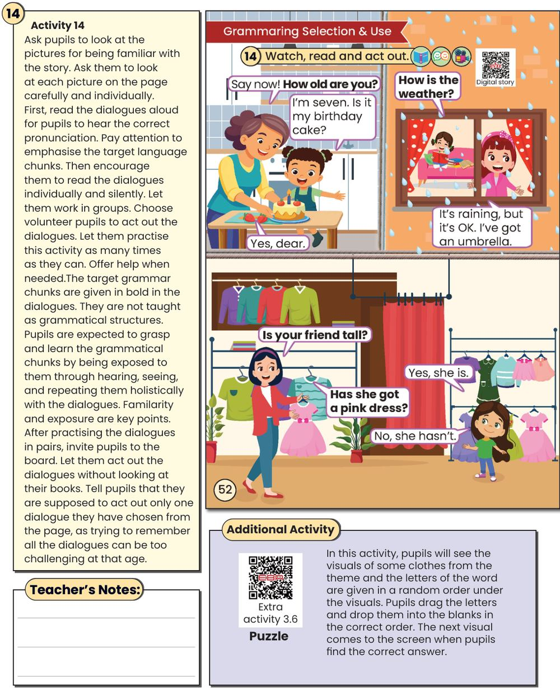

### Grammaring Selection & Use

**14 Watch, read and act out.** 

Say now! **How old are you?**
I'm seven. Is it my birthday cake?
Yes, dear.

**How is the weather?**
It's raining, but it's OK. I've got an umbrella.

**Is your friend tall?**
Yes, she is.

**Has she got a pink dress?**
No, she hasn't.

---

### Additional Activity

Extra activity 3.6
**Puzzle**

In this activity, pupils will see the visuals of some clothes from the theme and the letters of the word are given in a random order under the visuals. Pupils drag the letters and drop them into the blanks in the correct order. The next visual comes to the screen when pupils find the correct answer.

<!-- sayfa 52 -->

# Grammaring Games

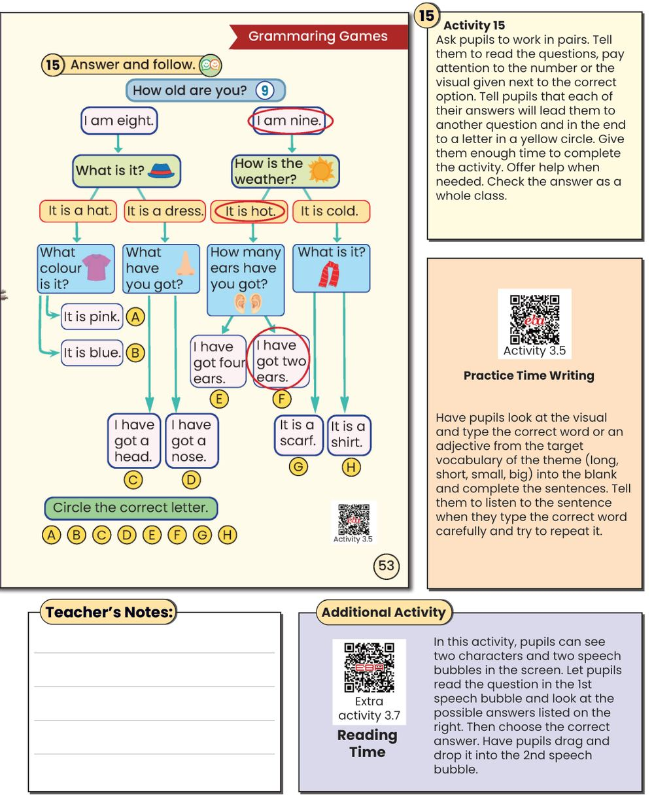

**15 Answer and follow.** 

[How old are you? 9]
- [I am eight.] $\rightarrow$ [What is it? 🎩]
    - [It is a hat.] $\rightarrow$ [What colour is it? 👚]
        - [It is pink. (A)]
        - [It is blue. (B)]
    - [It is a dress.] $\rightarrow$ [What have you got?]
        - [I have got a head. (C)]
        - [I have got a nose. (D)]
- [I am nine.] $\rightarrow$ [How is the weather? ☀️]
    - [It is hot.] $\rightarrow$ [How many ears have you got? 👂👂]
        - [I have got four ears. (E)]
        - [I have got two ears. (F)]
    - [It is cold.] $\rightarrow$ [What is it? 🧣]
        - [It is a scarf. (G)]
        - [It is a shirt. (H)]

**Circle the correct letter.**
(A) (B) (C) (D) (E) (F) (G) (H)

---

**15 Activity 15**
Ask pupils to work in pairs. Tell them to read the questions, pay attention to the number or the visual given next to the correct option. Tell pupils that each of their answers will lead them to another question and in the end to a letter in a yellow circle. Give them enough time to complete the activity. Offer help when needed. Check the answer as a whole class.

---

**Activity 3.5**

**Practice Time Writing**

Have pupils look at the visual and type the correct word or an adjective from the target vocabulary of the theme (long, short, small, big) into the blank and complete the sentences. Tell them to listen to the sentence when they type the correct word carefully and try to repeat it.

---

**Teacher’s Notes:**
__________________________________________________________________
__________________________________________________________________
__________________________________________________________________

---

**Additional Activity**

**Extra activity 3.7**
**Reading Time**

In this activity, pupils can see two characters and two speech bubbles in the screen. Let pupils read the question in the 1st speech bubble and look at the possible answers listed on the right. Then choose the correct answer. Have pupils drag and drop it into the 2nd speech bubble.

<!-- sayfa 53 -->

# 16

## Activity 16
First, read the paragraphs aloud for pupils to hear the correct pronunciation stressing the newly learnt vocabulary. Use gestures while reading the body parts and the names of clothes. Then have pupils read the passages individually and silently, find the names of the characters and write their names under the pictures. Give them enough time to complete the activity. Offer help when needed. Check the answers as a whole class. After reading individually and silently, now let the volunteers read the passages aloud to their peers.

## 17

## Activity 17
Have pupils draw their characters in the space provided. Then tell them to introduce and describe their character filling in the blanks given in the activity. Let pupils understand that it is acceptable and allow them to copy the words and phrases from the passages in the previous activity. Encourage them to share their drawing and writing with their friends. Give them enough time to complete the activity. Offer help when needed. Check the answers as a whole class.

---

# Reading-Comprehension

### 16 Read and write the names.

1. 
Lixy

2. 
Fiby

3. 
Maxy

a. Hi, I'm Maxy. I've got blond hair. I've got two eyes and four legs. My hat is black.

b. Hello! I'm Lixy. I've got long arms and short legs. I've got blue eyes. I've got small ears.

c. Hi! I'm Fiby. I've got a big body and a mouth. My hat is blue. I've got pink glasses.

### 17 Draw your character. Then complete and talk.

Hello! I'm Students'. I've got \_\_\_ own \_\_\_. I've got \_\_\_ answers \_\_\_.

54

---

### Additional Activity

Extra activity 3.8
**What have you got?**

In this activity, pupils read the dialogue and listen to it. When they finish reading, they click on the arrow and read the sentences and decide if they are true or false.

<!-- sayfa 54 -->

# Writing-Expression

**18 Look and complete.**

| | | | |
| :--- | :---: | :---: | :---: |
| **Zeynep** | ![eye icon with red cross] | ![orange coat icon] | ![dark hair icon] |
| **Defne** | ![purple dress icon] | ![blonde hair icon] | ![green eye icon] |
| **Ceylin** | ![blue trousers icon] | ![brown eye icon] | ![brown hair icon] |

1. Zeynep has got blue `eyes`.
2. Defne has got blonde `hair`.
3. Ceylin has got `brown` hair.
4. Defne has got a purple `dress`.
5. Zeynep has got a `orange` coat.
6. Ceylin has got blue `trousers`.

---

**18 Activity 18**

Ask pupils to look at the visuals in the chart, and complete them using the information provided in the chart. Give them enough time to complete the activity. Offer help when needed. Check the answers as a whole class.

**Game**
**This is Terry**
In this game a character called Terry is introduced. He describes his physical appearance and clothes. Tell pupils to drag the correct options provided and drop it onto Terry’s body. Inform pupils that if the item they choose is correct, it will fit onto his body perfectly and if it is not, they will hear the sentence “No, I haven’t.”

---

**Additional Activity**

**Body Parts**

**Let’s Listen**
Let pupils listen to the song.
**Let’s Practise**
Let pupils practise singing the song.
**Let’s Sing**
Let pupils sing the song together.

Head head, touch your head
Arm arm, move your arm
Leg leg, stamp your leg
Hand hand, clap your hand
Nose nose, show your nose
Mouth mouth, open your mouth
Ear ear, point to your ear
Hair hair, comb your hair

Extra activity 3.9
**Song**

<!-- sayfa 55 -->

# Strip Story

**Teacher’s Note:** Remind pupils to bring a puppet or a toy to the class the day before they read the strip story. Let them act out the strip story by using their toy or puppet.

---

**19**

**Activity 19**
**Picture Strip Story for Consolidation**

After controlled practice sessions, at this stage have pupils practise the target vocabulary and chunks in this picture strip story. This will be an opportunity for them to consolidate and use the target words and language chunks about the concept of personal life in a fun, enjoyable, and versatile way. First, read the strip story aloud for pupils to hear the correct pronunciation. Then encourage them to read individually and silently. Ask pupils to work in groups. Choose pupils to act out the story and read the dialogues to the class. Let them practise the dialogues as many times as possible. Offer help for pronunciation, vocabulary, etc. when needed. As an additional activity, let pupils act out the dialogues by using their own names with their peers.

---

**19 Read and act out.**

1.
OK, kids! What day is it today?
It’s Monday today. It’s our puppet day.
Right! Let’s see your puppets.

2.
This is Minky. She’s 7. She’s got big green eyes.

3.
It is your turn, Daisy. Show us your puppet.
His name is Bob. He’s got short brown hair.

56

---

**Teacher’s Notes:**
__________________________________________________________________
__________________________________________________________________
__________________________________________________________________
__________________________________________________________________
__________________________________________________________________

<!-- sayfa 56 -->

4
Dolly has got long blonde hair. She's got a purple T-shirt.

5
Tim has got a yellow coat and a red scarf. It's very cold.

6
Well done, kids! Great job! Now, it is break time. See you next week.

Activity 3.6

Activity 3.6
Strip Story Activities

Activity 1.
Let pupils read the strip story again, read the sentences, and decide if they are true or false according to the story. Tell them to click on "√" if the sentence is true, and on "X" if it is false.

Activity 2.
Let pupils listen to the recording describing the children's clothes and click on the correct child.

Teacher's Notes:

<!-- sayfa 57 -->

# 20
## Activity 20
## Theme Project
Let pupils cut out one of the puppets on pages 113 and 115. Tell them to use their puppet to talk to their friends by using target words and chunks of the theme. Ask them to give feedback on each others’ work. Give pupils enough time to prepare for the task. Offer help when needed.

# 21

## Activity 21
Ask pupils to work in groups. Let them answer the questions in each box. Tell them that they cannot move to the next box unless they make a correct sentence. The aim of the game is to reach the finish point. Let them give answers like; “ It’s Monday today.” ,“ I’m eight years old. ” etc. Monitor them and give feedback. Give them enough time to complete the activity. Offer help when needed. Play the game as many rounds as time allows. The target grammar chunks and words will be revised in other themes as well.

***

# Projects

## 20
Go to pages 113 and 115. Cut out the two puppets. Use the puppets and talk.

## 21
Let's play together. 

START
1. What day is it today?
It is ........ today.
Keep Going
2. How old are you?
I'm ........ years old.
3. What is it?
It's a hand.
4. Is it your birthday today?
Yes, it is. / No, it isn't.
Well Done
5. What is it?
It's an ear.
6. What is it?
It's a T-shirt.
Great Job
7. How many eyes have you got?
I've got two eyes.
8. How is the weather?
It's raining.
9. What colour is it?
It's orange.
10. What have you got?
I've got glasses.
11. Is this a leg?
No, it isn't.
FINISH

***

# WHAT ABOUT YOU? Read and Colour.

| Parts of the body | Clothes | Days of the week | Weather |
| :---: | :---: | :---: | :---: |
|  |  |  |  |

 Consolidation

***

# What About You?
## Self-Assessment
Before starting the activity, make sure that pupils understand how to reflect on their self evaluation. Let pupils choose one of the emotions that matches with how they feel about the given subtopic from the theme and colour it.

# 58

***

# Consolidation
The consolidation part consists of three different activities that enable pupils to revise the words and language chunks learnt in Theme 3. The second and the third activities are locked and they will get unlocked when pupils complete the previous activity.

Consolidation

<!-- sayfa 58 -->

# Theme 4
# FAMILY LIFE

**Summary:**
**Language Chunks**

Asking and identifying people
• Who is he? Who is she?
- He’s/is my father.
- She’s/is my mother.
*Describing physical features*
• What colour eyes has your mother got?
- My mother’s/has got blue eyes.
- She’s/has got blue eyes.

---

**TEACHERS’ NOTE:**
This rubric is designed to assess pupils’ listening, speaking, reading, writing, vocabulary, grammar and pronunciation skills within the theme. Assessment is based on observable classroom performance during regular activities. Pupils are evaluated according to four performance levels (Excellent, Good, Needs Improvement, Inadequate) using clear descriptors. Teachers are advised to use the rubric throughout the unit as a formative assessment tool and record progress based on pupils’ natural use of language in context rather

---

**Warm-Up Activity:**
**“Find Someone Who Game”**

Let pupils engage in this activity so that they can feel relaxed and motivated before starting the theme. It is an interactive board game. Invite one pupil to the board. Tell him/her press on the “START” button. Have the pupil choose a question card. Ask the pupil to read the card aloud and find a classmate who fits the description. Then, have that pupil to write his/ her friend’s name in the given box.

<!-- sayfa 59 -->

# Establishing Links
Help pupils understand the topic of the theme in general by showing them a picture of a family or pictures of family members.

Ask simple questions containing words that pupils are already familiar with in their mother tongue like “Mother?, Father? or A family?”. Practise the words “Yes” and “No” with mimics and gestures, and let pupils respond by using them. As the unit continues, all the pieces will gradually come together in their minds.

---

# Listening & Watching

1) Look at the picture. Where are they?
They are in the school garden.

2) Watch the digital story.

---

1
**Activity 1**
First, practise the question “Where?” with mimics and gestures so that pupils can understand it is used for places. Then ask pupils to look at the pictures on page (pages 60–61). Do not expect a full sentence as an answer. This is just a practice for the question word “Where?”.

2
**Activity 2**
Let pupils watch the digital story, or alternatively bring a picture of a very famous and popular family. Let the pupils watch it without any pause first. Ask the pupils read the whole digital story in chorus. While they are watching for the second time, pause when needed and repeat the phrases you want to emphasise by showing, corresponding family members and family members’ physical appearance/features in the picture you have brought into the classroom. Ask the pupils to act out the parts of the digital story after watching.

---

**Video Script**
**FAMILY LIFE**

**Ceylin:** Hi, Çınar! Wow! Nice hat! You look great.
**Çınar:** Thanks, Ceylin.
**Ceylin:** What about me? Look at my purple T-shirt!
**Çınar:** You look so beautiful.
**Ceylin:** Look, Çınar! This is my family.
**Ceylin:** Mum, this is my friend, Çınar.

<!-- sayfa 60 -->

**Ceylin’s mum:** Hello, Çınar!
**Çınar:** Hello, Mrs Kılıç!
**Çınar:** This is my mother, Nisa. This is my father, Ozan, and this is my sister, Beyza.
**Çınar:** Ceylin, who is he?
**Ceylin:** He is my grandfather. His name is Ahmet.
**Çınar:** He looks very handsome with his brown glasses.
**Ceylin:** Hey, grandpa! This is my friend, Çınar.
**Ahmet:** Hi, Çınar! Nice to meet you.
**Çınar:** Nice to meet you, too.

**Ceylin:** Ouch! What is this?
**Deniz:** I’m sorry, Ceylin.
**Ceylin:** It’s all right, Deniz.
**Deniz:** Let’s play together!
**Çınar:** Hey! Come here! Look at this!
**Çınar:** It is a baby. It has got a very small body.
**Ceylin:** Oh yes! It is so lovely! It’s got short legs.
**Çınar:** Where is its family?
**Ceylin:** Look, over there!
**Çınar:** I think she is the mother.
**Deniz:** How nice! The puppy has got a family. It has got a mother, a father, a brother, and a sister. They are so nice together.

**Grandmother:** Hey, kids! It’s lunchtime. Come here, please!
**Çınar:** Is she your grandmother, Ceylin?
**Ceylin:** Yes, she is. Her name’s Ayşe. I’m hungry, Çınar. Let’s go and have our lunch.

# I LOVE MY FAMILY

This is my father.
He is so nice.
Yes, he is. Yes, he is.

This is my mother.
She is blonde.
Yes, she is. Yes, she is.

This is my brother.
He is short.
Yes, he is. Yes, he is.

This is my sister.
She is tall.
Yes, she is. Yes, she is.

<!-- sayfa 61 -->

# Additional Activity

**Preparation for the activity**
This time while watching, pause the video when a target word or a phrase is heard and show pupils the Flashcards of family members and their physical appearance that you have printed in advance. The aim of this activity is to make the students be familiar with the main categories and the words. They are not expected to learn the meanings yet. Bring two boxes to class and write “Family Members”, “Physical Appearance” on them. Place a visual under each heading so that pupils can understand what the words mean. Let pupils decide which them goes into which box.

Extra activity 4.1

---

### 3
Have pupils watch the digital story again and ask them to answer the question and choose the correct picture that shows how the weather is on the family picnic day. Use your mimics and gestures to help students understand the task.

### 4
Direct pupils’ attention to the pictures on the double spread page. Guide them with very simple questions words (What....?) with mimics and gestures to understand connections with the photos, the video, and the topic of the theme. Ask pupils to find who is missing.

### 5
Have pupils watch the digital story again to complete the statements with the correct words. Help them catch the information they need and give them enough time to copy the

---

# Listening/Watching-Comprehension

### 3 Watch and [check icon] [video icon]
## HOW IS THE WEATHER?

* It is cold.
* It is hot.
* It is raining.

### 4 Look at pages 60–61 and [check icon] Who is missing?
1. 
   - [ ] father
   - [x] mother
   - [ ] son

2. 
   - [ ] grandfather
   - [ ] daughter
   - [x] grandmother

3. 
   - [x] father
   - [ ] brother
   - [ ] sister

### 5 Watch and complete. [video icon]

a.  This is my **mother**, Nisa.
b.  Beyza is my **sister**.
c.  He is my **grandfather**. His name is Ahmet.

62

---

### My Family
Have pupils click on the button, listen to the names of family members and target adjectives that take place in this theme. Once they have listened the words and phrases one by one, tell them to click on the headphones icon, listen to the each word individually and repeat it. This activity finishes when pupils listen and repeat all the words.

Activity 4.1

<!-- sayfa 62 -->

# Speaking-Expression

6 Let's play together.
Grandfather... Hmm daughter.
Yes, I've got a grandfather.

---

# Speaking & Pronunciation

7 Listen and repeat together.

ALPHABET

K - a kid
L - listen
M - a mum
N - nine
O - a mother, an orange, a lemon, old, one, two, four
P - a pencil

One orange owl opens the old oven.

(63)

---

# 6

**Teacher's Reminder**
**Activity 6**
**“The Bingo Game”**
This game is called “Bingo”.

Ask pupils to work in pairs and prepare their own bingo cards. Tell them to divide a piece of paper into four and write a family member in each square. Give them enough time to complete the task. Offer help when needed. When pupils are ready, call out the names of family members randomly. The first pupil who crosses out all the four members in his/her card wins the game. Play the game as many rounds as time allows.

---

# 7

Listening Track 4.1

**Activity 7**
Ask pupils to listen to the track and repeat together as a whole class many times until all pupils feel comfortable. Have them repeat in smaller groups and finally as volunteer individuals.

**K:** a kid
**L:** listen
**M:** a mum
**N:** nine
**O:** a mother, an orange, a lemon, old, one, two, four
**P:** a pencil

**Tongue Twister:** One orange owl opens the old oven.

Ask pupils to listen and repeat the tongue twister as a whole class, then in smaller groups and as individuals. Join them and give positive feedback with gestures or body language.

---

# Additional Activity

Extra activity 4.2
**Flashcards (Scenes from the Digital Story)**

Bring the pictures showing different scenes from the digital story to class. Stick the pictures randomly on the board and ask the pupils to put them into the correct order. This activity helps pupils remember the correct sequences in which the events took place in the digital story. This activity is for helping pupils to remember the story and be familiar with the content.

<!-- sayfa 63 -->

# 8

## Activity 8
In this activity, pupils practise the target vocabulary in an efficient and meaningful way in context. Ask pupils to look at the each picture carefully. Then, let them read the words in Activity 8. Have them watch the digital story again and copy the words under the correct pictures on the given family tree. Give them enough time to complete the activity. When all activities finish, let the pupils look at the pictures again and say the words individually in their seats.

## Additional Activity
### Turn Around Game
In this game, let the pupils practise target vocabulary in efficient way. Ask pupils to work in groups. Play the game as many rounds as time allows.

**Materials:**
* Flashcards of family members that you have printed in advance.

**Instructions:**
* Call eight pupils to the board.
* Give each pupil one flashcard.
* Have them stand in line.
* Ask pupils to step forward and spin or turn around in place.
* Call out one word as in the example below;

Baby! Where's baby?
Turn around, baby!

* Continue the game with other pupils in the classroom.

**Tip:** Encourage all pupils feel comfortable playing the game and following the instructions actively.

---

# Vocabulary Selection & Use

## 8 Watch, complete, and talk. 

### THE KILIÇ FAMILY

**Teacher's Notes:**
__________________________________________________________________
__________________________________________________________________
__________________________________________________________________
__________________________________________________________________

<!-- sayfa 64 -->

# Vocabulary Games

## 9 Let's reorder and write.

1 M O T H E R
2 B R O T H E R
3 G R A N D F A T H E R
4 S I S T E R
5 B A B Y
6 G R A N D M O T H E R

 Activity 4.2

65

---

**9**

**Activity 9** Have pupils to look at the pictures individually and try to remember what they are. Have pupils reorder the letters according to the pictures. Give them enough time to complete the activity. Offer help when needed. Check the answers as a whole class. Let pupils look at the pictures and say the words to practise the target vocabulary.

---

Activity 4.2

**Activity 4.2**
**Practice Time**
In this activity, pupils choose one of the given words for the visuals. When they choose the correct words, they hear the full form of the statements.
“He is a grandfather.”
“He is a baby.”
“She is a daughter.”
“She is a sister.” etc.

If the pupils’ answers are not correct, the system gives feedback such as;
“No, he isn’t.”
“No, she isn’t.”
The activity cannot be completed unless all the answers are given correctly. At the end of the activity, there is a “REPLAY” button, so that pupils can do the activity again to revise the target grammar chunks and words in Theme 4.

---

**Teacher's Notes:**
__________________________________________________________________
__________________________________________________________________
__________________________________________________________________
__________________________________________________________________

<!-- sayfa 65 -->

# 10

**Activity 10**
Have pupils look at the family tree and then complete them. Ask them to work in pairs. Give them enough time. Offer help when needed. Check the answers as a whole class.

# 11

**Activity 11**
Have pupils find and circle 5 words in the word search puzzle. Give them enough time to complete the activity. Ask them to work in pairs. Offer help when needed. Check the answers as a whole class.

**Teacher's Notes:**
__________________________________________________________________
__________________________________________________________________
__________________________________________________________________
__________________________________________________________________
__________________________________________________________________

---

# Vocabulary Selection & Use

## 10 Look and complete.

1. Zeynep is Can's [mother]
2. Kenan is Sarp's [grandfather]
3. Can is Zeynep's [son]
4. Ceylin is Defne's [daughter]
5. Elif is Sarp's [sister]
6. Sarp is Ceylin's [brother]

## 11 Find 5 words, circle, and say.

(66)

---

# Additional Activity

**Extra activity 4.3**
**Family Cube Game**

In this game, let pupils practise target vocabulary in an efficient way. Ask them to work in groups. Play the game as many rounds as time allows.

**Materials:**
• A family member's cube.
• Scissors and glue to make the...

**Instructions:**
• Cut out the given page and make a cube (alternatively prepare more cubes to play with groups).
• Each number represents a family member.
1-Mother
2-Father
3-Sister
4-Brother
5-Grandmother
• A pupil rolls the cube and says the family member's name loudly.
• Continue the game with other pupils in the classroom.

**Tip:**
• Pupils can make a short sentence about that family member. e.g. "My mother is beautiful."
• Encourage pupils to say the...

<!-- sayfa 66 -->

# Vocabulary Games

## 12 Follow the way and complete. 

| My mum has got ① green eyes and ② blonde hair. | She's my mother. She's got long ③ black hair. | My mother has got ④ blue eyes. She's got brown hair. |
| :--- | :--- | :--- |

Activity 4.3 

67

---

## 12

### Activity 12
Have pupils follow the lines to fill in the blanks according to the pictures. Give them enough time to complete the activity. Offer help when needed. Check the answers as a whole class.

### Activity 4.3
**Speaking Time**
Have pupils spin the wheel, then stop and say a sentence about each family member using the given key words (e.g. Elroy has got short hair). Tell them to check their answers and repeat them. When pupils click the headphone icon, they can listen to the sentences again. Let pupils repeat the target structures individually. Ask pupils to do this activity as many rounds as time allows.

Activity 4.3

---

**Teacher's Notes:**
__________________________________________________________________
__________________________________________________________________
__________________________________________________________________
__________________________________________________________________

<!-- sayfa 67 -->

# 13

## Activity 13
Ask pupils to look at the pictures for being familiar with the story. Ask them to look at each picture on the page carefully and individually. First, read the dialogues aloud for pupils to hear the correct pronunciation. Make sure to emphasise the target language chunks. Then encourage them to read in their seats individually and silently. Let them work in groups. Choose volunteer pupils to act out. Let them practise this activity as many times as they can. Offer help when needed. Target grammar chunks are given in bold in speeches. They are not taught as grammatical structures. Pupils are expected to grasp and learn the grammatical chunks by being exposed to them through hearing, seeing, and repeating them holistically. Familiarity and exposure are key points. After practising the dialogues in pairs, invite volunteer pupils to the board. Let them act out the dialogues using their books. Tell pupils that they are supposed to act out only one dialogue they have choosen from the page, as trying to remember all the dialogues can be too challenging for at that age.

Grammaring Selection & Use

13 Watch, read and act out.
Digital story

Hi, Elif! **Who is he?**
He's my brother.

Hi! I'm Jack.
Hello! I'm Ahmet.

Oh! It's nice to see you here.

**Who are they, grandma?**

They're my friends, honey.

68

## Additional Activity

| SONG TIME I LOVE MY FAMILY | | |
| :--- | :--- | :--- |
| This is my father, He is so kind. Yes, he is. Yes, he is.  This is my mother, She is blonde. Yes, she is. Yes, she is.  This is my brother | Yes, he is. Yes, he is.  This is my sister, She is tall. Yes, she is. Yes, she is.  This is my father, He is so kind. I love my family.  This is my mother I love my family. | This is my brother, He is short. I love my family.  **Let's Listen.** Let pupils listen to the song. **Let's Practise.** Let pupils practise singing the song. **Let's Sing.** Let pupils sing the |

Extra activity 4.4

<!-- sayfa 68 -->

# Grammaring Games

## 14 Let's play together.

Who is Ela?
She's Çınar's sister.
She's Emel's daughter.

Okan
Sevim
Çınar
Ela
Emel
Rıza
Deren

69

---

### 14 Teacher's Reminder
**Activity 14**
**“Who is she/he? Game”**
This game is called “ Who is he/she?” Let pupils look at the family picture, choose, and point to a member of the family. He/she asks “Who is he/she?” Ask pupils to work in pairs. His/ her pair answers the question by looking at the picture given on the page. The answer will be like: “She is Çınar’s sister.”

---

### Additional Activity

Extra activity 4.5

**Family Battleship Game**
In this game, let pupils practise target vocabulary and structures in an efficient way. Ask pupils to work in pairs.

**Materials:**
* A game page for each pupil.

**Instructions:**
* (In secret) Ask pupils to draw five boats anywhere in the grid, one in each column.
* Each boat should fit in one square.
* Ask pupils to sit opposite each other and take turns trying to guess the location of their peers’ boats.
* Ask pupils to use the key words “ mother, father, brother, sister, grandmother, grandfather”, “possessive ‘s’ “ and “Yes/ No Questions”. (Is Tina Andy’s mother? etc.)
* The pupil who guesses all five boats will be the winner.

---

### Teacher's Notes:
__________________________________________________________________
__________________________________________________________________
__________________________________________________________________
__________________________________________________________________
__________________________________________________________________

<!-- sayfa 69 -->

# Reading-Comprehension

## 15 Read and match.

1. Hello! I'm Elif. This is my family. My dad is tall and handsome. I've got a brother. My mum has got long brown hair. My grandpa has got black glasses.

2. Hi! I'm Hakan. I've got a lovely family. I've got a baby brother and a sister. My grandma has got big green eyes. My mother is very beautiful.

a

b

## 16 Read again. Put a $\checkmark$ or $\times$.

1. Elif has got a brother. $\checkmark$
2. Elif's mother has got short brown hair. $\times$
3. Hakan has got a sister. $\checkmark$
4. Hakan's grandma has got big green eyes. $\checkmark$
5. Elif's grandpa has got black glasses. $\checkmark$

---

**15**
**Activity 15**
Have pupils read the passages and match them with the correct pictures. Give them enough time to complete the activity. Offer help when needed. Check the answers as a whole class.

**16**
**Activity 16**
Have pupils read the passages again. Ask them to put a tick or a cross for the sentences according to the given information about the family members above. Give them enough time to complete the activity. Offer help when needed. Check the answers as a whole class.

**Activity 4.4**
**Family Album**
Let pupils choose the correct bubbles for the given visuals. The activity cannot be completed unless all the answers are given correctly. If the pupils' answers are not correct, they hear a sound revealing that their answer is incorrect. At the end of the activity, there is a "RESTART" button, so that the pupils can do the activity again to revise the target grammar chunks and words in Theme 4.

Activity 4.4

**70**

**Teacher's Notes:**
__________________________________________________________________
__________________________________________________________________
__________________________________________________________________

<!-- sayfa 70 -->

# Writing-Expression

## 17 Look and complete. 

father
sisters
handsome
family
hair
grandma

Hi! I'm Mehmet. I'm with my ① family. I've got two ② sister. My ③ grandma has got glasses. My ④ father is tall and ⑤ handsome. My mum has got brown ⑥ hair.

## 18 Draw your family and write. 

71

---

### 17
**Activity 17**
Have pupils look at the picture and write the words into the correct blanks to complete the activity. Ask pupils to work in pairs. Give them enough time to complete the activity. Offer help when needed. Check the answers as a whole class.

### 18
**Activity 18**
Have pupils draw a picture of their family in the space provided. Then ask pupils to describe their family according to their pictures. Give them enough time to complete the activity. Offer help when needed. Encourage them to share their drawings and descriptions with their friends.

---

**Teacher's Notes:**
___________________________________________________________________________
___________________________________________________________________________
___________________________________________________________________________
___________________________________________________________________________

<!-- sayfa 71 -->

# 19

## Activity 19
### Picture Strip Story for Consolidation
After controlled practice sessions, at this stage have pupils practise the target vocabulary and chunks in this picture strip story. This will be an opportunity for them to consolidate and use the target words and language chunks about the concept of family life in a fun, enjoyable and versatile way. First, read the strip story aloud for pupils to hear the correct pronunciation. Then encourage them to read individually and silently. Ask pupils to work in groups. Choose pupils to act out the story in their seats and read the dialogues to the class. Let them practise the dialogues as much as possible. Offer help for pronunciation, vocabulary, etc. when needed. As an additional activity, let pupils act out the dialogues using their own names with their peers.

---

**Strip Story**

**19) Read and act out.**

**1**
- What is this, Grandpa?
- It is our photo album. Come and sit, honey.

**2**
- Who is she, Grandpa?
- She is your grandmother.
- She's beautiful.

**3**
- Look at this photo. What about me?
- You're very handsome.

72

---

**Teacher's Notes:**
__________________________________________________________________
__________________________________________________________________
__________________________________________________________________
__________________________________________________________________
__________________________________________________________________

<!-- sayfa 72 -->

(4)
Is this my father?
No, he isn't. He is my brother, Tim.

(5)
Who is this baby?
She is my daughter.
Oh, that's my mum.

(6)
Hey, Grandma! Look at my mother!
Yes, my dear. She is very nice.
We have got a lovely family.

(73)

---

Activity 4.5
**Strip Story Activities**

In this activity, have pupils choose the appropriate answers to the “Wh- questions” and “Yes/No questions” that they are familiar with from Theme 4. If their answers are not correct, pupils hear a sound revealing that their answer is incorrect. This activity cannot be completed unless all the answers are given correctly. At the end of the activity, there is a “RESTART” button, pupils can do the activity again to revise the target grammar chunks and words in the strip story.

---

**Teacher’s Notes:**
__________________________________________________________________
__________________________________________________________________
__________________________________________________________________
__________________________________________________________________
__________________________________________________________________

<!-- sayfa 73 -->

# 20

## Activity 20
## Theme Project

Have pupils cut out the family tree on page 117, draw their family members into the frames. Ask pupils to talk about the people in their family by using target chunks and words. Ask pupils to give feedback on each other’s work. Give pupils enough time to prepare for the given task.

## 21

## Activity 21

Ask pupils to match the questions with their answers. Target grammar chunks and words will be revised in other themes as well. Give them enough time to complete the activity. Offer help when needed. Check the answers with the class.

***

## What About You? (Self-Assessment)

Before starting the activity, make sure that pupils understand how to reflect on their self evaluation. Let pupils choose one of the emotions that matches how they feel about the given subtopic and colour it.

***

# Projects

## 20
Go to page 117. Cut the family tree. Draw your family members and talk about them.

## 21
Find and match.

| Soru | Cevap |
| :--- | :--- |
| 1. Who is she? | d. She is my sister. |
| 2. Who is he? | a. He is my father. |
| 3. Who is she? | e. She is my grandmother. |
| 4. Who is he? | c. He is my brother. |
| 5. Who is she? | b. She is my mother. |
| 6. Who is he? | f. He is my grandfather. |

***

# WHAT ABOUT YOU? Read and Colour.

| Family Members | Physical Appearance |
| :---: | :---: |
|  |  |

Consolidation

***

# 74

Consolidation

## Consolidation

The consolidation part consists of five different activities that enable pupils to revise the words and language chunks learnt in Theme 4.

<!-- sayfa 74 -->

# Theme 5
# HOMES & HOUSES & NEIGHBOURHOODS

75

## Summary:
### Greetings
• Good morning! Hello! Hi!..
• How are you? I’m fine, thanks! And you?
### Asking what things and places are
• What’s/is it/this?
– It’s/is a/an...
### Introductions, asking and telling names
• What’s your name?
– I’m/am...
– My name is...
### Giving commands, making requests andgiving instructions or directions
• Come here, please.
### Asking and answering days of the week
• What day of the week is it?
• What day is it today?
– It’s/is Monday today.
### Introductions and telling names
• Who’s she/he?
– She’s Mrs Aras.
– He is my English teacher.
– This is Mr/Mrs/Miss Hopkin.
– She/He is a teacher/ headmaster...etc.
• Where is she?
– She is in the garden

---

**TEACHERS’ NOTE:**
This rubric is designed to assess pupils’ listening, speaking, reading, writing, vocabulary, grammar and pronunciation skills within the theme. Assessment is based on observable classroom performance during regular activities. Pupils are evaluated according to four performance levels (Excellent, Good, Needs Improvement, Inadequate) using clear descriptors. Teachers are advised to use the rubric throughout the unit as a formative assessment tool and record progress based on pupils’ natural use of language in context rather

---

## Warm-Up Activity:
“Who is This?”
Choose a volunteer pupil and take him/her to the board. Blindfold the pupil. Tell the rest of the class to choose a word that they learnt in the previous themes. Choose a pupil, have he/she come near the blindfolded pupil and say the chosen word aloud. Have the blindfolded pupil try to recognise the voice and guess his/her friend’s name.

<!-- sayfa 75 -->

# Establishing Links
Help pupils understand the topic of the theme in general and show them a picture of a school. Ask simple questions using familiar words in their mother tongue like “ In the school or in the garden?” Let them nod their heads to say “Yes” or “No” after practising the words “Yes” or “No” by using mimics and gestures. As the theme continues, all the pieces will gradually come together in their minds.

---

# Listening & Watching

1. Look at the picture. Where are they?
   They are in the garden.
   

2. Watch the digital story.
   

---

# 1
## Activity 1
First, practise the question “Where?” with mimics and gestures so that the pupils can understand it is used for places. Then ask them to look at the pictures on pages 76-77. Do not expect a full sentence for their answers. This is just a practice for the question word “Where?”

---

# 2
## Activity 2
Let pupils watch the digital story, or alternatively bring a model of a house. Let the pupils watch it without any pauses first. Ask the pupils read the whole digital story in chorus. While they are watching for the second time, pause when needed and repeat the phrases you want to emphasise while pointing to the corresponding parts of the house in the story or on the model you have brought the classroom. Ask the pupils to act out the parts of the digital story after watching.

---

**Video Script**
**THEME 5**
**HOMES & HOUSES & NEIGHBOURHOODS**

**Neşe:** Hi, Tuğçe!
**Tuğçe:** Hi, Neşe! Come in, please!
**Neşe:** Wow, Tuğçe! Your house is very big and nice.
**Tuğçe:** Thank you. Let’s go to my bedroom.
**Tuğçe:** Look, Neşe! I’ve got a new dollhouse. Come and see!
**Neşe:** OK. I’m coming! Oh, there is a doorbell here! Where

<!-- sayfa 76 -->

**Neşe:** Come on, Tuğçe. Let’s go!
**Neşe:** What is this?
**Tuğçe:** Neşe, open the door.
**Neşe:** Here’s the bathroom.
**Tuğçe:** Is there a pet in the bathroom?
**Neşe:** No, there isn’t a pet in the bathroom.
**Tuğçe:** Look, Neşe! Here is the kitchen.
**Neşe:** Come here, Tuğçe. There’s a dog here.
**Tuğçe:** Oh! You’re a cute dog! Good boy! Give me your paw!
**Tuğçe:** Hold on, Neşe! There’s a balcony here.
**Neşe:** Look at the bird!
**Tuğçe:** Where is it?
**Neşe:** It is in the tree.
**Tuğçe:** Wow! It has got a pink beak. That looks amazing!
**Neşe:** Hey, listen to the music!
**Tuğçe:** Let’s look around.
**Neşe:** There are three rabbits in the garden. Come on, Tuğçe! They’re dancing!
**Tuğçe:** Really? They are so cute. They’ve got funny tails.

**My Sweet Home**
This is my home,
Come and see,
A bed, a sofa,
Just for me.

The kitchen is nice,
The garden is big,
Here’s a balcony,
And a swing on it.

My dog has a tail,
My cat has claws,
The bird can sing,
My pets have got paws.

Come to my house,
It’s so fun here,
My home is great,
In a small town near.

---

are we?
**Tuğçe:** Oh! We are in my dollhouse.
**Neşe:** Really?
**Tuğçe:** Here’s a sitting room. Look at the red sofa! There are two cats on the sofa.
**Neşe:** Shh! Be quiet! The cats have got very long whiskers and big claws.
**Tuğçe:** Neşe, where are you? I’m in the dining room. Come here, please!
**Neşe:** Oh! There is a goldfish on the coffee table.
**Tuğçe:** Well, it’s beautiful!

<!-- sayfa 77 -->

# Additional Activity

**Preparation for the activity**
This time while watching, pause the video when a target word or a phrase is heard and show the pupils the flashcards of parts, rooms, and furniture in the house that you have printed in advance. The aim of this activity to make the students be familiar with the main categories and the words. They are not expected to learn the meanings yet. Bring two boxes to class, write “Parts in the house” on one and “Furniture in the house” on the other. Place relevant visuals under each heading to help pupils understand the meaning of the words. Let pupils decide which flashcard goes into which box.

**Flashcards**
Extra activity 5.1

---

### 3 Activity 3
Let pupils watch the digital story again and ask them to choose the correct picture that shows what the story is about. Use your mimics and gestures to help students understand the task. Check the answers as a whole class.

### 4 Activity 4
Direct pupils’ attention to the pictures on the double spread page. Give them a moment to look at them. Guide them with very simple questions words ( What. . . . ?) with mimics and gestures to understand the connections with the photos, the video, and the topic of the theme. Ask pupils look at the double spread page (pages 76-77) and choose the places that they see in the picture by giving the first example. They can work in pairs while choosing the words. Help them check their answers by letting them watch th

---

# Listening/Watching-Comprehension

### 3 Watch and [✓] [🎧]

(a)  [ ]
(b)  [✓]
(c)  [ ]

Digital story 

### 4 Look at pages 76-77 and write numbers. [✏️]
1. ~~a sitting room~~
2. a dining room
3. a kitchen
4. a bathroom
5. a bedroom
6. a balcony

### 5 Watch, match, and talk. [🎧] [🗣️]
Where are they?

 (a)
 (b)
 (c)
 (d)

1. a kitchen (c)
2. a dining room (b)
3. a sitting room (a)
4. a garden (d)

Digital story 

e.g.
 Where is the cat?
 It's in the sitting room.

Activity 5.1 

78

---

### 5 Activity 5
Let pupils watch the digital story again to match the pets with the places they appear in. Pause when necessary so that pupils can catch the information they need and copy the words. Give them enough time to complete the task. Check the answers as a h l

### Activity 5. 1 My House
Have the pupils click on the headphone item, listen to the names of the parts, rooms, furniture in the house and repeat the words they

Activity 5. 1

<!-- sayfa 78 -->

# Speaking-Expression

**6 Let's play together.**
23 April National Sovereignty and Children's Day

Where is the sofa?
It's in the sitting room.

a sofa | a dog | a bed | a chair | a cat
a goldfish | a table | a coffee table | a bird

---

# Speaking & Pronunciation

**7 Listen and repeat together.**

### ALPHABET

**Q** - a question
**R** - a rabbit, a library, a cucumber
**S** - scissors
**T** - a teacher
**U** - a uniform, a pupil, an umbrella
**V** - seven

There are seven quiet rabbits.

79

---

## 6

**Teacher's Reminder**
**Activity 6**
**“Where is ……….. ?”**
Have pupils choose one word from the words given in exercise 6 on page 77. Invite a volunteer student to the board. Have the pupil ask where the word he/she has chosen is. E.g., “Where is the cat?” Choose a volunteer student to answer the question. The game continues until all the words are asked and answered.

---

## 7

**Activity 7**
Ask pupils to listen to the track and repeat together as a whole class many times until all pupils feel comfortable. Then have them repeat in smaller groups and finally as volunteer individuals.

**Q:** a question
**R:** a rabbit, a library, a cucumber
**S:** scissors
**T:** a teacher
**U:** a uniform, a pupil, an umbrella
**V:** seven

**Tongue Twister:** There are seven quite rabbits.

Ask pupils to listen and repeat the tongue twisters as a whole class then in smaller groups and as individuals. Join them and give positive feedback with gestures or body language.

---

## Additional Activity

**Extra activity 5. 2**
**Flashcards**
**Scenes from the Digital Story**

Bring the pictures showing different scenes from the digital story to the class. Stick the pictures randomly on the board and ask the pupils to put them into the correct order. This activity helps pupils remember the correct sequence of events in the digital story. This activity is for helping pupils to remember the story and be familiar with the

<!-- sayfa 79 -->

# 8

Digital story

**Activity 8**
In this activity, let pupils practise target vocabulary in an efficient and meaningful way in context. Ask pupils to look at the each picture carefully. And then, let them read the words in Activity 8. Let them watch the digital story again first. Then have them match and write the numbers of the parts and furniture in the house with correct pictures. Remind pupils that the first item is given as an example. Give them enough time to complete the activity. Check the answers as a whole class. When all activities are finished, let the pupils look at the pictures again and say the words individually in their seats.

Game 5. 1

**Game 5. 1**
**Memory Game “My House”**
This game consists of two parts. On each part, there are 12 cards containing different visuals or the names of parts and furniture of the house. Ask pupils to match the visuals with the correct names by remembering the cards that they have seen at the beginning of the activity. Let pupils to look at the pictures and say the words to practise the target vocabulary.

---

# Vocabulary Selection & Use

## 8 Watch, match, and say.  

1. ~~a kitchen~~
2. a bedroom
3. a dining room
4. a sofa
5. a bathroom
6. a coffee table
7. a balcony
8. a bed
9. a sitting room

 a (8)
 b (3)
 c (5)
 d (7)
 e (1)
 f (9)
 g (4)
 h (6)
 i (2)

Game 5.1

(80)

**Teacher's Notes:**
__________________________________________________________________
__________________________________________________________________
__________________________________________________________________
__________________________________________________________________

<!-- sayfa 80 -->

# Vocabulary Revision

9 Look, complete, and say.
[QR Code]
Game 5.2

Hi! I'm Meltem. We've got a big house.
My mother is in the ① [kitchen] and my grandpa is in the ② [sitting room]. We've got a goldfish in our ③ [dining room]. My sister is in the ④ [bathroom] and my brother is in the ⑤ [bedroom]. My grandma and our dog are on the ⑥ [balcony].

81

---

9

### Activity 9
Have pupils write the names of parts of a house into the correct box by looking at the visual. Then, encourage them to say the sentences. Give them enough time to complete the activity. Offer help when needed. Check the answers as a whole class.

---

[QR Code]
Game 5. 2

### Game 5. 2
**Game Time “My House”**
Have pupils try to find out the name of the parts of the house by clicking on the cards one by one. Ask pupils to choose the correct option when they find what it is. If they choose the correct option, they earn points and reach the next level. Let pupils look at the picture and say the words to practise the target vocabulary.

---

### Additional Activity
**Find and Win Picture Dictation**

**Materials:**
1 sheet of A4 paper per pupil, pencils/crayons, board & markers

**Instructions:**
* Draw a simple house with 6 spaces on the board. (two floors $\times$ three rooms) and label the rooms: bedroom – bathroom – balcony – sitting room – dining room – kitchen
* Say the names of the rooms. Let pupils repeat.
* Have pupils fold A4 paper into 6 boxes (or draw 6 l
* Say each sentence twice, first slowly then at normal speed. Let pupils draw the person/animal/object in/on the correct room. After each sentence, give them 5–8 seconds. Use gestures to support meaning.

**Dictation Script (use similar sentences)**
“My mother is in the kitchen.”
“We’ve got a goldfish in our dining room.”
“The dog is in the bathroom.”
“There are two birds on the balcony.”

In pairs, let pupils read 3 sentences about their drawing:
“M
i t
i i
th
b th
”

<!-- sayfa 81 -->

# Additional Activity

Extra activity 5. 3

**Flashcards**
**Pets in the house**

Before starting the activity, direct pupils’ attention to the flashcards. Show pupils the flashcards of pets and their body parts that you have printed in advance. Model the correct pronunciation of the words by using body language and gestures, then ask pupils to repeat the target words.

---

# Vocabulary Selection & Use

## 10 Listen and repeat together.

Listening Track 5.2

# PETS

| a dog | a cat |
| :--- | :--- |
|  |  |
| paw | claw |
| A dog has got paws. | A cat has got claws. |

| a fish |
| :--- |
|  |
| tail |
| A fish has got a tail. |

| a bird | a rabbit |
| :--- | :--- |
|  |  |
| beak | whiskers |
| A bird has got a beak. | A rabbit has got whiskers. |

82

---

# 10

Listening Track 5. 2

**Activity 10.**
**Listening**
**Track 5. 2**
**Listen and Practise**

*Pets*
*A dog has got paws.*
*A cat has got claws.*
*A fish has got a tail.*
*A bird has got a beak.*
*A rabbit has got whiskers.*

---

# Additional Activity

**Vet Check-up**
**Materials:**
• 5 animal picture cards (dog, cat, fish, bird, rabbit)
• 5 body part cards (paws, claws, tail, beak, whiskers)
• Tape or magnets, a marker, and (optional) a toy stethoscope/clipboard “checklist”

**Tip:** In this game each animal has one key part (dog–paws, etc. ). If pupils mention extra parts (e. g. , cats also have whiskers), accept them as correct answers.

<!-- sayfa 82 -->

# Vocabulary Revision

## 11 Read and circle.

1. A dog has got a $\textcircled{a}$ <!-- KONTROL: Marker'da karşılığı yok, uydurma olabilir -->  - $\textcircled{b}$ <!-- KONTROL: Marker'da karşılığı yok, uydurma olabilir --> .
2. A  has got $\textcircled{a}$ <!-- KONTROL: Marker'da karşılığı yok, uydurma olabilir --> whiskers - $\textcircled{b}$ <!-- KONTROL: Marker'da karşılığı yok, uydurma olabilir --> a tail.
3. A rabbit has got  - $\textcircled{b}$ <!-- KONTROL: Marker'da karşılığı yok, uydurma olabilir --> .
4. A  has got $\textcircled{a}$ <!-- KONTROL: Marker'da karşılığı yok, uydurma olabilir --> a beak - $\textcircled{b}$ <!-- KONTROL: Marker'da karşılığı yok, uydurma olabilir --> claws.
5. A bird has got a $\textcircled{a}$ <!-- KONTROL: Marker'da karşılığı yok, uydurma olabilir -->  - $\textcircled{b}$ <!-- KONTROL: Marker'da karşılığı yok, uydurma olabilir --> .

# Vocabulary Games

## 12 Look, count, and say.

There are eleven cats.
There are seven birds.
There are thirteen dogs.
There are six rabbits.
There are fourteen fish.

83

---

**11 Activity 11**
Ask pupils to work in pairs. Have pupils find and circle the correct option by reading the statements. Give them enough time to complete the activity. Offer help when needed. Check the answers as a whole class.

**12 Activity 12**
Ask pupils to work in groups. Have them look at the given visual. Ask pupils to tell each other how many cats, dogs, rabbits, and birds there are on the picture. Give them enough time to complete the activity. Offer help when needed. Check the answers as a whole class.

**Teacher's Notes:**
__________________________________________________________________
__________________________________________________________________
__________________________________________________________________
__________________________________________________________________
__________________________________________________________________

**Instructions:**
* Stick the five animal cards in a row on the board.
* Under the row leave space to tape the matching body part cards during the game.

**Choose 2 roles:** Vet and Owners (everyone else).
* First, play as a vet to be a model; choose a pupil who plays owner with the dog card.
Owner: “Hello, doctor. I have a dog.”
Vet (to class): “Has a dog got paws?” (gesture “paws”)
Class: “Yes, it has!”
The vet tapes the paws card under the dog picture and says: “A dog has got paws.” Class repeats.
* For each YES, the vet tapes the correct part card under that animal on the board and states the fact:
“A cat has got claws.”
* At the end of the game, point to the completed board and chant as a class:
“A dog has got paws.”
“A cat has got claws.”
“A fish has got a tail.”
“A bird has got a beak.”
“A rabbit has got whiskers.”

<!-- sayfa 83 -->

# 13 Activity 13

Ask pupilsto look at the pictures for being familiar with the story. Ask them to look at each picture on the page carefully and individually. First, read the dialogues aloud for pupils to hear the correct pronunciation. Pay attention to emphasising the target language chunks. Then, encourage them to read the dialogues individually and silently in their seats. Let them work in groups. Choose volunteer pupils to act out. Let them practise this activity as many times as they need. Offer help when needed. The target grammar chunks are given in bold in the dialogues or the speech bubbles. They are not taught as grammatical structures. Pupils are expected to grasp and learn the chunks by being exposed to them holistically through hearing, seeing, and repeating them in the dialogues. Familiarity and exposure are key points. After practising the dialogues in pairs, invite pupils to the board. Let them act out the dialogues without using their books. Tell pupils that they are supposed to act out only one dialogue they have chosen from the page. Trying to remember all the dialogues can be too challenging for pupils at that age.

---

# Grammaring Selection & Use

**13 Watch, read and act out.**

We've **got** a small house and a nice garden.

This is my dog. It's **got** a tail, paws, and beautiful eyes.

Where is the cat?

Come and see, mum! It's on the sofa.

Hey, look! **There are** three rabbits in the garden.

84

---

# Teacher's Notes:
__________________________________________________________________
__________________________________________________________________
__________________________________________________________________
__________________________________________________________________

<!-- sayfa 84 -->

# Grammaring Revision

(14) Match the halves and say. 

e.g. There is a cat in the sitting room.

1=d
2=c
3=e
4=a
5=b

(85)

---

## Additional Activity

### Snap Sentence

**Materials:**
* A stack of sentence cards (or a list to read from) with a mix of true and false statements.
* 2 wall signs (optional): TRUE $\checkmark$ / FALSE $\text{\sffamily X}$

**Class gestures:**
* TRUE $\checkmark$ 1 clap (“snap”) + thumbs up
* FALSE $\text{\sffamily X}$ cross arms $\text{\sffamily X}$ + shout “Fix it!”

**Instructions:**
**On the board, write the frames:**
There is a/an ___ in the ___.
There is a/an ___ on the ___ (in the ___).
* Teach the response rules (clap for true, cross arms + “Fix it!” for false).
* Model the game first.
T: “There is a bed in the bedroom.” (Class claps once.)
T: “There is a sofa in the bathroom.” (Class cross arms + “Fix it!”) One student corrects: “There is a sofa in the sitting room.”
* Read one card every 5 seconds.
* Let pupils respond with clap or crossed arms. For false sentences, call for a quick correction: 1 volunteer gives the correct sentence.
* Keep the pace fast; vary your voice (whisper/robot/slow-motion) to keep it fun.

**Ready-made sentence deck**
* Mix these freely. ($\checkmark$ = true, $\text{\sffamily X}$ = false)
There is a sofa in the sitting room.
There is a bath in the bathroom.
There is a bed in the bedroom.
There is a sofa in the bathroom.
There is a bed in the kitchen.
There is a bath on the balcony.

---

(14) **Activity 14**
Have pupils match the halves of the pictures with arrows to combine them. Give them enough time to think and complete the activity. Offer help when needed. Check the answers as a whole class. After finishing this activity, encourage pupils to say the sentences by themselves as in the example.

**Game 5. 3**
**Game Time**
Ask pupils to choose the correct option to answer the given question.

<!-- sayfa 85 -->

# Additional Activity

**Milo’s House Map**
**Materials:**
* 4 big room posters: GARDEN, SITTING ROOM, BEDROOM, KITCHEN
* Optional small object pictures under them: sofa, bed, table
* 4 character cards (Milo, Silvy, Alfie, Bella) for modelling

**Board frames:**
___ is in the ___.
___ is on the ___ in the ___.

**Instructions:**
* Stick each room poster in a different corner of the classroom.
* Tell movement rules: walk only, keep eyes forward, freeze on signal.
* Teach/refresh gestures:
  in = make a circle with arms;
  on = flat hand on top.
* Point at the garden corner. Say & mime: “Milo is in the garden.” (class walks there and freezes)
* Point at sitting room and sofa: “Silvy is on the sofa in the sitting room.” (walk + freeze with a pose)
* Repeat for “Alfie on the bed in the bedroom and Bella on the table in the kitchen.”
* Call a sentence; pupils move to the correct corner and freeze in a matching pose.
* Count down “3-2-1, say it!” two volunteers say the sentence; class choruses.
Use 6–10 calls, mixing in and on + in.

---

# Reading-Comprehension

**15 Read and choose a title.** 

a) Milo and his family
b) Milo and his friends
c) Milo and his school

**Milo and his friends**

Hello, friends! My name's Milo. I'm a dog. We've got a nice house. It's got four rooms. I'm in the garden. I've got three friends.

Silvy is a cat. She's got long whiskers. Look at her! She's on the sofa in the sitting room.

Alfie is a rabbit. He's got a funny tail and a small pink nose. He's on the bed in his bedroom.

Bella is a bird. She's got an orange beak. She's on the table in the kitchen.

I love all my friends. We're happy in our house.

**16 Read and [tick].** 

| | | YES | NO |
|---|---|:---:|:---:|
| 1) Milo is in the garden. | | ✓ | |
| 2) The house has got six rooms. | | | ✓ |
| 3) Silvy has got long whiskers. | | ✓ | |
| 4) Alfie is a bird. | | | ✓ |
| 5) Bella has got an orange beak. | | ✓ | |
| 6) Bella is in the bathroom. | | | ✓ |

86

---

**15**
**Activity 15**
Have pupils read the passage and choose the title from given options. Give them enough time to complete the activity. Offer help when needed. Check the answers as a whole class.

**16**
**Activity 16**
Have pupils read the passage again and tick YES or NO for each sentence. Give them enough time to complete the activity. Offer help when needed. Check the answers as a whole class.

<!-- sayfa 86 -->

# Writing-Expression

(17) Look, read, and complete.

I've got a big ① house. There is a ② bed in the bedroom. I've got a ③ cat. It's on the ④ sofa in the sitting room. There are chairs and a ⑤ table in the dining room. I've got a small balcony and there are four ⑥ rabbits on the balcony. Lucky is my ⑦ dog and it's in the garden.

(18) Look and say.
e.g. There is a bed in the bedroom.

1- There is a bed in the bedroom.
2- There is a coffee table/table in the dining room.
3- There is a bird on the balcony.
4- There is a sofa/coffee table in the sitting room.
5- There is a cat in the kitchen.
6- There is a dog in the garden.

---

(17) Activity 17
Ask pupils to complete the blanks in the passage by looking at the visuals. Give them enough time to complete the activity. Offer help when needed. Check the answers as a whole class.

(18) Activity 18
Ask pupils to say the sentences about parts of the house, pets, and furniture as in the example given. Encourage them to use the target structures. Give them enough time to complete the activity. Check the answers as a whole class.

---

Game 5. 4
Train Game
Have pupils choose the correct option to complete the statements. Encourage pupils to say the statements after they have found the correct option.

---

Additional Activity

My Home Song

Let's Listen. Let pupils listen to the song.
Let's Practise. Let pupils practise singing the song.
Let's Sing. Let pupils sing the song together.

This is my home
Come and see.
A bed, a sofa
Just for me.

The kitchen is nice
The garden is big.
Here's a balcony
And a swing on it.

My dog has a tail
My cat has claws.
The bird can sing
My pets have got paws.

Come to my house
It's so fun.
My home is great
In a small town

<!-- sayfa 87 -->

# 19

**Activity 19**
**Picture Strip Story for Consolidation**

After controlled practice sessions, at this stage have pupils practise the target vocabulary and chunks in this picture strip story. This will be an opportunity for them to consolidate and use the target words and language chunks about concept of homes & houses & neighbourhoods in a fun, enjoyable, and versatile way. First, read the strip story aloud for the pupils to hear the correct pronunciation. Then, encourage them to read individually and silently. Ask pupils to work in groups. Choose pupils to act out the story in their seats. Let them practise the dialogues in as many pairs as possible. Offer help with pronunciation, vocabulary, etc. when needed. As an additional activity, let pupils act out the dialogues using their own names with their peers.

---

**Strip Story**

**19** Read and act out.

1

"I've got pets. They're in the house. Let's find them."
"Oh, really?"
"Let's look at the rooms!"

2

"Hey, come and see! There's a dog in the kitchen."

3

"The fish is in the sitting room."

88

---

**Teacher’s Notes:**
__________________________________________________________________
__________________________________________________________________
__________________________________________________________________
__________________________________________________________________
__________________________________________________________________

<!-- sayfa 88 -->

(4)
There's a bird in the dining room.

(5)
Hold on! Where is the cat?
Let's look at your bedroom.

(6)
Come on! Let's look at the balcony. We've got four rabbits there.
Shh! The cat is here. It's on the bed.

Activity 5. 2

Activity 5. 2
Strip Story Activities

Activity 1
In this activity, let pupils read the strip story again and choose the correct option to answer the question. If the pupils' answers are not correct, they hear a sound revealing that their answers are incorrect. When pupils choose the correct answer, they hear the pronunciation of the answer. Encourage them to repeat these sentences. The activity cannot be completed unless all the answers are given correctly.

Activity 2
Let pupils drag and drop the animals into the correct place. If the pupils' answer is correct, it fits perfectly into the picture and if it's incorrect, a sound revealing that it is wrong. The activity cannot be completed unless all the answers are given correctly.

Activity 5. 2
89

Teacher's Notes:
__________________________________________________________________
__________________________________________________________________
__________________________________________________________________
__________________________________________________________________
__________________________________________________________________

<!-- sayfa 89 -->

# 20

## Activity 20
### Theme Project
Have pupils cut out the house template on page 119, cut the rooms and furniture on page 121, and stick them onto the correct place in the template. Ask them to write the names of rooms and furniture by using target words. Then tell them to talk about it. Ask pupils to give feedback on each others’ work. Give pupils enough time to complete the task.

## 21
### Activity 21
Ask pupils to find and circle the differences between the two given pictures. Then have them say the sentences as in the example. Give them enough time to complete the activity. Offer help when needed. Monitor them and give feedback. Check the answers as a whole class.

***

# Projects

**20** Go to pages 119 and 121. Cut out the house picture, the room pictures, and the furniture pictures. Stick the rooms and furniture on the house picture. Then talk about it.

**21** Find, circle, and say.
e.g. *There are four fish in picture A. There are three fish in picture B.*

# 6 DIFFERENCES

| A | B |
| :---: | :---: |
|  |  |

***

# WHAT ABOUT YOU? Read and Colour.

| Parts of the house | House furniture | Pets | Body parts of pets |
| :---: | :---: | :---: | :---: |
| 😀 😐 ☹️ | 😀 😐 ☹️ | 😀 😐 ☹️ | 😀 😐 ☹️ |

 Consolidation

***

# What About You?
### Self-Assessment
Before starting the activity, make sure that pupils understand how to reflect on their self evaluation. Have them choose one of the emotions that matches how they feel about the given subtopic and colour it. Monitor pupils while they are doing the task.

***

# 90

***

### Consolidation
The consolidation part consists of four different activities that enable pupils to revise the words and language chunks learnt in Theme 5.

Consolidation

<!-- sayfa 90 -->

Theme 6
# LIFE IN THE CITY & THE WORLD

91

the pupil who writes four words in the given category in the shortest time wins the game. When a pupil finishes writing the words, he/ she draws an apple and shouts “Apple!” The categories can be chosen from Themes 1, 2, 3, 4, and 5.

## Summary:
### Language Chunks
*Telling preferences for food*
• Do you like bread?
– Yes, I do.
• Do you like beans?
– No, I don’t.

*Making polite requests*
• Can I have some bread?
– Yes, you can. / No, you can’t.

*Talking about the existence of food*
• Is there a banana in the kitchen?
– Yes, there is. / No, there isn’t.
• Are there any bananas in the kitchen?
– Yes, there are. / No, there aren’t.

**TEACHERS’ NOTE:**
This rubric is designed to assess pupils’ listening, speaking, reading, writing, vocabulary, grammar and pronunciation skills within the theme. Assessment is based on observable classroom performance during regular activities. Pupils are evaluated according to four performance levels (Excellent, Good, Needs Improvement, Inadequate) using clear descriptors. Teachers are advised to use the rubric throughout the unit as a formative assessment tool and record progress based on pupils’ natural

**Warm-Up Activity: “Apple”**

Tell pupils that they are going to have fun with this activity in an enjoyable atmosphere.
Have pupils engage in the activity so that they can feel relaxed and motivated before starting the theme.
Divide the board into two by drawing a line.
Ask one pupil to draw a big plus sign (+) on each side of the line. Choose two volunteers

<!-- sayfa 91 -->

# Establishing Links
Help pupils understand the topic of the theme in general and show them the picture of the school garden food festival on pages 92-93. As the theme continues, they will make connections between fruits, vegetables, and daily life in the city. Ask very simple two-option questions and let pupils choose the correct one:

• Is it a school garden or a house?
• Is this an apple or a cat?
• Are these bananas or shoes?
• Is this bread or a pet?

---

# Listening & Watching

1) Look at the picture. Where are they?
They are in the school garden.

2) Watch the digital story.

---

# 1
### Activity 1
First, practise the question “Where?” with mimics and gestures so that pupils can understand it is used for places. Then ask them to look at the pictures on pages 92–93. Do not expect a full sentences as answers. This is just a practice for the question word “Where?”.

# 2
### Activity 2
Let pupils watch the digital story, or alternatively bring pictures of food and drinks. Let them watch the story without any pause first. Ask the pupils read the whole digital story in chorus. While they are watching for the second time, pause when needed and repeat the words and phrases you want to emphasise while showing the corresponding visuals of food and drinks in the digital story or the pictures you bring into the classroom. Ask the pupils to act out the parts of the digital story after watching.

---

**Video Script**
**LIFE IN THE CITY & THE WORLD**
**Tim:** Mr Kaya, Look! They are coming.
**Mr Kaya:** Yes, dear! Let’s go and meet them.
**Hande:** Hello, welcome to our country!
**Alex:** Hi! Thank you.
**The other pupils:** “Hi!”
**Çınar:** Good to see you.
**Sofia:** Good to see you too.

<!-- sayfa 92 -->

**A pupil:** Dear friends, welcome to our healthy kitchen festival. We have got some food and drinks on our tables from different cities in Türkiye. Have a good time, everyone!
**A pupil:** Hello, there’s some healthy food on this table. We have got spinach, broccoli, courgettes. There are some potatoes, and peppers. 
**Lucy:** What is this, Çınar?
**Çınar:** This is cauliflower. l like it very much. 
**Lucy:** Is there a carrot?
**A pupil:** Yes, there is. 
**Lucy:** Can l have a carrot, then? 
**A pupil:** Sure. Here you are. 
**Lucy:** Thank you. 
**A pupil:** You’re welcome. 
**A pupil:** Hey! I’ve got delicious strawberries, cherries and grapes. 
**Selen:** Yummy! l like strawberries very much. 
**Hande:** l like cherries. They’re delicious. 
**Mete:** Do you like coffee, Alex?
**Alex:** No, l don’t. l’m thirsty. Can l have some water, please?
**Mete:** Of course. 
**Mr Kaya:** Look, Jeremy! There’s some bread and milk. Here are some eggs on this table. Do you like them?
**Jeremy:** Yes, l do, Mr Kaya. I have them for breakfast. 
**Teacher:** All right everyone, time for lunch! We’ve got chicken, fish and meat for you. Enjoy your meal!
**Tim:** Great, l’m hungry! Mmm! This is delicious!

**FOOD SONG**
Water, milk, tea and coffee,
Tomatoes, bananas, so yummy!
Apples, oranges, cherries too. 
Carrots, beans, so good for you!

Lettuce, cucumber, spinach, green. Pears and grapes in the canteen. There’s chicken, there’s fish. Everybody likes delicious dish. 

Time for lunch, let’s have a seat,
Meat and eggs, we want to eat.
l’m hungry! lt’s time to start,
Food is love, it warms your heart.

<!-- sayfa 93 -->

# Additional Activity

**Preparation for the activity**
This time, while watching, pause the video when a target phrase or word is heard and show pupils the relevant flashcards you have prepared in advance. The aim of this activity is to make the students be familiar with the main categories and the words. They are not expected to learn the meanings yet. Bring three boxes to class and label them: “Fruit” for the first one, “Vegetables” for the second, and “Liquids” for the last. Make sure that you have a visual under each heading so that the pupils can understand what the words mean.

Extra activity 6.1

### 3 Activity 3
Let pupils watch the digital story again and ask them to choose the correct picture that shows what the story is about. Use your mimics and gestures to help students understand the task.

### 4 Activity 4
Direct pupils’ attention to the double spread page. Give it a moment to look at them. Guide the pictures with very simple questions words ( What. . . . ?) with mimics and gestures to understand the connections with the photos, the video, and the topic of the theme. Ask pupils to look at the double spread page (pages 90-91) and choose the fruits, vegetables, and liquids they can see by giving the first example. They can work in pairs while choosing the words. Help them check their answers by watching the digital story again.

### 5 Activity 5
Let pupils watch the digital story again and match the pupils with the fruits, vegetables, and drinks they prefer. Pause the video when necessary to help them notice the information they need and give them enough time to

---

# Listening/Watching-Comprehension

Digital story

### 3 Watch and ✅ . 🎧

1 
2 
3 

### 4 Look at pages 92 and 93.
Write **F** for fruit and **V** for vegetables.

### 5 Watch and match. 🎧

Digital story

1 
d Çınar

2 
b Lucy

3 
c Selen

4 
a Alex

a) 
b) 
c) 
d) 

Activity 6.1

94

---

### Activity 6.1 Food
Have pupils click on the pictures of the target words, listen and repeat the words they hear.

Then have pupils group the words by dragging and dropping the words related to the theme

Activity 6.1

<!-- sayfa 94 -->

# Speaking-Expression

6 Let's play together.
What have you got in your basket?
I've got some apples, carrots, and bananas.

# Additional Activity

Extra activity 6. 2
Flashcards Scenes from the Digital Story
Let pupils put the digital story flashcards in the correct order of events. This activity is for helping pupils to remember the story and be familiar with the content.

# Speaking & Pronunciation

7 Listen and repeat together.
ALPHABET

W - a window
X - mix
Y - yoghurt
Z - a zebra

Mix the yoghurt with zucchini.

7

Listening Track 6. 1

Activity 7
Ask pupils to listen to the track and repeat several times as a whole class until all pupils feel comfortable. Then have them repeat in smaller groups and finally as volunteer individuals.

W: a window
X: mix
Y: yoghurt
Z: a zebra

Tongue Twister:
Mix the yoghurt with zucchini.

Ask pupils to listen to and repeat the tongue twisters as a whole class, then in smaller groups, and as individually. Join them and give positive feedback through gestures and body language.

95

# 6

Activity 6 Game
Ask pupils to work in pairs. Tell them to draw a basket in their notebooks and fill it with fruits and vegetables of their choice. Invite a volunteer pupil to the board and choose another pupil to ask questions after they finish their drawings. The questions and answers are modelled on the relevant page in the book. Play the game as many rounds as time allows.

<!-- sayfa 95 -->

# 8

## Activity 8
In this activity, let pupils practise the target vocabulary in an efficient and meaningful way in context. Ask pupils to look at the each picture carefully. And then, let them read the words in Activity 8. Let them watch the digital story again and match the words with the correct pictures in pairs. Give them enough time to complete the activity. Remind pupils that the first item is given as an example. Check the answers as a whole class. When all activities finish, let the pupils look at the pictures again and say the words individually in their seats.

**Teacher’s Notes:**
__________________________________________________________________
__________________________________________________________________
__________________________________________________________________
__________________________________________________________________
__________________________________________________________________
__________________________________________________________________

---

# Vocabulary Selection & Use

**8 Watch, match, and say.**

1 water | 2 tomatoes | 3 garlic | 4 eggs
---|---|---|---
5 milk | 6 peppers | 7 oranges | 8 broccoli
9 courgette | 10 beans | 11 coffee | 12 meat
13 ayran | 14 fish | 15 apples

96

---

## Additional Activity

### Market Game
**Materials:**
* Flashcards of fruits, vegetables, and other food items
* Teacher’s desk arranged as a “market stand”

**Instructions:**
* Place the flashcards on the teacher’s desk to create a market stand.
* Tell pupils that they are customers and the teacher is the shopkeeper.
* Pupils take turns coming to the market and use short, simple phrases:
  - Teacher: Hello!
  - Pupil: Apple, please.
  - Teacher: Here you are. (gives the flashcard)
  - Pupil: Thank you.
* At the end, ask the class questions like:
  - Who has apples?
  - Who has bananas?
  Pupils hold up their flashcards and also say: “I have apples.”

This activity helps pupils practise food vocabulary in a fun way.

<!-- sayfa 96 -->

# Vocabulary Selection & Use

1 | 13 | 15
--- | --- | ---
18 | 8 | 11
20 | 21 | 10
3 | 14 | 26
29 | 2 | 9

16 bananas | 17 cherries | 18 chicken
--- | --- | ---
19 bread | 20 cauliflower | 21 grapes | 22 pears
23 strawberries | 24 tea | 25 carrots | 26 lettuce
27 potatoes | 28 spinach | 29 cucumber

Activity 6. 2
Practice Time “Food”
Let pupils choose the correct picture for the given words. In the second part, tell them to listen to the given word and click the correct picture. In the last part, ask pupils to choose the correct word for the given picture. Let pupils to look at the pictures and say the words to practise the target vocabulary.

---

Additional Activity

Extra activity 6. 3

Song
Food
**Let’s Listen**
Let pupils listen to the song.
**Let’s Practise**
Let pupils practise singing the song.
**Let’s Sing**
Let pupils sing the song together.

**FOOD SONG**

Water, milk, tea, and coffee,
Tomatoes, bananas, so yummy!
Apples, oranges, cherries too.
Carrots, beans, so good for you!

Lettuce, cucumber, spinach, green.
Pears and grapes in the canteen.
There’s chicken, there’s fish.
Everybody likes delicious dish.

Time for dinner, let’s have a seat,
Meat and eggs, we want to eat.
I’m hungry! It’s time to start,
Food is love, it warms your heart.

---

Teacher’s Notes:
__________________________________________________________________
__________________________________________________________________
__________________________________________________________________
__________________________________________________________________
__________________________________________________________________

<!-- sayfa 97 -->

# 9

**Activity 9**

Ask pupils to look at the pictures for being familiar with the story. Ask them to look at each picture on the page carefully and individually. First, read the dialogues aloud so that pupils can hear the correct pronunciation. Be sure to emphasise the target language chunks. Then encourage them to read individually and silently in their seats. Let them work in groups. Choose volunteer pupils to act out the dialogues by reading them to the class. Let them practise this activity as many times as possible. Offer help when needed. The target grammar chunks are given in bold in speeches. They are not taught as grammatical structures. The pupils grasp and learn the grammatical chunks holistically through hearing, seeing and repeating. Familiarity and exposure are key points. After practising the dialogues in pairs, invite pupils to the board. Have them act out one dialogue of their choice without using their books because trying to remember all the dialogues can be too challenging at that age.

---

**Grammaring Selection & Use**

**9 Watch, read and act out.**

*   "Do you like chicken?"
*   "Yes, I do."

*   "Do you like broccoli?"
*   "No, I don't."

*   "Is there an apple in your lunch box?"
*   "Yes, there is."

*   "What is there in your lunch box?"
*   "There are some bananas."

**98**

---

**Teacher’s Notes:**
__________________________________________________________________
__________________________________________________________________
__________________________________________________________________
__________________________________________________________________

<!-- sayfa 98 -->

# Grammaring Revision

**10 Work in pairs. Ask and answer.**

| | | | |
| :---: | :---: | :---: | :---: |
| oranges | eggs | carrots | bananas |
| grapes | fish | bread | chicken |
| milk | coffee | pears | broccoli |
| beans | spinach | tea | meat |

(99)

---

## Additional Activity

### Like or Dislike Corners

**Materials:**
* Flashcards or pictures of fruits, vegetables, and other food items
* Open classroom space with 4–5 corners

**Instructions:**
* For preparation, choose 4–5 items (e.g. pizza, apples, milk, meat, chicken) and stick each picture on the classroom walls in different corners.
* Introduce the question by holding up a picture and asking, for example, “Do you like pizza?”. Pupils answer “Yes, I do.” or “No, I don’t. “
* Call two pupils to the board. Show a flashcard and ask one pupil, “Do you like milk?”. The pupil answers “Yes, I do. “ or “No, I don’t. “, and then the second pupil asks the same question back.
* Repeat this step with different pairs and different items.
* Before starting the game, explain the rules to the pupils. Show the four corners of the classroom and label them as “Yes, I do” / “No, I don’t.” Tell the pupils that they will listen to a question, choose their answer, and walk to the corner that matches their choice. Model one example with the whole class before starting the actual game.
* The activity continues with different items until all pupils have practiced asking and answering the structure.

This activity helps pupils ask and answer the question “Do you like. . . ?” with “Yes, I do.” / “No, I don’t.” confidently. Pupils engage in pair work and whole-class interaction while practicing the structure.

---

**10 Activity 10**

Ask pupils to work in pairs. Have one pupil choose a food item from the given list and ask “Do you like……” to his/her peer. Have the other pupil answer the question with “Yes, I do. ” or “No, I don’t.” Give them enough time to complete the activity. Encourage them to share their dialogues with class. Offer help when needed.

<!-- sayfa 99 -->

# 11

**Activity 11**
This game is called “Who am I?”. Let pupils choose one of the foods on the tables. Invite a pupil to the board and have him/her talk about the chosen table by making sentences like “There is an egg, bread, and tea on my table. ” Ask the rest of the class to guess whose table it is. Have the pupil who wants to give the answer ask a question like “Are you Tolga?” Have the other pupil at the board say “Yes” or “No”. Ask pupils to prepare similar dialogues as in the example given on the page. While they are playing the game, monitor them and give feedback if needed. Play the game as many rounds as time allows.

---

**Activity 6. 3**
**Practice Time**
**“There is/There are”**

Have pupils choose the correct option to complete the dialogues. The target grammar chunks are practised in this activity.

---

# Grammaring Games

## 11 Let’s play together.

There are two pears, an apple and some water on my table. Who am I?

Are you Arzu?

Yes! Now, it’s your turn.

### WHO AM I?

| | | |
| :---: | :---: | :---: |
|    **Arzu** |    **Ceylin** |    **Mert** |
|    **Eren** |    **Zeynep** |    **Tolga** |
|    **Elif** |    **Defne** |    **Asya** |
|    **Nehir** |    **Mete** |    **Okan** |

(100)

---

**Teacher’s Notes:**
__________________________________________________________________
__________________________________________________________________
__________________________________________________________________
__________________________________________________________________

<!-- sayfa 100 -->

# Grammaring Revision

## 12 Look and complete.

**Word bank:**
* I'm thirsty.
* ~~Yummy!~~
* I'm hungry.
* Time for lunch!

**Dialogues:**

1. **Ice-cream stall:**
   - Vendor: Here is your ice cream.
   - Boy: Yummy!

2. **Kitchen:**
   - Mother: Here you are, dear.
   - Boy: I'm thirsty.

3. **Cafeteria:**
   - Chef: Time for lunch!
   - Children: Hurray!

4. **School hallway:**
   - Boy: I'm hungry.
   - Girl: Let's go to the canteen.

---

## 12

### Activity 12
Ask pupils to complete the dialogues with the given social language expressions. Give them enough time to complete the activity. Tell them to read the dialogues silently after they have completed the activity. Offer help when needed. Encourage them to act out the dialogues in pairs. Check the answers as a whole class.

### Additional Activity

#### Guess It Game

**Materials:**
* Small cards with action sentences (e. g. , I’m hungry, I’m thirsty, Time for lunch! Yummy!)

**Instructions:**
* Prepare small cards with the target sentences written on them.
* Pupils take turns drawing a card and acting it out.
    - For example, if a pupil picks “I’m thirsty card”, he/she pretends to drink.
* The rest of the class guesses the phrase by saying it aloud.
* Encourage all pupils to join in by guessing and repeating the sentences together.

This activity helps pupils remember the target sentences through movement and play, making language practice lively and memorable.

---

### Teacher’s Notes:
__________________________________________________________________
__________________________________________________________________
__________________________________________________________________

<!-- sayfa 101 -->

# Reading–Comprehension

## 13 Read and act out.

**Emre:** Mum, I’m hungry.
**Mum:** Well, let’s look in the fridge. Do you like fish and salad?
**Emre:** Yummy! I like fish and salad.
**Mum:** Ok, dear. There is fish and there are cucumbers and lettuce for the salad.
**Emre:** Are there any carrots and tomatoes?
**Mum:** Yes, there are two carrots and four tomatoes.
**Emre:** Great! Do you need help?
**Mum:** Yes! Can you wash the vegetables, please?
**Emre:** Sure!

---

## 14 Read and choose.

1. What is for dinner?
   a)  $\square$
   b)  $\boxtimes$
   c)  $\square$

2. Are there cucumbers in the fridge?
   a) $\boxtimes$ Yes, there are.
   b) $\square$ No, there aren’t.

3. How many carrots and tomatoes?
   a) $\square$ 
   b) $\square$ 
   c) $\boxtimes$ 

---

### Activity 13
First, read the dialogue aloud so that pupils can hear the correct pronunciation. Then encourage them to read individually and silently in their seats. Choose volunteer pupils to read and act out the dialogues. Let as many pairs as possible practise this activity.

### Activity 14
Let pupils read the dialouge again and choose the correct answer for each question according to the dialogue. Give them enough time to complete the activity. Offer help when needed. Check the answers with the class.

---

**Game**

### Memory Game
“Fruits and Vegetables”
This game consists of two parts. In each part, there are 12 cards containing either visuals or the names of fruits and vegetables. Ask pupils to match the visuals with the correct names by remembering the cards that they saw at the beginning of the activity.

---

### Teacher’s Notes:
__________________________________________________________________
__________________________________________________________________
__________________________________________________________________

<!-- sayfa 102 -->

# Writing-Expression

**15 Look and write.**

### Shopping list
* three apples ____________________
* four bananas ____________________
* milk ___________________________
* six eggs ________________________
* meat ___________________________
* some grapes _____________________
* lettuce _________________________
* a cauliflower ____________________
* a bread _________________________

(103)

---

**15 Activity 15**
Let pupils look at the picture given on the page. Ask them to complete the shopping list with the names of food and drinks as in the example. Tell them to write how many vegetables, fruits, etc. there are if necessary. Monitor the activity by walking around the classroom and offering help when needed. When pupils have finished, check the pupils’ together as a class..

---

**Additional Activity**
**Shopping Game**

**Materials:**
* Flashcards or realia (fruits, vegetables, empty packages)
* Shopping lists for pupils
* Classroom space arranged like a mini supermarket

**Instructions:**
* Show the class the shopping list and read the items aloud together.
* Set up the classroom like a mini supermarket: place flashcards or real objects on desks.
* Divide pupils into two groups: shop assistants and customers.
* Customers carry a shopping list and ask for the items e.g., “Can I have three apples, please?”
* Shop assistants give the card/object and answer: “Here you are.”
* Customers tick off each item on their lists. When they finish shopping, groups swap roles.
* To make it more exciting, set a timer to see which team completes their shopping first.

This role-play activity helps pupils connect vocabulary to real life situations while practicing polite requests and

---

**Teacher’s Notes:**
__________________________________________________________________
__________________________________________________________________
__________________________________________________________________
__________________________________________________________________
__________________________________________________________________

<!-- sayfa 103 -->

# 16

## Activity 16
## Picture Strip Story for Consolidation
After controlled practice sessions, have pupils practise the target vocabulary and chunks in the picture strip story. This activity gives them an opportunity to consolidate and use the target words and language chunks about the concept of life in the city&the world in a fun, enjoyable, and versatile way. First, read the strip story aloud so that pupils can hear the correct pronunciation. Then encourage them to read individually and silently. Ask pupils to work in groups. Choose pupils to act out the story in their seats and read the dialogues to the class. Let as many pairs as possible practise the dialogues. Offer help with pronunciation, vocabulary, etc. when needed. As an additional activity, have pupils act out the dialogues with their peers, replacing the examples with the names of the foods they have chosen.

---

**Strip Story**

(1)
**16 Read and act out.**

FRUITS | VEGETABLES
Do you like beans?
Yes, I do.

(2)
Time's up! It is lunch time. Enjoy your meal!

(3)
I'm hungry, Daisy!
Let's go to the lunch hall.

(104)

---

**Teacher’s Notes:**
__________________________________________________________________
__________________________________________________________________
__________________________________________________________________
__________________________________________________________________

<!-- sayfa 104 -->

# Activity 6. 4
**Strip Story Activities**

**Activity 1.**
In this activity, let pupils read the strip story again. Ask them to find the correct character for each question or sentence in the activity and tick the boxes under the characters. The activity cannot be completed unless all the answers are given correctly.

**Activity 2.**
Let pupils drag the theme-related words and drop them into the blanks given in the sentences below. The activity cannot be completed unless all the answers are given correctly.

---

**Teacher’s Notes:**
__________________________________________________________________
__________________________________________________________________
__________________________________________________________________
__________________________________________________________________
__________________________________________________________________

<!-- sayfa 105 -->

# 17

## Activity 17
### Theme Project
Let pupils cut out the foods on pages 123 and 125. Tell them to categorize them into two groups as the ones they like and don’t like, and stick them onto their notebooks. Ask them to share it in the classroom and tell them to give feedback on each other’s work. Give them enough time to prepare for the task.

# 18

## Activity 18
Let pupils complete the puzzle according to the numbered visuals. Give them enough time to complete the activity. Monitor pupils while they are doing the activity. Offer help when needed. Check the answers as a whole class.

***

## What About You?
### Self-Assessment
Before starting the activity, make sure that pupils understand how to reflect on their self evaluation. Let pupils choose one of the emotions that matches how they feel about the given subtopic in the theme and colour it in.

***

# Projects

Go to pages 123, 125 and 127. Cut out the 17 food pictures. Stick them in your notebook. Say what you like and don't like.

18 Choose and write. 

1. 
   G
   R
   A
   P
   E

2. 
   S
   T
   R
   A
   W
   B
   E
   R
   R
   Y

3. 
   G A R L I C

4. 
   H
   E

5. 
   B
   R
   O
   C
   C
   O
   L
   I

6. 
   B
   R
   E
   A
   D

7. 
   C A R R O T

8. 
   S P I N A C H

9. 
   M
   I
   L
   K

10. 
    C
    U
    C
    U
    M
    B
    E
    R

***

# WHAT ABOUT YOU? Read and Colour.

| Fruit & Vegetables | Drinks | Do you like...? | There is/ There are... |
| :---: | :---: | :---: | :---: |
|  |  |  |  |

 Consolidation

106

***

 Consolidation

## Consolidation
The consolidation part consists of four different activities that enable pupils to revise the words and language chunks learnt in Theme 6.

 Consolidation

<!-- sayfa 106 -->

# CUT-OUTS

## Theme 1 - Page 24 - Activity 20

<!-- sayfa 107 -->

Verdiğiniz mesajda PDF metin katmanı boş görünüyor (`<<< >>>` arası boş). Lütfen dönüştürülmesini istediğiniz metni veya görseli paylaşın, böylece kurallara uygun şekilde Markdown formatına çevirebilirim.

<!-- sayfa 108 -->

Theme 2 - Page 40 - Activity 21  

| | | |
| :---: | :---: | :---: |
|  |  |  |
|  |  |  |
|  |  |  |
|  |  |  |

<!-- sayfa 109 -->

Verdiğiniz mesajda herhangi bir metin veya görsel bulunmamaktadır. Lütfen dönüştürülmesini istediğiniz PDF metin katmanını `<<< >>>` işaretleri arasına ekleyin veya ilgili sayfanın görüntüsünü paylaşın. Veriyi sağladığınızda kurallara uygun şekilde Markdown formatına çevirebilirim.

<!-- sayfa 110 -->

  
  
 

<!-- yer tutucu bulunamadı: sayfa sonuna eklendi -->

<!-- sayfa 111 -->

Verdiğiniz mesajda PDF metin katmanı boş görünüyor (`<<< >>>` arası boş). Lütfen dönüştürülmesini istediğiniz metni veya görseli paylaşın, böylece kurallara uygun şekilde Markdown formatına çevirebilirim.

<!-- sayfa 112 -->

Theme 3 - Page 56 - Activity 20

<!-- sayfa 113 -->

Verdiğiniz mesajda PDF metin katmanı boş görünüyor (`<<< >>>` arası boş). Sayfaya ait herhangi bir metin veya veri bulunmadığı için çeviri yapamıyorum.

Lütfen metin katmanını içeren içeriği tekrar paylaşın veya doğrudan sayfanın görüntüsünü yükleyin. Metin geldiğinde kurallarınıza tam uyarak (LaTeX kullanımı, Markdown formatı vb.) çeviriyi gerçekleştirebilirim.

<!-- sayfa 114 -->

<!-- yer tutucu bulunamadı: sayfa sonuna eklendi -->

<!-- sayfa 115 -->

Verdiğiniz mesajda PDF metin katmanı boş görünüyor (`<<< >>>` arası boş). Lütfen dönüştürülmesini istediğiniz metni veya görseli paylaşın, böylece kurallara uygun şekilde Markdown formatına çevirebilirim.

<!-- sayfa 116 -->

Theme 4 - Page 72 - Activity 20

<!-- sayfa 117 -->

Verdiğiniz metin katmanı boş olduğu için (`<<< >>>` arası boş) dönüştürülecek herhangi bir içerik bulunmamaktadır. Lütfen metin katmanını içeren içeriği tekrar gönderin.

<!-- sayfa 118 -->

Theme 5 - Page 88 - Activity 20

<!-- sayfa 119 -->

Verdiğiniz mesajda herhangi bir metin veya görsel bulunmamaktadır. Lütfen dönüştürülmesini istediğiniz metin katmanını `<<< >>>` işaretleri arasına ekleyin veya ilgili sayfanın görüntüsünü paylaşın. Veriyi sağladığınızda kurallara uygun şekilde Markdown formatına çevirebilirim.

<!-- sayfa 120 -->

<!-- sayfa 121 -->

Verdiğiniz mesajda PDF metin katmanı boş görünüyor (`<<< >>>` arası boş). Lütfen dönüştürülmesini istediğiniz metni veya görseli paylaşın, böylece kurallara uygun şekilde Markdown formatına çevirebilirim.

<!-- sayfa 122 -->

Theme 6 - Page 104 - Activity 17 

|  |  |  |
| :---: | :---: | :---: |
|  |  |  |
|  |  |  |
|  | | |

<!-- sayfa 123 -->

Verdiğiniz mesajda PDF metin katmanı boş görünüyor (`<<< >>>` arası boş). Sayfaya ait herhangi bir metin veya veri bulunmadığı için çeviri yapamıyorum.

Lütfen metin katmanını içeren içeriği tekrar paylaşın veya doğrudan sayfanın görüntüsünü yükleyin. Metin geldiğinde kurallara uygun şekilde Markdown formatına dönüştüreceğim.

<!-- sayfa 124 -->

  
  
  
  

<!-- sayfa 125 -->

Verdiğiniz mesajda PDF metin katmanı boş görünüyor (`<<< >>>` arası boş). Lütfen çevrilmesini istediğiniz metni veya görseli paylaşın, böylece kurallara uygun şekilde Markdown formatına dönüştürebilirim.

<!-- sayfa 126 -->

<!-- yer tutucu bulunamadı: sayfa sonuna eklendi -->

<!-- sayfa 127 -->

Verdiğiniz mesajda PDF metin katmanı boş görünüyor (`<<< >>>` arası boş). Lütfen dönüştürülmesini istediğiniz metni veya görseli paylaşın, böylece kurallarınıza uygun şekilde Markdown formatına çevirebilirim.

<!-- sayfa 128 -->

# GLOSSARY

## THEME 1

**big** : büyük  
**boy** : erkek çocuk  
**canteen** : kantin  
**clap** : alkışlamak  
**classroom** : sınıf  
**day** : gün  
**excuse me** : affedersiniz  
**fine** : iyi  
**finish** : bitirmek  
**Friday** : Cuma  
**friend** : arkadaş  
**garden** : bahçe  
**girl** : kız çocuk  
**headmaster** : erkek okul müdürü  
**headmistress** : kadın okul müdürü  
**hello** : merhaba  
**hi** : selam  
**how** : nasıl  
**jump** : zıplamak  
**kid** : çocuk  
**library** : kütüphane  
**lunch hall** : yemekhane  
**meet** : tanışmak  
**Monday** : Pazartesi  
**name** : isim  
**people** : insanlar  

**place** : yer  
**playground** : oyun alanı  
**pupil** : öğrenci  
**Saturday** : Cumartesi  
**school** : okul  
**sing** : şarkı söylemek  
**sports hall** : spor salonu  
**start** : başlamak  
**Sunday** : Pazar  
**teacher** : öğretmen  
**teacher’s room** : öğretmenler odası  
**thank you** : teşekkür ederim  
**Thursday** : Perşembe  
**today** : bugün  
**together** : birlikte  
**Tuesday** : Salı  
**wait** : beklemek  
**Wednesday** : Çarşamba  
**week** : hafta  
**what** : ne  
**where** : nerede  
**who** : kim

<!-- sayfa 129 -->

# THEME 2

| | |
| :--- | :--- |
| **bag** : çanta | **need** : ihtiyaç duymak |
| **black** : siyah | **notebook** : defter |
| **blackboard** : kara tahta | **object** : nesne |
| **blue** : mavi | **open** : açmak |
| **board** : tahta | **orange** : turuncu |
| **book** : kitap | **pass** : uzatmak |
| **bookcase** : kitaplık | **pencil** : kalem |
| **box** : kutu | **pencil case** : kalem kutusu |
| **break** : teneffüs | **picture** : resim |
| **brown** : kahverengi | **pink** : pembe |
| **cap** : şapka | **please** : lütfen |
| **cat** : kedi | **point** : işaret etmek |
| **chair** : sandalye | **purple** : mor |
| **chalk** : tebeşir | **put** : koymak |
| **clock** : duvar saati | **quiet** : sessiz |
| **close** : kapatmak | **raise** : el kaldırmak |
| **colour** : boyamak | **ready** : hazır |
| **come** : gelmek | **red** : kırmızı |
| **computer** : bilgisayar | **repeat** : tekrar etmek |
| **crayon** : pastel boya | **rubber** : silgi |
| **dark** : koyu renk | **say** : söylemek |
| **desk** : sıra | **scissors** : makas |
| **door** : kapı | **sharpener** : kalemtıraş |
| **draw** : resim çizmek | **show** : göstermek |
| **glue** : yapıştırıcı | **sit down** : oturmak |
| **green** : yeşil | **smart board** : akıllı tahta |
| **help** : yardım | **table** : masa |
| **listen** : dinlemek | **time** : zaman |

<!-- sayfa 130 -->

**wall** : duvar  
**well done** : aferin  
**white** : beyaz  
**whiteboard** : beyaz tahta  

**window** : pencere  
**yellow** : sarı  

---

### THEME 3

**arm** : kol  
**birthday** : doğum günü  
**blond** : sarı saçlı erkek  
**blonde** : sarı saçlı kadın  
**body** : vücut  
**break time** : teneffüs zamanı  
**cake** : pasta  
**cheer up** : neşelenmek  
**cloth** : giysi  
**coat** : mont  
**cold** : soğuk  
**dark** : karanlık  
**dear** : sevgili  
**dress** : elbise  
**ear** : kulak  
**eye** : göz  
**face** : yüz  
**gift** : hediye  
**glasses** : gözlük  
**gloves** : eldiven  
**great** : harika  
**hair** : saç  

**hand** : el  
**hat** : şapka  
**head** : kafa  
**hot** : sıcak  
**jacket** : ceket  
**leg** : bacak  
**long** : uzun  
**mouth** : ağız  
**nose** : burun  
**puppet** : kukla  
**rain** : yağmur  
**scarf** : atkı  
**shirt** : gömlek  
**shoes** : ayakkabı  
**short** : kısa  
**show** : göstermek  
**small** : küçük  
**snow** : kar  
**tall** : uzun  
**trousers** : pantolon  
**t-shirt** : tişört  
**umbrella** : şemsiye

<!-- sayfa 131 -->

# THEME 4

**album** : albüm
**all right** : tamam
**baby** : bebek
**beautiful** : güzel
**brother** : erkek kardeş
**dad** : baba
**daughter** : kız evlat
**family** : aile
**father** : baba
**friend** : arkadaş
**grandfather** : büyük baba
**grandmother** : büyük anne
**handsome** : yakışıklı
**hungry** : aç
**lovely** : sevimli
**lunch** : öğle yemeği
**lunchtime** : öğle yemeği zamanı
**mother / mum** : anne
**nice** : hoş
**photo** : fotoğraf
**short** : kısa
**sister** : kız kardeş
**son** : erkek evlat
**sorry** : üzgün
**tall** : uzun
**very** : çok

# THEME 5

**balcony** : balkon
**bathroom** : banyo
**beak** : gaga
**bed** : yatak
**bedroom** : yatak odası
**bird** : kuş
**cat** : kedi
**claw** : pençe
**coffee table** : sehpa
**cucumber** : salatalık
**dance** : dans etmek
**dining room** : yemek odası
**dog** : köpek
**doorbell** : kapı zili
**dollhouse** : oyuncak bebek evi
**find** : bulmak
**funny** : komik
**garden** : bahçe
**goldfish** : japon balığı
**happy** : mutlu

<!-- sayfa 132 -->

**house** : ev  
**kitchen** : mutfak  
**paw** : pati  
**pet** : hayvan  
**rabbit** : tavşan  
**room** : oda  

**sitting room** : oturma odası  
**sofa** : kanepe  
**tail** : kuyruk  
**whiskers** : kedi bıyığı  

---

### THEME 6

**apple** : elma  
**banana** : muz  
**bean** : fasulye  
**bread** : ekmek  
**breakfast** : kahvaltı  
**broccoli** : brokoli  
**carrot** : havuç  
**cauliflower** : karnabahar  
**cherry** : kiraz  
**chicken** : tavuk  
**coffee** : kahve  
**courgette** : kabak  
**cucumber** : salatalık  
**delicious** : lezzetli  
**dinner** : akşam yemeği  
**drink** : içecek  
**egg** : yumurta  
**fish** : balık  
**fruit** : meyve  
**garlic** : sarımsak  
**grape** : üzüm  
**lettuce** : marul  

**lunch** : öğle yemeği  
**meat** : et  
**milk** : süt  
**orange** : portakal  
**pear** : armut  
**pepper** : biber  
**potato** : patates  
**spinach** : ıspanak  
**strawberry** : çilek  
**tea** : çay  
**thirsty** : susamış  
**tomato** : domates  
**vegetable** : sebze  
**water** : su  
**yummy** : nefis

<!-- sayfa 133 -->

# REFERENCES

MEB(2025), Primary Education The English Language Curriculum (Years 2-3-4-5-6-7-8), The Century of Türkiye Education Model, Ankara.

Oxford University Press (2002) Oxford Collocations Dictionary for Students of English (9th ed.) Oxford.

The references in this section have been prepared following the principles and formatting rules of the APA Style 6th Edition.

# ANSWER KEY

# VISUAL AND GENERAL WEB REFERENCES

<!-- sayfa 134 -->

50°D
45°D
40°D
35°D
30°D
25°D

40°K
35°K

ROMANYA
Bükreş
Sofya

UKRAYNA
RUSYA FEDERASYONU
HAZAR DENİZİ

KARADENİZ
GÜRCİSTAN
Tiflis
ERMENİSTAN
Erivan
AZERBAYCAN
NAHÇIVAN Ö.C. (AZERBAYCAN)
İRAN
IRAK
Bağdat

BULGARİSTAN
YUNANİSTAN
Atina
KUZEY KIBRIS TÜRK CUMHURİYETİ
Lefkoşa
GÜNEY KIBRIS RUM YÖNETİMİ
LÜBNAN
Beyrut
Şam
Suriye

EGE DENİZİ
AKDENİZ
MİSRA
LİBYA
FİLİSTİN
Gazze Şeridi
Batı Şeria
İSRAİL
Tel Aviv
Doğu Kudüs
Nil N.
Süveyş K.

**TÜRKİYE'NİN MÜLKİ İDARE BÖLÜMLERİ İLE KARA VE DENİZ KOMŞULARI HARİTASI**

*   BAŞKENT
*   İL MERKEZİ
*   GÖL
*   AKARSU
*   ÜLKE SINIRI
*   ÖZERK BÖLGE SINIRI

(Harita üzerindeki şehirler ve su öğeleri metin katmanında listelenmiştir):
Adana, Adıyaman, Afyonkarahisar, Ağrı, Amasya, Ankara, Antalya, Artvin, Aydın, Balıkesir, Bilecik, Bingöl, Bitlis, Bolu, Burdur, Bursa, Çanakkale, Çankırı, Çorum, Denizli, Diyarbakır, Edirne, Elâzığ, Erzincan, Erzurum, Eskişehir, Gaziantep, Giresun, Gümüşhane, Hakkâri, Hatay, Isparta, Mersin, İstanbul, İzmir, Kars, Kastamonu, Kayseri, Kırklareli, Kırşehir, Kocaeli, Konya, Kütahya, Malatya, Manisa, Kahramanmaraş, Mardin, Muğla, Muş, Nevşehir, Niğde, Ordu, Rize, Sakarya, Samsun, Siirt, Sinop, Sivas, Tekirdağ, Tokat, Trabzon, Tunceli, Şanlıurfa, Uşak, Van, Yozgat, Zonguldak, Aksaray, Bayburt, Karaman, Kırıkkale, Batman, Şırnak, Bartın, Ardahan, Iğdır, Yalova, Karabük, Kilis, Osmaniye, Düzce.

Meriç N., Kızılırmak N., Sakarya N., Gediz N., Büyük Menderes N., Bakırçay N., Küçük Menderes N., Çoruh N., Aras N., Kura N., Fırat N., Dicle N., Seyhan N., Ceyhan N., Göksu N., Asi N., Tuna N.

Harita Genel Müdürlüğü tarafından üretilmiştir.
0 50 100 200 300 400 km

<!-- sayfa 135 -->

: Türk Dünyası Haritası

# TÜRK DÜNYASI HARİTASI

**Lejant:**
* Bağımsız Türk Devletleri (Koyu Turuncu)
* Türk Cumhuriyetleri, Türk Bölgeleri (Turuncu)
* Türk Toplulukları (Sarı)

**TÜRK CUMHURİYETLERİ, TÜRK BÖLGELERİ**
1. GAGAVUZ YERİ
2. KARAÇAY-ÇERKESYA
3. KABARDİN-BALKARYA C.
4. DAĞISTAN C.
5. ÇUVAŞİSTAN C.
6. TATARİSTAN C.
7. BAŞKURT C.
8. KARAKALPAKİSTAN C.
9. ALTAY C.
10. HAKASYA C.

**TÜRK TOPLULUKLARI**
* **Avrupa'daki Türkler**
  a. Kosova Türkleri
  b. Yunanistan Türkleri
  c. Bulgaristan Türkleri
  d. Romanya Türkleri
* Suriye Türkmenleri (e)
* Irak Türkmenleri (f)
* İran Türkleri (g)
* Afganistan Türkmenleri (h)
* Pakistan Türkmenleri (ı)
* Hindistan Türkmenleri (j)
* Çin H. C. Türkleri (k)
* Moğolistan Türkleri (l)
* Rusya Federasyonu Türkleri (m)

**ÜLKE KISALTMALARI**
* ARNAVUTLUK: ARN
* BELÇİKA: BEL
* BOSNA - HERSEK: BH
* BULGARİSTAN: BG
* CROATIA (HIRVATİSTAN): HRV
* GÜNEY KIBRIS RUM YÖNETİMİ: GKRY
* İSVİÇRE: İSV
* İSVEÇ: ISV
* KOSOVA: KSV
* KUZEY KIBRIS TÜRK CUMHURİYETİ: KKTC
* KUZEY MAKEDONYA: KMKD
* LİHtenştayn: LİH
* SIRBİSTAN: SRB

**Harita Üzerindeki Bazı Yer İsimleri ve Coğrafi Unsurlar:**
* **Denizler/Okyanuslar:** Norveç Denizi, Barents Denizi, Kara Denizi, Akdeniz, Ege Denizi, Adriyatik Denizi, Tiren Denizi, Baltık Denizi, Kuzey Denizi, Umman Denizi, Kızıldeniz, Hazar Denizi, Ohotsk Denizi, Bering Denizi, Japon Denizi, Güney Çin Denizi.
* **Nehirler/Göller:** Volga N., Ural N., Ob N., Yenisey N., Lena N., Amur N., Nil N., Dicle N., Fırat N., Tuna N., Aral G., Baykal G., Balkaş G., Issık G.
* **Ülkeler/Bölgeler:** RUSYA FEDERASYONU, KAZAKİSTAN, ÖZBEKİSTAN, TÜRKMENİSTAN, KIRGIZİSTAN, TACİKİSTAN, AFGANİSTAN, PAKİSTAN, HİNDİSTAN, ÇİN HALK CUMHURİYETİ, SİNCAN UYGUR ÖZERK BÖLGESİ, MOĞOLİSTAN, SAHA (YAKUT) C., TÜRKİYE, AZERBAYCAN, GÜRCİSTAN, İRAN, IRAK, SURİYE, MISIR, SUDAN, SAUDİ ARABİSTAN, YEMEN, OMAN (UMMAN), BİRLEŞİK ARAP EMİRLİKLERİ, KATAR, KUVEYT, İTALYA, FRANSA, ALMANYA, POLONYA, UKRAYNA, BELARUS vb.

**Koordinat Sistemi:**
* 180° - 170°D - ... - 0° - ... - 10°B - 20°B - 30°B
* 50°K - 40°K - 30°K - 20°K - 10°K
