# İngilizce Dersi 3.Sınıf Çalışma Kitabı

<!-- sayfa 0 -->

# ENGLISH
## Year 3
# Workbook

### AUTHORS
Ayşe Gül ÜNLÜ
Emine ÇATLI
Gülden CENGİZ
Remziye GÜLER ASLAN
Sezin SEVİM KULA

<!-- sayfa 1 -->

MİLLÎ EĞİTİM BAKANLIĞI YAYINLARI NO...................................................................... : 10773
DERS KİTAPLARI DİZİSİ NO........................................................................................................ : 2523

Her hakkı saklıdır ve Millî Eğitim Bakanlığına aittir. Kitabın metin, soru ve şekilleri kısmen de olsa hiçbir surette alınıp yayımlanamaz.

**EDITOR**
Dr. Kamile HAMİLOĞLU

**VISUAL DESIGNERS**
Ahmet Emre SIRÇANCI
Arzu GÜNAL GÜN
Özcan ELGÜNLÜ
Sinem POYRAZ ÖZTÜRK

**MULTIMEDIA DESIGNERS**
Cem SAVAŞ
Enver ÜLKER
Erhan AY
Hasan ARLI
Murat Evren AYDURDU
Nilgün BOZNA

**CURRICULUM DEVELOPMENT SPECIALISTS**
Dr. Mehmet AKCAALAN
Dr. Mustafa KANDIRMAZ
Zeynep Nazife ÖNER

**ASSESSMENT AND EVALUATION SPECIALIST**
Ercan ARASTAMAN

**GUIDANCE SPECIALISTS**
Ahmet Baykan BULUT
Aylin SAZLI SAYICI

ISBN 978-975-11-9837-2

Millî Eğitim Bakanlığı Talim ve Terbiye Kurulu Başkanlığının 30.06.2026 tarih ve 163364067 sayılı yazısı ile eğitim aracı olarak kabul edilmiştir. Kurulca bu kitabın kabul edilmiş olması ders kitabından yayınevi ve yazarların sorumluluğunu kaldırmaz.

<!-- sayfa 2 -->

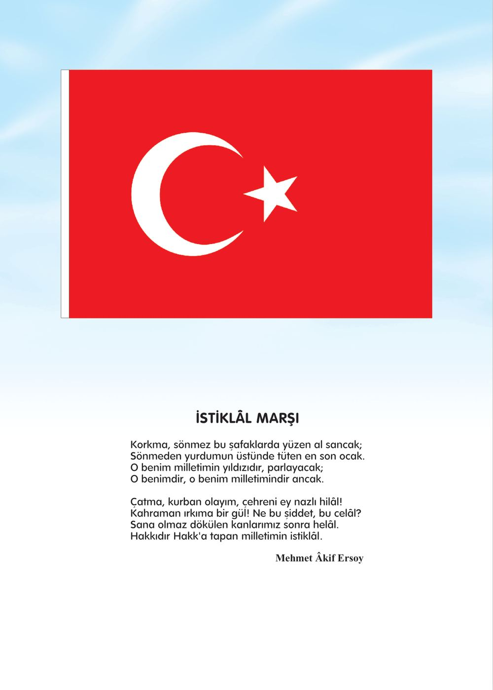

# İSTİKLÂL MARŞI

Korkma, sönmez bu şafaklarda yüzen al sancak;
Sönmeden yurdumun üstünde tüten en son ocak.
O benim milletimin yıldızıdır, parlayacak;
O benimdir, o benim milletimindir ancak.

Çatma, kurban olayım, çehreni ey nazlı hilâl!
Kahraman ırkıma bir gül! Ne bu şiddet, bu celâl?
Sana olmaz dökülen kanlarımız sonra helâl.
Hakkıdır Hakk'a tapan milletimin istiklâl.

Mehmet Âkif Ersoy

<!-- sayfa 3 -->

ANDIMIZ

Türküm, doğruyum, çalışkanım.

İlkem küçüklerimi korumak, büyüklerimi saymak; yurdumu, milletimi özümden çok sevmektir.
Ülküm yükselmek, ileri gitmektir.

Ey Büyük Atatürk!

Açtığın yolda, gösterdiğin hedefe durmadan yürüyeceğime ant içerim.

Varlığım Türk varlığına armağan olsun.

Ne mutlu Türküm diyene!

<!-- yer tutucu bulunamadı: sayfa sonuna eklendi -->

<!-- sayfa 4 -->

MUSTAFA KEMAL ATATÜRK

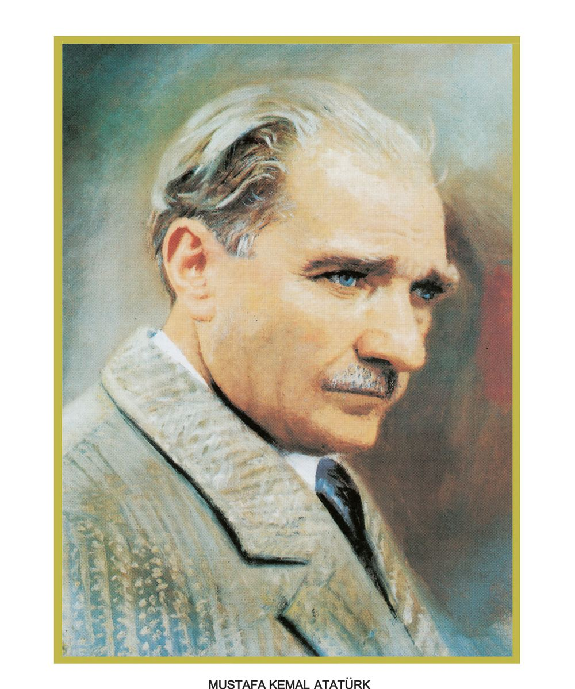
<!-- yer tutucu bulunamadı: sayfa sonuna eklendi -->

<!-- sayfa 5 -->

Verdiğiniz mesajda PDF metin katmanı boş görünüyor (`<<< >>>` arası boş). Lütfen dönüştürülmesini istediğiniz metni veya görseli paylaşın. Metni paylaştığınızda kurallara uygun şekilde Markdown formatına çevirebilirim.

<!-- yer tutucu bulunamadı: sayfa sonuna eklendi -->

<!-- sayfa 6 -->

# CONTENTS

| | |
| :--- | :---: |
| **Theme 1 - School Life** | 9 |
| **Theme 2 - Classroom Life** | 19 |
| **Theme 3 - Personal Life** | 27 |
| **Theme 4 - Family Life** | 35 |
| **Theme 5 - Homes & Houses & The Neighbourhood** | 45 |
| **Theme 6 - Life in the City&the World** | 55 |
| **REFERENCES** | 63 |
| **ANSWER KEY** | 63 |
| **VISUAL AND GENERAL WEB REFERENCES** | 63 |
| **Map of Türkiye’s Administrative Divisions and Its Land and Maritime Neighbours** | 64 |
| **Map of the Turkic World** | 65 |

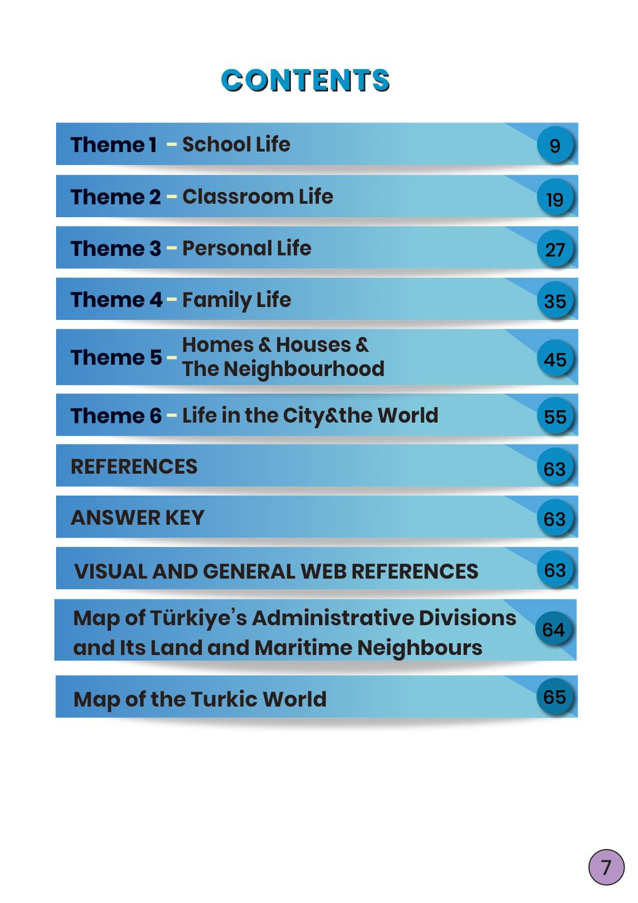
<!-- yer tutucu bulunamadı: sayfa sonuna eklendi -->

<!-- sayfa 7 -->

Verdiğiniz metin katmanı boş olduğu için (`<<< >>>`) dönüştürülecek bir içerik bulunmamaktadır. Lütfen PDF metin katmanını veya sayfanın görüntüsünü paylaşın, böylece talimatlarınıza uygun şekilde Markdown formatına çevirebilirim.

<!-- yer tutucu bulunamadı: sayfa sonuna eklendi -->

<!-- sayfa 8 -->

Theme for EBA

# Theme 1
# SCHOOL LIFE

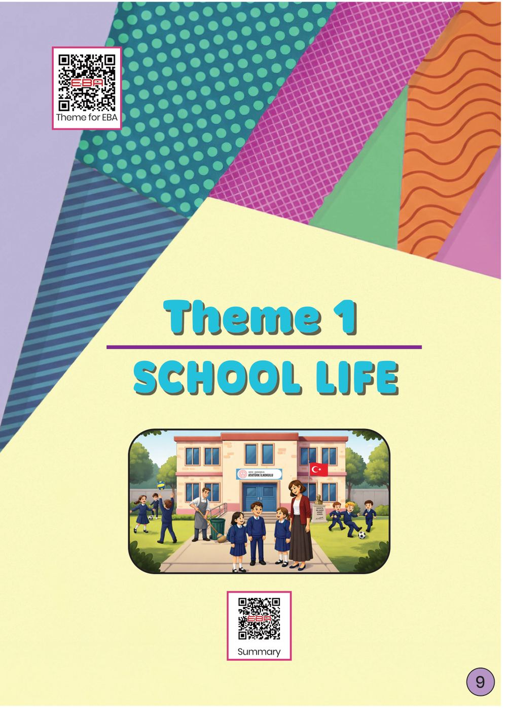

<!-- sayfa 9 -->

# 1 Put a tick($\checkmark$).

1
e.g.
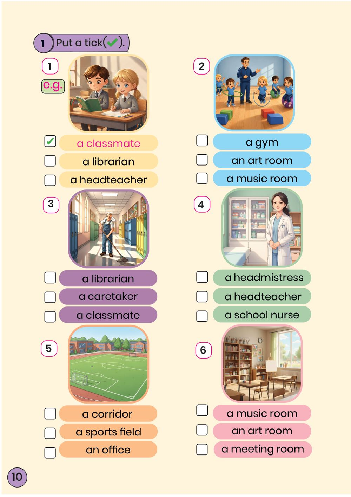
- [x] a classmate
- [ ] a librarian
- [ ] a headteacher

2

- [ ] a gym
- [ ] an art room
- [ ] a music room

3

- [ ] a librarian
- [ ] a caretaker
- [ ] a classmate

4

- [ ] a headmistress
- [ ] a headteacher
- [ ] a school nurse

5

- [ ] a corridor
- [ ] a sports field
- [ ] an office

6

- [ ] a music room
- [ ] an art room
- [ ] a meeting room

<!-- sayfa 10 -->

# 2 Look and write the months.

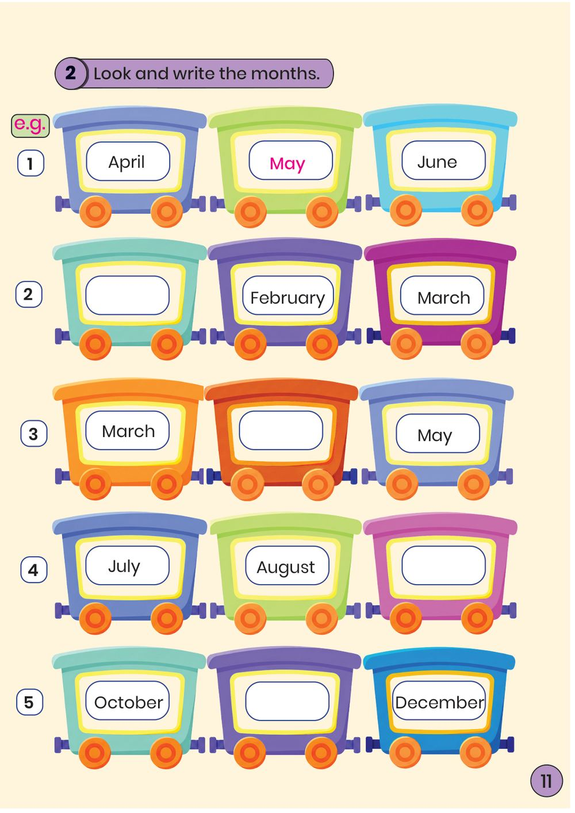

e.g.
1. April | May | June
2. [ ] | February | March
3. March | [ ] | May
4. July | August | [ ]
5. October | [ ] | December

<!-- sayfa 11 -->

# 3 Look and complete.

e.g. 1
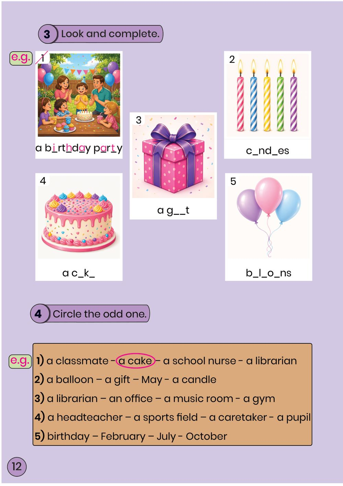
a b i r t h d a y p a r t y

2

c _ n d _ e s

3

a g _ _ t

4

a c _ k _

5

b _ l _ o _ n s

# 4 Circle the odd one.

e.g. 1) a classmate - a cake - a school nurse - a librarian
2) a balloon – a gift – May - a candle
3) a librarian – an office – a music room – a gym
4) a headteacher – a sports field – a caretaker – a pupil
5) birthday – February – July – October

<!-- sayfa 12 -->

# 5 Read and circle.

e.g.
1 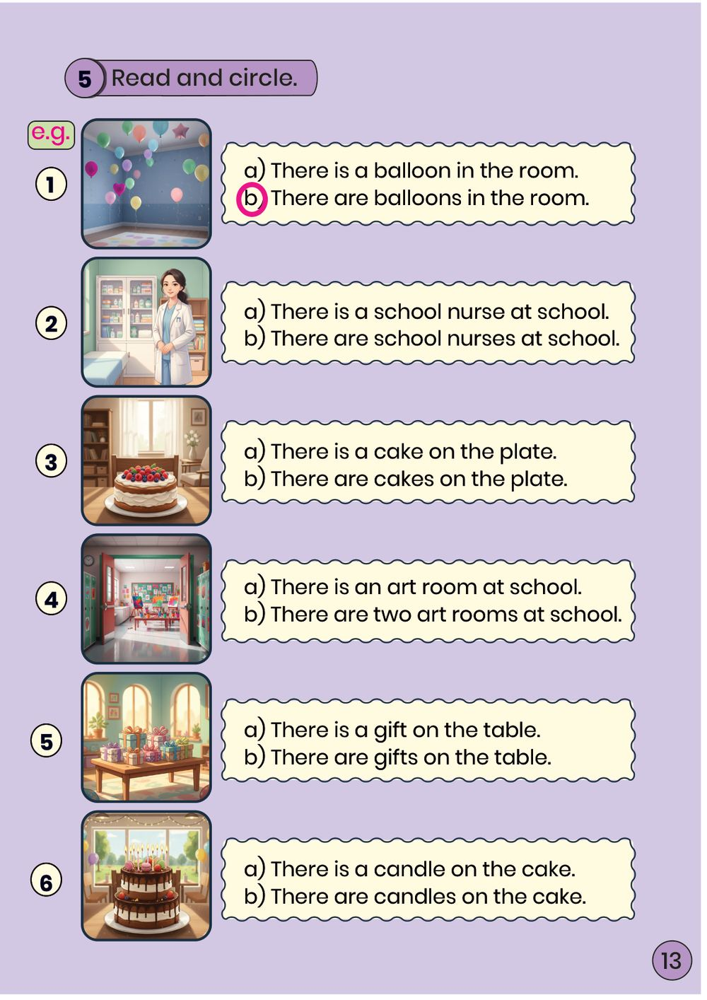
a) There is a balloon in the room.
b) There are balloons in the room.

2 
a) There is a school nurse at school.
b) There are school nurses at school.

3 
a) There is a cake on the plate.
b) There are cakes on the plate.

4 
a) There is an art room at school.
b) There are two art rooms at school.

5 
a) There is a gift on the table.
b) There are gifts on the table.

6 
a) There is a candle on the cake.
b) There are candles on the cake.

<!-- sayfa 13 -->

# 6 Read and write. There is one extra.

| What's the matter? | It sounds great! | Be careful! |
| :--- | :--- | :--- |
| ~~Do you need help?~~ | You must be quiet! | Good afternoon! |

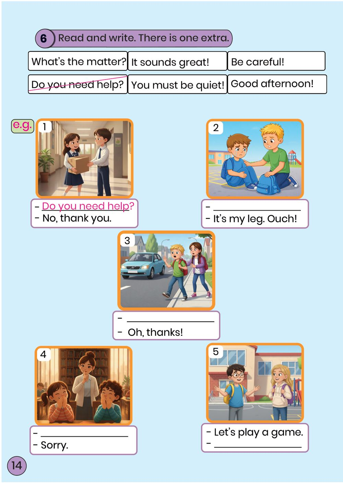
- Do you need help?
- No, thank you.

- \_\_\_\_\_\_\_\_\_\_\_\_\_\_\_\_\_\_\_\_\_\_\_\_\_\_
- It's my leg. Ouch!

- \_\_\_\_\_\_\_\_\_\_\_\_\_\_\_\_\_\_\_\_\_\_\_\_\_\_
- Oh, thanks!

- \_\_\_\_\_\_\_\_\_\_\_\_\_\_\_\_\_\_\_\_\_\_\_\_\_\_
- \_\_\_\_\_\_\_\_\_\_\_\_\_\_\_\_\_\_\_\_\_\_\_\_\_\_

- \_\_\_\_\_\_\_\_\_\_\_\_\_\_\_\_\_\_\_\_\_\_\_\_\_\_
- Let's play a game.

<!-- sayfa 14 -->

# 7 Read and circle.

e.g.
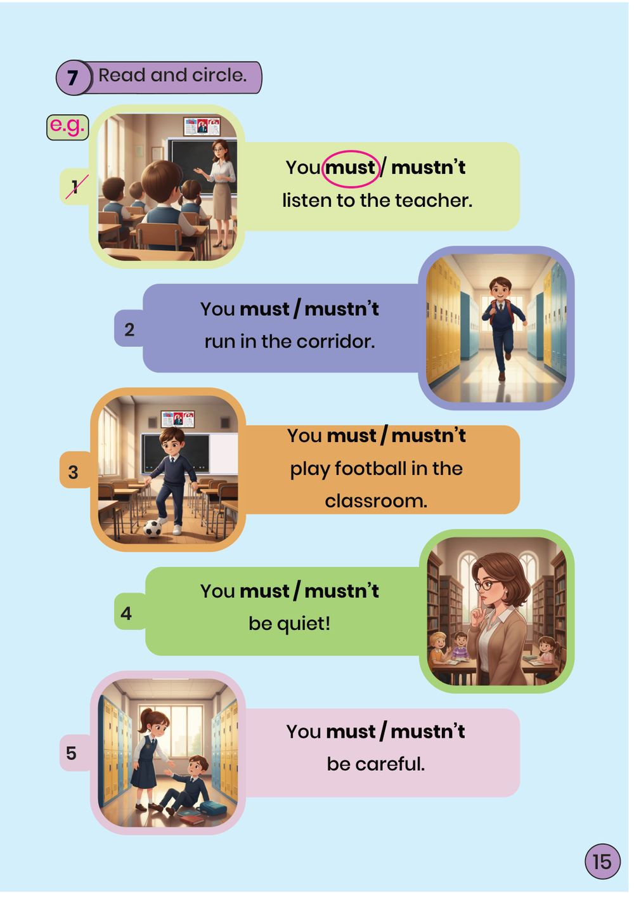
You **must**/mustn't listen to the teacher.

2

You must/**mustn't** run in the corridor.

3

You must/**mustn't** play football in the classroom.

4
You **must**/mustn't be quiet!

5

You **must**/mustn't be careful.

<!-- sayfa 15 -->

# 8 Order the words and make questions. Then match with the answers. There is one extra picture.

e.g. 1 it - What - month - is
What month is it? [d]

2 is - your - When - birthday ___________________________? [ ]

3 Defne - Where - is ___________________________? [ ]

4 you - How - are - old ___________________________? [ ]

5 is - caretaker - the - Who ___________________________? [ ]

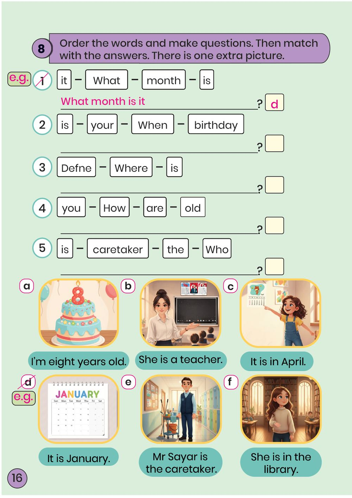
a  b  c 
I'm eight years old. She is a teacher. It is in April.

d  e  f 
e.g.

<!-- sayfa 16 -->

9 Read and circle.

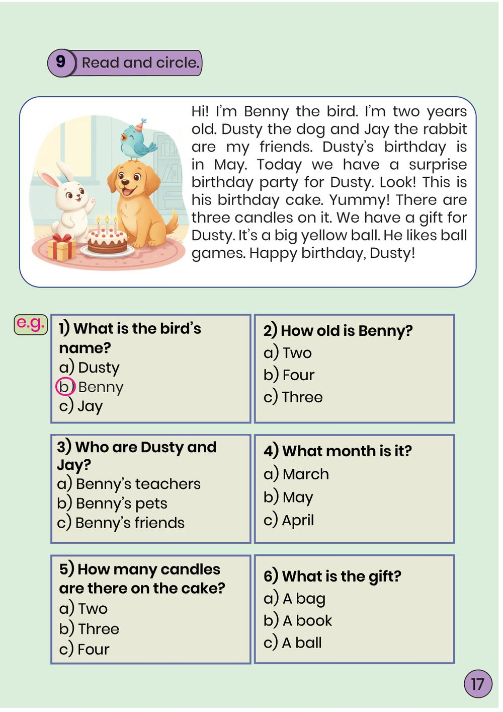

Hi! I’m Benny the bird. I’m two years old. Dusty the dog and Jay the rabbit are my friends. Dusty’s birthday is in May. Today we have a surprise birthday party for Dusty. Look! This is his birthday cake. Yummy! There are three candles on it. We have a gift for Dusty. It’s a big yellow ball. He likes ball games. Happy birthday, Dusty!

e.g.

| 1) What is the bird’s name? | 2) How old is Benny? |
| :--- | :--- |
| a) Dusty | a) Two |
| b) Benny | b) Four |
| c) Jay | c) Three |

| 3) Who are Dusty and Jay? | 4) What month is it? |
| :--- | :--- |
| a) Benny’s teachers | a) March |
| b) Benny’s pets | b) May |
| c) Benny’s friends | c) April |

| 5) How many candles are there on the cake? | 6) What is the gift? |
| :--- | :--- |
| a) Two | a) A bag |
| b) Three | b) A book |
| c) Four | c) A ball |

<!-- sayfa 17 -->

10 Look, read, and complete.

# MY SCHOOL

Hello, this is my school. There is a 1) 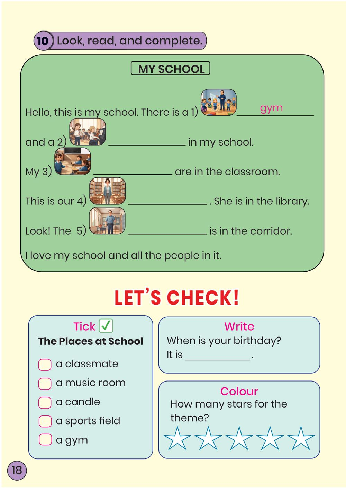 gym and a 2)  in my school.
My 3)  are in the classroom.
This is our 4) . She is in the library.
Look! The 5)  is in the corridor.
I love my school and all the people in it.

# LET'S CHECK!

## Tick ✅
**The Places at School**
- [ ] a classmate
- [ ] a music room
- [ ] a candle
- [ ] a sports field
- [ ] a gym

## Write
When is your birthday?
It is __________.

## Colour
How many stars for the theme?

<!-- sayfa 18 -->

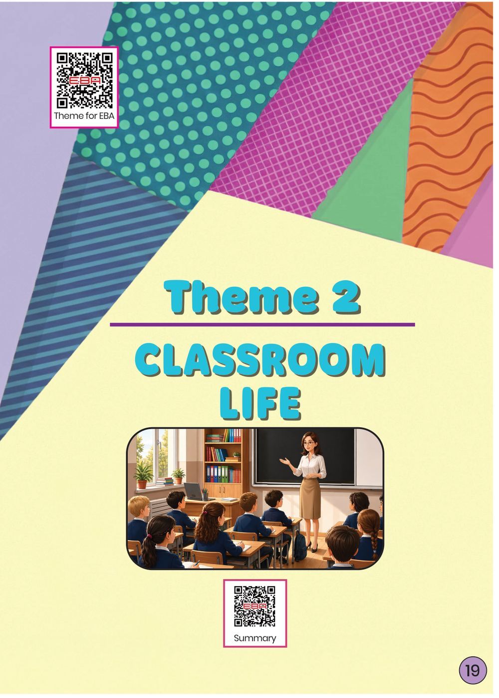

# Theme 2
## CLASSROOM LIFE

<!-- sayfa 19 -->

# 1 Match and write. There is one extra.

| a teacher's desk | a locker | a map | an exercise book |
| :--- | :--- | :--- | :--- |
| a bin | a blackboard | a bookshelf | a teacher's chair |
| a duster | a microphone | a student's desk | |

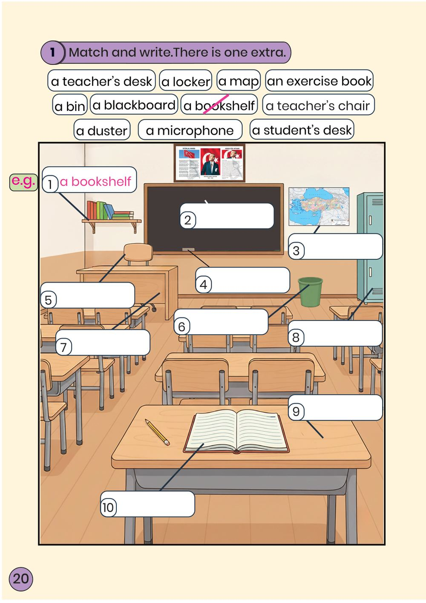

e.g. 1 a bookshelf

2 [ ]
3 [ ]
4 [ ]
5 [ ]
6 [ ]
7 [ ]
8 [ ]
9 [ ]
10 [ ]

<!-- sayfa 20 -->

# 2 Look and complete.

e.g. 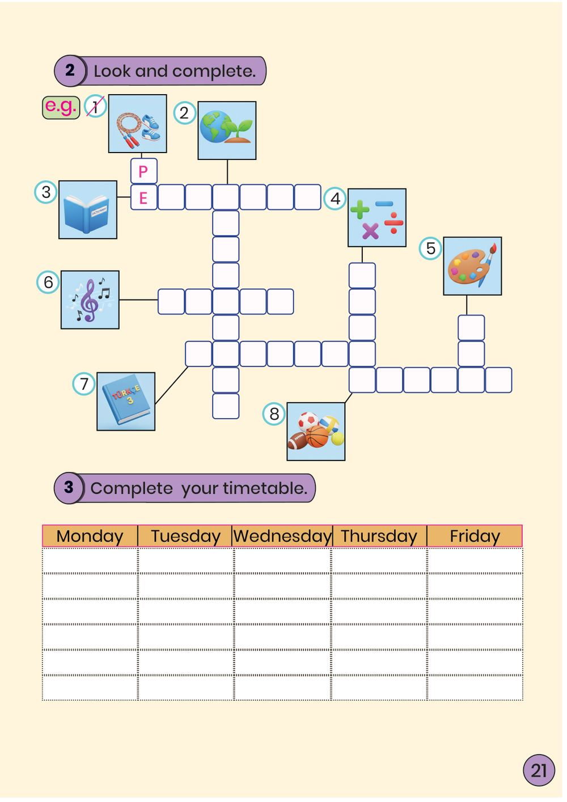 2 

 P
 E _ _ _ _ _ _ 4 
 _ _ _ _ _
_
_
_ _ _ _ _ _ _ _
7  _ _ _ _ _ _ _ _ _ 8 
_
_
_
 _
_
_

# 3 Complete your timetable.

| Monday | Tuesday | Wednesday | Thursday | Friday |
| :--- | :--- | :--- | :--- | :--- |
| | | | | |
| | | | | |
| | | | | |
| | | | | |
| | | | | |
| | | | | |

<!-- sayfa 21 -->

4) Look and circle the correct answer.

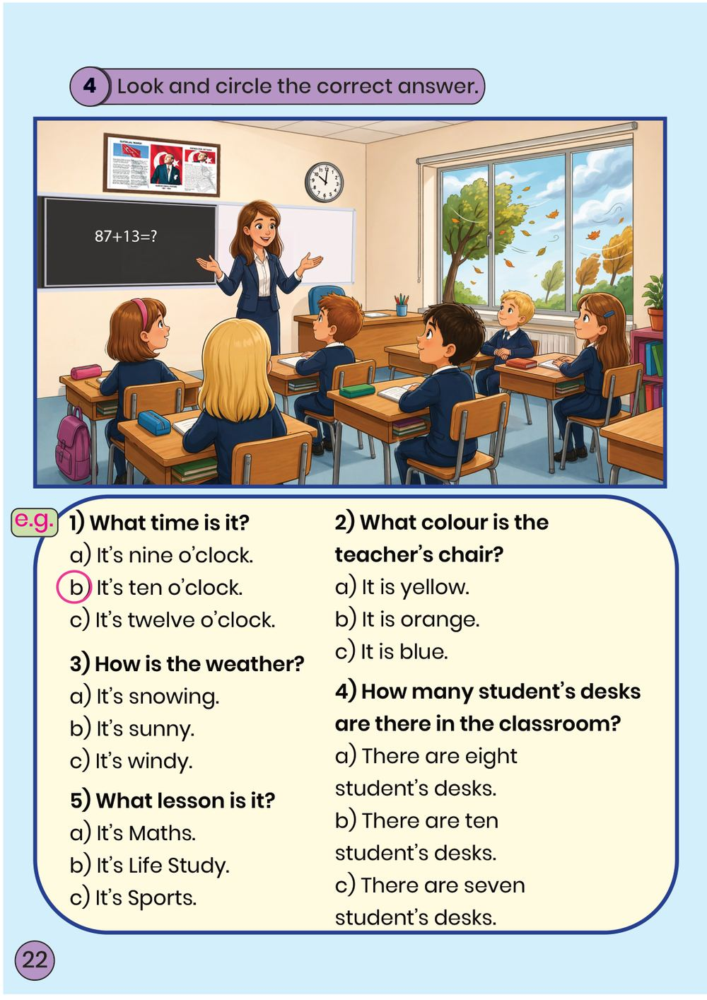

e.g. 1) What time is it?
a) It's nine o'clock.
b) It's ten o'clock.
c) It's twelve o'clock.

2) What colour is the teacher's chair?
a) It is yellow.
b) It is orange.
c) It is blue.

3) How is the weather?
a) It's snowing.
b) It's sunny.
c) It's windy.

4) How many student's desks are there in the classroom?
a) There are eight student's desks.
b) There are ten student's desks.
c) There are seven student's desks.

5) What lesson is it?
a) It's Maths.
b) It's Life Study.
c) It's Sports.

<!-- sayfa 22 -->

5 Match the instructions. There is one extra.

e.g. 1 Repeat — f after me, please!

1 Repeat
2 Answer
3 Spell
4 Take
5 Speak
6 Watch
7 Open

a the video, please!
b careful, please!
c louder, please!
d your seat, please!
e the question, please!
f after me, please!
g your books, please!
h the word, please!

6 Order the words.

e.g. 1 there / a Music / Monday / on / Is / lesson
Is there a Music lesson on Monday?

2 are / How many / student's desks / there / the classroom / in
__________________________________________________________?

3 it / time / is / What / now
__________________________________________________________?

4 you / a / got / black / Have / pen
__________________________________________________________?

5 the weather / is / today / How
__________________________________________________________?

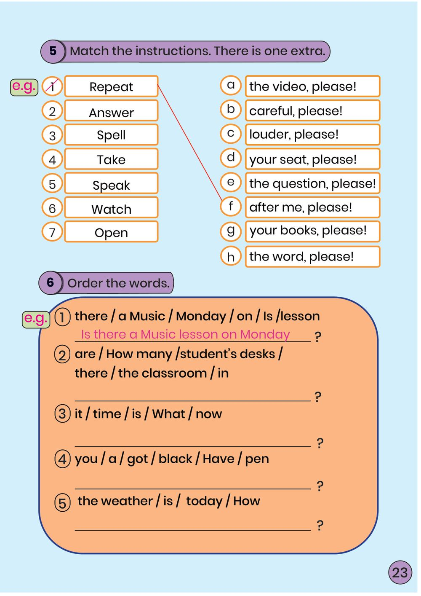
<!-- yer tutucu bulunamadı: sayfa sonuna eklendi -->

<!-- sayfa 23 -->

# 7 Look and complete.

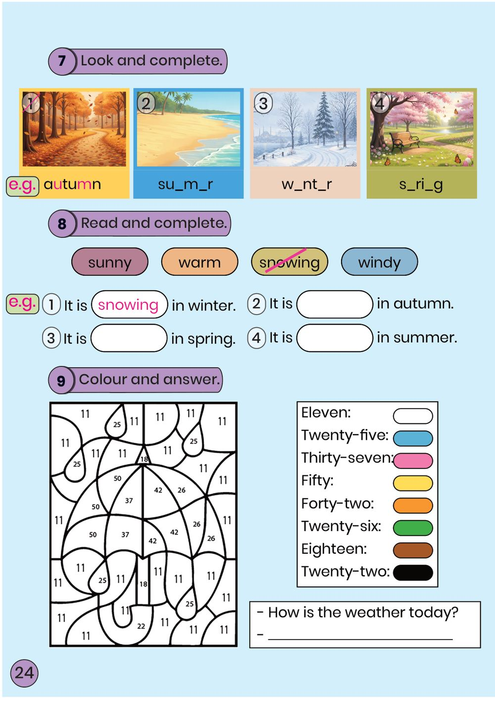
e.g. autumn

su_m_r

w_nt_r

s_ri_g

# 8 Read and complete.

sunny | warm | ~~snowing~~ | windy

e.g. 1 It is snowing in winter.
2 It is ________ in autumn.
3 It is ________ in spring.
4 It is ________ in summer.

# 9 Colour and answer.

Eleven: [ ]
Twenty-five: [ ]
Thirty-seven: [ ]
Fifty: [ ]
Forty-two: [ ]
Twenty-six: [ ]
Eighteen: [ ]
Twenty-two: [ ]

- How is the weather today?
- ________

<!-- sayfa 24 -->

10 Read and write the pupils' names.

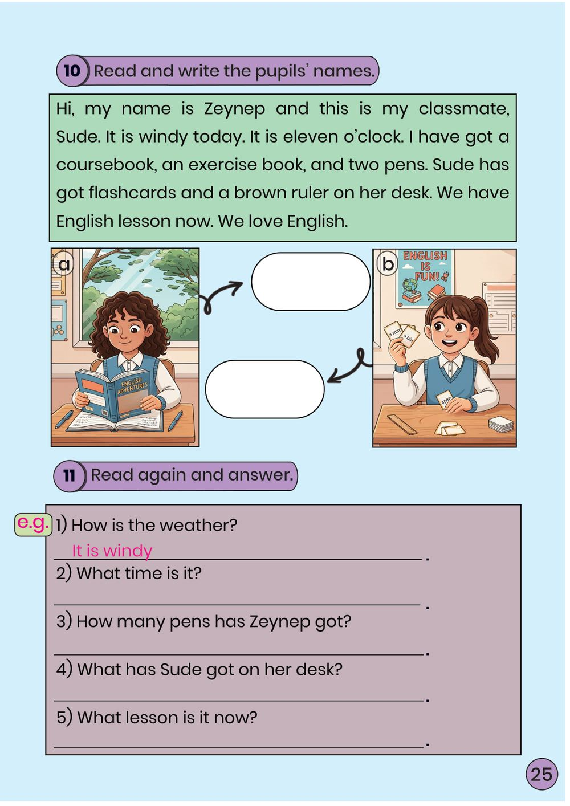

Hi, my name is Zeynep and this is my classmate, Sude. It is windy today. It is eleven o'clock. I have got a coursebook, an exercise book, and two pens. Sude has got flashcards and a brown ruler on her desk. We have English lesson now. We love English.

a [boş kutu] b
[boş kutu]

11 Read again and answer.

e.g. 1) How is the weather?
It is windy.

2) What time is it?
__________________________________________________________

3) How many pens has Zeynep got?
__________________________________________________________

4) What has Sude got on her desk?
__________________________________________________________

5) What lesson is it now?
__________________________________________________________

<!-- sayfa 25 -->

# 12 Read and write about yourself.

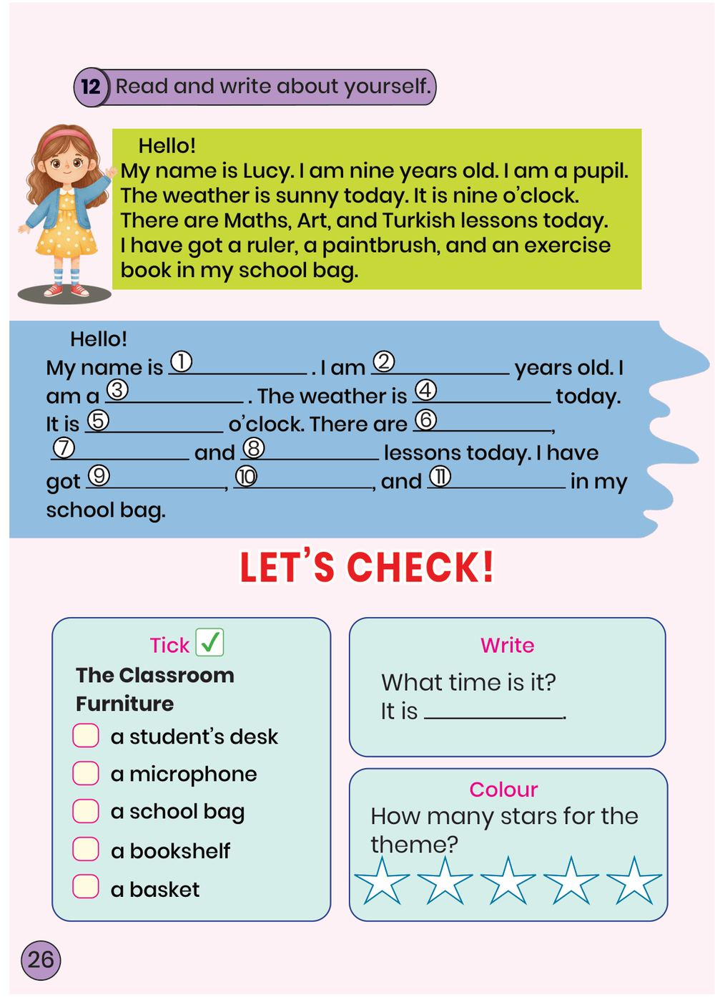

Hello!
My name is Lucy. I am nine years old. I am a pupil. The weather is sunny today. It is nine o’clock. There are Maths, Art, and Turkish lessons today. I have got a ruler, a paintbrush, and an exercise book in my school bag.

Hello!
My name is ① __________. I am ② __________ years old. I am a ③ __________. The weather is ④ __________ today. It is ⑤ __________ o’clock. There are ⑥ __________, ⑦ __________ and ⑧ __________ lessons today. I have got ⑨ __________, ⑩ __________, and ⑪ __________ in my school bag.

# LET’S CHECK!

## Tick ✅
**The Classroom Furniture**
* ☐ a student’s desk
* ☐ a microphone
* ☐ a school bag
* ☐ a bookshelf
* ☐ a basket

## Write
What time is it?
It is __________

## Colour
How many stars for the theme?
☆ ☆ ☆ ☆ ☆

<!-- sayfa 26 -->

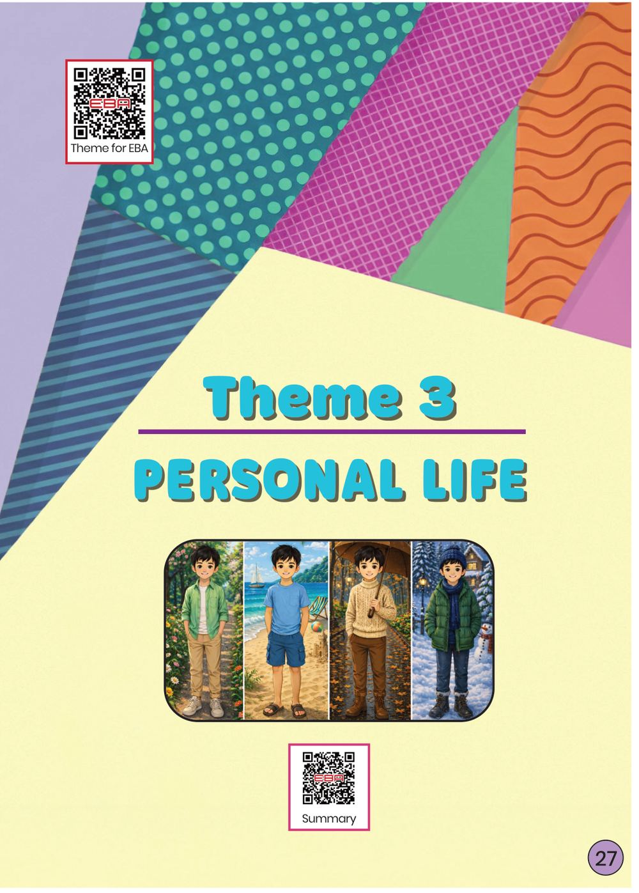

# Theme 3
## PERSONAL LIFE

<!-- sayfa 27 -->

# 1 Look, find, and match. There is one extra.

e.g.
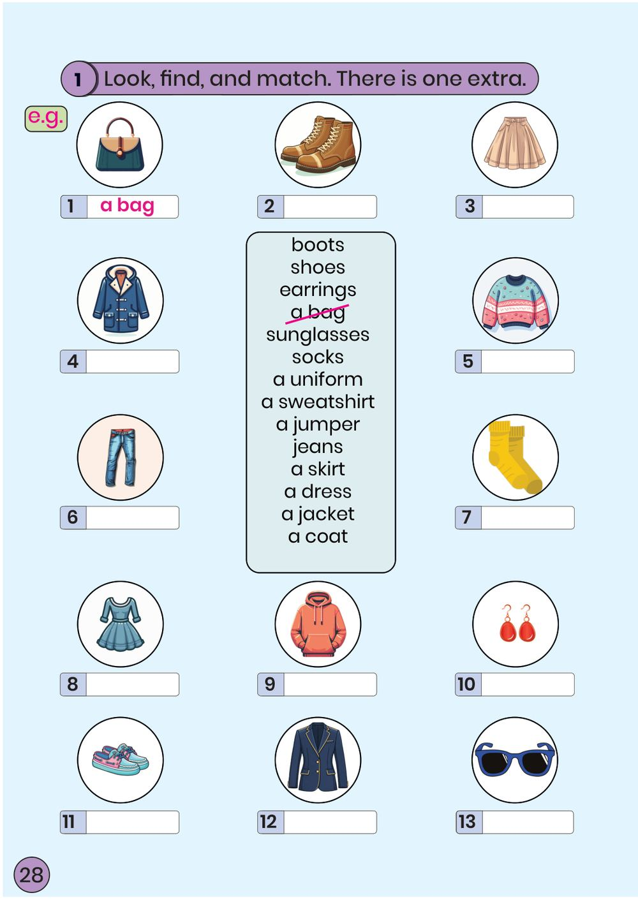
1 a bag

2

3

4

5

6

boots
shoes
earrings
~~a bag~~
sunglasses
socks
a uniform
a sweatshirt
a jumper
jeans
a skirt
a dress
a jacket
a coat

7

8

9

10

11

12

13

<!-- sayfa 28 -->

2 Look, read, and circle.

e.g. 1 Arda is **young**/old.

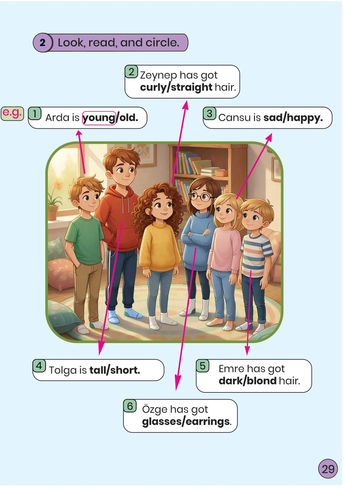

2 Zeynep has got **curly**/straight hair.

3 Cansu is sad/**happy**.

4 Tolga is **tall**/short.

5 Emre has got **dark**/blond hair.

6 Özge has got **glasses**/earrings.

<!-- sayfa 29 -->

# 3 Follow the paths and answer the questions.

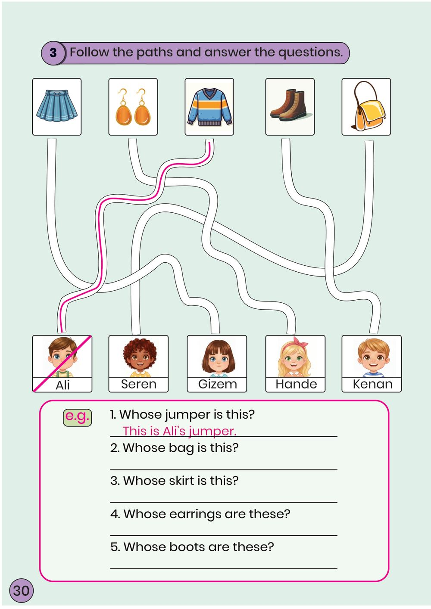

1. Whose jumper is this?
    e.g. This is Ali’s jumper.
2. Whose bag is this?
    _________________________________________________
3. Whose skirt is this?
    _________________________________________________
4. Whose earrings are these?
    _________________________________________________
5. Whose boots are these?
    _________________________________________________

<!-- sayfa 30 -->

# 4 Look and write. There is one extra.

| Anytime! | Be careful! | Calm down! |
| :---: | :---: | :---: |
| You look great! | Maybe! | I'm so excited! |
| ~~OK, Mum!~~ | | |

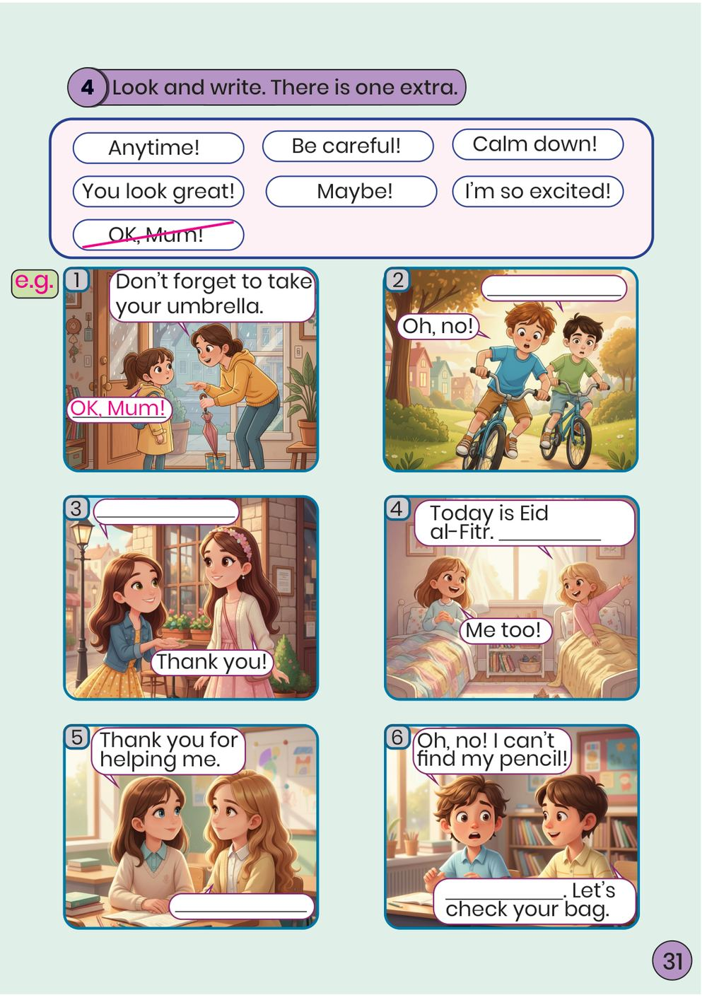
1 Don't forget to take your umbrella.
OK, Mum!

2 \_\_\_\_\_\_\_\_\_\_\_\_\_\_\_\_
Oh, no!

3 \_\_\_\_\_\_\_\_\_\_\_\_\_\_\_\_
Thank you!

4 Today is Eid al-Fitr. \_\_\_\_\_\_\_\_\_\_\_\_\_\_\_\_
Me too!

5 Thank you for helping me.
\_\_\_\_\_\_\_\_\_\_\_\_\_\_\_\_

6 Oh, no! I can't find my pencil!
\_\_\_\_\_\_\_\_\_\_\_\_\_\_\_\_. Let's check your bag.

<!-- sayfa 31 -->

# 5 Look, match, and complete. There is one extra.

| feet | chin | eyebrows |
| :---: | :---: | :---: |
| back | hair | teeth |

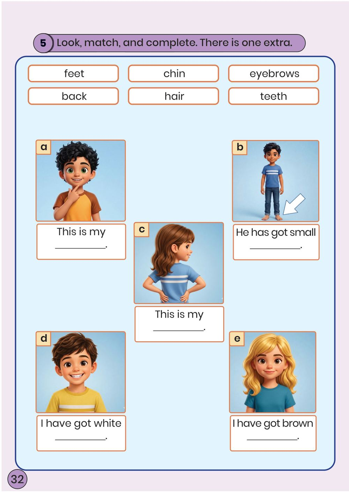

**a**

This is my __________.

**b**

He has got small __________.

**c**

This is my __________.

**d**

I have got white __________.

**e**

I have got brown __________.

<!-- sayfa 32 -->

# 6 Read and match. There is one extra.

| | |
| :--- | :--- |
| 1 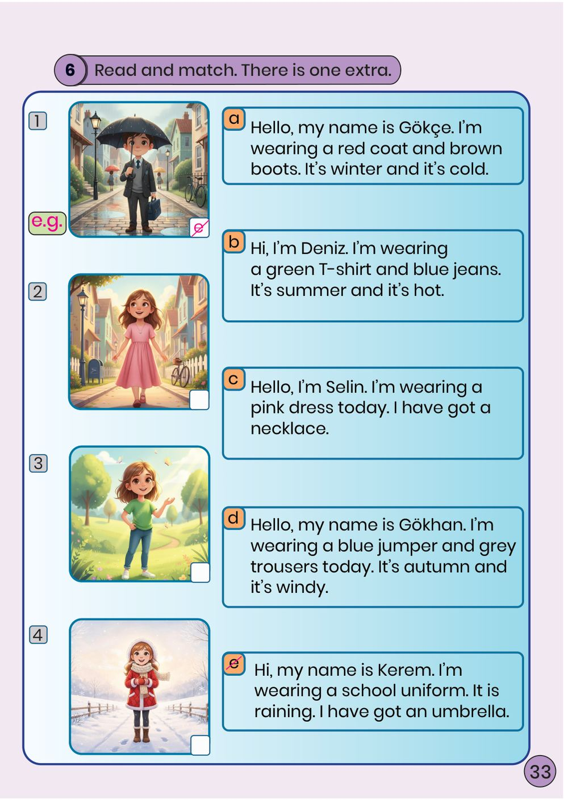   e.g. ∅ | **a** Hello, my name is Gökçe. I’m wearing a red coat and brown boots. It’s winter and it’s cold. |
| 2  | **b** Hi, I’m Deniz. I’m wearing a green T-shirt and blue jeans. It’s summer and it’s hot. |
| 3  | **c** Hello, I’m Selin. I’m wearing a pink dress today. I have got a necklace. |
| 4  | **d** Hello, my name is Gökhan. I’m wearing a blue jumper and grey trousers today. It’s autumn and it’s windy. |
| | **e** Hi, my name is Kerem. I’m wearing a school uniform. It is raining. I have got an umbrella. |

<!-- sayfa 33 -->

# 7 Read. Then write about yourself and draw yourself.

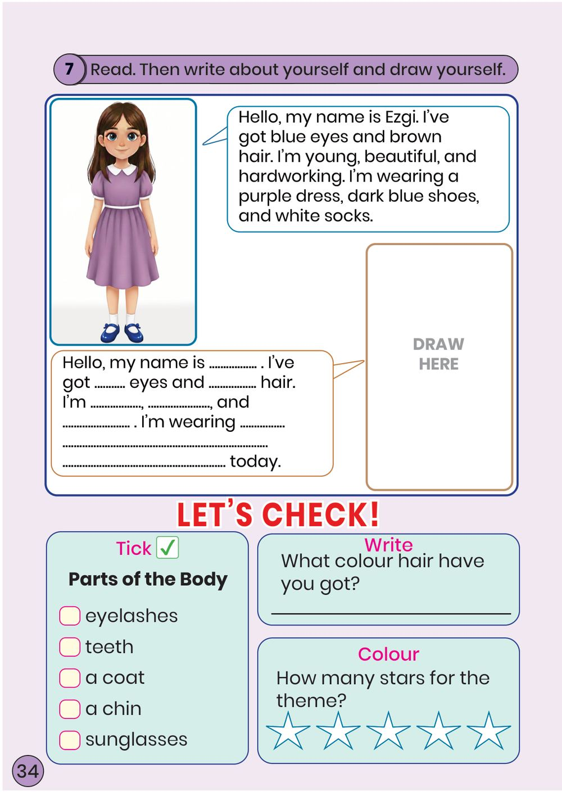

Hello, my name is Ezgi. I’ve got blue eyes and brown hair. I’m young, beautiful, and hardworking. I’m wearing a purple dress, dark blue shoes, and white socks.

Hello, my name is ................. . I’ve got ........... eyes and ................. hair. I’m .................., ......................, and ........................ . I’m wearing ................ ......................................................................... .......................................................... today.

# LET’S CHECK!

## Tick ✅
**Parts of the Body**
- ☐ eyelashes
- ☐ teeth
- ☐ a coat
- ☐ a chin

## Write
What colour hair have you got?
_________________________________________________

## Colour
How many stars for the theme?
$\bigstar$ $\bigstar$ $\bigstar$ $\bigstar$

<!-- sayfa 34 -->

Theme for EBA

# Theme 4
## FAMILY LIFE

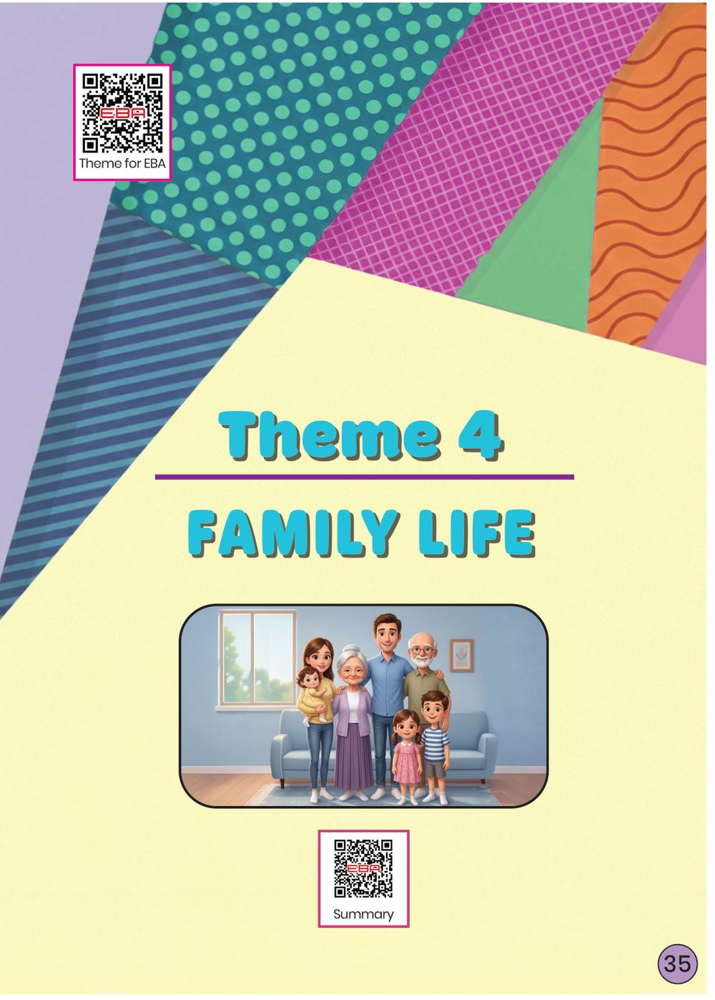

<!-- sayfa 35 -->

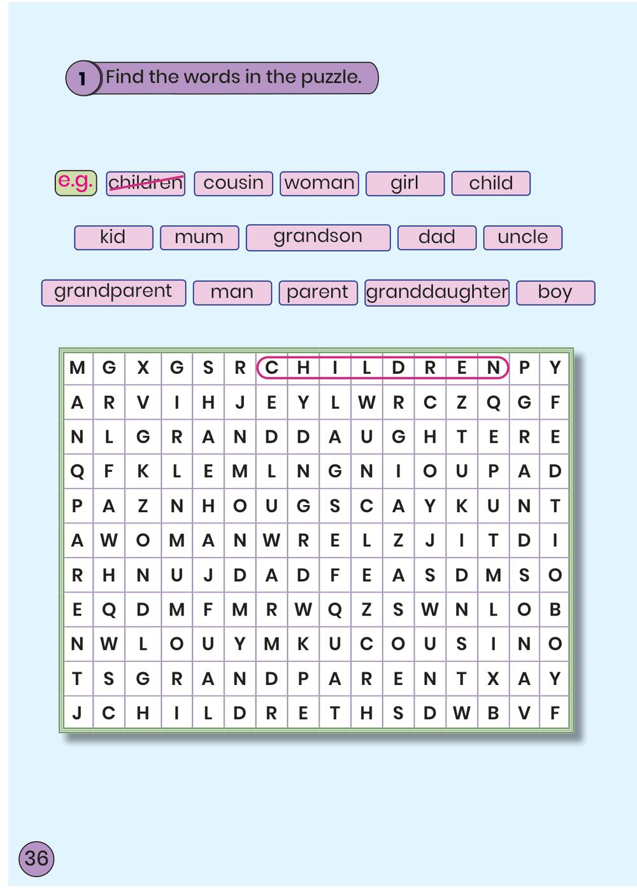 1 Find the words in the puzzle.

e.g. children cousin woman girl child
kid mum grandson dad uncle
grandparent man parent granddaughter boy

| M | G | X | G | S | R | C | H | I | L | D | R | E | N | P | Y |
|---|---|---|---|---|---|---|---|---|---|---|---|---|---|---|---|
| A | R | V | I | H | J | E | Y | L | W | R | C | Z | Q | G | F |
| N | L | G | R | A | N | D | D | A | U | G | H | T | E | R | E |
| Q | F | K | L | E | M | L | N | G | N | I | O | U | P | A | D |
| P | A | Z | N | H | O | U | G | S | C | A | Y | K | U | N | T |
| A | W | O | M | A | N | W | R | E | L | Z | J | I | T | D | I |
| R | H | N | U | J | D | A | D | F | E | A | S | D | M | S | O |
| E | Q | D | M | F | M | R | W | Q | Z | S | W | N | L | O | B |
| N | W | L | O | U | Y | M | K | U | C | O | U | S | I | N | O |
| T | S | G | R | A | N | D | P | A | R | E | N | T | X | A | Y |
| J | C | H | I | L | D | R | E | T | H | S | D | W | B | V | F |

<!-- sayfa 36 -->

2 Look and write. There is one extra.

wake up - wash face - brush teeth - have breakfast - go to school - play games - work have lunch - go home - have dinner - read a book do homework - put on a uniform

e.g.
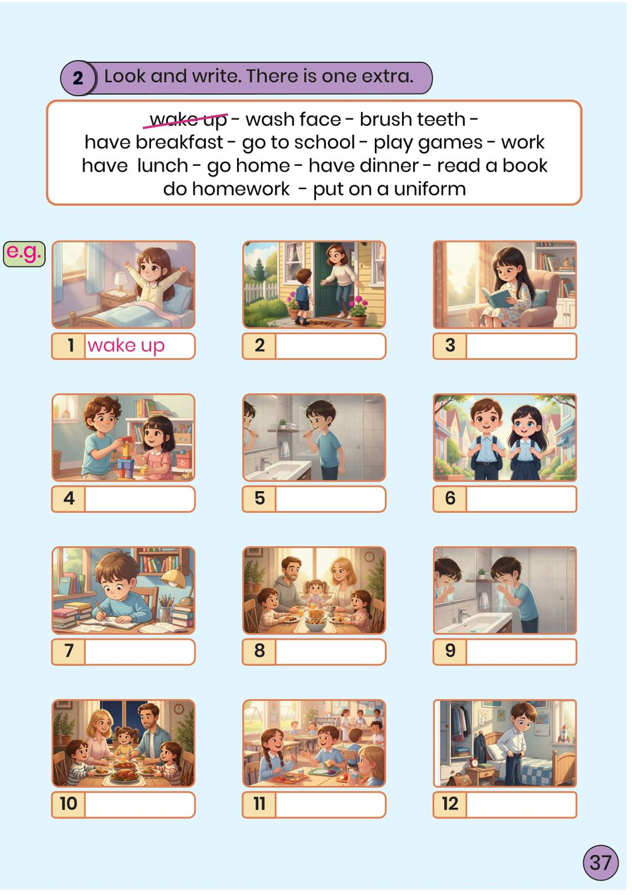
1 wake up

2 

3 

4 

5 

6 

7 

8 

9 

10 

11 

12

<!-- sayfa 37 -->

# 3 Look at the table and put a tick ($\checkmark$) or a cross ($\times$).

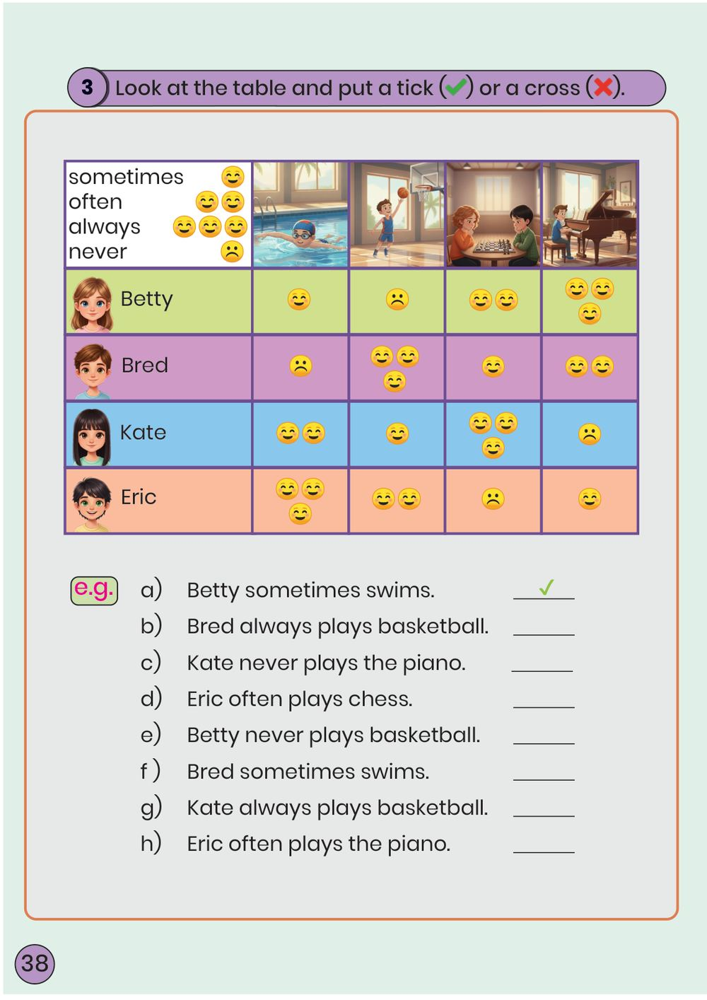

| | | swimming | basketball | chess | piano |
| :--- | :--- | :---: | :---: | :---: | :---: |
| **sometimes** 😊 | | | | | |
| **often** 😊😊 | | | | | |
| **always** 😊😊😊 | | | | | |
| **never** ☹️ | | | | | |
| 👩 Betty | | 😊 | ☹️ | 😊😊 | 😊😊😊 |
| 👦 Bred | | ☹️ | 😊😊😊 | 😊 | 😊😊 |
| 👩 Kate | | 😊😊 | 😊 | 😊😊😊 | ☹️ |
| 👦 Eric | | 😊😊😊 | 😊😊 | ☹️ | 😊 |

e.g. a) Betty sometimes swims. $\checkmark$ \_\_\_\_\_

b) Bred always plays basketball. \_\_\_\_\_
c) Kate never plays the piano. \_\_\_\_\_
d) Eric often plays chess. \_\_\_\_\_
e) Betty never plays basketball. \_\_\_\_\_
f) Bred sometimes swims. \_\_\_\_\_
g) Kate always plays basketball. \_\_\_\_\_
h) Eric often plays the piano. \_\_\_\_\_

<!-- sayfa 38 -->

# 4 Answer, follow, and choose the correct letter.

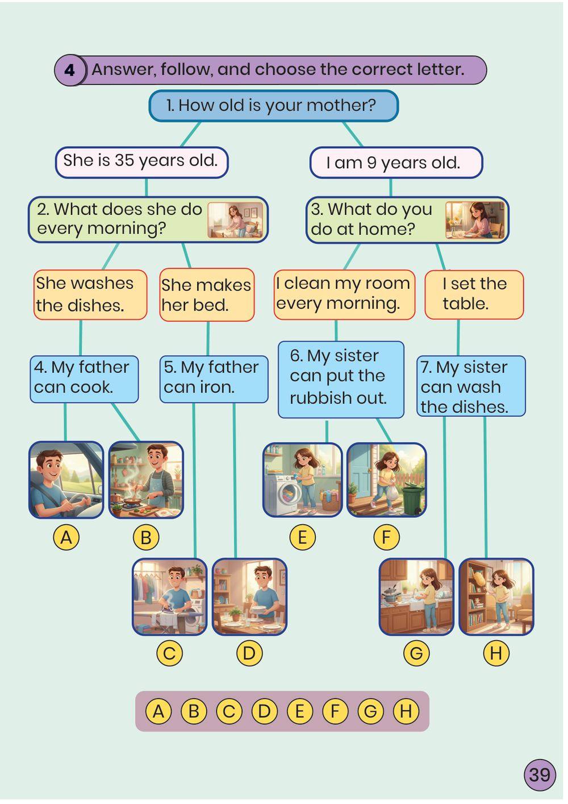

1. How old is your mother?
- She is 35 years old.
- I am 9 years old.

2. What does she do every morning?
- She washes the dishes.
- She makes her bed.

3. What do you do at home?
- I clean my room every morning.
- I set the table.

4. My father can cook.
5. My father can iron.
6. My sister can put the rubbish out.
7. My sister can wash the dishes.

 (A)
 (B)
 (C)
 (D)
 (E)
 (F)
 (G)
 (H)

(A) (B) (C) (D) (E) (F) (G) (H)

<!-- sayfa 39 -->

5 Look, read, and complete. There is one extra.

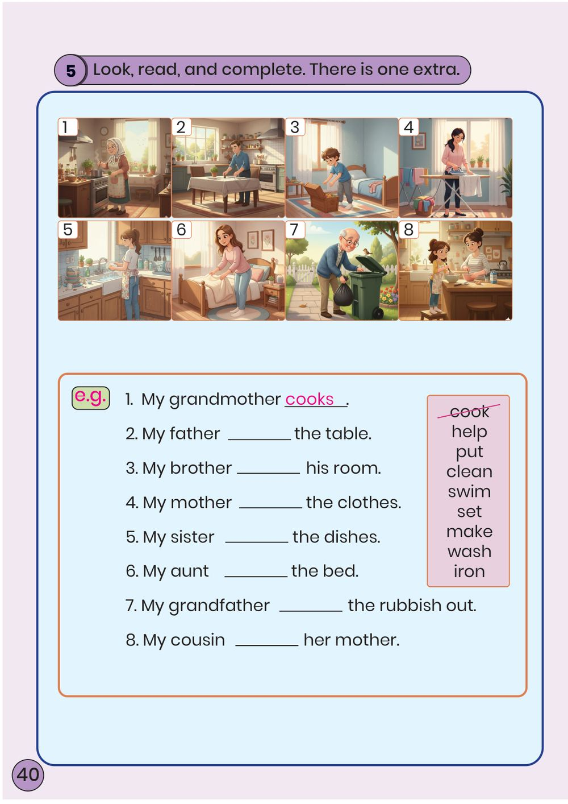

> e.g. 1. My grandmother cooks .
> 2. My father ________ the table.
> 3. My brother ________ his room.
> 4. My mother ________ the clothes.
> 5. My sister ________ the dishes.
> 6. My aunt ________ the bed.
> 7. My grandfather ________ the rubbish out.
> 8. My cousin ________ her mother.
>
> | cook |
> | :---: |
> | help |
> | put |
> | clean |
> | swim |
> | set |
> | make |
> | wash |
> | iron |

<!-- sayfa 40 -->

# 6 Look and match. There is one extra.

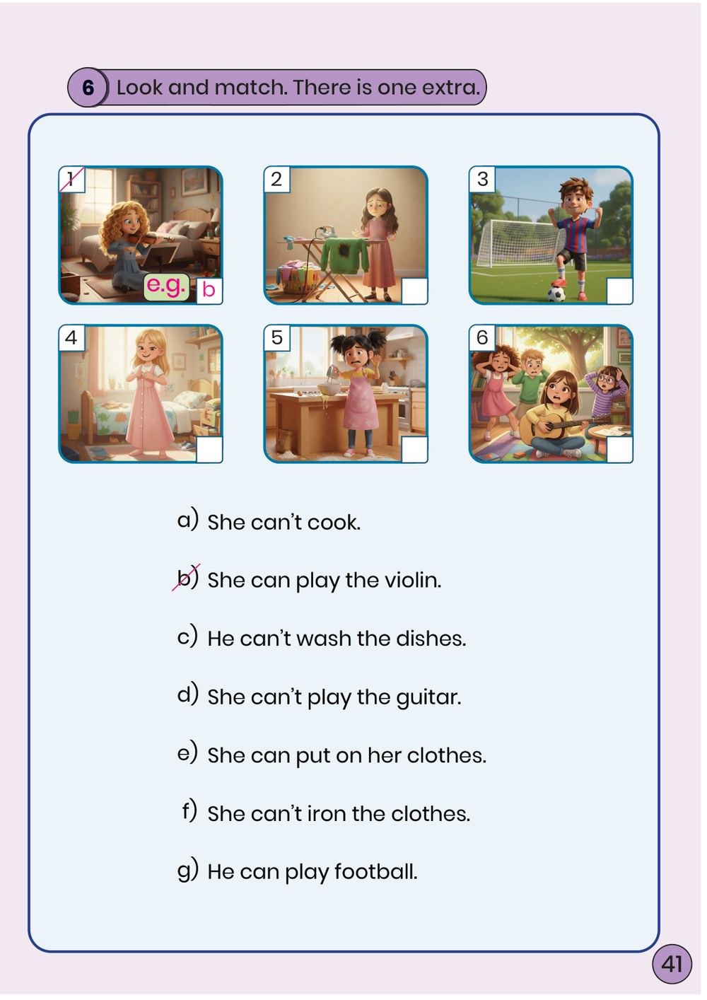

a) She can't cook.
b) She can play the violin.
c) He can't wash the dishes.
d) She can't play the guitar.
e) She can put on her clothes.
f) She can't iron the clothes.
g) He can play football.

<!-- sayfa 41 -->

# 7 Read and order the pictures.

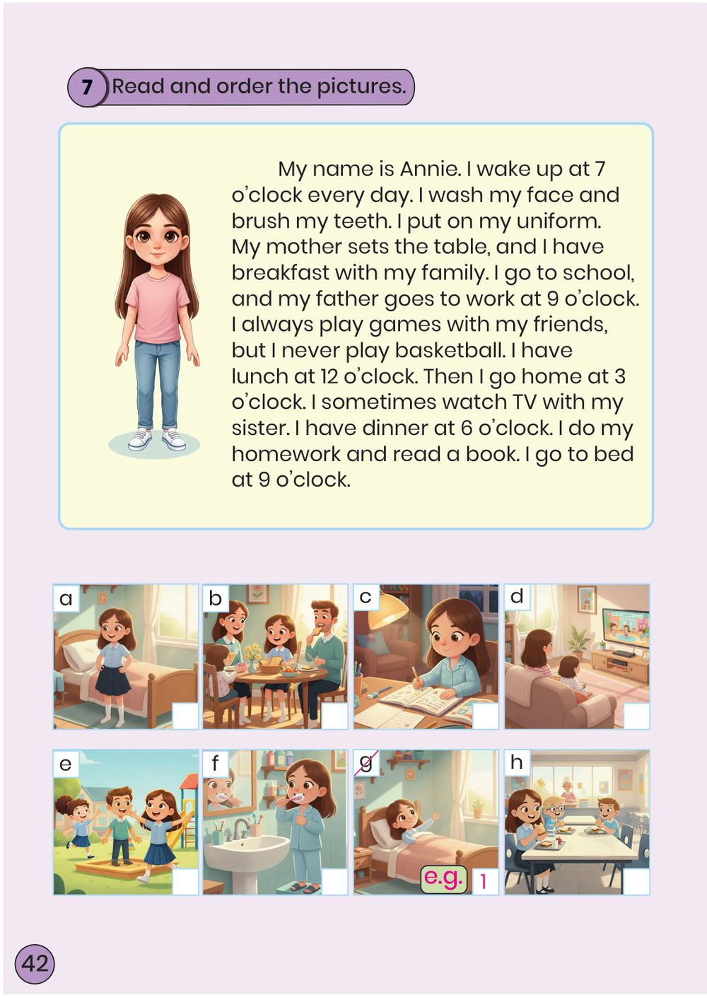

My name is Annie. I wake up at 7 o’clock every day. I wash my face and brush my teeth. I put on my uniform. My mother sets the table, and I have breakfast with my family. I go to school, and my father goes to work at 9 o’clock. I always play games with my friends, but I never play basketball. I have lunch at 12 o’clock. Then I go home at 3 o’clock. I sometimes watch TV with my sister. I have dinner at 6 o’clock. I do my homework and read a book. I go to bed at 9 o’clock.

| a | b | c | d |
|---|---|---|---|
|  |  |  |  |

| e | f | g | h |
|---|---|---|---|
|  |  |  |  |

<!-- sayfa 42 -->

# 8 Look and complete.

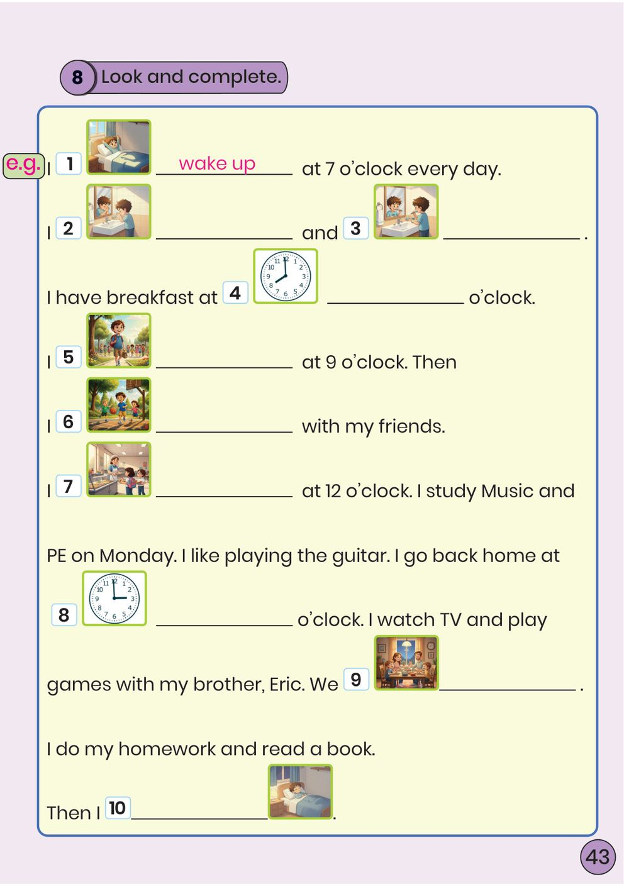 e.g. 1 wake up at 7 o’clock every day.

| 2  \_\_\_\_\_\_\_\_\_\_ and 3  \_\_\_\_\_\_\_\_\_\_.

I have breakfast at 4  \_\_\_\_\_\_\_\_\_\_ o’clock.

| 5  \_\_\_\_\_\_\_\_\_\_ at 9 o’clock. Then

| 6  \_\_\_\_\_\_\_\_\_\_ with my friends.

| 7  \_\_\_\_\_\_\_\_\_\_ at 12 o’clock. I study Music and

PE on Monday. I like playing the guitar. I go back home at

8  \_\_\_\_\_\_\_\_\_\_ o’clock. I watch TV and play

games with my brother, Eric. We 9  \_\_\_\_\_\_\_\_\_\_.

I do my homework and read a book.

Then I 10 

<!-- sayfa 43 -->

9 Find and write.

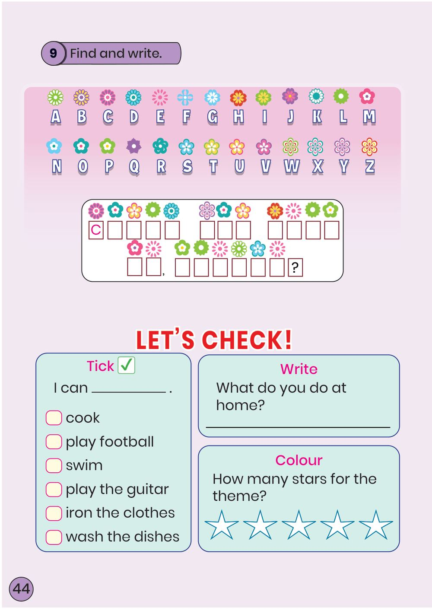

# LET'S CHECK!

| Tick $\checkmark$ | Write |
| :--- | :--- |
| I can \_\_\_\_\_\_\_\_\_\_\_\_. | What do you do at home? |
| $\bigcirc$ cook | \_\_\_\_\_\_\_\_\_\_\_\_\_\_\_\_\_\_\_\_\_\_\_\_\_\_\_\_\_\_\_\_\_\_\_\_\_\_\_\_\_\_\_\_\_\_\_\_\_\_\_\_ |
| $\bigcirc$ play football | |
| $\bigcirc$ swim | **Colour** |
| $\bigcirc$ play the guitar | How many stars for the theme? |
| $\bigcirc$ iron the clothes | $\bigstar \bigstar \bigstar \bigstar \bigstar$ |
| $\bigcirc$ wash the dishes | |

<!-- sayfa 44 -->

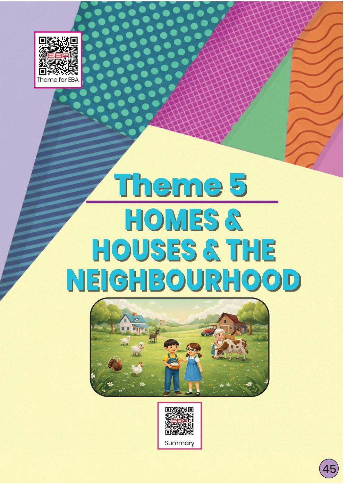

# Theme 5
# HOMES & HOUSES & THE NEIGHBOURHOOD

<!-- sayfa 45 -->

# 1 Look, match, and write. There is one extra.

| a donkey | a horse | a duck | a goat | a rabbit |
| :---: | :---: | :---: | :---: | :---: |
| a chicken | a turkey | a dog | ~~a cow~~ | a sheep |

1 [a cow] 2 [ ] 3 [ ] 4 [ ] 5 [ ]
e.g.

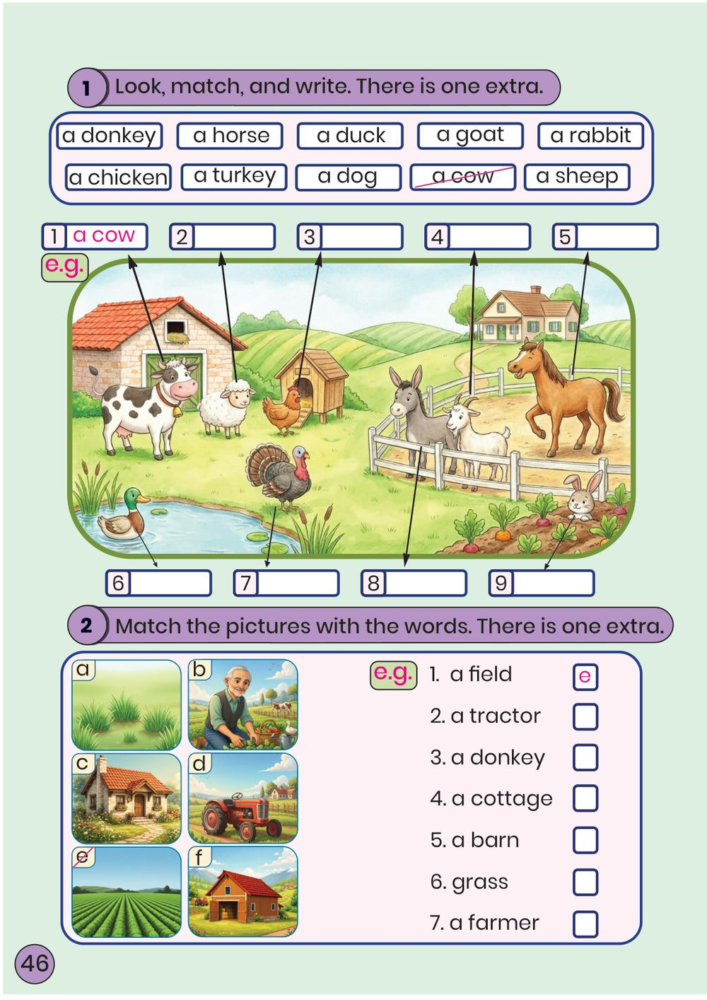

6 [ ] 7 [ ] 8 [ ] 9 [ ]

# 2 Match the pictures with the words. There is one extra.

| a | b |
| :---: | :---: |
|  |  |
| **c** | **d** |
|  |  |
| **e** | **f** |
|  |  |

e.g. 1. a field [e]
2. a tractor [ ]
3. a donkey [ ]
4. a cottage [ ]
5. a barn [ ]
6. grass [ ]

<!-- sayfa 46 -->

3 Look and write.

What is there on the farm?

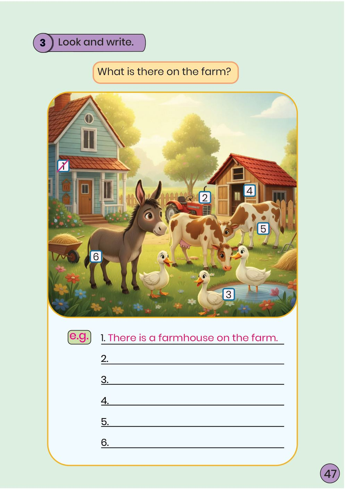

e.g. 1. There is a farmhouse on the farm.
2. _________________________________________________
3. _________________________________________________
4. _________________________________________________
5. _________________________________________________
6. _________________________________________________

<!-- sayfa 47 -->

# 4 Find and write. There is one extra.

e.g. `feed the horses` | `bake bread` | `milk the cows`
`clean the barn` | `water the flowers` | `collect the eggs`

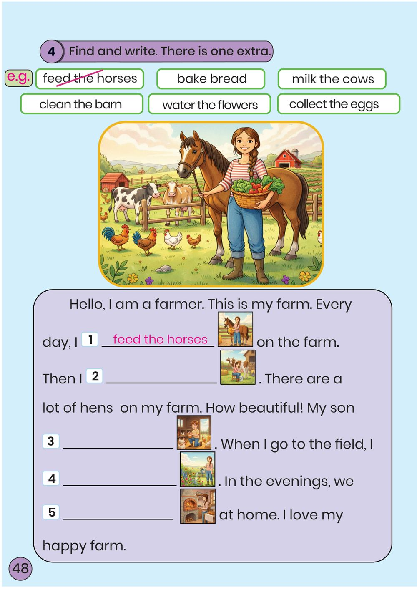

Hello, I am a farmer. This is my farm. Every day, I 1 `feed the horses`  on the farm. Then I 2 \_\_\_\_\_\_\_\_\_\_\_\_\_\_\_\_ . There are a lot of hens on my farm. How beautiful! My son 3 \_\_\_\_\_\_\_\_\_\_\_\_\_\_\_\_ . When I go to the field, I 4 \_\_\_\_\_\_\_\_\_\_\_\_\_\_\_\_ . In the evenings, we 5 \_\_\_\_\_\_\_\_\_\_\_\_\_\_\_\_  at home. I love my

<!-- sayfa 48 -->

# 5 Look and answer.

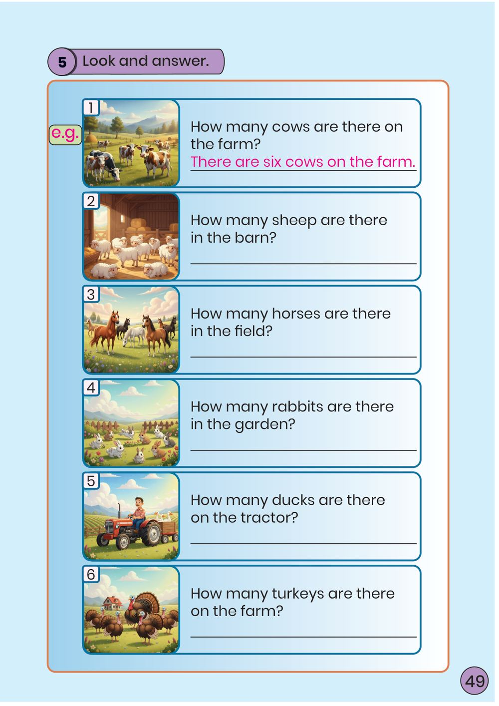
**e.g.**
1

How many cows are there on the farm?
<u>There are six cows on the farm.</u>

2

How many sheep are there in the barn?
____________________________________

3

How many horses are there in the field?
____________________________________

4

How many rabbits are there in the garden?
____________________________________

5

How many ducks are there on the tractor?
____________________________________

6

How many turkeys are there on the farm?
____________________________________

<!-- sayfa 49 -->

6 Look at the picture. Write YES or NO.

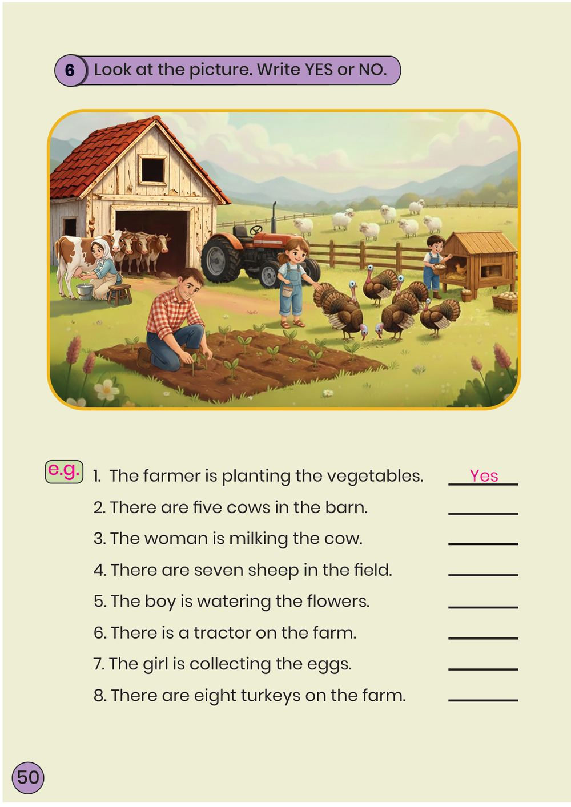

e.g. 1. The farmer is planting the vegetables. ________ Yes

2. There are five cows in the barn. ________
3. The woman is milking the cow. ________
4. There are seven sheep in the field. ________
5. The boy is watering the flowers. ________
6. There is a tractor on the farm. ________
7. The girl is collecting the eggs. ________
8. There are eight turkeys on the farm. ________

<!-- sayfa 50 -->

# 7 Answer the questions. There is one extra.

| feed the animals | collect the eggs | milk the cow |
| :--- | :--- | :--- |
| plant a tree | water the flowers | have lunch |
| bake a cake | | |

e.g.

1. What is the farmer doing now?
He is feeding the animals now. 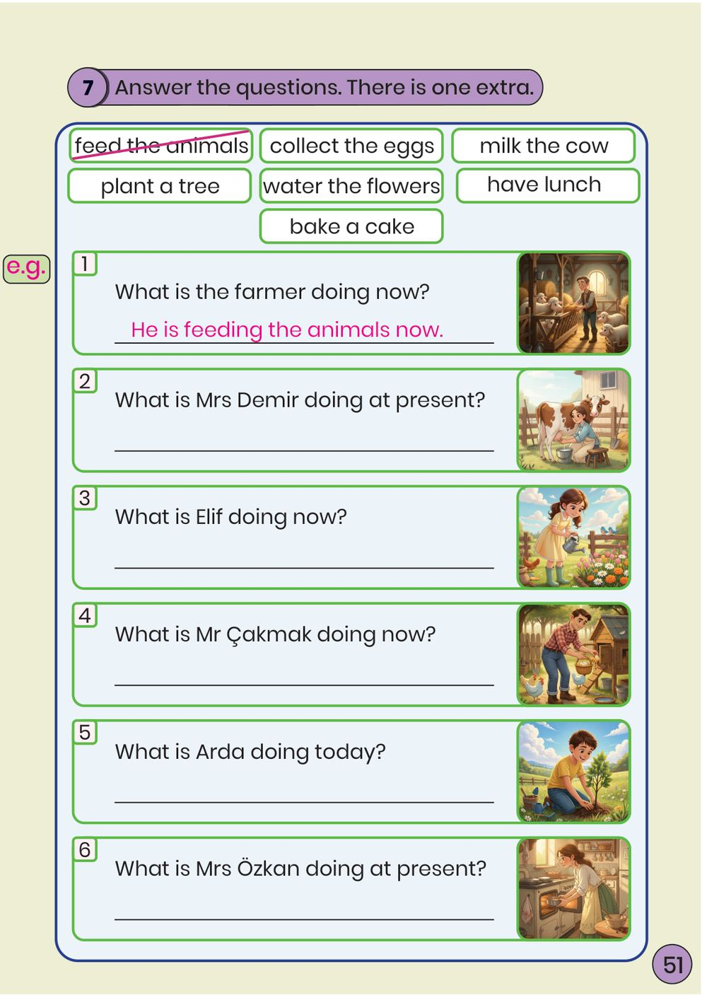

2. What is Mrs Demir doing at present?
_________________________________________________ 

3. What is Elif doing now?
_________________________________________________ 

4. What is Mr Çakmak doing now?
_________________________________________________ 

5. What is Arda doing today?
_________________________________________________ 

6. What is Mrs Özkan doing at present?
_________________________________________________ 

<!-- sayfa 51 -->

8 Look and find.

e.g.
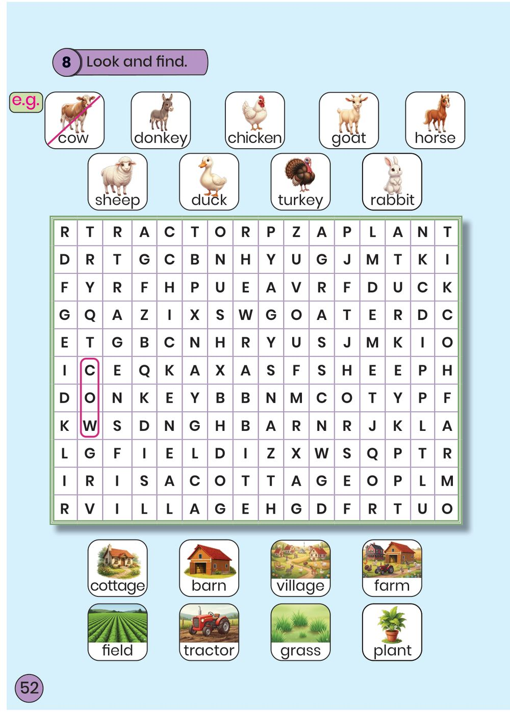

| R | T | R | A | C | T | O | R | P | Z | A | P | L | A | N | T |
|---|---|---|---|---|---|---|---|---|---|---|---|---|---|---|---|
| D | R | T | G | C | B | N | H | Y | U | G | J | M | T | K | I |
| F | Y | R | F | H | P | U | E | A | V | R | F | D | U | C | K |
| G | Q | A | Z | I | X | S | W | G | O | A | T | E | R | D | C |
| E | T | G | B | C | N | H | R | Y | U | S | J | M | K | I | O |
| I | C | E | Q | K | A | X | A | S | F | S | H | E | E | P | H |
| D | O | N | K | E | Y | B | B | N | M | C | O | T | Y | P | F |
| K | W | S | D | N | G | H | B | A | R | N | R | J | K | L | A |
| L | G | F | I | E | L | D | I | Z | X | W | S | Q | P | T | R |
| I | R | I | S | A | C | O | T | T | A | G | E | O | P | L | M |
| R | V | I | L | L | A | G | E | H | G | D | F | R | T | U | O |

<!-- sayfa 52 -->

9 Read and answer.

# FARM LIFE

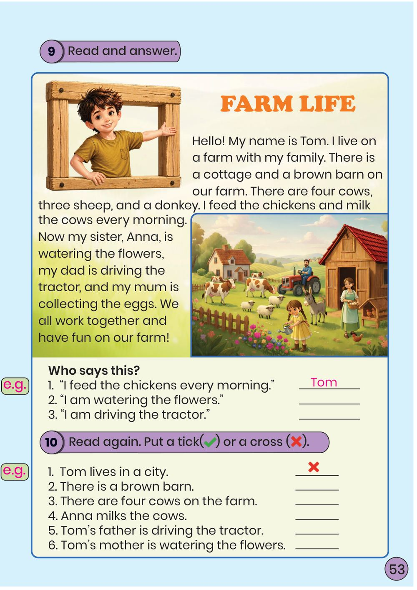

Hello! My name is Tom. I live on a farm with my family. There is a cottage and a brown barn on our farm. There are four cows, three sheep, and a donkey. I feed the chickens and milk the cows every morning. Now my sister, Anna, is watering the flowers, my dad is driving the tractor, and my mum is collecting the eggs. We all work together and have fun on our farm!

**Who says this?**

e.g. 1. “I feed the chickens every morning.”  Tom
2. “I am watering the flowers.”  ____________________
3. “I am driving the tractor.”  ____________________

10 Read again. Put a tick($\checkmark$) or a cross ($\times$).

e.g. 1. Tom lives in a city. $\times$
2. There is a brown barn. ____________________
3. There are four cows on the farm. ____________________
4. Anna milks the cows. ____________________
5. Tom’s father is driving the tractor. ____________________

<!-- sayfa 53 -->

11 Draw your dream farm and complete.

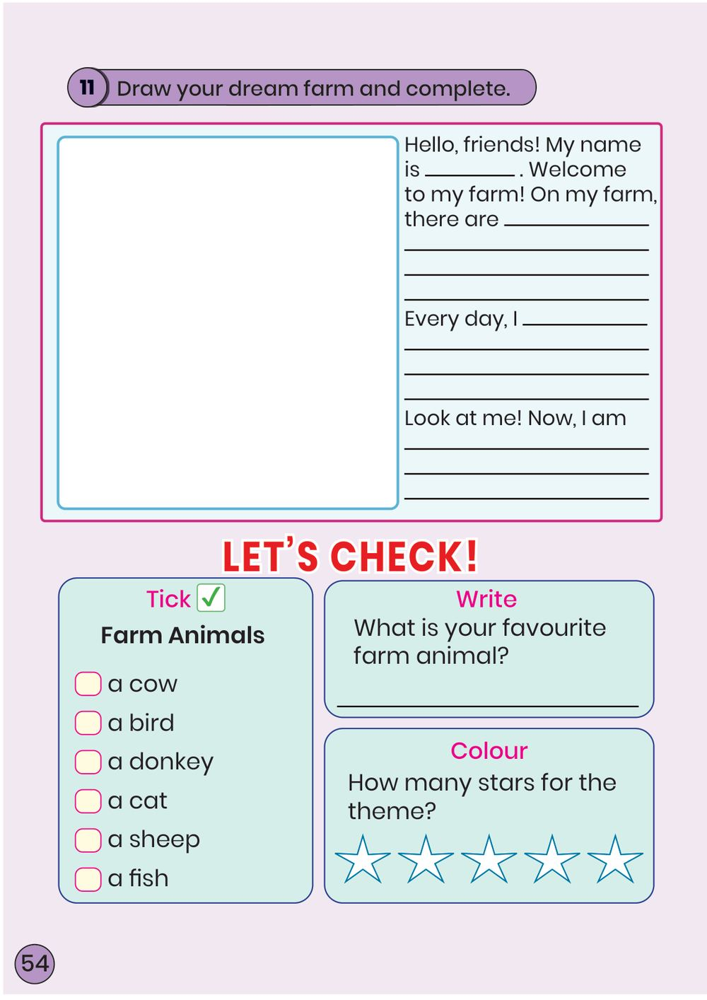

Hello, friends! My name is ________. Welcome to my farm! On my farm, there are __________________________________________________________________
__________________________________________________________________
Every day, I ______________________________________________________
__________________________________________________________________
__________________________________________________________________
Look at me! Now, I am ______________________________________________
__________________________________________________________________
__________________________________________________________________

# LET’S CHECK!

| Tick ✅ Farm Animals | Write |
| :--- | :--- |
| ◯ a cow | What is your favourite farm animal? |
| ◯ a bird | ____________________________________ |
| ◯ a donkey | |
| ◯ a cat | **Colour** |
| ◯ a sheep | How many stars for the theme? |
| ◯ a fish | ☆ ☆ ☆ ☆ ☆ |

<!-- sayfa 54 -->

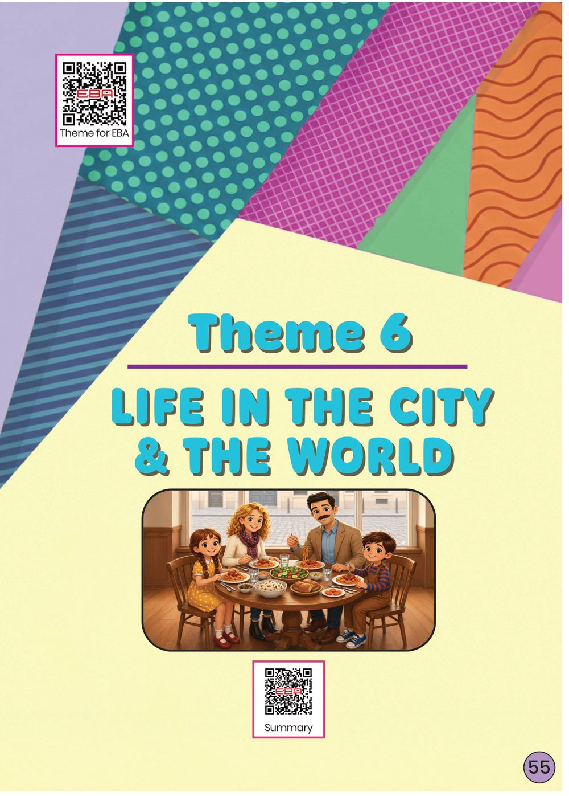

# Theme 6
## LIFE IN THE CITY & THE WORLD

<!-- sayfa 55 -->

1 Look, match, and write. There is one extra.

toast | fruit juice | rice | pancakes | a sandwich
--- | --- | --- | --- | ---
milk | water | cheese | butter | bread
a cake | tea | salad | olives

1 bread | 2 | 3 | 4
---|---|---|---
5 | 6 | | 
7 | 8 | 9 | 
10 | 11 | 12 | 
| | | 13 |

<!-- sayfa 56 -->

# 2 Look and write.

e.g.
I'm eating a 1) sandwich,
and some 2) __________.
I'm drinking 3) __________.

I'm eating some 4) __________ and some 5) __________. I'm drinking some 6) __________.

I'm eating 7) __________,
and 8) __________.
I'm drinking 9) __________.

# 3 Look and find.

| 🍎 | 🍞 | 🍰 | 🍩 | 🍳 | 🍟 | 🍇 | 🍯 | 🍦 | 🍹 | 🍢 | 🍋 | 🥛 |
| :---: | :---: | :---: | :---: | :---: | :---: | :---: | :---: | :---: | :---: | :---: | :---: | :---: |
| A | B | C | D | E | F | G | H | I | J | K | L | M |

| 🥗 | 🍊 | 🍕 | 🍐 | 🍚 | 🥪 | 🍵 | 🍈 | 🥕 | 🍼 | 🍗 | 🥣 | 🥒 |
| :---: | :---: | :---: | :---: | :---: | :---: | :---: | :---: | :---: | :---: | :---: | :---: | :---: |
| N | O | P | Q | R | S | T | U | V | W | X | Y | Z |

| 🍳 | 🥗 | 🍹 | 🍊 | 🥣 | 🥛 | 🥣 | 🥛 | 🍎 | 🥣 | 🍋 |
| :---: | :---: | :---: | :---: | :---: | :---: | :---: | :---: | :---: | :---: | :---: |

<!-- sayfa 57 -->

4 Read and match. There is one extra.

e.g. a  2
b 
c 
d 

1) Hakan: Can I have some soup, please?
   Emre: Yes, you can.

2) Eren: Have you got any fruit juice?
   Fulya: Yes, we have got some fruit juice.

3) Ahmet: Can I see the menu, please?
   Emre: Yes, of course.

<!-- sayfa 58 -->

5 Look, read, and complete. There is one extra.

| What's for lunch | Pass me the salt | Yummy | I'm full |
| :--- | :--- | :--- | :--- |
| ~~Dinner is ready~~ | Can I have some water | Here you are | |

1

e.g.
- Dinner is ready, everyone!
- Okay, Mum! We're coming!

2

- \_\_\_\_\_\_\_\_\_\_\_\_, please.
- Here you are!

3

- Can I see the menu, please?
- \_\_\_\_\_\_\_\_\_\_\_\_.

4

- \_\_\_\_\_\_\_\_\_\_\_\_, please?
- Yes, of course.

5

- Do you want some more cake?
- \_\_\_\_\_\_\_\_\_\_\_\_.

6

- \_\_\_\_\_\_\_\_\_\_\_\_, Dad?
- We've got some \_\_\_\_\_\_\_\_\_\_\_\_.

<!-- sayfa 59 -->

# 6 Look and complete.

 e.g. 1
 2
 3
 4
 5
 6
 7
 8
 9
 10
 11

F
R
U
I
T
J
U
I
C
E

<!-- sayfa 60 -->

# 7 Read and write the names.

Hello! I’m Mia. It’s lunch time at my school. My friends and I are in the lunch hall. Let’s look at our lunchboxes! I have got some pancakes and olives today. My friend, Brad, has got some pasta with cheese. Thomas has got a sandwich and an apple. I love eating with my friends!

Thomas
Brad
Mia

e.g. 1 Mia 2 [ ] 3 [ ]

# 8 Read again and answer.

e.g. 1. Where are Mia and her friends?
a) In the lunch hall
b) In the classroom
c) In the park

2. What has Brad got for lunch?
a) Pancakes and olives
b) A sandwich and an apple
c) Pasta with cheese

3. What has Mia got?
a) A sandwich and an apple
b) Pancakes and olives
c) Pasta with cheese

4. What has Thomas got?
a) A sandwich and an apple
b) Pancakes and olives
c) Pasta with cheese

<!-- sayfa 61 -->

# 9 Draw and write.

 For breakfast, I often have
___________________________
___________________________
___________________________

 For lunch, I often have
___________________________
___________________________
___________________________

# LET'S CHECK!

| Tick ✅ Food and Drinks | Write |
| :--- | :--- |
| ☐ a pupil | What do you have for lunch? |
| ☐ a woman | I have ______________________. |
| ☐ fruit juice | |
| ☐ toast | **Colour** |
| ☐ a ruler | How many stars for the theme? |
| ☐ salad | ☆ ☆ ☆ ☆ ☆ |

<!-- sayfa 62 -->

# REFERENCES

**MEB (2025), Öğretim Programları Ortak Metni, Türkiye Yüzyılı Maarif Modeli, Ankara.**

**MEB (2025), Primary Education The English Language Curriculum (Years 2-3-4-5-6-7-8), The Century of Türkiye Education Model, Ankara.**

**Oxford University Press (2002) Oxford Collocations Dictionary for Students of English (9th ed.) Oxford.**

**The references in this section have been prepared following the principles and formatting rules of the APA Style $6^{\text{th}}$ <!-- KONTROL: Marker'da karşılığı yok, uydurma olabilir --> Edition.**

# ANSWER KEY

# VISUAL AND GENERAL WEB REFERENCES

<!-- sayfa 63 -->

50°D
45°D
40°D
35°D
30°D
25°D
40°K
35°K

| ROMANYA | UKRAYNA | RUSYA FEDERASYONU | HAZAR DENİZİ |
| :--- | :--- | :--- | :--- |
| Bükreş | | | |

| BULGARİSTAN | GÜRCİSTAN | AZERBAYCAN |
| :--- | :--- | :--- |
| Sofya | Tiflis | |
| | | ERMENİSTAN |
| | | Erivan |
| | | NAHÇIVAN Ö.C. (AZERBAYCAN) |

| YUNANİSTAN | | İRAN | IRAK |
| :--- | :--- | :--- | :--- |
| Atina | | | Bağdat |

| LİBYA | MISIR | SÜRİYE | LÜBNAN | İSRAİL | FİLİSTİN |
| :--- | :--- | :--- | :--- | :--- | :--- |
| | Nil N. | Şam | Beyrut | Tel Aviv | Kudüs |
| | Süveyş K. | | | Doğu Kudüs | Gazze Şeridi |
| | | | | | Batı Şeria |

**TÜRKİYE'NİN MÜLKİ İDARE BÖLÜMLERİ İLE KARA VE DENİZ KOMŞULARI HARİTASI**

**Lejant:**
* BAŞKENT (Ankara)
* İL MERKEZİ
* GÖL
* AKARSU
* ÜLKE SINIRI
* ÖZERK BÖLGE SINIRI

**Denizler ve Göller:**
* KARADENİZ
* EGE DENİZİ
* AKDENİZ
* MARMARA DENİZİ
* HAZAR DENİZİ
* Van Gölü
* Tuz Gölü

**Nehirler:**
* Meriç N.
* Sakarya N.
* Kızılırmak N.
* Yeşilırmak N.
* Çoruh N.
* Fırat N.
* Dicle N.
* Aras N.
* Kura N.
* Asi N.
* Ceyhan N.
* Seyhan N.
* Göksu N.
* Büyük Menderes N.
* Küçük Menderes N.
* Bakırçay N.
* Gediz N.

**İller (Harita üzerindeki dağılım):**
Adana, Adıyaman, Afyonkarahisar, Ağrı, Amasya, Ankara, Antalya, Artvin, Aydın, Balıkesir, Bilecik, Bingöl, Bitlis, Bolu, Burdur, Bursa, Çanakkale, Çankırı, Çorum, Denizli, Diyarbakır, Edirne, Elâzığ, Erzincan, Erzurum, Eskişehir, Gaziantep, Giresun, Gümüşhane, Hakkâri, Hatay, Isparta, Mersin, İstanbul, İzmir, Kars, Kastamonu, Kayseri, Kırklareli, Kırşehir, Kocaeli, Konya, Kütahya, Malatya, Manisa, Kahramanmaraş, Mardin, Muğla, Muş, Nevşehir, Niğde, Ordu, Rize, Sakarya, Samsun, Siirt, Sinop, Sivas, Tekirdağ, Tokat, Trabzon, Tunceli, Şanlıurfa, Uşak, Van, Yozgat, Zonguldak, Aksaray, Bayburt, Karaman, Kırıkkale, Batman, Şırnak, Bartın, Ardahan, Iğdır, Yalova, Karabük, Kilis, Osmaniye, Düzce.

**Diğer Yerleşimler/Bölgeler:**
* KUZEY KIBRIS TÜRK CUMHURİYETİ
* GÜNEY KIBRIS RUM YÖNETİMİ
* Lefkoşa
* Gökçeada
* Bozcaada

**Ölçek:**
0 100 200 300 400 km

Harita Genel Müdürlüğü tarafından üretilmiştir.

<!-- sayfa 64 -->

# TÜRK DÜNYASI HARİTASI

**Lejant:**
* Bağımsız Türk Devletleri
* Türk Cumhuriyetleri, Türk Bölgeleri
* Türk Toplulukları

**Ölçek:**
0 250 500 1.000 1.500 2.000 km

---

### TÜRK CUMHURİYETLERİ, TÜRK BÖLGELERİ
1. GAGAVUZ YERİ
2. KARAÇAY-ÇERKESYA
3. KABARDİN-BALKARYA C.
4. DAĞİSTAN C.
5. ÇUVAŞİSTAN C.
6. TATARİSTAN C.
7. BAŞKURT C.
8. KARAKALPAKİSTAN C.
9. ALTAY C.
10. HAKASYA C.

### TÜRK TOPLULUKLARI
**Avrupa'daki Türkler**
a. Kosova Türkleri
b. Yunanistan Türkleri
c. Bulgaristan Türkleri
ç. Romanya Türkleri
d. Suriye Türkmenleri
e. Irak Türkmenleri
f. İran Türkleri
g. Afganistan Türkmenleri
ğ. Pakistan Türkmenleri
h. Hindistan Türkmenleri
ı. Çin H. C. Türkleri
i. Moğolistan Türkleri
j. Rusya Federasyonu Türkleri

---

### ÜLKE KISALTMALARI
ARN: ARNAVUTLUK
BEL: BELÇİKA
BH: BOSNA - HERSEK
GKRY: GÜNEY KIBRIS RUM YÖNETİMİ
HRV: HIRVATİSTAN
İSV: İSVİÇRE
KMKD: KUZEY MAKEDONYA
KKTC: KUZEY KIBRIS TÜRK CUMHURİYETİ
KRD: KARADAĞ
KSV: KOSOVA
LİH: LİHtenştayn
SRB: SIRBİSTAN

---

**Coğrafi Bilgiler (Harita Üzerindeki Bazı İsimler):**

**Denizler ve Okyanuslar:**
Bering Denizi, Ohotsk Denizi, Doğu Çin Denizi, Güney Çin Denizi, Japon Denizi, Doğu Denizi, Sarı Deniz, Pasifik Denizi, Kuzey Denizi, Barents Denizi, Norveç Denizi, Manş Denizi, Atlantik Denizi, Akdeniz, Ege Denizi, Adriyatik Denizi, Tiren Denizi, Baltık Denizi, Karadeniz, Azak Denizi, Hazar Denizi, Umman Denizi, Kızıldeniz.

**Nehirler ve Göller:**
Obi N., Yenisey N., Lena N., Amur N., Volga N., Don N., Dicle N., Fırat N., Nil N., Tuna N., İrtiş N., Sırderya N., Aral G., Baykal G., Ladoga G., Balkaş G., Onega G., Van G., Urumiye G., Hulun G., Tuz G.

**Şehirler:**
Moskova, Kiev, Varşova, Berlin, Paris, Londra, Brüksel, Atina, Sofya, Ankara, İstanbul, Bakü, Tiflis, Taşkent, Bişkek, Aşkabat, Astana, Pekin, Ulanbator, Yeni Delhi, İslamabad, Kâbil, Tahran, Bağdat, Şam, Kahire, Riyad, Muskat, Sana, Doha, Kuveyt, Amman.

**Ülkeler:**
Rusya Federasyonu, Kazakistan, Özbekistan, Türkmenistan, Kırgızistan, Tacikistan, Moğolistan, Çin Halk Cumhuriyeti, Hindistan, Pakistan, Afganistan, İran, Irak, Suriye, Ürdün, İsrail, Filistin, Lübnan, Türkiye, Azerbaycan, Gürcistan, Ermenistan, Yunanistan, Bulgaristan, Romanya, Moldova, Ukrayna, Belarus, Polonya, Almanya, Fransa, İspanya, Portekiz, İtalya, İsviçre, Avusturya, Macaristan, Çekya, Slovakya, Sırbistan, Bosna-Hersek, Hırvatistan, Slovenya, Karadağ, Arnavutluk, Kuzey Makedonya, Kosova, Yunanistan, Türkiye, Kıbrıs, Mısır, Libya, Tunus, Cezayir, Fas, Sudan, Etiyopya, Somali, Yemen, Umman, Suudi Arabistan, Birleşik Arap Emirlikleri, Katar, Kuveyt, Irak, İran, Afganistan, Pakistan, Hindistan, Bangladeş, Çin, Moğolistan, Kazakistan, Kırgızistan, Tacikistan, Özbekistan, Türkmenistan.
