# İngilizce Dersi 3.Sınıf Ders Kitabı

<!-- sayfa 0 -->

# ENGLISH
## Year 3
## Pupil’s Book

### AUTHORS
Ayşe Gül ÜNLÜ
Emine ÇATLI
Gülden CENGİZ
Remziye GÜLER ASLAN
Sezin SEVİM KULA


<!-- sayfa 1 -->

MİLLÎ EĞİTİM BAKANLIĞI YAYINLARI NO...................................................................... : 10772
DERS KİTAPLARI DİZİSİ NO........................................................................................................ : 2522

Her hakkı saklıdır ve Millî Eğitim Bakanlığına aittir. Kitabın metin, soru ve şekilleri kısmen de olsa hiçbir surette alınıp yayımlanamaz.

# EDITOR
Dr. Kamile HAMİLOĞLU

## VISUAL DESIGNERS
Ahmet Emre SIRÇANCI
Arzu GÜNAL GÜN
Özcan ELGÜNLÜ
Sinem POYRAZ ÖZTÜRK

## MULTIMEDIA DESIGNERS
Cem SAVAŞ
Enver ÜLKER
Erhan AY
Hasan ARLI
Murat Evren AYDURDU
Nilgün BOZNA

## CURRICULUM DEVELOPMENT SPECIALISTS
Dr. Mehmet AKCAALAN
Dr. Mustafa KANDIRMAZ
Zeynep Nazife ÖNER

## ASSESSMENT AND EVALUATION SPECIALIST
Ercan ARASTAMAN

## GUIDANCE SPECIALISTS
Ahmet Baykan BULUT
Aylin SAZLI SAYICI

ISBN 978-975-11-9835-8

Millî Eğitim Bakanlığı Talim ve Terbiye Kurulu Başkanlığının 30.06.2026 tarih ve 163364067 sayılı yazısı ile eğitim aracı olarak kabul edilmiştir. Kurulca bu kitabın kabul edilmiş olması ders kitabından yayınevi ve yazarların sorumluluğunu kaldırmaz.

<!-- sayfa 2 -->

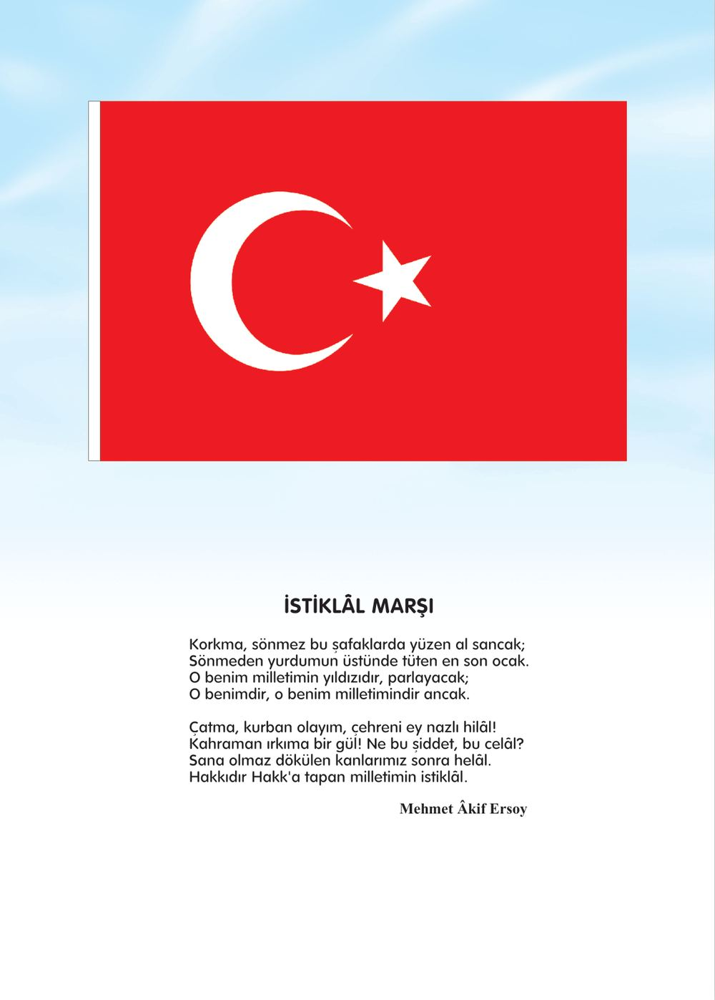

# İSTİKLÂL MARŞI

Korkma, sönmez bu şafaklarda yüzen al sancak;
Sönmeden yurdumun üstünde tüten en son ocak.
O benim milletimin yıldızıdır, parlayacak;
O benimdir, o benim milletimindir ancak.

Çatma, kurban olayım, çehreni ey nazlı hilâl!
Kahraman ırkıma bir gül! Ne bu şiddet, bu celâl?
Sana olmaz dökülen kanlarımız sonra helâl.
Hakkıdır Hakk'a tapan milletimin istiklâl.

Mehmet Âkif Ersoy

<!-- sayfa 3 -->

ANDIMIZ

Türküm, doğruyum, çalışkanım.

İlkem küçüklerimi korumak, büyüklerimi saymak; yurdumu, milletimi özümden çok sevmektir.
Ülküm yükselmek, ileri gitmektir.

Ey Büyük Atatürk!

Açtığın yolda, gösterdiğin hedefe durmadan yürüyeceğime ant içerim.

Varlığım Türk varlığına armağan olsun.

Ne mutlu Türküm diyene!


<!-- yer tutucu bulunamadı: sayfa sonuna eklendi -->

<!-- sayfa 4 -->

MUSTAFA KEMAL ATATÜRK

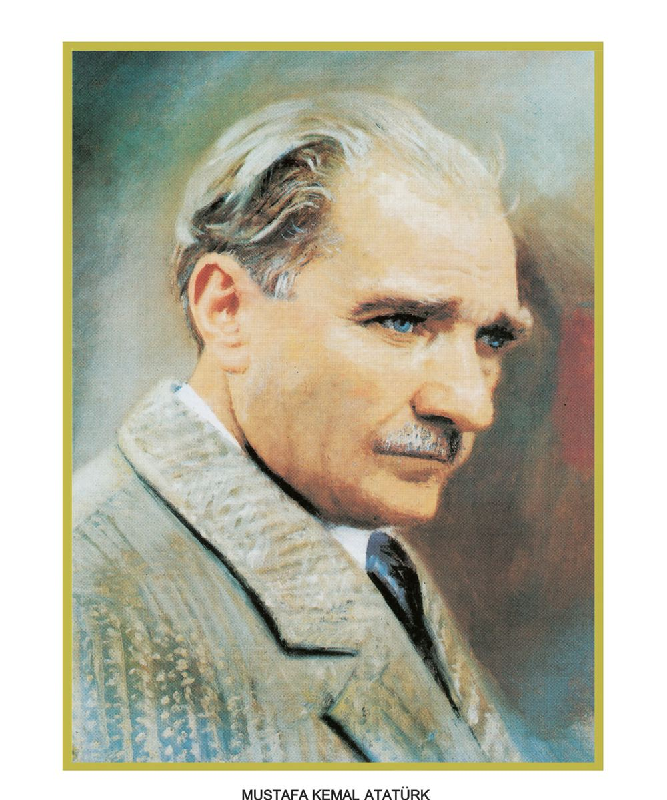
<!-- yer tutucu bulunamadı: sayfa sonuna eklendi -->

<!-- sayfa 5 -->

Henüz bir görüntü veya PDF metin katmanı sağlamadınız. Lütfen dönüştürülmesini istediğiniz sayfanın görüntüsünü veya metin katmanını paylaşın. Paylaştığınız anda talimatlarınıza harfiyen uyarak (LaTeX kullanımı, şekil yerleşimi ve Markdown formatı dahil) işlemi gerçekleştireceğim.


<!-- yer tutucu bulunamadı: sayfa sonuna eklendi -->

<!-- sayfa 6 -->

# CONTENTS

| | |
| :--- | :---: |
| Table of Contents | 8 |
| Introduction to the Book | 10 |
| Revision | 11 |
| Theme 1 – School Life | 19 |
| Theme 2 – Classroom Life | 37 |
| Theme 3 – Personal Life | 57 |
| Theme 4 – Family Life | 75 |
| Theme 5 – Homes & Houses & The Neighbourhood | 95 |
| Theme 6 – Life in the City & The World | 113 |
| Cut-Outs | 131 |
| Glossary | 149 |
| References | 155 |
| Answer Key | 155 |
| Visual and General Web References | 155 |
| Map of Türkiye’s Administrative Divisions and Its Land and Maritime Neighbours | 156 |
| Map of the Turkic World | 157 |

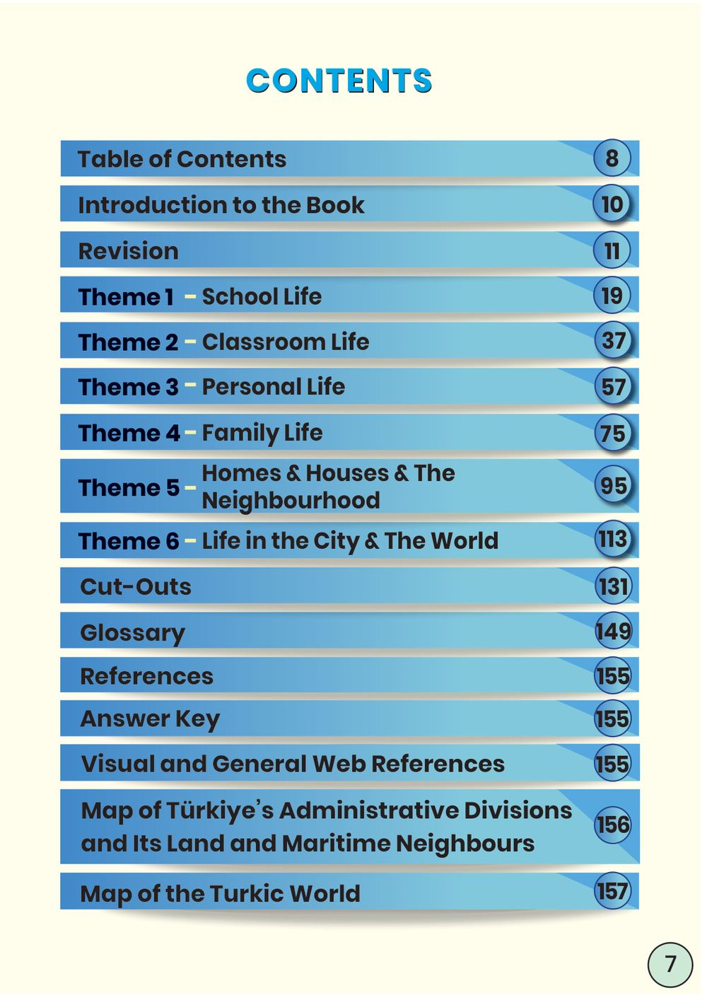
<!-- yer tutucu bulunamadı: sayfa sonuna eklendi -->

<!-- sayfa 7 -->

| THEME | MAIN THEME | SUB-THEMES | TITLE of the DIGITAL STORY | CHUNKS | CHUNKS & GAMIFICATION | VOCABULARY | VOCABULARY & GAMIFICATION | PRONUNCIATION |
| :--- | :--- | :--- | :--- | :--- | :--- | :--- | :--- | :--- |
| 1 SCHOOL LIFE | | Greetings and introductions at school; people and places at school; months of the year; ages and birthday celebrations; national days and celebrations. | The Surprise Birthday Party | • Who’s/is this/she/he? This is Mr. Blue.<br>• Where is Daphne? She’s/is in the library.<br>• What month is it now? It’s/is September.<br>• How old are you? I’m 8 years old.<br>• When’s/is your birthday? It’s/is in July.<br>-There is / There are (+), (-), (?)<br>• Is there a nurse at school? Yes, there is a nurse at school.<br>• How many caretakers (are there at school)? (There are) two caretakers (at school).<br>-Must/ mustn’t (for obligation): (+), (-), (?)<br>• You must follow the rules at school. You mustn’t run in the corridor/at school.<br>• Personal Pronouns: I, you, we, they, he, she, it<br>• Prepositions: in, on, at<br>• Describing locations, time, and positions.<br>• Wh- question words: what, where, who, when<br>• Question words: how<br>• Demonstrative pronouns: this, that | • Let’s play together. (Roll and say game)<br>• Basic Skill: Speaking | • People at school (a classmate, a librarian, a school nurse, etc.)<br>• Places at school (an art room, a music room, a meeting room, etc.)<br>• Birthday celebrations (birthday, a birthday party, a candle, etc.)<br>• Months of the year (January, February, March, etc.)<br>• Verbs (to prepare, to decorate, to bring, etc.) | • Watch, talk, and match.<br>• Basic Skills: Reading and Listening<br>• Let’s play together. (Fast Finger Game)<br>• Basic Skill: Speaking | • a cat<br>• a cake<br>• a banana<br>• a bowl<br>• a book |
| 2 | CLASSROOM LIFE | Classroom instructions and language; classroom furniture, objects, and devices; school subjects; seasons of the year. | Spin the Wheel Game | • What time is it? It’s five o’clock.<br>• What lesson is it now? It’s/is Maths.<br>• How’s/is the weather today/now? It’s/is raining today. (It’s rainy (AmE.) today).<br>• Countable nouns: a ruler- rulers.<br>• What are they? They are rulers.<br>• There is/there are: (only for countable nouns)<br>• Is there a Maths lesson on Monday? (Yes, there’s/is a Maths lesson on Monday). Yes, there is<br>• How many rulers are there on the table? (There are two rulers on the table). There are two rulers. Two rulers.<br>• Have got/has got: (+) (?) (only with countable nouns and with numbers)<br>• How many pencils have you got? I’ve/have got two pencils.<br>• Possessive adjectives: my, his, her, its, our, your, their<br>• Question words: what time, how many<br>• Time expressions: today, now | • Let’s play together. (Spelling game)<br>• Basic Skill: Speaking | • Classroom furniture (a teacher’s desk, bookshelf, etc.)<br>• Classroom features (lights)<br>• Classroom objects (a pen, a ruler, etc.)<br>• Classroom devices (a keyboard, etc.)<br>• School subjects (Life Study, etc.)<br>• Nouns (a word, a letter, etc.)<br>• Colours (red, grey, etc.)<br>• Weather (sunny, etc.)<br>• Cardinal Numbers: 20 – 50<br>• The alphabet (song) | • Let’s play. (Guess What’s in My Hand)<br>• Basic Skill: Speaking | • a card<br>• a pencil<br>• a duster |
| 3 | PERSONAL LIFE | Parts of the body and physical features; personal characters; weather conditions; clothing according to seasons and weather conditions; preferences for clothing. | The Camping Day | • What’s your name? I’m/ am… / My name is….<br>• What does she look like? She’s tall and beautiful.<br>• “Have got/ Has got: (+) (-) (?)”:<br>• Have you got a big or small nose? I’ve/have got a small nose.<br>• Have you got any T-shirts? Yes, I’ve/have got some T-shirts.<br>• What colour hair has she got? She’s/has got blonde hair.<br>• How is her hair? What’s her hair like? She’s/has got curly hair.<br>• Like/dislike: I like/hate/dislike/love big sunglasses.<br>• Possessive “s": Whose dress is this? This is Jasmine’s dress.<br>• The Present Progressive: What are you wearing today? I’m/am wearing a T-shirt today. I’m wearing a coat. It’s winter and it’s cold.<br>• Countable and uncountable nouns with some, any, much, many. (Have you got any shirts? Yes, I’ve got some shirts).<br>• Question words: Whose, what…like.<br>• Conjunctions: and, or | • Let’s play. (Read and act)<br>• Basic Skill: Speaking | • Parts of the body (a foot, feet, etc.)<br>• Adjectives (Hair: Blond(e), curly, etc. ; physical features: little, strong, etc. ; personal characters: nice, good, etc.)<br>• Weather (sunny, rainining, etc.)<br>• Verbs for feelings about body parts (to like, to dislike, etc.)<br>• Clothes (a sweatshirt, jeans, etc.) | • Read, colour, and say.<br>• Basic Skills: Reading and Writing | • a pen<br>• a teacher<br>• weak<br>• fish<br>• a game<br>• a giraffe<br>• a hat<br>• time<br>• sit<br>• a jacket |
| 4 | FAMILY LIFE | Family members; ages of family members; daily routines and chores of family members; hobbies and abilities of family members. | Çağla and her Family | • How old is your mother? She’s/is thirty-five years old. Is this her birthday today? Yes, it’s/is her birthday today.<br>• The Simple Present Tense: What does she do every morning? She prepares breakfast every morning. What do you do at home? I clean my room every morning.<br>• Can/can’t: My father can cook. My father can’t cook.<br>• Could: Could you help me, please?<br>• Question word: How often?<br>• Adverbs of time: Every, sometimes, always, often, never<br>• Adverbs of manner: Well<br>• Conjunctions: But | • Let’s play.<br>• Basic Skill: Speaking | • Family members (a cousin, an aunt, etc.)<br>• Daily routines and chores of family members (to wake up, to study, etc.)<br>• Hobbies and abilities of family members (to swim, to play chess, etc.) | • Let’s play together. (Who is Who?)<br>• Basic Skills: Reading and Speaking | • a keyboard<br>• lazy<br>• a mouse<br>• a necklace<br>• October<br>• a parent |
| 5 | HOMES & HOUSES & THE NEIGHBOURHOOD | Life in the countryside; farmhouses and farm animals; activities and chores on a fa | A Day in the Farm | • There are there are: What is on your farm? There’s a farmhouse on our farm. How many cows are there on your farm? There are five cows on our farm.<br>• The Simple Present Tense: We do our farm every day! It’s milk our cows every day!<br>• The Present Progressive: The farmer is doing now? He’s watering the vegetables now.<br>• Adverbs of time: Now, at present, today | • Let’s play. (Show and Say)<br>• Basic Skill: Speaking | • Life in the countryside (a cow, a sheep, etc.)<br>• Farmhouses and farm animals (a farmhouse, a barn, etc.)<br>• Activities and chores on a farm (to feed, to grow, etc.) | • Let’s play together. (Guess the action)<br>• Basic Skill: Speaking | • quiet<br>• a rabbit<br>• sunny<br>• handsome<br>• a dress<br>• a tea<br>• a table<br>• a vegetable<br>• a vase |
| 6 | LIFE IN THE CITY & THE WORLD | Food items and meals, eating outside and ordering food. | A day in London | • The Simple Present Tense: What do you want? I want some salad, please.<br>• Will: What do you want? I’ll take some fruit, please. Can I have some soup, please? Yes, of course.<br>• Can I see the menu, please? Yes, of course.<br>• Have got/Has got: Have you got any olives? Yes, I’ve/have got some olives.<br>• Have you got any fruit juice? Yes, we’ve/have got some fruit juice.<br>• What have you got for lunch? We’ve/have got some bread. | • Let’s play together.<br>• Basic Skill: Speaking | • Meals (breakfast, lunch, etc.)<br>• Food items (water, cheese, etc.)<br>• Eating outside and ordering food (fast food, a café, etc.)<br>• Quantifiers: Some and any | • Let’s play together. (Help the mouse eat the cheese :)<br>• Basic Skill: Reading and Writing | • a uniform<br>• yummy<br>• a family<br>• water<br>• a box<br>• extra<br>• a zebra |

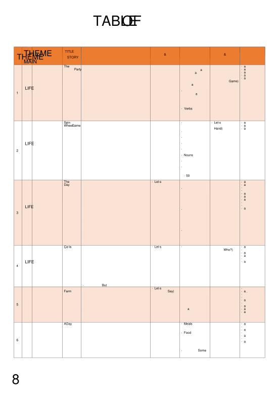
<!-- yer tutucu bulunamadı: sayfa sonuna eklendi -->

<!-- sayfa 8 -->

# TABLE OF CONTENTS

| LISTENING & WATCHING- COMPREHENSION | SPEAKING-EXPRESSION | READING- COMPREHENSION | WRITING-EXPRESSION | CLIL & CULTURE | PROJECTS | CONSOLIDATION | REFLECTION |
| :--- | :--- | :--- | :--- | :--- | :--- | :--- | :--- |
| • Look and listen.<br>• Basic Skills: Listening and Reading | • Read and act out. (Grammaring Selection and Use)<br>• Read and act out. (Strip Story for Consolidation)<br>• Basic Skills: Reading and Speaking | • My School.<br>• Basic Skill: Reading | • Find, circle and say. (Word search puzzle)<br>• Group and write. (Places and people)<br>• Basic Skill: Writing | • Let’s play. (Grammar Chunks)<br>• Objective: Remembering places and people with a board game. | • Design a diary page about the people and places at school.<br>• Objective: Remembering places and people. | • Look and match.<br>• Read and write.<br>• Find and circle.<br>• Odd one out. | • What about you? (Read and colour)<br>• Choosing the right emoji for themselves. |
| • Look and listen.<br>• Listen and complete.<br>• Basic Skills: Listening and Writing | • Read and act out. (Grammaring Selection and Use)<br>• Read and act out. (Strip Story for Consolidation)<br>• Let’s play together. (Card Game)<br>• Basic Skill: Speaking | • Jack’s Classroom.<br>• Basic Skill: Reading | • Look and write.<br>• Group and write.<br>• Basic Skill: Writing | • Look and answer.<br>• Objective: Remembering classroom objects, devices and furniture with an activity. | • Make your picture dictionary. (Write the names of the objects, devices and furniture. Talk about your Picture.)<br>• Objective: Remembering the names of objects, devices and furniture. | • Read and match.<br>• Find and complete.<br>• Find and match. | • What about you? (Read and colour)<br>• Choosing the right emoji for themselves. |
| • Look, listen and repeat.<br>• Basic Skills: Listening and Writing | • Read and act. (Grammaring Selection and Use)<br>• Read and act out. (Strip Story for Consolidation)<br>• Basic Skills: Speaking and Reading | • Read and write.<br>• Basic Skill: Reading | • Read and write.<br>• Draw, colour and write.<br>• Basic Skills: Reading and Writing | • Choose and say. (Board Game)<br>• Objective: Remembering language chunks. | • Make your booklet and say.<br>• Basic Skill: Speaking | • Look and write.<br>• Find and circle. | • What about you? (Read and colour)<br>• Choosing the right emoji for themselves. |
| • Listen and complete.<br>• Basic Skills: Listening and Writing | • Read and act. (Grammaring Selection and Use)<br>• Read and act out. (Strip Story for Consolidation)<br>• Basic Skills: Speaking and Reading | • Read and complete.<br>• Basic Skill: Reading | • Write and say.<br>• Basic Skills: Writing and Speaking | • Make a clock, then ask and answer.<br>• Basic Skill: Speaking | • Introduce your family members.<br>• Objective: Remembering the family members, their hobbies, their daily routines and chores at home. | • Look and write. | • What about you? (Read and colour)<br>• Choosing the right emoji for themselves. |
| • Listen and write.<br>• Basic Skills: Listening and Writing | • Read and act out. (Grammaring Selection and Use)<br>• Read and act out. (Strip Story for Consolidation)<br>• Basic Skills: Speaking and Reading | • Read and choose. (Ali’s Grandparents Farm)<br>• Basic Skills: Reading and Writing | • Match and write.<br>• Basic Skill: Writing | • Find and say.<br>• Objective: Remembering farm animals, farmhouses. | • Pupils will create a brochure about ‘Homes, Houses & The Neighbourhood’ with a focus on life in the countryside.<br>• Then, talk about it.<br>• Objective: Remembering life in the countryside, farmhouses and farm animals, activities and chores on a farm. | • Look and tick.<br>• Do the crossword puzzle. | • What about you? (Read and colour)<br>• Choosing the right emoji for themselves. |
| • Listen and repeat.<br>• Basic Skills: Listening and Writing | • Read and act out. (Grammaring Selection and Use)<br>• Read and act out. (Strip Story for Consolidation)<br>• Basic Skills: Reading and Speaking | • Read and match.<br>• Basic Skill: Reading | • Look and complete the menu.<br>• Basic Skill: Writing | • Read, answer and check. (Which food are you?)<br>• Objective: Remembering the names of food items, drinks and meals. | • Make a menu and act out.<br>• Objective: Talking about Food items, meals eating outside and ordering food. | • Read, find and write.<br>• Read and complete the dialogue. | • What about you? (Read and colour)<br>• Choosing the right emoji for themselves. |

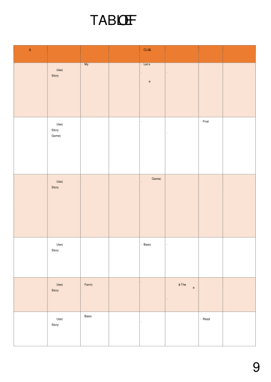
<!-- yer tutucu bulunamadı: sayfa sonuna eklendi -->

<!-- sayfa 9 -->

# INTRODUCTION TO THE BOOK

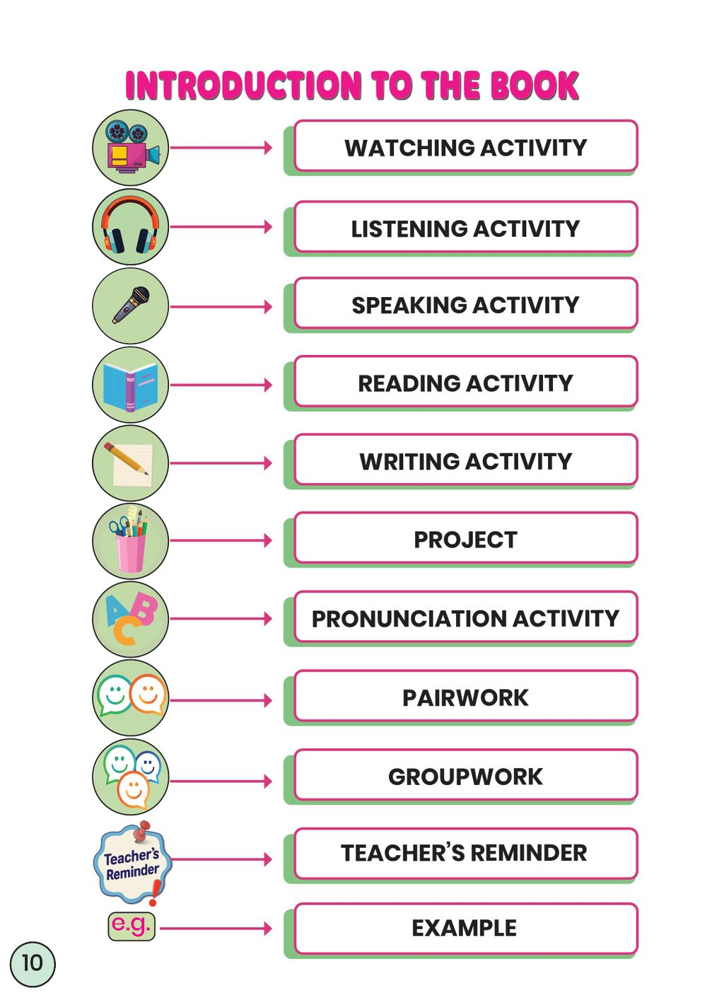 WATCHING ACTIVITY
 LISTENING ACTIVITY
 SPEAKING ACTIVITY
 READING ACTIVITY
 WRITING ACTIVITY
 PROJECT
 PRONUNCIATION ACTIVITY
 PAIRWORK
 GROUPWORK
 TEACHER'S REMINDER

<!-- sayfa 10 -->

# REVISION

Let’s remember!

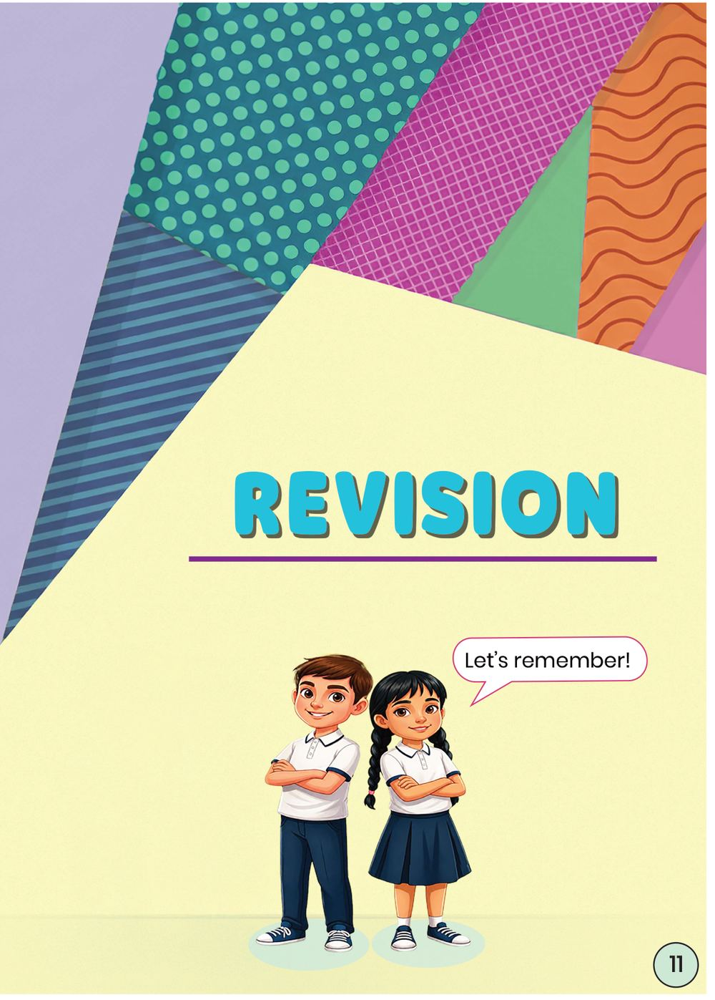

<!-- sayfa 11 -->

1 Read, complete, and say.

Hello! How are you? My name is Ali.
Bye! Nice to meet you!

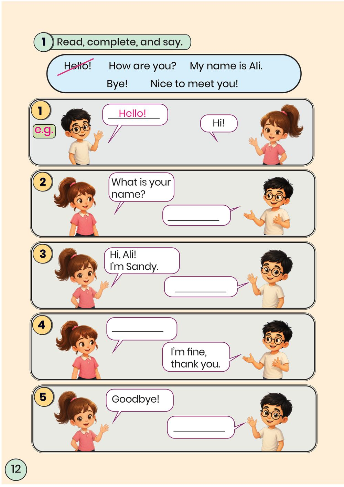
1 e.g.
Hello! Hi!


2
What is your name? \_\_\_\_\_\_\_\_\_\_


3
Hi, Ali! I'm Sandy. \_\_\_\_\_\_\_\_\_\_


4
\_\_\_\_\_\_\_\_\_\_
I'm fine, thank you.


5
Goodbye! \_\_\_\_\_\_\_\_\_\_

<!-- sayfa 12 -->

2 Find, write, and say.

| ~~pupil~~ | playground | teacher | library | classroom |
| :--- | :--- | :--- | :--- | :--- |
| school | lunch hall | canteen | headmaster | friend |

| W | P | L | A | Y | G | R | O | U | N | D | H | E | T | S | C |
|---|---|---|---|---|---|---|---|---|---|---|---|---|---|---|---|
| L | U | F | C | L | I | O | R | R | A | D | E | R | O | C | L |
| A | P | R | C | A | N | T | E | E | N | V | A | D | A | H | A |
| S | I | I | H | B | L | C | H | O | E | L | D | U | S | O | S |
| S | L | E | B | S | T | R | E | R | S | B | M | F | T | O | S |
| S | A | N | A | D | P | J | O | G | F | E | A | D | O | L | R |
| A | P | D | H | R | C | A | K | E | R | I | S | E | U | T | O |
| L | I | B | R | A | R | Y | E | T | I | N | T | R | O | O | O |
| E | T | E | A | C | H | E | R | I | C | L | E | T | E | A | M |
| L | U | N | C | H | H | A | L | L | O | L | R | V | B | O | Y |

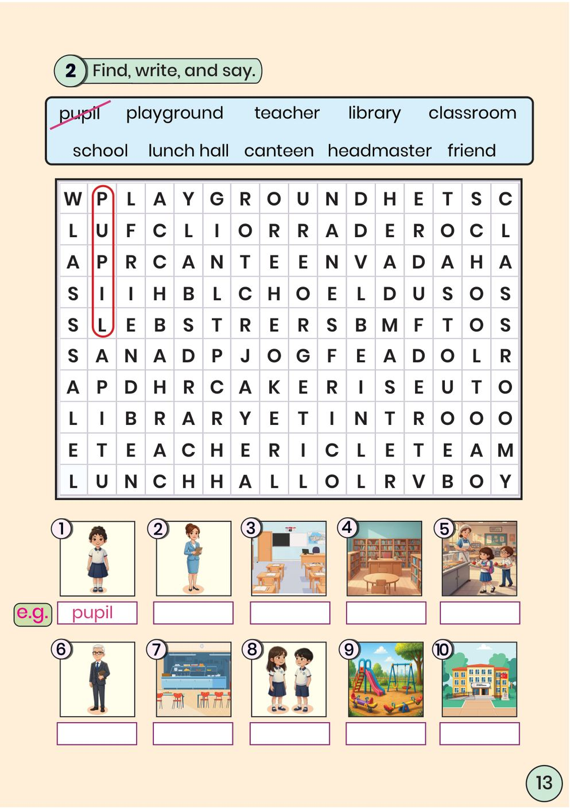


e.g. pupil


<!-- sayfa 13 -->

# 3 Read, answer, and say.

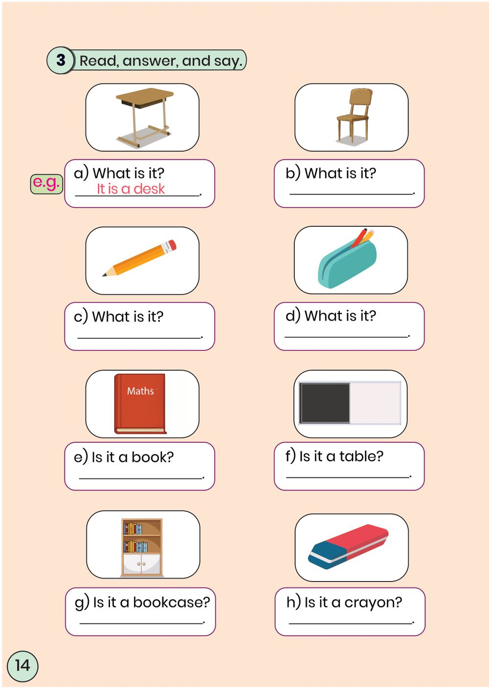
a) What is it?
____________________
e.g. It is a desk


b) What is it?
____________________


c) What is it?
____________________


d) What is it?
____________________


e) Is it a book?
____________________


f) Is it a table?
____________________


g) Is it a bookcase?
____________________


h) Is it a crayon?
____________________

<!-- sayfa 14 -->

# 4 Read the cards and write the numbers.

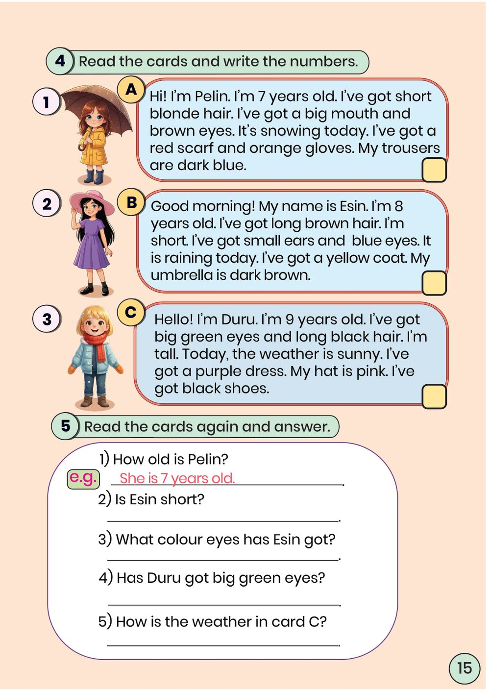
**A** Hi! I'm Pelin. I'm 7 years old. I've got short blonde hair. I've got a big mouth and brown eyes. It's snowing today. I've got a red scarf and orange gloves. My trousers are dark blue.
[ ]


**B** Good morning! My name is Esin. I'm 8 years old. I've got long brown hair. I'm short. I've got small ears and blue eyes. It is raining today. I've got a yellow coat. My umbrella is dark brown.
[ ]


**C** Hello! I'm Duru. I'm 9 years old. I've got big green eyes and long black hair. I'm tall. Today, the weather is sunny. I've got a purple dress. My hat is pink. I've got black shoes.
[ ]

# 5 Read the cards again and answer.

1) How old is Pelin?
e.g. She is 7 years old. __________________________

2) Is Esin short?
______________________________________________

3) What colour eyes has Esin got?
______________________________________________

4) Has Duru got big green eyes?
______________________________________________

5) How is the weather in card C?
______________________________________________

<!-- sayfa 15 -->

6 Look and write.

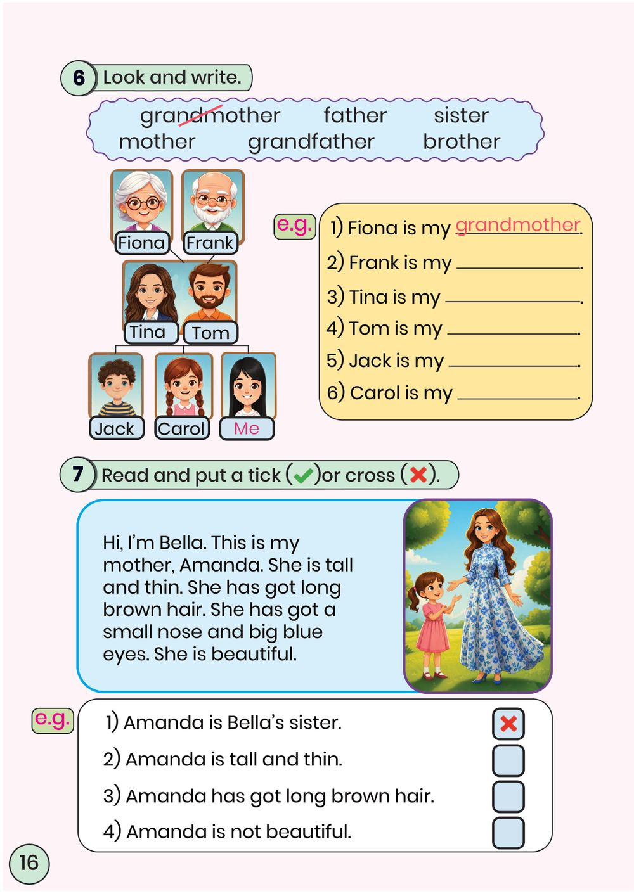

e.g. 1) Fiona is my grandmother
2) Frank is my \_\_\_\_\_\_\_\_\_\_\_\_\_\_\_\_\_\_\_\_\_\_\_\_\_\_\_\_
3) Tina is my \_\_\_\_\_\_\_\_\_\_\_\_\_\_\_\_\_\_\_\_\_\_\_\_\_\_\_\_
4) Tom is my \_\_\_\_\_\_\_\_\_\_\_\_\_\_\_\_\_\_\_\_\_\_\_\_\_\_\_\_
5) Jack is my \_\_\_\_\_\_\_\_\_\_\_\_\_\_\_\_\_\_\_\_\_\_\_\_\_\_\_\_
6) Carol is my \_\_\_\_\_\_\_\_\_\_\_\_\_\_\_\_\_\_\_\_\_\_\_\_\_\_\_\_

7 Read and put a tick ($\checkmark$) or cross ($\times$).


e.g. 1) Amanda is Bella's sister. $\times$
2) Amanda is tall and thin. [ ]
3) Amanda has got long brown hair. [ ]

<!-- sayfa 16 -->

8 Look, read, and put a tick ($\checkmark$) or cross ($\text{\texttimes}$).

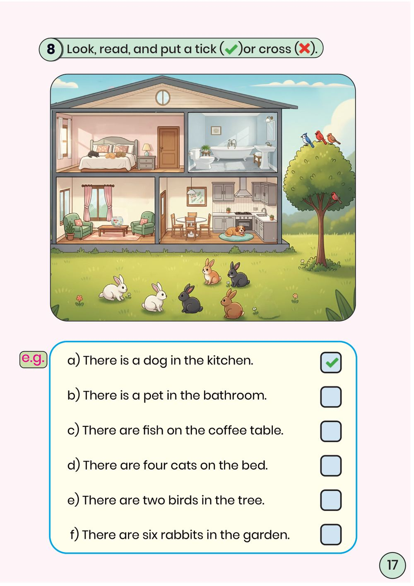

e.g.
a) There is a dog in the kitchen. [$\checkmark$]
b) There is a pet in the bathroom. [ ]
c) There are fish on the coffee table. [ ]
d) There are four cats on the bed. [ ]
e) There are two birds in the tree. [ ]
f) There are six rabbits in the garden. [ ]

<!-- sayfa 17 -->

# 9 Read, match, and say.

1. 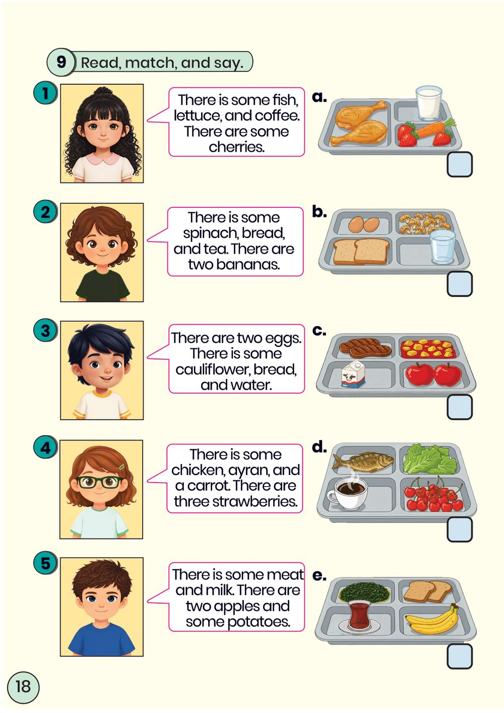
   There is some fish, lettuce, and coffee. There are some cherries.

2. 
   There is some spinach, bread, and tea. There are two bananas.

3. 
   There are two eggs. There is some cauliflower, bread, and water.

4. 
   There is some chicken, ayran, and a carrot. There are three strawberries.

5. 
   There is some meat and milk. There are two apples and some potatoes.

a. [[SEKIL:a]]
b. [[SEKIL:b]]
c. [[SEKIL:c]]
d. [[SEKIL:d]]
e. [[SEKIL:e]]

<!-- sayfa 18 -->

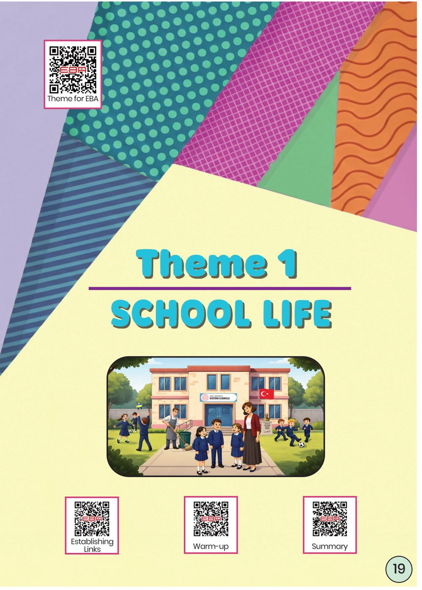

# Theme 1
# SCHOOL LIFE

<!-- sayfa 19 -->

1 Look at the picture and answer.
Where are they?

2 Watch the digital story. 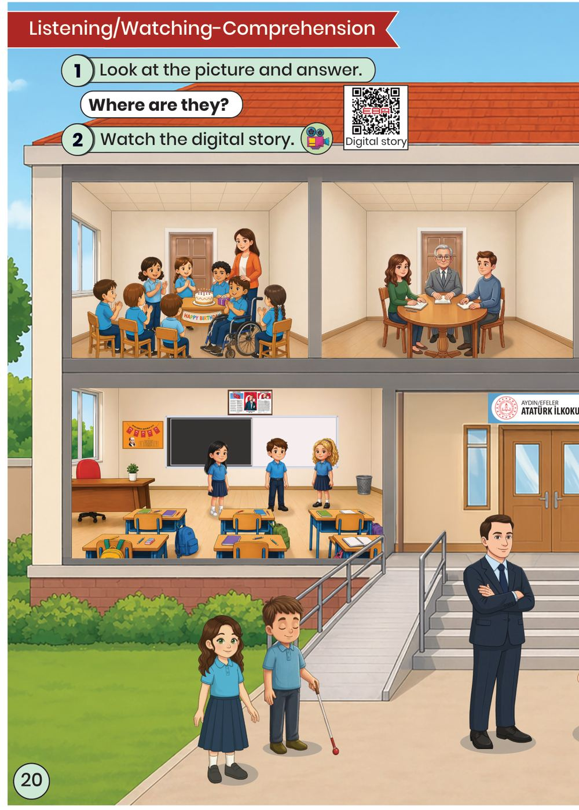
Digital story

<!-- sayfa 20 -->


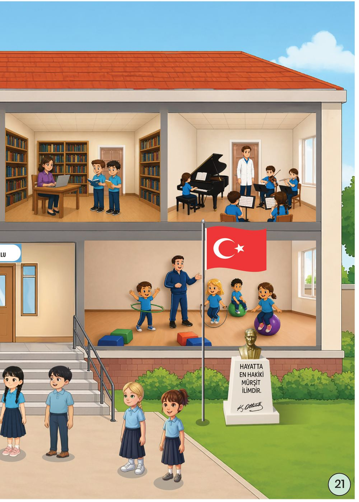
<!-- yer tutucu bulunamadı: sayfa sonuna eklendi -->

<!-- sayfa 21 -->

3 Watch the digital story and put a tick ($\checkmark$). 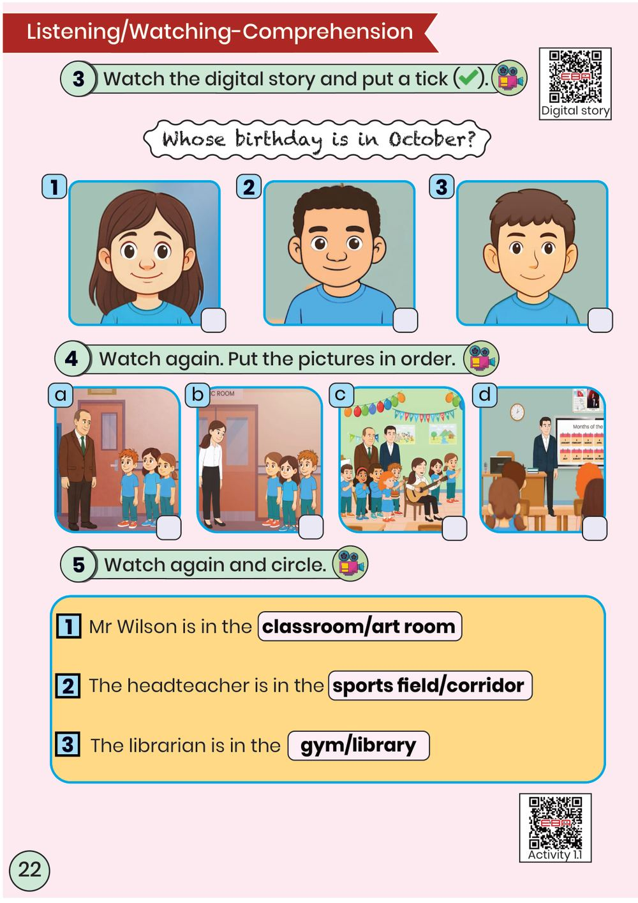

Whose birthday is in October?

1 
2 
3 

4 Watch again. Put the pictures in order. 

a 
b 
c 
d 

5 Watch again and circle. 

1 Mr Wilson is in the **classroom/art room**
2 The headteacher is in the **sports field/corridor**
3 The librarian is in the **gym/library**

<!-- sayfa 22 -->

# 6 Let's play together.

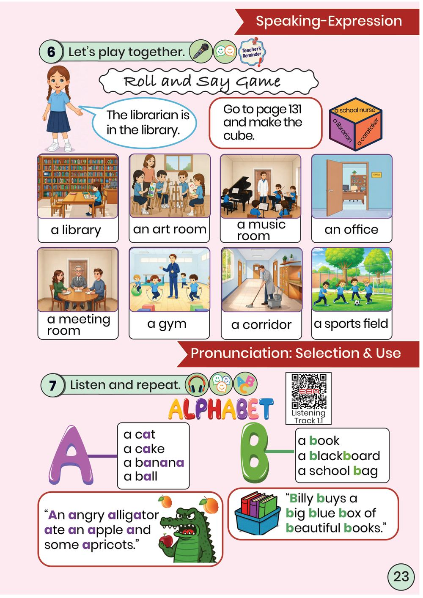

## Roll and Say Game

The librarian is in the library.

Go to page 131 and make the cube.


* a library
* an art room
* a music room
* an office
* a meeting room
* a gym
* a corridor
* a sports field

---

# Pronunciation: Selection & Use

## 7 Listen and repeat.


### ALPHABET

**A**
* a cat
* a cake
* a banana
* a ball

“An angry alligator ate an apple and some apricots”

**B**
* a book
* a blackboard
* a school bag

“Billy buys a big blue box of beautiful books.”

<!-- sayfa 23 -->

# 8 Look, match, and say. There is one extra.

e.g. 
1 a corridor
2 a classmate
3 a school nurse
4 a librarian
5 a caretaker
6 a meeting room
7 a gym
8 a music room
9 a sports field
10 an art room
11 a headteacher

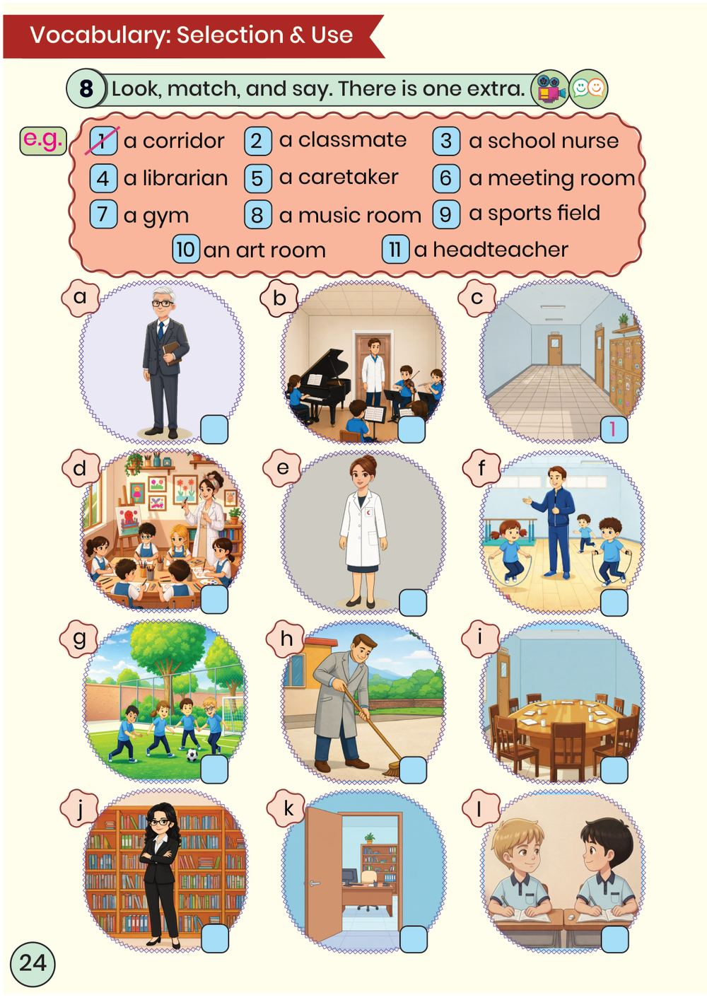 a
 b
 c
 d
 e
 f
 g
 h
 i
 j
 k
 l

<!-- sayfa 24 -->

# 9 Let's play together.

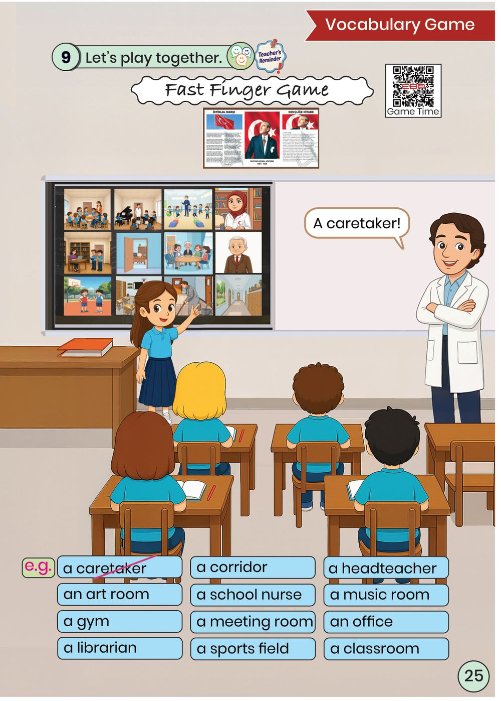

## Fast Finger Game


A caretaker!

e.g.
| a caretaker | a corridor | a headteacher |
| :--- | :--- | :--- |
| an art room | a school nurse | a music room |
| a gym | a meeting room | an office |

<!-- sayfa 25 -->

10 Look, listen, and say. 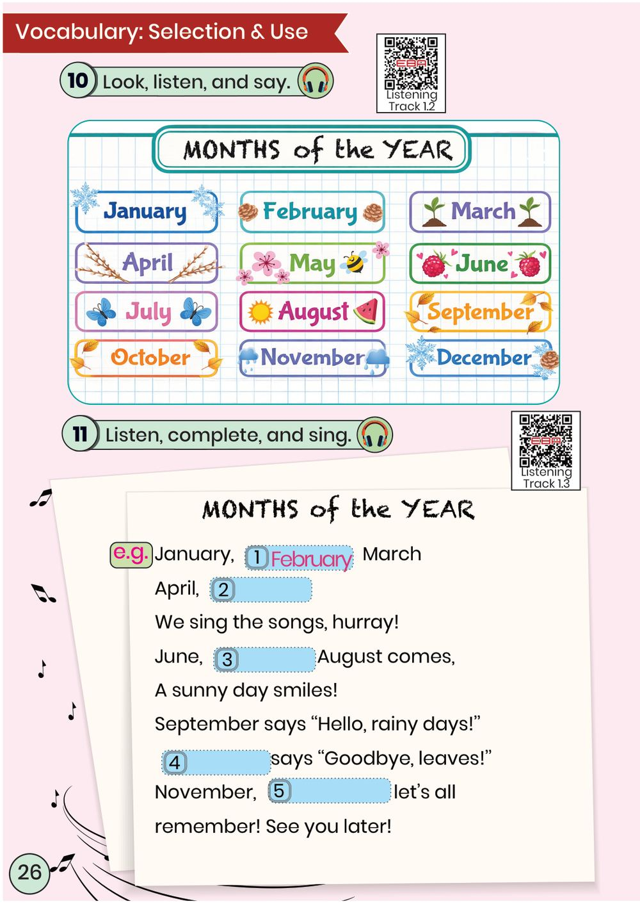


# MONTHS of the YEAR
* January
* February
* March
* April
* May
* June
* July
* August
* September
* October
* November
* December

11 Listen, complete, and sing. 


# MONTHS of the YEAR
e.g. January, 1 February, March
April, 2
We sing the songs, hurray!
June, 3, August comes,
A sunny day smiles!
September says “Hello, rainy days!”
4 says “Goodbye, leaves!”
November, 5, let’s all remember! See you later!

1
2
3
4
5
February
e.g.

<!-- sayfa 26 -->

12 Look, match, and say. 🎤

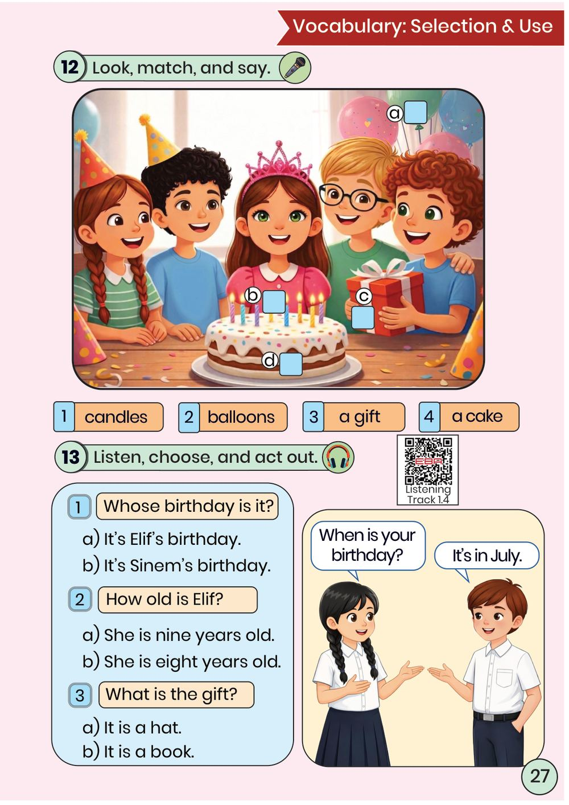

1 candles
2 balloons
3 a gift
4 a cake

13 Listen, choose, and act out. 🎧


1 Whose birthday is it?
a) It's Elif's birthday.
b) It's Sinem's birthday.

2 How old is Elif?
a) She is nine years old.
b) She is eight years old.

3 What is the gift?
a) It is a hat.

When is your birthday?
It's in July.

<!-- sayfa 27 -->

# 14 Read and act out. 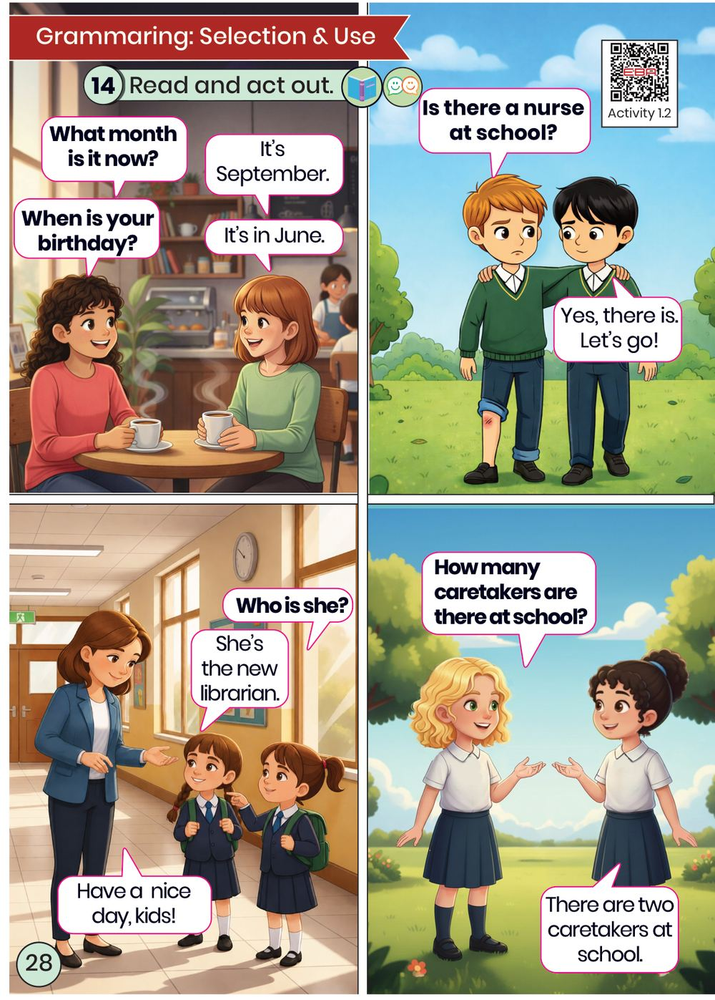

**[Panel 1]**
- What month is it now?
- It's September.
- When is your birthday?
- It's in June.

**[Panel 2]**
- Is there a nurse at school?
- Yes, there is. Let's go!

**[Panel 3]**
- Who is she?
- She's the new librarian.
- Have a nice day kids!

**[Panel 4]**
- How many caretakers are there at school?
- There are two...

<!-- sayfa 28 -->

# 15 Order the words. Then match with the answers. There is one extra.

1. is - that - What $\rightarrow$ \_\_\_\_\_\_\_\_\_\_\_\_\_\_\_\_\_\_\_\_\_\_\_\_\_\_\_\_\_\_\_\_\_\_\_\_\_\_\_\_\_\_\_\_\_\_\_\_\_\_\_\_\_ ? [ ]
   e.g. What is that ? [f]

2. is - your - When - birthday $\rightarrow$ \_\_\_\_\_\_\_\_\_\_\_\_\_\_\_\_\_\_\_\_\_\_\_\_\_\_\_\_\_\_\_\_\_\_\_\_\_\_\_\_\_\_\_\_\_\_\_\_\_\_\_\_\_ ? [ ]

3. now - What - is - month - it $\rightarrow$ \_\_\_\_\_\_\_\_\_\_\_\_\_\_\_\_\_\_\_\_\_\_\_\_\_\_\_\_\_\_\_\_\_\_\_\_\_\_\_\_\_\_\_\_\_\_\_\_\_\_\_\_\_ ? [ ]

4. there - a librarian - Is - school - at $\rightarrow$ \_\_\_\_\_\_\_\_\_\_\_\_\_\_\_\_\_\_\_\_\_\_\_\_\_\_\_\_\_\_\_\_\_\_\_\_\_\_\_\_\_\_\_\_\_\_\_\_\_\_\_\_\_ ? [ ]

5. pupils - How many - are - there - the - garden - in $\rightarrow$ \_\_\_\_\_\_\_\_\_\_\_\_\_\_\_\_\_\_\_\_\_\_\_\_\_\_\_\_\_\_\_\_\_\_\_\_\_\_\_\_\_\_\_\_\_\_\_\_\_\_\_\_\_ ? [ ]

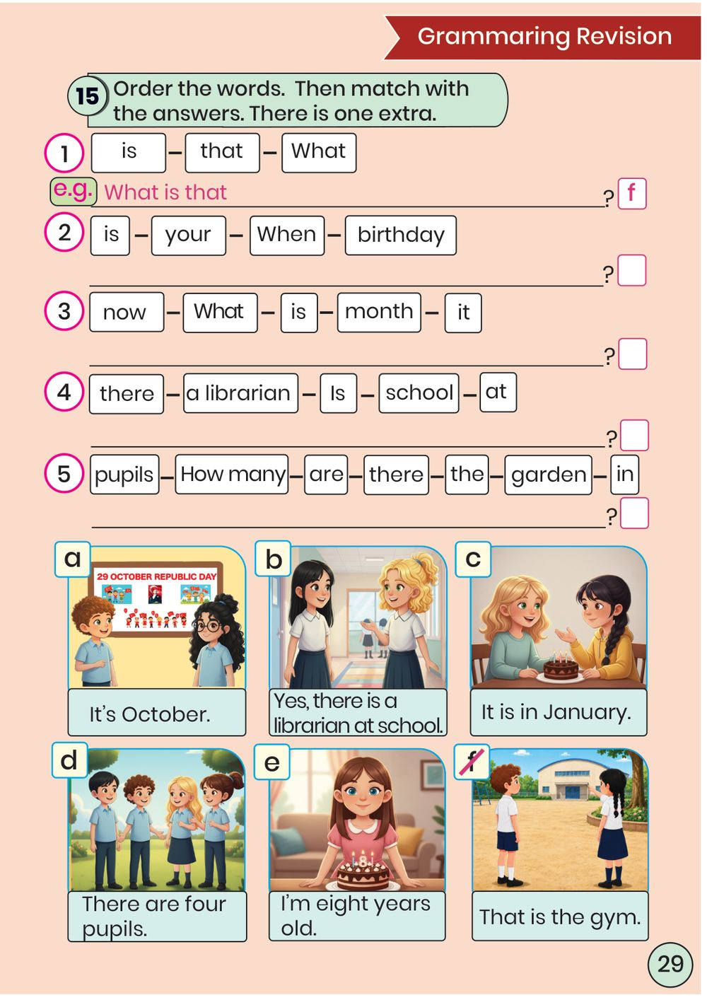

a. 
It's October.

b. 
Yes, there is a librarian at school.

c. 
It is in January.

d. 
There are four

e. 
I'm eight years

$\cancel{f}$ <!-- KONTROL: Marker'da karşılığı yok, uydurma olabilir --> 

<!-- sayfa 29 -->

# 16 Read and put a tick($\checkmark$).

Who is Ali?

a $\square$ a headteacher
b $\square$ a pupil
c $\square$ a librarian

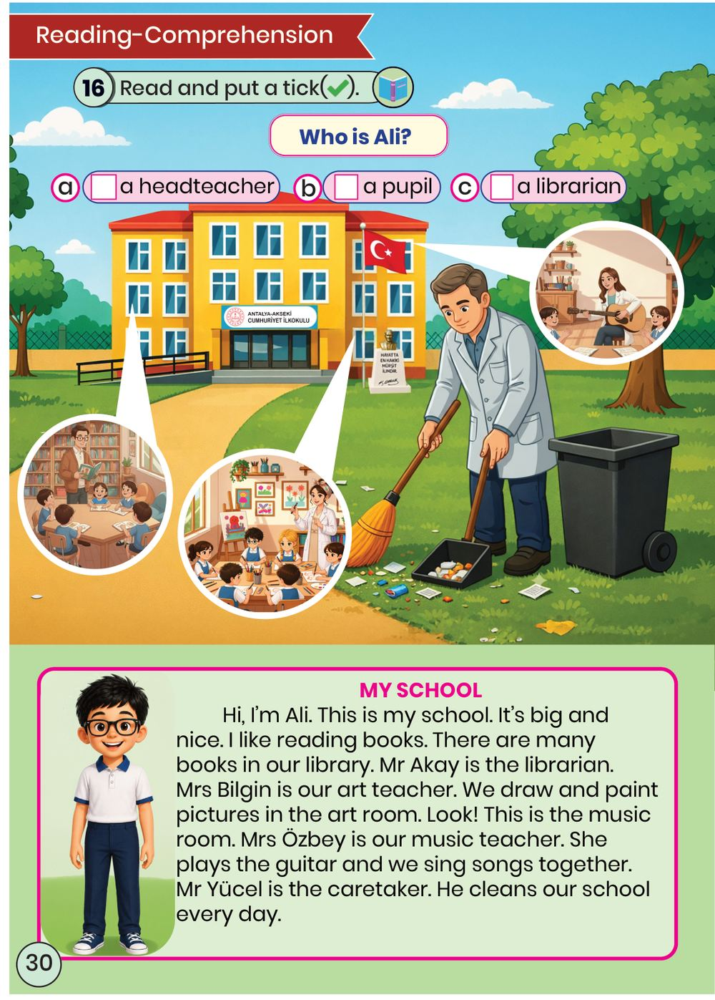

## MY SCHOOL

Hi, I'm Ali. This is my school. It's big and nice. I like reading books. There are many books in our library. Mr Akay is the librarian. Mrs Bilgin is our art teacher. We draw and paint pictures in the art room. Look! This is the music room. Mrs Özbey is our music teacher. She plays the guitar and we sing songs together. Mr Yücel is the caretaker. He cleans our school every day.

<!-- sayfa 30 -->

# 17 Read and complete. There is one extra.

art teacher | librarian | school nurse
music teacher | caretaker

1. 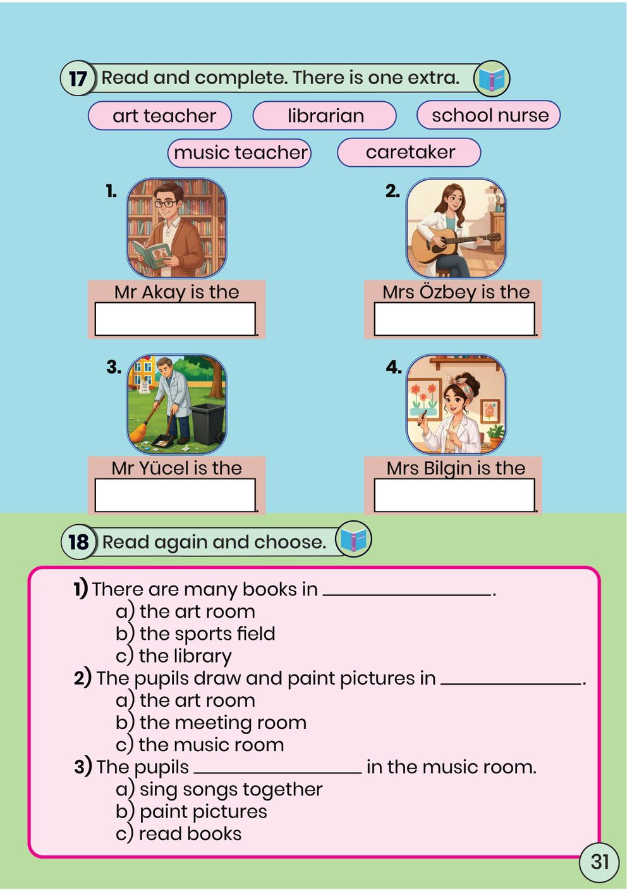
Mr Akay is the __________.

2. 
Mrs Özbey is the __________.

3. 
Mr Yücel is the __________.

4. 
Mrs Bilgin is the __________.

# 18 Read again and choose.

1) There are many books in __________.
a) the art room
b) the sports field
c) the library

2) The pupils draw and paint pictures in __________.
a) the art room
b) the meeting room
c) the music room

3) The pupils __________ in the music room.
a) sing songs together
b) paint pictures

<!-- sayfa 31 -->

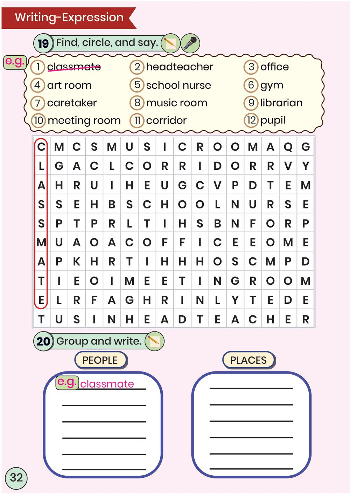 19 Find, circle, and say.  

e.g.
1 classmate 2 headteacher 3 office
4 art room 5 school nurse 6 gym
7 caretaker 8 music room 9 librarian
10 meeting room 11 corridor 12 pupil

| C | M | C | S | M | U | S | I | C | R | O | O | M | A | Q | G |
|---|---|---|---|---|---|---|---|---|---|---|---|---|---|---|---|
| L | G | A | C | L | C | O | R | R | I | D | O | R | R | V | Y |
| A | H | R | U | I | H | E | U | G | C | V | P | D | T | E | M |
| S | S | E | H | B | S | C | H | O | O | L | N | U | R | S | E |
| S | P | T | P | R | L | T | I | H | S | B | N | F | O | R | P |
| M | U | A | O | A | C | O | F | F | I | C | E | E | O | M | E |
| A | P | K | H | R | T | I | H | H | H | O | S | C | M | P | D |
| T | I | E | O | I | M | E | E | T | I | N | G | R | O | O | M |
| E | L | R | F | A | G | H | R | I | N | L | Y | T | E | D | E |
| | T | U | S | I | N | H | E | A | D | T | E | A | C | H | E | R |

 20 Group and write. 

| PEOPLE | PLACES |
| :--- | :--- |
| e.g. classmate | |
| | |
| | |
| | |
| | |

<!-- sayfa 32 -->

# 21 Look, complete, and colour. 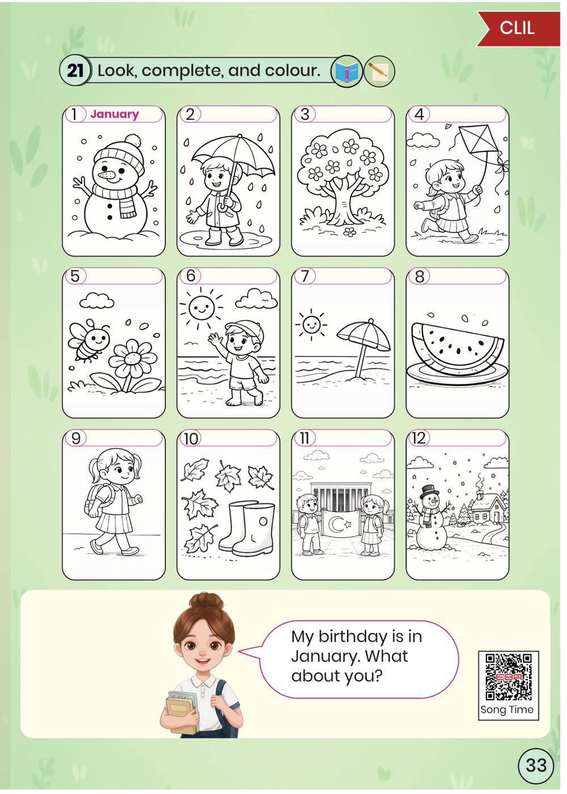

| 1 January | 2 | 3 | 4 |
| :---: | :---: | :---: | :---: |
|  |  |  |  |

| 5 | 6 | 7 | 8 |
| :---: | :---: | :---: | :---: |
|  |  |  |  |

| 9 | 10 | 11 | 12 |
| :---: | :---: | :---: | :---: |
|  |  |  |  |


My birthday is in January. What about you?

Song Time 

<!-- sayfa 33 -->

22 Read and act out.

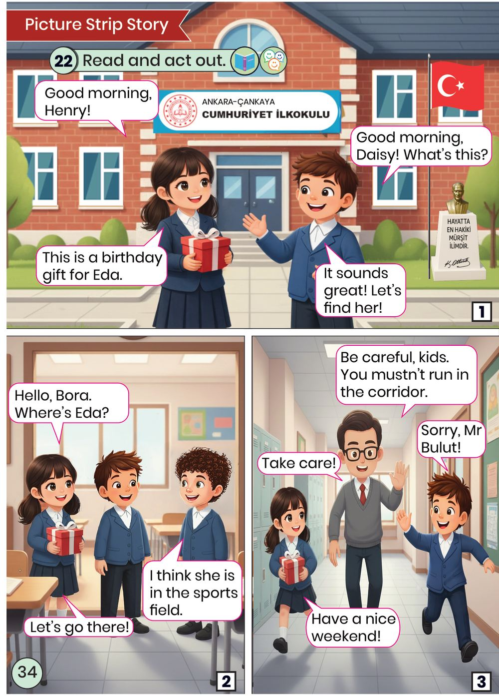

Good morning, Henry!
Good morning, Daisy! What’s this?
This is a birthday gift for Eda.
It sounds great! Let’s find her!

Hello, Bora. Where’s Eda?
I think she is in the sports field.
Let’s go there!

Be careful, kids. You mustn’t run in the corridor.
Sorry, Mr Bulut!
Take care!
Have a nice weekend!

ANKARA-ÇANKAYA CUMHURİYET İLKOKULU

<!-- sayfa 34 -->

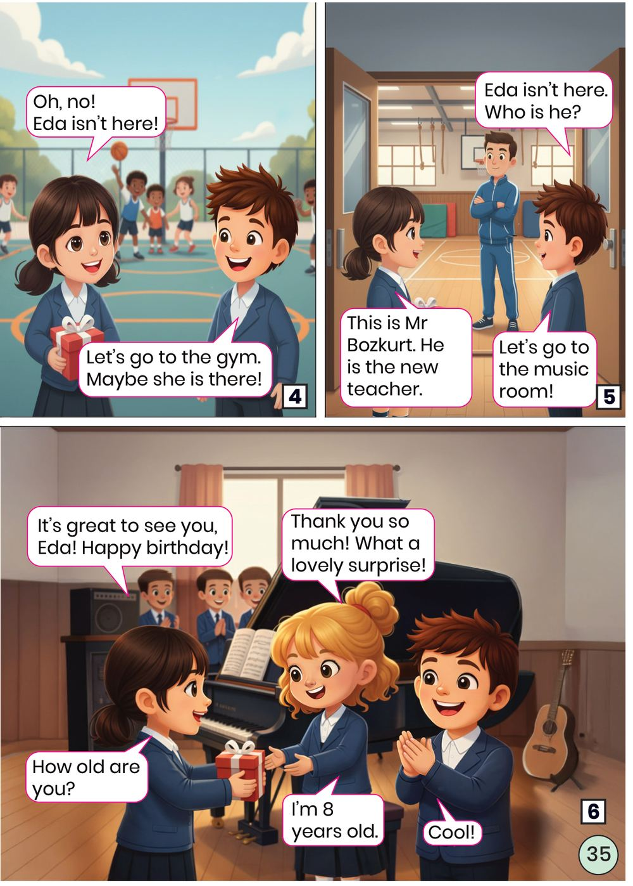

Oh, no!
Eda isn’t here!

Let’s go to the gym.
Maybe she is there!
4

Eda isn’t here.
Who is he?

This is Mr
Bozkurt. He
is the new
teacher.
5

Let’s go to
the music
room!
5

It’s great to see you,
Eda! Happy birthday!

Thank you so
much! What a
lovely surprise!

How old are
you?

I’m 8

<!-- sayfa 35 -->

23 Design a diary page about the people and places in your school.

# A DIARY PAGE

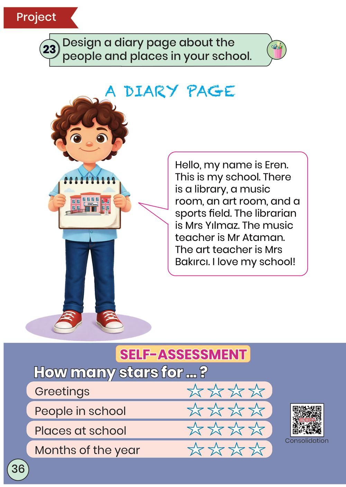

Hello, my name is Eren. This is my school. There is a library, a music room, an art room, and a sports field. The librarian is Mrs Yılmaz. The music teacher is Mr Ataman. The art teacher is Mrs Bakırcı. I love my school!

# SELF-ASSESSMENT

## How many stars for ... ?

| | |
| :--- | :--- |
| Greetings | ☆ ☆ ☆ ☆ |
| People in school | ☆ ☆ ☆ ☆ |
| Places at school | ☆ ☆ ☆ ☆ |

Consolidation

<!-- sayfa 36 -->

Theme for EBA
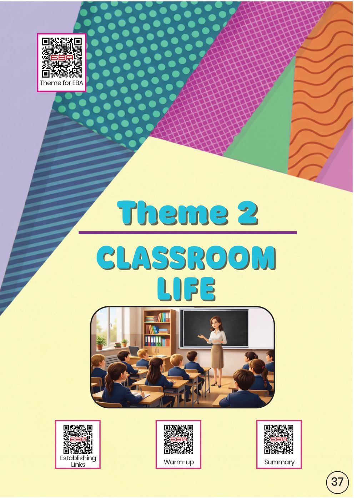

# Theme 2
## CLASSROOM LIFE


<!-- sayfa 37 -->

1 Look at the picture and answer.
Where are they?
Digital story

2 Watch the digital story.

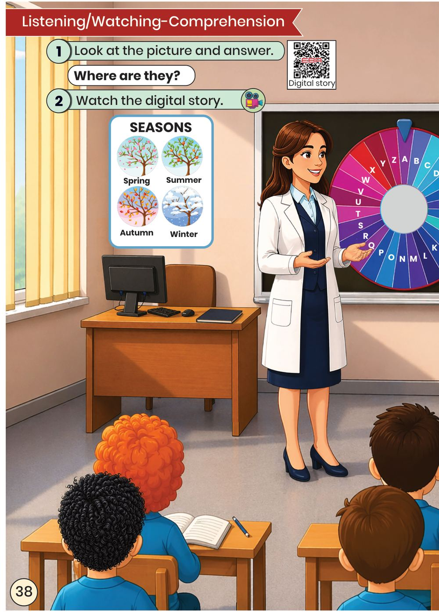: SEASONS
Spring Summer
Autumn Winter

<!-- sayfa 38 -->

Atatürk Memorial Day

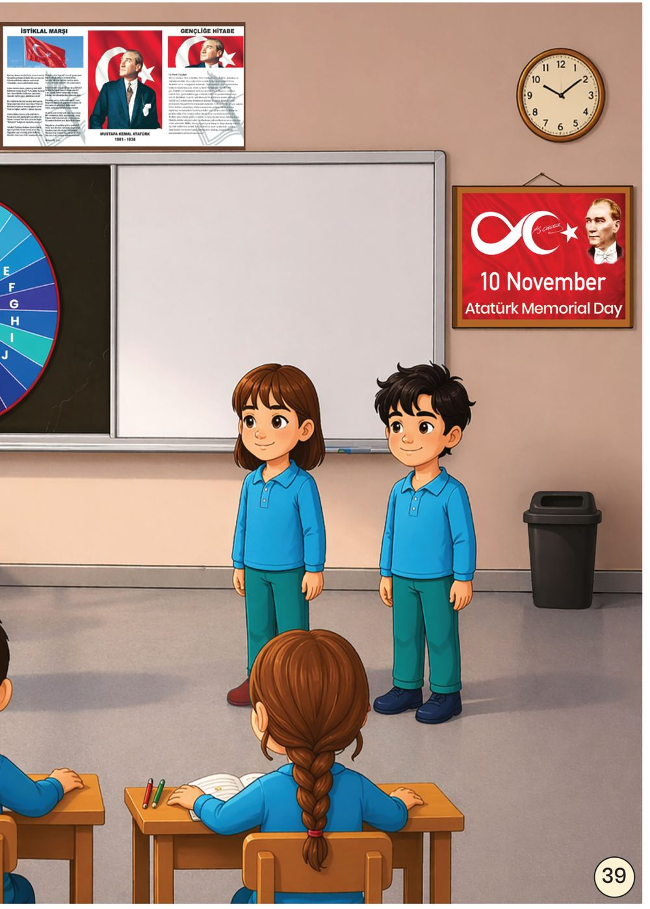
<!-- yer tutucu bulunamadı: sayfa sonuna eklendi -->

<!-- sayfa 39 -->

3 Watch the digital story and put a tick ($\checkmark$). 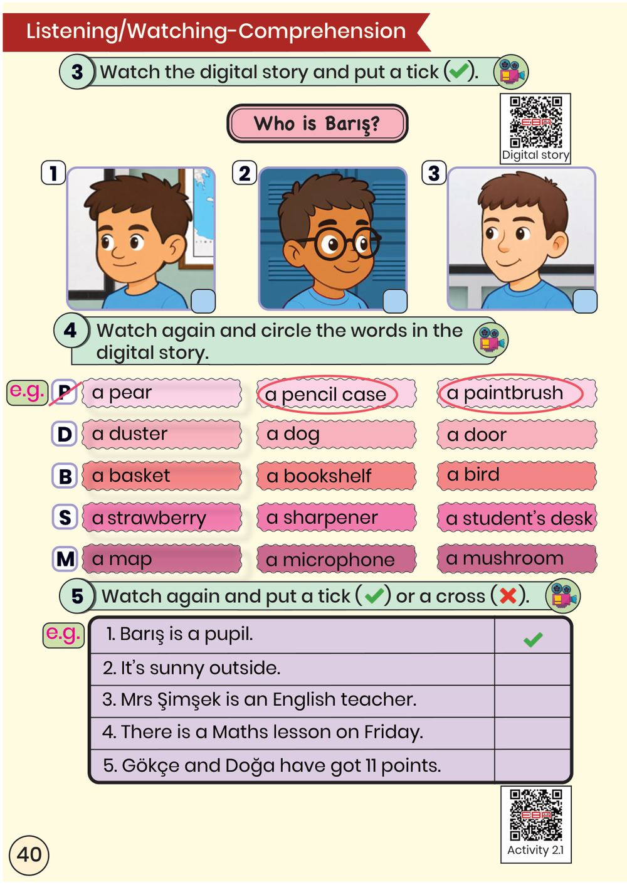

Who is Barış?


1 
2 
3 

4 Watch again and circle the words in the digital story. 

e.g. P  a pear  a pencil case  a paintbrush 
D a duster a dog a door
B a basket a bookshelf a bird
S a strawberry a sharpener a student's desk
M a map a microphone a mushroom

5 Watch again and put a tick ($\checkmark$) or a cross ($\times$). 

e.g.
| | | |
| :--- | :--- | :--- |
| 1. Barış is a pupil. | | $\checkmark$ |
| 2. It's sunny outside. | | |
| 3. Mrs Şimşek is an English teacher. | | |
| 4. There is a Maths lesson on Friday. | | |
| 5. Gökçe and Doğa have got 11 points. | | |

<!-- sayfa 40 -->

6 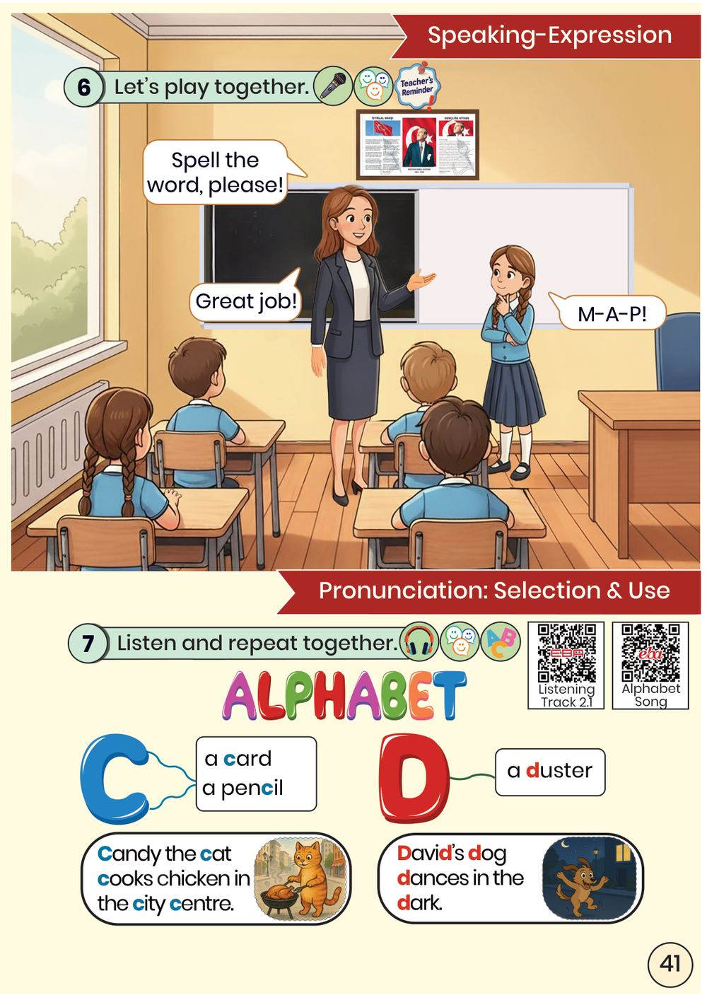 Let's play together.

Spell the word, please!
Great job!
M-A-P!

Pronunciation: Selection & Use

7 Listen and repeat together.

# ALPHABET

 Listening Track 2.1
 Alphabet Song

C
a **c**ard
a pen**c**il

 **C**andy the **c**at **c**ooks **c**hicken in the **c**ity **c**entre.

D
a **d**uster

 **D**avid's **d**og **d**ances in the **d**ark.

<!-- sayfa 41 -->

# 8 Look, match, and write. There is one extra word. 😊

a 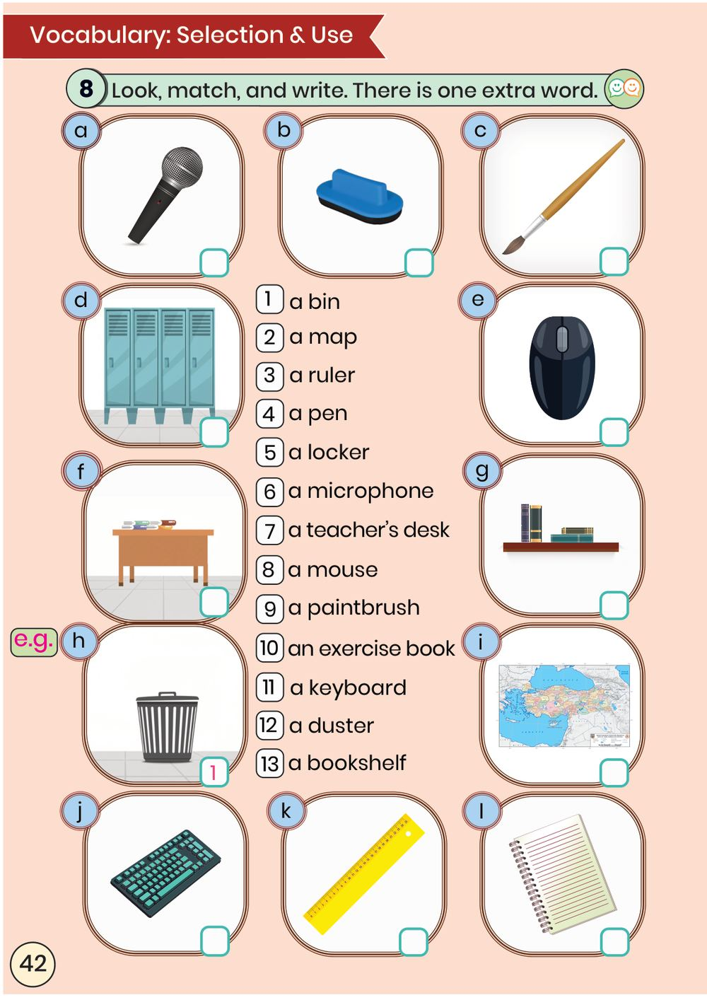 $\square$
b  $\square$
c  $\square$
d  $\square$
e  $\square$
f  $\square$
g  $\square$
h e.g.  1
i  $\square$
j  $\square$
k  $\square$
l  $\square$

1 a bin
2 a map
3 a ruler
4 a pen
5 a locker
6 a microphone
7 a teacher's desk
8 a mouse
9 a paintbrush
10 an exercise book
11 a keyboard
12 a duster
13 a bookshelf

<!-- sayfa 42 -->

9 Let's play.

# What's in My Hand?

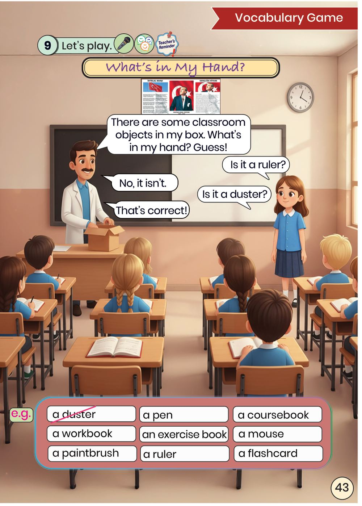

There are some classroom objects in my box. What's in my hand? Guess!

Is it a ruler?

No, it isn't.

Is it a duster?

That's correct!

e.g.
| | | |
| :--- | :--- | :--- |
| ~~a duster~~ | a pen | a coursebook |
| a workbook | an exercise book | a mouse |
| a paintbrush | a ruler | a flashcard |

<!-- sayfa 43 -->

10 Read the dialogue and act out. 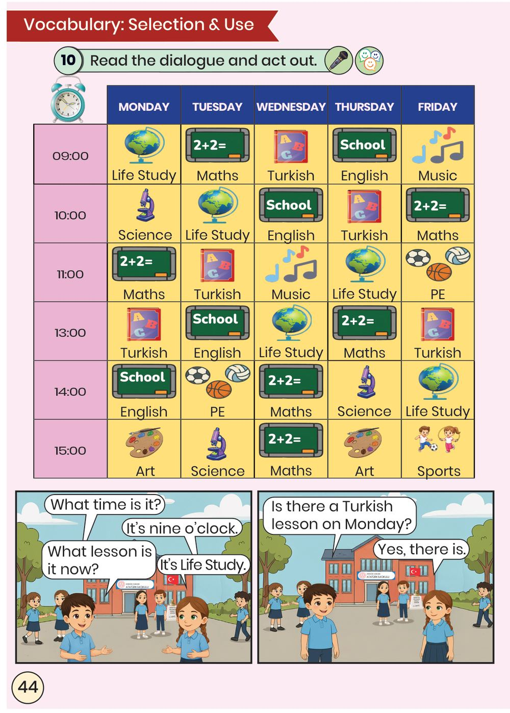

| | MONDAY | TUESDAY | WEDNESDAY | THURSDAY | FRIDAY |
| :--- | :--- | :--- | :--- | :--- | :--- |
| 09:00 | Life Study | Maths | Turkish | English | Music |
| 10:00 | Science | Life Study | English | Turkish | Maths |
| 11:00 | Maths | Turkish | Music | Life Study | PE |
| 13:00 | Turkish | English | Life Study | Maths | Turkish |
| 14:00 | English | PE | Maths | Science | Life Study |
| 15:00 | Art | Science | Maths | Art | Sports |

| What time is it? | Is there a Turkish lesson on Monday? |
| :--- | :--- |
| It's nine o'clock. | Yes, there is. |
| What lesson is it now? | |
| It's Life Study. | |

<!-- sayfa 44 -->

11 Look, listen, and say. 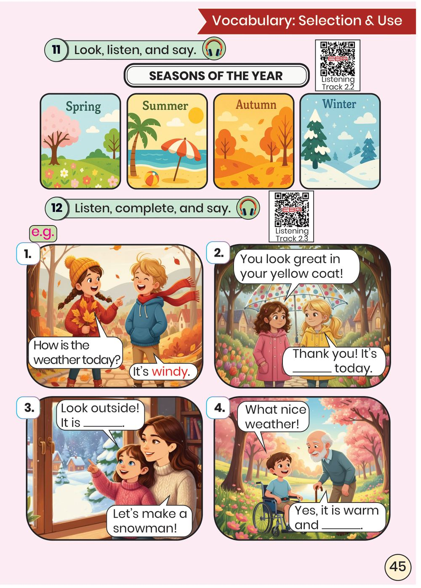

SEASONS OF THE YEAR

Spring
Summer
Autumn
Winter

12 Listen, complete, and say. 

e.g.
1.
How is the weather today?
It's windy.

2.
You look great in your yellow coat!
Thank you! It's ________ today.

3.
Look outside!
It is ________.
Let's make a snowman!

4.
What nice weather!
Yes, it is warm and ________.

<!-- sayfa 45 -->

# 13 Listen and complete.

## 20 - twenty
21) twenty-one
22) twenty-two
23) \_\_\_\_\_\_\_\_\_\_\_\_\_\_\_
24) twenty-four
25) \_\_\_\_\_\_\_\_\_\_\_\_\_\_\_
26) twenty-six
27) \_\_\_\_\_\_\_\_\_\_\_\_\_\_\_
28) twenty-eight
29) twenty-nine
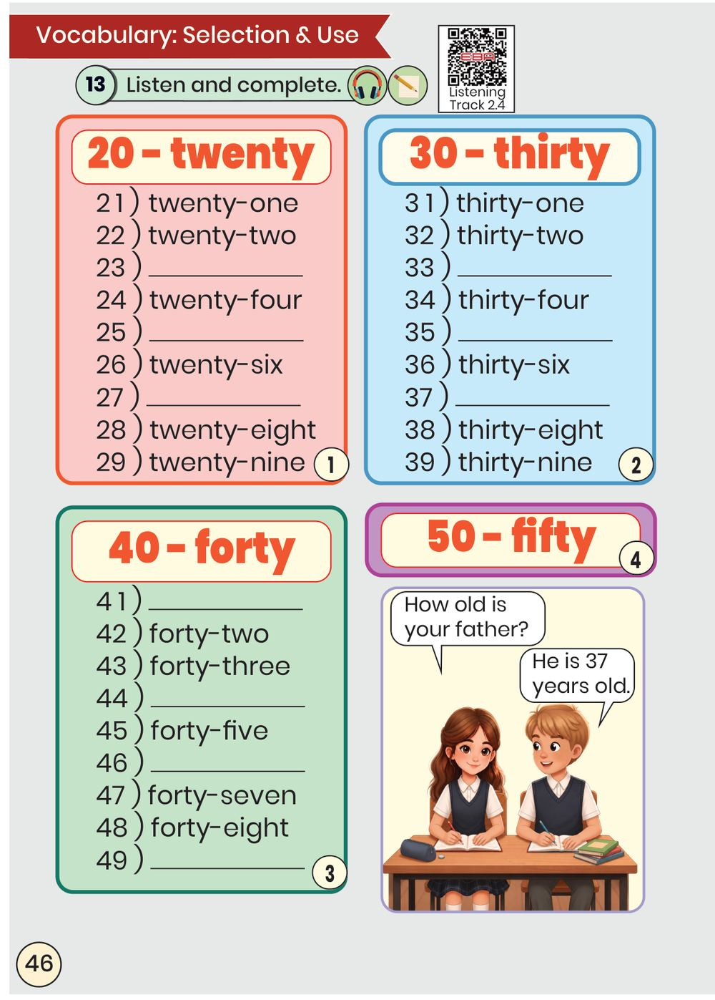

## 30 - thirty
31) thirty-one
32) thirty-two
33) \_\_\_\_\_\_\_\_\_\_\_\_\_\_\_
34) thirty-four
35) \_\_\_\_\_\_\_\_\_\_\_\_\_\_\_
36) thirty-six
37) \_\_\_\_\_\_\_\_\_\_\_\_\_\_\_
38) thirty-eight
39) thirty-nine


## 40 - forty
41) \_\_\_\_\_\_\_\_\_\_\_\_\_\_\_
42) forty-two
43) forty-three
44) \_\_\_\_\_\_\_\_\_\_\_\_\_\_\_
45) forty-five
46) \_\_\_\_\_\_\_\_\_\_\_\_\_\_\_
47) forty-seven
48) forty-eight
49) \_\_\_\_\_\_\_\_\_\_\_\_\_\_\_


## 50 - fifty

How old is your father?
He is $37$ years old.

<!-- sayfa 46 -->

# 14 Look, ask, and answer.

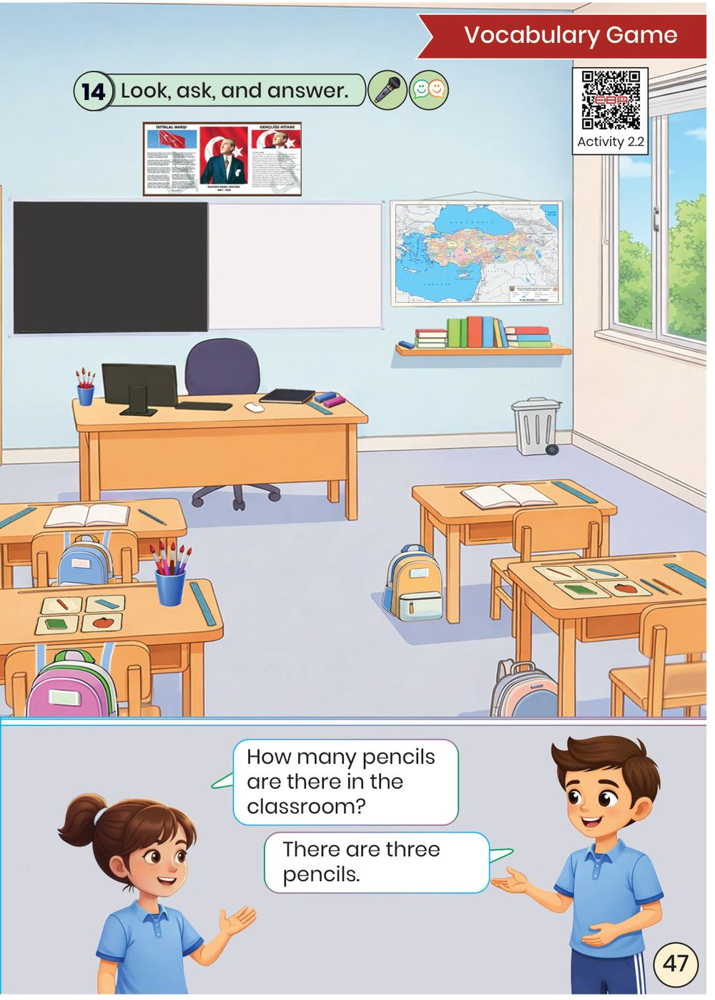

Activity 2.2

---

How many pencils are there in the classroom?

There are three pencils.

<!-- sayfa 47 -->

15 Read and act out.

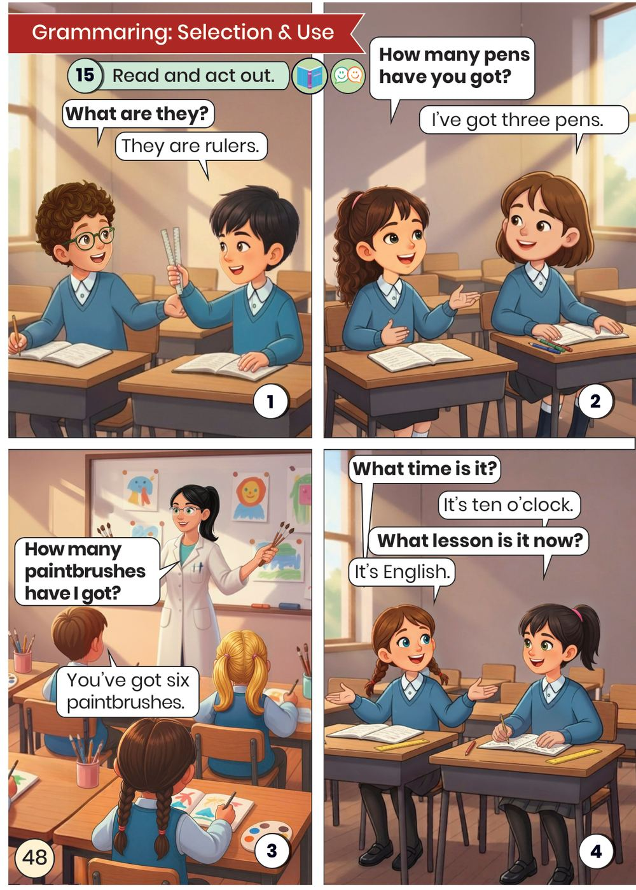
What are they?
They are rulers.


How many pens have you got?
I've got three pens.


How many paintbrushes have I got?
You've got six paintbrushes.


What time is it?
It's ten o'clock.
What lesson is it now?
It's English.

<!-- sayfa 48 -->

# 16 Let's play together.

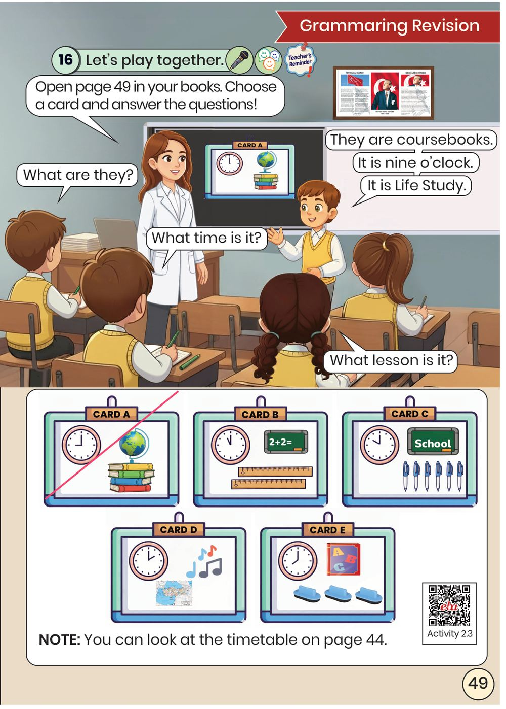

Open page 49 in your books. Choose a card and answer the questions!

What are they?
What time is it?
What lesson is it?

They are coursebooks.
It is nine o'clock.
It is Life Study.


| CARD A | CARD B | CARD C |
| :---: | :---: | :---: |
|  |  |  |

| CARD D | CARD E |
| :---: | :---: |
|  |  |

**NOTE:** You can look at the timetable on page 44.

Activity 2.3


<!-- sayfa 49 -->

17 Look, read, and answer. 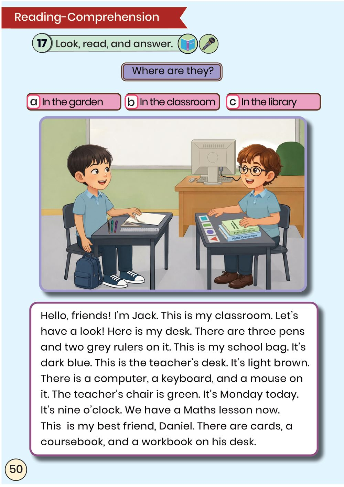

Where are they?

a In the garden
b In the classroom
c In the library


Hello, friends! I’m Jack. This is my classroom. Let’s have a look! Here is my desk. There are three pens and two grey rulers on it. This is my school bag. It’s dark blue. This is the teacher’s desk. It’s light brown. There is a computer, a keyboard, and a mouse on it. The teacher’s chair is green. It’s Monday today. It’s nine o’clock. We have a Maths lesson now. This is my best friend, Daniel. There are cards, a coursebook and a workbook on his desk.

<!-- sayfa 50 -->

# 18 Read, choose, and write. 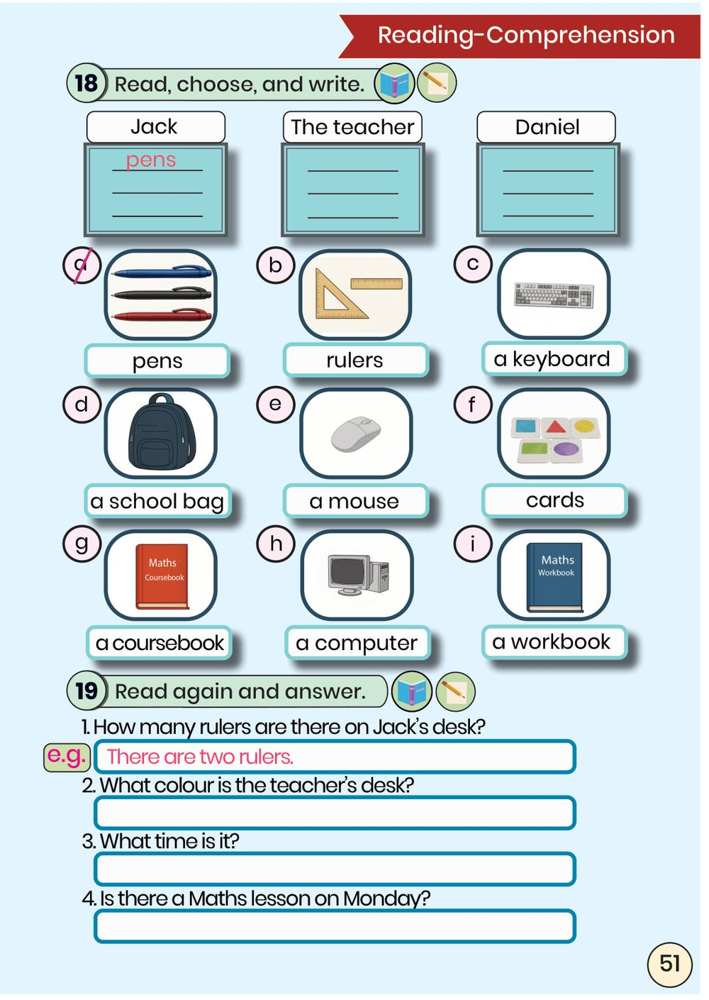

| Jack | The teacher | Daniel |
| :---: | :---: | :---: |
|  |  |  |


pens


rulers


a keyboard


a school bag


a mouse


cards


a coursebook


a computer


a workbook

# 19 Read again and answer. 

1. How many rulers are there on Jack’s desk?
e.g. There are two rulers.

2. What colour is the teacher's desk?
_________________________________________________

3. What time is it?
_________________________________________________

4. Is there a Maths lesson on Monday?
_________________________________________________

<!-- sayfa 51 -->

20 Look, write, and say. ✏️ 🎤

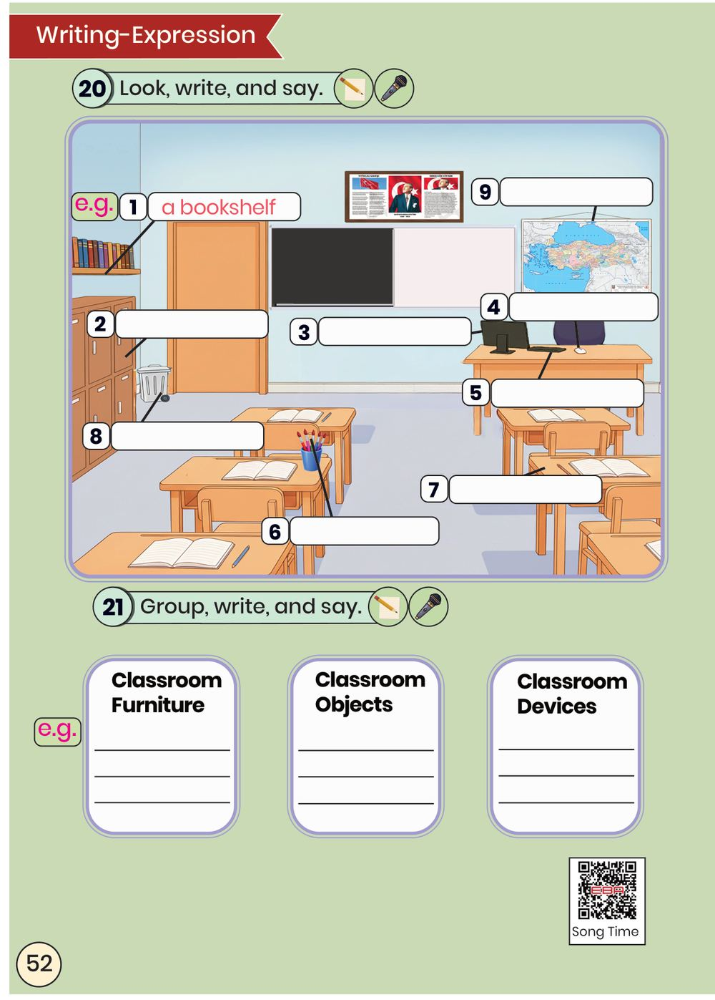

21 Group, write, and say. ✏️ 🎤

| e.g. | Classroom Furniture | Classroom Objects | Classroom Devices |
| :--- | :--- | :--- | :--- |
| | \_\_\_\_\_\_\_\_\_\_ | \_\_\_\_\_\_\_\_\_\_ | \_\_\_\_\_\_\_\_\_\_ |
| | \_\_\_\_\_\_\_\_\_\_ | \_\_\_\_\_\_\_\_\_\_ | \_\_\_\_\_\_\_\_\_\_ |
| | \_\_\_\_\_\_\_\_\_\_ | \_\_\_\_\_\_\_\_\_\_ | \_\_\_\_\_\_\_\_\_\_ |
| | \_\_\_\_\_\_\_\_\_\_ | \_\_\_\_\_\_\_\_\_\_ | \_\_\_\_\_\_\_\_\_\_ |

<!-- sayfa 52 -->

22 Find, match, and say. 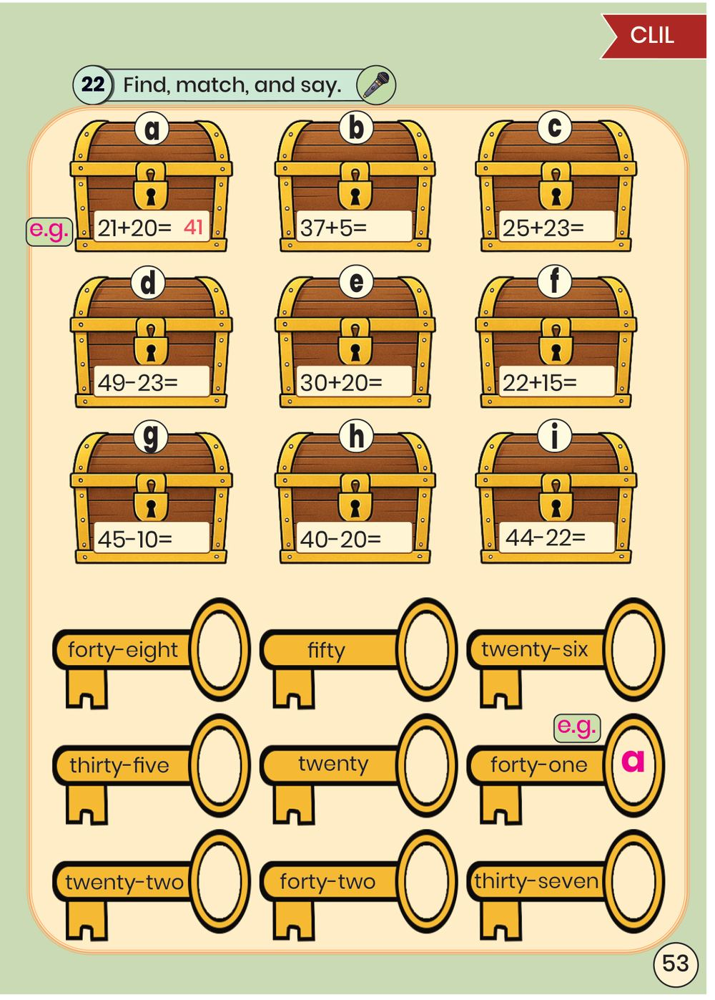


a

b

c

d

e

f

g

h

i

e.g.
$21 + 20 = 41$ <!-- KONTROL: Marker'da karşılığı yok, uydurma olabilir -->

d: $49 - 23 =$ <!-- KONTROL: Marker'da karşılığı yok, uydurma olabilir -->
g: $45 - 10 =$ <!-- KONTROL: Marker'da karşılığı yok, uydurma olabilir -->
b: $37 + 5 =$ <!-- KONTROL: Marker'da karşılığı yok, uydurma olabilir -->
e: $30 + 20 =$ <!-- KONTROL: Marker'da karşılığı yok, uydurma olabilir -->
h: $40 - 20 =$ <!-- KONTROL: Marker'da karşılığı yok, uydurma olabilir -->
c: $25 + 23 =$ <!-- KONTROL: Marker'da karşılığı yok, uydurma olabilir -->
f: $22 + 15 =$ <!-- KONTROL: Marker'da karşılığı yok, uydurma olabilir -->
i: $44 - 22 =$ <!-- KONTROL: Marker'da karşılığı yok, uydurma olabilir -->

forty-eight
fifty
twenty-six
thirty-five
twenty
forty-one (e.g. a)
twenty-two
forty-two
thirty-seven

<!-- sayfa 53 -->

23 Read and act out.

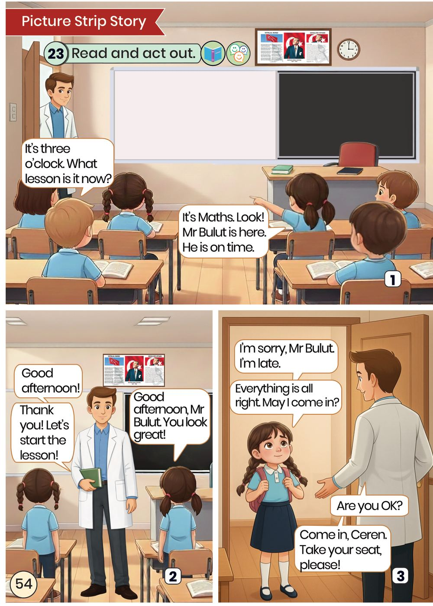

It’s three o’clock. What lesson is it now?

It’s Maths. Look! Mr Bulut is here. He is on time.

Good afternoon!

Thank you! Let’s start the lesson!

Good afternoon, Mr Bulut. You look great!

I’m sorry, Mr Bulut. I’m late.

Everything is all right. May I come in?

Are you OK?

Come in, Ceren. Take your seat.

<!-- sayfa 54 -->

4

Open your exercise books and write the problem, please.


5

There are twenty-nine pupils in my class. There are thirteen girls. How many boys are there in my class?

Last five minutes!

Have you finished? Time’s over!

Sure, Hakan.

Yes! Can I answer the question?

There are sixteen boys in the class, Mr Bulut.

$29 - 13 = 16$ <!-- KONTROL: Marker'da karşılığı yok, uydurma olabilir -->

Perfect! That’s correct, Hakan!

<!-- sayfa 55 -->

24 Go to pages 133 - 135 and make your picture dictionary.


This is my Picture Dictionary. Look, it’s a desk.

a desk
a ruler

# SELF-ASSESSMENT
## How many stars for ... ?

| | |
| :--- | :---: |
| Classroom Instructions | ☆ ☆ ☆ ☆ |
| School Subjects | ☆ ☆ ☆ ☆ |
| Seasons & Weather | ☆ ☆ ☆ ☆ |
| Classroom Objects & | ☆ ☆ ☆ ☆ |

Consolidation

<!-- sayfa 56 -->


# Theme 3
## PERSONAL LIFE


<!-- sayfa 57 -->

1 Look at the picture and answer.
How is the weather?

2 Watch the digital story. 

: Bir QR kod ve yanında "Digital story" yazısı.

<!-- sayfa 58 -->

```

*(Not: Gönderdiğiniz görsel bir matematik ders kitabı sayfası değil, karlı bir manzara içinde duran dört kişilik bir aile illüstrasyonudur. Metin katmanı boş olduğu için çevrilecek bir içerik bulunmamaktadır.)*


<!-- yer tutucu bulunamadı: sayfa sonuna eklendi -->

<!-- sayfa 59 -->

# 3 Watch the digital story and put a tick ($\checkmark$). 

## Where are they?

1  $\square$
2  $\square$
3  $\square$

# 4 Watch and put the pictures in order. 

a  $\square$
b  $\square$
c  $\square$
d  $\square$
e  $\square$
f  $\square$

# 5 Watch again and answer. 

1 
Whose scarf is this?
a) This is Şeyma’s scarf.
b) This is Mustafa’s scarf.

2 
What is Şeyma wearing?
a) She is wearing a yellow scarf and a pink coat.
b) She is wearing a dark green coat and brown boots.

3 
What does Yiğit look like?
a) He is tall and handsome.

<!-- sayfa 60 -->


6 Let's play.
Touch your ear!

# Pronunciation: Selection & Use

7 Listen and repeat together.


## ALPHABET

E — a p**e**n, a t**e**acher, w**e**ak
F — fish
G — a **g**ame, a **g**iraffe
H — a **h**at
I — time, sit
J — a **j**acket

Little **J**ack **s**ees **t**en **h**orses in the **g**reen field.


<!-- sayfa 61 -->

# 8 Look, write, and say. ✏️ 😊

| hair | an ear | a leg | a nose | back | an eyebrow |
| :---: | :---: | :---: | :---: | :---: | :---: |
| a chin | teeth | eyelashes | an arm | a hand | a foot | feet |

e.g.


1 [ hair ] ------------------
2 [ ] -----------------------
3 [ ] -----------------------
4 [ ] -----------------------
5 [ ] -----------------------
6 [ ] -----------------------
7 [ ] -----------------------
8 [ ] -----------------------
9 [ ] -----------------------
10 [ ] ----------------------
11 [ ] ----------------------
12 [ ] ----------------------

<!-- sayfa 62 -->

# 9 Look, read, and circle.

e.g.

He is **strong**/weak.

2

They are **happy**/sad.

3

She is **beautiful**/ugly.

4

We are **old**/young.

5

He is a **good**/bad boy.

6

She is **hardworking**/lazy.

7

She is **fat**/thin.

8

He is **tall**/short.

<!-- sayfa 63 -->

# 10 Look, listen, and repeat.


* earrings
* a bag
* a coat
* e.g. a skirt
* a jumper
* a dress
* sunglasses
* a necklace
* socks
* a sweatshirt
* shoes
* boots
* jeans
* a jacket
* a uniform

# 11 Look and complete.

I've got a red [skirt] 1, a yellow [dress] 2, and a pink sweatshirt in the wardrobe. My favourite yellow [jumper] 3 and grey [socks] 4 are there, too. My uniform is on the door. Here is my purple [coat] 5, I love it. I've got black [shoes] 6 and brown [boots] 7 right there. There is a [necklace] 8 and a small black bag. There are two earrings and cool [sunglasses] 9 on the table. Look at my bed. My clothes are ready for today,

<!-- sayfa 64 -->

12 Read, colour, and say. 


e.g.
Hello, friends! It’s sunny and warm today. I’m wearing a yellow dress and blue shoes. I’ve got a bag. It’s green. I’m wearing small earrings, a necklace, and black sunglasses.


It’s sunny and hot. I’m wearing
___________________________
___________________________
___________________________
___________________________


It’s cold and snowing. I’m wearing
___________________________
___________________________
___________________________
___________________________

<!-- sayfa 65 -->

# 13 Read and act out.


What does your sister look like?
She’s short and pretty.


What is your brother’s hair like?
He’s got curly hair.


Have you got any T-shirts?
Yes, I’ve got some T-shirts.


Whose dress is this?
This is my sister’s dress.

<!-- sayfa 66 -->

# 14 Let’s play together.


This is a girl.
She’s got blonde hair.
No, she isn’t.
It’s curly.
Yes, she is.
Perfect!

Guess Who?
Elif
Cem
Ada
Ali
Defne
Derya
Zehra
Eda

What colour hair has she got?
Is she wearing glasses?
What is her hair like?
Is she Elif?

<!-- sayfa 67 -->

# 15 Read and write the names. There is one extra.


| a | b | c |
| :--- | :--- | :--- |
| Hi, I'm Linda. I'm tall and beautiful. I'm happy today. It's sunny. I like big sunglasses. I'm wearing a pink dress and white socks. | Hi, my name is Fiona. I'm old and fat. I dislike rainy weather. I'm wearing brown boots. My necklace is blue. I've got a nice red bag. | Hi, my name is Emma. I'm tall and thin. I have got long straight hair. I'm wearing a white shirt and a blue skirt. I hate windy weather. |


| e.g. | | | | | |
| :--- | :--- | :--- | :--- | :--- | :--- |
| 1 **Fiona** | 2 | 3 | 4 | 5 | 6 |

| d | e |
| :--- | :--- |
| Hello! My name is George. I'm young and strong. I'm handsome. It is cold and snowing. I love winter. I'm wearing a dark blue coat. My shoes are black. | Hello! I'm Tim. I'm tall and thin. The weather is warm and windy today. I'm wearing light blue jeans and a black jacket. I've got a school bag on my back. |

<!-- sayfa 68 -->

# 16 Read and circle.

e.g. 1. Who is wearing a pink dress? **Linda** / Emma
2. Who has got a dark blue coat? Tim / George
3. Who is wearing a white shirt? Emma / Tim
4. Who has got brown boots? Fiona / George
5. Who is wearing light blue jeans? Fiona / Tim

# 17 Read again and choose.

e.g. 1. Linda likes big [sunglasses]
a) hat b) **sunglasses** c) earrings

2. George is [ ] and strong.
a) young b) lazy c) old

3. Fiona has got a blue [ ].
a) bag b) necklace c) earrings

4. Tim is wearing a black [ ].
a) jumper b) coat c) jacket

5. Emma has got [ ] straight hair.
a) blonde b) long c) short

**Now, it is your turn!**
**Read and answer.**

 I am tall and handsome. I'm wearing a red jumper, blue jeans, and white shoes today. What are you wearing today?

<!-- sayfa 69 -->

18 Read and write.


Hi, I’m Tina. This is my best friend, Clara. She is a beautiful girl. She is tall and thin. Clara is wearing blue jeans, a pink T-shirt, and red and white shoes. She has got long black hair and green eyes. She has got a small nose. Clara likes earrings. What about your best friend?

Now, it is your turn! Draw, colour, and write.


Hi, I’m __________________________.
This is my friend, ____________________.
She/He is __________________________.
She/He has got _______________ and ______________________________.
She/He has got ____________________.
She/He likes _______________________.

<!-- sayfa 70 -->

# 19 Choose and say. 


She has got short straight hair. She is beautiful. She is wearing a blue shirt and dark blue skirt.

| | One | Two | Three | Four | Five |
|---|---|---|---|---|---|
|  |  |  |  |  |  |
|  |  |  |  |  |  |
|  |  |  |  |  |  |

# 20 Odd one out. 

1) foot / tooth / chin / ~~bag~~
2) strong / sunny / weak / fat
3) warm / windy / sunny / boots
4) sweatshirt / ugly / jeans / coat

<!-- sayfa 71 -->

21 Read and act out. 📖 😊


Hi, Lina! Guess what! There is a new girl in our class.

Really? What does she look like?

She is tall and thin.

What is her hair like?

She has got long brown hair.

Today is her birthday. I’m so excited! What can I wear? I don’t know.

Calm down! What are you wearing today?

I’m wearing a pink T-shirt and blue jeans.

Nice T-shirt!

<!-- sayfa 72 -->

any shirts?
Yes, I've got many shirts.
You can wear a white shirt and a blue skirt.
Good idea.


Wow! You look great.
Oh, it is beautiful! Thanks for your help, Lina!
It is my pleasure! Anytime!

<!-- sayfa 73 -->

# 22 Make your booklet and say.

* Go to pages 137-139.
* Design a booklet about body parts, physical features, and clothes.
* Cut the pictures on pages 137-139 for your booklet.
* Paste the pictures into your booklet.
* Introduce your booklet to your classmates.


# SELF-ASSESSMENT

## How many stars for ... ?

| | |
| :--- | :---: |
| Parts of the body | ☆ ☆ ☆ ☆ |
| Physical features | ☆ ☆ ☆ ☆ |
| Personal characters | ☆ ☆ ☆ ☆ |

Consolidation

<!-- sayfa 74 -->

Theme for EBA
[QR KOD]

# Theme 4
## FAMILY LIFE


[QR KOD]
Establishing

<!-- sayfa 75 -->

1 Look at the picture and answer.
How many people are there in the family?

2 Watch the digital story. 


Digital story

<!-- sayfa 76 -->

```

*(Not: Paylaştığınız görselde herhangi bir metin, matematiksel ifade veya matematik ders kitabı içeriği bulunmamaktadır. Görsel, bir evin içinde farklı odalarda çeşitli aktiviteler yapan insanları (çamaşır yıkayan bir kadın, yatak düzelten bir çocuk, yemek yapan bir anne ve çocuk, satranç oynayan büyükanne ve büyükbaba) gösteren bir illüstrasyondur. Bu nedenle dönüştürülecek bir metin katmanı mevcut değildir.)*


<!-- yer tutucu bulunamadı: sayfa sonuna eklendi -->

<!-- sayfa 77 -->

3  Watch the digital story and choose.
**What is Çağla’s homework about?**
a) It’s about her friends and teachers.
b) It’s about her school life.
c) It’s about her family and chores at home.

4  Watch again and put a tick($\checkmark$).

| |  |  |  |  |
|---|---|---|---|---|
| put the rubbish out | | | | |
| play chess | | | | |
| cook meals | | | | |
| play football | | | | |

5   Read, choose, and write.

e.g. 1. Tuğrul can play $\boxed{\text{the guitar}}$ <!-- KONTROL: Marker'da karşılığı yok, uydurma olabilir --> .
**the piano / $\textcircled{\text{the guitar}}$ <!-- KONTROL: Marker'da karşılığı yok, uydurma olabilir -->**

2. Çınar is Çağla’s $\boxed{\phantom{\text{             }}}$ .
**brother / cousin**

3. Çağla’s grandpa likes playing $\boxed{\phantom{\text{             }}}$ .

4. Çağla’s dad plays football $\boxed{\phantom{\text{             }}$ .

<!-- sayfa 78 -->

# 6 Let's play.


Iron the clothes.
I iron the clothes.
Well done!

# Pronunciation: Selection & Use

## 7 Listen and repeat together.


# ALPHABET

K — a **k**eyboard
L — **l**azy
M — a **m**ouse
N — a **n**ecklace
O — **O**ctober
P — a **p**arent

The **k**ids **and** their **mum**
**play** **g**ames **and** eat


<!-- sayfa 79 -->

# 8 Listen and complete. There is one extra.


e.g.
granddaughter | grandson | parents | cousins
grandparents | mother | children | aunt | uncle

Hi, I'm Defne. Let me tell you about my family. Bartu is my brother. Dilek and Haluk are my 1 [parents]. Harun is my 2 [ ] and Selen is my 3 [ ]. They've got three 4 [ ]: Bora, Elif, and Deniz. They're my 5 [ ]. Esen and Hilmi are my 6 [ ]. I'm their 7 [ ]. My brother Bartu is their 8 [ ]. I love my

<!-- sayfa 80 -->

# 9 Let’s play together.


| | | | | |
| :--- | :--- | :--- | :--- | :--- |
| father | grandfather | grandmother | cousin | grandson |
| mother | granddaughter | cousin | aunt | uncle |

She has got green eyes and curly brown hair. Who is she?

Is she the aunt?

No, she isn’t.

<!-- sayfa 81 -->

10 Watch and choose the title. 
a) Emily's Family
b) Emily's Day
c) Emily's Friends

11 Watch again and put the pictures in order. 


a I have breakfast.


b I go to bed.


c I put on my uniform.


d I watch TV.


e.g.
e I wake up. 1


f I go to school.


g


h


i

<!-- sayfa 82 -->

12 Look and complete. There is one extra. 


| iron | help | wash | put |
| :---: | :---: | :---: | :---: |
| study | prepare | ~~make~~ | clean |

**e.g.** 1. My sister $\boxed{\text{makes}}$ <!-- KONTROL: Marker'da karşılığı yok, uydurma olabilir --> her bed.
2. My grandmother $\boxed{\phantom{}}$ the clothes.
3. My mother $\boxed{\phantom{}}$ breakfast, my father $\boxed{\phantom{}}$ the dishes.
4. My cousin $\boxed{\phantom{}}$ the house and her brother $\boxed{\phantom{}}$ her.

<!-- sayfa 83 -->

 13 Look, read, and say. Activity 4.3

| | |
| :--- | :--- |
| I can play the guitar. | I can play the piano. |
| | |
| I can play the violin. | I can play chess. |

<!-- sayfa 84 -->


I can swim well!


I can play basketball well, but I can’t play football.

What about you?

<!-- sayfa 85 -->

14 Read and act out. 

What do you do at home?
I make my bed every morning.

How often do you play basketball?
I sometimes play basketball.

What does your mother do every morning?
She prepares breakfast every morning.

Could you help me, please?
Of course, Grandma. It’s my pleasure! No problem!

<!-- sayfa 86 -->

# 15 Let's play.

START

1. How old is your father?


2. What do you do at home?


3. How often do you do your homework?


4. Can you swim well?


5. How often do you watch TV?


6. What is your uncle's hobby?


7. Can you cook?


8. Do you put the rubbish out?


9. How often do you play basketball?


10. What does your mother do every morning?


11. Can you play chess?


12. Do you iron your clothes?


FINISH

<!-- sayfa 87 -->

16 Read, complete, and say. There is one extra.


| prepare breakfast | play chess |
| :---: | :---: |
| go to bed | cook dinner |
| e.g. wake up | go to school |
| put the rubbish out | watch TV |

Hello, I’m Duru!  ① wake up early every morning. I wash my face, brush my teeth, and make my bed. My mum  ② . We always eat eggs and cheese. I sometimes drink milk, but I never drink tea. After breakfast, I  ③ at nine o’clock. I often play basketball with my classmate, Doruk. In the evening, my dad  ④ and I usually help him. My brother, Rüzgar always  ⑤ . After dinner, I watch TV and  ⑥ with my father. I always  ⑦ at ten o’clock and sleep well.

<!-- sayfa 88 -->

# 17 Read again and put a tick ($\checkmark$) or a cross ($\times$). 

| e.g. | | |
| :--- | :--- | :--- |
| $\times$ | 1. Duru wakes up early. | $\checkmark$ |
| | 2. Her dad prepares breakfast. | |
| | 3. Duru goes to school at nine o’clock. | |
| | 4. Rüzgar never puts the rubbish out. | |
| | 5. Duru sometimes plays chess with her brother. | |

# 18 Read, match, and say. There is one extra. 

a  b  c  d 

e.g. 1. Duru wakes up and washes her face. b
2. Her mum prepares breakfast. $\bigcirc$
3. Duru plays basketball with her classmate, Doruk. $\bigcirc$
4. Rüzgar always puts the rubbish out. $\bigcirc$
5. Duru watches TV after dinner. $\bigcirc$

# 19 Read again and answer. 

1. What does Duru do in the morning?
e.g. Duru wakes up and washes her face.

2. Who prepares breakfast at home?
_________________________________________________

3. What do they eat for breakfast?
_________________________________________________

4. How often does Duru play basketball?
_________________________________________________


Game

<!-- sayfa 89 -->

# 20 Write and say. There is one extra. ✏️ 🎤

| ⭐⭐⭐⭐ always | ⭐⭐⭐ often | ⭐⭐ sometimes | ⭐ never |
| :--- | :--- | :--- | :--- |

a) put the rubbish out
b) prepare breakfast
c) make the bed
d) cook dinner
e) iron the clothes
f) wash the dishes
g) clean the room


d
e.g. She always cooks dinner.


⭐⭐


⭐⭐⭐⭐


⭐


⭐⭐⭐


⭐⭐⭐

<!-- sayfa 90 -->


21 Go to page 139 and make a clock.
Then ask and answer.

What do you do at six o'clock?

I do my homework.

Song Time

<!-- sayfa 91 -->

22 Read and act out.


Good morning, Mum!
Good morning, Hakan! Wash your face and brush your teeth.
OK, Mum!


Breakfast is ready. Let's eat together!
Can I have some water, please?
Sure, honey. Here you are.

Hey, kids! It's your cousin's birthday today.
Oh, really? How old is Bartu now?
He is thirteen years old.

<!-- sayfa 92 -->


birthday cake for Bartu. Give me a hand!

I can help you, Mum.

Could you put the rubbish out, Hakan?

Of course, Mum!

4

Can you open the door, please?

DING DONG

DING DONG

Sure, I'm so

Happy birthday, Bartu! I hope you will have a good year.

Thank you, Uncle Mehmet.

<!-- sayfa 93 -->

# 23 Introduce your family members.
• Write about their hobbies, their daily routines, and chores at home.
• You can prepare a short video presentation.

### FAMILY MEMBERS
• dad
• brother
• aunt
• cousin
• grandfather
• mum
• sister
• uncle
• grandmother

### THEIR PHYSICAL FEATURES
• little
• weak
• pretty
• handsome
• Hair: brown, curly, straight
• strong
• beautiful
• nice
• fat

### DAILY ROUTINES
• wake up
• brush teeth
• go to school
• have breakfast
• wash face
• watch TV
• go home


"This is my dad. He is strong and handsome. He wakes up and prepares breakfast. He can play football."

### CHORES
• cook
• iron the clothes
• wash the dishes
• make the bed
• prepare dinner
• put the rubbish out

### HOBBIES AND INTERESTS
• play the guitar
• swim
• play football
• play chess
• play basketball

## SELF-ASSESSMENT
### How many stars for ... ?
Family members ☆ ☆ ☆ ☆
Daily routines ☆ ☆ ☆ ☆
Hobbies ☆ ☆ ☆ ☆

<!-- sayfa 94 -->

Theme for EBA


# Theme 5
## HOMES & HOUSES & THE NEIGHBOURHOOD


Warm-up


Summary


Establishing


<!-- sayfa 95 -->

1 Look at the picture and answer.
How many animals are there on the farm?

2 Watch the digital story.


<!-- sayfa 96 -->


<!-- yer tutucu bulunamadı: sayfa sonuna eklendi -->

<!-- sayfa 97 -->

3 Watch the digital story and put a tick ($\checkmark$). 
Digital story

Where is Çağrı going?
1 
2 
3 

4 Watch and tick($\checkmark$)the animals in the digital story. 
a 
a rabbit

b 
a donkey

c 
a cow

d 
a goat

e 
a hen

f 
a duck

5 Watch again and match. 
1 
2 
3 
4 

a) Mr Doğan is planting the fruit and vegetables.
b) Mrs Doğan is milking the cow.
c) Çiğdem is feeding the rabbit.

Activity 5.1

<!-- sayfa 98 -->

# 6 Let's play.


"This is a bird. It is a pet."
"This is a hen. It is a farm animal."

# Pronunciation: Selection & Use

## 7 Listen and repeat together.


# ALPHABET

**Q** — [**q**uiet]
**R** — [a ba**r**n]
**S** — [**s**unny, hand**s**ome, a dre**ss**]
**T** — [**t**ea, a **t**able]
**V** — [a **v**egetable,]


A farmer **s**ees **t**wo **q**uick **t**urkeys in the village.

<!-- sayfa 99 -->

8 Look and match.


| | |
|---|---|
| ☐ a field | ☐ a cow |
| ☐ a rabbit | ☐ a donkey |
| ☐ a tractor | ☐ a horse |
| ☐ a turkey | ☐ a goat |

<!-- sayfa 100 -->


e.g.
| | |
|---|---|
| 1 ~~a farmhouse~~ | □ a sheep |
| □ a hen | □ a barn |
| □ a duck | □ plants |
| □ grass | □ a village |

<!-- sayfa 101 -->

9 Listen and write their names. 🎧 ✏️


10 Look and match. There is one extra. 📖 ✏️

| | | | |
| :--- | :--- | :--- | :--- |
| e.g. | 1. Mary | [ c ] | a. is planting the vegetables. |
| | 2. Carol | [ ] | b. is watering the flowers. |
| | 3. Jack | [ ] | ~~c.~~ is baking bread. |
| | 4. Tina | [ ] | d. is collecting the eggs. |
| | 5. Sue | [ ] | e. is milking the cow. |
| | | | f. is feeding the horse. |

11 Now say. 😊 🎤


Grandma Mary is baking bread.

<!-- sayfa 102 -->

12 Let’s play together. 


What am I doing now?
Are you feeding the chickens?
Yes, I am.

<!-- sayfa 103 -->

# 13 Read and act out.


What is there on your farm?
There is a farmhouse on our farm.


How many cows are there on your farm?
There are three cows on our farm.


What do you do on your farm every day?
I milk our cows every day.


What is the farmer doing now?
He's watering the...

<!-- sayfa 104 -->

# 14 Let’s play together. Go to pages 141–143.


What do you do on your farm every day?
I water the vegetables every day.

What is the farmer doing now?
He's planting the flowers now.

What is he doing today?
He is collecting the eggs today.

What is there on the farm?
There is a donkey and a cow on the farm.

<!-- sayfa 105 -->

# 15 Read and choose a title.

a A Sunny Day
b My Grandparents' Farm
c A Pretty Cottage


Hi, my name is Ali. I go to my grandparents' farm in summer. They have got a big farm in a nice village. There is a farmhouse on the farm.


They have got a lot of animals and a big garden with fruit trees. They grow different fruits. They have got a red tractor on their farm.


My grandfather, Hasan is cleaning the barn now. He wakes up at 6 o'clock every day. He collects the eggs. My grandmother, Zehra, is milking the cow at present. She always helps my grandfather. They like gardening together.


This is my cute friend Doru, my grandfather's horse. I am feeding it now. I love animals. I am happy on the farm.

<!-- sayfa 106 -->

16 Read and choose.

e.g. 1. What is there on the farm?
a a farmhouse
b a park
c a garage

2. They have got a red \_\_\_\_\_\_\_\_\_\_\_\_\_\_\_\_ on the farm.
a cottage
b tractor
c barn

3. What is Ali's grandfather doing now?
a He is feeding the horse.
b He is cleaning the barn.
c He is watering the flowers.

4. Ali's grandmother is \_\_\_\_\_\_\_\_\_\_\_\_\_\_\_\_ the cow.
a baking
b collecting
c milking

5. Doru is Ali's cute friend. It is \_\_\_\_\_\_\_\_\_\_\_\_\_\_\_\_.
a a horse
b a donkey
c a turkey

17 Read again and match. There is one extra.


e.g. 1 Hasan is cleaning the barn. b
2 Ali's grandparents have got a farmhouse. [ ]
3 Zehra is milking the cow. [ ]
4 Hasan is feeding the chickens. [ ]
5 Ali is feeding the horse. [ ]

Song Time

<!-- sayfa 107 -->

18 Match, draw, and write. 


e.g. 1. Charlie \_\_\_waters the flowers\_\_\_ every day.
2. Sarah \_\_\_\_\_\_\_\_\_\_\_\_\_\_\_\_\_\_\_\_\_\_\_\_\_\_\_\_\_\_\_\_ every day.
3. Deren \_\_\_\_\_\_\_\_\_\_\_\_\_\_\_\_\_\_\_\_\_\_\_\_\_\_\_\_\_\_\_\_ in the morning.
4. Oliver \_\_\_\_\_\_\_\_\_\_\_\_\_\_\_\_\_\_\_\_\_\_\_\_\_\_\_\_\_\_\_\_ every morning.
5. Ece \_\_\_\_\_\_\_\_\_\_\_\_\_\_\_\_\_\_\_\_\_\_\_\_\_\_\_\_\_\_\_\_ in the afternoon.

<!-- sayfa 108 -->

19 Look, read, and answer. 

**A**

We have got a big farm. I am watering the flowers. **How many flowers are there?**
_________________________________________________
_________________________________________________

**B**

I have got eight eggs in my basket. My sister has got five eggs in her basket. **How many eggs have we got?**
_________________________________________________
_________________________________________________

**C**

We have got two horses, four goats, and three chickens on our farm. **How many legs are there?**
_________________________________________________
_________________________________________________

<!-- sayfa 109 -->

20 Read and act out.

Welcome, kids! Today we are visiting a farm.
Wow! We are so excited!

Hello, everyone! My name is Ahmet Çetin. This is my farm.
What is there on your farm?
There is a farmhouse and a big barn.


<!-- sayfa 110 -->


How many animals are there on your farm?
There are fourteen animals.
How beautiful!
3

What do you do on the farm?
I feed the animals every morning. I clean the barn. My daughter milks the cows every day. My son waters the flowers.
4

Look! My mother is collecting the eggs at present.
Thank you, Mr Çetin!
You're welcome! Come again!
This farm is fantastic!

<!-- sayfa 111 -->

# 21 Make a farm brochure. ✂️🎤🎨
* Go to page 145.
* Cut the pictures on page 145.
* Paste the pictures on your brochure.
* Introduce your brochure to your classmates.


# SELF-ASSESSMENT
## How many stars for ... ?
| | |
| :--- | :---: |
| Farm animals | ☆ ☆ ☆ ☆ |
| House types in the countryside | ☆ ☆ ☆ ☆ |
| Activities and chores on a farm | ☆ ☆ ☆ ☆ |

Consolidation

<!-- sayfa 112 -->

Theme for EBA


# Theme 6
## LIFE IN THE CITY & THE WORLD


<!-- sayfa 113 -->

1 Look at the picture and answer.
Where are they?
2 Watch the digital story. 

<!-- sayfa 114 -->

Görüntüde herhangi bir metin veya matematiksel ifade bulunmamaktadır. Görüntü, bir kafede oturan bir kadın ve bir çocuğun illüstrasyonudur.


<!-- yer tutucu bulunamadı: sayfa sonuna eklendi -->

<!-- sayfa 115 -->


3 Watch the digital story and put a tick($\checkmark$).  

Who is Barış?

1 
2 
3 

4 Watch again, circle, and say.  

1) **Barış / Çiğdem** sits by the window on the plane.
2) They will go to the restaurant for **breakfast / lunch**.
3) They can see **the London Eye / Big Ben** from the window at the hotel.

5 Watch again, match, and say.  

| | | |
| :--- | :---: | :--- |
| 1  | $\square$ | He will have a toast with cheese and a glass of orange juice. |
| 2  | $\square$ | He wants some pancakes and a glass of apple juice. |
| 3  | $\square$ | She will have a sandwich with a glass of milk. |
| 4  | $\square$ | She wants eggs with butter and some olives with a glass of tea. |

<!-- sayfa 116 -->

# 6 Let's play together. 


What's for breakfast?
I have got some bread, cheese, and milk.

# Pronunciation: Selection & Use

## 7 Listen and repeat. 

ALPHABET

U — a **u**niform, s**u**nny
W — **w**ater
X — a bo**x**, e**x**tra
Y — a famil**y**
Z — a **z**ebra


The **y**oung **z**ebras and foxes are **u**nder the **u**mbrellas on a **w**indy day

<!-- sayfa 117 -->

# 8 Look and match. There is one extra. 

q.  [ ]
p.  [ ]
o.  [ ]
n.  [ ]
m.  [ ]
l.  [ ]
k. 
j. 
i.  [ ]
h.  [ ]
g.  [ ]
f.  [ ]
e.  [ ]
d.  [ ]
c.  [ ]
b.  [ ]
a.  [1]

e.g.

1. ~~coffee~~
2. pasta
3. tea
4. bread
5. cheese
6. fruit juice
7. water
8. butter
9. milk
10. soup
11. rice
12. a sandwich
13. pancakes
14. salad
15. toast
16. olives
17. a cake
18. eggs

<!-- sayfa 118 -->

9 Find, circle, and write. 

| W | A | T | E | R | U | S | I | C | C | O | M | E | T | B | F |
|---|---|---|---|---|---|---|---|---|---|---|---|---|---|---|---|
| L | G | A | P | A | S | T | A | R | U | D | I | R | O | R | R |
| A | H | R | U | I | S | O | U | P | K | V | L | D | A | E | U |
| S | S | E | H | B | O | C | H | O | E | L | K | U | S | A | I |
| S | P | T | B | U | T | T | E | R | S | B | N | F | T | D | T |
| S | A | L | A | D | P | C | O | F | F | E | E | D | O | M | J |
| A | P | K | H | R | C | A | K | E | R | I | C | E | U | T | U |
| P | A | N | C | A | K | E | E | T | I | N | G | R | O | O | I |
| E | L | C | H | E | E | S | E | I | C | L | Y | T | E | A | C |
| S | A | N | D | W | I | C | H | D | O | L | I | V | E | S | E |

# FOOD
e.g. cheese
____________________  ____________________
____________________  ____________________
____________________  ____________________
____________________  ____________________
____________________  ____________________

# DRINKS
____________________  ____________________
____________________  ____________________

<!-- sayfa 119 -->

10 Look at the menu and act out.

# MENU

| BREAKFAST | LUNCH | DINNER |
| :--- | :--- | :--- |
| ● A breakfast plate (cheese, butter, olives, eggs) | ● tomato soup | ● chicken |
| ● a pancake | ● spinach soup | ● fish |
| | ● rice | ● meat |
| | ● pasta | ● salad |
| | ● a sandwich | ● rice |
| | ● toast | ● broccoli soup |
| | | ● cake |

**DRINKS**

● water ● milk ● tea ● fruit juice
● ayran ● coffee

A WAITER / A WAITRESS GAME


(Konuşma Balonları - Sol Panel)
Good morning!
What do you want 
for breakfast?

I want a breakfast 
plate and milk, 
please.

(Konuşma Balonları - Sağ Panel)
Good evening!
I’ll have chicken 
and rice, please.

Yes, of 
course!

<!-- sayfa 120 -->

# 11 Look, complete, and say. 

 e.g.  

 $\rightarrow$  $\rightarrow$ 

$\downarrow$

 $\leftarrow$  $\leftarrow$ 

$\uparrow$

 $\leftarrow$  $\leftarrow$ 

$\downarrow$

 $\leftarrow$  $\leftarrow$ 

$\uparrow$

 $\rightarrow$  $\rightarrow$ 

<!-- sayfa 121 -->

12 Read and act out.


What do you want?
I want some salad, please.
I'll take some soup, please.

Can I see the menu, please?
Yes, of course.

Have we got any yoghurt, Mum?
Yes, we have, dear.

What have you got for lunch?
I have got a sandwich and some fruit juice.

<!-- sayfa 122 -->

13 Let's play together.
Draw and Guess Game

Lesson: English
Subject: Food and Drinks

What do you want for lunch?

I want some soup, please.

<!-- sayfa 123 -->

# 14 Read and match. There is one extra.


1. Hi, I'm Fred. For breakfast, I often have cheese, toast, and some olives. I like pancakes and fruit juice. I dislike butter and milk.

2. I have a sandwich with tea for lunch. I sometimes eat pasta and cake. They are yummy! What do you have for lunch?

3. It's dinner time! I always have soup with some bread. I like rice and salad. I never eat fast food. I always drink water.


a. 
b. e.g. 
c. 
d. 

<!-- sayfa 124 -->

# 15 Read and put a tick ($\checkmark$) or a cross ($\times$).

| e.g. | | |
| :--- | :--- | :---: |
| 1. | He likes pancakes and fruit juice. | $\checkmark$ |
| 2. | He has some soup for breakfast. | |
| 3. | He sometimes eats cake for lunch. | |
| 4. | He dislikes pasta. | |
| 5. | He has soup with some bread for dinner. | |
| 6. | He loves fast food. | |

# 16 Read and match. There is one extra.

1.  It’s yellow or white. You can eat it for breakfast.
2.  They’re black or green. They’re small. You can eat them every day.
3.  It’s white. You can drink it hot or cold.
4.  It’s dark brown. You can drink it anytime. It’s a hot drink.

a [[SEKIL:a]]
b [[SEKIL:b]]
e.g. 1
c [[SEKIL:c]]
d [[SEKIL:d]]
e [[SEKIL:e]]

<!-- sayfa 125 -->

# 17 Look and make your own menu. 

| | | | |
| :---: | :---: | :---: | :---: |
| ![fish] | ![milk] | ![tea] | ![cheese] |
| ![cake] | ![steak] | ![juice] | ![salad] |
| ![fries] | ![soup] | ![butter] | ![rice] |
| ![pancakes] | ![olives] | ![sandwich] | ![bread] |

<br>

| TODAY’S BREAKFAST | TODAY’S LUNCH | TODAY’S DINNER |
| :--- | :--- | :--- |
| e.g. butter | | |
| \_\_\_\_\_\_\_\_\_\_\_\_\_\_\_ | \_\_\_\_\_\_\_\_\_\_\_\_\_\_\_ | \_\_\_\_\_\_\_\_\_\_\_\_\_\_\_ |
| \_\_\_\_\_\_\_\_\_\_\_\_\_\_\_ | \_\_\_\_\_\_\_\_\_\_\_\_\_\_\_ | \_\_\_\_\_\_\_\_\_\_\_\_\_\_\_ |
| \_\_\_\_\_\_\_\_\_\_\_\_\_\_\_ | \_\_\_\_\_\_\_\_\_\_\_\_\_\_\_ | \_\_\_\_\_\_\_\_\_\_\_\_\_\_\_ |
| \_\_\_\_\_\_\_\_\_\_\_\_\_\_\_ | \_\_\_\_\_\_\_\_\_\_\_\_\_\_\_ | \_\_\_\_\_\_\_\_\_\_\_\_\_\_\_ |
| \_\_\_\_\_\_\_\_\_\_\_\_\_\_\_ | \_\_\_\_\_\_\_\_\_\_\_\_\_\_\_ | \_\_\_\_\_\_\_\_\_\_\_\_\_\_\_ |
| \_\_\_\_\_\_\_\_\_\_\_\_\_\_\_ | \_\_\_\_\_\_\_\_\_\_\_\_\_\_\_ | \_\_\_\_\_\_\_\_\_\_\_\_\_\_\_ |
| \_\_\_\_\_\_\_\_\_\_\_\_\_\_\_ | \_\_\_\_\_\_\_\_\_\_\_\_\_\_\_ | \_\_\_\_\_\_\_\_\_\_\_\_\_\_\_ |
| \_\_\_\_\_\_\_\_\_\_\_\_\_\_\_ | \_\_\_\_\_\_\_\_\_\_\_\_\_\_\_ | \_\_\_\_\_\_\_\_\_\_\_\_\_\_\_ |

<!-- sayfa 126 -->

# 18 Look, read, and complete.

## Restaurant Menu

| Food | | Drinks | |
| :--- | :--- | :--- | :--- |
| Cheese sandwich | $20\text{₺}$ | Water | $5\text{₺}$ |
| Pancake | $16\text{₺}$ <!-- KONTROL: Marker'da karşılığı yok, uydurma olabilir --> | Tea | $7\text{₺}$ |
| Tomato soup | $18\text{₺}$ | Coffee | $10\text{₺}$ <!-- KONTROL: Marker'da karşılığı yok, uydurma olabilir --> |
| Pasta | $22\text{₺}$ | Milk | $8\text{₺}$ |
| Green salad | $15\text{₺}$ <!-- KONTROL: Marker'da karşılığı yok, uydurma olabilir --> | Ayran | $9\text{₺}$ |
| Fish and potatoes | $35\text{₺}$ <!-- KONTROL: Marker'da karşılığı yok, uydurma olabilir --> | Carrot juice | $12\text{₺}$ |
| Chicken and rice | $30\text{₺}$ | Orange juice | $12\text{₺}$ |
| Strawberry cake | $17\text{₺}$ | Apple juice | $12\text{₺}$ |

**e.g.**
What do you want?
I want pasta and ayran, please.
Pasta is $22\text{₺}$. Ayran is $9\text{₺}$. The bill is $31\text{₺}$.


**1**
Fish and potatoes is $35\text{₺}$ <!-- KONTROL: Marker'da karşılığı yok, uydurma olabilir -->. Green salad is $15\text{₺}$ <!-- KONTROL: Marker'da karşılığı yok, uydurma olabilir -->. The bill is ........$\text{₺}$.


**2**
Cheese sandwich is $20\text{₺}$, strawberry cake is $17\text{₺}$ and tea is $7\text{₺}$. The bill is ........$\text{₺}$.


**3**
Tomato soup is $18\text{₺}$. Pancake is $16\text{₺}$ <!-- KONTROL: Marker'da karşılığı yok, uydurma olabilir -->. Water is $5\text{₺}$. The bill is ........$\text{₺}$.


**4**
Chicken and rice is $30\text{₺}$. Carrot juice is $12\text{₺}$. The bill is ........$\text{₺}$.

Now, it's your turn. Look at the menu and act out with your classmates.

<!-- sayfa 127 -->

19 Read and act out.


Look, Dad! This is the restaurant.
Wow! I'm hungry.


Good afternoon! Welcome to our restaurant.
Can we see the menu, please?

What do you want?
Can I have some salad, please?
I will take some pasta, please.
I want some soup.

<!-- sayfa 128 -->

Lunch time!
Enjoy your meal!

Thank you.

Yummy!

4


Pass me
the salt,
please!

Here you
are.

Can I have the
bill, please?

Yes, you can.

<!-- sayfa 129 -->

# 20 Make a menu and act out a dialogue. 

• Design a menu with the pictures on page 147.
• Act out a dialogue.


# SELF-ASSESSMENT
## How many stars for ... ?

| | |
| :--- | :---: |
| Food | ☆ ☆ ☆ ☆ |
| Drinks | ☆ ☆ ☆ ☆ |
| Meals | ☆ ☆ ☆ ☆ |

Consolidation

<!-- sayfa 130 -->

# CUT-OUTS

Theme 1 - Page 23 - Activity 6


<!-- sayfa 131 -->

Henüz bir görsel veya PDF metin katmanı paylaşmadınız. Lütfen dönüştürülmesini istediğiniz sayfayı (görsel veya metin içeriğiyle birlikte) gönderin.

Veriyi gönderdiğinizde, talimatlarınıza harfiyen uyarak şu formatta çıktı üreteceğim:

```markdown
# [Başlık]
[Metin içeriği...]

$$[Matematiksel Formül]$$
<!-- KONTROL: Marker'da karşılığı yok, uydurma olabilir -->


1. [Madde]
```

**Lütfen içeriği paylaşın.**

<!-- sayfa 132 -->

# Theme 2 - Page 56 - Activity 24 - Project


<!-- sayfa 133 -->

Henüz bir görsel veya PDF metin katmanı paylaşmadınız. Lütfen dönüştürülmesini istediğiniz sayfayı (görsel veya metin içeriğiyle birlikte) gönderin. 

Veriyi paylaştığınızda, talimatlarınıza harfiyen uyarak şu formatta çıktı üreteceğim:

```markdown
# Başlık
Metin içeriği...
$x = y + z$ <!-- KONTROL: Marker'da karşılığı yok, uydurma olabilir -->


## Alt Başlık
1. Madde
2. Madde
$$\frac{a}{b} = c$$
<!-- KONTROL: Marker'da karşılığı yok, uydurma olabilir -->

<!-- sayfa 134 -->

```

(Not: Sağladığınız görselde herhangi bir metin, matematiksel ifade veya şekil içeriği bulunmamaktadır; sadece okul/eğitim temalı çeşitli illüstrasyonlar (kitap, kalem, defter, tahta, çanta vb.) yer almaktadır. Bu nedenle dönüştürülecek bir içerik mevcut değildir.)


<!-- yer tutucu bulunamadı: sayfa sonuna eklendi -->

<!-- sayfa 135 -->

Henüz bir görsel veya PDF metin katmanı paylaşmadınız. Lütfen dönüştürülmesini istediğiniz **sayfanın görüntüsünü** veya **metin katmanını** gönderin.

Veriyi paylaştığınızda, belirttiğiniz kurallara (LaTeX kullanımı, şekil gösterimi, Markdown formatı vb.) tam uyarak işlemi gerçekleştireceğim.


<!-- yer tutucu bulunamadı: sayfa sonuna eklendi -->

<!-- sayfa 136 -->

Theme 3 - Page 74 - Activity 22 - Project


<!-- sayfa 137 -->

Henüz herhangi bir görsel veya PDF metin katmanı paylaşmadınız. Lütfen dönüştürülmesini istediğiniz **sayfanın görüntüsünü** ve varsa belirttiğiniz **PDF metin katmanını** gönderin.

Verileri paylaştığınızda, talimatlarınıza harfiyen uyarak (LaTeX kullanımı, şekil yerleşimi ve Markdown formatı dahil) işlemi gerçekleştireceğim.


<!-- yer tutucu bulunamadı: sayfa sonuna eklendi -->

<!-- sayfa 138 -->


Theme 4 - Page 91 - Activity 21 


<!-- sayfa 139 -->

Henüz bir görsel veya metin katmanı sağlamadınız. Lütfen dönüştürülmesini istediğiniz matematik ders kitabı sayfasının görüntüsünü veya metin katmanını paylaşın. Paylaştığınız anda talimatlarınıza harfiyen uyarak Markdown formatında çevirisini yapacağım.


<!-- yer tutucu bulunamadı: sayfa sonuna eklendi -->

<!-- sayfa 140 -->

Theme 5 - Page 105 - Activity 14


<!-- sayfa 141 -->

Henüz bir görsel veya PDF metin katmanı paylaşmadınız. Lütfen dönüştürülmesini istediğiniz sayfanın görüntüsünü veya metin katmanını `<<< >>>` işaretleri arasına ekleyerek gönderin. 

Veriyi paylaştığınızda, talimatlarınıza harfiyen uyarak (LaTeX kullanımı, şekil yerleşimi ve Markdown formatı dahil) çeviriyi hemen gerçekleştireceğim.


<!-- yer tutucu bulunamadı: sayfa sonuna eklendi -->

<!-- sayfa 142 -->

```

(Not: Sağladığınız görselde herhangi bir metin, matematiksel ifade veya matematik ders kitabı içeriği bulunmamaktadır. Görsel sadece çocuklara yönelik çizimlerden oluşan bir kolajdır. Bu nedenle dönüştürülecek bir metin yoktur.)


<!-- yer tutucu bulunamadı: sayfa sonuna eklendi -->

<!-- sayfa 143 -->

Henüz bir görsel veya PDF metin katmanı paylaşmadınız. Lütfen dönüştürülmesini istediğiniz sayfayı (görsel veya metin içeriğiyle birlikte) gönderin. 

Veriyi gönderdiğinizde, belirttiğiniz kurallara (LaTeX kullanımı, şekil gösterimi, Markdown formatı vb.) tam uyum sağlayarak işlemi gerçekleştireceğim.


<!-- yer tutucu bulunamadı: sayfa sonuna eklendi -->

<!-- sayfa 144 -->

Theme 5 - Page 112 - Activity 21 - Project


<!-- sayfa 145 -->

Henüz bir görsel veya metin katmanı paylaşmadınız. Lütfen dönüştürülmesini istediğiniz **sayfanın görüntüsünü** ve varsa belirttiğiniz **PDF metin katmanını** gönderin. 

Verileri paylaştığınızda, talimatlarınıza harfiyen uyarak (LaTeX kullanımı, şekil yerleşimi ve aslına sadık kalınması kurallarıyla) Markdown formatında çıktıyı hemen hazırlayabilirim.


<!-- yer tutucu bulunamadı: sayfa sonuna eklendi -->

<!-- sayfa 146 -->

Theme 6 - Page 130 - Activity 20 - Project


<!-- sayfa 147 -->

Henüz bir görsel veya PDF metin katmanı paylaşmadınız. Lütfen dönüştürülmesini istediğiniz sayfanın görüntüsünü veya metin katmanını `<<< >>>` işaretleri arasına ekleyerek gönderin. 

Veriyi paylaştığınızda, belirttiğiniz tüm kurallara (LaTeX kullanımı, şekil gösterimi, Markdown yapısı vb.) sadık kalarak çeviriyi hemen gerçekleştirebilirim.


<!-- yer tutucu bulunamadı: sayfa sonuna eklendi -->

<!-- sayfa 148 -->

# GLOSSARY

## THEME 1

**afternoon:** öğleden sonra  
**April:** nisan  
**art room:** resim odası  
**ask:** sormak  
**August:** ağustos  
**balloon:** balon  
**birthday:** doğum günü  
**bring:** getirmek  
**cake:** pasta  
**candle:** mum  
**careful:** dikkatli  
**caretaker:** temizlik görevlisi  
**classmate:** sınıf arkadaşı  
**Cool!:** Harika!  
**corridor:** koridor  
**December:** aralık  
**decorate:** süslemek  
**draw:** çizmek  
**evening:** akşam  
**February:** şubat  
**find:** bulmak  
**gift:** hediye  
**gym:** spor salonu  
**Happy Birthday!:** İyi ki doğdun!  
**Have a nice/good day!:** İyi günler!  
**Have a nice weekend!:** İyi hafta sonları!  
**headteacher:** müdür  
**help:** yardım etmek  
**how:** nasıl  
**idea:** fikir  
**It’s good to see you. :** Seni görmek güzel.  
**January:** ocak  
**July:** temmuz  
**June:** haziran  
**librarian:** kütüphaneci  
**March:** mart  
**May:** mayıs  
**maybe:** belki  
**meeting room:** toplantı odası  
**music room:** müzik odası  
**need:** ihtiyacı olmak  
**night:** gece  
**November:** kasım  
**October:** ekim  
**office:** ofis  
**paint:** boyamak  
**party:** parti  
**play the guitar:** gitar çalmak  
**prepare:** hazırlamak  
**quiet:** sessiz  
**run:** koşmak  
**school nurse:** okul hemşiresi  
**See you later!:** Sonra görüşürüz!  
**September:** eylül  
**song:** şarkı  
**sports field:** spor sahası  
**surprise:** sürpriz  
**Take care!:** Kendine iyi bak!


<!-- yer tutucu bulunamadı: sayfa sonuna eklendi -->

<!-- sayfa 149 -->

**want:** istemek  
**what:** ne  
**when:** ne zaman  
**where:** nerede  
**who:** kim  
**whose:** kimin  
**write:** yazmak  

# THEME 2

**again:** tekrar  
**autumn:** sonbahar  
**basket:** sepet  
**bin:** çöp kutusu  
**black:** siyah  
**blackboard:** kara tahta  
**blue:** mavi  
**bookshelf:** kitap rafı  
**brown:** kahverengi  
**card:** kart  
**circle:** daire içine almak  
**close:** kapatmak  
**colour:** renklendirmek  
**correct:** doğru  
**coursebook:** ders kitabı  
**dark:** koyu  
**device:** cihaz  
**duster:** tahta silgisi  
**English:** İngilizce dersi  
**Everything is all right!:** Her şey yolunda!  
**exercise book:** defter  
**finish:** bitirmek  
**flashcard:** bilgi kartı  
**freezing:** dondurucu  
**Great job!:** Aferin!  
**green:** yeşil  
**grey:** gri  

**It’s freezing!:** Hava dondurucu!  
**keyboard:** klavye  
**last:** son  
**lesson:** ders  
**letter:** harf  
**Life Study:** Hayat Bilgisi dersi  
**light:** açık renk, ışık  
**listen:** dinlemek  
**locker:** eşya dolabı  
**map:** harita  
**match:** eşleştirmek  
**Maths:** matematik dersi  
**microphone:** mikrofon  
**minute:** dakika  
**mouse:** fare  
**Music:** müzik dersi  
**now:** şimdi  
**open:** açmak  
**page:** sayfa  
**paintbrush:** boya fırçası  
**PE:** beden eğitimi dersi  
**pen:** tükenmez kalem  
**perfect:** mükemmel  
**pink:** pembe  
**point:** puan  
**prize:** ödül  
**purple:** mor  
**question:** soru  
**rain:** yağmur  
**red:** kırmızı  
**repeat:** tekrar etmek  
**ruler:** cetvel  
**say:** söylemek  
**school bag:** okul çantası  
**Science:** fen bilgisi dersi  
**season:** mevsim


<!-- yer tutucu bulunamadı: sayfa sonuna eklendi -->

<!-- sayfa 150 -->

seat: oturacak yer
snow: kar
speak: konuşmak
spell: hecelemek
Sports: spor dersi
spring: ilkbahar
start: başlamak
student’s desk: öğrenci sırası
summer: yaz
teacher’s chair: öğretmen sandalyesi
teacher’s desk: öğretmen masası
Thank you. : Teşekkür ederim.
That’s right!: Doğru!
today: bugün
try: denemek
Turkish: Türkçe dersi
watch: izlemek
What nice weather!: Hava ne güzel!
white: beyaz
whiteboard: beyaz tahta
winner: kazanan kişi
winter: kış
word: sözcük
work in pairs: ikili çalışmak
workbook: çalışma kitabı
yellow: sarı
You’re welcome. : Rica ederim
You look great!: Harika görünüyorsun

# THEME 3

and: ve
anytime: her zaman
back: arka, sırt
bad: kötü
bag: çanta
Be careful!: Dikkatli ol!
beautiful: güzel
blonde: sarışın
boots: bot
Calm down!: Sakin ol!
chin: çene
coat: palto, mont
Come on!: Haydi!
cool: havalı
curly: kıvırcık
dislike: sevmemek
Don’t forget!: Unutma!
dress: elbise
earring: küpe
excited: heyecanlı
eyebrow(s): kaş(lar)
eyelash(es): kirpik(ler)
fat: şişman
favourite: favori
feet: ayaklar
foot: ayak
Go on, please!: Devam et lütfen!
good: iyi
handsome: yakışıklı
happy: mutlu
hardworking: çalışkan
hate: nefret etmek
I’m so excited!: Çok heyecanlıyım!


<!-- yer tutucu bulunamadı: sayfa sonuna eklendi -->

<!-- sayfa 151 -->

**jacket:** ceket
**jeans:** kot pantolon
**jumper:** kazak
**lazy:** tembel
**like:** sevmek
**little:** küçük, az
**look like:** -e benzemek, gibi görünmek
**necklace:** kolye
**nice:** hoş, güzel
**old:** yaşlı, eski
**or:** veya
**perfect:** mükemmel
**pleasure:** memnuniyet
**pretty:** tatlı, güzel
**(It’s) raining:** yağmurlu
**ready:** hazır
**sad:** üzgün
**scarf:** atkı
**shoe:** ayakkabı
**skirt:** etek
**(It’s) snowing:** karlı
**sock:** çorap
**straight:** düz
**strong:** güçlü
**sunglasses:** güneş gözlüğü
**sunny:** güneşli
**sweatshirt:** uzun kollu pamuklu kazak
**teeth:** dişler
**tooth:** diş
**touch:** dokunmak
**ugly:** çirkin
**uniform:** üniforma
**wardrobe:** gardırop
**warm:** ılık
**weak:** zayıf

**young:** genç
**You look great!:** Harika görünüyorsun!

# THEME 4

**always:** her zaman
**aunt:** teyze, hala
**boy:** erkek çocuk
**breakfast:** kahvaltı
**brush:** fırçalamak
**but:** fakat
**chess:** satranç
**child:** çocuk
**children:** çocuklar
**clean:** temizlemek
**cook:** yemek pişirmek
**cousin:** kuzen
**dad:** baba
**dinner:** akşam yemeği
**dish:** tabak
**do:** yapmak
**Do me a favour!:** Bana bir iyilik yap!
**every:** her
**favour:** iyilik
**follow:** takip etmek
**game:** oyun
**girl:** kız çocuk
**Give me a hand!:** Bana yardım et!
**go:** gitmek
**granddaughter:** kız torun
**grandparents:** büyükbaba ve büyükanne
**grandson:** erkek torun


<!-- yer tutucu bulunamadı: sayfa sonuna eklendi -->

<!-- sayfa 152 -->

help: yardım etmek
homework: ev ödevi
hope: ummak
how often?: ne sıklıkla?
iron: ütü yapmak
It’s my pleasure!: O zevk bana ait!
kid: çocuk
Let’s eat together!: Haydi birlikte yemek yiyelim!
lunch: öğle yemeği
make: yapmak
man: adam
men: adamlar
mum: anne
never: asla
No problem!: Sorun değil!
often: sık sık
parents: anne ve baba
piano: piyano
play: oynamak
prepare: hazırlamak
put on: giyinmek
put the rubbish out: çöpleri dışarı çıkarmak
read: okumak
sometimes: bazen
study: çalışmak
swim: yüzmek
That’s so cool! : Çok havalı!
uncle: amca, dayı
violin: keman
wake up: uyanmak
wash: yıkamak
watch: izlemek
well: iyi
woman: kadın
women: kadınlar
work: çalışmak

# THEME 5

at present: şu anda
bake: fırında pişirmek
barn: ahır
chicken(hen): tavuk
collect: toplamak
cottage: kulübe
cow: inek
cute: sevimli
donkey: eşek
duck: ördek
every day: her gün
fantastic: harika
farm: çiftlik
farmhouse: çiftlik evi
feed: beslemek
field: tarla
garden(n): bahçe
garden(v): bahçe işleriyle uğraşmak
goat: keçi
grass: ot
grow: yetiştirmek
Help me!: Bana yardım et!
horse: at
How beautiful!: Ne güzel!
milk(v): süt sağmak
now: şimdi
No idea!: Fikrim yok!
No way!: Hadi canım!
plant(n): bitki
plant(v): dikmek
rabbit: tavşan
sheep: koyun


<!-- yer tutucu bulunamadı: sayfa sonuna eklendi -->

<!-- sayfa 153 -->

**today:** bugün
**tractor:** traktör
**turkey:** hindi
**village:** köy
**water(v):** sulamak
**What a surprise!:** Bu ne sürpriz!
**Why not?:** Neden olmasın?

# THEME 6

**any:** hiç
**bill:** fatura
**bread:** ekmek
**breakfast:** kahvaltı
**Breakfast time!:** Kahvaltı zamanı!
**butter:** tereyağ
**café:** kafe
**cake:** pasta
**cheese:** peynir
**customer:** müşteri
**dinner:** akşam yemeği
**Dinner is ready!:** Akşam yemeği hazır!
**drink:** içmek
**eat:** yemek
**Enjoy your meal!:** Afiyet olsun!
**fast food:** ayak üstü yenilen yemek
**fish:** balık
**fruit juice:** meyve suyu
**green salad:** yeşil salata
**Here you are. :** Buyurun.
**hungry:** acıkmış
**I am full.:** Tokum.
**lemonade:** limonata
**meal:** öğün
**menu:** menü
**milk:** süt
**olive(s):** zeytin/ler
**order:** sipariş etmek
**pancake:** krep
**pass:** uzatmak
**Pass me the salt, please. :** Tuzu uzat, lütfen.
**pasta:** makarna
**ready:** hazır
**restaurant:** restoran
**rice:** pilav
**salad:** salata
**salt:** tuz
**sandwich:** sandviç
**some:** birkaç, biraz
**soup:** çorba
**strawberry cake:** çilekli pasta
**takeaway:** paket yemek
**tea:** çay
**toast:** kızarmış ekmek
**tomato soup:** domates çorbası
**waiter:** erkek garson
**waitress:** bayan garson
**want:** istemek
**water:** su
**What’s for breakfast?:** Kahvaltıda ne var?
**Yummy!:** leziz


<!-- yer tutucu bulunamadı: sayfa sonuna eklendi -->

<!-- sayfa 154 -->

# REFERENCES

**MEB (2025), Öğretim Programları Ortak Metni, Türkiye Yüzyılı Maarif Modeli, Ankara.**

**MEB (2025), Primary Education The English Language Curriculum (Years 2-3-4-5-6-7-8), The Century of Türkiye Education Model, Ankara.**

**Oxford University Press (2002) Oxford Collocations Dictionary for Students of English (9th ed.) Oxford.**

**The references in this section have been prepared following the principles and formatting rules of the APA Style 6$^{th}$ <!-- KONTROL: Marker'da karşılığı yok, uydurma olabilir --> Edition.**

## ANSWER KEY


## VISUAL AND GENERAL WEB REFERENCES


<!-- sayfa 155 -->

50°D
45°D
40°D
35°D
30°D
25°D
40°K
35°K

ROMANYA
UKRAYNA
RUSYA FEDERASYONU
HAZAR DENİZİ
GÜRCİSTAN
AZERBAYCAN
ERMENİSTAN
NAHÇIVAN Ö.C. (AZERBAYCAN)
İRAN
IRAK
SURİYE
LÜBNAN
KUZEY KIBRIS TÜRK CUMHURİYETİ
GÜNEY KIBRIS RUM YÖNETİMİ
FİLİSTİN
İSRAİL
MISIR
LİBYA
YUNANİSTAN
BULGARİSTAN

KARADENİZ
EGE DENİZİ
AKDENİZ
MARMARA DENİZİ

Tiflis
Erivan
Bağdat
Şam
Beyrut
Lefkoşa
Atina
Sofya
Bükreş
Tel Aviv
Doğu Kudüs
Gazze Şeridi
Batı Şeria

Kızılırmak N.
Sakarya N.
Yeşilırmak N.
Çoruh N.
Aras N.
Kura N.
Fırat N.
Dicle N.
Meriç N.
Tuna N.
Nil N.
Ceyhan N.
Seyhan N.
Göksu N.
Büyük Menderes N.
Küçük Menderes N.
Bakırçay N.
Gediz N.
Asi N.

Van Gölü
Tuz Gölü
Urumiye Gölü

Gökçeada
Bozcaada

Adana
Adıyaman
Afyonkarahisar
Ağrı
Amasya
Ankara
Antalya
Artvin
Aydın
Balıkesir
Bilecik
Bingöl
Bitlis
Bolu
Burdur
Bursa
Çanakkale
Çankırı
Çorum
Denizli
Diyarbakır
Edirne
Elâzığ
Erzincan
Erzurum
Eskişehir
Gaziantep
Giresun
Gümüşhane
Hakkâri
Hatay
Isparta
Mersin
İstanbul
İzmir
Kars
Kastamonu
Kayseri
Kırklareli
Kırşehir
Kocaeli
Konya
Kütahya
Malatya
Manisa
Kahramanmaraş
Mardin
Muğla
Muş
Nevşehir
Niğde
Ordu
Rize
Sakarya
Samsun
Siirt
Sinop
Sivas
Tekirdağ
Tokat
Trabzon
Tunceli
Şanlıurfa
Uşak
Van
Yozgat
Zonguldak
Aksaray
Bayburt
Karaman
Kırıkkale
Batman
Şırnak
Bartın
Ardahan
Iğdır
Yalova
Karabük
Kilis
Osmaniye
Düzce


TÜRKİYE'NİN MÜLKİ İDARE BÖLÜMLERİ İLE KARA VE DENİZ KOMŞULARI HARİTASI

BAŞKENT
İL MERKEZİ
GÖL
AKARSU
ÜLKE SINIRI
ÖZERK BÖLGE SINIRI

0 50 100 200 300 400 km

Harita Genel Müdürlüğü tarafından üretilmiştir.

<!-- sayfa 156 -->

: TÜRK DÜNYASI HARİTASI

**Lejant:**
*   **Bağımsız Türk Devletleri** (Turuncu renk)
*   **Türk Cumhuriyetleri, Türk Bölgeleri** (Kırmızı renk)
*   **Türk Toplulukları** (Sarı renk)

**Ölçek:**
0 250 500 1.000 1.500 2.000 km

---

**TÜRK CUMHURİYETLERİ, TÜRK BÖLGELERİ**
1. GAGAVUZ YERİ
2. KARAÇAY-ÇERKESYA
3. KABARDİN-BALKARYA C.
4. DAĞISTAN C.
5. ÇUVAŞİSTAN C.
6. TATARİSTAN C.
7. BAŞKURT C.
8. KARAKALPAKİSTAN C.
9. ALTAY C.
10. HAKASYA C.

**TÜRK TOPLULUKLARI**
**Avrupa'daki Türkler**
a. Kosova Türkleri
b. Yunanistan Türkleri
c. Bulgaristan Türkleri
d. Romanya Türkleri
e. Suriye Türkmenleri
f. Irak Türkmenleri
g. İran Türkleri
h. Afganistan Türkmenleri
ı. Pakistan Türkmenleri
j. Hindistan Türkleri
k. Çin H. C. Türkleri
l. Moğolistan Türkleri
m. Rusya Federasyonu Türkleri

**ÜLKE KISALTMALARI**
ARN: ARNAVUTLUK
BH: BOSNA - HERSEK
HRV: HRVATİSTAN
İSV: İSVİÇRE
KRD: KARADAĞ
KSV: KOSOVA
KMKD: KUZEY MAKEDONYA
KKTC: KUZEY KIBRIS TÜRK CUMHURİYETİ
LİH: LİHHTENŞTAYN
SRB: SIRBİSTAN
GKRY: GÜNEY KIBRIS RUM YÖNETİMİ
BEL: BELÇİKA

---

**Harita Üzerindeki Bazı Yer İsimleri ve Coğrafi Unsurlar:**

**Denizler ve Okyanuslar:**
*   Barents Denizi
*   Norveç Denizi
*   Kuzey Denizi
*   Baltık Denizi
*   Tiren Denizi
*   Adriyatik Denizi
*   Ege Denizi
*   Akdeniz
*   Karadeniz
*   Azak Denizi
*   Hazar Denizi
*   Kızıldeniz
*   Umman Denizi
*   Güney Çin Denizi
*   Doğu Çin Denizi
*   Japon Denizi
*   Ohotsk Denizi
*   Bering Denizi
*   Sarı Deniz
*   Manş Denizi

**Nehirler ve Göller:**
*   Volga N.
*   Don N.
*   Ural N.
*   Obi N.
*   Yenisey N.
*   Lena N.
*   Amur N.
*   Nil N.
*   Dicle N.
*   Fırat N.
*   Ganj N.
*   İndus N.
*   Baykal G.
*   Ladoga G.
*   Onega G.
*   Balkaş G.
*   Issık G.
*   Van G.
*   Urumiye G.

**Ülkeler ve Bölgeler:**
*   RUSYA FEDERASYONU
*   KAZAKİSTAN
*   ÖZBEKİSTAN
*   TÜRKMENİSTAN
*   KIRGIZİSTAN
*   TACİKİSTAN
*   AFGANİSTAN
*   PAKİSTAN
*   HİNDİSTAN
*   ÇİN HALK CUMHURİYETİ
*   SİNCAN UYGUR ÖZERK BÖLGESİ
*   MOĞOLİSTAN
*   SAHA (YAKUT) C.
*   TÜRKİYE
*   AZERBAYCAN
*   GEORGIA (GÜRCİSTAN)
*   İRAN
*   IRAK
*   SURİYE
*   LÜBNAN
*   İSRAİL
*   FİLİSTİN
*   MISIR
*   SUDAN
*   LİBYA
*   TUNUS
*   CEZAYİR
*   FAS
*   AVRUPA ÜLKELERİ (Fransa, Almanya, İspanya, vb.)

**Koordinat Sistemi:**
*   Enlem: 50°K, 40°K, 30°K, 20°K, 10°K, 10°K, 20°K, 30°K, 40°K
*   Boylam: 180°, 170°D, 160°D, 150°D, 140°D, 130°D, 120°D, 110°D, 100°D, 90°D, 80°D, 70°D, 60°D, 50°D, 40°D, 30°D, 20°D, 10°D, 0°, 10°B, 20°B, 30°B
