# İngilizce Dersi 3.Sınıf Öğretmen Kılavuz Kitabı

<!-- sayfa 0 -->

# ENGLISH
## Year 3
# Teacher’s Book

### AUTHORS
Ayşe Gül ÜNLÜ
Emine ÇATLI
Gülden CENGİZ
Remziye GÜLER ASLAN
Sezin SEVİM KULA


<!-- sayfa 1 -->

MİLLÎ EĞİTİM BAKANLIĞI YAYINLARI NO...................................................................... : 10774
DERS KİTAPLARI DİZİSİ NO........................................................................................................ : 2524

Her hakkı saklıdır ve Millî Eğitim Bakanlığına aittir. Kitabın metin, soru ve şekilleri kısmen de olsa hiçbir surette alınıp yayımlanamaz.

**EDITOR**
Dr. Kamile HAMİLOĞLU

**VISUAL DESIGNERS**
Ahmet Emre SIRÇANCI
Arzu GÜNAL GÜN
Özcan ELGÜNLÜ
Sinem POYRAZ ÖZTÜRK

**MULTIMEDIA DESIGNERS**
Cem SAVAŞ
Enver ÜLKER
Erhan AY
Hasan ARLI
Murat Evren AYDURDU
Nilgün BOZNA

**CURRICULUM DEVELOPMENT SPECIALISTS**
Dr. Mehmet AKCAALAN
Dr. Mustafa KANDIRMAZ
Zeynep Nazife ÖNER

**ASSESSMENT AND EVALUATION SPECIALIST**
Ercan ARASTAMAN

**GUIDANCE SPECIALISTS**
Ahmet Baykan BULUT
Aylin SAZLI SAYICI

ISBN 978-975-11-9836-5

Millî Eğitim Bakanlığı Talim ve Terbiye Kurulu Başkanlığının 30.06.2026 tarih ve 163364067 sayılı yazısı ile eğitim aracı olarak kabul edilmiştir. Kurulca bu kitabın kabul edilmiş olması ders kitabından yayınevi ve yazarların sorumluluğunu kaldırmaz.

<!-- sayfa 2 -->

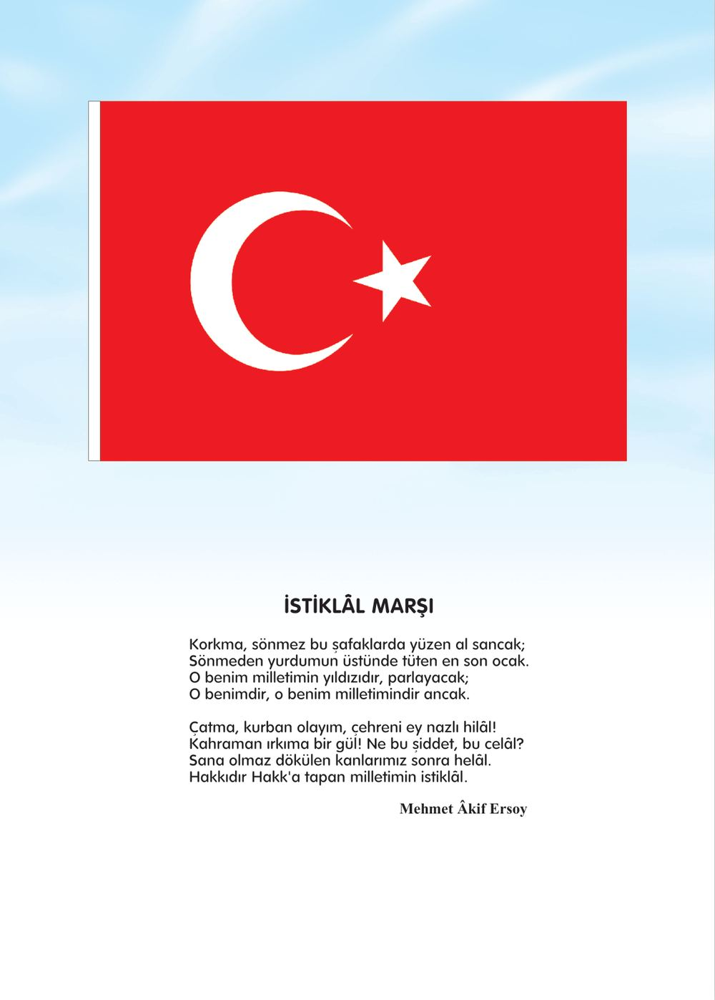

# İSTİKLÂL MARŞI

Korkma, sönmez bu şafaklarda yüzen al sancak;
Sönmeden yurdumun üstünde tüten en son ocak.
O benim milletimin yıldızıdır, parlayacak;
O benimdir, o benim milletimindir ancak.

Çatma, kurban olayım, çehreni ey nazlı hilâl!
Kahraman ırkıma bir gül! Ne bu şiddet, bu celâl?
Sana olmaz dökülen kanlarımız sonra helâl.
Hakkıdır Hakk'a tapan milletimin istiklâl.

Mehmet Âkif Ersoy

<!-- sayfa 3 -->

ANDIMIZ

Türküm, doğruyum, çalışkanım.

İlkem küçüklerimi korumak, büyüklerimi saymak; yurdumu, milletimi özümden çok sevmektir.
Ülküm yükselmek, ileri gitmektir.

Ey Büyük Atatürk!

Açtığın yolda, gösterdiğin hedefe durmadan yürüyeceğime ant içerim.

Varlığım Türk varlığına armağan olsun.

Ne mutlu Türküm diyene!

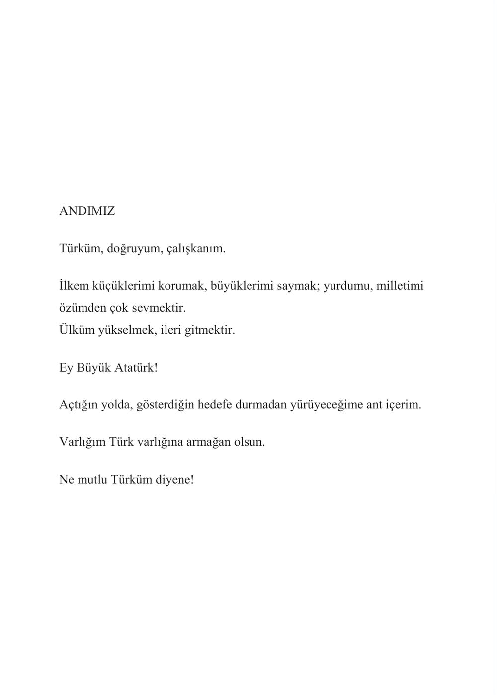
<!-- yer tutucu bulunamadı: sayfa sonuna eklendi -->

<!-- sayfa 4 -->

MUSTAFA KEMAL ATATÜRK

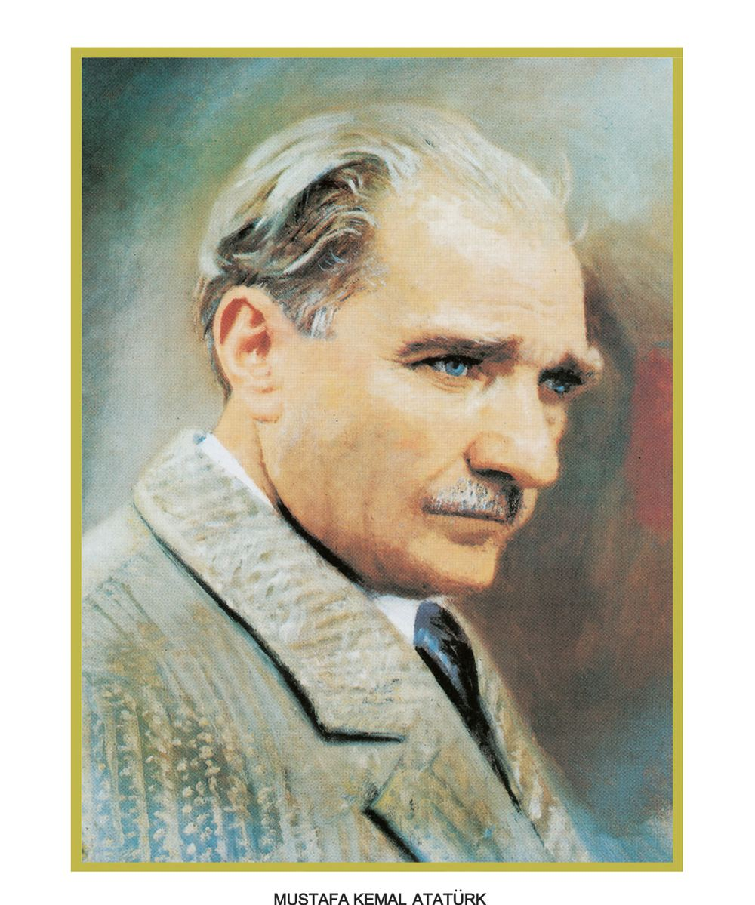
<!-- yer tutucu bulunamadı: sayfa sonuna eklendi -->

<!-- sayfa 5 -->

Verdiğiniz metin katmanı boş olduğu için (`<<< >>>` arası boş) dönüştürülecek bir içerik bulunmamaktadır. Lütfen metin katmanını içeren içeriği paylaşın, böylece talimatlarınıza uygun şekilde Markdown formatına çevirebilirim.

<!-- sayfa 6 -->

# CONTENTS

| | |
| :--- | :---: |
| Table of Contents | 8 |
| Introduction to the Book | 10 |
| Revision | 11 |
| Theme 1 – School Life | 19 |
| Theme 2 – Classroom Life | 37 |
| Theme 3 – Personal Life | 57 |
| Theme 4 – Family Life | 75 |
| Theme 5 – Homes & Houses & The Neighbourhood | 95 |
| Theme 6 – Life in the City & The World | 113 |
| Cut-Outs | 131 |
| Glossary | 149 |
| References | 155 |
| Answer Key | 155 |
| Visual and General Web References | 155 |
| Map of Türkiye’s Administrative Divisions and Its Land and Maritime Neighbours | 156 |
| Map of the Turkic World | 157 |

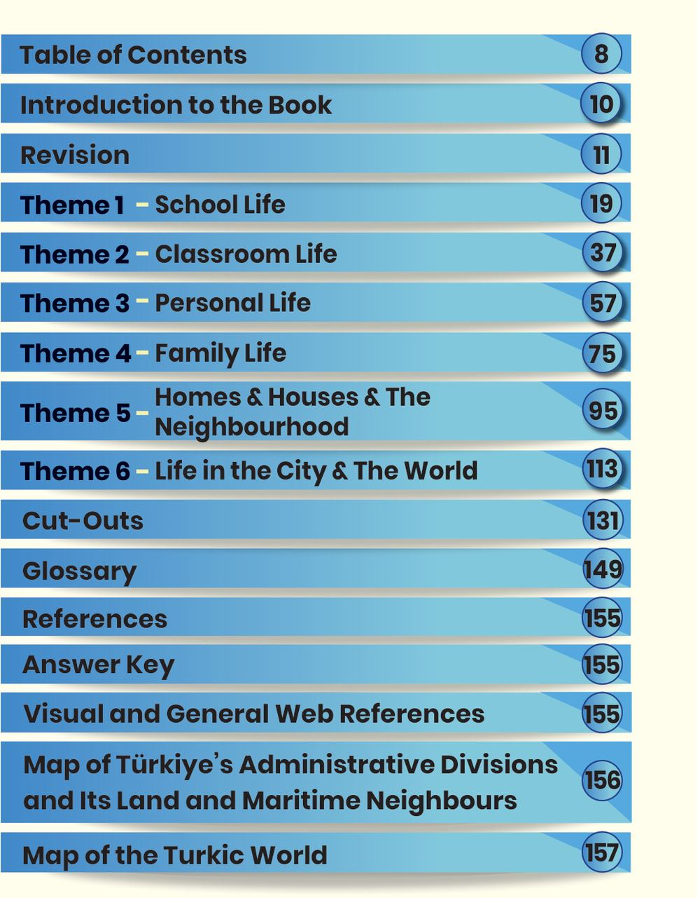
<!-- yer tutucu bulunamadı: sayfa sonuna eklendi -->

<!-- sayfa 7 -->

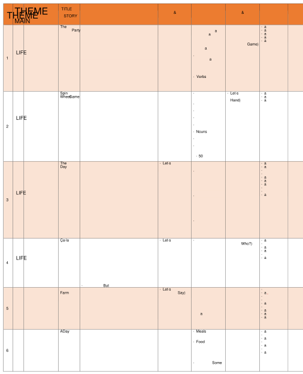

| THEME | MAIN THEME | SUB-THEMES | TITLE of the DIGITAL STORY | CHUNKS | CHUNKS & GAMIFICATION | VOCABULARY | VOCABULARY & GAMIFICATION | PRONUNCIATION |
| :--- | :--- | :--- | :--- | :--- | :--- | :--- | :--- | :--- |
| 1 | SCHOOL LIFE | Greetings and introductions at school; people and places at school; months of the year; ages and birthday celebrations; national days and celebrations. | The Surprise Birthday Party | • Who's/is this/she/he? This is Mr. Blue.<br>• Where is Daphne? She's/is in the library.<br>• What month is it now? It's/is September.<br>• How old are you? I'm 8 years old.<br>• When's/is your birthday? It's/is in July.<br>-There is / There are (+), (-), (?)<br>• Is there a nurse at school? Yes, there is a nurse at school.<br>• How many caretakers (are there at school)? (There are) two caretakers (at school).<br>-Must/ mustn't (for obligation): (+), (-), (?)<br>• You must follow the rules at school. You mustn't run in the corridor/at school.<br>• Personal Pronouns: I, you, we, they, he, she, it<br>• Prepositions: in, on, at<br>• Describing locations, time, and positions.<br>• Wh- question words: what, where, who, when<br>• Question words: how<br>• Demonstrative pronouns: this, that<br>• Demonstrative pronouns: this, that | • Let's play together. (Roll and say game)<br>• Basic Skill: Speaking | • People at school (a classmate, a librarian, a school nurse, etc.)<br>• Places at school (an art room, a music room, a meeting room, etc.)<br>• Birthday celebrations (birthday, a birthday party, a candle, etc.)<br>• Months of the year (January, February, March, etc.)<br>• Verbs (to prepare, to decorate, to bring, etc.) | • Watch, talk, and match.<br>• Basic Skills: Reading and Listening<br>• Let's play together. (Fast Finger Game)<br>• Basic Skill: Speaking | • a cat<br>• a cake<br>• a banana<br>• a bowl<br>• a book |
| 2 | CLASSROOM LIFE | Classroom instructions and language; classroom furniture, objects, and devices; school subjects; seasons of the year. | Spin the Wheel Game | • What time is it? It's five o'clock.<br>• What lesson is it now? It's/is Maths.<br>• How's/is the weather today/now? It's/is raining today. (It's rainy (AmE.) today).<br>• Countable nouns: a ruler- rulers.<br>• What are they? They are rulers.<br>• There is/there are: (only for countable nouns)<br>• Is there a Maths lesson on Monday? (Yes, there's/is a Maths lesson on Monday). Yes, there is<br>• How many rulers are there on the table? (There are two rulers on the table). There are two rulers. Two rulers.<br>• Have got/has got: (+) (?) (only with countable nouns and with numbers)<br>• How many pencils have you got? I've/have got two pencils.<br>• Possessive adjectives: my, his, her, its, our, your, their<br>• Question words: what time, how many<br>• Time expressions: today, now | • Let's play together. (Spelling game)<br>• Basic Skill: Speaking | • Classroom furniture (a teacher's desk, bookshelf, etc.)<br>• Classroom features (lights)<br>• Classroom objects (a pen, a ruler, etc.)<br>• Classroom devices (a keyboard, etc.)<br>• School subjects (Life Study, etc.)<br>• Nouns (a word, a letter, etc.)<br>• Colours (red, grey, etc.)<br>• Weather (sunny, etc.)<br>• Cardinal Numbers: 20 – 50<br>• The alphabet (song) | • Let's play. (Guess What's in My Hand)<br>• Basic Skill: Speaking | • a card<br>• a pencil<br>• a duster |
| 3 | PERSONAL LIFE | Parts of the body and physical features; personal characters; weather conditions; clothing according to seasons and weather conditions; preferences for clothing. | The Camping Day | • What's your name? I'm/ am... / My name is....<br>• What does she look like? She's tall and beautiful.<br>• "Have got/ Has got: (+) (-) (?)":<br>• Have you got a big or small nose? I've/have got a small nose.<br>• Have you got any T-shirts? Yes, I've/have got some T-shirts.<br>• What colour hair has she got? She's/has got blonde hair.<br>• How is her hair? What's her hair like? She's/has got curly hair.<br>• Like/dislike: I like/hate/dislike/love big sunglasses.<br>• Possessive "s": Whose dress is this? This is Jasmine's dress.<br>• The Present Progressive: What are you wearing today? I'm/am wearing a T-shirt today. I'm wearing a coat. It's winter and it's cold.<br>• Countable and uncountable nouns with some, any, much, many. (Have you got any shirts? Yes, I've got some shirts).<br>• Question words: Whose, what...like.<br>• Conjunctions: and, or | • Let's play. (Read and act)<br>• Basic Skill: Speaking | • Parts of the body (a foot, feet, etc.)<br>• Adjectives (Hair: Blond(e), curly, etc. ; physical features: little, strong, etc. ; personal characters: nice, good, etc.)<br>• Weather (sunny, rainining, etc.)<br>• Verbs for feelings about body parts (to like, to dislike, etc.)<br>• Clothes (a sweatshirt, jeans, etc.) | • Read, colour, and say.<br>• Basic Skills: Reading and Writing | • a pen<br>• a teacher<br>• weak<br>• fish<br>• a game<br>• a giraffe<br>• a hat<br>• time<br>• sit<br>• a jacket |
| 4 | FAMILY LIFE | Family members; ages of family members; daily routines and chores of family members; hobbies and abilities of family members. | Çağla and her Family | • How old is your mother? She's/is thirty-five years old. Is this her birthday today? Yes, it's/is her birthday today.<br>• The Simple Present Tense: What does she do every morning? She prepares breakfast every morning. What do you do at home? I clean my room every morning.<br>• Can/can't: My father can cook. My father can't cook.<br>• Could: Could you help me, please?<br>• Question word: How often?<br>• Adverbs of time: Every, sometimes, always, often, never<br>• Adverbs of manner: Well<br>• Conjunctions: But | • Let's play.<br>• Basic Skill: Speaking | • Family members (a cousin, an aunt, etc.)<br>• Daily routines and chores of family members (to wake up, to study, etc.)<br>• Hobbies and abilities of family members (to swim, to play chess, etc.) | • Let's play together. (Who is Who?)<br>• Basic Skills: Reading and Speaking | • a keyboard<br>• lazy<br>• a mouse<br>• a necklace<br>• October<br>• a parent |
| 5 | HOMES & HOUSES & THE NEIGHBOURHOOD | Life in the countryside; farmhouses and farm animals; activities and chores on a fa | A Day in the Farm | • There is/There are: What is there on your farm? There's/is a farmhouse on our farm.<br>• How many cows are there on your farm?<br>• There are five cows on our farm.<br>• The Simple Present Tense: What do you do on your farm every day? I milk cows every day.<br>• The Present Progressive Tense: What is the farmer doing now? He's/is milking the cows now.<br>• Adverbs of time: Now, at present, today | • Let's play. (Show and Say)<br>• Basic Skill: Speaking | • Life in the countryside (a cow, a sheep, etc.)<br>• Farmhouses and farm animals (a farmhouse, a barn, etc.)<br>• Activities and chores on a farm. (to feed, to mow, etc.) | • Let's play together. (Guess the action)<br>• Basic Skill: Speaking | • quiet<br>• a rabbit<br>• sunny<br>• handriome<br>• a dress<br>• a table<br>• a vegetable<br>• a vase |
| 6 | LIFE IN THE CITY & THE WORLD | Food items and meals, eating out and ordering food. | A Day in London | • The Simple Present Tense: What do you want? I want some salad, please.<br>• Will: What do you want? I'll take some fruit, please.<br>• Can: Can I have some soup, please? Yes, you can.<br>• Can: Can I see the menu, please? Yes, you can.<br>• Have got/has got: Have you got any olives? Yes, we've got some olives.<br>• Have you got any fruit juice?<br>• What have you got for lunch? We've got some bread. | • Let's play together.<br>• Basic Skill: Speaking | • Meals (breakfast, lunch, etc.)<br>• Food items (water, cheese, etc.)<br>• Eating outside and ordering food (fast food, a café, etc.)<br>• Quantifiers: Some and any | • Let's play together. (Help the mouse eat the cheese.)<br>• Basic Skill: Reading and Writing | • a uniform<br>• sunny<br>• a family<br>• a water<br>• a zoo<br>• extra<br>• a zebra |

<!-- sayfa 8 -->

| LISTENING & WATCHING- COMPREHENSION | SPEAKING-EXPRESSION | READING- COMPREHENSION | WRITING-EXPRESSION | CLIL & CULTURE | PROJECTS | CONSOLIDATION | REFLECTION |
| :--- | :--- | :--- | :--- | :--- | :--- | :--- | :--- |
| • Look and listen.<br>• Basic Skills: Listening and Reading | • Read and act out. (Grammaring Selection and Use)<br>• Read and act out. (Strip Story for Consolidation)<br>• Basic Skills: Reading and Speaking | • My School.<br>• Basic Skill: Reading | • Find, circle and say. (Word search puzzle)<br>• Group and write. (Places and people)<br>• Basic Skill: Writing | • Let’s play. (Grammar Chunks)<br>• Objective: Remembering places and people with a board game. | • Design a diary page about the places and people about school.<br>• Objective: Remembering places and people. | • Look and match.<br>• Read and write.<br>• Find and circle.<br>• Odd one out. | • What about you? (Read and colour)<br>• Choosing the right emoji for themselves. |
| • Look and listen.<br>• Listen and complete.<br>• Basic Skills: Listening and Writing | • Read and act out. (Grammaring Selection and Use)<br>• Read and act out. (Strip Story for Consolidation)<br>• Let’s play together. (Card Game)<br>• Basic Skill: Speaking | • Jack’s Classroom.<br>• Basic Skill: Reading | • Look and write.<br>• Group and write.<br>• Basic Skill: Writing | • Look and answer.<br>• Objective: Remembering classroom objects, devices and furniture with an activity. | • Make your picture dictionary. (Write the names of the objects, devices and furniture. Talk about your Picture.)<br>• Objective: Remembering the names of objects, devices and furniture. | • Read and match.<br>• Find and complete.<br>• Find and match. | • What about you? (Read and colour)<br>• Choosing the right emoji for themselves. |
| • Look, listen and repeat.<br>• Basic Skills: Listening and Writing | • Read and act. (Grammaring Selection and Use)<br>• Read and act out. (Strip Story for Consolidation)<br>• Basic Skills: Speaking and Reading | • Read and write.<br>• Basic Skill: Reading | • Read and write.<br>• Draw, colour and write.<br>• Basic Skills: Reading and Writing | • Choose and say. (Board Game)<br>• Objective: Remembering language chunks. | • Make your booklet and say.<br>• Basic Skill: Speaking | • Look and write.<br>• Find and circle. | • What about you? (Read and colour)<br>• Choosing the right emoji for themselves. |
| • Listen and complete.<br>• Basic Skills: Listening and Writing | • Read and act. (Grammaring Selection and Use)<br>• Read and act out. (Strip Story for Consolidation)<br>• Basic Skills: Speaking and Reading | • Read and complete.<br>• Basic Skill: Reading | • Write and say.<br>• Basic Skills: Writing and Speaking | • Make a clock, then ask and answer.<br>• Basic Skill: Speaking | • Introduce your family members.<br>• Objective: Remembering the family members, their hobbies, their Daily routines and chores at home. | • Look and write. | • What about you? (Read and colour)<br>• Choosing the right emoji for themselves. |
| • Listen and write.<br>• Basic Skills: Listening and Writing | • Read and act out. (Grammaring Selection and Use)<br>• Read and act out. (Strip Story for Consolidation)<br>• Basic Skills: Speaking and Reading | • Read and choose. (Ali’s Grandparents Farm)<br>• Basic Skills: Reading and Writing | • Match and write.<br>• Basic Skill: Writing | • Find and say.<br>• Objective: Remembering farm animals, farmhouses. | • Make a farm poster. Then, talk about it.<br>• Objective: Remembering Life in the countryside, farmhouses and farm animals, activities and chores on a farm. | • Look and tick.<br>• Do the crossword puzzle. | • What about you? (Read and colour)<br>• Choosing the right emoji for themselves. |
| • Listen and repeat.<br>• Basic Skills: Listening and Writing | • Read and act out. (Grammaring Selection and Use)<br>• Read and act out. (Strip Story for Consolidation)<br>• Basic Skills: Reading and Speaking | • Read and match.<br>• Basic Skill: Reading | • Look and complete the menu.<br>• Basic Skill: Writing | • Read, answer and check. (Which food are you?)<br>• Objective: Remembering the names of food items, drinks and meals. | • Make a menu and act out.<br>• Objective: Talking about Food items, meals eating outside and ordering food. | • Read, find and write.<br>• Read and complete the dialogue. | • What about you? (Read and colour)<br>• Choosing the right emoji for themselves. |

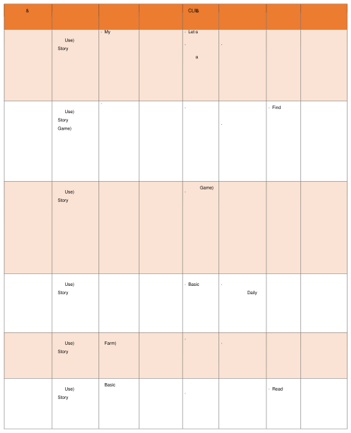
<!-- yer tutucu bulunamadı: sayfa sonuna eklendi -->

<!-- sayfa 9 -->

# INTRODUCTION TO THE BOOK

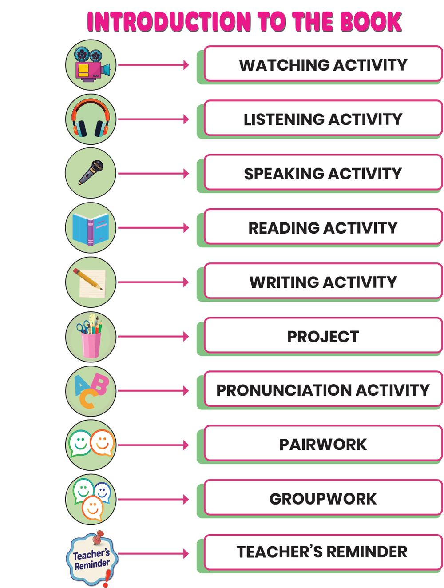 WATCHING ACTIVITY
 LISTENING ACTIVITY
 SPEAKING ACTIVITY
 READING ACTIVITY
 WRITING ACTIVITY
 PROJECT
 PRONUNCIATION ACTIVITY
 PAIRWORK
 GROUPWORK
 TEACHER’S REMINDER

<!-- sayfa 10 -->

# REVISION

Let’s remember!

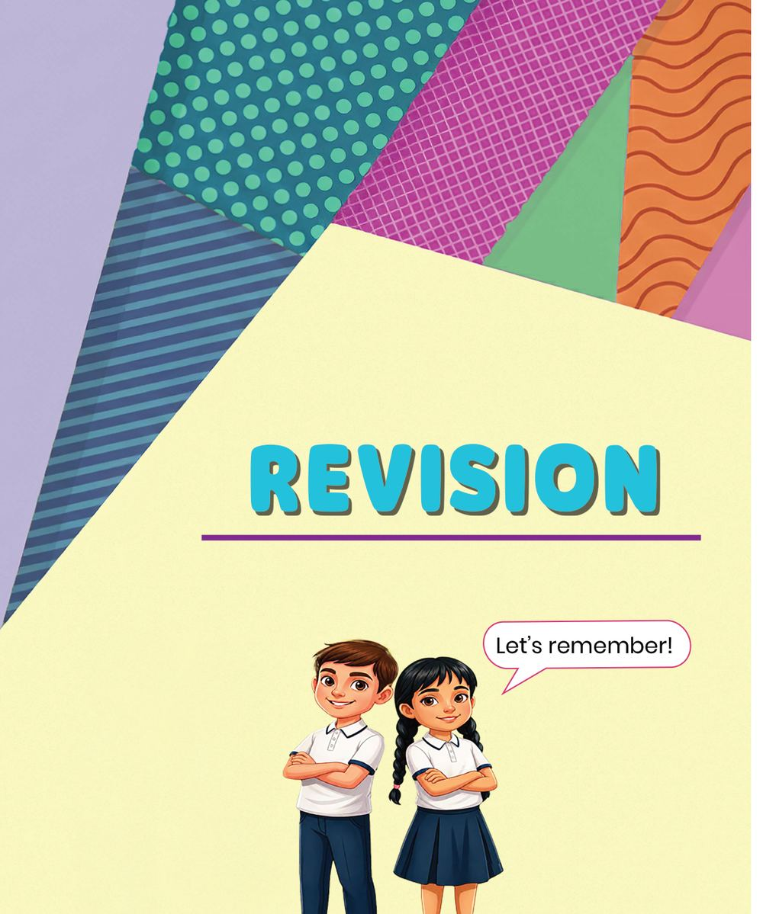

<!-- sayfa 11 -->

**Activity 1**

This activity is placed in the Revision section at the very beginning of the Year 3 pupil's book. Its main aim is to help pupils revise and recall the key language items from Year 2, Theme 1 before starting new Year 3 topics. The focus is on basic greetings, introductions, asking names, asking how someone is, and saying goodbye. By completing this activity, pupils refresh their prior knowledge and feel more confident and ready for the new learning outcomes of Year 3. Ask pupils to look at the pictures carefully and read the instruction: “Read, complete, and say.” Draw pupils’ attention to the example (e.g.) first. Read it aloud and show how the dialogue is completed using the words/phrases given in the box. Ask pupils to read each short dialogue silently. Pupils then complete the speech bubbles by choosing the correct expression from the word box. Encourage pupils to check the meaning and sequence of the dialogue before writing their answers. After completion, you may check answers orally as a class. Invite pairs of pupils to act out the dialogues to reinforce speaking-expression skills. Guide pupils through the example step by step. Support pupils who need help by modelling pronunciation and meaning. Encourage full participation and oral repetition where possible. Create a positive and stress-free revision atmosphere.

---

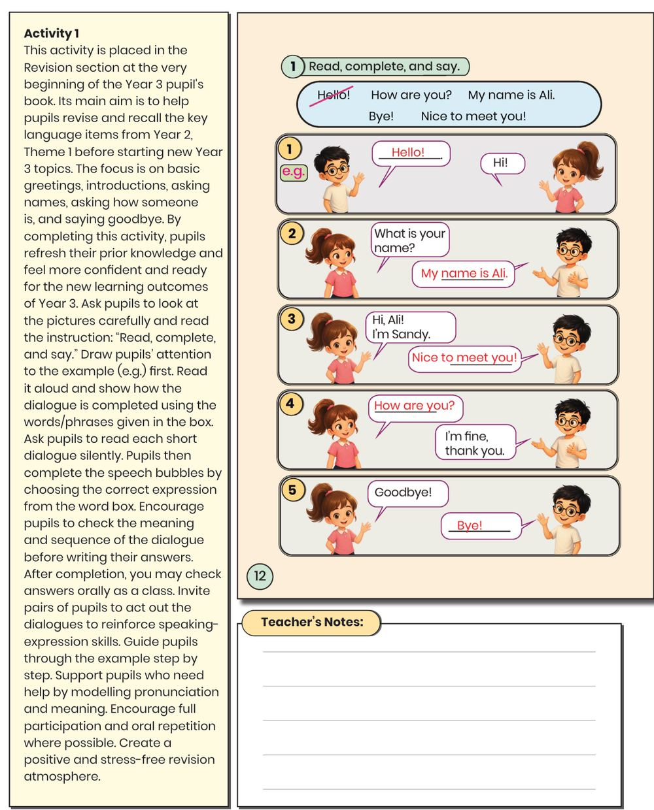

1 **Read, complete, and say.**

| Hello! | How are you? | My name is Ali. | Bye! | Nice to meet you! |
| :--- | :--- | :--- | :--- | :--- |

1 
e.g.
- Hello!
- Hi!

2 
- What is your name?
- My name is Ali.

3 
- Hi, Ali! I'm Sandy.
- Nice to meet you!

4 
- How are you?
- I'm fine, thank you.

5 
- Goodbye!
- Bye!

12

**Teacher's Notes:**
__________________________________________________________________
__________________________________________________________________
__________________________________________________________________
__________________________________________________________________
__________________________________________________________________

<!-- sayfa 12 -->

# 2 Find, write, and say.

| pupil | playground | teacher | library | classroom |
| :--- | :--- | :--- | :--- | :--- |
| school | lunch hall | canteen | headmaster | friend |

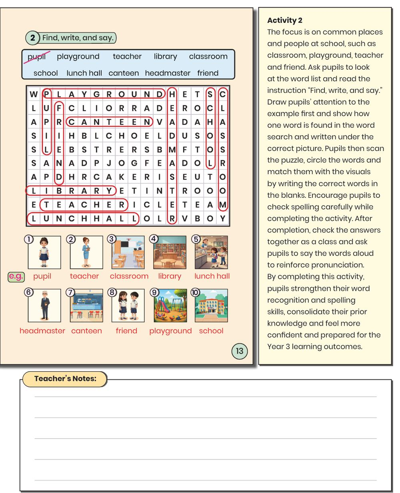


e.g. pupil


teacher


classroom


library


lunch hall


headmaster


canteen


friend


playground


school

13

***

## Activity 2
The focus is on common places and people at school, such as classroom, playground, teacher and friend. Ask pupils to look at the word list and read the instruction “Find, write, and say.” Draw pupils’ attention to the example first and show how one word is found in the word search and written under the correct picture. Pupils then scan the puzzle, circle the words and match them with the visuals by writing the correct words in the blanks. Encourage pupils to check spelling carefully while completing the activity. After completion, check the answers together as a class and ask pupils to say the words aloud to reinforce pronunciation. By completing this activity, pupils strengthen their word recognition and spelling skills, consolidate their prior knowledge and feel more confident and prepared for the Year 3 learning outcomes.

***

**Teacher's Notes:**

__________________________________________________________________________
__________________________________________________________________________
__________________________________________________________________________

<!-- sayfa 13 -->

# Activity 3
This activity is placed in the Revision section at the very beginning of the Year 3 pupil's book and aims to help pupils revise and recall the key language from Year 2, Theme 2 before starting new Year 3 topics. The focus is on classroom objects and simple question–answer structures, such as “What is it?” and “Is it a …?”. Ask pupils to look at the pictures carefully and read the questions. Draw pupils’ attention to the example first and model the complete answer aloud. Pupils then read each question and write the correct answer according to the visuals. Encourage pupils to use full sentences and check meaning before writing. After completion, check the answers orally as a class and ask pupils to repeat the sentences to reinforce pronunciation. By completing this activity, pupils consolidate their vocabulary, practise basic sentence structures and gain confidence in simple reading and writing tasks, which prepares them for Year 3 learning outcomes.

---

# 3 Read, answer, and say.

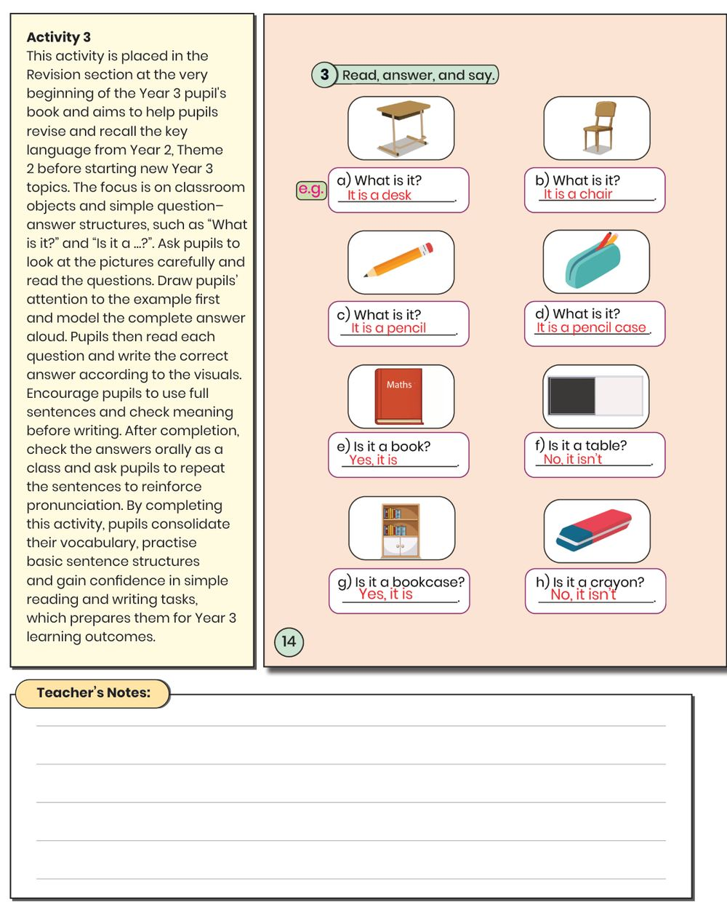

e.g. a) What is it?
<u>It is a desk</u>.


b) What is it?
<u>It is a chair</u>.


c) What is it?
<u>It is a pencil</u>.


d) What is it?
<u>It is a pencil case</u>.


e) Is it a book?
<u>Yes, it is</u>.


f) Is it a table?
<u>No, it isn't</u>.


g) Is it a bookcase?
<u>Yes, it is</u>.


h) Is it a crayon?
<u>No, it isn't</u>.

14

---

**Teacher's Notes:**
__________________________________________________________________
__________________________________________________________________
__________________________________________________________________
__________________________________________________________________
__________________________________________________________________

<!-- sayfa 14 -->

# 4 Read the cards and write the numbers.

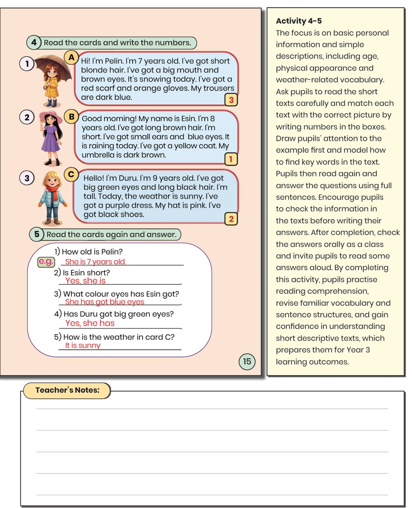
**A** Hi! I'm Pelin. I'm 7 years old. I've got short blonde hair. I've got a big mouth and brown eyes. It's snowing today. I've got a red scarf and orange gloves. My trousers are dark blue.
**3**


**B** Good morning! My name is Esin. I'm 8 years old. I've got long brown hair. I'm short. I've got small ears and blue eyes. It is raining today. I've got a yellow coat. My umbrella is dark brown.
**1**


**C** Hello! I'm Duru. I'm 9 years old. I've got big green eyes and long black hair. I'm tall. Today, the weather is sunny. I've got a purple dress. My hat is pink. I've got black shoes.
**2**

# 5 Read the cards again and answer.

1) How old is Pelin?
e.g. _She is 7 years old._

2) Is Esin short?
_Yes, she is_

3) What colour eyes has Esin got?
_She has got blue eyes_

4) Has Duru got big green eyes?
_Yes, she has_

5) How is the weather in card C?
_It is sunny_

15

***

**Activity 4-5**
The focus is on basic personal information and simple descriptions, including age, physical appearance and weather-related vocabulary. Ask pupils to read the short texts carefully and match each text with the correct picture by writing numbers in the boxes. Draw pupils’ attention to the example first and model how to find key words in the text. Pupils then read again and answer the questions using full sentences. Encourage pupils to check the information in the texts before writing their answers. After completion, check the answers orally as a class and invite pupils to read some answers aloud. By completing this activity, pupils practise reading comprehension, revise familiar vocabulary and sentence structures, and gain confidence in understanding short descriptive texts, which prepares them for Year 3 learning outcomes.

***

**Teacher's Notes:**
__________________________________________________________________
__________________________________________________________________
__________________________________________________________________
__________________________________________________________________

<!-- sayfa 15 -->

# Activity 6
The focus is on family members and basic possessive structures. Ask pupils to look at the family pictures and read the instruction carefully. Draw pupils’ attention to the example first and model how to complete the sentences using the words given in the box. Pupils then write the correct family member words to complete each sentence. Encourage pupils to check meaning and spelling before writing their answers. After completion, check the answers orally as a class and ask pupils to say the sentences aloud to reinforce pronunciation. By completing this activity, pupils consolidate family-related vocabulary, practise simple sentence structures and gain confidence in using familiar language, which helps prepare them for Year 3 learning outcomes.

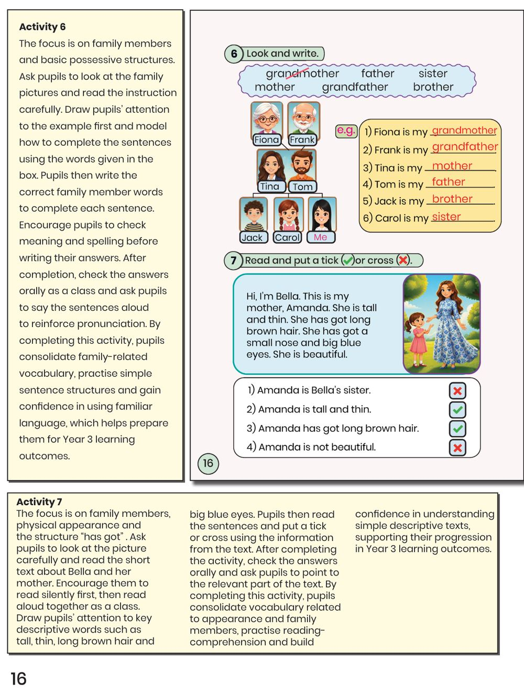

# 6 Look and write.
grandmother father sister
mother grandfather brother


e.g. 1) Fiona is my grandmother
2) Frank is my grandfather
3) Tina is my mother
4) Tom is my father
5) Jack is my brother
6) Carol is my sister

# 7 Read and put a tick ($\checkmark$) or cross ($\text{\textsf{X}}$ <!-- KONTROL: Marker'da karşılığı yok, uydurma olabilir -->).

Hi, I'm Bella. This is my mother, Amanda. She is tall and thin. She has got long brown hair. She has got a small nose and big blue eyes. She is beautiful.


1) Amanda is Bella's sister. $\text{\textsf{X}}$ <!-- KONTROL: Marker'da karşılığı yok, uydurma olabilir -->
2) Amanda is tall and thin. $\checkmark$
3) Amanda has got long brown hair. $\checkmark$
4) Amanda is not beautiful. $\text{\textsf{X}}$ <!-- KONTROL: Marker'da karşılığı yok, uydurma olabilir -->

16

***

# Activity 7
The focus is on family members, physical appearance and the structure "has got". Ask pupils to look at the picture carefully and read the short text about Bella and her mother. Encourage them to read silently first, then read aloud together as a class. Draw pupils' attention to key descriptive words such as tall, thin, long brown hair and big blue eyes. Pupils then read the sentences and put a tick or cross using the information from the text. After completing the activity, check the answers orally and ask pupils to point to the relevant part of the text. By completing this activity, pupils consolidate vocabulary related to appearance and family members, practise reading-comprehension and build confidence in understanding simple descriptive texts, supporting their progression in Year 3 learning outcomes.

<!-- sayfa 16 -->

# 8 Look, read, and put a tick (✔️) or cross (❌).

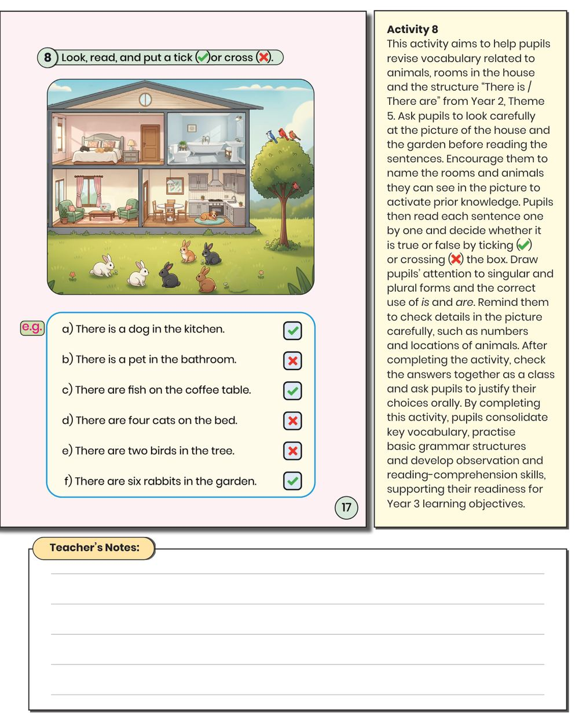

e.g.
| | |
| :--- | :---: |
| a) There is a dog in the kitchen. | ✔️ |
| b) There is a pet in the bathroom. | ❌ |
| c) There are fish on the coffee table. | ✔️ |
| d) There are four cats on the bed. | ❌ |
| e) There are two birds in the tree. | ❌ |
| f) There are six rabbits in the garden. | ✔️ |

17

---

## Activity 8
This activity aims to help pupils revise vocabulary related to animals, rooms in the house and the structure “There is / There are” from Year 2, Theme 5. Ask pupils to look carefully at the picture of the house and the garden before reading the sentences. Encourage them to name the rooms and animals they can see in the picture to activate prior knowledge. Pupils then read each sentence one by one and decide whether it is true or false by ticking (✔️) or crossing (❌) the box. Draw pupils’ attention to singular and plural forms and the correct use of *is* and *are*. Remind them to check details in the picture carefully, such as numbers and locations of animals. After completing the activity, check the answers together as a class and ask pupils to justify their choices orally. By completing this activity, pupils consolidate key vocabulary, practise basic grammar structures and develop observation and reading-comprehension skills, supporting their readiness for Year 3 learning objectives.

---

**Teacher's Notes:**
__________________________________________________________________
__________________________________________________________________
__________________________________________________________________
__________________________________________________________________
__________________________________________________________________

<!-- sayfa 17 -->

**Activity 9**

Its main aim is to help pupils revise and consolidate food vocabulary and basic structures from previous learning. It focuses on recognising food items and using *There is / There are* with countable and uncountable nouns from Year 2, Theme 6. By completing this activity, pupils recall familiar food words and practise matching written descriptions with visual information. This helps them build confidence before moving on to new topics. Ask pupils to look at the pictures carefully and read the instruction: “Read and match.” Draw their attention to the example first and explain how the sentence is matched with the correct picture. Read the example aloud and point to the food items mentioned. Ask pupils to read each sentence silently and identify the food items. Pupils then match each sentence with the correct picture (a–e). Encourage them to look for key words such as *some*, *two*, *there is*, and *there are* to help them decide. After completing the activity, check the answers together as a class. Ask pupils to say the sentences aloud and point to the matching pictures. Support pupils who need help by revising vocabulary orally and modelling correct pronunciation. Encourage participation and create a positive, relaxed revision atmosphere.

---

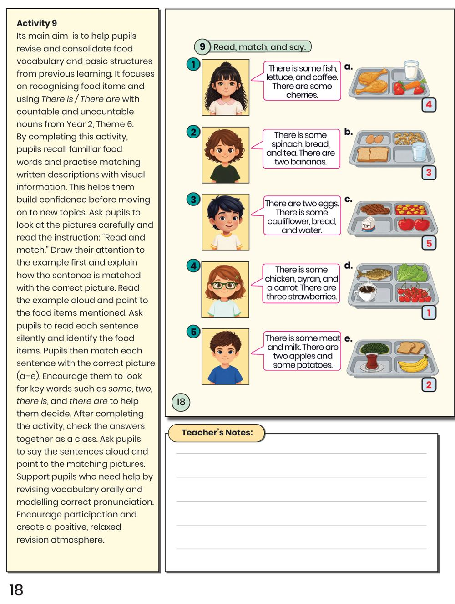

**9** Read, match, and say.

1  There is some fish, lettuce, and coffee. There are some cherries.  **a.**  **4**

2  There is some spinach, bread, and tea. There are two bananas.  **b.**  **3**

3  There are two eggs. There is some cauliflower, bread, and water.  **c.**  **5**

4  There is some chicken, ayran, and a carrot. There are three strawberries.  **d.**  **1**

5  There is some meat and milk. There are two apples and some potatoes.  **e.**  **2**

**18**

**Teacher's Notes:**

__________________________________________________________________
__________________________________________________________________
__________________________________________________________________
__________________________________________________________________
__________________________________________________________________

<!-- sayfa 18 -->

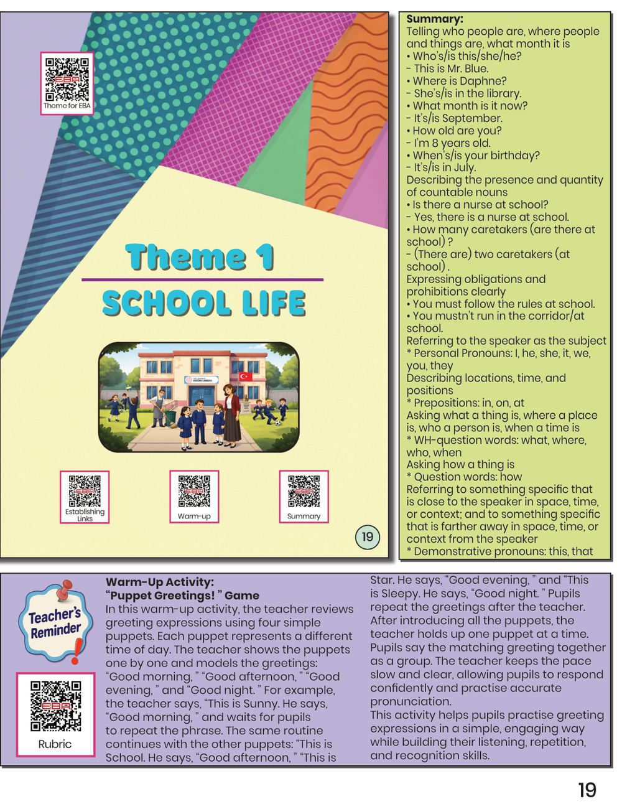

# Theme 1
# SCHOOL LIFE


19

---

**Summary:**
Telling who people are, where people and things are, what month it is
• Who’s/is this/she/he?
- This is Mr. Blue.
• Where is Daphne?
- She’s/is in the library.
• What month is it now?
- It’s/is September.
• How old are you?
- I’m 8 years old.
• When’s/is your birthday?
- It’s/is in July.
Describing the presence and quantity of countable nouns
• Is there a nurse at school?
- Yes, there is a nurse at school.
• How many caretakers (are there at school)?
- (There are) two caretakers (at school).
Expressing obligations and prohibitions clearly
• You must follow the rules at school.
• You mustn’t run in the corridor/at school.
Referring to the speaker as the subject
* Personal Pronouns: I, he, she, it, we, you, they
Describing locations, time, and positions
* Prepositions: in, on, at
Asking what a thing is, where a place is, who a person is, when a time is
* WH-question words: what, where, who, when
Asking how a thing is
* Question words: how
Referring to something specific that is close to the speaker in space, time, or context; and to something specific that is farther away in space, time, or context from the speaker
* Demonstrative pronouns: this, that

---


**Teacher's Reminder**

**Warm-Up Activity:**
**“Puppet Greetings!” Game**
In this warm-up activity, the teacher reviews greeting expressions using four simple puppets. Each puppet represents a different time of day. The teacher shows the puppets one by one and models the greetings: “Good morning,” “Good afternoon,” “Good evening,” and “Good night.” For example, the teacher says, “This is Sunny. He says, ‘Good morning,’” and waits for pupils to repeat the phrase. The same routine continues with the other puppets: “This is Star. He says, ‘Good evening,’” and “This is Sleepy. He says, ‘Good night.’” Pupils repeat the greetings after the teacher. After introducing all the puppets, the teacher holds up one puppet at a time. Pupils say the matching greeting together as a group. The teacher keeps the pace slow and clear, allowing pupils to respond confidently and practise accurate pronunciation. This activity helps pupils practise greeting expressions in a simple, engaging way while building their listening, repetition,


Rubric

<!-- sayfa 19 -->

# Establishing Links

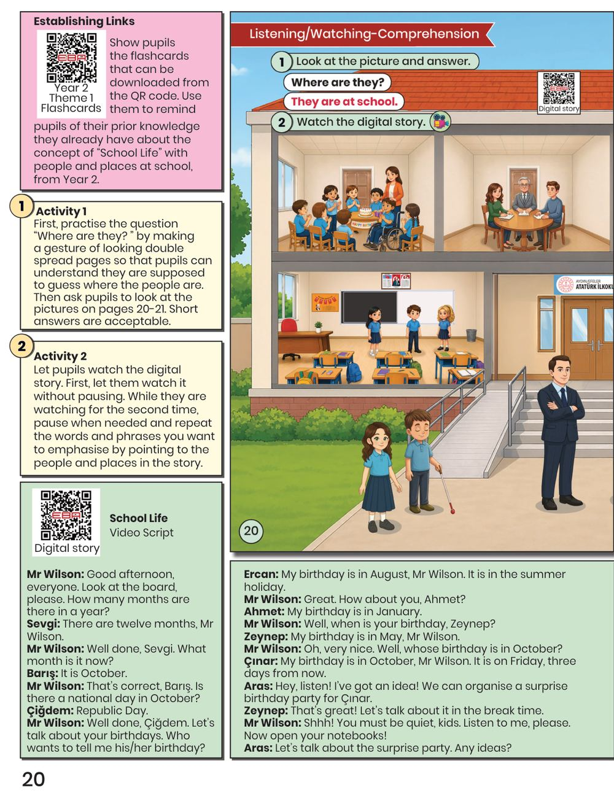

Show pupils the flashcards that can be downloaded from the QR code. Use them to remind pupils of their prior knowledge they already have about the concept of “School Life” with people and places at school, from Year 2.

Year 2 Theme 1 Flashcards

---

# 1 Activity 1

First, practise the question “Where are they? ” by making a gesture of looking double spread pages so that pupils can understand they are supposed to guess where the people are. Then ask pupils to look at the pictures on pages 20–21. Short answers are acceptable.

# 2 Activity 2

Let pupils watch the digital story. First, let them watch it without pausing. While they are watching for the second time, pause when needed and repeat the words and phrases you want to emphasise by pointing to the people and places in the story.

---


# School Life Video Script

**Mr Wilson:** Good afternoon, everyone. Look at the board, please. How many months are there in a year?
**Sevgi:** There are twelve months, Mr Wilson.
**Mr Wilson:** Well done, Sevgi. What month is it now?
**Barış:** It is October.
**Mr Wilson:** That’s correct, Barış. Is there a national day in October?
**Çiğdem:** Republic Day.
**Mr Wilson:** Well done, Çiğdem. Let’s talk about your birthdays. Who...

**Ercan:** My birthday is in August, Mr Wilson. It is in the summer holiday.
**Mr Wilson:** Great. How about you, Ahmet?
**Ahmet:** My birthday is in January.
**Mr Wilson:** Well, when is your birthday, Zeynep?
**Zeynep:** My birthday is in May, Mr Wilson.
**Mr Wilson:** Oh, very nice. Well, whose birthday is in October?
**Çınar:** My birthday is in October, Mr Wilson. It is on Friday, three days from now.
**Aras:** Hey, listen! I’ve got an idea! We can organise a surprise birthday party for Çınar.
**Zeynep:** That’s great! Let’s talk about it in the break time.
**Mr Wilson:** Shhh! You must be quiet, kids. Listen to me, please. Now open your notebooks!

---

# Listening/Watching-Comprehension

1 Look at the picture and answer.
**Where are they?**
**They are at school.**

2 Watch the digital story. 


20

<!-- sayfa 20 -->

Ceylin: I have an idea. We can decorate the art room for the party.
Zeynep: It sounds great! We need some candles, balloons, and a birthday cake.
Aras: My mum can make a birthday cake.
Ceylin: I can bring candles and balloons. What about the gift?
Zeynep: Let’s write a birthday song for Çınar!
Aras: Yes, a song is a perfect gift!
* * *
Zeynep: Good afternoon, Mrs Yılmaz. How are you?
Mrs Yılmaz: Good afternoon, kids. I’m good, thanks.
Ceylin: We want to write a birthday song for our classmate.
Mrs Yılmaz: Cool! Do you need help?
maybe play the guitar for us?
Mrs Yılmaz: Of Course! Why not?
Aras, Zeynep, and Ceylin: Thank you! Have a good day, Mrs Yılmaz.
Mrs Yılmaz: See you later.
* * *
Aras: Hey look, the headteacher is coming. I think we can ask him about the key for the art room.
Ceylin: Good afternoon, Mr Atasoy. Have you got a minute?
Mr Atasoy: Sure, Ceylin. What’s the matter?
Ceylin: We need the key to the art room. Where can we find it?
Mr Atasoy: The caretaker has it. He is in the library. Go and ask him, please!
* * *
Zeynep: The librarian is sitting at her desk. Let’s go and ask her.
Librarian: Hello, kids. How can I help you?
Aras: Hi, Mrs Suna. We need to find the caretaker. Is he here?
Librarian: No, I’m sorry. He is not here now. I think he is in the office.
* * *
Can: Ouch! It hurts!
Mrs Yılmaz: You mustn’t run in the corridor, kids. Be careful!
Can: Ouch, it really hurts! Oh, my leg!
Mrs Yılmaz: You must see the school nurse. Come on, kids. Let’s help him.
Aras: We can take him to the nurse. Zeynep, can you go to the caretaker’s office and get the key?
Zeynep: Sure. I’m going right now.
* * *
Everybody: Happy birthday!

**Birthday Song**

It’s your birthday, dear,
It’s great to see you here.
Balloons, candles, gifts are fine.
Happy birthday, have a great time.

Hello, good day, dear!
We are so happy, you are here.
Your birthday is in October.
Let’s celebrate it together!

Have a good day, dear!
We are so happy, you are here.
Your birthday is in October.
Let’s celebrate it together!

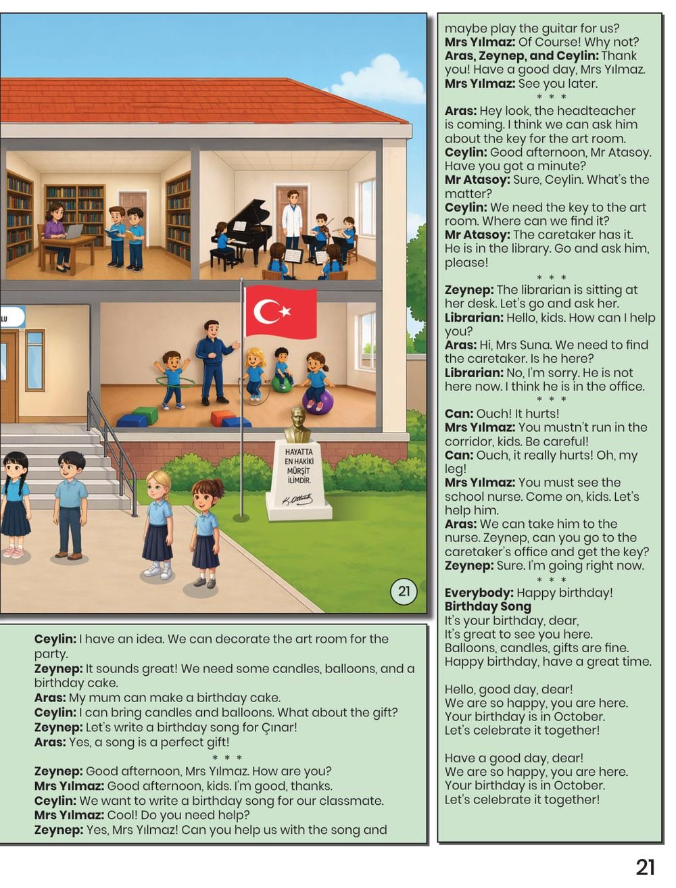

<!-- sayfa 21 -->

# Additional Activity

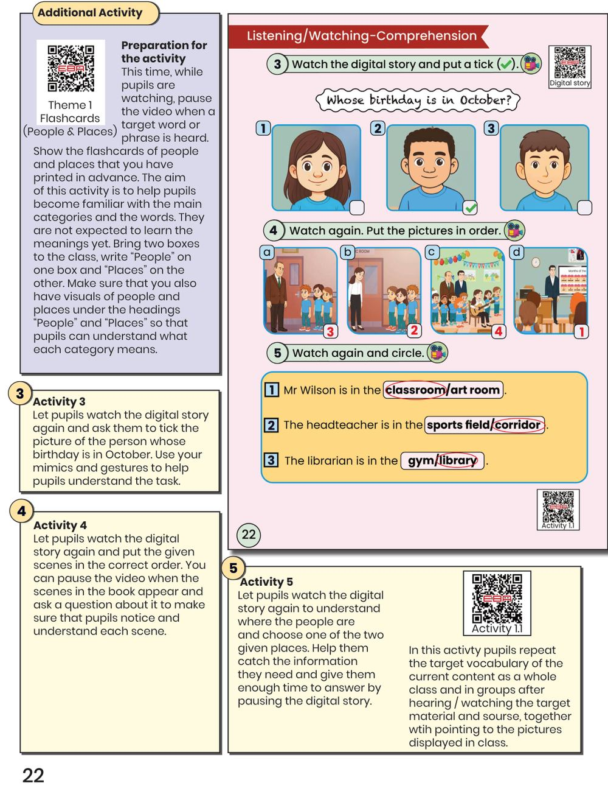

**Preparation for the activity**
This time, while pupils are watching, pause the video when a target word or phrase is heard. Show the flashcards of people and places that you have printed in advance. The aim of this activity is to help pupils become familiar with the main categories and the words. They are not expected to learn the meanings yet. Bring two boxes to the class, write “People” on one box and “Places” on the other. Make sure that you also have visuals of people and places under the headings “People” and “Places” so that pupils can understand what each category means.

Theme 1 Flashcards (People & Places)

---

# Listening/Watching–Comprehension

### 3 Watch the digital story and put a tick ($\checkmark$).


Whose birthday is in October?

1.  $\square$
2.  $\checkmark$
3.  $\square$

### 4 Watch again. Put the pictures in order.


a.  3
b.  2
c.  4
d.  1

### 5 Watch again and circle.


1. Mr Wilson is in the **classroom**/art room
2. The headteacher is in the **sports field**/corridor
3. The librarian is in the **gym**/library


---

### 3 Activity 3
Let pupils watch the digital story again and ask them to tick the picture of the person whose birthday is in October. Use your mimics and gestures to help pupils understand the task.

### 4 Activity 4
Let pupils watch the digital story again and put the given scenes in the correct order. You can pause the video when the scenes in the book appear and ask a question about it to make sure that pupils notice and understand each scene.

### 5 Activity 5
Let pupils watch the digital story again to understand where the people are and choose one of the two given places. Help them catch the information they need and give them enough time to answer by pausing the digital story.


Activity 1.1

In this activity pupils repeat the target vocabulary of the current content as a whole class and in groups after hearing / watching the target material and source, together with pointing to the pictures.

<!-- sayfa 22 -->

# Speaking-Expression

## 6 Let's play together.
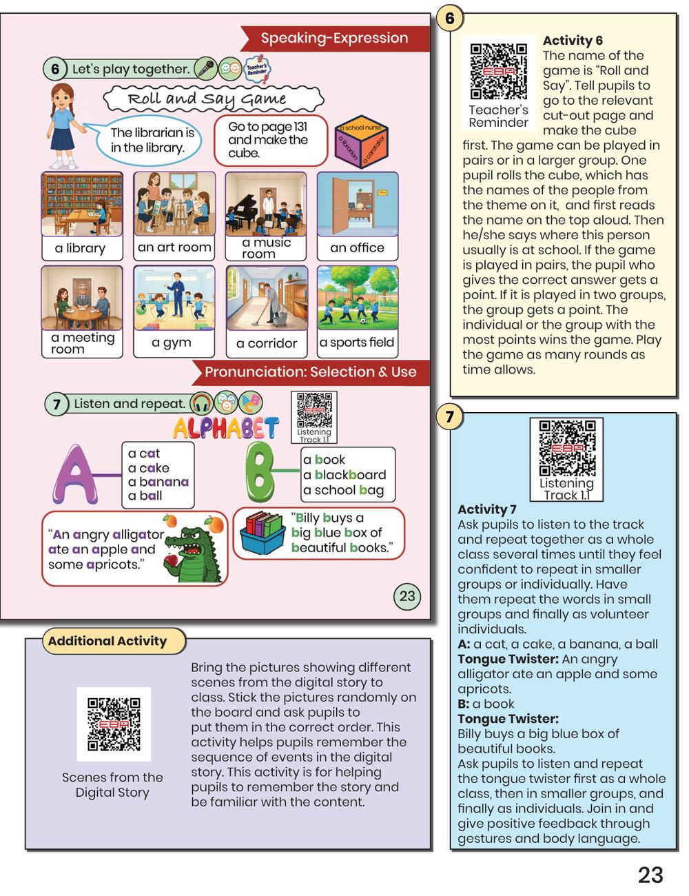
Teacher's Reminder

Roll and Say Game

The librarian is in the library.

Go to page 131 and make the cube.


a library
an art room
a music room
an office
a meeting room
a gym
a corridor
a sports field

---

# Pronunciation: Selection & Use

## 7 Listen and repeat.

Listening Track 1.1

ALPHABET

A
a cat
a cake
a banana
a ball

"An angry alligator ate an apple and some apricots."

B
a book
a blackboard
a school bag

"Billy buys a big blue box of beautiful books."

23

---

## 6

Teacher's Reminder

**Activity 6**
The name of the game is “Roll and Say”. Tell pupils to go to the relevant cut-out page and make the cube first. The game can be played in pairs or in a larger group. One pupil rolls the cube, which has the names of the people from the theme on it, and first reads the name on the top aloud. Then he/she says where this person usually is at school. If the game is played in pairs, the pupil who gives the correct answer gets a point. If it is played in two groups, the group gets a point. The individual or the group with the most points wins the game. Play the game as many rounds as time allows.

## 7

Listening Track 1.1

**Activity 7**
Ask pupils to listen to the track and repeat together as a whole class several times until they feel confident to repeat in smaller groups or individually. Have them repeat the words in small groups and finally as volunteer individuals.

**A:** a cat, a cake, a banana, a ball
**Tongue Twister:** An angry alligator ate an apple and some apricots.
**B:** a book
**Tongue Twister:** Billy buys a big blue box of beautiful books.

Ask pupils to listen and repeat the tongue twister first as a whole class, then in smaller groups, and finally as individuals. Join in and give positive feedback through

---

## Additional Activity

Scenes from the Digital Story

Bring the pictures showing different scenes from the digital story to class. Stick the pictures randomly on the board and ask pupils to put them in the correct order. This activity helps pupils remember the sequence of events in the digital story. This activity is for helping pupils to remember the story and be familiar with the content.

<!-- sayfa 23 -->

# 8

## Activity 8
In this activity, allow pupils to practise the target vocabulary in a meaningful and contextualised way. Begin by asking pupils to look carefully at each picture and observe the details. Then ask them to read the words in Activity 8 and work in pairs to match each word with the correct picture. Remind pupils to discuss their choices with their peer and use the pictures as clues. Give pupils enough time to complete the matching activity without rushing them. Point out that the first item is given as an example to help them understand what to do. Walk around the classroom while pupils are working to offer support or clarification if needed. When all pupils have finished the activity, ask them to look at the pictures again and say the words aloud individually from their seats. Use this stage to reinforce pronunciation and help pupils feel more confident using the new vocabulary. Ask them to look at the pictures once again. This time, ask pupils to say the words individually while sitting at their seats. Call on different pupils to name the pictures, and gently correct pronunciation errors by modelling the correct form. This step helps reinforce vocabulary recall and builds pupils’ speaking confidence.

---

## Vocabulary: Selection & Use

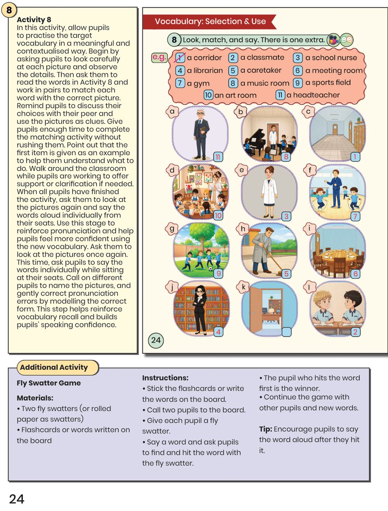

**8 Look, match, and say. There is one extra.** 

e.g. $\boxed{\text{?}}$ 1 a corridor 2 a classmate 3 a school nurse
4 a librarian 5 a caretaker 6 a meeting room
7 a gym 8 a music room 9 a sports field
10 an art room 11 a headteacher


a $\boxed{\phantom{11}}$ <!-- KONTROL: Marker'da karşılığı yok, uydurma olabilir -->
b $\boxed{\phantom{8}}$ <!-- KONTROL: Marker'da karşılığı yok, uydurma olabilir -->
c $\boxed{\phantom{1}}$ <!-- KONTROL: Marker'da karşılığı yok, uydurma olabilir -->
d $\boxed{\phantom{10}}$ <!-- KONTROL: Marker'da karşılığı yok, uydurma olabilir -->
e $\boxed{\phantom{3}}$ <!-- KONTROL: Marker'da karşılığı yok, uydurma olabilir -->
f $\boxed{\phantom{7}}$ <!-- KONTROL: Marker'da karşılığı yok, uydurma olabilir -->
g $\boxed{\phantom{9}}$ <!-- KONTROL: Marker'da karşılığı yok, uydurma olabilir -->
h $\boxed{\phantom{5}}$ <!-- KONTROL: Marker'da karşılığı yok, uydurma olabilir -->
i $\boxed{\phantom{6}}$ <!-- KONTROL: Marker'da karşılığı yok, uydurma olabilir -->
j $\boxed{\phantom{4}}$ <!-- KONTROL: Marker'da karşılığı yok, uydurma olabilir -->
k $\boxed{\phantom{?}}$
l $\boxed{\phantom{2}}$ <!-- KONTROL: Marker'da karşılığı yok, uydurma olabilir -->

24

---

## Additional Activity

### Fly Swatter Game

**Materials:**
* Two fly swatters (or rolled paper as swatters)
* Flashcards or words written on the board

**Instructions:**
* Stick the flashcards or write the words on the board.
* Call two pupils to the board.
* Give each pupil a fly swatter.
* Say a word and ask pupils to find and hit the word with the fly swatter.
* The pupil who hits the word first is the winner.
* Continue the game with other pupils and new words.

**Tip:** Encourage pupils to say the word aloud after they hit it.

<!-- sayfa 24 -->

# Vocabulary Game

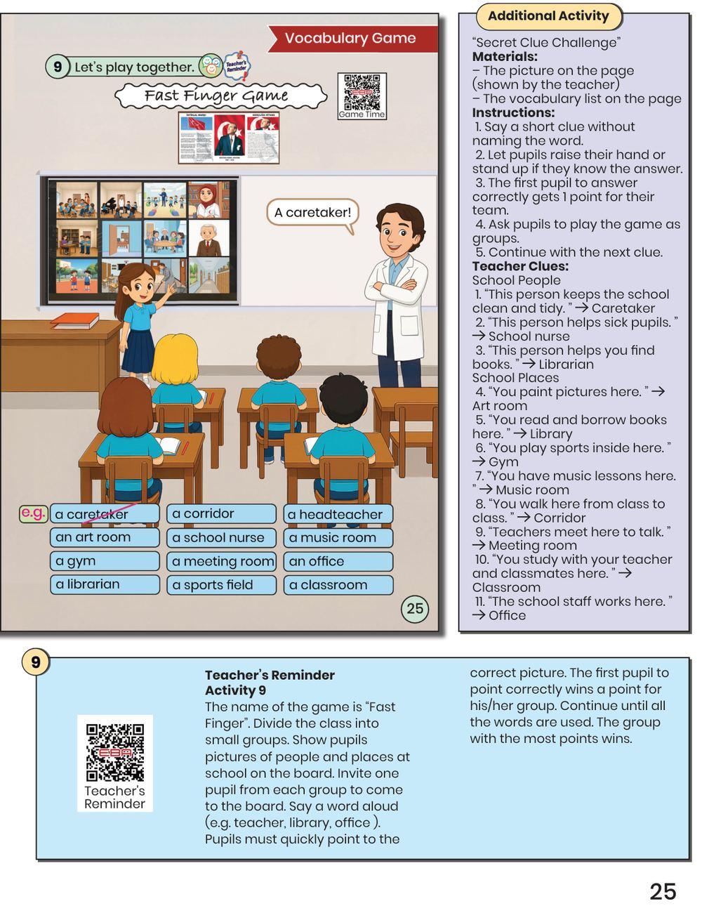

9 Let's play together. Teacher's Reminder

## Fast Finger Game


A caretaker!

| | | |
| :--- | :--- | :--- |
| e.g. ~~a caretaker~~ | a corridor | a headteacher |
| an art room | a school nurse | a music room |
| a gym | a meeting room | an office |
| a librarian | a sports field | a classroom |

25

---

# Additional Activity

“Secret Clue Challenge”

**Materials:**
– The picture on the page (shown by the teacher)
– The vocabulary list on the page

**Instructions:**
1. Say a short clue without naming the word.
2. Let pupils raise their hand or stand up if they know the answer.
3. The first pupil to answer correctly gets 1 point for their team.
4. Ask pupils to play the game as groups.
5. Continue with the next clue.

**Teacher Clues:**

**School People**
1. “This person keeps the school clean and tidy.” $\rightarrow$ Caretaker
2. “This person helps sick pupils.” $\rightarrow$ School nurse
3. “This person helps you find books.” $\rightarrow$ Librarian

**School Places**
4. “You paint pictures here.” $\rightarrow$ Art room
5. “You read and borrow books here.” $\rightarrow$ Library
6. “You play sports inside here.” $\rightarrow$ Gym
7. “You have music lessons here.” $\rightarrow$ Music room
8. “You walk here from class to class.” $\rightarrow$ Corridor
9. “Teachers meet here to talk.” $\rightarrow$ Meeting room
10. “You study with your teacher and classmates here.” $\rightarrow$ Classroom
11. “The school staff works here.” $\rightarrow$ Office

---

9

**Teacher's Reminder**
**Activity 9**


The name of the game is “Fast Finger”. Divide the class into small groups. Show pupils pictures of people and places at school on the board. Invite one pupil from each group to come to the board. Say a word aloud (e.g. teacher, library, office). Pupils must quickly point to the correct picture. The first pupil to point correctly wins a point for his/her group. Continue until all the words are used. The group with the most points wins.

<!-- sayfa 25 -->

# 10

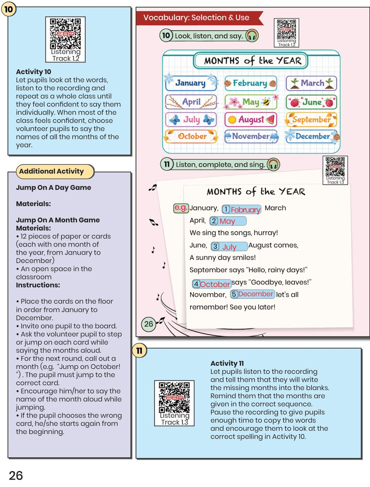

**Activity 10**
Let pupils look at the words, listen to the recording and repeat as a whole class until they feel confident to say them individually. When most of the class feels confident, choose volunteer pupils to say the names of all the months of the year.

---

# Vocabulary: Selection & Use

## 10 Look, listen, and say. 


**MONTHS of the YEAR**

| | | |
| :--- | :--- | :--- |
| January | February | March |
| April | May | June |
| July | August | September |
| October | November | December |

## 11 Listen, complete, and sing. 


**MONTHS of the YEAR**

e.g. January, ① February March
April, ② May
We sing the songs, hurray!
June, ③ July August comes,
A sunny day smiles!
September says "Hello, rainy days!"
④ October says "Goodbye, leaves!"
November, ⑤ December let's all
remember! See you later!

---

# Additional Activity

## Jump On A Day Game

### Materials:

### Jump On A Month Game
#### Materials:
* 12 pieces of paper or cards (each with one month of the year, from January to December)
* An open space in the classroom

#### Instructions:
* Place the cards on the floor in order from January to December.
* Invite one pupil to the board.
* Ask the volunteer pupil to step or jump on each card while saying the months aloud.
* For the next round, call out a month (e.g. "Jump on October!"). The pupil must jump to the correct card.
* Encourage him/her to say the name of the month aloud while jumping.
* If the pupil chooses the wrong card, he/she starts again from the beginning.

---

## 11


**Activity 11**
Let pupils listen to the recording and tell them that they will write the missing months into the blanks. Remind them that the months are given in the correct sequence. Pause the recording to give pupils enough time to copy the words and encourage them to look at the correct spelling in Activity 10.

<!-- sayfa 26 -->

# Vocabulary: Selection & Use

(12) Look, match, and say. 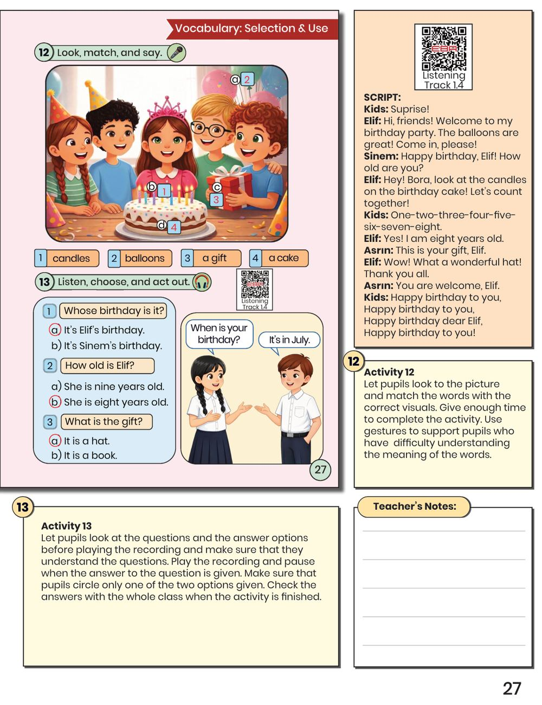


1 candles
2 balloons
3 a gift
4 a cake

(13) Listen, choose, and act out. 

1 Whose birthday is it?
(a) It's Elif's birthday.
b) It's Sinem's birthday.

2 How old is Elif?
a) She is nine years old.
(b) She is eight years old.

3 What is the gift?
(a) It is a hat.
b) It is a book.


---


SCRIPT:
Kids: Suprise!
Elif: Hi, friends! Welcome to my birthday party. The balloons are great! Come in, please!
Sinem: Happy birthday, Elif! How old are you?
Elif: Hey! Bora, look at the candles on the birthday cake! Let's count together!
Kids: One-two-three-four-five-six-seven-eight.
Elif: Yes! I am eight years old.
Asrın: This is your gift, Elif.
Elif: Wow! What a wonderful hat! Thank you all.
Asrın: You are welcome, Elif.
Kids: Happy birthday to you,
Happy birthday to you,
Happy birthday dear Elif,
Happy birthday to you!

(12) Activity 12
Let pupils look to the picture and match the words with the correct visuals. Give enough time to complete the activity. Use gestures to support pupils who have difficulty understanding the meaning of the words.

---

(13) Activity 13
Let pupils look at the questions and the answer options before playing the recording and make sure that they understand the questions. Play the recording and pause when the answer to the question is given. Make sure that pupils circle only one of the two options given. Check the answers with the whole class when the activity is finished.

Teacher's Notes:
____________________
____________________
____________________
____________________
____________________

<!-- sayfa 27 -->

# 14

**Activity 14**

Ask pupils to look at the pictures so that they can be familiar with the context. Ask them to look at each picture on the page carefully and individually. First, read the dialogues aloud so that pupils can hear the correct pronunciation. Pay attention to emphasising the target language chunks. Then encourage them to read the dialogues individually and silently in their seats. Let them work in groups. Choose volunteer pupils to act out the dialogues by reading them to the class. Let as many pairs as possible practise this activity and offer some time when needed. The target grammar chunks are given in bold in the dialogues. They are not taught as grammatical structures. Pupils are expected to grasp and learn the grammatical chunks by being exposed to them holistically through hearing, seeing, and repeating in context. Familiarity and exposure are key points.

After practising the dialogues in pairs, invite pupils to the board to act out one dialogue without looking at their books. Tell them to choose only one dialogue from the page, as trying to remember all the dialogues can be too challenging at that age.

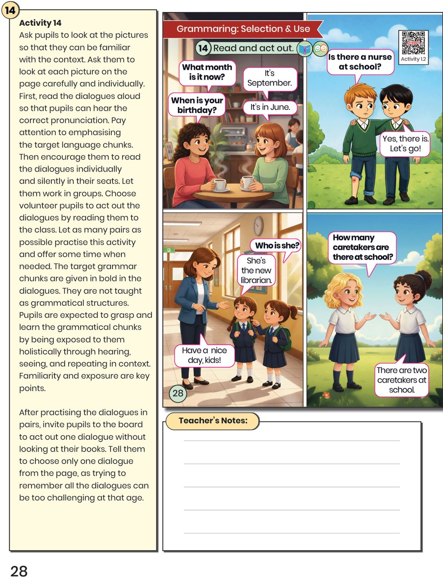

# Grammaring: Selection & Use


(14) **Read and act out.**


What month is it?
It's September.

When is your birthday?
It's in June.


Is there a nurse at school?
Yes, there is. Let's go!


Who is she?
She's the new librarian.

Have a nice day, kids!


How many caretakers are there at school?
There are two caretakers at school.

28

**Teacher's Notes:**
__________________________________________________________________
__________________________________________________________________
__________________________________________________________________
__________________________________________________________________
__________________________________________________________________

<!-- sayfa 28 -->

# Grammaring Revision

**15 Order the words. Then match with the answers. There is one extra.**

1. [is] [that] [What]
(e.g.) What is that? ? [f]

2. [is] [your] [When] [birthday]
When is your birthday ? [c]

3. [now] [What] [is] [month] [it]
What month is it now ? [a]

4. [there] [a librarian] [Is] [school] [at]
Is there a librarian at school ? [b]

5. [pupils] [How many] [are] [there] [the] [garden] [in]
How many pupils are there in the garden ? [d]

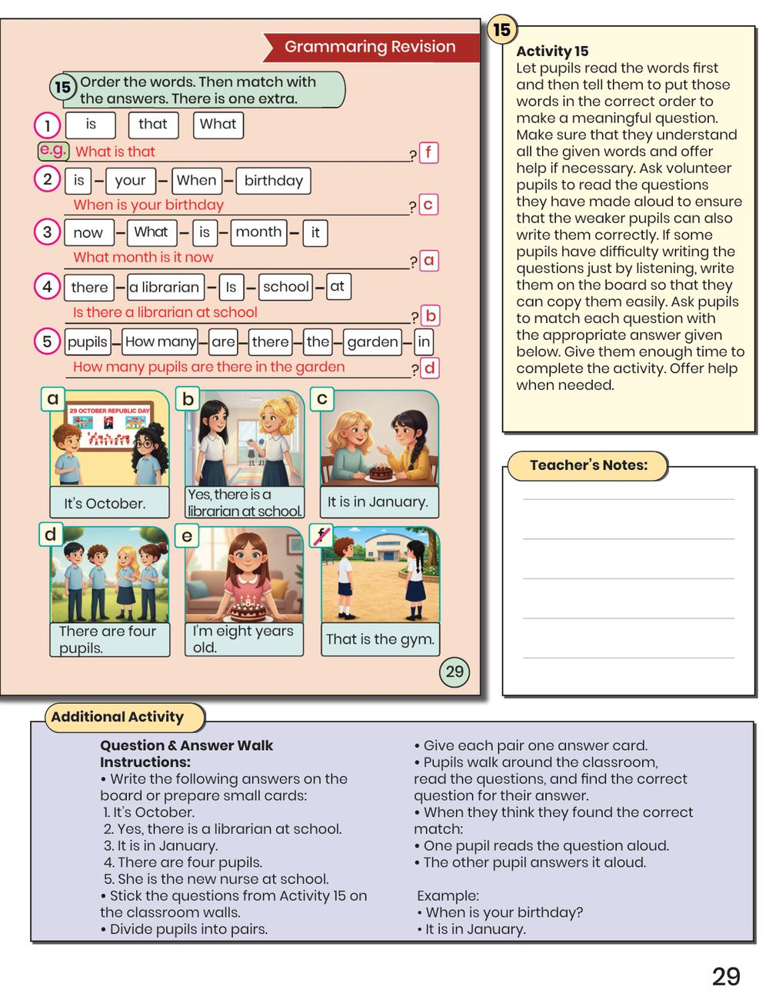
a. It's October.
b. Yes, there is a librarian at school.
c. It is in January.
d. There are four pupils.
e. I'm eight years old.
f. That is the gym.

29

---

**15**
**Activity 15**
Let pupils read the words first and then tell them to put those words in the correct order to make a meaningful question. Make sure that they understand all the given words and offer help if necessary. Ask volunteer pupils to read the questions they have made aloud to ensure that the weaker pupils can also write them correctly. If some pupils have difficulty writing the questions just by listening, write them on the board so that they can copy them easily. Ask pupils to match each question with the appropriate answer given below. Give them enough time to complete the activity. Offer help when needed.

**Teacher's Notes:**
__________________________________________________________________
__________________________________________________________________
__________________________________________________________________
__________________________________________________________________

---

**Additional Activity**

**Question & Answer Walk**
**Instructions:**
* Write the following answers on the board or prepare small cards:
  1. It's October.
  2. Yes, there is a librarian at school.
  3. It is in January.
  4. There are four pupils.
  5. She is the new nurse at school.
* Stick the questions from Activity 15 on the classroom walls.
* Give each pair one answer card.
* Pupils walk around the classroom, read the questions, and find the correct question for their answer.
* When they think they found the correct match:
  * One pupil reads the question aloud.
  * The other pupil answers it aloud.

**Example:**
* When is your birthday?

<!-- sayfa 29 -->

# 16

**Activity 16**
Let pupils look at the pictures of the people in school first and say who and where they are. Then ask them to guess who Ali is. Read the passage aloud. Then ask pupils to read the passage “My School” individually and silently, and find out if Ali is a headteacher, a pupil or a librarian. Check the answer with the whole class.
Ask volunteers to read the passage aloud. Divide the passage into parts and ask different pupils to read each part.

---

**Additional Activity**

**Question Cube Game**
**Materials:**
* One cube (or numbers 1–6 on the board)
**Instructions:**
* Write the following on the board:
1. Who
2. What
3. When
4. How many
5. Is / Are
6. Free choice
* Put pupils into pairs.
* Let one pupil roll the cube.
* The number shows the question word.
* The pupil makes a correct question using the question words.
* The other pupil answers the question.
**Example:**
**Number: 3 (When)**
**Pupil A:** When is your birthday?
**Pupil B:** It is in January.
**Number: 4 (How many)**
**Pupil A:** How many pupils are there in the garden?
**Pupil B:** There are four pupils.

---

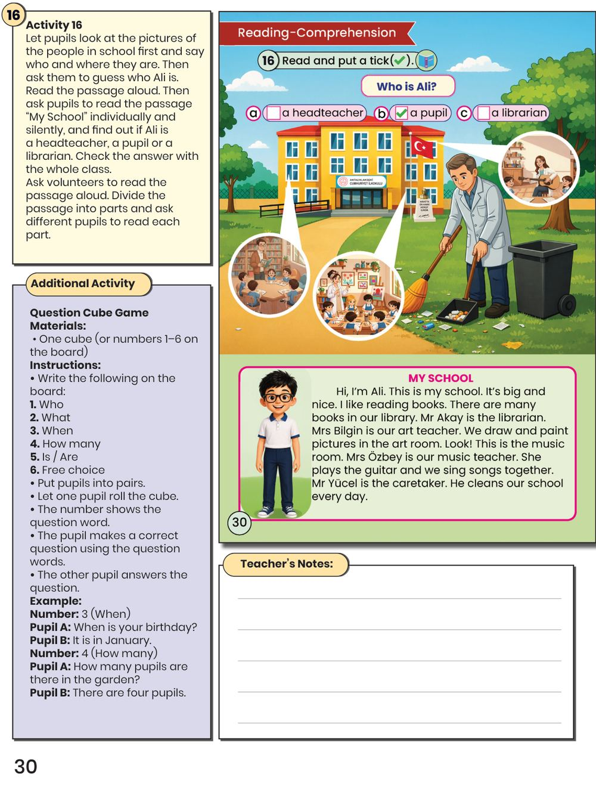

**Reading-Comprehension**

(16) **Read and put a tick($\checkmark$).**

**Who is Ali?**
a $\square$ a headteacher  b $\checkmark$ a pupil  c $\square$ a librarian


**MY SCHOOL**

Hi, I'm Ali. This is my school. It's big and nice. I like reading books. There are many books in our library. Mr Akay is the librarian. Mrs Bilgin is our art teacher. We draw and paint pictures in the art room. Look! This is the music room. Mrs Özbey is our music teacher. She plays the guitar and we sing songs together. Mr Yücel is the caretaker. He cleans our school every day.

(30)

---

**Teacher's Notes:**
__________________________________________________________________
__________________________________________________________________
__________________________________________________________________
__________________________________________________________________

<!-- sayfa 30 -->

# 17 Read and complete. There is one extra.

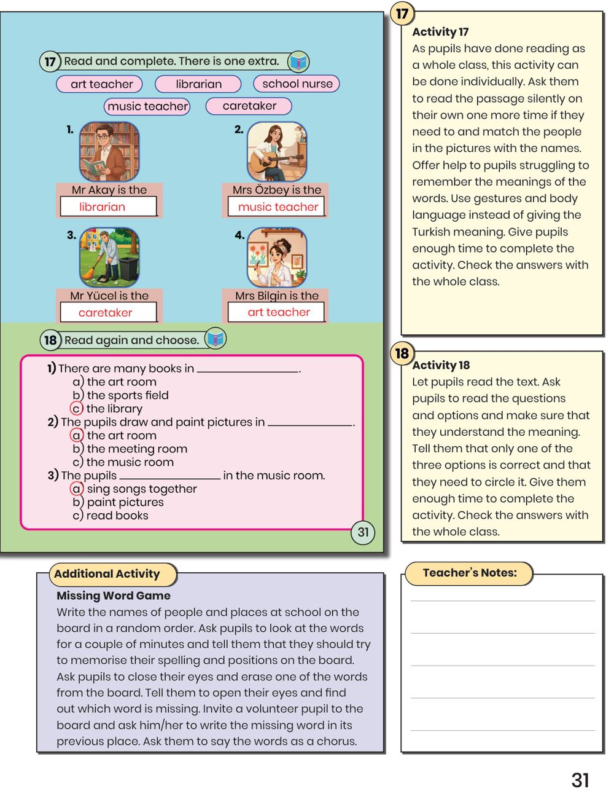

art teacher | librarian | school nurse
music teacher | caretaker

1.

Mr Akay is the
librarian

2.

Mrs Özbey is the
music teacher

3.

Mr Yücel is the
caretaker

4.

Mrs Bilgin is the
art teacher

# 18 Read again and choose.


1) There are many books in __________.
a) the art room
b) the sports field
c) the library

2) The pupils draw and paint pictures in __________.
a) the art room
b) the meeting room
c) the music room

3) The pupils __________ in the music room.
a) sing songs together
b) paint pictures
c) read books

31

---

17
**Activity 17**
As pupils have done reading as a whole class, this activity can be done individually. Ask them to read the passage silently on their own one more time if they need to and match the people in the pictures with the names. Offer help to pupils struggling to remember the meanings of the words. Use gestures and body language instead of giving the Turkish meaning. Give pupils enough time to complete the activity. Check the answers with the whole class.

18
**Activity 18**
Let pupils read the text. Ask pupils to read the questions and options and make sure that they understand the meaning. Tell them that only one of the three options is correct and that they need to circle it. Give them enough time to complete the activity. Check the answers with the whole class.

---

**Additional Activity**
**Missing Word Game**
Write the names of people and places at school on the board in a random order. Ask pupils to look at the words for a couple of minutes and tell them that they should try to memorise their spelling and positions on the board. Ask pupils to close their eyes and erase one of the words from the board. Tell them to open their eyes and find out which word is missing. Invite a volunteer pupil to the board and ask him/her to write the missing word in its

**Teacher's Notes:**
__________________________________________________________________
__________________________________________________________________
__________________________________________________________________
__________________________________________________________________

<!-- sayfa 31 -->

# 19

**Activity 19**
Ask pupils to look at the words for people and places from the theme given in this activity. Let pupils read the words aloud as a chorus and then individually. Make sure that they can remember their meanings correctly. If they struggle remembering the meanings of some words, use gestures and body language or make simple sentences using the words and let them guess the meaning. Once you are convinced that the majority of the class remembers the words, ask them to find the given words in the crossword puzzle and circle them. Give pupils enough time to complete the activity. Offer help when needed. Check the answers with the whole class.

**Activity 20**
Ask pupils to put the words given in Activity 19 into two categories: people and places. Make sure all pupils understand the meanings of the words “People” and “Places” before starting the activity. Give them enough time to complete the activity. Offer help when needed. Check the answers with the whole class and make sure to check their spelling.

---

# Writing-Expression

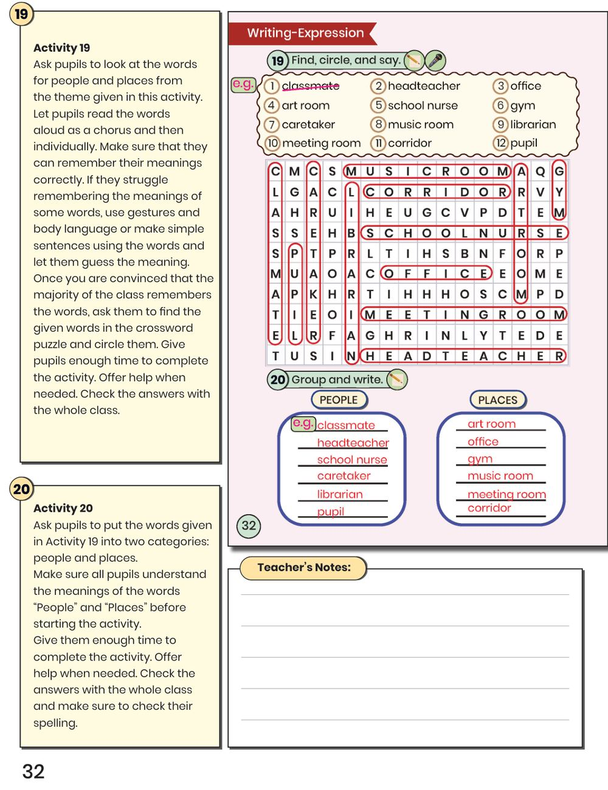 19 Find, circle, and say. 

e.g. ① classmate  ② headteacher  ③ office  ④ art room  ⑤ school nurse  ⑥ gym  ⑦ caretaker  ⑧ music room  ⑨ librarian ⑩ meeting room ⑪ corridor ⑫ pupil

| C | M | C | S | M | U | S | I | C | R | O | O | M | A | Q | G |
|---|---|---|---|---|---|---|---|---|---|---|---|---|---|---|---|
| L | G | A | C | L | C | O | R | R | I | D | O | R | R | V | Y |
| A | H | R | U | I | H | E | U | G | C | V | P | D | T | E | M |
| S | S | E | H | B | S | C | H | O | O | L | N | U | R | S | E |
| S | P | T | P | R | L | T | I | H | S | B | N | F | O | R | P |
| M | U | A | O | A | C | O | F | F | I | C | E | E | O | M | E |
| A | P | K | H | R | T | I | H | H | H | O | S | C | M | P | D |
| T | I | E | O | I | M | E | E | T | I | N | G | R | O | O | M |
| E | L | R | F | A | G | H | R | I | N | L | Y | T | E | D | E |
| T | U | S | I | N | H | E | A | D | T | E | A | C | H | E | R |

 20 Group and write. 

**PEOPLE**
e.g. classmate
____________________
____________________
____________________
____________________
____________________
____________________

**PLACES**
____________________
____________________
____________________
____________________
____________________
____________________
____________________

32

---

**Teacher's Notes:**
__________________________________________________________________
__________________________________________________________________
__________________________________________________________________

<!-- sayfa 32 -->

# CLIL

(21) **Look, complete, and colour.** 🌍 🎨

1 January
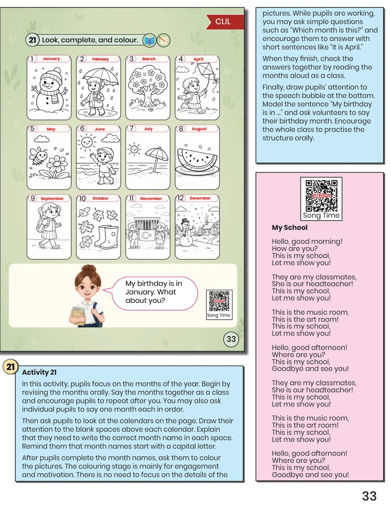

2 February


3 March


4 April


5 May


6 June


7 July


8 August


9 September


10 October


11 November


12 December


My birthday is in January. What about you?
Song Time

33

---

pictures. While pupils are working, you may ask simple questions such as “Which month is this?” and encourage them to answer with short sentences like “It is April.”

When they finish, check the answers together by reading the months aloud as a class.

Finally, draw pupils’ attention to the speech bubble at the bottom. Model the sentence “My birthday is in …” and ask volunteers to say their birthday month. Encourage the whole class to practise the structure orally.

---

[QR Code]
Song Time

**My School**

Hello, good morning!
How are you?
This is my school,
Let me show you!

They are my classmates,
She is our headteacher!
This is my school,
Let me show you!

This is the music room,
This is the art room!
This is my school,
Let me show you!

Hello, good afternoon!
Where are you?
This is my school,
Goodbye and see you!

Hello, good afternoon!
Where are you?
This is my school

---

(21) **Activity 21**

In this activity, pupils focus on the months of the year. Begin by revising the months orally. Say the months together as a class and encourage pupils to repeat after you. You may also ask individual pupils to say one month each in order.

Then ask pupils to look at the calendars on the page. Draw their attention to the blank spaces above each calendar. Explain that they need to write the correct month name in each space. Remind them that month names start with a capital letter.

After pupils complete the month names, ask them to colour the pictures. The colouring stage is mainly for engagement

<!-- sayfa 33 -->

22

# Activity 22
## Picture Strip Story

First, read the strip story aloud so that pupils can hear the correct pronunciation. Then ask them to read it individually and silently. Ask them to work in groups. Choose pupils to act out the story while sitting and reading the dialogues to the class. Let them practise this activity as many times as possible. Offer help with pronunciation, vocabulary, etc. when needed.

After the controlled practice sessions, ask pupils to practise the target vocabulary and language chunks in the picture strip story. This activity gives them the opportunity to consolidate and use the target words and language chunks about the concept of school life in a fun and versatile way.

As an additional activity, let pupils act out again by using their own names with their peers.

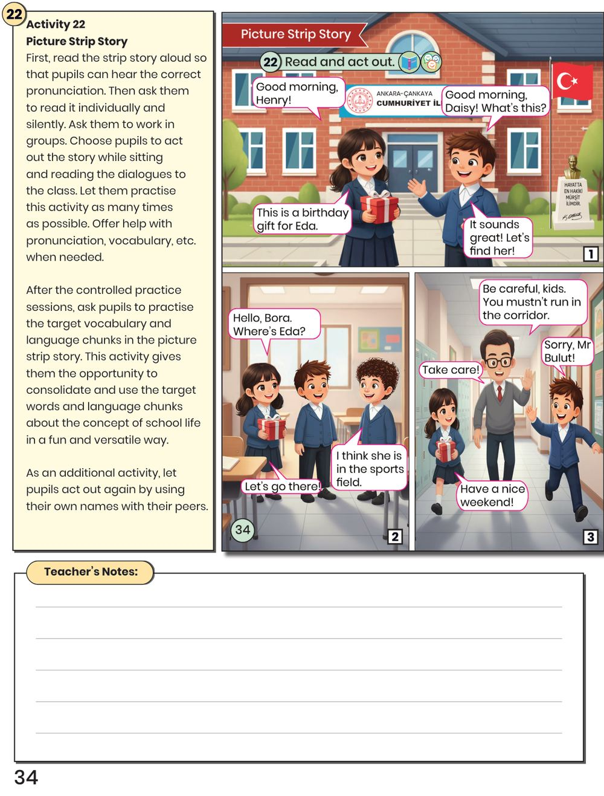

# Picture Strip Story

(22) Read and act out.


* Good morning, Henry!
* Good morning, Daisy! What's this?
* This is a birthday gift for Eda.
* It sounds great! Let's find her!


* Hello, Bora. Where's Eda?
* I think she is in the sports field.
* Let's go there!


* Be careful, kids. You mustn't run in the corridor.
* Sorry, Mr Bulut!
* Take care!
* Have a nice weekend!

---

**Teacher's Notes:**
__________________________________________________________________
__________________________________________________________________
__________________________________________________________________
__________________________________________________________________
__________________________________________________________________

<!-- sayfa 34 -->

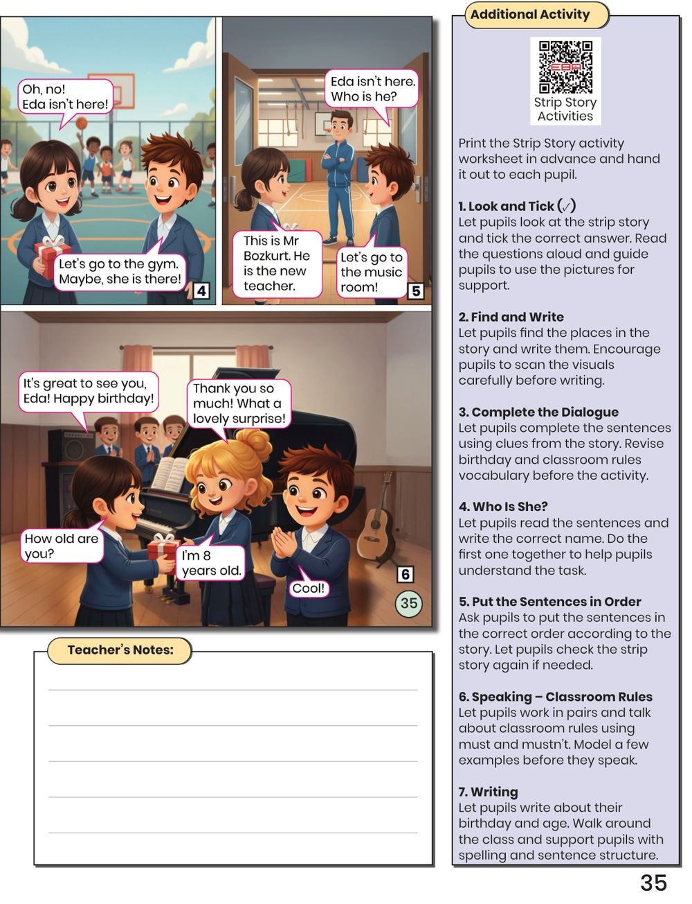

# Additional Activity


**Strip Story Activities**

Print the Strip Story activity worksheet in advance and hand it out to each pupil.

**1. Look and Tick ($\checkmark$)**
Let pupils look at the strip story and tick the correct answer. Read the questions aloud and guide pupils to use the pictures for support.

**2. Find and Write**
Let pupils find the places in the story and write them. Encourage pupils to scan the visuals carefully before writing.

**3. Complete the Dialogue**
Let pupils complete the sentences using clues from the story. Revise birthday and classroom rules vocabulary before the activity.

**4. Who Is She?**
Let pupils read the sentences and write the correct name. Do the first one together to help pupils understand the task.

**5. Put the Sentences in Order**
Ask pupils to put the sentences in the correct order according to the story. Let pupils check the strip story again if needed.

**6. Speaking – Classroom Rules**
Let pupils work in pairs and talk about classroom rules using must and mustn’t. Model a few examples before they speak.

**7. Writing**
Let pupils write about their birthday and age. Walk around

---

**Teacher’s Notes:**
__________________________________________________________________
__________________________________________________________________
__________________________________________________________________
__________________________________________________________________
__________________________________________________________________

<!-- sayfa 35 -->

23

# Activity 23

## Theme Project

Tell pupils to design “a diary page” about the people they meet at school, the places they go at school, and the routines they have at school by using photos they take and pictures they draw.

Let them present their diary pages to the class and ask the other pupils to guess who the people and places might be in their friends’ diary pages. Ask the class to make guesses about them and tell them that their guesses will be checked after the presentations.

This project can be assigned as homework so that pupils can have more time to work on it. Support weaker pupils by guiding questions if they have difficulty during their presentations.

---

# Project

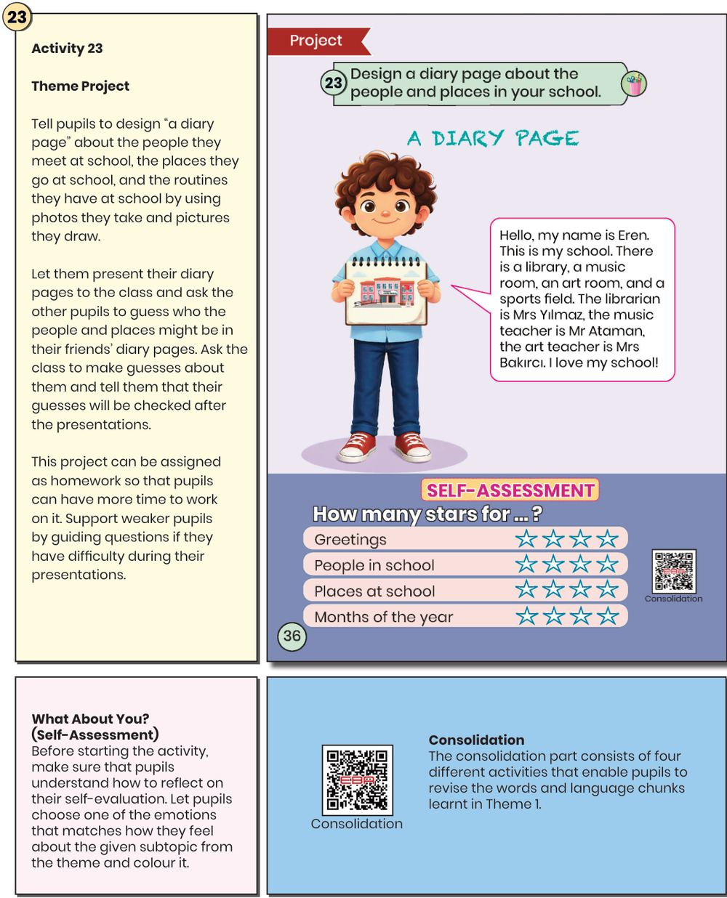

23 Design a diary page about the people and places in your school.

# A DIARY PAGE


Hello, my name is Eren. This is my school. There is a library, a music room, an art room, and a sports field. The librarian is Mrs Yılmaz, the music teacher is Mr Ataman, the art teacher is Mrs Bakırcı. I love my school!

### SELF-ASSESSMENT

## How many stars for ...?

| | | | | |
| :--- | :---: | :---: | :---: | :---: |
| Greetings | ☆ | ☆ | ☆ | ☆ |
| People in school | ☆ | ☆ | ☆ | ☆ |
| Places at school | ☆ | ☆ | ☆ | ☆ |
| Months of the year | ☆ | ☆ | ☆ | ☆ |

36


---

# What About You? (Self-Assessment)

Before starting the activity, make sure that pupils understand how to reflect on their self-evaluation. Let pupils choose one of the emotions that matches how they feel about the given subtopic from the theme and colour it.

---

# Consolidation


The consolidation part consists of four different activities that enable pupils to revise the words and language chunks learnt in Theme 1.

Consolidation

<!-- sayfa 36 -->

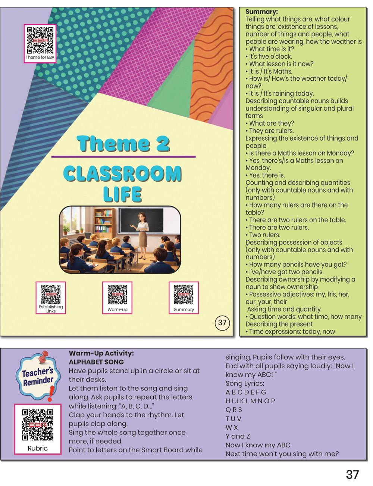

# Theme 2
# CLASSROOM LIFE


37

---

**Summary:**
Telling what things are, what colour things are, existence of lessons, number of things and people, what people are wearing, how the weather is
• What time is it?
• It’s five o’clock.
• What lesson is it now?
• It is / It’s Maths.
• How is/ How’s the weather today/ now?
• It is / It’s raining today.
Describing countable nouns builds understanding of singular and plural forms
• What are they?
• They are rulers.
Expressing the existence of things and people
• Is there a Maths lesson on Monday?
• Yes, there’s/is a Maths lesson on Monday.
• Yes, there is.
Counting and describing quantities (only with countable nouns and with numbers)
• How many rulers are there on the table?
• There are two rulers on the table.
• There are two rulers.
• Two rulers.
Describing possession of objects (only with countable nouns and with numbers)
• How many pencils have you got?
• I’ve/have got two pencils.
Describing ownership by modifying a noun to show ownership
• Possessive adjectives: my, his, her, our, your, their
Asking time and quantity
• Question words: what time, how many
Describing the present
• Time expressions: today, now

---


**Warm-Up Activity:**
**ALPHABET SONG**
Have pupils stand up in a circle or sit at their desks.
Let them listen to the song and sing along. Ask pupils to repeat the letters while listening: “A, B, C, D…”
Clap your hands to the rhythm. Let pupils clap along.
Sing the whole song together once more, if needed.

singing. Pupils follow with their eyes.
End with all pupils saying loudly: “Now I know my ABC! ”

**Song Lyrics:**
A B C D E F G
H I J K L M N O P
Q R S
T U V
W X
Y and Z
Now I know my ABC

<!-- sayfa 37 -->

# Establishing Links

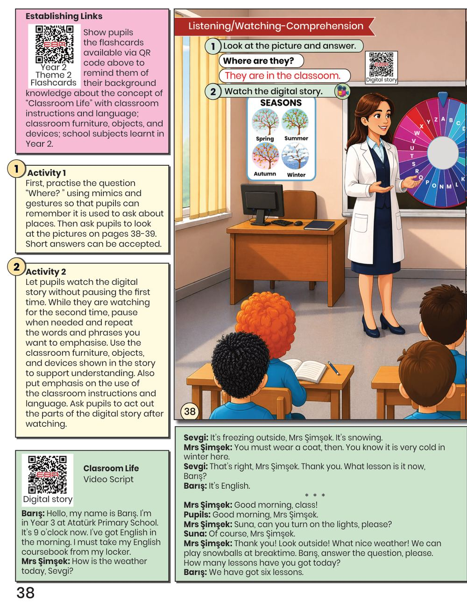

Show pupils the flashcards available via QR code above to remind them of their background knowledge about the concept of “Classroom Life” with classroom instructions and language; classroom furniture, objects, and devices; school subjects learnt in Year 2.

**Year 2 Theme 2 Flashcards**

---

# Listening/Watching-Comprehension

1. **Look at the picture and answer.**
   **Where are they?**
   **They are in the classroom.**


2. **Watch the digital story.**


**SEASONS**
Spring | Summer
Autumn | Winter

---

1. **Activity 1**
First, practise the question “Where?” using mimics and gestures so that pupils can remember it is used to ask about places. Then ask pupils to look at the pictures on pages 38-39. Short answers can be accepted.

2. **Activity 2**
Let pupils watch the digital story without pausing the first time. While they are watching for the second time, pause when needed and repeat the words and phrases you want to emphasise. Use the classroom furniture, objects, and devices shown in the story to support understanding. Also put emphasis on the use of the classroom instructions and language. Ask pupils to act out the parts of the digital story after watching.

---


**Clasroom Life Video Script**
**Digital story**

**Barış:** Hello, my name is Barış. I’m in Year 3 at Atatürk Primary School. It’s 9 o’clock now. I’ve got English in the morning. I must take my English coursebook from my locker.

**Sevgi:** It’s freezing outside, Mrs Şimşek. It’s snowing.
**Mrs Şimşek:** You must wear a coat, then. You know it is very cold in winter here.
**Sevgi:** That’s right, Mrs Şimşek. Thank you. What lesson is it now, Barış?
**Barış:** It’s English.

* * *

**Mrs Şimşek:** Good morning, class!
**Pupils:** Good morning, Mrs Şimşek.
**Mrs Şimşek:** Suna, can you turn on the lights, please?
**Suna:** Of course, Mrs Şimşek.
**Mrs Şimşek:** Thank you! Look outside! What nice weather! We can play snowballs at breaktime. Barış, answer the question, please.

<!-- sayfa 38 -->

Mrs Şimşek: What are they Barış?
Barış: They are English, PE, Turkish, and Music.
Mrs Şimşek: When is your Maths lesson?
Barış: It’s on Tuesday, Mrs Şimşek.
Mrs Şimşek: Thank you, Barış.
Barış: You are welcome.
Mrs Şimşek: Let’s start the lesson. Today we’re learning the classroom objects, devices, and furniture. Let’s play the wheel game. Work in pairs. Find the words with the letters. More words, more points, kids. Çiğdem and Ozan, let’s start with you! Çiğdem, say your words beginning with P please.
Çiğdem: A pen, a pencil, a pencil case, paper, and a paintbrush.
Mrs Şimşek: Great job, Çiğdem, thank you. It’s your turn, Ozan.
Ozan: You're welcome.
Mrs Şimşek: Çiğdem and Ozan, you have got 8 points now.
Mrs Şimşek: Gökçe, Doğa, are you ready?
Gökçe: Hmm... Well, there is a basket in the classroom. Oh, no! I can’t find any more words.
Mrs Şimşek: Try again, please.
Gökçe: Well... A book, a bookcase, a blackboard, a bookshelf, and a bin in the classroom.
Mrs Şimşek: Well done, Gökçe! It is your turn, Doğa.
Doğa: A sharpener, scissors, a Smart Board, a student’s desk, and a schoolbag.
Mrs Şimşek: Perfect, Doğa. You have got 11 points, kids.
Mrs Şimşek: Hmm... Mustafa, Enes. It is your turn.
Mustafa: We’ve got a map on the wall. There’s a mouse and a microphone on the teacher’s desk, too.
Mrs Şimşek: Speak louder, please, Mustafa.
Mustafa: A mouse, a map, and a microphone.
Mrs Şimşek: Mustafa, can you repeat after me, please? Microphone!
Mustafa: Microphone.
Mrs Şimşek: Can you spell the word, please, Mustafa?
Mustafa: M-I-C-R-O-P-H-O-N-E.
Mrs Şimşek: That’s correct. It’s your turn, Enes.
Enes: A rubber, a ruler.
Mrs Şimşek: Thank you, Enes. You have got 5 points, kids. Sema, Yiğit, come to the board, please.
Sema: Mrs Şimşek, I need more time.
Mrs Şimşek: Work in pairs, Sema and Yiğit. I’m waiting for you.
Sema: Any ideas?
Yiğit: Let me think!
Mrs Şimşek: Have you finished, kids?
Sema: There are flashcards on the teacher’s desk. That’s all, Mrs Şimşek.
Mrs Şimşek: OK, thank you, Sema.
Yiğit: We have got a chair, a computer, and crayons Mrs Şimşek.
Mrs Şimşek: Well done, Yiğit. You have got 4 points. Well, great job, everyone! Gökçe and Doğa are the

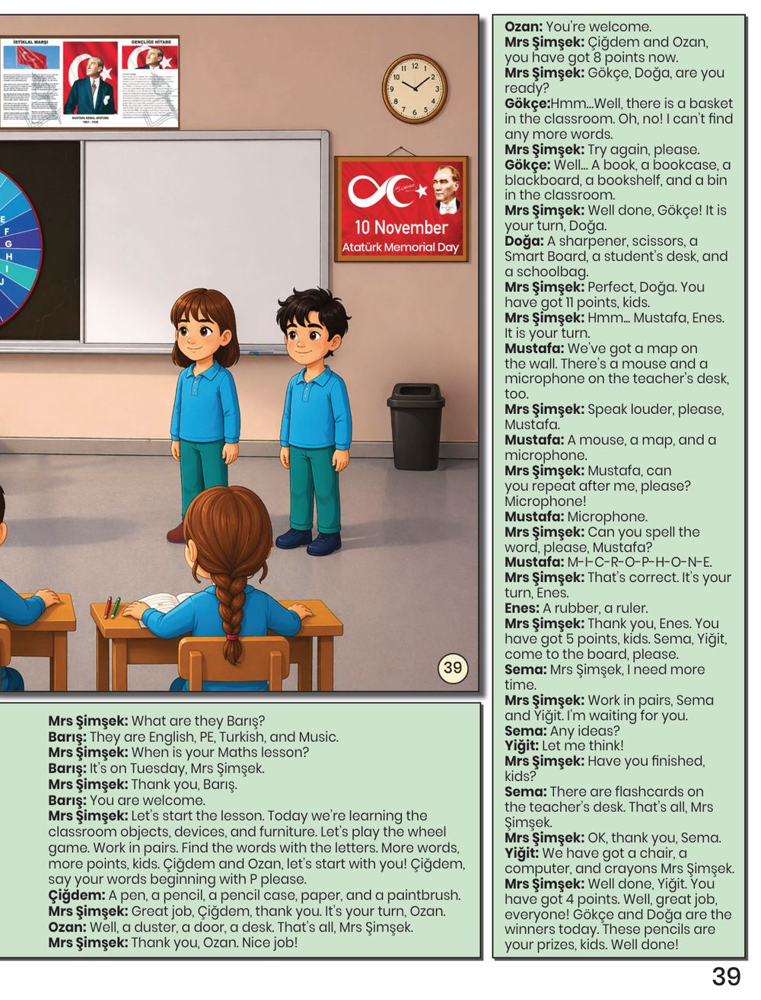
39

<!-- sayfa 39 -->

# Additional Activity

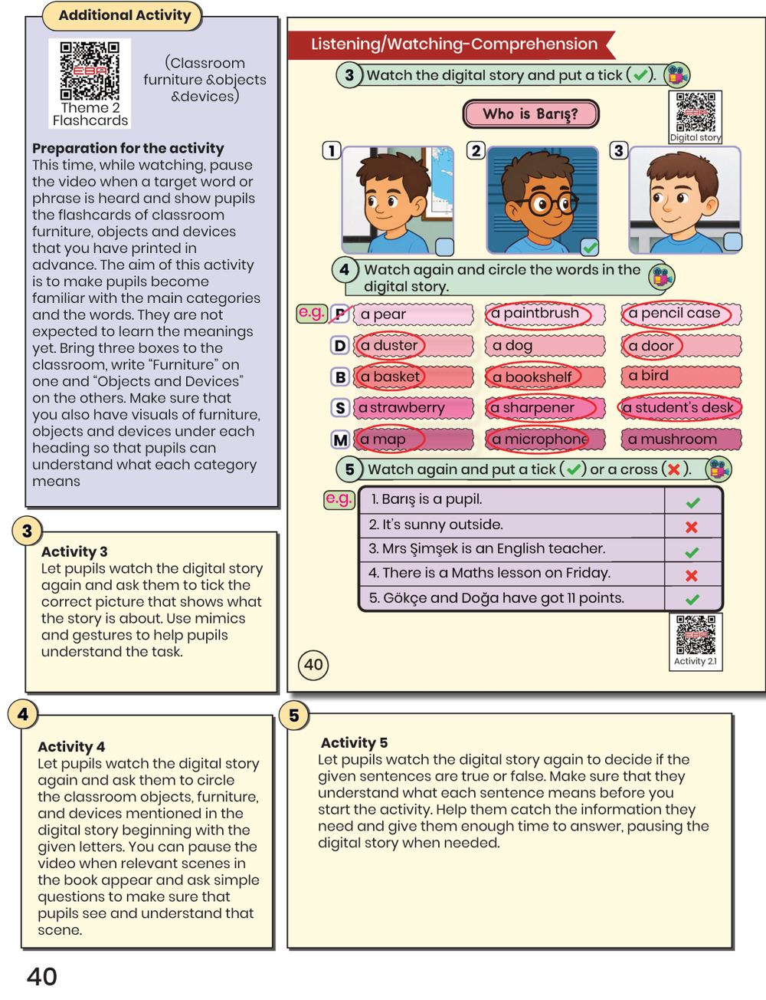

(Classroom furniture &objects &devices)
Theme 2 Flashcards

**Preparation for the activity**
This time, while watching, pause the video when a target word or phrase is heard and show pupils the flashcards of classroom furniture, objects and devices that you have printed in advance. The aim of this activity is to make pupils become familiar with the main categories and the words. They are not expected to learn the meanings yet. Bring three boxes to the classroom, write “Furniture” on one and “Objects and Devices” on the others. Make sure that you also have visuals of furniture, objects and devices under each heading so that pupils can understand what each category means

---

# Listening/Watching-Comprehension

### 3 Watch the digital story and put a tick ($\checkmark$). 


Who is Barış?


1 
2  $\checkmark$
3 

### 4 Watch again and circle the words in the digital story.


e.g. P  |  | 
---|---|---
D  |  | 
B  |  | 
S  |  | 
M  |  | 

### 5 Watch again and put a tick ($\checkmark$) or a cross ($\times$).


| | | |
| :--- | :--- | :--- |
| e.g. 1. Barış is a pupil. | | $\checkmark$ |
| 2. It's sunny outside. | | $\times$ |
| 3. Mrs Şimşek is an English teacher. | | $\checkmark$ |
| 4. There is a Maths lesson on Friday. | | $\times$ |
| 5. Gökçe and Doğa have got 11 points. | | $\checkmark$ |


---

### 3
**Activity 3**
Let pupils watch the digital story again and ask them to tick the correct picture that shows what the story is about. Use mimics and gestures to help pupils understand the task.

### 4
**Activity 4**
Let pupils watch the digital story again and ask them to circle the classroom objects, furniture, and devices mentioned in the digital story beginning with the given letters. You can pause the video when relevant scenes in the book appear and ask simple questions to make sure that pupils see and understand that

### 5
**Activity 5**
Let pupils watch the digital story again to decide if the given sentences are true or false. Make sure that they understand what each sentence means before they start the activity. Help them catch the information they need and give them enough time to answer, pausing the digital story when needed.

40

<!-- sayfa 40 -->

# Speaking-Expression

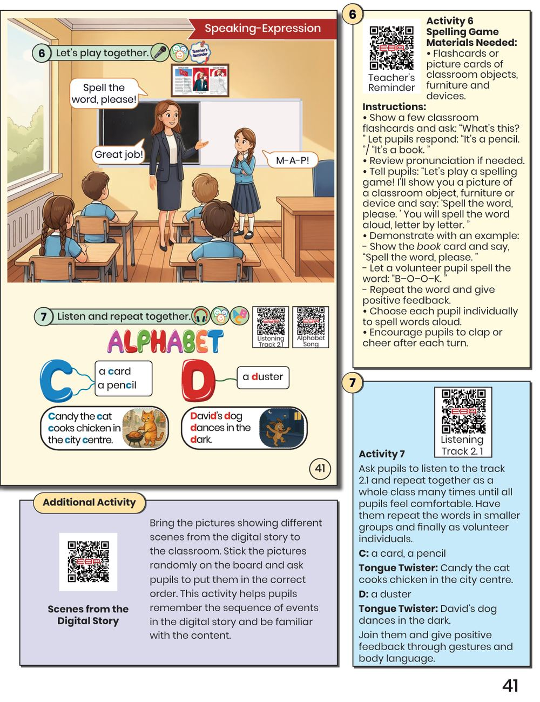

## 6 Let's play together.


**Activity 6**
**Spelling Game**
**Materials Needed:**
* Flashcards or picture cards of classroom objects, furniture and devices.

**Teacher's Reminder**

**Instructions:**
* Show a few classroom flashcards and ask: "What's this?" Let pupils respond: "It's a pencil." / "It's a book."
* Review pronunciation if needed.
* Tell pupils: "Let's play a spelling game! I'll show you a picture of a classroom object, furniture or device and say: 'Spell the word, please.' You will spell the word aloud, letter by letter."
* Demonstrate with an example:
    - Show the *book* card and say, "Spell the word, please."
    - Let a volunteer pupil spell the word: "B–O–O–K."
    - Repeat the word and give positive feedback.
* Choose each pupil individually to spell words aloud.
* Encourage pupils to clap or cheer after each turn.

---

## 7 Listen and repeat together.


# ALPHABET

**C**
* a **c**ard
* a pen**c**il

**D**
* a **d**uster

**C**andy the **c**at **c**ooks **c**hicken in the **c**ity **c**entre.


**D**avid's **d**og **d**ances in the **d**ark.


41

---

## 7


**Activity 7**
Ask pupils to listen to the track 2.1 and repeat together as a whole class many times until all pupils feel comfortable. Have them repeat the words in smaller groups and finally as volunteer individuals.

**C:** a card, a pencil
**Tongue Twister:** Candy the cat cooks chicken in the city centre.
**D:** a duster
**Tongue Twister:** David's dog dances in the dark.

Join them and give positive feedback through gestures and

---

## Additional Activity


**Scenes from the Digital Story**
Bring the pictures showing different scenes from the digital story to the classroom. Stick the pictures randomly on the board and ask pupils to put them in the correct order. This activity helps pupils remember the sequence of events in the digital story and be familiar with the content.

<!-- sayfa 41 -->

# 8

## Activity 8
In this activity, let pupils practise the target vocabulary in an efficient and meaningful way in context. Ask pupils to look at each picture carefully. Then, let them read the words in Activity 8. Have them watch the digital story again and match the words with the correct pictures in pairs. Give them enough time to complete the activity. Remind pupils that the first item is given as an example. When all activities are finished, let pupils look at the pictures again and say the words individually in their seats.

## Additional Activity

### Fly Swatter Game

**Materials:**
* 2 fly swatters (or rolled papers as swatters)
* Flashcards or words written on the board

**Instructions:**
* Stick the flashcards or write the words on the board.
* Call two pupils to the board.
* Give each pupil a fly swatter.
* Say one of the words and ask pupils to find and hit the correct word with the fly swatter.
* The pupil who hits the word first will be the winner.
* Continue the game with other pupils and new words.

**Tip:** Encourage pupils to say the word aloud after they hit it.

---

# Vocabulary: Selection & Use

## 8 Look, match, and write. There is one extra word.

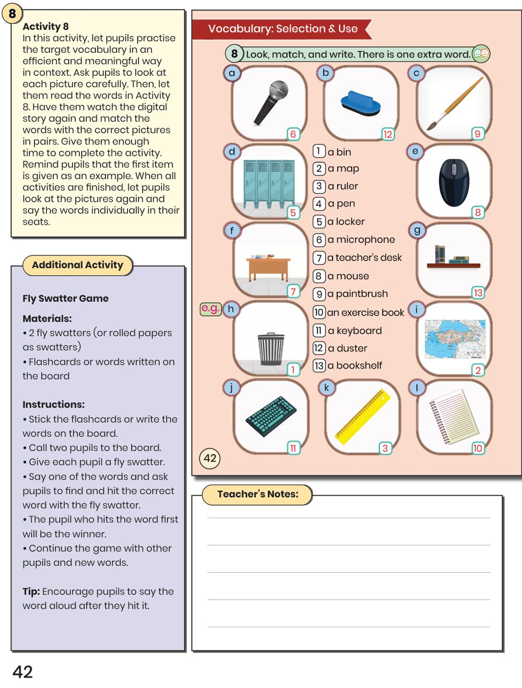

a  6
b  12
c  9
d  5
e  8
f  7
g  13
h  1 (e.g.)
i  2
j  11
k  3
l  10

1 a bin
2 a map
3 a ruler
4 a pen
5 a locker
6 a microphone
7 a teacher's desk
8 a mouse
9 a paintbrush
10 an exercise book
11 a keyboard
12 a duster
13 a bookshelf

42

---

## Teacher's Notes:
__________________________________________________________________
__________________________________________________________________
__________________________________________________________________
__________________________________________________________________
__________________________________________________________________

<!-- sayfa 42 -->

# Vocabulary Game

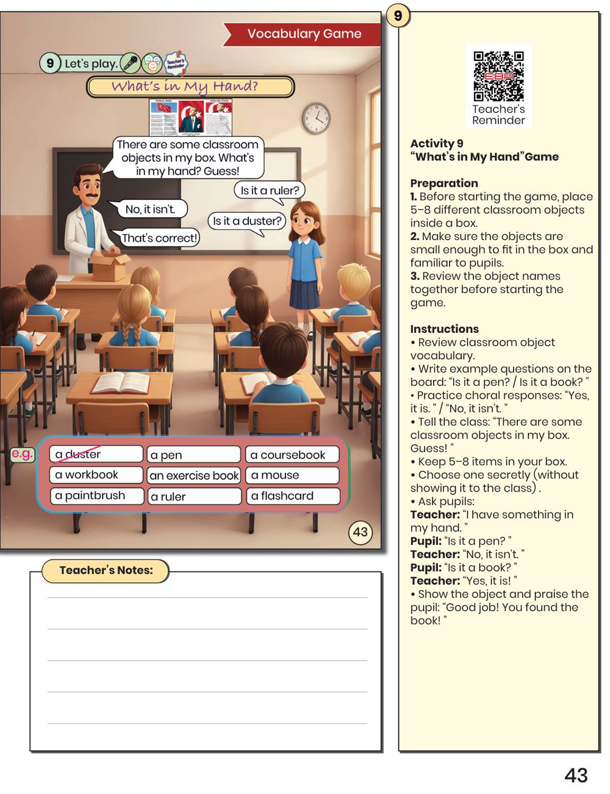

9 Let's play.
Teacher's Reminder

What's in My Hand?

There are some classroom objects in my box. What's in my hand? Guess!

Is it a ruler?
No, it isn't.
Is it a duster?
That's correct!

e.g.
| a duster | a pen | a coursebook |
| :--- | :--- | :--- |
| a workbook | an exercise book | a mouse |
| a paintbrush | a ruler | a flashcard |

43

---

9

Teacher's Reminder

**Activity 9**
**“What’s in My Hand” Game**

**Preparation**
1. Before starting the game, place 5–8 different classroom objects inside a box.
2. Make sure the objects are small enough to fit in the box and familiar to pupils.
3. Review the object names together before starting the game.

**Instructions**
• Review classroom object vocabulary.
• Write example questions on the board: “Is it a pen? / Is it a book? ”
• Practice choral responses: “Yes, it is.” / “No, it isn’t.”
• Tell the class: “There are some classroom objects in my box. Guess! ”
• Keep 5–8 items in your box.
• Choose one secretly (without showing it to the class) .
• Ask pupils:
**Teacher:** “I have something in my hand. ”
**Pupil:** “Is it a pen? ”
**Teacher:** “No, it isn’t. ”
**Pupil:** “Is it a book? ”
**Teacher:** “Yes, it is! ”
• Show the object and praise the pupil: “Good job! You found the book! ”

Teacher's Notes:
__________________________________________________________________
__________________________________________________________________
__________________________________________________________________
__________________________________________________________________
__________________________________________________________________

<!-- sayfa 43 -->

# 10

## Activity 10

Let pupils look at the names of the school subjects on the timetable. Read the school subjects aloud and ask pupils to repeat after you to make sure that they hear the correct pronunciation. Tell pupils to look at the pictures on the timetable and check if they can understand what they represent. Make simple sentences or use gestures to ensure that they understand what each word means. Before reading the dialogue on that page, ask model questions like “It’s 9 o’clock on Monday. What lesson is it now? ” and tell them that they need to check the timetable to answer. Make sure that they give proper answers like “It’s Maths. ” Tell pupils to look at the dialogue. Read the dialogue aloud so that pupils can hear the correct pronunciation. Let them read the dialogue silently first. When they feel confident, ask volunteer pupils to read it aloud to the whole class.

---

# Vocabulary: Selection & Use

### 10 Read the dialogue and act out. 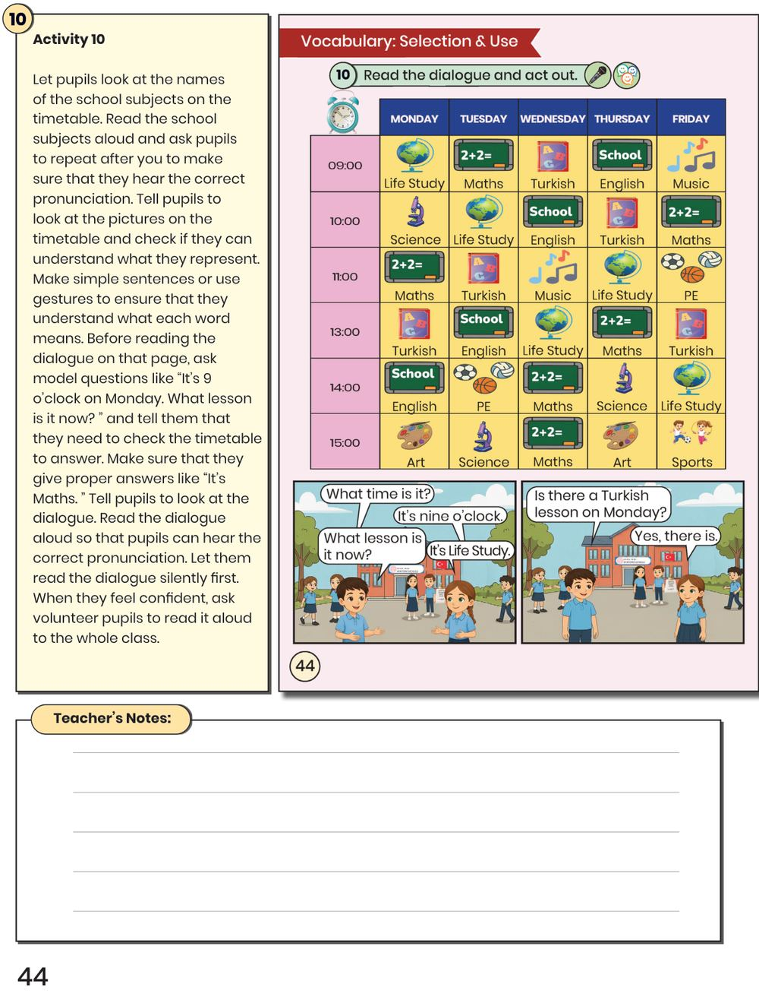

| | MONDAY | TUESDAY | WEDNESDAY | THURSDAY | FRIDAY |
| :--- | :---: | :---: | :---: | :---: | :---: |
| 09:00 | Life Study | $2+2=$ Maths | Turkish | School English | Music |
| 10:00 | Science | Life Study | School English | Turkish | $2+2=$ Maths |
| 11:00 | $2+2=$ Maths | Turkish | Music | Life Study | PE |
| 13:00 | Turkish | School English | Life Study | $2+2=$ Maths | Turkish |
| 14:00 | School English | PE | $2+2=$ Maths | Science | Life Study |
| 15:00 | Art | Science | $2+2=$ Maths | Art | Sports |


44

---

**Teacher's Notes:**

<!-- sayfa 44 -->

# Vocabulary: Selection & Use

## 11) Look, listen, and say. 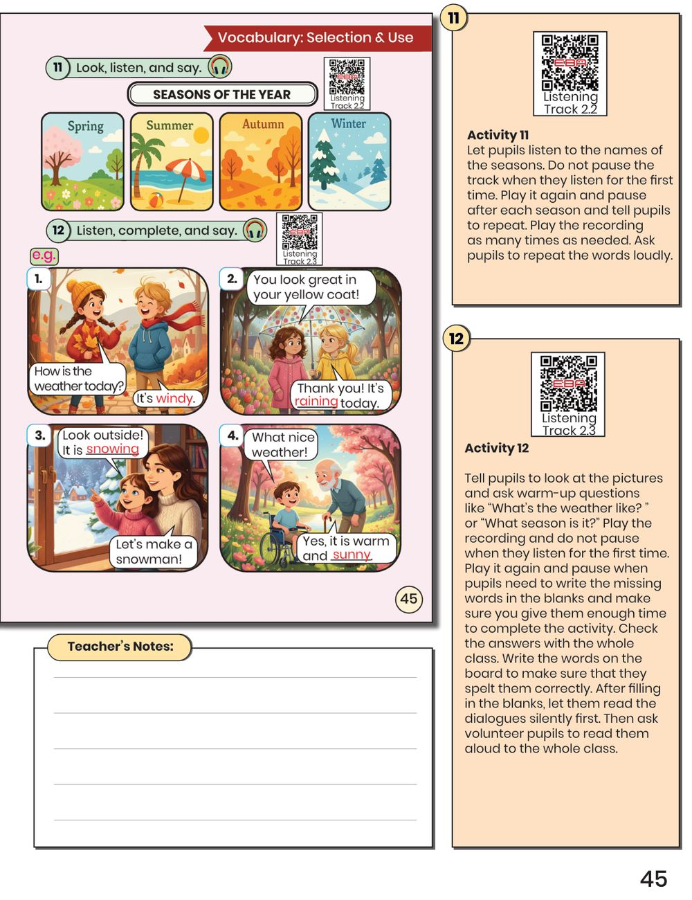


### SEASONS OF THE YEAR

| Spring | Summer | Autumn | Winter |
| :---: | :---: | :---: | :---: |
|  |  |  |  |

## 12) Listen, complete, and say. 


e.g.

1.
How is the weather today?
It's windy.

2.
You look great in your yellow coat!
Thank you! It's raining today.

3.
Look outside! It is snowing.
Let's make a snowman!

4.
What nice weather!
Yes, it is warm and sunny.

45

---

**Teacher's Notes:**
__________________________________________________________________
__________________________________________________________________
__________________________________________________________________
__________________________________________________________________
__________________________________________________________________

---

11

Listening Track 2.2

**Activity 11**
Let pupils listen to the names of the seasons. Do not pause the track when they listen for the first time. Play it again and pause after each season and tell pupils to repeat. Play the recording as many times as needed. Ask pupils to repeat the words loudly.

---

12

Listening Track 2.3

**Activity 12**
Tell pupils to look at the pictures and ask warm-up questions like “What’s the weather like? ” or “What season is it?” Play the recording and do not pause when they listen for the first time. Play it again and pause when pupils need to write the missing words in the blanks and make sure you give them enough time to complete the activity. Check the answers with the whole class. Write the words on the board to make sure that they spelt them correctly. After filling in the blanks, let them read the dialogues silently first. Then ask volunteer pupils to read them aloud to the whole class.

<!-- sayfa 45 -->

# 13 Activity 13

Before starting the activity revise the numbers from 1 to 20 and make sure that pupils remember how to count. Write the numbers on the board and let pupils see them and recall their spelling. Then ask pupils to look at the book and guess the missing numbers. Tell them that they will listen to the recording and check if their guesses are correct.

**Track 2.4 Listening Script**

Twenty
Twenty-one
Twenty-two
Twenty-three
Twenty-four
Twenty-five
Twenty-six
Twenty-seven
Twenty-eight
Twenty-nine
Thirty
Thirty-one
Thirty-two
Thirty-three
Thirty-four
Thirty-five
Thirty-six
Thirty-seven
Thirty-eight
Thirty-nine
Forty
Forty-one
Forty-two
Forty-three
Forty-four
Forty-five
Forty-six
Forty-seven
Forty-eight
Forty-nine
Fifty

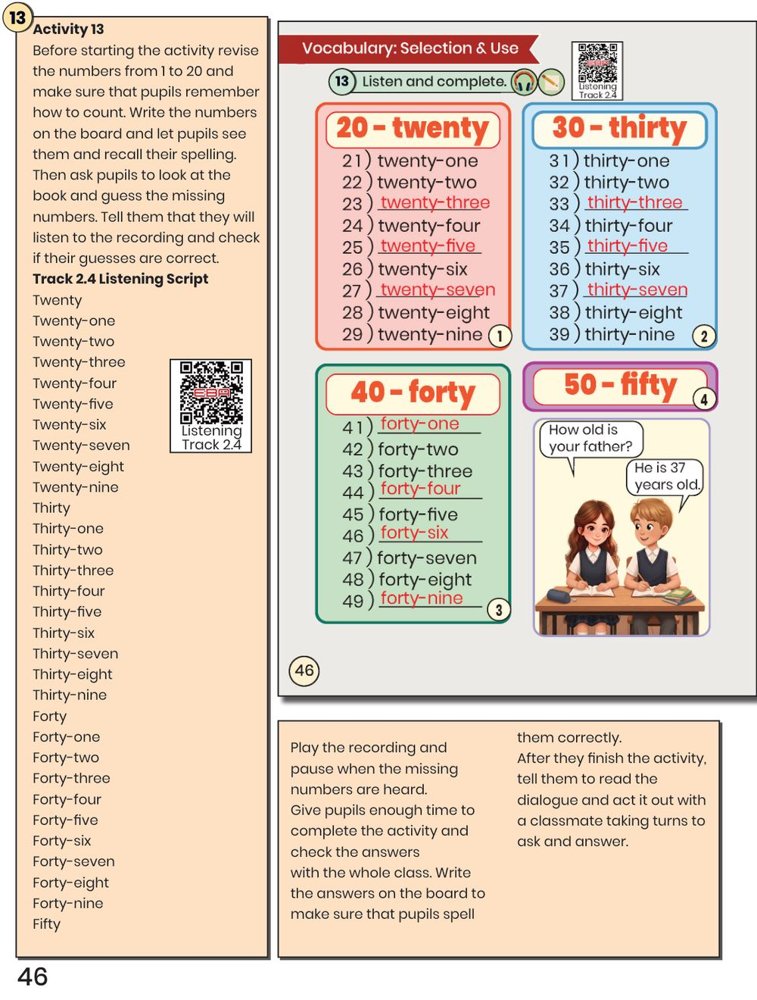

Vocabulary: Selection & Use

13 Listen and complete.

| 20 - twenty | 30 - thirty |
| :--- | :--- |
| 21) twenty-one | 31) thirty-one |
| 22) twenty-two | 32) thirty-two |
| 23) <span style="color:red">twenty-three</span> | 33) <span style="color:red">thirty-three</span> |
| 24) twenty-four | 34) thirty-four |
| 25) <span style="color:red">twenty-five</span> | 35) <span style="color:red">thirty-five</span> |
| 26) twenty-six | 36) thirty-six |
| 27) <span style="color:red">twenty-seven</span> | 37) <span style="color:red">thirty-seven</span> |
| 28) twenty-eight | 38) thirty-eight |
| 29) <span style="color:red">twenty-nine</span> ① | 39) thirty-nine ② |

| 40 - forty | 50 - fifty |
| :--- | :--- |
| 41) <span style="color:red">forty-one</span> | ④ |
| 42) forty-two | How old is |
| 43) forty-three | your father? |
| 44) <span style="color:red">forty-four</span> | |
| 45) forty-five | He is 37 |
| 46) <span style="color:red">forty-six</span> | years old. |
| 47) forty-seven | |
| 48) forty-eight |  |
| 49) <span style="color:red">forty-nine</span> ③ | |

46

Play the recording and pause when the missing numbers are heard. Give pupils enough time to complete the activity and check the answers with the whole class. Write the answers on the board to make sure that pupils spell them correctly. After they finish the activity, tell them to read the dialogue and act it out with a classmate taking turns to ask and answer.

<!-- sayfa 46 -->

# Vocabulary Game

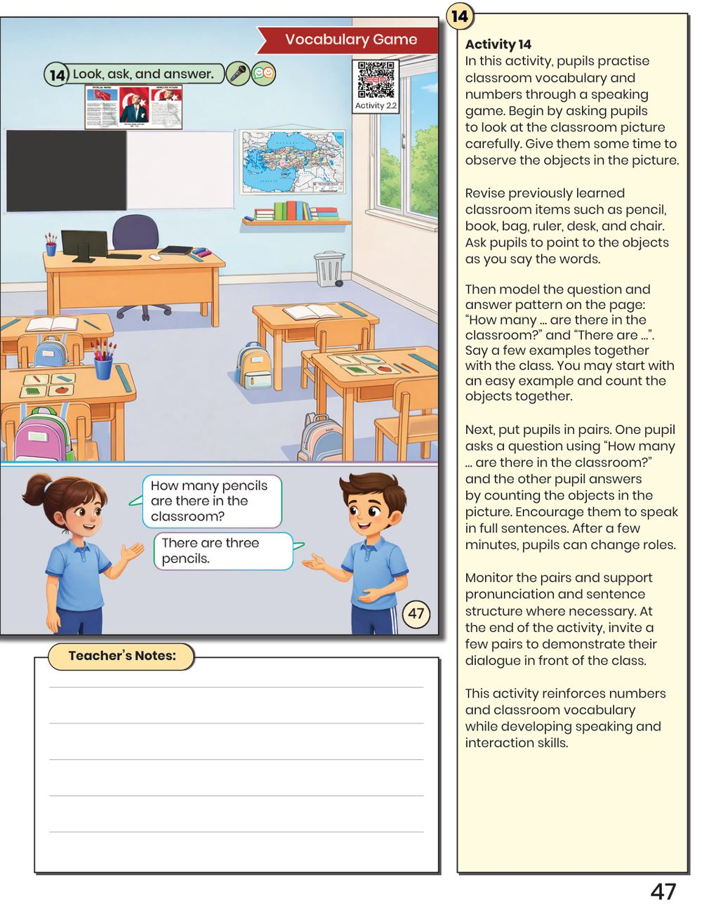

(14) Look, ask, and answer.  


Activity 2.2


How many pencils are there in the classroom?
There are three pencils.


47

---

## Activity 14

In this activity, pupils practise classroom vocabulary and numbers through a speaking game. Begin by asking pupils to look at the classroom picture carefully. Give them some time to observe the objects in the picture.

Revise previously learned classroom items such as pencil, book, bag, ruler, desk, and chair. Ask pupils to point to the objects as you say the words.

Then model the question and answer pattern on the page: “How many ... are there in the classroom?” and “There are ... .” Say a few examples together with the class. You may start with an easy example and count the objects together.

Next, put pupils in pairs. One pupil asks a question using “How many ... are there in the classroom?” and the other pupil answers by counting the objects in the picture. Encourage them to speak in full sentences. After a few minutes, pupils can change roles.

Monitor the pairs and support pronunciation and sentence structure where necessary. At the end of the activity, invite a few pairs to demonstrate their dialogue in front of the class.

This activity reinforces numbers and classroom vocabulary while developing speaking and interaction skills.

---

**Teacher's Notes:**
__________________________________________________________________
__________________________________________________________________
__________________________________________________________________
__________________________________________________________________
__________________________________________________________________

<!-- sayfa 47 -->

# 15

## Activity 15

Ask pupils to look at the pictures to become familiar with the context. Ask them to look at each picture carefully and individually. First, read the dialogues aloud so that pupils can hear the correct pronunciation. Pay attention to the target language chunks. Then encourage them to read the dialogues individually and silently in their seats. Let them work in pairs. Choose volunteer pairs to act out the dialogues by reading them to the class. Let as many pairs as possible practise this activity. Offer help when needed.

The target grammar chunks are given in bold in the dialogues. They are not taught as grammatical structures. Pupils are expected to grasp and learn them holistically through hearing, seeing, and repeating in context. Familiarity and exposure are key points. After practising the dialogues in pairs, invite pupils to the board to act out the dialogues without looking at their books. Tell them that they are supposed to act out only one dialogue, as trying to remember all the dialogues can be too challenging at that age.

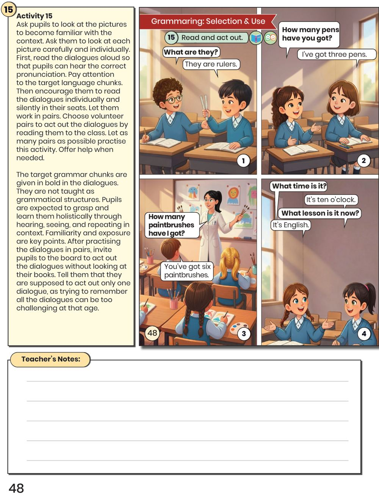

### Grammaring: Selection & Use

**15 Read and act out.**


- What are they?
- They are rulers.


- How many pens have you got?
- I've got three pens.


- How many paintbrushes have I got?
- You've got six paintbrushes.


- What time is it?
- It's ten o'clock.
- What lesson is it now?
- It's English.

---

**Teacher's Notes:**

__________________________________________________________________________
__________________________________________________________________________
__________________________________________________________________________
__________________________________________________________________________

<!-- sayfa 48 -->

# Grammaring Revision

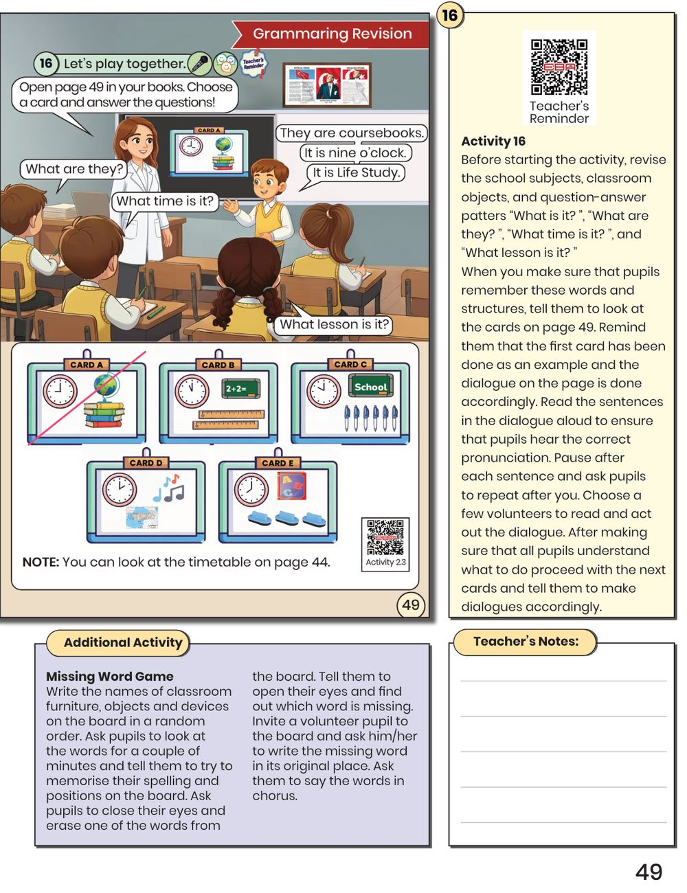

16 Let's play together.
Open page 49 in your books. Choose a card and answer the questions!

What are they?
What time is it?
They are coursebooks.
It is nine o'clock.
It is Life Study.
What lesson is it?


CARD A
CARD B
CARD C
CARD D
CARD E

NOTE: You can look at the timetable on page 44.


49

---

16


**Teacher's Reminder**

**Activity 16**
Before starting the activity, revise the school subjects, classroom objects, and question-answer patters “What is it? ”, “What are they? ”, “What time is it? ”, and “What lesson is it? ”

When you make sure that pupils remember these words and structures, tell them to look at the cards on page 49. Remind them that the first card has been done as an example and the dialogue on the page is done accordingly. Read the sentences in the dialogue aloud to ensure that pupils hear the correct pronunciation. Pause after each sentence and ask pupils to repeat after you. Choose a few volunteers to read and act out the dialogue. After making sure that all pupils understand what to do proceed with the next cards and tell them to make dialogues accordingly.

---

**Additional Activity**

**Missing Word Game**
Write the names of classroom furniture, objects and devices on the board in a random order. Ask pupils to look at the words for a couple of minutes and tell them to try to memorise their spelling and positions on the board. Ask pupils to close their eyes and erase one of the words from the board. Tell them to open their eyes and find out which word is missing. Invite a volunteer pupil to the board and ask him/her to write the missing word in its original place. Ask them to say the words in chorus.

---

**Teacher's Notes:**
__________________________________________________________________
__________________________________________________________________
__________________________________________________________________
__________________________________________________________________
__________________________________________________________________

<!-- sayfa 49 -->

# 17

## Activity 17

Let pupils look at the picture on the page first and tell them to find where these children are. If they have difficulty in understanding the “Where? ” question use gestures or give prompts like “In the garden? ” or “At home? ” When they all can say that the children are in the classroom, ask further questions like “Look at the boys’ desks.”, “What are they? ”, “What is on the teacher’s desk?” or “How many pens are there on the desk? ” When pupils have a complete understanding of the context, go on with the reading passage. Read the passage aloud for pupils. Then ask pupils to read it individually and silently and find which boy is Jack and which one is Daniel. Ask more comprehension questions about the passage. Ask volunteers to read the passage aloud. Divide the passage into parts and ask different pupils to read each part.

---

# Reading–Comprehension

17 Look, read, and answer. 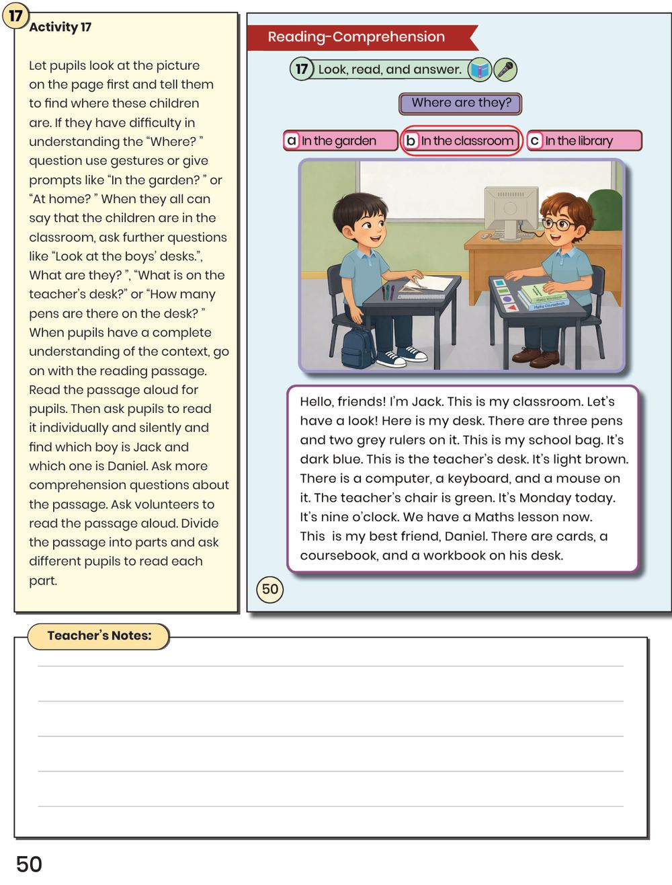

Where are they?

a In the garden  b In the classroom  c In the library


Hello, friends! I'm Jack. This is my classroom. Let's have a look! Here is my desk. There are three pens and two grey rulers on it. This is my school bag. It's dark blue. This is the teacher's desk. It's light brown. There is a computer, a keyboard, and a mouse on it. The teacher's chair is green. It's Monday today. It's nine o'clock. We have a Maths lesson now. This is my best friend, Daniel. There are cards, a coursebook, and a workbook on his desk.

50

---

**Teacher’s Notes:**

__________________________________________________________________

<!-- sayfa 50 -->

# Reading-Comprehension

**18 Read, choose, and write.** 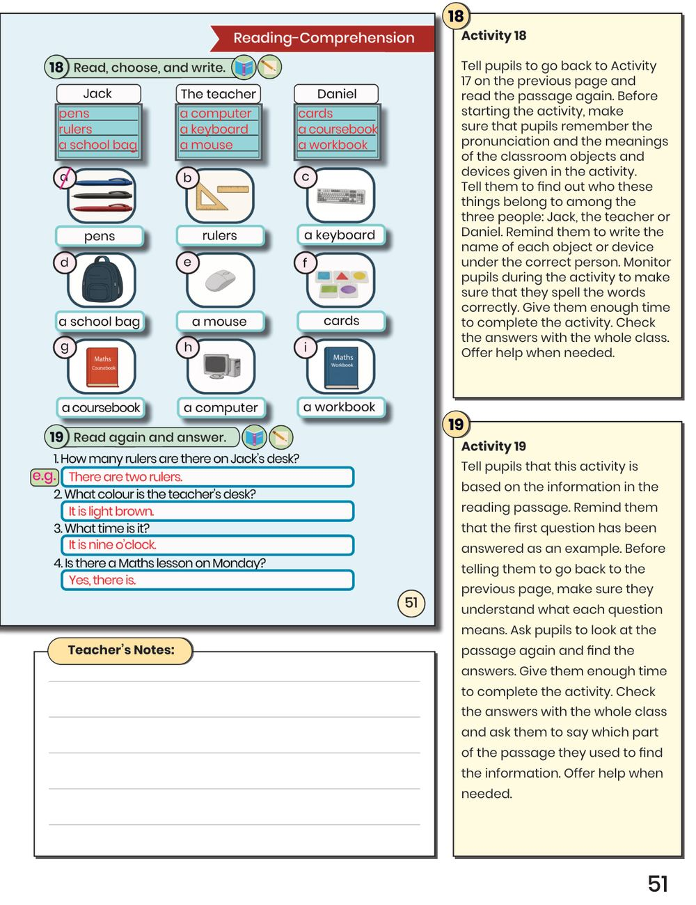

| Jack | The teacher | Daniel |
| :--- | :--- | :--- |
| pens<br>rulers<br>a school bag | a computer<br>a keyboard<br>a mouse | cards<br>a coursebook<br>a workbook |


a) 
pens

b) 
rulers

c) 
a keyboard

d) 
a school bag

e) 
a mouse

f) 
cards

g) 
a coursebook

h) 
a computer

i) 
a workbook

**19 Read again and answer.** 

e.g. 1. How many rulers are there on Jack's desk?
There are two rulers.

2. What colour is the teacher's desk?
It is light brown.

3. What time is it?
It is nine o'clock.

4. Is there a Maths lesson on Monday?
Yes, there is.

51

---

**18**
**Activity 18**
Tell pupils to go back to Activity 17 on the previous page and read the passage again. Before starting the activity, make sure that pupils remember the pronunciation and the meanings of the classroom objects and devices given in the activity. Tell them to find out who these things belong to among the three people: Jack, the teacher or Daniel. Remind them to write the name of each object or device under the correct person. Monitor pupils during the activity to make sure that they spell the words correctly. Give them enough time to complete the activity. Check the answers with the whole class. Offer help when needed.

**19**
**Activity 19**
Tell pupils that this activity is based on the information in the reading passage. Remind them that the first question has been answered as an example. Before telling them to go back to the previous page, make sure they understand what each question means. Ask pupils to look at the passage again and find the answers. Give them enough time to complete the activity. Check the answers with the whole class and ask them to say which part of the passage they used to find the information. Offer help when needed.

**Teacher's Notes:**
__________________________________________________________________
__________________________________________________________________
__________________________________________________________________
__________________________________________________________________

<!-- sayfa 51 -->

# Writing-Expression

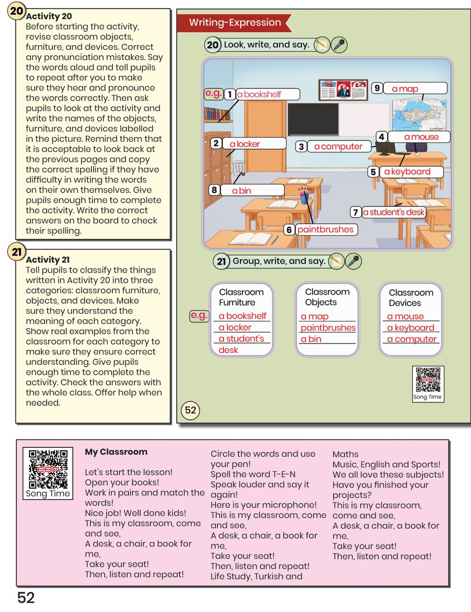

(20) Look, write, and say. 🔇 🎤

1 a bookshelf
2 a locker
3 a computer
4 a map
5 a mouse
6 paintbrushes
7 a student's desk
8 a bin
9 a keyboard

(21) Group, write, and say. 🔇 🎤

| Classroom Furniture | Classroom Objects | Classroom Devices |
| :--- | :--- | :--- |
| e.g. a bookshelf | a map | a mouse |
| a locker | paintbrushes | a keyboard |
| a student's desk | a bin | a computer |

52


**20 Activity 20**
Before starting the activity, revise classroom objects, furniture, and devices. Correct any pronunciation mistakes. Say the words aloud and tell pupils to repeat after you to make sure they hear and pronounce the words correctly. Then ask pupils to look at the activity and write the names of the objects, furniture, and devices labelled in the picture. Remind them that it is acceptable to look back at the previous pages and copy the correct spelling if they have difficulty in writing the words on their own themselves. Give pupils enough time to complete the activity. Write the correct answers on the board to check their spelling.

**21 Activity 21**
Tell pupils to classify the things written in Activity 20 into three categories: classroom furniture, objects, and devices. Make sure they understand the meaning of each category. Show real examples from the classroom for each category to make sure they ensure correct understanding. Give pupils enough time to complete the activity. Check the answers with the whole class. Offer help when needed.

---


**My Classroom**

Let's start the lesson!
Open your books!
Work in pairs and match the words!
Nice job! Well done kids!
This is my classroom, come and see,
A desk, a chair, a book for me,
Take your seat!
Circle the words and use your pen!
Spell the word T-E-N
Speak louder and say it again!
Here is your microphone!
This is my classroom, come and see,
A desk, a chair, a book for me,
Take your seat!
Maths
Music, English and Sports!
We all love these subjects!
Have you finished your projects?
This is my classroom, come and see,
A desk, a chair, a book for me,
Take your seat!
Then, listen and repeat!

<!-- sayfa 52 -->

# CLIL

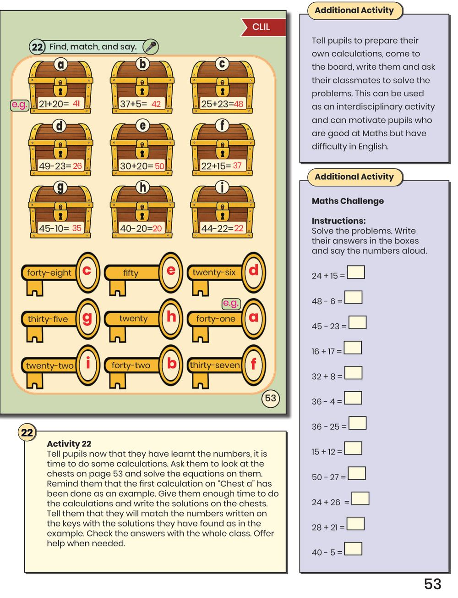

(22) Find, match, and say.


(a)
$21+20=41$ <!-- KONTROL: Marker'da karşılığı yok, uydurma olabilir -->

(b)
$37+5=42$ <!-- KONTROL: Marker'da karşılığı yok, uydurma olabilir -->

(c)
$25+23=48$ <!-- KONTROL: Marker'da karşılığı yok, uydurma olabilir -->

(d)
$49-23=26$ <!-- KONTROL: Marker'da karşılığı yok, uydurma olabilir -->

(e)
$30+20=50$ <!-- KONTROL: Marker'da karşılığı yok, uydurma olabilir -->

(f)
$22+15=37$ <!-- KONTROL: Marker'da karşılığı yok, uydurma olabilir -->

(g)
$45-10=35$ <!-- KONTROL: Marker'da karşılığı yok, uydurma olabilir -->

(h)
$40-20=20$ <!-- KONTROL: Marker'da karşılığı yok, uydurma olabilir -->

(i)
$44-22=22$ <!-- KONTROL: Marker'da karşılığı yok, uydurma olabilir -->

forty-eight (c)
fifty (e)
twenty-six (d)
thirty-five (g)
twenty (h)
forty-one (a)
twenty-two (i)
forty-two (b)
thirty-seven (f)

53

---

**Additional Activity**

Tell pupils to prepare their own calculations, come to the board, write them and ask their classmates to solve the problems. This can be used as an interdisciplinary activity and can motivate pupils who are good at Maths but have difficulty in English.

---

**Additional Activity**

**Maths Challenge**

**Instructions:**
Solve the problems. Write their answers in the boxes and say the numbers aloud.

$24 + 15 =$ $\square$
$48 - 6 =$ $\square$
$45 - 23 =$ <!-- KONTROL: Marker'da karşılığı yok, uydurma olabilir --> $\square$
$16 + 17 =$ $\square$
$32 + 8 =$ $\square$
$36 - 4 =$ $\square$
$36 - 25 =$ <!-- KONTROL: Marker'da karşılığı yok, uydurma olabilir --> $\square$
$15 + 12 =$ $\square$
$50 - 27 =$ <!-- KONTROL: Marker'da karşılığı yok, uydurma olabilir --> $\square$
$24 + 26 =$ $\square$
$28 + 21 =$ $\square$
$40 \div 5 =$ <!-- KONTROL: Marker'da karşılığı yok, uydurma olabilir --> $\square$

---

(22) **Activity 22**

Tell pupils now that they have learnt the numbers, it is time to do some calculations. Ask them to look at the chests on page 53 and solve the equations on them. Remind them that the first calculation on “Chest a” has been done as an example. Give them enough time to do the calculations and write the solutions on the chests. Tell them that they will match the numbers written on the keys with the solutions they have found as in the example. Check the answers with the whole class. Offer help when needed.

<!-- sayfa 53 -->

23

# Activity 23
## Picture Strip Story
After the controlled practice sessions, ask pupils to practise the target vocabulary and language chunks in the picture strip story. This activity gives them the opportunity to consolidate and use the target words and chunks about the concept of classroom life in a fun and versatile way.

First, read the strip story aloud so that pupils can hear the correct pronunciation. Then ask them to read it individually and silently. Ask them to work in groups. Choose pupils to act out the story while sitting and reading the dialogues aloud to the class. Let pupils practise this activity as many times as possible. Offer help with pronunciation, vocabulary and fluency when needed.

As an additional activity, let pupils act out the dialogues again using their own names with their peers.

---

# Picture Strip Story


(23) Read and act out.
It's three o'clock. What lesson is it now?
It's Maths. Look! Mr Bulut is here. He is on time.


Good afternoon!
Thank you! Let's start the lesson!
Good afternoon, Mr Bulut. You look great!


I'm sorry, Mr Bulut. I'm late.
Everything is all right. May I come in?
Are you OK?
Come in, Ceren. Take your seat, please!

54

---

Teacher's Notes:
__________________________________________________________________
__________________________________________________________________
__________________________________________________________________
__________________________________________________________________

<!-- sayfa 54 -->

# Additional Activity


**Strip Story Activities**

Print the Strip Story activity worksheet in advance and hand it out to each pupil.

**1. Look and Choose**
Let pupils look at the strip story and choose the correct answer. Read the questions aloud and help pupils focus on time, lesson, and teacher names.

**2. True / False**
Let pupils read the sentences and decide if they are true or false according to the story. Encourage them to check the pictures and dialogue.

**3. Complete the Sentences**
Let pupils complete the sentences using the words in the box. Revise classroom and lesson vocabulary before starting.

**4. Match**
Let pupils match each question with the correct answer. Do the first one together as an example.

**5. Put the Sentences in Order**
Ask pupils to put the sentences in the correct order according to the story. Let them look back at the strip story if needed.

**6. Complete and Say**
Let pupils complete the dialogue and say it aloud with a peer. Model the dialogue before pair work.

**7. Writing – About You**
Let pupils write short answers about their favourite lesson and Maths lesson time. Accept simple

---

# Teacher's Notes:
__________________________________________________________________
__________________________________________________________________
__________________________________________________________________
__________________________________________________________________
__________________________________________________________________

<!-- sayfa 55 -->

24


**Activity 24**
**Theme Project**
Ask pupils to design a Picture Dictionary titled “Classroom Life”, including vocabulary related to classroom furniture, objects, and devices; school subjects and seasons of the year. Tell pupils to organise their dictionaries into sections, such as furniture (e.g. a teacher’s desk) , objects (“a pen”) , devices (“a keyboard”) , school subjects (“English, Maths”) , and seasons (“winter, spring”) . Each word should be matched with a picture that pupils cut from the cut-out page at the end of the book. Encourage pupils to design their dictionaries creatively with colours and decorations. Finally, ask pupils to present 5-7 selected words from their dictionaries to the class. This activity can either be assigned as homework or done in the classroom if time allows. Encourage all pupils to come to the board and present their dictionaries. Offer help if needed.

---

**What About You?**
**(Self-Assessment)**
Before starting the activity, make sure that pupils understand how to reflect on their self-assessment. Let pupils choose one of the emotions that matches how they feel about the given subtopic in the theme and colour it.

---

# Project

24 Go to pages 133 – 135 and make your picture dictionary. 


### SELF-ASSESSMENT
**How many stars for ...?**

| | |
| :--- | :---: |
| Classroom Instructions | ☆☆☆☆☆ |
| School Subjects | ☆☆☆☆☆ |
| Seasons & Weather | ☆☆☆☆☆ |
| Classroom Objects & Furniture & Devices | ☆☆☆☆☆ |

56 

---


**Consolidation**
The consolidation part consists of three different activities that enable pupils to revise the words and language chunks learned in Theme 2.

<!-- sayfa 56 -->


# Theme 3
# PERSONAL LIFE


57

---

## Summary

Asking and talking about physical features
• What does she look like?
- She’s tall and beautiful.

Describing possession of clothes, body parts
• Have you got a big or small nose?
- I’ve/have got a small nose.
• Have you got any T-shirts?
- Yes, I’ve/have got some T-shirts.
• What colour hair has she got?
- She’s/has got blonde hair.
• How is her hair? / What’s her hair like?
- She’s/has got curly hair.

Expressing personal preferences and opinions about clothing
- I like/hate/dislike/love big sunglasses.

Indicating ownership or relationships between people and objects
• Whose dress is this?
- This is Jasmine’s dress.

Describing what people are wearing
• What are you wearing today?
- I’m/am wearing a T-shirt today.
- I’m wearing a coat. It’s winter and it’s cold.

Asking and answering questions about quantity and availability
• Have you got any shirts?
- Yes, I’ve got some shirts.

Asking about ownership, characteristics, or descriptions of people or objects
• Question words: Whose, what… like

Connecting similar ideas, options, or items in a sentence
• Conjunctions: and, or

---

## Warm up activity
**Spin And Win Game:**
Tell pupils they will play a spinner game. Divide the class into two teams and explain that each correct answer earns one point. Demonstrate the spinner and let pupils take turns spinning and reading the question aloud. Show any visuals briefly to support understanding and encourage full-sentence answers. Keep the game lively by alternating teams and continue until all questions are used or everyone has had a turn. The game reviews key vocabulary and provides


Teacher's Reminder


Rubric

<!-- sayfa 57 -->

# Establishing Links


Year 2 Theme 3 Flashcards
Digital story

Show pupils the flashcards available via QR code above to remind them of their background knowledge about the concept of “personal life with parts of the body, adjectives, weather, and clothes’ learned in Year 2.

---

# Listening/Watching-Comprehension

1. Look at the picture and answer.
How is the weather?
It is snowing.


Digital story

2. Watch the digital story.


---

1. Activity 1
Let pupils look at the picture and answer the question “How is the weather? ” Direct pupils’ attention to visual clues such as snow on the trees, the characters’ winter clothes, boots, scarves, and gloves. Encourage them to use simple weather vocabulary when answering, for example: “It’s cold, ” “It’s snowing, ” “It’s winter. ”
Accept variations as long as pupils use appropriate weather expressions.

2. Activity 2
Let pupils watch the digital story. Let them watch it without any pause first. While they are watching it for the second time, pause when needed and repeat the words and phrases you want to emphasise by showing weather, clothes and adjectives.

---


58

---

**Personal Life**
Video Script

Mrs Çınar: Good morning, kids! Today is camping day!
Şeyma: Good morning, Mum! I am so excited! Wake up Mustafa!
Şeyma: It’s 6 o’clock. We mustn’t be late!
Mustafa: But, it’s too early!
Şeyma: Come on, don’t be lazy!

Mr Çınar: Don’t forget to take your clothes, kids. Let’s check them. It’s winter, and it’s cold. Have you got your coats, jumpers, sweatshirts, boots, and warm socks with you?
Şeyma: Yes, Dad! They are all in our bags.
Mr Çınar: Cool! Where is your mum?
Mustafa: She is in the bathroom.
Mrs Çınar: I can’t find my earring.
Şeyma: It is on the table with your necklace, Mum.
Mrs Çınar: Oh, really? Thanks, honey!
Mr Çınar: All right time to go! The campsite is waiting for us!


Digital story

<!-- sayfa 58 -->


**Mr Çınar:** Take your scarf, Mustafa. Well, why are you wearing shoes?
**Mustafa:** Because I hate wearing boots.
**Mr Çınar:** But it’s winter, son. Wear your boots, please.
**Mustafa:** OK, Dad. I’m changing my shoes. We’re ready, Dad!
**Mr Çınar:** Then, let’s go!
**Şeyma:** Hi, Sevgi! Hi, Yiğit! Nice to see you here! Nice boots, Sevgi!
**Sevgi:** Thank you, Şeyma! You look great too! I love this camping site. Let’s go and play hide-and-seek!
**Mrs Çınar:** Be careful, kids! Don’t go too far!

* * *

**Sevgi:** Yiğit! Where are you?
**Barış:** What’s wrong, kids?
**Şeyma:** We can’t find our friend Yiğit.
**Barış:** OK, calm down. I’ll help you. Now, please tell me. What does Yiğit look like?
**Sevgi:** He’s tall and handsome. He’s got green eyes and a small nose.
**Barış:** Go on!
**Sevgi:** He is wearing glasses.
**Barış:** What colour is his hair?
**Sevgi:** He has got blond, curly hair.
**Barış:** What is he wearing?
**Şeyma:** He’s is wearing a dark blue coat and jeans.
**Mustafa:** Please, help us to find Yiğit!
**Barış:** Don’t worry! We’ll find him. It’s freezing. Let’s hurry, kids!
**Kids:** Yiğit! Where are you, Yiğit?
**Sevgi:** Hey, Yiğit. Where are you?
**Yiğit:** I am here! I think I play this game very well. You can’t find me.
**Mustafa:** But we are worried about you, Yiğit.
**Yiğit:** Sorry, guys. You’re right.
**Sevgi:** Are you cold? Blow your nose, please.
**Yiğit:** Thank you.
**Şeyma:** Thank you so much for your help. You are so kind.
**Barış:** Anytime! It’s my pleasure. I think your families are waiting for...

59

---

**Şeyma:** But you are very strong. You can do it, Mustafa!

* * *

**Barış:** Good morning, Sir. I am Barış. Welcome to Green Forest Camping Site. How can I help you?
**Mr Çınar:** Good morning. I am Ahmet Çınar. And this is my family. We are here to camp for two days.
**Barış:** Oh, I see your reservation Mr Çınar. Here is your room key. Have a nice holiday!
**Mr Çınar:** Thank you. See you later!
**Mustafa:** I am so happy. Our friends, Sevgi and Yiğit, are here, too. Let’s go and find them!
**Mrs Çınar:** Yes, dear. I hope you will have a great time together!
**Mr Çınar:** Whose scarf is this?

<!-- sayfa 59 -->

# Additional Activity


**Preparation for the activity:**
Before the lesson, prepare flashcards for the two categories: Parts of the Body and Clothes.
Make sure pupils are already familiar with the vocabulary.

**During the activity:**
This time, while pupils are watching the digital story, pause the video whenever a target word or phrase from one of the two categories is heard (Parts of the Body and Clothes). Show pupils the corresponding flashcard you have prepared. The aim of this activity is to help pupils recognise and classify vocabulary while watching. Bring two large category boxes to the class and label them clearly: body parts and clothes. Each time you pause the video and show a flashcard, ask pupils which category it belongs to. Pupils place the card under the correct heading. Make sure you also have simple visuals under each category so pupils can understand the meaning through pictures.

---

# Listening/Watching-Comprehension

### 3 Watch the digital story and put a tick ($\checkmark$).
**Where are they?**

1.  (with $\checkmark$)
2.  [ ]
3.  [ ]

### 4 Watch and put in order.


a.  (1)
b.  (5)
c.  (6)
d.  (4)
e.  (3)
f.  (2)

### 5 Watch again and answer.


1. 
**Whose scarf is this?**
a) This is Şeyma's scarf.
b) $\textcircled{b}$ <!-- KONTROL: Marker'da karşılığı yok, uydurma olabilir --> This is Mustafa's scarf.

2. 
**What is Şeyma wearing?**
a) She is wearing a yellow scarf and a pink coat.
b) $\textcircled{b}$ <!-- KONTROL: Marker'da karşılığı yok, uydurma olabilir --> She is wearing a dark green coat and brown boots.

3. 
**What does Yiğit look like?**
a) $\textcircled{a}$ <!-- KONTROL: Marker'da karşılığı yok, uydurma olabilir --> He is tall and handsome.
b) He is fat and pretty.

(60)

---

### 3 Activity 3
Let pupils watch the digital story again. Then ask them to look at the pictures and tick the one that correctly shows where the characters are in the story. Encourage pupils to focus on the visual details and information they observed in the video to choose the correct option.

### 4 Activity 4
Let pupils watch the digital story again and put the scenes given into the correct order. You can pause the video when the scenes given in the book appear and ask a question about it to make sure that pupils see and understand that scene.

### 5 Activity 5
Let pupils watch the digital story again to understand the questions and choose one of the two options. Help them catch the information they need and give them enough time to answer, pausing the digital story.

<!-- sayfa 60 -->

# Speaking-Expression

## 6 Let's play.

Touch your ear!

**Teacher's Reminder**

---

# Pronunciation: Selection & Use

## 7 Listen and repeat together.


### ALPHABET

**E**
* a **p**en
* a **t**eacher
* **w**eak

**F**
* **f**ish

**G**
* a **g**ame, a **g**iraffe

**H**
* a **h**at

**I**
* **t**ime
* **s**it

**J**
* a **j**acket

Little **J**ack **s**ees **t**en **h**orses in the **g**reen field.


61

---

## 6
**Activity 6**
This is a miming game. Ask pupils to work individually. Then call one pupil to the front, and this pupil picks a card, reads the command clearly and loudly, and the rest of the class performs the action without speaking. The first pupil who correctly performs the movement becomes the next leader and draws a new card. The game continues in the same way with a different leader each round. Example command cards include: Touch your chin!, Point to your eyelashes!, Point to your eyebrows!, Touch your back!, Show your feet!, Touch one foot!, and Show your teeth!

## 7


**Activity 7**
Ask pupils to listen to the track and repeat together as a whole class many times until all pupils feel comfortable. Have them repeat the words in smaller groups and finally individually on a voluntary basis.

**E:** a pen, a teacher, weak
**G:** a game, a giraffe
**I:** time, sit
**F:** fish
**H:** a hat
**J:** a jacket

**Tongue Twister:**
Little Jack sees ten horses in the green field.
Ask pupils to listen and repeat the tongue twister first as a whole class, then in smaller groups, and finally as individuals. Join in and give positive feedback through

---

## Additional Activity


Scenes from the Digital Story

Bring the pictures showing different scenes from the digital story to the class. Stick the pictures randomly on the board and ask pupils to put them in the correct order. This activity helps pupils remember the sequence of events in the digital story. This activity is for helping pupils to remember the story and

<!-- sayfa 61 -->

# 8

## Activity 8
Let pupils look at the picture carefully and try to remember the body parts they have learned.
Tell pupils that they will use the word box to help them identify each part correctly.
Let pupils match the words with the correct body parts by writing them in the boxes. Give them enough time to complete the activity.
Walk around the classroom and offer help when needed, especially with the less familiar words such as *an eyebrow* or *eyelashes*.
When pupils have finished, check the answers together as a whole class.
Say each word aloud and ask pupils to repeat for pronunciation practice.
Praise pupils for careful spelling and correct labelling.

---

## Vocabulary: Selection & Use

### 8 Look, write, and say.

| hair | an ear | a leg | a nose | back | an eyebrow |
| :--- | :--- | :--- | :--- | :--- | :--- |
| a chin | teeth | eyelashes | an arm | a hand | a foot | feet |

e.g.
1 [hair]


1 [hair]
2 [eyelashes]
3 [an eyebrow]
4 [an ear]
5 [a nose]
6 [teeth]
7 [an arm]
8 [a chin]
9 [back]
10 [a hand]
11 [a leg]
12 [a foot]
13 [feet]

62

---

## Additional Activity

### Fly Swatter Game

**Materials:**
* Two fly swatters (or rolled paper as swatters)
* Flashcards or words written on the board

**Instructions:**
* Stick the flashcards or write the words on the board.
* Call two pupils to the board.
* Give each pupil a fly swatter.
* Say a word and ask pupils to find and hit the correct word with the fly swatter.
* The pupil who hits the word first is the winner.
* Continue the game with other pupils and new words.

**Tip:** Encourage pupils to say the word aloud after they hit it.

<!-- sayfa 62 -->

# Vocabulary: Selection & Use

**9** Look, read, and circle. 


e.g.
1

He is **strong**/weak.

2

They are **happy**/sad.

3

She is **beautiful**/ugly.

4

We are old/**young**.

5

He is a **good**/bad boy.

6

She is **hardworking**/lazy.

7

She is fat/**thin**.

8

He is **tall**/short.

63

---

**9**
### Activity 9
Let pupils look carefully at each picture and identify the correct adjective that describes the people shown. Begin by giving pupils a moment to observe all visuals individually and recall the meaning of each pair of opposite adjectives (strong/weak, happy/sad, beautiful/ugly, old/young, good/bad, hardworking/lazy, fat/thin, tall/short). Then ask them to circle the adjective that best matches each picture. Give pupils enough time to complete the task at their own pace, offering support if they have difficulty in distinguishing the meanings or identifying the correct option. Once most pupils have finished, check the answers together as a whole class. Encourage pupils to say the full sentences aloud (e.g. “He is strong.” “They are happy.”) to reinforce both vocabulary and sentence structure.

---

**Teacher's Notes:**
___________________________________________________________________________
___________________________________________________________________________
___________________________________________________________________________
___________________________________________________________________________
___________________________________________________________________________

<!-- sayfa 63 -->

# 10


**Activity 10**

Tell pupils to focus on clothing vocabulary presented in the illustration. First, ask them to look carefully at each item and repeat the words after you to ensure correct pronunciation (e.g. skirt, jumper, dress, socks, coat, sunglasses, necklace, shoes, boots, and uniform). Encourage choral repetition followed by individual repetition to check accuracy.

# 11

**Activity 11**

Ask pupils to look carefully at the clothes pictures and their names in activity 10. Tell pupils that they will read a short text about a girl telling about her clothes and accessories. Ask them to look at the picture and write its name in the given blank. Encourage them to try to write the words without looking at the previous activity first but mention that they can get help if they need to. Give pupils enough time to complete the activity individually. Walk around the classroom and provide help for pupils who need support. Remind pupils to check colours (e.g. red skirt, yellow jumper) and descriptions (e.g. black boots, small bag) to ensure accuracy. When pupils finish, check the answers together as a whole class.

---

# Vocabulary: Selection & Use


(10) Look, listen, and repeat.


(11) Look and complete.


I've got a red [skirt icon] 1 **skirt**, a yellow [dress icon] 2 **dress**, and a pink sweatshirt in the wardrobe. My favourite yellow [jumper icon] 3 **jumper** and grey [socks icon] 4 **socks** are there, too. My uniform is on the door. Here is my purple [coat icon] 5 **coat**, I love it. I've got black [shoes icon] 6 **shoes** and brown [boots icon] 7 **boots** right there. There is a [necklace icon] 8 **necklace** and a small black bag. There are two earrings and cool [sunglasses icon] 9 **sunglasses** on the table.

Look at my bed. My clothes are ready for today, blue [jeans icon] 10 **jeans** and a green jacket.

64

---

**Teacher's Notes:**
__________________________________________________________________
__________________________________________________________________
__________________________________________________________________
__________________________________________________________________

<!-- sayfa 64 -->

# Vocabulary: Selection & Use


**12 Read, colour, and say.**


Hello, friends! It's sunny and warm today. I'm wearing a yellow dress and blue shoes. I've got a bag. It's green. I'm wearing small earrings, a necklace, and black sunglasses.


It's sunny and hot. I'm wearing

Pupils' own answers


It's cold and snowing. I'm wearing

Pupils' own answers


Activity 3.2

65

---

**12 Activity 12**

Tell pupils to look at the example picture given on the page. Ask questions about what the girl is wearing and help with the vocabulary if needed.

Direct pupils' attention to the two characters below. Ask them to read the weather descriptions in the speech bubbles ("It's sunny and hot." / "It's cold and snowing."). Encourage pupils to colour the clothes and accessories of each character appropriately according to the weather conditions. Remind them to use suitable colours and clothing items that match the season and weather.

After colouring, ask pupils to complete the speech bubbles by writing sentences describing what the characters are wearing. Encourage them to use full sentences and clothing vocabulary from the unit (e.g. "I'm wearing a red hat and a pink dress." / "I'm wearing a blue coat, a scarf, and brown boots.").

At the end of the activity, invite a few pupils to read their descriptions aloud to practise pronunciation and check accuracy.

---

**Teacher's Notes:**

__________________________________________________________________
__________________________________________________________________
__________________________________________________________________
__________________________________________________________________
__________________________________________________________________

<!-- sayfa 65 -->

# 13


**Activity 13**

Ask pupils to look at the pictures for being familiar with the story. Ask them to look at each picture on the page carefully and individually. First, read the dialogues aloud so that pupils can hear the correct pronunciation. Pay attention to emphasising the target language chunks. Then encourage them to read the dialogues individually and silently in their seats. Let them work in pairs. Choose volunteer pairs to act out the dialogues by reading them to the class. Let as many pairs as possible practise this activity and offer help when needed.

The target grammar chunks are given in bold in the dialogues. They are not taught as grammatical structures. Pupils are expected to grasp and learn them holistically through hearing, seeing, and repeating them in context. Familiarity and exposure are key points.

After practising the dialogues in pairs, invite pupils to the board to act out the dialogues without looking at their books. Tell them to choose only one dialogue from the page, as trying to remember all the dialogues can be too challenging at that age.

---

**Grammarring: Selection & Use**


13 Read and act out.

(1)
What does your sister look like?
She's short and pretty.

(2)
What is your brother's hair like?
He's got curly hair.

(3)
Have you got any T-shirts?
Yes, I've got some T-shirts.

(4)
Whose dress is this?
This is my sister's dress.

66

---

**Teacher's Notes:**
__________________________________________________________________
__________________________________________________________________
__________________________________________________________________
__________________________________________________________________
__________________________________________________________________

<!-- sayfa 66 -->

# Grammaring: Selection & Use


**14 Let's play together.**


*   This is a girl.
*   She's got blonde hair.
*   No, she isn't.
*   It's curly.
*   Yes, she is. Perfect!
*   What colour hair has she got?
*   Is she wearing glasses?
*   What is her hair like?
*   Is she Elif?


**Teacher's Notes:**
__________________________________________________________________
__________________________________________________________________
__________________________________________________________________
__________________________________________________________________
__________________________________________________________________

---

**14**


**Activity 14**

Begin by drawing pupils’ attention to the characters on the board and explain that they will play a guessing game. One pupil secretly chooses a character from the picture, and the rest of the class must guess who it is by asking descriptive questions such as “Is this a boy or a girl?”, “What is her hair like? ”, “Has she got curly hair? ”, or “Is he wearing glasses?” Encourage pupils to listen carefully to each other and use the clues to make correct guesses. Model both question forms and short answers (e.g. “Yes, she is.” / “No, he hasn’t.”) before beginning the activity to ensure accuracy and confidence. Walk around the classroom, supporting pupils with vocabulary and pronunciation as needed.

**Additional Activity**

After playing the "Guess Who" game with the given visuals, tell pupils that this time they will play the game choosing from their classmates. Choose a volunteer and invite him/her to the board. Tell the pupil to choose a classmate and not tell who she/he is to anyone. The rest of pupils will try to guess who the chosen pupil is by asking questions like "Is it a boy or a girl? ”, "Has she/he got brown hair? ”, or "Is she/he wearing glasses? ”. The game goes on until pupils can guess the chosen pupil correctly. You can play the game as many

<!-- sayfa 67 -->

# 15

## Activity 15
First, ask pupils to read each short text quietly and carefully. Remind them to look for important details in the descriptions, such as the character’s appearance, clothes, colours, and weather preferences. Explain that these details will help them find the correct picture.

Before they start matching, model the task by reading one description aloud and asking guiding questions, for example: Is the character tall or short? What is he/she wearing? What colours can you see? Encourage pupils to underline or circle key words in the text, such as “old and fat”, “brown boots”, “blue necklace”, or “red bag”.

Next, tell pupils to look at the pictures and match each description with the correct picture by writing the character’s name in the box. Remind them that every detail must match, not just one clue. Allow pupils enough time to read the texts again if needed.

After everyone has finished, check the answers together as a class. Finally, ask a few pupils to read the descriptions aloud. Use this stage to support fluency, stress, and pronunciation, and gently correct errors by modelling the correct form.

---

# Reading-Comprehension

**15 Read and write the names. There is one extra.** 

**a** Hi, I'm Linda. I'm tall and beautiful. I'm happy today. It's sunny. I like big sunglasses. I'm wearing a pink dress and white socks.

**b** Hi, my name is Fiona. I'm old and fat. I dislike rainy weather. I'm wearing brown boots. My necklace is blue. I've got a nice red bag.

**c** Hi, my name is Emma. I'm tall and thin. I have got long straight hair. I'm wearing a white shirt and a blue skirt. I hate windy weather.


| 1 | 2 | 3 | 4 | 5 | 6 |
| :--- | :--- | :--- | :--- | :--- | :--- |
| Fiona | Tim | Emma | extra | Linda | George |

**d** Hello! My name is George. I'm young and strong. I'm handsome. It is cold and snowing. I love winter. I'm wearing a dark blue coat. My shoes are black.

**e** Hello! I'm Tim. I'm tall and thin. The weather is warm and windy today. I'm wearing light blue jeans and a black jacket. I've got a school bag on my back.

68

---

### Teacher's Notes:
__________________________________________________________________
__________________________________________________________________
__________________________________________________________________
__________________________________________________________________

<!-- sayfa 68 -->

# Reading-Comprehension

**16 Read and circle.** 

e.g. 1. Who is wearing a pink dress? ~~Linda~~ / **Emma**
2. Who has got a dark blue coat? **Tim** / ~~George~~
3. Who is wearing a white shirt? **Emma** / ~~Tim~~
4. Who has got brown boots? ~~Fiona~~ / **George**
5. Who is wearing light blue jeans? ~~Fiona~~ / **Tim**

**17 Read again and choose.** 

e.g. 1. Linda likes big ~~sunglasses~~
a) hat  **b) sunglasses**  c) earrings

2. George is **young** and strong.
**a) young**  b) lazy  c) old

3. Fiona has got a blue ~~necklace~~
a) bag  **b) necklace**  c) earrings

4. Tim is wearing a black ~~jacket~~
a) jumper  b) coat  **c) jacket**

5. Emma has got ~~long~~ straight hair.
a) blonde  **b) long**  c) short

**Now, it is your turn!**
**Read and answer.**

I am tall and handsome. I'm wearing a red jumper, blue jeans, and white shoes today. What are you wearing today? 

69

---

**16 Activity 16**
Ask pupils to read each question carefully and then look back at the character descriptions on the previous page. They should find clues about clothes and appearance, and circle the correct name for each question. Encourage them to underline key phrases in the texts such as "pink dress," "dark blue coat," "brown boots," etc. After pupils finish, check the answers together and ask them to justify their choices by reading the supporting sentence from the text.

**17 Activity 17**
Ask pupils to read the character descriptions carefully again before looking at the sentences. Remind them to use the information in the texts to choose the correct option (a, b, or c).

Explain that they should pay attention to adjectives describing people (e.g. young, old, lazy, strong) and clothes (e.g. coat, hat, necklace). Encourage them to underline or circle these key words to help them decide.

Let pupils work individually first, then compare their answers in pairs and discuss any differences. Finally, check the answers as a class, asking pupils to explain which words helped them choose. Use this stage to clarify meanings and reinforce reading comprehension.

Here pupils move from reading-comprehension to personal production. Read the example sentence together ("I'm wearing a red jumper and blue jeans today."). Then ask pupils to write their own sentence about what they are wearing today. Encourage them to use correct clothing vocabulary and colours. After writing, invite volunteers to read their sentences aloud to practise speaking and pronunciation. This step personalises learning and helps pupils use the target language in a meaningful context.

<!-- sayfa 69 -->

# 18

**Activity 18**

First, ask pupils to read the sample text about Tina and her best friend, Clara carefully. Read the text aloud together or ask a volunteer to read it to the class. Draw pupils’ attention to the types of information included in the description, such as height, body type, clothes, colours, and physical features like eyes, hair, and accessories. After checking understanding, explain that it is now their turn to write a description of their own best friend. Next, ask pupils to draw a picture of their friend in the box provided and colour it carefully. Encourage them to include details that match their description, such as clothing items, colours, and accessories. Then guide pupils to complete the sentences on the right using the model structure: “Hi, I’m … This is my friend … She/ He is … She/He has got … She/ He likes …” Remind them to use descriptive adjectives and clothing vocabulary they have learned in previous lessons. While pupils are working, walk around the classroom to support them with spelling, vocabulary choice, and sentence formation, offering gentle correction and encouragement. Finally, invite a few volunteers to show their drawings to the class and read their descriptions aloud..

---

# Writing-Expression


**18 Read and write.**  

> Hi, I'm Tina. This is my best friend, Clara. She is a beautiful girl. She is tall and thin. Clara is wearing blue jeans, a pink T-shirt with red and white shoes. She has got long black hair and green eyes. She has got a small nose. Clara likes earrings. What about your best friend?

**Now, it is your turn! Draw, colour, and write.**

| | |
| :--- | :--- |
|  <br><br> Draw here. | Hi, I'm \_\_\_\_\_\_\_\_\_\_ **Pupils' own answers** . <br><br> This is my friend, \_\_\_\_\_\_\_\_\_\_ . <br><br> She/He is \_\_\_\_\_\_\_\_\_\_ . <br><br> She/He has got \_\_\_\_\_\_\_\_\_\_ and \_\_\_\_\_\_\_\_\_\_ . <br><br> She/He has got \_\_\_\_\_\_\_\_\_\_ . <br><br> She/He likes \_\_\_\_\_\_\_\_\_\_ . |


**Song Time**

70

---


**Song Time**

**Weather and Clothes**

It is cold, I wear a coat,
Socks on my feet, nice and warm!
I have a jumper and gloves,
Smile and clap your hands!
How's the weather? Tell me now!
Cold or sunny? Show me how!
Rain or shine, we sing and play,
Clap your hands and dance today!

It is sunny, I wear my hat,
Big sunglasses, look at that!
I like my shoes, I jump and play,
Come on, friends, let's sing today!
How's the weather? Tell me now!
Cold or sunny? Show me how!
Clap your hands and dance today!

It is rainy, I wear my boots,
Take my umbrella, it looks good!
I wear a jacket, run, run, run,
I'm so excited, let's have fun!
How's the weather? Tell me now!
Cold or sunny? Show me how!
Rain or shine, we sing and play,
Clap your hands and dance today!

<!-- sayfa 70 -->

# 19 Choose and say.  Teacher's Reminder


She has got short straight hair. She is beautiful. She is wearing a blue shirt and dark blue skirt.

| | One | Two | Three | Four | Five |
|---|---|---|---|---|---|
|  |  |  |  |  |  |
|  |  |  |  |  |  |
|  |  |  |  |  |  |

# 20 Odd one out. 

1) foot / tooth / chin (bag)
2) strong (sunny) weak / fat
3) warm / windy / sunny (boots)
4) sweatshirt (ugly) jeans / coat
5) (hardworking) sunglasses / necklace / earring

71

---

# 19

 Teacher's Reminder

**Activity 19**
For this game, prepare two boxes for the pupils:
Number Box:
Put small papers with the numbers 1 to 5 written on them.
Colour Box:
Put small pieces of paper with three different colours (yellow, red, purple) written on them.
Each pupil will choose one number from the Number Box and one colour from the Colour Box. Then the pupil will look at the game template and talk about the picture using the number and the colour as the given example in the book.
The game continues until all pupils have a turn.
If a pupil gives a correct sentence, she/he will be successful in the game.

# 20

**Activity 20**
Tell pupils to read each group of words and circle the one that does not belong to the category. Remind them to think about meaning, word type, or theme (e.g. foot – tooth – chin – bag: three are body parts, one is an object). Encourage pupils to work individually first, then check their answers in pairs. Review the answers together and briefly discuss why each circled word is different. This activity strengthens vocabulary understanding and

---

Teacher's Notes:
__________________________________________________________________
__________________________________________________________________
__________________________________________________________________

<!-- sayfa 71 -->

21

# Activity 21

## Picture Strip Story

After the controlled practice activities, invite pupils to consolidate the target vocabulary and language through the picture strip story. Explain that the activity helps them use new language related to personal life in a fun and meaningful way.

Read the picture strip story aloud while pupils follow in their books. Encourage them to listen for pronunciation, stress, and intonation, and point to the pictures to support understanding. Read the story twice if needed.

Next, ask pupils to read the story silently on their own. Give them time to look at the pictures and text, reminding them to use the visuals to understand the story.

Then divide the class into pairs, assign roles, and have pupils practise reading the dialogues together. Monitor the class and support pronunciation, vocabulary, and sentence stress as needed.

Finally, invite several groups to read or act out the story aloud while sitting. As an extension, pupils can personalise the dialogues by using their own or classmates’ names and act them out again to build confidence and spoken fluency.


# Picture Strip Story


**21 Read and act out.**

Hi, Lina! Guess what! There is a new girl in our class.
Really? What does she look like?
She is tall and thin.
What is her hair like?
She has got long brown hair.

Today is her birthday. I'm so excited! What can I wear? I don't know.
Calm down! What are you wearing today?
I'm wearing a pink T-shirt and blue jeans.
Nice T-shirt!

72

### Teacher's Notes:
__________________________________________________________________
__________________________________________________________________
__________________________________________________________________
__________________________________________________________________
__________________________________________________________________

<!-- sayfa 72 -->


[QR Code]
Strip Story Activities

**Strip Story Activities**

**1. Look and Choose**
Let pupils look at the strip story carefully. Read the sentences aloud and ask pupils to circle the correct word. Focus on appearance and clothes vocabulary.

**2. Read and Tick ($\checkmark$)**
Let pupils read the sentences and tick ($\checkmark$) the correct one according to the story. Encourage pupils to check the pictures before answering.

**3. Yes or No**
Read the sentences aloud. Let pupils decide if they are true or false and write YES or NO. Support pupils with simple questions if needed.

**4. Match the Questions and Answers**
Let pupils match the questions with the correct answers. Do the first example together to guide them.

**5. Ask and Answer**
Let pupils work in pairs and ask and answer questions about clothes and hair. Model the dialogue before the activity.

**6. Write about Yourself**
Let pupils complete the sentences about themselves. Walk around the class and help with spelling and sentence structure.

---

**Teacher's Notes:**
__________________________________________________________________
__________________________________________________________________
__________________________________________________________________
__________________________________________________________________
__________________________________________________________________

<!-- sayfa 73 -->

22

# Activity 22
## Theme Project
In this project, pupils create a simple mini booklet to review vocabulary about body parts, physical features, and clothes. Explain that they will use the language they have learned to make a personalised booklet. First, guide pupils to open the correct page and cut out the pictures, reminding them to use scissors safely. Monitor and support pupils as needed. Next, ask them to arrange the pictures in a logical order and glue them into a mini booklet. When the booklets are ready, pupils write short captions or simple sentences under each picture. Model examples on the board (e.g. “She has got long hair”, “He is wearing a blue T-shirt”) and support pupils with spelling and sentence formation. Finally, invite pupils to present their booklets to the class using simple phrases such as “Hi, I’m ... This is my booklet,” and ask them to describe one or two pages. Praise their effort and creativity. This project helps develop creativity, fine motor skills, vocabulary recall, and basic speaking confidence in an enjoyable and meaningful way.

# Project
## 22 Make your booklet and say. 
* Go to pages 137-139.
* Design a booklet about body parts, physical features, and clothes.
* Cut the pictures on pages 137-139 for your booklet.
* Paste the pictures into your booklet.
* Introduce your booklet to your classmates.


# SELF-ASSESSMENT
## How many stars for ...?
| | |
| :--- | :--- |
| Parts of the body | ☆☆☆☆ |
| Physical features | ☆☆☆☆ |
| Personal characters | ☆☆☆☆ |
| Clothes & Weather conditions | ☆☆☆☆ |

74 

# What About You? (Self-Assessment)
Before starting the activity, make sure that pupils understand how to reflect on their self-assessment. Let pupils choose one of the emotions that matches how they feel about the given subtopic in the theme and colour it.

# Consolidation

The consolidation part consists of two different activities that enable pupils to revise the words and language chunks learned in Theme 3.

Consolidation

<!-- sayfa 74 -->


# Theme 4
# FAMILY LIFE


75

---

**Summary:**

Asking and answering about ages, birthdays, and celebrations
* How old is your mother?
  - She's/is thirty-five years old.
* Is this her birthday today?
  - Yes, it's/is her birthday today.

Describing habitual actions and routines
* What does she do every morning?
  - She prepares breakfast every morning.
* What do you do at home?
  - I clean my room every morning.

Describing ability for personal life
- My father can/can't cook.

Asking for requests
* Could you help me, please?

Asking about frequency of actions
* Question word: How often?

Indicating the frequency of actions or events
* Adverbs of time: every, sometimes, always, often, never

Describing how an action is performed
* Adverbs of manner: well

Connecting contrasting ideas or statements
* Conjunctions: but

---


**Warm-Up Activity:**

Ask pupils to find an object in class that is of a certain colour. Once pupils find that object, tell them to touch it with a part of their bodies like their nose, chin etc. The instructions may be like these sentences; “Find something blue.”

Pupils find a blue object in the classroom like a book, a pencil case etc. “Touch it with your nose.” Pupils try to touch the chosen object with their nose.

<!-- sayfa 75 -->

# Establishing Links


Year 2 Theme 4 Flashcards

Show pupils the flashcards that can be downloaded from the QR code here. Use them to remind pupils of their prior knowledge about the concept of “family members and family life”, from Year 2.

---

# 1

Activity 1
First, practise the question “How many? ” by making a gesture of counting fingers so that pupils can understand they are supposed to count the people. Then ask pupils to look at the pictures on pages (pages 76–77) . Short answers are acceptable.

# 2

Activity 2
Let pupils watch the digital story. Let them watch it without pausing. While they are watching for the second time, pause when needed and repeat the words and phrases you want to emphasise by pointing to the people and places in the story.

---

# Listening & Watching

1 Look at the picture and answer.
How many people are there in the family?
There are 9 people in the family.

2 Watch the digital story. 
 Digital story


---

# Family Life Video Script


**Çağla:** Hi, I’m Çağla. Today, I’m preparing a performance task for my drama lesson. It’s about my family and chores we do at home. I hope you like it. This is my brother, Tuğrul. Say hello to my friends, Tuğrul!
**Tuğrul:** Hello!

**Çağla:** Can you tell us about your daily routines?
**Tuğrul:** Hmm, OK! I wake up at 7. I wash my face and brush my teeth. Then I put on my school uniform. I have breakfast with my parents. At 8, I go to school with my dad.
**Çağla:** What do you do at school?
**Tuğrul:** I study my lessons. I have lunch at 12. I often play basketball with my friends during break time. I love basketball!
**Çağla:** Sounds fun! What do you do after school, Tuğrul?
**Tuğrul:** I arrive home at 3. I do my homework, then I usually watch TV or play computer games.
**Çağla:** Do you help your mother at home?
**Tuğrul:** Yes! I always put the rubbish out.
**Çağla:** That’s great Wow! You have got a guitar Can you

<!-- sayfa 76 -->

play it?
Tuğrul: Yes, I can play the guitar.
* * *
Çağla: That’s so cool! Thanks, Tuğrul! Now, I am in the sitting room. These are my grandparents. This is my grandmother, Leyla. And this is my grandfather, Ahmet. This is Damla. She’s my aunt. Grandpa, what’s your hobby?
Ahmet: Ha ha! It is chess. I always play chess with my granddaughter and grandson.
Çağla: That’s wonderful! Thank you!
Ahmet: It is my pleasure, my dear!
* * *
Çağla: Right, my friends. Now, we can go to the kitchen. Follow me! This beautiful woman is my mother. She is 38 years old.


Hi, Mum! Could you help me, please?
Mrs Esen: Of course, honey!
Çağla: You know, I’m preparing a video. Please tell us about your daily routines.
Mrs Esen: Hi, kids! I’m Yeliz, Çağla’s mum. I do the housework every day. For example, I cook delicious meals for my family, iron the clothes, wash the dishes, and clean the kitchen. Then I make the beds.
Çağla: Wow! Great job! You are a superwoman, Mum! What a lovely birthday cake!
Mrs Esen: Yes! This cake is for your aunt.
Çağla: Is it her birthday today?
Mrs Esen: Yes, it is!
Çağla: Well! How old is she?
Mrs Esen: She is 32 years old.
* * *
Çağla: Hmm... OK, Mum. Thank you! Hey! This is my father, Yılmaz. This is my uncle, Yiğit. And this child is my cousin. His name’s Çınar.
Yılmaz, Yiğit, and Çınar: Hi!
Çağla: Do me a favour!
Mr Esen: Yes, dear. Anytime!
Çağla: Tell me about your daily routines, please!
Mr Esen: Hmm... I wake up at 7 every morning. I go to work. I have lunch at 12.
Çağla: What do you do at home?
Mr Esen: I watch TV, help your mum, and have dinner with my family. Then I read a book to my son and go to bed at 10.
Çağla: Do you play football, Dad?
Mr Esen: Yes, I do.
Çağla: How often?
Mr Esen: I play football every weekend.
Çınar: Çağla, can I have some water, please?
Çağla: Sure! Here you are, Çınar!
* * *
Mrs Esen: Hey, kids! Give me a hand!
Everybody: Happy birthday!
Çağla: That’s all, my friends. This is my family. We are so happy. Thank you for watching me. See you later!

<!-- sayfa 77 -->

# Additional Activity


**Preparation for the activity**
This time while pupils are watching, pause the video when a target word or a phrase is heard. Show pupils the flashcards of daily routines, hobbies and chores/housework that you have printed in advance. The aim of this activity is to help pupils be familiar with the main categories and the words. They are not expected to learn the meanings yet. Bring three boxes in class, and write “Daily routines”, “Hobbies” and “Chores/Housework” on them. Let the pupils choose and place each flashcard into the correct box so that the pupils can understand what each category means.

Theme 4 Flashcards (Family Life)

---

# Listening/Watching-Comprehension

### 3 Watch the digital story and choose. 
**What is Çağla's homework about?**
a) It's about her friends and teachers.
b) It's about her school life.
c) It's about her family and chores at home.

### 4 Watch again and put a tick($\checkmark$). 

| |  |  |  |  |
| :--- | :---: | :---: | :---: | :---: |
| put the rubbish out | $\checkmark$ | | | |
| play chess | | | | $\checkmark$ |
| cook meals | | $\checkmark$ | | |
| play football | | | $\checkmark$ | |

### 5 Read, choose, and write. 

**e.g.** 1. Tuğrul can play $\boxed{\text{the guitar}}$ <!-- KONTROL: Marker'da karşılığı yok, uydurma olabilir -->.
$\boxed{\text{the piano}}$ <!-- KONTROL: Marker'da karşılığı yok, uydurma olabilir --> / $\boxed{\text{the guitar}}$ <!-- KONTROL: Marker'da karşılığı yok, uydurma olabilir -->

2. Çınar is Çağla's $\boxed{\text{cousin}}$ <!-- KONTROL: Marker'da karşılığı yok, uydurma olabilir -->.
$\boxed{\text{cousin}}$ <!-- KONTROL: Marker'da karşılığı yok, uydurma olabilir --> / $\boxed{\text{brother}}$ <!-- KONTROL: Marker'da karşılığı yok, uydurma olabilir --> / $\boxed{\text{cousin}}$ <!-- KONTROL: Marker'da karşılığı yok, uydurma olabilir -->

3. Çağla's grandpa likes playing $\boxed{\text{chess}}$ <!-- KONTROL: Marker'da karşılığı yok, uydurma olabilir -->.
$\boxed{\text{chess}}$ <!-- KONTROL: Marker'da karşılığı yok, uydurma olabilir --> / $\boxed{\text{football}}$ <!-- KONTROL: Marker'da karşılığı yok, uydurma olabilir -->

4. Çağla's dad plays football $\boxed{\text{every weekend}}$ <!-- KONTROL: Marker'da karşılığı yok, uydurma olabilir -->.
$\boxed{\text{every day}}$ <!-- KONTROL: Marker'da karşılığı yok, uydurma olabilir --> / $\boxed{\text{every weekend}}$ <!-- KONTROL: Marker'da karşılığı yok, uydurma olabilir -->

78

---

### 3
**Activity 3**
Let pupils watch the digital story again and ask them to choose the correct item which is about Çağla's homework. Use your mimics and gestures to help pupils understand the task.

### 4
**Activity 4**
Let pupils watch the digital story again and tick the correct activity according to the people in the digital story. You can pause the video when the scenes in the book appear and ask a question about it to make sure that pupils notice and understand each scene.

### 5
**Activity 5**
Let pupils watch the digital story again to circle the correct word according to the digital story that they have watched. Help them catch the information they need and give them enough time to answer by pausing the digital story.

**Teacher's Notes:**
__________________________________________________________________
__________________________________________________________________
__________________________________________________________________

<!-- sayfa 78 -->

# Speaking–Expression


**6 Let's play.**  

**Iron the clothes.**
**I iron the clothes.**
**Well done!**

---

# Pronunciation: Selection & Use

**7 Listen and repeat together.**  

**ALPHABET**

**K** — [a **k**eyboard]
**L** — [**l**azy]
**M** — [a **m**ouse]
**N** — [a **n**ecklace]
**O** — [**O**ctober]
**P** — [a **p**arent]

The **k**ids **and** their **m**um **play** **g**ames **and** eat **o**ranges in the **s**itting **r**oom. 

79

---

# Additional Activity


Scenes from the Digital Story

Bring the pictures showing different scenes from the digital story to class. Stick the pictures randomly on the board and ask pupils to put them in the correct order. This activity helps pupils remember the sequence of events in the digital story. This activity is for helping pupils to remember the story and...

---

**6**


Teacher's Reminder

**Activity 6**
In this activity, divide the classroom into two groups and invite a volunteer pupil from the 1st group to the board. Display the routine and chore flashcards around the classroom. Pupils from each team take turns. When you say an action, the volunteer pupil touches the correct card and makes a sentence about who does that chore at home. The pupil who gives the correct answer gets a point. Play the game as many rounds as time allows.

---

**7**


Listening Track 4.1

**Activity 7**
Ask pupils to listen to the track and repeat together as a whole class several times until they feel confident enough to repeat in smaller groups or individually. Have them repeat the words in small groups and finally as volunteer individuals.

**K:** a keyboard
**L:** lazy
**M:** a mouse
**N:** a necklace
**O:** October
**P:** a parent

**Tongue Twister:**
The kids and their mum peel nine oranges in the sitting room.

Ask pupils to listen and repeat the tongue twister first as a whole class, then in smaller groups, and finally as individuals. Join in and give positive feedback through...

<!-- sayfa 79 -->

# 8 Activity 8

In this activity, let pupils practise target vocabulary in a meaningful and contextualised way in context. Ask pupils to look at the given family tree carefully. And then, let them read the sentences in Activity 8. Have them listen to the Track 4.2 and complete the blanks with correct family members. Give them enough time to complete the activity. Remind pupils that the first item is given as an example. When all activities are finished, let pupils listen to the track again to check their answers, and say the words individually in their seats.


# Vocabulary: Selection & Use


8 Listen and complete. There is one extra.


granddaughter | grandson | parents | cousins
---|---
grandparents | mother | children | aunt | uncle

Hi, I'm Defne. Let me tell you about my family. Bartu is my brother. Dilek and Haluk are my 1 `parents`. Harun is my 2 `uncle` and Selen is my 3 `aunt`. They've got three 4 `children`; Bora, Elif, and Deniz. They're my 5 `cousins`. Esen and Hilmi are my 6 `grandparents`. I'm their 7 `granddaughter`. My brother Bartu is their 8 `grandson`. I love my family.

(80)

***

**Teacher's Notes:**
__________________________________________________________________________
__________________________________________________________________________
__________________________________________________________________________
__________________________________________________________________________
__________________________________________________________________________

<!-- sayfa 80 -->

# Vocabulary Games


**9** Let's play together.  Activity 4.1


**Activity 9**

Divide the class into two groups and explain that they are going to play a guessing game using the pictures of family members on the page. Ask pupils to look carefully at all the pictures before starting and remind them to pay attention to details such as hair, eyes, and age.

Invite one volunteer from the first group to come to the board. The pupil secretly chooses one person from the family member pictures and describes him or her to the rest of the group. The pupil should talk about physical features such as hair colour, hair length, eye colour, and whether the person is old or young. Remind the pupil not to say the name of the person.

The other members of the group listen carefully and try to guess which family member is being described. They may guess up to three times. If they guess the person correctly within three attempts, their group wins one point. Write the points on the board to keep the game clear and motivating.

Then invite a volunteer from the second group to the board and repeat the same steps. Continue the activity by alternating between the two groups. Encourage pupils to speak in full sentences, listen carefully, and support their teammates. Walk around the classroom, monitor participation, and help pupils who need support with vocabulary or sentence structure. Continue playing for as many rounds as time allows, making sure that as many pupils as possible have a chance to

9

Teacher’s Notes:
__________________________________________________________________
__________________________________________________________________
__________________________________________________________________
__________________________________________________________________
__________________________________________________________________
__________________________________________________________________
__________________________________________________________________
__________________________________________________________________
__________________________________________________________________
________________________________

<!-- sayfa 81 -->

# Vocabulary: Selection & Use


**10 Watch and choose the title.**
a) Emily's Family
b) Emily's Day
c) Emily's Friends


**11 Watch again and put the pictures in order.**


a) I have breakfast. (4)
b) I go to bed. (8)
c) I put on my uniform. (3)
d) I watch TV. (7)
e.g. I wake up. (1)
f) I go to school. (5)
g) I brush my teeth. (2)
h) I read a book. (9)
i) I study my lessons. (6)

(82)

---


**Video Script**

Hello, friends! My name is Emily. Let me tell you about my daily routine on a school day. I wake up at 7 o'clock every morning. I wash my face and brush my teeth. I put on my school uniform. I have breakfast with my family. I go to school with my mum. My mum is an Art teacher. She works in my school. I listen to my teachers carefully and study my lessons at school. We have lunch at 12 o'clock in the school lunch hall. I go home at 4 o'clock in the afternoon. I do my homework and play games with my little brother. We have dinner at 6 o'clock. I watch TV with my family in the sitting room. It is bedtime at 9 o'clock. I go to bed and read a book.


**Activity 10**

Ask pupils to watch the video carefully. Pause and talk about the daily routines. Make sure that they understand the meaning correctly. After watching the whole video, ask pupils to choose the correct title out of the three options given in the activity.

**Activity 11**

Let pupils watch the video again. Ask them to order the pictures according to Emily's daily life. Remind them the first item is given as an example. Give pupils enough time to complete the task. Offer watching the video again if needed. Check the answers as a whole class.

**Teacher's Notes:**
__________________________________________________________________
__________________________________________________________________
__________________________________________________________________

<!-- sayfa 82 -->

# Vocabulary: Selection & Use


**12 Look and complete. There is one extra.** 


| iron | help | wash | put |
| :---: | :---: | :---: | :---: |
| study | prepare | ~~make~~ | clean |

**e.g.** 1. My sister `makes` her bed.
2. My grandmother `irons` the clothes.
3. My mother `prepares` breakfast, my father `washes` the dishes.
4. My cousin `cleans` the house and her brother `helps` her.
5. My brother `puts` the rubbish out.

83

---

## Activity 12

In this activity, let pupils practise the target vocabulary in an efficient and meaningful way by using it in context. First, ask pupils to look at each picture carefully and think about what is happening in each scene. Encourage them to observe the actions and relate them to the vocabulary they have already learned.

Then ask pupils to read the sentences in Activity 12 and focus on the verbs given in the boxes. Make sure they understand that they should choose the correct verb to complete each sentence. Remind them that the first item has been done as an example to guide them and show how the activity works.

Give pupils enough time to complete the sentences on their own. Walk around the classroom while they are working to monitor their progress and offer help if needed. Support pupils who may have difficulty choosing the correct verb or understanding the picture.

When all pupils have finished the activity, check their answers as a whole class. Ask them to look at the pictures again and read the completed sentences aloud individually from their seats. Encourage clear pronunciation and full sentences. Give positive feedback and correct any common mistakes gently to reinforce the target vocabulary and ensure understanding.

12

---

**Teacher's Notes:**

__________________________________________________________________
__________________________________________________________________
__________________________________________________________________
__________________________________________________________________

<!-- sayfa 83 -->

# 13

## Activity 13

Ask pupils to look at the pictures on pages 84–85 in order to become familiar with the target vocabulary and language chunks. Tell them to examine each picture carefully and individually, and encourage them to think about what is happening in each scene before focusing on the sentences.

First, read all the sentences aloud clearly so that pupils can hear the correct pronunciation, stress, and intonation. While reading, make sure to emphasise the target vocabulary and key language chunks. You may repeat important words or phrases if necessary to help pupils notice and remember them.

Next, ask pupils to read the sentences silently on their own in their seats. Give them enough time to follow the text. After that, choose volunteer pupils to read the sentences aloud to the class. Encourage clear pronunciation, and provide gentle correction when needed.

After the sentences have been examined, draw pupils’ attention to the question “What about you?” at the end of the double spread pages. Explain that they should answer the question by talking about themselves. Have different pupils respond and encourage as many pupils as possible to share their answers. Praise their efforts, support hesitant pupils, and make sure everyone feels confident and motivated to participate.

---

# Vocabulary: Selection & Use


13 Look, read, and say.


| | |
| :--- | :--- |
| I can play the guitar. | I can play the piano. |
|  |  |
| I can play the violin. | I can play chess. |
|  |  |

84

---

**Teacher’s Notes:**

__________________________________________________________________

<!-- sayfa 84 -->

# Vocabulary: Selection & Use


## Additional Activity

“Hobby Corners”
**Materials:**
**Six large corner labels or posters:**
SWIM
PLAY FOOTBALL
PLAY BASKETBALL
PLAY THE GUITAR
PLAY THE VIOLIN
PLAY THE PIANO
PLAY CHESS (optional corner)
Tape
A list of sample sentences for the teacher (optional)
Clear space in the classroom

**Instructions:**
• Choose 4–5 hobby categories from your lesson (swim, play football, play the guitar, play chess) .
• Place each hobby sign in a different corner/area of the room.
• Make sure pupils can move safely from one corner to another.
• Tell pupils:
“Each corner shows a hobby.”
“Listen to my sentence.”
“Is the sentence true for you? Then go to that corner.”
“Is it not true? Then stay in the middle.”
• Say 6–8 sentences such as:
“Can you play football? Then go to the football corner!”
“Can you play chess? Then stay in the middle.”
“Can you play a musical instrument? Then go to the music corner!”
• Give pupils 5 seconds to move each time.
• Once pupils are in their corners, let them turn to the person next to them and say:
“I can… but I can’t…”
(e.g. “I can play football but I can’t...)

---

**Teacher’s Notes:**

<!-- sayfa 85 -->

# 14

**Activity 14**
Ask pupils to look at the pictures so that they can be familiar with the context. Ask them to look at each picture on the page carefully and individually. First, read the dialogues aloud so that pupils can hear the correct pronunciation. Pay attention to emphasising the target language chunks. Then encourage them to read the dialogues individually and silently in their seats. Let them work in groups. Choose volunteer pupils to act out the dialogues by reading them to the class. Let as many pairs as possible practise this activity. Offer help when needed. The target grammar chunks are given in bold in the dialogues. They are not taught as grammatical structures. Pupils are expected to grasp and learn the grammatical chunks by being exposed to them holistically through hearing, seeing, and repeating in context. Familiarity and exposure are key points. After practising the dialogues in pairs, invite pupils to the board to act out one dialogue without looking at their books. Tell them to choose only one dialogue from the page, as trying to remember all the dialogues can be too challenging at that age.


# Grammaring: Selection & Use

## 14 Read and act out.


*   What do you do at home?
*   I make my bed every morning.
*   How often do you play basketball?
*   I sometimes play basketball.
*   What does your mother do every morning?
*   She prepares breakfast every morning.
*   Could you help me, please?
*   Of course, Grandma. It's my pleasure! No problem!

86

**Teacher's Notes:**

__________________________________________________________________
__________________________________________________________________
__________________________________________________________________
__________________________________________________________________
__________________________________________________________________

<!-- sayfa 86 -->

# Grammaring Game


**15 Let's play.** Teacher's Reminder

**START**

1. How old is your father?
2. What do you do at home?
3. How often do you do your homework?
4. Can you swim well?
5. How often do you watch TV?
6. What is your uncle's hobby?
7. Can you cook?
8. Do you put the rubbish out?
9. How often do you play basketball?
10. What does your mother do every morning?
11. Can you play chess?
12. Do you iron your clothes?

**FINISH**

---

**15 Activity 15**

 Teacher's Reminder

Ask pupils to look at the path and examine it carefully before starting the activity. Tell them to follow the boxes step by step and explain that each box includes a question they need to answer correctly in order to move forward.

Read all the questions aloud first so that pupils can hear the correct pronunciation and intonation. Discuss the meaning of each question with the class and make sure that all pupils understand what is being asked and have an idea of how to answer. Give one sample answer for each question if necessary, especially to support weaker pupils and help them feel more confident.

Ask pupils to work in pairs. In each pair, one pupil asks the question in the box and the other pupil answers it about himself or herself using a complete sentence. Remind them to speak clearly and listen carefully to their peer. If time allows, ask pupils to swap roles so that both pupils have a chance to practise asking and answering the questions.

Explain that pupils cannot move to the next box on the path unless they make a correct sentence. The aim of the game is to reach the finish point by answering all the questions correctly. While pupils are working, walk around the classroom to monitor their progress, give positive feedback, and provide gentle correction when needed. Offer help to pupils who have difficulty and encourage all pupils to participate actively and enjoy the activity.

**Teacher's Notes:**
__________________________________________________________________________
__________________________________________________________________________
__________________________________________________________________________
__________________________________________________________________________

<!-- sayfa 87 -->

# 16 Activity 16
Let pupils look at the phrases of daily routines first. Read the passage aloud for pupils. Pause reading a little while for the blanks. Ask pupils to read the passage individually and silently to complete the sentences using the correct phrase according to the given picture in the text. Check the answers with the whole class. Ask volunteers to read the passage aloud. Divide the passage into parts and ask different pupils to read each part.

# Reading-Comprehension
## 16 Read, complete, and say. *There is one extra.* 


* prepare breakfast
* play chess
* go to bed
* cook dinner
* e.g. wake up
* go to school
* put the rubbish out
* watch TV

Hello, I'm Duru! I  ① wake up  early every morning. I wash my face, brush my teeth, and make my bed. My mum  ② prepares breakfast . We always eat eggs and cheese. I sometimes drink milk, but I never drink tea. After breakfast, I  ③ go to school  at nine o'clock. I often play basketball with my classmate, Doruk. In the evening, my dad  ④ cooks dinner  and I usually help him. My brother, Rüzgar always  ⑤ puts the rubbish out . After dinner, I watch TV and  ⑥ play chess  with my father. I always  ⑦ go to bed  at ten o'clock and sleep well.

88

# Additional Activity
“Daily Routine Charades”
**Materials:**
Daily routine flashcards (wake up, brush teeth, put on a dress, have breakfast, go to school, do homework, play games, read a book, etc.)
A small box or envelope to keep flashcards hidden

**Instructions:**
* Show the flashcards and ask pupils to say the words aloud.
* Demonstrate simple mimes for 2–3 routines (e.g. brush teeth, wake up).
* Explain that they will act out routines without speaking.
* Invite one volunteer to the front.
* The pupil picks a flashcard secretly.
* The pupil mimes the action (no speaking/no sound effects allowed).
* The class guesses by raising hands or calling out the answer.
* The first correct guess wins 1 point and comes to the front for the next round.
* You can play the game as many rounds as time allows.

# Teacher's Notes:

<!-- sayfa 88 -->

# Reading-Comprehension

**17 Read again and put a tick ($\checkmark$) or a cross ($\times$).** 

| e.g. | | |
| :--- | :--- | :---: |
| $\times$ | 1. Duru wakes up early. | $\checkmark$ |
| | 2. Her dad prepares breakfast. | $\times$ |
| | 3. Duru goes to school at nine o'clock. | $\checkmark$ |
| | 4. Rüzgar never puts the rubbish out. | $\times$ |
| | 5. Duru sometimes plays chess with her brother. | $\times$ |

**18 Read, match, and say. There is one extra.** 


| e.g. | | |
| :--- | :--- | :---: |
| 1. Duru wakes up and washes her face. | | b |
| 2. Her mum prepares breakfast. | | a |
| 3. Duru plays basketball with her classmate, Doruk. | | d |
| 4. Rüzgar always puts the rubbish out. | | |
| 5. Duru watches TV after dinner. | | c |

**19 Read again and answer.** 

1. What does Duru do in the morning?
e.g. Duru wakes up and washes her face.

2. Who prepares breakfast at home?
Duru's mother prepares breakfast.

3. What do they eat for breakfast?
They eat eggs and cheese.

4. How often does Duru play basketball?
She often plays basketball.


89

---

**Teacher's Notes:**

**17 Activity 17**
As pupils have done reading as a whole class, this activity can be done individually. Ask them to read the passage silently on their own one more time if they need to and put a tick or cross if the sentences are true or false according to the reading passage. Offer help to pupils struggling to remember the meanings of the words. Use gestures and body language instead of giving the Turkish meaning. Give pupils enough time to complete the activity. Check the answers with the whole class.

**18 Activity 18**
Ask pupils to match the sentences with the pictures according to the reading passage they have read. Remind them that the first item is given as an example. Give pupils enough time to complete the activity. Check the answers with the whole class.

**19 Activity 19**
Ask pupils to read the questions and make sure that they understand the meaning. Ask them to answer the questions according to the reading passage they have read. Give them enough time to complete the activity. Check the answers with the whole class.

<!-- sayfa 89 -->

# 20 Activity 20

Ask pupils to look at the “daily routines and chores”, “adverbs of time (always, often, sometimes, and never)”,and words of the theme given in this activity. Let pupils read the phrases aloud and then individually. Make sure that they can remember their meanings correctly. If they have difficulty in remembering the meanings of some words, use gestures and body language or make simple sentences using that word to let them guess the meaning. Once you are convinced that the majority of the class remembers the words, now ask them to match the daily routine phrases with the correct picture. Then, let pupils write sentences under each picture using the correct phrase and adverbs of time paying attention to the number of stars. Give them enough time to complete the activity. Offer help when needed. Check the answers with the whole class.

## Additional Activity

“My Weekly Habit Cards! ”
**Materials:**
Small routine flashcards (eat breakfast, brush teeth, do homework, play football, watch TV, read a book, etc. )
Four frequency cards: ALWAYS, OFTEN, SOMETIMES, NEVER
Blank mini-cards for pupils
Coloured pencils

**Instructions:**
• Show a routine flashcard (e.g. brush teeth) and a frequency card (e.g. always) .
• Say: “I always brush my teeth. ”
• Give each pupil 4 blank mini-cards.
• Tell them to draw 4 routines they do during the week (football, reading, breakfast, etc. )
• Under each card, they write one frequency adverb of their choice.
• Pupils pair up and show each other their cards.
• Each child says 4 sentences using their cards, e.g. : “I always eat breakfast. ”, “I often play football. ”, “I sometimes read a book. ”, “I never go shopping alone. ”
• Invite volunteers to the board.
• Appreciate creative or funny sentences to keep motivation high.

---

# Writing-Expression


(20) **Write and say. There is one extra.** 

| ⭐⭐⭐⭐ | ⭐⭐⭐ | ⭐⭐ | ⭐ |
| :---: | :---: | :---: | :---: |
| always | often | sometimes | never |

a) put the rubbish out
b) prepare breakfast
c) make the bed
d) cook dinner
e) iron the clothes
f) wash the dishes
g) clean the room


1.  d
e.g. She always cooks dinner.


2.  f
He sometimes washes the dishes.


3.  e
She always irons the clothes.


4.  a
He never puts the rubbish out.


5.  c
She often makes the bed.


6.  b
He sometimes prepares breakfast.

90

<!-- sayfa 90 -->

# 21
Go to page 139 and make a clock. Then ask and answer.


**What do you do at six o'clock?**
**I do my homework.**

---

# Activity 21

Ask pupils to turn to page 139 and explain that they will make a clock to practise telling the time and talking about their daily routines. Show a model clock if possible and briefly revise how to say the time using o’clock. Remind pupils of the target question and answer pattern:
“What do you do at … o’clock?”
“I … at … o’clock.”

Ask pupils to work in pairs. One pupil spins the clock hand and says the time aloud. The other pupil listens and asks the question: “What do you do at … o’clock?” The first pupil then answers using a full sentence, for example: “I go to school at eight o’clock.” Pupils swap roles and repeat the activity.

Encourage pupils to look at the daily routine pictures around the clock and match the time with an appropriate activity. Walk around the classroom while pupils are working, monitor their speaking, and give gentle feedback on pronunciation and sentence structure. Offer help when needed and encourage all pupils to take part actively so everyone has a chance to speak.

---

# My Happy Day

I wake up and wash my face,
I brush my teeth, I love this place!
I have breakfast, go to school,
I study and play, that’s so cool!
Every day is fun, you see,
Follow me, my family!
A happy child, that’s me!
Come and sing along with me!

My sister is nice, she loves to play,
She plays chess every day!
My brother is young, he is so strong,
He plays the guitar all day long!
Every day is fun, you see,
Follow me, my family!
A happy child, that’s me!
Come and sing along with me!

“Let’s eat together”, have dinner!
I do homework, I am a winner!
I read a book, I feel so great,
I go to bed, it is not late!
Every day is fun, you see,
Follow me, my family!
A happy child, that’s me!

**Song Time**

<!-- sayfa 91 -->

# 22

## Activity 22
**Picture Strip Story**

After the controlled practice sessions, ask pupils to practise the target vocabulary and language chunks in the picture strip story. This activity gives them the opportunity to consolidate and use the target words and chunks about the concept of “family life” in a fun and versatile way.

First, read the strip story aloud so that pupils can hear the correct pronunciation. Then ask them to read individually and silently. Ask them to work in groups. Choose pupils to act out the story while sitting and reading the dialogues to the class. Let them practise this activity as many times as possible. Offer help with pronunciation, vocabulary, etc. when needed.

As an additional activity, let pupils act out the dialogues again by using their own names with their peers.


**Teacher’s Notes:**

__________________________________________________________________

<!-- sayfa 92 -->


[QR Code]
Strip Story Activities

**Strip Story Activities**

**1. Look and Choose**
Let pupils look at the strip story and circle the correct answer. Read the questions aloud and help pupils focus on daily routines, food, and age.

**2. True / False**
Let pupils read the sentences and decide if they are true or false according to the story. Encourage them to use the visuals for support.

**3. Complete the Sentences**
Let pupils complete the sentences using words from the story. Revise the vocabulary before starting the activity.

**4. Match**
Let pupils match each request with the correct answer. Do the first one together as an example.

**5. Put the Sentences in Order**
Ask pupils to put the sentences in the correct order according to the story. Let them check the strip story again if needed.

**6. Speaking – Polite Requests**
Let pupils work in pairs and practise polite requests using “Could you ..., please?”. Model the sentences before the activity.

**7. Writing About You**
Let pupils write short answers about their birthday and breakfast habits. Accept simple...

Teacher's Notes:
Strip Story Activities
__________________________________________________________________
__________________________________________________________________
__________________________________________________________________
__________________________________________________________________
__________________________________________________________________

<!-- sayfa 93 -->

# 23
## Activity 23
## Theme Project

Explain to pupils that they will prepare a theme project in which they write about their family members’ hobbies, daily routines, and chores they do at home. Tell them that they can choose to present their work either as a short written project or as a short video presentation. Guide pupils on what to include by giving simple examples on the board, such as sentences about what their family members like doing, what they do in the morning or afternoon, and how they help at home. Encourage them to use clear and simple sentences they have learned in class. Ask pupils to support their work with visuals by using photos they take themselves or pictures they draw. Explain that this project can be done at home so they have enough time to plan, write, and prepare their presentation carefully. Remind them to organise their ideas and practise reading or speaking before presenting. When pupils present their projects in class, encourage them to speak clearly and confidently. Support weaker pupils by asking guiding questions.

---

# Project

### (23) Introduce your family members. 
. Write about their hobbies, their daily routines, and chores at home.
. You can prepare a short video presentation.

| FAMILY MEMBERS | DAILY ROUTINES |
| :--- | :--- |
| •dad<br>•brother<br>•aunt<br>•cousin<br>•grandfather<br>•mum<br>•sister<br>•uncle<br>•grandmother | •wake up<br>•brush teeth<br>•go to school<br>•have breakfast<br>•wash face<br>•watch TV<br>•go home |

| THEIR PHYSICAL FEATURES | |
| :--- | :--- |
| •little<br>•weak<br>•pretty<br>•handsome<br>•fat<br>•strong<br>•beautiful<br>•nice<br>•Hair: brown, curly, straight | |


> This is my dad. He is strong and handsome. He wakes up and prepares breakfast. He can play football.

| CHORES | HOBBIES AND INTERESTS |
| :--- | :--- |
| •cook<br>•iron the clothes<br>•wash the dishes<br>•make the bed<br>•prepare dinner<br>•put the rubbish out | •play the guitar<br>•swim<br>•play football<br>•play chess<br>•play basketball |

## SELF-ASSESSMENT
### How many stars for ...?

| | |
| :--- | :--- |
| Family members | ☆☆☆☆☆ |
| Daily routines | ☆☆☆☆☆ |
| Hobbies | ☆☆☆☆☆ |
| Chores | ☆☆☆☆☆ |


94

---

## What About You? (Self-Assessment)
Before starting the activity, make sure that pupils understand how to reflect on their self-assessment. Let pupils choose one of the emotions that matches how they feel about the given subtopic in the theme and colour it.

---


## Consolidation
The consolidation part consists of two different activities that enable pupils to revise the words and language chunks learned in Theme 4.

Consolidation

<!-- sayfa 94 -->


# Theme 5
# HOMES & HOUSES & THE NEIGHBOURHOOD


Establishing Links


Warm-up


Summary

95

---

## Summary:

Describing existence and quantity of objects or entities in a specific location
• What is there on your farm?
- There's/is a farmhouse on our farm.

Describing existence and quantity of objects or entities in a specific location
• How many cows are there on your farm?
- There are five cows on our farm.

Describing habitual actions or routines
• What do you do on your farm every day?
- I milk our cows every day.

Describing actions happening at the moment of speaking
• What is the farmer doing now?
- He's/is watering the vegetables now.


Food Flashcards

---

**Teacher's Reminder**

**Warm-Up Activity: Food Collecting Race**
For this activity, prepare a set of food flashcards. Hold the flashcards in your hand so that the pupils cannot see them. Start the game by saying, “The market is open!” Then ask, “What do you want?” and show one flashcard to the first pupils in each line. The pupil who answers correctly first using the target structure, such as “I want chicken,” takes the card and goes to the end of their team’s line. The other pupil also goes to the end of their line. If neither pupil can answer correctly, both pupils move to the end of their lines and the next pupils try. The game continues until all cards have been collected. At the end, teams count their cards, and the team with the most food cards wins the race.


Rubric

<!-- sayfa 95 -->

# Establishing Links


Show pupils the flashcards that can be downloaded from the QR code here. Use them to remind pupils of their prior knowledge about the concept of ‘pets’, from Year 2.

**Year 2 Theme 5 Flashcards**

---

# Listening & Watching

1. Look at the picture and answer.
How many animals are there on the farm?
There are twelve animals on the farm.

2. Watch the digital story.

**Digital story**

---

# 1 Activity 1
First, practise the question “How many?” by making a gesture of counting fingers so that pupils can understand they are supposed to count the animals on the farm. Then ask pupils to look at the pictures on pages 96-97. Short answers are acceptable.

# 2 Activity 2
Let pupils watch the digital story. Let them watch it without pausing. While they are watching for the second time, pause when needed and repeat the words and phrases you want to emphasise by pointing to the people and animals in the story.

---

96

---


**Homes & Houses & The Neighbourhood Video Script**

**Mr Yılmaz:** Hello, Çağrı. Where are you going?
**Çağrı:** Hi, Uncle. I am going to Doğan’s farm.
**Mr Yılmaz:** Oh, that’s on my way. It is near here. We can walk together.
**Çağrı:** Really? That’s great.
***
**Çağrı:** Thank you very much, Uncle. See you later.
**Mr Yılmaz:** Take care. Have a good...

**Çınar:** Hey, Çağrı! What a surprise! Please come in!
**Çağrı:** Hello, Çınar! My grandparents have got a cottage in the village. I sometimes come here to visit them at weekends.
**Çınar:** That’s brilliant! It’s great to see you here.
**Çağrı:** You have such beautiful flowers!
**Çınar:** Thanks! Let me show you our farm and our animals! Look, Çağrı! This is our farmhouse.
**Çağrı:** That looks great! Hello, Çiğdem! What are you doing in the garden?
**Çiğdem:** Hi, Çağrı! I’m feeding the rabbit. Come and have a look!
**Çağrı:** Wow! It’s so cute.
**Çınar:** Çağrı, this is Duman.
**Çağrı:** Hi Duman! Good boy! Wow! How many hens and turkeys...

<!-- sayfa 96 -->


**Çınar:** No idea! There are a lot of hens and turkeys!
**Çağrı:** Have you got any ducks on your farm?
**Çınar:** No, there aren’t any ducks here.
**Çağrı:** Çınar, what do you do on your farm every day?
**Çınar:** I collect the eggs every morning.
**Çağrı:** Fantastic! Let’s collect the eggs together, then!
**Çınar:** No way, Çağrı! We can’t collect the eggs right now. We can only do that early in the mornings.
**Çağrı:** OK, Çınar. You’re right!
**Çınar:** Look! That’s our barn. There is a very big cow there. Can you see?
**Çağrı:** How many cows are there?
**Çınar:** There are seven cows.
**Çağrı:** Where are you going Duman?
**Çınar:** My mum is in there.
**Çağrı:** Oh, I see. What’s she doing in the barn?
**Çınar:** She’s milking the cow.
**Mrs Doğan:** Çınar! Can you give me a hand?
**Çınar:** Mum, look! Çağrı is here!
**Mrs Doğan:** Çağrı, lovely to see you!
**Çağrı:** Hello, Mrs Doğan!
**Çınar:** I’m showing Çağrı around the farm.
**Mrs Doğan:** That’s fine, honey. No problem! See you later!
**Çınar and Çağrı:** Bye!

* * *

**Çağrı:** Hey Çınar! Who’s that?
**Çınar:** That’s my father.
**Çağrı:** Hi, Mr Doğan! How are you?
**Mr Doğan:** I am fine, thank you, Çağrı. Welcome to our farm!
**Çınar:** Where are you going, Dad?
**Mr Doğan:** I am going to the field.
**Çağrı:** What do you do there, Mr Doğan?
**Mr Doğan:** We grow fruit and vegetables and other plants.
**Çağrı:** That’s great! I love planting very much. Do you need any help?
**Mr Doğan:** Why not? Give me a hand! Come with me!
**Çınar and Çağrı:** Hurray! That sounds great!
**Mr Doğan:** Guys, take this plant. You can plant it over there.
**Mr Doğan:** You’re watering the plant. Well done, kids! It looks great!

* * *

**Mrs Doğan:** Çınar, Çağrı! Come on! Time for lunch!
**Çınar:** OK, Mum! We’re coming!
**Mr Doğan:** Thanks for your help, kids!
**Çınar and Çağrı:** You are welcome!
**Mrs Doğan:** Good job, kids! Are you hungry?
**Çınar and Çağrı:** Yes, we are!
**Mrs Doğan:** Your grandma is baking potatoes for you.
**Çınar and Çağrı:** Hurray!

<!-- sayfa 97 -->

# Additional Activity


**Preparation for the activity**
This time while pupils are watching, pause the video when a target word or a phrase is heard. Show pupils the flashcards of farm animals, farm activities, farm houses that you have printed in advance. The aim of this activity is to help pupils be familiar with the main categories and the words. They are not expected to learn the meanings yet. Bring three boxes in class, and write “Farm Animals”, “Farm Activities”, and “Farm Houses” on them. Let the pupils choose and place each flashcard into the correct box so that the pupils can understand what each category means.

### 3 Activity 3
Let pupils watch the digital story again and ask them to tick the correct picture that shows where Çınar is going. Use your mimics and gestures to help pupils understand the task.

### 4 Activity 4
Ask pupils to watch the digital story again and remind them that this time they should focus on identifying the farm animals that appear in the story. Explain that their task is to tick the correct animals shown in the digital story.

Before playing the video, briefly review the animal names with the class to ensure understanding. Then play the digital story and allow pupils to watch attentively. Pause the video at the scenes shown in the book and ask simple checking can you see? ” or “Is this a cow or a horse? ” This will help pupils focus on the visuals and confirm that they understand each scene.

Encourage pupils to look carefully and tick the animals only when they are sure they appear in the story. You may replay short sections if necessary to support slower learners.

### 5 Activity 5
Let pupils watch the digital story again to match the pictures with the correct sentences according to the digital story that they have watched. Help them catch the information they need and give them enough time to answer by pausing the digital story.

---

# Listening/Watching-Comprehension

### 3 Watch the digital story and put a tick($\checkmark$).
Where is Çağrı going?


1. 
2. 
3. 

### 4 Watch and tick($\checkmark$) the animals in the digital story.


a. 
a rabbit

b. 
a donkey

c. 
a cow

d. 
a goat

e. 
a hen

f. 
a duck

### 5 Watch again and match.


1.  b)
2.  d)
3.  a)
4.  c)

a) Mr Doğan is planting fruit and vegetables.
b) Mrs Doğan is milking the cow.
c) Çiğdem is feeding the rabbit.
d) Çağrı is watering the plants.


98

<!-- sayfa 98 -->

# Speaking-Expression

## 6 Let's play.


*   This is a bird. It is a pet.
*   This is a hen. It is a farm animal.

---

# Pronunciation: Selection & Use

## 7 Listen and repeat together.


### ALPHABET
**Q** — [q]uiet
**R** — a [b]arn
**S** — [s]unny, hand[s]ome, a dre[ss]
**T** — [t]ea, a [t]able
**V** — a [v]egetable, a [v]ase


A farmer **sees** **two** **quick** **turkeys** in the village.

99

---

# Additional Activity


Scenes from the Digital Story

Bring the pictures showing different scenes from the digital story to class. Stick the pictures randomly on the board and ask pupils to put them in the correct order. This activity helps pupils remember the sequence of events in the digital story. This activity is for helping pupils to remember the story and...

---

## 6


Teacher's Reminder

**Activity 6**
Ask pupils to work in pairs. Let two pupils come to the board and classify animals as pets or farm animals and use the target sentence structures orally while interacting with the Smart Board. Begin by showing animal pictures one by one on the Smart Board. Let each pupil drag and drop an animal into the correct box. As they drag and drop, they must say the sentence aloud. After a few rounds, change the pupils at the board. Ensure all pupils participate actively, encouraging them to whisper the sentence as others drag the animals.

## 7


Listening Track 5.1

**Activity 7**
Ask pupils to listen to the track and repeat as a whole class several times until they feel confident enough to repeat in smaller groups or individually. Have them repeat the words in small groups and finally as volunteer individuals.

**Q:** quiet
**R:** a barn
**S:** sunny, a nose, a dress
**T:** tea, a table
**V:** a vegetable, a vase

**Tongue Twister:**
A farmer sees two quick turkeys in the village.

Ask pupils to listen and repeat the tongue twister first as a whole class, then in smaller groups, and finally as individuals. Join in and give positive feedback through

<!-- sayfa 99 -->

# 8

## Activity 8

In this activity, pupils practise the target vocabulary in a meaningful and contextualised way using visual support. Begin by asking pupils to look carefully at the double-spread page. Give them a short moment to observe the pictures and ask a few simple questions to activate prior knowledge, such as “What can you see?” or “Do you know these animals/objects?”

Next, ask pupils to read the words listed in Activity 8. Read the words aloud together as a class to ensure correct pronunciation and understanding. Then explain that their task is to match each word with the correct picture.

Tell pupils to work individually and give them enough time to complete the activity at their own pace. Remind them that the first item has been done as an example, and show how it matches the picture so they clearly understand what to do.

While pupils are working, walk around the classroom to monitor progress and offer help with vocabulary if needed. Encourage them to check the pictures carefully before making their choices.

When everyone has finished, ask pupils to look at the pictures again. Point to each picture and invite pupils to say the words individually from their seats. This final step reinforces vocabulary recall, pronunciation, and confidence, and allows you to quickly check understanding.

---

**Vocabulary: Selection & Use**


**8 Look and match.**

| | | | |
|---|---|---|---|
| 7 | a field | 3 | a cow |
| 16 | a rabbit | 15 | a donkey |
| 6 | a tractor | 4 | a horse |
| 12 | a turkey | 9 | a goat |

---

**Teacher's Notes:**

<!-- sayfa 100 -->


e.g.
| | |
|---|---|
| 1 a farmhouse | 10 a sheep |
| 11 a hen | 2 a barn |
| 13 a duck | 8 plants |
| 14 grass | 5 a village |

Game Time 101

so pupils can move easily.
• Review the animal names briefly with the class before starting the race.
• Tell pupils:
“You will race to find the animal I say. Listen carefully! ”
• Explain that when they hear an animal name, they must quickly locate the correct card, touch it, and say the name aloud.
• Ask pupils to stand in one line or at the back of the classroom.
• Call out one animal name loudly and clearly:
“Goat! ”
“Chicken! ”
“Duck! ”
• Pupils run, walk quickly, or move safely to find the correct card.
• The first pupil to touch the correct picture says:
“This is a ___. ”
• Encourage clear pronunciation and full sentences.
• Call out different animals each round.

---

### Additional Activity

**“Vocabulary Race (Farm Animals) ”**

**Materials:**
Farm animal flashcards (at least 8–10 cards)
Tape
Space for pupils to move safely

**Instructions:**
• Before the lesson, place the farm animal flashcards around the classroom.

---

### Teacher’s Notes:

__________________________________________________________________
__________________________________________________________________
__________________________________________________________________
__________________________________________________________________
__________________________________________________________________

<!-- sayfa 101 -->

# 9


**Activity 9**
Let pupils listen to the text and write the people's names on the page. Pause the track so that pupils can complete the blanks. Give enough time to complete the activity. Check the answers with the whole class.

**Listening Script**
Hello! I'm Jane. We live in a farmhouse. This is a photo of my family working on the farm. This is my grandma. Her name is Mary. She is baking bread in the kitchen. This is Aunt Carol. She likes growing flowers. Look, she is watering the flowers now. These are my mum and dad. My dad, Jack is feeding the horse and my mum Tina is planting vegetables. And this is my cousin Sue. She is collecting the eggs. The man over there is my uncle Harry. He is milking the cow. We have a happy life on the farm.

**Activity 10**
Ask pupils to look at the picture given in Activity 9 and match the people with the activities they are doing in the picture. Offer help when needed. Check the answers with the whole class.

**Activity 11**
In this activity, ask pupils to say the sentences as in the example. Let them use the name of the people and the activities they are doing. Tell them that they can look at the picture given in Activity 9. Encourage many pupils to say the sentences. Offer help when needed. Check the answers with the whole class.

---

# Vocabulary: Selection & Use

**9 Listen and write their names.** 


**10 Look and match. There is one extra.** 

| | | |
| :--- | :--- | :--- |
| e.g. 1. Mary | c | a. is planting vegetables. |
| 2. Carol | b | b. is watering the flowers. |
| 3. Jack | f | c. is baking bread. |
| 4. Tina | a | d. is collecting the eggs. |
| 5. Sue | d | e. is milking the cow. |
| | | f. is feeding the horse. |

**11 Now say.** 


(102)

---

**Teacher's Notes:**
__________________________________________________________________
__________________________________________________________________
__________________________________________________________________
__________________________________________________________________
__________________________________________________________________

<!-- sayfa 102 -->

# Vocabulary Game


**12 Let's play together.** 

---

## Activity 12

Explain to the class that they are going to play a game called “Miming Game”. Begin by inviting two volunteer pupils to come to the board. Ask the rest of the class to watch carefully and listen.

Quietly tell one of the pupils to think of one activity they have learned in this theme about farm life (for example, feeding the chickens, milking a cow, collecting eggs, or riding a tractor) . Ask this pupil to mime the activity using actions only, without speaking or making sounds.

The other pupil’s role is to guess the activity by asking a question. Model the question structure on the board if necessary, for example:
“Are you feeding the chickens? ”
Explain that the pupil who is miming can answer only with “Yes” or “No”.

Encourage the guessing pupil to ask more questions if needed until the correct activity is guessed. Once the answer is correct, praise both pupils for their effort.

Repeat the game with new volunteers, allowing as many pupils as possible to take part. Continue playing for as many rounds as time allows. This activity helps pupils practise vocabulary recall, listening comprehension, and speaking in a lively and enjoyable way.

---

**Teacher's Notes:**

__________________________________________________________________
__________________________________________________________________
__________________________________________________________________
__________________________________________________________________
__________________________________________________________________

<!-- sayfa 103 -->

# 13

## Activity 13
Ask pupils to look at the pictures so that they can be familiar with the context. Ask them to look at each picture on the page carefully and individually. First, read the dialogues aloud so that pupils can hear the correct pronunciation. Pay attention to emphasising the target language chunks. Then encourage them to read the dialogues individually and silently in their seats. Let them work in groups. Choose volunteer pupils to act out the dialogues by reading them to the class. Let as many pairs as possible practise this activity. Offer help when needed. The target grammar chunks are given in bold in the dialogues. They are not taught as grammatical structures. Pupils are expected to grasp and learn the grammatical chunks by being exposed to them holistically through hearing, seeing, and repeating in context. Familiarity and exposure are key points. After practising the dialogues in pairs, invite pupils to the board to act out one dialogue without looking at their books. Tell them to choose only one dialogue from the page, as trying to remember all the dialogues can be too challenging at that age.

---

**Grammarring: Selection & Use**


1
What is there on your farm?
There is a farmhouse on our farm.

2
How many cows are there on your farm?
There are three cows on our farm.

3
What do you on your farm every day?
I milk our cows every day.

4
What is the farmer doing now?
He's watering the vegetables now.

104

---

**Teacher's Notes:**
___________________________________________________________________________
___________________________________________________________________________
___________________________________________________________________________
___________________________________________________________________________

<!-- sayfa 104 -->

# 14


**Activity 14**
For this activity, ask pupils to cut out the pictures from the cut-out section at the end of their books. Each pair should place the picture cards face down in a pile on their desks.

Pupils work in pairs. One pupil picks a card from the pile and shows it to their peer. The peer asks a question related to the picture, using the question models provided on the previous grammaring selection & use page.

The pupil holding the card answers the question by looking at the picture.

Pupils swap roles and continue the activity until all the cards are used.

Encourage pupils to use answers and support them where necessary. Make sure they understand the question forms before starting the activity.

---

# Grammaring Game

(14) Let's play together. Go to pages 141-143. 

*   What do you do on your farm every day?
    *   I water the vegetables every day.
*   What is the farmer doing now?
    *   He's planting the flowers now.
*   What is he doing today?
    *   He is collecting the eggs today.
*   What is there on the farm?
    *   There is a donkey and a cow on the farm.

(105)

---

**Teacher's Notes:**
__________________________________________________________________
__________________________________________________________________
__________________________________________________________________
__________________________________________________________________
__________________________________________________________________

<!-- sayfa 105 -->

# 15 Activity 15
Let pupils look at the pictures first to get an overall understanding of the reading text. Then read the passage aloud for the pupils. This time, ask pupils to read the text individually to choose the best title among the given options. Check the answer with the whole class. Ask volunteers to read the passage aloud. Divide the passage into parts and ask different pupils to read each part.

# Additional Activity
**“Farm Facts: True or False? ”**
**Materials:**
The Pupil’s Book reading text
True/False cards (optional)
Board & markers
**Instructions:**
* Let pupils look at the reading page again.
* Ask simple warm-up questions:
“Who is the boy in the story? ”
“Where does he go in the summer? ”
“What animals can you see? ”
* Say:
“I will read some sentences. If the sentence is true, show me thumbs up. If it is false, show me thumbs down. ”
* Model the gesture so all pupils understand.
* Read one sentence at a time.
* Pupils show.
* After each sentence, ask one pupil to explain why.
* Review answers quickly with the whole class.
* Praise pupils for careful reading and correct justifications.

---

# Reading-Comprehension

## 15 Read and choose a title.

a [A Sunny Day]  b [My Grandparents Farm]  c [A Pretty Cottage]


Hi, my name is Ali. I go to my grandparents' farm in summer. They have got a big farm in a nice village. There is a farmhouse on the farm.

They have got a lot of animals and a big garden with fruit trees. They grow different fruits. They have got a red tractor on their farm.


My grandfather, Hasan is cleaning the barn now. He is a very hardworking farmer. He wakes up at 6 o'clock every day. He collects the eggs. Then he waters the flowers and plants. My grandmother, Zehra, is milking the cow. She always helps my grandfather. They like gardening together.

This is my cute friend Doru, my grandfather's horse. I am feeding it now. I love animals. I am happy on the farm.

(106)


---

# 16
## Activity 16
As pupils have done reading as a whole class, this activity can be done individually. Ask them to read the passage silently on their own one more time if they need to and choose the correct option according the reading passage. Offer help to pupils struggling to remember the meanings of the words. Use gestures and body language instead of giving the Turkish meaning. Give pupils enough time to complete the activity. Check the answers with the whole class.

<!-- sayfa 106 -->

# Reading-Comprehension

**16 Read and choose.** 

e.g. **1. What is there on the farm?**
(a) a farmhouse (b) a park (c) a garage

**2. They have got a red \_\_\_\_\_\_\_\_\_\_ on the farm.**
(a) cottage (b) tractor (c) barn

**3. What is Ali's grandfather doing now?**
(a) He is feeding the horse.
(b) He is cleaning the barn.
(c) He is watering the flowers.

**4. Ali's grandmother is \_\_\_\_\_\_\_\_\_\_ the cow.**
(a) baking (b) collecting (c) milking

**5. Doru is Ali's cute friend. It is \_\_\_\_\_\_\_\_\_\_.**
(a) a horse (b) a donkey (c) a turkey

---

**17 Read again and match. There is one extra.** 


(a)  (b)  (c)  (d) 

e.g. 1 \_\_\_\_\_\_\_\_\_\_ (b)
2. Ali's grandparents have got a \_\_\_\_\_\_\_\_\_\_ (c)
3. Zehra is milking the cow. \_\_\_\_\_\_\_\_\_\_ (a)
4. Hasan is feeding the chickens. \_\_\_\_\_\_\_\_\_\_
5. Ali is feeding the horse. \_\_\_\_\_\_\_\_\_\_ (d)


(107)

---

Give pupils enough time to work individually and complete the matching activity at their own pace. Walk around the classroom while they are working to offer support and clarify any questions. Once all pupils have finished, check the answers as a whole class.

---


Song Time

**My Lovely Farm**

I have a farm, come and see,
Lots of animals are with me!
“Moo, moo,” says the cow,
“Baa, baa,” sheep on the farm!
Farm, farm, here we go,
Animals we love so!
Moo and baa and woof and meow,
Come and sing with me now!
Rabbits jump so fast and free,
Hopping around so happily!
Chickens are brown and ducks are black,
The dog says woof and the cat meows back!
Farm, farm, here we go,
Animals we love so!
Moo and baa and woof and meow,
Come and sing with me now!
I collect eggs in the morning,
“I milk the cows in the sun”,
“I bake bread in the farmhouse”,
Farm life is so fun!
Farm, farm, here we go,
Animals we love so!
Moo and baa and woof and meow,
Come and sing with me now!

---

**17**

**Activity 17**
Ask pupils to read the text again carefully, if necessary, before starting the activity. Remind them that they should use the information in the reading text to match each sentence with the correct picture. Encourage pupils to look closely at both the sentences and the pictures, paying attention to key details that help them make the correct match.

Point out that the first item is given as an example to show them how to do the activity. Make sure pupils understand the task before they begin.

<!-- sayfa 107 -->

# 18 Activity 18

First, ask pupils to examine the paths carefully and look at the pictures and symbols to understand how the children are connected to different activities.

Next, help pupils recall the vocabulary and language structures related to activities on the farm. Ask a few warm-up questions or give example sentences to activate their memory. If pupils have difficulty, support them with gestures, body language, or simple example sentences, allowing time to think and avoiding direct translation where possible.

Once pupils are ready, explain the task clearly. Ask them to follow the paths step by step and find which activity belongs to each child. Then have pupils write the missing activities in the blanks, checking spelling and meaning as they work individually.

Walk around to offer help when needed. Finally, check the answers with the whole class and ask pupils to read the full sentences aloud to reinforce vocabulary, pronunciation, and correct sentence structure.

---

# Writing-Expression


**18 Match, draw, and write.**

| Charlie | Sarah | Deren | Oliver | Ece |
| :---: | :---: | :---: | :---: | :---: |
|  |  |  |  |  |

 (Paths connecting children to activities)

| collect the eggs | milk the cow | water the flowers | plant the vegetables | feed the sheep |
| :---: | :---: | :---: | :---: | :---: |

e.g. 1. Charlie **waters the flowers** every day.

2. Sarah \_\_\_\_\_\_\_\_\_\_\_\_\_\_\_\_\_\_\_\_\_\_\_\_\_\_\_\_\_\_ every day.
3. Deren \_\_\_\_\_\_\_\_\_\_\_\_\_\_\_\_\_\_\_\_\_\_\_\_\_\_\_\_\_\_ in the morning.
4. Oliver \_\_\_\_\_\_\_\_\_\_\_\_\_\_\_\_\_\_\_\_\_\_\_\_\_\_\_\_\_\_ every morning.
5. Ece \_\_\_\_\_\_\_\_\_\_\_\_\_\_\_\_\_\_\_\_\_\_\_\_\_\_\_\_\_\_ in the afternoon.

(108)

---

# Additional Activity

**“What Are They Doing on the Farm?”**

**Materials:**
* Pictures of farm activities (or the pictures on the reading page)
* Board & markers
* Activity cards (optional)

**Instructions:**
* Write 5–6 farm activities on the board.
* Say each one and let pupils repeat with gestures.
* Tell pupils “Listen and point to the correct picture.”
* Call out actions in different order:
  * “He is collecting eggs.”
  * “She is watering the plants.”
  * “They are feeding the animals.”
* Pupils point to the correct picture on the reading page or flashcards.
* Check as a whole class.

<!-- sayfa 108 -->

# 19 Look, read, and answer.


**A**

We have got a big farm. I am watering the flowers.
**How many flowers are there?**
There are fourteen flowers.
____________________

**B**

I have got eight eggs in my basket. My sister has got five eggs in her basket.
**How many eggs have we got?**
We have got thirteen eggs.
____________________

**C**

We have got two horses, four goats, and three chickens in our farm.
**How many legs are there?**
There are thirty legs.
____________________
(109)

---

**Teacher’s Notes:**
____________________
____________________
____________________
____________________
____________________
____________________

---

**19 Activity 19**
In this activity, pupils look at the farm pictures, read the short texts, and answer the questions by using simple maths skills. Begin by asking pupils to describe what they can see in each picture. Elicit key vocabulary such as farm, flowers, eggs, horses, goats, chickens, and legs.

Direct pupils' attention to part A. Read the text together and make sure they understand the question "How many flowers are there?". Encourage pupils to count the flowers carefully in the picture before writing their answer. Remind them to answer in a full sentence if appropriate, for example: "There are ... flowers."

Move on to part B. Ask pupils to read the text silently first, then read it aloud together. Highlight the numbers eight and five and ask what operation is needed. Guide them to add the numbers and find the total. Emphasise the structure "We have got ... eggs."

In part C, focus on the different animals and revise how many legs each animal has. Ask guiding questions such as "How many legs has a horse got?" and "How many legs has a chicken got?". Help pupils calculate the total number of legs step by step. Encourage them to explain their thinking orally before writing the answer.

After pupils complete all parts, check the answers together. Invite volunteers to read their answers aloud. This activity supports cross-curricular learning by integrating basic mathematics (counting, addition, multiplication) with English language practice in line with the CLIL approach.

Finally, you may extend the activity by asking pupils to create similar maths questions using farm animals or classroom objects

<!-- sayfa 109 -->

20

# Activity 20
**Picture Strip Story**

After the controlled practice sessions, ask pupils to practise the target vocabulary and language chunks in the picture strip story. This activity gives them the opportunity to consolidate and use the target words and chunks about the concept of “farm life” in a fun and versatile way.

First, read the strip story aloud so that pupils can hear the correct pronunciation. Then ask them to read individually and silently. Ask them to work in groups. Choose pupils to act out the story while sitting and reading the dialogues to the class. Let them practise this activity as many times as possible. Offer help with pronunciation, vocabulary, etc. when needed.

As an additional activity, let pupils act out the dialogues again by using their own names with their peers.


# Picture Strip Story
(20) Read and act out.

Welcome, kids! Today we are visiting a farm.
Wow! We are so excited!


Hello, everyone! My name is Ahmet Çetin. This is my farm.
What is there on your farm?
There is a farmhouse and a big barn.


**Teacher’s Notes:**
__________________________________________________________________
__________________________________________________________________
__________________________________________________________________
__________________________________________________________________
__________________________________________________________________

<!-- sayfa 110 -->


**2. True / False**
Let pupils read the sentences and decide if they are true or false according to the story. Encourage them to check the visuals.

**3. Fill in the Blanks**
Let pupils complete the sentences using the words in the box. Revise farm vocabulary before starting the activity.

**4. Choose**
Let pupils read each sentence and choose the correct speaker. Do the first one together as an example.

**5. Put in Order**
Ask pupils to put the sentences in the correct order according to the story. Let them look back at the strip story if needed.

**6. Speaking**
Let pupils work in pairs and ask and answer questions about the farm. Model the questions and answers before starting.

**7. Writing**
Let pupils complete the sentences using the words given. Accept simple sentences and support spelling if necessary.

---


**Strip Story Activities**
Let pupils look at the strip story and answer the questions orally first. Then ask them to give short written answers. Focus on understanding places, people, and daily activities.

<!-- sayfa 111 -->

# 21

## Activity 21
### Theme Project
Tell pupils to prepare “a farm poster” which is about their dream farm by using photos they take or pictures they draw as in the example given on the page. Let them present it to the class by telling the number and types of farm animals, chores on a farm, or the house types in the countryside. Ask the other pupils to guess who the people or which animals might be in their friends’ poster. Ask the class to make guesses about them and tell them that their guesses will be checked after the presentations.

The Project part can be assigned to do at home so that pupils can have more time to work on it. Lead the weaker pupils by questions if they have difficulty during their presentations.

---

# Project

## 21 Make a farm brochure. 🎨✂️glue
* Go to page 145.
* Cut the pictures on page 145.
* Paste the pictures on your brochure.
* Introduce your brochure to your classmates.


### SELF-ASSESSMENT
#### How many stars for ...?

| | |
| :--- | :---: |
| Farm animals | ☆☆☆☆ |
| House types in the countryside | ☆☆☆☆ |
| Activities and chores on a farm | ☆☆☆☆ |
| Life in the countryside | ☆☆☆☆ |

112

Consolidation

---

## What About You? (Self-Assessment)
Before starting the activity, make sure that pupils understand how to reflect on their self-assessment. Let pupils choose one of the emotions that matches how they feel about the given subtopic in the theme and colour it.

---

## Consolidation
The consolidation part consists of five different activities that enable pupils to revise the words and language chunks learned in Theme 5.


Consolidation

<!-- sayfa 112 -->


# Theme 6
# LIFE IN THE CITY & THE WORLD


113

---

## Summary

Stating desires or preferences
• What do you want?
- I want some salad, please.

Stating spontaneous decisions
• What do you want?
- I’ll/will take some fruit, please.

Asking for permission or making requests
• Can I have some soup, please?
- Yes, you can.
• Can I see the menu, please?
- Yes, of course.

Asking and answering about possession or availability of items
• Have you got any olives?
- Yes, I’ve/have got some olives.
• Have you got any fruit juice?
- Yes, we’ve/have got some fruit juice.
• What have you got for lunch?
- We’ve/have got some bread.

---


**Warm-Up Activity:**
**“DANCE & STOP – Home Tour Game”**

**How to Play**
1) **Start Music:**
Pupils walk or dance gently around the classroom as if exploring a house.
2) **Stop Music – Give Command:**
Teacher loudly calls out a word(e.g. bedroom, cat, garden, tail etc.).
Pupils stop and immediately act it out using their bodies.
3) **Continue with 6–8 different commands:**
Mix house parts and pet actions. Keep tempo dynamic.
4) **Finish with a fun one (e.g. “DANCE! ”) to maximise energy and excitement.**

<!-- sayfa 113 -->

# Establishing Links


Show pupils the flashcards available via QR code. Use them to remind pupils of their prior knowledge about the concept of “food items and meals” learned in Year 2.

---

# Listening/Watching-Comprehension

1. Look at the picture and answer.
**Where are they?**
**They are at a restaurant.**

2. Watch the digital story.


---

# 1 Activity 1

Let pupils look at the picture and answer a single question: “Where are they?”

Begin by directing pupils’ attention to the setting in the picture. Encourage them to observe clues such as the tables, food, chairs, and the view outside the window. Ask pupils to share their ideas, for example: “They are in a café.”, “They are at a restaurant.”

Accept different reasonable answers as long as pupils support them using visual details. This quick pre-listening task helps pupils focus on the context before watching the digital story.

# 2 Activity 2

Let pupils watch the digital story. Let them watch it without pausing. While they are watching for the second time, pause when needed and repeat the words and phrases you want to emphasise by pointing to food items and meals.


---

# Video Script

**Çiğdem:** I’m so excited to see London!
**Barış:** So am I!
**Çiğdem:** Oh, look Barış! That’s our plane.
**Barış:** Wow, that looks great! Can I see your plane ticket? Your seat number is 24B.
**Çiğdem:** What about yours?
**Barış:** Let me check! My seat number is 24A.
**Çiğdem:** You’re sitting by the window. You’re so lucky.
**Barış:** Yes, I am.

\* \* \*

**Barış:** I’m very hungry, Mum. Can we eat something?
**Mrs Yılmaz:** Yes, dear. Let’s take our luggage to the room first. Then we’ll go to the restaurant for breakfast.

<!-- sayfa 114 -->


**Barış:** Çiğdem, come here! I can see the London Eye from here!
**Çiğdem:** Wow, that’s amazing!
**Mrs Yılmaz:** Come on, kids! We are ready to go to the restaurant.
**Taxi driver:** Look at the left side. You can see Big Ben over there.
**Barış:** Oh! It’s beautiful!
**Mrs Yılmaz:** Here is the restaurant! Let’s go and have breakfast!

* * *

**Waiter:** Welcome to our restaurant! May I help you?
**Mr Yılmaz:** Good morning! There are four of us, and we’d like to have breakfast.
**Waiter:** Of course, Sir! Please, follow me.
**Mrs Yılmaz:** Can we see the menu, please?
**Waiter:** Yes, of course, madam. Are you ready to order?
**Waiter:** Any drinks?
**Mrs Yılmaz:** A glass of tea, please.
**Waiter:** What would you like, Sir?
**Mr Yılmaz:** Hmm, I will have a toast with cheese and a glass of orange juice, please.
**Waiter:** What about you? And you?
**Barış:** I’d like some pancakes. Have you got any apple juice?
**Waiter:** Yes, we have.
**Barış:** Then, I’ll have a glass of apple juice, please.
**Waiter:** And what would you like for breakfast, miss?
**Çiğdem:** Can I have a sandwich with a glass of milk, please?
**Waiter:** Of course, miss. Your breakfast will be ready in twenty minutes. Your breakfast is ready. Anything else?
**Mr Yılmaz:** No, thanks. Everything smells wonderful.
**Waiter:** Enjoy your meal, sir.
**Barış:** Hmm, these pancakes are delicious.
**Mrs Yılmaz:** I like my eggs, too but I need some salt. Honey, can you pass me the salt, please?
**Mr Yılmaz:** Here you go, dear.
**Çiğdem:** This sandwich is very big, Dad. Let’s eat it together.
**Mr Yılmaz:** Sorry, sweetie. I’m full. Can I have the bill, please?
**Waiter:** That will be forty-two pounds, sir.
**Mr Yılmaz:** Here you are!
**Waiter:** Thank you, sir. Have a nice day!
**Mr Yılmaz:** Thank you.

* * *

**Mrs Yılmaz:** Honey, I would like to have a cup of coffee.
**Mr Yılmaz:** Sure, let’s find a café!
**Barış:** Hey, Dad! There is a café on the corner.
**Mr Yılmaz:** Oh, yes dear. Let’s go.
**Waitress:** Hello, madam. How can I help you?
**Mrs Yılmaz:** Hello, I would like a cup of coffee, please.
**Waitress:** Sure, madam. Would you like it to stay or takeaway?
**Mrs Yılmaz:** Takeaway, please. We want to walk around.
**Waitress:** That’s five pounds.
**Mrs Yılmaz:** Here you are.
**Waitress:** Thank you, madam.
**Mrs Yılmaz:** All right, everyone. I am ready. Now, it’s time to explore

<!-- sayfa 115 -->

# Additional Activity


**Preparation:**
Before the lesson, prepare flashcards for two vocabulary groups: Food Items (e.g. water, milk, bread, cheese, pasta, salad, sandwich) and Eating Outside Vocabulary (e.g. fast food, restaurant, café, bill, waiter/waitress, order). Pupils may recognise some words, but full understanding is not expected.

**During the activity:**
While pupils are watching the digital story, pause when a target word appears and show the matching flashcard. Write the headings to the board for pupils. Then ask pupils which category it belongs to and place it under the correct heading on the board: Food Items or Eating Outside Vocabulary. Use simple visuals (such as plates or a café icon) under each heading to support understanding.

### 3 Activity 3
Let pupils watch the digital story and identify the correct character based on the question “Who is Barış?”. After showing the video, ask pupils to look at the three pictures carefully. Tell them to think about what they saw in the story and choose the picture that shows Barış. Let pupils then tick the correct option.

### 4 Activity 4
Let pupils watch the digital story one more time to recall specific details. After watching, they read each sentence and circle the correct option based on what they saw and heard in the video. Encourage pupils to focus on key information such as who sits by the window, which meal they will have, and what they can see from the hotel window. Offer help when needed. Give them enough time to complete the activity. Check the answers as a whole class.

### 5 Activity 5
Let pupils watch the digital story again and ask them to match each character with the correct sentence describing what they will have. Tell pupils to look carefully at the characters in the pictures and listen for the details about their food choices in the story. Tell them to write the correct letter next to each character to show the matching sentence. Offer help when needed. Check the answers as a whole class.

---

# Listening/Watching-Comprehension

### 3 Watch the digital story and put a tick ($\checkmark$).
Who is Barış?

1. 
2. 
3. 

### 4 Watch again, circle, and say.
1) ~~Barış~~ / Çiğdem sits by the window on the plane.
2) They will go to the restaurant for ~~breakfast~~ / lunch.
3) They can see ~~the London Eye~~ / Big Ben from the window at the hotel.

### 5 Watch again, match, and say.
| | | |
|---|---|---|
| 1  | 3 He will have a toast with cheese and a glass of orange juice. | |
| 2  | 1 He wants some pancakes and a glass of apple juice. | |
| 3  | 4 She will have a sandwich with a glass of milk. | |
| 4  | 2 She wants eggs with butter and some olives with a glass of tea. | |

116

<!-- sayfa 116 -->

# Speaking-Expression

## 6 Let's play together. 


**What's for breakfast?**
**BREAKFAST**
**LUNCH**
**DINNER**
**I have got some bread, cheese, and milk.**

---

# Pronunciation: Selection & Use

## 7 Listen and repeat. 

**ALPHABET**

**U** — a **u**niform, s**u**nny
**W** — **w**ater
**X** — a bo**x**, e**x**tra
**Y** — a famil**y**
**Z** — a **z**ebra


**The young zebras and foxes are under the umbrellas on a windy day.**

117

---

# Additional Activity


**Scenes from the Digital Story**

Bring the pictures showing different scenes from the digital story to class. Stick the pictures randomly on the board and ask pupils to put them in the correct order. This activity helps pupils remember the sequence of events in the digital story. This activity is for helping pupils to remember the story and...

---

## 6

**Activity 6**
Place the food flashcards on the teacher’s desk for pupils. Let pupils look at the food flashcards on the teacher’s desk and review the items together. Write the three meal categories (breakfast, lunch, dinner) to the board and then point to the three meal categories to pupils and remind them of the sentence pattern: “I have … for. .” Then ask a volunteer to come to the front. Ask the pupil: “What do you have for breakfast?” (or lunch/dinner). Tell the pupil to choose a flashcard from the teacher’s desk and answer using a full sentence. For example: “I have bread and milk for breakfast. ”Continue the activity with several pupils, asking different questions and encouraging accurate sentence formation. Offer help when needed and guide pupils to choose the correct flashcards.

**Teacher's Reminder**

## 7

**Activity 7**
Ask pupils to listen to the track and repeat as a whole class several times until they feel confident to repeat in smaller groups or as individuals. Have them repeat the words in small groups and finally individually on a voluntary basis.

**U:** a uniform, sunny
**Y:** a family
**W:** water
**X:** a box, extra
**Z:** a zebra

**Tongue twister**
The young zebras and foxes are under the umbrellas on a windy day.
Ask pupils to listen and repeat the tongue twister first as a whole class, then in smaller groups, and as individuals. Join in and give positive feedback through gestures and body...

**Listening Track 6.1**

<!-- sayfa 117 -->

# 8

## Activity 8
Let pupils look at all the pictures around the page first.
Tell them that they will match each picture with the correct food or drink word from the list in the centre.
Begin by pointing to a few pictures and asking simple questions to activate vocabulary:
- “What’s this?”
- “Is it tea or coffee?”
- “Is this pasta or rice?”
Tell pupils to read the numbered word list carefully and identify familiar words such as tea, bread, cheese, soup, salad, toast.
Explain that they should match each picture (a, b, c ...) with the correct number from the list (1–18) and that there is one extra word.
Let pupils work individually at first. Walk around the classroom and offer support with pronunciation and recognition for pupils who need help.
When pupils finish, check the answers as a whole class.
Ask pupils to read the answers aloud using full expressions such as:
“Picture j is pancakes.”
“Picture e is milk.”

---

## Vocabulary: Selection & Use

### 8 Look and match. There is one extra.


q. 
p. 
o. 
n. 
m. 
l. 
k. 
j. 
i. 
h. 
g. 
f. 
e. 
d. 
c. 
b. 
a. 

**List:**
e.g. 1. coffee
2. pasta
3. tea
4. bread
5. cheese
6. fruit juice
7. water
8. butter
9. milk
10. soup
11. rice
12. a sandwich
13. pancakes
14. salad
15. toast
16. olives
17. a cake
18. eggs

---

## Additional Activity

### Fly Swatter Game

**Materials:**
• Two fly swatters (or rolled paper as swatters)
• Flashcards or words written on the board

**Instructions:**
• Stick the flashcards or write the words on the board.
• Call two pupils to the board.
• Give each pupil a fly swatter.
• Say a word and ask pupils to find and hit the word with the fly swatter.
• The pupil who hits the word first is the winner.
• Continue the game with other pupils and new words.

**Tip:** Encourage pupils to say the word aloud after they hit it.

<!-- sayfa 118 -->


<!-- yer tutucu bulunamadı: sayfa sonuna eklendi -->

<!-- sayfa 119 -->

# 10


**Activity 10**
Let pupils look at the menu carefully and give them some time to familiarise themselves with the food and drink items. Ask them to name a few items they can see on the menu to make sure they recognise the vocabulary. Explain that they are going to practise ordering food and drinks just like in a real restaurant.

Begin the activity by modelling the dialogue with one pupil. Use the sample conversations on the page and act them out clearly. While speaking, point to the items on the menu so that pupils can see how to choose food and drinks correctly. Make sure to use polite expressions and clear pronunciation so pupils can follow the model easily.

After modelling, ask pupils to work in pairs. Tell them that one pupil will be the waiter or waitress and the other will be the customer. The customer chooses items from the menu and orders food and drinks, while the waiter or waitress listens and responds appropriately. Encourage pupils to use the expressions from the sample dialogues.

Ask pupils to take turns so that both pupils have a chance to be the waiter/waitress and the customer. Walk around the classroom while they are working, listen to the dialogues, and offer help when needed. Support pupils with vocabulary, pronunciation, or sentence structure and encourage the use of polite language.

When the activity ends, invite a few pairs to perform their dialogues in front of the class. Praise pupils for using the menu correctly, speaking confidently, and taking part actively in the

---

# Vocabulary: Selection & Use

## 10 Look at the menu and act out.

### MENU

| BREAKFAST | LUNCH | DINNER |
| :--- | :--- | :--- |
| • A breakfast plate (cheese, butter, olives, eggs) | • tomato soup | • chicken |
| • a pancake | • spinach soup | • fish |
| | • rice | • meat |
| | • pasta | • salad |
| | • a sandwich | • rice |
| | • toast | • broccoli soup |
| | | • cake |

#### DRINKS
• water • milk • tea • fruit juice
• ayran • coffee

---

### A WAITER / A WAITRESS GAME


(120)

---

### Teacher's Notes:
__________________________________________________________________
__________________________________________________________________
__________________________________________________________________
__________________________________________________________________

<!-- sayfa 120 -->

# Vocabulary Game


## 11 Look, complete, and say.


e.g. s<u>al</u>ad


p<u>as</u>t<u>a</u>


s<u>ou</u>p


b<u>u</u>tt<u>er</u>


m<u>il</u>k


j<u>ui</u>ce


o<u>li</u>ves


br<u>ea</u>d


p<u>an</u>c<u>ake</u>s


w<u>at</u>er


s<u>andwi</u>ch


t<u>ea</u>


rice


121

---

**Teacher's Notes:**

__________________________________________________________________

---

**11**

**Activity 11**

Let pupils look at the pictures carefully and use the visuals to help them remember the food words they have learned. Ask them to name a few items they recognise before starting the activity to activate their prior knowledge and build confidence.

Explain that pupils should complete each word by filling in the missing letters. Encourage them to use the pictures as clues and remind them that they can look back at the previous pages if they need extra support to identify the items correctly.

Tell pupils to follow the arrows and complete the words one by one so that the mouse can move along the path and finally reach the cheese. Make sure they understand that they should complete the words in order and check their spelling carefully.

Give pupils enough time to finish the activity. While they are working, walk around the classroom to monitor their progress and offer help when needed. Support pupils who struggle with spelling or letter recognition.

When all pupils have completed the activity, check the answers as a whole class. Ask pupils to say each word aloud to practise correct pronunciation. Praise their effort and participation to encourage confidence and positive learning.

<!-- sayfa 121 -->

# 12

## Activity 12

Ask pupils to look at the pictures to become familiar with the context. Ask them to look at each picture carefully and individually. First, read the dialogues aloud so that pupils can hear the correct pronunciation. Pay attention to emphasising the target language chunks. Then encourage them to read the dialogues individually and silently in their seats. Let them work in pairs. Choose volunteer pairs to act out the dialogues by reading them to the class. Let as many pairs as possible practise this activity and offer help when needed.

The target grammar chunks are given in bold in the dialogues. They are not taught as grammatical structures. Pupils are expected to grasp and learn the grammatical chunks by being exposed to them holistically through hearing, seeing, and repeating in context. Familiarity and exposure are key points. After practising the dialogues in pairs, invite pupils to the board to act out a dialogue without looking at their books. Tell them to choose only one dialogue from the page, as trying to remember all the dialogues can be too challenging at that age.


**Grammarring: Selection & Use**


12 Read and act out.

*   What do you want?
*   I want some salad, please.
*   I'll take some soup, please.
*   Can I see the menu, please?
*   Yes, of course.
*   Have we got any yoghurt, Mum?
*   Yes, we have, dear.
*   What have you got for lunch?
*   I have got a sandwich and some fruit juice.

**Teacher's Notes:**

__________________________________________________________________
__________________________________________________________________
__________________________________________________________________
__________________________________________________________________
__________________________________________________________________

<!-- sayfa 122 -->

# Grammarring Game


**13 Let's play together.**
**Draw and Guess Game**


Lesson: English
Subject: Food and Drinks

What do you want for lunch?
I want some soup, please.

123

---

**Teacher's Notes:**
__________________________________________________________________
__________________________________________________________________
__________________________________________________________________
__________________________________________________________________
__________________________________________________________________

---

13


**Teacher's Reminder**

**Activity 13**
Let pupils look at the picture and remember the food words they have learned in this theme. Choose a volunteer and invite him/her to the board. Tell the pupil to draw a food item. When the drawing is finished, remind the pupil to ask the question aloud: “What do you want for lunch?”. Let the class look at the drawing carefully. Choose one pupil to answer the question by guessing the item. The pupil should say a full sentence such as: “I want some soup, please.”. If the answer is not correct, allow another pupil to guess. Continue until someone gives the correct answer. After the correct guess, let the pupil who drew the picture confirm it by saying: “Yes, it is soup.” / “Yes, it is a sandwich.” Then choose a new volunteer and repeat the activity. Encourage pupils to speak clearly and use complete sentences. Walk around, monitor the interaction, and offer help when needed. Finish by checking the target structure as a whole class and praising volunteers for their effort.

<!-- sayfa 123 -->

# 14

## Activity 14
Let pupils look at the pictures first and try to guess what meals they represent.
Tell pupils they will read short texts about Fred’s breakfast, lunch, and dinner, and match each text with the correct picture.
Ask pupils to read the three speech bubbles individually and underline the key food words (e.g. cheese, toast, olives, sandwich, pasta, soup, salad) to help them understand the details.
Encourage pupils to use the visuals as clues.
Tell them:
“Look at the drinks and foods on the tray. These details will help you choose the correct picture.”
Let pupils match Text 1, Text 2, and Text 3 with pictures a, b, c, and d. (There is one extra tray.)
Give pupils enough time to complete the activity.
Walk around the classroom, supporting learners who need help with vocabulary.
When everyone finishes, check the answers as a whole class.

---

# Reading-Comprehension


(14) **Read and match. There is one extra.**


1. Hi! I'm Fred. For breakfast, I often have cheese, toast, and some olives. I like pancakes and fruit juice. I dislike butter and milk.

2. I have a sandwich with tea for lunch. I sometimes eat pasta and cake. They are yummy! What do you have for lunch?

3. It's dinner time! I always have soup with some bread. I like rice and salad. I never eat fast food. I always drink water.


a

3

b

e.g.

1

c

2

d


(124)

---

## Teacher's Notes:
__________________________________________________________________
__________________________________________________________________
__________________________________________________________________
__________________________________________________________________

<!-- sayfa 124 -->

# Reading-Comprehension

## 15 Read and put a tick ($\checkmark$) or a cross ($\times$).

| e.g. | | |
| :--- | :--- | :--- |
| 1. | He likes pancakes and fruit juice. | $\checkmark$ |
| 2. | He has some soup for breakfast. | $\times$ |
| 3. | He sometimes eats cake for lunch. | $\times$ |
| 4. | He dislikes pasta. | $\times$ |
| 5. | He has soup with some bread for dinner. | $\checkmark$ |
| 6. | He loves fast food. | $\times$ |

## 16 Read and match. There is one extra.


1. $\times$ It's yellow or white. You can eat it for breakfast.
2. They're black or green. They're small. You can eat them every day.
3. It's white. You can drink it hot or cold.
4. It's dark brown. You can drink it anytime. It's a hot drink.

a 
b 
c 
d 
e 

(125)

---

**15**
**Activity 15**
Let pupils look at the statements first and remember the information from the previous reading texts about Fred's meals. Tell pupils that they will read each sentence and decide if it is true or false according to the text. Before starting, remind pupils to underline key words such as breakfast, lunch, dinner, cake, soup, fruit juice to help them find the correct answer. Ask pupils to read each sentence quietly and think about what Fred actually eats in the text. Encourage them to check the reading texts again if necessary. Walk around the classroom and offer support to pupils who need help understanding the vocabulary or remembering the details. When all pupils finish, check the answers as a whole class.

**16**
**Activity 16**
Let pupils look at the four descriptions and the four pictures on the page. Tell pupils they will read each short riddle and match it with the correct picture. Ask pupils to read the clues individually and circle important words such as white, hot, cold, yellow, black, green, breakfast as these will help them identify the correct food or drink. Let pupils match each description to the correct picture (a, b, c, d). "e" this option is given as extra. Give them enough time to complete the matching activity. Walk around and help students who struggle with descriptive clues or vocabulary. When pupils have finished, check the answers as a whole class.

**Teacher's Notes:**
__________________________________________________________________
__________________________________________________________________
__________________________________________________________________
__________________________________________________________________

<!-- sayfa 125 -->

# 17

## Activity 17

Ask pupils to choose three or four food or drink items for each meal and write them clearly in the boxes for breakfast, lunch, and dinner. Before they start writing, remind them to think about the meals carefully and choose suitable items for each one. Encourage them to check the spelling of the words from earlier lessons or use the word list if they are not sure.

While pupils are working, walk around the classroom and monitor their progress. Offer help with vocabulary, spelling, and word choice when needed. Encourage pupils to choose balanced meals and remind them that a meal should not include only desserts or snacks, but a variety of food and drinks.

Give pupils enough time to complete their menus. When everyone has finished, check the menus as a whole class. Invite a few pupils to read their menus aloud using full sentences, such as “For lunch, I have pasta, salad, and juice.” or “For dinner, I choose soup and bread.”

Praise pupils for their creativity, correct use of food vocabulary, and clear sentences, and encourage all pupils to listen respectfully to their classmates.

---

# Writing-Expression


### 17 Look and make your own menu.


| | | | |
| :---: | :---: | :---: | :---: |
|  |  |  |  |
|  |  |  |  |
|  |  |  |  |
|  |  |  |  |

| TODAY'S BREAKFAST | TODAY'S LUNCH | TODAY'S DINNER |
| :--- | :--- | :--- |
| e.g. butter | | |
| \_\_\_\_\_\_\_\_\_\_\_\_\_\_\_ | \_\_\_\_\_\_\_\_\_\_\_\_\_\_\_ | \_\_\_\_\_\_\_\_\_\_\_\_\_\_\_ |
| \_\_\_\_\_\_\_\_\_\_\_\_\_\_\_ | \_\_\_\_\_\_\_\_\_\_\_\_\_\_\_ | \_\_\_\_\_\_\_\_\_\_\_\_\_\_\_ |
| \_\_\_\_\_\_\_\_\_\_\_\_\_\_\_ | \_\_\_\_\_\_\_\_\_\_\_\_\_\_\_ | \_\_\_\_\_\_\_\_\_\_\_\_\_\_\_ |
| \_\_\_\_\_\_\_\_\_\_\_\_\_\_\_ | \_\_\_\_\_\_\_\_\_\_\_\_\_\_\_ | \_\_\_\_\_\_\_\_\_\_\_\_\_\_\_ |
| \_\_\_\_\_\_\_\_\_\_\_\_\_\_\_ | \_\_\_\_\_\_\_\_\_\_\_\_\_\_\_ | \_\_\_\_\_\_\_\_\_\_\_\_\_\_\_ |
| \_\_\_\_\_\_\_\_\_\_\_\_\_\_\_ | \_\_\_\_\_\_\_\_\_\_\_\_\_\_\_ | \_\_\_\_\_\_\_\_\_\_\_\_\_\_\_ |

(126)


Song Time

---

## Yummy Food

Breakfast time! Milk and toast!
Lunch time! Rice, I love the most!
Dinner time! Soup and pasta, yay!
I can eat them everyday.
Eat your breakfast, eat your lunch,
Eat your dinner, munch, munch, munch!
Healthy food and treats so sweet,
We are happy when we eat!

What do you want?
I want some juice!
I’ll take some cake, that’s I choose!
Can I have some salad, please?
Yes, you can! Eat with cheese!
Eat your breakfast, eat your lunch,
Eat your dinner, munch, munch, munch!
Healthy food and treats so sweet,
We are happy when we eat!

Have you got any olives?
Yes, we have!
Pass me the salt, please.
Yes, of course!
Dinner is ready, come and eat.
Enjoy your meal, it’s great!
Eat your breakfast, eat your lunch,
Eat your dinner, munch, munch, munch!
Healthy food and treats so sweet,
We are happy when we eat!

<!-- sayfa 126 -->

# 18 Look, read, and complete.


## Restaurant Menu

| Food | | Drinks | |
| :--- | :--- | :--- | :--- |
| Cheese sandwich | $20\text{₺}$ <!-- KONTROL: Marker'da karşılığı yok, uydurma olabilir --> | Water | $5\text{₺}$ |
| Pancake | $16\text{₺}$ <!-- KONTROL: Marker'da karşılığı yok, uydurma olabilir --> | Tea | $7\text{₺}$ |
| Tomato soup | $18\text{₺}$ <!-- KONTROL: Marker'da karşılığı yok, uydurma olabilir --> | Coffee | $10\text{₺}$ <!-- KONTROL: Marker'da karşılığı yok, uydurma olabilir --> |
| Pasta | $22\text{₺}$ <!-- KONTROL: Marker'da karşılığı yok, uydurma olabilir --> | Milk | $8\text{₺}$ <!-- KONTROL: Marker'da karşılığı yok, uydurma olabilir --> |
| Green salad | $15\text{₺}$ <!-- KONTROL: Marker'da karşılığı yok, uydurma olabilir --> | Ayran | $9\text{₺}$ |
| Fish and potatoes | $35\text{₺}$ <!-- KONTROL: Marker'da karşılığı yok, uydurma olabilir --> | Carrot juice | $12\text{₺}$ |
| Chicken and rice | $30\text{₺}$ <!-- KONTROL: Marker'da karşılığı yok, uydurma olabilir --> | Orange juice | $12\text{₺}$ |
| Strawberry cake | $17\text{₺}$ <!-- KONTROL: Marker'da karşılığı yok, uydurma olabilir --> | Apple juice | $12\text{₺}$ |


**e.g.**
What do you want?
I want pasta and ayran, please.
Pasta is $22\text{₺}$ <!-- KONTROL: Marker'da karşılığı yok, uydurma olabilir -->. Ayran is $9\text{₺}$. The bill is $31\text{₺}$ <!-- KONTROL: Marker'da karşılığı yok, uydurma olabilir -->.

1. Fish and potatoes is $35\text{₺}$ <!-- KONTROL: Marker'da karşılığı yok, uydurma olabilir -->, Green salad is $15\text{₺}$ <!-- KONTROL: Marker'da karşılığı yok, uydurma olabilir -->. The bill is $50\text{₺}$ <!-- KONTROL: Marker'da karşılığı yok, uydurma olabilir -->.
2. Cheese sandwich is $20\text{₺}$ <!-- KONTROL: Marker'da karşılığı yok, uydurma olabilir -->, strawberry cake is $17\text{₺}$ <!-- KONTROL: Marker'da karşılığı yok, uydurma olabilir --> and tea is $7\text{₺}$. The bill is $44\text{₺}$ <!-- KONTROL: Marker'da karşılığı yok, uydurma olabilir -->.
3. Tomato soup is $18\text{₺}$ <!-- KONTROL: Marker'da karşılığı yok, uydurma olabilir -->, Pancake is $16\text{₺}$ <!-- KONTROL: Marker'da karşılığı yok, uydurma olabilir -->, Water is $5\text{₺}$. The bill is $39\text{₺}$.
4. Chicken and rice is $30\text{₺}$ <!-- KONTROL: Marker'da karşılığı yok, uydurma olabilir -->, Carrot juice is $12\text{₺}$. The bill is $42\text{₺}$ <!-- KONTROL: Marker'da karşılığı yok, uydurma olabilir -->.


Now, it's your turn. Look at the menu and act out with your classmates.

(127)

---

### Teacher's Notes:

(Boş satırlar)

<!-- sayfa 127 -->

# 19

## Activity 19
### Picture Strip Story

After the controlled practice sessions, ask pupils to practise the target vocabulary and language chunks in the picture strip story. This activity gives them the opportunity to consolidate and use the target words and chunks about the concept of life in the city and the world in a fun, and versatile way.

First, read the strip story aloud so that pupils can hear the correct pronunciation. Then ask them to read it individually and silently. Ask them to work in groups.

Choose pupils to act out the story while sitting and reading the dialogues to the class. Let them practise this activity as many times as possible. Offer help with pronunciation, vocabulary, and fluency when needed.

As an additional activity, let pupils act out the dialogues again by using their own food preferences with their peers.


**Picture Strip Story**

(19) **Read and act out.**

[Panel 1]
Look, Dad! This is the restaurant.
Wow! I'm hungry! [1]

[Panel 2]
Good afternoon! Welcome to our restaurant.
Can we see the menu, please? [2]

[Panel 3]
What do you want?
Can I have some salad, please?
I will take some pasta, please.
I want some soup, please. [3]

128

---

**Teacher's Notes:**
__________________________________________________________________
__________________________________________________________________
__________________________________________________________________
__________________________________________________________________
__________________________________________________________________

<!-- sayfa 128 -->


[QR Code]
Strip Story Activities

Print the Strip Story activity worksheet in advance and hand it out to each pupil.

**Strip Story Activities**

**1. Answer the questions**
Let pupils look at the strip story and answer the questions orally first. Then ask them to write short answers. Focus on understanding the situation and characters.

**2. True / False**
Read the sentences aloud. Let pupils decide if the sentences are true or false according to the story and mark them. Support comprehension by referring to the visuals.

**3. Fill in the Blanks**
Let pupils complete the sentences using the words in the box. Revise food and restaurant vocabulary before starting the activity.

**4. Match**
Let pupils match each sentence with the correct person. Do one example together to make the task clear.

**5. Put in Order**
Ask pupils to put the sentences in the correct order according to the dialogue in the restaurant. Encourage them to look back at the strip story.

**6. Role Play**
Let pupils act out the dialogue in groups. Assign roles (waiter, mother, father, children) and model the sentences before they start.

**7. Writing**
Let pupils complete the sentence about food they want at the restaurant. Accept simple answers and help with spelling if

Teacher's Notes:
__________________________________________________________________
__________________________________________________________________
__________________________________________________________________
__________________________________________________________________
__________________________________________________________________

<!-- sayfa 129 -->

# 20

## Activity 20
### Theme Project
Let pupils look at the picture and talk about what the children have in their menu.
Ask simple guiding questions such as:
– “What do you want for lunch?”
This helps pupils understand the purpose of the project.
Tell pupils that they will create their own menu for a restaurant using the pictures from the page indicated.
Let pupils cut and paste the pictures onto their menu page and arrange them neatly. Encourage them to add labels using the target vocabulary (e.g. soup, salad, bread, juice, pasta, cake). Give pupils time to decorate their menus creatively. Walk around the classroom, offer help when needed, and check that pupils use clear and correct food words. When the menus are ready, tell pupils to act out a short dialogue in pairs or small groups.
Model the structure on the board:
A: What do you want for lunch?
B: I will take soup, salad, and some bread.
Let pupils practise their dialogues using their menus as prompts. Invite a few pairs or groups to perform for the whole class. Praise their effort and encourage clear pronunciation and confident speaking.

---

## Project

### 20 Make a menu and act out a dialogue. 
• Design a menu with the pictures on page 147.
• Act out a dialogue.


### SELF-ASSESSMENT
#### How many stars for ... ?
| | |
| :--- | :--- |
| Food | ☆☆☆☆☆ |
| Drinks | ☆☆☆☆☆ |
| Meals | ☆☆☆☆☆ |
| Ordering Food | ☆☆☆☆☆ |


**130**

---

## What About You? (Self-Assessment)
Before starting the activity, make sure that pupils understand how to reflect on their self assessment. Let pupils choose one of the emotions that matches how they feel about the given subtopic in the theme and colour it.

---

## Consolidation
The consolidation part consists of two different activities that enable pupils to revise the words and language chunks learned in Theme 6.


Consolidation

<!-- sayfa 130 -->

# CUT-OUTS


glue
a school nurse
glue
glue
a librarian
glue
a caretaker
a headteacher
a teacher
glue
a pupil
glue

<!-- sayfa 131 -->

Verdiğiniz metin katmanı boş olduğu için (`<<< >>>` arası boş) dönüştürülecek herhangi bir içerik bulunmamaktadır. Lütfen metin katmanını içeren içeriği paylaşın, böylece talimatlarınıza uygun şekilde Markdown formatına çevirebilirim.

<!-- sayfa 132 -->


Theme 2 - Page 56 - Activity 24 - Project


| | | |
| :---: | :---: | :---: |
|  |  |  |
| | | |
|  |  |  |
| | | |
|  |  |  |


<!-- sayfa 133 -->

Verdiğiniz metin katmanı boş olduğu için (`<<< >>>` arası boş) dönüştürülecek bir içerik bulunmamaktadır. Lütfen metin katmanını içeren içeriği paylaşın, böylece talimatlarınıza uygun şekilde Markdown formatına çevirebilirim.

<!-- sayfa 134 -->

# Matematik

## Geometrik Şekiller

Aşağıdaki geometrik şekilleri inceleyiniz.


Şekillerin kenar ve köşe sayılarını belirleyiniz.

1. Kare: 4 kenar, 4 köşe
2. Üçgen: 3 kenar, 3 köşe
3. Daire: 0 kenar, 0 köşe
4. Dikdörtgen: 4 kenar, 4 köşe
5. Elips: 0 kenar, 0 köşe


Bir şeklin kenarlarının uzunlukları birbirine eşitse bu şekle eşkenar çokgen denir.


Örneğin bir karenin tüm kenarları eşittir:
$|AB| = |BC| = |CD| = |DA|$ <!-- KONTROL: Marker'da karşılığı yok, uydurma olabilir -->


Dikdörtgende ise karşılıklı kenarlar birbirine eşittir:
$|AB| = |CD|$ <!-- KONTROL: Marker'da karşılığı yok, uydurma olabilir --> ve $|BC| = |DA|$ <!-- KONTROL: Marker'da karşılığı yok, uydurma olabilir -->


<!-- sayfa 135 -->

Verdiğiniz metin katmanı boş olduğu için (`<<< >>>` arası boş) dönüştürülecek bir içerik bulunmamaktadır. Lütfen metin katmanını içeren içeriği paylaşın, böylece talimatlarınıza uygun şekilde Markdown formatına çevirebilirim.

<!-- sayfa 136 -->


Theme 3 - Page 74 - Activity 22 - Project

  
  
  

     

<!-- sayfa 137 -->

Verdiğiniz metin katmanı boş olduğu için (`<<< >>>` arası boş) dönüştürülecek bir içerik bulunmamaktadır. Lütfen metin katmanını içeren içeriği paylaşın, böylece talimatlarınıza uygun şekilde Markdown formatına çevirebilirim.

<!-- sayfa 138 -->


Theme 4 - Page 91 - Activity 21


<!-- sayfa 139 -->

Verdiğiniz metin katmanı boş olduğu için (`<<< >>>` arası boş) dönüştürülecek bir içerik bulunmamaktadır. Lütfen metin katmanını içeren içeriği paylaşın, böylece talimatlarınıza uygun şekilde Markdown formatına çevirebilirim.

<!-- sayfa 140 -->


Theme 5 - Page 105 - Activity 14


<!-- sayfa 141 -->

Verdiğiniz metin katmanı boş olduğu için (`<<< >>>` arası boş) dönüştürülecek bir içerik bulunmamaktadır. Lütfen metin katmanını içeren içeriği paylaşın, böylece talimatlarınıza uygun şekilde Markdown formatına çevirebilirim.

<!-- sayfa 142 -->

```

(Not: Sağladığınız görselde herhangi bir metin veya matematiksel ifade bulunmamaktadır; sadece çeşitli çiftlik temalı illüstrasyonlar yer almaktadır. Bu nedenle dönüştürülecek bir içerik mevcut değildir.)


<!-- yer tutucu bulunamadı: sayfa sonuna eklendi -->


<!-- yer tutucu bulunamadı: sayfa sonuna eklendi -->


<!-- yer tutucu bulunamadı: sayfa sonuna eklendi -->

<!-- sayfa 143 -->

Verdiğiniz metin katmanı boş olduğu için (`<<< >>>` arasında herhangi bir içerik bulunmuyor) dönüştürülecek bir metin mevcut değildir. Lütfen metin katmanını içeren içeriği paylaşın, böylece talimatlarınıza uygun şekilde Markdown formatına çevirebilirim.

<!-- sayfa 144 -->

 

Theme 5 - Page 112 - Activity 21 - Project

| | | |
| :---: | :---: | :---: |
|  |  |  |
|  |  |  |
|  |  |  |
|  |  |  |

<!-- sayfa 145 -->

Verdiğiniz metin katmanı boş olduğu için (`<<< >>>` arası boş) dönüştürülecek bir içerik bulunmamaktadır. Lütfen metin katmanını içeren içeriği paylaşın, böylece talimatlarınıza uygun şekilde Markdown formatına çevirebilirim.

<!-- sayfa 146 -->


Theme 6 - Page 130 - Activity 20 - Project 


<!-- sayfa 147 -->

Verdiğiniz metin katmanı boş olduğu için (`<<< >>>` arası boş) dönüştürülecek bir içerik bulunmamaktadır. Lütfen metin katmanını içeren içeriği paylaşın, böylece talimatlarınıza uygun şekilde Markdown formatına çevirebilirim.

<!-- sayfa 148 -->

# GLOSSARY

## THEME 1

**afternoon:** öğleden sonra  
**April:** nisan  
**art room:** resim odası  
**ask:** sormak  
**August:** ağustos  
**balloon:** balon  
**birthday:** doğum günü  
**bring:** getirmek  
**cake:** pasta  
**candle:** mum  
**careful:** dikkatli  
**caretaker:** temizlik görevlisi  
**classmate:** sınıf arkadaşı  
**Cool!:** Harika!  
**corridor:** koridor  
**December:** aralık  
**decorate:** süslemek  
**draw:** çizmek  
**evening:** akşam  
**February:** şubat  
**find:** bulmak  
**gift:** hediye  
**gym:** spor salonu  
**Happy Birthday!:** İyi ki doğdun!  
**Have a nice/good day!:** İyi günler!  
**Have a nice weekend!:** İyi hafta sonları!  
**headteacher:** müdür  
**help:** yardım etmek  
**how:** nasıl  
**idea:** fikir  
**It’s good to see you. :** Seni görmek güzel.  
**January:** ocak  
**July:** temmuz  
**June:** haziran  
**librarian:** kütüphaneci  
**March:** mart  
**May:** mayıs  
**maybe:** belki  
**meeting room:** toplantı odası  
**music room:** müzik odası  
**need:** ihtiyacı olmak  
**night:** gece  
**November:** kasım  
**October:** ekim  
**office:** ofis  
**paint:** boyamak  
**party:** parti  
**play the guitar:** gitar çalmak  
**prepare:** hazırlamak  
**quiet:** sessiz  
**run:** koşmak  
**school nurse:** okul hemşiresi  
**See you later!:** Sonra görüşürüz!  
**September:** eylül  
**song:** şarkı  
**sports field:** spor sahası  
**surprise:** sürpriz  
**Take care!:** Kendine iyi bak!


<!-- yer tutucu bulunamadı: sayfa sonuna eklendi -->

<!-- sayfa 149 -->

**want:** istemek  
**what:** ne  
**when:** ne zaman  
**where:** nerede  
**who:** kim  
**whose:** kimin  
**write:** yazmak  

# THEME 2

**again:** tekrar  
**autumn:** sonbahar  
**basket:** sepet  
**bin:** çöp kutusu  
**black:** siyah  
**blackboard:** kara tahta  
**blue:** mavi  
**bookshelf:** kitap rafı  
**brown:** kahverengi  
**card:** kart  
**circle:** daire içine almak  
**close:** kapatmak  
**colour:** renklendirmek  
**correct:** doğru  
**coursebook:** ders kitabı  
**dark:** koyu  
**device:** cihaz  
**duster:** tahta silgisi  
**English:** İngilizce dersi  
**Everything is all right!:** Her şey yolunda!  
**exercise book:** defter  
**finish:** bitirmek  
**flashcard:** bilgi kartı  
**freezing:** dondurucu  
**Great job!:** Aferin!  
**green:** yeşil  
**grey:** gri  

**It’s freezing!:** Hava dondurucu!  
**keyboard:** klavye  
**last:** son  
**lesson:** ders  
**letter:** harf  
**Life Study:** Hayat Bilgisi dersi  
**light:** açık renk, ışık  
**listen:** dinlemek  
**locker:** eşya dolabı  
**map:** harita  
**match:** eşleştirmek  
**Maths:** matematik dersi  
**microphone:** mikrofon  
**minute:** dakika  
**mouse:** fare  
**Music:** müzik dersi  
**now:** şimdi  
**open:** açmak  
**page:** sayfa  
**paintbrush:** boya fırçası  
**PE:** beden eğitimi dersi  
**pen:** tükenmez kalem  
**perfect:** mükemmel  
**pink:** pembe  
**point:** puan  
**prize:** ödül  
**purple:** mor  
**question:** soru  
**rain:** yağmur  
**red:** kırmızı  
**repeat:** tekrar etmek  
**ruler:** cetvel  
**say:** söylemek  
**school bag:** okul çantası  
**Science:** fen bilgisi dersi  
**season:** mevsim


<!-- yer tutucu bulunamadı: sayfa sonuna eklendi -->

<!-- sayfa 150 -->


**seat:** oturacak yer
**snow:** kar
**speak:** konuşmak
**spell:** hecelemek
**Sports:** spor dersi
**spring:** ilkbahar
**start:** başlamak
**student’s desk:** öğrenci sırası
**summer:** yaz
**teacher’s chair:** öğretmen sandalyesi
**teacher’s desk:** öğretmen masası
**Thank you.:** Teşekkür ederim.
**That’s right!:** Doğru!
**today:** bugün
**try:** denemek
**Turkish:** Türkçe dersi
**watch:** izlemek
**What nice weather!:** Hava ne güzel!
**white:** beyaz
**whiteboard:** beyaz tahta
**winner:** kazanan kişi
**winter:** kış
**word:** sözcük
**work in pairs:** ikili çalışmak
**workbook:** çalışma kitabı
**yellow:** sarı
**You’re welcome.:** Rica ederim
**You look great!:** Harika görünüyorsun

# THEME 3


**and:** ve
**anytime:** her zaman
**back:** arka, sırt
**bad:** kötü
**bag:** çanta
**Be careful!:** Dikkatli ol!
**beautiful:** güzel
**blonde:** sarışın
**boots:** bot
**Calm down!:** Sakin ol!
**chin:** çene
**coat:** palto, mont
**Come on!:** Haydi!
**cool:** havalı
**curly:** kıvırcık
**dislike:** sevmemek
**Don’t forget!:** Unutma!
**dress:** elbise
**earring:** küpe
**excited:** heyecanlı
**eyebrow(s):** kaş(lar)
**eyelash(es):** kirpik(ler)
**fat:** şişman
**favourite:** favori
**feet:** ayaklar
**foot:** ayak
**Go on, please!:** Devam et lütfen!
**good:** iyi
**handsome:** yakışıklı
**happy:** mutlu
**hardworking:** çalışkan
**hate:** nefret etmek
**I’m so excited!:** Çok heyecanlıyım!

<!-- sayfa 151 -->

**jacket:** ceket
**jeans:** kot pantolon
**jumper:** kazak
**lazy:** tembel
**like:** sevmek
**little:** küçük, az
**look like:** -e benzemek, gibi görünmek
**necklace:** kolye
**nice:** hoş, güzel
**old:** yaşlı, eski
**or:** veya
**perfect:** mükemmel
**pleasure:** memnuniyet
**pretty:** tatlı, güzel
**(It’s) raining:** yağmurlu
**ready:** hazır
**sad:** üzgün
**scarf:** atkı
**shoe:** ayakkabı
**skirt:** etek
**(It’s) snowing:** karlı
**sock:** çorap
**straight:** düz
**strong:** güçlü
**sunglasses:** güneş gözlüğü
**sunny:** güneşli
**sweatshirt:** uzun kollu pamuklu kazak
**teeth:** dişler
**tooth:** diş
**touch:** dokunmak
**ugly:** çirkin
**uniform:** üniforma
**wardrobe:** gardırop
**warm:** ılık
**weak:** zayıf

**young:** genç
**You look great!:** Harika görünüyorsun!

# THEME 4

**always:** her zaman
**aunt:** teyze, hala
**boy:** erkek çocuk
**breakfast:** kahvaltı
**brush:** fırçalamak
**but:** fakat
**chess:** satranç
**child:** çocuk
**children:** çocuklar
**clean:** temizlemek
**cook:** yemek pişirmek
**cousin:** kuzen
**dad:** baba
**dinner:** akşam yemeği
**dish:** tabak
**do:** yapmak
**Do me a favour!:** Bana bir iyilik yap!
**every:** her
**favour:** iyilik
**follow:** takip etmek
**game:** oyun
**girl:** kız çocuk
**Give me a hand!:** Bana yardım et!
**go:** gitmek
**granddaughter:** kız torun
**grandparents:** büyükbaba ve büyükanne
**grandson:** erkek torun


<!-- yer tutucu bulunamadı: sayfa sonuna eklendi -->

<!-- sayfa 152 -->

**help:** yardım etmek
**homework:** ev ödevi
**hope:** ummak
**how often?:** ne sıklıkla?
**iron:** ütü yapmak
**It’s my pleasure!:** O zevk bana ait!
**kid:** çocuk
**Let’s eat together!:** Haydi birlikte yemek yiyelim!
**lunch:** öğle yemeği

**make:** yapmak
**man:** adam
**men:** adamlar
**mum:** anne
**never:** asla
**No problem!:** Sorun değil!
**often:** sık sık
**parents:** anne ve baba
**piano:** piyano
**play:** oynamak
**prepare:** hazırlamak
**put on:** giyinmek
**put the rubbish out:** çöpleri dışarı çıkarmak
**read:** okumak
**sometimes:** bazen
**study:** çalışmak
**swim:** yüzmek
**That’s so cool!:** Çok havalı!
**uncle:** amca, dayı
**violin:** keman
**wake up:** uyanmak
**wash:** yıkamak
**watch:** izlemek
**well:** iyi
**woman:** kadın
**women:** kadınlar
**work:** çalışmak

---

# THEME 5

**at present:** şu anda
**bake:** fırında pişirmek
**barn:** ahır
**chicken(hen):** tavuk
**collect:** toplamak
**cottage:** kulübe
**cow:** inek
**cute:** sevimli
**donkey:** eşek
**duck:** ördek
**every day:** her gün
**fantastic:** harika
**farm:** çiftlik
**farmhouse:** çiftlik evi
**feed:** beslemek
**field:** tarla
**garden(n):** bahçe
**garden(v):** bahçe işleriyle uğraşmak
**goat:** keçi
**grass:** ot
**grow:** yetiştirmek
**Help me!:** Bana yardım et!
**horse:** at
**How beautiful!:** Ne güzel!
**milk(v):** süt sağmak
**now:** şimdi
**No idea!:** Fikrim yok!
**No way!:** Hadi canım!
**plant(n):** bitki
**plant(v):** dikmek
**rabbit:** tavşan
**sheep:** koyun

<!-- sayfa 153 -->

**today:** bugün
**tractor:** traktör
**turkey:** hindi
**village:** köy
**water(v):** sulamak
**What a surprise!:** Bu ne sürpriz!
**Why not?:** Neden olmasın?

# THEME 6

**any:** hiç
**bill:** fatura
**bread:** ekmek
**breakfast:** kahvaltı
**Breakfast time!:** Kahvaltı zamanı!
**butter:** tereyağ
**café:** kafe
**cake:** pasta
**cheese:** peynir
**customer:** müşteri
**dinner:** akşam yemeği
**Dinner is ready!:** Akşam yemeği hazır!
**drink:** içmek
**eat:** yemek
**Enjoy your meal!:** Afiyet olsun!
**fast food:** ayak üstü yenilen yemek
**fish:** balık
**fruit juice:** meyve suyu
**green salad:** yeşil salata
**Here you are. :** Buyurun.
**hungry:** acıkmış
**I am full.:** Tokum.
**lemonade:** limonata
**meal:** öğün
**menu:** menü
**milk:** süt
**olive(s):** zeytin/ler
**order:** sipariş etmek
**pancake:** krep
**pass:** uzatmak
**Pass me the salt, please. :** Tuzu uzat, lütfen.
**pasta:** makarna
**ready:** hazır
**restaurant:** restoran
**rice:** pilav
**salad:** salata
**salt:** tuz
**sandwich:** sandviç
**some:** birkaç, biraz
**soup:** çorba
**strawberry cake:** çilekli pasta
**takeaway:** paket yemek
**tea:** çay
**toast:** kızarmış ekmek
**tomato soup:** domates çorbası
**waiter:** erkek garson
**waitress:** bayan garson
**want:** istemek
**water:** su
**What’s for breakfast?:** Kahvaltıda ne var?
**Yummy!:** leziz


<!-- yer tutucu bulunamadı: sayfa sonuna eklendi -->

<!-- sayfa 154 -->

# REFERENCES

**MEB (2025), Öğretim Programları Ortak Metni, Türkiye Yüzyılı Maarif Modeli, Ankara.**

**MEB (2025), Primary Education The English Language Curriculum (Years 2-3-4-5-6-7-8), The Century of Türkiye Education Model, Ankara.**

**Oxford University Press (2002) Oxford Collocations Dictionary for Students of English (9th ed.) Oxford.**

**The references in this section have been prepared following the principles and formatting rules of the APA Style $6^{\text{th}}$ <!-- KONTROL: Marker'da karşılığı yok, uydurma olabilir --> Edition.**

# ANSWER KEY


# VISUAL AND GENERAL WEB REFERENCES


<!-- sayfa 155 -->

50°D
45°D
40°D
35°D
30°D
25°D
40°K
35°K

ROMANYA
UKRAYNA
RUSYA FEDERASYONU
HAZAR DENİZİ
GÜRCİSTAN
AZERBAYCAN
ERMENİSTAN
NAHÇIVAN Ö.C. (AZERBAYCAN)
İRAN
IRAK
SURİYE
LÜBNAN
KUZEY KIBRIS TÜRK CUMHURİYETİ
GÜNEY KIBRIS RUM YÖNETİMİ
FİLİSTİN
İSRAİL
MISIR
LİBYA
YUNANİSTAN
BULGARİSTAN
KARADENİZ
EGE DENİZİ
MARMARA DENİZİ
AKDENİZ


TÜRKİYE'NİN MÜLKİ İDARE BÖLÜMLERİ İLE KARA VE DENİZ KOMŞULARI HARİTASI

BAŞKENT
İL MERKEZİ
GÖL
AKARSU
ÜLKE SINIRI
ÖZERK BÖLGE SINIRI

0 50 100 200 300 400 km

Harita Genel Müdürlüğü tarafından üretilmiştir.

Adana
Adıyaman
Afyonkarahisar
Ağrı
Amasya
Ankara
Antalya
Artvin
Aydın
Balıkesir
Bilecik
Bingöl
Bitlis
Bolu
Burdur
Bursa
Çanakkale
Çankırı
Çorum
Denizli
Diyarbakır
Edirne
Elâzığ
Erzincan
Erzurum
Eskişehir
Gaziantep
Giresun
Gümüşhane
Hakkâri
Hatay
Isparta
Mersin
İstanbul
İzmir
Kars
Kastamonu
Kayseri
Kırklareli
Kırşehir
Kocaeli
Konya
Kütahya
Malatya
Manisa
Kahramanmaraş
Mardin
Muğla
Muş
Nevşehir
Niğde
Ordu
Rize
Sakarya
Samsun
Siirt
Sinop
Sivas
Tekirdağ
Tokat
Trabzon
Tunceli
Şanlıurfa
Uşak
Van
Yozgat
Zonguldak
Aksaray
Bayburt
Karaman
Kırıkkale
Batman
Şırnak
Bartın
Ardahan
Iğdır
Yalova
Karabük
Kilis
Osmaniye
Düzce
Kızılırmak N.
Kura N.
Aras N.
Fırat N.
Meriç N.
Gediz N.
Sakarya N.
Yeşilırmak N.
Büyük Menderes N.
Bakırçay N.
Küçük Menderes N.
Seyhan N.
Göksu N.
Ceyhan N.
Dicle N.
Asi N.
Nil N.
Süveyş K.
Tuna N.
Van Gölü
Tuz Gölü
Urumiye Gölü

<!-- sayfa 156 -->


<!-- yer tutucu bulunamadı: sayfa sonuna eklendi -->
