# İngilizce Dersi 5.Sınıf Çalışma Kitabı

<!-- sayfa 0 -->

T.C. MİLLÎ EĞİTİM BAKANLIĞI | ORTAOKUL VE İMAM HATİP ORTAOKULU | ÇALIŞMA KİTABI

# ENGLISH

## YEAR 5

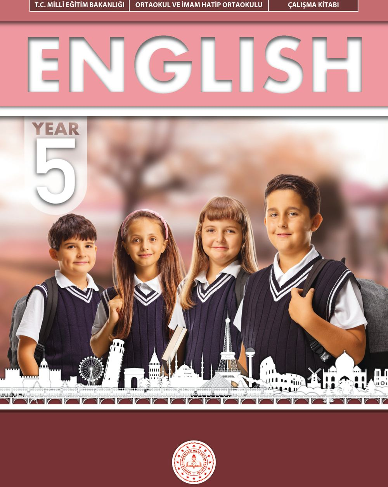

<!-- sayfa 1 -->

LOWER SECONDARY SCHOOL AND
İMAM HATIP LOWER SECONDARY SCHOOL

# ENGLISH
## Year 5
### Workbook

**AUTHORS**

Aysel BERKET
Eda Burcu ÇETİNKAYA
Fatma DEMİRCAN
Gonca AKISKALI
Nursen SUNAR
Selma YANKUNCU

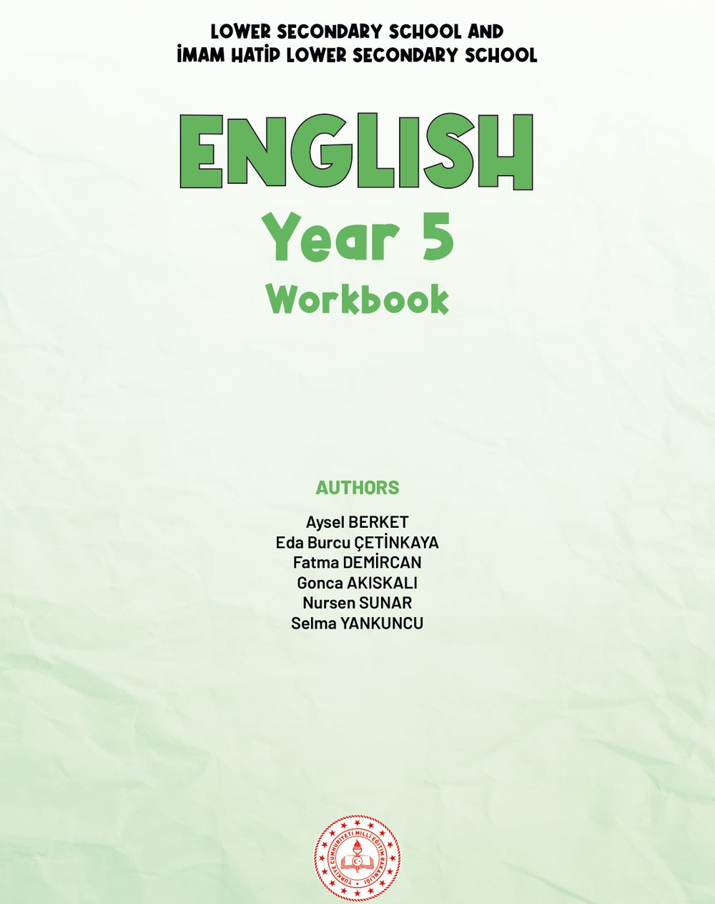

<!-- sayfa 2 -->

MİLLÎ EĞİTİM BAKANLIĞI YAYINLARI ...................................................................:10353
DERS KİTAPLARI DİZİSİ ......................................................................................:2297

Her hakkı saklıdır ve Millî Eğitim Bakanlığına aittir. Kitabın metin, soru ve şekilleri kısmen de olsa hiçbir surette alınıp yayımlanamaz.

**Editor**
Dr. Kamile HAMİLOĞLU

**Visual Designers**
Bahadır UYSAL
Mehmet Mirza IŞIK
Nafize AĞIR
Tolga TANYEL

**Multimedia Designer**
Özlem VAYİÇ

**Curriculum Development Specialists**
Dr. Mehmet AKCAALAN
Dr. Orhan YİĞİTOĞLU
Fatma KELEŞ

**Assessment and Evaluation Specialist**
Dr. Sibel AYDOĞAN

**Guidance Specialist**
Serkan İLHAN

ISBN 978-975-11-9183-0

Millî Eğitim Bakanlığı, Talim ve Terbiye Kurulu Başkanlığının 14.08.2025 tarihli ve

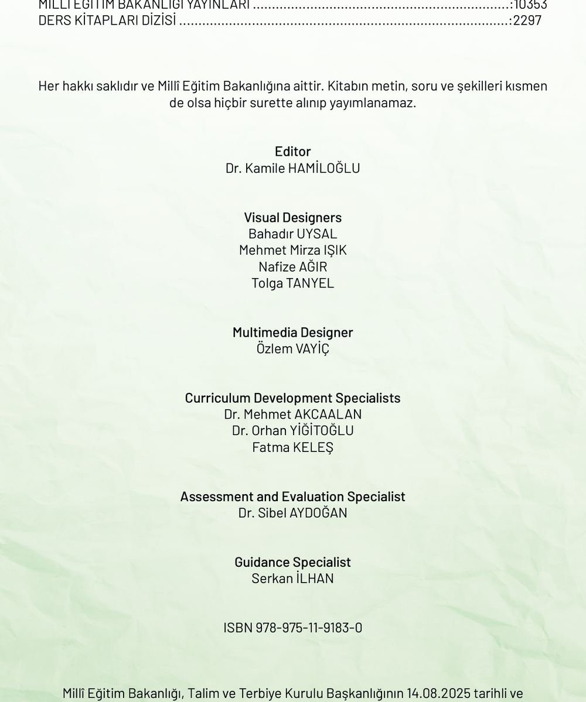
<!-- yer tutucu bulunamadı: sayfa sonuna eklendi -->

<!-- sayfa 3 -->

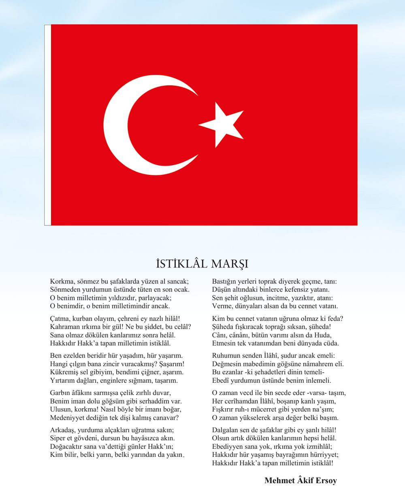

# İSTİKLÂL MARŞI

Korkma, sönmez bu şafaklarda yüzen al sancak;
Sönmeden yurdumun üstünde tüten en son ocak.
O benim milletimin yıldızıdır, parlayacak;
O benimdir, o benim milletimindir ancak.

Çatma, kurban olayım, çehreni ey nazlı hilâl!
Kahraman ırkıma bir gül! Ne bu şiddet, bu celâl?
Sana olmaz dökülen kanlarımız sonra helâl.
Hakkıdır Hakk’a tapan milletimin istiklâl.

Ben ezelden beridir hür yaşadım, hür yaşarım.
Hangi çılgın bana zincir vuracakmış? Şaşarım!
Kükremiş sel gibiyim, bendimi çiğner, aşarım.
Yırtarım dağları, enginlere sığmam, taşarım.

Garbın âfâkını sarmışsa çelik zırhlı duvar,
Benim iman dolu göğsüm gibi serhaddim var.
Ulusun, korkma! Nasıl böyle bir imanı boğar,
Medeniyet dediğin tek dişi kalmış canavar?

Arkadaş, yurduma alçakları uğratma sakın;
Siper et gövdeni, dursun bu hayâsızca akın.
Doğacaktır sana va’dettiği günler Hakk’ın;
Kim bilir, belki yarın, belki yarından da yakın

Bastığın yerleri toprak diyerek geçme, tanı:
Düşün altındaki binlerce kefensiz yatanı.
Sen şehit oğlusun, incitme, yazıktır, atanı:
Verme, dünyaları alsan da bu cennet vatanı.

Kim bu cennet vatanın uğruna olmaz ki feda?
Şüheda fışkıracak toprağı sıksan, şüheda!
Cânı, cânânı, bütün varımı alsın da Huda,
Etmesin tek vatanımdan beni dünyada cüda.

Ruhumun senden ilâhî, şudur ancak emeli:
Değmesin mabedimin göğsüne nâmahrem eli.
Bu ezanlar -ki şehadetleri dinin temeli-
Ebedî yurdumun üstünde benim inlemeli.

O zaman vecd ile bin secde eder -varsa- taşım,
Her cerîhamdan ilâhî, boşanıp kanlı yaşım,
Fışkırır ruh-ı mücerret gibi yerden na’şım;
O zaman yükselerek arşa değer belki başım.

Dalgalan sen de şafaklar gibi ey kanlı hilâl!
Olsun artık dökülen kanlarımın hepsi helâl.
Ebediyyen sana yok, Türk’e yok izmihlâl;
Hakkıdır hür yaşamı bayrağımın hürriyet;
Hakkıdır Hakk’a tapan milletimin istiklâl!

**Mehmet Âkif Ersoy**

<!-- sayfa 4 -->

# GENÇLİĞE HİTABE

Ey Türk gençliği! Birinci vazifen, Türk istiklâlini, Türk Cumhuriyetini, ilelebet muhafaza ve müdafaa etmektir.

Mevcudiyetinin ve istikbalinin yegâne temeli budur. Bu temel, senin en kıymetli hazinendir. İstikbalde dahi, seni bu hazineden mahrum etmek isteyecek dâhilî ve hâricî bedhahların olacaktır. Bir gün, istiklâl ve cumhuriyeti müdafaa mecburiyetine düşersen, vazifeye atılmak için, içinde bulunacağın vaziyetin imkân ve şeraitini düşünmeyeceksin! Bu imkân ve şerait, çok namüsait bir mahiyette tezahür edebilir. İstiklâl ve cumhuriyetine kastedecek düşmanlar, bütün dünyada emsali görülmemiş bir galibiyetin mümessili olabilirler. Cebren ve hile ile aziz vatanın bütün kaleleri zapt edilmiş, bütün tersanelerine girilmiş, bütün orduları dağıtılmış ve memleketin her köşesi bilfiil işgal edilmiş olabilir. Bütün bu şeraitten daha elîm ve daha vahim olmak üzere, memleketin dâhilinde iktidara sahip olanlar gaflet ve dalâlet ve hattâ hıyanet içinde bulunabilirler. Hattâ bu iktidar sahipleri şahsî menfaatlerini, müstevlîlerin siyasî emelleriyle tevhit edebilirler. Millet, fakr u zaruret içinde harap ve bîtap düşmüş olabilir.

Ey Türk istikbalinin evlâdı! İşte, bu ahval ve şerait içinde dahi vazifen, Türk istiklâl ve cumhuriyetini kurtarmaktır. Muhtaç olduğun kudret, damarlarındaki asil kanda mevcuttur.

Mustafa Kemal Atatürk

<!-- sayfa 5 -->

Görüntüde herhangi bir metin veya matematiksel ifade bulunmamaktadır. Sadece Mustafa Kemal Atatürk'ün bir portresi yer almaktadır.

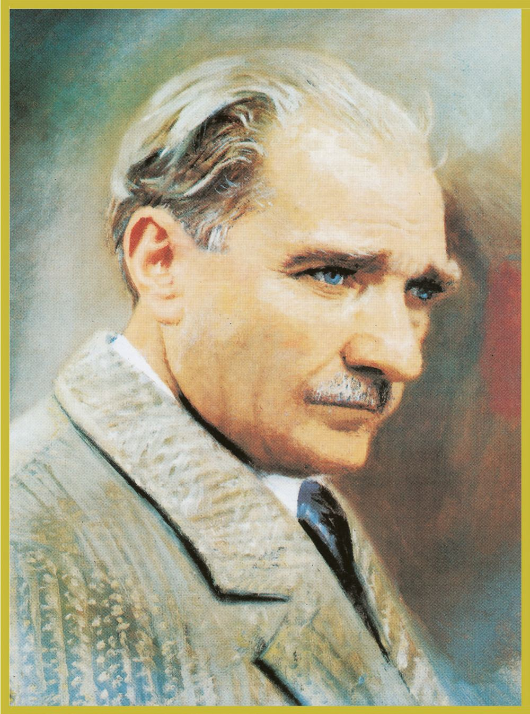
<!-- yer tutucu bulunamadı: sayfa sonuna eklendi -->

<!-- sayfa 6 -->

Verdiğiniz metin katmanı boş olduğu için (`<<< >>>` arası boş) dönüştürülecek bir içerik bulunmamaktadır. Lütfen metin katmanını içeren içeriği paylaşın, böylece talimatlarınıza uygun şekilde Markdown formatına çevirebilirim.

<!-- sayfa 7 -->

# CONTENTS

**THEME 1** School Life ........................................................ 09
**THEME 2** Classroom Life ................................................. 15
**THEME 3** Personal Life .................................................... 21
**THEME 4** Family Life ....................................................... 27
**THEME 5** Life in the Neighbourhood & City ...................... 33
**THEME 6** Life in the World .............................................. 39
**THEME 7** Life in Nature ................................................... 45
**THEME 8** Life in the Universe & Future ............................ 51

Glossary ............................................................................. 57
References .......................................................................... 62
Answer Key ......................................................................... 62
Visual and General Web References ................................... 62
Map of Türkiye's Administrative Divisions and Its Land and Maritime Neighbours ....... 63
Map of the Turkic World ..................................................... 64

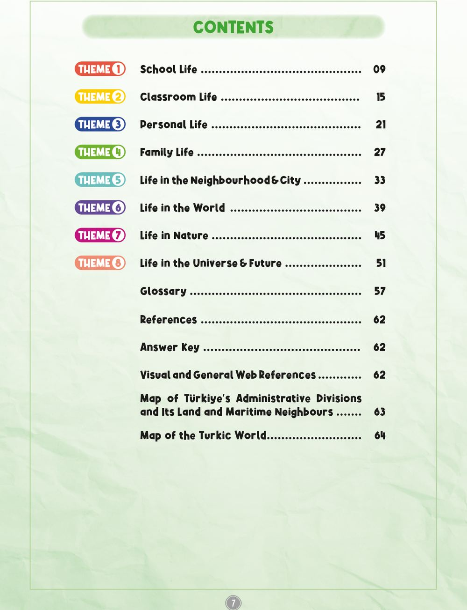
<!-- yer tutucu bulunamadı: sayfa sonuna eklendi -->

<!-- sayfa 8 -->

# Student's Notes

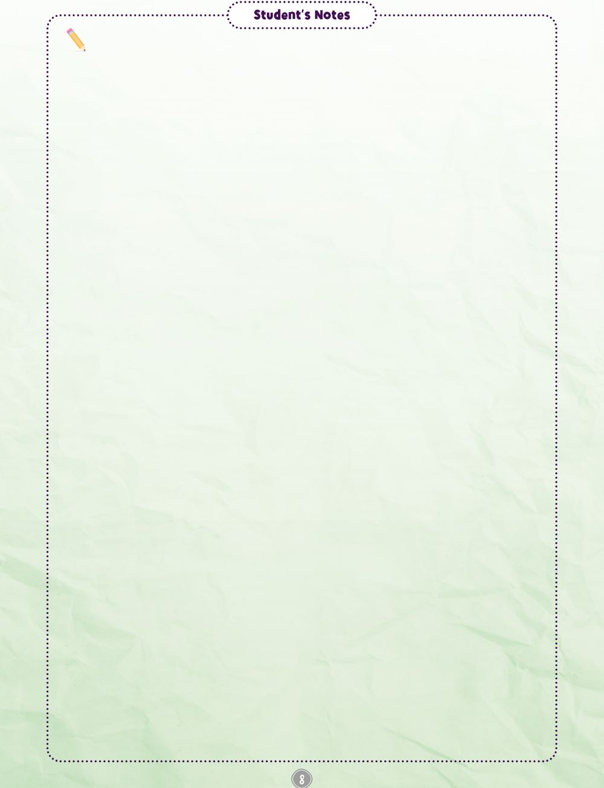
<!-- yer tutucu bulunamadı: sayfa sonuna eklendi -->

<!-- sayfa 9 -->

# SCHOOL LIFE

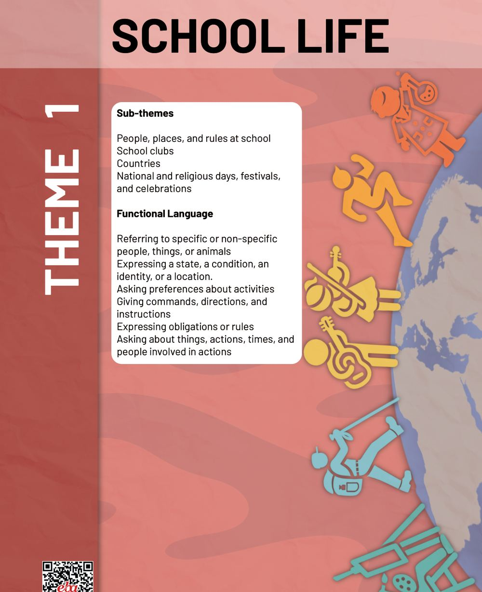

## THEME 1

### Sub-themes

People, places, and rules at school
School clubs
Countries
National and religious days, festivals, and celebrations

### Functional Language

Referring to specific or non-specific people, things, or animals
Expressing a state, a condition, an identity, or a location.
Asking preferences about activities
Giving commands, directions, and instructions
Expressing obligations or rules
Asking about things, actions, times, and people involved in actions

<!-- sayfa 10 -->

# 1 Look at the flags and write the countries in the puzzle.

**DOWN**

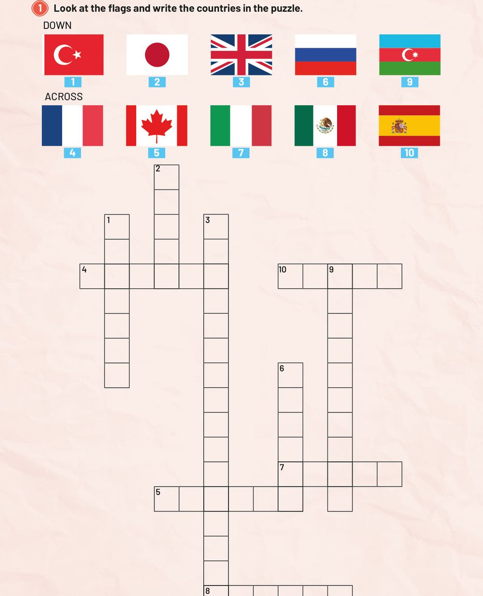
1

2

3

6

9

**ACROSS**

4

5

7

8

10

(Bulmaca görseli)

<!-- sayfa 11 -->

2 Fill in the blanks with the correct form the of verb “to be” (am/is/are).

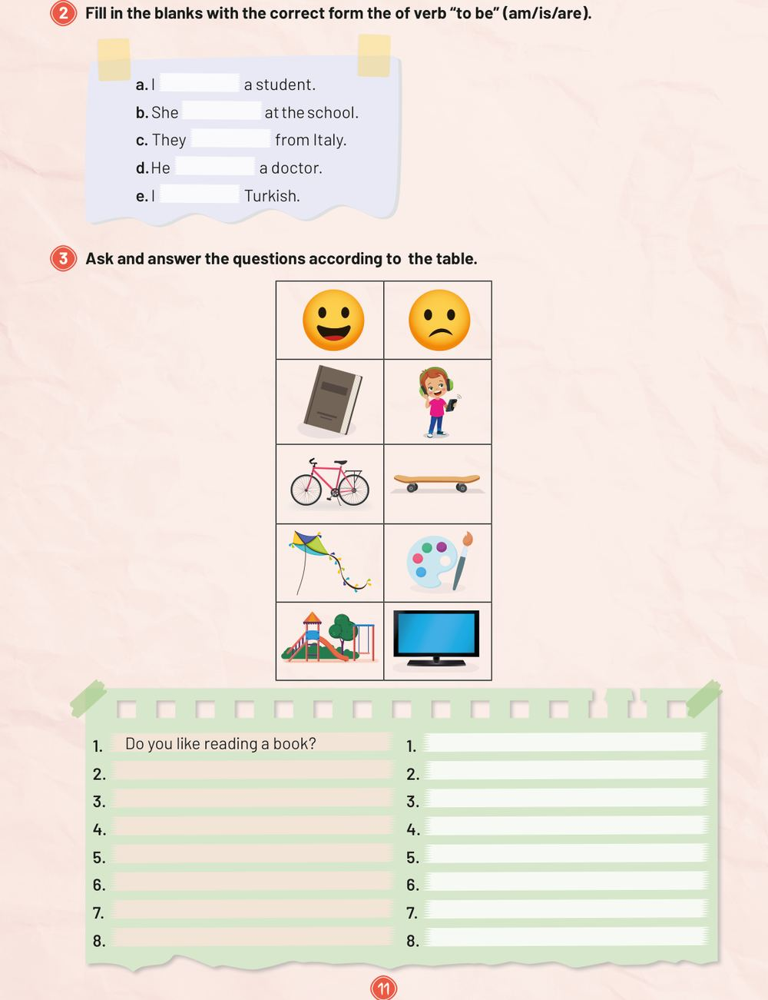
a. I ________ a student.
b. She ________ at the school.
c. They ________ from Italy.
d. He ________ a doctor.
e. I ________ Turkish.

3 Ask and answer the questions according to the table.

| | |
| :---: | :---: |
| 😊 | ☹️ |
| 📖 | 🎧 |
| 🚲 | 🛹 |
| 🪁 | 🎨 |
| 🛝 | 📺 |

1. Do you like reading a book?  1. ____________________
2. ____________________           2. ____________________
3. ____________________           3. ____________________
4. ____________________           4. ____________________
5. ____________________           5. ____________________
6. ____________________           6. ____________________
7. ____________________           7. ____________________

<!-- sayfa 12 -->

4 Put the words in the correct order and make sentences.

1. make/You/noise/mustn't ...................................................................................................
2. in the lake/can't/You/fish ...............................................................................................
3. cut/You/mustn't/the trees ..............................................................................................
4. in the classroom/You/eat or drink/can't ..........................................................................
5. in the museum/You /take photographs/can't ..................................................................
6. fight/at school/mustn't/You ...........................................................................................

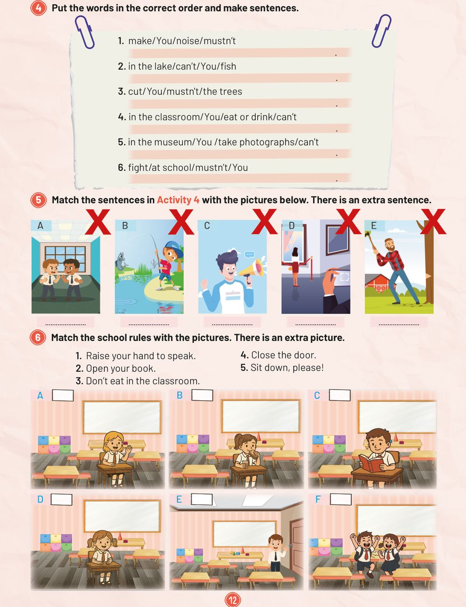

5 Match the sentences in Activity 4 with the pictures below. There is an extra sentence.

A X

B X

C X

D X

E X

.......................

6 Match the school rules with the pictures. There is an extra picture.

1. Raise your hand to speak.
2. Open your book.
3. Don't eat in the classroom.
4. Close the door.
5. Sit down, please!

A [ ]

B [ ]

C [ ]

D [ ]

E [ ]

F [ ]

<!-- sayfa 13 -->

7 Read the text quickly and write the names of the children under each picture.

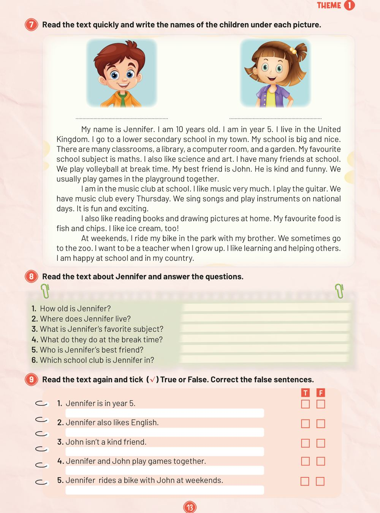

My name is Jennifer. I am 10 years old. I am in year 5. I live in the United Kingdom. I go to a lower secondary school in my town. My school is big and nice. There are many classrooms, a library, a computer room, and a garden. My favourite school subject is maths. I also like science and art. I have many friends at school. We play volleyball at break time. My best friend is John. He is kind and funny. We usually play games in the playground together.

I am in the music club at school. I like music very much. I play the guitar. We have music club every Thursday. We sing songs and play instruments on national days. It is fun and exciting.

I also like reading books and drawing pictures at home. My favourite food is fish and chips. I like ice cream, too!

At weekends, I ride my bike in the park with my brother. We sometimes go to the zoo. I want to be a teacher when I grow up. I like learning and helping others. I am happy at school and in my country.

8 Read the text about Jennifer and answer the questions.

1. How old is Jennifer? _________________________________________________
2. Where does Jennifer live? ____________________________________________
3. What is Jennifer’s favorite subject? ____________________________________
4. What do they do at the break time? _____________________________________
5. Who is Jennifer’s best friend? _________________________________________
6. Which school club is Jennifer in? ______________________________________

9 Read the text again and tick ($\checkmark$) True or False. Correct the false sentences.

1. Jennifer is in year 5.  [ ] T [ ] F
   _______________________________________________________________________

2. Jennifer also likes English. [ ] T [ ] F
   _______________________________________________________________________

3. John isn’t a kind friend. [ ] T [ ] F
   _______________________________________________________________________

4. Jennifer and John play games together. [ ] T [ ] F
   _______________________________________________________________________

<!-- sayfa 14 -->

# 10 Suppose that you have a new e-friend. Write an e-mail to her/him about yourself.

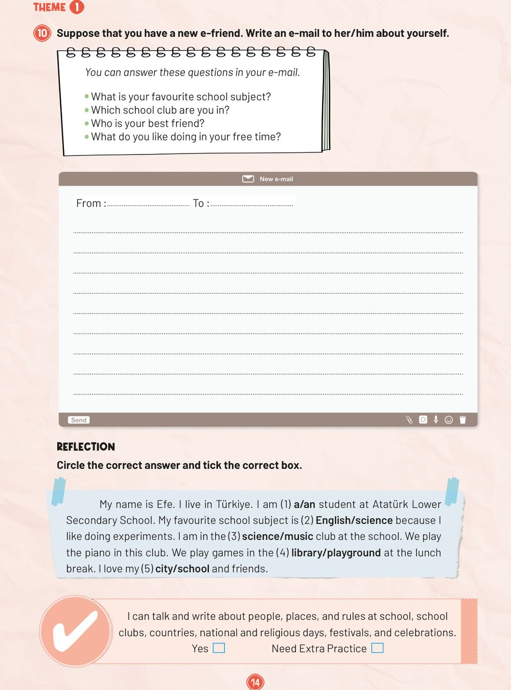
*You can answer these questions in your e-mail.*
* What is your favourite school subject?
* Which school club are you in?
* Who is your best friend?
* What do you like doing in your free time?

---
**New e-mail**

From : ........................................... To : ...........................................

..................................................................................................................................
..................................................................................................................................
..................................................................................................................................
..................................................................................................................................
..................................................................................................................................
..................................................................................................................................
..................................................................................................................................
..................................................................................................................................

[Send]

---

## REFLECTION

**Circle the correct answer and tick the correct box.**

My name is Efe. I live in Türkiye. I am (1) **a/an** student at Atatürk Lower Secondary School. My favourite school subject is (2) **English/science** because I like doing experiments. I am in the (3) **science/music** club at the school. We play the piano in this club. We play games in the (4) **library/playground** at the lunch break. I love my (5) **city/school** and friends.

I can talk and write about people, places, and rules at school, school clubs, countries, national and religious days, festivals, and celebrations.

<!-- sayfa 15 -->

# CLASSROOM LIFE

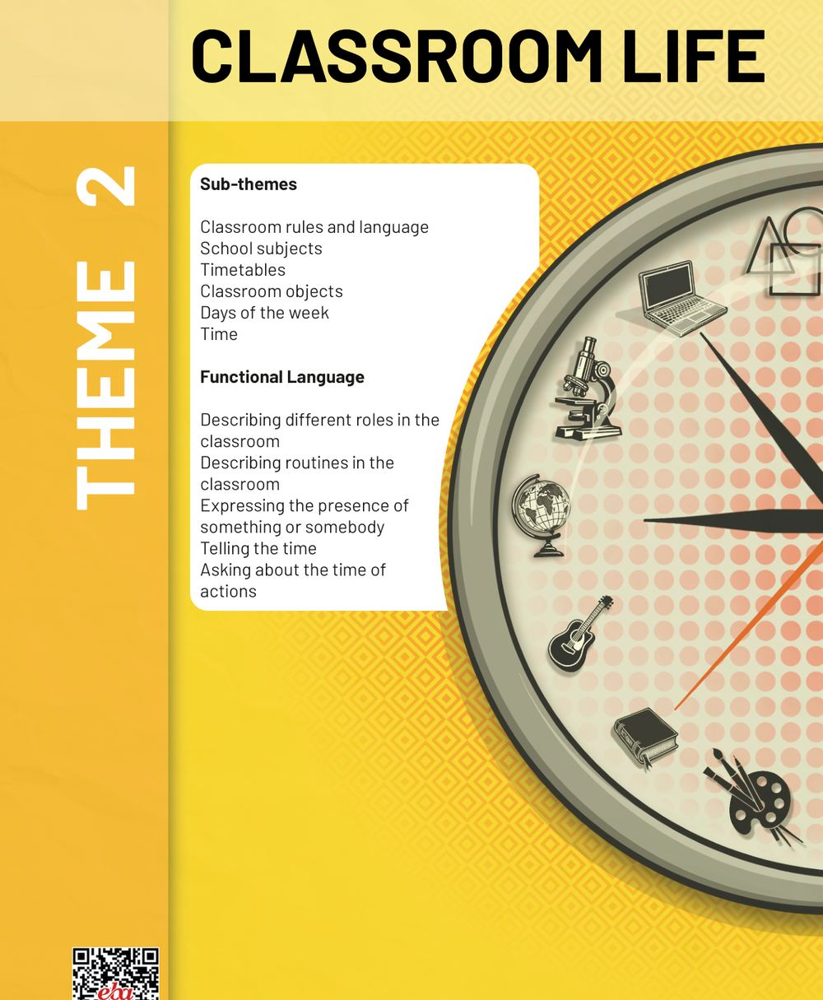

## THEME 2

### Sub-themes

Classroom rules and language
School subjects
Timetables
Classroom objects
Days of the week
Time

### Functional Language

Describing different roles in the classroom
Describing routines in the classroom
Expressing the presence of something or somebody
Telling the time
Asking about the time of actions

<!-- sayfa 16 -->

# 1 Read the clues and find the words in the puzzle.

1. You can throw your rubbish in it. | rubbish bin
2. You can sit on it in the classroom. | 
3. You can use it to write on the board. | 
4. You can find new words and their meanings in it. | 
5. You can put your books on it. | 
6. You can write notes in it. | 
7. You can use it to erase your mistakes. | 

| B | J | G | B | U | R | D | N | B | L | G | R |
|---|---|---|---|---|---|---|---|---|---|---|---|
| B | O | H | Z | M | B | U | Z | A | X | U | O |
| O | J | A | B | T | G | V | B | I | B | A | Y |
| O | C | V | R | T | Z | W | N | B | X | X | V |
| K | N | L | E | D | Y | C | I | O | E | W | N |
| S | V | V | Z | Y | M | S | P | A | D | R | R |
| H | I | B | S | T | H | A | U | K | K | P | U |
| E | S | Q | K | B | A | Y | R | R | C | H | B |
| L | K | E | I | P | Q | E | E | K | M | O | B |
| F | E | N | Z | Y | N | O | S | R | E | F | E |
| U | R | N | O | T | E | B | O | O | K | R | R |
| S | J | Y | R | A | N | O | I | T | C | I | D |

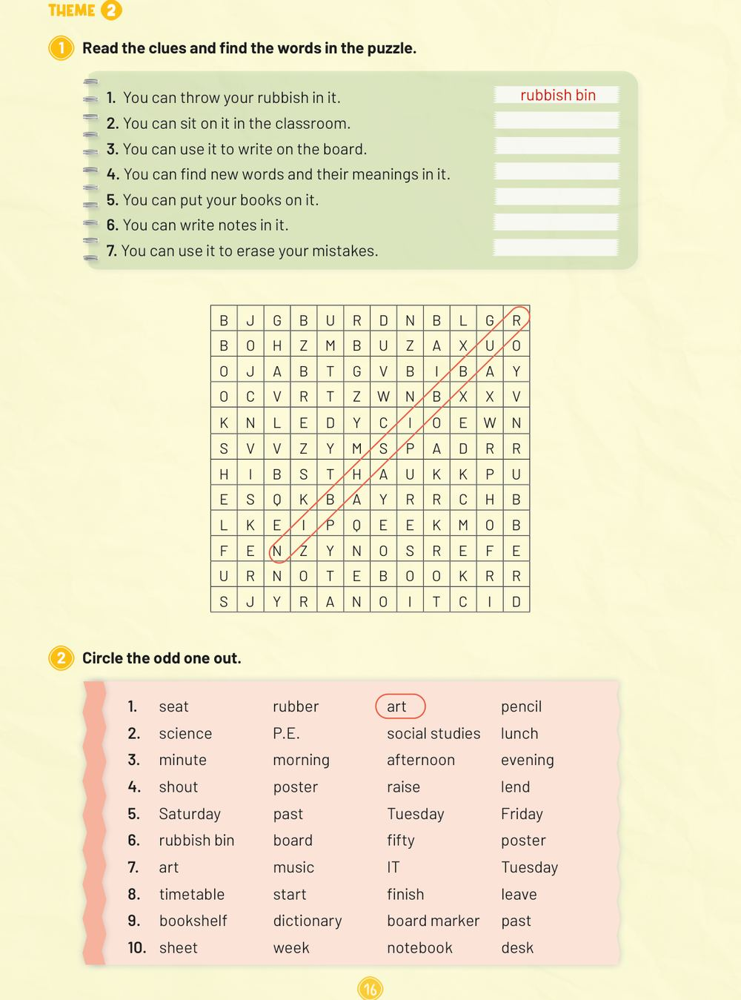

# 2 Circle the odd one out.

1. seat | rubber | art | pencil
2. science | P.E. | social studies | lunch
3. minute | morning | afternoon | evening
4. shout | poster | raise | lend
5. Saturday | past | Tuesday | Friday
6. rubbish bin | board | fifty | poster
7. art | music | IT | Tuesday
8. timetable | start | finish | leave
9. bookshelf | dictionary | board marker | past

<!-- sayfa 17 -->

3 Look at the pictures and write "**There is**" or "**There are**".

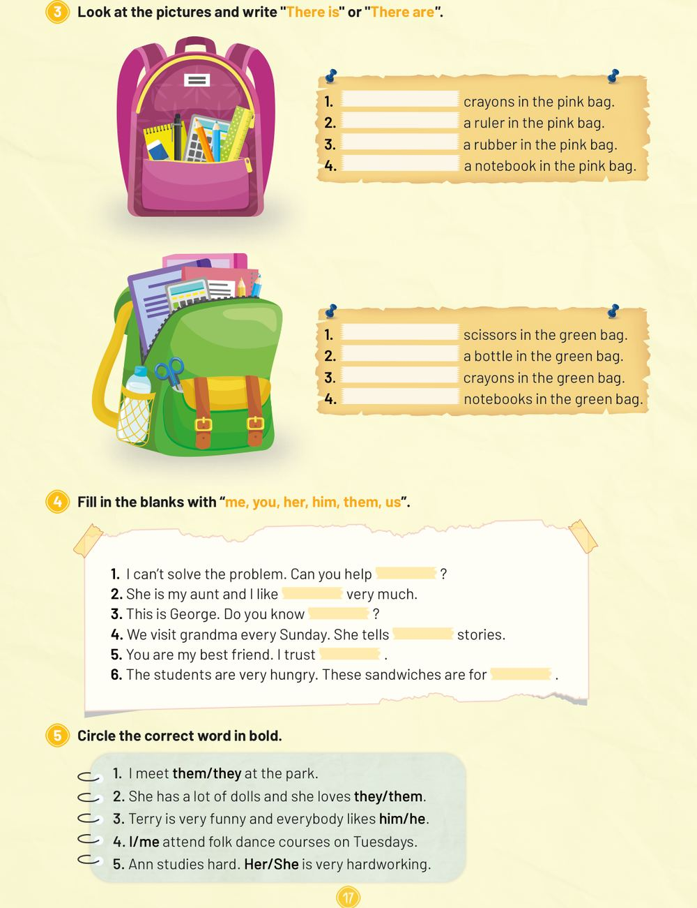

1. \_\_\_\_\_\_\_\_\_\_ crayons in the pink bag.
2. \_\_\_\_\_\_\_\_\_\_ a ruler in the pink bag.
3. \_\_\_\_\_\_\_\_\_\_ a rubber in the pink bag.
4. \_\_\_\_\_\_\_\_\_\_ a notebook in the pink bag.

1. \_\_\_\_\_\_\_\_\_\_ scissors in the green bag.
2. \_\_\_\_\_\_\_\_\_\_ a bottle in the green bag.
3. \_\_\_\_\_\_\_\_\_\_ crayons in the green bag.
4. \_\_\_\_\_\_\_\_\_\_ notebooks in the green bag.

4 Fill in the blanks with "**me, you, her, him, them, us**".

1. I can't solve the problem. Can you help \_\_\_\_\_\_\_\_\_\_?
2. She is my aunt and I like \_\_\_\_\_\_\_\_\_\_ very much.
3. This is George. Do you know \_\_\_\_\_\_\_\_\_\_?
4. We visit grandma every Sunday. She tells \_\_\_\_\_\_\_\_\_\_ stories.
5. You are my best friend. I trust \_\_\_\_\_\_\_\_\_\_.
6. The students are very hungry. These sandwiches are for \_\_\_\_\_\_\_\_\_\_.

5 Circle the correct word in bold.

1. I meet **them/they** at the park.
2. She has a lot of dolls and she loves **they/them**.
3. Terry is very funny and everybody likes **him/he**.
4. **I/me** attend folk dance courses on Tuesdays.

<!-- sayfa 18 -->

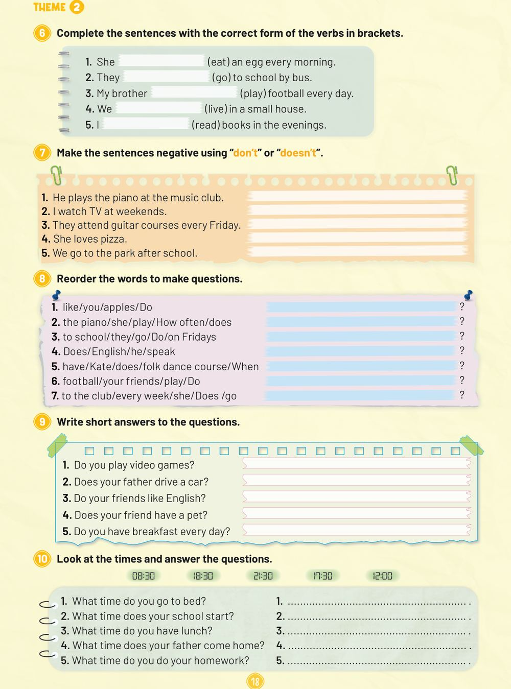
<!-- yer tutucu bulunamadı: sayfa sonuna eklendi -->

<!-- sayfa 19 -->

11 **Read the text quickly and write a suitable title for it.**

Hello! My name is Elif. I am 10 years old. I am in year 5. I go to Aydın Lower Secondary School. My school starts at 8.30 in the morning and finishes at 3 o'clock in the afternoon.
We have many school subjects at school. I study English, maths, science, social studies, art, and music. My favourite subject is maths because I like solving problems. We also have physical education. I love doing sports! I don't like science because I'm not good at doing experiments.
We have a timetable. On Monday, we have double maths and double English, double science, art. On Wednesday, we have double Turkish, double religion and morals, art, and double music. On Friday, we have double P.E., double social studies, drama and double IT.
There are some classroom rules. We must listen to the teacher, raise our hands to speak, and be kind to our classmates. We say, "Can I go to the toilet?", "May I open the window?", or "I don't understand."
I like my school and my classroom. I learn new things and have fun with my friends every day. School is a good place to grow and learn.
After school, I meet my friends at the park. We ride our bikes, play ball games, and skip rope. I come home at 5 o'clock in the afternoon and do my homework. I have dinner with my family. I read a book and go to bed at 9.30 in the evening.

12 **Read the text again and complete Elif's timetable.**

| | | | | | | |
| :--- | :--- | :--- | :--- | :--- | :--- | :--- |
| Monday | maths | maths | | | | |
| Wednesday | | | | | | |
| Friday | | | | | | |

13 **Read the text and answer the questions.**

1. What time does Elif's school start?
__________________________________________________________________

2. What is Elif's favourite school subject?
__________________________________________________________________

3. Why doesn't Elif like science lessons?
__________________________________________________________________

4. What does Elif do after school?
__________________________________________________________________

5. What does she do before going to bed?
__________________________________________________________________

6. What time does she go to bed?
__________________________________________________________________

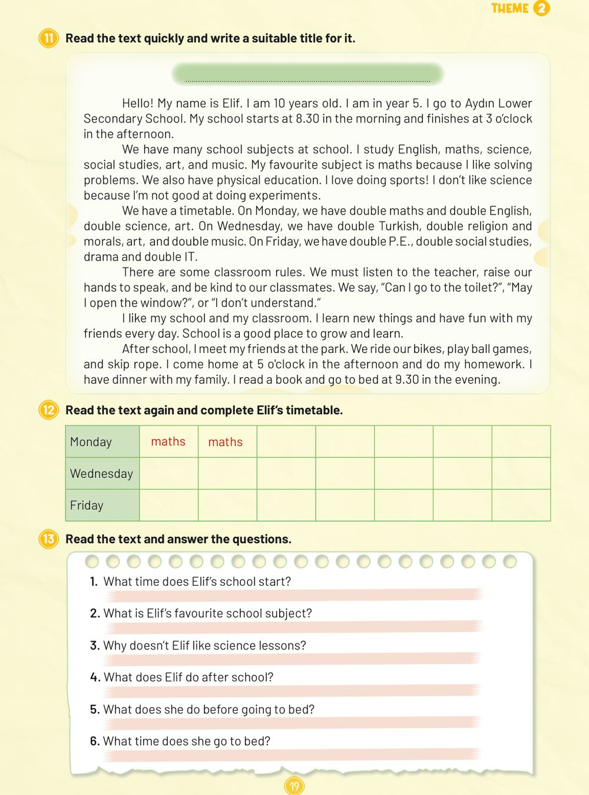
<!-- yer tutucu bulunamadı: sayfa sonuna eklendi -->

<!-- sayfa 20 -->

14 Draw your dream classroom below and describe it.

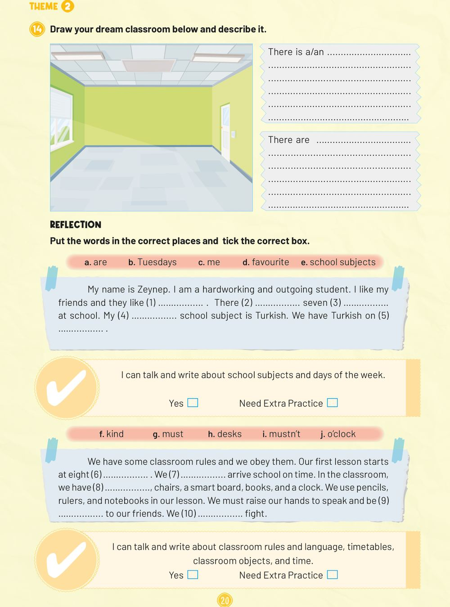

There is a/an ............................................................
.........................................................................
.........................................................................
.........................................................................
.........................................................................
.........................................................................

There are ..............................................................
.........................................................................
.........................................................................
.........................................................................
.........................................................................
.........................................................................

# REFLECTION

Put the words in the correct places and tick the correct box.

a. are &nbsp;&nbsp;&nbsp;&nbsp; b. Tuesdays &nbsp;&nbsp;&nbsp;&nbsp; c. me &nbsp;&nbsp;&nbsp;&nbsp; d. favourite &nbsp;&nbsp;&nbsp;&nbsp; e. school subjects

My name is Zeynep. I am a hardworking and outgoing student. I like my friends and they like (1) ........................ . There (2) ........................ seven (3) ........................ at school. My (4) ........................ school subject is Turkish. We have Turkish on (5) ........................ .

I can talk and write about school subjects and days of the week.

Yes $\square$ &nbsp;&nbsp;&nbsp;&nbsp;&nbsp;&nbsp;&nbsp;&nbsp;&nbsp;&nbsp;&nbsp;&nbsp;&nbsp;&nbsp;&nbsp;&nbsp;&nbsp;&nbsp;&nbsp;&nbsp;&nbsp;&nbsp;&nbsp;&nbsp;&nbsp;&nbsp;&nbsp;&nbsp;&nbsp;&nbsp;&nbsp;&nbsp;&nbsp;&nbsp;&nbsp;&nbsp;&nbsp;&nbsp;&nbsp;&nbsp;&nbsp;&nbsp;&nbsp;&nbsp;&nbsp;&nbsp;&nbsp;&nbsp;&nbsp;&nbsp;&nbsp;&nbsp;&nbsp;&nbsp;&nbsp;&nbsp;&nbsp;&nbsp;&nbsp;&nbsp;&nbsp;&nbsp;&nbsp;&nbsp;&nbsp;&nbsp;&nbsp;&nbsp;&nbsp;&nbsp;&nbsp;&nbsp;&nbsp;&nbsp;&nbsp;&nbsp;&nbsp;&nbsp;&nbsp;&nbsp;&nbsp;&nbsp;&nbsp;&nbsp;&nbsp;&nbsp;&nbsp;&nbsp;&nbsp;&nbsp;&nbsp;&nbsp;&nbsp;&nbsp;&nbsp;&nbsp;&nbsp;&nbsp;&nbsp;&nbsp;&nbsp;&nbsp;&nbsp;&nbsp;&nbsp;&nbsp;&nbsp

<!-- sayfa 21 -->

# PERSONAL LIFE

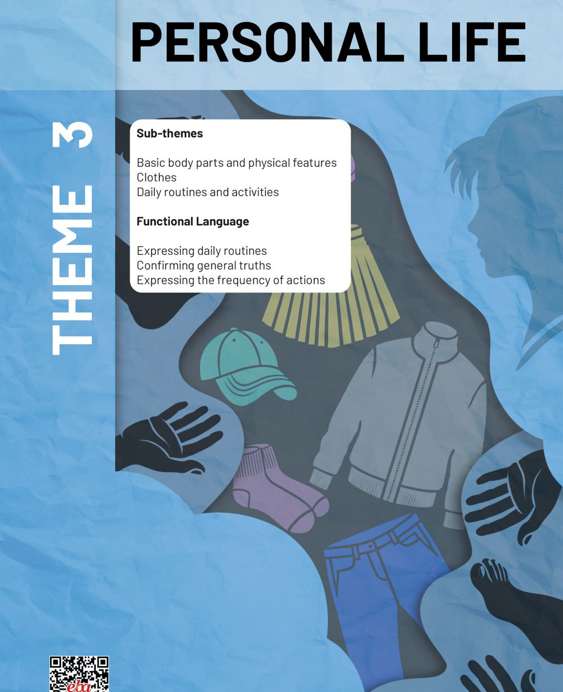

## THEME 3

### Sub-themes

Basic body parts and physical features
Clothes
Daily routines and activities

### Functional Language

Expressing daily routines
Confirming general truths
Expressing the frequency of actions

<!-- sayfa 22 -->

# 1 Find the clothing items in the puzzle and write them under the correct picture.

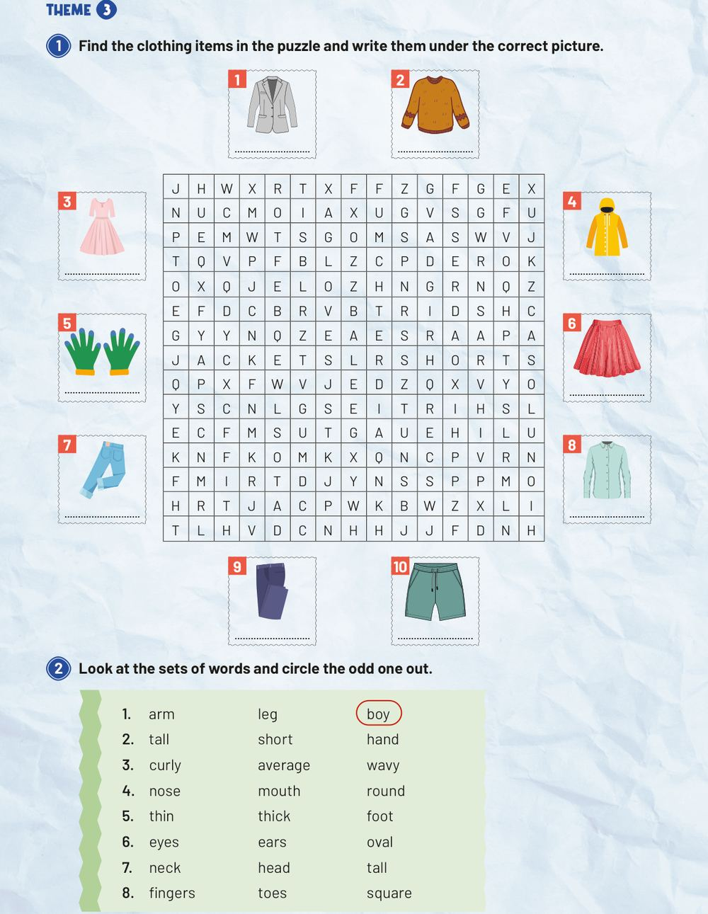
............................

............................

............................

............................

............................

............................

............................

............................

............................

............................

| J | H | W | X | R | T | X | F | F | Z | G | F | G | E | X |
|---|---|---|---|---|---|---|---|---|---|---|---|---|---|---|
| N | U | C | M | O | I | A | X | U | G | V | S | G | F | U |
| P | E | M | W | T | S | G | O | M | S | A | S | W | V | J |
| T | Q | V | P | F | B | L | Z | C | P | D | E | R | O | K |
| O | X | Q | J | E | L | O | Z | H | N | G | R | N | Q | Z |
| E | F | D | C | B | R | V | B | T | R | I | D | S | H | C |
| G | Y | Y | N | Q | Z | E | A | E | S | R | A | A | P | A |
| J | A | C | K | E | T | S | L | R | S | H | O | R | T | S |
| Q | P | X | F | W | V | J | E | D | Z | Q | X | V | Y | O |
| Y | S | C | N | L | G | S | E | I | T | R | I | H | S | L |
| E | C | F | M | S | U | T | G | A | U | E | H | I | L | U |
| K | N | F | K | O | M | K | X | Q | N | C | P | V | R | N |
| F | M | I | R | T | D | J | Y | N | S | S | P | P | M | O |
| H | R | T | J | A | C | P | W | K | B | W | Z | X | L | I |
| T | L | H | V | D | C | N | H | H | J | J | F | D | N | H |

# 2 Look at the sets of words and circle the odd one out.

1. arm &nbsp;&nbsp;&nbsp;&nbsp;&nbsp;&nbsp;&nbsp;&nbsp;&nbsp;&nbsp; leg &nbsp;&nbsp;&nbsp;&nbsp;&nbsp;&nbsp;&nbsp;&nbsp;&nbsp;&nbsp; (boy)
2. tall &nbsp;&nbsp;&nbsp;&nbsp;&nbsp;&nbsp;&nbsp;&nbsp;&nbsp;&nbsp; short &nbsp;&nbsp;&nbsp;&nbsp;&nbsp;&nbsp;&nbsp;&nbsp; hand
3. curly &nbsp;&nbsp;&nbsp;&nbsp;&nbsp;&nbsp;&nbsp;&nbsp; average &nbsp;&nbsp;&nbsp;&nbsp;&nbsp; wavy
4. nose &nbsp;&nbsp;&nbsp;&nbsp;&nbsp;&nbsp;&nbsp;&nbsp;&nbsp; mouth &nbsp;&nbsp;&nbsp;&nbsp;&nbsp;&nbsp;&nbsp; round
5. thin &nbsp;&nbsp;&nbsp;&nbsp;&nbsp;&nbsp;&nbsp;&nbsp;&nbsp;&nbsp; thick &nbsp;&nbsp;&nbsp;&nbsp;&nbsp;&nbsp;&nbsp;&nbsp; foot
6. eyes &nbsp;&nbsp;&nbsp;&nbsp;&nbsp;&nbsp;&nbsp;&nbsp;&nbsp; ears &nbsp;&nbsp;&nbsp;&nbsp;&nbsp;&nbsp;&nbsp;&nbsp;&nbsp; oval
7. neck &nbsp;&nbsp;&nbsp;&nbsp;&nbsp;&nbsp;&nbsp;&nbsp;&nbsp; head &nbsp;&nbsp;&nbsp;&nbsp;&nbsp;&nbsp;&nbsp;&nbsp; tall

<!-- sayfa 23 -->

3 Write the adverbs of frequency from the box under the correct picture. There is an extra adverb.

| rarely | sometimes | often | always | never |
| :---: | :---: | :---: | :---: | :---: |

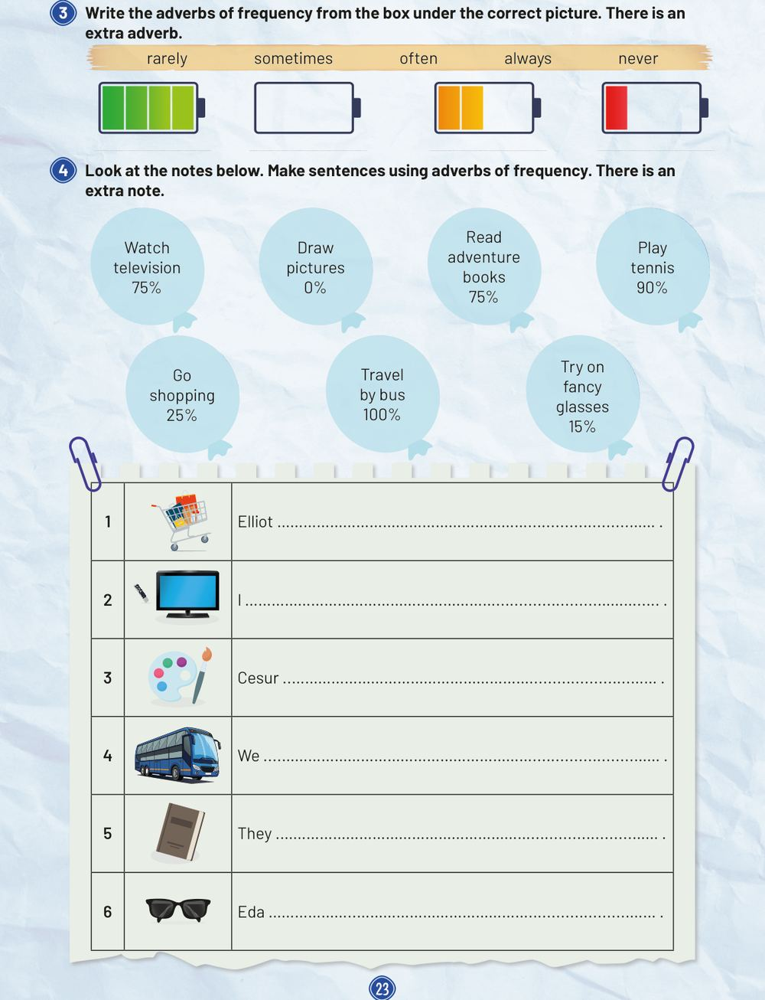

4 Look at the notes below. Make sentences using adverbs of frequency. There is an extra note.

| | | |
| :--- | :--- | :--- |
| 1 |  | Elliot ........................................................................................ |
| 2 |  | I ................................................................................................ |
| 3 |  | Cesur ....................................................................................... |
| 4 |  | We ............................................................................................ |
| 5 |  | They ......................................................................................... |
| 6 |  | Eda ........................................................................................... |

<!-- sayfa 24 -->

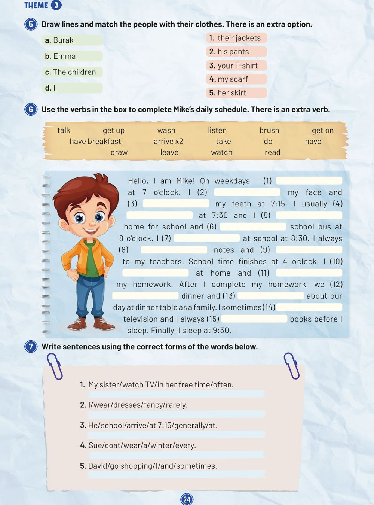
<!-- yer tutucu bulunamadı: sayfa sonuna eklendi -->

<!-- sayfa 25 -->

8 Read the text quickly and write the names of the children under each picture.

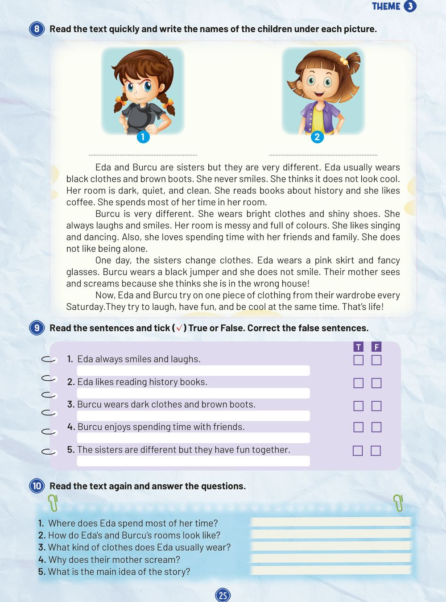

Eda and Burcu are sisters but they are very different. Eda usually wears black clothes and brown boots. She never smiles. She thinks it does not look cool. Her room is dark, quiet, and clean. She reads books about history and she likes coffee. She spends most of her time in her room.
Burcu is very different. She wears bright clothes and shiny shoes. She always laughs and smiles. Her room is messy and full of colours. She likes singing and dancing. Also, she loves spending time with her friends and family. She does not like being alone.
One day, the sisters change clothes. Eda wears a pink skirt and fancy glasses. Burcu wears a black jumper and she does not smile. Their mother sees and screams because she thinks she is in the wrong house!
Now, Eda and Burcu try on one piece of clothing from their wardrobe every Saturday. They try to laugh, have fun, and be cool at the same time. That's life!

9 Read the sentences and tick ($\checkmark$) True or False. Correct the false sentences.

| | | T | F |
|---|---|---|---|
| $\bigcirc$ | 1. Eda always smiles and laughs. | $\square$ | $\square$ |
| $\bigcirc$ | 2. Eda likes reading history books. | $\square$ | $\square$ |
| $\bigcirc$ | 3. Burcu wears dark clothes and brown boots. | $\square$ | $\square$ |
| $\bigcirc$ | 4. Burcu enjoys spending time with friends. | $\square$ | $\square$ |
| $\bigcirc$ | 5. The sisters are different but they have fun together. | $\square$ | $\square$ |

10 Read the text again and answer the questions.

1. Where does Eda spend most of her time? ____________________________________
2. How do Eda's and Burcu's rooms look like? _________________________________
3. What kind of clothes does Eda usually wear? _______________________________
4. Why does their mother scream? ___________________________________________

<!-- sayfa 26 -->

# 11 Complete the pie chart according to your routines and write a paragraph about it.

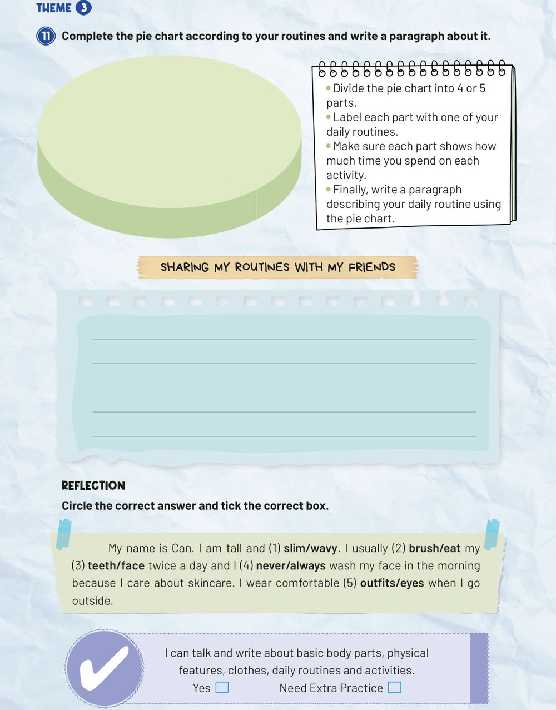

* Divide the pie chart into 4 or 5 parts.
* Label each part with one of your daily routines.
* Make sure each part shows how much time you spend on each activity.
* Finally, write a paragraph describing your daily routine using the pie chart.

SHARING MY ROUTINES WITH MY FRIENDS

## REFLECTION

**Circle the correct answer and tick the correct box.**

My name is Can. I am tall and (1) **slim/wavy**. I usually (2) **brush/eat** my (3) **teeth/face** twice a day and I (4) **never/always** wash my face in the morning because I care about skincare. I wear comfortable (5) **outfits/eyes** when I go outside.

I can talk and write about basic body parts, physical features, clothes, daily routines and activities.

Yes $\square$  Need Extra Practice $\square$

<!-- sayfa 27 -->

# FAMILY LIFE

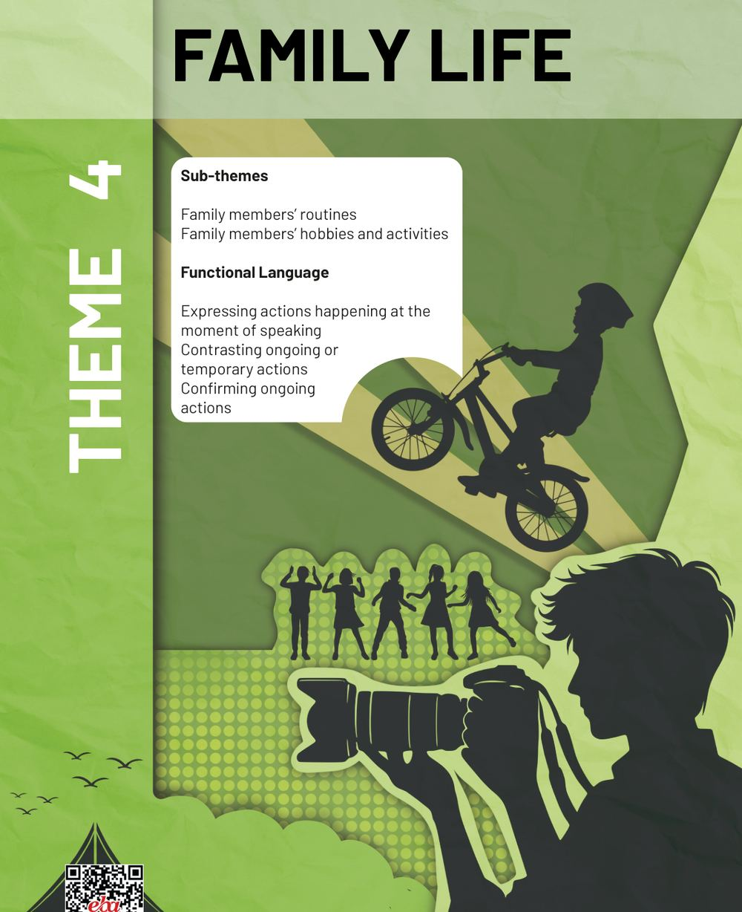

## THEME 4

### Sub-themes
Family members’ routines
Family members’ hobbies and activities

### Functional Language
Expressing actions happening at the moment of speaking
Contrasting ongoing or temporary actions
Confirming ongoing actions

<!-- sayfa 28 -->

# 1 Unscramble the letters and find the words about family members’ hobbies and activities. Then find the hidden words below.

ODABRGEAM
[ ][ ][ ][ ][ ][ ][ ][ ][ ][ ] 10

CBUAREBE
[ ][ ][ ][ ][ ][ ][ ][ ][ ]

BAHCE
[ ][ ][ ][ ][ ]

UMMSUE
[ ][ ][ ][ ][ ][ ] 3

RSFEOT
[ ][ ][ ][ ][ ][ ] 9

PNIMGCA
[ ][ ][ ][ ][ ][ ][ ] 8

CLYNICG
[ ][ ][ ][ ][ ][ ][ ] 7

OGINOCK
[ ][ ][ ][ ][ ][ ][ ]

SNIGHFI
[ ][ ][ ][ ][ ][ ] 1

AHOPTRYGHPO
[ ][ ][ ][ ][ ][ ][ ][ ][ ][ ][ ][ ] 6

ODAILHY
[ ][ ][ ][ ][ ][ ][ ]

IFNLAPLYGOG
[ ][ ][ ][ ][ ][ ][ ][ ][ ][ ] [ ][ ][ ][ ] 5

NMSMIIGW
[ ][ ][ ][ ][ ][ ][ ][ ] 4

DICNNAG
[ ][ ][ ][ ][ ][ ][ ] 2

[ ][ ][ ][ ][ ][ ][ ] 1 2 3 4 5 6 [ ][ ][ ][ ][ ][ ] 7 8 9 10

# 2 Fill in the blanks with the correct words from the box. There is an extra word.

| camera | beach | relax | photographs | board game |
| :--- | :--- | :--- | :--- | :--- |
| tent | barbecue | guitar | holiday | couple |
| join | festival | music | bicycle | |

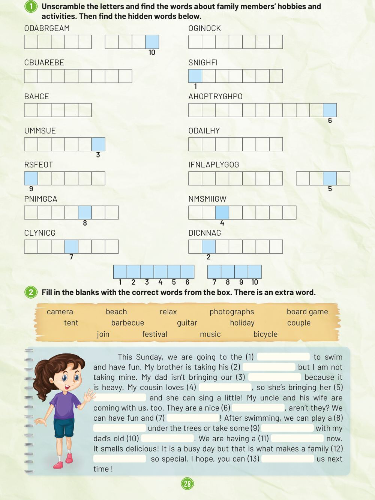

This Sunday, we are going to the (1) \_\_\_\_\_\_\_\_\_\_ to swim and have fun. My brother is taking his (2) \_\_\_\_\_\_\_\_\_\_ but I am not taking mine. My dad isn't bringing our (3) \_\_\_\_\_\_\_\_\_\_ because it is heavy. My cousin loves (4) \_\_\_\_\_\_\_\_\_\_, so she's bringing her (5) \_\_\_\_\_\_\_\_\_\_ and she can sing a little! My uncle and his wife are coming with us, too. They are a nice (6) \_\_\_\_\_\_\_\_\_\_, aren't they? We can have fun and (7) \_\_\_\_\_\_\_\_\_\_! After swimming, we can play a (8) \_\_\_\_\_\_\_\_\_\_ under the trees or take some (9) \_\_\_\_\_\_\_\_\_\_ with my dad's old (10) \_\_\_\_\_\_\_\_\_\_. We are having a (11) \_\_\_\_\_\_\_\_\_\_ now. It smells delicious! It is a busy day but that is what makes a family (12) \_\_\_\_\_\_\_\_\_\_.

<!-- sayfa 29 -->

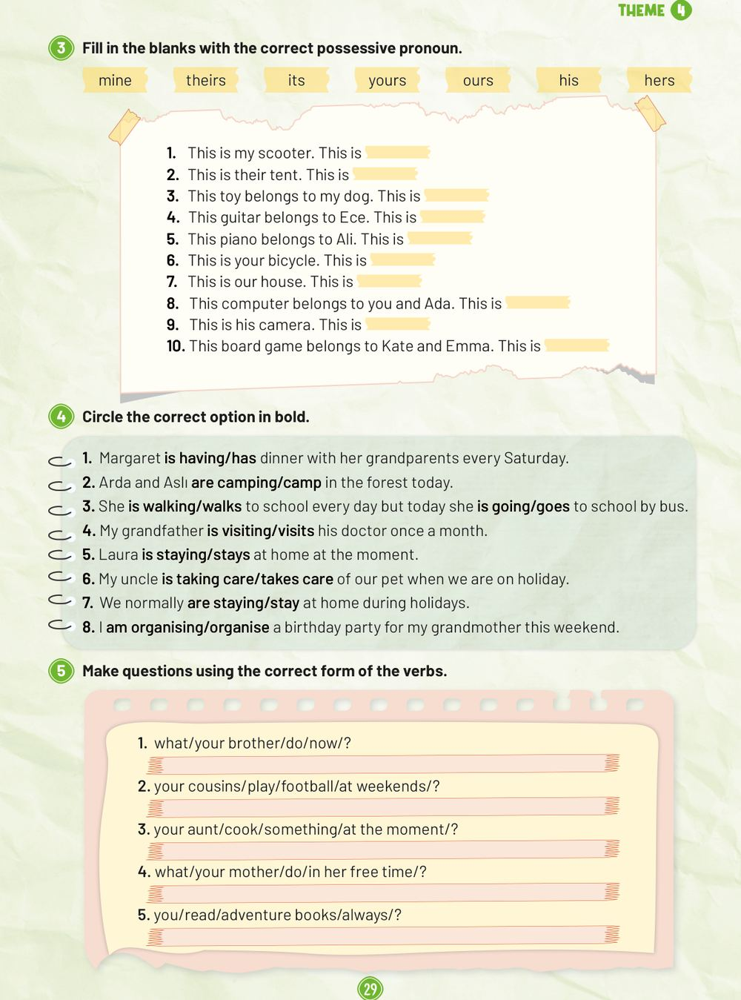
<!-- yer tutucu bulunamadı: sayfa sonuna eklendi -->

<!-- sayfa 30 -->

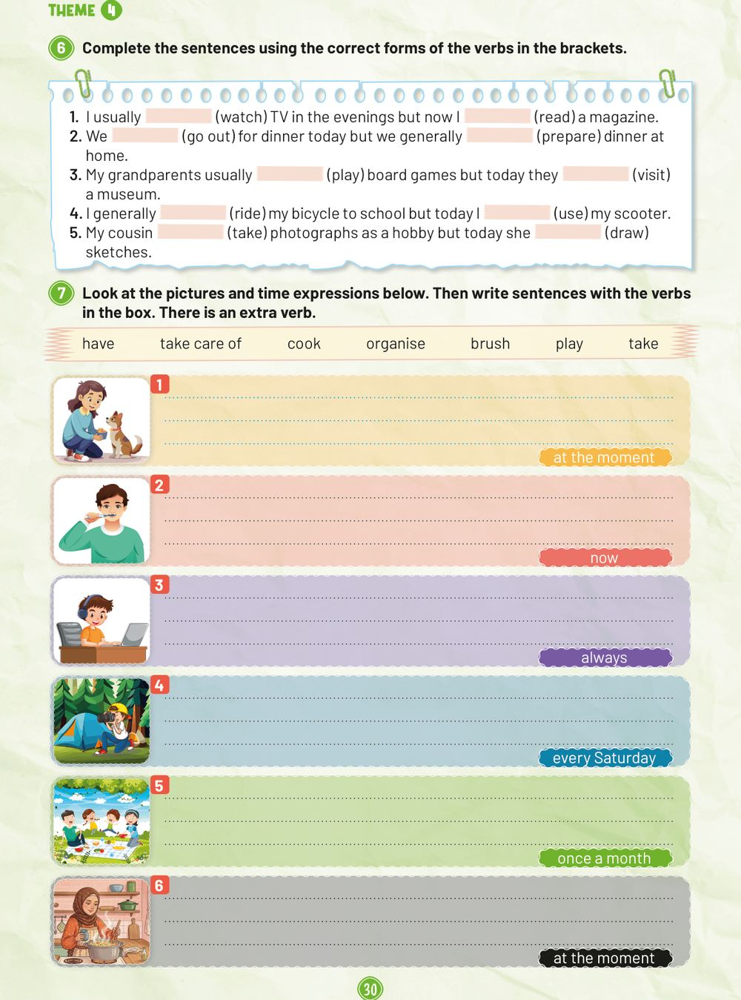
<!-- yer tutucu bulunamadı: sayfa sonuna eklendi -->

<!-- sayfa 31 -->

# 8 Read the text quickly and tick the suitable title for the text.

☐ All about me and my family  
☐ A trip to the mountains

Dear Pen Pal Emma,
Hello! My name is Leyla, and I am so happy to write to you. I am 12 years old and I live in Ordu, a beautiful seaside town in Türkiye. It is a lovely place with fresh air and big blue sea.
There are four people in my family: my mother, my father, my younger brother and me. I usually spend a lot of time with my family. I love animals and I have a cat named Luna. She is very curious and playful. My father works as a teacher and my mother is a nurse. My brother, Efe, is 7 years old and he is full of energy!
A little more about me? Well, I enjoy reading exciting books, swimming in the sea and riding my bike. I enjoy learning new things and meeting new people, like you! I usually read a book in the evenings but today I am writing to you. My mother usually cooks dinner at this time but at the moment she is playing with Luna. My father often watches TV after work but right now he is reading a book about golf. My brother usually runs around the house but today he is playing with his toys quietly. It is a peaceful moment and we are relaxing after a busy day.
What about you? How old are you? Who do you live with? What do you and your family like doing together?
Hope to hear from you soon!
Best wishes,
Leyla

# 9 Read the sentences and tick ($\checkmark$) True or False. Correct the false sentences.

| | | T | F |
| :--- | :--- | :---: | :---: |
| 1. | Leyla lives in a city far from the sea. | ☐ | ☐ |
| | __________________________________________________________ | | |
| 2. | Luna is Leyla's cat and she is very curious. | ☐ | ☐ |
| | __________________________________________________________ | | |
| 3. | Leyla's mother works as a teacher. | ☐ | ☐ |
| | __________________________________________________________ | | |
| 4. | Leyla usually rides her bike in the evenings. | ☐ | ☐ |
| | __________________________________________________________ | | |
| 5. | Leyla's mother is cooking dinner right now. | ☐ | ☐ |
| | __________________________________________________________ | | |
| 6. | Leyla asks her pen friend about her family and hobbies. | ☐ | ☐ |
| | __________________________________________________________ | | |

# 10 Read the text again and answer the questions.

1. Where does Leyla live?
__________________________________________________________

2. What is Leyla doing right now?
__________________________________________________________

3. Which activities does Leyla usually enjoy doing?
__________________________________________________________

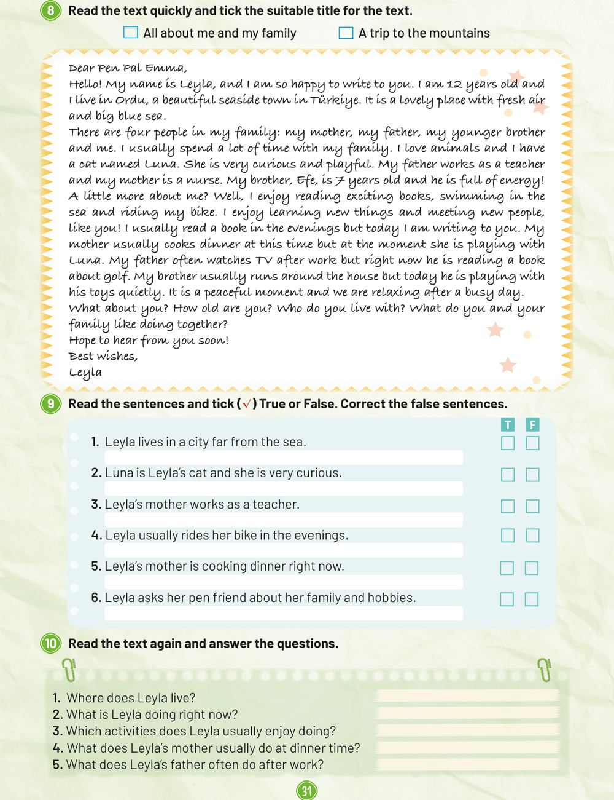
<!-- yer tutucu bulunamadı: sayfa sonuna eklendi -->

<!-- sayfa 32 -->

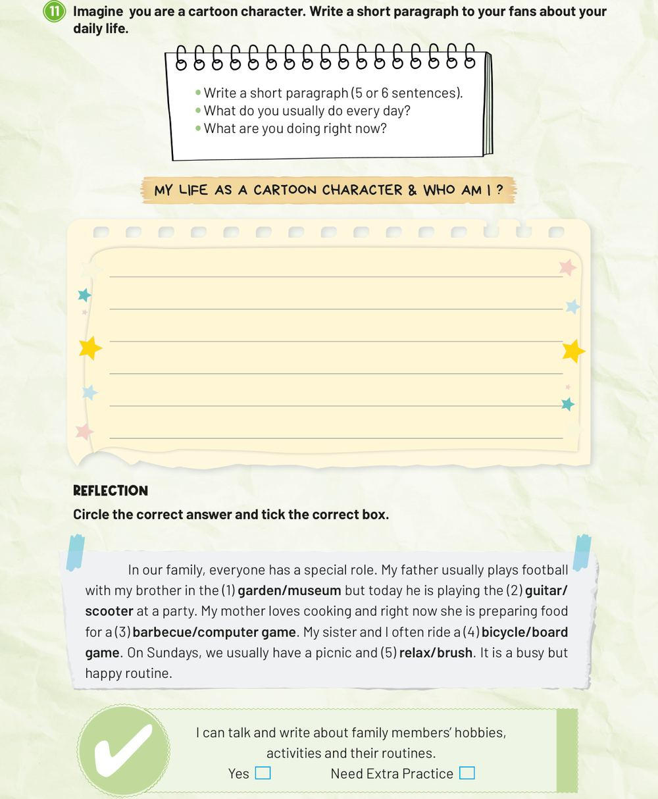 11 Imagine **you are a cartoon character**. Write a short paragraph to your fans about your daily life.

* Write a short paragraph (5 or 6 sentences).
* What do you usually do every day?
* What are you doing right now?

MY LIFE AS A CARTOON CHARACTER & WHO AM I ?

# REFLECTION
**Circle the correct answer and tick the correct box.**

In our family, everyone has a special role. My father usually plays football with my brother in the (1) **garden/museum** but today he is playing the (2) **guitar/scooter** at a party. My mother loves cooking and right now she is preparing food for a (3) **barbecue/computer game**. My sister and I often ride a (4) **bicycle/board game**. On Sundays, we usually have a picnic and (5) **relax/brush**. It is a busy but happy routine.

I can talk and write about family members' hobbies, activities and their routines.
Yes $\square$  Need Extra Practice $\square$

<!-- sayfa 33 -->

# LIFE IN THE NEIGHBOURHOOD & CITY

## THEME 5

### Sub-themes
Places for recreation and attractions in the neighbourhood and city
Different types of houses

### Functional Language
Making comparisons between two things or people
Expressing habitual actions
Indicating existence or location

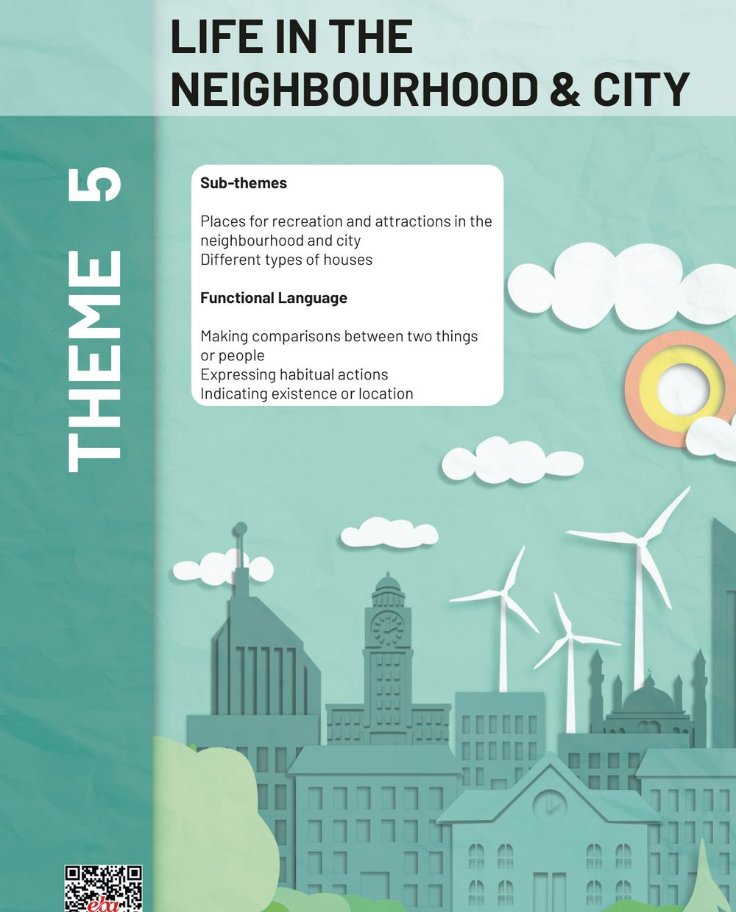
<!-- yer tutucu bulunamadı: sayfa sonuna eklendi -->

<!-- sayfa 34 -->

# 1 Read the clues and find the words in the puzzle.

1. You can do different sports in this building.
2. You can see artworks in this building.
3. You can prepare food in this room.
4. A tall narrow structure (often historical)
5. A place to lift weights and keep fit
6. Not noisy, very calm
7. A piece of furniture to sit and relax
8. You use this to cut food.
9. A house with multiple floors and shared by others
10. To fix something broken
11. The land next to or close to the sea
12. Quiet and calm
13. Made of wood
14. Full of light, shining

| | | | | | | | | | | | | | |
|---|---|---|---|---|---|---|---|---|---|---|---|---|---|
| K | D | G | Z | S | B | R | G | V | N | S | G | O | M |
| S | I | V | A | T | L | R | I | E | F | C | B | X | E |
| B | P | T | X | B | O | G | Q | T | A | C | A | C | K |
| R | F | O | C | D | M | W | N | U | S | T | N | N | R |
| I | S | L | R | H | G | G | E | U | I | A | J | G | Z |
| G | H | T | A | T | E | O | C | R | P | E | O | N | T |
| H | W | N | F | T | S | N | X | E | T | Z | T | C | R |
| T | E | E | Y | B | I | C | A | B | Z | Z | H | Y | E |
| A | F | D | G | L | P | C | E | U | U | O | I | E | P |
| F | I | O | Z | C | E | L | U | N | M | Y | G | J | A |
| O | N | O | Z | F | T | Y | J | C | T | Q | W | H | I |
| S | K | W | U | S | S | J | I | M | X | R | U | V | R |
| N | F | L | A | J | U | V | P | F | Y | E | E | L | F |
| Y | G | C | A | R | T | G | A | L | L | E | R | Y | T |

# 2 Circle the odd one out.

1. a bedroom &nbsp;&nbsp;&nbsp;&nbsp;&nbsp;&nbsp;&nbsp;&nbsp;&nbsp;&nbsp;&nbsp;&nbsp;&nbsp;&nbsp; a corridor &nbsp;&nbsp;&nbsp;&nbsp;&nbsp;&nbsp;&nbsp;&nbsp;&nbsp;&nbsp;&nbsp;&nbsp;&nbsp;&nbsp; a shop &nbsp;&nbsp;&nbsp;&nbsp;&nbsp;&nbsp;&nbsp;&nbsp;&nbsp;&nbsp;&nbsp;&nbsp;&nbsp;&nbsp; a dining room
2. a tower &nbsp;&nbsp;&nbsp;&nbsp;&nbsp;&nbsp;&nbsp;&nbsp;&nbsp;&nbsp;&nbsp;&nbsp;&nbsp;&nbsp;&nbsp;&nbsp;&nbsp;&nbsp; a terrace &nbsp;&nbsp;&nbsp;&nbsp;&nbsp;&nbsp;&nbsp;&nbsp;&nbsp;&nbsp;&nbsp;&nbsp;&nbsp;&nbsp;&nbsp;&nbsp; a museum &nbsp;&nbsp;&nbsp;&nbsp;&nbsp;&nbsp;&nbsp;&nbsp;&nbsp;&nbsp;&nbsp;&nbsp; a castle
3. famous &nbsp;&nbsp;&nbsp;&nbsp;&nbsp;&nbsp;&nbsp;&nbsp;&nbsp;&nbsp;&nbsp;&nbsp;&nbsp;&nbsp;&nbsp;&nbsp;&nbsp;&nbsp; traditional &nbsp;&nbsp;&nbsp;&nbsp;&nbsp;&nbsp;&nbsp;&nbsp;&nbsp;&nbsp;&nbsp;&nbsp;&nbsp; peaceful &nbsp;&nbsp;&nbsp;&nbsp;&nbsp;&nbsp;&nbsp;&nbsp;&nbsp;&nbsp;&nbsp;&nbsp;&nbsp; easily
4. a flat &nbsp;&nbsp;&nbsp;&nbsp;&nbsp;&nbsp;&nbsp;&nbsp;&nbsp;&nbsp;&nbsp;&nbsp;&nbsp;&nbsp;&nbsp;&nbsp;&nbsp;&nbsp;&nbsp;&nbsp;&nbsp; a garden &nbsp;&nbsp;&nbsp;&nbsp;&nbsp;&nbsp;&nbsp;&nbsp;&nbsp;&nbsp;&nbsp;&nbsp;&nbsp;&nbsp;&nbsp;&nbsp; a garage &nbsp;&nbsp;&nbsp;&nbsp;&nbsp;&nbsp;&nbsp;&nbsp;&nbsp;&nbsp;&nbsp;&nbsp;&nbsp; a balcony

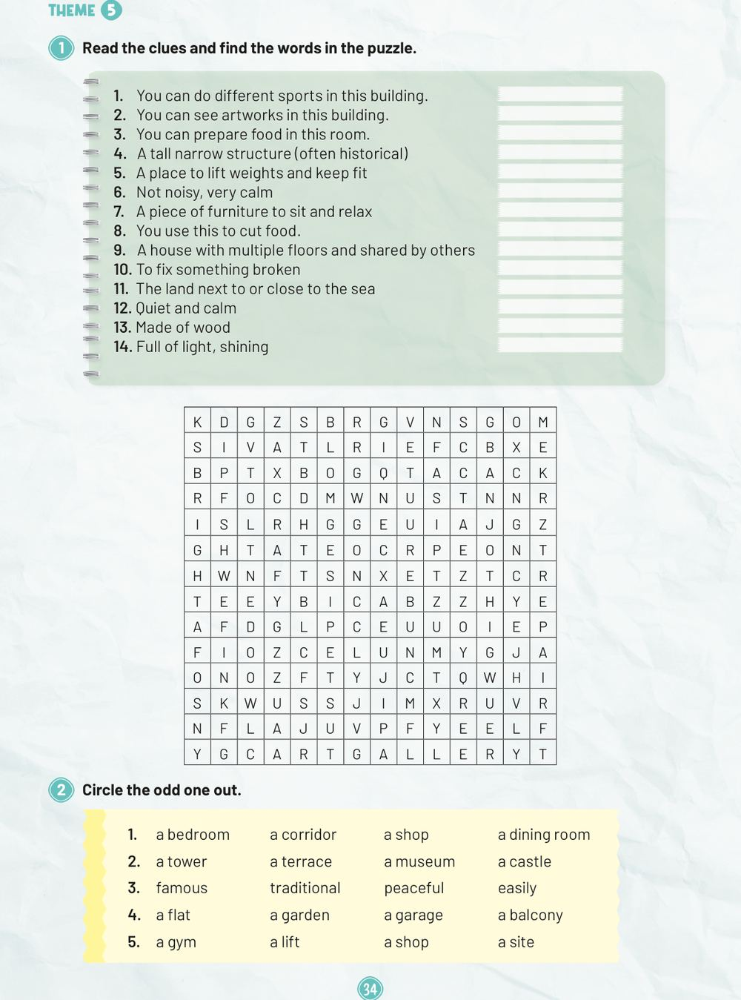
<!-- yer tutucu bulunamadı: sayfa sonuna eklendi -->

<!-- sayfa 35 -->

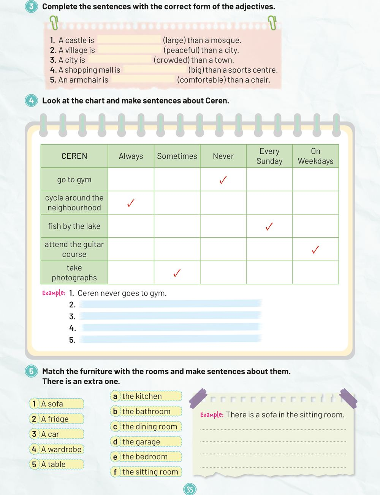
<!-- yer tutucu bulunamadı: sayfa sonuna eklendi -->

<!-- sayfa 36 -->

6 Look at the pictures and complete the sentences.

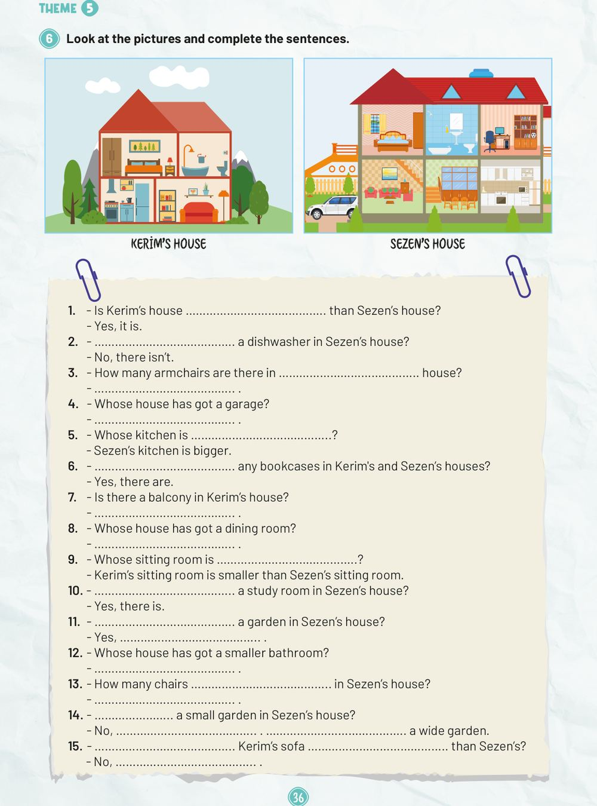

KERİM'S HOUSE
SEZEN'S HOUSE

1. - Is Kerim's house ............................................................ than Sezen's house?
   - Yes, it is.
2. - ............................................................ a dishwasher in Sezen's house?
   - No, there isn't.
3. - How many armchairs are there in ............................................................ house?
   - ............................................................ .
4. - Whose house has got a garage?
   - ............................................................ .
5. - Whose kitchen is ............................................................?
   - Sezen's kitchen is bigger.
6. - ............................................................ any bookcases in Kerim's and Sezen's houses?
   - Yes, there are.
7. - Is there a balcony in Kerim's house?
   - ............................................................ .
8. - Whose house has got a dining room?
   - ............................................................ .
9. - Whose sitting room is ............................................................?
   - Kerim's sitting room is smaller than Sezen's sitting room.
10. - ............................................................ a study room in Sezen's house?
    - Yes, there is.
11. - ............................................................ a garden in Sezen's house?
    - Yes, ............................................................ .
12. - Whose house has got a smaller bathroom?
    - ............................................................ .
13. - How many chairs ............................................................ in Sezen's house?
    - ............................................................ .
14. - ............................................................ a small garden in Sezen's house?
    - No, ............................................................ . ............................................................ a wide garden.
15. - ............................................................ Kerim's sofa ............................................................ than Sezen's?

<!-- sayfa 37 -->

7. Read the text quickly and tick the places in Nehir’s neighbourhood.

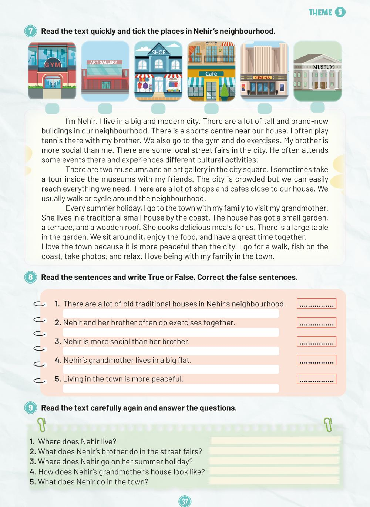

I’m Nehir. I live in a big and modern city. There are a lot of tall and brand-new buildings in our neighbourhood. There is a sports centre near our house. I often play tennis there with my brother. We also go to the gym and do exercises. My brother is more social than me. There are some local street fairs in the city. He often attends some events there and experiences different cultural activities.
There are two museums and an art gallery in the city square. I sometimes take a tour inside the museums with my friends. The city is crowded but we can easily reach everything we need. There are a lot of shops and cafés close to our house. We usually walk or cycle around the neighbourhood.
Every summer holiday, I go to the town with my family to visit my grandmother. She lives in a traditional small house by the coast. The house has got a small garden, a terrace, and a wooden roof. She cooks delicious meals for us. There is a large table in the garden. We sit around it, enjoy the food, and have a great time together. I love the town because it is more peaceful than the city. I go for a walk, fish on the coast, take photos, and relax. I love being with my family in the town.

8. Read the sentences and write True or False. Correct the false sentences.

1. There are a lot of old traditional houses in Nehir’s neighbourhood. ........................
2. Nehir and her brother often do exercises together. ........................
3. Nehir is more social than her brother. ........................
4. Nehir’s grandmother lives in a big flat. ........................
5. Living in the town is more peaceful. ........................

9. Read the text carefully again and answer the questions.

1. Where does Nehir live? ____________________________________________________
2. What does Nehir’s brother do in the street fairs? ______________________________
3. Where does Nehir go on her summer holiday? __________________________________
4. How does Nehir’s grandmother’s house look like? _______________________________

<!-- sayfa 38 -->

10 Imagine you are selling a house. Look at the picture and take notes about the house.

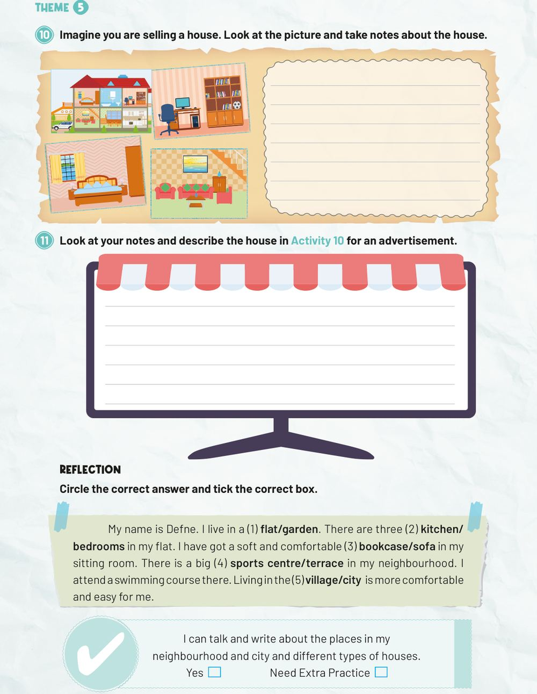

11 Look at your notes and describe the house in Activity 10 for an advertisement.

**REFLECTION**

**Circle the correct answer and tick the correct box.**

My name is Defne. I live in a (1) **flat/garden**. There are three (2) **kitchen/bedrooms** in my flat. I have got a soft and comfortable (3) **bookcase/sofa** in my sitting room. There is a big (4) **sports centre/terrace** in my neighbourhood. I attend a swimming course there. Living in the (5) **village/city** is more comfortable and easy for me.

I can talk and write about the places in my neighbourhood and city and different types of houses.
Yes ☐  Need Extra Practice ☐

<!-- sayfa 39 -->

# LIFE
# IN THE WORLD

## THEME 6

### Sub-themes
Basic food types
Ordering in a restaurant
Food events in the city

### Functional Language
Asking or giving permission
Expressing possession
Expressing the quantity of nouns

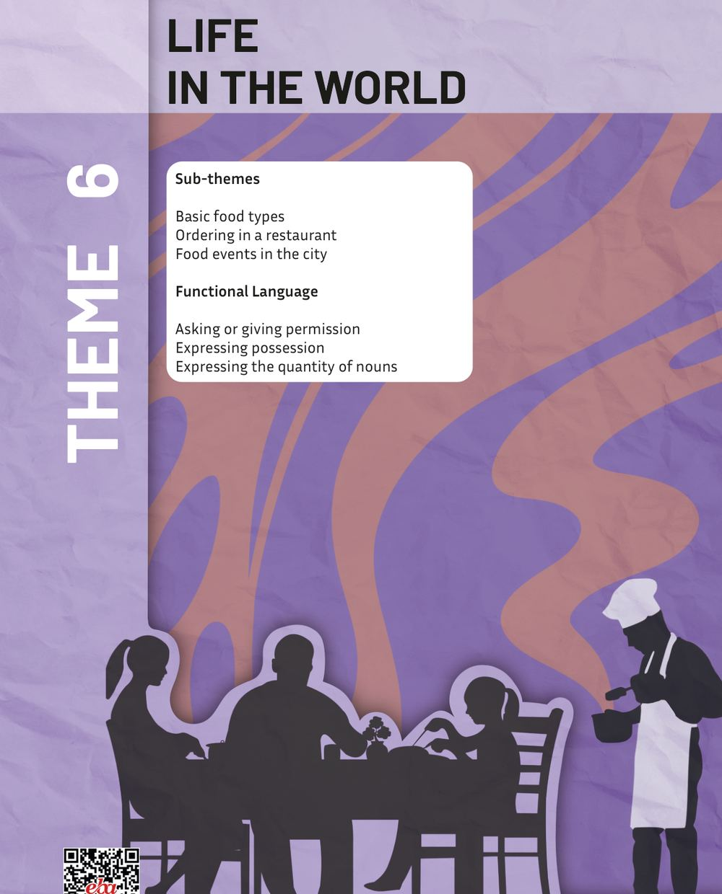
<!-- yer tutucu bulunamadı: sayfa sonuna eklendi -->

<!-- sayfa 40 -->

# 1 Match the words with their definitions. Then do the puzzle and find the hidden word. There is an extra one.

| | | | | | | | | | |
| :--- | :--- | :--- | :--- | :--- | :--- | :--- | :--- | :--- | :--- |
| 1. To remove water from something. | | 1 | ... | | a. contain | | | | |
| 2. To make something warm or hot. | | 2 | ... | | b. heat | | | | |
| 3. To make water or food very hot until it bubbles. | | 3 | ... | | c. taste | | | | |
| 4. To cut something into thin, flat pieces. | | 4 | ... | | d. boil | | | | |
| 5. To prepare food using heat. | | 5 | ... | | e. slice | | | | |
| 6. To have something inside. | | 6 | ... | | f. dry | | | | |
| 7. To ask for food or something you want. | | 7 | ... | | g. cook | | | | |
| 8. To make something into pieces with a knife or scissors. | | 8 | ... | | h. order | | | | |
| 9. To press food (like potatoes) until it is soft and smooth. | | 9 | ... | | i. mash | | | | |
| | | | | | j. cut | | | | |

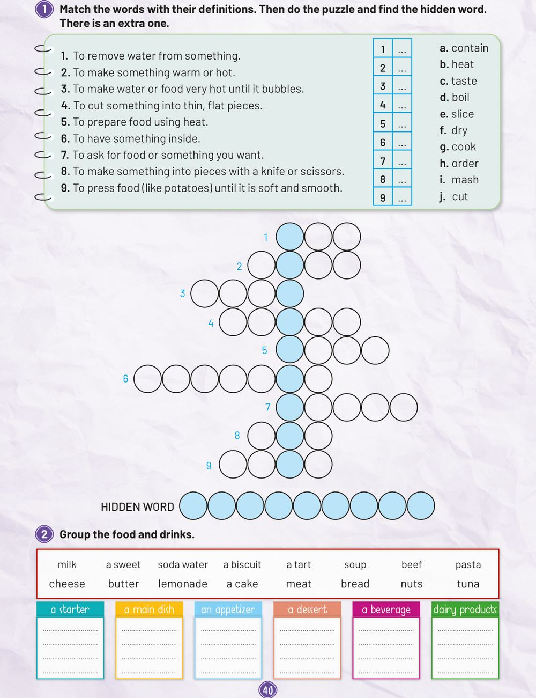

# 2 Group the food and drinks.

| milk | a sweet | soda water | a biscuit | a tart | soup | beef | pasta |
| :--- | :--- | :--- | :--- | :--- | :--- | :--- | :--- |
| cheese | butter | lemonade | a cake | meat | bread | nuts | tuna |

| a starter | a main dish | an appetizer | a dessert | a beverage | dairy products |
| :--- | :--- | :--- | :--- | :--- | :--- |
| | | | | | |
| | | | | | |
| | | | | | |

<!-- sayfa 41 -->

# 3 Make sentences with the words in the brackets and answer them.

1. (pay in cash) ................................................................. Can I pay in cash?
   ✅ ................................................................. Sure./Yes, you can.
2. (add some salt) ............................................................. Can I add some salt?
   ❌ ................................................................. No, you can't.
3. (slice the apples) ...........................................................
   ❌ .................................................................
4. (taste the soup) .............................................................
   ✅ .................................................................
5. (boil the water) .............................................................
   ❌ .................................................................
6. (book a table) ...............................................................
   ✅ .................................................................
7. (order my meal) ..............................................................
   ✅ .................................................................
8. (heat the meal quickly) ......................................................
   ❌ .................................................................
9. (dry the vegetables carefully) ..............................................
   ✅ .................................................................
10. (mash the potatoes slowly) ..................................................
    ✅ .................................................................

# 4 Complete the sentences with “How many” or “How much”.

1. ................................................... apples do you need?
2. ................................................... bowls of flour do you need for the cake?
3. ................................................... milk is there for the recipe?
4. ................................................... tomatoes do you need for the sauce?
5. ................................................... nuts are there in this home-made bread?
6. ................................................... glasses of sugar does the chef need?
7. ................................................... butter do you need for the rice?
8. ................................................... water does she need to boil?
9. ................................................... lemons do you need for the salad?
10. ................................................... oil do you need for the meal?

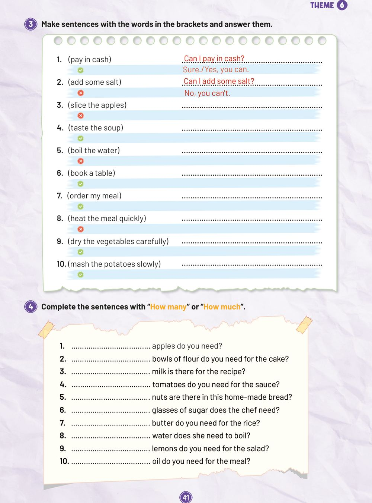
<!-- yer tutucu bulunamadı: sayfa sonuna eklendi -->

<!-- sayfa 42 -->

5 Look at the fridge and ask questions according to the answers.

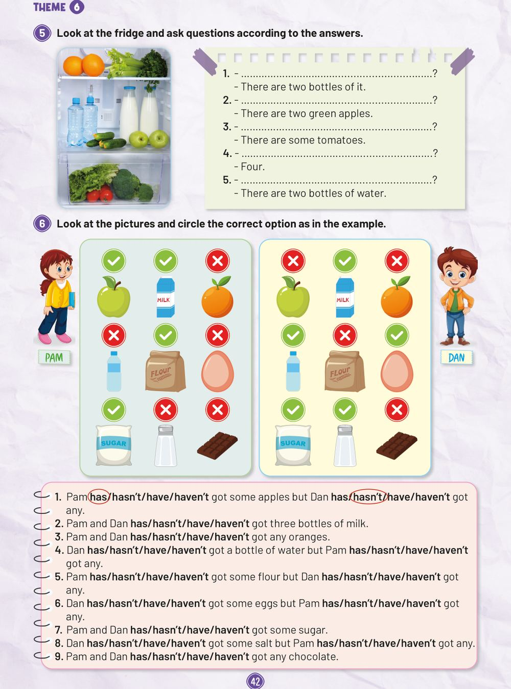

1. - ............................................................................?
   - There are two bottles of it.
2. - ............................................................................?
   - There are two green apples.
3. - ............................................................................?
   - There are some tomatoes.
4. - ............................................................................?
   - Four.
5. - ............................................................................?
   - There are two bottles of water.

6 Look at the pictures and circle the correct option as in the example.

1. Pam has/hasn't/have/haven't got some apples but Dan has/hasn't/have/haven't got any.
2. Pam and Dan has/hasn't/have/haven't got three bottles of milk.
3. Pam and Dan has/hasn't/have/haven't got any oranges.
4. Dan has/hasn't/have/haven't got a bottle of water but Pam has/hasn't/have/haven't got any.
5. Pam has/hasn't/have/haven't got some flour but Dan has/hasn't/have/haven't got any.
6. Dan has/hasn't/have/haven't got some eggs but Pam has/hasn't/have/haven't got any.
7. Pam and Dan has/hasn't/have/haven't got some sugar.
8. Dan has/hasn't/have/haven't got some salt but Pam has/hasn't/have/haven't got any.

<!-- sayfa 43 -->

7 Read the dialogue and choose the food event they talk about.

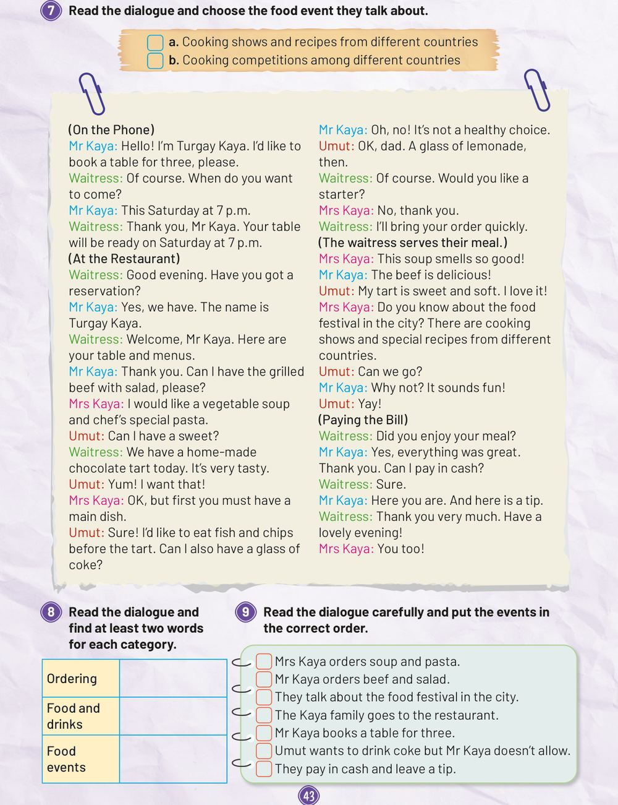
$\square$ a. Cooking shows and recipes from different countries
$\square$ b. Cooking competitions among different countries

(On the Phone)
Mr Kaya: Hello! I’m Turgay Kaya. I’d like to book a table for three, please.
Waitress: Of course. When do you want to come?
Mr Kaya: This Saturday at 7 p.m.
Waitress: Thank you, Mr Kaya. Your table will be ready on Saturday at 7 p.m.

(At the Restaurant)
Waitress: Good evening. Have you got a reservation?
Mr Kaya: Yes, we have. The name is Turgay Kaya.
Waitress: Welcome, Mr Kaya. Here are your table and menus.
Mr Kaya: Thank you. Can I have the grilled beef with salad, please?
Mrs Kaya: I would like a vegetable soup and chef’s special pasta.
Umut: Can I have a sweet?
Waitress: We have a home-made chocolate tart today. It’s very tasty.
Umut: Yum! I want that!
Mrs Kaya: OK, but first you must have a main dish.
Umut: Sure! I’d like to eat fish and chips before the tart. Can I also have a glass of coke?
Mr Kaya: Oh, no! It’s not a healthy choice.
Umut: OK, dad. A glass of lemonade, then.
Waitress: Of course. Would you like a starter?
Mrs Kaya: No, thank you.
Waitress: I’ll bring your order quickly.

(The waitress serves their meal.)
Mrs Kaya: This soup smells so good!
Mr Kaya: The beef is delicious!
Umut: My tart is sweet and soft. I love it!
Mrs Kaya: Do you know about the food festival in the city? There are cooking shows and special recipes from different countries.
Umut: Can we go?
Mr Kaya: Why not? It sounds fun!
Umut: Yay!

(Paying the Bill)
Waitress: Did you enjoy your meal?
Mr Kaya: Yes, everything was great. Thank you. Can I pay in cash?
Waitress: Sure.
Mr Kaya: Here you are. And here is a tip.
Waitress: Thank you very much. Have a lovely evening!
Mrs Kaya: You too!

8 Read the dialogue and find at least two words for each category.

| Ordering | |
| :--- | :--- |
| Food and drinks | |

9 Read the dialogue carefully and put the events in the correct order.

$\square$ Mrs Kaya orders soup and pasta.
$\square$ Mr Kaya orders beef and salad.
$\square$ They talk about the food festival in the city.
$\square$ The Kaya family goes to the restaurant.
$\square$ Mr Kaya books a table for three.

<!-- sayfa 44 -->

10 Prepare a menu for a famous restaurant.

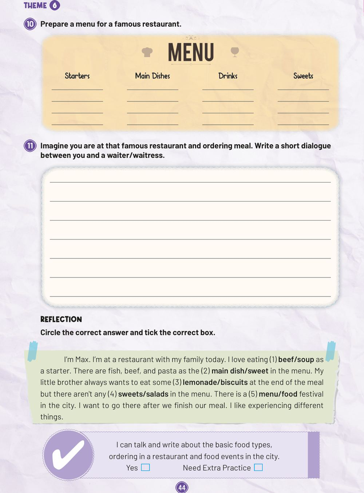

11 Imagine you are at that famous restaurant and ordering meal. Write a short dialogue between you and a waiter/waitress.

**REFLECTION**

Circle the correct answer and tick the correct box.

I'm Max. I'm at a restaurant with my family today. I love eating (1) **beef/soup** as a starter. There are fish, beef, and pasta as the (2) **main dish/sweet** in the menu. My little brother always wants to eat some (3) **lemonade/biscuits** at the end of the meal but there aren't any (4) **sweets/salads** in the menu. There is a (5) **menu/food** festival in the city. I want to go there after we finish our meal. I like experiencing different things.

I can talk and write about the basic food types, ordering in a restaurant and food events in the city.

<!-- sayfa 45 -->

# LIFE IN NATURE

## THEME 7

### Sub-themes
Wild animals in nature
Types of animals in nature
Their habitats

### Functional Language
Expressing comparisons
Expressing the capability or ability
Expressing an external obligation or necessity
Asking about the location or place

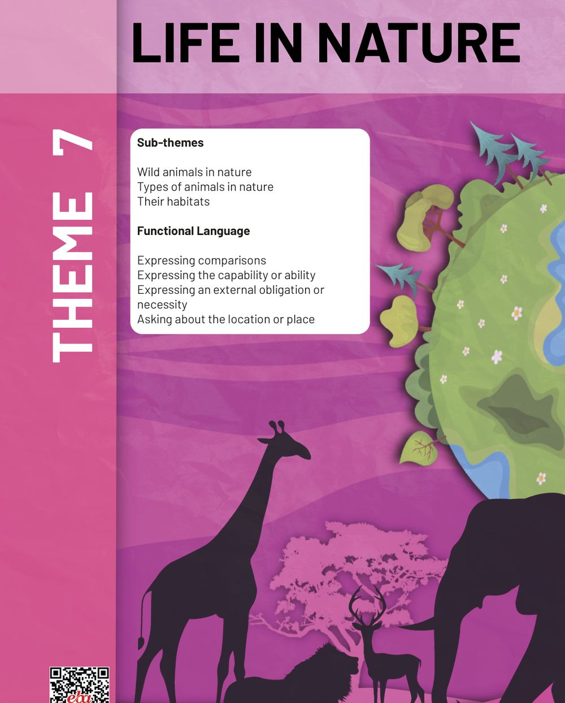
<!-- yer tutucu bulunamadı: sayfa sonuna eklendi -->

<!-- sayfa 46 -->

1 Find the names of the animals in the puzzle.

| bee | B | Y | R | S | F | E | N | Z | T | D |
| :--- | :--- | :--- | :--- | :--- | :--- | :--- | :--- | :--- | :--- | :--- |
| lion | S | E | A | G | U | L | L | O | N | C |
| crocodile | J | X | R | A | Q | I | V | O | I | R |
| bear | E | A | G | L | E | D | H | U | A | L |
| eagle | M | H | H | Z | D | O | H | E | Z | P |
| monkey | V | O | V | D | S | C | B | B | R | A |
| parrot | K | G | N | N | K | O | T | O | K | R |
| snake | P | V | A | K | R | R | T | R | B | R |
| seagull | M | K | U | U | E | C | Q | H | G | O |
| | E | T | J | U | K | Y | E | E | B | T |

2 Complete the chart with the names of animals in Activity 1.

| Mammals | Birds | Reptiles | Insects |
| :--- | :--- | :--- | :--- |
| | | | |

3 Look at the pictures and complete the sentences with the names of the animals. There is an extra one.

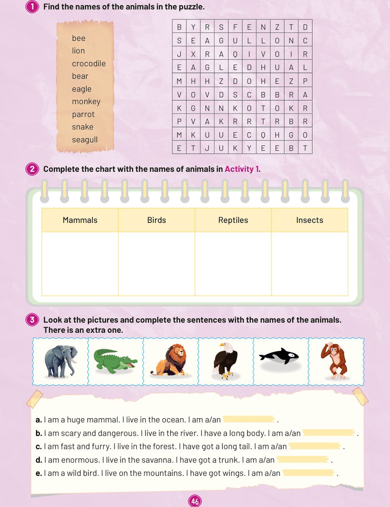

a. I am a huge mammal. I live in the ocean. I am a/an \_\_\_\_\_\_\_\_\_\_\_\_\_\_\_\_\_\_\_\_\_\_\_\_\_\_\_\_\_\_.
b. I am scary and dangerous. I live in the river. I have a long body. I am a/an \_\_\_\_\_\_\_\_\_\_\_\_\_\_\_\_\_\_\_\_\_\_\_\_\_\_\_\_\_\_.
c. I am fast and furry. I live in the forest. I have got a long tail. I am a/an \_\_\_\_\_\_\_\_\_\_\_\_\_\_\_\_\_\_\_\_\_\_\_\_\_\_\_\_\_\_.
d. I am enormous. I live in the savanna. I have got a trunk. I am a/an \_\_\_\_\_\_\_\_\_\_\_\_\_\_\_\_\_\_\_\_\_\_\_\_\_\_\_\_\_\_.

<!-- sayfa 47 -->

# 4 Complete the sentences as in the example. Use "**run, hunt, move, fly, climb, talk**".

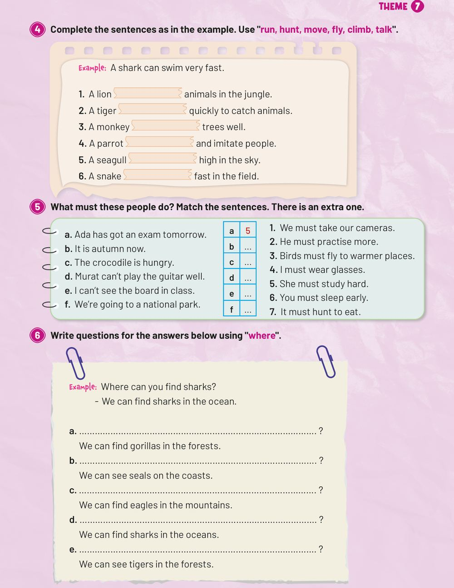

**Example:** A shark can swim very fast.

1. A lion ............................ animals in the jungle.
2. A tiger ............................ quickly to catch animals.
3. A monkey ............................ trees well.
4. A parrot ............................ and imitate people.
5. A seagull ............................ high in the sky.
6. A snake ............................ fast in the field.

# 5 What must these people do? Match the sentences. There is an extra one.

| | | | |
| :--- | :--- | :--- | :--- |
| **a.** Ada has got an exam tomorrow. | **a** | **5** | **1.** We must take our cameras. |
| **b.** It is autumn now. | **b** | ... | **2.** He must practise more. |
| **c.** The crocodile is hungry. | **c** | ... | **3.** Birds must fly to warmer places. |
| **d.** Murat can't play the guitar well. | **d** | ... | **4.** I must wear glasses. |
| **e.** I can't see the board in class. | **e** | ... | **5.** She must study hard. |
| **f.** We're going to a national park. | **f** | ... | **6.** You must sleep early. |
| | | | **7.** It must hunt to eat. |

# 6 Write questions for the answers below using "**where**".

**Example:** Where can you find sharks?
- We can find sharks in the ocean.

**a.** ........................................................................................... ?
We can find gorillas in the forests.

**b.** ........................................................................................... ?
We can see seals on the coasts.

**c.** ........................................................................................... ?
We can find eagles in the mountains.

**d.** ........................................................................................... ?
We can find sharks in the oceans.

**e.** ........................................................................................... ?
We can see tigers in the forests.

<!-- sayfa 48 -->

7 Circle the correct option about the animals.

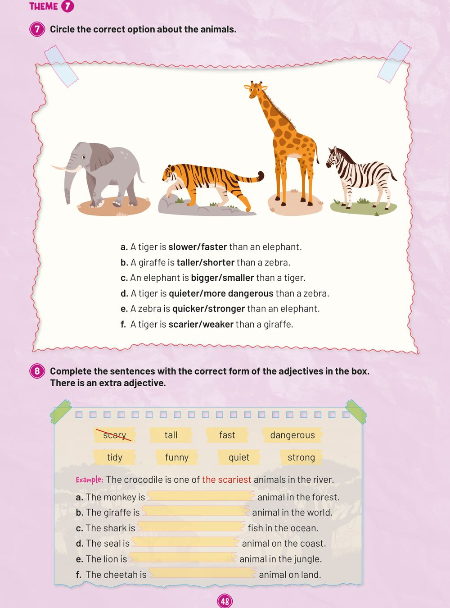

a. A tiger is **slower/faster** than an elephant.
b. A giraffe is **taller/shorter** than a zebra.
c. An elephant is **bigger/smaller** than a tiger.
d. A tiger is **quieter/more dangerous** than a zebra.
e. A zebra is **quicker/stronger** than an elephant.
f. A tiger is **scarier/weaker** than a giraffe.

8 Complete the sentences with the correct form of the adjectives in the box. There is an extra adjective.

| ~~scary~~ | tall | fast | dangerous |
| :---: | :---: | :---: | :---: |
| tidy | funny | quiet | strong |

**Example:** The crocodile is one of **the scariest** animals in the river.

a. The monkey is \_\_\_\_\_\_\_\_\_\_\_\_\_\_\_\_ animal in the forest.
b. The giraffe is \_\_\_\_\_\_\_\_\_\_\_\_\_\_\_\_ animal in the world.
c. The shark is \_\_\_\_\_\_\_\_\_\_\_\_\_\_\_\_ fish in the ocean.
d. The seal is \_\_\_\_\_\_\_\_\_\_\_\_\_\_\_\_ animal on the coast.
e. The lion is \_\_\_\_\_\_\_\_\_\_\_\_\_\_\_\_ animal in the jungle.

<!-- sayfa 49 -->

9 **Read the text quickly and choose the suitable title.**

a. Birds in Türkiye &nbsp;&nbsp;&nbsp;&nbsp;&nbsp;&nbsp;&nbsp;&nbsp;&nbsp;&nbsp;&nbsp;&nbsp;&nbsp;&nbsp;&nbsp;&nbsp;&nbsp;&nbsp;&nbsp;&nbsp;&nbsp;&nbsp;&nbsp;&nbsp;&nbsp;&nbsp;&nbsp;&nbsp;&nbsp;&nbsp;&nbsp;&nbsp;&nbsp;&nbsp;&nbsp;&nbsp;&nbsp;&nbsp;&nbsp;&nbsp;&nbsp;&nbsp;&nbsp;&nbsp;&nbsp;&nbsp;&nbsp;&nbsp;&nbsp;&nbsp;&nbsp;&nbsp;&nbsp;&nbsp;&nbsp;&nbsp;&nbsp;&nbsp;&nbsp;&nbsp;&nbsp;&nbsp;&nbsp;&nbsp;&nbsp;&nbsp;&nbsp;&nbsp;&nbsp;&nbsp;&nbsp;&nbsp;&nbsp;&nbsp;&nbsp;&nbsp;&nbsp;&nbsp;&nbsp;&nbsp;&nbsp;&nbsp;&nbsp;&nbsp;&nbsp;&nbsp;&nbsp;&nbsp;&nbsp;&nbsp;&nbsp;&nbsp;&nbsp;&nbsp;&nbsp;&nbsp;&nbsp;&nbsp;&nbsp;&nbsp;&nbsp;&nbsp;&nbsp;&nbsp;&nbsp;&nbsp;&nbsp;&nbsp;&nbsp;&nbsp;&nbsp;&nbsp;&nbsp;&nbsp;&nbsp;&nbsp;&nbsp;&nbsp;&nbsp;&nbsp;&nbsp;&nbsp;&nbsp;&nbsp;&nbsp;&nbsp;&nbsp;&nbsp;&nbsp;&nbsp;&nbsp;&nbsp;&nbsp;&nbsp;&nbsp;&nbsp;&nbsp;&nbsp;&nbsp;&nbsp;&nbsp;&nbsp;&nbsp;&nbsp;&nbsp;&nbsp;&nbsp;&nbsp;&nbsp;&nbsp;&nbsp;&nbsp;&nbsp;&nbsp;&nbsp;&nbsp;&nbsp;&nbsp;&nbsp;&nbsp;&nbsp;&nbsp;&nbsp;&nbsp;&nbsp;&nbsp;&nbsp;&nbsp;&nbsp;&nbsp;&nbsp;&nbsp;&nbsp;&nbsp;&nbsp;&nbsp;&nbsp;&nbsp;&nbsp;&nbsp;&nbsp;&nbsp;&nbsp;&nbsp;&nbsp;&nbsp;&nbsp;&nbsp;&nbsp;&nbsp;&nbsp;&nbsp;&nbsp;&nbsp;&nbsp;&nbsp;&nbsp;&nbsp;&nbsp;&nbsp;&nbsp;&nbsp;&nbsp;&nbsp;&nbsp;&nbsp;&nbsp;&nbsp;&nbsp;&nbsp;&nbsp;&nbsp;&nbsp;&nbsp;&nbsp;&nbsp;&nbsp;&nbsp;&nbsp;&nbsp;&nbsp;&nbsp;&nbsp;&nbsp;&nbsp;&nbsp;&nbsp;&nbsp;&nbsp;&nbsp;&nbsp;&nbsp;&nbsp;&nbsp;&nbsp

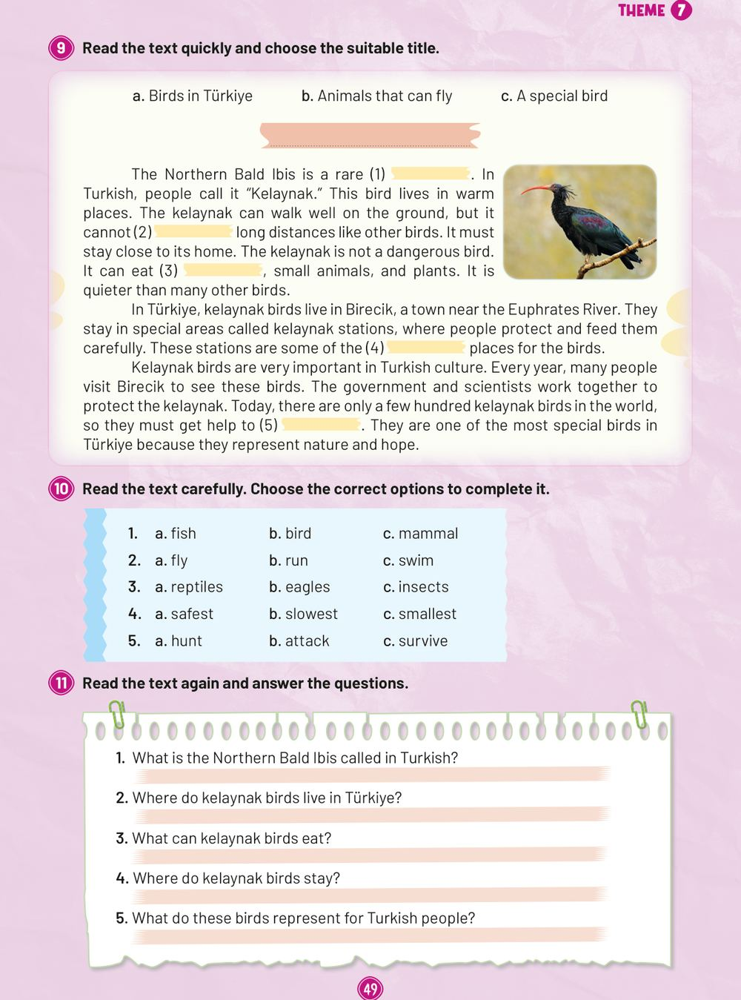
<!-- yer tutucu bulunamadı: sayfa sonuna eklendi -->

<!-- sayfa 50 -->

12 Think about a special animal that lives in your country and take notes about it.

1. What is the name of the animal? .....................................................
2. Where does it live in your country? .....................................................
3. What does it eat? .....................................................
4. Can it fly, swim, or run fast? .....................................................
5. Is it in danger? Why? .....................................................

13 Look at your notes in Activity 12 and write a paragraph about your animal.

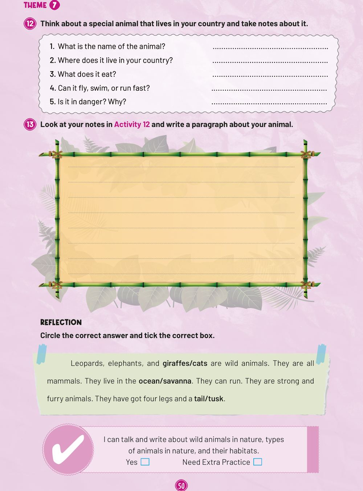

**REFLECTION**

Circle the correct answer and tick the correct box.

Leopards, elephants, and **giraffes/cats** are wild animals. They are all mammals. They live in the **ocean/savanna**. They can run. They are strong and furry animals. They have got four legs and a **tail/tusk**.

I can talk and write about wild animals in nature, types of animals in nature, and their habitats.

<!-- sayfa 51 -->

# LIFE IN THE UNIVERSE & FUTURE

## THEME 8

### Sub-themes
Planet Earth
School holidays, places, activities, and plans for holidays

### Functional Language
Expressing future plans and intentions

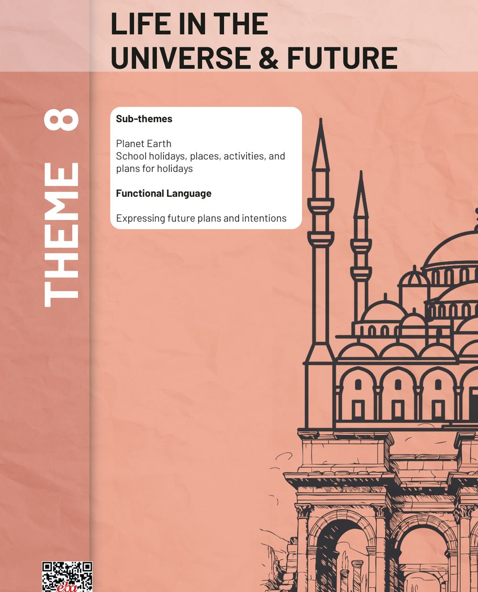
<!-- yer tutucu bulunamadı: sayfa sonuna eklendi -->

<!-- sayfa 52 -->

# 1 Look at the pictures to unscramble the words and find the hidden word.

 RSEEDT
[ ][ ][ ][ ][ ][ ]

 NAYNOC
[ ][2][ ][ ][5][ ]

 RCAOL RFEE
[ ][ ][ ][ ][ ] [ ][ ][ ][ ]

 DSNA UDEN
[ ][ ][ ][ ] [ ][ ][ ][ ]

 SNIDAL
[ ][ ][ ][ ][ ][ ]

 LEKA
[ ][ ][4][ ]

 LYELVA
[ ][ ][ ][ ][ ][ ]

 NECNNTOTI
[ ][1][ ][ ][ ][ ][ ][ ][ ]

 HAECB
[ ][ ][3][ ][ ]

 EVRIR
[ ][ ][ ][ ][ ]

[ ][ ][ ][ ][ ]
1 2 3 4 5

# 2 Match the words and make phrases. There is an extra option.

1 a sightseeing  1 .....  a holiday
2 an amusement  2 .....  b a museum
3 a half-term    3 .....  c tour
4 to build      4 .....  d park

<!-- sayfa 53 -->

<!-- yer tutucu bulunamadı: sayfa sonuna eklendi -->

<!-- sayfa 54 -->

5 Put the words in the correct order and make questions.

1. holiday/going/summer/where/for/are/to/you/go/the/?
_______________________________________________________

2. pack/for/to/are/you/what/the/going/holiday/?
_______________________________________________________

3. going/what/to/you/there/are/do/?
_______________________________________________________

4. who/travel/with/to/you/are/going/?
_______________________________________________________

5. going/join/you/are/to/the lake/a trip/by/?
_______________________________________________________

6 Choose one of the pictures and answer the questions in Activity 5 for yourself.

|  |  | 1. I am going to go to Mersin for the summer holiday. |
| :---: | :---: | :--- |
|  |  | 2. ............................................................ |
|  |  | ............................................................ |
|  |  | 3. ............................................................ |
|  |  | ............................................................ |
|  |  | 4. ............................................................ |
| | | ............................................................ |
| | | 5. ............................................................ |
| | | ............................................................ |

<!-- sayfa 55 -->

7 Read the e-mail quickly and tick the correct picture.

New e-mail
To : İpek
From : Elif
Subject : My Summer Holiday Plans
Hi İpek,
How are you? I hope you are fine. I want to tell you about my summer holiday plans!
I’m going to go to Antalya with my family this summer. We are going to stay at a famous hotel near the seaside. I’m going to build sandcastles and collect seashells on the beach. That’s great!
My parents are going to relax and my little brother is going to play at the amusement park. We are also going to visit a museum and join a sightseeing tour in the historical town. I’m going to take lots of photos. The views are going to be amazing!
The weather is going to be hot and sunny, so I’m going to pack my hat, sunglasses and camera. I’m so excited! It’s going to be my best holiday!
What about you? Where are you going to go this summer? Please write back soon! Love,
Elif

8 Read the e-mail again and match the descriptions with the words in bold. There is an extra one.

1. A place where people relax and play near the sea: ____________________
2. Small objects you find on the beach: ____________________
3. A short journey to a place: ____________________
4. Relating to events or people in the past: ____________________
5. A place with ancient things to visit and learn: ____________________
6. Well-known: ____________________

9 Read the e-mail carefully and correct the sentences.

1. İpek is going to go to Antalya this summer.
____________________________________________________________

2. Her brother is going to play at the swimming pool.
____________________________________________________________

3. She is going to join a sightseeing tour in the city centre.
____________________________________________________________

4. The weather is going to be rainy and cool.
____________________________________________________________

5. She is going to pack her clothes.
____________________________________________________________

<!-- sayfa 56 -->

10 Think about your dream holiday and take notes about it.

| | |
| :--- | :--- |
| Where to go | |
| Places to see | |
| Activities to do | |
| Plans | |

11 Look at your notes in Activity 10 and write an e-mail to your friend about your holiday.

New e-mail
To : .........................................
From : .........................................
Subject : .........................................

..........................................................................................................................................
..........................................................................................................................................
..........................................................................................................................................
..........................................................................................................................................
..........................................................................................................................................
..........................................................................................................................................
..........................................................................................................................................
................................................................................................

<!-- sayfa 57 -->

# GLOSSARY

## THEME 1
## SCHOOL LIFE

**administration department:** idari birim
**ancient:** antik
**arrange:** düzenlemek
**art club:** sanat kulübü
**art exhibition:** sanat sergisi
**Australia:** Avustralya
**Azerbaijan:** Azerbaycan
**ballet club:** bale kulübü
**Brazil:** Brezilya
**Canada:** Kanada
**canteen:** kantin
**chess club:** satranç kulübü
**chew gum:** sakız çiğnemek
**coach:** antrenör
**conference hall:** konferans salonu
**country:** ülke
**drama club:** drama kulübü
**England:** İngiltere
**environment club:** çevre kulübü
**fight:** kavga etmek
**film club:** film kulübü
**folk dance club:** halk dansları kulübü
**fountain:** çeşme
**France:** Fransa
**gate:** kapı
**Germany:** Almanya
**Greece:** Yunanistan
**headmaster:** müdür
**high heels:** topuklu ayakkabı
**historical:** tarihi
**Italy:** İtalya
**Japan:** Japonya
**Kazakhstan:** Kazakistan
**Kyrgyzstan:** Kırgızistan
**law:** yasa
**library:** kütüphane
**maths club:** matematik kulübü
**Mexico:** Meksika
**music club:** müzik kulübü
**national day:** milli gün
**noticeboard:** duyuru panosu
**obey:** uymak
**organise:** organize etmek
**own:** sahip olmak
**rule:** kural
**Russia:** Rusya
**safe:** güvenli
**school club:** okul kulübü
**science club:** bilim kulübü
**science lab:** fen laboratuvarı
**Scotland:** İskoçya
**secretary:** sekreter
**shout:** bağırmak
**solve:** çözmek
**Spain:** İspanya
**species:** tür
**sports club:** spor kulübü
**sports field:** spor sahası
**technology club:** teknoloji kulübü
**the United Kingdom:** Birleşik Krallık
**Türkiye:** Türkiye
**uniform:** üniforma
**utterance:** ifade
**Uzbekistan:** Özbekistan

## THEME 2
## CLASSROOM LIFE

**Art:** sanat, resim dersi
**bookcase:** kitaplık
**bookshelf:** raf
**board marker:** tahta kalemi
**borrow:** ödünç almak
**bring:** getirmek
**careful:** dikkatli
**carefully:** dikkatlice
**crayon:** pastel boya
**desk:** sıra
**dictionary:** sözlük
**Drama:** drama
**elective Lesson:** seçmeli ders
**English:** İngilizce
**finish:** bitirmek
**follow:** takip etmek
**forget:** unutmak
**Foreign Language:** Yabancı Dil
**Friday:** Cuma
**glue:** yapıştırıcı
**horseback javelin:** atlı cirit
**horseback riding:** ata binme
**Information Technology:** Bilişim Teknolojisi

<!-- sayfa 58 -->

**Maths club:** matematik kulübü
**Monday:** Pazartesi
**Music:** müzik
**notebook:** defter
**pencil case:** kalem kutusu
**Physical Education:** Beden Eğitimi
**quietly:** sessizce
**raise a hand:** el kaldırmak
**Religion and Morals:** Din Kültürü ve Ahlak Bilgisi
**rubber:** silgi
**rubbish bin:** çöp kutusu
**ruler:** cetvel
**Saturday:** Cumartesi
**school bag:** okul çantası
**Science:** fen bilimleri
**scissors:** makas
**seat:** oturacak yer, sandalye
**sheet:** kağıt
**shout:** bağırmak
**slowly:** yavaşça
**smart board:** akıllı tahta
**Social Studies:** Sosyal bilgiler
**Sunday:** Pazar
**teamwork:** takım çalışması
**Thursday:** Perşembe
**tidy:** düzenli
**timetable:** ders programı
**Tuesday:** Salı
**Turkish:** Türkçe
**Wednesday:** Çarşamba
**weekday:** hafta içi
**wrestling:** güreş

| THEME 3 |
| :---: |
| **PERSONAL LIFE** |

**accessories:** aksesuarlar
**arm:** kol
**autumn:** sonbahar
**backpack:** sırt çantası
**belt:** kemer
**bow:** papyon
**bright:** parlak
**casual clothes:** günlük kıyafetler
**coat:** palto
**comfortable:** rahat
**costume:** kostüm
**cotton:** pamuk
**curly:** kıvırcık
**earring:** küpe
**eye:** göz
**fabric:** kumaş
**fairy:** peri
**fashionable:** modaya uygun
**foot:** ayak
**gloves:** eldiven
**hand:** el
**handbag:** el çantası
**hat:** şapka
**head:** baş
**height:** boy
**jacket:** ceket
**jeans:** kot pantolon
**jumper:** kazak
**leg:** bacak
**light:** açık (renk)
**loose:** bol
**medium height:** orta boy
**neck:** boyun
**nose:** burun
**outfit:** kıyafet
**raincoat:** yağmurluk
**rainy:** yağmurlu
**recycled:** geri dönüştürülmüş
**ring:** yüzük
**scarf:** atkı
**shirt:** gömlek
**shoes:** ayakkabı
**shorts:** şort
**silk:** ipek
**silver:** gümüş
**skirt:** etek
**socks:** çorap
**spring:** ilkbahar
**straight:** düz (saç)
**stylish:** şık
**summer:** yaz
**sunglasses:** güneş gözlüğü
**tall:** uzun
**thick:** kalın
**thin:** ince, zayıf
**trendy:** modaya uygun
**trousers:** pantolon
**try on:** denemek
**T-shirt:** tişört
**umbrella:** şemsiye
**watch:** kol saati
**wavy:** dalgalı
**winter:** kış

<!-- sayfa 59 -->

# THEME 4
## FAMILY LIFE

**art museum:** sanat müzesi
**barbecue:** mangal
**beach:** plaj
**board game:** kutu oyunu
**breakfast:** kahvaltı
**camping:** kamp yapma
**climb:** tırmanmak
**computer:** bilgisayar
**cycling:** bisiklet sürme
**diary:** günlük
**fishing:** balık tutma
**flower:** çiçek
**forest:** orman
**garden:** bahçe
**get on well:** iyi geçinmek
**brush:** fırçalamak
**have a picnic:** piknik yapmak
**hobby:** hobi
**job:** iş
**newspaper:** gazete
**pet care:** evcil hayvan bakımı
**resting:** dinlenme
**swimming:** yüzme
**taking photos:** fotoğraf çekmek
**tent:** çadır
**tidy up:** toparlamak
**unusual:** alışılmadık
**visit:** ziyaret etmek
**weekend:** hafta sonu

# THEME 5
## LIFE IN THE NEIGHBOURHOOD AND CITY

**ancient:** antik
**armchair:** koltuk
**art gallery:** sanat galerisi
**balcony:** balkon
**bathroom:** banyo
**bedroom:** yatak odası
**bottom:** alt, zemin
**caravan:** karavan
**castle:** kale
**chair:** sandalye
**cinema:** sinema
**coast:** kıyı, sahil
**corner:** köşe

**dining room:** yemek odası
**dishwasher:** bulaşık makinesi
**double-decker bus:** çift katlı otobüs
**expensive:** pahalı
**experience:** deneyimlemek
**flat:** apartman dairesi
**fork:** çatal
**fridge:** buzdolabı
**furniture:** mobilya
**garage:** garaj
**garden:** bahçe
**gym:** spor salonu
**hire:** kiralamak
**information:** bilgi
**inside:** içeride
**kitchen:** mutfak
**knife:** bıçak
**lamp:** lamba
**lift:** asansör
**location:** konum
**neighbourhood:** mahalle
**outside:** dışarıda
**peaceful:** huzurlu
**pillow:** yastık
**plate:** tabak
**playground:** oyun alanı
**roof:** çatı
**shop:** dükkan
**sitting room:** oturma odası
**skyscraper:** gökdelen
**sofa:** kanepe
**spoon:** kaşık
**sports centre:** spor merkezi
**square:** meydan
**steel:** çelik
**street fair:** sokak panayırı
**table:** masa
**terrace:** teras
**toilet:** tuvalet
**tower:** kule
**wide:** geniş
**wooden:** ahşap
**wardrobe:** gardırop

# THEME 6
## LIFE IN THE WORLD

**amount:** miktar
**baking powder:** kabartma tozu
**bean:** fasulye

<!-- sayfa 60 -->

boil: kaynatmak
book a table: masa ayırtmak
bowl: kase
butter: tereyağı
chef: şef
cinnamon: tarçın
cook: yemek pişirmek
corn: mısır
croissant: kruvasan
cuisine: mutfak (yemek türü)
customer: müşteri
dairy: süt ürünleri
delicious: lezzetli
dessert: tatlı
drink: içecek
dish: yemek
dough: hamur
dry: kuru, kurutmak
empty: boş
flour: un
fruit juice: meyve suyu
grilled: ızgara
healthy: sağlıklı
heat: ısıtmak
home-made: ev yapımı
ingredient: malzeme
jam: reçel
lettuce: marul
light: hafif
lose weight: kilo vermek
main dish: ana yemek
mashed potato: patates püresi
meat: et
mushroom: mantar
nut: fındık
oil: yağ
order: sipariş vermek
pancake: krep
pasta: makarna
pay in cash: nakit ödemek
pepper: biber
pie: turta
put on weight: kilo almak
recipe: tarif
recommend: tavsiye etmek
reservation: rezervasyon
salad: salata
sauce: sos
slowly: yavaşça
smell: koklamak
spice: baharat
starter: başlangıç
stir: karıştırmak
sweet: tatlı
tablespoon: yemek kaşığı
taste: tatmak
tasty: lezzetli
teaspoon: çay kaşığı
tuna: ton balığı
waiter: garson

# THEME 7
## LIFE IN NATURE

attack: saldırmak
bear: ayı
bee: arı
bird: kuş
cheetah: çita
communicate: iletişim kurmak
crocodile: timsah
curiosity: merak
dangerous: tehlikeli
eagle: kartal
elephant: fil
enormous: iri, çok büyük
farm: çiftlik
feather: tüy
field: tarla
flipper: yüzgeç
furry: tüylü
giraffe: zürafa
gorilla: goril
grass: çim, çimen
habitat: yaşam alanı
huge: kocaman
insect: böcek
interact: etkileşim kurmak
jungle: vahşi orman
leopard: leopar
lion: aslan
mammal: memeli
monkey: maymun
mountain: dağ
parrot: papağan
paw: pati
penguin: penguen
reptile: sürüngen
river: nehir
seagull: martı

<!-- sayfa 61 -->

**scary:** korkutucu  
**seal:** fok  
**sky:** gökyüzü  
**snake:** yılan  
**strong:** güçlü  
**tail:** kuyruk  
**tiger:** kaplan  
**tusk:** diş (fil)  
**weak:** güçsüz  
**whale:** balina  
**wild:** vahşi  
**wing:** kanat  
**wolf:** kurt  

**sandcastle:** kumdan kale  
**sand dune:** kum tepesi  
**scuba diving:** tüplü dalış  
**seashell:** deniz kabuğu  
**season:** mevsim  
**seaside:** deniz kenarı  
**sightseeing tour:** gezi turu  
**snorkelling:** şnorkelle dalış  
**temperature:** sıcaklık  
**tourism:** turizm  
**tower:** kule  
**trip:** gezi  
**valley:** vadi  
**view:** manzara  
**zoo:** hayvanat bahçesi  

# THEME 8
## LIFE IN THE UNIVERSE AND FUTURE

**amusement park:** lunapark  
**beach:** plaj  
**canyon:** kanyon  
**climate:** iklim  
**continent:** kıta  
**coral reef:** mercan resifi  
**deer:** geyik  
**desert:** çöl  
**destination:** varış yeri  
**explore:** keşfetmek  
**famous:** ünlü  
**giant:** devasa, kocaman  
**half-term:** yarıyıl  
**hill:** tepe  
**historical:** tarihi  
**holiday:** tatil  
**invite:** davet etmek  
**involve:** dahil etmek  
**island:** ada  
**jolly:** eğlence  
**lake:** göl  
**magical:** büyüleyici  
**make a wish:** dilek tutmak  
**national park:** milli park  
**need:** ihtiyaç duymak  
**ocean:** okyanus  
**opportunity:** fırsat  
**peaceful:** huzurlu  
**relax:** dinlenmek  
**riding a camel:** deveye binmek  
**river:** nehir  
**rock:** kaya

<!-- sayfa 62 -->

# REFERENCES

MEB, (Millî Eğitim Bakanlığı). Primary Education The English Language Curriculum (Years 2-3-4-5-6-7-8), The Century of Türkiye Education Model, Ankara, 2025.

Hornby, A. S. (2015). Oxford Advanced Learner's Dictionary (9th ed.). Oxford University Press.

The references in this section have been prepared following the principles and formatting rules of the APA Style 6th Edition.

# ANSWER KEY

# VISUAL AND GENERAL WEB REFERENCES

<!-- sayfa 63 -->

50°D 45°D 40°D 35°D 30°D 25°D
40° 35° 30° 25°

: Türkiye'nin mülki idare bölümleri, kara ve deniz komşularını gösteren harita.

# TÜRKİYE'NİN MÜLKİ İDARE BÖLÜMLERİ İLE KARA VE DENİZ KOMŞULARI HARİTASI

**Komşu Ülkeler ve Bölgeler:**
* RUSYA FEDERASYONU
* UKRAYNA
* ROMANYA
* BULGARİSTAN
* YUNANİSTAN
* GÜRCİSTAN
* ERMENİSTAN
* AZERBAYCAN
* NAHÇIVAN Ö.C. (AZERBAYCAN)
* İRAN
* IRAK
* SURİYE
* LÜBNAN
* İSRAİL
* FİLİSTİN (Batı Şeria, Gazze Şeridi)
* MISIR

**Denizler:**
* KARADENİZ
* EGE DENİZİ
* AKDENİZ
* MARMARA DENİZİ
* HAZAR DENİZİ

**İller (Haritada Belirtilenler):**
Adana, Adıyaman, Afyonkarahisar, Ağrı, Amasya, Ankara, Antalya, Artvin, Aydın, Balıkesir, Bilecik, Bingöl, Bitlis, Bolu, Burdur, Bursa, Çanakkale, Çankırı, Çorum, Denizli, Diyarbakır, Edirne, Elâzığ, Erzincan, Erzurum, Eskişehir, Gaziantep, Giresun, Gümüşhane, Hakkâri, Hatay, Isparta, Mersin, İstanbul, İzmir, Kars, Kastamonu, Kayseri, Kırklareli, Kırşehir, Kocaeli, Konya, Kütahya, Malatya, Manisa, Kahramanmaraş, Mardin, Muğla, Muş, Nevşehir, Niğde, Ordu, Rize, Sakarya, Samsun, Siirt, Sinop, Sivas, Tekirdağ, Tokat, Trabzon, Tunceli, Şanlıurfa, Uşak, Van, Yozgat, Zonguldak, Aksaray, Bayburt, Karaman, Kırıkkale, Batman, Şırnak, Bartın, Ardahan, Iğdır, Yalova, Karabük, Kilis, Osmaniye, Düzce.

**Akarsular ve Göller:**
* Kızılırmak N.
* Sakarya N.
* Yeşilırmak N.
* Çoruh N.
* Fırat N.
* Dicle N.
* Aras N.
* Kura N.
* Meriç N.
* Asi N.
* Seyhan N.
* Ceyhan N.
* Göksu N.
* Büyük Menderes N.
* Küçük Menderes N.
* Gediz N.
* Bakırçay N.
* Nil N.
* Van Gölü
* Tuz Gölü
* Urumiye Gölü

**Diğer Yer İsimleri:**
Tiflis, Erivan, Lefkoşa, Sofya, Bükreş, Beyrut, Şam, Tel Aviv, Kudüs, Bağdat, Atina, Süveyş K., Gökçeada, Bozcaada.

**Harita Lejantı:**
* ● BAŞKENT (Ankara)
* ● İL MERKEZİ
* ⎯⎯⎯ GÖL
* ⎯⎯⎯ AKARSU
* ⎯⎯⎯ ÜLKE SINIRI
* -.-. ÖZERK BÖLGE SINIRI

0 100 200 300 400 km

Harita Genel Müdürlüğü tarafından üretilmiştir.

<!-- sayfa 64 -->

: TÜRK DÜNYASI HARİTASI

180° 170°D 160°D 150°D 140°D 130°D 120°D 120°D 110°D 100°D 100°D 90°D 80°D 80°D 70°D 60°D 60°D 50°D 50°D 40°D 40°D 30°D 30°D 20°D 10°D 0° 10°B 20°B 30°B

50°
40°
30°
20°
10°
0°

**TÜRK DÜNYASI HARİTASI**
- Bağımsız Türk Devletleri
- Türk Cumhuriyetleri, Türk Bölgeleri
- Türk Toplulukları

km
0
250
500
1.000
1.500
2.000

**TÜRK CUMHURİYETLERİ, TÜRK BÖLGELERİ**
1 GAGAVUZ YERİ
2 KARAÇAY-ÇERKESYA
3 KABARDİN-BALKARYA C.
4 DAĞISTAN C.
5 ÇUVAŞİSTAN C.
6 TATARİSTAN C.
7 BAŞKURT C.
8 KARAKALPAKİSTAN C.
9 ALTAY C.
10 HAKASYA C.

**TÜRK TOPLULUKLARI**
*Avrupa'daki Türkler*
a Kosova Türkleri
b Yunanistan Türkleri
c Bulgaristan Türkleri
ç Romanya Türkleri
d Suriye Türkmenleri
e Irak Türkmenleri
f İran Türkleri
g Afganistan Türkmenleri
h Pakistan Türkmenleri
ı Hindistan Türkmenleri
i Çin H. C. Türkleri
j Moğolistan Türkleri
k Rusya Federasyonu Türkleri

**ÜLKE KISALTMALARI**
ARN ARNAVUTLUK
BH BOSNA - HERSEK
BEL BELÇİKA
BH BOSNA - HERSEK
GKRY GÜNEY KIBRIS RUM YÖNETİMİ
HRV HIRVATİSTAN
İSV İSVİÇRE
KRD KARADAĞ
KKTC KUZEY KIBRIS TÜRK CUMHURİYETİ
KSV KOSOVA
LİH LİH-TENŞTAYN
SRB SIRBİSTAN

---

**Harita Üzerindeki Yer İsimleri ve Coğrafi Unsurlar (Metin Katmanından):**

Baykal G., Aral G., Ladoga G., Balkaş G., Onega G., Van G., Urumiye G., Hulun G., Tuz G., Tuna N., Amur N., Peçora N., Po N., Ganj N., Nil N., İrtiş N., Dicle N., Sen N., Obi N., Sırderya N., Volga N., Ural N., Yenisey N., Don N., Bahrülgazel N., İndigirka N., Lena N., Sarı N., Sarıkamış G., Meriç N., Hotan N., İndus N., Fırat N.

Şam, Oslo, Kiev, Bakü, Paris, Sofya, Varşova, İslamabad, Kâbil, Pekin, Atina, Berlin, Tahran, Bişkek, Astana, Ankara, Tiflis, Bağdat, Aşkabat, Duşanbe, Taşkent, Moskova, Stokholm, Amsterdam, Yeni Delhi, Ulanbator, Kopenhag, Helsinki, Trablus, Tunus, Cezayir, Madrid, Lizbon, Kahire, Amman, Kuveyt, Doha, Riyad, Abu Dabi, Muskat, Sana, Hartum, Dakka, Minsk, Dublin.

UKRAYNA, M O Ğ O L İ S T A N, AFGANİSTAN, ÖZBEKİSTAN, K A Z A K İ S T A N, TACİKİSTAN, FİNLANDİYA, Ç İ N H A L K  C U M H U R İ Y E T İ, SİNCAN UYGUR ÖZERK BÖLGESİ, KIRGIZİSTAN, İ R A N, IRAK, SURİYE, T Ü R K İ Y E, GÜRCİSTAN, AZERBAYCAN, TÜRKMENİSTAN, MOLDOVA, MACARİSTAN, POLONYA, AVUSTURYA, ALMANYA, LİH, İSV, HRV, ROMANYA, BULGARİSTAN, BH, SRB, KSV, KRD, ARN, KMKD, PAKİSTAN, H İ N D İ S T A N, NORVEÇ, İSVEÇ, DANİMARKA, BİRLEŞİK KRALLIK, HOLLANDA, BEL, F R A N S A, YUNANİSTAN, YEMEN, UMMAN, SUUDİ ARABİSTAN, BİRLEŞİK ARAP EMİRLİKLERİ, KATAR, KUVEYT, ÜRDÜN, BANGLADEŞ, İTALYA, İSPANYA, PORTEKİZ, CEZAYİR, TUNUS, LİBYA, MISIR, SUDAN, ÇAD, RUSYA FEDERASYONU.

**Denizler ve Göller:**
Bering Denizi, Ohotsk Denizi, Kara Denizi, Barents Denizi, Norveç Denizi, Kuzey Denizi, Baltık Denizi, Tiren Denizi, Adriyatik Denizi, Azak Denizi, Ege Denizi, Akdeniz, Hazar Denizi, Kızıldeniz, Umman Denizi, Yemen Denizi, Güney Çin Denizi, Doğu Çin Denizi, Japon Denizi, Doğu Denizi, Sarı Deniz, Sulu Denizi.

**Diğer:**
NAHÇIVAN Ö.C., KIRIM Ö.C., JAMMU VE KEŞMİR (İhtilaflı Bölge - BM Kontrol Hattı - Tarafsız Bölge), TUVA C., SAHA (YAKUT) C.

<!-- sayfa 65 -->

# Bu kitaba sığmayan daha neler var!

[eba logo]
www.eba.gov.tr

Teknoloji Yolculuğumuz

* GÖKMEN
* GÖKBEY
* Sondaj ve Sismik Arama Gemisi
* Yüksek Hızlı Tren
* Turbofan Motoru
* İstanbul Havalimanı
* Mikro Uydu Fırlatma Sistemi
* TÜRSAT
* KAAN
* İnsansız Hava Aracı
* Yerli ve Milli Otomobil
* TCG Anadolu

BU DERS KİTABI MİLLÎ EĞİTİM BAKANLIĞINCA ÜCRETSİZ OLARAK VERİLMİŞTİR.
PARA İLE SATILAMAZ.
