# İngilizce Dersi 5.Sınıf Ders Kitabı

<!-- sayfa 0 -->

T.C. MİLLÎ EĞİTİM BAKANLIĞI
ORTAOKUL VE İMAM HATİP ORTAOKULU
DERS KİTABI

# ENGLISH
## YEAR 5

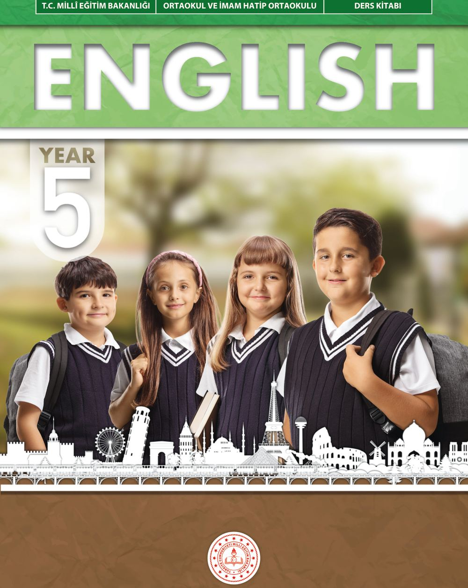
<!-- yer tutucu bulunamadı: sayfa sonuna eklendi -->

<!-- sayfa 1 -->

LOWER SECONDARY SCHOOL AND
İMAM HATIP LOWER SECONDARY SCHOOL

# ENGLISH
## Year 5
### Student's Book

AUTHORS
Aysel BERKET
Eda Burcu ÇETİNKAYA
Fatma DEMİRCAN
Gonca AKISKALI
Nursen SUNAR
Selma YANKUNCU

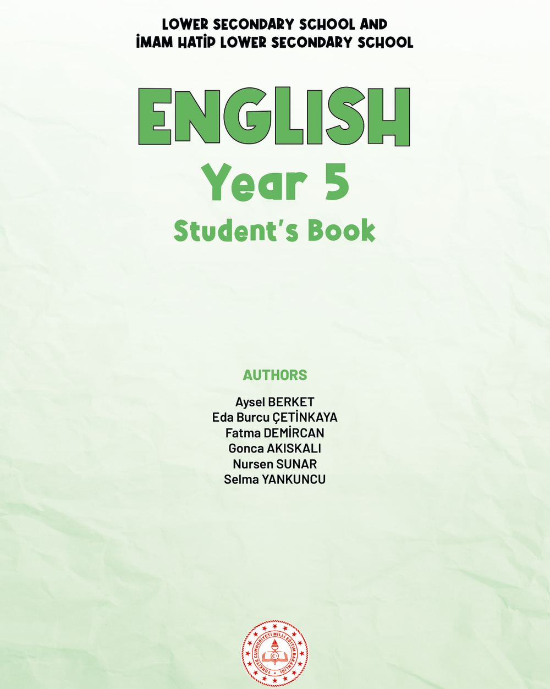

<!-- sayfa 2 -->

MİLLÎ EĞİTİM BAKANLIĞI YAYINLARI ...................................................................: 10315
DERS KİTAPLARI DİZİSİ ......................................................................................: 2293

Her hakkı saklıdır ve Millî Eğitim Bakanlığına aittir. Kitabın metin, soru ve şekilleri kısmen de olsa hiçbir surette alınıp yayımlanamaz.

**Editor**
Dr. Kamile HAMİLOĞLU

**Visual Designers**
Bahadır UYSAL
Mehmet Mirza IŞIK
Nafize AĞIR
Tolga TANYEL

**Multimedia Designer**
Özlem VAYİÇ

**Curriculum Development Specialists**
Dr. Mehmet AKCAALAN
Dr. Orhan YİĞİTOĞLU
Fatma KELEŞ

**Assessment and Evaluation Specialist**
Dr. Sibel AYDOĞAN

**Guidance Specialist**
Serkan İLHAN

ISBN 978-975-11-9066-6

Millî Eğitim Bakanlığı, Talim ve Terbiye Kurulu Başkanlığının 14.08.2025 tarihli ve 138247582 sayılı yazısı ile ders kitabı olarak kabul edilmiştir Kurulca bu kitabın kabul

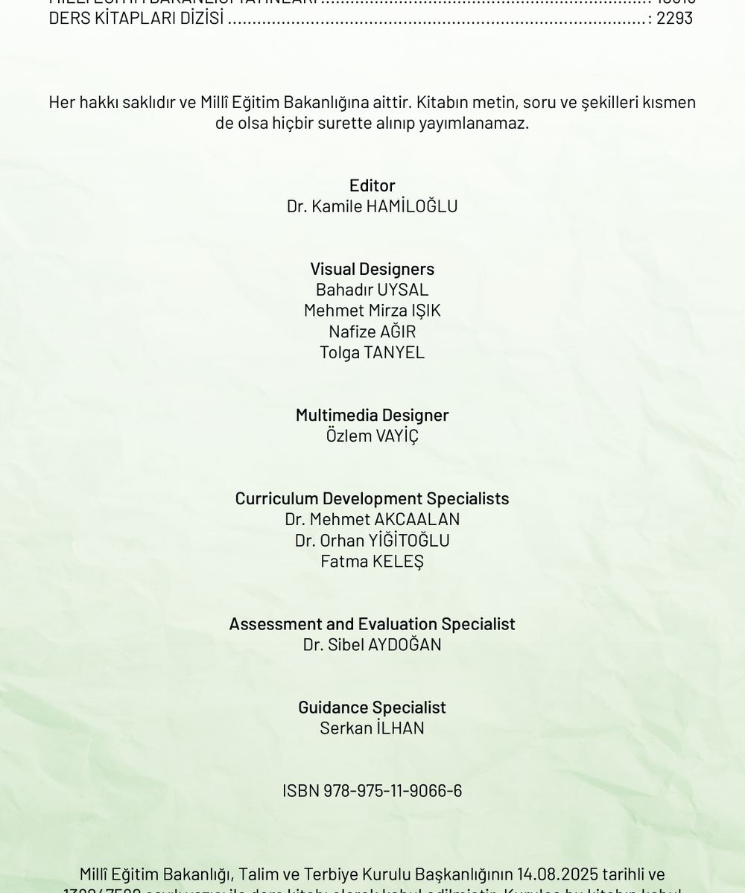
<!-- yer tutucu bulunamadı: sayfa sonuna eklendi -->

<!-- sayfa 3 -->

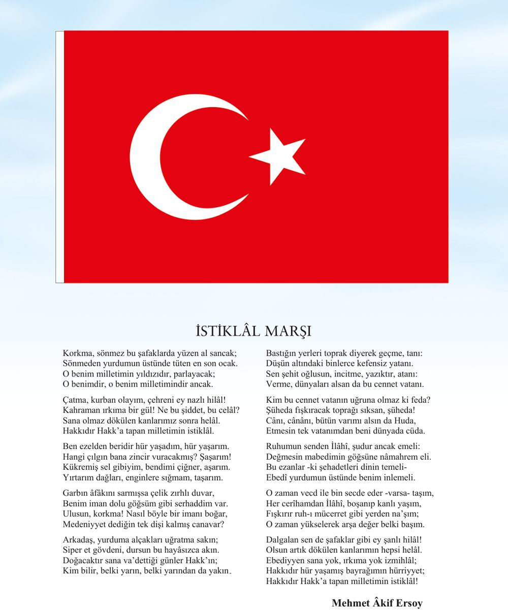

# İSTİKLÂL MARŞI

Korkma, sönmez bu ufaklarda yüzen al sancak;  
Sönmeden yurdumun üstünde tüten en son ocak.  
O benim milletimin yıldızıdır, parlayacak;  
O benimdir, o benim milletimindir ancak.  

Çatma, kurban olayım, çehreni ey nazlı hilâl! 
Kahraman ırkıma bir gül! Ne bu şiddet, bu celâl? 
Sana olmaz dökülen kanlarımız sonra helâl. 
Hakkıdır Hakk’a tapan milletimin istiklâl. 

Ben ezelden beridir hür yaşadım, hür yaşarım. 
Hangi çılgın bana zincir vuracakmış? Şaşarım! 
Kükremiş sel gibiyim, bendimi çiğner, aşarım. 
Yırtarım dağları, enginlere sığmam, taşarım. 

Garbın âfâkını sarmışsa çelik zırhlı duvar,  
Benim iman dolu göğsüm gibi serhaddim var. 
Ulusun, korkma! Nasıl böyle bir imanı boğar, 
Medeniyet dediğin tek dişi kalmış canavar? 

Arkadaş, yurduma alçakları uğratma sakın; 
Siper et gövdeni, dursun bu hayâsızca akın. 
Doğacaktır sana va’dettiği günler Hakk’ın; 
Kim bilir, belki yarın, belki yarından da yakın 

Bastığın yerleri toprak diyerek geçme, tanı:  
Düşün altındaki binlerce kefensiz yatanı. 
Sen şehit oğlusun, incitme, yazıktır, atanı: 
Verme, dünyaları alsan da bu cennet vatanı. 

Kim bu cennet vatanın uğruna olmaz ki feda? 
Şüheda fışkıracak toprağı sıksan, şüheda! 
Cânı, cânânı, bütün varımı alsın da Huda, 
Etmesin tek vatanımdan beni dünyada cüda. 

Ruhumun senden ilâhî, şudur ancak emeli: 
Değmesin mabedimin göğsüne nâmahrem eli. 
Bu ezanlar -ki şehadetleri dinin temeli-  
Ebedî yurdumun üstünde benim inlemeli. 

O zaman vecd ile bin secde eder -varsa- taşım, 
Her cerîhamdan ilâhî, boşanıp kanlı yaşım, 
Fışkırır ruh-ı mücerret gibi yerden na’şım; 
O zaman yükselerek arşa değer belki başım. 

Dalgalan sen de ufaklar gibi ey kanlı hilâl! 
Olsun artık dökülen kanlarımın hepsi helâl. 
Ebediyyen sana yok, Türk'e yok izmihlâl; 
Hakkıdır hür yaşamı bayrağımın hürriyet;  
Hakkıdır Hakk’a tapan milletimin istiklâl! 

Mehmet Âkif Ersoy

<!-- sayfa 4 -->

# GENÇLİĞE HİTABE

Ey Türk gençliği! Birinci vazifen, Türk istiklâlini, Türk Cumhuriyetini, ilelebet muhafaza ve müdafaa etmektir.

Mevcudiyetinin ve istikbalinin yegâne temeli budur. Bu temel, senin en kıymetli hazinendir. İstikbalde dahi, seni bu hazineden mahrum etmek isteyecek dâhilî ve hâricî bedhahların olacaktır. Bir gün, istiklâl ve cumhuriyeti müdafaa mecburiyetine düşersen, vazifeye atılmak için, içinde bulunacağın vaziyetin imkân ve şeraitini düşünmeyeceksin! Bu imkân ve şerait, çok namüsait bir mahiyette tezahür edebilir. İstiklâl ve cumhuriyetine kastedecek düşmanlar, bütün dünyada emsali görülmemiş bir galibiyetin mümessili olabilirler. Cebren ve hile ile aziz vatanın bütün kaleleri zapt edilmiş, bütün tersanelerine girilmiş, bütün orduları dağıtılmış ve memleketin her köşesi bilfiil işgal edilmiş olabilir. Bütün bu şeraitten daha elîm ve daha vahim olmak üzere, memleketin dâhilinde iktidara sahip olanlar gaflet ve dalâlet ve hattâ hıyanet içinde bulunabilirler. Hattâ bu iktidar sahipleri şahsî menfaatlerini, müstevlîlerin siyasî emelleriyle tevhit edebilirler. Millet, fakr u zaruret içinde harap ve bîtap düşmüş olabilir.

Ey Türk istikbalinin evlâdı! İşte, bu ahval ve şerait içinde dahi vazifen, Türk istiklâl ve cumhuriyetini kurtarmaktır. Muhtaç olduğun kudret, damarlarındaki asil kanda mevcuttur.

Mustafa Kemal Atatürk

<!-- sayfa 5 -->

Görüntüde herhangi bir metin veya matematiksel ifade bulunmamaktadır. Sadece Mustafa Kemal Atatürk'ün bir portresi yer almaktadır.

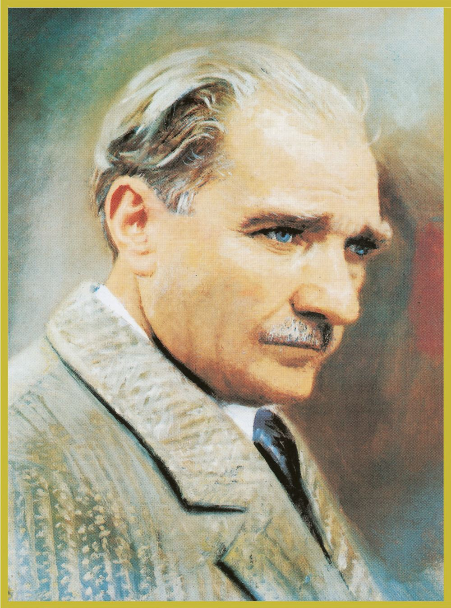
<!-- yer tutucu bulunamadı: sayfa sonuna eklendi -->

<!-- sayfa 6 -->

Verdiğiniz metin katmanı boş olduğu için (`<<< >>>` arası boş) dönüştürülecek herhangi bir içerik bulunmamaktadır. Lütfen metin katmanını içeren içeriği paylaşın, böylece talimatlarınıza uygun şekilde Markdown formatına çevirebilirim.

<!-- sayfa 7 -->

# CONTENTS

Table of Contents .......................................................... 8
About the Book ........................................................... 12
Icons .................................................................... 14
Revision 1 ............................................................... 15
Revision 2 ............................................................... 21
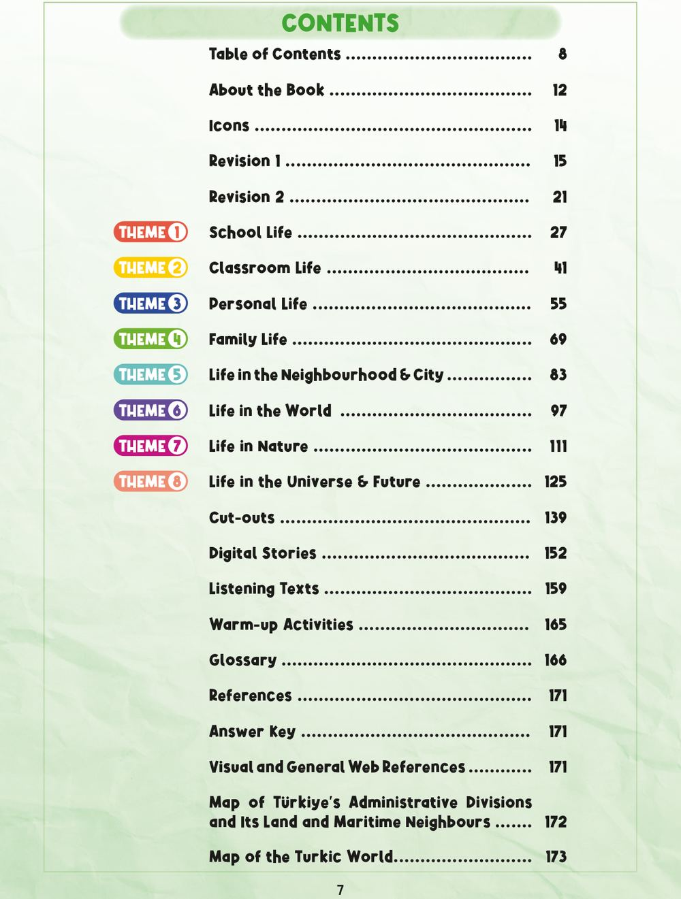 THEME 1 School Life ........................................... 27
 THEME 2 Classroom Life ........................................ 41
 THEME 3 Personal Life ......................................... 55
 THEME 4 Family Life ........................................... 69
 THEME 5 Life in the Neighbourhood & City ..................... 83
 THEME 6 Life in the World ..................................... 97
 THEME 7 Life in Nature ........................................ 111
 THEME 8 Life in the Universe & Future ........................ 125
Cut-outs ................................................................. 139
Digital Stories .......................................................... 152
Listening Texts .......................................................... 159
Warm-up Activities ....................................................... 165
Glossary ................................................................. 166
References ............................................................... 171
Answer Key ............................................................... 171
Visual and General Web References ........................................ 171
Map of Türkiye's Administrative Divisions and Its Land and Maritime Neighbours ....... 172

<!-- sayfa 8 -->

# TABLE OF CONTENTS

| THEME NO | MAIN THEME | SUB-THEMES | FUNCTIONS AND GRAMMARING | VOCABULARY SELECTION-USE | PRONUNCIATION SELECTION-USE | LISTENING & WATCHING - COMPREHENSION |
| :--- | :--- | :--- | :--- | :--- | :--- | :--- |
| REVISION | Revision 1 | - Daily routines and activities at school - Favourite school subjects and classroom activities now and in the past - Time - Seasons of the year - Physical appearances and personality - Clothing and clothing preferences | - Daily routines: The Simple Present Tense - Preference or enjoyment: “Like + gerund” - Past states: The Simple Past Tense - Ability in the past: “Could” | - Vocabulary for daily routines and activities at school - Vocabulary for favourite school subjects - Vocabulary for time and seasons of the year - Vocabulary for physical appearances and personality - Vocabulary for clothing and clothing preferences | | School subjects Listening for details |
| REVISION | Revision 2 | - Family members’ jobs - Family members’ long-lasting habits - Family members’ errands - Places for services in the neighbourhood - Comparisons | - Completed actions in the past: The Simple Past Tense - Comparing three or more things: Comparisons with the regular forms of adjectives/superlatives - Preferences or interests: Like/Love + Ving | - Vocabulary for family members’ jobs - Vocabulary for family members’ long-lasting habits - Vocabulary for family members’ errands - Vocabulary for places for services in the neighbourhood | | People with different jobs talking about their jobs/routines Listening for specific information/details |
| THEME 1 | School Life | - People, places, and rules at school - School clubs - Countries - National days and celebrations | - “A, an, the”: Articles - Preferences about activities: The Simple Present Tense - Giving commands: Imperatives - Obligation and rules: “Mustn’t/ Can’t” | - Vocabulary for people, places, and rules at school - Vocabulary for school clubs - Vocabulary for national days and celebrations | Intonation of positive statements | The first day of an international summer school Listening for gist/specific information/details |
| THEME 2 | Classroom Life | - Classroom rules and language - School subjects - Timetables - Classroom objects - Days of the week - Time | - Presence of something or somebody: “There is/There are” - Responsibilities and routines: The Simple Present Tense - Asking the time of actions: “What... | - Vocabulary for school subjects - Vocabulary for timetables - Vocabulary for classroom objects - Vocabulary for days of the week - Vocabulary for time | Intonation of negative stataments | A conversation in the classroom Listening for gist/specific information/details |

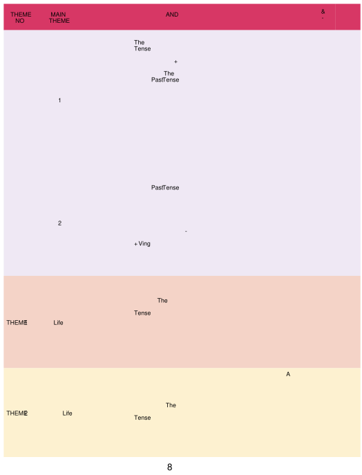
<!-- yer tutucu bulunamadı: sayfa sonuna eklendi -->

<!-- sayfa 9 -->

# TABLE OF CONTENTS

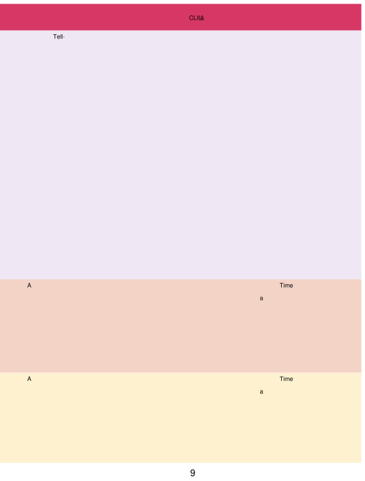

| READING-COMPREHENSION | SPEAKING-EXPRESSION | WRITING-EXPRESSION | CLIL & CULTURE | PROJECTS | REFLECTION | EVALUATION |
| :--- | :--- | :--- | :--- | :--- | :--- | :--- |
| “Show and Tell” day Reading for details | ***The speaking skill is incorporated into all sections of the theme.***  Clothing preferences Sharing personal information | Social Language Expressions Finding out the suitable expression for different situations | | | | |
| A Day at the Seaside Scanning Reading for details | ***The speaking skill is incorporated into all sections of the theme.***  Talking about daily routines Interacting in pairs | Grouping the healthy/ unhealthy food Differentiating food categories | | | | |
| A blog page Skimming Scanning Reading for details | ***The speaking skill is incorporated into all sections of the theme.***  Dialogues about people, places, and rules at school, countries, favourite school clubs Interacting in pairs/ groups | A reply to a blogger Sharing personal preferences | Interesting rules in different countries | How to create a new school club Presenting a poster | Time to check your progress Reflecting on the learning process | Rating scales about the learning outcomes |
| A weekly school magazine Skimming Scanning Reading for details | ***The speaking skill is incorporated into all sections of the theme.***  Dialogues about school subjects, classroom objects, time, and timetable Sharing personal information in pairs/ | A survey in the class Exchanging information and comparing | Interesting school activities and lessons in different countries | How to make a dream classroom Presenting a poster | Time to check your progress Reflecting on the learning process | Rating scales about the learning outcomes |

<!-- sayfa 10 -->

| THEME NO | MAIN THEME | SUB-THEMES | FUNCTIONS AND GRAMMARING | VOCABULARY SELECTION-USE | PRONUNCIATION | LISTENING & WATCHING - COMPREHENSION |
| :--- | :--- | :--- | :--- | :--- | :--- | :--- |
| THEME 3 | Personal Life | -Basic body parts and physical features -Clothes -Daily routines and activities | -Daily routines: The Simple Present Tense -Confirming general truths: Question tags -The frequency of actions: Adverbs of frequency | -Vocabulary for basic body parts and physical features -Vocabulary for clothes -Vocabulary for daily routines and activities | Intonation of questions and question tags | Two children talking about a video game Listening for gist/specific information/details |
| THEME 4 | Family Life | -Family members’ routines -Family members’ hobbies and activities | -Actions happening at the moment of speaking: The Present Progressive Tense -Ongoing or temporary actions: The Present Progressive Tense vs. The Simple Present Tense -Confirming ongoing actions: Question tags | -Vocabulary for family members’ routines -Vocabulary for family members’ hobbies and activities | Target sounds: a, b, c, d, e | Two children talking about a family photo album Listening for gist/specific information/details |
| THEME 5 | Life in the Neighbourhood & the City | -Places in the neighbourhood and city -Different types of houses | -Comparisons between two things or people: Comparatives of adjectives -Ownership or relationship: Possessive ‘s -Habitual actions: The Simple Present Tense -Existence or location: “There is/ There are” | -Vocabulary for places for recreation and attractions in the neighbourhood and city -Vocabulary for different types of houses and furniture and kitchen utensils | Target sounds: f, g, h, i, j, k | A dialogue between a customer and a salesperson for renting a house Listening for gist/specific information/details |
| THEME 6 | Life in the World | -Basic food types -Ordering in a restaurant -Food events in the city | -Permission: “Can” -Possession: “Have got/Has got” -Countable and uncountable nouns | -Vocabulary for basic food types -Vocabulary for ordering in a restaurant | Target sounds: l, m, n, o, p | A dinner at the restaurant Listening for gist/specific information/details |
| THEME 7 | Life in Nature | -Types of animals in nature -Wild animals in nature -Their habitats | -Capability, ability: “Can” -External obligation: “Must” -Location or place: “Where?” -Comparing things, animals, and people: Comparative and superlative adjectives | -Vocabulary for types of animals in nature -Vocabulary for wild animals in nature -Vocabulary for their habitats | Target sounds: q, r, s, t, u | Two children visiting a national park Listening for gist/specific information/details |
| THEME 8 | Life in the Universe & Future | -Planet Earth -Holidays -School holidays, places, activities, and plans for holidays | -Plans: “Be Going to Future Tense” | -Vocabulary for Planet Earth -Vocabulary for school holidays, places, activities, and plans for holidays | Target sounds: v, w, x, y, z | Planning a holiday Listening for gist/specific information/details |

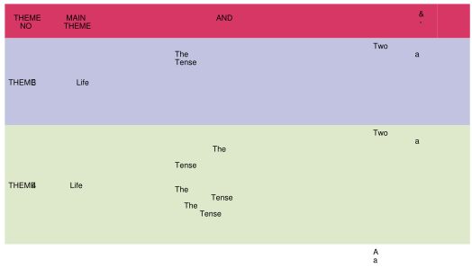
<!-- yer tutucu bulunamadı: sayfa sonuna eklendi -->

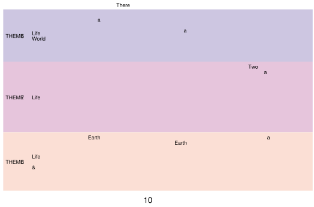
<!-- yer tutucu bulunamadı: sayfa sonuna eklendi -->

<!-- sayfa 11 -->

| READING-COMPREHENSION | SPEAKING-EXPRESSION | WRITING-EXPRESSION | CLIL & CULTURE | PROJECTS | REFLECTION | EVALUATION |
| :--- | :--- | :--- | :--- | :--- | :--- | :--- |
| Fashion Magazine, Style & You Skimming Scanning Reading for details | *The speaking skill is incorporated into all sections of the theme.*  Dialogues about basic body parts, physical features, clothes, daily routines, and activities Interacting in pairs/groups | Introducing a celebrity Describing a person's features | Clothing from all around the world | How to make your wardrobe Presenting a poster | Time to check your progress Reflecting on the learning process | Rating scales about the learning outcomes |
| A Strange Day, Isn't it? Skimming Scanning Reading for details | *The speaking skill is incorporated into all sections of the theme.*  Dialogues about family members' routines, hobbies, and activities Interacting in pairs/groups | An unusual day in my diary Comparing an unusual day | Popular hobbies and activities in different countries | How to make an interview Presenting an interview | Time to check your progress Reflecting on the learning process | Rating scales about the learning outcomes |
| A blog page about different house types Skimming Scanning Reading for details | *The speaking skill is incorporated into all sections of the theme.*  Dialogues about places in the neighbourhood and city and different types of houses Interacting in pairs/groups | Introducing and comparing houses | Interesting Houses, Interesting Lives | How to create a dream house Presenting a poster | Time to check your progress Reflecting on the learning process | Rating scales about the learning outcomes |
| Spanish Churros Skimming Scanning Reading for details | *The speaking skill is incorporated into all sections of the theme.*  Dialogues about the ingredients of a dish, steps of a recipe, and ordering at restaurant Talking in pairs/groups | A recipe Explaining the steps of a recipe | Eating habits around the world | How to order in a restaurant Presenting a record | Time to check your progress Reflecting on the learning process | Rating scales about the learning outcomes |
| Animal Habitats Skimming Scanning Reading for details | *The speaking skill is incorporated into all sections of the theme.*  Dialogues about types of animals in nature, wild animals in nature, and their habitats Interacting in pairs/groups | Introducing a favourite animal Describing an animal's features | Penguins | How to describe wild animals Presenting a poster | Time to check your progress Reflecting on the learning process | Rating scales about the learning outcomes |
| Postcards Skimming Scanning Reading for details | *The speaking skill is incorporated into all sections of the theme.*  Dialogues about the activities and places for holiday plans | A postcard from a holiday destination Describing holiday plans | Amazing holiday destinations around the world | How to plan a dream holiday Presenting a poster | Time to check your progress Reflecting on the learning process | Rating scales about the learning outcomes |

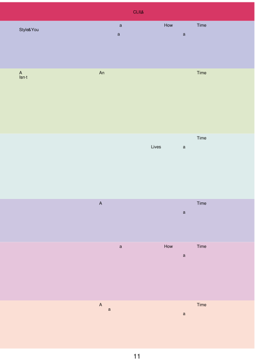
<!-- yer tutucu bulunamadı: sayfa sonuna eklendi -->

<!-- sayfa 12 -->

# ABOUT THE BOOK

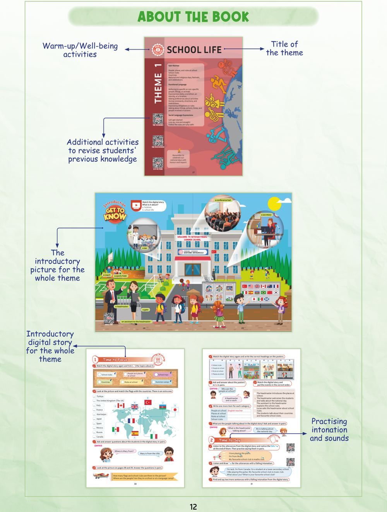

* Warm-up/Well-being activities
* Title of the theme
* Additional activities to revise students' previous knowledge
* The introductory picture for the whole theme
* Introductory digital story for the whole theme
* Practising intonation and sounds

<!-- sayfa 13 -->

# Target vocabulary in use
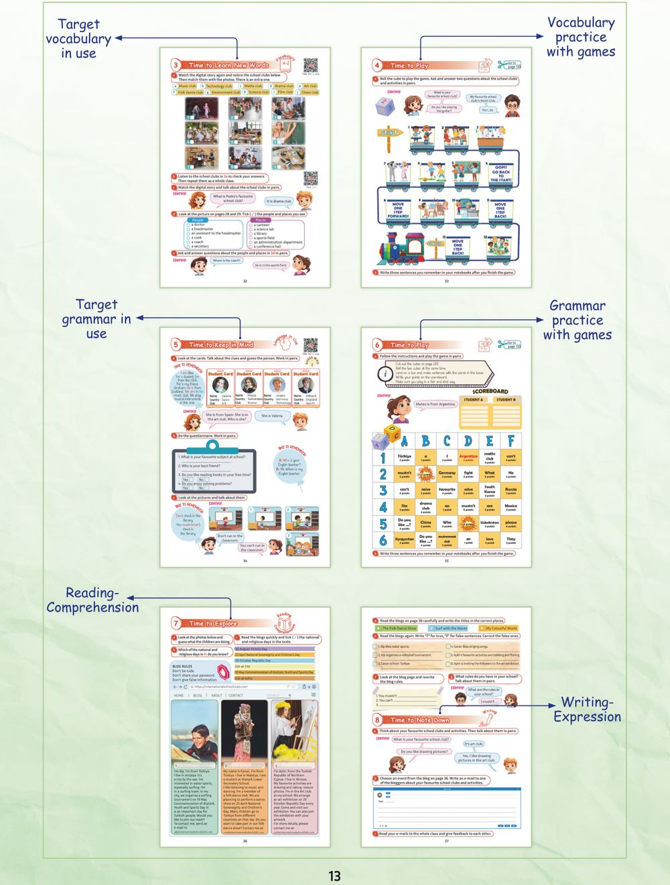

## 3 Time to Learn New Words A-Z
1. Watch the digital story again and notice the school clubs below. Then match with the words in this box. Then write.
- Music club
- Technology club
- Maths club
- Drama club
- Art club
- Folk dance club
- Environment club
- Cooking club
- Chess club

2. Listen to the school clubs in 3a to check your answers. Then repeat them in which school clubs in pairs.
3. Watch the digital story and talk about the school clubs in pairs.
[CONFIRM]
- What is Pedro's favourite school club?
- It is drama club.

4. Look at the picture on pages 28 and 29. Trick! The people and places you see are:
- a dietitian
- a cook
- a secretary
- a librarian
- a carpenter
- a science lab
- a library
- an administration department
- an administration office

5. Ask and answer questions about the people and places in 4 in pairs.
[CONFIRM]
- Where is the cook?
- He is in the school field.

## 4 Time to Play
1. Roll the cube to play the game. Ask and answer two questions about the school clubs and activities in pairs.
[EXAMPLE]
- What is your favourite school club?
- My favourite school club is music.
- Do you like playing the guitar?
- Yes, I do. / No, I don't.

2. Write three sentences you remember in your notebooks after you finish the game.

# Vocabulary practice with games

# Target grammar in use

## 5 Time to Keep in Mind
1. Look at the cards. Talk about the clues and guess the person. Work in pairs.
[EXAMPLE]
- She is from Spain. She is in the art club. Who is she?
- She is Valeria.

| Student Card | Student Card | Student Card | Student Card |
| :--- | :--- | :--- | :--- |
| Name: Valeria | Name: Graham | Name: Mateo | Name: Sofia |
| Country: Spain | Country: England | Country: Argentina | Country: Turkey |
| Hobby: Art | Hobby: Music | Hobby: Math | Hobby: Cooking |

2. Do the questionnaire. Work in pairs.
1. What is your favourite subject at school?
2. Who is your best friend?
3. Do you like reading books in your free time?
4. Do you have any problems?

3. Look at the pictures and talk about them.

- Don't shout in the library.
- You shouldn't read books in the library.
- Don't run in the classroom.
- You can't run in the classroom.

# Grammar practice with games

## 6 Time to Play
1. Follow the instructions and play the game in pairs.
Cut out the scoreboard on page 35. Use it to score the points in the game with the words in the boxes. Write your points on the scoreboard.
[EXAMPLE]
- Mateo is from Argentina.

| SCOREBOARD | STUDENT A | STUDENT B |
| :--- | :--- | :--- |
| 1 | Türkiye 2 points | Argentina 5 points |
| 2 | Brazil 3 points | Germany 5 points | He... |
| 3 | can't noise 3 points | favourite 5 points | fourth 5 points |
| 4 | drama 5 points | art 5 points | music 5 points |
| 5 | Do you like China 5 points | Who is...? 5 points | listen/can't 5 points | please 5 points |
| 6 | Do you like amusement 5 points | club 5 points | They 5 points | music 5 points |

# Reading-Comprehension

## 7 Time to Explore
1. Look at the photos below and guess what the children are doing.
2. Which of the following religious days in 1 do you know?
- Ay Diwali
- Eid al-Fitr
- Ay National Sovereignty and Children's Day
- Christmas

[BLOG RULES]
- Don't be rude.
- Don't share your password.
- Don't give false information.

# Writing-Expression

## 8 Time to Note Down
1. Read the blogs on page 36 carefully and write the titles in the correct places.
[TITLE: The Bloggers' Life]
[TITLE: My Favourite School Club]

2. Read the blogs again. Write "T" for true, "F" for false sentences. Correct the false ones.
1. Ali likes water sports.
2. Ayfer organizes a volleyball tournament.
3. Ayfer's favourite activities are fishing and singing.
4. Iker is from Turkey.
5. Ayfer is making the following to the art exhibition.

3. Look at the blog pages and rewrite the blog pages.
[EXAMPLE]
- What rules do you have in your school?
- I mustn't...
- You can't...
- I mustn't...

4. Think about your favourite school clubs and activities. Then talk about them in pairs.
[EXAMPLE]
- What is your favourite school club?
- It's art club.
- Do you like drawing pictures?
- Yes, I like drawing in the art club.

5. Choose an event from the blog on page 10. Write an e-mail to one of the bloggers about your favourite school clubs and activities.

<!-- sayfa 14 -->

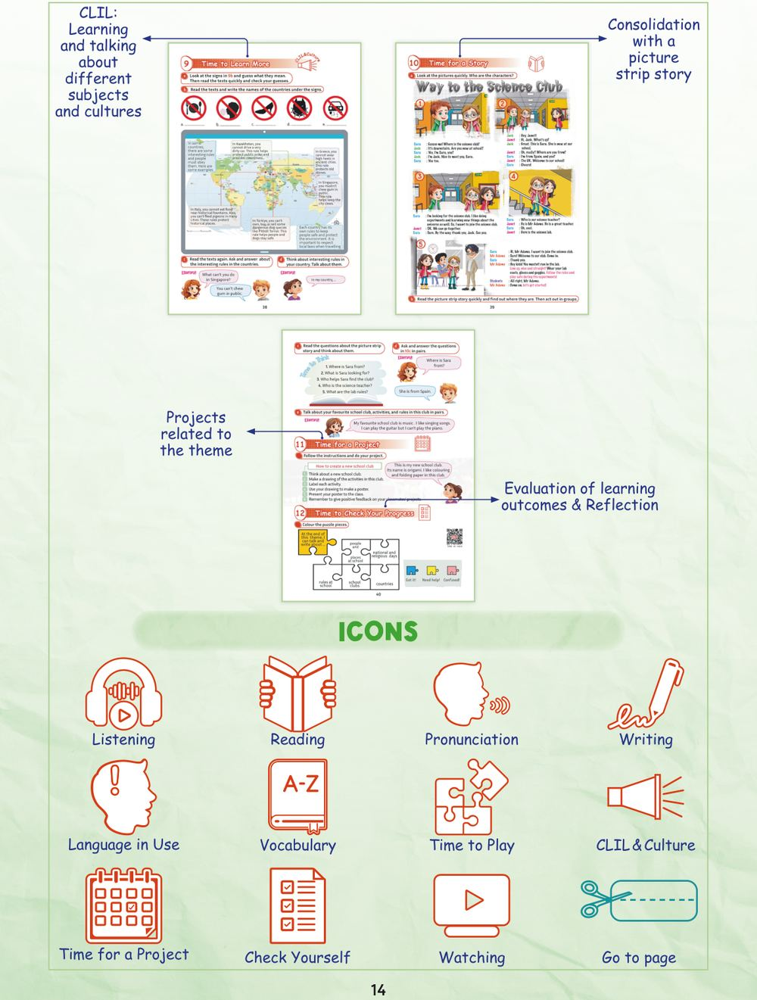

Learning and talking about different subjects and cultures $\rightarrow$ 

Consolidation with a picture strip story $\rightarrow$ 

Projects related to the theme $\rightarrow$ 

Evaluation of learning outcomes & Reflection $\rightarrow$ 

# ICONS

Listening

Reading

Pronunciation

Writing

Language in Use

Vocabulary

Time to Play

CLIL & Culture

<!-- sayfa 15 -->

# REVISION 1

**Sub-themes**

Daily routines and activities at school
Favourite school subjects and classroom activities
Time and seasons of the year
Physical appearances and personality
Clothing and clothing preferences

**Functional Language**

Describing daily routines and activities at school
Describing past states or conditions of things or people
Expressing preferences
Telling the time
Telling the preferences about favourite school subjects/lessons
Describing abilities or skills someone had in the past
Describing physical appearance
preferences for clothing

**Social Language Expressions**

It's raining cats and dogs!
Let's break the ice!
I'm sorry to hear that!
It fits like a glove!
Feel free to use this!

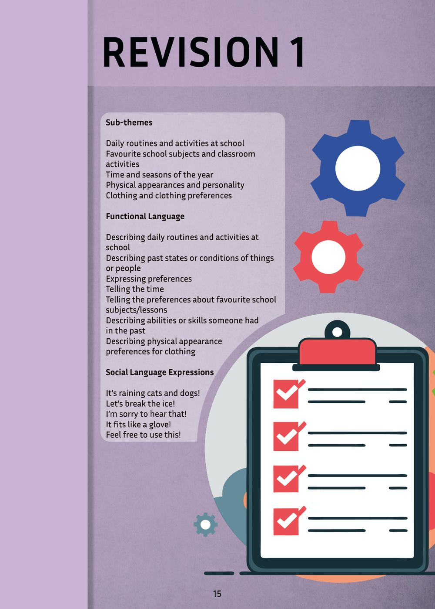

<!-- sayfa 16 -->

 Listen to the dialogue and complete it. There is an extra one.

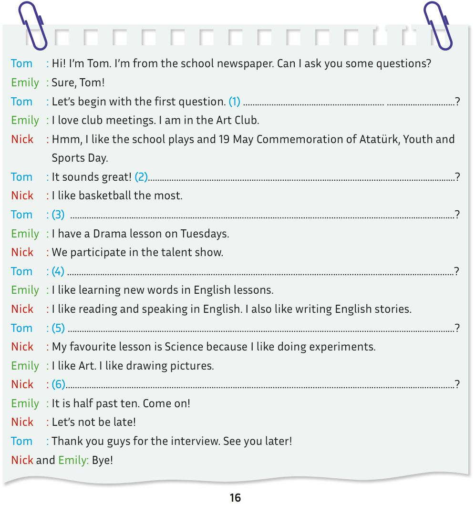
a. What is your favourite lesson?
b. What do you like doing in English lessons?
c. What is the time now?
d. What time do you get up?
e. What is your favourite school activity?
f. What do you do at school on Tuesdays?
g. Which sports do you like the most?

Tom : Hi! I'm Tom. I'm from the school newspaper. Can I ask you some questions?
Emily : Sure, Tom!
Tom : Let's begin with the first question. (1) ............................................................................................?
Emily : I love club meetings. I am in the Art Club.
Nick : Hmm, I like the school plays and 19 May Commemoration of Atatürk, Youth and Sports Day.
Tom : It sounds great! (2)........................................................................................................................?
Nick : I like basketball the most.
Tom : (3) .....................................................................................................................................................?
Emily : I have a Drama lesson on Tuesdays.
Nick : We participate in the talent show.
Tom : (4) .....................................................................................................................................................?
Emily : I like learning new words in English lessons.
Nick : I like reading and speaking in English. I also like writing English stories.
Tom : (5) .....................................................................................................................................................?
Nick : My favourite lesson is Science because I like doing experiments.
Emily : I like Art. I like drawing pictures.
Nick : (6).....................................................................................................................................................?
Emily : It is half past ten. Come on!
Nick : Let's not be late!
Tom : Thank you guys for the interview. See you later!

<!-- sayfa 17 -->

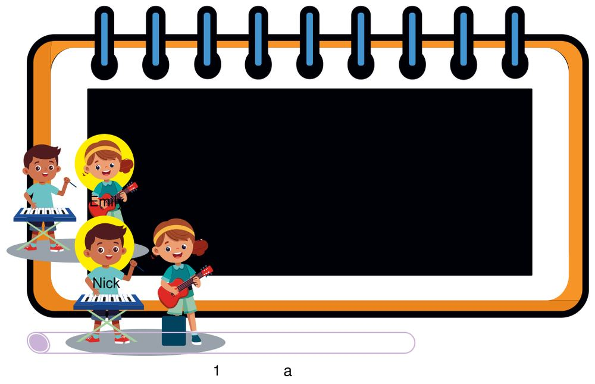 2 Read the dialogue on page 16 and fill in the table.

| | favourite school activities | things they do on Tuesdays | things they like doing in English lessons | their favourite lesson |
| :--- | :--- | :--- | :--- | :--- |
| Emily | club meetings | | | |
| Nick | | | | |

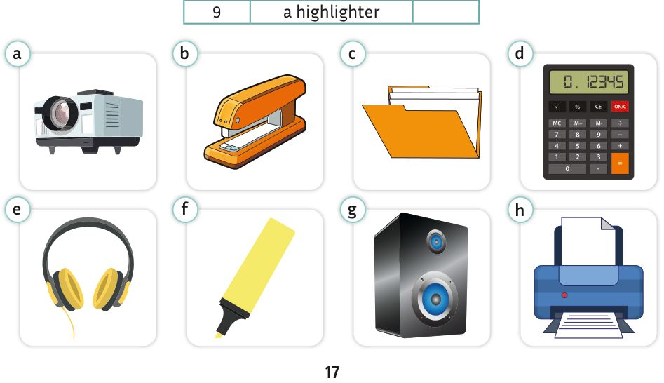 3 Match the objects with the pictures. There is an extra one.

| | | |
| :--- | :--- | :--- |
| 1 | a folder | |
| 2 | a stapler | |
| 3 | a printer | |
| 4 | headphones | |
| 5 | a projector | |
| 6 | a rubbish bin | |
| 7 | a calculator | |
| 8 | a speaker | |
| 9 | a highlighter | |

| | | | |
| :---: | :---: | :---: | :---: |
| a | b | c | d |
|  |  |  |  |
| e | f | g | h |
|  |  |  |  |

<!-- sayfa 18 -->

 Reorder the words and write classroom instructions.

USE
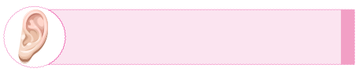 talk • write • listen • read • look • check

1. please - the - at - screen
..........................................................................!

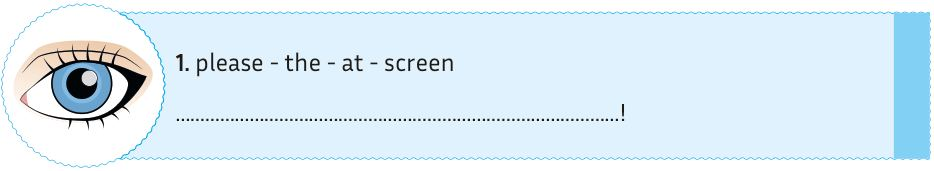 2. carefully - please
..........................................................................!

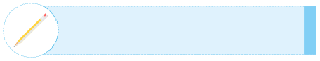 3. with - peers - your - please
..........................................................................!

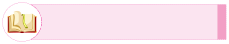 4. down - this - please
..........................................................................!

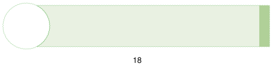 5. please - this
..........................................................................!

6. please - answers - your
..........................................................................!

<!-- sayfa 19 -->

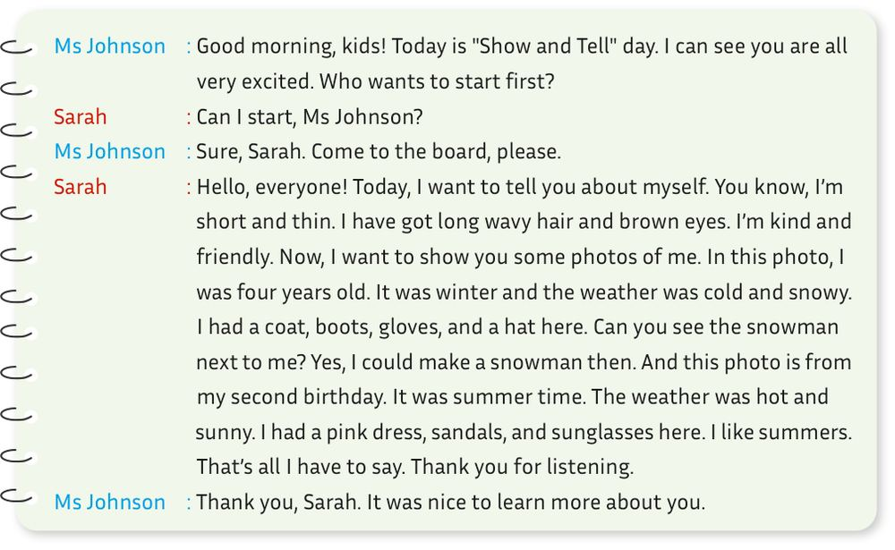 Read the text and choose the correct option.

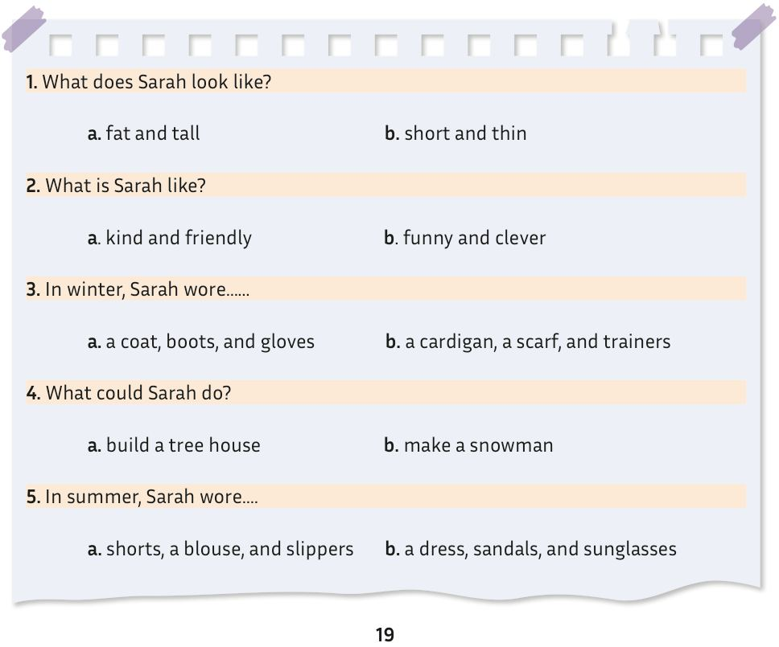
Ms Johnson : Good morning, kids! Today is "Show and Tell" day. I can see you are all very excited. Who wants to start first?
Sarah : Can I start, Ms Johnson?
Ms Johnson : Sure, Sarah. Come to the board, please.
Sarah : Hello, everyone! Today, I want to tell you about myself. You know, I'm short and thin. I have got long wavy hair and brown eyes. I'm kind and friendly. Now, I want to show you some photos of me. In this photo, I was four years old. It was winter and the weather was cold and snowy. I had a coat, boots, gloves, and a hat here. Can you see the snowman next to me? Yes, I could make a snowman then. And this photo is from my second birthday. It was summer time. The weather was hot and sunny. I had a pink dress, sandals, and sunglasses here. I like summers. That's all I have to say. Thank you for listening.
Ms Johnson : Thank you, Sarah. It was nice to learn more about you.

1. What does Sarah look like?
   a. fat and tall                                          b. short and thin

2. What is Sarah like?
   a. kind and friendly                              b. funny and clever

3. In winter, Sarah wore......
   a. a coat, boots, and gloves                b. a cardigan, a scarf, and trainers

4. What could Sarah do?
   a. build a tree house                            b. make a snowman

5. In summer, Sarah wore....
   a. shorts, a blouse, and slippers
   b. a dress, sandals, and sunglasses

<!-- sayfa 20 -->

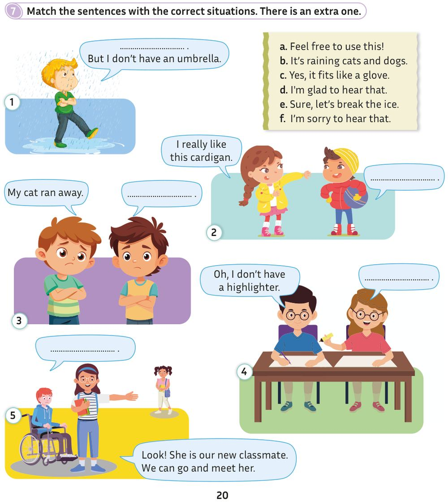

Hi, I'm Onur. I prefer wearing shorts and flip-flops in summer. I dislike wearing gloves in winter.

6 Look at the words in the box and talk about them.

7 Match the sentences with the correct situations. There is an extra one.

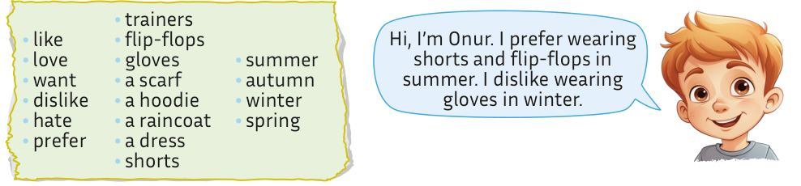

1
But I don't have an umbrella.
............................... .

a. Feel free to use this!
b. It's raining cats and dogs.
c. Yes, it fits like a glove.
d. I'm glad to hear that.
e. Sure, let's break the ice.
f. I'm sorry to hear that.

2
I really like this cardigan.
............................... .

3
My cat ran away.
............................... .

4
Oh, I don't have a highlighter.
............................... .

5
............................... .

<!-- sayfa 21 -->

# REVISION 2

**Sub-themes**

* Family members’ jobs
* Family members’ long-lasting habits
* Family members’ errands
* Places for services in the neighbourhood
* Life on the seaside
* Sea/marine animals and their habitats
* Activities of sea/marine animals
* Dangers for sea/marine animals
* Types of houses by the water
* Healthy and unhealthy food

**Functional Language**

* Describing completed actions
* Expressing preferences
* Describing one person, animal, place, or thing
* Giving advice or suggestions
* Describing prohibition
* Comparing multiple items or choices

**Social Language Expressions**

* Don’t worry!
* That’s great!
* Go ahead!
* Amazing!

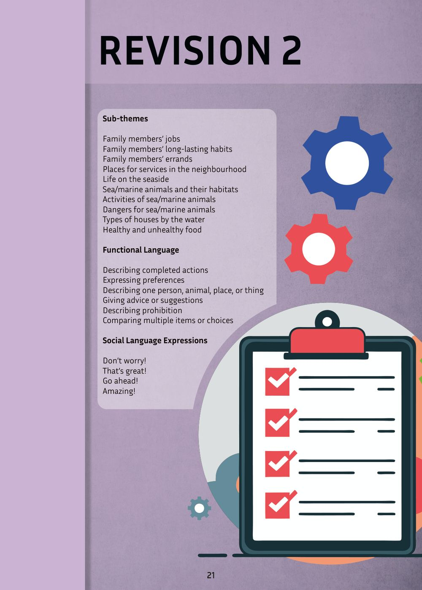

<!-- sayfa 22 -->

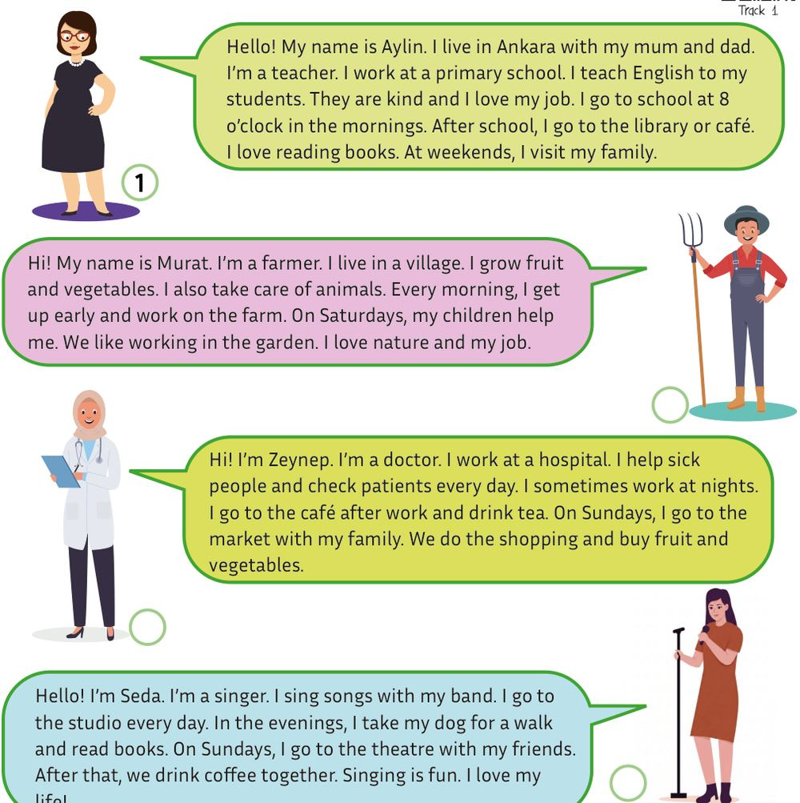

Hello! My name is Aylin. I live in Ankara with my mum and dad. I’m a teacher. I work at a primary school. I teach English to my students. They are kind and I love my job. I go to school at 8 o’clock in the mornings. After school, I go to the library or café. I love reading books. At weekends, I visit my family.

Hi! My name is Murat. I’m a farmer. I live in a village. I grow fruit and vegetables. I also take care of animals. Every morning, I get up early and work on the farm. On Saturdays, my children help me. We like working in the garden. I love nature and my job.

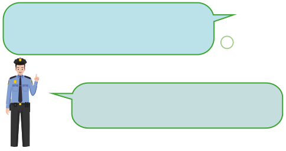

Hi! I’m Zeynep. I’m a doctor. I work at a hospital. I help sick people and check patients every day. I sometimes work at nights. I go to the café after work and drink tea. On Sundays, I go to the market with my family. We do the shopping and buy fruit and vegetables.

Hello! I’m Seda. I’m a singer. I sing songs with my band. I go to the studio every day. In the evenings, I take my dog for a walk and read books. On Sundays, I go to the theatre with my friends. After that, we drink coffee together. Singing is fun. I love my life!

Hi! I’m Ali. I’m a police officer. I work at a big police station in İzmir. I wear a uniform. I help people and keep the city safe. I start work early in the mornings. I love my job. It’s sometimes hard but I enjoy helping others.

<!-- sayfa 23 -->

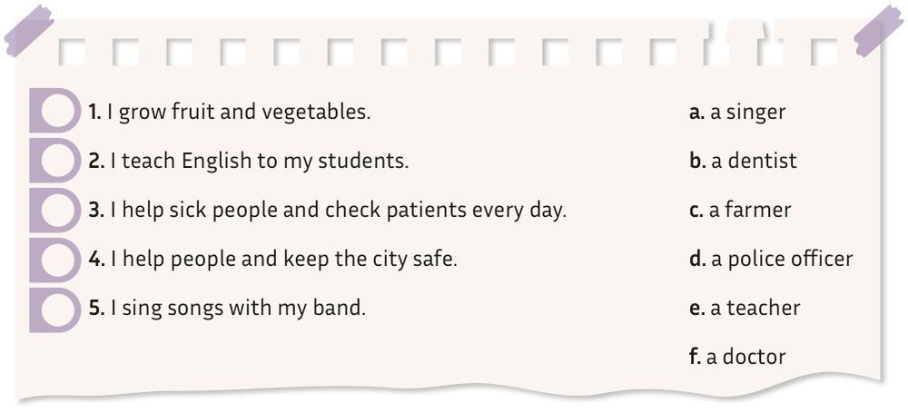

2 Match the sentences from the text with the jobs. There is an extra one.

1. I grow fruit and vegetables. &nbsp;&nbsp;&nbsp;&nbsp;&nbsp;&nbsp;&nbsp;&nbsp;&nbsp;&nbsp;&nbsp;&nbsp;&nbsp;&nbsp;&nbsp;&nbsp;&nbsp;&nbsp;&nbsp;&nbsp;&nbsp;&nbsp;&nbsp;&nbsp;&nbsp;&nbsp;&nbsp;&nbsp;&nbsp;&nbsp;&nbsp;&nbsp;&nbsp;&nbsp;&nbsp;&nbsp;&nbsp;&nbsp;&nbsp;&nbsp;&nbsp;&nbsp;&nbsp;&nbsp;&nbsp;&nbsp;&nbsp;&nbsp;&nbsp;&nbsp;&nbsp;&nbsp;&nbsp;&nbsp;&nbsp;&nbsp;&nbsp;&nbsp;&nbsp;&nbsp;&nbsp;&nbsp;&nbsp;&nbsp;&nbsp;&nbsp;&nbsp;&nbsp;&nbsp;&nbsp;&nbsp;&nbsp;&nbsp;&nbsp;&nbsp;&nbsp;&nbsp;&nbsp;&nbsp;&nbsp;&nbsp;&nbsp;&nbsp;&nbsp;&nbsp;&nbsp;&nbsp;&nbsp;&nbsp;&nbsp;&nbsp;&nbsp;&nbsp;&nbsp;&nbsp;&nbsp;&nbsp;&nbsp;&nbsp;&nbsp;&nbsp;&nbsp;&nbsp;&nbsp;&nbsp;&nbsp;&nbsp;&nbsp;&nbsp;&nbsp;&nbsp;&nbsp;&nbsp;&nbsp;&nbsp;&nbsp;&nbsp;&nbsp;&nbsp;&nbsp;&nbsp;&nbsp;&nbsp;&nbsp;&nbsp;&nbsp;&nbsp;&nbsp;&nbsp;&nbsp;&nbsp;&nbsp;&nbsp;&nbsp;&nbsp;&nbsp;&nbsp;&nbsp;&nbsp;&nbsp;&nbsp;&nbsp;&nbsp;&nbsp;&nbsp;&nbsp;&nbsp;&nbsp;&nbsp;&nbsp;&nbsp;&nbsp;&nbsp;&nbsp;&nbsp;&nbsp;&nbsp;&nbsp;&nbsp;&nbsp;&nbsp;&nbsp;&nbsp;&nbsp;&nbsp;&nbsp;&nbsp;&nbsp;&nbsp;&nbsp;&nbsp;&nbsp;&nbsp;&nbsp;&nbsp;&nbsp;&nbsp;&nbsp;&nbsp;&nbsp;&nbsp;&nbsp;&nbsp;&nbsp;&nbsp;&nbsp;&nbsp;&nbsp;&nbsp;&nbsp;&nbsp;&nbsp;&nbsp;&nbsp;&nbsp;&nbsp;&nbsp;&nbsp;&nbsp;&nbsp;&nbsp;&nbsp;&nbsp;&nbsp;&nbsp;&nbsp;&nbsp;&nbsp;&nbsp;&nbsp;&nbsp;&nbsp;&nbsp;&nbsp;&nbsp;&nbsp;&nbsp;&nbsp;&nbsp;&nbsp;&nbsp;&nbsp;&nbsp;&nbsp;&nbsp;&nbsp;&nbsp;&nbsp;&

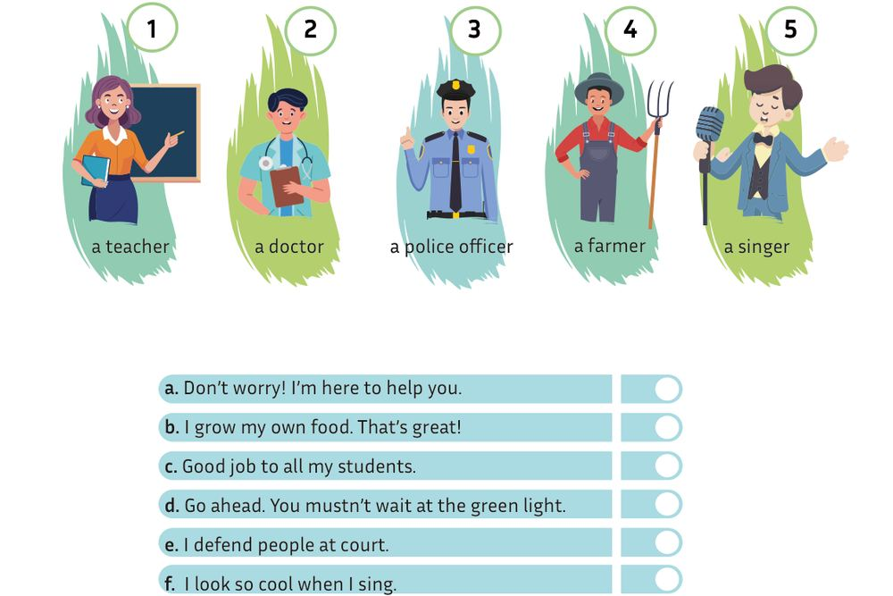
<!-- yer tutucu bulunamadı: sayfa sonuna eklendi -->

<!-- sayfa 24 -->

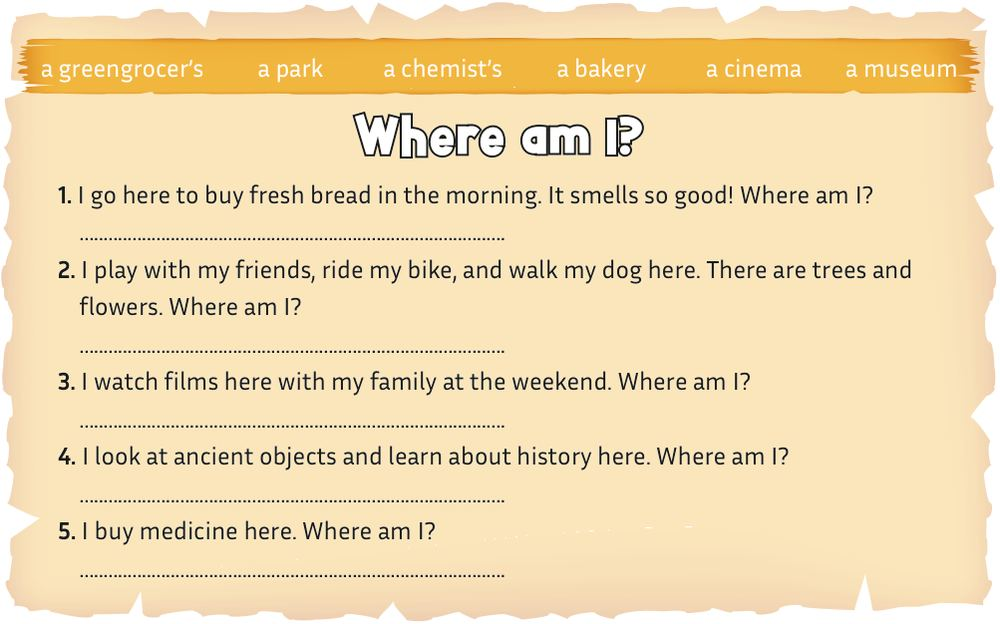 4 Read the clues and match the places. There is an extra one.

a greengrocer’s | a park | a chemist’s | a bakery | a cinema | a museum

# Where am I?

1. I go here to buy fresh bread in the morning. It smells so good! Where am I?
.........................................................................................

2. I play with my friends, ride my bike, and walk my dog here. There are trees and flowers. Where am I?
.........................................................................................

3. I watch films here with my family at the weekend. Where am I?
.........................................................................................

4. I look at ancient objects and learn about history here. Where am I?
.........................................................................................

5. I buy medicine here. Where am I?
.........................................................................................

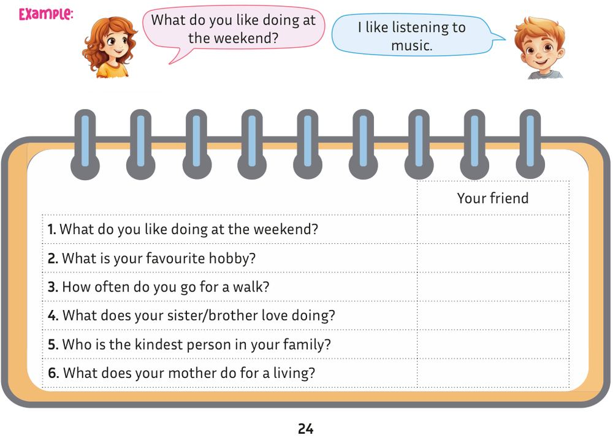 5 Work in pairs. Talk and fill in the chart.

Example:
What do you like doing at the weekend?
I like listening to music.

| | Your friend |
| :--- | :--- |
| 1. What do you like doing at the weekend? | |
| 2. What is your favourite hobby? | |
| 3. How often do you go for a walk? | |
| 4. What does your sister/brother love doing? | |
| 5. Who is the kindest person in your family? | |

<!-- sayfa 25 -->

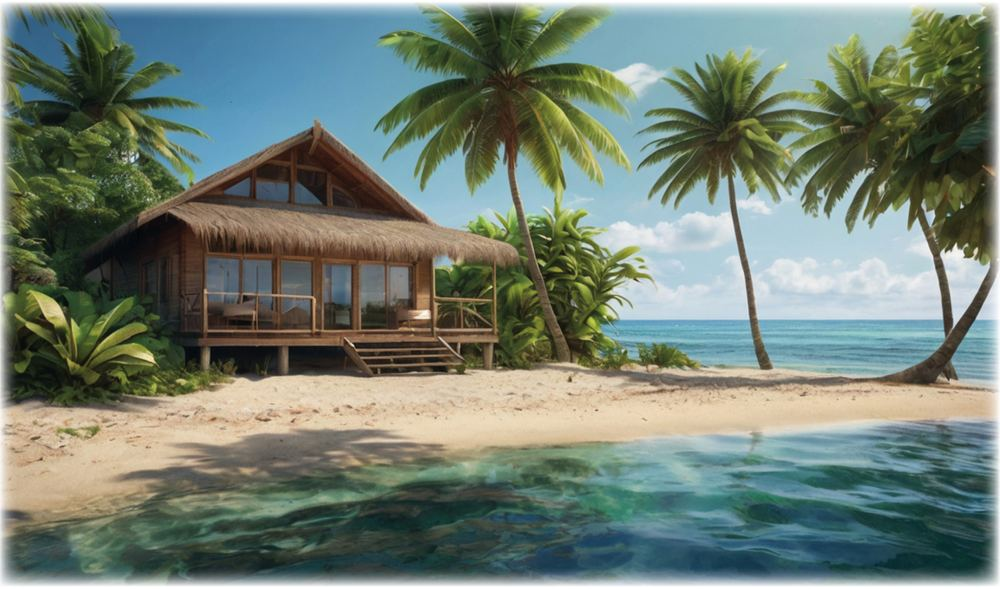

a. A visit to the zoo
b. My trip to the mountains
c. A day at the seaside

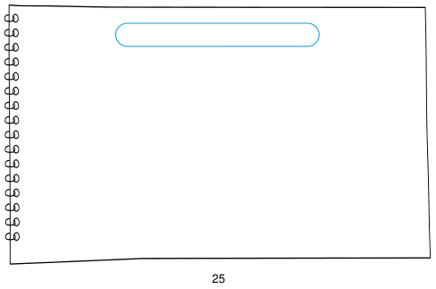

![tropikal sahil evi ve deniz manzarası]

---

| | |
| :--- | :--- |
| | ________________________________________________ |
| | Hello, I’m Linda. Last summer, my family and I stayed in a small beach house near a beautiful lagoon. Every morning, I woke up to the sound of the waves and watched the sea animals. I saw a dolphin jump out of the water and a crab crawl on the rocks. It was amazing!    One day, we went diving in the ocean. I swam with a group of colourful fish and saw a sea turtle hiding under a rock. I also saw something very bad. There were some plastic bags in the water. A jellyfish was in one of those plastic bags. My dad helped it and we took the bags out of the sea.    That night, we talked about protecting sea animals. My sister said, “We shouldn’t throw rubbish into the sea.” I said, “We must keep the sea clean.” My parents were very happy because we cared about our nature.    The next morning, we went to the local market and bought fresh fruit and fish. We had a delicious lunch with grapes, green salad, and grilled fish. We ate together in front of our beach house and watched the calm sea. I felt happy. It was .......................................................................... |

6 Read the text and choose the best title.

<!-- sayfa 26 -->

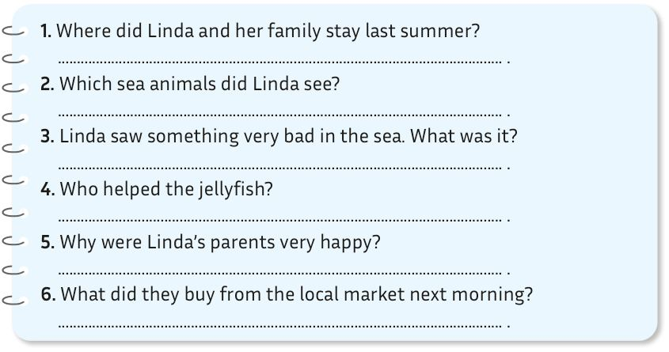

7. Read the text on page 25 again and answer the questions.

1. Where did Linda and her family stay last summer?
..................................................................................................................... .
2. Which sea animals did Linda see?
..................................................................................................................... .
3. Linda saw something very bad in the sea. What was it?
..................................................................................................................... .
4. Who helped the jellyfish?
..................................................................................................................... .
5. Why were Linda’s parents very happy?
..................................................................................................................... .
6. What did they buy from the local market next morning?
..................................................................................................................... .

8. Group the food.

chips
green salad
noodles
yoghurt
broccoli
sweets
hamburger
fish
chocolate
eggs
nuts
sausages
spinach
ice cream

| HEALTHY FOOD | UNHEALTHY FOOD |
| :--- | :--- |
| ................................................................ | ................................................................ |
| ................................................................ | ................................................................ |
| ................................................................ | ................................................................ |
| ................................................................ | ................................................................ |
| ................................................................ | ................................................................ |
| ................................................................ | ................................................................ |
| ................................................................ | ................................................................ |
| ................................................................ | ................................................................ |
|

<!-- sayfa 27 -->

# SCHOOL LIFE

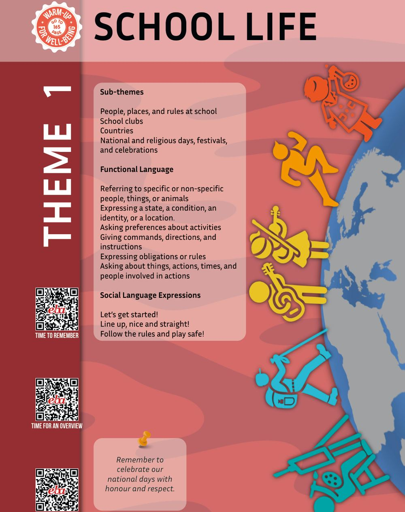

# THEME 1

## Sub-themes
* People, places, and rules at school
* School clubs
* Countries
* National and religious days, festivals, and celebrations

## Functional Language
* Referring to specific or non-specific people, things, or animals
* Expressing a state, a condition, an identity, or a location.
* Asking preferences about activities
* Giving commands, directions, and instructions
* Expressing obligations or rules
* Asking about things, actions, times, and people involved in actions

## Social Language Expressions
* Let's get started!
* Line up, nice and straight!
* Follow the rules and play safe!

TIME TO REMEMBER

TIME FOR AN OVERVIEW

Remember to celebrate our national days with honour and respect.

<!-- sayfa 28 -->

# Introduction
# GET TO KNOW

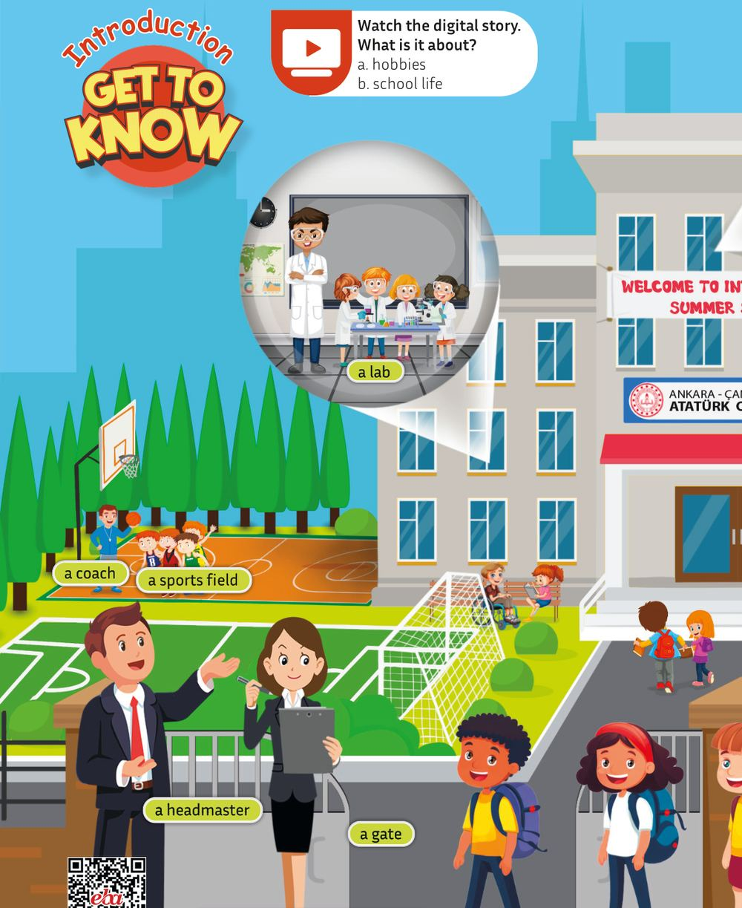

Watch the digital story.
What is it about?
a. hobbies
b. school life

a lab
a coach
a sports field
a headmaster
a gate

<!-- sayfa 29 -->

# INTERNATIONAL SCHOOL
# NKAYA ORTAOKULU

a secretary

| Drama Club | Technology Club | Maths Club |
| :---: | :---: | :---: |
| 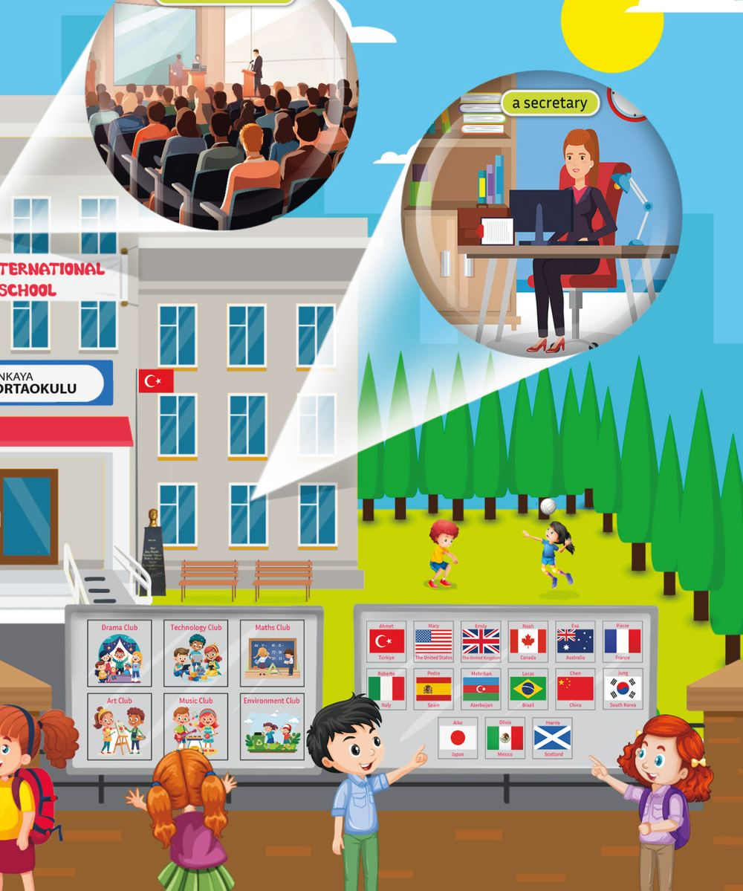 |  |  |

| Art Club | Music Club | Environment Club |
| :---: | :---: | :---: |
|  |  |  |

| Ahmet | Mary | Emre | Noah | Eva | Pierre |
| :---: | :---: | :---: | :---: | :---: | :---: |
| 🇹🇷 Türkiye | 🇺🇸 The United States | 🇬🇧 The United Kingdom | 🇨🇦 Canada | 🇦🇺 Australia | 🇫🇷 France |

| Rodrigo | Pedro | Mehriban | Lucas | Chen | Sung |
| :---: | :---: | :---: | :---: | :---: | :---: |
| 🇮🇹 Italy | 🇪🇸 Spain | 🇦🇿 Azerbaijan | 🇧🇷 Brazil | 🇨🇳 China | 🇰🇷 South Korea |

| Aiko | Özlem | Harris |
| :---: | :---: | :---: |
| 🇯🇵 Japan | 🇲🇽 Mexico | 🏴󠁧󠁢󠁳󠁣󠁴󠁿 Scotland |

<!-- sayfa 30 -->

# 1 Time to Focus
Listening Comprehension

**a Watch the digital story again and tick ($\checkmark$) the topics about it.**

| | | |
| :--- | :--- | :--- |
| $\bigcirc$ School clubs | $\bigcirc$ People and places at school | $\bigcirc$ School trips |
| $\bigcirc$ Countries | $\bigcirc$ Rules at school | $\bigcirc$ Summer camps |

**b Look at the picture and match the flags with the countries. There is an extra one.**

.... Türkiye
.... The United Kingdom (The UK)
.... Italy
.... France
.... Azerbaijan
.... Japan
.... Spain
.... Mexico
.... Russia
.... Canada

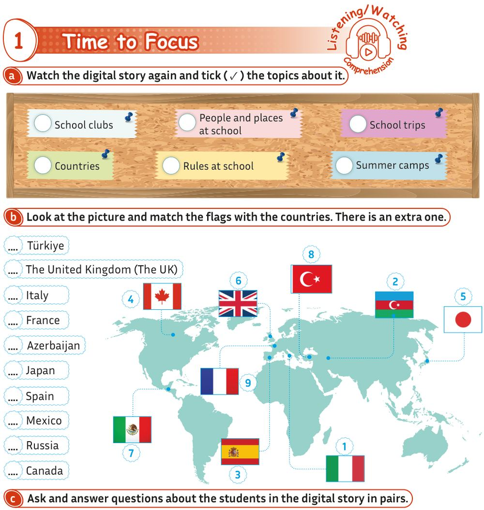

**c Ask and answer questions about the students in the digital story in pairs.**

*Example:*

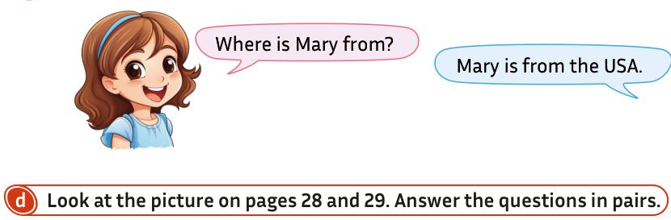
Where is Mary from?
Mary is from the USA.
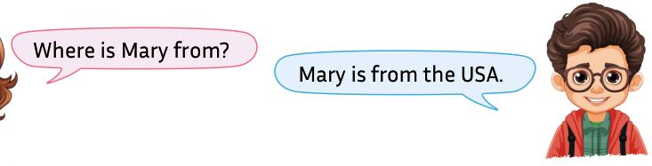

**d Look at the picture on pages 28 and 29. Answer the questions in pairs.**

<!-- sayfa 31 -->

# Watch the digital story again and write the correct headings on the posters.

| 1 | 2 | 3 | 4 |
| :---: | :---: | :---: | :---: |
| ![Poster 1] | ![Poster 2] | ![Poster 3] | ![Poster 4] |

| School clubs |
| :--- |
| • People at school |
| • Rules at school |
| • Places at school |

**f** Ask and answer about the posters in **1e** in pairs.

**Example:**
Who are the people at school?
A headmaster and a coach.

**h** Watch the digital story and put the events in the correct order.

1. The headmaster welcomes the students and talks about the national day.
◯ The headmaster introduces the places at school.
◯ The assistant to the headmaster explains the school rules.
◯ Lucas asks the headmaster about school clubs.
◯ The students talk about their countries and favourite school clubs.

**g** Write one more item for each category.

| Category | Item |
| :--- | :--- |
| People at school | English teacher |
| Places at school | |
| Rules at school | |
| School clubs | |

**i** What are the people talking about in the digital story? Ask and answer in pairs.

**Example:**
What is the headmaster talking about?
He is talking about the national day.

## 2 Time to Say

**Pronunciation**

**a** Listen to the utterances from the digital story and notice the **falls** $\searrow$ at the end of them. Then practise saying them in pairs.

I love playing the piano.
I'm from Brazil.
My favourite school club is maths club.

Track 1.1

**b** Listen and draw $\searrow$ for the utterances with a falling intonation.

I'm Jack. I'm from Canada. I'm a student at a lower secondary school. I like playing the guitar. My favourite school club is music club. What about you? What is your favourite school club?

Track 1.2

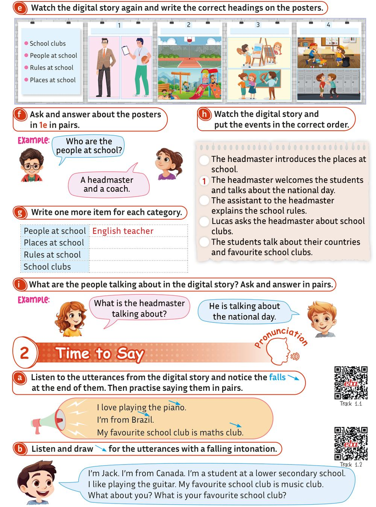
<!-- yer tutucu bulunamadı: sayfa sonuna eklendi -->

<!-- sayfa 32 -->

# 3 Time to Learn New Words

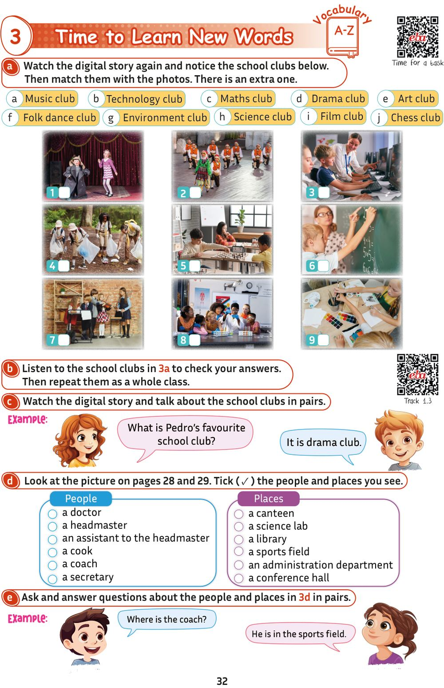

**a** Watch the digital story again and notice the school clubs below. Then match them with the photos. There is an extra one.

a Music club
b Technology club
c Maths club
d Drama club
e Art club
f Folk dance club
g Environment club
h Science club
i Film club
j Chess club

**b** Listen to the school clubs in **3a** to check your answers. Then repeat them as a whole class.

**c** Watch the digital story and talk about the school clubs in pairs.

*Example:*
What is Pedro's favourite school club?
It is drama club.

**d** Look at the picture on pages 28 and 29. Tick ($\checkmark$) the people and places you see.

| People | Places |
| :--- | :--- |
| $\bigcirc$ a doctor | $\bigcirc$ a canteen |
| $\bigcirc$ a headmaster | $\bigcirc$ a science lab |
| $\bigcirc$ an assistant to the headmaster | $\bigcirc$ a library |
| $\bigcirc$ a cook | $\bigcirc$ a sports field |
| $\bigcirc$ a coach | $\bigcirc$ an administration department |
| $\bigcirc$ a secretary | $\bigcirc$ a conference hall |

**e** Ask and answer questions about the people and places in **3d** in pairs.

*Example:*
Where is the coach?
He is in the sports field.

<!-- sayfa 33 -->

# 4 Time to Play

Go to page 139

**a** Roll the cube to play the game. Ask and answer two questions about the school clubs and activities in pairs.

**Example:**

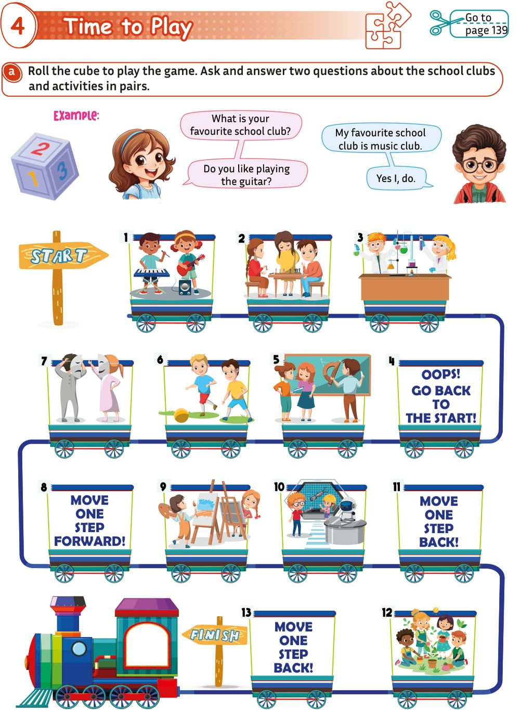

What is your favourite school club?
My favourite school club is music club.

Do you like playing the guitar?
Yes I, do.

| START |
| :---: |
| 1 |
| 2 |
| 3 |
| 4 OOPS! GO BACK TO THE START! |
| 5 |
| 6 |
| 7 |
| 8 MOVE ONE STEP FORWARD! |
| 9 |
| 10 |
| 11 MOVE ONE STEP BACK! |
| 12 |
| 13 MOVE ONE STEP BACK! |
| FINISH |

<!-- sayfa 34 -->

# 5 Time to Keep in Mind

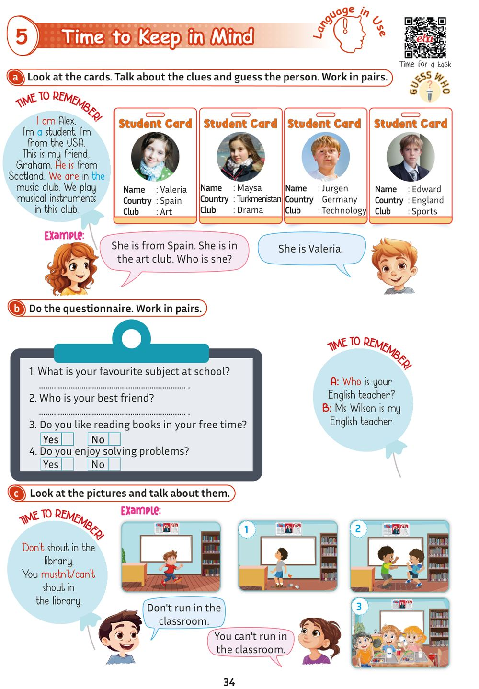

**a Look at the cards. Talk about the clues and guess the person. Work in pairs.**

**TIME TO REMEMBER!**
I am Alex. I'm a student. I'm from the USA. This is my friend, Graham. He is from Scotland. We are in the music club. We play musical instruments in this club.

| Student Card | Student Card | Student Card | Student Card |
| :--- | :--- | :--- | :--- |
|  |  |  |  |
| Name : Valeria | Name : Maysa | Name : Jurgen | Name : Edward |
| Country : Spain | Country : Turkmenistan | Country : Germany | Country : England |
| Club : Art | Club : Drama | Club : Technology | Club : Sports |

**Example:**
 She is from Spain. She is in the art club. Who is she?
 She is Valeria.

**b Do the questionnaire. Work in pairs.**

1. What is your favourite subject at school?
......................................................................
2. Who is your best friend?
......................................................................
3. Do you like reading books in your free time?
[ ] Yes [ ] No
4. Do you enjoy solving problems?
[ ] Yes [ ] No

**TIME TO REMEMBER!**
A: Who is your English teacher?
B: Ms Wilson is my English teacher.

**c Look at the pictures and talk about them.**

**Example:**
 Don't run in the classroom.
 You can't run in...

1

2

3

**TIME TO REMEMBER!**
Don't shout in the library. You mustn't/can't shout in the library.

<!-- sayfa 35 -->

# 6 Time to Play

Go to page 139

**a** Follow the instructions and play the game in pairs.

> **i** Cut out the cubes on page 139.
> Roll the two cubes at the same time.
> Land on a box and make sentences with the words in the boxes.
> Write your points on the scoreboard.
> Make sure you play in a fair and kind way.

Example:
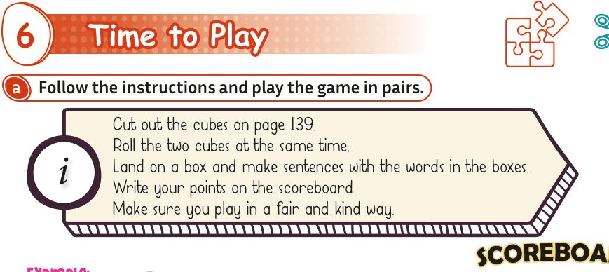
Mateo is from Argentina.

**SCOREBOARD**

| STUDENT A | STUDENT B |
| :--- | :--- |
| | |
| | |
| | |
| | |
| | |

| | A | B | C | D | E | F |
| :--- | :--- | :--- | :--- | :--- | :--- | :--- |
| **1** | Türkiye   3 points | a   1 points | I   2 points | Argentina   3 points | maths club   3 points | can't   5 points |
| **2** | mustn't   5 points | -5 points | Germany   3 points | fight   2 points | What   5 points | He   2 points |
| **3** | can't   5 points | noise   2 points | favourite   4 points | solve   2 points | South Korea   3 points | Russia   3 points |
| **4** | She   2 points | drama club   3 points | an   1 point | mustn't   5 points | are   2 points | Mexico   3 points |
| **5** | Do you like ...?   4 points | China   3 points | Who   5 points | -5 points | Uzbekistan   3 points | please   4 points |
| **6** | Kyrgyzstan   3 points | Do you like ...?   4 points | environment club   3 points | an   1 point | love   3 point | They   2 points |

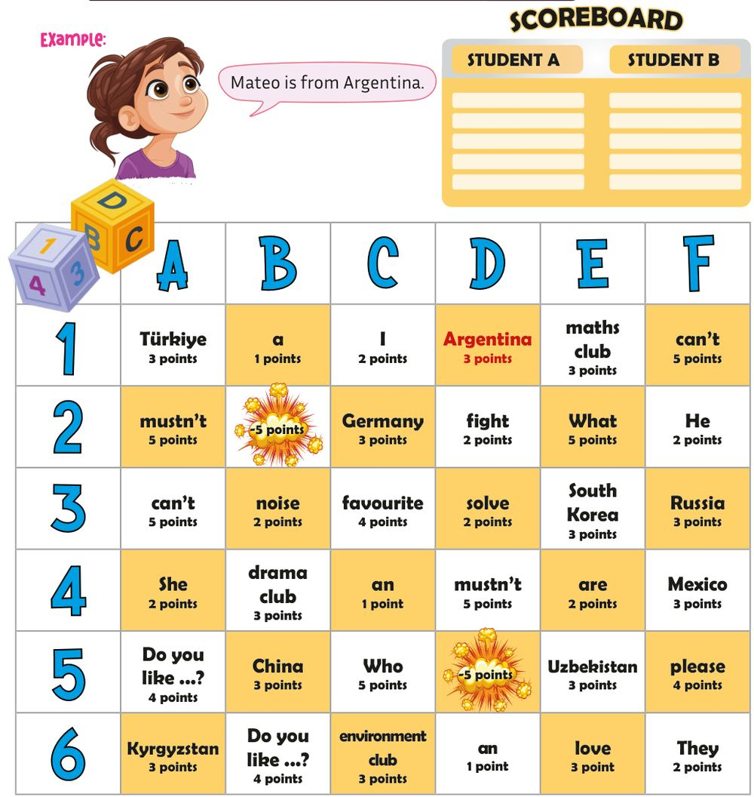
<!-- yer tutucu bulunamadı: sayfa sonuna eklendi -->

<!-- sayfa 36 -->

# 7 Time to Explore

Comprehension

**a** Look at the photos below and guess what the children are doing.

**b** Which of the national and religious days in **7c** do you know?

**c** Read the blogs quickly and tick ($\checkmark$) the national and religious days in the texts.

| | |
| :--- | :--- |
| 30 August Victory Day | $\bigcirc$ |
| 23 April National Sovereignty and Children's Day | $\bigcirc$ |
| 29 October Republic Day | $\bigcirc$ |
| Eid-al-Fitr | $\bigcirc$ |
| 19 May Commemoration of Atatürk, Youth and Sports Day | $\bigcirc$ |
| Eid-al-Adha | $\bigcirc$ |

**BLOG RULES**
Don't be rude.
Don't share your password.
Don't give false information.

https://internationalschoolclubs.com

HOME | BLOG | ABOUT | CONTACT | SEARCH

1.........................................
I'm Alp. I'm from Türkiye. I live in Antalya. It's a city by the sea. I'm interested in water sports, especially surfing. I'm in a surfing team. In my city, we organise a surfing tournament on 19 May Commemoration of Atatürk, Youth and Sports Day. It is an important day for Turkish people. Would you like to join our team? To contact me, send an .........................................

2.........................................
My name is Canan. I'm from Türkiye. I live in Malatya. I am a student at Atatürk Lower Secondary School. I like listening to music and dancing. I'm a member of a folk dance club. We are planning to perform a dance show on 23 April National Sovereignty and Children's Day. Many children go to Türkiye from different countries on that day. Do you want to take part in our folk .........................................

3.........................................
I'm Aylin, from the Turkish Republic of Northern Cyprus. I live in Nicosia. My favourite activities are drawing and taking nature photos. I'm in the Art club at my school. We arrange an art exhibition on 29 October Republic Day every year. Come and visit our exhibition. You can also join the exhibition with your artwork. For more details, please .........................................

<!-- sayfa 37 -->

e Read the blogs again. Write “T” for true, “F” for false sentences. Correct the false ones.

1. Alp likes water sports. ____________________________________________________
2. Alp organises a volleyball tournament. ______________________________________
3. Canan is from Türkiye. _____________________________________________________
4. Canan likes singing songs. _________________________________________________
5. Aylin’s favourite activities are trekking and fishing. ________________________
6. Aylin is inviting the followers to the art exhibition. _______________________

f Look at the blog page and rewrite the blog rules.

1. You mustn’t ...........................................................................................
2. You can’t ..............................................................................................
3. .............................................................................................................

g What rules do you have in your school? Talk about them in pairs.

Example:
What are the rules in your school?
I mustn't ...

# 8 Time to Note Down

a Think about your favourite school clubs and activities. Then talk about them in pairs.

Example:
What is your favourite school club?
It's art club.
Do you like drawing pictures?
Yes, I like drawing pictures in the art club.

b Choose an event from the blog on page 36. Write an e-mail to one of the bloggers about your favourite school clubs and activities.

New mail
To
Subject

Dear ..........................................................................................................
....................................................................................................................
....................................................................................................................
....................................................................................................................
....................................................................................................................
....................................................................................................................
....................................................................................................................
....................................................................................................................

<!-- sayfa 38 -->

# 9 Time to Learn More

**a** Look at the signs in **9b** and guess what they mean. Then read the texts quickly and check your guesses.

**b** Read the texts and write the names of the countries under the signs.

a. .........................  b. .........................  c. .........................  d. .........................  e. .........................

---

In some countries, there are some interesting rules and people must obey them. Here are some examples.

In Kazakhstan, you cannot drive a very dirty car. This rule helps protect public order and provides cleanliness.

In Greece, you cannot wear high heels in ancient cities. This rule protects old stones.

In Singapore, you mustn't chew gum in public. This rule helps keep the city clean.

In Türkiye, you can't own, buy, or sell some dangerous dog species like Pitbull Terrier. This rule helps people and dogs stay safe.

In Italy, you cannot eat food near historical fountains. Also, you can't feed pigeons in many cities. These rules protect historical places.

Each country has its own rules to keep people safe and protect the environment. It is important to respect local laws when travelling.

---

**c** Read the texts again. Ask and answer about the interesting rules in the countries.

**Example:**
What can't you do in Singapore?
You can't chew ...

**d** Think about interesting rules in your country. Talk about them.

**Example:**
In my country, ...

<!-- sayfa 39 -->

# 10 Time for a Story

**a Look at the pictures quickly. Who are the characters?**

**Sara**: Excuse me! Where is the science club?
**Jack**: It's downstairs. Are you new at school?
**Sara**: Yes, I'm Sara, you?
**Jack**: I'm Jack. Nice to meet you, Sara.
**Sara**: You too.

**Jack**: Hey, Janet!
**Janet**: Hi, Jack. What's up?
**Jack**: Great. This is Sara. She is new at our school.
**Janet**: Oh, really? Where are you from?
**Sara**: I'm from Spain, and you?
**Janet**: The UK. Welcome to our school!
**Sara**: Cheers!

**Sara**: I'm looking for the science club. I like doing experiments and learning new things about the universe as well. So, I want to join the science club.
**Janet**: OK. We can go together.
**Sara**: Sure. By the way, thank you, Jack. See you.

**Sara**: Who is our science teacher?
**Janet**: He is Mr Adams. He is a great teacher.
**Sara**: Oh, cool.
**Janet**: Here is the science lab.

**Sara**: Hi, Mr Adams. I want to join the science club.
**Mr Adams**: Sure! Welcome to our club. Come in.
**Sara**: Thank you.
**Mr Adams**: Hey kids! You mustn't run in the lab. Line up, nice and straight! Wear your lab coats, gloves and goggles. Follow the rules and play safe during the experiments!
**Students**: All right, Mr Adams.
**Mr Adams**: Come on, let's get started!

<!-- sayfa 40 -->

c Read the questions about the picture strip story and think about them.
d Ask and answer the questions in 10c in pairs.

**Time to Think**
1. Where is Sara from?
2. What is Sara looking for?
3. Who helps Sara find the club?
4. Who is the science teacher?
5. What are the lab rules?

**Example:**

Where is Sara from?

She is from Spain.

e Talk about your favourite school club, activities, and rules in this club in pairs.

**Example:**

My favourite school club is music . I like singing songs. I can play the guitar but I can't play the piano.

# 11 Time for a Project

Follow the instructions and do your project.

**How to create a new school club**
1. Think about a new school club.
2. Make a drawing of the activities in this club.
3. Label each activity.
4. Use your drawing to make a poster.
5. Present your poster to the class.
6. Remember to give positive feedback on your classmates’ projects.

This is my new school club. Its name is origami. I like colouring and folding paper in this club.

# 12 Time to Check Your Progress

Colour the puzzle pieces.

At the end of this theme, I can talk and write about ...
people and places at school
national and religious days

<!-- sayfa 41 -->

# CLASSROOM LIFE

## THEME 2

### Sub-themes
* Classroom rules and language
* School subjects
* Timetables
* Classroom objects
* Days of the week
* Time

### Functional Language
* Describing different roles in the classroom
* Describing routines in the classroom
* Expressing the presence of something or somebody
* Telling the time
* Asking about the time of actions

### Social Language Expressions
* Make the grade if you want to join the Sports club!
* Please don't skip the lesson!
* Give me a hand for this homework!
* I don't feel all right!
* I'd love to!

**TIME TO REMEMBER**
(QR Code)

**TIME FOR AN OVERVIEW**
(QR Code)

Don't forget to support your classmates when they feel sad or

<!-- sayfa 42 -->

# GET TO KNOW

Watch the digital story.
**What is it about?**
a. classroom life
b. technology in the classroom

Turkish
Art
Science
a bookshelf
a seat

<!-- sayfa 43 -->

# NUMBERS

50 Fifty
60 Sixty
70 Seventy
80 Eighty
90 Ninety
100 A hundred

<!-- yer tutucu bulunamadı: sayfa sonuna eklendi -->

<!-- sayfa 44 -->

# 1 Time to Focus
Listening Comprehension

## a Watch the digital story again and tick ($\checkmark$) the topics about it.

* After school activities
* Timetables
* School clubs
* Homework
* School subjects
* Classroom objects
* Time
* Classroom rules
* Days of the week

---

Remember me

* o'clock
* five past
* ten past
* quarter past
* twenty past
* twenty-five past
* half past
* twenty-five to
* twenty to
* quarter to
* ten to
* five to

---

## b Watch the digital story carefully and match the time with the school subjects. There is an extra one.

1. Physical Education
2. Social Studies
3. Science
4. Maths ($1+2=$ <!-- KONTROL: Marker'da karşılığı yok, uydurma olabilir -->)
5. Art
6. Music

09:20 | 08:30 | 11:00 | 13:50 | 10:15 | 13:00 | 07:45

---

## c Talk about the time of the school subjects in 1b.

Example:
The P.E. lesson starts at one o'clock in the afternoon.

---

## d Look at the picture on pages 42 and 43. Answer the questions in pairs.

1. Where are the students?
2. Which school objects do you know?
3. How many students are there?

<!-- sayfa 45 -->

| | Monday | Tuesday | Wednesday | Thursday | Friday |
| :--- | :--- | :--- | :--- | :--- | :--- |
| 08:30 | ....................... | Turkish | English | Turkish | Maths |
| 09:20 | Maths | Turkish | English | ....................... | Maths |
| 10:15 | ....................... | English | Turkish | Social Studies | Religion and Morals |
| 11:00 | Science | ....................... | Turkish | ....................... | Religion and Morals |
| **Lunch Break** | | | | | |
| 13:00 | IT | Science | ....................... | Art | Drama |
| 13:50 | IT | Science | P.E. | Turkish | ....................... |
| 14:40 | Elective Lesson | Elective Lesson | Elective Lesson | Elective Lesson | Elective Lesson |

f Look at the timetable above. Ask and answer about each school subject on the timetable. Work in pairs.

Example:

What time does Maths lesson start on Monday?
It starts at half past eight.

g Watch the digital story and put the events in the correct order.

- The students ask the teacher about school subjects, their time, and days.
- The teacher warns the students to walk slowly.
- The teacher reminds the students about the classroom rules.
1 The teacher shows the new timetable.
- Efe tells his favourite lesson.

h What are the people talking about in the digital story? Ask and answer in pairs.

Example:
What is the teacher talking about?
She is talking about the new timetable.

# 2 Time to Say

a Listen to the utterances from the digital story. Notice the **rises** and **falls**. Then practise saying them in pairs.

No, there isn't a Science lesson today.
We don't have a Maths lesson on that day.

b Listen and draw $\nearrow$ or $\searrow$ for each sentence. Then read the text aloud.

We have seven lessons a day. We don't have any Maths lessons on Monday. I'm not good at solving problems. I love English but we don't...

<!-- sayfa 46 -->

# 3 Time to Learn New Words

**a** Watch the digital story again and notice the school subjects below. Then match them with the photos. There is an extra one.

a Music
b Social Studies
c Physical Education (P.E.)
d Information Technology (IT)
e Maths
f Turkish
g Religion and Morals
h Science
i Art
j English

**b** Listen to the school subjects in **3a** to check your answers. Then repeat them as a whole class.

**c** Put the days of the week in the correct order.

1 Monday
2 Sunday
3 Saturday
4 Friday
5 Thursday
6 Tuesday
7 Wednesday

**d** Watch the digital story carefully again. Ask and answer about the timetable.

*Example:*
Do they have Maths lesson on Monday?
Yes, they have Maths lesson every Monday.

**e** Look at the picture on pages 42 and 43. Tick ($\checkmark$) the classroom objects you see.

1. a rubbish bin
2. a pencil case
3. a smart board
4. a board marker
5. a dictionary
6. a school bag
7. a seat
8. a poster

**f** Listen to Ceren and circle the numbers you hear.

78 58 100 07

<!-- sayfa 47 -->

# 4 Time to Play

**a** Play the “Memory Game” in pairs.

> **i** Turn the cards upside down. Match the pictures with their explanations. Find more pairs and win the game.

| | | | |
| :---: | :---: | :---: | :---: |
| a rubber | a pencil | a bookshelf | a sheet |
|  |  |  |  |
| a seat | a rubbish bin | a board marker | a dictionary |
|  |  |  |  |

| 1 | 2 | 3 | 4 |
| :--- | :--- | :--- | :--- |
| We throw rubbish in it. | We sit on it. | We look up new words in it. | We use it to write on the board. |

| 5 | 6 | 7 | 8 |
| :--- | :--- | :--- | :--- |
| We put books on it. | We write on it. | We use it to erase mistakes. | We use it to write in our notebooks. |

**b** Talk about the classroom objects in **4a**.

**Example:**
I throw rubbish in a rubbish bin.

**c** What other classroom objects do you use in your lessons? Talk about them.

**Example:**
I use ...

<!-- sayfa 48 -->

# 5 Time to Keep in Mind

**a Watch the digital story and answer the questions in pairs.**

**TIME TO REMEMBER!**
**A:** How many books and dictionaries are there in the bookcase?
**B:** There are fifty-eight books. There is a dictionary.

1. Is there a P.E. lesson every Wednesday?
2. How many lessons are there in a week?
3. How many Art lessons are there in a week?
4. Is there a Music lesson every Friday?

**Example:**
Is there a P.E. lesson every Wednesday?
**Yes, there is.**

---

**b Match the days with the school subjects from the digital story. Then talk about them. There is an extra one.**

| | | | |
| :--- | :--- | :--- | :--- |
| 1. Monday | 1 [ e ] | a. P.E. | |
| 2. Tuesday | 2 [ ] | b. Music | |
| 3. Wednesday | 3 [ ] | c. Science | |
| 4. Thursday | 4 [ ] | d. Social Studies | |
| 5. Friday | 5 [ ] | e. Maths | |
| | | f. Foreign Language | |

**Example:**
They have Maths lessons every Monday, but they don't have Maths every Tuesday.

**TIME TO REMEMBER!**
They **have** Science lessons every Monday.

---

**c Circle the correct words in bold. Change the underlined words to make new dialogues. Then act out in pairs.**

**TIME TO REMEMBER!**
**A:** Can you lend **me** your pencil?
**B:** Of course. Here you are.

**A:** Can you give **me/you** these **crayons**, please?
**B:** Yes, you can take **us/them**. Oh! Wait a second! They're **Mary's**. Please ask **him/her**.
**A:** OK.

---

**d Draw the time of the lessons in the digital story. Then ask and answer questions in pairs.**

1. P.E.
2. Science
3. Social Studies
4. Maths
5. Art
6. Music

**Example:**
What time does the...
It starts at one o'clock.

**TIME TO REMEMBER!**
**A:** What time is it?
**B:** It is one o'clock.
**A:** What time does the Science lesson start?
**B:** It starts at quarter past one.

<!-- sayfa 49 -->

# 6 Time to Play

Go to page 143

**a Follow the instructions and play the game in pairs.**

> **i** Cut out the cards on page 143.
> Match the halves of the cards to make questions.
> Ask and answer about the picture in pairs.
> Make sure you play in a fair and kind way.

**Example:**

**Example:**

<!-- sayfa 50 -->

# 7 Time to Explore

**a Read the weekly magazine quickly and answer the questions.**

1. Who is the star student?
2. What is her/his favourite school subject?

# CUMHURİYET LOWER SECONDARY SCHOOL
# 5/A WEEKLY MAGAZINE

| | Monday | Tuesday | Wednesday | Thursday | Friday |
| :--- | :--- | :--- | :--- | :--- | :--- |
| **08.30** | Science | Maths | Turkish | English | P.E. |
| | Science | Maths | Turkish | English | P.E. |
| | Art | Social Studies | Science | Maths | Social Studies |
| | Art | Social Studies | Science | Maths | Social Studies |
| | English | IT | Music | Drama | Religion and Morals |
| | English | IT | Music | Drama | Religion and Morals |
| | Maths | Turkish | Maths | Turkish | Turkish |

**TICKET**
We have a school trip this weekend. Do you want to join us? Topkapı Palace Museum on Saturday at 09.15. Don't be late in the morning!

**ATTENTION!!!**
* Don't throw rubbish on the ground.
* Don't run in the classroom.
* Raise your hand to speak.
* Listen to your teachers carefully.
* Don't shout at your friends.

**15.20**

**FUN CORNER**

**MY CLASSROOM**
A poster on the wall,
Books are big and small.
The bookshelf is here,
The rubbish bin is clean and clear.

My pencil case is full of cheer,
Pen and pencils, I lend and share.
This is my class, I always care,
I learn new things, year by year.

**TONGUE TWISTERS**
I meet Kate at quarter to eight,
I see her at the gate, so don't be late.

I scream, you scream, we all scream for ice cream.

**DO YOU KNOW?**
There are sixty-five teachers in our school!

**STAR STUDENT**
Hi, I am Mert. I'm in year 5. I am a careful student. I like all school subjects but my favourite is Art. I like drawing and painting. It is fun to imagine and create a picture. My Art lesson is at ten o'clock every Monday. I can't wait for Mondays.

**b Read the weekly magazine and match the halves of the sentences. There is an extra one.**

1. There are thirty-five lessons ... [ 1 ] [ f ]
2. The poem is ... [ 2 ] [ ]
3. Mert's Art lesson is ... [ 3 ] [ ]
4. You can't ... [ 4 ] [ ]

a. at ten o'clock every Monday.
b. at 8.30 and finishes at 15.20 on weekdays.
c. keep the classroom clean.
d. about classroom objects.

<!-- sayfa 51 -->

**Example:**
*   When is the Science lesson?
*   It is on Monday and Wednesday.
*   I have a Turkish lesson on Monday.

# 8 Time to Note Down
**Writing**

**a** Make a survey in the class. Ask your friends about their favourite school subjects with their time, day, and materials. Take notes about their answers in the chart.

**Example:**
*   What is your favourite school subject?
*   My favourite school subject is ...

| | Favourite School Subjects | Time | Day | Classroom Objects |
| :--- | :--- | :--- | :--- | :--- |
| Me | | | | |
| My friend | | | | |
| My friend | | | | |

**b** Look at your notes in **8a**. Write about you and your friends. Then read your paragraphs to the whole class.

My favourite school subject is ............................ . It is at ............................ on ............................ .

I use ............................ in this lesson.

My friend ............................'s favourite school subject is ....................................................……
………………………………………………………………………………………………………………………

My friend ............................'s favourite school subject is ......................................................…
………………………………………………………………………………………………………………………

<!-- sayfa 52 -->

# 9 Time to Learn More

a Look at the photos quickly and guess what they are about.

b Read the texts quickly and write a suitable title.

c Read the texts and match the photos with the paragraphs. There is an extra one.

A Children in Japan start school at the age of six. They study many subjects like Maths, Science, and English. Lessons are about 45 minutes long. At lunchtime, students generally eat in their classrooms. After lunch, students clean their classrooms together. They learn teamwork skills and show respect for their study places.

B Children in Finland start school at the age of seven. They learn many school subjects. They also learn how to play and work in groups. They grow fruit and vegetables in the school garden. They take their products to their homes. Teachers don’t give students homework.

C Children in India start school at the age of six or seven. English is the main language for teaching in many schools. Students start the day with “Happiness Lessons” in Delhi. They do gentle and relaxing exercises in these lessons, not ordinary schoolwork. After the happiness lessons, students feel happy and ready to start the other lessons.

D Children in Azerbaijan start school at the age of six. Some of them learn traditional sports like oil wrestling, horseback riding, and horseback javelin. These sports lessons help students be physically fit and healthy. They also connect students to their culture and history.

d Read the texts again and choose the correct paragraph (A-B-C-D) for each sentence.

1. Students do not do schoolwork in the first lesson.  A B C D
2. Students do farming in the school garden. A B C D
3. Students learn about their history and culture. A B C D
4. Students clean their own classrooms. A B C D
5. Students do not have homework. A B C D
6. Students start the day with a happiness lesson. A B C D
7. Students do many traditional sports. A B C D
8. Students eat in the classroom at lunchtime. A B C D

<!-- sayfa 53 -->

# 10 Time for a Story

a Look at the pictures quickly and answer the questions.

1. Where are the children?
2. What is Janet pointing at?

# My Favourite Lesson

Janet : Hey, Sara! How are you doing?
Sara : Hi, Janet. I don't feel all right!
Janet : Why? What's the matter?
Sara : There is a quiz today and I'm not ready for it.
Janet : Don't worry! You can prepare better for the next time.

Janet : Oh, our P.E. lesson is at half past one.
Sara : That's great. I want to be in the school team and join the basketball tournament next month.
Janet : You can talk to the coach about it.
Sara : OK. That's a good idea!
Janet : Make the grade if you want to join the team!
Sara : Sure, I can.

Janet : As you know, we have a Social Studies lesson today and remember, we have a new project.
Sara : Oh, yes.
Janet : Hey, give me a hand for this project! Would you like to join my study group?
Sara : Yes, I'd love to! What materials do we need?
Janet : Scissors, coloured pencils, glue, a ruler, sheets, and a rubber.
Sara : I can bring the sheets and a rubber.
Janet : OK. Let's go to the classroom and get started!

Sara : What time is it, Janet?
Janet : Oh, it is five to one. You can go and see the coach, now. We can finish this project later.
Sara : OK, then.
Janet : Please don't skip the lesson!
Sara : All right. See you, then.

<!-- sayfa 54 -->

c Read the questions about the picture strip story and think about them.

1. Why isn't Sara OK?
2. What time does the P.E. lesson start?
3. When is the basketball tournament?
4. Why does Sara need to see the coach?
5. What do they need for the project?

d Ask and answer the questions in 10c in pairs.

Example:
Why isn't Sara OK?
Because she isn't ready for the quiz.

e What is your favourite school subject? Talk about the time, day, and materials of it in pairs.

Example:
My favourite school subject is....
It is at ... on ... . I need a ....

# 11 Time for a Project

Follow the instructions and do your project.

How to make a dream classroom
1. Think about your dream classroom.
2. Make a timetable.
3. Make a drawing of school subjects.
4. Label each school subject on the timetable.
5. List the classroom rules.
6. Use your drawing and list to make a poster.
7. Present your poster to the class.
8. Remember to give positive feedback on your classmates' projects.

This is my dream classroom.
I have an English lesson every day.
I need a dictionary in this lesson.

# 12 Time to Check Your Progress

Colour the bricks.

| | | |
| :--- | :--- | :--- |
| classroom rules and language | school subjects | timetables |
| classroom objects | days of the week | time |

| | |
| :--- | :--- |
| Got it! | |
| Need help! | |
| Confused! | |

At the end of this theme, I can talk and write about ...

<!-- sayfa 55 -->

# PERSONAL LIFE

## THEME 3

### Sub-themes
* Basic body parts and physical features
* Clothes
* Daily routines and activities

### Functional Language
* Expressing daily routines
* Confirming general truths
* Expressing the frequency of actions

### Social Language Expressions
* I'll pop round to see you later!
* Don't make fun of people!
* Let's sort out the problem!

TIME TO REMEMBER

TIME FOR AN OVERVIEW

Speak kindly and don't show off.

<!-- sayfa 56 -->

Watch the digital story.
What is it about?
a. clothes shop in the city
b. clothes and body parts

<!-- sayfa 57 -->

# YOUR AVATAR

## ACTIVITIES

## ACCESSORIES

<!-- yer tutucu bulunamadı: sayfa sonuna eklendi -->

<!-- sayfa 58 -->

# 1 Time to Focus
Listening Comprehension

**a Watch the digital story again and tick ($\checkmark$) the topics about it.**

| | | |
| :--- | :--- | :--- |
| $\bigcirc$ Body parts | $\bigcirc$ Family members | $\bigcirc$ Health problems |
| $\bigcirc$ Physical features | $\bigcirc$ Clothes | $\bigcirc$ Accessories | $\bigcirc$ Daily routines & activities |

**b Look at the pictures in the digital story and write a suitable title for each part.**

1. Accessories 2. Physical features 3. Clothes 4. Body parts

**c Talk about the characters in the digital story in pairs.**

Example:

Lara is thin and of medium height. She wears jeans and shoes. She has got gloves and an umbrella.

**d Look at the picture on pages 56 and 57. Answer the questions.**

<!-- yer tutucu bulunamadı: sayfa sonuna eklendi -->

<!-- sayfa 59 -->

e Watch the digital story and tick ($\checkmark$) the activities Lara and Tom do. Then talk about them.

| | watch the stars | read a map | travel around the world | make materials |
| :--- | :---: | :---: | :---: | :---: |
| Lara | | | | |
| Tom | | | | |

**Example:**

Lara always watches the stars to find the way.

f Watch the digital story and put the events in the correct order.

1. Jack chooses clothes for Lara.
2. Melissa tells the body parts of the fairy.
3. Ali and Melissa start choosing the game characters' clothes and activities.
4. Ali introduces Tom and talks about his activities.
5. Ali tells Lara's physical features.

g What are the people talking about in the digital story? Ask and answer about the events in 1f in pairs.

**Example:**
What are Melissa and Ali talking about?
They are talking about the game characters' clothes and activities.

# 2 Time to Say

**Pronunciation**

a Listen to the utterances from the digital story. Notice the rises and falls. Then practise saying them in pairs.

* Do you want to join us? $\nearrow$
* What kind of activities should we choose for her? $\nearrow$
* She needs comfortable clothes, doesn't she? $\searrow$

Track 3.1

b Listen and draw $\nearrow$ or $\searrow$ for each sentence. Then read the text aloud.

Suzan : I love your new jacket. Where did you buy it?
Anna : Thank you. It's a present from my mother. It's nice, isn't it?
Suzan : Sure, it is. By the way, are your shoes new?
Anna : Yes. Do you like them?

Track 3.2

<!-- sayfa 60 -->

# 3 Time to Learn New Words

**a** Watch the digital story again and notice the clothes below. Then match them with the photos. There is an extra one.

a a jacket | b a T-shirt | c jeans | d shorts | e a jumper | f a coat | g a headscarf | h a skirt | i gloves | j a raincoat | k trousers | l a shirt | m a dress

| 1  | 2  | 3  | 4  |
| :---: | :---: | :---: | :---: |
| 5  | 6  | 7  | 8  |
| 9  | 10  | 11  | 12  |

**b** Listen to the names of the clothes in **3a** to check your answers. Then repeat them as a whole class.

**c** Ask and answer about characters' clothes in the digital story in pairs.

*Example:*

What does Lara wear?
She wears a raincoat, jeans ...

**d** Write Rose's body parts and talk about them in pairs.

an eye
a nose
a hand
a head
an arm
a leg
a foot

*Example:*
What does Rose look like?

She has got two short legs.

**e** Look at the picture on pages 56 and 57. Tick ($\checkmark$) the activities you see.

<!-- sayfa 61 -->

# 4 Time to Play

a Take turns to play the “Clothes Game”. Spin the paper clip. Find the correct items and get the points.

| 8 | 1 |
| :---: | :---: |
| Name two items people wear on their heads. | Name three accessories women often wear. |
| 10 points | 15 points |

| 7 | 2 |
| :---: | :---: |
| Name two clothing items or accessories you put on your hands. | Name two items you wear on rainy days. |
| 10 points | 10 points |

| 6 | 3 |
| :---: | :---: |
| Name two clothing items you wear only in hot weather. | Name one item of clothing only women wear. |
| 10 points | 5 points |

| 5 | 4 |
| :---: | :---: |
| Name three items of clothing you wear on your feet. | Name two clothing items you wear only in cold weather. |
| 15 points | 10 points |

(Merkezdeki puanlar: 10 points, 15 points, 10 points, 5 points, 10 points, 15 points, 10 points, 10 points)

# SCOREBOARD

| STUDENT A | STUDENT B |
| :--- | :--- |
| | |
| | |
| | |
| | |
| | |

b Talk about each part in 4a in pairs.

Example:
What do you wear in hot weather?
I wear a cap in hot weather.

<!-- sayfa 62 -->

# 5 Time to Keep in Mind

**a Look at the pictures. What does Jim do? Talk about them in pairs.**

**Example:**
What does Jim do in autumn?
He goes hiking in autumn.

**TIME TO REMEMBER!**
He wears a jumper, jeans, a backpack, and a belt.

**b Talk about Jessie's routines in pairs.**

| | |
| :--- | :--- |
| always | go jogging |
| usually | meet friends after school |
| sometimes | eat lunch out |
| never | get up late |

**Example:**
How often does Jessie go jogging?
She always goes jogging.

**TIME TO REMEMBER!**
He always makes materials to help her during the journey.

**c Follow the route and make question tags in turns.**

**Example:**
You don't go for a walk, do you?

**TIME TO REMEMBER!**
She needs comfortable clothes, doesn't she?

**d Complete the rhyme. Then write your own rhyme and read it to the class.**

I have jeans. (1) \_\_\_\_\_\_ jeans are clean.
You have trousers. (2) \_\_\_\_\_\_ trousers are green.
He has socks. (3) \_\_\_\_\_\_ socks are blue.
She has shoes. (4) \_\_\_\_\_\_ shoes are new.
It has ten teeth. (5) \_\_\_\_\_\_ teeth are white.

**TIME TO REMEMBER!**
Look at my new video game.

<!-- sayfa 63 -->

# 6 Time to Play 

**a** Play the “Puzzle Game” in pairs. Use three or more pieces to make sentences. Each piece is 5 points.

**b** Say your sentences in pairs.

*Example:*

My mother always wears a T-shirt.
20 points!

<!-- sayfa 64 -->

# 7 Time to Explore

**a Look at the pictures in the magazine quickly and answer the questions.**
1. What are they wearing?
2. How do they look? Trendy or old-fashioned?

**b Read the magazine quickly and match the titles with the paragraphs.**
a. Functions of Accessories
b. Stop Overshopping!
c. Trendy or Comfortable?
d. Top 3 Fashion Tips

---

# FASHION MAGAZINE
## STYLE & YOU

(1) ............................................................

Getting dressed is fun, isn't it? Some people love to try on new clothes every week. Fashion means a lot to them. Others always wear the same outfits because they care more about their comfort in general.

(2) ............................................................

Try on different colours. Do you have an orange shirt? You should wear it with blue trousers! A white blouse and a black skirt look perfect together. You can match a yellow T-shirt with purple shorts on hot summer days. An average outfit can look great with right combinations.

(3) ............................................................

Hats are perfect to protect your head from the Sun. Never go out without a hat in summer!
A pair of round sunglasses usually make you look stylish while protecting your eyes.
Scarves keep your neck warm in winter and add colour to your outfit.

(4) ............................................................

Fashion is just a hobby, not the centre of your life. Adapt the fashion to your wardrobe and go shopping just for your needs. Make sure you spend your money on necessary things!

<!-- sayfa 65 -->

c Read the fashion magazine on page 64 carefully and match the questions with the answers. There is an extra one.

1. Why do some people wear the same outfits?
2. What colour combinations go well together?
3. Why do you wear sunglasses?
4. What should we spend our money on?

a. They protect our eyes from the Sun.
b. Scarves keep your neck warm.
c. White and black or blue and orange
d. Necessary things
e. Because they care more about their comfort.

1 ... 2 ... 3 ... 4 ...

---

# 8 Writing
## Time to Note Down

a Read the text about Mete Gazoz. Notice his physical appearance, clothes, and routines.

My favourite sportsman is Mete Gazoz. He's an Olympic archer. He is tall and slim. He has got short dark brown hair. He wears glasses. He always wears a hat. He starts his day early. He trains twice a day.

b Think about important people in sports, music, art, and science. Note down her/his features. Then describe her/him.

Physical Appearance $\rightarrow$ Clothes $\rightarrow$ Activities and Routines

My favourite celebrity is ........................................................................................................................................................
She/He has ............................................................................................................................................................................
She/He always wears ..........................................................................................................................................................
Her/his favourite activities are ..........................................................................................................................................

c Read your descriptions to the whole class and give feedback to each other.
d Ask and answer about your descriptions.

Example:
What does your favourite celebrity look like?
He's tall and slim. He has got...

<!-- sayfa 66 -->

# 9 Time to Learn More

**a** Look at the photos quickly. Guess and write the country they belong to.

## CLOTHING FROM ALL AROUND THE WORLD

*Different cultures around the world have their own traditional clothing. Clothes reflect history, beliefs, and lifestyles.*

**Sami Clothing:** Sami clothing reflects the culture of the Sami people. They live in Northern Scandinavia. Their clothing is made of wool. Colours of these clothes represent nature.

..................................................

**Sari:** Women wear this traditional dress in India. It is made of a long piece of silk or cotton fabric. Women wrap it around their bodies. Saris can be in many different colours and patterns.

..................................................

**Kimono:** A kimono is a traditional Japanese clothing. It is made of silk or cotton. It has long and loose sleeves. Japanese women wear kimonos for special events such as festivals, weddings, and traditional ceremonies.

..................................................

**Milas Dibekdere Traditional Clothing:** There are many different kinds of traditional clothing in Türkiye. Dibek style is one of them. Women wear dibek clothing during festivals and special events in Dibekdere, Muğla. It has colourful patterns and it is made of natural fabrics like cotton and wool. The designs reflect the region's history and culture.

..................................................

**b** Read the texts and tick (T) for True or (F) for False. Then, correct the false sentences.

1. Sami clothing is made of wool. | T | F
2. Women in India wear sari. | T | F
3. Kimonos have short and tight sleeves. | T | F
4. Dibek clothing is made of recycled fabrics. | T | F
5. The designs on dibek clothing reflect the region's history and culture. | T | F

..................................................................................
..................................................................................
..................................................................................
..................................................................................
..................................................................................

<!-- sayfa 67 -->

# 10 Time for a Story

**a** Look at the pictures quickly. Where are the children in each picture?

# A Shopping Day

**Sara**: Hey, mates! Look at my new dress. I always wear my blue shirt and black jeans but I'm planning to wear this dress today. It looks nice, doesn't it?
**Janet**: Yes, it does. You always look good in blue.
**Jack**: I don't care about fashion. I only wear my favourite jacket and boots.
**Sara**: You should try something different. You never wear a bow, do you?
**Jack**: No, I don't. Bows are for clowns.
**Sara**: *Don't make fun of people*, Jack. Everyone has a style.
**Jack**: You're right. Sorry, Sara.

**Sara**: I love shopping! I need a pair of boots and a bag.
**Janet**: Look at the pink bag! It is perfect for you, Sara.
**Sara**: Let me try it on.
**Jack**: I'm going to the shop to buy a new watch. I'll pop round to see you later!

**Sara**: This scarf is so soft. I like it.
**Jack**: It looks nice but don't spend all your money, Sara.
**Janet**: You never buy anything fashionable, do you?
**Jack**: That's true. I love spending my money on books and video games.

**Sara**: I'm so tired but I've got a new pair of boots now!
**Jack**: I've got a simple black watch. It's perfect for me.
**Janet**: We all have different styles, don't we? And, we still have fun together.
**Sara**: Sure, we do. Now, let's listen to some music and relax.

<!-- sayfa 68 -->

c Read the questions about the picture strip story and think about them.

**Time to Think**

1. Who loves shopping?
2. What does Sara always wear?
3. Who has got a new watch?
4. What does Jack love spending his money on?
5. What makes Jack feel relaxed after a busy day?

**Example:**

Who loves shopping?
Sarah loves shopping.

d Ask and answer the questions in 10c in pairs.

e Ask and answer the questions in pairs.

1. Do you like shopping?
2. What kind of things do you buy?
3. What do you think about spending too much money on clothes?

**Example:**

Do you like shopping?
Yes, I like shopping.

# 11 Time for a Project

Follow the instructions and do your project.

**How to make your wardrobe**

1. Think about your wardrobe.
2. List the accessories and clothes you have got.
3. Make a drawing of each item.
4. Label each item.
5. Use your drawings to make a poster.
6. Present your poster to the class.
7. Remember to give positive feedback on your classmates' projects.

This is my wardrobe. I've got a blue dress, a red scarf, a silver watch, and white shoes.

# 12 Time to Check Your Progress

Colour the block pieces.

| At the end of this theme, I can talk and write about ... | basic body parts | physical features | clothes | daily routines |
| :--- | :--- | :--- | :--- | :--- |

- [ ] Got it!
- [ ] Need help!

Time to check

<!-- sayfa 69 -->

# FAMILY LIFE

## THEME 4

**Sub-themes**

Family members' routines
Family members' hobbies and activities

**Functional Language**

Expressing actions happening at the moment of speaking
Contrasting ongoing or temporary actions
Confirming ongoing actions

**Social Language Expressions**

We always get on well as a family!
Can I lend you a hand with washing the car?
Let's tidy up the house together!

TIME TO REMEMBER

TIME FOR AN OVERVIEW

Spend time with your family and support each other.

<!-- sayfa 70 -->

# Introduction
## GET TO KNOW

Watch the digital story.
What is it about?
a. family members
b. school friends

taking photographs
taking care of a pet
camping

<!-- sayfa 71 -->

fishing
having a barbecue
playing a board game
HAPPY BIRTHDAY
dancing
playing the guitar
visiting a museum

<!-- yer tutucu bulunamadı: sayfa sonuna eklendi -->

<!-- sayfa 72 -->

# 1 Time to Focus
Listening Comprehension

**a Watch the digital story again and tick ($\checkmark$) the topics about it.**

*   routines of family members
*   hobbies of family members
*   problems of family members
*   jobs of family members
*   activities of family members

**b Put the events from the digital story in the correct order. Then draw lines to match the events and places with the photos.**

a 
b 
c 
d
e

a festival / a birthday party / an art museum / a picnic at the beach / camping in the forest

**c Ask and answer about the photos in 1b.**

Example:
Where are they in photo b?
They are at the beach.

**d Look at the picture on pages 70 and 71. Answer the questions in pairs.**

1. Where are the children?
2. How many photos do you see?

**e Watch the digital story carefully and match the people with the activities below.**

Emma
Mother [ ]
Father [ ]
Brother [ ]
Grandmother [ ]

Mike
Mother [ ]
Father [ ]
Grandfather [ ]
Sister [ ]

1 fishing

3 playing a board game

5 taking care of a pet

7 making biscuits

<!-- sayfa 73 -->

Example:
Who is having a barbecue?
Emma's mother is having a barbecue.

g Watch the digital story and put the events in the correct order.

1. Emma tells Mike about her family's activities.
2. Mike tells Emma about his family's hobbies.
3. Emma shows her family members' photos to Mike.
4. Mike talks about his parents' routines at birthday parties.
5. Emma suggests organising a trip for the weekend.

h What are the people talking about in the digital story? Ask and answer in pairs.

Example:
What is Emma talking about?
She is talking about her family members' activities.

# 2 Time to Say

a Listen to the texts from the digital story below and pay attention to the words with the coloured letters. Then practise saying them in pairs.

I love everything **a**bout your parties, especially the foo**d**. Your gra**n**dmother always makes the **b**est **b**iscuits and san**d**wiches. Your gra**n**dfather also pla**y**s grea**t** songs with his guita**r**. They are a ni**c**e cou**p**le, aren't **t**hey?

b Listen to the words and circle the one with a different sound.

1. cake | garden | party
2. pan | air | fair
3. ten | men | open
4. barbecue | beach | climb
5. cyling | pet care | camping
6. dancing | dog | Wednesday
7. ball | about | hall
8. sheep | tree | resting

c Read the tongue twister and try to say it as fast as you can.

A big black cat is dancing by a blue door and eating a big birthday cake.

<!-- sayfa 74 -->

# 3 Time to Learn New Words

**a** Watch the digital story again and notice the hobbies and activities below. Then match them with the photos. There is an extra one.

a having a picnic
b resting
c playing the guitar
d playing a board game
e fishing
f camping
g tidying up the house
h taking care of a pet
i cycling
j dancing
k swimming
l taking photos
m visiting a museum

1 [ ]
2 [ ]
3 [ ]
4 [ ]
5 [ ]
6 [ ]
7 [ ]
8 [ ]
9 [ ]
10 [ ]
11 [ ]
12 [ ]

**b** Listen to the hobbies and activities in **3a** to check your answers. Then repeat them as a whole class.

**c** Ask and answer about the hobbies and activities from the digital story in pairs.

*Example:*

What's Mike's mother doing?
She is dancing at a festival.

**d** Look at the picture on page 70 and 71. Tick ($\checkmark$) the ones you see.

[ ] a camera
[ ] a radio
[ ] a bicycle
[ ] a car
[ ] a tent

<!-- sayfa 75 -->

# 4 Time to Play

**a** Look at the pictures and find seven activities they are doing differently. Talk about the activities in pairs. Use the words/phrases in **3a** and **3d**.

**Example:**

Mehmet is playing a board game in the first picture.
Mehmet is playing football in the second picture.

<!-- sayfa 76 -->

# 5 Time to Keep in Mind

**a Look at the pictures. Talk about them in pairs.**

**TIME TO REMEMBER!**
My dad **is fishing** with my uncle and my mum **is having** a barbecue.

  
Emma Mike Meltem

 
Jane Deniz

**Example:**
What is Emma doing?
She is fishing.

**b Look at Emily’s planner. Talk about it in pairs.**

| every day | today |
| :--- | :--- |
| walk to school | go to school by bus |
| have cheese and olives for breakfast | have an omelette for breakfast |
| eat lunch at the canteen | eat lunch at home |
| watch TV after school | read a book after school |

**Example:**
Emily walks to school every day but today she is going to school by bus.

**TIME TO REMEMBER!**
I usually have dinner with my family but today I **am having** dinner with my friends.

**c Look at the planner in 5b and make question tags in pairs.**

**TIME TO REMEMBER!**
You are having so much fun, **aren't you?**
He isn't playing golf, **is he?**

**Example:**
Emily is going to school by bus, isn't she?

**d Follow the lines and talk about the pictures in pairs.**

   
   
   

**Example:**
This is her board game. This is hers.

**TIME TO REMEMBER!**
This is **my** book. This is **mine**.

<!-- sayfa 77 -->

# 6 Time to Play

**a** Take turns to flip a coin and talk about the pictures in pairs. Get 10 points for each correct answer.

**Example:**

He always brushes his teeth.
He's brushing his teeth now.

HEADS
TAILS

<!-- sayfa 78 -->

# 7 Time to Explore

**a** Look at the pages quickly. Is it from a diary or a newspaper?

**b** Read the text quickly and answer the questions.

1. What day is it?
2. Where are the family members now?
3. Can you find and underline five hobbies?

> ### A STRANGE DAY, ISN'T IT?
> DATE
> Hey, there. It's me again, Millie. There is something strange with my family. Normally, we do our hobbies on Saturdays, but today it is different. We are all in the garden together.
> In the morning, my father usually goes fishing by the lake, but now he is having a picnic in the tent in our garden. It's funny, isn't it?
> My mother rides a bike every day, but she is talking to the flowers in the garden at the moment. She is also brushing our dog with a hairbrush. The dog looks happy.
> My little brother, Jake, always plays computer games in his room. Wow! Look at him! He is playing a board game with our cat now. The cat always wins. The cat is lucky, isn't it?
> My grandmother and grandfather are in the garden, too. They usually rest after breakfast. You see, today is not usual. My grandmother is jumping on a trampoline and my grandfather is playing golf with a guitar. A guitar? Oh, no! It is mine!
> And me? I take photos at the beach every Saturday. But now, I am writing my diary. I'm not strange, am I?
> At the end of the day, we are tired but happy. It is fun to do strange activities together because we always get on well as a family! Good night!

**c** Read the diary again. Label Millie and her family members.

1 [ ] 2 [ ] 3 [ ] 4 [ ] 5 [ ] 6 [ ]

**d** Complete the chart with the activities from the diary.

| | usually | today |
| :--- | :--- | :--- |
| Millie's father | go fishing by the lake | have a picnic in the tent |
| Millie's mother | | |
| Millie's brother | | |
| Millie's grandmother | | |
| Millie's grandfather | | |

<!-- sayfa 79 -->

e Look at the chart on page 78 and talk about Millie's family members and their activities.

*Example:*

Millie's father usually goes fishing by the lake but he is having a picnic in the tent today.

# 8 Writing
## Time to Note Down

a Think about an unusual day. Ask and answer questions in pairs to complete the table for you and your friend.

| | You | Your Friend |
| :--- | :--- | :--- |
| Place | | |
| Day | | |
| People | | |
| Activities | | |

*Example:*

Where are you going?
I am going on a picnic in the forest with my classmates this Sunday.

b Look at the table in 8a. Compare your unusual day with your friend's. Then write in your diary.

Dear Diary,
I usually go cycling with my friends at weekends but today I .................................................................................................................................................................................................................................................................................................................................................................................................................................................................................................................................................................................................................................................................................................................................................................................................................................................................................................................................................................................................................................................................................

<!-- sayfa 80 -->

# 9 Time to Learn More

**a Read the texts and write the countries under the photos.**

People in different countries have popular and interesting hobbies. Let's look at some of them.

| | |
| :--- | :--- |
| In Japan, many people enjoy doing origami. Origami is the art of folding paper to create figures. People usually do it in their free time. | In Brazil, football is a very popular hobby. People play football in the streets, parks, or even at the beaches. Brazil has many famous football teams and their matches are always exciting. |
| In Italy, cooking is a popular activity. Italian people love making pizza and pasta at home with their families. They are really good at cooking. | In the USA, people love sports, especially basketball. They often play basketball with friends or watch games on TV. The country has a strong basketball culture. |
| In Australia, surfing is a common activity. The country has got many beautiful beaches. People usually go there to swim and surf in the ocean. | In the UK, reading is a popular hobby. People read books, magazines, and newspapers every day. They read at home, in libraries, or on public transport. |
| In Türkiye, picnics and barbecues are not just outdoor activities. They are parts of social life. Turkish people enjoy the food and nature, and they have a good time with their families at these events. | |

**b Read the texts again and tick ($\checkmark$) “True” or “False”. Then correct the false sentences.**

1. In Türkiye, having a barbecue is a part of social life.  T [ ] F [ ]
   ............................................................................
2. In Brazil, people are not interested in sports.  T [ ] F [ ]
   ............................................................................
3. British people are fond of reading.  T [ ] F [ ]
   ............................................................................
4. Surfing is a popular activity in Australia.  T [ ] F [ ]
   ............................................................................
5. ............................................................................
   ............................................................................

<!-- sayfa 81 -->

# 10 Time for a Story

a Look at the pictures quickly and answer the questions.
1. Where are the children?
2. What are they doing?

## Let's Have a Picnic!

**Sara**: Hello, Jack. What are you doing?
**Jack**: Hi, Sara. I'm washing the car with my dad. You know, it is sometimes fun to do things with the family.
**Sara**: Cool! **Can I lend you a hand with washing the car?**
**Jack**: That's very nice of you but we are almost finished. Maybe next time.
**Sara**: OK, then.

**Jack**: After washing the car, I have things to do. My mother always asks me to clean my room but I don't have much time. Can you come over and help me?
**Sara**: All right. **Let's tidy up your room together!**
**Jack**: Hooray! Thank you, Sara.
**Sara**: Any time!

**Jack**: My mother's making biscuits in the kitchen now. You like biscuits, don't you?
**Sara**: Of course. They are my favourite.
**Jack**: I'm organising a picnic in the garden then. We can rest after the tidying up.
**Sara**: Good idea! I'm coming in 15 minutes. See you!

**Jack**: Now, my room is great. It's time for the picnic.
**Sara**: What are you doing?
**Jack**: I am bringing the biscuits and lemonade. Have a seat and enjoy your meal.

<!-- sayfa 82 -->

Read the questions about the picture strip story and think about them.

# Time to Think
1. Who is washing the car?
2. What is Jack’s mother doing?
3. Is Sara helping Jack with tidying up the room?
4. Where are they having a picnic?
5. What are they drinking in the end?

Ask and answer the questions in 10c in pairs.

Example:
Who is washing the car?
Jack is washing the car with his dad.

## 11 Time for a Project
Follow the instructions and do your project.

### How to make an interview
1. Think about your family members’ routines, hobbies, and activities.
2. List them.
3. Write questions about your family members’ routines, hobbies, and activities.
4. Interview with your family members.
5. Record the interview.
6. Present your interview to the class.
7. Remember to give positive feedback on your classmates’ projects.

What do you usually do at weekends?
I usually ride my bike at weekends.

## 12 Time to Check Your Progress
Colour the dart circles.

At the end of this theme, I can talk and write about family members' routines and activities and family members' hobbies.

<!-- sayfa 83 -->

# LIFE IN THE NEIGHBOURHOOD & CITY

## THEME 5

### Sub-themes
Places for recreation and attractions in the neighbourhood and city
Different types of houses

### Functional Language
Making comparisons between two things or people
Expressing habitual actions
Indicating existence or location

### Social Language Expressions
Where is the nearest library?
Our kitchen is the heart of our house!
Our new flat was ready to move into!

TIME TO REMEMBER

TIME FOR AN OVERVIEW

Give your seat to someone in need on public transportation.

<!-- sayfa 84 -->

Watch the digital story.
What is it about?
a. places in the city
b. people in the city

a museum
a square
a gym
a mosque
a bathroom
a dining room

<!-- sayfa 85 -->

- a castle
- an art gallery
- a shoe shop
- a tower
- a sitting room
- a bedroom
- a kitchen
- a garage

<!-- sayfa 86 -->

# 1 Time to Focus
Listening Comprehension

**a** Watch the digital story and tick ($\checkmark$) Mr Carter’s choice.

**b** Notice the places for recreation and attractions from the digital story. Where are they? Tick ($\checkmark$) ‘Akyaka’ or ‘Bodrum’.

| | a castle | a street fair | a gym | a museum | ancient sites | a square |
| :--- | :---: | :---: | :---: | :---: | :---: | :---: |
| **Akyaka** | | | | | | |
| **Bodrum** | $\checkmark$ | | | | | |

**c** Talk about the places from the digital story in **1b**.

Example:

There is a castle in Bodrum.

**d** Watch the digital story carefully and write the parts of the house. There is an extra one.

1. a bedroom
2. a kitchen
3. a sitting room
4. a balcony
5. a garage
6. a bathroom

a wardrobe
a bed
a car
a bookcase
a sofa
an armchair
a
b
c
d
e

**e** Ask and answer about the items in **1d** in pairs.

Example:
Where is the dishwasher?
It's in the kitchen.

<!-- sayfa 87 -->

f Watch the digital story and put the events in the correct order.

1. The agent talks about the attractions in Bodrum.
2. Mr Carter wants to hire a house in Muğla.
3. The agent gives information about the parts of the house.
4. The agent describes the furniture in the house.
5. The agent talks about the places for recreation in Akyaka.

g What are the people talking about in the digital story? Ask and answer in pairs.

Example:
What is the agent talking about?
She is talking about the attractions in Bodrum.

## 2 Time to Say

a Listen to the text from the digital story and pay attention to the words with the coloured letters. Then practise saying them in pairs.

There is not a dining room in the house, but you can use the kitchen or balcony for meals. There is a wide table in the garden, so you can enjoy your meals there. It is even better than eating indoors, isn't it?

b Listen to the words and circle the one with a different sound.

| | | |
| :--- | :--- | :--- |
| 1. flat | fridge | of |
| 2. garden | giraffe | garage |
| 3. hour | hall | house |
| 4. kitchen | light | sitting room |
| 5. jump | joke | chair |
| 6. knife | fork | book |
| 7. time | life | insect |
| 8. machine | sing | ski |

c Read the tongue twister and try to say it as fast as you can.

Five funny friends find a jar of jam in Harry's iguana's hat after cooking a chicken in Kate's kitchen.

<!-- sayfa 88 -->

# 3 Time to Learn New Words

**a** Watch the digital story again and notice the parts of the house below. Then match them with the photos. There is an extra one.

a a sitting room
b a dining room
c a bathroom
d a balcony
e a garden
f a corridor
g a bedroom
h a kitchen
i a garage

**b** Listen to the parts of the house in **3a** to check your answers. Then repeat them as a whole class.

**c** Watch the digital story and write the furniture in the boxes below. Then talk about them.

**Example:**
There are three beds in the bedroom.

| bedroom | sitting room | kitchen |
| :--- | :--- | :--- |
| three beds | | |
| | | |
| | | |
| | | |
| | | |

**garden**
| |
| :--- |
| |

**d** Look at the picture on pages 84 and 85. Tick ($\checkmark$) the places you see.

$\square$ a cinema
$\square$ a playground
$\square$ a coast
$\square$ a mosque
$\square$ a gym
$\square$ a street fair
$\square$ a sports centre
$\square$ a tower
$\square$ an art gallery
$\square$ a square
$\square$ a shop
$\square$ a castle

**e** Ask and answer about the places in the digital story in pairs.

**Example:**
Is there a castle in the neighbourhood?

<!-- sayfa 89 -->

# 4 Time to Play

**a** Play the game in pairs. Find the hidden objects in the house as quickly as possible. Try to be the first to win the game.

*Example:*

There is a wooden spoon in the sitting room.

There is one plastic chair in the bathroom.

| START | one wooden spoon | one plastic chair | two metal rubbish bins | one wooden fork | three pillows | one desk lamp | one wide sofa | two wooden chairs | one metal knife | one metal spoon | one wooden knife |
| :--- | :--- | :--- | :--- | :--- | :--- | :--- | :--- | :--- | :--- | :--- | :--- |

<!-- sayfa 90 -->

# 5 Time to Keep in Mind

**a Watch the digital story. Compare Akyaka and Bodrum in pairs.**

TIME TO REMEMBER!
A house is bigger than a flat.

USE
big
small
peaceful
hot
cold
crowded
quiet

Example:
Which one is smaller? Akyaka or Bodrum?
Akyaka is smaller than Bodrum.

**b Look at the chart and talk about it in pairs.**

Example:
Where is Ben's chair?
Ben's chair is in the kitchen.

TIME TO REMEMBER!
Anna's computer is in the bedroom.

**c Look at the pictures. Ask and answer about the digital story in pairs.**

TIME TO REMEMBER!
A: What do you do at weekends?
B: I cycle in the park every Saturday.

Example:
What do people do in Akyaka in summer?
They go to the open-air cinema near the town.

**d Match the furniture with the parts of the house. Then talk in pairs.**

1 two beds $\rightarrow$ a Bedroom
2 a table
3 an oven $\rightarrow$ b Kitchen
4 five cupboards
5 two sofas
6 a bookcase
7 two armchairs
8 a wardrobe

Example:
How many beds are there in the bedroom?
There are two beds

TIME TO REMEMBER!
There is an armchair in the sitting room.

<!-- sayfa 91 -->

# 6 Time to Play

**a** Follow the clues and solve the puzzle. Find who lives where. Then share your results with your classmates.

## WHO LIVES WHERE?

[Görsel: Evlerin olduğu bir manzara resmi]

* **Oya:** My house is bigger than Ralph and Asya's house but smaller than Doruk and Laura's house. There are wide windows and three rooms in my house. There is not a metal roof on it.
* **Laura:** I live in a big house and it is bigger than Oya's house. My house is not smaller than Oya's house. There are not three rooms in my house. There is a garage in my house.
* **Asya:** I live in a small house. My house is not bigger than Ralph's house. There is a metal roof on it. There is not a garage in my house.
* **Ralph:** My house is not smaller than Asya's house. It is not bigger than Doruk's house. There are three rooms in my house. These rooms' windows aren't wide.
* **Doruk:** I live in a big flat but there is not a garage in my flat. There are small windows in my flat. It is bigger than Oya's house.

### Solve the Puzzle

[Görsel: Boşlukların olduğu bulmaca alanı]

**b** Compare the houses in 6a.

**c** Describe your house in pairs.

**Example:**

**Example:**

<!-- sayfa 92 -->

# 7 Time to Explore

(Comprehension logo)

a Look at the photos quickly. What are they about?
b Read the texts quickly and match them with the photos. There is an extra one.

---
https://wheretolive.com
HOME BLOG ABOUT CONTACT SEARCH
---

A | B | C | D
---|---|---|---
 |  |  | 

1 [ ] A Tiny House
2 [ ] A Double-Decker Bus House
3 [ ] A Skyscraper

A wooden tiny house is smaller than a regular house. It looks cosy and warm. It is a small house but it has got everything you need. There are bedrooms, a kitchen, and a bathroom in the house. Some tiny houses also have got a balcony or a terrace. These houses are good for the environment because they use less energy. You can sometimes see them on a coast or in a forest. People have less stuff in these houses and they experience a simple lifestyle close to nature.

It is a big metal bus house, and it is more creative and comfortable than a caravan. This house has got two floors. There is a kitchen on the ground floor and people have their breakfast and dinner there. The kitchen is also a dining room. There is a small sitting room on the top floor. People rest and sleep in this room. The bathroom is usually on the ground floor as well. Some people turn old buses into homes and travel with them. You can see them on the roads. So, we can say it is the best way to live wherever you want.

It is a very tall building. Engineers build it with strong materials like steel. The outside is always made of glass. So people can easily see the sky and the city. Skyscrapers have many floors with flats and offices on different levels. People live or work there. They use fast lifts to go up and down easily. There is a gym, a hall, some shops, and even a cinema in some skyscrapers. These buildings are taller than towers. We can see them in big cities.

c Read the texts carefully and correct the mistakes.

1. A tiny house is ~~bigger~~ than a regular house. [smaller]
2. People live close to the city in a tiny house. [ ]
3. A double-decker bus is a wooden house. [ ]
4. There is a big dining room on the top floor of double-decker buses. [ ]

<!-- sayfa 93 -->

d Read the texts on page 92 and fill in the table.
e Ask and answer about the table in 7d in pairs.

| | A Tiny House | A Skyscraper | A Double-Decker Bus House |
|---|---|---|---|
| 1 Materials | wooden | | |
| 2 Location | | | |
| 3 Number of floors | | | |
| 4 Size | | | |

Example:
What is a tiny house made of?
It is made of wood.

# 8 Time to Note Down
Writing

a Draw your dream house and talk about it in pairs.

Example:
I live in a wooden house. There are two bedrooms and there is a big kitchen in it.
I live in a flat. There are three bedrooms and there is a small kitchen in it.

b Take notes about your friend's and your houses and compare them.

| .........'S HOUSE | MY HOUSE |
|---|---|
| | |
| | |
| | |
| | |
| | |
| | |
| | |
| | |
| | |
| | |
| | |
| | |
| | |
| | |
| | |

...........................'s house is ............... than my house.
There is ...........
There are ...........

<!-- sayfa 94 -->

# 9 Time to Learn More

**a Look at the photos quickly and circle the suitable adjectives for the houses.**

big | small | comfortable | traditional | modern | expensive | different | natural

## INTERESTING HOUSES, INTERESTING LIVES

### Safranbolu Houses

Safranbolu houses are traditional Turkish houses in Karabük. They are made of wood and stone. They are big houses with large windows and red tiles on the roof. There are many bedrooms and a large sitting room. These historical houses reflect the rich culture of Safranbolu. Safranbolu is one of the UNESCO World Heritage Sites of Türkiye with its historical houses.

### The Hobbit Houses

You can see hobbit houses in different places around the world. They are in nature. The grass and plants cover them. So they look like a part of nature. The rooms are small but comfortable. People use wooden furniture to decorate them. They are eco-friendly houses with their natural materials. It is the best way to live close to nature and feel more peaceful.

### Rotterdam Cube Houses

These houses are unusual and famous. They are more interesting than other buildings. They look like big yellow cubes standing on one corner. Each cube is a small house. The houses are connected to each other by a small garden. Some rooms are brighter because they have bigger windows than others. People live in these houses and tourists can also visit them.

**b Read the texts again and tick ($\checkmark$) the correct boxes.**

| | a Safranbolu House | a Hobbit House | a Cube House |
| :--- | :---: | :---: | :---: |
| a large sitting room | $\checkmark$ | | |
| big windows | | | |
| a small garden | | | |
| small rooms | | | |
| bright rooms | | | |

**c Look at the chart in 9b and compare the houses.**

**Example:**
A Safranbolu house has got a large sitting room but a hobbit house hasn't.

**d Think about your own country. Are there any other interesting houses?**

<!-- sayfa 95 -->

# 10 Time for a Story

a Look at the pictures quickly and answer the questions.
1. Where are the children?
2. What are they doing?

Janet : Welcome, Sara. Come in, please.
Sara : What a nice house! Your garden is so beautiful, too.
Janet : Thanks! It doesn't need any restoration. Our new flat was ready to move into! Do you want to take a tour?
Sara : Sure!

Janet : This is our sitting room. We relax and watch TV here in the evenings.
Sara : Oh, this wide sofa is very comfortable.
Janet : Yes, it is. That armchair in the corner is more comfortable than the sofa. It is my father's. Look! It can spin! Whee!
Sara : Cool!

Janet : This is our kitchen. It is the heart of our house! We usually have breakfast and dinner here.
Sara : It looks nice.
Janet : Let's have a drink from the fridge. Would you like some lemonade?
Sara : Sure, thanks.
Janet : Here you are. Now, let's go to my bedroom.
Sara : OK.

Janet : Here we are! My lovely room!
Sara : Oh, your room is very light.
Janet : Yes, I love it! It's the best place to do my homework.
Sara : Where can I sit?
Janet : Oh, there are chairs right here. We can sit and study at my desk.
Sara : All right.

Sara : We need an atlas for our Social Studies homework. Have you got one?
Janet : No, sorry.
Sara : We can borrow one from the library. Where is the nearest library?
Janet : Oh, there isn't a library in our neighbourhood. I usually use our school library.
Sara : Oh, I see. Then we can search for it on the Internet.

<!-- sayfa 96 -->

c Read the questions about the picture strip story and think about them.

Time to Think
1. Does Janet live in a flat?
2. Which furniture is more comfortable in the sitting room?
3. How is Janet's room?
4. What do they need for their homework?
5. Is there a library in Janet's neighbourhood?

d Ask and answer the questions in 10c in pairs.

Example:
Does Janet live in a flat?
Yes, she does.

e Ask and answer questions to describe your house in pairs.

Example:
Where do you live?
I live in a flat.
How many rooms are there in your house?
There are three bedrooms and one sitting room in my house.

11 Time for a Project
Follow the instructions and do your project.

How to create a dream house
1. Search for different types of houses on the Internet.
2. Collect information about them and choose one.
3. Make a drawing of your dream house.
4. Label its rooms and furniture.
5. Present your poster to the class.
6. Remember to give positive feedback on your classmates' projects.

This is my dream house. It is wooden. It has got two floors and four rooms.

12 Time to Check Your Progress
Colour the puzzle pieces.

At the end of this theme, I can talk and...

types of houses
places in the...

<!-- sayfa 97 -->

# LIFE IN THE WORLD

## THEME 6

### Sub-themes
* Basic food types
* Ordering in a restaurant
* Food events in the city

### Functional Language
* Asking or giving permission
* Expressing possession
* Expressing the quantity of nouns

### Social Language Expressions
* Let's eat out!
* This problem is a hot potato!
* My sister is buttering my mother up to get permission to go to the cinema!

TIME TO REMEMBER

TIME FOR AN OVERVIEW

Respect your country and history. Keep your culture and values alive.

<!-- sayfa 98 -->

# GET TO KNOW

What is it about?
a. booking a concert ticket
b. ordering in a restaurant

beans
sweets
a dessert
beef

<!-- sayfa 99 -->

<!-- yer tutucu bulunamadı: sayfa sonuna eklendi -->

<!-- sayfa 100 -->

# 1 Time to Focus
Listening Comprehension

**a** Watch the digital story again **and tick the correct menu.**

| Menu 1 | Menu 2 |
| :--- | :--- |
| **Main Dish** § Chef's Special Beef with mashed potato and special sauce § Tuna salad with beans **Desserts** § Apple Tart § Lemon Cheesecake **Drinks** § Soda water § Smoothie | **Main Dish** § Chef's Special Grilled chicken with baked potatoes and spices § Risotto § Season Salad **Desserts** § Cake with biscuits and nuts § Jam bars **Drinks** § Ayran § Fruit juice |

**b** Fill in the chart with the food and drinks in the digital story.

| Mr Bell | Ms Bell |
| :--- | :--- |
| Main Dish : ............................................... | Main Dish : ............................................... |
| Dessert : ............................................... | Dessert : ............................................... |
| Drink : ............................................... | Drink : ............................................... |

**c** Ask and answer about the chart in 1b in pairs.

*Example:*

What does Mr Bell order as a main dish?
He orders ...

**d** Look at the picture on pages 98 and 99. Answer the questions in pairs.

Where are they?

<!-- sayfa 101 -->

e Watch the digital story and put the events in the correct order.

* The waiter talks about the dishes on the menu.
1. Mr Bell calls the restaurant to book a table.
* The chef describes the cooking process of his special dish.
* The waiter takes the orders of Mr Bell and Ms Bell.

f What are the people talking about in the digital story? Ask and answer in pairs.

Example:
What is Mr Bell talking about?
He is talking about booking a table.

# 2 Time to Say
Pronunciation

a Listen to the dialogue from the digital story and pay attention to the words with the coloured letters. Then practise saying them in pairs.

[[SEKIL:Track 6.1]]

Mr Bell : Hello, I'm Mr Bell. I'd like to book a table for two, p**l**ease. Have you got a table available?
Waiter : Of course, we have! When would you like to come, Mr Bell?
Mr Bell : To**m**orrow evening, ar**o**und 7 p.m.
Waiter : **L**et **m**e check. Yes, I'm reserving a table for you at 7 p.m.

b Listen to the words and circle the one with a different sound.

[[SEKIL:Track 6.2]]

| | | |
| :--- | :--- | :--- |
| 1. lemon | table | well |
| 2. meat | nose | come |
| 3. nut | autumn | bean |
| 4. reservation | evening | tasting |
| 5. port | should | sport |
| 6. photo | potato | pay |
| 7. peace | piece | phone |
| 8. on | count | around |

c Read the tongue twister and try to say it as fast as you can.

Lilly's lemon muffins, noodles, and pancakes make nice meals.

<!-- sayfa 102 -->

# 3 Time to Learn New Words

**a** Watch the digital story again and notice the food and drinks below. Then match them with the photos. There is an extra one.

a oil | b nuts | c home-made bread | d beans | e pasta | f a drink
g jam | h biscuits | i beef | j salad | k a lemon | l a dessert | m dairy products

1 
2 
3 
4 
5 
6 
7 
8 
9 
10 
11 
12 

**b** Listen to the food and drinks in **3a** to check your answers. Then repeat them as a whole class.

Track 6.3

**c** Ask and answer about the food and drinks in the digital story in pairs.

Example:

Does Mr Bell order a bowl of salad?
No, he doesn't.

**d** Watch the digital story carefully and unscramble the words.

**Chef:** Good evening, sir and madam. I hope you (1)..................... (**oyenj**) our special dishes.
**Mr Bell:** Absolutely, chef! The service is excellent! The beef is tasty. What's special about the recipe?
**Chef:** I can give you some tips, sir. First, I prepare a sauce with a bit of oil and spices. I (2) ..................... (**tcu**) the beef carefully and marinade the beef slices in the sauce for a couple of hours.
**Mr Bell:** It (3) ..................... (**mlessl**) wonderful. What happens after marinating?
**Chef:** I (4) ..................... (**iolb**) some potatoes and mash them with some salt and butter. Then I (5) ..................... (**ahet**) the pan and (6)..................... (**okok**) the beef slices on both sides. I add some butter and garlic. I put some mashed potato and the beef on an empty plate carefully. I add some spices on top of it. And finally there's a little secret ingredient...

<!-- sayfa 103 -->

# 4 Time to Play

Go to page 147

**a** Play the game in groups.
Be the first to find the words on your card and win the game.

| eggs | | butter |
| :---: | :---: | :---: |
| | cheese | |
| mushroom | | pepper |

| eggs | | butter |
| :---: | :---: | :---: |
| | sugar | |
| flour | | chocolate |

| oil | | lemon |
| :---: | :---: | :---: |
| | lettuce | |
| cucumber | | tomato |

| flour | | oil |
| :---: | :---: | :---: |
| | sugar | |
| milk | | eggs |

| cheese | | tomato sauce |
| :---: | :---: | :---: |
| | mushroom | |
| corn | | olives |

**b** Ask and answer about your cards in pairs.

**Example:**

What do you need to make an omelette?

I need some eggs and cheese to make an omelette.

<!-- sayfa 104 -->

# 5 Time to Keep in Mind

**a Look at the pictures and talk about them in pairs.**

**TIME TO REMEMBER!**
**A:** Can I help you?
**B:** Sure/Of course.

1. play
2. sit
3. pay
4. speak

**Example:**
Can I play computer games?
Sorry, not right now.

**b Talk about Lily's room in pairs.**

**Example:**
Has Lily got a guitar in her room?
No, she hasn't.

**TIME TO REMEMBER!**
My brother **has got** a computer in his room.

**c Lucas wants to make an apple pie. What does he need? Ask and answer about the ingredients in pairs.**

**TIME TO REMEMBER!**
**A:** How many bottles of water do you need?
**B:** I need two bottles of water.

**TIME TO REMEMBER!**
**A:** How much flour is there?
**B:** There is some flour.

**Apple Pie**
**Ingredients**
4 apples
2 eggs
2 glasses of flour
a glass of sugar
a packet of baking powder
200 gr butter

**Example:**
How many apples does Lucas need to make an apple pie?
He needs four apples.

<!-- sayfa 105 -->

# 6 Time to Play  Go to page 149

a Play the “Pie Game”. Spin the paperclip. Ask and answer about the pictures in pairs.

Example:
 How many nuts do you need? 
 I need nine nuts.

Can I ...?
How much ...?
How many ...?
Can I ...?
Have/Has ... got ...?
How many ...?
Have/Has ... got ...?
Can I ...?

<!-- sayfa 106 -->

# 7 Time to Explore

**a** Look at the photo quickly. Is it a dessert or a main dish?

# SPANISH CHURROS

**Ingredients:**
- $1$ glass of water
- $2$ tablespoons of sugar
- $1/2$ teaspoon of salt
- $2$ tablespoons of butter
- $1$ cup of flour
- $2$ eggs
- $1/2$ teaspoon of vanilla
- Oil for frying

**For sugar coating:**
- $1/2$ cup of sugar
- $1$ teaspoon of cinnamon (optional)

**b** Read the ingredients above quickly and tick ($\checkmark$) the correct ones for churros.

1 $\square$
2 $\square$
3 $\square$
4 $\square$
5 $\square$
6 $\square$
7 $\square$
8 $\square$
9 $\square$
10 $\square$

**c** Read the recipe carefully and complete it with the correct words. There is an extra one.

| cut | wash | mix | boils | heat | dry |
| :--- | :--- | :--- | :--- | :--- | :--- |

**Steps:**
First, (1) ........... your hands and clean your cooking area. Second, put some water, sugar, salt, and butter in a pot and mix well. Then (2) ........... the mixture on the cooker until it starts to boil. Once it (3) ..........., turn off the cooker, add flour, and stir quickly to make a dough. Let the dough cool for a few minutes, then put it into a plastic bag and (4) ........... off the corner. Then heat some oil in a pan. Squeeze the dough out of the bag into the hot oil, forming long strips. Fry them until they turn golden brown. Then take churros strips out and place

<!-- sayfa 107 -->

*Example:*
First, put some water, sugar, salt, and butter in a pot and mix them well.

# 8 Time to Note Down Writing

**a** Think about your favourite dish. Write down its ingredients and recipe.

(Not: Görüntüdeki içerik bir defter ve malzemelerden oluşmaktadır.)

**INGREDIENTS**
* 
* 
* 
* 
* 
* 
* 

**RECIPE**
__________________________________________________________________
__________________________________________________________________
__________________________________________________________________
__________________________________________________________________
__________________________________________________________________

**b** Read your recipe to the whole class and give feedback to each other.

*Example:*
My favourite dish is ...
I need ... to make it.

<!-- sayfa 108 -->

# 9 Time to Learn More

**a Read the texts quickly and write the countries under the photos.**

1. ....................................
2. ....................................
3. ....................................

*In many cultures around the world, there are three main meals but people have different eating habits.*

**A**
In France, breakfast is simple. People usually eat a croissant or some bread with butter and jam. They enjoy their croissants with a cup of coffee or hot chocolate.

**B**
In Italy, people have a big meal for lunch. They usually eat pasta with tomato sauce and cheese on top. Pizza is also a very popular dish in the country.

**C**
In Türkiye, dinner is the biggest meal of the day. People usually have kebab, meatballs, dolma, pide, or lahmacun. Several types of soup are popular as starters. Turkish people prefer drinking ayran instead of fizzy drinks. They enjoy desserts like baklava or Turkish delight after the meals, often with a glass of tea or a cup of Turkish coffee. Food is a way of bringing families and friends together in the country. People love sharing meals and enjoying each other's company.

**b Read the texts carefully and tick the correct paragraph (A–B–C) for each sentence.**

| | A | B | C |
| :--- | :---: | :---: | :---: |
| 1. There are several kinds of soup in this country. | | | |
| 2. They serve pasta with tomato sauce and cheese. | | | |
| 3. Pizza is a popular dish in this country. | | | |
| 4. Breakfast is simple in this country. | | | |
| 5. People drink a glass of tea or a cup of coffee after dinner. | | | |
| 6. People enjoy croissants with a cup of coffee. | | | |

**c Think about your breakfast, lunch, and dinner habits. Talk about them.**

Example:

I have an omelette, cheese, and olives for breakfast in...

<!-- sayfa 109 -->

# 10 Time for a Story

**a** Look at the pictures quickly and answer the questions.

1. Where are the children?
2. What is the poster about?

**Sara**: Hey, Janet! How are you doing?
**Janet**: I’m great! I’m looking at the poster on the noticeboard.
**Sara**: Oh, what is it about?
**Janet**: There is a food festival in our city tomorrow. **Let’s eat out!**
**Sara**: I like festivals!
**Janet**: Yay! We should invite Jack, too.

**Janet**: Hey, Jack. Would you like to come to the food festival with us?
**Jack**: That sounds great but **it is a hot potato!**
**Janet**: Why?
**Jack**: My mum’s mad at me because my room is in a mess.
**Janet**: Come on, Jack. You should tidy up your room by tomorrow and **butter your mother up to get permission!**
**Jack**: I hope I can.

**Sara**: Jack, you made it!
**Jack**: Am I late?
**Janet**: No, I’m happy to see you.
**Jack**: Wow! There are many different kinds of food around. They all look yummy.
**Sara**: Let’s try Italian cuisine, first.

**Jack**: This pasta with pesto sauce tastes delicious. You should give it a try.
**Sara**: No, I’ll try this pizza. There are vegetables on top of it. It looks healthy.
**Janet**: I don’t feel like eating them. I want to taste something sweet.
**Sara**: What about gelato?
**Janet**: What is that?
**Sara**: It is Italian ice cream.
**Janet**: Ice cream? It’s my favourite!

<!-- sayfa 110 -->

c Read the questions about the picture strip story and think about them.
d Ask and answer the questions in 10c in pairs.

**Time to Think**
1. Where are they planning to go?
2. Why is Jack's mother mad at him?
3. Which food do they try?
4. What is on top of the pizza?
5. Does Janet like ice cream?

**Example:**
Where are they planning to go?
They are planning to go to the food festival.

# 11 Time for a Project
Follow the instructions and do your project.

### How to order in a restaurant
1. Imagine you are a customer at a restaurant and your friend is a waiter.
2. Think about the food and drinks on the menu.
3. List your questions to order a meal and take an order.
4. Record yourselves.
5. Present it to your class.
6. Remember to give positive feedback on your classmates' projects.

What would you like to have as a starter?
I want some lentil soup, please.

# 12 Time to Check Your Progress
Colour the bricks.

| | | |
| :--- | :--- | :--- |
| | ordering in a restaurant | |
| basic food types | | food events |

At the end of this theme, I can talk and write about ...

| Color | Status |
| :--- | :--- |
| Blue | Got it! |
| Yellow | Need help! |
| Pink | Confused! |

Time to check
Time to sing

<!-- sayfa 111 -->

# LIFE IN NATURE

# THEME 7

**Sub-themes**

Types of animals in nature
Wild animals in nature
Their habitats

**Functional Language**

Expressing comparisons
Expressing capability or ability
Expressing external obligation or necessity
Asking about location or place

**Social Language Expressions**

That is the lion's share!
Don't forget, curiosity killed the cat!
Please stop crying wolf!

TIME TO REMEMBER
(QR Code)

TIME FOR AN OVERVIEW
(QR Code)

When you plant a tree, you help nature and protect your own future.

<!-- sayfa 112 -->

Watch the digital story.
What is it about?
a. wild animals
b. pets

a monkey
a giraffe
a gorilla
a zebra
a tiger

<!-- sayfa 113 -->

an eagle
an elephant
a lion
a crocodile

<!-- yer tutucu bulunamadı: sayfa sonuna eklendi -->

<!-- sayfa 114 -->

# 1 Time to Focus
Listening Comprehension

**a** Watch the digital story again and tick ($\checkmark$) where they are.

**b** Write the suitable title for each category. Then tick ($\checkmark$) the correct boxes according to the digital story.

| Habitats | Types of Animals | Wild Animals |
| :--- | :--- | :--- |

| (1) ............................................................ | | | | | | | | |
| :---: | :---: | :---: | :---: | :---: | :---: | :---: | :---: | :---: |
| ![an elephant] | ![an eagle] | ![a bee] | ![a lion] | ![a crocodile] | ![a giraffe] | ![a monkey] | ![a snake] | |
| an elephant | an eagle | a bee | a lion | a crocodile | a giraffe | a monkey | a snake | |
| | | | | | | | | |
| **(2)** ............................................................ | | | | | | | | |
| mammals | $\checkmark$ | | | | | | | |
| insects | | | | | | | | |
| reptiles | | | | | | | | |
| birds | | | | | | | | |
| | | | | | | | | |
| **(3)** ............................................................ | | | | | | | | |
| a forest | | | | | | | | |
| a jungle | | | | | | | | |
| a savanna | $\checkmark$ | | | | | | | |
| a river | | | | | | | | |
| mountains | | | | | | | | |
| a field | | | | | | | | |

**c** Ask and answer about the table in 1b in pairs.

**Example:**

What type of animal is an elephant?
$\rightarrow$ It is a mammal. Where does it live?
$\rightarrow$ It lives in the savanna.

**d** Look at the picture on pages 112 and 113. Answer the questions in pairs.

<!-- sayfa 115 -->

# 1

1 Habitats
2 Farm animals
3 Wild animals
4 Types of animals

a Elif: Do you see the wolf?
b Toprak: The elephant is a bigger mammal.
c Elif: It lives in the mountains.

f What are the people talking about in the digital story? Ask and answer about the sentences in 1e.

Example:
What is Elif talking about?
She’s talking about wild animals.

## 2 Time to Say

a Listen to the dialogue from the digital story and pay attention to the words with the coloured letters. Then practise saying them in pairs.

Elif : Look! There is a **s**nake. It’s **s**o **q**uiet and **s**cary. Do **y**ou think a gorilla can move faster than it?
Toprak : A gorilla? Of course, not! A snake is **m**uch faster. It’s a **r**eptile and one of the fastest animal**s** in the field.

b Listen to the words and circle the one with a different sound.

| | | |
| :--- | :--- | :--- |
| 1. quiet | quick | queue |
| 2. father | river | run |
| 3. strong | music | sky |
| 4. tiger | tie | listen |
| 5. university | true | clue |
| 6. teen | ten | tea |
| 7. use | cup | fun |
| 8. dress | less | dessert |

c Read the tongue twister and try to say it as fast as you can.

Quiet tigers quickly run through tall trees under the sun.

<!-- sayfa 116 -->

# 3 Time to Learn New Words

**a** Watch the digital story again and notice the animals below. Then match them with the photos. There is an extra one.

a bear | b lion | c a tiger | d a wolf | e a giraffe | f a monkey | g a cheetah
h an elephant | i an eagle | j a parrot | k a snake | l a crocodile | m a whale

1 [ ] | 2 [ ] | 3 [ ] | 4 [ ]
5 [ ] | 6 [ ] | 7 [ ] | 8 [ ]
9 [ ] | 10 [ ] | 11 [ ] | 12 [ ]

**b** Listen to the animals in 3a to check your answers. Then repeat them as a whole class.

**c** Find the words in each wheel and circle them.

(Word wheels containing various words like: crocodile, whale, snake, elephant, giraffe, lion, monkey, bear, river, forest, jungle, farm, savannah, insect, bird, mammal, reptile, wing, tail, tusk)

<!-- sayfa 117 -->

d Complete the diagram with the words on the wheels in 3c.

e Watch the digital story carefully again and describe the animals using the words in 3d.

Example:
The elephant is a mammal. It has got tusks. It lives in the savanna.

# 4 Time to Play

a Play the “Guessing Game” in pairs. Write the name of an animal on a piece of paper and don't tell it. Stick it on your friend's forehead. Your friend asks you questions to guess the animal. She/He can ask five questions maximum.

<!-- sayfa 118 -->

# 5 Time to Keep in Mind

**a Follow the lines. Ask and answer in pairs.**

**TIME TO REMEMBER!**
**A:** Where does a zebra live?
**B:** It lives in the savanna.
**A:** What does it eat?
**B:** It eats grass.

**Example:**
Where does a giraffe live?
It lives in the savanna.

**b Ask and answer about the animals below.**

**Example:**
Can a parrot talk?
Yes, it can.

**USE**
fly
climb
move fast
swim
attack
talk

**TIME TO REMEMBER!**
**A:** Can a zebra attack a wolf?
**B:** No, it can't.

**c Match the halves of the statements and say. There is an extra one.**

**TIME TO REMEMBER!**
Birds must travel to find warmer habitats.

1. The zebra must be really ... [ 1 ] [ b ]
2. All sea animals must be ... [ 2 ] [ ]
3. Animals must find ... [ 3 ] [ ]
4. The monkey must ... [ 4 ] [ ]

a. food and water to live.
b. quick to survive.
c. swim very well.
d. climb trees to be safe.
e. careful about the sharks.

**Example:**
The zebra must be really quick to survive.

**d Compare the animals in the boxes in turns.**

**Example:**
A gorilla is bigger than a tiger but an elephant is the biggest of all.

**USE**
big
fast
tall
dangerous
heavy
small
strong

**TIME TO REMEMBER!**
A snake is faster than a gorilla. It is one of the fastest in the field.

<!-- sayfa 119 -->

# 6 Time to Play

**a** Take turns to play the game. Compare the animals in pairs.
Use comparative forms for grey paths and superlative forms for orange paths.

**Example:**

A cat is smaller than an elephant.
The lion is the strongest animal in the jungle.

**USE**

| | | | | | | | | |
| :--- | :--- | :--- | :--- | :--- | :--- | :--- | :--- | :--- |
| small | big | short | tall | high | strong | weak | dangerous | |
| quiet | quick | fast | slow | wild | huge | furry | good | bad |

START
FINISH

<!-- sayfa 120 -->

# 7 Time to Explore

**a** Look at the photos behind the text quickly. What is it about?

**b** Read the text quickly and answer the questions.
1. Which animals are there in the text?
2. Where do they live?

**c** Read the text carefully and complete the sentences with the correct words below. There is an extra one.

*faster* | *better* | *tallest* | *strongest* | *shorter*
*habitat* | *fish* | *dangerous* | *bigger*

# ANIMAL HABITATS

There are many types of animals in the world. They need food, water, air, and a place to live. A (1) \_\_\_\_\_\_\_\_\_\_\_\_\_\_\_\_ is the place where an animal lives. Some animals live in forests, others live on farms or in oceans. Animals live in different habitats because they have special abilities.

Tigers and elephants live in the forest. Elephants are (2) \_\_\_\_\_\_\_\_\_\_\_\_\_\_\_\_ and heavier than tigers, but tigers are among the (3) \_\_\_\_\_\_\_\_\_\_\_\_\_\_\_\_ animals in the forest. However, all elephants and tigers must be careful because there are many other big animals, like bears.

There are different kinds of (4) \_\_\_\_\_\_\_\_\_\_\_\_\_\_\_\_, whales, and sharks in the ocean. They can all swim very well. Whales are the largest animals on Earth. Sharks are smaller but more (5) \_\_\_\_\_\_\_\_\_\_\_\_\_\_\_\_ than whales. Sea animals must watch out for these wild sharks.

Animals like seals and seagulls live on the coast. Seals are (6) \_\_\_\_\_\_\_\_\_\_\_\_\_\_\_\_ swimmers than seagulls but they must rest after hunting in the water. Seagulls also hunt for fish.

In the savanna, we can see zebras and giraffes. Zebras are (7) \_\_\_\_\_\_\_\_\_\_\_\_\_\_\_\_ than giraffes. They can run away from danger or hide in the tall grass thanks to their black and white stripes. Giraffes, on the other hand, are the (8) \_\_\_\_\_\_\_\_\_\_\_\_\_\_\_\_ animals. They can reach the high leaves of trees.

<!-- sayfa 121 -->

1. [ ] They are among the strongest animals in the forest.
2. [ ] They are the largest animals on Earth.
3. [ ] They are better swimmers.
4. [ ] It is heavier than the tiger.
5. [ ] It can run faster.
6. [ ] It is more dangerous than the whale.

[ ] Elephants [ ] Tigers
[ ] Sharks [ ] Whales
[ ] Seagulls [ ] Seals
[ ] The elephant [ ] The monkey
[ ] The zebra [ ] The giraffe
[ ] The shark [ ] The seagull

e Ask and answer about the animals in the 7d in pairs.

Example:
Which animals are among the strongest in the forest?
Tigers are the strongest animals in the forest.

# 8 Time to Note Down
Writing

a Ask and answer about your and your friend's favourite animals. Then complete the table.

| | My favourite animal | My friend's favourite animal |
| :--- | :---: | :---: |
| Name : | | |
| Type : | | |
| Habitat : | | |
| Body Parts : | | |
| Abilities : | | |

What is your favourite animal?
It's a bear.
What type is it?
It's a mammal.

b Look at your notes in 8a. Write about your and your friend's favourite animal's type, habitat, body parts, and abilities.

My favourite animal is
It lives
It has got/hasn't got
It can/can't
My friend's favourite animal is

<!-- sayfa 122 -->

# 9 Time to Learn More

**a Read the text about penguins and do the puzzle.**

# PENGUINS

Penguins are amazing birds. People love them because they look cute. They live in the coldest places on Earth, like the Antarctica. There is ice and snow everywhere.
Penguins can’t fly but they are great swimmers. They must swim in the ocean to find food. Their favourite food is fish.
Penguins are black and white. They use their flippers to swim. On ice and snow, penguins walk in a funny way. They waddle from side to side.
Some penguins are bigger or smaller than others. For example, the Emperor Penguin is the biggest penguin but the Little Blue Penguin is the smallest.
Penguins are friendly animals. They live in colonies. The colony can be large or small. Penguins stay together to keep warm.
Penguins can communicate with each other! They have different calls to interact with other penguins in their colony. They make funny sounds.

| ACROSS | | DOWN |
| :--- | :--- | :--- |
| **3** The way penguins walk | | **1** A group of penguins |
| **4** Penguins cannot do this in the sky | | **2** The name of the biggest penguin |
| **5** The cold place where penguins live | | **4** Penguins use these to swim |
| **7** Penguins can do it well | | **6** The food penguins love to eat |

**b Do you know any interesting animals? What do you know about them? Talk about their habitat, food, and features in pairs.**

<!-- sayfa 123 -->

# 10 Time for a Story

a Look at the pictures quickly and answer the questions.

1. Where are the children?
2. Which animals do you see?

**Pets**

Jack : Welcome, Janet and Sara. Are you ready to meet my pets?
Janet : Yes, Jack. Where are they ?
Jack : Here, in my room. Max is my dog and Tattoo is my parrot.
Sara : Wow! They are so cute.

Janet : Look at Tattoo. It is the most colourful of all birds, I guess.
Jack : Sure, it is! Its feathers are great. I love watching them.
Sara : Is it difficult to take care of a parrot?
Jack : Not much. It is easier than taking care of Max.

Janet : Why do you say that, Jack?
Jack : Max actually gets the lion's share of my time! He is more playful than Tattoo.
Sara : I see. He is a curious dog, isn't he?
Jack : Definitely! He is very active and he wants to smell everything in the house.
Sara : Oh, that can be dangerous.
Jack : Yes, he always knocks over my stuff, even my favourite plant. I'm afraid he will hurt himself.
Janet : Haha. Max, don't forget! Curiosity killed the cat!

Sara : He looks fat, Jack. Does he eat too much?
Jack : He always barks and wags his tail to ask for food even when he is full. I say to him, "Please stop crying wolf!"
Janet : He can have health problems. You must be more careful about his diet.
Jack : I can't say no! He can sometimes be...

<!-- sayfa 124 -->

c Read the questions about the picture strip story and think about them.
d Ask and answer the questions in 10c in pairs.

# Time to Think
1. What colour is Tattoo?
2. Which one is easier, taking care of a parrot or a dog?
3. Who is more active, Max or Tattoo?
4. What does Max do to ask for food?
5. What does Janet advise Jack?

Example:
What colour is Tattoo?
It's colourful.

e What is your favourite animal? Ask and answer about it in pairs.

Example:
What is your favourite animal? What does it look like?
It is ...

# 11 Time for a Project
Follow the instructions and do your project.

## How to describe wild animals
1 Search for information about wild animals.
2 List the information.
3 Make a drawing of wild animals.
4 Use your notes and drawing to make a poster.
5 Present your poster to the class.
6 Remember to give positive feedback on your classmates' projects.

Elephants are big mammals. They live in the savanna.

# 12 Time to Check Your Progress
Colour the block pieces.

At the end of this theme, I can talk and write about ...

| | wild animals in nature | |
|---|---|---|
| | types of | their |

Got it!
Need help!

Time to check

<!-- sayfa 125 -->

# LIFE IN THE UNIVERSE & FUTURE

## THEME 8

### Sub-themes
Planet Earth
School holidays, places, activities, and plans for holidays

### Functional Language
Expressing future plans and intentions

### Social Language Expressions
Let's take a stroll!
Let's take a breather during the holiday!
We're going on a jolly to the seaside!

TIME TO REMEMBER

TIME FOR AN OVERVIEW

Protect the Earth and keep it clean!

<!-- sayfa 126 -->

 Watch the digital story.
What is it about?
a. dreams
b. holidays

<!-- sayfa 127 -->

sky
a tower
a museum
an amusement park
a lake
a sightseeing tour

<!-- yer tutucu bulunamadı: sayfa sonuna eklendi -->

<!-- sayfa 128 -->

# 1 Time to Focus

Listening Comprehension

**a** Watch the digital story again and tick ($\checkmark$). Which places is the Stark family going to visit?

1

2

3

4

5

6

**b** Where is the Stark family going to do the activities? Group them.

| 1 | 3 | 5 |
|---|---|---|
| riding a camel | enjoying the view | taking photos |
| 2 | 4 | 6 |
| swimming | making a sandcastle | having a picnic |

**a** a desert

... 1- ...

**b** a valley

... ... ...

**c** a lake

... ... ...

**d** a beach

... ... ...

**c** Ask and answer about the digital story in pairs.

*Example:*

What are they going to do in the desert?
They are going to ride a camel.

**d** Look at the picture on pages 126 and 127. Answer the questions in pairs.

<!-- sayfa 129 -->

e Watch the digital story and put the events in the correct order.

| | |
|---|---|
| ☐ | Ms Stark talks about the activities they are going to do in the desert and valley. |
| ☐ | Mr Stark talks about the places they are going to see on the sightseeing tour. |
| ☐ | Justin asks about the places they are planning to go on holiday. |
| ☐ | Mr Stark talks about the family's holiday plans by the lake. |
| 1 | Ms Stark wants to talk about the half-term holiday plans with the kids. |

f What are the people talking about in the digital story? Ask and answer in pairs.

Example:

What is Ms Stark talking about?
She is talking about the half-term holiday plans.

# 2 Time to Say
Pronunciation

a Listen to the dialogue from the digital story and pay attention to the words with the coloured letters. Then practise saying them in pairs.

Susan : I really **w**ant to see a desert. We can take photos there, can't we?
Ms Stark : Definitely! **W**e are also going to ride a camel there. After ex**p**loring the desert, we are going to go to a nearby **v**alley. We will enjoy the **v**iew **w**hen the Sun rises. The clear blue sk**y** and colourful rocks are going to look ama**z**ing in our photos.

b Listen to the words and circle the one with a different sound.

| | | |
|---|---|---|
| 1. video | visit | vet |
| 2. writer | water | winter |
| 3. extra | relax | box |
| 4. exciting | boxing | example |
| 5. system | symbol | yellow |
| 6. zebra | zoo | zero |
| 7. city | busy | yes |

c Read the tongue twister and try to say it as fast as you can.

Vera and Wendy see a yellow box in Willy's van next to the zoo.

<!-- sayfa 130 -->

# 3 Time to Learn New Words

**a** Watch the digital story again and notice the words/phrases below. Then match them with the photos. There is an extra one.

a a tower
b a museum
c an amusement park
d a trip
e a river
f a zoo
g a sightseeing tour
h a holiday
i a beach

1 [ ]
2 [ ]
3 [ ]
4 [ ]
5 [ ]
6 [ ]
7 [ ]
8 [ ]

**b** Listen to the words and phrases in **3a** to check your answers. Then repeat them as a whole class.

Track 8.3

**c** Ask and answer about the digital story in pairs.

*Example:*

What are they going to do?
They are going to visit a tower.

**d** Look at the picture on pages 126 and 127. Tick ($\checkmark$) the ones you see.

( ) a continent
( ) a valley
( ) an ocean
( ) a desert
( ) a season
( ) a rock
( ) a climate
( ) a lake
( ) tourism

**e** Watch the digital story and complete the sentences with the verbs in the box. There is an extra one.

| rises | pack | invite | recommend | book | stay |
| :--- | :--- | :--- | :--- | :--- | :--- |

1. We can \_\_\_\_\_\_\_\_\_\_\_\_\_\_\_\_ our cousins to join us.
2. We should \_\_\_\_\_\_\_\_\_\_\_\_\_\_\_\_ our hats, sunglasses, and sunscreen.
3. I am going to \_\_\_\_\_\_\_\_\_\_\_\_\_\_\_\_ a sightseeing tour for us.

<!-- sayfa 131 -->

# 4 Time to Play

a Follow the lines. Complete the tables and say: What are the children going to do?

**Example:**

| Selin |
| :--- |
| build a sandcastle |
| beach |

**Example:**

What is Selin going to do?
Selin is going to build a sandcastle at the beach.

<!-- sayfa 132 -->

# 5 Time to Keep in Mind

**a Look at Lisa's plans and talk about them.**

**TIME TO REMEMBER!**
I am going to go to a sightseeing tour for the summer holiday.

**Example:**
Lisa is going to visit her uncle.

**b Watch the digital story and complete the missing parts in the table. Then talk in pairs.**

| Activities | Places |
| :--- | :--- |
| take photographs and ride a camel | in the desert |
| | by the lake |
| ride the fastest roller coaster | |
| make a sandcastle | |

**TIME TO REMEMBER!**
**A:** What are you going to do for your half-term holiday?
**B:** I am going to go skiing.

**Example:**
What is the Stark family going to do in the desert?
The Stark family is going to take photographs and ride a camel.

**c Look at the picture below. Ask and answer about Uzay's holiday plans.**

**Example:**
What is Uzay going to do on his spring holiday?
He is going to ride a bike.

<!-- sayfa 133 -->

# 6 Time to Play 

 **a** Roll the cubes and complete the chart in pairs.

WHAT?
Ride a bike
Draw pictures
Go to a sightseeing tour

WHERE?
Amusement park
Ocean
Lake

WHEN?
Winter
Autumn (Fall)
Spring

| Names | What? | Where? | When? |
| :--- | :--- | :--- | :--- |
| Aylin | ride a bike | amusement park | winter |
| Mike | | | |
| Suzan | | | |
| Kenan | | | |
| Jessie | | | |

 **b** Ask and answer about the chart in **6a** in pairs.

Example:

What is Aylin going to do?
She is going to ride a bike.

Where is Aylin going to ride a bike?
She is going to ride a bike at the amusement park.

<!-- sayfa 134 -->

# 7 Time to Explore

Comprehension

a Look at the photos quickly. What are they about?
b Read the postcards quickly and match them with the stamps. There is an extra one.

a

200 ITALY P. RAMBOUIT INC

b

0,65 FINLAND

c

2 1/2 LIRA TÜRKİYE CUMHURİYETİ POSTA

d

ENGLAND 5/-

Hi, mate!
Guess where I am today, Finland! It is winter here and I am going to watch the Northern Lights. The sky is going to look so magical. I can't wait to see it. Tomorrow, I am going to visit a **museum**. It is made of ice. Yes, real ice! If you are planning a **holiday**, I invite you to come here. It's a perfect place to relax and rest. Next week, I am going to go to Italy to explore the beauty of the country.
See you there.
Arnold
1 ____

Hello from Italy!
I am going to visit the Colosseum tomorrow. The weather is sunny here and perfect for a **sightseeing** tour. Later, I will be at the Trevi Fountain. I will make a wish and toss a coin into the fountain. My wish is to travel all around the world. I highly recommend you to come here, definitely one for your bucket list!
Guess where I am going next.
Arnold
2 ____

Hello again!
As you see in the photo, I'm in England. I'm enjoying the view of the city from above the London Eye. This city is so amazing. I am going to visit Tower **Bridge** tomorrow. The **temperature** is low but I'm in love with the historic vibe of this city. Later, I am going to relax at Hyde Park. London is a dream destination for me. Now, it's time to go back home!
See you at school

<!-- sayfa 135 -->

c Read the postcards on page 134 carefully and complete the sentences with the words in bold. There is an extra one.

1. You do not go to school or work on a \_\_\_\_\_\_\_\_\_\_\_\_\_\_\_\_.
2. You visit interesting places on a \_\_\_\_\_\_\_\_\_\_\_\_\_\_\_\_ tour.
3. People and vehicles can go across a \_\_\_\_\_\_\_\_\_\_\_\_\_\_\_\_.
4. We see historical or artistic works in a \_\_\_\_\_\_\_\_\_\_\_\_\_\_\_\_.
5. I love walking along the \_\_\_\_\_\_\_\_\_\_\_\_\_\_\_\_ at sunset.
6. The \_\_\_\_\_\_\_\_\_\_\_\_\_\_\_\_ shows how hot or cold the weather is.

d Ask and answer about Arnold's plans on the postcards.

Example:
What is Arnold going to do in Finland?
He is going to watch the Northern Lights.

# 8 Time to Note Down
Writing

a Think about your next holiday plans. Then talk about them in pairs.

Example:
Where are you going to go on your next holiday?
I'm going to go to ...
What are you going to do there?
I'm going to ...

b Think about your destination in 8a. Write a postcard to your friend from there.

Dear ............................;
.................................................................
.................................................................
.................................................................
.................................................................
.................................................................
.................................................................
.................................................................
.................................................................

<!-- yer tutucu bulunamadı: sayfa sonuna eklendi -->

<!-- sayfa 136 -->

# 9 Time to Learn More

**a Read the texts and match the photos with the places. There is an extra one.**

| | | | |
| :---: | :---: | :---: | :---: |
| 1 | 2 | 3 | 4 |

| **a Lençóis Maranhenses (Desert of Water)** | **b The Grand Canyon** | **c Great Barrier Reef** |
| :--- | :--- | :--- |
| Lençóis Maranhenses is a desert and a national park in Brazil. It looks like a giant beach with its white sand dunes and clear blue lakes. The park is also home to many types of animals and plants, including small fish and birds. Tourists visit this magical desert to explore the park, enjoy the view, swim in the lakes, and take photos. The rainwater fills the sand dunes and creates beautiful lakes. | The Grand Canyon is a national park in the state of Arizona, the USA. It is huge and beautiful. The canyon is over 270 miles long, about 18 miles wide, and over 1 mile deep. The Colorado River flows through it. The park is home to various animals like deer, mountain lions, and different kinds of birds. Tourists come here to hike, see the amazing view, and take photos. | The Great Barrier Reef is off the coast of Australia and includes 2900 reefs and 900 islands. It is the largest reef system on Earth and we can see this amazing place from outer space. It is home to colourful fish, sea turtles, dolphins, and sharks. People visit the reef to go snorkelling or scuba diving. The water is crystal clear, so you can see the colourful coral and fish. People try to protect it so that it stays safe for future generations. |

**b Read the texts again and write the correct place for each word in bold.**

1. The Colorado River flows through **it**. ........................................... .
2. **It** is like a giant beach. ........................................... .
3. You can see **it** from outer space. ............................................ .
4. **It** is a desert and a national park. ........................................... .
5. You can do snorkelling and scuba diving **there**. ........................................... .
6. Many kinds of animals, like deer and mountain lions, live **there**. ......................................... .

<!-- sayfa 137 -->

# 10 Time for a Story

**a** Look at the pictures quickly and answer the questions.
1. Where are the children?
2. What are they talking about?

# Holiday Plans

Sara : I can't believe this term is going to end tomorrow.
Janet : **We all need to take a breather during the holiday! What are your plans for summer?**
Sara : I am going to visit my grandparents in the village. **We are going to go hiking in the mountains and enjoy the view of the valley from the top of the hill. It's going to be great fun.**

Jack : That sounds cool but tiring. **We are going on a jolly to the seaside! We are going to spend the whole day swimming and resting at the beach.**
Sara : I recommend you stay in a tent.
Jack : Oh, no. I prefer a comfortable hotel.

Sara : What about you, Janet? What are you planning to do for the summer holiday?
Janet : We're going to go to Paris to visit the Eiffel Tower and the Louvre Museum. We are going to stay at a small hotel close to the city centre. **We are going to take a stroll around**

Jack : I'm very excited about the holiday. I can't wait to pack my clothes.
Sara : Oh, I am going to miss you all.
Janet : Me too.

<!-- sayfa 138 -->

c Read the questions about the picture strip story and think about them.
d Ask and answer the questions in 10c in pairs.

# Time to Think
1. What is Sara's holiday plan for summer?
2. Who is planning to go to the seaside?
3. What does Sara recommend Jack?
4. Where is Janet going to go?
5. What is Janet going to do during her holiday?

Example:
What is Sara's holiday plan for summer?
She is going to visit her grandparents in the village.

e What are your plans for the summer holiday? Talk in pairs.

Example:
What are you going to do on summer holiday?
I am going to go hiking in the mountains.

# 11 Time for a Project
Follow the instructions and do your project.

## How to plan a dream holiday
1. Decide on your dream destination.
2. Make a to-do list for your activities.
3. Make a drawing of the place and activities.
4. Use your list and drawing to make a poster.
5. Present your poster to the class.
6. Remember to give positive feedback on your classmates' projects.

This is the poster of my dream holiday. I am going to go to Ankara. I am going to visit Atatürk's Mausoleum there.

# 12 Time to Check Your Progress
Colour the dart circles.

At the end of this theme, I can talk and write about places, activities, and plans for holidays.

- Got it!
- Need help!
- Confused!

Time to check

<!-- sayfa 139 -->

Page 33
Time to Play

THEME 1
Page 35
Time to Play

CUT-OUTS

<!-- sayfa 140 -->

Verdiğiniz metin katmanı boş olduğu için (`<<< >>>` arası boş) dönüştürülecek bir içerik bulunmamaktadır. Lütfen metin katmanını içeren içeriği paylaşın, böylece talimatlarınıza uygun şekilde Markdown formatına çevirebilirim.

<!-- sayfa 141 -->

Page 47
Time to Play

(a rubber)

(a pencil)

(a bookshelf)

(a sheet)

(a seat)

(a bin)

(a board marker)

(a dictionary)

(We throw rubbish in it.)
(We sit on it.)
(We look up new words in it.)
(We use it to write on the board.)
(We put books on it.)
(We write on it.)
(We use it to erase mistakes.)
(We use it to write in our notebooks.)

<!-- yer tutucu bulunamadı: sayfa sonuna eklendi -->

<!-- sayfa 142 -->

Verdiğiniz metin katmanı boş olduğu için (`<<< >>>` arası boş) dönüştürülecek bir içerik bulunmamaktadır. Lütfen metin katmanını içeren içeriği paylaşın, böylece kurallara uygun şekilde Markdown formatına çevirebilirim.

<!-- sayfa 143 -->

Page 49
Time to Play 

| | |
| :--- | :--- |
|  Is there |  Turkish lessons on Monday? |
|  What time does |  the Art lessons start? |
|  What time |  a rubbish bin in the picture? |
|  How many |  Art lessons on Monday? |
|  Are there |  a bookcase in the picture? |
|  What time do |  a dictionary on teacher’s desk? |
|  Is there |  a book on the teacher's desk? |
|  Are there |  seats are there in the class? |
|  What time does |  students are there in the class? |
|  Is there |  the Science lesson start? |
|  How many |  the English lesson start? |

<!-- yer tutucu bulunamadı: sayfa sonuna eklendi -->

<!-- yer tutucu bulunamadı: sayfa sonuna eklendi -->

<!-- sayfa 144 -->

Verdiğiniz metin katmanı boş olduğu için (`<<< >>>` arası boş) dönüştürülecek bir içerik bulunmamaktadır. Lütfen metin katmanını içeren içeriği paylaşın, böylece kurallara uygun şekilde Markdown formatına çevirebilirim.

<!-- sayfa 145 -->

# THEME 3
# Page 61
# Time to Play

| No | Soru | Puan |
| :--- | :--- | :--- |
| 1 | Name three accessories women often wear. | 15 points |
| 2 | Name two items you wear on rainy days. | 10 points |
| 3 | Name one item of clothing only women wear. | 5 points |
| 4 | Name two clothing items you wear only in cold weather. | 10 points |
| 5 | Name three items of clothing you wear on your feet. | 15 points |
| 6 | Name two clothing items you wear only in hot weather. | 10 points |
| 7 | Name two clothing items or accessories you put on your hands. | 10 points |
| 8 | Name two items people wear on their heads. | 10 points |

<!-- sayfa 146 -->

Verdiğiniz metin katmanı boş olduğu için (`<<< >>>` arası boş) dönüştürülecek bir içerik bulunmamaktadır. Lütfen metin katmanını içeren içeriği paylaşın, böylece kurallarınıza uygun şekilde Markdown formatına çevirebilirim.

<!-- sayfa 147 -->

THEME 6
Page 103
Time to Play

| eggs |  | butter |
| :--- | :---: | :--- |
|  | cheese |  |
| mushroom |  | pepper |

| oil |  | lemon |
| :--- | :---: | :--- |
|  | lettuce |  |
| cucumber |  | tomato |

| flour |  | oil |
| :--- | :---: | :--- |
|  | sugar |  |
| milk |  | eggs |

| butter |  | chocolate |
| :--- | :---: | :--- |
|  | sugar |  |
| eggs |  | flour |

| tomato sauce |  | olives |
| :--- | :---: | :--- |
|  | mushroom |  |
| cheese |  | corn |

<!-- sayfa 148 -->

Verdiğiniz metin katmanı boş olduğu için (`<<< >>>` arası boş) dönüştürülecek bir içerik bulunmamaktadır. Lütfen metin katmanını içeren içeriği paylaşın, böylece talimatlarınıza uygun şekilde Markdown formatına çevirebilirim.

<!-- sayfa 149 -->

THEME 6
Page 105
Time to Play

<!-- sayfa 150 -->

Verdiğiniz metin katmanı boş olduğu için (`<<< >>>` arası boş) dönüştürülecek herhangi bir içerik bulunmamaktadır. Lütfen metin katmanını içeren içeriği paylaşın, böylece talimatlarınıza uygun şekilde Markdown formatına çevirebilirim.

<!-- sayfa 151 -->

Page 133
Time to Play

<!-- sayfa 152 -->

# DIGITAL STORIES

## THEME 1
## SCHOOL LIFE

### Scene 1

**Headmaster:** Welcome, everyone! My name is Mr Demir and I am the headmaster of this international summer school. Today is the first day of our school. Let me introduce the school. When you step inside the school gate, you will see a big sports field. You can play basketball, football, and volleyball there. This is Mr Kane. He is the coach of the basketball team. He organises exciting tournaments. We also have a science lab, a conference hall and classrooms for different clubs in our school. Please check your names on the notice board. We also have some important national days for Türkiye to celebrate during the summer: 15 July Democracy and National Unity Day and 30 August Victory Day.

**Lucas:** Excuse me, Mr Demir! Which school clubs are there in the summer school?

**Headmaster:** As you can see on the posters, there are nine clubs: a drama club, a maths club, a technology club, an environment club, an art club, a music club, a chess club, a science club, and a sports club.

**Lucas:** Wow, that's a lot of clubs! I can’t decide which one to choose.

**Headmaster:** Okay. Let me help you. Do you like drawing pictures?

**Lucas:** Not really. I love playing the piano.

**Headmaster:** You should join the Music Club, then.

**Lucas:** Thank you, Mr Demir.

**Headmaster:** Let’s start by getting to know each other! Tell us about your favourite school club, your country, and your likes. Where are you from, Lucas?

**Lucas:** I’m from Brazil.

**Headmaster:** Everyone, please take turns to introduce yourselves.

**Aiko:** Well, I’m Aiko. I’m from Japan. I’m happy to be here. My favourite school club is maths club. I really like solving problems.

**Pedro:** My name is Pedro. I'm from Spain. I like acting and I want to join the drama club.

**Headmaster:** Who is from Scotland?

**Harris:** Me! I'm Harris, from Scotland and I like drawing pictures.

**Headmaster:** Would you like to join the Art Club?

**Harris:** Sure!

**Mary:** I’m Mary from the USA but I live in Canada. I’m interested in technology.

**Headmaster:** What do you like doing, Mary?

**Mary:** I like learning how things work.

**Eva:** I like learning new things, too. But I want to be in the Science club, not Technology Club.

**Headmaster:** Oh, little genius. Where are you from?

**Eva:** I’m Eva from Australia.

**Headmaster:** Thank you, Eva!

**Pierre:** I’m Pierre from France and this is my friend, Mehriban. She’s from Azerbaijan. We love being in nature. So, we want to be in the Environment Club.

**Ahmet:** I’m Ahmet. I’m from Türkiye. I want to be in the Sports Club.

**Roberto:** And finally, it is my turn.

**Headmaster:** Yes, please...

**Roberto:** My name’s Roberto and I’m from Italy.

**Headmaster:** What’s your favourite school club, Roberto?

**Roberto:** Chess club, of course. I love playing chess!

**Headmaster:** I’m glad to meet you all. You can contact my assistant, Ms Uysal at the administration department for more questions.

**The Assistant:** Excuse me, Mr Demir. We should talk about school rules as well.

**Headmaster:** You’re right, Ms Uysal. First, please introduce yourself.

**The Assistant:** Oh, sorry! I’m Ms Uysal.

<!-- sayfa 153 -->

meetings in the conference hall. Let me tell 
you about the school rules now.
Wear your summer school uniform on 
weekdays, please.
Keep your classroom and common areas 
clean.
Don’t be late for lessons and activities.
Don’t make noise in the library or study 
areas. 
No shouting in class, please.
You mustn’t run in the corridors.
You mustn’t fight. Be kind. 
That’s all. Thank you for listening to me. 
Enjoy your summer school! 
Students: Thank you! 

# THEME 2
## CLASSROOM LIFE

### Scene 1
Teacher: Attention, please. Listen to me 
carefully. This is your new timetable. 
Efe: Hey, Doruk. Can you lend me your pencil?
Doruk: Sure, here you are.
Teacher: Ssh! Don’t speak loudly. Talk quietly, 
please.
Efe: Sorry, ma’am. May I ask a question? 
Teacher: Of course, dear.
Efe: Is there a P.E. lesson today?
Teacher: Yes. There is a P.E. lesson every 
Wednesday. 
Sharon: What time does it start?
Teacher: At one o’clock in the afternoon.
Class: Yuppie! 
Mike: Is there a Science lesson on Wednesday, 
too?
Teacher: No, there is not a Science lesson 
today. We have double Science every Monday 
at quarter past ten.
Sharon: What about Social Studies, Ms 
Parker?
Teacher: There are double Social Studies at 
twenty past nine every Thursday. Look, we 
have double English every Tuesday. Don't 
forget to bring your dictionaries.
Class: OK. 
Teacher: Let's hang the timetable on the 
before you leave kids. Follow the rules, 
please. 

### Scene 2
Mike: Hey, Sharon. Can I borrow your pencil 
case?
Sharon: Sure! Hold on a minute. There it is. 
Let's have a look at our timetable. How many 
lessons are there in a week? 
Mike: Well, we have thirty-five lessons on 
weekdays. We don’t have any lessons at 
weekends.
Sharon: OK. Do we have a Maths lesson on 
Tuesday?
Mike: No, we don’t have a Maths lesson that 
day. There are double Maths lessons at half 
past eight in the morning on Monday.
Efe: I like Maths, but my favourite lesson is 
Art. 
Mike: Oh, there are double Art lessons at 
eleven o’clock on Thursday. I love Music. It is 
my favourite lesson.
Efe: We have a Music lesson on Friday.
Mike: What time does it start?
Efe: At ten to two in the afternoon.
Efe: We have a P.E. lesson now. Come on, let's 
go to the sports field. 
Teacher: No running, kids! Walk slowly. 
Kids: OK, sir. 

# THEME 3 
## PERSONAL LIFE 

### Scene 1
Ali: Hey, Melissa! Look at my new video game. 
In this game, you always make different 
characters and decide on their clothing and 
activities.
Melissa: Wow! That sounds very cool! First, 
let’s make our character.

### Scene 2
Jack: What are you two doing?
Melissa: We’re playing a game on the 
computer. You make your characters and 
sometimes send them on a mission. Do you 
want to join us?

<!-- sayfa 154 -->

Scene 3
Ali: Okay, here is our first character, Lara. She’s got curly hair and an oval face. She’s thin and of medium height. What kind of activities should we choose for her?
Melissa: Hmm… She’s an adventurer. She always watches the stars to find the way. Then she draws the paths on a map. She travels around the world and never stops. So, she needs comfortable clothes, doesn’t she?
Jack: Sure! Let’s give her jeans, a T-shirt, a jacket, and shoes. Oh, and a handbag, of course. She puts her maps and books in it.
Ali: Hmm, a raincoat, gloves, and an umbrella. Don’t forget the rainy days in her adventures!
Melissa: Good idea, but she looks too ordinary. I think we should add a ring and a necklace for some style.
Jack: Maybe not, Melissa. She’s going on an adventure, not a fashion show! She doesn’t need to go shopping for fancy clothes, does she?
Melissa: You’re right. Daily clothes are OK. Let’s give her a mission.
Ali: How about looking for a treasure chest hidden in the forest?
Jack: Perfect! Oh, we’ve got a problem. She needs a friend. Let’s make another character.

Scene 4
Melissa: This time, we should make a male character. He is tall with straight hair and a square face. What are his abilities?
Ali: He’s Tom, the inventor! He usually makes some materials to help Lara during the journey. He also reads maps to find the way when they’re lost.
Jack: So nice! He wears a jumper, jeans, and a belt. He also has a bag. What do you all think?
Melissa: That’s fine, but he also owns a hat and boots.
Ali: Oh, no! I think this is the wrong colour for his boots. Let’s sort out the problem.
Jack: Done! Now, let’s decide what happens next.

Scene 5
She helps them find their way.
Melissa: A talking fairy? That’s very creative! She’s got a cute face and always smiles. She’s also got a small head, a small nose, two green eyes, two arms and hands, and ten fingers. She’s got two short legs, and two small feet. She looks like a human but she has two green wings.
Jack: Haha! That’s amazing! The fairy gives them a clue about the treasure chest. It says “Follow me! I can show you the route.” They need to solve a puzzle first.

Scene 6
Melissa: Perfect! I have to leave now. I’ll pop around to see you after dinner. Don’t finish the game without me, please.
Jack: Don't worry, Melissa. We always have the best adventure all together!

# THEME 4
## FAMILY LIFE

Scene 1
Emma: Hey Mike, here’s our family photo album! Let’s look at some old photos!
Mike: Oh, great idea! I love looking at family photos.
Emma: Look at this one! We’re having a picnic at the beach. My dad’s fishing with my uncle and my mum’s having a barbecue. My brother, James is playing a board game with me as usual.
Mike: You’re having so much fun, aren’t you?
Emma: Yes, lots of fun!
Mike: Here is a photo of us camping! Camping is an important organisation in our family! We’re in the forest. My mum’s tidying up the tent and my dad’s taking care of our pet, Itsy. Look! I’m cycling with my sister, Tina. Our bicycles are new!
Emma: I remember that day! We have so many good memories, don’t we?
Mike: Exactly! There is another photo of my mum and dad at a festival. My mum’s dancing and my dad’s taking her photographs with the camera.

<!-- sayfa 155 -->

Emma: He doesn t like dancing, does he?
Mike: No, he never dances! 
Emma: My dad is the same but your parents 
are very active, aren’t they?
Mike: Hmm... That’s right. They always focus 
on resting and relaxing on holidays, but they 
organise great things on special days. 
Emma: I know. Oh, that’s my favourite. 
Mike:  Yeah, it’s a photo of our families at an 
art museum. We’re looking at paintings of 
your aunt, Sally.
Emma: Such a fantastic day! We enjoy the 
artistic works.
Mike: The last one… It’s from my birthday 
party. We’re playing with balloons all 
together. What an enjoyable day!
Emma: Yeap! I love everything about 
your parties, especially the food. Your 
grandmother always makes the best biscuits 
and sandwiches. Your grandfather also plays 
great songs with his guitar. They’re a nice 
couple, aren’t they?
Mike: Thanks Emma! They always join in the 
fun. That’s why I love family events.
Emma: We each have specific roles at these 
events. All the family members do their tasks. 
Mike: It makes the day great, doesn’t it?
Emma: Sure, it does. So, we can organise a 
trip for the weekend holiday. 
Mike: That sounds good! Let’s ask our 
parents.

# THEME 5
## LIFE IN THE NEIGHBOURHOOD AND CITY

### Scene 1
Mr Carter: Hello, I’m Sam Carter. I want to hire 
a house in Türkiye. Can you help me, please?
Agent: Of course, Mr Carter. I am Henry Bell. 
Please, have a seat. Which city do you prefer?
Mr Carter: Well, I’m looking for a house in 
Muğla. A friend of mine lives there. So, I want 
to see it and stay there during the summer.
Agent: OK. I can show you some houses in 
Bodrum and Akyaka.
Mr Carter: What are the differences between 
these two towns?
more crowded. In Bodrum, there are a lot of 
shops and sports centres near the square. 
There are also some ancient sites, mosques, a 
castle, and a museum.
Mr  Carter: Oh, I see. I want to stay in a 
smaller and quieter place. I think it is better 
for me. So, please tell me more about Akyaka.

### Scene 2
Agent: All right, Mr Carter. People love Akyaka. 
They take lots of photos of its beautiful 
nature. The neighbourhood is very quiet 
and peaceful. There is a street fair on the 
corner near the beach. People sell handmade 
accessories.
Mr Carter: Well, is there a cinema in the 
town?
Agent: No, there isn’t. Everybody goes to the 
open-air cinema just outside the town. 
Mr Carter: Oh, OK.
Agent: There is a gym near the square and 
you can also attend the social events in 
the town. At this time of the year, there are 
paintings by local artists displayed along the 
street. They are wonderful and you feel like 
you are walking through an art gallery. 
Mr Carter: Hmm, that’s great. What about 
water sports?
Agent: Well, people swim and fish there. They 
can jump into the sea from a platform. They 
also experience and enjoy windsurfing on 
Akyaka’s coast. 
Mr Carter: They all sound wonderful. Now, 
what can you tell me about the house?
Agent: There are two bedrooms, a large 
sitting room, and a bathroom in the house.
Mr Carter: Is there a dining room?
Agent: Oh, no. There is not a dining room in 
the house, but you can use the kitchen or 
balcony for meals. There is a wide table in the 
garden, so you can enjoy your meals there. It 
is even better than eating indoors, isn’t it? 
Mr Carter: Yes, I think so.
Agent: There is a garage outside, too. So, this 
house is more comfortable than a flat. And 
it is close to the beach. Everybody walks or 
cycles to the beach easily.

<!-- sayfa 156 -->

Agent: Yes, it is a move in ready house. You ll use the owner’s furniture. You don’t need to repair anything in this brand-new house. There are two armchairs, a wide sofa, and a bookcase in the sitting room. There are three beds and two wardrobes in the bedrooms. There is a cupboard in the kitchen, and you can find spoons, forks, knives, and plates on the bottom shelf. There is also a fridge, an oven, and a dishwasher in the kitchen. There is a toilet and a bath in the bathroom.

### Scene 3

Mr Carter: Everything seems perfect. It’s suitable for me and my family. I’d like to see this house.

Agent: Sure. Feel free to contact me any time. I can guide you and take a tour.

Mr Carter: Thank you so much. Have a nice day.

Agent: Have a nice day!

# THEME 6
## LIFE IN THE WORLD

### Scene 1

Mr Bell: Hello, I’m Mr Bell. I’d like to book a table for two, please. Have you got a table available?

Waiter: Of course, we have! When would you like to come, Mr Bell?

Mr Bell: Tomorrow evening, around 7 p.m.

Waiter: Let me check. Yes, I’m reserving a table for you at 7 p.m.

Mr Bell: Brilliant! What’s on the menu?

Waiter: We’ve got a special menu for the Food Festival. The chef prepares a special dish with fresh, healthy home-made salad. He also recommends our soft, home-made bread served with soup.

Mr Bell: Tasting special dishes sounds lovely! Can I order when I get there?

Waiter: Yes, of course. We will serve you straight away.

Mr Bell: Perfect! Can I pay by card?

Waiter: Sure. You can pay by card or in cash.

Mr Bell: Great, thank you.

Mr Bell: See you!

### Scene 2

Waiter: Good evening! Do you have a reservation?

Mr Bell: Yes, we do. I’m Mr Bell.

Waiter: I see. This way, please.

Mr Bell: Thanks.

### Scene 3

Waiter: May I take your order? What would you like to have?

Mr Bell: Could we see the menu?

Waiter: Certainly. Here you are, I’d recommend the chef’s special. Beef with mashed potatoes on the bottom and a special sauce on the top. The chef cooks it slowly.

Mr Bell: Hmmm… That sounds delicious. I’ll have that, please.

Waiter: How would you like your meat? Rare, medium, or well-done?

Mr Bell: Medium, please. And could you make sure it’s not too fatty?

Waiter: Of course! Would you like a starter?

Mr Bell: No, thanks. The beef is more than enough.

Waiter: What would you like to drink?

Mr Bell: A glass of soda water, please.

Waiter: And for you, madam?

Ms Bell: I don’t want to put on weight, so I’d like something light.

Waiter: May I suggest a bowl of tuna salad with a small amount of boiled beans?

Ms Bell: Yes, I think I’ll go for that, but no oil, please.

Waiter: Sure. Anything to drink?

Ms Bell: Yes, I’d like a smoothie, please.

Waiter: All right!

Mr Bell: Can you recommend something sweet? I’m in the mood for dessert.

Waiter: Certainly! We have a delicious apple tart and a lemon cheesecake. Both are very tasty. We make the cheesecake with high-quality dairy.

Mr Bell: I’d love to try the apple tart. Does it contain any nuts? I’m allergic to nuts.

<!-- sayfa 157 -->

Waiter: You're most welcome, sir! And for you, madam?
Ms Bell: Just some sugar-free ice cream, please!
Waiter: Of course, madam. Your meals will be ready soon.

### Scene 4

The Chef: Good evening, sir and madam. I hope you enjoy our special dishes.
Mr Bell: Absolutely, chef! The service is excellent! The beef is tasty. What’s special about the recipe?
The Chef: I can give you some tips, sir. First, I prepare a sauce with a bit of oil and spices. I cut the beef carefully and marinade the beef slices in the sauce for a couple of hours.
Mr Bell: It smells wonderful. What happens after marinading?
The Chef: I boil some potatoes and mash them with some salt and butter. Then I heat the pan and cook the beef slices on both sides. Then I add some butter and garlic. I put some mashed potatoes and the beef on a clean plate carefully. I add some spices on top of it. And finally, there’s a little secret ingredient that I can’t tell you about.
Mr Bell: Chef, I really enjoyed it. Thank you for the wonderful meal.

# THEME 7
# LIFE IN NATURE

### Scene 1

Elif: What a brilliant national park! Wow, look at that huge elephant! Its tusks are so big! Do you think the elephant is bigger than the giraffe?
Toprak: Hmm, the elephant is a bigger mammal but the giraffe is definitely taller. Giraffes are the tallest animals! They can eat the leaves of high trees in the savanna.
Elif: You’re right. Oh, there’s a lion, the king of the jungle! It’s so furry. And look at those strong paws!
Toprak: Yeah, the lion runs faster than the... [metin kesilmiş] ...tiger is also the best hunter in the forest.
Toprak: And the eagle must be the best hunter in the sky, right?
Elif: Sure. Look, it has large wings. The eagle can fly higher than the parrot. It can also see better than other birds. It lives in the mountains.
Toprak: Cool! Do you see the wolf? It’s wild and it can attack other animals in nature.
Elif: Oh, poor zebra! The zebra must be quick to survive. Look at the monkey swinging. It’s so funny. What a long tail it has!
Toprak: I love monkeys. You know, the monkey can climb better than the bear.
Elif: Yes, the bear is enormous and strong but the monkey can move and climb better in the forest. It is a very quick mammal.
Toprak: This place is amazing, isn’t it? Oh, look! There are so many bees. We’d better be careful.
Elif: Definitely! Here’s my favourite. Look at the crocodile swimming. Crocodiles are good swimmers. Ohhh!
Toprak: Why do you close your eyes, Elif?
Elif: Look! There’s a snake. It’s so quiet and scary. Do you think a gorilla can move faster than a snake?
Toprak: A gorilla? Of course, not! A snake is much faster. It’s a reptile and it’s one of the quickest animals in the field.
Elif: We must go and have a look at the leopard. This national park is amazing, Toprak. All these animals have such cool skills!
Toprak: That’s true. From birds to insects, each animal here can do something special. This is the most interesting national park ever!

<!-- sayfa 158 -->

# LIFE IN THE UNIVERSE AND FUTURE

## Scene 1

**Ms Stark:** Hey kids! Come here. We’re talking about our half-term holiday.  
**Justin:** Oh, are we going somewhere?  
**Mr Stark:** Absolutely! We are going to visit an amazing continent with your aunt and cousins.  
**Susan:** Yay! Can I help you plan the trip?  
**Ms Stark:** Of course, we want everyone to be involved in planning. It’s going to be fun for the whole family.  
**Justin:** Where are we going first?  
**Mr Stark:** Our first stop is a famous desert. The temperature will be high there, so we should pack hats, sunglasses, and sunscreen. We are going to need them.  
**Susan:** I really want to see a desert. We can take photos there, can’t we?  
**Ms Stark:** Definitely! We’re also going to ride a camel there. After exploring the desert, we’re going to go to a nearby valley. We will enjoy the view when the Sun rises. The clear blue sky and colourful rocks are going to look amazing in our photos.  
**Justin:** That sounds fun but are we going to have time to relax?  
**Mr Stark:** Sure, we are going to spend time by a calm lake after all those activities. We can also enjoy a picnic there together. Then we’re going to rest at a cosy hotel near the ocean. Everyone recommends it! You can relax while listening to the waves, Justin. It’s going to be so peaceful.  
**Susan:** Cool. We should do something fun too, right?  
**Mr Stark:** What do you recommend?  
**Susan:** I want to go to an amusement park to ride the fastest roller coaster. It’s going to be so much fun!  
**Ms Stark:** Of course.  
**Justin:** I can’t wait. Are we going to visit historical places, too?  
**Mr Stark:** Yes, I’m going to book a sightseeing tour for us. We can see historical places, the tour?  
**Ms Stark:** Of course! We can go together to a museum, too!  
**Susan:** Great. It’s going to be a great opportunity for all of us to see many animals from different continents.  
**Justin:** What about the beach? Are we going to spend time there, too?  
**Ms Stark:** Sure. We’re going on a jolly to the seaside at the end of our holiday. You can swim, build sandcastles, and collect seashells together. You’re going to enjoy the lovely weather.  
**Justin:** This is going to be the best holiday ever!  
**Susan:** I’m so excited. I can’t wait to start packing!  
**Ms Stark:** Let’s make this half-term holiday unforgettable.

<!-- sayfa 159 -->

# LISTENING TEXTS

## REVISION 1

**Track 1**  
**Page 16**  
**1. Listen to the dialogue and complete it. There is an extra one.**

Tom: Hi! I’m Tom. I’m from the school newspaper. Can I ask you some questions?  
Emily: Sure, Tom!  
Tom: Let’s begin with the first question. What is your favourite school activity?  
Emily: I love club meetings. I am in the Art Club.  
Nick: Hmm, I like the school plays and the 19 May Commemoration of Atatürk Youth and Sports Day.  
Tom: It sounds great! Which sports do you like the most?  
Nick: I like basketball the most.  
Tom: What do you do at school on Tuesdays?  
Emily: I have a Drama lesson on Tuesdays.  
Nick: We participate in the talent show.  
Tom: What do you like doing in English lessons?  
Emily: I like learning new words in English lessons.  
Nick: I like reading and speaking in English. I also like writing English stories.  
Tom: What is your favourite lesson?  
Nick: My favourite lesson is Science because I like doing experiments.  
Emily: I like Art. I like drawing pictures  
Nick: What is the time now?  
Emily: It is half past ten. Come on!  
Nick: Let’s not be late!  
Tom: Thank you guys for the interview. See you later!  
Nick and Emily: Bye!

## REVISION 2

**Track 1**  
**Page 22**  
**1. Listen to the texts and number them.**

with my mum and dad. I’m a teacher. I work at a primary school. I teach English to my students. They are kind and I love my job. I go to school at 8 o’clock in the mornings. After school, I go to the library or café. I love reading books. At weekends, I visit my family.  
2. Hi! I’m Ali. I’m a police officer. I work at a big police station in İzmir. I wear a uniform. I help people and keep the city safe. I start work early in the mornings. I love my job. It’s sometimes hard but I enjoy helping others.  
3. Hi! I’m Zeynep. I’m a doctor. I work at a hospital. I help sick people and check patients every day. I sometimes work at nights. I like helping people. I go to the café after work and drink tea. On Sundays, I go to the market with my family. We do the shopping and buy fruit and vegetables.  
4. Hi! My name is Murat. I’m a farmer. I live in a village. I grow fruit and vegetables. I also take care of animals. Every morning, I get up early and work on the farm. On Saturdays, my children help me. We like working in the garden. I love nature and my job.  
5. Hello! I’m Seda. I’m a singer. I sing songs with my band. I go to the studio every day. In the evenings, I take my dog for a walk and read books. On Sundays, I go to the theatre with my friends. After that, we drink coffee together. Singing is fun. I love my life! )

## THEME 1  
## SCHOOL LIFE

**Track 1.1**  
**Page 31**  
**Time to Say**  
**Activity 2**  
a. Listen to the utterances from the digital story and notice the falls at the end of them. Then practise saying them in pairs.

I love playing the piano.  
I’m from Brazil.

<!-- yer tutucu bulunamadı: sayfa sonuna eklendi -->

<!-- sayfa 160 -->

Track 1.2
Page 31
Time to Say
Activity 2
b. Listen and draw an arrow for the utterances with a falling intonation.

I’m Jack. I’m from Canada. I’m a student at a lower secondary school.
I like playing the guitar. My favourite school club is music club. What about you? What is your favourite school club?

Track 1.3
Page 32
Time to Learn New Words
Activity 3
b. Listen to the school clubs in 3a to check your answers. Then repeat them as a whole class.

1: d Drama club
2: f Folk dance club
3: b Technology club
4: g Environment club
5: j Chess club
6: c Maths club
7: a Music club
8: h Science club
9: e Art club

# THEME 2
## CLASSROOM LIFE

Track 2.1
Page 45
Time to Say
Activity 2
a. Listen to the utterances from the digital story. Notice the rises and falls. Then practise saying them in pairs.

No, there isn’t a Science lesson today.
We don’t have a Maths lesson on that day.

Track 2.2
Page 45
Time to Say
Activity 2
b. Listen and draw a rising or falling arrow for each sentence. Then read the text aloud.

We have seven lessons a day. We don’t have any Maths lessons on Monday. I’m not good at solving problems. I love English, but we don’t have an English lesson every day.

Track 2.3
Page 46
Time to Learn New Words
Activity 3
b. Listen to the school subjects in 3a to check your answers. Then repeat them as a whole class.

1: e Maths
2: h Science
3: j English
4: b Social Studies
5: c Physical Education
6: i Art
7: a Music
8: g Religion and Morals
9: d Information Technology

Track 2.4
Page 46
Time to Learn New Words
Activity 3
f. Listen to Ceren and circle the numbers you hear.

Hi, I’m Ceren. I have got 54 crayons in my bag. There are 63 books in my bookcase. I love reading a lot! I have got 78 blocks in my toy box. There are 82 stickers in my drawer. I have got 97 marbles. I like playing with them. I should tidy up my room today!

<!-- sayfa 161 -->

# PERSONAL LIFE | FAMILY LIFE

## PERSONAL LIFE

### Track 3.1
**Page 59**  
**Time to Say**  
**Activity 2**  
**a.** Listen to the utterances from the digital story. Notice the rises and falls. Then practise saying them in pairs.

Do you want to join us?  
What kind of activities should we choose for her?  
She needs comfortable clothes, doesn’t she?

### Track 3.2
**Page 59**  
**Time to Say**  
**Activity 2**  
**b.** Listen draw a rising or falling arrow for each sentence. Then read the text aloud.

Suzan : I love your new jacket. Where did you buy it?  
Anna : Thank you. It’s a present from my mother. It’s nice, isn’t it?  
Suzan : Sure, it is. By the way, are your shoes new?  
Anna : Yes. Do you like them?  
Suzan : Yes, they look great.

### Track 3.3
**Page 60**  
**Time to Learn New Words**  
**Activity 3**  
**b.** Listen to the names of the clothes in 3a to check your answers. Then repeat them as a whole class.

1: b, a T-shirt  
2: f, a coat  
3: e, a jumper  
4: d, shorts  
5: a, jacket  
6: h, a skirt  
7: i, gloves  
8: j, a raincoat  
9: c, jeans  
10: l, a shirt  
11: m, a dress  
12: k, a trousers

---

## FAMILY LIFE

### Track 4.1
**Page 73**  
**Time to Say**  
**Activity 2**  
**a.** Listen to the text from the digital story below and pay attention to the words with the coloured letters. Then practise saying them in pairs.

I love everything about your parties, especially the food. Your grandmother always makes the best biscuits and sandwiches. Your grandfather also plays great songs with his guitar. They are a nice couple, aren’t they?

### Track 4.2
**Page 73**  
**Time to Say**  
**Activity 2**  
**b.** Listen to the words and circle the one with a different sound.

| | | |
|---|---|---|
| 1. cake | garden | party |
| 2. pan | air | fair |
| 3. ten | men | open |
| 4. barbecue | beach | climb |
| 5. cycling | pet care | camping |
| 6. dancing | dog | Wednesday |
| 7. ball | about | hall |
| 8. sheep | tree | resting |

### Track 4.3
**Page 74**  
**Time to Learn New Words**  
**Activity 3**  
**b.** Listen to the hobbies and activities in 3a to check your answers. Then repeat them as a whole class.

1: b, resting  
2: d, playing a board game  
3: i, cycling  
4: a, having a picnic  
5: f, camping  
6: j, dancing

<!-- yer tutucu bulunamadı: sayfa sonuna eklendi -->

<!-- sayfa 162 -->

9: c, playing the guitar
10: h, taking care of a pet
11: e, fishing
12: l, taking photos

# THEME 5
## LIFE IN THE NEIGHBOURHOOD AND CITY

### Track 5.1
**Page 87**
**Time to Say**
**Activity 2**
**a. Listen to the text from the digital story and pay attention to the words with the coloured letters. Then practise saying them in pairs.**

There is not a dining room in the house, but you can use the kitchen or balcony for meals. There is a wide table in the garden, so you can enjoy your meals there. It is better than being indoors, isn’t it?

### Track 5.2
**Page 87**
**Time to Say**
**Activity 2**
**b. Listen to the words and circle the one with a different sound.**

| | | |
| :--- | :--- | :--- |
| 1. flat | fridge | of |
| 2. garden | giraffe | garage |
| 3. hour | hall | house |
| 4. kitchen | light | sitting room |
| 5. jump | joke | chair |
| 6. knife | fork | book |
| 7. time | life | insect |
| 8. machine | sing | ski |

### Track 5.3
**Page 88**
**Time to Learn New Words**
**Activity 3**
**b. Listen to the parts of the house in 3a to check your answers. Then repeat them as a whole class.**

1: c, a bathroom
4: d, a balcony
5: i, a garage
6: b, a dining room
7: g, a bedroom
8: e, a garden

# THEME 6
## LIFE IN THE WORLD

### Track 6.1
**Page 101**
**Time to Say**
**Activity 2**
**a. Listen to the dialogue from the digital story and pay attention to the words with the coloured letters. Then practise saying them in pairs.**

Jonathan : Hello, I'm Mr Bell. I'd like to book a table for two, please. Have you got a free table?
Waiter : Of course, we have! When would you like to come, Mr Bell?
Jonathan : Tomorrow evening, around 7 p.m.
Waiter : Let me check. Yes, I'm reserving a table for you at 7 p.m

### Track 6.2
**Page 101**
**Time to Say**
**Activity 2**
**b. Listen to the words and circle the one with a different sound.**

| | | |
| :--- | :--- | :--- |
| 1. lemon | table | well |
| 2. meat | nose | come |
| 3. nut | autumn | bean |
| 4. reservation | evening | tasting |
| 5. port | should | sport |
| 6. photo | potato | pay |
| 7. peace | piece | phone |
| 8. on | count | around |

<!-- sayfa 163 -->

Page 102
Time to Learn New Words
Activity 3
b. Listen to the food and drinks in 3a to check your answers. Then repeat them as a whole class.

1: j, salad
2: i, beef
3: k, a lemon
4: c, home-made bread
5: l, a dessert
6: m, dairy products
7: g, jam
8: b, nuts
9: d, beans
10: f, a drink
11: h, biscuits
12: a, oil

# THEME 7
## LIFE IN NATURE

**Track 7.1**
Page 115
Time to Say
Activity 2
a. Listen to the dialogue from the digital story and pay attention to the words with the coloured letters. Then practise saying them in pairs.

Elif : Look! There is a snake. It’s so quiet and scary. Do you think a gorilla can move faster than it?
Toprak : A gorilla? Of course, not! A snake is much faster. It’s a reptile and one of the fastest animals in the field.

**Track 7.2**
Page 115
Time to Say
Activity 2
b. Listen to the words and circle the one with a different sound.

1. quiet | quick | queue
2. father | river | run
3. strong | music | sky
4. tiger | tie | listen
5. university | true | clue
6. teen | ten | tea
7. use | cup | fun

Page 116
Time to Learn New Words
Activity 3
b. Listen to the animals in 3a to check your answers. Then repeat them as a whole class.

1: d, a wolf
2: m, a whale
3: j, a parrot
4: e, a giraffe
5: h, an elephant
6: i, an eagle
7: l, a crocodile
8: c, a tiger
9: a, a bear
10: f, a monkey
11: b, a lion
12: k, a snake

# THEME 8
## LIFE IN THE UNIVERSE

**Track 8.1**
Page 129
Time to Say
Activity 2
a. Listen to the dialogue from the digital story and pay attention to the words with the coloured letters. Then practise saying them in pairs.

Susan : I want to see a desert. We can take photos there, can’t we?
Ms Stark : Definitely! We are also going to ride a camel there. After exploring the desert, we are going to go to a nearby valley. We will enjoy the view when the Sun rises. The clear blue sky and colourful rocks are going to look amazing in our photos.

<!-- sayfa 164 -->

Track 8.2
Page 129
Time to Say
Activity 2
b. Listen to the words and circle the one with a different sound.

1. video &nbsp;&nbsp;&nbsp;&nbsp;&nbsp;&nbsp;&nbsp;&nbsp;&nbsp;&nbsp;&nbsp;&nbsp;&nbsp;&nbsp;&nbsp;&nbsp; visit &nbsp;&nbsp;&nbsp;&nbsp;&nbsp;&nbsp;&nbsp;&nbsp;&nbsp;&nbsp;&nbsp;&nbsp;&nbsp;&nbsp;&nbsp;&nbsp; vet
2. writer &nbsp;&nbsp;&nbsp;&nbsp;&nbsp;&nbsp;&nbsp;&nbsp;&nbsp;&nbsp;&nbsp;&nbsp;&nbsp;&nbsp;&nbsp;&nbsp; water &nbsp;&nbsp;&nbsp;&nbsp;&nbsp;&nbsp;&nbsp;&nbsp;&nbsp;&nbsp;&nbsp;&nbsp;&nbsp;&nbsp;&nbsp;&nbsp; winter
3. extra &nbsp;&nbsp;&nbsp;&nbsp;&nbsp;&nbsp;&nbsp;&nbsp;&nbsp;&nbsp;&nbsp;&nbsp;&nbsp;&nbsp;&nbsp;&nbsp;&nbsp; relax &nbsp;&nbsp;&nbsp;&nbsp;&nbsp;&nbsp;&nbsp;&nbsp;&nbsp;&nbsp;&nbsp;&nbsp;&nbsp;&nbsp;&nbsp;&nbsp;&nbsp; box
4. exciting &nbsp;&nbsp;&nbsp;&nbsp;&nbsp;&nbsp;&nbsp;&nbsp;&nbsp;&nbsp;&nbsp;&nbsp; boxing &nbsp;&nbsp;&nbsp;&nbsp;&nbsp;&nbsp;&nbsp;&nbsp;&nbsp;&nbsp;&nbsp;&nbsp;&nbsp;&nbsp; example
5. system &nbsp;&nbsp;&nbsp;&nbsp;&nbsp;&nbsp;&nbsp;&nbsp;&nbsp;&nbsp;&nbsp;&nbsp;&nbsp;&nbsp; symbol &nbsp;&nbsp;&nbsp;&nbsp;&nbsp;&nbsp;&nbsp;&nbsp;&nbsp;&nbsp;&nbsp;&nbsp;&nbsp;&nbsp; yellow
6. zebra &nbsp;&nbsp;&nbsp;&nbsp;&nbsp;&nbsp;&nbsp;&nbsp;&nbsp;&nbsp;&nbsp;&nbsp;&nbsp;&nbsp;&nbsp;&nbsp; zoo &nbsp;&nbsp;&nbsp;&nbsp;&nbsp;&nbsp;&nbsp;&nbsp;&nbsp;&nbsp;&nbsp;&nbsp;&nbsp;&nbsp;&nbsp;&nbsp;&nbsp;&nbsp;&nbsp; zero
7. city &nbsp;&nbsp;&nbsp;&nbsp;&nbsp;&nbsp;&nbsp;&nbsp;&nbsp;&nbsp;&nbsp;&nbsp;&nbsp;&nbsp;&nbsp;&nbsp;&nbsp;&nbsp;&nbsp;&nbsp; busy &nbsp;&nbsp;&nbsp;&nbsp;&nbsp;&nbsp;&nbsp;&nbsp;&nbsp;&nbsp;&nbsp;&nbsp;&nbsp;&nbsp;&nbsp;&nbsp;&nbsp; yes

Track 8.3
Page 130
Time to Learn New Words
Activity 3
b. Listen to the words and phrases in 3a to check your answers. Then repeat them as a whole class.

1: b, a museum
2: d, a trip
3: h, a holiday
4: c, an amusement park
5: a, a tower
6: g, a sightseeing tour
7: i, a beach
8: f, a zoo

<!-- sayfa 165 -->

# WARM-UP ACTIVITIES

## THEME 1 - SCHOOL LIFE

**Miming Animals:**
Mime the animal you choose in front of the class. The other students try to guess the animal. You can use sounds, gestures, and mimes. When a student guesses correctly, now it’s his/her turn.

## THEME 2 - CLASSROOM LIFE

**Invisible Ball Game:**
You can play this game with an invisible ball. Ask questions about the features of the ball. For example: ‘Is it heavy or light? Heavy!’ Then, mime holding a heavy ball. ‘Is it big or small? Small!’ Mime holding a small ball. Keep on playing the game with the other students in your classroom.

## THEME 3 - PERSONAL LIFE

**Think of Four Words:**
Make groups of four with your classmates. Follow your teacher’s instructions about the game category. Try to find four words according to the teacher’s category. For example: Things you can see in your classroom (pencil, bookcase, board, book). Find your words in 30 seconds.

## THEME 4 - FAMILY LIFE

**Yes/No Game:**
Try to make your classmates say ‘Yes’ or ‘No’. Make groups of 6-8 with your classmates. Choose who is going to answer first. Ask him/her questions. For example: -Are you a student? -I am a student! If he/she says ‘yes’ or ‘no’, it is another student’s turn to answer the questions.

## THEME 5 - LIFE IN THE NEIGHBOURHOOD

**Whose Weekend:**
Write down three things you did at the weekend on a piece of paper. Fold your paper and mix all the papers. Pick one of them randomly and try to guess whose activities they can be as a whole class.

## THEME 6 - LIFE IN THE WORLD

**Change Place Game:**
Make a big circle and sit down. Choose one student to stand in the middle. This student will give you an instruction. For example: Change your place if you are wearing a white T-shirt. All the students wearing white T-shirts must stand up and change their places. The student who does not have a seat will give the next instruction.

## THEME 7 - LIFE IN NATURE

**Clapping Game:**
Make a big circle with all of your classmates. Everyone closes their eyes. You must avoid clapping at the same time with others. If two or more students clap together, they are out of the game.

## THEME 8 - LIFE IN THE UNIVERSE AND FUTURE

**Find the Lie:**
Write down three pieces of information about yourself. Two of them should be true and one is a lie. One volunteer student comes to the board and reads the information about him/her. The class must guess which one is a lie.

<!-- sayfa 166 -->

# GLOSSARY

## THEME 1
## SCHOOL LIFE

**administration department:** idari birim
**ancient:** antik
**arrange:** düzenlemek
**art club:** sanat kulübü
**art exhibition:** sanat sergisi
**assistant to the headmaster:** müdür yardımcısı
**Australia:** Avustralya
**Azerbaijan:** Azerbaycan
**ballet club:** bale kulübü
**Brazil:** Brezilya
**Canada:** Kanada
**canteen:** kantin
**chess club:** satranç kulübü
**chew gum:** sakız çiğnemek
**coach:** antrenör
**conference hall:** konferans salonu
**country:** ülke
**drama club:** drama kulübü
**England:** İngiltere
**environment club:** çevre kulübü
**fight:** kavga etmek
**film club:** film kulübü
**folk dance club:** halk dansları kulübü
**fountain:** çeşme
**France:** Fransa
**gate:** kapı
**Germany:** Almanya
**Greece:** Yunanistan
**headmaster:** müdür
**high heels:** topuklu ayakkabı
**historical:** tarihi
**Italy:** İtalya
**Japan:** Japonya
**Kazakhstan:** Kazakistan
**Kyrgyzstan:** Kırgızistan
**law:** yasa
**library:** kütüphane
**maths club:** matematik kulübü
**Mexico:** Meksika
**music club:** müzik kulübü
**national day:** milli gün
**noticeboard:** duyuru panosu
**obey:** uymak
**protect:** korumak
**respect:** saygı duymak
**rule:** kural
**Russia:** Rusya
**safe:** güvenli
**school club:** okul kulübü
**science club:** bilim kulübü
**science lab:** fen laboratuvarı
**Scotland:** İskoçya
**secretary:** sekreter
**shout:** bağırmak
**solve:** çözmek
**South Korea:** Güney Kore
**Spain:** İspanya
**species:** tür
**sports club:** spor kulübü
**sports field:** spor sahası
**technology club:** teknoloji kulübü
**Thailand:** Tayland
**the United Kingdom:** Birleşik Krallık
**Türkiye:** Türkiye
**uniform:** üniforma
**utterance:** ifade
**Uzbekistan:** Özbekistan

## THEME 2
## CLASSROOM LIFE

**art:** sanat, resim dersi
**bookcase:** kitaplık
**bookshelf:** raf
**board marker:** tahta kalemi
**borrow:** ödünç almak
**bring:** getirmek
**careful:** dikkatli
**carefully:** dikkatlice
**crayon:** pastel boya
**desk:** sıra
**dictionary:** sözlük
**drama:** drama
**elective lesson:** seçmeli ders
**English:** İngilizce
**finish:** bitirmek
**follow:** takip etmek
**forget:** unutmak
**Foreign Language:** Yabancı Dil
**Friday:** Cuma

<!-- sayfa 167 -->

Information Technology: Bilişim Teknolojisi
lend: ödünç vermek
loudly: yüksek sesle
Monday: Pazartesi
Music: Müzik
notebook: defter
pencil case: kalem kutusu
Physical Education: Beden Eğitimi
quietly: sessizce
raise a hand: el kaldırmak
Religion and Morals: Din Kültürü ve Ahlak Bilgisi
rubber: silgi
rubbish bin: çöp kutusu
ruler: cetvel
Saturday: Cumartesi
school bag: okul çantası
Science: fen bilimleri
scissors: makas
seat: oturacak yer, sandalye
sheet: kağıt
slowly: yavaşça
smart board: akıllı tahta
Social Studies: Sosyal Bilgiler
Sunday: Pazar
teamwork: takım çalışması
Thursday: Perşembe
tidy: düzenli
timetable: ders programı
Tuesday: Salı
Turkish: Türkçe
Wednesday: Çarşamba
weekday: hafta içi
wrestling: güreş

dress: elbise
earring: küpe
eye: göz
fabric: kumaş
fairy: peri
fashionable: modaya uygun
foot: ayak
gloves: eldiven
hand: el
handbag: el çantası
hat: şapka
head: baş
height: boy
jacket: ceket
jeans: kot pantolon
jumper: kazak
leg: bacak
light: açık (renk)
loose: bol
medium height: orta boy
neck: boyun
nose: burun
outfit: kıyafet
raincoat: yağmurluk
rainy: yağmurlu
recycled: geri dönüştürülmüş
ring: yüzük
scarf: atkı
shirt: gömlek
shoes: ayakkabı
shorts: şort
silk: ipek
silver: gümüş
skirt: etek
socks: çorap
spring: ilkbahar
straight: düz (saç)
stylish: şık
summer: yaz
sunglasses: güneş gözlüğü
tall: uzun
thick: kalın
thin: ince, zayıf
trendy: modaya uygun
trousers: pantolon
try on: denemek
T-shirt: tişört
umbrella: şemsiye
watch: kol saati

# THEME 3
## PERSONAL LIFE

accessories: aksesuarlar
arm: kol
autumn: sonbahar
backpack: sırt çantası
belt: kemer
bow: papyon
bright: parlak
casual clothes: günlük kıyafetler
coat: palto
comfortable: rahat
costume: kostüm

<!-- sayfa 168 -->

wool: yün

## THEME 4
## FAMILY LIFE

**art museum:** sanat müzesi
**barbecue:** mangal
**beach:** plaj
**board game:** kutu oyunu
**breakfast:** kahvaltı
**camping:** kamp yapma
**climb:** tırmanmak
**computer:** bilgisayar
**cycling:** bisiklet sürme
**diary:** günlük
**fishing:** balık tutma
**flower:** çiçek
**forest:** orman
**garden:** bahçe
**get on well:** iyi geçinmek
**brush:** fırçalamak
**have a picnic:** piknik yapmak
**hobby:** hobi
**job:** iş
**newspaper:** gazete
**pet care:** evcil hayvan bakımı
**resting:** dinlenme
**swimming:** yüzme
**take a photo:** fotoğraf çekmek
**tent:** çadır
**tidy up:** toparlamak
**unusual:** alışılmadık
**visit:** ziyaret etmek
**weekend:** hafta sonu

## THEME 5
## LIFE IN THE NEIGHBOURHOOD AND CITY

**ancient:** antik
**armchair:** koltuk
**art gallery:** sanat galerisi
**balcony:** balkon
**bathroom:** banyo
**bedroom:** yatak odası
**bottom:** alt, zemin
**caravan:** karavan
**castle:** kale
**chair:** sandalye
**cinema:** sinema

**crowded:** kalabalık
**cupboard:** dolap
**dining room:** yemek odası
**dishwasher:** bulaşık makinesi
**double-decker bus:** çift katlı otobüs
**expensive:** pahalı
**experience:** deneyimlemek
**flat:** apartman dairesi
**fork:** çatal
**fridge:** buzdolabı
**furniture:** mobilya
**garage:** garaj
**garden:** bahçe
**gym:** spor salonu
**hire:** kiralamak
**information:** bilgi
**inside:** içeride
**kitchen:** mutfak
**knife:** bıçak
**lamp:** lamba
**lift:** asansör
**location:** konum
**neighbourhood:** mahalle
**outside:** dışarıda
**peaceful:** huzurlu
**pillow:** yastık
**plate:** tabak
**playground:** oyun alanı
**roof:** çatı
**shop:** dükkan
**sitting room:** oturma odası
**skyscraper:** gökdelen
**sofa:** kanepe
**spoon:** kaşık
**sports centre:** spor merkezi
**square:** meydan
**steel:** çelik
**street fair:** sokak panayırı
**table:** masa
**terrace:** teras
**toilet:** tuvalet
**tower:** kule
**wide:** geniş
**wooden:** ahşap
**wardrobe:** gardırop

<!-- sayfa 169 -->

# LIFE IN THE WORLD

**amount:** miktar
**baking powder:** kabartma tozu
**bean:** fasulye
**beef:** sığır eti
**biscuit:** kurabiye
**boil:** kaynatmak
**book a table:** masa ayırtmak
**bowl:** kase
**butter:** tereyağı
**chef:** şef
**cinnamon:** tarçın
**cook:** yemek pişirmek
**corn:** mısır
**croissant:** kruvasan
**cuisine:** mutfak (yemek türü)
**customer:** müşteri
**dairy:** süt ürünleri
**delicious:** lezzetli
**dessert:** tatlı
**drink:** içecek
**dish:** yemek
**dough:** hamur
**dry:** kuru, kurutmak
**empty:** boş
**flour:** un
**fruit juice:** meyve suyu
**grilled:** ızgara
**healthy:** sağlıklı
**heat:** ısıtmak
**home-made:** ev yapımı
**ingredient:** malzeme
**jam:** reçel
**lettuce:** marul
**light:** hafif
**lose weight:** kilo vermek
**main dish:** ana yemek
**mashed potato:** patates püresi
**meat:** et
**mushroom:** mantar
**nut:** fındık
**oil:** yağ
**order:** sipariş vermek
**pancake:** krep
**pasta:** makarna
**pay in cash:** nakit ödemek
**pepper:** biber
**pie:** turta
**recommend:** tavsiye etmek
**reservation:** rezervasyon
**salad:** salata
**sauce:** sos
**slowly:** yavaşça
**smell:** koklamak
**soda water:** maden suyu
**spice:** baharat
**starter:** başlangıç
**stir:** karıştırmak
**sweet:** tatlı
**tablespoon:** yemek kaşığı
**taste:** tatmak
**tasty:** lezzetli
**teaspoon:** çay kaşığı
**tuna:** ton balığı
**waiter:** garson

# THEME 7
## LIFE IN NATURE

**attack:** saldırmak
**bear:** ayı
**bee:** arı
**bird:** kuş
**cheetah:** çita
**communicate:** iletişim kurmak
**crocodile:** timsah
**curiosity:** merak
**dangerous:** tehlikeli
**eagle:** kartal
**elephant:** fil
**enormous:** iri, çok büyük
**farm:** çiftlik
**feather:** tüy
**field:** tarla
**flipper:** yüzgeç
**furry:** tüylü
**giraffe:** zürafa
**gorilla:** goril
**grass:** çim, çimen
**habitat:** yaşam alanı
**huge:** kocaman
**insect:** böcek
**interact:** etkileşim kurmak
**jungle:** vahşi orman
**leopard:** leopar
**lion:** aslan
**mammal:** memeli
**monkey:** maymun

<!-- sayfa 170 -->

paw: pati
penguin: penguen
reptile: sürüngen
river: nehir
seagull: martı
savanna: savan
scary: korkutucu
seal: fok
sky: gökyüzü
snake: yılan
strong: güçlü
tail: kuyruk
tiger: kaplan
tusk: diş (fil)
weak: güçsüz
whale: balina
wild: vahşi
wing: kanat
wolf: kurt
river: nehir
rock: kaya
sandcastle: kumdan kale
sand dune: kum tepesi
scuba diving: tüplü dalış
seashell: deniz kabuğu
season: mevsim
seaside: deniz kenarı
sightseeing tour: gezi turu
snorkelling: şnorkelle dalış
temperature: sıcaklık
tourism: turizm
tower: kule
trip: gezi
valley: vadi
view: manzara
zoo: hayvanat bahçesi

# THEME 8
## LIFE IN THE UNIVERSE AND FUTURE

amusement park: lunapark
beach: plaj
canyon: kanyon
climate: iklim
continent: kıta
coral reef: mercan resifi
deer: geyik
desert: çöl
destination: varış yeri
explore: keşfetmek
famous: ünlü
giant: devasa, kocaman
half-term: yarıyıl
hill: tepe
historical: tarihi
holiday: tatil
invite: davet etmek
involve: dahil etmek
island: ada
jolly: eğlence
lake: göl
magical: büyüleyici
make a wish: dilek tutmak
national park: milli park
need: ihtiyaç duymak
ocean: okyanus
opportunity: fırsat
riding a camel: deveye binmek
river: nehir
rock: kaya
sandcastle: kumdan kale
sand dune: kum tepesi
scuba diving: tüplü dalış
seashell: deniz kabuğu
season: mevsim
seaside: deniz kenarı
sightseeing tour: gezi turu
snorkelling: şnorkelle dalış
temperature: sıcaklık
tourism: turizm
tower: kule
trip: gezi
valley: vadi
view: manzara
zoo: hayvanat bahçesi

<!-- sayfa 171 -->

# REFERENCES

MEB, (Millî Eğitim Bakanlığı). Primary Education The English Language Curriculum (Years 2-3-4-5-6-7-8), The Century of Türkiye Education Model, Ankara, 2025

Hornby, A. S. (2015). Oxford Advanced Learner's Dictionary (9th ed.). Oxford University Press.

The references in this section have been prepared following the principles and formatting rules of the APA Style 6th Edition.

# ANSWER KEY

# VISUAL AND GENERAL WEB REFERENCES

<!-- sayfa 172 -->

50°D 45°D 40°D 35°D 30°D 25°D
40° 35° 30° 25°

: Türkiye'nin mülki idare bölümleri ile kara ve deniz komşuları haritası.

# TÜRKİYE'NİN MÜLKİ İDARE BÖLÜMLERİ İLE KARA VE DENİZ KOMŞULARI HARİTASI

**Komşu Ülkeler ve Bölgeler:**
* RUSYA FEDERASYONU
* UKRAYNA
* ROMANYA
* BULGARİSTAN
* YUNANİSTAN
* GÜRCİSTAN
* ERMENİSTAN
* AZERBAYCAN
* NAHÇIVAN Ö.C. (AZERBAYCAN)
* İRAN
* IRAK
* SURİYE
* LÜBNAN
* İSRAİL
* FİLİSTİN (Batı Şeria, Gazze Şeridi)
* MISIR

**Denizler ve Göller:**
* KARADENİZ
* EGE DENİZİ
* AKDENİZ
* MARMARA DENİZİ
* HAZAR DENİZİ
* Van Gölü
* Tuz Gölü
* Urumiye Gölü

**Akarsular:**
* Meriç N.
* Tuna N.
* Sakarya N.
* Kızılırmak N.
* Yeşilırmak N.
* Çoruh N.
* Fırat N.
* Dicle N.
* Asi N.
* Seyhan N.
* Ceyhan N.
* Göksu N.
* Büyük Menderes N.
* Küçük Menderes N.
* Bakırçay N.
* Gediz N.
* Nil N.

**Şehirler (İl Merkezleri):**
Adana, Adıyaman, Afyonkarahisar, Ağrı, Amasya, Ankara, Antalya, Artvin, Aydın, Balıkesir, Bilecik, Bingöl, Bitlis, Bolu, Burdur, Bursa, Çanakkale, Çankırı, Çorum, Denizli, Diyarbakır, Edirne, Elâzığ, Erzincan, Erzurum, Eskişehir, Gaziantep, Giresun, Gümüşhane, Hakkâri, Hatay, Isparta, Mersin, İstanbul, İzmir, Kars, Kastamonu, Kayseri, Kırklareli, Kırşehir, Kocaeli, Konya, Kütahya, Malatya, Manisa, Kahramanmaraş, Mardin, Muğla, Muş, Nevşehir, Niğde, Ordu, Rize, Sakarya, Samsun, Siirt, Sinop, Sivas, Tekirdağ, Tokat, Trabzon, Tunceli, Şanlıurfa, Uşak, Van, Yozgat, Zonguldak, Aksaray, Ardahan, Batman, Bayburt, Bartın, Bingöl, Bitlis, Bolu, Burdur, Bursa, Çanakkale, Çankırı, Çorum, Denizli, Diyarbakır, Edirne, Elâzığ, Erzincan, Erzurum, Eskişehir, Gaziantep, Giresun, Gümüşhane, Hakkâri, Hatay, Isparta, Mersin, İstanbul, İzmir, Kars, Kastamonu, Kayseri, Kırklareli, Kırşehir, Kocaeli, Konya, Kütahya, Malatya, Manisa, Kahramanmaraş, Mardin, Muğla, Muş, Nevşehir, Niğde, Ordu, Rize, Sakarya, Samsun, Siirt, Sinop, Sivas, Tekirdağ, Tokat, Trabzon, Tunceli, Şanlıurfa, Uşak, Van, Yozgat, Zonguldak, Aksaray, Ardahan, Batman, Bayburt, Bartın, Bingöl, Bitlis, Bolu, Burdur, Bursa, Çanakkale, Çankırı, Çorum, Denizli, Diyarbakır, Edirne, Elâzığ, Erzincan, Erzurum, Eskişehir, Gaziantep, Giresun, Gümüşhane, Hakkâri, Hatay, Isparta, Mersin, İstanbul, İzmir, Kars, Kastamonu, Kayseri, Kır

<!-- sayfa 173 -->

# TÜRK DÜNYASI HARİTASI

**Lejant:**
* **Bağımsız Türk Devletleri** (Koyu Turuncu)
* **Türk Cumhuriyetleri, Türk Bölgeleri** (Turuncu)
* **Türk Toplulukları** (Sarı)

**Ölçek:**
0 - 250 - 500 - 1.000 - 1.500 - 2.000 km

---

### TÜRK CUMHURİYETLERİ, TÜRK BÖLGELERİ
1. GAGAVUZ YERİ
2. KARAÇAY-ÇERKESYA
3. KABARDİN-BALKARYA C.
4. DAĞISTAN C.
5. ÇUVAŞİSTAN C.
6. TATARİSTAN C.
7. BAŞKURT C.
8. KARAKALPAKİSTAN C.
9. ALTAY C.
10. HAKASYA C.

---

### TÜRK TOPLULUKLARI
**Avrupa'daki Türkler**
a. Kosova Türkleri
b. Yunanistan Türkleri
c. Bulgaristan Türkleri
ç. Romanya Türkleri
d. Suriye Türkmenleri
e. Irak Türkmenleri
f. İran Türkleri
g. Afganistan Türkmenleri
h. Pakistan Türkmenleri
ı. Hindistan Türkmenleri
i. Çin H. C. Türkleri
j. Moğolistan Türkleri
k. Rusya Federasyonu Türkleri

---

### ÜLKE KISALTMALARI
ARN: ARNAVUTLUK
BH: BOSNA - HERSEK
BEL: BELÇİKA
GKRY: GÜNEY KIBRIS RUM YÖNETİMİ
HRV: HIRVATİSTAN
İSV: İSVİÇRE
KRD: KARADAĞ
KSV: KOSOVA
KKTC: KUZEY KIBRIS TÜRK CUMHURİYETİ
KMKD: KUZEY MAKEDONYA
LİH: LİH-TENŞTAYN
SRB: SIRBİSTAN

---

**Harita üzerindeki bazı yer isimleri ve koordinatlar (Metin katmanından alınanlar):**

**Denizler ve Okyanuslar:**
* Bering Denizi
* Ohotsk Denizi
* Doğu Çin Denizi
* Japon Denizi
* Sarı Deniz
* Karadeniz
* Azak Denizi
* Ege Denizi
* Akdeniz
* Kızıldeniz
* Umman Denizi
* Hazar Denizi
* Baltık Denizi
* Kuzey Denizi
* Norveç Denizi
* Barents Denizi
* Manş Denizi
* Tiren Denizi
* Adriyatik Denizi

**Nehirler ve Göller:**
* Volga N.
* Ural N.
* Don N.
* Dicle N.
* Fırat N.
* Nil N.
* Obi N.
* Yenisey N.
* Lena N.
* Amur N.
* Baykal G.
* Aral G.
* Ladoga G.
* Balkaş G.
* Onega G.
* Van G.
* Urumiye G.
* Hulun G.
* Tuz G.

**Ülkeler ve Bölgeler:**
* RUSYA FEDERASYONU
* UKRAYNA
* TÜRKİYE
* AZERBAYCAN
* GEORGIA (GÜRCİSTAN)
* KAZAKİSTAN
* ÖZBEKİSTAN
* TÜRKMENİSTAN
* KIRGIZİSTAN
* TACİKİSTAN
* AFGANİSTAN
* PAKİSTAN
* HİNDİSTAN
* ÇİN HALK CUMHURİYETİ
* SİNCAN UYGUR ÖZERK BÖLGESİ
* MOĞOLİSTAN
* SAHA (YAKUT) C.
* TUVA C.
* İRAN
* IRAK
* SURİYE
* LÜBNAN
* İSRAİL
* ÜRDÜN
* SUUDİ ARABİSTAN
* YEMEN
* OMAN (UMMAN)
* BİRLEŞİK ARAP EMİRLİKLERİ
* KATAR
* KUVEYT
* MISIR
* SUDAN
* ÇAD
* LİBYA
* TUNUS
* CEZAYİR
* MOROKKO (Görüntüde kısıtlı)
* İSPANYA
* PORTEKİZ
* FRANSA
* ALMANYA
* POLONYA
* BELARUS
* ROMANYA
* BULGARİSTAN
* YUNANİSTAN
* İTALYA
* İSVİÇRE
* AVUSTURYA
* MACARİSTAN
* SERBİA (SRB)
* KROATYA (HRV)
* BOSNA-HERSEK (BH)
* ARNAVUTLUK (ARN)
* KUZEY MAKEDONYA (KMKD)
* KOSOVA (KSV)
* KARADAĞ (KRD)
* BİRLEŞİK KRALLIK
* İRLANDA
* İZLANDA
* FİNLANDİYA
* İSVEÇ
* NORVEÇ
* DANİMARKA
* HOLLANDA
* BELÇİKA

**Şehirler:**
* Moskova, Kiev, Ankara, Bakü, Taşkent, Aşkabat, Bişkek, Duşanbe, Astana, Tahran, Bağdat, Şam, Kahire, Riyad, İslamabad, Kâbil, Pekin, Ulanbator, Londra, Paris, Berlin, Atina, Sofya, Bükreş, Varşova, Brüksel, Amsterdam, Stockholm, Helsinki, Kopenhag, Dublin, Madrid, Lizbon, Tunus, Cezayir, Trablus, Hartum, Dakka, Yeni Delhi.

**Koordinat Sistemi:**
* Boylam: 180° - 170°D - ... - 0° - ... - 120°D
* Enlem: 50° - 40° - 30° - 20° - 10° - 0° - ... - 30°B

<!-- sayfa 174 -->

# Bu kitaba sığmayan daha neler var!

[eba logo]
www.eba.gov.tr

Teknoloji Yolculuğumuz

* GÖKMEN
* GÖKBEY
* Sondaj ve Sismik Arama Gemisi
* Yüksek Hızlı Tren
* Turbofan Motoru
* İstanbul Havalimanı
* Mikro Uydu Fırlatma Sistemi
* TÜRSAT
* KAAN
* İnsansız Hava Aracı
* Yerli ve Milli Otomobil
* TCG Anadolu

BU DERS KİTABI MİLLÎ EĞİTİM BAKANLIĞINCA ÜCRETSİZ OLARAK VERİLMİŞTİR.
PARA İLE SATILAMAZ.
