# İngilizce Dersi 5.Sınıf Öğretmen Kılavuz Kitabı

<!-- sayfa 0 -->

T.C. MİLLÎ EĞİTİM BAKANLIĞI ORTAOKUL VE İMAM HATİP ORTAOKULU ÖĞRETMEN KILAVUZ KİTABI

# ENGLISH

## YEAR 5

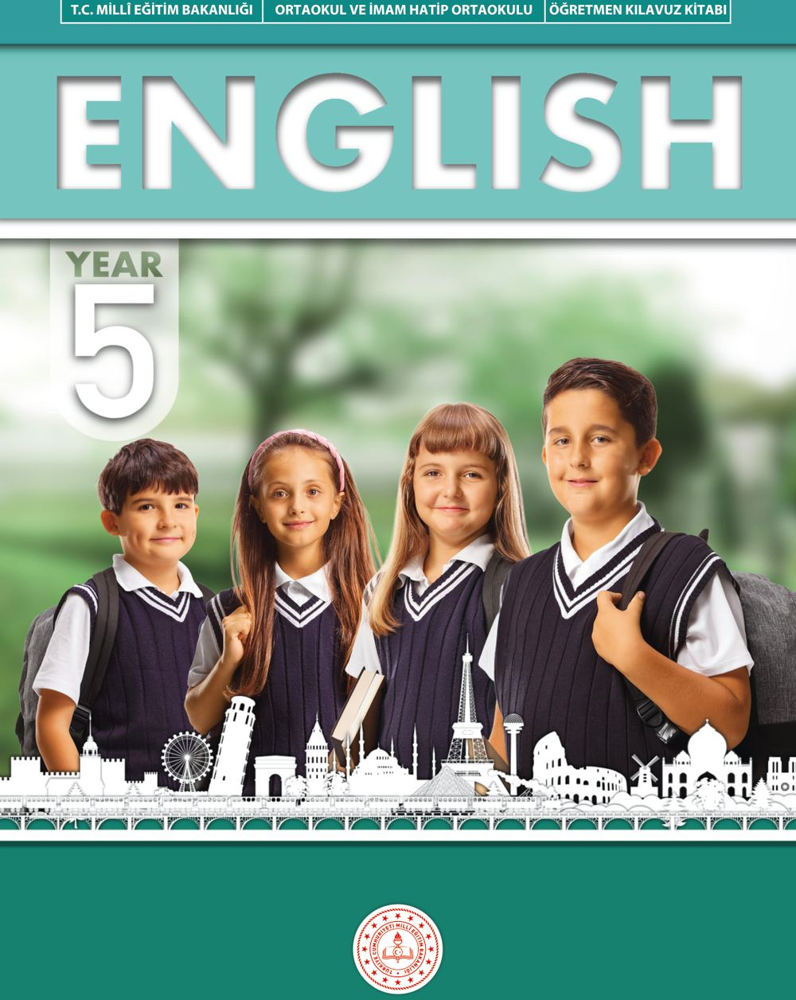

<!-- sayfa 1 -->

LOWER SECONDARY SCHOOL AND
İMAM HATIP LOWER SECONDARY SCHOOL

# ENGLISH
## Year 5
### Teacher's Book

AUTHORS
Aysel BERKET
Eda Burcu ÇETİNKAYA
Fatma DEMİRCAN
Gonca AKISKALI
Nursen SUNAR
Selma YANKUNCU

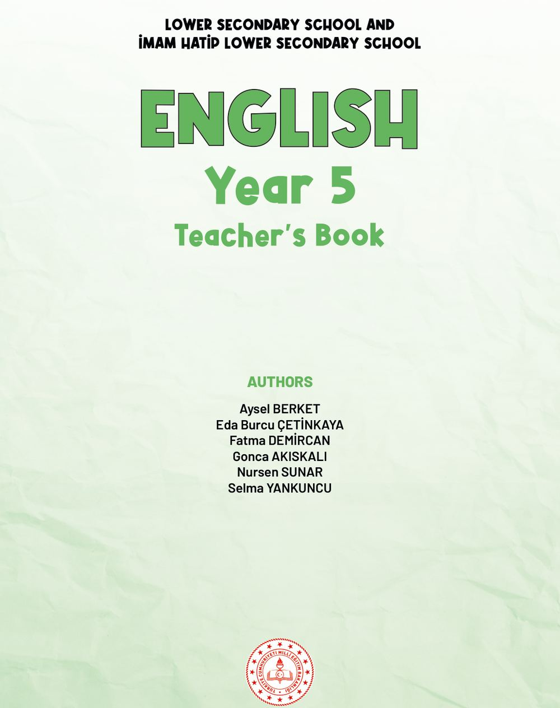

<!-- sayfa 2 -->

MİLLÎ EĞİTİM BAKANLIĞI YAYINLARI .................................................................. : 10556
DERS KİTAPLARI DİZİSİ ..................................................................................... : 2371

Her hakkı saklıdır ve Millî Eğitim Bakanlığına aittir. Kitabın metin, soru ve şekilleri kısmen de olsa hiçbir surette alınıp yayımlanamaz.

**Editor**
Dr. Kamile HAMİLOĞLU

**Visual Designers**
Bahadır UYSAL
Mehmet Mirza IŞIK
Nafize AĞIR
Tolga TANYEL

**Multimedia Designer**
Özlem VAYİÇ

**Curriculum Development Specialists**
Dr. Mehmet AKCAALAN
Dr. Orhan YİĞİTOĞLU
Fatma KELEŞ

**Assessment and Evaluation Specialist**
Dr. Sibel AYDOĞAN

**Guidance Specialist**
Serkan İLHAN

ISBN 978-975-11-9458-9

Millî Eğitim Bakanlığı Talim ve Terbiye Kurulu Başkanlığının 29.12.2025 tarih ve

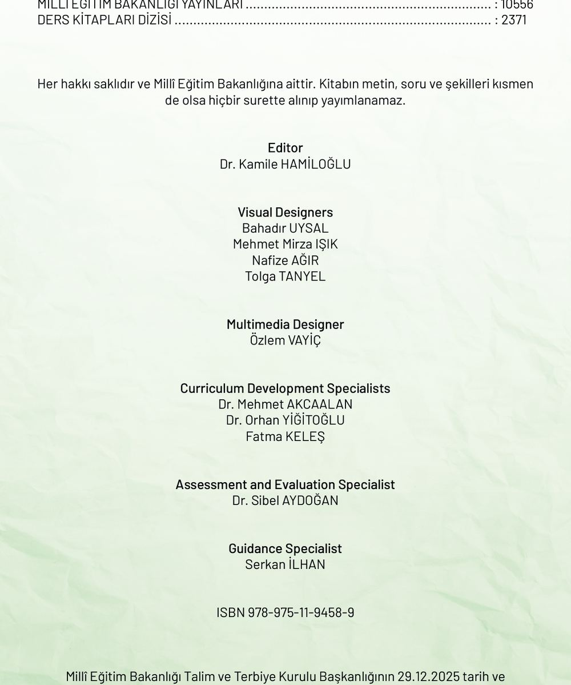
<!-- yer tutucu bulunamadı: sayfa sonuna eklendi -->

<!-- sayfa 3 -->

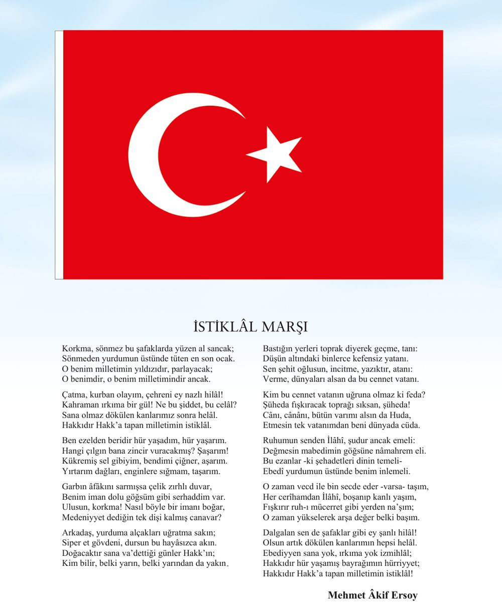

# İSTİKLÂL MARŞI

Korkma, sönmez bu ufaklarda yüzen al sancak;  
Sönmeden yurdumun üstünde tüten en son ocak.  
O benim milletimin yıldızıdır, parlayacak;  
O benimdir, o benim milletimindir ancak.  

Çatma, kurban olayım, çehreni ey nazlı hilâl! 
Kahraman ırkıma bir gül! Ne bu şiddet, bu celâl? 
Sana olmaz dökülen kanlarımız sonra helâl. 
Hakkıdır Hakk’a tapan milletimin istiklâl. 

Ben ezelden beridir hür yaşadım, hür yaşarım. 
Hangi çılgın bana zincir vuracakmış? Şaşarım! 
Kükremiş sel gibiyim, bendimi çiğner, aşarım. 
Yırtarım dağları, enginlere sığmam, taşarım. 

Garbın âfâkını sarmışsa çelik zırhlı duvar,  
Benim iman dolu göğsüm gibi serhaddim var. 
Ulusun, korkma! Nasıl böyle bir imanı boğar, 
Medeniyet dediğin tek dişi kalmış canavar? 

Arkadaş, yurduma alçakları uğratma sakın; 
Siper et gövdeni, dursun bu hayâsızca akın. 
Doğacaktır sana va’dettiği günler Hakk’ın; 
Kim bilir, belki yarın, belki yarından da yakın 

Bastığın yerleri toprak diyerek geçme, tanı:  
Düşün altındaki binlerce kefensiz yatanı. 
Sen şehit oğlusun, incitme, yazıktır, atanı: 
Verme, dünyaları alsan da bu cennet vatanı. 

Kim bu cennet vatanın uğruna olmaz ki feda? 
Şüheda fışkıracak toprağı sıksan, şüheda! 
Cânı, cânânı, bütün varımı alsın da Huda, 
Etmesin tek vatanımdan beni dünyada cüda. 

Ruhumun senden ilâhî, şudur ancak emeli: 
Değmesin mabedimin göğsüne nâmahrem eli. 
Bu ezanlar -ki şehadetleri dinin temeli-  
Ebedî yurdumun üstünde benim inlemeli. 

O zaman vecd ile bin secde eder -varsa- taşım, 
Her cerîhamdan ilâhî, boşanıp kanlı yaşım, 
Fışkırır ruh-ı mücerret gibi yerden na’şım; 
O zaman yükselerek arşa değer belki başım. 

Dalgalan sen de ufaklar gibi ey kanlı hilâl! 
Olsun artık dökülen kanlarımın hepsi helâl. 
Ebediyyen sana yok, Türk’e yok izmihlâl; 
Hakkıdır hür yaşamı bayrağımın hürriyet;  
Hakkıdır Hakk’a tapan milletimin istiklâl! 

Mehmet Âkif Ersoy

<!-- sayfa 4 -->

# GENÇLİĞE HİTABE

Ey Türk gençliği! Birinci vazifen, Türk istiklâlini, Türk Cumhuriyetini, ilelebet muhafaza ve müdafaa etmektir.

Mevcudiyetinin ve istikbalinin yegâne temeli budur. Bu temel, senin en kıymetli hazinendir. İstikbalde dahi, seni bu hazineden mahrum etmek isteyecek dâhilî ve hâricî bedhahların olacaktır. Bir gün, istiklâl ve cumhuriyeti müdafaa mecburiyetine düşersen, vazifeye atılmak için, içinde bulunacağın vaziyetin imkân ve şeraitini düşünmeyeceksin! Bu imkân ve şerait, çok namüsait bir mahiyette tezahür edebilir. İstiklâl ve cumhuriyetine kastedecek düşmanlar, bütün dünyada emsali görülmemiş bir galibiyetin mümessili olabilirler. Cebren ve hile ile aziz vatanın bütün kaleleri zapt edilmiş, bütün tersanelerine girilmiş, bütün orduları dağıtılmış ve memleketin her köşesi bilfiil işgal edilmiş olabilir. Bütün bu şeraitten daha elîm ve daha vahim olmak üzere, memleketin dâhilinde iktidara sahip olanlar gaflet ve dalâlet ve hattâ hıyanet içinde bulunabilirler. Hattâ bu iktidar sahipleri şahsî menfaatlerini, müstevlîlerin siyasî emelleriyle tevhit edebilirler. Millet, fakr u zaruret içinde harap ve bîtap düşmüş olabilir.

Ey Türk istikbalinin evlâdı! İşte, bu ahval ve şerait içinde dahi vazifen, Türk istiklâl ve cumhuriyetini kurtarmaktır. Muhtaç olduğun kudret, damarlarındaki asil kanda mevcuttur.

Mustafa Kemal Atatürk

<!-- sayfa 5 -->

Görüntüde herhangi bir metin veya matematiksel ifade bulunmamaktadır. Sadece Mustafa Kemal Atatürk'ün bir portresi yer almaktadır.

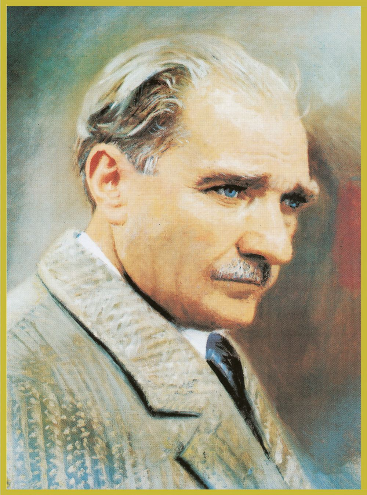
<!-- yer tutucu bulunamadı: sayfa sonuna eklendi -->

<!-- sayfa 6 -->

Verdiğiniz metin katmanı boş olduğu için (`<<< >>>` arası boş) dönüştürülecek herhangi bir içerik bulunmamaktadır. Lütfen metin katmanını içeren içeriği paylaşın, böylece talimatlarınıza uygun şekilde Markdown formatına çevirebilirim.

<!-- sayfa 7 -->

# CONTENTS

Table of Contents .......................................................... 8
Revision 1 ................................................................... 13
Revision 2 ................................................................... 17
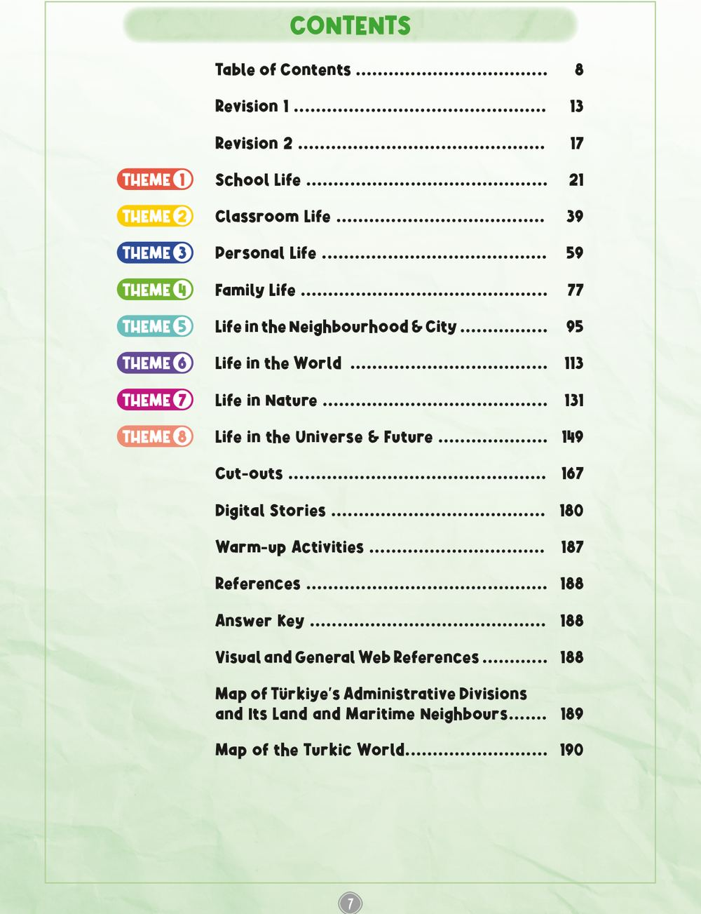 THEME 1 School Life ........................................... 21
 THEME 2 Classroom Life ....................................... 39
 THEME 3 Personal Life ........................................ 59
 THEME 4 Family Life .......................................... 77
 THEME 5 Life in the Neighbourhood & City ................... 95
 THEME 6 Life in the World .................................... 113
 THEME 7 Life in Nature ....................................... 131
 THEME 8 Life in the Universe & Future ....................... 149
Cut-outs .................................................................... 167
Digital Stories ............................................................. 180
Warm-up Activities .......................................................... 187
References .................................................................. 188
Answer Key .................................................................. 188
Visual and General Web References ......................................... 188
Map of Türkiye's Administrative Divisions and Its Land and Maritime Neighbours ....... 189
Map of the Turkic World.................................................... 190

<!-- sayfa 8 -->

# TABLE OF CONTENTS

| THEME NO | MAIN THEME | SUB-THEMS | FUNCTIONS AND GRAMMARING | VOCABULARY SELECTION-USE | PRONUNCIATION SELECTION-USE | LISTENING & WATCHING – COMPREHENSION |
| :--- | :--- | :--- | :--- | :--- | :--- | :--- |
| REVISION | Revision 1 | - Daily routines and activities at school - Favourite school subjects and classroom activities now and in the past - Time - Seasons of the year - Physical appearances and personality - Clothing and clothing preferences | - Daily routines: The Simple Present Tense - Preference or enjoyment: “Like + gerund” - Past states: The Simple Past Tense - Ability in the past: “Could” | - Vocabulary for daily routines and activities at school - Vocabulary for favourite school subjects - Vocabulary for time and seasons of the year - Vocabulary for physical appearances and personality - Vocabulary for clothing and clothing preferences | | School subjects Listening for details |
| REVISION | Revision 2 | - Family members’ jobs - Family members’ long-lasting habits - Family members’ errands - Places for services in the neighbourhood - Comparisons | - Completed actions in the past: The Simple Past Tense - Comparing three or more things: Comparisons with the regular forms of adjectives/superlatives - Preferences or interests: Like/Love + Ving | - Vocabulary for family members’ jobs - Vocabulary for family members’ long-lasting habits - Vocabulary for family members’ errands - Vocabulary for places for services in the neighbourhood | | People with different jobs talking about their jobs/routines Listening for specific information/details |
| THEME 1 | School Life | - People, places, and rules at school - School clubs - Countries - National days and celebrations | - “A, an, the”: Articles - Preferences about activities: The Simple Present Tense - Giving commands: Imperatives - Obligation and rules: “Mustn’t/Can’t” | - Vocabulary for people, places, and rules at school - Vocabulary for school clubs - Vocabulary for national days and celebrations | Intonation of positive statements | The first day of an international summer school Listening for gist/specific information/details |
| THEME 2 | Classroom Life | - Classroom rules and language - School subjects - Timetables - Classroom objects - Days of the week - Time | - Presence of something or somebody: “There is/There are” - Responsibilities and routines: The Simple Present Tense - Asking the time of actions: “What time?” | - Vocabulary for school subjects - Vocabulary for timetables - Vocabulary for classroom objects - Vocabulary for days of the week - Vocabulary for time | Intonation of negative stataments | A conversation in the classroom Listening for gist/specific information/details |

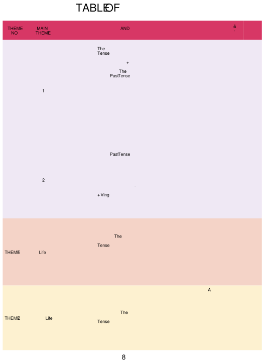
<!-- yer tutucu bulunamadı: sayfa sonuna eklendi -->

<!-- sayfa 9 -->

# TABLE OF CONTENTS

| READING-COMPREHENSION | SPEAKING-EXPRESSION | WRITING-EXPRESSION | CLIL & CULTURE | PROJECTS | REFLECTION | EVALUATION |
| :--- | :--- | :--- | :--- | :--- | :--- | :--- |
| “Show and Tell” day Reading for details | ***The speaking skill is incorporated into all sections of the theme.***  Clothing preferences Sharing personal information | Social Language Expressions Finding out the suitable expression for different situations | | | | |
| A Day at the Seaside Scanning Reading for details | ***The speaking skill is incorporated into all sections of the theme.***  Talking about daily routines Interacting in pairs | Grouping the healthy/ unhealthy food Differentiating food categories | | | | |
| A blog page Skimming Scanning Reading for details | ***The speaking skill is incorporated into all sections of the theme.***  Dialogues about people, places, and rules at school, countries, favourite school clubs Interacting in pairs/ groups | A reply to a blogger Sharing personal preferences | Interesting rules in different countries | How to create a new school club Presenting a poster | Time to check your progress Reflecting on the learning process | Rating scales about the learning outcomes |
| A weekly school magazine Skimming Scanning Reading for details | ***The speaking skill is incorporated into all sections of the theme.***  Dialogues about school subjects, classroom objects, time, and timetable Sharing personal information in pairs/ groups | A survey in the class Exchanging information and comparing | Interesting school activities and lessons in different countries | How to make a dream classroom Presenting a poster | Time to check your progress Reflecting on the learning process | Rating scales about the learning outcomes |

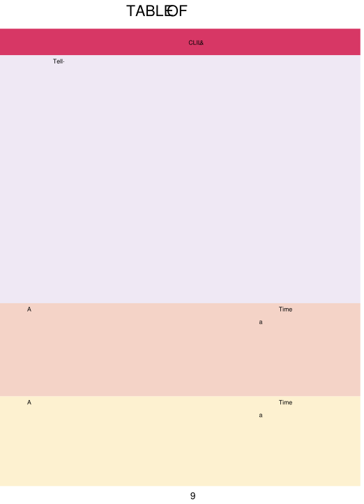
<!-- yer tutucu bulunamadı: sayfa sonuna eklendi -->

<!-- sayfa 10 -->

| THEME NO | MAIN THEME | SUB-THEMES | FUNCTIONS AND GRAMMARING | VOCABULARY SELECTION-USE | PRONUNCIATION | LISTENING & WATCHING - COMPREHENSION |
| :--- | :--- | :--- | :--- | :--- | :--- | :--- |
| THEME 3 | Personal Life | -Basic body parts and physical features -Clothes -Daily routines and activities | -Daily routines: The Simple Present Tense -Confirming general truths: Question tags -The frequency of actions: Adverbs of frequency | -Vocabulary for basic body parts and physical features -Vocabulary for clothes -Vocabulary for daily routines and activities | Intonation of questions and question tags | Two children talking about a video game Listening for gist/specific information/details |
| THEME 4 | Family Life | -Family members' routines -Family members' hobbies and activities | -Actions happening at the moment of speaking: The Present Progressive Tense -Ongoing or temporary actions: The Present Progressive Tense vs. The Simple Present Tense -Confirming ongoing actions: Question tags | -Vocabulary for family members' routines -Vocabulary for family members' hobbies and activities | Target sounds: a, b, c, d, e | Two children talking about a family photo album Listening for gist/specific information/details |
| THEME 5 | Life in the Neighbourhood & the City | -Places in the neighbourhood and city -Different types of houses | -Comparisons between two things or people: Comparatives of adjectives -Ownership or relationship: Possessive 's -Habitual actions: The Simple Present Tense -Existence or location: "There is/ There are" | 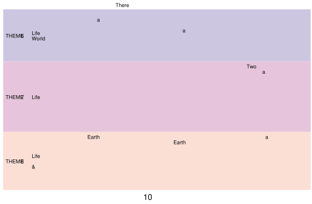 -Vocabulary for places for recreation and attractions in the neighbourhood and city -Vocabulary for different types of houses and furniture and kitchen utensils | Target sounds: f, g, h, i, j, k | 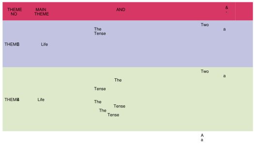 A dialogue between a customer and a salesperson for renting a house Listening for gist/specific information/details |
| THEME 6 | Life in the World | -Basic food types -Ordering in a restaurant -Food events in the city | -Permission: "Can" -Possession: "Have got/Has got" -Countable and uncountable nouns | -Vocabulary for basic food types -Vocabulary for ordering in a restaurant | Target sounds: l, m, n, o, p | A dinner at the restaurant Listening for gist/specific information/details |
| THEME 7 | Life in Nature | -Types of animals in nature -Wild animals in nature -Their habitats | -Capability, ability: "Can" -External obligation: "Must" -Location or place: "Where?" -Comparing things, animals, and people: Comparative and superlative adjectives | -Vocabulary for types of animals in nature -Vocabulary for wild animals in nature -Vocabulary for their habitats | Target sounds: q, r, s, t, u | Two children visiting a national park Listening for gist/specific information/details |
| THEME 8 | Life in the Universe & Future | -Planet Earth -Holidays -School holidays, places, activities, and plans for holidays | -Plans: "Be Going to Future Tense" | -Vocabulary for Planet Earth -Vocabulary for school holidays, places, activities, and plans for holidays | Target sounds: v, w, x, y, z | Planning a holiday Listening for gist/specific information/details |

<!-- sayfa 11 -->

| READING-COMPREHENSION | SPEAKING-EXPRESSION | WRITING-EXPRESSION | CLIL & CULTURE | PROJECTS | REFLECTION | EVALUATION |
| :--- | :--- | :--- | :--- | :--- | :--- | :--- |
| Fashion Magazine, Style & You Skimming Scanning Reading for details | *The speaking skill is incorporated into all sections of the theme.*  Dialogues about basic body parts, physical features, clothes, daily routines, and activities Interacting in pairs/groups | Introducing a celebrity Describing a person's features | Clothing from all around the world | How to make your wardrobe Presenting a poster | Time to check your progress Reflecting on the learning process | Rating scales about the learning outcomes |
| A Strange Day, Isn't it? Skimming Scanning Reading for details | *The speaking skill is incorporated into all sections of the theme.*  Dialogues about family members' routines, hobbies, and activities Interacting in pairs/groups | An unusual day in my diary Comparing an unusual day | Popular hobbies and activities in different countries | How to make an interview Presenting an interview | Time to check your progress Reflecting on the learning process | Rating scales about the learning outcomes |
| A blog page about different house types Skimming Scanning Reading for details | *The speaking skill is incorporated into all sections of the theme.*  Dialogues about places in the neighbourhood and city and different types of houses Interacting in pairs/groups | Introducing and comparing houses | Interesting Houses, Interesting Lives | How to create a dream house Presenting a poster | Time to check your progress Reflecting on the learning process | Rating scales about the learning outcomes |
| Spanish Churros Skimming Scanning Reading for details | *The speaking skill is incorporated into all sections of the theme.*  Dialogues about the ingredients of a dish, steps of a recipe, and ordering at restaurant Talking in pairs/groups | A recipe Explaining the steps of a recipe | Eating habits around the world | How to order in a restaurant Presenting a record | Time to check your progress Reflecting on the learning process | Rating scales about the learning outcomes |
| Animal Habitats Skimming Scanning Reading for details | *The speaking skill is incorporated into all sections of the theme.*  Dialogues about types of animals in nature, wild animals in nature, and their habitats Interacting in pairs/groups | Introducing a favourite animal Describing an animal's features | Penguins | How to describe wild animals Presenting a poster | Time to check your progress Reflecting on the learning process | Rating scales about the learning outcomes |
| Postcards Skimming Scanning Reading for details | *The speaking skill is incorporated into all sections of the theme.*  Dialogues about the activities and places for holiday plans | A postcard from a holiday destination Describing holiday plans | Amazing holiday destinations around the world | How to plan a dream holiday Presenting a poster | Time to check your progress Reflecting on the learning process | Rating scales about the learning outcomes |

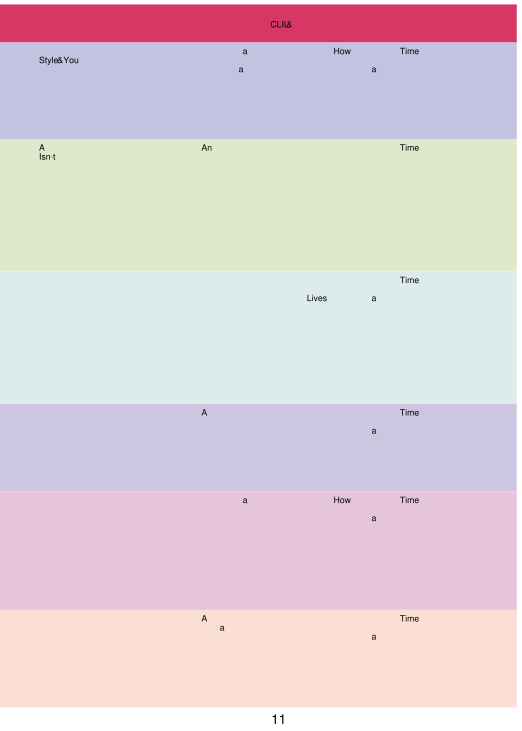
<!-- yer tutucu bulunamadı: sayfa sonuna eklendi -->

<!-- sayfa 12 -->

# ICONS

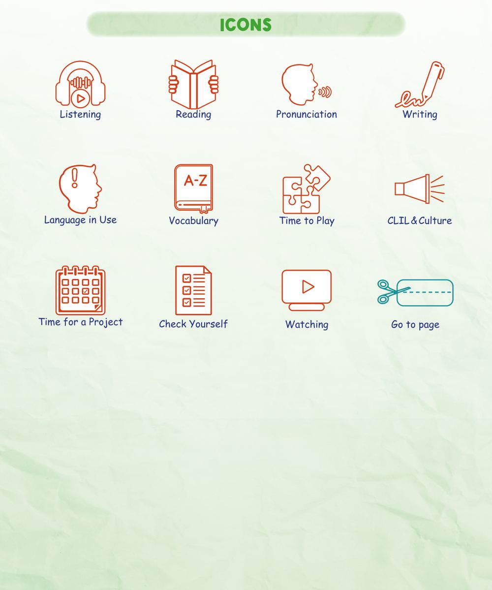
Listening

Reading

Pronunciation

Writing

Language in Use

Vocabulary

Time to Play

CLIL & Culture

Time for a Project

Check Yourself

Watching

Go to page

<!-- sayfa 13 -->

# REVISION 1

**Sub-themes**

Daily routines and activities at school
Favourite school subjects and classroom activities
Time and seasons of the year
Physical appearances and personality
Clothing and clothing preferences

**Functional Language**

Describing daily routines and activities at school
Describing past states or conditions of things or people
Expressing preferences
Telling the time
Telling the preferences about favourite school subjects/lessons
Describing abilities or skills someone had in the past
Describing physical appearance
preferences for clothing

**Social Language Expressions**

It's raining cats and dogs!
Let's break the ice!
I'm sorry to hear that!
It fits like a glove!
Feel free to use this!

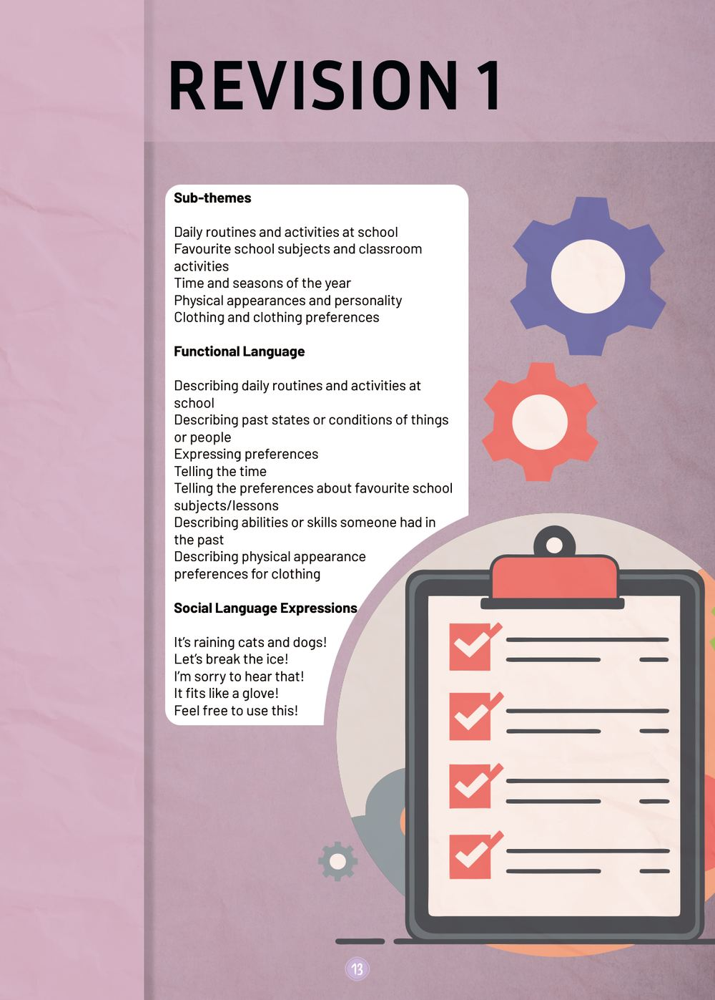

<!-- sayfa 14 -->

Listen to the dialogue and complete it. There is an extra one.

a. What is your favourite lesson?
b. What do you like doing in English lessons?
c. What is the time now?
d. What time do you get up?
e. What is your favourite school activity?
f. What do you do at school on Tuesdays?
g. Which sports do you like the most?

Tom: Hi! I'm Tom. I'm from the school newspaper. Can I ask you some questions?
Emily: Sure, Tom!
Tom: Let's begin with the first question. (1) ______?
Emily: I love club meetings. I am in the Art Club.
Tom: It sounds great! (2) ______?
Nick: I like basketball the most.
Tom: (3) ______?
Emily: I have a Drama lesson on Tuesdays.
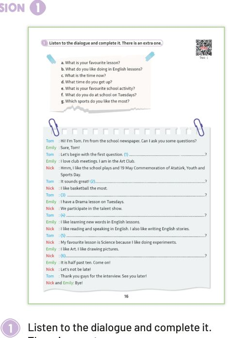
Nick: We participate in the talent show.
Tom: (4) ______?
Emily: I like learning new words in English lessons.
Nick: I like reading and speaking in English. I also like writing English stories.
Tom: (5) ______?
Nick: My favourite lesson is Science because I like doing experiments.
Emily: I like Art. I like drawing pictures.
(6) ______?
Emily: It is half past ten. Come on!
Nick: Let's not be late!
Tom: Thank you guys for the interview. See you later!
Nick and Emily: Bye!

Answer Key
1. e
2. g
3. f
4. b
5. a
6. c
d is extra

1 Listen to the dialogue and complete it. There is an extra one.

Tell students that they will listen to a dialogue with some missing parts. Play Track 1 and ask them to complete the blanks with the given sentences. Remind them that there is an extra option. When they have finished the activity, check the answers with the whole class.

Track 1

Tom : Hi! I'm Tom. I'm from the school newspaper. Can I ask you some questions?
Emily : Sure, Tom!
Tom : Let's begin with the first question. What is your favourite school activity?
Emily : I love club meetings. I am in the Art Club.
Nick : Hmm, I like the school plays and the 19 May Commemoration of Atatürk, Youth and Sports Day.
Tom : It sounds great! Which sports do you like the most?
Nick : I like basketball the most.
Tom : What do you do at school on Tuesdays?
Emily : I have a Drama lesson on Tuesdays.

Nick : We participate in the talent show.
Tom : What do you like doing in English lessons?
Emily : I like learning new words in English lessons.
Nick : I like reading and speaking in English. I also like writing English stories.
Tom : What is your favourite lesson?
Nick : My favourite lesson is Science because I like doing experiments.
Emily : I like Art. I like drawing pictures.
Nick : What is the time now?
Emily : It is half past ten. Come on!
Nick : Let's not be late!
Tom : Thank you guys for the interview. See you later!
Nick and Emily : Bye!

2 Read the dialogue on page 16 and fill in the table.

Direct students' attention to the table before reading the dialogue on page 16 again. Discuss what kind of information to find. This will guide their reading. Then tell them to read the dialogue carefully and individually. Have students fill in the table with the necessary information about Emily and Nick. Give them enough time to complete the activity. Check the answers with the whole class.

Answer Key
Emily : club meetings - drama lessons - learning new words - Art
Nick : school plays - participate in the talent show - reading, speaking, writing English stories - Science

<!-- sayfa 15 -->

# 3 Match the objects with the pictures. There is an extra one.

Ask students to look at the pictures and match them with the classroom objects. Remind them that there is an extra option. Monitor the activity, walking around the classroom, and checking the answers. Offer help and feedback when needed.

**Answer Key**
1. c
2. b
3. h
4. e
5. a
6. is extra
7. d
8. g
9. f

# 4 Reorder the words and write classroom instructions.

Have students look at the scrambled words and reorder them to make meaningful classroom instructions. Tell them that they will use the given picture to guess the verb for each instruction. Encourage them to check word order correctly. Monitor the class and give positive feedback.

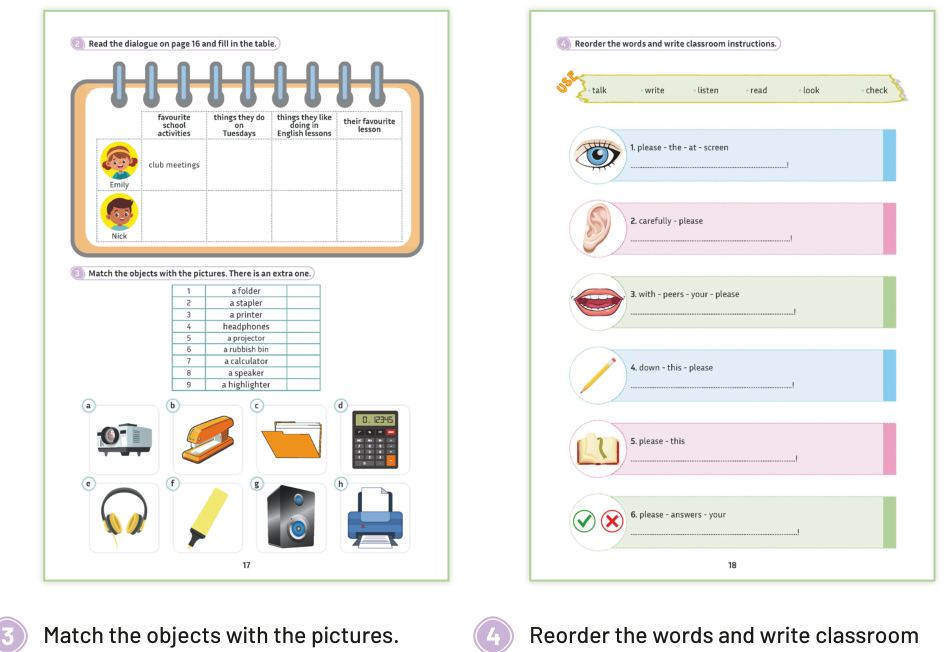

**Answer Key**
1. Look at the screen, please!
2. Listen carefully, please!
3. Talk with your peers, please.
4. Write this down, please!
5. Read this, please!
6. Check your answers, please!

## Teacher's Notes

<!-- sayfa 16 -->

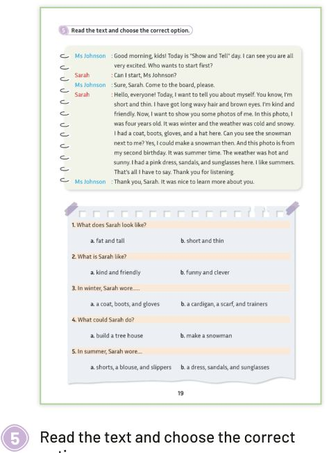

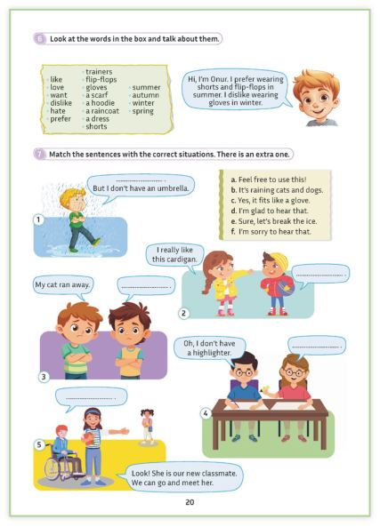

# 5 Read the text and choose the correct option.

Before reading the text, ask students to read the given questions so that they can be aware of what they will focus on. This will help them know what to look for in the text. Then have them read the text carefully to answer the multiple-choice questions below. Ask students to compare their answers with a partner. This encourages discussion and peer correction. Check the answers with the whole class.

**Answer Key**
1. b
2. a
3. a
4. b
5. b

# 6 Speaking-Expression

Look at the words in the box and talk about them.

Point to the words in the box and read them aloud together with the class. Make sure students understand the meaning of each word. Ask students to with words in the box. Guide them to share their sentences with the class. Encourage others to listen and repeat if necessary. Monitor them and give positive feedback.

**Answer Key**
Students' own answers

# 7 Match the sentences with the correct situations. There is an extra one.

Have students read the speech bubbles carefully. Let them think about what they would say in these situations. Then make them match the given sentences with the correct situation. Remind them that there is an extra option. When they have finished the activity, check the answers with the whole class and act out in pairs.

**Answer Key**
1. b
2. c
3. f
4. a
5. e
d is extra

<!-- sayfa 17 -->

# REVISION 2

**Sub-themes**

Family members’ jobs
Family members’ long-lasting habits
Family members’ errands
Places for services in the neighbourhood
Life on the seaside
Sea/marine animals and their habitats
Activities of sea/marine animals
Dangers for sea/marine animals
Types of houses by the water
Healthy and unhealthy food

**Functional Language**

Describing completed actions
Expressing preferences
Describing one person, animal, place, or thing
Giving advice or suggestions
Describing prohibition
Comparing multiple items or choices

**Social Language Expressions**

Don’t worry!
That’s great!
Go ahead!
Amazing!

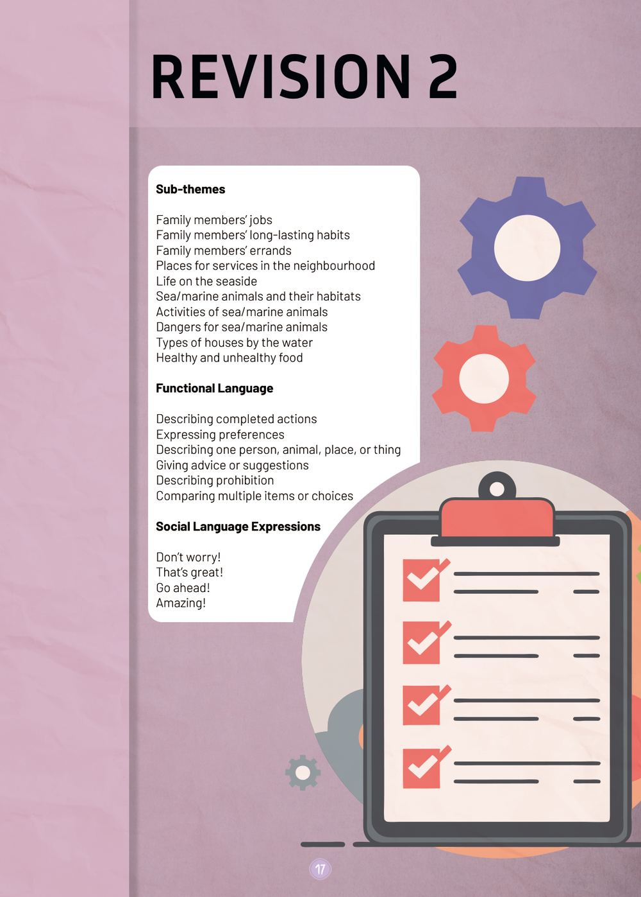

<!-- sayfa 18 -->

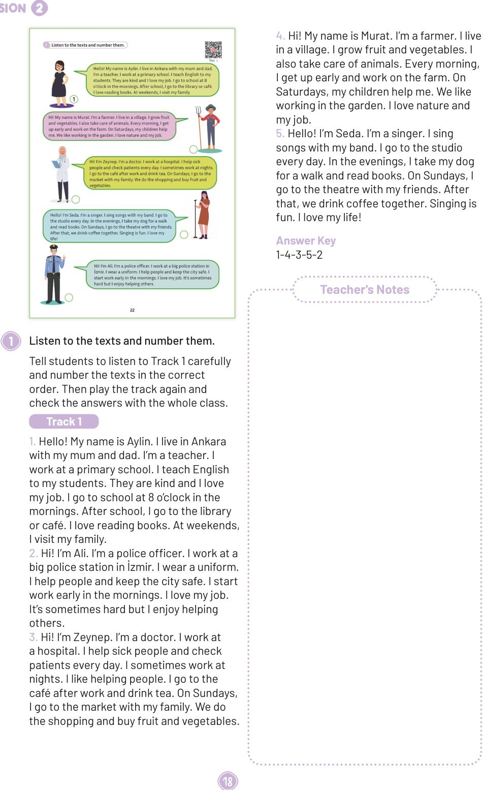

1 Listen to the texts and number them.

Tell students to listen to Track 1 carefully and number the texts in the correct order. Then play the track again and check the answers with the whole class.

Track 1

1. Hello! My name is Aylin. I live in Ankara with my mum and dad. I’m a teacher. I work at a primary school. I teach English to my students. They are kind and I love my job. I go to school at 8 o’clock in the mornings. After school, I go to the library or café. I love reading books. At weekends, I visit my family.

2. Hi! I’m Ali. I’m a police officer. I work at a big police station in İzmir. I wear a uniform. I help people and keep the city safe. I start work early in the mornings. I love my job. It’s sometimes hard but I enjoy helping others.

3. Hi! I’m Zeynep. I’m a doctor. I work at a hospital. I help sick people and check patients every day. I sometimes work at nights. I like helping people. I go to the café after work and drink tea. On Sundays, I go to the market with my family. We do the shopping and buy fruit and vegetables.

4. Hi! My name is Murat. I’m a farmer. I live in a village. I grow fruit and vegetables. I also take care of animals. Every morning, I get up early and work on the farm. On Saturdays, my children help me. We like working in the garden. I love nature and my job.

5. Hello! I’m Seda. I’m a singer. I sing songs with my band. I go to the studio every day. In the evenings, I take my dog for a walk and read books. On Sundays, I go to the theatre with my friends. After that, we drink coffee together. Singing is fun. I love my life!

Answer Key
1-4-3-5-2

Teacher's Notes

<!-- sayfa 19 -->

# 2 Match the sentences from the text with the jobs. There is an extra one.

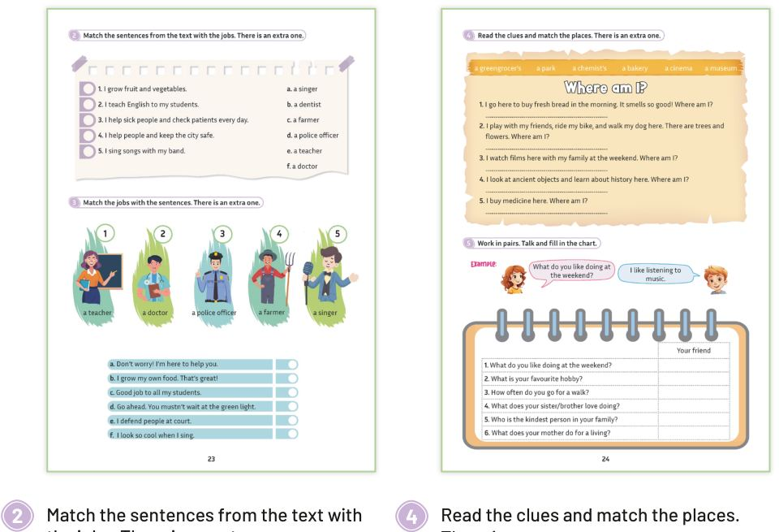

Ask students to look at the sentences from the texts in Activity 1 and match them with the jobs carefully. Give them enough time to complete the activity. When they have finished, check the answers with the whole class.

**Answer Key**
1. c
2. e
3. f
4. d
5. a
b is extra

# 3 Match the jobs with the sentences. There is an extra one.

Ask students to have a look at the illustrated job titles and match them correctly with the expressions related to each profession. Monitor the class and give positive feedback.

**Answer Key**
1. c
2. a
3. d
4. b
5. f

# 4 Read the clues and match the places. There is an extra one.

Ask students to read the clues and match them with the correct places. Give them enough time to complete the activity. When they have finished, check the answers with the whole class.

**Answer Key**
1. a bakery
2. a park
3. a cinema
4. a museum
5. a chemist's
a greengrocer's is extra

# 5 Speaking-Expression
## Work in pairs. Talk and fill in the chart.

Tell students to ask and answer questions about the chart as in the example. Then have them fill in the chart according to their friends. Encourage them to practise in pairs. Monitor the class and give positive feedback.

**Answer Key**
Students' own answers

<!-- sayfa 20 -->

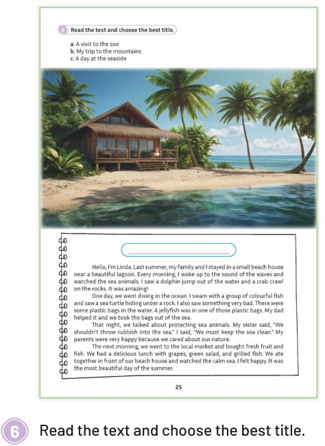
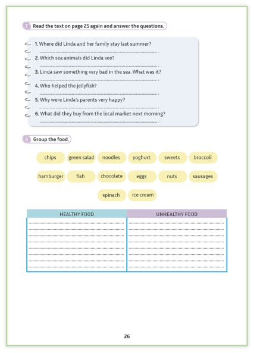

6. Read the text and choose the best title.
Tell students to read the text on page 25 carefully. Then have them choose the best title for the text. After students finish, check the answers together as a whole class. Ask students to explain how they have chosen the correct title to support their understanding.

Answer Key
c

7. Read the text on page 25 again and answer the questions.
Before reading the text carefully again, ask students to read the given questions so that they can be aware of what they will focus on. Then have them read the text carefully to answer the questions. Check the answers with the whole class.

Answer Key
1. They stayed in a beautiful beach house.
2. She saw a dolphin, a crab, a sea turtle, and a jellyfish.
3. It was a jellyfish in a plastic bag.
4. Linda's father
5. Because they cared about the nature.
6. They bought fresh fruit and fish.

8. Group the food.
Ask students to observe the list of mixed food items containing both healthy and unhealthy options. Then have students group and write the items into the correct categories in the table below. Give them enough time to complete the activity. When they have finished, check the answers with the whole class.

Answer Key
Healthy Food : green salad, yoghurt, broccoli, fish, eggs, nuts, spinach
Unhealthy Food : chips, noodles, sweets, a hamburger, chocolate, sausages, ice cream

<!-- sayfa 21 -->

# SCHOOL LIFE

## THEME 1

### Sub-themes
People, places, and rules at school
School clubs
Countries
National and religious days, festivals, and celebrations

### Functional Language
Referring to specific or non-specific people, things, or animals
Expressing a state, a condition, an identity, or a location
Asking preferences about activities
Giving commands, directions, and instructions
Expressing obligations or rules
Asking about things, actions, times, and people involved in actions

### Social Language Expressions
Let’s get started!
Line up, nice and straight!
Follow the rules and play safe!

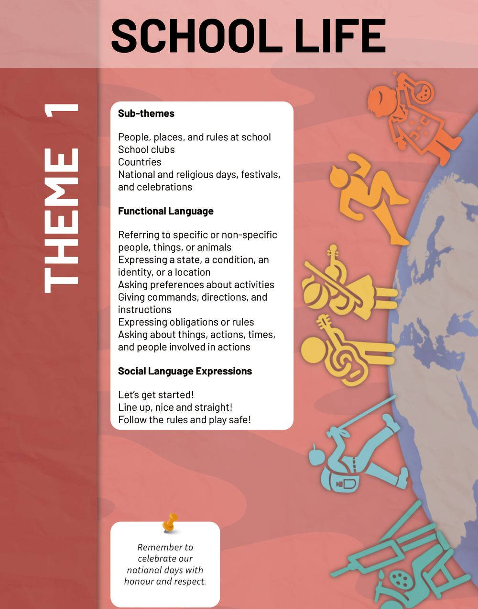
Remember to celebrate our national days with honour and respect.

<!-- sayfa 22 -->

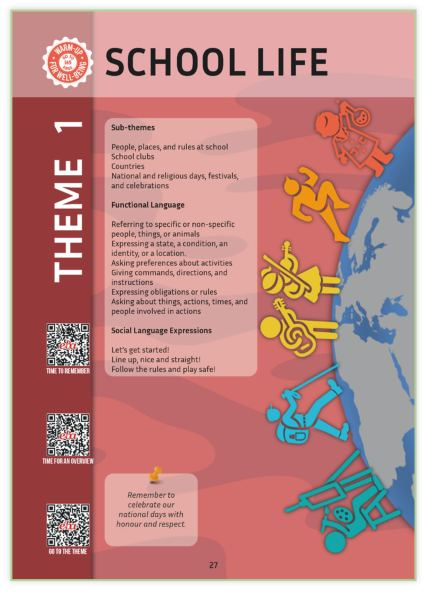

# SCHOOL LIFE

**THEME 1**

**Sub-themes**
* People, places, and rules at school
* School clubs
* Traditions
* National and religious days, festivals, and celebrations

**Functional Language**
* Referring to specific or non-specific people, things, or animals
* Expressing likes, a condition, an identity, or a location
* Asking preferences about activities
* Giving commands, directions, and instructions
* Expressing obligations or rules
* Asking about things, actions, times, and people involved in actions

**Social Language Expressions**
* Let's get started!
* Listen up one and straight!
* Follow the rules and play safe!

**Time to remember**

**Time for an overview**

**Go to the Theme 1**

Remember to celebrate our national days with honour and respect.

27

# Warm-up for Well-Being

Tell students that they are going to play a game just for fun. Make sure all students engage in the activity so that they can feel relaxed and motivated before studying the theme. Have students mime the animal they choose in front of the class. The other students try to guess the animal. Inform them about the use of sounds, gestures, and mimes. When a student guesses correctly, it’s his/her turn now.

# Time to Remember

## Establishing Links

**a** Ask students to read the dialogue carefully. Then tell them to drag the words to the correct blanks below. When they have finished the activity, check the answers with the whole class.

**Answer Key**
1. new
2. teacher's room
3. drama
4. play
5. Monday
fire station is extra.

**b** Tell students to ask and answer questions about the dialogue as in the example. Encourage them to practise in pairs. Monitor the class and give positive feedback.

**Answer Key**
Students' own answers

<!-- sayfa 23 -->

**Additional Activity**
Ask students to predict the main topics of the theme. Give them enough time to think, reflect, and write down their predictions on a small piece of paper. Once they have written their ideas, have them place their notes into a box or a jar in the classroom. (After watching the digital story, you will have students revisit the predictions with the class and check how close their guesses are to the actual topics.)

# Time for an Overview
Check the QR code. In this part, you will see the sub-themes, target grammaring chunks, and vocabulary of the theme. It includes hints for sub-themes and also vocabulary items. Use this page when needed.

# Get to Know
**Watch the digital story. What is it about?**

### The Introductory Picture
This double spread picture will be used as the entry material. The content of the theme is displayed in this picture. Tell students to look at the picture and ask them what they see in the picture. At this stage, no new words will be studied. Only the words that the students already know will be practised.

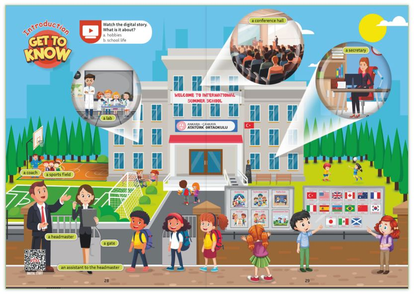

Tell students that they will watch a short digital story. Before playing it, ask them to focus on what they see in the scene and remember the introductory picture with their guesses about the theme. Play the digital story clip without giving any details about its content. Ask them to watch it for understanding it in general/holistically. After watching it, make them answer the question. Check the answers with the whole class.

**Answer Key**
b. school life

**Additional Activity**

<!-- sayfa 24 -->

# 1 Time to Focus

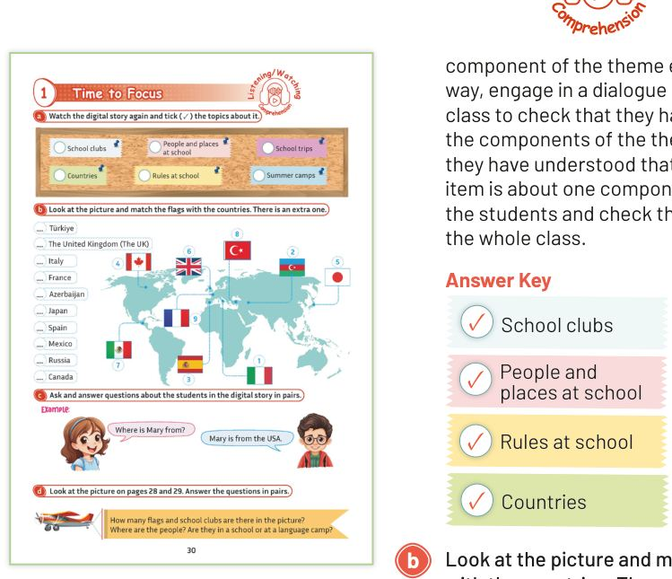

Listening / Watching Comprehension

**a Watch the digital story again and tick ($\checkmark$) the topics about it.**

| | | |
| :--- | :--- | :--- |
| $\checkmark$ School clubs | $\checkmark$ People and places at school | $\checkmark$ School trips |
| $\checkmark$ Countries | $\checkmark$ Rules at school | $\checkmark$ Summer camps |

**b Look at the picture and match the flags with the countries. There is an extra one.**

* Türkiye
* The United Kingdom (The UK)
* Italy
* France
* Azerbaijan
* Japan
* Spain
* Mexico
* Russia
* Canada

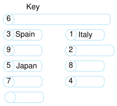

**c Ask and answer questions about the students in the digital story in pairs.**

EXAMPLE
* Where is Mary from? $\rightarrow$ Mary is from the USA.

**d Look at the picture on pages 28 and 29. Answer the questions in pairs.**

* How many flags and school clubs are there in the picture?
* Where are the people? Are they in a school or at a language camp?

30

**Reminder**
Not all target vocabulary of the theme will be practised in this section, they will be covered at the vocabulary stage. Here only the main components of the theme (sub-themes) will be studied.

To draw students’ attention to the content, you can bring some realia into the classroom. Show the corresponding objects or pictures to the students when the corresponding vocabulary for the main components of the theme “School Life” is mentioned in the introductory digital story, without stopping the video while the students watch it. When they have watched the whole story, point to the realia items and ask questions with two options. As one of the words is from the previous themes, students could component of the theme easily. In this way, engage in a dialogue with the whole class to check that they have recognised the components of the theme, and that they have understood that each realia item is about one component. Monitor the students and check the answers with the whole class.

**Answer Key**
* $\checkmark$ School clubs
* $\checkmark$ People and places at school
* $\checkmark$ Rules at school
* $\checkmark$ Countries

Have students use their atlas or maps given at the end of their coursebooks. Ask them to find countries they know or have heard of before. Then ask students to have a look at the flags carefully and match them with the countries. Give them enough time to complete the activity. When they have finished, check the answers with the whole class.

**Answer Key**
* 6 The United Kingdom (The UK)
* 3 Spain
* 1 Italy
* 9 France
* 2 Azerbaijan
* 5 Japan
* 8 Türkiye
* 7 Mexico
* 4 Canada
* Russia is extra

<!-- sayfa 25 -->

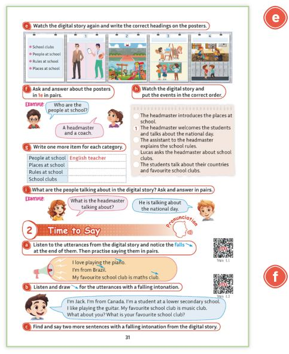

**Speaking-Expression**
**c** Ask and answer questions about the students in the digital story in pairs.

Have students remember the digital story. Make them ask and answer questions about the students in the digital story, as shown in the example, in pairs. If they need, let them watch the digital story again. Monitor them and give positive feedback.

**Answer Key**
- Where is Lucas from?
- He is from Brazil.

**d** Look at the picture on pages 28 and 29. Answer the questions in pairs.

Direct students’ attention to the picture on the double spread page again. Give them a moment to look at it quickly. Then ask students to answer the questions and encourage them to share their answers with the whole class. Guide them by asking follow-up questions to highlight the connections between the picture, the digital story, and the topic of the theme.

**Answer Key**
1. There are fifteen flags and six school

**e** Watch the digital story again and write the correct headings on the posters.

Ask students to watch the digital story again. Then guide them to write the correct heading on the posters. Give them enough time to complete the activity. Check the answers with the whole class.

**Answer Key**
1. People at school
2. Places at school
3. School clubs
4. Rules at school

**Speaking-Expression**
**f** Ask and answer about the posters in 1e in pairs.

Have students examine the posters in 1e. Tell them to ask and answer questions about them, as in the example, in pairs. Monitor them and give positive feedback.

**Answer Key**
- What are the rules at school?
- We mustn’t fight. We must keep the classroom clean.
- What are the places at school?
- A sports field and a playground.
- What are the clubs at school?
- An art club and a maths club.

**Teacher's Notes**

<!-- sayfa 26 -->

g Write one more item for each category.

Ask students to look at the sub-themes of the theme. Make sure they understand each one. Then direct them to write for each category one more example. Give students enough time to read and complete the task individually or in pairs. After they finish, check the answers together as a whole class and discuss any confusing parts.

**Answer Key**
**Places at school** : A sports field, a lab
**Rules at school** : No shouting in class
**School clubs** : Maths club, Drama club

h  Watch the digital story and put the events in the correct order.

Ask students to watch the digital story carefully again. Tell them that they will watch to notice the order of events, and their task is to put these events in the correct order. Before watching, you may cut out pictures related to the order of the digital story or use a Smart Board to mix and match the pictures and the order of events. Then go over the event options with the class to make sure they understand each sentence. Give them enough time to complete the activity. Check the answers with the whole class.

**Answer Key**
② The headmaster introduces the places at school.
① The headmaster welcomes the students and talks about the national day.
⑤ The assistant to the headmaster explains the school rules.
③ Lucas asks the headmaster about school clubs.
④ The students talk about their countries and favourite school clubs.

i Speaking-Expression

What are the people talking about in the digital story? Ask and answer in pairs.

Have students examine the events in 1h. Tell them to ask and answer questions as in the example in pairs. Monitor them and give positive feedback.

**Answer Key**
- What are the students talking about?
- They are talking about their countries and favourite school clubs.

Teacher's Notes

<!-- sayfa 27 -->

# 2 Time to Say
## Selection and Use

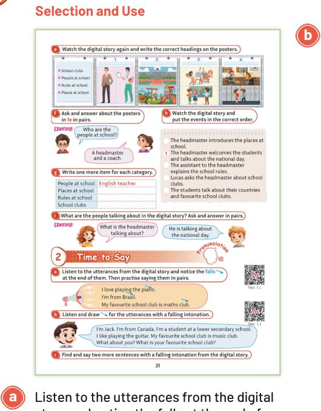

**a** Listen to the utterances from the digital story and notice the falls at the end of them. Then practise saying them in pairs.

Play Track 1.1 and ask students to listen and follow along in their books by paying attention to the utterances with a falling intonation. Then play the track again and pause at the end of each sentence to allow time for students to repeat after the speaker. Remind them to focus on falling intonations. Then say the target words/word groups/sentences together at the same time.

**Track 1.1**
I love playing the piano.
I'm from Brazil.
My favourite school club is maths club.

**b** Listen to the text and draw $\searrow$ for the utterances with a falling intonation.

Play Track 1.2 and ask students to focus on the utterances with a falling intonation. Make them draw an arrow for the sentences with a falling intonation. After checking the answers, replay the track by pausing after each sentence and have students repeat after the speaker if time allows.

**Track 1.2**
I'm Jack. I'm from Canada. I'm a student at a lower secondary school.
I like playing the guitar. My favourite school club is music club. What about you?
What is your favourite school club?

**Answer Key**
I'm Jack. I'm from Canada. I'm a student at a lower secondary school.
I like playing the guitar. My favourite school club is music club. What about you?
What is your favourite school club?

**c** Find and say two more utterances with a falling intonation from the digital story.

Encourage students to find sentences with a falling intonation from the digital story. Have them write these sentences in their notebooks and practise them. Give students a few minutes to complete the activity. Then elicit the answers from the class.

**Answer Key**
- My favourite school club is maths club. I really like solving problems.
- I'm Ahmet. I'm from Türkiye.

# Time for a Task
Check the QR code. Ask students to click on each cloud and choose the suitable

<!-- sayfa 28 -->

# 3 Time to Learn New Words Vocabulary A-Z

## Selection and Use

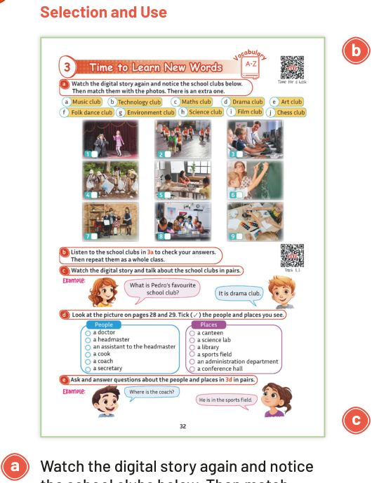

**a Watch the digital story again and notice the school clubs below. Then match them with the photos. There is an extra one.**

Ask students to watch the digital story again and match the school clubs with the photos in pairs. Give them enough time to complete the activity.

**Answer Key**
1. d
2. f
3. b
4. g
5. j
6. c
7. a
8. h
9. e

i is extra.

**b Listen to the school clubs in 3a to check your answers. Then repeat them as a whole class.**

Tell students to listen to Track 1.3. Check the answers in 3a with the class. Then make them repeat as a whole class.

**Track 1.3**
1. d Drama club
2. f Folk-dance club
3. b Technology club
4. g Environment club
5. j Chess club
6. c Maths club
7. a Music club
8. h Science club
9. e Art club

## Speaking-Expression

**c Watch the digital story and talk about the school clubs in pairs.**

Play the digital story again and ask students to talk about the school clubs. Let them share their ideas with the class on a voluntary basis. Guide the students to use the expressions in 3a.

**Answer Key**
- What is Lucas' favourite school club?
  It is music club.
- What is Aiko's favourite school club?
  It is maths club.
- What is Harris' favourite school club?
  It is art club.
- What is Mary's favourite school club?
  It is technology club.
- What is Eva's favourite school club?
  It is science club.
- What is Pierre and Mehriban's favourite school club?
  It is environment club.
- What is Ahmet's favourite school club?
  It is sports club.
- What is Roberto's favourite school club?

<!-- sayfa 29 -->

**d** Look at the picture on pages 28 and 29. Tick ($\checkmark$) the people and places you see.

Direct students’ attention to the picture on the double spread page. Give them a moment to scan. Then ask students which people and places they see in the picture. Give them enough time to complete the activity. Encourage them to share their answers with the whole class and check the answers.

**Answer Key**

| People | $\checkmark$ |
| :--- | :---: |
| a headmaster | $\checkmark$ |
| an assistant to the headmaster | $\checkmark$ |
| a coach | $\checkmark$ |
| a secretary | $\checkmark$ |

| Places | $\checkmark$ |
| :--- | :---: |
| a science lab | $\checkmark$ |
| a sports field | $\checkmark$ |
| a conference hall | $\checkmark$ |

**e** **Speaking-Expression**

Ask and answer questions about the people and places in 3d in pairs.

Have students examine the table in 3d. Tell them to ask and answer questions about the people and the places, as in the example, in pairs. Monitor them and give positive feedback.

**Answer Key**

- Where is the coach?
  He is in the sports field.
- Where is the headmaster?
  He is in the conference hall.
- Where is the assistant to the headmaster?
  She is in the conference hall.
- Where is the secretary?
  She is in the administration department.
- Where is the science teacher?
  He is in the lab.

# 4 Time to Play

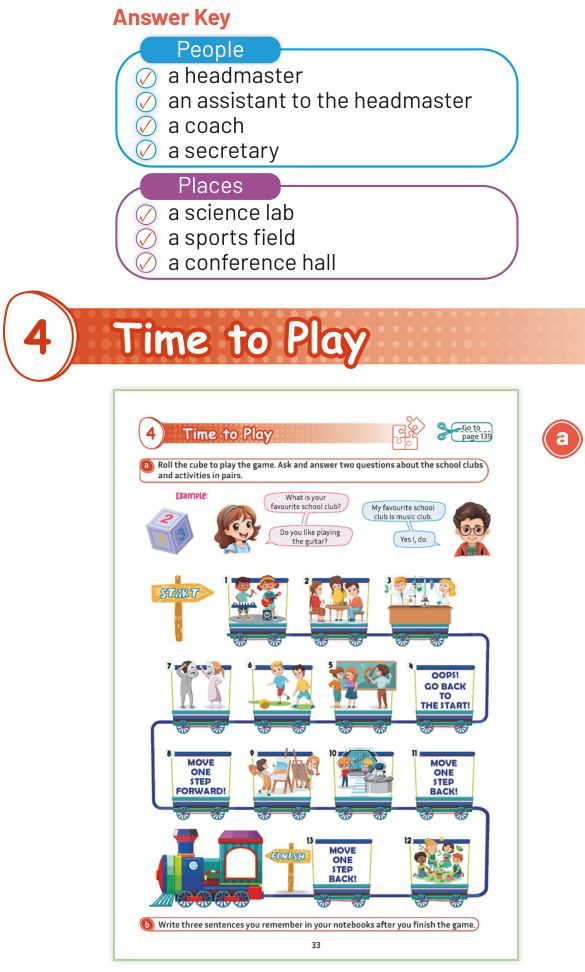

**a** **Speaking-Expression**

Roll the cube to play the game. Ask and answer two questions about the school clubs and activities in pairs.

Tell students they will play a game in pairs using a cube and visuals related to school clubs and activities. Each student takes turns rolling the cube. Depending on the picture they land on, they should ask their partner two related questions. Encourage students to use simple question forms as given examples. Model an example with a student before starting the activity to ensure they understand what they will do. Walk around the classroom to monitor the pairs, support those who need help, and encourage the use of full sentences. If time allows, invite a few pairs to present their questions and answers to the whole class.

**Reminder**
After explaining the game, you can additionally let them play similar games.

**b** Write three sentences you remember in your notebooks after you finish the game.

<!-- sayfa 30 -->

# Time for a Task

Check the QR code. Ask students to click on each cloud and choose the suitable answer. Monitor them and give positive feedback.

# 5 Time to Keep in Mind

Language in Use

## Grammaring Selection and Use

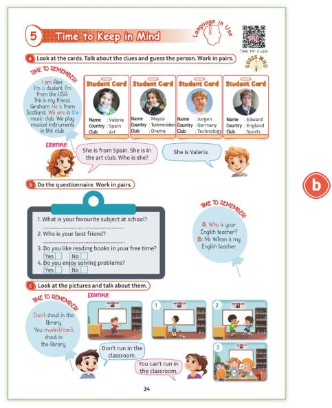

**Answer Key**
* She is from Turkmenistan. She is in the drama club. Who is she? She is Maysa.
* He is from Germany. He is in the technology club. Who is he? He is Jurgen.
* He is from England. He is in the sports club. Who is he? He is Edward.

### b Do the questionnaire. Work in pairs.

Tell students they will complete a short questionnaire by working in pairs and asking each other the questions given below. First, go through the questions as a class to ensure students understand the vocabulary and structure. Then you can model 1-2 questions with a volunteer. Ask students to take turns asking and answering all 4 questions. Encourage them to give full-sentence answers, especially for the open-ended questions. Then check their answers as a whole class.

**Answer Key**
Students' own answers

## Speaking-Expression

### a Look at the cards. Talk about the clues and guess the person. Work in pairs.

Have students work in pairs and take turns introducing people in the third person using the information on the character cards that include names, countries, and school clubs. First, go over the information on each card with the whole class to make sure students recognise the structure in the language use. One student gives clues based on the information on the cards without saying the name, and the other student guesses who the person is, as in the given example. Then they may switch roles.

### Extra Activity

Tell students to read the sentences below and ask questions to answer the underlined parts of the sentences. Tell them to use the grammatical chunks in Activity b. You can write extra sentences.

Carol lives in Canada. She likes doing experiments so much. She is in her favourite school club, the science club.

<!-- sayfa 31 -->

**Speaking-Expression**

**c** Look at the pictures and talk about them.

Each picture shows a school rule or appropriate/inappropriate behaviour at school. Ask students to look at the pictures carefully and guess what rules they might be about. Then have students work in pairs or small groups to discuss each picture and make sentences about the school rules. Guide them to use modals when expressing the rules. Encourage them to use full sentences and give feedback on modal verbs. Then check their answers as a whole class.

**Answer Key**
1. Don’t throw rubbish on the ground. / You mustn’t throw rubbish on the ground.
2. Don’t fight. / You mustn’t fight.
3. Don’t eat or drink in the classroom. / You mustn’t eat or drink in the classroom.

# 6 Time to Play 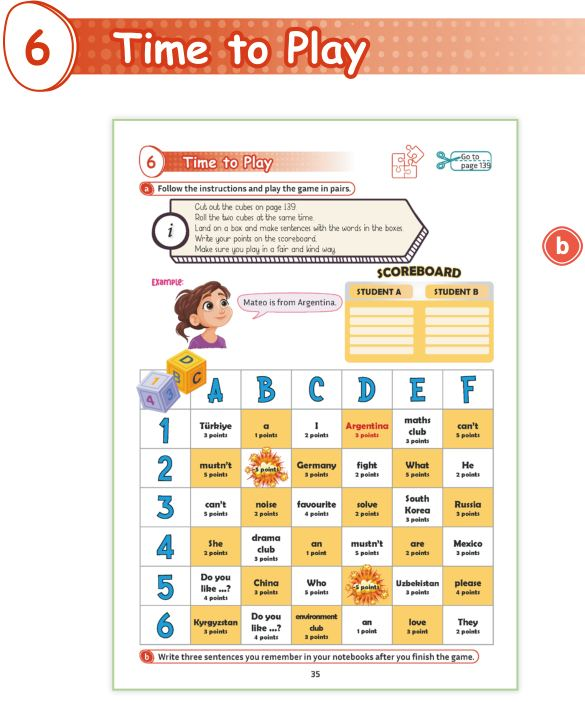

**a Speaking-Expression**
Follow the instructions and play the game in pairs.

Tell students they will play a game in pairs using a cube. First, make students cut out the cube pieces on page 139 and make a cube. When they are ready, give them the game instructions. They will roll the cubes at the same time and use the number and letter on the cube. They will land on a box and make sentences.

Remind them to write their points on the scoreboard. Warn the students to be fair and kind during the game.

**b Write three sentences you remember in your notebooks after you finish the game.**

Encourage students to write three sentences they remember from the game in their notebooks.

***

**Teacher's Notes**

<!-- sayfa 32 -->

# 7 Time to Explore

Reading Comprehension

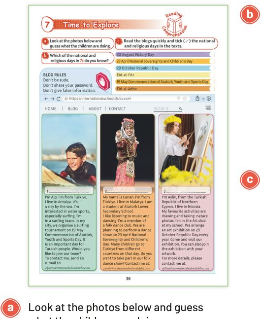

**a Look at the photos below and guess what the children are doing.**

Ask students to look at the photos and guess what they are about. Ask them to discuss what the children are doing in pairs. Encourage them to share their ideas. This activity both activates their prior knowledge and prepares them for reading as a skimming activity. This also helps to understand what the reading content is about in general.

**Answer Key**
1. Alp is surfing.
2. Canan is dancing in a folk dance club.
3. Aylin is drawing pictures.

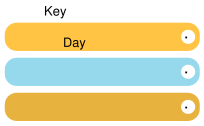

**b Which of the national and religious days in 7c do you know?**

Ask students to look at the national and religious days in 7c. Explain them what national days and religious days mean. Then ask them which of the important days they know and how they celebrate them.

**Answer Key**
Students' own answers

**c Read the blogs quickly and tick ($\checkmark$) the national and religious days in the texts.**

In this activity, students will use the scanning reading technique. (Scanning is a reading technique using rapid eye movement and keywords to move quickly through the text to get specific facts, such as specific pieces of information and a particular answer to a question.) Ask students to read the short blog texts quickly and find which national and religious days are mentioned. As they read, they should tick them. Check the answers in pairs and tell them to share their answers with the whole class.

**Answer Key**
23 April National Sovereignty and Children's Day $\checkmark$
29 October Republic Day $\checkmark$
19 May Commemoration of Atatürk, Youth and Sports Day $\checkmark$

Teacher's Notes

<!-- sayfa 33 -->

**d** Read the blogs on page 36 carefully and write the titles in the correct places.

Tell students to read the blogs on page 36 carefully and individually. Then ask them to write a suitable title for each blog in pairs. After students finish, check the answers as a whole class. Ask students to explain how they chose each title to support their understanding by giving some rationales (clues).

**Answer Key**
| | |
|---|---|
| **1** | Surf with the Waves |
| **2** | The Folk Dance Show |
| **3** | My Colourful World |

**e** Read the blogs again. Write “T” for true, “F” for false sentences. Correct the false ones.

Have students read the blogs again carefully and individually. Then make them discuss in pairs if each sentence is True (T) or False (F). Remind them that if a sentence is false, they should correct it using the information from the text. After they finish, check the answers together as a whole class.

**Answer Key**
1. True
2. False Alp organises a surfing tournament on every 19 May Commemoration of Atatürk, Youth and Sports Day.
3. True
4. False Canan likes listening to music and dancing.
5. False Aylin’s favourite activities are drawing and taking nature photos.
6. True

**f** Look at the blog page and rewrite the blog rules.

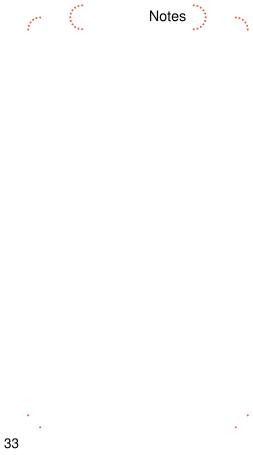

Have students read the blog page carefully again. Ask them to rewrite the rules they find on the blog page in their own words. Remind them to use the

**g**

**Speaking-Expression**
**What rules do you have in your school? Talk about them in pairs.**

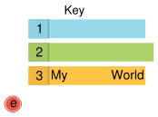

Tell students to think about the rules in their own school. Ask them to work in pairs and talk about the rules they know. First, you may brainstorm a few examples as a whole class and write them on the board. Then you may let the students discuss in pairs.

**Answer Key**
Students’ own answers

**Teacher's Notes**

**Answer Key**
1. You mustn’t/can’t be rude.
2. You mustn’t/can’t share your password.
3. You mustn’t/can’t give false information.

<!-- sayfa 34 -->

# 8 Time to Note Down

## Writing-Expression

**a Think about your favourite school clubs and activities. Then talk about them in pairs.**

Ask students to think about their favourite school clubs and activities and then discuss them in pairs, as in the given example. Give them enough talking time to complete the activity. Monitor them and give positive feedback.

**Answer Key**
Students’ own answers

**b Choose an event from the blog on page 36. Write an e-mail to one of the bloggers about your favourite school clubs and activities.**

Ask students to write an e-mail to one of the bloggers about the event they chose from the blog on page 36. Remind them that they should use their notes in 8a to form their paragraphs.

**c Read your e-mails to the whole class and give feedback to each other.**

Tell students that pair assessment and giving feedback to each other help them make progress at their own learning pace and improve their learning skills. Ask them to share their texts with the class and give feedback to each other.

---

**Teacher's Notes**

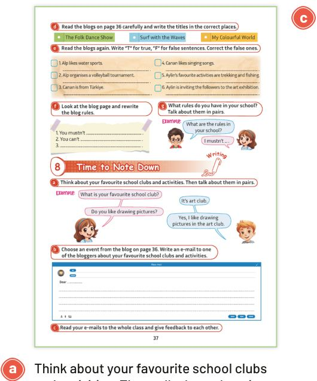
<!-- yer tutucu bulunamadı: sayfa sonuna eklendi -->

<!-- sayfa 35 -->

# 9 Time to Learn More

CLIL & Culture

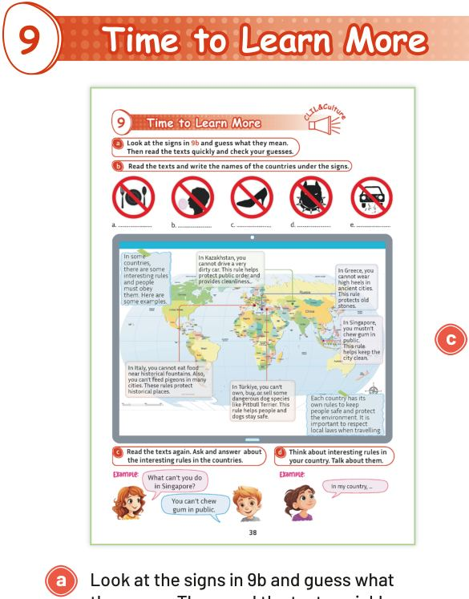

9 Time to Learn More
CLIL & Culture

a. Look at the signs in 9b and guess what they mean. Then read the texts quickly and check your guesses.
b. Read the texts and write the names of the countries under the signs.

[Görselde beş adet trafik/uyarı işareti bulunmaktadır: a. bir kuş figürü, b. bir sakız çiğneyen ağız figürü, c. topuklu ayakkabı figürü, d. bir köpek figürü, e. kirli bir araba figürü.]

In some countries, there are some interesting rules and people must obey them. There are some examples.

In Kazakhstan, you cannot drive a very dirty car. This helps protect public order and people's cleanliness.

In Singapore, you cannot chew gum in the city. This rule aids cleanliness.

In Greece, you cannot wear high heels in ancient cities. This rule aids stones.

In Italy, you cannot feed pigeons and eat food near historical fountains. Also, you cannot eat food in ancient cities. These rules protect historical places.

In Türkiye, you cannot keep dangerous dog species like the Pitbull Terrier. This rule helps protect the environment. It also helps keep dogs safe.

Each country has its own rules to keep people and the environment safe. It also helps local laws when traveling.

c. Read the texts again. Ask and answer about the interesting rules in the countries.
d. Think about interesting rules in your country. Talk about them.

EXAMPLE
What can't you do in Singapore?
You can't chew gum in public.

In my country, ...

38

---

a. Look at the signs in 9b and guess what they mean. Then read the texts quickly and check your guesses.

Have students look at the signs in exercise 9b. Ask them to think and guess what each sign means based on the symbol. Tell them to take notes about their guesses while thinking. Ask them to discuss their opinions in pairs. Then tell students to read the texts quickly to find out if their guesses are correct. Monitor them and give positive feedback.

**Answer Key**
Students’ own answers

b. Read the texts and write the names of the countries under the signs.

Ask students to read the texts carefully and individually. Each text describes a different country and some rules there. Their task is to match the information in the texts with the correct sign and write the name of the country under each the texts. Give students a few minutes to complete the activity. Let your students discuss their ideas in pairs. Then check the answers with the whole class.

**Answer Key**
a. Italy
b. Singapore
c. Greece
d. Türkiye
e. Kazakhstan

c. Speaking-Expression
Read the texts again. Ask and answer about the interesting rules in the countries.

Have students read the texts again carefully and individually. Ask them to pay attention to the interesting or unusual rules mentioned in each country. Then make them share their ideas about these unusual rules in pairs, as in the given example.

**Answer Key**
- What can't you do in Italy?
- You can't feed pigeons and eat food near historical fountains.
- What can't you do in Kazakhstan?
- You can't drive a very dirty car.
- What can't you do in Greece?
- You can't wear high heels in ancient cities.
- What can't you do in Türkiye?
- You can't buy or sell some dangerous dog species like Pitbull Terrier.

d. Speaking-Expression
Think about interesting rules in your country. Talk about them.

Ask students to brainstorm about interesting rules in their countries. Remind them to take notes. Encourage them to share their ideas about the interesting rules in pairs and then as a whole class.

<!-- sayfa 36 -->

# 10 Time for a Story

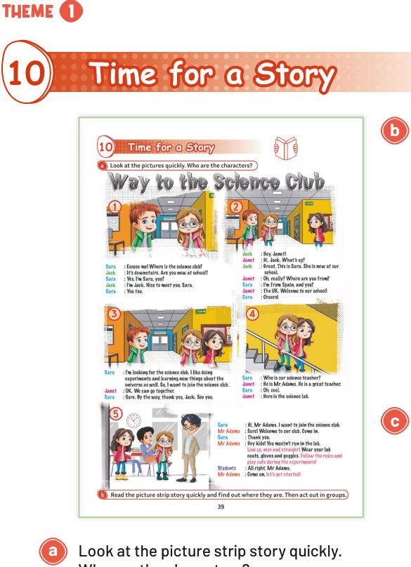

**a** Look at the picture strip story quickly. Who are the characters?

Let students know that the picture strip story consists of resident characters. In this story, there are pictures with speech bubbles, including the grammatical structures, vocabulary, and social language expressions in use. This is a skimming activity. The students are expected to look at the pictures quickly to recognise the general points about the story. Ask students to look at the pictures to find out the resident characters in the story in pairs. Check the answers with the whole class.

**Answer Key**
- The characters are Sara, Jack, and Janet.

**b** Read the picture strip story quickly and find out where they are. Then act out in groups.

This is a scanning technique that involves reading a text quickly to identify and recognise specific information. Ask students to read the text very quickly to find out where the people in the story are in pairs. Check the answers with the whole class.

**Answer Key**
In Picture 1/2/3/4, they are at school.
In Picture 5, they are in the science club.

**c** Read the questions about the picture strip story and think about them.

Ask students to read the text again, this time more slowly and carefully. Ask them to read the comprehension questions and think of possible answers to them.

### Teacher's Notes

<!-- sayfa 37 -->

**Speaking-Expression**

**d** Ask and answer the questions in 10c pairs.

Have students ask and answer the questions in 10c in pairs. When they have finished the task, check the answers with the whole class.

**Answer Key**
1. Sara is from Spain.
2. Sara is looking for the science club.
3. Janet helps Sara find the club.
4. Mr Adams is the science teacher.
5. You mustn’t run in the lab. You must wear your lab coat, gloves, and goggles.

**e** Talk about your favourite school club, activities, and rules in this club in pairs.

Give time and tell students to think about their favourite school clubs, activities, and rules. Then, have them ask and answer about this club in pairs. While they are doing the activity, walk around the class and monitor to help them with the use of language including target vocabulary, grammatical structures, and pronunciation.

**Answer Key**
Students’ own answers

# 11 Time for a Project

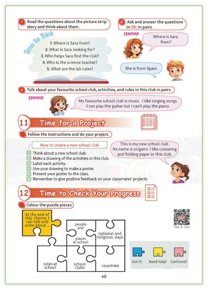

**Speaking-Expression**

Follow the instructions and do your project.

Explain the details of the project to the students. Give students enough time to prepare for the given task. Remind them that they should follow and consider the given steps while preparing their project. Tell students that giving positive feedback to each other develops their self-esteem and motivation.

# Time to Check

Check the QR code. Ask the students to read the sentences carefully and answer the questions according to them. Monitor them and give positive feedback. Then check the answers with the whole class.

---

**Teacher's Notes**

<!-- sayfa 38 -->

# 12 Time to Check Your Progress

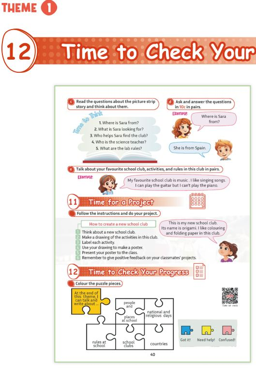

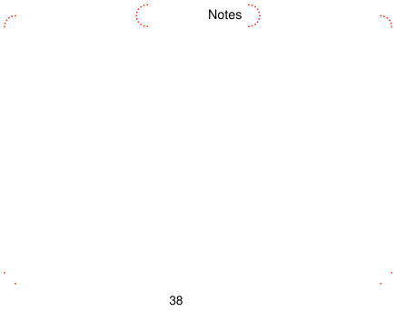

**Colour the puzzle pieces.**

Before starting the activity, make sure that students understand what self-reflection is and why it is important. Explain that it is the process of thinking about one’s own learning progress and recognising their strengths and areas for improvement. Also, highlight that self-reflection will help them become independent learners who take responsibility for their own learning, making them more confident in their lifelong learning process. Tell students that they will evaluate their own learning. Encourage them to colour the puzzle pieces according to their progress in this theme. Monitor them and give positive feedback. When students have finished the activity, you can ask some volunteers to share their reflections with the class. Ask students how they have studied in pairs or groups.

After the “Time to Check Your Progress” part, scan the “Time for an Overview” QR code. Ask students to read the page again and check whether they understand all the components.

***

## Teacher's Notes

<!-- sayfa 39 -->

# CLASSROOM LIFE

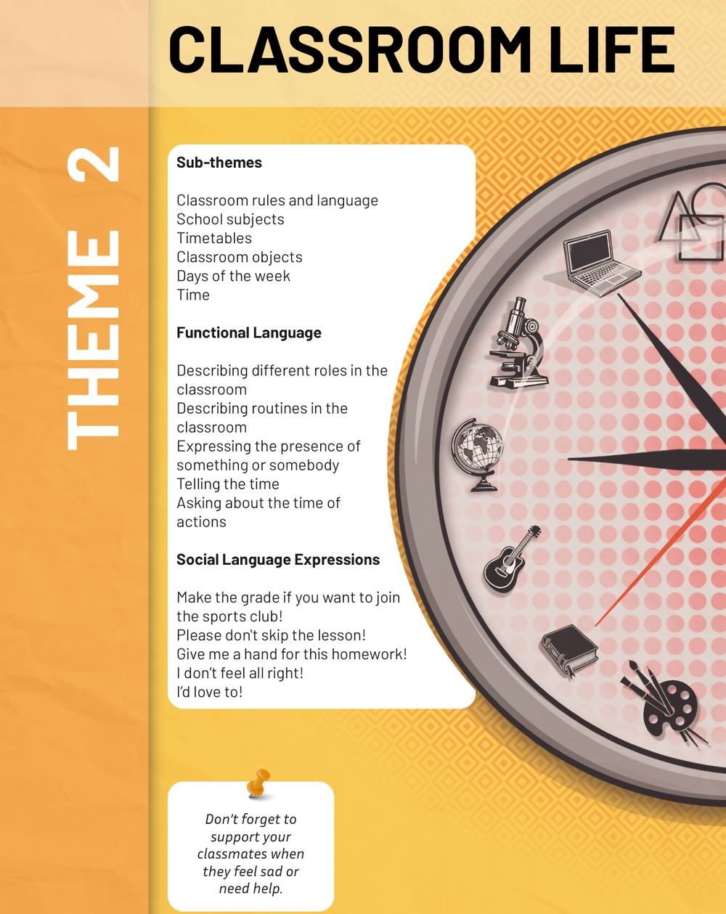

## Sub-themes

Classroom rules and language
School subjects
Timetables
Classroom objects
Days of the week
Time

## Functional Language

Describing different roles in the classroom
Describing routines in the classroom
Expressing the presence of something or somebody
Telling the time
Asking about the time of actions

## Social Language Expressions

Make the grade if you want to join the sports club!
Please don't skip the lesson!
Give me a hand for this homework!
I don't feel all right!
I'd love to!

Don't forget to support your classmates when they feel sad or

<!-- sayfa 40 -->

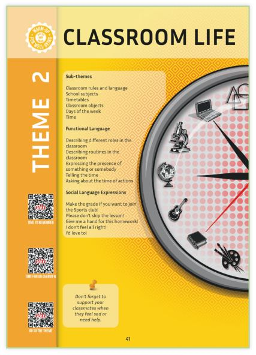

# CLASSROOM LIFE
**THEME 2**

**Sub-themes**
Classroom rules and language
School subjects
Irregularities
Classroom objects
Days of the week
Time

**Functional Language**
Describing different roles in the classroom
Describing routines in the classroom
Expressing the presence of something at a period
Telling the time
Talking about the time of actions

**Social Language Expressions**
Make the grade if you want to join the Sports club!
Please don't skip the lesson!
Give me a hand for this homework!
I don't feel all right.
I'd love to!

Don't forget to support your classmates when they feel sad or need help.

41

# Warm-up for Well-Being

Tell students that they are going to play a game just for fun. Make sure all students engage in the activity so that they can feel relaxed and motivated before studying the theme. Have students play this game with an invisible ball. Ask questions about the features of the ball. For example: "Is it heavy or light? Heavy!" Then have them mime holding a heavy ball. "Is it big or small? Small!" Have them mime holding a small ball. Keep on playing the game with the other students in your classroom.

# Time to Remember

## Establishing Links

**a** Ask students to read the dialogue carefully. Then tell them to match the questions with the answers. When they have finished the activity, check the answers with the whole class.

**Answer Key**
1. b
2. a
3. f
4. d
5. e
c is extra.

**b** Tell students to ask and answer the questions about the dialogue as in the example. Encourage them to practise in pairs. Monitor the class and give positive feedback.

**Answer Key**
Students' own answers

<!-- sayfa 41 -->

**Additional Activity**

Ask students to predict the main topics of the theme. Give them enough time to think, reflect, and write down their predictions on a small piece of paper. Once they have written their ideas, have them place their notes into a box or a jar in the classroom. (After watching the digital story, you will have students revisit the predictions with the class and check how close their guesses are to the actual topics.)

# *Time for an Overview*

Check the QR code. In this part, you will see the sub-themes, target grammaring chunks, and vocabulary of the theme. It includes hints for sub-themes and also vocabulary items. Use this page when needed.

# *Get to Know*

**Watch the digital story. What is it about?**

### The Introductory Picture

This double spread picture will be used as the entry material. The content of the theme is displayed in this picture. Tell students to look at the picture and ask them what they see in the picture. At this stage, no new words will be studied. Only the words that the students already know will be practised.

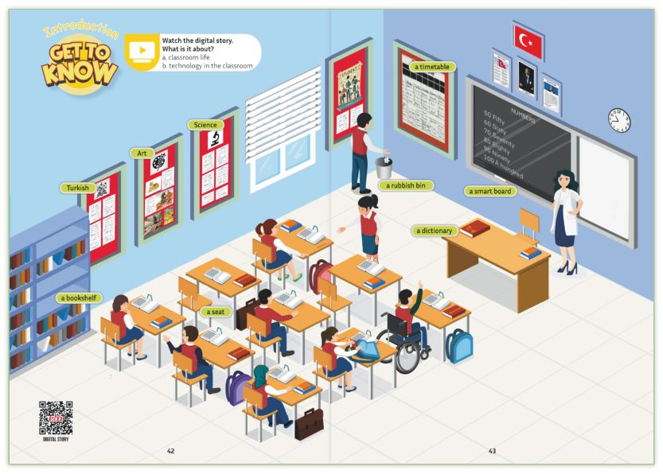

Tell students that they will watch a short digital story. Before playing it, ask them to focus on what they see in the scene and remember the introductory picture with their guesses about the theme. Play the digital story without giving any details about its content. After watching it, make them answer the question. Check the answers with the whole class.

**Answer Key**
a. classroom life

<!-- sayfa 42 -->

# 1 Time to Focus

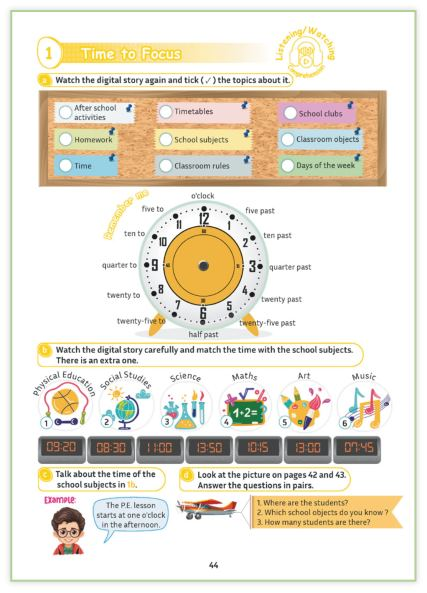

Listening / Watching Comprehension

recognise, and learn the (new) target vocabulary for each main component of the theme easily. In this way, engage in a dialogue with the whole class to check that they have recognised the components of the theme, and that they have understood that each realia item is about one component. Monitor the students and check the answers with the whole class.

## Answer Key

* ✓ Timetables
* ✓ School subjects
* ✓ Classroom objects
* ✓ Time
* ✓ Classroom rules
* ✓ Days of the week

## Reminder

Not all the target vocabulary of the theme will be practised in this section; they will be covered at the vocabulary stage. Here only the main components of the theme (sub-themes) will be studied.

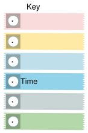

### a Watch the digital story again and tick ($\checkmark$) the topics about it.

To draw students’ attention to the content, you can bring some realia into the classroom. Show the corresponding objects or pictures to the students when the corresponding vocabulary for the main components of the theme “Classroom Life” is mentioned in the introductory digital story, without stopping the video while the students watch it. When they have watched the whole story, point to the realia items and ask questions with two options. As one of

## Teacher's Notes

<!-- sayfa 43 -->

**b** Watch the digital story carefully and match the time with the school subjects. There is an extra one.

Play the digital story again and ask students to focus on the time of the school subjects. Remind them to listen carefully for the details and match the given time with the school subjects according to the digital story. After they have completed the activity, check the answers with the whole class.

**Answer Key**

1. ![13:00]
2. ![09:20]
3. ![10:15]
4. ![08:30]
5. ![11:00]
6. ![13:50]

![07:45] is extra

**Speaking-Expression**

 **c** Talk about the time of the school subjects in 1b.

Have students examine the time of the school subjects in 1b. Tell students to ask and answer questions about the school subjects and their time, as in the example, in pairs. If they need, let them watch the digital story again. Monitor them and give positive feedback.

**Answer Key**

2. The Social Studies lesson starts at twenty past nine.
3. The Science lesson starts at quarter past ten.
4. The Maths lesson starts at half past eight.
5. The Art lesson starts at eleven o’clock.
6. The Music lesson starts at ten to two in the afternoon.

**d** Look at the picture on pages 42 and 43. Answer the questions in pairs.

Direct students’ attention to the picture on the double spread page again. Give them a moment to look at it quickly. Then ask students to answer the questions and encourage them to share their opinions with the whole class. Guide them by asking follow-up questions to highlight the connections between the picture, the digital story, and the topic of the theme.

**Answer Key**

1. They are in the classroom.
2. Students’ own answers
3. There are 9 students in the classroom.

---

**Teacher's Notes**

<!-- sayfa 44 -->

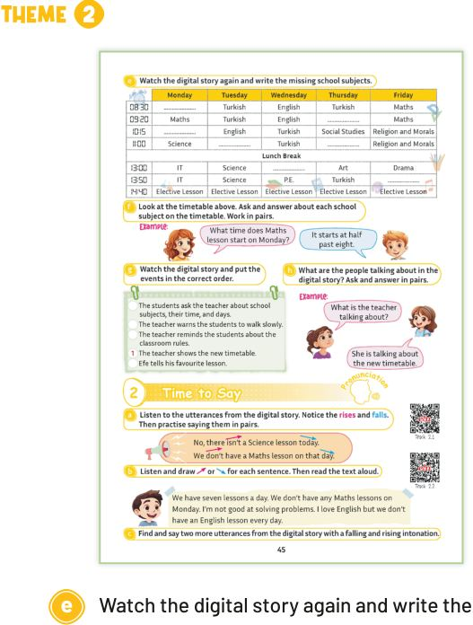

**e** Watch the digital story again and write the missing school subjects.

Ask students to watch the digital story again. Then guide them to write the missing school subjects on the timetable. Give them enough time to complete the activity. Check the answers with the whole class.

**Answer Key**

| | Monday | Tuesday | Wednesday | Thursday | Friday |
| :--- | :--- | :--- | :--- | :--- | :--- |
| 08:30 | Maths | Turkish | English | Turkish | Maths |
| 09:20 | Maths | Turkish | English | Social Studies | Maths |
| 10:15 | Science | English | Turkish | Social Studies | Religion and Morals |
| 11:00 | Science | English | Turkish | Art | Religion and Morals |
| | | | **Lunch Break** | | |
| 13:00 | IT | Science | P.E. | Art | Drama |
| 13:50 | IT | Science | P.E. | Turkish | Music |
| 14:40 | Elective Lesson | Elective Lesson | Elective Lesson | Elective Lesson | Elective Lesson |

**Speaking-Expression**

**f** Look at the timetable above. Ask and answer about each school subject on the timetable. Work in pairs.

Have students examine the timetable in 1e. Tell them to ask and answer questions about each school subject, as in the example, in pairs. Monitor them and give positive feedback.

**Answer Key**

- What time does IT lesson start on Monday?

<!-- sayfa 45 -->

**g** Watch the digital story and put the events in the correct order.

Ask students to watch the digital story carefully again. Tell them that they will watch to notice the order of events, and their task is to put these events in the correct order. Before watching, you may cut out pictures related to the order of the digital story or use a Smart Board to mix and match the pictures and the order of events. Then go over the event options with the class to make sure they understand each sentence. Give them enough time to complete the activity. Check the answers with the whole class.

**Answer Key**

③ The students ask the teacher about school subjects, their time, and days.
⑤ The teacher warns the students to walk slowly.
② The teacher reminds the students about the classroom rules.
① The teacher shows the new timetable.
④ Efe tells his favourite lesson.

**Speaking-Expression**

**h** What are the people talking about in the digital story? Ask and answer in pairs.

Have students examine the events in 1g. Tell them to ask and answer questions as in the example in pairs. Monitor them and give positive feedback.

**Answer Key**
- What is Efe talking about?
- He is talking about his favourite lesson.

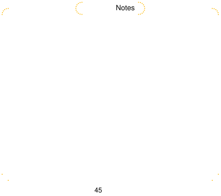

***

**Teacher's Notes**

<!-- sayfa 46 -->

# 2 Time to Say

**Selection and Use**

**a** Listen to the utterances from the digital story. Notice the rises and falls. Then practise saying them in pairs.

Play Track 2.1 and ask students to listen and follow along in their books paying attention to the utterances with falling and rising intonations. Then play the track again and pause at the end of each sentence to allow time for students to repeat after the speaker. Remind them to focus on falling and rising intonations. Then say the target words/word groups/sentences together at the same time.

**Track 2.1**

No, there isn't a Science lesson today.
We don't have a Maths lesson on that day.

**b** Listen and draw $\nearrow$ or $\searrow$ for each sentence. Then read the text aloud.

Play Track 2.2 and ask students to focus on the utterances with falling and rising intonations. Make them draw an arrow for the sentences with falling and rising intonations. After checking the answers, replay the track by pausing after each sentence and have students repeat after the speaker if time allows.

**Track 2.2**

We have 7 lessons a day. We don't have any Maths lessons on Monday. I'm not good at solving problems. I love English, but we don't have an English lesson every day.

**Answer Key**

We have 7 lessons a day. $\searrow$ We don't have any Maths lessons on Monday. $\searrow$ I'm not good at solving problems. $\searrow$ I love English, $\nearrow$ but we don't have an English lesson every day. $\searrow$

**c** Find and say two more utterances from the digital story with a falling and rising intonation.

Encourage students to find sentences with falling and rising intonations from the digital story. Have them write these sentences in their notebooks and practise them. Give students a few minutes to complete the activity. Then elicit the answers from the class.

**Answer Key**

- We don't have any lesson at weekends. $\searrow$
- Don't forget to bring your dictionaries. $\searrow$

# Time for a Task

<!-- sayfa 47 -->

# 3 Time to Learn New Words Vocabulary A-Z

## Selection and Use

**a Watch the digital story again and notice the school subjects below. Then match them with the photos. There is an extra one.**

Ask students to watch the digital story again and match the school subjects with the photos in pairs. Give them enough time to complete the activity.

**b Listen to the school subjects in 3a to check your answers. Then repeat them as a whole class.**

Tell students to listen to Track 2.3. Check the answers in 3a with the class. Then make them repeat as a whole class.

### Track 2.3

1. e Maths
2. h Science
3. j English
4. b Social Studies
5. c Physical Education
6. i Art
7. a Music
8. g Religion and Morals
9. d Information Technology

**c Put the days of the week in the correct order.**

Tell students they will put the days of the week in the correct order, starting from Monday. You can write the days on the board in random order first. Then ask students to complete the activity individually or in pairs by arranging the days correctly.

**Answer Key**

1. Monday
2. Tuesday
3. Wednesday
4. Thursday
5. Friday
6. Saturday
7. Sunday

**d Speaking-Expression**

**Watch the digital story carefully again. Ask and answer about the timetable.**

Play the digital story again and ask students to talk about the timetable. Let them share their ideas with the class on a voluntary basis. Guide the students to use the words in 3a.

**Answer Key**

- Do they have a P.E. lesson on Wednesday?
- Yes, they have a P.E. lesson every Wednesday.

<!-- yer tutucu bulunamadı: sayfa sonuna eklendi -->

<!-- sayfa 48 -->

e Look at the picture on page 42 and 43. Tick ($\checkmark$) the classroom objects you see.

Direct students’ attention to the picture on the double spread page. Give them a moment to scan. Then have students tick the classroom objects they see in the picture. Give them enough time to complete the activity. Encourage them to share their answers with the whole class and check the answers.

**Answer Key**

f Listen to Ceren and circle the numbers you hear.

Play Track 2.4 and ask students to listen and follow along in their books by paying attention to the numbers in Ceren’s speech. Ask students to circle the numbers they hear. Give them enough time to complete the activity. Check the answers with the whole class.

**Track 2.4**
Hi, I’m Ceren. I have got 54 crayons in my bag. There are 63 books in my bookcase. I love reading a lot! I have got 78 blocks in my toy box. There are 82 stickers in my drawer. I have got 97 marbles. I like playing with them. I should tidy up my room today!

**Answer Key**

Teacher's Notes

<!-- sayfa 49 -->

# 4 Time to Play

4 Time to Play
Play the "Memory Game" in pairs.
Turn the cards upside down. Match the pictures with their explanations. Find every pair and win the game.
(Go to page 141)

1. a rubber
2. a pencil
3. a bookshelf
4. a sheet
5. a seat
6. a rubbish bin
7. a board marker
8. a dictionary

[Resimler ve açıklamalar içeren bir tablo/ızgara yapısı]
- We throw rubbish in it. (1)
- We sit on it. (5)
- We look up new words in it. (8)
- We use it to write on the board. (7)
- We put books on it. (3)
- We write on it. (2)
- We use it to erase mistakes. (6)
- We use it to write in our notebook. (4)

3 Talk about the classroom objects in 4a.
EXAMPLE: I throw rubbish in a rubbish bin.

4 What other classroom objects do you use in your lessons? Talk about them.
EXAMPLE: I use ...

47

## Speaking-Expression

**a Play the “Memory Game” in pairs.**

Tell students they will play the "Memory Game" in pairs. First, make students cut out the pictures and explanation cards on page 141. Give each pair a set of picture and explanation cards. Ask them to shuffle the cards and place them upside down on the table. Students take turns turning over two cards at a time, one picture and one explanation. If the picture and explanation match, they keep the pair and get a point. If they don’t match, they turn the cards back over and the next student takes a turn. The student with the most matching pairs wins the game. Model an example with a student before starting the activity to ensure they understand what they will do. Walk around the classroom to monitor the pairs, support those who need help, and encourage the use of full sentences. If time allows, invite a few pairs to present their questions and answers to the class.

**Answer Key**
1. a rubbish bin
2. a seat
3. a dictionary
4. a board marker
5. a bookshelf
6. a sheet
7. a rubber
8. a pencil

**b Have students examine the classroom objects in 4a.**

Have students examine the classroom objects in 4a. Tell them to ask and answer questions about them, as in the example, in pairs. Monitor students and give positive feedback.

**Answer Key**
Students' own answers

**c What other classroom objects do you use in your lessons? Talk about them.**

Ask students to discuss in pairs what other classroom objects they use following the given example. Give them enough time to talk to complete the activity. Monitor them and give positive feedback.

# Time for a Task

Check the QR code. Ask students to click the correct answer according to the pictures they see. Monitor them and give positive feedback.

<!-- sayfa 50 -->

# 5 Time to Keep in Mind

Language in Use

## Selection and Use

### a Watch the digital story and answer the questions in pairs.

Tell students they will watch the digital story and then answer the questions below. Before watching, go through the questions quickly so students know what to focus on. Then play the digital story and give students a moment to discuss what they understood. Play the video again if needed, then ask students to work in pairs and answer the questions together. Encourage them to use full sentences with "there is/there are".

**Answer Key**
1. Yes, there is.
2. There are 35 lessons in a week.
3. There are double/two Art lessons in a week.
4. Yes, there is.

### b Match the days with the school subjects from the digital story. Then talk about them. There is an extra one.

Remind students about the digital story they watched and ask them to find out the days of school subjects. Students will match the days with the school subjects mentioned in the digital story. Remind them that one subject is extra. Encourage them to talk about the school subjects in the digital story. Then check the answers as a whole class.

**Answer Key**
1. e
2. c
3. a
4. d
5. b
f is extra

## Speaking-Expression

### c Circle the correct words in bold. Change the underlined words to make new dialogues. Then act out in pairs.

Tell students they will read a short dialogue and circle the correct words in bold. Give them enough time to complete the activity and check their answers as a whole class. Next, ask them to look at the underlined words and change them to make new dialogues. They might change the subject, objects, or activity to make it their own. After they finish writing new dialogues, have students practise reading them in pairs and then act them out for the class or in small groups.

**Answer Key**
A: Can you give me/you these <u>crayons</u>, please?
B: Yes, you can take us/them. Oh! Wait a second! They're <u>Mary's</u>. Please ask him/her.
A: OK.

<!-- sayfa 51 -->

**Speaking-Expression**

**d** Draw the time of the lessons in the digital story. Then ask and answer questions in pairs.

Tell students to watch the digital story carefully and find out the times of the lessons mentioned. After watching the digital story, ask them to draw hands for each lesson they hear. Once they finish drawing, have students work in pairs to ask and answer questions about the time of the lessons, as in the example.

**Answer Key**

| 1. P.E. | 2. Science | 3. Social Studies | 4. Maths | 5. Art | 6. Music |
| :--- | :--- | :--- | :--- | :--- | :--- |

(Saat görselleri)

# 6 Time to Play

**6 Time to Play**
Follow the instructions and play the game in pairs.

(Oyun kartı görseli ve sınıf resmi)

**a Speaking-Expression** Follow the instructions and play the game in pairs.

Tell students they will play a game in which they match cards, in pairs. First, make students cut out the cards on page 143. When they are ready, give them instructions. Each question is split into two parts. Mix up all the cards and place them upside down. Have students take turns picking two cards and trying to match them to form a correct question. Once they make a correct question, they will ask the question to the students they are paired with. She/he will look at the picture and answer the question. Remind students to be kind and fair during the game.

**Answer Key**

1. What time does the English lesson start?
2. What time is it?
3. How many seats are there in the class?
4. Are there Turkish lessons on Monday?
5. What time do the Art lessons start?
6. Is there a bookcase in the picture?
7. Are there Art lessons on Monday?
8. What time does the Science lesson start?
9. Is there a rubbish bin in the picture?
10. How many students are there in the class?
11. Is there a dictionary on teacher’s desk?

**b** Write 3 sentences you remember in your notebooks after you finish the game.

Encourage students to write three...

<!-- sayfa 52 -->

# 7 Time to Explore

**a** Read the weekly magazine quickly and answer the questions.

In this activity, students will use the scanning reading technique. (Scanning is a reading technique using rapid eye movement and keywords to move quickly through the text to get specific facts, such as specific pieces of information and a particular answer to a question.) Ask students to read the weekly magazine quickly and answer the questions related to it. Encourage them to make guesses and share their ideas with the class. This activity activates their prior knowledge and prepares them for reading.

**Answer Key**
1. Mert is the star student.
2. His favourite lesson is Art.

**b** Read the weekly magazine and match the halves of the sentences. There is an extra one.

Tell students they will read the weekly magazine carefully. Have students match the beginning and ending halves of the sentences based on the information in the text. Remind them that one ending is extra and does not match. Before the activity, you can pre-teach any challenging vocabulary if needed. Give them enough time to complete the activity. Check the answers with the whole class.

**Answer Key**
1. f
2. d
3. a
4. e
5. b
c is extra

### Speaking-Expression

**c** Read the weekly magazine on page 50 again. Ask and answer about the new timetable in pairs.

Tell students to read the weekly magazine on page 50 carefully. Then tell them to ask and answer questions about the new timetable, as in the example, in pairs. Monitor them and give positive feedback.

**Answer Key**
- When is the Music lesson?
- It is on Wednesday.

**d** Talk about your timetable.

Ask students to discuss their timetables in pairs as in the given example. Give them enough time to talk to complete the activity. Monitor them and give positive feedback.

**Answer Key**

<!-- sayfa 53 -->

# 8 Time to Note Down

## Writing-Expression

### a Make a survey in the class. Ask your friends about their favourite school subjects with their time, day, and materials. Take notes about their answers in the chart.

Ask students to make a survey of their friends’ favourite school subjects, time, day, and materials. Remind them to take notes during the survey. Then have them complete the chart. Check the answers with the whole class. Give them enough time to complete the activity.

**Answer Key**
Students’ own answers

### b Look at your notes in 8a. Write about you and your friends. Then read your paragraphs to the whole class.

Ask students to write a paragraph about themselves and their friends. Remind them that they should use their notes in the chart in 8a to form their paragraphs. Tell students that pair assessment to give feedback to each other helps them make progress at their own learning pace. Ask them to share their texts with the class and give feedback to each other.

---

**Teacher's Notes**

<!-- yer tutucu bulunamadı: sayfa sonuna eklendi -->

<!-- sayfa 54 -->

# 9 Time to Learn More

**a Look at the photos quickly and guess what they are about.**

Ask students to look at the photos quickly. Ask them to think and guess what each photo is about. While thinking, tell them to take notes about their guesses. Ask them to discuss their opinions in pairs. Check the answers with the whole class.

**Answer Key**
Students’ own answers

**b Read the texts quickly and write a suitable title.**

Tell students they will read the texts quickly to understand the main idea of each one. After reading, they should write a suitable title that reflects the text’s main topic or message. After they complete it, ask a few students to share their titles with the class and explain why they chose them.

**c Read the texts and match the photos with the paragraphs. There is an extra one.**

Have students read the texts carefully. Then ask them to match each photo with the correct paragraph based on the information and details in the texts. Explain that one photo is extra and does not match any paragraphs. Remind students to read carefully and look for clues in the paragraphs that describe people, places, or events shown in the photos. Give students a few minutes to complete the activity. Check the answers with the whole class.

**Answer Key**
1. B
2. D
3. extra
4. A
5. C

**d Read the texts again and choose the correct paragraph (A-B-C-D) for each sentence.**

Have students read the texts carefully again. Then ask them to decide which paragraph matches best or contains the information in each sentence. Encourage students to look for keywords or ideas in the sentences and match them to the correct paragraphs. Give students a few minutes to complete the activity. Check the answers with the whole class.

**Answer Key**
1. C
2. B
3. D
4. A
5. B
6. C
7. D

<!-- sayfa 55 -->

**Speaking-Expression**

e Think about your own country. Are there any interesting school activities? Talk in pairs.
Have students brainstorm and take notes about interesting school activities in their countries. Remind them to take notes. Encourage them to share their ideas about the interesting school activities in pairs and then as a whole class.

**Answer Key**
Students’ own answers

# 10 Time for a Story 

a Look at the pictures quickly and answer the questions.
Let students know that the picture strip story consists of resident characters. In this story, there are pictures with speech bubbles, including the grammatical structures, vocabulary, and social language expressions in use. This is a skimming activity. The students are expected to look at the pictures quickly to recognise the general points about the story. Ask students to look at the pictures to answer the questions. Check the answers with the whole class.

**Answer Key**

b Read the picture strip story carefully and act out in groups.
Ask students to read the picture strip story carefully to understand the characters, setting, and what happens in each part. After reading, you may divide the class into small groups and assign or let them choose roles for each character in the story. Each group will act out the story, using the dialogue. Give them enough time to talk to complete the activity. Monitor them and give positive feedback.

**Teacher's Notes**

<!-- sayfa 56 -->

# Speaking-Expression

## d
**Ask and answer the questions in 10c in pairs.**

Have students ask and answer the questions in 10c in pairs. When they have finished the task, check the answers with the whole class.

**Answer Key**
1. Because she isn't ready for the quiz.
2. It starts at half past one.
3. It is next month.
4. Because she wants to be in the school team and join the basketball tournament.
5. They need scissors, coloured pencils, glue, a ruler, sheets, and a rubber.

## c
**Read the questions about the picture strip story and think about them.**

Ask students to read the text again, this time more slowly and carefully. Ask them to read the comprehension questions and think of possible answers to them.

**Answer Key**
Students' own answers

## e
**What is your favourite school subject? Talk about the time, day, and materials of it in pairs.**

Have students ask and answer about their favourite school subjects, their times, days, and materials in pairs. While they are doing the activity, walk around the class and monitor to help them with the target structures and pronunciation of the words.

---

### Teacher's Notes

<!-- sayfa 57 -->

# 11 Time for a Project

**Speaking-Expression**

Follow the instructions and do your project.

Explain the details of the project to the students. Give students enough time to prepare for the given task. Remind them that they should follow and consider the given steps while preparing their project. Tell students that giving positive feedback to each other develops their self-esteem and motivation.

## Time to Check

Check the QR code. Ask students to read the sentences carefully and answer the questions according to them. Monitor them and give positive feedback. Then check the answers with the whole class.

## Time to Sing

 This part is just for fun and to help students relax at the end of the theme. Tell students that they will listen to a song related to the theme. Encourage them to sing along.

**Song Lyrics**

**Fun Times**

Start counting, here we go,
Ten to twenty, nice and slow.
Drawing pictures, reading books,
Using numbers, take a look!

Ten, twenty, thirty, clap,
Forty, fifty, check the map!
Sixty, seventy, eighty, run,
Ninety, one hundred—counting’s fun!

In Science class, let’s do a test,
Using the microscope is the best.
Surfing the Net on the computer,
Learning numbers all the time!

Aysun TONYA

---

**Teacher's Notes**

<!-- sayfa 58 -->

# 12 Time to Check Your Progress

Colour the bricks.

Before starting the activity, make sure that students understand what self-reflection is and why it is important. Explain that it is the process of thinking about one’s own learning progress and recognising their strengths and areas for improvement. Also highlight that self-reflection will help them become independent learners who take responsibility for their own learning, making them more confident in their lifelong learning process. Tell students that they will evaluate their own learning. Encourage them to colour the bricks according to their progress in this theme. Monitor them and give positive feedback. When students have finished the activity, you can ask some volunteers to share their reflections with the class. Ask students how they have studied in pairs or groups. After the “Time to Check Your Progress” part, scan the “Time for an Overview” QR code. Ask students to read the page again and check whether they understand all the components.

---

## Teacher's Notes

<!-- sayfa 59 -->

# PERSONAL LIFE

## THEME 3

### Sub-themes
Basic body parts and physical features
Clothes
Daily routines and activities

### Functional Language
Expressing daily routines
Confirming general truths
Expressing the frequency of actions

### Social Language Expressions
I'll pop round to see you later!
Don't make fun of people!
Let's sort out the problem!

 Speak kindly and don't show off.

<!-- sayfa 60 -->

# PERSONAL LIFE
## THEME 3
**Sub-themes**
* Basic body parts and physical features
* Clothes
* Daily routines and activities

**Functional Language**
* Expressing daily routines
* Confirming general truths
* Expressing the frequency of actions

**Social Language Expressions**
* I'll pop round to see you later!
* Don't make such a fuss!
* Let's sort out the problem!

# Warm-up for Well-Being

Tell students that they are going to play a game just for fun. Make sure all students engage in the activity so that they can feel relaxed and motivated before studying the theme. Students will make groups of four with their classmates. Tell them to follow your instructions about the game category. They are expected to find 4 words according to the category you determine. For example, things they can see in their classroom (a pencil, the board, a book). Tell them to find the words in 30 seconds. Guide them and give positive feedback.

# Time to Remember

## Establishing Links

**a** Ask students to read the dialogue carefully. Then tell them to drag the interrogative sentences in bold to the suitable places below. When they have finished the activity, check the answers with the whole class.

**Answer Key**
1. Who is she?
2. What does she look like?
3. What does she like wearing?

**b** Tell students to ask and answer questions about the dialogue as in the example. Encourage them to practise in pairs. Monitor the class and give positive feedback.

**Answer Key**
Students’ own answers

<!-- sayfa 61 -->

**Additional Activity**

Ask students to predict the main topics of the theme. Give them enough time to think, reflect, and write down their predictions on a small piece of paper. Once they have written their ideas, have them place their notes into a box or a jar in the classroom. (After watching the digital story, you will have students revisit the predictions with the class and check how close their guesses are to the actual topics.)

# *Time for an Overview*

Check the QR code. In this part, you will see the sub-themes, target grammaring chunks, and vocabulary of the theme. It includes hints for sub-themes and also vocabulary items. Use this page when needed.

# *Get to Know*

**Watch the digital story. What is it about?**

### The Introductory Picture

This double spread picture will be used as the entry material. The content of the theme is displayed in this picture. Tell students to look at the picture and ask them what they see in the picture. At this stage, no new words will be studied. Only the words that the students already know will be practised.

Tell students that they will watch a short digital story. Before playing it, ask them to focus on what they see in the scene and remember the introductory picture with their guesses about the theme. Play the digital story without giving any details about its content. Ask them to watch it to understand it in general/holistically. After watching it, make them answer the question. Check the answers with the whole class.

**Answer Key**
**a.** clothes and body parts

**Additional Activity**

<!-- sayfa 62 -->

# 1 Time to Focus

Listening / Watching
Comprehension

**a Watch the digital story again and tick ($\checkmark$) the topics about it.**

To draw students’ attention to the content, you can bring some realia into the classroom. Show the corresponding objects or pictures to the students when the corresponding vocabulary for the main components of the theme “Personal Life” is mentioned in the introductory digital story, without stopping the video while students watch it. When they have watched the whole story, point to the realia items and ask questions with two options. As one of the words is from the previous years, students could hear,

**Reminder**
Not all target vocabulary of the theme will be practised in this section; they will be covered at the vocabulary stage. Here only the main components of the theme (sub-themes) will be studied.

**b Look at the pictures in the digital story and write a suitable title for each part.**

Play the digital story again and ask students to focus on the titles. Remind them to listen carefully for the details, look at the pictures in the digital story and write a suitable title for each part. After they have completed the activity, check the answers with the whole class.

**Answer Key**
1. Accessories: c
2. Physical features: d
3. Clothes: b
4. Body parts: a

(new) target vocabulary for each main component of the theme easily. In this way, engage in a dialogue with the whole class to check that they have recognised the components of the theme, and that they have understood that each realia item is about one component. Then tell students that they will watch the digital story again and tick the topics about it. Monitor the students and check the answers with the whole class.

**Answer Key**

| | |
| :--- | :--- |
| $\checkmark$ | Body parts |
| $\checkmark$ | Physical features |
| $\checkmark$ | Clothes |
| $\checkmark$ | Accessories |
| $\checkmark$ | Daily routines & activities |

<!-- sayfa 63 -->

**Speaking-Expression**

**c** Talk about the characters in the digital story in pairs.

Have students think about the characters in the digital story. Tell them to ask and answer questions about them, as in the example, in pairs. If they need, let them watch the digital story again. Give them enough time to complete the activity. Monitor them and give positive feedback.

**Answer Key**
1. Lara is an adventurer.
2. Tom is tall with straight hair and a square face.

**d** Look at the picture on pages 56 and 57. Answer the questions.

Direct students’ attention to the picture on the double spread page again. Give them a moment to look at it quickly. Then ask students to answer the questions and encourage them to share their answers with the whole class. Guide them by asking follow-up questions to highlight the connections between the picture, the video, and the topic of the theme.

**Answer Key**
1. I know trousers and boots.
2. I know gloves and earring.

**e** Watch the digital story and tick ($\checkmark$) the activities Lara and Tom do. Then talk about them.

Before starting the activity, make sure that students have understood the activities in the table. Tell students that they will watch the digital story and tick the activities about the people. Help them catch the information they need and give them enough time to write it in the table, pausing the digital story when needed. After they have completed the activity, talk about them and check the answers with the whole class.

**Answer Key**

| |  |  |  |  |
| :--- | :---: | :---: | :---: | :---: |
| | watch the stars | read a map | travel around the world | make materials |
| Lara | $\checkmark$ | | $\checkmark$ | |
| Tom | | $\checkmark$ | | $\checkmark$ |

**f** Watch the digital story and put the events in the correct order.

Ask students to watch the digital story carefully again. Tell them that they will watch to notice the order of events, and their task is to put these events in the correct order. Before watching, you may cut out pictures related to the order of the digital story or use a Smart Board to mix and match the pictures and the order of events. Then go over the event options with the class to make sure they understand each sentence. Give them enough time to complete the activity. Check the answers with the whole class.

**Answer Key**
③ Jack chooses clothes for Lara.
⑤ Melissa tells the body parts of the fairy.
① Ali and Melissa start choosing the game characters’ clothes and activities.
④ Ali introduces Tom and talks about his activities.
② Ali tells Lara’s physical features.

<!-- sayfa 64 -->

**Speaking-Expression**

g What are the people talking about in the digital story? Ask and answer about the events in 1f in pairs.

Have students examine the events in 1f. Tell them to ask and answer questions as in the example in pairs. Monitor them and give positive feedback.

**Answer Key**
- What is Melissa talking about?
- She is talking about the body parts of the fairy.

# 2 Time to Say

## Selection and Use

Then say the target words/word groups/ sentences together at the same time.

**Track 3.1**

Do you want to join us?
What kind of activities should we choose for her?
She needs comfortable clothes, doesn’t she?

a Listen to the utterances from the digital story. Notice the rises and falls. Then practise saying them in pairs.

Explain that some words have a rising or a falling arrow to highlight specific intonations. Then play Track 3.1 and ask students to listen and follow the utterances along in their books by paying attention to the utterances with rising and falling intonations. Then play the track again and pause at the end of each sentence to allow time for students to repeat after the speaker Remind them

**Teacher's Notes**

<!-- sayfa 65 -->

**b** Listen and draw a rising or falling arrow for each sentence. Then read the text aloud.

Play Track 3.2 and ask students to listen and draw a rising or a falling arrow for each sentence based on intonation. After checking the answers, replay the track by pausing after each sentence and have students repeat after the speaker if time allows.

**Track 3.2**

Suzan : I love your new jacket. Where did you buy it?
Anna : Thank you. It’s a present from my mother. It’s nice, isn’t it?
Suzan : Sure, it is. By the way, are your shoes new?
Anna : Yes. Do you like them?
Suzan : Yes, they look great.

**Answer Key**

Suzan : I love your new jacket. Where did you buy it? $\nearrow$
Anna : Thank you. It’s a present from my mother. It’s nice, isn’t it? $\nearrow$
Suzan : Sure, it is. By the way, are your shoes new? $\nearrow$
Anna : Yes. Do you like them? $\nearrow$
Suzan : Yes, they look great.

**c** Find two more utterances from the digital story with a falling and rising intonation.

Encourage students to find more utterances with falling and rising intonations. Have them write these utterances and practise their pronunciation. Provide assistance and feedback if needed.

**Answer Key**

- Hey, Melissa! Look at my new video game. $\searrow$
- Wow! That sounds very cool! $\searrow$

# Time for a Task

 Check the QR code. Ask students to look at the children and their clothes in the picture carefully. Have them read each description carefully and decide who is being described. Then ask them to click on the correct name. Monitor them and give positive feedback.

**Answer Key**

1. Asya
2. Lila
3. Kevin
4. Julia
5. Sami

***

**Teacher's Notes**

<!-- sayfa 66 -->

# 3 Time to Learn New Words Vocabulary A-Z

## Selection and Use

**a Watch the digital story again and notice the clothes below. Then match them with the photos. There is an extra one.**

Ask students to watch the digital story again and match the clothes with the photos in pairs. Give them enough time to complete the activity.

**b Listen to the names of the clothes in 3a to check your answers. Then repeat them as a whole class.**

Tell the students to listen to Track 3.3. Check the answers in 3a with the class. Then make them repeat as a whole class.

**Track 3.3**

1. b a T-shirt
2. f a coat
3. e a jumper
4. d shorts
5. a a jacket
8. j a raincoat
9. c jeans
10. l a shirt
11. m a dress
12. k trousers

### Speaking-Expression

**c Ask and answer about characters’ clothes in the digital story in pairs.**

Tell students to ask and answer about the characters’ clothes in the digital story. Make sure that students work in pairs.

**Answer Key**
- What does Tom wear?
- He wears a jumper, jeans, and a belt.

### Speaking-Expression

**d Write Rose’s body parts and talk about them in pairs.**

Have students write the names of the character’s body parts. Then ask them to work in pairs and talk about each body part. Encourage them to use simple sentences to describe.

**Answer Key**

- What does Rose look like?
- She has got two short legs.

a head
an eye
a nose
an arm
a hand
a leg
a foot

<!-- sayfa 67 -->

 Look at the picture on pages 56 and 57. Tick ($\checkmark$) the activities you see.

 Direct students’ attention to the picture on the double spread page. Give them a moment to scan. Have them identify the activities given and tick the ones they see in the picture. Give them enough time to complete the activity. Encourage them to share their answers with the whole class and check the answers.

**Answer Key**
* $\checkmark$ read books
* $\checkmark$ read a magazine
* $\checkmark$ play video games
* $\checkmark$ draw pictures
* $\checkmark$ watch TV
* $\checkmark$ go shopping
* $\checkmark$ go to the park

Teacher's Notes
[ ]

# 4 Time to Play

**a Speaking-Expression**
Take turns to play the “Clothes Game”. Spin the paper clip. Find the correct items and get the points. game in turns. Ask them to spin the paper clip, find the correct clothing items, and keep track of their points. While students are playing the game, monitor them and take notes of any target vocabulary mistakes they make. Then correct students’ mistakes. Continue the game until all pairs have participated.

**Answer Key**
Students’ own answers

**b Talk about each part in 4a in pairs.**
Ask students to work in pairs and talk about each section in 4a. Encourage them to share their answers with the class.

**Answer Key**
1. What do you wear on rainy days?
I wear boots and coat.
2. What do you wear on your feet?
I wear socks and trainers.

<!-- sayfa 68 -->

# Time for a Task

Check the QR code. Before starting the activity, tell students that they will click on each cloud in the picture, read the sentence carefully, and choose the correct answer to complete it. Monitor them and give positive feedback.

**Answer Key**
Mike and Emma sometimes play video games.
I always read fashion magazine.
Tom never listens to classical music.
She wears a uniform on weekdays.
My mum and dad usually go out with their friends.

# 5 Time to Keep in Mind
*Language in Use*

## Grammaring Selection and Use

Monitor them and give positive feedback.

**Answer Key**
1. What does Jim do in autumn?
   He goes hiking.
2. What does Jim do in winter?
   He goes skiing.
3. What does Jim do in spring?
   He has a picnic.
4. What does Jim do in summer?
   He swims in the sea.

## Speaking-Expression

a Look at the pictures. What does Jim do? Talk about them in pairs.

Have students work in pairs and take turns talking about their seasonal activities in the first person using the clues from the season cards. Review the activities for each season with the whole class to ensure students recognise the structure in the language use. Allow them

**Teacher's Notes**

<!-- sayfa 69 -->

# Speaking-Expression

**b** Talk about Jessie's routines in pairs.

Guide students to look at the adverbs of frequency and verbs that describe routines below. Encourage them to talk in pairs about Jessie's routines, as in the example, on a voluntary basis. Draw their attention to the use of the target grammatical structure of the theme without telling the grammatical rule in detail. Monitor them and give positive feedback.

**Answer Key**

2. How often does Jessie meet her friends after school?
   She usually meets her friends after school.
3. How often does Jessie eat lunch out?
   She sometimes eats lunch out.
4. How often does Jessie get up late?
   She never gets up late.

**c** Follow the route and make question tags in turns.

Have students follow the route and take turns forming question tags based on the prompts. Encourage them to use simple sentences.

**Answer Key**

1. You don't go for a walk, do you?
2. She reads magazines in the park, doesn't she?
3. They usually listen to music, don't they?
4. He always wears casual clothes, doesn't he?
5. We don't go shopping every weekend, do we?

**d** Complete the rhyme. Then write your own rhyme and read it to the class.

Ask students to complete the rhyme. Then have them write their own rhymes using the similar structure and vocabulary. Encourage them to read their rhymes aloud to the class. Provide assistance and feedback when needed.

**Answer Key**

| | |
|---|---|
| 1. | my |
| 2. | your |
| 3. | his |
| 4. | her |
| 5. | its |
| 6. | our |
| 7. | their |

***

**Teacher's Notes**

<!-- sayfa 70 -->

# 6 Time to Play

**a Speaking-Expression**
**Play the “Puzzle Game” in pairs. Use three or more pieces to make sentences. Each piece is 5 points.**

Instruct students to play the “Puzzle Game” in pairs. Ask them to use three or more puzzle pieces to form meaningful sentences. Let them know that each piece is worth 5 points. While they play the game, monitor them and take notes about their mistakes. Then correct students’ mistakes. Continue the game until all pairs have participated. Warn the students to be fair and kind during the game.

**Answer Key**
Students’ own answers

**b Say your sentences in pairs.**

Have students work in pairs and say their sentences to each other. Encourage them to listen carefully and give feedback to each other.

**c Make three sentences about what you wear and write them in your notebooks.**

Ask students to make three sentences about what they wear and write them in their notebooks. Monitor their writing and provide help with vocabulary or structure if needed.

---

**Teacher's Notes**

<!-- sayfa 71 -->

# 7 Time to Explore

Reading Comprehension

**a Look at the pictures in the magazine quickly and answer the questions.**

Ask students to look at the pictures in the magazine quickly and answer the questions. Encourage them to make guesses about the text and share their ideas with the class. This activity activates their prior knowledge and prepares them for reading.

**Answer Key**
1. They are wearing shirts.
2. They look trendy.

**b Read the magazine quickly and match the titles with the paragraphs.**

In this activity, students will use the scanning reading technique. (Scanning is a reading technique using rapid eye movement and keywords to move quickly through the text to get specific facts, such as specific pieces of information and a particular answer to a question.) Ask students to read the text quickly to look at the given title options for each paragraph and match them correctly. Encourage them to focus on the overall message rather than the details. Then check the answers with the whole class.

**Answer Key**
1. c
2. d
3. a
4. b

**c Read the fashion magazine on page 64 carefully and match the questions with the answers. There is an extra one.**

In this activity, students will use the careful reading technique. (Careful reading technique means that they should clarify their purpose before and during reading, and they should monitor their understanding to think about and have control over their reading.) Have students read the text on page 64 carefully and individually to match the questions with the answers. Give them enough time to complete the activity. Check the answers with the whole class.

**Answer Key**
1. e
2. c
3. a
4. d
b is extra

---

**Teacher's Notes**

<!-- sayfa 72 -->

# 8 Time to Note Down

## Writing-Expression

**a** Read the text about Mete Gazoz. Notice his physical appearance, clothes, and routines.

Tell students that they are going to read a text as a pre-writing activity. Ask students to read the text about Mete Gazoz. Draw their attention to his physical appearance and daily routines. Encourage them to underline or highlight the parts of the text that describe these aspects.

**b** Think about important people in sports, music, art, and science. Note down her/his features. Then describe her/him.

Ask students to think about influential individuals in fields like sports, music, art, and science. Have them list down their notable characteristics and describe these individuals in detail.

**Answer Key**
Students’ own answers

**c** Read your descriptions to the whole class and give feedback to each other.

Tell students that pair assessment and giving feedback to each other help them make progress at their own learning pace. Ask them to share their texts with the class and give feedback to each other.

**d** Ask and answer about your descriptions.

Have your students inquire about each other’s descriptions. Tell them that they should ask questions to clarify or learn more about the person being described. Encourage them to give detailed answers based on their descriptions. This activity helps develop both questioning and answering skills, while fostering communication and critical thinking.

Teacher's Notes

<!-- sayfa 73 -->

# 9 Time to Learn More

**a Look at the photos quickly. Guess and write the country they belong to.**

Ask students to look at the photos and the title of the text quicky. Then have them guess which country the photos belong to and write down their answers. Encourage them to rely on visual clues such as landmarks, clothing, or cultural symbols. While thinking, tell them to take notes about their guesses. Ask them to discuss their opinions in pairs. After a few minutes, ask a few of them to share their guesses. This activity practises observation, inference, and writing skills.

**Answer Key**
Sami Clothing - Northern Scandinavia
Sari - India
Kimono - Japan
Milas Dibekdere Traditional Clothing - Turkiye

**b Read the texts and tick (T) for True or (F) for False. Then correct the false sentences.**

Ask students to read the text carefully and mark each statement as true or false. When they have finished the activity, check the answers with the whole class. Have students correct the false statements according to the text.

**Answer Key**
1. True
2. True
3. False Kimonos have long and loose sleeves.
4. False It is made of natural fabrics like cotton and wool.
5. True

**c Think about your own country. Are there any other traditional clothes? Talk in pairs.**

Ask students to think about their own country and whether there are other traditional clothes apart from the ones already mentioned. Then have them discuss their ideas in pairs. Encourage students to describe the clothes in detail (materials, colours, occasions they are worn) and to compare them with modern clothing styles. This activity supports speaking fluency and cultural awareness.

**Answer Key**
Students’ own answers

**Teacher's Notes**

<!-- sayfa 74 -->

# 10 Time for a Story

**a Look at the pictures quickly. Where are the children in each picture?**

Let students know that the picture strip story consists of resident characters. There are pictures with speech bubbles, including the target structure, vocabulary, and social expressions. Have students take a detailed look at the pictures and talk about them with their classmates. Then ask them to answer the question quickly. Check the answers with the whole class.

**Answer Key**
- Picture 1, 4: at home
- Picture 2,3: at a store

**b Read the picture strip story quickly. What does Jack want to buy? Then act out in groups.**

Ask students to skim the text and find what Jack wants to buy. Explain that skimming is a reading technique that involves moving quickly through a text, using rapid eye movement to identify general features, such as the main idea or key points. When they have finished the activity, check the answers with the whole class.

**Answer Key**
- Jack wants to buy a new watch.

**c Read the questions about the picture strip story and think about them.**

Ask students to read the text again, this time more slowly and carefully. Ask them to read the comprehension questions and think of possible answers to them.

**Speaking-Expression**

**d Ask and answer the questions in 10c in pairs.**

Have students ask and answer the questions in 10c in pairs. When they have finished the task, check the answers with the whole class.

**Answer Key**
1. Sara loves shopping.
2. She always wears her blue shirt and black jeans.
3. Jack has got a new watch.
4. He loves spending his money on books and video games.
5. Drawing makes him feel relaxed after a busy day.

<!-- sayfa 75 -->

e Ask and answer the questions in pairs.

Have students ask and answer about shopping and clothes in pairs. While they are doing the activity, walk around the class and monitor to help them with the target structures and pronunciation of the words.

**Answer Key**
Students' own answers

# 11 Time for a Project

**Follow the instructions and do your project.**

Explain the details of the project to the students. Give students enough time to prepare for the given task. Remind them that they should follow and consider the given steps while preparing their project. Tell students that giving positive feedback to each other develops their self-esteem and motivation.

# Time to Check

Check the QR code. Ask students to read the text carefully and answer the questions according to it. Monitor them and give positive feedback. Then check the answers with the whole class.

**Answer Key**
1. c
2. c
3. d
4. b
5. c

**Teacher's Notes**

<!-- sayfa 76 -->

# 12 Time to Check Your Progress

Colour the block pieces.

Before starting the activity, make sure that students understand what self-reflection is and why it is important. Explain that it is the process of thinking about one’s own learning progress and recognising their strengths and areas for improvement. Also highlight that self-reflection will help them become independent learners who take responsibility for their own learning, making them more confident in their lifelong learning process. Tell students that they will evaluate their own learning. Encourage them to colour the block pieces according to their progress in this theme. When students have finished the activity, you can ask some volunteers to share their reflections with the class. Ask students how they have studied in pairs or groups. After the “Time to Check Your Progress” part, scan the “Time for an Overview” QR code. Ask students to read the page again and check whether they understand all the components.

***

## Teacher's Notes

<!-- sayfa 77 -->

# FAMILY LIFE

## THEME 4

**Sub-themes**

Family members’ routines
Family members’ hobbies and activities

**Functional Language**

Expressing actions happening at the moment of speaking
Contrasting ongoing or temporary actions
Confirming ongoing actions

**Social Language Expressions**

We always get on well as a family!
Can I lend you a hand with washing the car?
Let’s tidy up the house together!

Spend time with your family and support each other.

<!-- sayfa 78 -->

# FAMILY LIFE
**THEME 4**

**Sub-themes**
Family members' routines
Family members' hobbies and activities

**Functional Language**
Expressing actions happening at the moment of speaking
Contrasting ongoing or temporary actions
Confirming ongoing actions

**Social Language Expressions**
We always get on well as a family.
Can I lend you a hand with washing the car?
Let's tidy the house together!

Spend time with your family and support each other.

69

---

**Time to remember**

**Time for an overview**

**Go to the Theme 4**

# Warm-up for Well-Being

Tell students that they are going to play a game just for fun. Make sure all students engage in the activity so that they can feel relaxed and motivated before studying the theme. Divide the class into groups of 6-8 students and explain that the aim of the game is to make their classmates say 'Yes' or 'No.' Ask each group to decide who will answer first. The other students should ask questions such as 'Are you a student?' and the responder must avoid answering with 'Yes' or 'No.' If a student says either of these words, the turn passes to another student. Encourage students to be creative with their questions and answers to keep the activity lively and interactive. This exercise helps students practise speaking fluency, listening skills, and turn-taking in a fun way.

# Time to Remember

## Establishing Links

**a** Ask students to read the dialogue carefully. Then tell them to drag the correct answers under the suitable interrogative sentences. When they have finished the activity, check the answers with the whole class.

**Answer Key**
1. b
2. a
3. f
4. d

**b** Tell students to ask and answer about the dialogue as in the example. Encourage them to practise in pairs. Monitor the class and give positive feedback.

**Answer Key**
Students' own answers

<!-- sayfa 79 -->

**Additional Activity**

Ask students to predict the main topics of the theme. Give them enough time to think, reflect, and write down their predictions on a small piece of paper. Once they have written their ideas, have them place their notes into a box or a jar in the classroom. (After watching the digital story, you will have students revisit the predictions with the class and check how close their guesses are to the actual topics.)

# Time for an Overview

Check the QR code. In this part, you will see the sub-themes, target grammaring chunks, and vocabulary of the theme. It includes hints for sub-themes and also vocabulary items. Use this page when needed.

# Get to Know

**Watch the digital story. What is it about?**

### The Introductory Picture

This double spread picture will be used as the entry material. The content of the theme is displayed in this picture. Tell students to look at the picture and ask them what they see in the picture. At this stage, no new words will be studied. Only the words that the students already know will be practised.

Tell students that they will watch a short digital story. Before playing it, ask them to focus on the scene and recall the introductory picture and their theme predictions. Play the digital story without giving any details about its content. Ask them to watch it for understanding it in general/holistically. After watching it, make them answer the question. Check the answers with the whole class.

**Answer Key**
a. family members

<!-- sayfa 80 -->

# 1 Time to Focus

**Reminder**

Not all target vocabulary of the theme will be practised in this section; they will be covered at the vocabulary stage. Here only the main components of the theme (sub-themes) will be studied.

**a Watch the digital story again and tick ($\checkmark$) the topics about it.**

To draw students’ attention to the content, you can bring some realia into the classroom. Show the corresponding objects or pictures to the students when the corresponding vocabulary for the main components of the theme “Family Life” is mentioned in the introductory digital story, without stopping the video while students watch it. When they have watched the whole story, point to the realia items and ask questions with two options. As one of the words is from the previous themes, students could hear, component of the theme easily. In this way, engage in a dialogue with the whole class to check that they have recognised the components of the theme, and that they have understood that each realia item is about one component. Then tell students that they will watch the digital story again and tick the topics about it. Monitor the students and check the answers with the whole class.

**Answer Key**

| | |
| :--- | :--- |
| $\checkmark$ | routines of family members |
| $\checkmark$ | hobbies of family members |
| $\checkmark$ | activities of family members |

**b Put the events from the digital story in the correct order. Then draw lines to match the events and places with the photos.**

Play the digital story again and ask students to put the events from the digital story in the correct order. After that, have them draw lines to match each event and place with the corresponding photos. After they have completed the activity, check the answers with the whole class.

**Answer Key**

a. 4 - an art museum  
b. 1 - a picnic at the beach  
c. 5 - a birthday party  
d. 3 - a festival  
e. 2 - camping in the forest

<!-- sayfa 81 -->

**Speaking-Expression**

c Ask and answer about the photos in 1b.
Have students think about the photos in 1b. Tell them to ask and answer questions as in the example, in pairs. Give them enough time to complete the activity. Monitor them and give positive feedback.

**Answer Key**
- Where are they in photo a?
- They are at an art museum.
- Where are they in photo b?
- They are at the beach.
- Where are they in photo c?
- They are at a birthday party.
- Where are they in photo d?
- They are at a festival.
- Where are they in photo e?
- They are in the forest.

d Look at the picture on pages 70 and 71. Answer the questions in pairs.
Direct students’ attention to the picture on the double spread page again. Give them a moment to look at it quickly. Then ask students to answer the questions and encourage them to share their opinions with the whole class. Guide them by asking follow-up questions to highlight the connections between the picture, the video, and the topic of the theme.

**Answer Key**
1. They are at a park.
2. I see 5 photos.

 e Watch the digital story carefully and match the people with the activities below.
Before starting the activity, make sure that students have understood the activities in the table. Tell students that they will watch the digital story and match the related family member with the correct activity. Help them catch the information they need and give them enough time to complete the task, pausing the digital story sometimes. After they have completed the activity,

f Ask and answer about the activities in 1e.
Have students examine the activities in 1e. Tell them to ask and answer questions as in the example in pairs. Monitor them and give positive feedback.

**Answer Key**
- Who is fishing?
- Emma’s father is fishing.
- Who is playing a board game?
- Emma’s brother is playing a board game.
- Who is tidying up the tent?
- Mike’s mother is tidying up the tent.
- Who is taking care of a pet?
- Mike’s father is taking care of a pet.
- Who is cycling?
- Mike’s sister is cycling.
- Who is making a birthday cake?
- Mike’s grandmother is making a birthday cake.
- Who is playing the guitar?
- Mike’s grandfather is playing the guitar.

**Answer Key**
1. Emma’s father
2. Emma’s mother
3. Emma’s brother
4. Mike’s mother
5. Mike’s father
6. Mike’s sister
7. Mike’s grandmother
8. Mike’s grandfather

Teacher's Notes

<!-- sayfa 82 -->

9 Watch the digital story and put the events in the correct order.

Ask students to watch the digital story carefully again. Tell them that they will watch to notice the order of events, and their task is to put these events in the correct order. Before watching, you may cut out pictures related to the order of the digital story or use a Smart Board to mix and match the pictures and the order of events. Then go over the event options with the class to make sure they understand each sentence. Give them enough time to complete the activity. Check the answers with the whole class.

**Answer Key**
② Emma tells Mike about her family's activities.
③ Mike tells Emma about his family's hobbies.
① Emma shows her family members' photos to Mike.

4 Mike talks about his parents' routines at birthday parties.
5 Emma suggests organising a trip for the weekend.

h What are the people talking about in the digital story? Ask and answer in pairs.

Have students examine the conversations in the digital story. Tell them to ask and answer questions as in the example in pairs. Monitor them and give positive feedback. Encourage them to use full sentences, refer to specific events, and explain what the characters are saying. This activity helps develop speaking fluency, comprehension, and collaborative discussion skills.

**Answer Key**
- What is Mike talking about?
- He is talking about his family's hobbies.
- What does Emma suggest?
- She suggests organising a trip for the weekend.

# 2 Time to Say
## Speaking-Expression

a Listen to the text from the digital story and pay attention to the words with the coloured letters. Then practise saying them in pairs.

Play Track 4.1 and ask students to listen and follow the text in their books by paying attention to the words with the coloured letters. Make sure they notice the variations in the pronunciation of the letters “a” (/æ/, /eɪ/, /ə/, /ɑː/, /eɪ/, /ɑː/, /a/, /ɔː/, /eə/), “b” (/b/, silent /b/), “c” (/s/, /k/), “d” (/d/), “e” (/e/, /iː/, /ə/). Then ask them to practise pronouncing the words containing these sounds in pairs. Encourage them to pay close attention and identify these sounds as they listen. Afterwards, have them practise these words correctly in pairs. Finally, ask them to take turns pronouncing all the utterances with the target sounds to...

<!-- sayfa 83 -->

Track 4.1

I love everything $\text{\color{red}a}$ <!-- KONTROL: Marker'da karşılığı yok, uydurma olabilir -->bout your parties, especially the foo$\text{\color{red}d}$ <!-- KONTROL: Marker'da karşılığı yok, uydurma olabilir -->. Your gra$\text{\color{red}n}$ <!-- KONTROL: Marker'da karşılığı yok, uydurma olabilir -->mother always ma$\text{\color{red}k}$ <!-- KONTROL: Marker'da karşılığı yok, uydurma olabilir -->es the $\text{\color{red}b}$ <!-- KONTROL: Marker'da karşılığı yok, uydurma olabilir -->est $\text{\color{red}b}$ <!-- KONTROL: Marker'da karşılığı yok, uydurma olabilir -->iscuits and $\text{\color{red}a}$ <!-- KONTROL: Marker'da karşılığı yok, uydurma olabilir -->ndwiches. Your gra$\text{\color{red}n}$ <!-- KONTROL: Marker'da karşılığı yok, uydurma olabilir -->father $\text{\color{red}a}$ <!-- KONTROL: Marker'da karşılığı yok, uydurma olabilir -->lso pla$\text{\color{red}y}$ <!-- KONTROL: Marker'da karşılığı yok, uydurma olabilir -->s gre$\text{\color{red}a}$ <!-- KONTROL: Marker'da karşılığı yok, uydurma olabilir -->t songs with his guit$\text{\color{red}a}$ <!-- KONTROL: Marker'da karşılığı yok, uydurma olabilir -->r. They are a nice cou$\text{\color{red}p}$ <!-- KONTROL: Marker'da karşılığı yok, uydurma olabilir -->le, aren'$\text{\color{red}t}$ <!-- KONTROL: Marker'da karşılığı yok, uydurma olabilir --> they?

Track 4.2

1. $\text{\color{blue}c}$ <!-- KONTROL: Marker'da karşılığı yok, uydurma olabilir -->ake &nbsp;&nbsp;&nbsp;&nbsp;&nbsp;&nbsp;&nbsp;&nbsp;&nbsp;&nbsp;&nbsp;&nbsp;&nbsp;&nbsp;&nbsp;&nbsp;&nbsp;&nbsp;&nbsp;&nbsp;&nbsp;&nbsp;&nbsp;&nbsp;&nbsp;&nbsp;&nbsp;&nbsp;&nbsp;&nbsp;&nbsp;&nbsp;&nbsp;&nbsp;&nbsp;&nbsp;&nbsp;&nbsp;&nbsp;&nbsp;&nbsp;&nbsp;&nbsp;&nbsp;&nbsp;&nbsp;&nbsp;&nbsp;&nbsp;&nbsp;&nbsp;&nbsp;&nbsp;&nbsp;&nbsp;&nbsp;&nbsp;&nbsp;&nbsp;&nbsp;&nbsp;&nbsp;&nbsp;&nbsp;&nbsp;&nbsp;&nbsp;&nbsp;&nbsp;&nbsp;&nbsp;&nbsp;&nbsp;&nbsp;&nbsp;&nbsp;&nbsp;&nbsp;&nbsp;&nbsp;&nbsp;&nbsp;&nbsp;&nbsp;&nbsp;&nbsp;&nbsp;&nbsp;&nbsp;&nbsp;&nbsp;&nbsp;&nbsp;&nbsp;&nbsp;&nbsp;&nbsp;&nbsp;&nbsp;&nbsp;&nbsp;&nbsp;&nbsp;&nbsp;&nbsp;&nbsp;&nbsp;&nbsp;&nbsp;&nbsp;&nbsp;&nbsp;&nbsp;&nbsp;&nbsp;&nbsp;&nbsp;&nbsp;&nbsp;&nbsp;&nbsp;&nbsp;&nbsp;&nbsp;&nbsp;&nbsp;&nbsp;&nbsp;&nbsp;&nbsp;&nbsp;&nbsp;&nbsp;&nbsp;&nbsp;&nbsp;&nbsp;&nbsp;&nbsp;&nbsp;&nbsp;&nbsp;&nbsp;&nbsp;&nbsp;&nbsp;&nbsp;&nbsp;&nbsp;&nbsp;&nbsp;&nbsp;&nbsp;&nbsp;&nbsp;&nbsp;&nbsp;&

<!-- yer tutucu bulunamadı: sayfa sonuna eklendi -->

<!-- sayfa 84 -->

# Time for a Task

Check the QR code. Ask students to look at each picture carefully, identify the correct words and drag their scrambled letters into the correct order. Monitor them and give positive feedback.

**Answer Key**
1. camping
2. fishing
3. cycling
4. dancing
5. resting

# 3 Time to Learn New Words Vocabulary

## Selection and Use

**a** Watch the digital story again and notice the hobbies and activities below. Then match them with the photos. There is an extra one.

Ask students to watch the digital story again and match the hobbies and activities with the photos in pairs. Give them enough time to complete the activity.

**b** Listen to the hobbies and activities in 3a to check your answers. Then repeat them as a whole class.

Tell students to listen to Track 4.3. Check answers in 3a with the class. Then make them repeat as a whole class.

**Track 4.3**
1. b resting
2. d playing a board game
3. i cycling
4. a having a picnic
5. f camping
6. j dancing
7. g tidying up the house
8. m visiting a museum
9. c playing the guitar
10. h taking care of a pet
11. e fishing
12. l taking photos

## Speaking-Expression

**c** Ask and answer about the hobbies and activities from the digital story in pairs.

Tell students to ask and answer about the hobbies and activities in the digital story. Make sure that students work in pairs.

**Answer Key**
- What is Mike's mum doing?
  She is tidying up the tent.
- What is Emma's family doing?
  They are having a picnic on the

<!-- sayfa 85 -->

d Look at the picture on page 70 and 71. Tick (✓) the ones you see.

Direct students’ attention to the picture on the double spread page. Give them a moment to scan. Have them identify the activities given and tick the ones they see in the picture. Give them enough time to complete the activity. Encourage them to share their answers with the whole class and check the answers.

**Answer Key**

| | | |
| :--- | :--- | :--- |
| ☑ a camera | ☑ a bicycle | ☑ a tent |
| ☑ a board game | ☑ a barbecue | ☑ a guitar |

# 4 Time to Play

a Look at the pictures and find seven differences. Talk about the activities in pairs. Use the words/phrases in 3a and 3d.

Instruct students to look at the pictures and find seven differences. Have them play the game in pairs. Encourage them to talk about the activities they see in the pictures by using the words or phrases in 3a and 3d. While students are playing the game, monitor them and take notes of any target vocabulary mistakes they make. Then correct students’ mistakes.

**Answer Key**

1. Larry is playing the guitar in the first picture.
   Larry is playing the piano in the second picture.
2. Lale is dancing in the first picture.
   Lale is singing in the second picture.
3. Pınar is riding a bike in the first picture.
   Pınar is riding a scooter in the second picture.
4. Selma is resting in the first picture.
   Selma is reading a book in the second picture.
5. Can is fishing in the first picture.
   Can is taking photos in the second picture.
6. Burcu is feeding the dog in the first picture.
   Burcu is feeding the cat in the second picture.

b Write three sentences you remember in your notebooks after you finish the game.

After students finish the game, ask them to write three sentences they remember in their notebooks.

<!-- sayfa 86 -->

# Time for a Task

Check the QR code. Before starting the activity, tell students to drag the words in the correct order to form meaningful and correct sentences. Monitor them and give positive feedback.

**Answer Key**
1. He is taking photographs at the museum.
2. My dad is having a barbecue.
3. We are playing a board game.
4. I am playing my guitar at the beach.

# 5 Time to Keep in Mind

## Grammaring Selection and Use

**Answer Key**
* What is Mike doing? He is camping.
* What is Meltem doing? She is playing golf.
* What is Jane doing? She is having a picnic.
* What is Deniz doing? He is taking photos.

## Speaking-Expression

**a Look at the pictures. Talk about them in pairs.**

Have students work in pairs and take turns talking about themselves in the first person as in the example. Review the activities for each picture with the whole class to ensure students recognise the structure in the language use. Allow them to share their thoughts and ideas about the pictures. Monitor them and give positive feedback.

## Speaking-Expression

**b Look at Emily’s planner. Talk about it in pairs.**

Guide students to look at the table including time expressions that belong to present simple and present progressive. Encourage them to talk in pairs about Emily’s planner, as in the example, on a voluntary basis. Draw their attention to the use of the target grammatical structure of the theme without telling the grammatical rule in detail. Monitor them and give positive feedback.

**Answer Key**
2. Emily has cheese and olives for breakfast every day but today she is having an omelette for breakfast.
3. Emma eats lunch at the canteen every day but today she is eating lunch at home.
4. Emma watches TV after school every day but today she is reading a book after school.

<!-- sayfa 87 -->

c Look at the planner in 5b and make question tags in pairs.

Have students look at the planner in 5b and form question tags based on the prompts in pairs. Encourage them to use simple sentences to describe and discuss.

**Answer Key**
2. She is having an omelette for breakfast, isn't she?
3. She is eating lunch at home, isn't she?
4. She is reading a book after school, isn't she?

d Follow the lines and talk about the pictures in pairs.

Before starting the activity, ask students to look at the pictures carefully. Then have them follow the lines and talk about the pictures as in the example in pairs. Provide assistance and feedback if needed.

**Answer Key**
2. This is his camera. This is his.
3. These are your bicycles. These are yours.
4. This is their tent. This is theirs.
5. This is its ball. This is its.
6. This is her guitar. This is hers.

# 6 Time to Play

6 Time to Play
Take turns to flip a coin and talk about the pictures in pairs. Get 10 points for each correct answer.

**Speaking-Expression**

a Take turns to flip a coin and talk about the pictures in pairs. Get 10 points for each correct answer.

Instruct students to play the game in pairs. Have them take turns flipping a coin and talk about the pictures. Encourage them to describe the pictures in detail, ask and answer questions, and use full sentences as in the example. Let them know that each piece is worth 10 points. While they play the game, monitor them and take notes about their mistakes. Then correct students' mistakes. Continue the game until all pairs have participated. Warn the students to be fair and kind during the game.

**Answer Key**
Students' own answers

b Write three sentences you remember in your notebooks after you finish the game.

After students finish the game, ask them to write three sentences they remember in their notebooks.

<!-- sayfa 88 -->

# 7 Time to Explore

**a Look at the pages quickly. Is it from a diary or a newspaper?**

Ask students to look at the pages quickly and answer the question. Encourage them to make guesses about the text and share their ideas with the class. This activity activates their prior knowledge and prepares them for reading.

**Answer Key**
It is from a diary.

**b Read the text quickly and answer the questions.**

In this activity, students will use the scanning reading technique. (Scanning is a reading technique using rapid eye movement and keywords to move quickly through the text to get specific facts, such as specific pieces of information and a particular answer to a question.) Ask students to read the text quickly. Encourage them to focus on the overall message rather than the details. Then check the answers with the whole class.

**Answer Key**
1. It is Saturday.
2. They are all in the garden.
3. go fishing, have a picnic, ride a bike, play computer games, play a board game, play golf, take photos.

**c Read the diary again. Label Millie and her family members.**

In this activity, students will use the careful reading technique. (Careful reading technique means that they should clarify their purpose before and during reading, and they should monitor their understanding to think about and have control over their reading.) Have students read the diary carefully and individually to label Millie and her family members. Give them enough time to complete the activity. Check the answers with the whole class.

**Answer Key**
1 Millie's father
2 Millie
3 Millie's brother
4 Millie's mother
5 Millie's grandfather
6 Millie's grandmother

<!-- sayfa 89 -->

**d** Complete the chart with the activities from the diary.

Before starting the activity, make sure that students have understood the chart. Ask students to read the diary and identify the activities mentioned in the diary carefully. Then have them complete the chart by filling in the correct activities. Monitor their progress as they work, provide assistance, and give feedback if needed. Finally, check the answers with the whole class to reinforce comprehension and accuracy.

**Answer Key**

| | usually | today |
| :--- | :--- | :--- |
| Millie's father | go fishing by the lake | have a picnic in the tent |
| Millie's mother | ride a bike | brush the dog |
| Millie's brother | play computer games | play a board game with the cat |
| Millie's grandmother | rest | jump on a trampoline |
| Millie's grandfather | rest | play golf with a guitar |
| Millie | take photos at the beach | write a diary |

**e**  Look at the chart on page 78 and talk about Millie's family members and their activities.

Ask students to look at the chart on page 78 and talk about Millie's family members and their activities as in the example.

**Answer Key** 

- Millie's father usually goes fishing by the lake but he is having a picnic in the tent today.
- Millie's mother usually rides a bike but she is brushing the dog today.
- Millie's brother usually plays computer games but he is playing a board game with the cat today.
- Millie's grandmother usually rests but she is jumping on a trampoline today.
- Millie's grandfather usually rests but he is playing golf with a guitar today.
- Millie usually takes photos at the beach but she is writing a diary today.

--------------------------------------------------------------------------------
**Teacher's Notes**
--------------------------------------------------------------------------------

<!-- sayfa 90 -->

# 8 Time to Note Down

**Writing-Expression**

**a Think about an unusual day. Ask and answer questions in pairs to complete the table for you and your friend.**

Ask students to think about an unusual day in their lives. Have them work in pairs and take turns asking and answering questions to complete the table with information about themselves and their friends as in the example. Encourage students to use full sentences, listen carefully to each other, and write the answers accurately. This activity develops speaking, listening, and note-taking skills.

**Answer Key**
Students’ own answers

**b Look at the table in 8a. Compare your unusual day with your friend's. Then write in your diary.**

Direct students to look at the table in activity 8a and compare their unusual day with their friend’s. Ask them to discuss the similarities and differences in pairs. Then tell students to write a short diary entry about their unusual day using the information from the table. Provide support with language if needed and give feedback on their writing. This activity combines speaking, comparison skills, and personal writing practice.

**c Read your diaries to the whole class and give feedback to each other.**

Tell students that pair assessment and giving feedback to each other helps them make progress at their own learning pace. Ask them to share their texts with the class and give feedback to each other.

**Teacher's Notes**

<!-- sayfa 91 -->

# 9 Time to Learn More CLIL & Culture

**9 Time to Learn More**
**CLIL & Culture**

**2 Read the texts and write the countries under the photos.**

[Görsel içeriği: Fotoğraflar ve altında numaralar (1-7) bulunmaktadır.]

People in different countries have popular and interesting hobbies. Let's look at some of them.

In Japan, many people enjoy *origami*. Origami is the art of folding paper to create figures. People usually do it in their free time.

In Brazil, football is a very popular hobby. People play football in the streets, parks, or even at the beaches. Brazil has famous football teams and their matches are always exciting.

In Italy, cooking is a popular activity. Italian people love making pizza and pasta at home with their families. They are really good at cooking.

In the USA, people love sports, especially basketball. They often play basketball with friends or watch games on TV. The country has a strong basketball culture.

In Australia, surfing is a common activity. The country has many beautiful beaches. People usually go there to swim and surf in the ocean.

In the UK, reading is a popular hobby. People read books, magazines, and newspapers in many places: at home, in libraries, or on public transport.

In Türkiye, picnics and barbecues are not just outdoor activities. They are parts of social life. Turkish people enjoy the food and they have a good time with their families at these events.

**b Read the texts again and tick (✓) "True" or "False". Then correct the false sentences.**
1. In Türkiye, having a barbecue is a part of social life.
2. In Brazil, people are not interested in sports.
3. British people are fond of reading.
4. Surfing is a popular activity in Australia.
5. Italian people do not cook at home.

**c Think about your own country. Are there any other popular hobbies? Talk in pairs.**

---

**a Read the texts and write the countries under the photos.**

Ask students to read the texts carefully and examine the photos. Then have them write the names of the countries under the correct photos. Monitor them and give positive feedback. This activity helps develop reading comprehension, observation skills, and the ability to connect text with visual information.

**Answer Key**
1. Türkiye
2. Japan
3. Australia
4. Italy
5. Brazil
6. the USA
7. the UK

**b Read the texts again and tick (✓) "True" or "False". Then correct the false sentences.**

Ask students to read the texts carefully and mark each statement as true or false. When they have finished the activity, check the answers with the whole class. Have students correct the false statements according to the text.

**Answer Key**
1. True
2. False. They are interested in sports.
3. True
4. True
5. False. Italian people cook at home.

**c Speaking-Expression**

**Think about your own country. Are there any other popular hobbies? Talk in pairs.**

Ask students to think about their own country and whether there are other popular hobbies apart from the ones already mentioned. Then have them discuss their ideas in pairs. Encourage students to describe them in detail. This activity supports speaking fluency and cultural awareness.

**Answer Key**
Students' own answers

**Teacher's Notes**

<!-- sayfa 92 -->

# 10 Time for a Story

**a Look at the pictures quickly and answer the questions.**

Let students know that the picture strip story consists of resident characters. There are pictures with speech bubbles, including the target structure, vocabulary and social expressions. Have students take a detailed look at the pictures and talk about them with their classmates. Then ask them to answer the questions quickly. Check the answers with the whole class.

**Answer Key**
1. Jack is outside with his dad. Sara is in her room.
2. Jack is washing the car with his dad. Sara is talking with Jack.

**b Read the picture strip story carefully and act out in groups.**

Ask students to read the text carefully. Then have them act out the story in groups, taking on different roles and following the sequence of events. Encourage students to use expressions, gestures, and full sentences. Provide guidance and feedback if needed. This activity helps develop reading comprehension, speaking skills, teamwork, and confidence in performing.

**c Read the questions about the picture strip story and think about them.**

Ask students to read the text again, this time more slowly and carefully. Ask them to read the comprehension questions and think of possible answers to them.

**d Ask and answer the questions in 10c in pairs.**

Have students ask and answer the questions in 10c in pairs. When they have finished the task, check the answers with the whole class.

**Answer Key**
1. Jack is washing the car with his dad.
2. She is making biscuits.
3. Yes, she is.
4. They are having a picnic in Jack’s garden.
5. They are drinking lemonade.

---

**Teacher's Notes**

<!-- sayfa 93 -->

# 11 Time for a Project

## Speaking-Expression
Follow the instructions and do your project.

Explain the details of the project to the students. Give students enough time to prepare for the given task. Remind them that they should follow and consider the given steps while preparing their project. Tell students that giving positive feedback to each other develops their self-esteem and motivation.

## Time to Check
Check the QR code. Ask students to read the text carefully and answer the questions according to it. Monitor them and give positive feedback. Then check the answers with the whole class.

### Answer Key
1. b
2. c
3. b

# Time to Sing
This part is just for fun and to help students relax at the end of the theme. Tell students that they will listen to a song related to the theme. Encourage them to sing along.

### Song Lyrics
**Fun Times**
What is your hobby?
What is fun for you?
Do you like swimming?
Do you enjoy running?

I like drawing, and
I can paint the world.
I also like dancing, and
I can sing like a bird.

What about playing
Badminton, chess?
Go bowling?
Do you like skipping?
Do you enjoy swinging?

What about you?
What is fun for you?
Do you like skipping?
Do you enjoy swinging?

---
**Teacher's Notes**

<!-- sayfa 94 -->

# 12 Time to Check Your Progress

Colour the dart circles.

Before starting the activity, make sure that students understand what self-reflection is and why it is important. Explain that it is the process of thinking about one’s own learning progress and recognising their strengths and areas for improvement. Also highlight that self-reflection will help them become independent learners who take responsibility for their own learning, making them more confident in their lifelong learning process. Tell students that they will evaluate their own learning. Encourage them to colour the dart circles according to their progress in this theme. When students have finished the activity, you can ask some volunteers to share their reflections with the class. Ask students how they have studied in pairs or groups. After the “Time to Check Your Progress” part, scan the “Time for an Overview” QR code. Ask students to read the page again and check whether they understand all the components.

## Teacher's Notes

<!-- sayfa 95 -->

# LIFE IN THE NEIGHBOURHOOD & CITY

## THEME 5

### Sub-themes
Places for recreation and attractions in the neighbourhood and city
Different types of houses

### Functional Language
Making comparisons between two things or people
Expressing habitual actions
Indicating existence or location

### Social Language Expressions
Where is the nearest library?
Our kitchen is the heart of our house!
Our new flat was ready to move into!

 Give your seat to someone in need on public transportation.

<!-- sayfa 96 -->

# Warm-up for Well-Being

Tell students that they are going to play a game just for fun. Make sure all students engage in the activity so that they can feel relaxed and motivated before studying the theme. Tell students to write down 3 things they did at the weekend on a piece of paper. Ask them to fold the paper. Collect all the notes and mix them. Pick one of them randomly and try to guess whose activity it can be as a whole class. Encourage students to share their opinions and remember to give them positive feedback.

# Time to Remember

## Establishing Links

**a** Ask students to read the dialogue carefully. Then tell them to drag the correct answers to the suitable places in the dialogue. When they have finished the activity, check the answers with the whole class.

**Answer Key**
1. What are you doing this weekend?
2. Where do they live?
3. Have they got any farm animals?
4. What do you do on the farm?

**b** Tell students to ask and answer questions about the dialogue as in the example. Encourage them to practise in pairs. Monitor the class and give positive feedback.

**Answer Key**
Students’ own answers

<!-- sayfa 97 -->

**Additional Activity**

Ask students to predict the main topics of the theme. Give them enough time to think, reflect, and write down their predictions on a small piece of paper. Once they have written their ideas, have them place their notes into a box or a jar in the classroom. (After watching the digital story, you will have students revisit the predictions with the class and check how close their guesses are to the actual topics.)

# Time for an Overview

Check the QR code. In this part, you will see the sub-themes, target grammatical chunks, and vocabulary of the theme. It includes hints for sub-themes and also vocabulary items. Use this page when needed.

# Get to Know

**Watch the digital story. What is it about?**

### The Introductory Picture

This double spread picture will be used as the entry material. The content of the theme is displayed in this picture. Tell students to look at the picture and ask them what they see in the picture. At this stage, no new words will be studied. Only the words that the students already know will be practised.

Tell students that they will watch a short digital story. Before playing it, ask them to focus on what they see in the scene. Play the digital story without giving any details about its content. After watching it, ask them to answer the question. Check the answers with the whole class.

**Answer Key**
a. places in the city

**Additional Activity**

<!-- sayfa 98 -->

# 1 Time to Focus

Listening / Watching Comprehension

vocabulary for each main component of the theme easily. In this way, engage in a dialogue with the whole class to check that they have recognised the components of the theme, and that they have understood that each realia item is about one component. Tell students that they will watch the digital story again and tick the photo about Mr Carter’s choice. When they have finished the activity, check the answers with the whole class.

## Answer Key

## Reminder

Not all target vocabulary of the theme will be practised in this section; they will be covered at the vocabulary stage. Here only the main components of the theme (sub-themes) will be studied.

### a Watch the digital story and tick ($\checkmark$) Mr Carter's choice.

To draw students' attention to the content, you can bring some realia into the classroom. Show the corresponding objects or pictures to the students when the corresponding vocabulary for the main components of the theme “Life in the Neighbourhood & City” is mentioned in the introductory digital story, without stopping the video while the students are watching it. When they have watched the whole story, point to the realia items and ask questions with two options. As one of the words is from the previous themes,

## Teacher's Notes

<!-- sayfa 99 -->

**b** Notice the places for recreation and attractions from the digital story. Where are they? Tick ($\checkmark$) ‘Akyaka’ or ‘Bodrum’.

Play the digital story again and ask students to focus on the places in Akyaka and Bodrum. Remind them to listen carefully for the details and tick the correct boxes according to the digital story. After they have completed the activity, check the answers with the whole class.

**Answer Key**

| | a castle | a street fair | a gym | a museum | ancient sites | a square |
| :--- | :---: | :---: | :---: | :---: | :---: | :---: |
| **Akyaka** | | $\checkmark$ | $\checkmark$ | | | |
| **Bodrum** | $\checkmark$ | | | $\checkmark$ | $\checkmark$ | $\checkmark$ |

**c** **Speaking-Expression**

Talk about the places from the digital story in 1b.

Have students examine the table in 1b. Tell them to ask and answer questions about the places for recreation and attractions, as in the example, in pairs. If they need, let them watch the digital story again. Monitor them and give positive feedback.

**Answer Key**
Students' own answers

**d** Watch the digital story carefully and write the parts of the house.

Play the digital story again and ask students to focus on the parts of the house. Then ask students to match the pictures with the correct part of the house. Monitor them and give positive feedback.

**Answer Key**
1. b 2. c 3. d 4. extra 5. e 6. a

**e** **Speaking-Expression**

Ask and answer about the items in 1d in pairs.

Have students examine the house in 1d. Tell them to ask and answer questions about the items in the house, as in the example, in pairs. Monitor them and give positive feedback.

- Where is the toilet? - It's in the bathroom.
- Where is the fridge? - It's in the kitchen.
- **Example:** - **Where is the dishwasher?** - **It's in the kitchen.**
- Where is the oven? - It's in the kitchen.
- Where is the wardrobe? - It's in the bedroom.
- Where is the bed? - It's in the bedroom.
- Where is the car? - It's in the garage.
- Where is the bookcase? - It's in the sitting room.
- Where is the sofa? - It's in the sitting room.
- Where is the armchair? - It's in the sitting room.

**f** Watch the digital story and put the events in the correct order.

Tell students that they will watch the digital story to put the events in the correct order. Remind them to pay attention to the sequence of events while watching and take notes. After they have completed the activity, check the answers with the whole class.

**Answer Key**
② The agent talks about the attractions in Bodrum.
① Mr Carter wants to hire a house in Muğla.
④ The agent gives information about the parts of the house.
⑤ The agent describes the furniture

<!-- sayfa 100 -->

**Speaking-Expression**

**g** What are the people talking about in the digital story? Ask and answer in pairs.

Have students examine the events in the digital story. Tell them to ask and answer questions, as in the example, in pairs. Monitor them and give positive feedback. Encourage them to use full sentences, refer to specific events, and explain what the characters are saying. This activity helps develop speaking fluency, comprehension, and collaborative discussion skills.

**Answer Key**
Example: - What is the agent talking about?
- She is talking about the attractions in Bodrum. /the attractions in Akyaka. /the neighbourhood in Akyaka. /the house in Akyaka.
- What is Mr Carter talking about?
- He is talking about his choices about the town. /the house

# 2 Time to Say

## Selection and Use

**a** Listen to the text from the digital story and pay attention to the words with the coloured letters. Then practise saying them in pairs.

Play Track 5.1 and ask students to listen and follow the dialogue in their books by paying attention to the words with the coloured letters. Make sure they notice letters “f” (/f/), “g” (/g/, /dʒ/), “h” (/h/), “i” (/aɪ/, /ɪ/, /i:/), “j” (/dʒeɪ/, /dʒ/), and “k” (/k/). Then ask them to practise pronouncing the words containing these sounds in pairs. Encourage them to pay close attention and identify these sounds as they listen. Afterwards, have them practise saying the utterances containing these words correctly in pairs. Finally, ask them to take turns pronouncing all the utterances with the target sounds to improve their pronunciation of “f”, “g”, “h”, “i”, “j”, and “k”.

**Track 5.1**

There is not a din**i**ng room in the house, but you can use the kit**c**hen or balcony **f**or meals. There is a w**i**de table in the **g**arden, so you can en**j**oy your meals there. It is even better than eat**i**ng indoors, isn’t it?

<!-- sayfa 101 -->

**b** Listen to the words and circle the one with a different sound.

Tell students that they are going to listen to a short track. Their task is to listen carefully and circle the word in each line that has a different pronunciation of the target letters: “f” (/f/), “g” (/g/, /dʒ/), “h” (/h/), “i” (/aɪ/, /ɪ/, /i:/), “j” (/dʒeɪ/, /dʒ/), and “k” (/k/). Before playing the audio, write a few example words on the board that include these target pronunciations to remind them what to listen for. Then play Track 5.2 and ask students to focus on how the coloured letters are pronounced. Make them circle the word in each line with a different sound. If needed, play the audio again so that they can check or complete their answers. When they have finished the activity, go through the words together and ask students which words they circled and which sounds they heard in for each letter. After checking the answers, replay the track, pausing after each word and have students repeat after the speaker if time allows.

Track 5.2

1. flat $\quad$ fridge $\quad$ of
2. garden $\quad$ giraffe $\quad$ garage
3. hour $\quad$ hall $\quad$ house
4. kitchen $\quad$ light $\quad$ sitting room
5. jump $\quad$ joke $\quad$ chair
6. knife $\quad$ fork $\quad$ book
7. time $\quad$ life $\quad$ insect
8. machine $\quad$ sing $\quad$ ski

Answer Key

1. flat $\quad$ fridge $\quad$ **of**
2. garden $\quad$ **giraffe** $\quad$ garage
3. **hour** $\quad$ hall $\quad$ house
4. kitchen $\quad$ **light** $\quad$ sitting room
5. jump $\quad$ joke $\quad$ **chair**
6. **knife** $\quad$ fork $\quad$ book
7. time $\quad$ life $\quad$ **insect**
8. machine $\quad$ **sing** $\quad$ ski

**c** Read the tongue twister and try to say it as fast as you can.

Read the tongue twister slowly, clearly, and correctly. Have students repeat it, starting slowly, then increasing the speed. Focus on the correct pronunciation of the letters “f” (/f/), “g” (/g/, /dʒ/), “h” (/h/), “i” (/aɪ/, /ɪ/, /i:/), “j” (/dʒeɪ/, /dʒ/), and “k” (/k/). Encourage participation and effort more than perfection.

**d** Find words with the letters “f, g, h, i, j, k” from the digital story. Say them with the correct sounds.

Encourage students to find words with letters “f, g, h, i, j, k” from the digital story. Have them write these words in their notebooks and practise their pronunciation. Give students a few minutes to complete the activity. Then elicit the answers from the class.

Answer Key

**f**urniture, **g**ym, **h**ire, sitting, **j**ust, **k**itchen, etc.

# Time For a Task

Check the QR code. Ask students to listen to the names, numbers, and materials of the furniture carefully and drag them to the correct room. Monitor them and give positive feedback.

Answer Key

four wooden chairs-kitchen
a bed-bedroom
a bookcase-sitting room
two armchairs-sitting room
a big table-kitchen

Teacher's Notes

<!-- yer tutucu bulunamadı: sayfa sonuna eklendi -->

<!-- sayfa 102 -->

# 3 Time to Learn New Words Vocabulary A-Z

## Selection and Use

**a Watch the digital story again and notice the parts of the house below. Then match them with the photos. There is an extra one.**

Ask students to watch the digital story again and match the parts of the house with the photos. Give them enough time to complete the activity.

**Answer Key**
1. c
2. h
3. a
4. d
5. i
6. b
7. g
8. e
f is extra

**b Listen to the parts of the house in 3a to check your answers. Then repeat them as a whole class.**

Tell students to listen to Track 5.3. Check the answers in 3a with the whole class. Then make them repeat as a whole class.

**Track 5.3**
1. c a bathroom
2. h a kitchen
3. a a sitting room
4. d a balcony
5. i a garage
6. b a dining room
7. g a bedroom
8. e a garden

### Speaking-Expression

**c Watch the digital story and write the furniture in the boxes below. Then talk about them.**

Play the digital story again and ask students to focus on the furniture in different parts of the house. Tell students to write the correct furniture in the correct box. Encourage students to talk about them as in the example.

**Answer Key**

| bedroom | sitting room |
| :--- | :--- |
| three beds | two armchairs |
| two wardrobes | a sofa |
| | a bookcase |

| kitchen | garden |
| :--- | :--- |
| a cupboard | a table |
| a fridge | |
| an oven | |
| a dishwasher | |

<!-- sayfa 103 -->

d Look at the picture on pages 84 and 85. Tick ($\checkmark$) the places you see.

Ask students to look at the picture on pages 84 and 85. Have them identify the places given and tick the ones they see. Monitor to ensure they recognise each place correctly. Make sure that you check the answers as a whole class.

**Answer Key**
| | | |
| :--- | :--- | :--- |
| $\checkmark$ a mosque | $\checkmark$ a square | |
| $\checkmark$ a gym | $\checkmark$ a tower | |
| $\checkmark$ a shop | $\checkmark$ an art gallery | |
| $\checkmark$ a castle | | |

e **Speaking-Expression**
Ask and answer about the places in the digital story in pairs.

Tell students to ask and answer about the places in the digital story. Make sure that students work in pairs. Monitor them and give positive feedback.

**Answer Key**
Students’ own answers

# 4 Time to Play 

4 **Time to Play**
Play the game in pairs. Find the hidden objects in the house as quickly as possible. Try to be the first to win the game.

a **Speaking-Expression**
Play the game in pairs. Find the hidden objects in the house as quickly as possible. Try to be the first to win the game.

Instruct students to play the game in pairs. Ask students to find the hidden objects in the pictures Tell them the objects as quickly and accurately as possible. Remind them that they must be the first to win the game. Encourage students to talk about the objects as in the example. Monitor them and give positive feedback.

b Write three sentences you remember in your notebooks after you finish the game.

Encourage students to write three sentences they remember from the game in their notebooks.

**Teacher's Notes**

<!-- sayfa 104 -->

# Time for a Task

Check the QR code. Ask students to look at the pictures and read the sentences carefully. Tell them to tick the sentences if they are true. Remind students that there are 2 correct answers.

**Answer Key**
1. The balcony is smaller than the terrace./The terrace is bigger than the balcony.
2. The plastic table is lighter than the metal table./The metal table is heavier than the plastic table.
3. The armchair is more comfortable than the chair./The armchair is softer than the chair.
4. A city is more crowded than a village./A village is quieter than a city.
5. A skyscraper is taller than a house./A house is shorter than a skyscraper.

# 5 Time to Keep in Mind
## Grammaring Selection and Use

**a** Watch the digital story. Compare Akyaka and Bodrum in pairs.
Play the digital story again and ask students to compare Akyaka and Bodrum. Tell students to ask and answer about these places. Make sure that students work in pairs and remind them that they will use the adjectives in the target grammatical structure without explaining the grammatical rule in detail. Monitor them and give positive feedback.

**Answer Key**
2. Bodrum is bigger than Akyaka.
3. Akyaka is more peaceful than Bodrum.
4. Bodrum is hotter than Akyaka.
5. Akyaka is colder than Bodrum.
6. Bodrum is more crowded than Akyaka.
7. Akyaka is quieter than Bodrum.

**b** Look at the chart and talk about it in pairs.
Before starting the activity, ask students to look at the pictures carefully. Then have them talk about the pictures as in the example in pairs. Provide assistance and feedback if needed. Make sure that students work in pairs.

**Answer Key**
2. Where is your father's car?
   My father's car is in the garage.
3. Where is Carol's guitar?
   Carol's guitar is in the sitting room.
4. Where is Mark's towel?
   Mark's towel is in the bathroom.

<!-- sayfa 105 -->

# Speaking-Expression

**c** Look at the pictures. Ask and answer about the digital story in pairs.

Tell students to look at the pictures carefully. Then have them ask and answer questions about the events in the digital story, as in the example, in pairs. Draw their attention to the use of the target grammatical structure without explaining the grammatical rule in detail. Monitor them and give positive feedback.

**Answer Key**
Students' own answers

--------------------------------------------------------------------------------
**Teacher's Notes**
(Boş alan)
--------------------------------------------------------------------------------

# Speaking-Expression

**d** Match the furniture with the parts of the house. Then talk in pairs.

Ask students to match the furniture with the parts of the house. Tell them to ask and answer questions about the numbers and places of the furniture. Make sure that students work in pairs.

**Answer Key**

a Bedroom
b Kitchen
c Sitting room

1 two beds
2 a table
3 an oven
4 five cupboards
5 two sofas
6 a bookcase
7 two armchairs
8 a wardrobe
9 a fridge
10 a dishwasher

<!-- sayfa 106 -->

# 6 Time to Play

**a Follow the clues and solve the puzzle. Find who lives where. Then share your results with your classmates.**

Instruct students to play the game. Tell them to read the clues carefully and find the houses of the children. Encourage them to share the results and their opinions with their classmates.

**Answer Key**

**Solve the Puzzle**

* Asya
* Doruk
* Ralph
* Oya
* Laura

**Speaking-Expression**
**b Compare the houses in 6a.**

Ask students to compare the houses in 6a. Tell them they can ask and answer about the houses in pairs. Monitor them and give positive feedback.

**Answer Key**
Students' own answers

**Speaking-Expression**
**c Describe your house in pairs.**

Ask students to describe their own house. Encourage them to share their opinions with their classmates. Monitor them and give positive feedback.

**Teacher's Notes**

<!-- sayfa 107 -->

# 7 Time to Explore

**a Look at the photos quickly. What are they about?**

Ask students to look at the photos and discuss what the text can be about with their classmates. Encourage them to make guesses about the topic and share their ideas with the class. This activity activates their prior knowledge and prepares them for reading.

**Answer Key**
Students’ own answers

**Teacher's Notes**

**b Read the texts quickly and match them with the photos. There is an extra one.**

In this activity, students will use the scanning reading technique. (Scanning is a reading technique using rapid eye movement and keywords to move quickly through the text to get specific facts, such as specific pieces of information and a particular answer to a question.) Ask students to read the texts quickly to match them with the photos. Remind them there is an extra photo. Encourage them to focus on the overall message rather than the details. Then check the answer with the whole class.

**Answer Key**
1. B
2. D
3. A
C is extra.

**c Read the texts carefully and correct the mistakes.**

In this activity, students will use the careful reading technique. (Careful reading technique means that they should clarify their purpose before and during reading, and they should monitor their understanding to think about and have control over their reading.) Have students read the texts carefully to find and correct the mistakes in the sentences. Check the answers with the whole class.

**Answer Key**
1. Example: $\text{bigger} \longrightarrow \text{smaller}$ <!-- KONTROL: Marker'da karşılığı yok, uydurma olabilir -->
2. $\text{tiny house} \longrightarrow \text{skyscraper}$ <!-- KONTROL: Marker'da karşılığı yok, uydurma olabilir -->
3. $\text{wooden} \longrightarrow \text{metal}$ <!-- KONTROL: Marker'da karşılığı yok, uydurma olabilir -->
4. $\text{big dining} \longrightarrow \text{small sitting}$ <!-- KONTROL: Marker'da karşılığı yok, uydurma olabilir -->
5. $\text{shorter} \longrightarrow \text{taller}$ <!-- KONTROL: Marker'da karşılığı yok, uydurma olabilir -->
6. $\text{forests} \longrightarrow \text{big cities}$ <!-- KONTROL: Marker'da karşılığı yok, uydurma olabilir -->

<!-- sayfa 108 -->

**Speaking-Expression**

d. Read the texts on page 92 and fill in the table.

Before starting the activity, make sure that students have understood the table. Ask students to read the text carefully again to fill in the table. Check the answers with the whole class.

**Answer Key**
Students' own answers

| | A Tiny House | A Skyscraper | A Double-Decker Bus House |
| :--- | :--- | :--- | :--- |
| 1 Materials | wooden | steel | metal |
| 2 Location | coast or forest | big cities | on the roads |
| 3 Number of floors | one floor | many floors | two floors |
| 4 Size | small | tall | big |

e. Ask and answer about the table in 7d in pairs.

Tell students to ask and answer about the table in 7d. Make sure that students work in pairs. Monitor them and give positive feedback.

Teacher's Notes

# 8 Time to Note Down
Writing

## Writing-Expression

a. Draw your dream house and talk about it in pairs.

Ask students to think about their dream house and draw a picture of it. Then ask them to talk about their dream house as in the example. Make sure that students work in pairs. Monitor them and give positive feedback.

b. Take notes about your friend's and your houses and compare them.

Ask students to take notes about their and their friends' houses. Tell them to compare the houses and write a short paragraph about the houses. Remind them that they should use their notes. Monitor them and give positive feedback.

<!-- sayfa 109 -->

# c Read your notes to the whole class and give feedback to each other.

Ask students to read their paragraphs aloud about their houses to the whole class. Encourage classmates to listen carefully and give constructive feedback to each other on content, grammar, and vocabulary. Provide guidance if needed to ensure feedback is positive and helpful.

# 9 Time to Learn More

## a Look at the photos quickly and circle the suitable adjectives for the houses.

Ask students to look at the photos quickly and circle the suitable adjectives for the houses. Monitor them and give positive feedback.

**Answer Key**
big
small
comfortable
traditional
different
natural

## b Read the texts again and tick ($\checkmark$) the correct boxes.

Before starting the activity, make sure that students have understood the chart. Ask students to read the texts carefully to fill in the chart. Check the answers with the whole class.

**Answer Key**

| | a Safranbolu House | a Hobbit House | a Cube House |
| :--- | :---: | :---: | :---: |
| a large sitting room | $\checkmark$ | | |
| big windows | $\checkmark$ | | $\checkmark$ |
| a small garden | | | $\checkmark$ |
| small rooms | | $\checkmark$ | |
| bright rooms | | | $\checkmark$ |
| comfortable | | $\checkmark$ | |

<!-- sayfa 110 -->

c Look at the chart in 9b and compare the houses.

Ask students to compare the houses. Tell them to use the information in the chart in 9b. Monitor them and give positive feedback.

**Answer Key**
(Example) A Safranbolu house has got a large sitting room but a Hobbit house/ Cube house hasn't.
- A Safranbolu house has got larger sitting rooms.
- A Safranbolu house has got big windows but a Cube house hasn't.
- A Safranbolu house has got bigger windows.
- A Cube house has got a smaller garden.
- A Hobbit house has got smaller rooms.
- A Cube house has got brighter rooms.
- A Hobbit house is more comfortable than a Cube house.

d **Speaking-Expression**
Think about your own country. Are there any other interesting houses? Where are they? Talk in pairs.

Ask students to think about their own country and whether there are other interesting houses. Then have them discuss their ideas in pairs. Encourage students to describe them in detail. This activity supports speaking fluency and cultural awareness.

# 10 Time for a Story

10 **Time for a Story**

Look at the pictures quickly and answer the questions.
1. Where are the children?
2. What are they doing?

[Görsel içeriği: Janet's Home adlı çizgi roman panelleri]

a Look at the pictures quickly and answer the questions.

Let students know that the picture strip including the grammatical structures, vocabulary, and social expressions in use. This is a skimming activity. The students are expected to look at the pictures quickly to recognise the general points about the story. Have students look at the pictures and talk about them with their classmates. Then ask them to answer the questions quickly. Check the answers with the whole class.

**Answer Key**
1. They are at Janet's house.
2. They are talking about the rooms and furniture in Janet's house.

b Read the picture strip story carefully and act out in pairs.

Ask students to read the text carefully. Then have them act out the story in pairs or groups, taking on different roles and following the sequence of events. Encourage students to use expressions, gestures, and full sentences. Provide guidance and feedback if needed.

<!-- sayfa 111 -->

c Read the questions about the picture strip story and think about them.

Ask students to read the text again, this time more slowly and carefully. Then tell them that they should think about the comprehension questions.

d Ask and answer the questions in 10c in pairs. 

Have students ask and answer the questions in 10c in pairs. When they have finished the task, check the answers with the whole class.

**Answer Key**
1. Yes, she does.
2. The armchair.
3. Janet’s room is very light.
4. They need an atlas for their homework.
5. No, there isn’t a library in her neighbourhood.

e **Speaking-Expression**
Ask and answer questions to describe your house in pairs.

Have students ask and answer about their houses in pairs. While they are doing the activity, walk around the class and monitor to help them with the target structures and pronunciation of the words.

**Answer Key**
Students’ own answers

**Teacher's Notes**
(Boş kutu)

# 11 Time for a Project 

**Speaking-Expression**
Follow the instructions and do your project. 

Explain the details of the project to the students. Give students enough time to prepare for the given task. Remind them that they should follow and consider the given steps while preparing their project. Tell students that giving positive feedback to each other develops their self-esteem and motivation.

## Time to Check

Ask students to look at the pictures and read the sentences carefully. Tell them to tick the sentences if they are true. Remind students that there are two correct answers.

**Answer Key**
1. b
2. c
3. c

<!-- sayfa 112 -->

# 12 Time to Check Your Progress

Colour the puzzle pieces.

Before starting the activity, make sure that students understand what self-reflection is and why it is important. Explain that it is the process of thinking about one’s own learning progress and recognising their strengths and areas for improvement. Also highlight that self-reflection will help them become independent learners who take responsibility for their own learning, making them more confident in their lifelong learning process. Tell students that they will evaluate their own learning. Encourage them to colour the puzzle pieces according to their progress in this theme. Monitor them and give positive feedback. When students have finished the activity, you can ask some volunteers to share their reflections with the whole class. Ask students how they have studied in pairs or groups. After the “Time to Check Your Progress” part, scan the “Time for an Overview” QR code. Ask students to read the page again and check whether they understand all the components.

## Teacher's Notes

<!-- sayfa 113 -->

# THEME 6
# LIFE IN THE WORLD

## Sub-themes
Basic food types
Ordering in a restaurant
Food events in the city

## Functional Language
Asking or giving permission
Expressing possession
Expressing the quantity of nouns

## Social Language Expressions
Let's eat out!
This problem is a hot potato!
My sister is buttering my mother up to get permission to go to the cinema!

 Respect your country and history. Keep your culture and values alive.

<!-- sayfa 114 -->

**Time to remember**

**Time for an overview**

![Theme 6 Life in the World Cover Page]

**THEME 6**
**LIFE IN THE WORLD**

**Sub-themes**
* Basic food types
* Ordering in a restaurant
* Food events in the city

**Functional Language**
* Asking or giving permission
* Expressing possession
* Expressing the quantity of nouns

**Social Language Expressions**
* Let's eat out!
* This problem is a hot potato!
* My sister is buttering my mother up to get permission to go to the cinema!

**Go to the Theme 6**

# Warm-up for Well-Being

Tell students that they are going to play a game just for fun. Make sure all students engage in the activity so that they can feel relaxed and motivated before studying the theme. Make a big circle with students and tell them to sit down. Choose one student to stand in the middle. This student will give the others an instruction. According to what she/he says, the others must change their places. The one left without a seat becomes the next student in the middle. For example: "Change your place if you are wearing a white T-shirt." All the students wearing white T-shirts must stand up and change their places. The student who does not have a seat will give the next instruction. Monitor the students and give them positive feedback.

# Time to Remember

## Establishing Links

**a** Ask students to read the dialogue carefully. Then tell them to drag the correct words to the suitable places. When they have finished the activity, check the answers with the whole class.

**Answer Key**
1. dessert
2. amazing
3. enjoy
4. try

**b** Tell students to ask and answer questions about the dialogue as in the example. Encourage them to practise in pairs. Monitor the class and give positive feedback.

**Answer Key**
Students’ own answers

<!-- sayfa 115 -->

**Additional Activity**

Ask students to predict the main topics of the theme. Give them enough time to think, reflect, and write down their predictions on a small piece of paper. Once they have written their ideas, have them place their notes into a box or a jar in the classroom. (After watching the digital story, you will have students revisit the predictions with the class and check how close their guesses are to the actual topics.)

# Time for an Overview

Check the QR code. In this part, you will see the sub-themes, target grammatical chunks, and vocabulary of the theme. It includes hints for sub-themes and also vocabulary items. Use this page when needed.

# Get to Know

**Watch the digital story. What is it about?**

### The Introductory Picture

This double spread picture will be used as the entry material. The content of the theme is displayed in this picture. Tell students to look at the picture and ask them what they see in the picture. At this stage, no new words will be studied. Only the words that the students already know will be practised.

Tell students that they will watch a short digital story. Before playing it, ask them to focus on what they see in the scene. Play the digital story without giving any details about its content. After watching it, ask them to answer the question. Check the answers with the whole class.

**Answer Key**
**b.** ordering in a restaurant

**Additional Activity**

<!-- sayfa 116 -->

# 1 Time to Focus

Listening / Watching Comprehension

component of the theme easily. In this way, engage in a dialogue with the whole class to check that they have recognised the components of the theme, and understood that each realia item is about one component. Tell students that they will watch the digital story again and tick the correct menu. When they have finished the activity, check the answers with the whole class.

## Answer Key

## Reminder

Not all target vocabulary of the theme will be practised in this section; they will be covered at the vocabulary stage. Here only the main components of the theme (sub-themes) will be studied.

### a Watch the digital story again and tick the correct menu.

To draw students’ attention to the content, you can bring some realia into the classroom. Show the corresponding objects or pictures to the students when the vocabulary for the main components of the theme “Life in the World” is mentioned in the introductory digital story, without stopping the video while they watch it. After they have watched the whole story, point to the realia items and ask questions with 2 options. As one of the words is from the previous themes, students could hear,

Teacher's Notes

<!-- sayfa 117 -->

**b** Fill in the chart with the food and drinks in the digital story.

Play the digital story again and ask students to focus on the food and drinks that have been ordered by Mr and Ms Bell. Remind them to listen and watch carefully for the details and complete the chart according to the digital story. After they have completed the activity, check the answers with the whole class.

**Answer Key**

| Mr Bell | Ms Bell |
| :--- | :--- |
| **Main Dish :** Beef with mashed potato and special sauce | **Main Dish :** Tuna salad with beans |
| **Dessert :** Apple Tart | **Dessert :** Sugar free ice-cream |
| **Drink :** A glass of soda water | **Drink :** A glass of smoothie |

**c** **Speaking-Expression**
Ask and answer about the chart in 1b in pairs.

Have students examine the chart in 1b. Tell them to ask and answer questions about the food and drinks as in the example in pairs. If they need, let them watch the digital story again. Monitor them and give positive feedback.

**Answer Key**
Students’ own answers

**d** Look at the picture on pages 98 and 99. Answer the questions in pairs.

Direct students’ attention to the picture on pages 98 and 99. Give them a moment to look at it quickly. Then ask students to answer the questions and encourage them to share their opinions with the class. Guide them by asking follow-up questions to highlight the connections between the picture, the video, and the topic of the theme.

**Answer Key**
They are in a restaurant.
They are eating beef and salad.
The waiter is serving the food.

**e** Watch the digital story and put the events in the correct order.

Tell students that they will watch the digital story to put the events in the correct order. Remind them to pay attention to the sequence of events while watching and take notes. After they have completed the activity, check the answers with the whole class.

**Answer Key**
② The waiter talks about the dishes on the menu.
① Mr Bell calls the restaurant to book a table.
④ The chef describes the cooking process of his special dish.
③ The waiter takes the orders of Mr Bell and Ms Bell.

**Teacher's Notes**

<!-- sayfa 118 -->

f What are the people talking about in the digital story? Ask and answer in pairs.

Have students examine the conversations in the digital story. Tell them to ask and answer questions as in the example in pairs. Monitor them and give positive feedback. Encourage them to use full sentences, refer to specific events, and explain what the characters are saying. This activity helps develop speaking fluency, comprehension, and collaborative discussion skills.

**Answer Key**
Students’ own answers

# 2 Time to Say
## Selection and Use

a Listen to the dialogue from the digital story and pay attention to the words with the coloured letters. Then practise saying them in pairs.

Play Track 6.1 and ask students to listen and follow the dialogue in their books by paying attention to the words with the coloured letters. Make sure they notice the variations in the pronunciation of the letters “l” ($/\text{\textl}}/$, $/l/$), “m” ($/\text{\textm}}/$, $/m/$), “n” ($/\text{\textn}}/$, $/n/$), “ng” ($/ng/$), “o” ($/\text{\texto}/$, $/ɒ/$, $/ \text{\texto}/$), and “p” ($/piː/$, $/p/$). Then ask them

# Pronunciation
Encourage them to pay close attention and identify these sounds as they listen. Afterwards, have them practise saying the utterances containing these words correctly in pairs. Finally, ask them to take turns pronouncing all the utterances with the target sounds to improve their pronunciation of “l”, “m”, “n”, “ng”, “o”, and “p”.

**Track 6.1**

### Teacher's Notes

<!-- sayfa 119 -->

**b** Listen to the words and circle the one with a different sound.

Tell students that they are going to listen to a short track. Their task is to listen carefully and circle the word in each line that has a different pronunciation of the target letters: “l” ($/\text{\textl}/, /l/$ <!-- KONTROL: Marker'da karşılığı yok, uydurma olabilir -->), “m” ($/\text{\textm}/, /m/$ <!-- KONTROL: Marker'da karşılığı yok, uydurma olabilir -->), “n” ($/\text{\textn}/, /n/$ <!-- KONTROL: Marker'da karşılığı yok, uydurma olabilir -->), “ng” ($/ng/$), “o” ($/\text{\texto}/, /\text{ɒ}/, /\text{\texto}/$), and “p” ($/pi:/, /p/$ <!-- KONTROL: Marker'da karşılığı yok, uydurma olabilir -->). Before playing the audio, write a few example words on the board that include these target pronunciations to remind them what to listen for. Then play Track 6.2 and ask students to focus on how the coloured letters are pronounced. Make them circle the word in each line with a different sound. If needed, play the audio again so that they can check or complete their answers. When they have finished the activity, go through the words together and ask students which words they circled and which sounds they heard for each letter. After checking the answers, replay the track, pausing after each word and have students repeat after the speaker if time allows.

**Track 6.2**

1. lemon $\quad$ table $\quad$ well
2. meat $\quad$ nose $\quad$ come
3. nut $\quad$ autumn $\quad$ bean
4. reservation $\quad$ evening $\quad$ tasting
5. port $\quad$ should $\quad$ sport
6. photo $\quad$ potato $\quad$ pay
7. peace $\quad$ piece $\quad$ phone
8. on $\quad$ count $\quad$ around

**Answer Key**

**c** Read the tongue twister and try to say it as fast as you can.

Read the tongue twister slowly, clearly, and correctly. Have students repeat it, starting slowly, then increasing the speed. Focus on the correct pronunciation of the letters “l” ($/\text{\textl}/, /l/$ <!-- KONTROL: Marker'da karşılığı yok, uydurma olabilir -->), “m” ($/\text{\textm}/, /m/$ <!-- KONTROL: Marker'da karşılığı yok, uydurma olabilir -->), “n” ($/\text{\textn}/, /n/$ <!-- KONTROL: Marker'da karşılığı yok, uydurma olabilir -->), “ng” ($/ng/$), “o” ($/\text{\texto}/, /\text{ɒ}/, /\text{\texto}/$), and “p” ($/pi:/, /p/$ <!-- KONTROL: Marker'da karşılığı yok, uydurma olabilir -->). Encourage participation and effort more than perfection.

**d** Find words with the letters “l, m, n, ng, o, p” from the digital story. Say them with the correct sounds.

Encourage students to find words with letters “l, m, n, ng, o, p” from the digital story. Have them write these words in their notebooks and practise their pronunciation. Give students a few minutes to complete the activity. Then elicit the answers from the class.

**Answer Key**

lovely, m$\text{e}$ <!-- KONTROL: Marker'da karşılığı yok, uydurma olabilir -->nu, n$\text{u}$ <!-- KONTROL: Marker'da karşılığı yok, uydurma olabilir -->ts, someth$\text{ing}$ <!-- KONTROL: Marker'da karşılığı yok, uydurma olabilir -->, $\text{o}$ <!-- KONTROL: Marker'da karşılığı yok, uydurma olabilir -->f course, $\text{p}$ <!-- KONTROL: Marker'da karşılığı yok, uydurma olabilir -->otatoes

# Time for a Task

Check the QR code. Ask students to read the text carefully and drag the words to the correct places in the text. Remind them that there is an extra word.

**Answer Key**

1. bowl
2. egg
3. milk
4. butter
5. honey
“biscuit” is extra

<!-- sayfa 120 -->

# 3 Time to Learn New Words Vocabulary A-Z

## Selection and Use

**a Watch the digital story again and notice the food and drinks below. Then match them with the photos. There is an extra one.**

Ask students to watch the digital story again and match the food and drinks with the photos. Give them enough time to complete the activity.

**Answer Key**
1. j
2. i
3. k
4. c
5. l
6. m
7. g
8. b
9. d
10. f
11. h
12. a

e is extra

**b Listen to the food and drinks in 3a to check your answers. Then repeat them as a whole class.**

Tell students to listen to Track 6.3. Check the answers in 3a with the whole class.

**Track 6.3**
1. j salad
2. i beef
3. k a lemon
4. c home-made bread
5. l a dessert
6. m dairy products
7. g jam
8. b nuts
9. d beans
10. f a drink
11. h biscuits
12. a oil

## Speaking-Expression

**c Ask and answer about the food and drinks in the digital story in pairs.**

Play the digital story again and ask students to focus on the food and drinks. Tell students to ask and answer about the food and drinks in the example. Make sure that students work in pairs. Monitor them and give positive feedback.

**Answer Key**
Students' own answers

**d Watch the digital story carefully and unscramble the words.**

Before starting the activity, ask students to read the dialogue from the digital story carefully. Play the digital story again and ask students to unscramble the words and write them in the blanks. Check the answers as a whole class.

**Answer Key**
1. enjoy
2. cut
3. smells
4. boil
5. heat
6. cook

<!-- sayfa 121 -->

# 4 Time to Play

**a Speaking-Expression**

Play the game in groups. Be the first to find the words on your card and win the game.

Instruct students to play the game in groups. Tell them to cut out the cards on page 147. Ask them to choose a card for each group. Prepare some slips of paper and write the ingredients of the food on the cards and put them in a bag or bowl. Pick one of the cards and read it aloud. Tell students to cover the ingredients on their cards and try to complete all the items. Remind them that the first group to complete their card wins the game.

**Answer Key**
Students’ own answers

**b** Ask and answer about your cards in pairs.

Tell students to ask and answer questions about the food on the cards as in the example. Make sure that students work in pairs. Monitor them and give positive feedback.

# Time for a Task

Check the QR code. Ask students to read the sentences carefully and put them in the correct order to make a meaningful dialogue.

**Answer Key**
1. Good evening! Welcome to Adam’s restaurant. How can I help you?
2. Thank you. Can I see the menu, please?
3. Of course, sir. Here you are.
4. Thank you. Hmm… I would like the chicken with rice, please.
5. Would you like something to drink?
6. No, thanks.
7. OK! I will bring your food in a few minutes.
8. Thank you very much.

**Teacher's Notes**

<!-- sayfa 122 -->

# 5 Time to Keep in Mind

**Grammaring Selection and Use**

**a Look at the pictures and talk about them in pairs.**

Before starting the activity, ask students to look at the pictures carefully. Then have them talk about the pictures as in the example in pairs. Provide assistance and feedback if needed. Make sure that students work in pairs. Draw their attention to the use of the target grammatical structure without telling the grammatical rule in detail. Monitor them and give positive feedback.

**Answer Key**
1. Can I play computer games?
2. Can I sit down?
3. Can I pay with a credit card?
4. Can I speak?

**Speaking-Expression**

**b Talk about Lily's room in pairs.**

Ask students to look at Lily's room in pairs. Make sure that students work in pairs. Draw their attention to the use of the target grammatical structure without telling the grammatical rule in detail. Monitor them and give positive feedback.

**Answer Key**
Students' own answers

**Speaking-Expression**

**c Lucas wants to make an apple pie. What does he need? Ask and answer about the ingredients in pairs.**

Before starting the activity, ask students to read the ingredients of the recipe carefully. Then have them ask and answer about the ingredients as in the example. Provide assistance and feedback if needed. Make sure that students work in pairs. Draw their attention to the use of the target grammatical structure without telling the grammatical rule in detail. Monitor them and give positive feedback.

**Answer Key**
(Example) - How many eggs does Lucas need to make an apple pie?
- He needs 2 eggs.
- How many eggs does Lucas need to make an apple pie?
- He needs 2 eggs.
- How much flour does Lucas need to make an apple pie?
- He needs 2 glasses of flour.
- How much sugar does Lucas need to make an apple pie?
- He needs a glass of sugar.
- How many packets of baking powder does Lucas need to make an apple pie?
- He needs a packet of baking powder.
- How much butter does Lucas need to make an apple pie?
- He needs $200\text{ gr}$ butter.

<!-- sayfa 123 -->

# 6 Time to Play

## Speaking-Expression

**a** Play the “Pie Game”. Spin the paperclip. Ask and answer about the pictures in pairs.

Have students work in pairs and play the game in turns. Tell them to spin the paper clip, look at the picture, and ask and answer questions about it. Remind them to focus on the grammatical structures on the pie. While students are playing the game, monitor them and take notes of any target grammatical mistakes they make. Then correct students’ mistakes. Continue the game until all pairs have participated.

**Answer Key**
Students’ own answers

***

### Teacher's Notes

<!-- sayfa 124 -->

# 7 Time to Explore

quickly and tick the correct photos for the recipe. Then check the answers with the whole class.

## Answer Key

a Look at the photo quickly. Is it a dessert or a main dish?

Ask students to look at the photo quickly and answer the question. Encourage them to make guesses about the text and share their ideas with the class. This activity activates their prior knowledge and prepares them for reading.

**Answer Key**
It is a dessert.

b Read the ingredients above quickly and tick ($\checkmark$) the correct ones for churros.

In this activity, students will use the scanning reading technique. (Scanning is a reading technique using rapid eye movement and keywords to move quickly through the text to get specific facts, such as specific pieces of information and a particular answer to a question)

## Teacher's Notes

<!-- sayfa 125 -->

**c** Read the recipe carefully and complete it with the correct words. There is an extra one.

In this activity, students will use the careful reading technique. (Careful reading technique means that they should clarify their purpose before and during reading, and they should monitor their understanding to think about and have control over their reading.) Have students read the recipe carefully to complete it with the correct words in the box. Remind them that there is an extra word.

**Answer Key**
1. wash
2. heat
3. boils
4. cut
5. mix
dry is extra.

**d** **Speaking-Expression**
Talk about the steps of the recipe on page 106.

Ask students to work in pairs. Tell them that they are going to talk about the steps of the recipe on page 106 as in the example. Monitor them and give positive feedback.

**Answer Key**
Students’ own answers

| Teacher's Notes |
| :--- |
| |

# 8 Time to Note Down
*Writing*

## Writing-Expression

**a** Think about your favourite dish. Write down its ingredients and recipe.

Ask students to think about their favourite dish. Tell them to write down its ingredients and recipe. Monitor them and give positive feedback.

**b** Read your recipe to the whole class and give feedback to each other.

Tell students to read their recipes to their classmates. Encourage them to share their opinions and give feedback to each other. Monitor them and give positive feedback.

<!-- sayfa 126 -->

# 9 Time to Learn More

**a Read the texts quickly and write the countries under the photos.**

Ask students to look at the photos and the texts quickly and write the countries under the correct photos. Monitor them and check the answers with the whole class.

**Answer Key**
1. Italy
2. Türkiye
3. France

**b Read the texts carefully and tick the correct paragraph (A-B-C) for each sentence.**

Before starting the activity, make sure that students have understood the chart. Ask students to read the text carefully to tick the correct paragraph according to the sentences. Check the answers with the whole class.

**Answer Key**
1. C
2. B
3. B
4. A
5. C
6. A

**Speaking-Expression**

**c Think about your breakfast, lunch, and dinner habits. Talk about them.**

Ask students to think about their breakfast, lunch, and dinner habits. Tell them to talk about these habits. Encourage them and give positive feedback.

**Answer Key**
Students' own answers

Teacher's Notes

<!-- sayfa 127 -->

# 10 Time for a Story

**a Look at the pictures quickly and answer the questions.**

Let students know that the picture strip story consists of resident characters. There are pictures with speech bubbles, including the grammatical structures, vocabulary, and social expressions in use. This is a skimming activity. The students are expected to look at the pictures quickly to recognise the general points about the story. Have students look at the pictures and talk about them with their classmates. Then ask them to answer the questions quickly. Check the answers with the whole class.

**Answer Key**
1. They are at school and the festival area.
2. It is about a food festival in the city.

**b Read the picture strip story carefully and act out in groups.**

Ask students to read the story carefully. Then have them act it out in groups, taking on different roles and following the sequence of events. Encourage students to use expressions, gestures, and full sentences. Provide guidance and feedback if needed. This activity helps develop reading comprehension, speaking skills, teamwork, and confidence in performing.

***

**Teacher's Notes**

<!-- sayfa 128 -->

c Read the questions about the picture strip story and think about them.
Ask students to read the story again, this time more slowly and carefully. Then tell them that they should think about the comprehension questions.

d Ask and answer the questions in 10c in pairs.
Have students ask and answer the questions in 10c in pairs. When they have finished the task, check the answers with the whole class.

**Answer Key**
1. They are planning to go to the food festival.
2. Because his room is in a mess.
3. They try pasta and pizza.
4. There are vegetables on top of pizza.
5. Yes, she does.

# 11 Time for a Project

(Sayfa içeriği görselden aktarılmıştır)
6 Read the questions about the picture strip story and think about them.
1. Where are they planning to go?
2. Why is Jack's mother mad at him?
3. Which food do they try?
4. What is on top of the pizza?
5. Does Janet like ice cream?

4 Ask and answer the questions in 10c in pairs.
Where are they planning to go?
They are planning to go to the food festival.

11 Time for a Project
Follow the instructions and do your project.

How to order in a restaurant
1 Imagine you are a customer at a restaurant and your friend is a waiter.
2 Think about the food and drinks on the menu.
3 List your questions to order a meal and take an order.
4 Record yourselves.
5 Present it to your class.
6 Remember to give positive feedback on your classmates' projects.

What would you like to have as a starter?
I want some lentil soup, please.

12 Time to Check Your Progress
Colour the bricks.

At the end of this theme, I can write about:
- basic food types
- ordering in a restaurant
- food events

Got it!
Need help!
Confused!

**Speaking-Expression**
Follow the instructions and do your project.

Explain the details of the project to the students. Give them enough time to prepare for the given task. Remind them to follow and consider the given steps while preparing their project. Tell students that giving positive feedback to

**Teacher's Notes**

<!-- sayfa 129 -->

# Time to Check

Check the QR code. Ask your students to read the text carefully and answer the questions according to it. Monitor them and give positive feedback. Then check the answers with the whole class.

**Answer Key**
1. c
2. d
3. b
4. a
5. c

# Time to Sing

This part is just for fun and to help students relax at the end of the theme. Tell students that they will listen to a song related to the theme. Encourage them to sing along.

**Song Lyrics**
**Let's Eat Out**
(Verse 1)
I'm so hungry, what's the plan?
Let's eat out, yes we can!
Can I have some home-made soup?
Tasty food is in the group!

(Chorus)
Can I have some cake and lemonade?
A bowl of soup, fresh and hot, well made.
This tasty meal is so good,
I will eat it all, I should!

(Verse 2)
The chef is cooking nice and slow,
Cutting, boiling — watch it go!
It's fresh and healthy, smells so great,
There's home-made pizza on my plate.

(Chorus - repeat)
Can I have some cake and lemonade?
A bowl of soup, fresh and hot, well made.
This tasty meal is so good,
I will eat it all, I should!

---
*Teacher's Notes*

<!-- sayfa 130 -->

# 12 Time to Check Your Progress

Colour the bricks.

Before starting the activity, make sure that students understand what self-reflection is and why it is important. Explain that it is the process of thinking about one’s own learning progress and recognising their strengths and areas for improvement. Also highlight that self-reflection will help them become independent learners who take responsibility for their own learning, making them more confident in their lifelong learning process. Tell students that they will evaluate their own learning. Encourage them to colour the bricks according to their progress in this theme. Monitor them and give positive feedback. When students have finished the activity, you can ask some volunteers to share their reflections with the whole class. Ask students how they have studied in pairs or groups. After the “Time to Check Your Progress” part, scan the “Time for an Overview” QR code. Ask students to read the page again and check whether they understand all the components.

---------------------------------------------------------------------------
Teacher's Notes
---------------------------------------------------------------------------

<!-- sayfa 131 -->

# LIFE IN NATURE

## THEME 7

### Sub-themes
Types of animals in nature
Wild animals in nature
Their habitats

### Functional Language
Expressing comparisons
Expressing capability or ability
Expressing external obligation or necessity
Asking about location or place

### Social Language Expressions
That is the lion's share!
Don't forget, curiosity killed the cat!
Please stop crying wolf!

When you plant a tree,
you help nature and
protect your own future.

<!-- sayfa 132 -->

Time to remember

Time for an overview

# LIFE IN NATURE
## THEME 7

**Sub-themes**
Types of animals in nature
Wild animals in nature
Their habitats

**Functional Language**
Expressing comparisons
Expressing capability or ability
Expressing external obligation or necessity
Asking about location or place

**Social Language Expressions**
That is the lion's share.
Don't forget, curiosity killed the cat!
Please stop crying wolf!

When you plant a tree, you help nature thrive and protect your own future.

Go to the Theme 7

# Warm-up for Well-Being

Tell students that they are going to play a game just for fun. Make sure all students engage in the activity so that they can feel relaxed and motivated before starting the theme. Make a big circle with all the students. Tell them to close their eyes. Tell them that they must avoid clapping at the same time as others. If two or more students clap together, they are out of the game. Join the students and give them positive feedback.

# Time to Remember

### Establishing Links

**a** Ask students to read the dialogue carefully. Then tell them to drag the words in bold to the correct definitions below. When they have finished the activity, check the answers with the whole class.

**Answer Key**
a. savanna
b. dangerous
c. forest
d. attack
e. present

**b** Tell students to ask and answer questions about the dialogue as in the example. Encourage them to practise in pairs. Monitor the class and give positive feedback.

**Answer Key**
Students' own answers

<!-- sayfa 133 -->

**Additional Activity**
Ask students to predict the main topics of the theme. Give them enough time to think, reflect, and write down their predictions on a small piece of paper. Once they have written their ideas, have them place their notes into a box or a jar in the classroom. (After watching the digital story, you will have students revisit the predictions with the class and check how close their guesses are to the actual topics.)

# Time for an Overview
Check the QR code. In this part, you will see the sub-themes, target grammaring chunks, and vocabulary of the theme. It includes hints for sub-themes and also vocabulary items. Use this page when needed.

# Get to Know
**Watch the digital story. What is it about?**

### The Introductory Picture
This double spread picture will be used as the entry material. The content of the theme is displayed in this picture. Tell students to look at the picture and ask them what they see in the picture. At this stage, no new words will be studied. Only the words that the students already know will be practised.

Tell students that they will watch a short digital story. Before playing it, ask them to focus on what they see in the scene. Play the digital story without giving any details about its content. After watching it, ask them to answer the question. Check the answers with the whole class.

**Answer Key**
a. wild animals

<!-- sayfa 134 -->

# 1 Time to Focus

(new) target vocabulary for each main component of the theme easily. In this way, engage in a dialogue with the whole class to check that they have recognised the components of the theme, and understood that each realia item is about one component. Then tell students that they will watch the digital story again and tick the picture about it. Monitor the students and check the answers with the whole class.

**Reminder**

Not all target vocabulary of the theme will be practised in this section; they will be covered at the vocabulary stage. Here, only the main components of the theme (sub-themes) will be studied.

**a** Watch the digital story again and tick ($\checkmark$) where they are.

To draw students’ attention to the content, you can bring some realia into the classroom. Show the corresponding objects or pictures to the students when the vocabulary for the main components of the theme “Life in Nature” is mentioned in the introductory digital story, without stopping the video while they watch it. After they have watched the whole story, point to the realia items and ask questions with two options. As one of the words is from the previous themes, students could hear,

**Answer Key**

**2**

---

**Teacher's Notes**

<!-- sayfa 135 -->

**b** Write the suitable title for each category. Then tick ($\checkmark$) the correct boxes according to the digital story.

Play the digital story again and ask students to focus on the titles. Remind them to listen carefully for the details and tick the correct boxes according to the digital story. After they have completed the activity, check the answers with the whole class.

**Answer Key**

| (1) Wild Animals | an elephant | an eagle | a bee | a lion | a crocodile | a giraffe | a monkey | a snake |
| :--- | :---: | :---: | :---: | :---: | :---: | :---: | :---: | :---: |
| **(2) Types of Animals** | | | | | | | | |
| mammals | $\checkmark$ | | | $\checkmark$ | | $\checkmark$ | $\checkmark$ | |
| insects | | | $\checkmark$ | | | | | |
| reptiles | | | | | $\checkmark$ | | | $\checkmark$ |
| birds | | $\checkmark$ | | | | | | |
| **(3) Habitats** | | | | | | | | |
| a forest | | | | | | | $\checkmark$ | |
| a jungle | | | | | | | | |
| a savanna | $\checkmark$ | | | $\checkmark$ | | $\checkmark$ | | |
| a river | | | | | $\checkmark$ | | | |
| mountains | | $\checkmark$ | | | | | | |
| a field | | | $\checkmark$ | | | | | $\checkmark$ |

**c Speaking-Expression**

Ask and answer about the table in 1b in pairs.

Have students remember the digital story and examine the table in 1b. Tell them to ask and answer questions about the animals, as in the example, in pairs. If they need, let them watch the digital story again. Monitor them and give positive feedback.

**Answer Key**

A: What type of animal is an eagle?
B: It is a bird. Where does it live?
A: It lives on the mountains.

A: What type of animal is a lion?
B: It is a mammal. Where does it live?
A: It lives in the jungle.

A: What type of animal is a snake?

**d** Look at the picture on pages 112 and 113. Answer the questions in pairs.

Direct students' attention to the picture on the double spread page again. Give them a moment to look at it quickly. Then ask students to answer the questions and encourage them to share their answers with the whole class. Guide them by asking follow-up questions to highlight the connections between the picture, the video, and the topic of the theme.

**Answer Key**

1. They are looking at the animals in a national park.
2. A tiger, a gorilla, a giraffe, a monkey, a zebra, an eagle, an elephant, a lion, and a crocodile.

<!-- yer tutucu bulunamadı: sayfa sonuna eklendi -->

<!-- sayfa 136 -->

e Match the titles with the utterances from the digital story. There is an extra one.
Ask students to check the subthemes/titles of the theme. Then guide them to read the utterances from the digital story and match these utterances with the correct titles. Give them enough time to complete the activity. Check the answers with the whole class.

**Answer Key**
1. c
2. is extra.
3. a
4. b

f Speaking-Expression
What are the people talking about in the digital story? Ask and answer about the sentences in 1e.
Have students examine the utterances in 1e. Tell them to ask and answer questions as in the example in pairs. Monitor them and give positive feedback.

**Answer Key**
A: What is Toprak talking about?
B: He’s talking about types of animals.
A: What is Elif talking about?
B: She’s talking about habitats.

# 2 Time to Say
## Selection and Use

a Listen to the dialogue from the digital story and pay attention the words with the coloured letters. Then practise saying them in pairs.

Play Track 7.1 and ask students to listen and follow the dialogue in their books by paying attention to the words with coloured letters. Make sure they notice the variations in the pronunciation of the letters “q” (/kju:/), “r” (/ɑː/(Br), /r/ (AmE)), “s” (/s/, /ɛs/, /z/), “t” (/t:/, /t/), and “u” (/ju:/, /ʌ/, /u/). Then ask them to practise pronouncing the words containing these sounds in pairs. Encourage them to pay close attention to and identify these sounds, as they listen. Afterwards, have in pairs. Finally, ask them to take turns pronouncing all the utterances with the target sounds to improve their pronunciation of “q”, “r”, “s”, “t”, and “u”.

**Track 7.1**

Elif : Look! There is a **s**nake. It’s **s**o **q**uiet and **s**cary. Do yo**u** think it?
Toprak : A gorilla? Of course, not! A snake is mu**c**h fas**t**er. It’s a **r**eptile and one of the fas**t**es**t** animal**s** in the field.

<!-- sayfa 137 -->

**b** Listen to the words and circle the one with a different sound.

Tell students that they are going to listen to a short track. Their task is to listen carefully and circle the word in each line that has a different pronunciation of the target letters: “q” ($/kju:/$), “r” ($/ɑː/(Br), /r/(AmE)$), “s” ($/s/, /ɛs/, /z/$), “t” ($/tː/, /t/$), and “u” ($/juː/, /ʌ/, /juː/$). Before playing the audio, write a few example words on the board that include these target pronunciations to remind them what to listen for. Then play Track 7.2 and ask students to focus on how the coloured letters are pronounced. Make them circle the word in each line with a different sound. If needed, play the audio again so that they can check or complete their answers. When they have finished the activity, go through the words together and ask students which words they circled and which sounds they heard for each letter. After checking the answers, replay the track, pausing after each word and have students repeat after the speaker if time allows.

**Track 7.2**

1. **q**uiet $\quad$ **q**uick $\quad$ **q**ueue
2. fa**t**her $\quad$ **r**iver $\quad$ **r**un
3. **s**trong $\quad$ mu**s**ic $\quad$ **s**ky
4. **t**iger $\quad$ **t**ie $\quad$ lis**t**en
5. **u**niversity $\quad$ **t**rue $\quad$ cl**u**e
6. **t**een $\quad$ **t**en $\quad$ **t**ea
7. **u**se $\quad$ c**u**p $\quad$ f**u**n
8. dre**ss** $\quad$ le**ss** $\quad$ de**ss**ert

**Answer Key**
1. **q**uiet $\quad$ **q**uick $\quad$ **q**ueue
2. fa**t**her $\quad$ **r**iver $\quad$ **r**un
3. **s**trong $\quad$ mu**s**ic $\quad$ **s**ky
4. **t**iger $\quad$ **t**ie $\quad$ lis**t**en
5. **u**niversity $\quad$ **t**rue $\quad$ cl**u**e
6. **t**een $\quad$ **t**en $\quad$ **t**ea
7. **u**se $\quad$ c**u**p $\quad$ f**u**n
8. dre**ss** $\quad$ le**ss** $\quad$ de**ss**ert

**c** Read the tongue twister and try to say it as fast as you can.

Read the tongue twister slowly, clearly, and correctly. Have students repeat it, starting slowly, then increasing the speed. Focus on the correct pronunciation of the letters “q” ($/kjuː/$), “r” ($/ɑː/(Br), /r/(AmE)$), “s” ($/s/, /ɛs/, /z/$), “t” ($/tː/, /t/$), and “u” ($/juː/, /ʌ/, /juː/$) (as their sounds). Encourage participation and effort more than perfection.

**d** Find words with the letters “q, r, s, t, u” from the digital story. Say them with the correct sounds.

Encourage students to find words with letters “q, r, s, t, u” from the digital story. Have them write these words in their notebooks and practise their pronunciation. Give students a few minutes to complete the activity. Then elicit the answers from the class.

**Answer Key**
**q**uick, **r**eptile, **s**avanna, **t**allest, **f**urry

# Time for a Task

Check the QR code. Ask students to listen to the names of the animals and habitats carefully and drag them to their habitats. Monitor them and give positive feedback.

**Answer Key**
| | |
| :--- | :--- |
| Cows | farm |
| Crocodiles | river |
| Giraffes | savanna |
| Monkeys | forest |
| Whales | ocean |

**Teacher's Notes**

<!-- sayfa 138 -->

# 3 Time to Learn New Words Vocabulary A-Z

## Selection and Use

**a** Watch the digital story again and notice the animals below. Then match them with the photos. There is an extra one.

Ask students to watch the digital story again and match the animals with the photos in pairs. Give them enough time to complete the activity.

**Answer Key**
1. d
2. m
3. j
4. e
5. h
6. i
7. l
8. c
9. a
10. f
11. b
12. k
g is extra

**b** Listen to the animals in 3a and check your answers. Then repeat them as a whole class.

Tell students to listen to Track 7.3. Check the answers in 3a with the class. Then make them repeat as a whole class.

**Track 7.3**

Listen to the animals in 3a to check your answers. Then repeat them as a whole class.

1. d a wolf
2. m a whale
3. j a parrot
4. e a giraffe
5. h an elephant
6. i an eagle
7. l a crocodile
8. c a tiger
9. a a bear
10. f a monkey
11. b a lion
12. k a snake

**Teacher's Notes**

<!-- sayfa 139 -->

c Find the words in each wheel and circle them.
Have students look at the coloured wheels carefully and notice the target vocabulary of the theme. Ask them to circle as many words as they can find on the wheels. Monitor the activity, walking around the classroom, and checking the answers. Offer help and feedback when needed.

Answer Key

 
*(Not: Görüntüde bir kelime çarkı bulunmaktadır)*

d Complete the diagram with the words on the wheels in 3c.
Ask students to have a look at the diagram carefully and categorise the words they have studied in 3c. Give them enough time to complete the activity. When they have finished, check the answers with the whole class.

Answer Key

* **Names**
    * crocodile
    * snake
    * elephant
    * giraffe
    * lion
    * tiger
    * parrot
    * wolf
    * monkey
    * bear

* **Types**
    * reptile
    * insect
    * bird
    * mammal

* **Habitats**
    * savanna
    * farm
    * river
    * forest
    * field
    * jungle

* **Body**
    * tail
    * tusk
    * paw
    * wing

* **Wild Animals** (Merkez)

<!-- sayfa 140 -->

**Speaking-Expression**
e Watch the digital story carefully again and describe the animals using the words in 3d.

Play the digital story again and ask students to focus on the animals and their features. Let them share their descriptions with the class on a voluntary basis. Guide students to use the words in 3d.

**Answer Key**
The crocodile is a reptile. It has got a tail. It lives in the river.
The giraffe is a mammal. It has got a tail. It lives in the savanna.
The parrot is a bird. It has got wings. It lives in the forest.
The bear is a mammal. It has got paws. It lives in the forest.

# 4 Time to Play

questions to guess the animal correctly. She/He can ask five questions maximum. Remind pairs to take turns describing and asking questions. While students are playing the game, monitor them and take notes of any mistakes in using the target vocabulary. Then correct the mistakes. Continue the game until all pairs have participated.

## Time for a Task

Check the QR code. Ask students to look at the pictures and read the sentences carefully. Tell them to tick the sentences if they are true. You can also have students correct the false sentences. Monitor them and give positive feedback.

### Teacher's Notes

**Speaking-Expression**
a Play the “Guessing Game” in pairs. Write the name of an animal on a piece of paper and don't tell it. Stick it on your friend’s forehead. Your friend asks you questions to guess the animal. She/He can ask five questions maximum.

Instruct students to play the “Guessing Game” in pairs. Have one student write the name of an animal on a piece of paper and don't tell it to the other. The student sticks the paper on her/he

<!-- sayfa 141 -->

# 5 Time to Keep in Mind

Grammaring Selection and Use

**a Follow the lines. Ask and answer in pairs.**

Encourage students to work in pairs. Tell them that they are going to ask and answer questions by following the lines as in the example. Make sure students recognise the structure being used. Remind them that they can use prompts and write their sentences in their notebooks before taking turns doing the activity.

**Answer Key**

1. Where does a giraffe live? It lives in the savanna.
   What does it eat? It eats leaves.
2. Where does a monkey live? It lives in the forest.
   What does it eat? It eats bananas.
3. Where does a shark live? It lives in the ocean/seas.
   What does it eat? It eats small fish.

**Speaking-Expression**

Ask and answer about the animals below and list of the action verbs. Tell them to ask and answer about the animals, as in the example, on a voluntary basis. Draw their attention to the use of the target grammatical structure of the theme without telling the grammatical rules in detail. Have students focus on the verbs in the list. Then check the answers with the whole class.

**Answer Key**

A: Can a gorilla climb?
B: Yes, it can.
A: Can a snake talk?
B: No, it can't.
A: Can a penguin swim?
B: Yes, it can.
A: Can a crocodile attack?
B: Yes, it can.

**c Match the halves of the statements and say. There is an extra one.**

Ask students to read and examine the given halves of the sentences. Allow them to match the halves and make meaningful sentences. Then encourage them to read each sentence aloud.

**Answer Key**

1. b
2. e
3. a
4. d
c is extra.

**d Speaking-Expression**

Compare the animals in the boxes in turns.

Ask students to look at the pictures and compare the animals in turns, as in the example. Tell them that they can take notes about the pictures to describe them to the class, but on a voluntary basis. Allow them to share their comparisons. Check the answers with the whole class.

<!-- sayfa 142 -->

# 6 Time to Play

**a Take turns to play the game. Compare the animals in pairs. Use comparative forms for grey paths and superlative forms for orange paths.**

Instruct students to play the game in pairs. Have students compare the animals in turns. Make sure they use comparative forms for grey paths and superlative forms for orange paths. While they play the game, monitor them and take notes about any mistakes in using target grammar structres, then explain the rules one more time if needed. Then correct students’ mistakes. Continue the game until all pairs have participated.

**b Write three sentences you remember in your notebooks after you finish the game.**

Encourage students to find sentences they remember from the game. Have them write these sentences in their notebooks.

<!-- sayfa 143 -->

# 7 Time to Explore

**a Look at the photos behind the text quickly. What is it about?**

Ask students to look at the photos behind the text and guess what they are about in pairs. Encourage them to make predictions about the topic and share their ideas with the class. This activity both activates their prior knowledge and prepares them for reading as a skimming activity. It also helps them understand what the reading content is about in general.

**Answer Key**
Students’ own answers

**b Read the text quickly and answer the questions.**

In this activity, students will use the scanning reading technique. (Scanning is a reading technique using rapid eye movement and keywords to move quickly and a particular answer to a question.) Ask students to read the text quickly to find the answers to the questions. Encourage them to focus on the overall message rather than the details. Check the answers in pairs and tell them to share their answers with the whole class.

**Answer Key**
1. There are tigers, elephants, bears, whales, sharks, seals, seagulls, zebras, and giraffes,
2. They live in different habitats.

**c Read the text carefully and complete the sentences with the correct words below. There is an extra one.**

Explain to students what the careful reading technique is in detail before doing the activity. Tell them that reading carefully means clarifying their purpose before and during reading, and monitoring their understanding to think about and have control over their reading. Then have students read the text carefully to complete it with the correct words. Check the answers with the whole class.

**Answer Key**
1. habitat
2. bigger
3. strongest
4. fish
5. dangerous
6. better
7. faster
8. tallest
shorter is extra.

<!-- sayfa 144 -->

**d** Read the text on page 120 again and tick ($\checkmark$) the correct option.

Before reading the text carefully again, ask students to read the given statements so that they can be aware of what they will focus on. Then have them read the text carefully and individually to choose the correct options. After students finish, check the answers together as a whole class. Ask them to explain how they chose each option to support their understanding by giving some rationales (clues).

**Answer Key**
1. $\checkmark$ Tigers
2. $\checkmark$ Whales
3. $\checkmark$ Seals
4. $\checkmark$ The elephant
5. $\checkmark$ The zebra
6. $\checkmark$ The shark

**e** **Speaking-Expression**
Ask and answer about the animals in 7d in pairs.

Ask students to work in pairs. Tell them that they are going to ask and answer questions as in the example. Remind them that they can write their questions and answers in their notebooks before taking turns doing the activity.

**Answer Key**
Students' own answers

**Teacher's Notes**
(Dotted box area)

# 8 Time to Note Down
**Writing-Expression**

**a** Ask and answer about your and your friend's favourite animals. Then complete the table.

Ask students to think about their favourite animals and then discuss them in pairs, as in the given example. Then have them complete the table. Check the answers with the whole class. Give them enough time to complete the activity.

**b** Look at your notes in 8a. Write about your and your friend's favourite animal's type, habitat, body parts, and abilities.

Ask students to write a short text about the animals they like. Remind them to use their notes in 8a to form their paragraphs.

**Answer Key**

<!-- sayfa 145 -->

(c) Read your descriptions to the whole class and give feedback to each other.

Tell students that pair assessment and giving feedback to each other help them make progress at their own learning pace and improve their learning skills. Ask them to share their texts with the class and give feedback to each other.

# 9 Time to Learn More CLIL & Culture

**Answer Key**

| | 1 | | 2 | | | | | |
|---|---|---|---|---|---|---|---|---|
| | C | | E | | | | | |
| 3 | W | A | D | D | L | E | | |
| | O | | M | | | | 4 | F | L | Y |
| | | | P | | | | | L | |
| 5 | A | N | T | A | R | C | T | I | C | A |
| | Y | | | | | | | Y | |
| | | | | | | | | O | |
| | | | | | | | | P | |
| | | | | | | | | E | |
| | | | | | | | | | |
| | | | | | | | | | |
| | | | | | | | | | |
| | | | | | | | | | |
| | | | | | | | | | |
| | | | | | | | | | |
| | | | | | | | | | |
| | | | | | | | | | |
| | | | | | | | | | |
| | | | | | | | | | |
| | | | | | | | | | |
| | | | | | | | | | |
| | | | | | | | | | |
| | | | | | | | | | |
| | | | | | | | | | |
| | | | | | | | | | |
| | | | | | | | | | |
| | | | | | | | | | |
| | | | | | | | | | |
| | | | | | | | | | |
| | | | | | | | | | |
| | | | | | | | | | |
| | | | | | | | | | |
| | | | | | | | | | |
| | | | | | | | | | |
| | | | | | | | | | |
| | | | | | | | | | |
| | | | | | | | | | |
| | | | | | | | | | |
| | | | | | | | | | |
| | | | | | | | | | |
| | | | | | | | | | |
| | | | | | | | | | |
| | | | | | | | | | |
| | | | | | | | | | |
| | | | | |

<!-- yer tutucu bulunamadı: sayfa sonuna eklendi -->

<!-- sayfa 146 -->

# 10 Time for a Story

**a Look at the pictures quickly and answer the questions.**

Let students know that the picture strip story consists of resident characters. In this story, there are pictures with speech bubbles, including the grammatical structures, vocabulary, and social language expressions in use. This is a skimming activity. The students are expected to look at the pictures quickly to recognize the general points about the story. Have them look at the pictures and talk about them with their classmates. Then ask them to answer the questions. Check the answers with the whole class.

**Answer Key**
1. They are at Jack's home.
2. I see a parrot and a dog.

**b Read the picture strip story quickly and find the names of Jack's pets. Then act out in groups.**

This is a scanning technique that involves reading a text quickly to identify and recognise specific information. Ask students to read the story very quickly to find out the names of Jack's pets in the story in pairs. Check the answers with the whole class.

**Answer Key**
Max and Tattoo.

**c Read the questions about the picture strip story and think about them.**

Ask students to read the story again, this time more slowly and carefully. Ask them to read the comprehension questions and think of possible answers to them.

**d Ask and answer the questions in 10c in pairs.**

Have students ask and answer the questions in 10c in pairs. When they have finished the task, check the answers with the class.

**Answer Key**
1. It is colourful.
2. Taking care of a parrot is easier.
3. Max is more active than Tattoo.
4. He always barks and wags his tail to ask for food.
5. She advises Jack to be more careful about Max's diet.

<!-- sayfa 147 -->

**Speaking-Expression**
e What is your favourite animal? Ask and answer about it in pairs.

Give students some time to think about their animals. Then have them ask and answer about them in pairs. While they are doing the activity, walk around the class and monitor to help them with the use of language including, target vocabulary, grammatical structures and pronunciation.

**Answer Key**
Students’ own answers

# 11 Time for a Project

**Speaking-Expression**
Follow the instructions and do your project.

Explain the details of the project to the students. Give them enough time to prepare for the given task. Remind them to follow the given steps while preparing their project. Tell students that giving positive feedback to each other develops their self-esteem and motivation.

# Time to Check

Check the QR code. Ask the students to read the text carefully and answer the questions according to it. Monitor them and give positive feedback. Then check the answers with the whole class.

---

**Teacher's Notes**

<!-- sayfa 148 -->

# 12 Time to Check Your Progress

**Colour the block pieces.**

Before starting the activity, make sure that students understand what self-reflection is and why it is important. Explain that it is the process of thinking about one’s own learning progress and recognising their strengths and areas for improvement. Also, highlight that self-reflection will help them become independent learners who take responsibility for their own learning, making them more confident in their lifelong learning process. Tell students that they will evaluate their own learning. Encourage them to colour the block pieces according to their progress in this theme. Monitor them and give positive feedback. When students have finished the activity, you can ask some volunteers to share their reflections with the class. Ask students how they have studied in pairs or groups.

After the “Time to Check Your Progress” part, scan the “Time for an Overview” QR code. Ask students to read the page again and check whether they understand all the components.

***

## Teacher's Notes

<!-- sayfa 149 -->

# LIFE IN THE UNIVERSE & FUTURE

## THEME 8

### Sub-themes
Planet Earth
School holidays, places, activities, and plans for holidays

### Functional Language
Expressing future plans and intentions

### Social Language Expressions
Let’s take a stroll!
Let’s take a breather during the holiday!
We’re going on a jolly to the seaside!

Protect the Earth and keep it clean!

<!-- sayfa 150 -->

**Time to remember**

**Time for an overview**

# Theme 8
## LIFE IN THE UNIVERSE & FUTURE

**Sub-themes**
* Planet Earth
* School holidays, places, activities, and plans for holidays

**Functional Language**
* Expressing future plans and intentions

**Social Language Expressions**
* Let's take a stroll!
* Let's take a breather during the holiday!
* We're going on a jolly to the seaside!

# Warm-up for Well-Being

Tell students that they are going to play a game just for fun. Make sure all students engage in the activity so that they can feel relaxed and motivated before studying the theme. Make students write down three pieces of information about themselves. Two of them should be true and one is wrong. One volunteer student comes to the board and reads the information about him/her. Tell students that they must guess which one is wrong. Join them and give positive feedback.

# Time to Remember

### Establishing Links

**a** Ask students to read the dialogue carefully. Then tell them to drag the words/phrases in bold to the correct pictures. When they have finished the activity, check the answers with the whole class.

**Answer Key**
1. go camping
2. visit my grandmother
3. take photos
4. extra
5. make a sandcastle
6. visit historical sites

**b** Tell students to ask and answer questions about the dialogue as in the example. Encourage them to practise in pairs. Monitor the class and give positive feedback.

**Answer Key**
Students' own answers

<!-- sayfa 151 -->

**Additional Activity**

Ask students to predict the main topics of the theme. Give them enough time to think, reflect, and write down their predictions on a small piece of paper. Once they have written their ideas, have them place their notes into a box or a jar in the classroom. (After watching the digital story, you will have students revisit the predictions with the class and check how close their guesses are to the actual topics.)

# *Time for an Overview*

Check the QR code. In this part, you will see the sub-themes, target grammaring chunks, and vocabulary of the theme. It includes hints for sub-themes and also vocabulary items. Use this page when needed.

# *Get to Know*

**Watch the digital story. What is it about?**

### The Introductory Picture

This double spread picture will be used as the entry material. The content of the theme is displayed in this picture. Tell students to look at the picture and ask them what they see in the picture. At this stage, no new words will be studied. Only the words that the students already know will be practised.

Tell students that they will watch a short digital story. Before playing it, ask them to focus on what they see in the scene. Play the digital story without giving any details about its content. After watching it, ask them to answer the question. Check the answers with the whole class.

**Answer Key**
b. holidays

<!-- sayfa 152 -->

# 1 Time to Focus

Listening / Watching
Comprehension

the (new) target vocabulary for each main component of the theme easily. In this way, engage in a dialogue with the whole class to check recognised the components of the theme, and understood that each realia item is about one component. Then tell students that they will watch the digital story again and and tick the places in it. Monitor the students and check the answers with the whole class.

## Answer Key

1 
2 
3 
5 

## Reminder

Not all target vocabulary of the theme will be practised in this section; they will be covered at the vocabulary stage. Here, only the main components of the theme (sub-themes) will be studied.

### a

 Watch the digital story again and tick ($\checkmark$). Which places is the Stark family going to visit?

To draw students’ attention to the content, you can bring some realia into the classroom. Show the corresponding objects or pictures to the students when the vocabulary for the main components of the theme “Life in the Universe & Future” is mentioned in the introductory digital story, without stopping the video while they watch it. After they have watched the whole story, point to the realia items and ask questions with two options. As one of the words is from the previous themes students could

## Teacher's Notes

<!-- sayfa 153 -->

**b** Where is the Stark family going to do the activities? Group them.

Play the digital story again and ask students to focus on the activities. Remind them to listen carefully for the details and group the activities according to their places in the digital story. After they have completed the activity, check the answers with the whole class.

**Answer Key**

**a** a desert

1, 5

**b** a valley

3

**c** a lake

6

**d** a beach

2, 4

**c** Speaking-Expression
Ask and answer about the digital story in pairs.

Have students examine the pictures in 1b. Tell them to ask and answer questions about the holiday activities and places, as in the example, in pairs. If they need, let them watch the digital story again. Monitor them and give positive feedback.

**Answer Key**
A: What are they going to do in the valley?
B: They are going to enjoy the view.
A: What are they going to do by the lake?
B: They are going to have a picnic.
A: What are they going to do at the beach?
B: They are going to make a sandcastle.

**d** Look at the picture on pages 126 and 127. Answer the questions in pairs.

Direct students’ attention to the picture on the double spread page again. Give them a moment to look at it quickly. Then ask students to answer the questions and encourage them to share their answers with the class. Guide them by asking follow-up questions to highlight the connections between the picture, the video, and the topic of the theme.

**Answer Key**
1. There are many different places.
2. There is spring, summer, autumn, and winter in the picture.

**e** Watch the digital story and put the events in the correct order.

Ask students to watch the digital story carefully again. Tell them that they will watch to notice the order of events, and their task is to put these events in the correct order. Before watching, you may cut out pictures related to the digital story or use a Smart Board to mix and match the pictures and the order of events. Then go over the event options with the class to make sure they understand each sentence. Give them enough time to complete the activity. Check the answers with the whole class.

**Answer Key**
③ Ms Stark talks about the activities they are going to do in the desert and valley.
⑤ Mr Stark talks about the places they are going to see on the sightseeing tour.
② Justin asks about the places they are planning to go on holiday.
④ Mr Stark talks about the family's holiday plans by the lake.
① Ms Stark wants to talk about the half-term holiday plans with the kids.

<!-- sayfa 154 -->

(f) What are the people talking about in the digital story? Ask and answer in pairs.
Have students examine the events in 1e. Tell them to ask and answer questions as in the example in pairs. Monitor them and give positive feedback.

**Answer Key**
Students’ own answers

# 2 Time to Say
## Selection and Use

(a) Listen to the dialogue from the digital story and pay attention to the words with the coloured letters. Then practise saying them in pairs.

Play Track 8.1 and ask students to listen and follow the dialogue in their books by paying attention to the words with coloured letters. Make sure they notice the variations in the pronunciation of the letters “v” ($/viː/$, $/v/$), “w” ($/w/$), “x” ($/\varepsilon ks/$ <!-- KONTROL: Marker'da karşılığı yok, uydurma olabilir -->, $/ks/$, $/gz/$), “y” ($/waɪ/$, $/j/$, $/ɪ/$, $/iː/$), and “z” ($/zed/$ (Br), $/ziː/$ (AmE), $/z/$) (as their sounds). Then ask them to practise pronouncing the words containing these sounds in pairs. Encourage them to pay practise saying the utterances containing these words correctly in pairs. Finally, organise the students into pairs and ask them to take turns pronouncing all the utterances with the target sounds to improve their pronunciation of the letters “v”, “w”, “x”, “y”, and “z”.

**Track 8.1**

**Susan** : I really **w**ant to see a desert. We can take photos there, can't we?

**Ms Stark** : Definitely! **W**e are also going to ride a camel there. After e**x**ploring the desert, we are going to go to a near**b**y **v**alle**y**. We will enjo**y** the **v**iew **w**hen the Sun rises. The clear blue sk**y** and colourful rocks are going to look ama**z**ing in our photos.

---

**Teacher's Notes**

<!-- sayfa 155 -->

**b** Listen to the words and circle the one with a different sound.

Tell students to listen to a short track. Their task is to listen carefully and circle the word in each line that has a different pronunciation of the target letters: “v” (/viː/, /v/), “w” (/w/), “x” (/ɛks/, /ks/, /gz/), “y” (/waɪ/, /j/, /ɪ/, /iː/), and “z” (/zed/ (Br), /ziː/, (AmE), /z/). Before playing the audio, write a few example words on the board that include these target sounds to remind them what to listen for. Then play Track 8.2 and ask students to focus on how the coloured letters are pronounced. Make them circle the word in each line with a different sound. If needed, play the audio again so that they can check or complete their answers. When they have finished the activity, go through the words together. Ask which words they circled and which sounds they identified for each letter. After checking the answers, replay the track by pausing after each word and have students repeat after the speaker if time allows.

Track 8.2

1. **v**ideo $\quad$ **v**isit $\quad$ **v**et
2. **w**riter $\quad$ **w**ater $\quad$ **w**inter
3. extra $\quad$ rela**x** $\quad$ bo**x**
4. e**x**citing $\quad$ bo**x**ing $\quad$ e**x**ample
5. **s**ystem $\quad$ **s**ymbol $\quad$ **y**ellow
6. **z**ebra $\quad$ **z**oo $\quad$ **z**ero
7. cit**y** $\quad$ bus**y** $\quad$ **y**es

Answer Key

1. video $\quad$ visit $\quad$ (vet)
2. (writer) $\quad$ water $\quad$ winter
3. (extra) $\quad$ relax $\quad$ box
4. exciting $\quad$ (boxing) $\quad$ example
5. system $\quad$ symbol $\quad$ (yellow)
6. zebra $\quad$ (zoo) $\quad$ zero
7. city $\quad$ busy $\quad$ (yes)

**c** Read the tongue twister and try to say it as fast as you can.

Read the tongue twister slowly, clearly, and correctly. Have students repeat it, starting slowly, then increasing the speed. Focus on the correct pronunciation of the letters “v” (/viː/, /v/), “w” (/w/), “x” (/ɛks/, /ks/, /gz/), “y” (/waɪ/, /j/, /ɪ/, /iː/), and “z” (/zed/ (Br), /ziː/, (AmE), /z/) (as their sounds). Encourage participation and effort more than perfection.

**d** Find words with the letters “v, w, x, y, z” from the digital story. Say them with the correct sounds.

Encourage students to find words with letters “v, w, x, y, z” from the digital story. Have them write these words in their notebooks and practise their pronunciation. Give students a few minutes to complete the activity. Then elicit the answers from the class.

Answer Key

**v**alley, **w**ant, e**x**ploring, joll**y**, ama**z**ing

# Time for a Task

Check the QR code. Ask students to listen to the holiday activities carefully and drag the correct picture to the bubble. Monitor them and give positive feedback.

Answer Key

Take photos in the desert
Explore the valley
Do a sightseeing tour in the city
Have a picnic by the lake
Build a sandcastle at the beach

Teacher's Notes

<!-- sayfa 156 -->

# 3 Time to Learn New Words Vocabulary A-Z

## Selection and Use

**3 Time to Learn New Words**
Vocabulary A-Z
*Time for a click*

**a** Watch the digital story again and notice the words/phrases below. Then match them with the photos. There is an extra one.

1. a tower | 2. a zoo | 3. an amusement park | 4. a trip
e. a river | f. a zoo | g. a sightseeing tour | h. a holiday | i. a beach

**b** Listen to the words and phrases in 3a to check your answers. Then repeat them as a whole class.

**c** Ask and answer about the digital story in pairs.
*EXAMPLE*
What are they going to do?
They are going to visit a tower.

**d** Look at the picture on pages 126 and 127. Tick ($\checkmark$) the ones you see.
$\square$ a continent $\square$ a desert $\square$ a climate
$\square$ a valley $\square$ a season $\square$ a lake
$\square$ an ocean $\square$ a rock $\square$ tourism

**e** Watch the digital story and complete the sentences with the verbs in the box. There is an extra one.

| rises | pack | invite | recommend | book | stay |

1. We can \_\_\_\_\_\_\_\_ our cousins to join us.
2. We should \_\_\_\_\_\_\_\_ our hats, sunglasses, and sunscreen.
3. I am going to \_\_\_\_\_\_\_\_ a sightseeing tour for us.
4. We are going to \_\_\_\_\_\_\_\_ at a cosy hotel near the ocean.
5. We are going to watch the view when the Sun \_\_\_\_\_\_\_\_.

130

---

Ask students to watch the digital story again and match the words/phrases with the photos in pairs. Give them enough time to complete the activity.

**Answer Key**
1. b
2. d
3. h
4. c
5. a
6. g
7. i
8. f
e is extra.

**b** Listen to the words and phrases in 3a and check your answers. Then repeat them as a whole class.

Tell students to listen to Track 8.3. Check the answers in 3a with the whole class. Then make them repeat all together.

**Track 8.3**
1. b, a museum
2. d, a trip
3. h, a holiday
4. c, an amusement park
5. a, a tower
6. g, a sightseeing tour
7. i, a beach
8. f, a zoo

**Teacher's Notes**

<!-- sayfa 157 -->

# Speaking-Expression

**c**
Ask and answer about the digital story in pairs.

Tell students to ask and answer about the holiday places and activities in the digital story. Make sure that students work in pairs.

**Answer Key**

A: What are they going to do?
B: They are going to visit a museum.
A: What are they going to do?
B: They are going to go to an amusement park.
A: What are they going to do?
B: They are going to join a sightseeing tour.
A: What are they going to do?
B: They are going to visit a zoo.

**d**
Look at the picture on pages 126 and 127. Tick ($\checkmark$) the ones you see.

Direct students’ attention to the picture on the double spread page again. Give them a moment to scan. Then have them tick the words they see in the picture. Give them enough time to complete the activity. Encourage them to share and check their answers with the whole class.

**Answer Key**
* $\checkmark$ a desert
* $\checkmark$ a valley
* $\checkmark$ a season
* $\checkmark$ an ocean
* $\checkmark$ a rock
* $\checkmark$ a lake

**e**
Watch the digital story and complete the sentences with the verbs in the box. There is an extra one.

Play the digital story again and ask students complete the sentences with the verbs in the box. Let them share their answers with the class on a voluntary basis. Check the answers with the whole class.

**Answer Key**
1. invite
2. pack
3. book
4. stay
5. rises
recommend is extra.

---

**Teacher's Notes**

<!-- sayfa 158 -->

# 4 Time to Play

**a Follow the lines. Complete the tables and say: What are the children going to do?**

Instruct students to play the game in pairs. Make them follow the lines and complete the table according to the pictures. They should write what the children are going to do. Then remind pairs to take turns asking and answering questions about the table. While students are playing the game, monitor them and take notes of any mistakes in using the target vocabulary. Then correct the mistakes. Continue the game until all pairs have participated.

**Answer Key**

| Selin | Merve |
| :--- | :--- |
| build a sandcastle | fish |

| Jackie | Can |
| :--- | :--- |
| ride a rollercoaster | watch the view |
| amusement park | tower |

| Chen | Aras |
| :--- | :--- |
| visit | ride a camel |
| museum | desert |

| Ezgi |
| :--- |
| relax |
| hotel |

**Reminder**
After explaining the game, you can additionally let them play similar games.

# Time for a Task

Check the QR code. Ask students to read the sentences carefully. Tell them to complete the sentences with the correct options. Monitor them and give positive feedback.

<!-- sayfa 159 -->

# 5 Time to Keep in Mind

Grammaring Selection and Use

**a Look at Lisa’s plans and talk about them.**

Encourage students to work in pairs. Tell them that they are going to ask and answer questions about Lisa’s plans as in the example. Make sure they notice the structure being used. Remind them to use the prompts and write their sentences in their notebooks before taking turns doing the activity.

**Answer Key**
* Lisa is going to pack her things.
* Lisa is going to go to a restaurant with her family.
* Lisa is going to swim.
* Lisa is going to make a sandcastle.

**Speaking-Expression**

**b Watch the digital story and complete the missing parts in the table. Then talk in pairs.**

Play the digital story again and guide students to complete the missing parts in the table. Tell them to ask and answer about the holiday activities, as in the example, on a voluntary basis. Draw their attention to the use of the target grammatical structure of the theme without telling the grammatical rule in detail. Then check the answers with the whole class.

**Answer Key**

**Activities**
* take photographs and ride a camel
* enjoy a picnic
* ride the fastest roller coaster
* make a sandcastle

**Places**
* in the desert
* by the lake
* at the amusement park
* on the beach

**Teacher's Notes**

<!-- sayfa 160 -->

**Speaking-Expression**

**c** Look at the picture below. Ask and answer about Uzay's holiday plans.

Encourage students to work in pairs. Tell them that they are going to ask and answer questions about Uzay's plans as in the example. Remind them to use the picture and write their sentences in their notebooks before taking turns doing the activity. Encourage them to form full sentences and give feedback on the correct use of the target structure.

**Answer Key**
A: What is Uzay going to do on his spring holiday?
B: He is going to listen to music./He is going to play volleyball./He is going to draw pictures./He is going to take photos./He is going to go to the cinema.

# 6 Time to Play

**a** Roll the cubes and complete the chart in pairs.

Instruct students to play the game in pairs. Have students roll the cubes in turns. Make sure they complete the chart together. While they play the game, monitor them and take notes about their grammar mistakes. Then correct the mistakes. Continue the game until all pairs have participated.

**Speaking-Expression**

**b** Ask and answer about the chart in 6a in pairs.

Encourage students to ask and answer questions about the chart in 6a in pairs. Monitor them and give positive feedback.

**Answer Key**
Students' own answers

**Teacher's Notes**

<!-- sayfa 161 -->

# 7 Time to Explore

Reading Comprehension

**a Look at the photos quickly. What are they about?**

Ask students to look at the photos and discuss what the text can be about with their classmates. Encourage them to make guesses about the topic and share their ideas with the whole class. This activity both activates their prior knowledge and prepares them for reading as a skimming activity. This also helps to understand what the reading content is about in general.

**Answer Key**
Students’ own answers

**b Read the postcards quickly and match them with the stamps. There is an extra one.**

In this activity, students will use the scanning reading technique. (Scanning is a reading technique using rapid eye movement and keywords to move quickly through the text to get specific facts, such as specific pieces of information and a particular answer to a question.) Ask students to read the text quickly to match the postcards with the stamps. Encourage them to focus on the overall message rather than the details. Then check the answers with the whole class.

**Answer Key**
1. b
2. a
3. d
c is extra.

**c Read the postcards on page 134 carefully and complete the sentences with the words in bold.**

In this activity, students will use the careful reading technique. (Careful reading technique means that they should clarify their purpose before and during reading, and they should monitor their understanding to think about and have control over their reading.) Have students read the text carefully and individually to complete the sentences with the words in bold. Check the answers with the whole class. Ask students to explain how they chose each option to support their understanding by giving some rationales (clues).

**Answer Key**
1. holiday
2. sightseeing
3. bridge

<!-- sayfa 162 -->

**Speaking-Expression**

d Ask and answer about Arnold's plans on the postcards.

Ask students to work in pairs. Tell them that they are going to ask and answer questions about Arnold's plans as in the example. Remind them that they can write their questions and answers in their notebooks before taking turns doing the activity.

**Answer Key**
Students' own answers

# 8 Time to Note Down
## Writing-Expression

b Think about your destination in 8a. Write a postcard to your friend from there.

Ask students to write a postcard to their friend from their holiday destination. Remind them that they should use their answers in 8a to form their paragraphs.

c Read your postcards to the whole class and give feedback to each other.

Tell students that pair assessment and giving feedback to each other help them make progress at their own learning pace and improve their learning skills. Ask them to share their postcards with the class and give feedback to each other.

a Think about your next holiday plans. Then talk about them in pairs.

Ask students to think about their holiday plans. Have them work in pairs and take turns asking and answering questions as in the example. Give them enough time to complete the activity.

**Teacher's Notes**

<!-- sayfa 163 -->

# 9 Time to Learn More

**a Read the texts and match the photos with the places. There is an extra one.**

Ask students to look at the photos and the text. Then have them read the text quickly. Remind them to focus on some specific words for the photos. They should match the photos with the places in the text. Walk around the classroom to support students who need help. After a few minutes, ask a few of them to share their guesses. Check the answers with the whole class.

**Answer Key**
1. b
2 is extra
3. c
4. a

**b Read the texts again and write the correct place for each word in bold.**

Guide students to read the texts carefully and individually. Make them write the correct word in bold to the correct place. When they have finished the activity, check the answers with the whole class.

**Answer Key**
1. The Grand Canyon
2. Lençóis Maranhenses
3. Great Barrier Reef
4. Lençóis Maranhenses
5. Great Barrier Reef
6. The Grand Canyon

**Speaking-Expression**
**c Do you know any other interesting places on Earth? Talk about them in pairs.**

Have students brainstorm and take notes about other interesting places on Earth. Remind them to take notes. Encourage them to share their ideas about the places.

**Answer Key**
Students' own answers

**Teacher's Notes**

<!-- sayfa 164 -->

# 10 Time for a Story

**10 Time for a Story**

**a Look at the pictures quickly and answer the questions.**

1. Where are the children?
2. What are they talking about?

**Holiday Plans**

[Resim içeriği: Sara, Janet ve Jack'in konuşma balonları içeren çizgi roman panelleri]

**b Read the picture strip story carefully and act out in groups.**

**c Read the questions about the picture strip story and think about them.**

**d Ask and answer the questions in 10c in pairs.**

---

Let students know that the picture strip story consists of resident characters. In this story, there are pictures with speech bubbles, including the grammatical structures, vocabulary, and social language expressions in use. This is a skimming activity. The students are expected to look at the pictures quickly to recognise the general points about the story. Have students look at the pictures and talk about them with their classmates. Then ask them to answer questions quickly. Check the answers with the whole class.

**Answer Key**
1. They are at a park/in the forest/in the garden.
2. They are talking about their holiday plans.

Ask students to read the picture strip carefully. Then have them act the story out in groups, taking on different roles and following the sequence of events. Encourage students to use expressions, gestures, and full sentences. Provide guidance and feedback if needed. This activity helps develop reading comprehension, speaking skills, teamwork, and confidence in performing.

Ask students to read the story again, this time more slowly and carefully. Ask them to read the comprehension questions and think of possible answers to them.

Have students ask and answer the questions in 10c in pairs. When they have finished the task, check the answers with the whole class.

**Answer Key**
1. She is going to visit her grandparents in the village.
2. Jack
3. She recommends Jack to stay in a tent.
4. Janet is going to go to Paris.
5. She is going to visit the Eiffel Tower.

**Teacher's Notes**

<!-- sayfa 165 -->

**Speaking-Expression**
**e** What are your plans for the summer holiday? Talk in pairs.
Have students ask and answer about their holiday plans in pairs. While they are doing the activity, walk around the class and monitor to help them with the use of language including, target vocabulary, grammatical structures and pronunciation.

**Answer Key**
Students’ own answers

# 11 Time for a Project

1. Read the questions about the picture strip story and think about them.
   1. What is Sara's holiday plan for summer?
   2. Who is planning to go to the seaside?
   3. What does Sara recommend Jack?
   4. Where is Janet going to go?
   5. What is Janet going to do during her holiday?

2. Ask and answer the questions in 10C in pairs.
   - What is Sara's holiday plan for summer?
   - She is going to visit her grandparents in the village.

3. What are your plans for the summer holiday? Talk in pairs.
   - What are you going to do on summer holiday?
   - I am going to go hiking in the mountains.

11 Time for a Project
Follow the instructions and do your project.
How to plan a dream holiday.
1. Decide on your dream destination.
2. Make a to-do list for your activities.
3. Make a drawing of the place and activities.
4. You can say "I am drawing to make a poster."
5. Present your poster to the class.
6. Remember to give positive feedback on your classmates' projects.

12 Time to Check Your Progress
Colour the dart circles.
- Explore the land, places, activities, and plans for the holiday.
- Got it!
- Need help!
- Confused!

**Speaking-Expression**
**Follow the instructions and do your project.**
Explain the details of the poject to the students. Give them enough time to prepare for the task. Remind them that to follow and consider the given steps while preparing their project. Tell students that giving positive feedback to each other develops their self-esteem and motivation.

## Time to Check
Check the QR code. Ask the students to read the text carefully and answer the questions according to it. Monitor them and give positive feedback. Then check the answers with the whole class.

## Time to Sing
This part is just for fun and to help students relax at the end of the theme. Tell students that they will listen to a song related to the theme. Encourage them to sing along as a whole class.

### Song Lyrics
**Explore the Earth**
Look at the ocean, so deep and wide,
Mountains rise with peaks of pride.
Deserts glow under golden light,
We are going to travel, our plans are bright.

We are going to explore the land,
So much to see, so much to plan.
From the beaches to towers so tall,
We are going to discover it all.

We are going to pack, the trip is near,
Springtime is coming, the sky is clear.
Rivers are flowing, rocks stand high,
We are going to see the world go by.

Let’s take a trip, let’s take a ride,
The Earth is calling, far and wide.
Museums, zoos, and sights to see,
A bright holiday for you and me!

<!-- sayfa 166 -->

# 12 Time to Check Your Progress

Colour the dart circles.

Before starting the activity, make sure that students understand what self-reflection is and why it is important. Explain that it is the process of thinking about one’s own learning progress and recognising their strengths and areas for improvement. Also, highlight that self-reflection will help them become independent learners who take responsibility for their own learning, making them more confident in their lifelong learning process.

Tell students that they will evaluate their own learning. Encourage them to colour the dart circles according to their progress in this theme. Monitor them and give positive feedback. When students have finished the activity, ask volunteers to share their reflections with the class. Ask students how they have studied in pairs or groups.

After the “Time to Check Your Progress” part, scan the “Time for an Overview” QR code. Ask students to read the page again and check whether they understand all the components.

---

## Teacher's Notes

<!-- sayfa 167 -->

Page 33
Time to Play

CUT-OUTS

THEME 1
Page 35
Time to Play

<!-- sayfa 168 -->

Verdiğiniz metin katmanı boş olduğu için (`<<< >>>` arası boş) dönüştürülecek herhangi bir içerik bulunmamaktadır. Lütfen metin katmanını içeren içeriği paylaşın, böylece talimatlarınıza uygun şekilde Markdown formatına çevirebilirim.

<!-- sayfa 169 -->

Page 47
Time to Play

 a rubber
 a pencil
 a bookshelf
 a sheet

 a seat
 a bin
 a board marker
 a dictionary

| | | | |
| :--- | :--- | :--- | :--- |
| We throw rubbish in it. | We sit on it. | We look up new words in it. | We use it to write on the board. |
| We put books on it. | We write on it. | We use it to erase mistakes. | We use it to write in our notebooks. |

<!-- sayfa 170 -->

Verdiğiniz metin katmanı boş olduğu için (`<<< >>>` arası boş) dönüştürülecek bir içerik bulunmamaktadır. Lütfen metin katmanını içeren içeriği paylaşın, böylece talimatlarınıza uygun şekilde Markdown formatına çevirebilirim.

<!-- sayfa 171 -->

Page 49
Time to Play 

| | |
| :--- | :--- |
|  Is there |  Turkish lessons on Monday? |
|  What time does |  the Art lessons start? |
|  What time |  a rubbish bin in the picture? |
|  How many |  Art lessons on Monday? |
|  Are there |  a bookcase in the picture? |
|  What time do |  a dictionary on teacher’s desk? |
|  Is there |  a book on the teacher's desk? |
|  Are there |  seats are there in the class? |
|  What time does |  students are there in the class? |
|  Is there |  the Science lesson start? |
|  How many |  the English lesson start? |

<!-- yer tutucu bulunamadı: sayfa sonuna eklendi -->

<!-- yer tutucu bulunamadı: sayfa sonuna eklendi -->

<!-- sayfa 172 -->

Verdiğiniz metin katmanı boş olduğu için (`<<< >>>` arası boş) dönüştürülecek bir içerik bulunmamaktadır. Lütfen metin katmanını içeren içeriği paylaşın, böylece talimatlarınıza uygun şekilde Markdown formatına çevirebilirim.

<!-- sayfa 173 -->

# THEME 3
# Page 61
# Time to Play

| | | | |
| :---: | :---: | :---: | :---: |
| **8** Name two items people wear on their heads. | **1** Name three accessories women often wear. | | |
| **10 points** | **15 points** | | |
| **7** Name two clothing items or accessories you put on your hands. | **2** Name two items you wear on rainy days. | | |
| **10 points** | **10 points** | | |
| **6** Name two clothing items you wear only in hot weather. | **3** Name one item of clothing only women wear. | | |
| **10 points** | **5 points** | | |
| **5** Name three items of clothing you wear on your feet. | **4** Name two clothing items you wear only in cold weather. | | |
| **15 points** | **10 points** | | |

<!-- sayfa 174 -->

Verdiğiniz metin katmanı boş olduğu için (`<<< >>>` arası boş) dönüştürülecek bir içerik bulunmamaktadır. Lütfen metin katmanını içeren içeriği paylaşın, böylece talimatlarınıza uygun şekilde Markdown formatına çevirebilirim.

<!-- sayfa 175 -->

THEME 6
Page 103
Time to Play

| eggs |  | butter |
| :--- | :---: | :--- |
|  | cheese |  |
| mushroom |  | pepper |

| butter |  | chocolate |
| :--- | :---: | :--- |
|  | sugar |  |
| eggs |  | flour |

| oil |  | lemon |
| :--- | :---: | :--- |
|  | lettuce |  |
| cucumber |  | tomato |

| tomato sauce |  | olives |
| :--- | :---: | :--- |
|  | mushroom |  |
| cheese |  | corn |

| flour |  | oil |
| :--- | :---: | :--- |
|  | sugar |  |
| milk |  | eggs |

<!-- sayfa 176 -->

Verdiğiniz metin katmanı boş olduğu için (`<<< >>>` arası boş) dönüştürülecek bir içerik bulunmamaktadır. Lütfen metin katmanını içeren içeriği paylaşın, böylece talimatlarınıza uygun şekilde Markdown formatına çevirebilirim.

<!-- sayfa 177 -->

THEME 6
Page 105
Time to Play

<!-- sayfa 178 -->

Verdiğiniz metin katmanı boş olduğu için (`<<< >>>` arası boş) dönüştürülecek bir içerik bulunmamaktadır. Lütfen metin katmanını içeren içeriği paylaşın, böylece talimatlarınıza uygun şekilde Markdown formatına çevirebilirim.

<!-- sayfa 179 -->

Page 133
Time to Play

<!-- sayfa 180 -->

# DIGITAL STORIES

## THEME 1
## SCHOOL LIFE

### Scene 1

**Headmaster:** Welcome, everyone! My name is Mr Demir and I am the headmaster of this international summer school. Today is the first day of our school. Let me introduce the school. When you step inside the school gate, you will see a big sports field. You can play basketball, football, and volleyball there. This is Mr Kane. He is the coach of the basketball team. He organises exciting tournaments. We also have a science lab, a conference hall and classrooms for different clubs in our school. Please check your names on the notice board. We also have some important national days for Türkiye to celebrate during the summer: 15 July Democracy and National Unity Day and 30 August Victory Day.

**Lucas:** Excuse me, Mr Demir! Which school clubs are there in the summer school?

**Headmaster:** As you can see from the posters, there are nine clubs: a drama club, a maths club, a technology club, an environment club, an art club, a music club, a chess club, a science club, and a sports club.

**Lucas:** Wow, that's a lot of clubs! I can’t decide which one to choose.

**Headmaster:** Okay. Let me help you. Do you like drawing pictures?

**Lucas:** Not really. I love playing the piano.

**Headmaster:** You should join the Music Club, then.

**Lucas:** Thank you, Mr Demir.

**Headmaster:** Let’s start by getting to know each other! Tell us about your favourite school club, your country, and your likes. Where are you from, Lucas?

**Lucas:** I’m from Brazil.

**Headmaster:** Everyone, please take turns to introduce yourselves.

**Aiko:** Well, I’m Aiko. I’m from Japan. I’m happy to be here. My favourite school club is maths club. I really like solving problems.

**Pedro:** My name is Pedro. I'm from Spain. I like acting and I want to join the drama club.

**Headmaster:** Who is from Scotland?

**Harris:** Me! I'm Harris, from Scotland and I like drawing pictures.

**Headmaster:** Would you like to join the Art Club?

**Harris:** Sure!

**Mary:** I’m Mary from the USA but I live in Canada. I’m interested in technology.

**Headmaster:** What do you like doing, Mary?

**Mary:** I like learning how things work.

**Eva:** I like learning new things, too. But I want to be in the Science club, not Technology Club.

**Headmaster:** Oh, little genius. Where are you from?

**Eva:** I’m Eva from Australia.

**Headmaster:** Thank you, Eva!

**Pierre:** I’m Pierre from France and this is my friend, Mehriban. She’s from Azerbaijan. We love being in nature. So, we want to be in the Environment Club.

**Ahmet:** I’m Ahmet. I’m from Türkiye. I want to be in the Sports Club.

**Roberto:** And finally, it is my turn.

**Headmaster:** Yes, please...

**Roberto:** My name’s Roberto and I’m from Italy.

**Headmaster:** What’s your favourite school club, Roberto?

**Roberto:** Chess club, of course. I love playing chess!

**Headmaster:** I’m glad to meet you all. You can contact my assistant, Ms Uysal at the administration department for more questions.

**The Assistant:** Excuse me, Mr Demir. We should talk about school rules as well.

**Headmaster:** You’re right, Ms Uysal. First, please introduce yourself.

**The Assistant:** Oh, sorry! I’m Ms Uysal.

<!-- sayfa 181 -->

meetings in the conference hall. Let me tell you about the school rules now.
Wear your summer school uniform on weekdays, please.
Keep your classroom and common areas clean.
Don’t be late for lessons and activities.
Don’t make a noise in the library or study areas. 
No shouting in class, please.
You mustn’t run in the corridors.
You mustn’t fight. Be kind. 
That’s all. Thank you for listening to me. 
Enjoy your summer school! 
Students: Thank you! 

# THEME 2
## CLASSROOM LIFE

### Scene 1
Teacher: Attention, please. Listen to me carefully. This is your new timetable. 
Efe: Hey, Doruk. Can you lend me your pencil?
Doruk: Sure, here you are.
Teacher: Ssh! Don’t speak loudly. Talk quietly, please.
Efe: Sorry, ma’am. May I ask a question? 
Teacher: Of course, dear.
Efe: Is there a P.E. lesson today?
Teacher: Yes. There is a P.E. lesson every Wednesday. 
Sharon: What time does it start?
Teacher: At one o’clock in the afternoon.
Class: Yuppie! 
Mike: Is there a Science lesson on Wednesday, too?
Teacher: No, there is not a Science lesson today. We have double Science every Monday at quarter past ten.
Sharon: What about Social Studies, Ms Parker?
Teacher: There are double Social Studies at twenty past nine every Thursday. Look, we have double English every Tuesday. Don't forget to bring your dictionaries.
Class: OK. 
Teacher: Let's hang the timetable on the before you leave kids. Follow the rules, please. 

### Scene 2
Mike: Hey, Sharon. Can I borrow your pencil case?
Sharon: Sure! Hold on a minute. There it is. Let's have a look at our timetable. How many lessons are there in a week? 
Mike: Well, we have thirty-five lessons on weekdays. We don’t have any lessons at weekends.
Sharon: OK. Do we have a Maths lesson on Tuesday?
Mike: No, we don’t have a Maths lesson that day. There are double Maths lessons at half past eight in the morning on Monday.
Efe: I like Maths, but my favourite lesson is Art. 
Mike: Oh, there are double Art lessons at eleven o’clock on Thursday. I love Music. It is my favourite lesson.
Efe: We have a Music lesson on Friday.
Mike: What time does it start?
Efe: At ten to two in the afternoon. We have a P.E. lesson now. Come on, let's go to the sports field. 
Teacher: No running, kids! Walk slowly. 
Kids: OK, sir. 

# THEME 3 
## PERSONAL LIFE 

### Scene 1
Ali: Hey, Melissa! Look at my new video game. In this game, you always make different characters and decide on their clothing and activities.
Melissa: Wow! That sounds very cool! First, let’s make our character.

### Scene 2
Jack: What are you two doing?
Melissa: We’re playing a game on the computer. You make your characters and sometimes send them on a mission. Do you want to join us?

<!-- sayfa 182 -->

Scene 3
Ali: Okay, here is our first character, Lara. She’s got curly hair and an oval face. She’s thin and of medium height. What kind of activities should we choose for her?
Melissa: Hmm… She’s an adventurer. She always watches the stars to find the way. Then she draws the paths on a map. She travels around the world and never stops. So, she needs comfortable clothes, doesn’t she?
Jack: Sure! Let’s give her jeans, a T-shirt, a jacket, and shoes. Oh, and a handbag, of course. She puts her maps and books in it.
Ali: Hmm, a raincoat, gloves, and an umbrella. Don’t forget the rainy days in her adventures!
Melissa: Good idea, but she looks too ordinary. I think we should add a ring and a necklace for some style.
Jack: Maybe not, Melissa. She’s going on an adventure, not a fashion show! She doesn’t need to go shopping for fancy clothes, does she?
Melissa: You’re right. Daily clothes are OK. Let’s give her a mission.
Ali: How about looking for a treasure chest hidden in the forest?
Jack: Perfect! Oh, we’ve got a problem. She needs a friend. Let’s make another character.

Scene 4
Melissa: This time, we should make a male character. He is tall with straight hair and a square face. What are his abilities?
Ali: He’s Tom, the inventor! He usually makes some materials to help Lara during the journey. He also reads maps to find the way when they’re lost.
Jack: So nice! He wears a jumper, jeans, and a belt. He also has a bag. What do you all think?
Melissa: That’s fine, but he also owns a hat and boots.
Ali: Oh, no! I think this is the wrong colour for his boots. Let’s sort out the problem.
Jack: Done! Now, let’s decide what happens next.

Scene 5
She helps them find their way.
Melissa: A talking fairy? That’s very creative! She’s got a cute face and always smiles. She’s also got a small head, a small nose, two green eyes, two arms and hands, and ten fingers. She’s got two short legs, and two small feet. She looks like a human but she has two green wings.
Jack: Haha! That’s amazing! The fairy gives them a clue about the treasure chest. It says “Follow me! I can show you the route.” They need to solve a puzzle first.

Scene 6
Melissa: Perfect! I have to leave now. I’ll pop around to see you after dinner. Don’t finish the game without me, please.
Jack: Don't worry, Melissa. We always have the best adventure all together!

# THEME 4
## FAMILY LIFE

Scene 1
Emma: Hey Mike, here’s our family photo album! Let’s look at some old photos!
Mike: Oh, great idea! I love looking at family photos.
Emma: Look at this one! We’re having a picnic at the beach. My dad’s fishing with my uncle and my mum’s having a barbecue. My brother, James is playing a board game with me as usual.
Mike: You’re having so much fun, aren’t you?
Emma: Yes, lots of fun!
Mike: Here is a photo of us camping! Camping is an important organisation in our family! We’re in the forest. My mum’s tidying up the tent and my dad’s taking care of our pet, Itsy. Look! I’m cycling with my sister, Tina. Our bicycles are new!
Emma: I remember that day! We have so many good memories, don’t we?
Mike: Exactly! There is another photo of my mum and dad at a festival. My mum’s dancing and my dad’s taking photographs with a camera.

<!-- sayfa 183 -->

Emma: He doesn t like dancing, does he?
Mike: No, he never dances! 
Emma: My dad is the same but your parents 
are very active, aren’t they?
Mike: Hmm... That’s right. They always focus 
on resting and relaxing on holidays, but they 
organise great things on special days. 
Emma: I know. Oh, that’s my favourite. 
Mike:  Yeah, it’s a photo of our families at an 
art museum. We’re looking at paintings of 
your aunt, Sally.
Emma: Such a fantastic day! We enjoy the 
artistic works.
Mike: The last one… It’s from my birthday 
party. We’re playing with balloons all 
together. What an enjoyable day!
Emma: Yeap! I love everything about 
your parties, especially the food. Your 
grandmother always makes the best biscuits 
and sandwiches. Your grandfather also plays 
great songs with his guitar. They’re a nice 
couple, aren’t they?
Mike: Thanks Emma! They always join in the 
fun. That’s why I love family events.
Emma: We each have specific roles at these 
events. All the family members do their tasks. 
Mike: It makes the day great, doesn’t it?
Emma: Sure, it does. So, we can organise a 
trip for the weekend holiday. 
Mike: That sounds good! Let’s ask our 
parents.

# THEME 5
## LIFE IN THE NEIGHBOURHOOD AND CITY

### Scene 1
Mr Carter: Hello, I’m Sam Carter. I want to hire 
a house in Türkiye. Can you help me, please?
Agent: Of course, Mr Carter. I am Harper Bell. 
Please, have a seat. Which city do you prefer?
Mr Carter: Well, I’m looking for a house in 
Muğla. A friend of mine lives there. So, I want 
to see it and stay there during the summer.
Agent: OK. I can show you some houses in 
Bodrum and Akyaka.
Mr Carter: What are the differences between 
these two towns?
more crowded. In Bodrum, there are a lot of 
shops and sports centres near the square. 
There are also some ancient sites, mosques, a 
castle, and a museum.
Mr  Carter: Oh, I see. I want to stay in a 
smaller and quieter place. I think it is better 
for me. So, please tell me more about Akyaka.

### Scene 2
Agent: All right, Mr Carter. People love Akyaka. 
They take lots of photos of its beautiful 
nature. The neighbourhood is very quiet 
and peaceful. There is a street fair on the 
corner near the beach. People sell handmade 
accessories.
Mr Carter: Well, is there a cinema in the 
town?
Agent: No, there isn’t. Everybody goes to the 
open-air cinema just outside the town. 
Mr Carter: Oh, OK.
Agent: There is a gym near the square and 
you can also attend the social events in 
the town. At this time of the year, there are 
paintings by local artists displayed along the 
street. They are wonderful and you feel like 
you are walking through an art gallery. 
Mr Carter: Hmm, that’s great. What about 
water sports?
Agent: Well, people swim and fish there. They 
can jump into the sea from a platform. They 
also experience and enjoy windsurfing on 
Akyaka’s coast. 
Mr Carter: They all sound wonderful. Now, 
what can you tell me about the house?
Agent: There are two bedrooms, a large 
sitting room, and a bathroom in the house.
Mr Carter: Is there a dining room?
Agent: Oh, no. There is not a dining room in 
the house, but you can use the kitchen or 
balcony for meals. There is a wide table in the 
garden, so you can enjoy your meals there. It 
is even better than eating indoors, isn’t it? 
Mr Carter: Yes, I think so.
Agent: There is a garage outside, too. So, this 
house is more comfortable than a flat. And 
it is close to the beach. Everybody walks or 
cycles to the beach easily.

<!-- sayfa 184 -->

Agent: Yes, it is a move in ready house. You ll 
use the owner’s furniture. You don’t need 
to repair anything in this brand-new house. 
There are two armchairs, a wide sofa, and a 
bookcase in the sitting room. There are three 
beds and two wardrobes in the bedrooms. 
There is a cupboard in the kitchen, and you 
can find spoons, forks, knives, and plates on 
the bottom shelf. There is also a fridge, an 
oven, and a dishwasher in the kitchen. There 
is a toilet and a bath in the bathroom.

### Scene 3

Mr Carter: Everything seems perfect. It’s 
suitable for me and my family. I’d like to see 
this house.
Agent: Sure. Feel free to contact me any time. 
I can guide you and take a tour.
Mr Carter: Thank you so much. Have a nice 
day.
Agent: Have a nice day!

# THEME 6
## LIFE IN THE WORLD

### Scene 1

Mr Bell: Hello, I’m Mr Bell. I’d like to book a 
table for two, please. Have you got a table 
available?
Waiter: Of course, we have! When would you 
like to come, Mr Bell?
Mr Bell: Tomorrow evening, around 7 p.m.
Waiter: Let me check. Yes, I’m reserving a 
table for you at 7 p.m. 
Mr Bell: Brilliant! What’s on the menu?
Waiter: We’ve got a special menu for the Food 
Festival. The chef prepares a special dish with 
fresh, healthy home-made salad. He also 
recommends our soft, home-made bread 
served with soup.
Mr Bell: Tasting special dishes sounds lovely! 
Can I order when I get there?
Waiter: Yes, of course. We will serve you 
straight away.
Mr Bell: Perfect! Can I pay by card?
Waiter: Sure. You can pay by card or in cash.
Mr Bell: Great, thank you.
Mr Bell: See you!

### Scene 2

Waiter: Good evening! Do you have a 
reservation?
Mr Bell: Yes, we do. I’m Mr Bell.
Waiter: I see. This way, please.
Mr Bell: Thanks.

### Scene 3

Waiter: May I take your order? What would 
you like to have?
Mr Bell: Could I see the menu?
Waiter: Certainly. Here you are, I’d 
recommend the chef’s special. Beef with 
mashed potatoes on the bottom and a 
special sauce on the top. The chef cooks it 
slowly. 
Mr Bell: Hmmm… That sounds delicious. I’ll 
have that, please.
Waiter: How would you like your meat? Rare, 
medium, or well-done?
Mr Bell: Medium, please. And could you make 
sure it’s not too fatty?
Waiter: Of course! Would you like a starter?
Mr Bell: No, thanks. The beef is more than 
enough. 
Waiter: What would you like as a drink?  
Mr Bell: A glass of soda water, please.
Waiter: And for you, madam? 
Ms Bell: I don’t want to put on weight, so I’d 
like something light.  
Waiter: May I suggest a bowl of tuna salad 
with a small amount of boiled beans?
Ms Bell: Yes, I think I’ll go for that, but no 
oil, please.
Waiter: Sure. Anything to drink?
Ms Bell: Yes, I’d like a smoothie, please.
Waiter: All right! 
Mr Bell: Can you recommend something 
sweet? I’m in the mood for dessert.
Waiter: Certainly! We have a delicious apple 
tart and lemon cheesecake. Both are very 
tasty. We make the cheesecake with high-
quality dairy.
Mr Bell: I’d love to try the apple tart. Does it 
contain any nuts? I’m allergic to nuts.

<!-- sayfa 185 -->

Waiter: You're most welcome, sir! And for you, madam?
Ms Bell: Just some sugar-free ice cream, please!
Waiter: Of course, madam. Your meals will be ready soon.

### Scene 4

The Chef: Good evening, sir and madam. I hope you enjoy our special dishes.
Mr Bell: Absolutely, chef! The service is excellent! The beef is tasty. What’s special about the recipe?
The Chef: I can give you some tips, sir. First, I prepare a sauce with a bit of oil and spices. I cut the beef carefully and marinade the beef slices in the sauce for a couple of hours.
Mr Bell: It smells wonderful. What happens after marinading?
The Chef: I boil some potatoes and mash them with some salt and butter. Then I heat the pan and cook the beef slices on both sides. Then I add some butter and garlic. I put some mashed potato and the beef on an empty plate carefully. I add some spices on top of it. And finally, there’s a little secret ingredient that I can’t tell you about.
Mr Bell: Chef, I really enjoyed it. Thank you for the wonderful meal.

# THEME 7
## LIFE IN NATURE

### Scene 1

Elif: What a brilliant national park! Wow, look at that huge elephant! Its tusks are so big! Do you think the elephant is bigger than the giraffe?
Toprak: Hmm, the elephant is a bigger mammal but the giraffe is definitely taller. Giraffes are the tallest animals! They can eat the leaves of high trees in the savanna.
Elif: You’re right. Oh, there’s a lion, the king of the jungle! It’s so furry. And look at those strong paws!
Toprak: Yeah, the lion runs faster than the... [metin kesik] ...tiger is also the best hunter in the forest.
Toprak: And the eagle must be the best hunter in the sky, right?
Elif: Sure. Look, it has large wings. The eagle can fly higher than the parrot. It can also see better than other birds. It lives in the mountains.
Toprak: Cool! Do you see the wolf? It’s wild and it can attack other animals in nature.
Elif: Oh, poor zebra! The zebra must be quick to survive. Look at the monkey swinging. It’s so funny. What a long tail it has!
Toprak: I love monkeys. You know, the monkey can climb better than the bear.
Elif: Yes, the bear is enormous and strong but the monkey can move and climb better in the forest. It is a very quick mammal.
Toprak: This place is amazing, isn’t it? Oh, look! There are so many bees. We’d better be careful.
Elif: Definitely! Here’s my favourite. Look at the penguin swimming.
Toprak: Can it swim faster than a crocodile?
Elif: I don’t think so. Penguins are good swimmers but crocodiles are the best swimmers in the river.
Elif: Ohhh!
Toprak: Why do you close your eyes, Toprak?
Elif: Look! There’s a snake. It’s so quiet and scary. Do you think a gorilla can move faster than a snake?
Toprak: A gorilla? Of course, not! A snake is much faster. It’s a reptile and it’s one of the quickest animals in the field.
Elif: We must go and have a look at the leopard. This national park is amazing, Toprak. All these animals have such cool skills!
Toprak: That’s true. From birds to insects, each animal here can do something special. This is the most interesting national park ever!

<!-- sayfa 186 -->

# LIFE IN THE UNIVERSE AND FUTURE

## Scene 1

**Ms Stark:** Hey kids! Come here. We’re talking about our half-term holiday.  
**Justin:** Oh, are we going somewhere?  
**Mr Stark:** Absolutely! We are going to visit an amazing continent with your aunt and cousins.  
**Susan:** Yay! Can I help you plan the trip?  
**Ms Stark:** Of course, we want everyone to be involved in planning. It’s going to be fun for the whole family.  
**Justin:** Where are we going first?  
**Mr Stark:** Our first stop is a famous desert. The temperature will be high there, so we should pack hats, sunglasses, and sunscreen. We are going to need them.  
**Susan:** I really want to see a desert. We can take photos there, can’t we?  
**Ms Stark:** Definitely! We’re also going to ride a camel there. After exploring the desert, we’re going to go to a nearby valley. We will enjoy the view when the Sun rises. The clear blue sky and colourful rocks are going to look amazing in our photos.  
**Justin:** That sounds fun but are we going to have time to relax?  
**Mr Stark:** Sure, we are going to spend time by a calm lake after all those activities. We can also enjoy a picnic there together. Then we’re going to rest at a cosy hotel near the ocean. Everyone recommends it! You can relax while listening to the waves, Justin. It’s going to be so peaceful.  
**Susan:** Cool. We should do something fun too, right?  
**Mr Stark:** What do you recommend?  
**Susan:** I want to go to an amusement park to ride the fastest roller coaster. It’s going to be so much fun!  
**Ms Stark:** Of course.  
**Justin:** I can’t wait. Are we going to visit historical places, too?  
**Mr Stark:** Yes, I’m going to book a sightseeing tour for us. We can see historical places, the tour?  
**Ms Stark:** Of course! We can go together to a museum, too!  
**Susan:** Great. It’s going to be a great opportunity for all of us to see many animals from different continents.  
**Justin:** What about the beach? Are we going to spend time there, too?  
**Ms Stark:** Sure. We’re going on a jolly to the seaside at the end of our holiday. You can swim, build sandcastles, and collect seashells together. You’re going to enjoy the lovely weather.  
**Justin:** This is going to be the best holiday ever!  
**Susan:** I’m so excited. I can’t wait to start packing!  
**Ms Stark:** Let’s make this half-term holiday unforgettable.

<!-- sayfa 187 -->

# WARM-UP ACTIVITIES

## THEME 1 - SCHOOL LIFE

**Miming Animals:**
Mime the animal you choose in front of the class. The other students try to guess the animal. You can use sounds, gestures, and mimes. When a student guesses correctly, now it’s his/her turn.

## THEME 2 - CLASSROOM LIFE

**Invisible Ball Game:**
You can play this game with an invisible ball. Ask questions about the features of the ball. For example: ‘Is it heavy or light? Heavy!’ Then, mime holding a heavy ball. ‘Is it big or small? Small!’ Mime holding a small ball. Keep on playing the game with the other students in your classroom.

## THEME 3 - PERSONAL LIFE

**Think of Four Words:**
Make groups of four with your classmates. Follow your teacher’s instructions about the game category. Try to find four words according to the teacher’s category. For example: Things you can see in your classroom (pencil, bookcase, board, book). Find your words in 30 seconds.

## THEME 4 - FAMILY LIFE

**Yes/No Game:**
Try to make your classmates say ‘Yes’ or ‘No’. Make groups of 6-8 with your classmates. Choose who is going to answer first. Ask him/her questions. For example: -Are you a student? -I am a student! If he/she says ‘yes’ or ‘no’, it is another student’s turn to answer the questions.

## THEME 5 - LIFE IN THE NEIGHBOURHOOD

**Whose Weekend:**
Write down three things you did at the weekend on a piece of paper. Fold your paper and mix all the notes. Pick one of them randomly and try to guess whose activities they can be as a whole class.

## THEME 6 - LIFE IN THE WORLD

**Change Place Game:**
Make a big circle and sit down. Choose one student to stand in the middle. This student will give you an instruction. For example: Change your place if you are wearing a white T-shirt. All the students wearing white T-shirts must stand up and change their places. The student who does not have a seat will give the next instruction.

## THEME 7 - LIFE IN NATURE

**Clapping Game:**
Make a big circle with all of your classmates. Everyone closes their eyes. You must avoid clapping at the same time with others. If two or more students clap together, they are out of the game.

## THEME 8 - LIFE IN THE UNIVERSE AND FUTURE

**Find the Lie:**
Write down three pieces of information about yourself. Two of them should be true and one is a lie. One volunteer student comes to the board and reads the information about him/her. The class must guess which one is a lie.

<!-- sayfa 188 -->

# REFERENCES

Hornby, A. S. (2015). *Oxford Advanced Learner's Dictionary (9th ed.)*. Oxford University Press.

MEB, (Millî Eğitim Bakanlığı). *Primary Education The English Language Curriculum (Years 2-3-4-5-6-7-8), The Century of Türkiye Education Model*, Ankara, 2025.

The references in this section have been prepared following the principles and formatting rules of the APA Style 6th Edition.

# ANSWER KEY

# VISUAL AND GENERAL WEB REFERENCES

<!-- sayfa 189 -->

50°D
45°D
40°D
35°D
30°D
25°D

45°
40°
35°
30°
25°

: Türkiye'nin mülki idare bölümleri, kara ve deniz komşularını gösteren siyasi ve fiziki haritası.

# TÜRKİYE'NİN MÜLKİ İDARE BÖLÜMLERİ İLE KARA VE DENİZ KOMŞULARI HARİTASI

**KARA VE DENİZ KOMŞULARI:**
* RUSYA FEDERASYONU
* UKRAYNA
* ROMANYA
* BULGARİSTAN
* YUNANİSTAN
* GÜRCİSTAN
* ERMENİSTAN
* AZERBAYCAN
* NAHÇIVAN Ö.C. (AZERBAYCAN)
* İRAN
* IRAK
* SURİYE
* LÜBNAN
* KUZEY KIBRIS TÜRK CUMHURİYETİ
* GÜNEY KIBRIS RUM YÖNETİMİ
* MISIR
* İSRAİL
* FİLİSTİN

**DENİZLER:**
* KARADENİZ
* EGE DENİZİ
* MARMARA DENİZİ
* AKDENİZ
* HAZAR DENİZİ

**İLLER (Alfabetik Sırayla):**
Adana, Adıyaman, Afyonkarahisar, Ağrı, Amasya, Ankara, Antalya, Artvin, Aydın, Balıkesir, Bilecik, Bingöl, Bitlis, Bolu, Burdur, Bursa, Çanakkale, Çankırı, Çorum, Denizli, Diyarbakır, Edirne, Elâzığ, Erzincan, Erzurum, Eskişehir, Gaziantep, Giresun, Gümüşhane, Hakkâri, Hatay, Isparta, Mersin, İstanbul, İzmir, Kars, Kastamonu, Kayseri, Kırklareli, Kırşehir, Kocaeli, Konya, Kütahya, Malatya, Manisa, Kahramanmaraş, Mardin, Muğla, Muş, Nevşehir, Niğde, Ordu, Rize, Sakarya, Samsun, Siirt, Sinop, Sivas, Tekirdağ, Tokat, Trabzon, Tunceli, Şanlıurfa, Uşak, Van, Yozgat, Zonguldak, Aksaray, Ardahan, Batman, Bayburt, Bartın, Bilecik, Bingöl, Bitlis, Bolu, Burdur, Bursa, Çanakkale, Çankırı, Çorum, Denizli, Diyarbakır, Edirne, Elâzığ, Erzincan, Erzurum, Eskişehir, Gaziantep, Giresun, Gümüşhane, Hakkâri, Hatay, Isparta, Mersin, İstanbul, İzmir, Kars, Kastamonu, Kayseri, Kırklareli, Kırşehir, Kocaeli, Konya, Kütahya, Malatya, Manisa, Kahramanmaraş, Mardin, Muğla, Muş, Nevşehir, Niğde, Ordu, Rize, Sakarya, Samsun, Siirt, Sinop, Sivas, Tekirdağ, Tokat, Trabzon, Tunceli, Şanlıurfa, Uşak, Van, Yozgat, Zonguldak, Yalova, Yozgat, Zonguldak.

**ŞEHİRLER VE ÖNEMLİ NOKTALAR:**
* Tiflis, Erivan, Lefkoşa, Sofya, Bükreş, Beyrut, Şam, Kudüs, Tel Aviv, Bağdat, Atina, Urumiye.

**AKARSU VE GÖLLER:**
* Kızılırmak N., Sakarya N., Yeşilırmak N., Çoruh N., Aras N., Kura N., Fırat N., Dicle N., Seyhan N., Ceyhan N., Asi N., Nil N., Büyük Menderes N., Küçük Menderes N., Bakırçay N., Gediz N., Göksu N.
* Van Gölü, Tuz Gölü.

**LEJAND (AÇIKLAMA):**
* ● BAŞKENT (Ankara)
* ● İL MERKEZİ
* ⎯⎯⎯ GÖL
* ⎯⎯⎯ AKARSU
* ⎯⎯⎯ ÜLKE SINIRI
* - - - ÖZERK BÖLGE SINIRI

**ÖLÇEK:**
0 --- 100 --- 200 --- 300 --- 400 km

Harita Genel Müdürlüğü tarafından üretilmiştir.

<!-- sayfa 190 -->

: TÜRK DÜNYASI HARİTASI

**TÜRK DÜNYASI HARİTASI**

**Lejant:**
* Bağımsız Türk Devletleri
* Türk Cumhuriyetleri, Türk Bölgeleri
* Türk Toplulukları

**Ölçek:**
0 - 250 - 500 - 1.000 - 1.500 - 2.000 km

**Koordinatlar:**
180° | 170°D | 160°D | 150°D | 140°D | 130°D | 120°D | 110°D | 100°D | 90°D | 80°D | 70°D | 60°D | 50°D | 40°D | 30°D | 20°D | 10°D | 0° | 10°B | 20°B | 30°B
50° | 40° | 30° | 20° | 10° | 0° | -10° | -20°

---

**TÜRK CUMHURİYETLERİ, TÜRK BÖLGELERİ**
1. GAGAVUZ YERİ
2. KARAÇAY-ÇERKESYA
3. KABARDİN-BALKARYA C.
4. DAĞISTAN C.
5. ÇUVAŞİSTAN C.
6. TATARİSTAN C.
7. BAŞKURT C.
8. KARAKALPAKİSTAN C.
9. ALTAY C.
10. HAKASYA C.

**TÜRK TOPLULUKLARI**
**Avrupa'daki Türkler**
a. Kosova Türkleri
b. Yunanistan Türkleri
c. Bulgaristan Türkleri
ç. Romanya Türkleri
d. Suriye Türkmenleri
e. Irak Türkmenleri
f. İran Türkleri
g. Afganistan Türkmenleri
h. Pakistan Türkmenleri
ı. Hindistan Türkmenleri
i. Çin H. C. Türkleri
j. Moğolistan Türkleri
k. Rusya Federasyonu Türkleri

**ÜLKE KISALTMALARI**
ARN: ARNAVUTLUK
BH: BOSNA - HERSEK
BEL: BELÇİKA
BH: BOSNA - HERSEK
GKY: GÜNEY KIBRIS RUM YÖNETİMİ
HRV: HIRVATİSTAN
İSV: İSVİÇRE
KRD: KARADAĞ
KSV: KOSOVA
KKTC: KUZEY KIBRIS TÜRK CUMHURİYETİ
KMKD: KUZEY MAKEDONYA
LİH: LİHTENŞTAYN
SRB: SIRBİSTAN

---

**Harita Üzerindeki Bazı Yer İsimleri (Örnekler):**
* **Denizler:** Bering Denizi, Ohotsk Denizi, Japon Denizi, Doğu Çin Denizi, Güney Çin Denizi, Umman Denizi, Hint Okyanusu, Kızıldeniz, Akdeniz, Ege Denizi, Adriyatik Denizi, Tiren Denizi, Baltık Denizi, Kuzey Denizi, Norveç Denizi, Barents Denizi, Kara Denizi, Hazar Denizi.
* **Ülkeler/Bölgeler:** RUSYA FEDERASYONU, MOĞOLİSTAN, ÇİN HALK CUMHURİYETİ, SİNCAN UYGUR ÖZERK BÖLGESİ, KAZAKİSTAN, ÖZBEKİSTAN, KIRGIZİSTAN, TACİKİSTAN, AFGANİSTAN, PAKİSTAN, HİNDİSTAN, İRAN, IRAK, SURİYE, TÜRKİYE, AZERBAYCAN, TÜRKMENİSTAN, GÜRCİSTAN, ARMENYA, KAFKASYA.
* **Şehirler:** Moskova, Astana, Taşkent, Bişkek, Aşkabat, Ankara, Bakü, Tahran, Kâbil, İslamabad, Pekin, Ulanbator, Londra, Paris, Berlin, Roma, Atina, Kahire, Riyad, Bağdat.
* **Nehirler/Göller:** Volga N., Ural N., İrtiş N., Sırderya N., Obi N., Yenisey N., Lena N., Amur N., Nil N., Dicle N., Fırat N., Tuna N., Volga N., Hazar Denizi, Aral G., Baykal G.

<!-- sayfa 191 -->

# Bu kitaba sığmayan daha neler var!

[eba logo]
www.eba.gov.tr

Teknoloji Yolculuğumuz

* GÖKMEN
* GÖKBEY
* Sondaj ve Sismik Arama Gemisi
* Yüksek Hızlı Tren
* Turbofan Motoru
* İstanbul Havalimanı
* Mikro Uydu Fırlatma Sistemi
* TÜRSAT
* KAAN
* İnsansız Hava Aracı
* Yerli ve Milli Otomobil
* TCG Anadolu

**BU DERS KİTABI MİLLÎ EĞİTİM BAKANLIĞINCA ÜCRETSİZ OLARAK VERİLMİŞTİR.**
**PARA İLE SATILAMAZ.**
