# Kur'an-ı Kerim 5.Sınıf Ders Kitabı

<!-- sayfa 0 -->

ORTAOKUL VE İMAM HATİP ORTAOKULU

# KUR'AN-I KERİM

## 5. Sınıf
### Ders Kitabı

**Yazarlar**
Aysun KUTBAY
Ayşe İNCE
Kadir ACAR
Muhammed ERİNÇ
Zeliha ÇELİK GÜNDÜZ

ANKARA, 2026

<!-- sayfa 1 -->

MİLLÎ EĞİTİM BAKANLIĞI YAYINLARI ................................................................. : 9593
DERS KİTAPLARI DİZİSİ NO ................................................................................ : 2014

Her hakkı saklıdır ve Millî Eğitim Bakanlığına aittir. Kitabın metin, soru ve şekilleri
kısmen de olsa hiçbir surette alınıp yayımlanamaz.

*Editör*
Dr. Çiğdem CAN KAYNAK

*Dil Uzmanı*
Dr. Salih NURDAĞ

*Görsel Tasarımcı*
Muhammet Ali YÜCE

*Çoklu Ortam Tasarımcısı*
Sevilay BİRYAN

*Program Geliştirme Uzmanı*
Mustafa ÇALIŞKAN

*Ölçme ve Değerlendirme Uzmanı*
Ahmet CANSIZ
Fatih ALPAYDIN

*Rehberlik Uzmanı*
Murat UZUNOĞLU
Semanur KUZÖREN

ISBN 978-975-11-8026-1

Millî Eğitim Bakanlığı, Talim ve Terbiye Kurulu Başkanlığının 17.07.2024 tarih ve 110459275 sayılı yazısı ile eğitim aracı olarak kabul edilmiştir. Kurulca bu kitabın kabul edilmiş olması

<!-- sayfa 2 -->

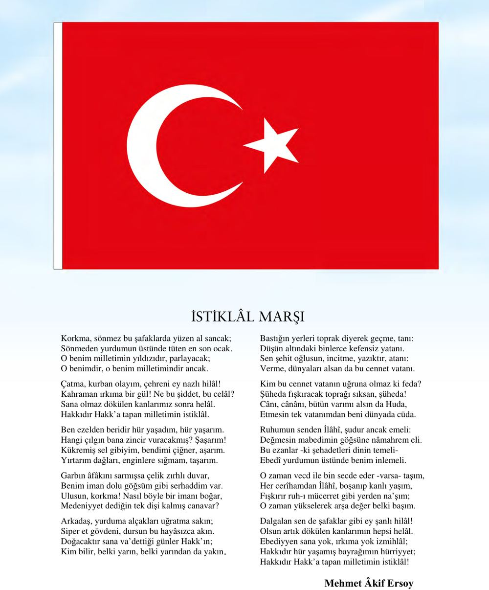

# İSTİKLÂL MARŞI

Korkma, sönmez bu şafaklarda yüzen al sancak;
Sönmeden yurdumun üstünde tüten en son ocak.
O benim milletimin yıldızıdır, parlayacak;
O benimdir, o benim milletimindir ancak.

Çatma, kurban olayım, çehreni ey nazlı hilâl!
Kahraman ırkıma bir gül! Ne bu şiddet, bu celâl?
Sana olmaz dökülen kanlarımız sonra helâl.
Hakkıdır Hakk'a tapan milletimin istiklâl.

Ben ezelden beridir hür yaşadım, hür yaşarım.
Hangi çılgın bana zincir vuracakmış? Şaşarım!
Kükremiş sel gibiyim, bendimi çiğner, aşarım.
Yırtarım dağları, enginlere sığmam, taşarım.

Garbın âfâkını sarmışsa çelik zırhlı duvar,
Benim iman dolu göğsüm gibi serhaddim var.
Ulusun, korkma! Nasıl böyle bir imanı boğar,
Medeniyet dediğin tek dişi kalmış canavar?

Arkadaş, yurduma alçakları uğratma sakın;
Siper et gövdeni, dursun bu hayâsızca akın.
Doğacaktır sana va’dettiği günler Hakk’ın;
Kim bilir, belki yarın, belki yarından da yakın

Bastığın yerleri toprak diyerek geçme, tanı:
Düşün altındaki binlerce kefensiz yatanı.
Sen şehit oğlusun, incitme, yazıktır, atanı:
Verme, dünyaları alsan da bu cennet vatanı.

Kim bu cennet vatanın uğruna olmaz ki feda?
Şüheda fışkıracak toprağı sıksan, şüheda!
Cânı, cânânı, bütün varımı alsın da Huda,
Etmesin tek vatanımdan beni dünyada cüda.

Ruhumun senden İlâhî, şudur ancak emeli:
Değmesin mabedimin göğsüne nâmahrem eli.
Bu ezanlar -ki şehadetleri dinin temeli-
Ebedî yurdumun üstünde benim inlemeli.

O zaman vecd ile bin secde eder -varsa- taşım,
Her cerîhamdan İlâhî, boşanıp kanlı yaşım,
Fışkırır ruh-ı mücerret gibi yerden na’şım;
O zaman yükselerek arşa değer belki başım.

Dalgalan sen de şafaklar gibi ey şanlı hilâl!
Olsun artık dökülen kanlarımın hepsi helâl.
Ebediyyen sana yok, ırkıma yok izmihlâl;
Hakkıdır hür yaşamış bayrağımın hürriyyet;
Hakkıdır Hakk'a tapan milletimin istiklâl!

Mehmet Âkif Ersoy

<!-- sayfa 3 -->

GENÇLİĞE HİTABE

Ey Türk gençliği! Birinci vazifen, Türk istiklâlini, Türk Cumhuriyetini, ilelebet muhafaza ve müdafaa etmektir.

Mevcudiyetinin ve istikbalinin yegâne temeli budur. Bu temel, senin en kıymetli hazinendir. İstikbalde dahi, seni bu hazineden mahrum etmek isteyecek dâhilî ve hâricî bedhahların olacaktır. Bir gün, istiklâl ve cumhuriyeti müdafaa mecburiyetine düşersen, vazifeye atılmak için, içinde bulunacağın vaziyetin imkân ve şeraitini düşünmeyeceksin! Bu imkân ve şerait, çok namüsait bir mahiyette tezahür edebilir. İstiklâl ve cumhuriyetine kastedecek düşmanlar, bütün dünyada emsali görülmemiş bir galibiyetin mümessili olabilirler. Cebren ve hile ile aziz vatanın bütün kaleleri zapt edilmiş, bütün tersanelerine girilmiş, bütün orduları dağıtılmış ve memleketin her köşesi bilfiil işgal edilmiş olabilir. Bütün bu şeraitten daha elîm ve daha vahim olmak üzere, memleketin dâhilinde iktidara sahip olanlar gaflet ve dalâlet ve hattâ hıyanet içinde bulunabilirler. Hattâ bu iktidar sahipleri şahsî menfaatlerini, müstevlîlerin siyasî emelleriyle tevhit edebilirler. Millet, fakr u zaruret içinde harap ve bîtap düşmüş olabilir.

Ey Türk istikbalinin evladı! İşte, bu ahval ve şerait içinde dahi vazifen, Türk istiklâl ve cumhuriyetini kurtarmaktır. Muhtaç olduğun kudret, damarlarındaki asil kanda mevcuttur.

Mustafa Kemal Atatürk

<!-- sayfa 4 -->

MUSTAFA KEMAL ATATÜRK

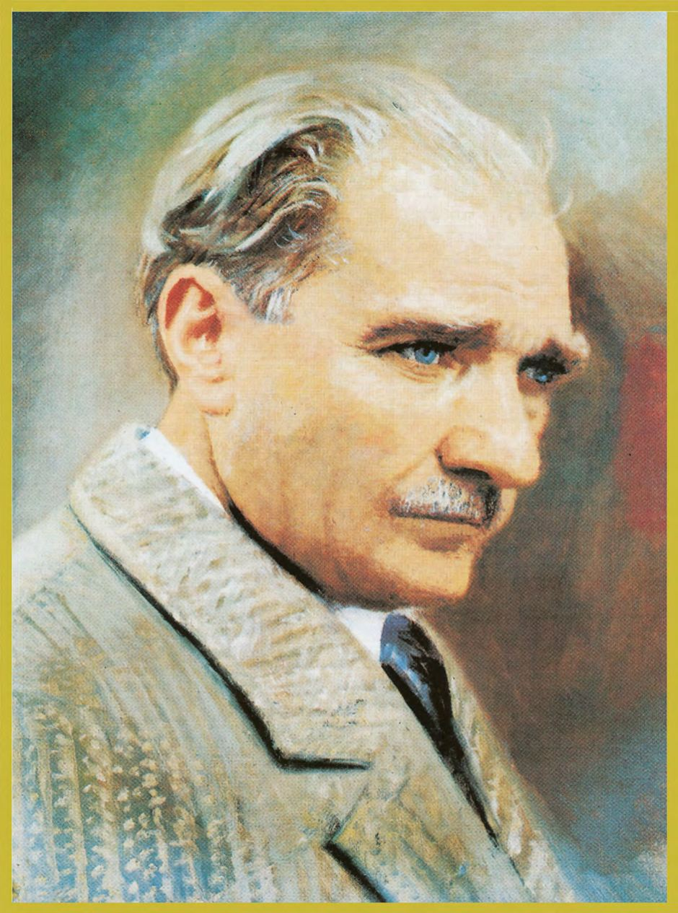
<!-- yer tutucu bulunamadı: sayfa sonuna eklendi -->

<!-- sayfa 5 -->

Verdiğiniz mesajda PDF metin katmanı boş görünüyor (`<<< >>>` arası boş). Sayfaya ait metin içeriği sağlanmadığı için herhangi bir çeviri yapamıyorum.

Lütfen dönüştürülmesini istediğiniz metni veya görseli paylaşın, ardından kurallarınıza uygun şekilde Markdown formatına çevireyim.

<!-- sayfa 6 -->

# İÇİNDEKİLER

Kitabın Tanıtımı ................................................................................................................................... 8

## 1. Tema KUR'AN-I KERİM'İ TANIYORUM .......................................................... 10

### 1.1. Kur'an-ı Kerim'i Öğrenmenin Önemi ve Okumanın Adabı ........................................ 12
### 1.2. Harfler ve Özellikleri ..................................................................................................... 16
#### 1.2.1. Kur'an Harfleri ........................................................................................................ 17
#### 1.2.2. Okunuşlarına Göre Harfler .................................................................................... 18
#### 1.2.3. Harflerin Mahreçleri ............................................................................................... 19
### 1.3. Harfleri Yazma .............................................................................................................. 22
#### 1.3.1. Harflerin Başta, Ortada ve Sonda Yazılışları ....................................................... 22
#### 1.3.2. Harflerin Kelime İçindeki Yazılışları ...................................................................... 22
### 1.4. Harfleri Harekelerle Telaffuz Etme ............................................................................ 27
#### 1.4.1. Üstün ....................................................................................................................... 27
#### 1.4.2. Esre ......................................................................................................................... 30
#### 1.4.3. Ötre .......................................................................................................................... 33
### 1.5. Sübhaneke Duası ve Rabbena Duaları ile Anlamları ................................................. 38
#### 1.5.1. Sübhaneke Duası ve Anlamı ................................................................................... 38
#### 1.5.2. Rabbena Duaları ve Anlamları ................................................................................ 41
### 1. Tema Ölçme ve Değerlendirme ..................................................................................... 45
Sonnot .......................................................................................................................................... 49

## 2. Tema KUR'AN-I KERİM'İ OKUMAYA GİRİŞ ................................................... 50

### 2.1. Cezim ve Şedde ............................................................................................................. 52
#### 2.1.1. Cezim ....................................................................................................................... 52
#### 2.1.2. Şedde ....................................................................................................................... 55
### 2.2. Tenvin ............................................................................................................................ 59
#### 2.2.1. İki Üstün .................................................................................................................. 59
#### 2.2.2. İki Esre ..................................................................................................................... 61
#### 2.2.3. İki Ötre ..................................................................................................................... 63
### 2.3. Tahiyyat Duası ve Anlamı ........................................................................................... 68
### 2. Tema Ölçme ve Değerlendirme ..................................................................................... 73
Sonnot .......................................................................................................................................... 77

## 3. Tema KUR'AN-I KERİM'İ ÖĞRENİYORUM .................................................... 78

### 3.1. Med Harfleri ................................................................................................................... 80
#### 3.1.1. Elif ........................................................................................................................... 80
#### 3.1.2. Vav ........................................................................................................................... 83
### 3.2. Okunuşla İlgili Özel Durumlar ................................................................................... 90
#### 3.2.1. Âsar-Çeker .............................................................................................................. 90
#### 3.2.2. Okunmayan Elif ...................................................................................................... 92
#### 3.2.3. Vav ve Ya Şeklinde Yazılan Elif ............................................................................. 93
#### 3.2.4. Elif Lâm Takısı ....................................................................................................... 94
#### 3.2.5. Lafzatullah ............................................................................................................... 96
#### 3.2.6. Med ve Kasır ........................................................................................................... 98
#### 3.2.7. Zamirin Okunuşu ................................................................................................... 100
#### 3.2.8. Hurufımukattaa ..................................................................................................... 102
### 3.3. Fatiha Suresi ve Bakara Suresinin 1-24. Ayetleri ................................................... 109
### 3.4. Fatiha Suresi ve Anlamı ............................................................................................ 110
### 3. Tema Ölçme ve Değerlendirme ................................................................................... 118
Sonnot ........................................................................................................................................ 121

## 4. Tema KUR'AN-I KERİM'İ OKUYORUM ........................................................ 122

### 4.1. Med Çeşitleri ................................................................................................................ 124
#### 4.1.1. Medditabii ............................................................................................................... 126
#### 4.1.2. Meddimuttasıl ........................................................................................................ 132
#### 4.1.3. Meddimunfasıl ....................................................................................................... 134
### 4.2. Bakara Suresinin 25-83. Ayetleri ............................................................................ 147
### 4.3. Peygamber Duaları: Şuara Suresinin 83-85. Ayetleri ............................................ 148
### 4.4. İhlas ve Kevser Sureleri ile Anlamları ..................................................................... 152
#### 4.4.1. İhlas Suresi ve Anlamı .......................................................................................... 152
#### 4.4.2. Kevser Suresi ve Anlamı ...................................................................................... 156
### 4. Tema Ölçme ve Değerlendirme ................................................................................... 161
Sonnot ........................................................................................................................................ 165

Sözlük .......................................................................................................................................... 166
Kaynakça .................................................................................................................................... 170
Cevap Anahtarı Karekodu ........................................................................................................ 171
Görsel ve Genel Ağ Kaynakçası Karekodu ............................................................................. 171
Türkiye'nin Mülki İdare Bölümleri ile Kara ve Deniz Komşuları Haritası .............................. 172
Türk Dünyası Haritası ............................................................................................................... 173

Kitabın dijital kopyalarında “İçindekiler” sayfasında başlıklar üzerine tıklayarak ilgili sayfalara, iç sayfalarda da konu başlıkları üzerine tıklayarak “İçindekiler” sayfasına ulaşabilirsiniz.

<!-- sayfa 7 -->

Kitap temalardan oluşmaktadır. Her tema başında "Tema Kapak Sayfası" yer almaktadır.
Tema kapaklarında o tema adı, tema alt konu başlıkları, öğrenilecek kavramlar, öğrenciden beklenen öğrenme çıktıları, tema sonunda öğrenciden yapması beklenen görev ya da sorumluluklar hakkında bilgi verilmiştir. Ayrıca tema ile ilgili olarak hazırlanan sunum ve diğer e-içeriklere ulaşmak amacıyla karekodlar yerleştirilmiştir.

Tema adı
Tema konu başlıkları
Anahtar kavramlar
Öğrenme hedefleri

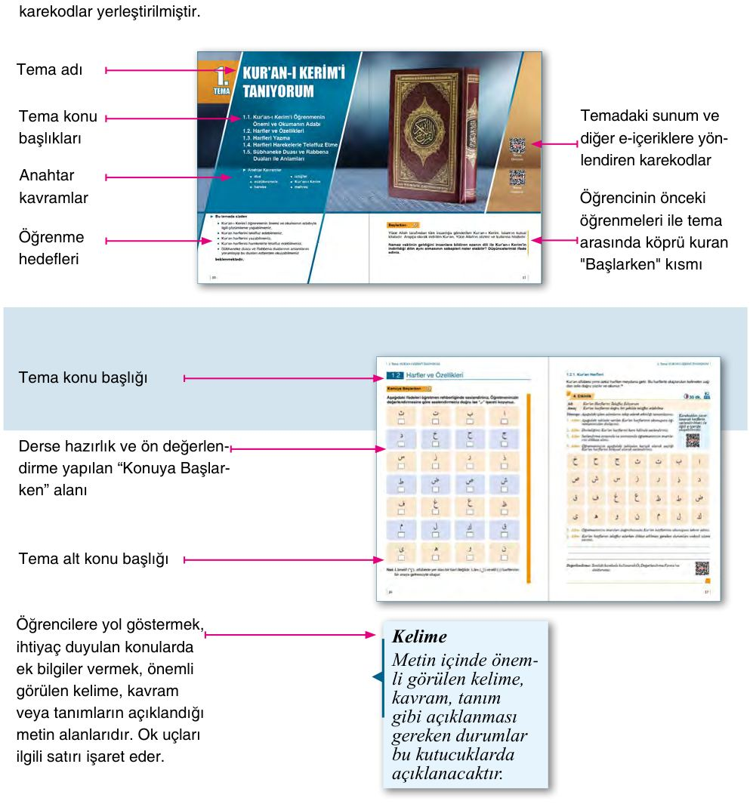

Temadaki sunum ve diğer e-içeriklere yönlendiren karekodlar
Öğrencinin önceki öğrenmeleri ile tema arasında köprü kuran "Başlarken" kısmı

Tema konu başlığı
Derse hazırlık ve ön değerlendirme yapılan “Konuya Başlarken” alanı
Tema alt konu başlığı

Öğrencilere yol göstermek, ihtiyaç duyulan konularda ek bilgiler vermek, önemli görülen kelime, kavram veya tanımların açıklandığı metin alanlarıdır. Ok uçları ilgili satırı işaret eder.

Kelime
Metin içinde önemli görülen kelime, kavram, tanım gibi açıklanması gereken durumlar bu kutucuklarda açıklanacaktır.

 Kitap genelinde kullanılan tüm karekodlar tıklandığında veya akıllı cihazlarla okutulduğunda kitaba ait dijital içeriklere ulaşılabilmektedir.

<!-- sayfa 8 -->

Kitap genelindeki "Etkinlik, Okuma Parçası, Örnek Çözüm vb." çalışmalarına tema içinde sıra numarası verilmiştir. Çalışmanın başladığı yer $\square$ sembolü ile, bittiği yer ise $\blacksquare$ sembolü ile gösterilmiştir. Çalışmanın bir sonraki sayfada devam ettiğini göstermek için $\blacktriangleright\hspace{-0.2em}\blacktriangleright$ <!-- KONTROL: Marker'da karşılığı yok, uydurma olabilir --> sembolü, önceki sayfadan devam ettiğini göstermek için $\blacktriangleleft\hspace{-0.2em}\blacktriangleleft$ <!-- KONTROL: Marker'da karşılığı yok, uydurma olabilir --> sembolü kullanılmıştır.

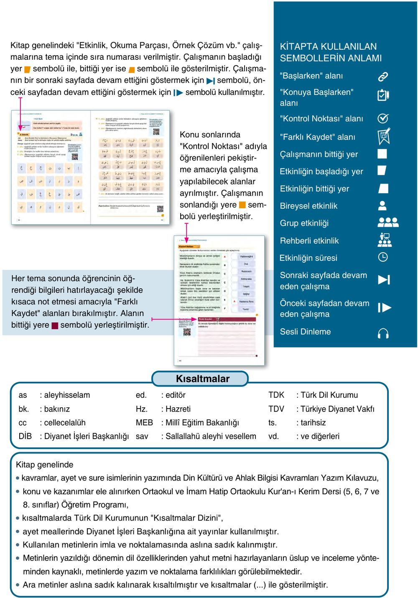

Konu sonlarında "Kontrol Noktası" adıyla öğrenilenleri pekiştirme amacıyla çalışma yapılabilecek alanlar ayrılmıştır. Çalışmanın sonlandığı yere $\blacksquare$ sembolü yerleştirilmiştir.

Her tema sonunda öğrencinin öğrendiği bilgileri hatırlayacağı şekilde kısaca not etmesi amacıyla "Farklı Kaydet" alanları bırakılmıştır. Alanın bittiği yere $\blacksquare$ sembolü yerleştirilmiştir.

# KİTAPTA KULLANILAN SEMBOLLERİN ANLAMI

| Sembol | Anlamı |
| :--- | :--- |
| $\text{\textcircled{\tiny\textbullet}}$ | "Başlarken" alanı |
| $\text{\textcircled{\tiny\textbullet}}$ | "Konuya Başlarken" alanı |
| $\text{\textcircled{\tiny\textbullet}}$ | "Kontrol Noktası" alanı |
| $\text{\textcircled{\tiny\textbullet}}$ | "Farklı Kaydet" alanı |
| $\square$ | Çalışmanın bittiği yer |
| $\square$ | Etkinliğin başladığı yer |
| $\blacksquare$ | Etkinliğin bittiği yer |
| $\text{\textcircled{\tiny\textbullet}}$ | Bireysel etkinlik |
| $\text{\textcircled{\tiny\textbullet}}$ | Grup etkinliği |
| $\text{\textcircled{\tiny\textbullet}}$ | Rehberli etkinlik |
| $\text{\textcircled{\tiny\textbullet}}$ | Etkinliğin süresi |
| $\blacktriangleright\hspace{-0.2em}\blacktriangleright$ <!-- KONTROL: Marker'da karşılığı yok, uydurma olabilir --> | Sonraki sayfada devam eden çalışma |
| $\blacktriangleleft\hspace{-0.2em}\blacktriangleleft$ <!-- KONTROL: Marker'da karşılığı yok, uydurma olabilir --> | Önceki sayfadan devam eden çalışma |
| $\text{\textcircled{\tiny\textbullet}}$ | Sesli Dinleme |

# Kısaltmalar

| | | | | | |
| :--- | :--- | :--- | :--- | :--- | :--- |
| as | : aleyhisselam | ed. | : editör | TDK | : Türk Dil Kurumu |
| bk. | : bakınız | Hz. | : Hazreti | TDV | : Türkiye Diyanet Vakfı |
| cc | : cellecelalüh | MEB | : Millî Eğitim Bakanlığı | ts. | : tarihsiz |
| DİB | : Diyanet İşleri Başkanlığı | sav | : Sallallahü aleyhi vesellem | vd. | : ve diğerleri |

Kitap genelinde
* kavramlar, ayet ve sure isimlerinin yazımında Din Kültürü ve Ahlak Bilgisi Kavramları Yazım Kılavuzu,
* konu ve kazanımlar ele alınırken Ortaokul ve İmam Hatip Ortaokulu Kur'an-ı Kerim Dersi (5, 6, 7 ve 8. sınıflar) Öğretim Programı,
* kısaltmalarda Türk Dil Kurumunun "Kısaltmalar Dizini",
* ayet meallerinde Diyanet İşleri Başkanlığına ait yayınlar kullanılmıştır.
* Kullanılan metinlerin imla ve noktalamasında aslına sadık kalınmıştır.
* Metinlerin yazıldığı dönemin dil özelliklerinden yahut metni hazırlayanların üslup ve inceleme yönteminden kaynaklı, metinlerde yazım ve noktalama farklılıkları görülebilmektedir.
* Ara metinler aslına sadık kalınarak kısaltılmıştır ve kısaltmalar (...) ile gösterilmiştir.

<!-- sayfa 9 -->

# 1. TEMA
# KUR'AN-I KERİM'İ TANIYORUM

1.1. Kur'an-ı Kerim'i Öğrenmenin Önemi ve Okumanın Adabı
1.2. Harfler ve Özellikleri
1.3. Harfleri Yazma
1.4. Harfleri Harekelerle Telaffuz Etme
1.5. Sübhaneke Duası ve Rabbena Duaları ile Anlamları

► Anahtar Kavramlar
* dua
* euzübesmele
* hareke
* istiğfar
* Kur'an-ı Kerim
* mahreç

► Bu temada sizden
* Kur'an-ı Kerim'i öğrenmenin önemi ve okumanın adabıyla ilgili çözümleme yapabilmeniz,
* Kur'an harflerini telaffuz edebilmeniz,
* Kur'an harflerini yazabilmeniz,
* Kur'an harflerini harekelerle telaffuz edebilmeniz,
* Sübhaneke duası ve Rabbena dualarının anlamlarını yorumlayıp bu duaları ezberden okuyabilmeniz beklenmektedir.

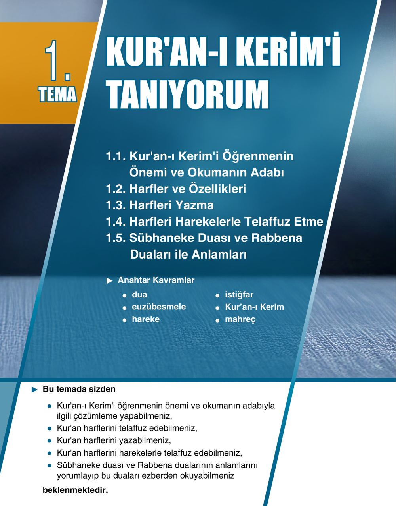
<!-- yer tutucu bulunamadı: sayfa sonuna eklendi -->

<!-- sayfa 10 -->

# Başlarken 🔗

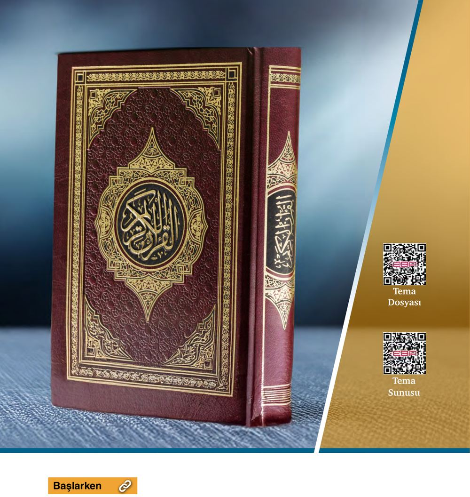

Yüce Allah tarafından tüm insanlığa gönderilen Kur'an-ı Kerim, İslam'ın kutsal kitabıdır. Arapça olarak indirilen Kur'an, Yüce Allah'ın sözleri ve kullarına hitabıdır.

**Namaz vaktinin geldiğini insanlara bildiren ezanın dili ile Kur'an-ı Kerim'in indirildiği dilin aynı olmasının sebepleri neler olabilir? Düşüncelerinizi ifade ediniz.**

---

Tema Dosyası
Tema Sunusu

<!-- sayfa 11 -->

# 1.1. Kur'an-ı Kerim'i Öğrenmenin Önemi ve Okumanın Adabı

**Konuya Başlarken** 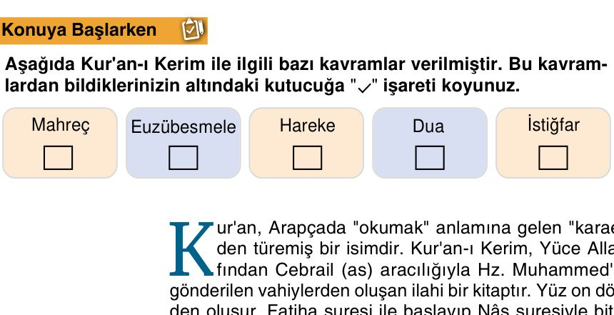

**Aşağıda Kur'an-ı Kerim ile ilgili bazı kavramlar verilmiştir. Bu kavramlardan bildiklerinizin altındaki kutucuğa " $\checkmark$ " işareti koyunuz.**

| Mahreç | Euzübesmele | Hareke | Dua | İstiğfar |
| :---: | :---: | :---: | :---: | :---: |
| $\square$ | $\square$ | $\square$ | $\square$ | $\square$ |

**K**ur'an, Arapçada "okumak" anlamına gelen "karae" fiilinden türemiş bir isimdir. Kur'an-ı Kerim, Yüce Allah tarafından Cebrail (as) aracılığıyla Hz. Muhammed'e (sav) gönderilen vahiylerden oluşan ilahi bir kitaptır. Yüz on dört sureden oluşur. Fatiha suresi ile başlayıp Nâs suresiyle biter. 610 yılı Ramazan ayının Kadir Gecesi'nde indirilmeye başlanmıştır. Yaklaşık yirmi üç yılda indirilen Kur'an-ı Kerim, hiçbir değişikliğe uğramadan günümüze kadar gelmiştir.$^1$ <!-- KONTROL: Marker'da karşılığı yok, uydurma olabilir -->

Kur'an-ı Kerim, İslam'ın temel kaynağıdır. Bu sebeple bilinçli bir Müslüman öncelikle Kur'an-ı Kerim'i okumayı öğrenir. Sevgili Peygamberimiz "Kur'an okuyun! Çünkü Kur'an, kıyamet gününde okuyucusuna şefaatçi olacaktır."$^2$ <!-- KONTROL: Marker'da karşılığı yok, uydurma olabilir --> sözüyle Kur'an-ı Kerim'i okumanın önemini ifade etmiştir. Aynı zamanda "Sizin en hayırlınız, Kur'an'ı öğrenen ve öğretendir."$^3$ <!-- KONTROL: Marker'da karşılığı yok, uydurma olabilir --> diyerek Kur'an-ı Kerim'i öğrenme ve öğretme faaliyetlerini de teşvik etmiştir.

---

### 1. Etkinlik 

| Adı | Kur'an-ı Kerim'i Öğrenmenin Önemi |
| :--- | :--- |
| **Amaç** | Kur'an-ı Kerim'i öğrenmenin Müslümanlar için önemini açıklayabilme |

**Yönerge:** Aşağıdaki işlem adımlarını öğretmen rehberliğinde takip ederek etkinliği tamamlayınız.

1. **Adım:** Sınıf arkadaşlarınıza Kur'an-ı Kerim'i öğrenmenin önemi hakkındaki düşüncelerini sorunuz.
2. **Adım:** Verilen cevapları maddeler hâlinde defterinize not ediniz.
3. **Adım:** Elde ettiğiniz bilgileri sınıf arkadaşlarınızla paylaşınız.

**Değerlendirme:** Yandaki karekodu kullanarak Öz Değerlendirme Formu'nu doldurunuz.

<!-- sayfa 12 -->

Kur'an-ı Kerim, tüm insanlara doğru yolu gösteren bir kitaptır. Adaleti, doğruluğu ve iyiliği öğütler.$^4$ <!-- KONTROL: Marker'da karşılığı yok, uydurma olabilir --> İnsanların Yüce Allah'a, Hz. Peygamber'e, topluma ve kendilerine karşı görev ve sorumluluklarını bildirir. Anne ve babaya iyi davranmayı,$^5$ <!-- KONTROL: Marker'da karşılığı yok, uydurma olabilir --> insanlara güzel sözle hitap etmeyi$^6$ <!-- KONTROL: Marker'da karşılığı yok, uydurma olabilir --> emreder. Bunlar Kur'an-ı Kerim'de emredilen veya öğütlenen bazı davranışlardır.

Kur'an-ı Kerim, insanlara ahiret hakkında bazı bilgiler verir.$^7$ <!-- KONTROL: Marker'da karşılığı yok, uydurma olabilir --> Yüce Allah, Kur'an-ı Kerim'de "**Onlar, Rablerine kavuşacaklarını ve gerçekten O'na döneceklerini çok iyi bilirler.**"$^8$ <!-- KONTROL: Marker'da karşılığı yok, uydurma olabilir --> buyurarak insanlara ahiret hayatının varlığını bildirir. Ahiretin varlığına inananlar, dünya hayatında yaptıkları iyilik ve kötülüklerin bir karşılığı olduğuna inandıkları için iyi ve yararlı işler yapmaya çaba gösterirler. Kötü davranışlardan uzak durmaya çalışırlar.$^9$ <!-- KONTROL: Marker'da karşılığı yok, uydurma olabilir -->

Kur'an-ı Kerim'i okumak Müslümanlar için bir ibadettir. Onu okumanın ibadet olması ve okuyana sevap kazandırması Kur'an-ı Kerim'de şu ayetle ifade edilir: "**Şüphesiz, Allah'ın kitabını okuyanlar, namazı kılanlar ve kendilerine rızık olarak verdiğimiz şeylerden gizlice ve açıktan Allah yolunda harcayanlar, asla zarar etmeyecek bir ticaret umabilirler.**"$^{10}$ <!-- KONTROL: Marker'da karşılığı yok, uydurma olabilir -->

## 2. Etkinlik 🕒 30 dk. 👥

| Adı | Kur'an'ı Oku, Anla, Yaşa! |
| :--- | :--- |
| **Amaç** | Kur'an-ı Kerim'i okuma, anlama ve onun emirlerini uygulamanın önemini açıklayabilme |

**Yönerge:** Aşağıdaki işlem adımlarını öğretmen rehberliğinde takip ederek etkinliği tamamlayınız.

**1. Adım:** Eşit üye sayısına sahip gruplar oluşturunuz.
**2. Adım:** Gruplarınızla birlikte aşağıda meali verilen ayeti okuyunuz.

**Bu Kur'an, âyetlerini düşünsünler ve akıl sahipleri öğüt alsınlar diye sana indirdiğimiz mübarek bir kitaptır.**
*(Sad suresi 29. ayet)*

**3. Adım:** Okuduğunuz ayet mealinden yararlanarak aşağıdaki soruları grup içinde cevaplandırınız.
* Kur'an-ı Kerim'in indiriliş amacı sadece "okunması" mı, yoksa "üzerinde düşünülmesi" midir? Düşüncelerinizi ifade ediniz.
* "Kur'an-ı Kerim'i anlamak hayatımızı nasıl güzelleştirir?" sorusunu bu ayetten yararlanarak cevaplayınız.

**4. Adım:** Ulaştığınız ortak sonuçları bir kâğıda yazarak sınıf panosunda sergileyiniz.

**Değerlendirme:** Yandaki karekodu kullanarak Grup Değerlendirme Formu'nu doldurunuz.

<!-- sayfa 13 -->

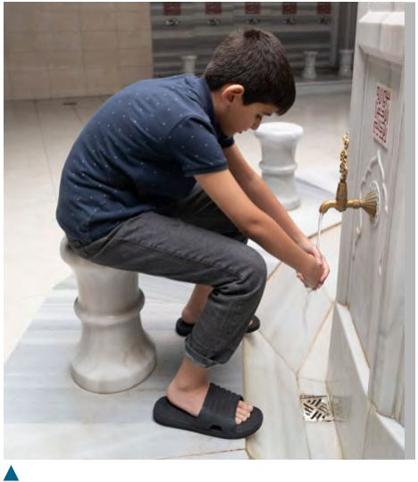

Müslümanlar, Kur'an-ı Kerim'e duydukları saygının göstergesi olarak bazı konularda hassas davranırlar. Bu konular şunlardır:

* Kur'an-ı Kerim'i okurken ve ona dokunurken abdestli olmaya özen gösterilir. Bu durum, Kur'an-ı Kerim'e duyulan saygının bir gereği olarak kabul edilir. Abdest aynı zamanda bedensel ve manevi bir temizlik sağlar (Görsel 1.1).

* Kur'an-ı Kerim'i okumaya "euzü-besmele" çekilerek başlanır. Yüce Allah bu konuyla ilgili olarak bir ayette "**Kur'an okuduğun zaman kovulmuş şeytandan Allah'a sığın.**"$^{11}$ <!-- KONTROL: Marker'da karşılığı yok, uydurma olabilir --> buyurur. Bu sebeple Kur'an-ı Kerim'i okumaya *istiaze* cümleleriyle başlanır. İstiaze sözlükte sığınma, bağlanma, korunma ve güvenme anlamlarına gelir. Terim olarak ise her türlü kötülükten Yüce Allah'a sığınıp yalnızca O'ndan yardım istemek demektir (Görsel 1.2). İstiaze "Kovulmuş şeytanın şerrinden Allah'a (cc) sığınırım." anlamına gelen "Eûzü billâhi mineşşeytânirracîm" ifadesidir.$^{12}$ <!-- KONTROL: Marker'da karşılığı yok, uydurma olabilir -->

**Görsel 1.2:** İstiaze ifadesi: "Eûzü billâhi mineşşeytânirracîm"

İstiazenin ardından "esirgeyen ve bağışlayan Allah'ın (cc) adıyla" anlamına gelen "Bismillahirrahmanirrahîm" denilerek Kur'an-ı Kerim okunmaya başlanır (Görsel 1.3).

**Görsel 1.3:** Besmele ifadesi: "Bismillahirrahmanirrahîm"

* Müslümanlar, Kur'an-ı Kerim okunurken onu saygı ve ilgiyle dinlerler. Göstermiş oldukları bu saygılı davranışların karşılığını Allah'ın (cc) vereceğini bilirler. Yüce Allah, bu konuda şöyle buyurur: "Kur'an okunduğu zaman onu dinle-

<!-- sayfa 14 -->

# 3. Etkinlik 🕒 15 dk. 👥

| Adı | Kur'an-ı Kerim'i Okumaya Euzübesmele ile Başlıyorum |
| :--- | :--- |
| **Amaç** | Euzübesmeleyi doğru bir şekilde telaffuz edebilme |

**Yönerge:** Aşağıdaki işlem adımlarını takip ederek etkinliği tamamlayınız.

1. **Adım:** Euzübesmelenin okunuşunu öğretmeninizden dinleyiniz.
2. **Adım:** Dinlediğiniz euzübesmeleyi koro hâlinde seslendiriniz.
3. **Adım:** Seslendirme sırasında ve sonrasında öğretmeninizin önerilerine dikkat ediniz.
4. **Adım:** Öğretmeninizin önerileri doğrultusunda euzübesmelenin okunuşunu tekrar ediniz.

> Karekoddan yararlanarak euzübesmelenin seslendirilmesi ile ilgili e-içeriğe ulaşabilirsiniz.
> 

**Değerlendirme:** Yandaki karekodu kullanarak Öz Değerlendirme Formu'nu doldurunuz.

---

## Kontrol Noktası ✅

1. Kur'an-ı Kerim'i öğrenmenin niçin önemli olduğunu yazınız.
....................................................................................................................................
....................................................................................................................................
....................................................................................................................................
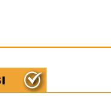

2. Kur'an-ı Kerim okumanın niçin bir ibadet olduğunu yazınız.
....................................................................................................................................
....................................................................................................................................
....................................................................................................................................

3. Kur'an-ı Kerim okumaya başlanırken söylenen istiaze ve besmele ifadelerini yazınız.
....................................................................................................................................
....................................................................................................................................
....................................................................................................................................
[[SE

<!-- sayfa 15 -->

# 1.2. Harfler ve Özellikleri

**Konuya Başlarken** 

Aşağıdaki ifadeleri öğretmen rehberliğinde seslendiriniz. Öğretmeninizin değerlendirmesine göre seslendirmeniz doğru ise "$\checkmark$" işareti koyunuz.

| | | | |
| :---: | :---: | :---: | :---: |
| ث $\square$ | ت $\square$ | ب $\square$ | ا $\square$ |
| د $\square$ | خ $\square$ | ح $\square$ | ج $\square$ |
| س $\square$ | ز $\square$ | ر $\square$ | ذ $\square$ |
| ط $\square$ | ض $\square$ | ص $\square$ | ش $\square$ |
| ف $\square$ | غ $\square$ | ع $\square$ | ظ $\square$ |
| م $\square$ | ل $\square$ | ك $\square$ | ق $\square$ |
| ى $\square$ | ه $\square$ | و $\square$ | ن $\square$ |

**Not:** Lâmelif ($\text{\small لٱ}$), 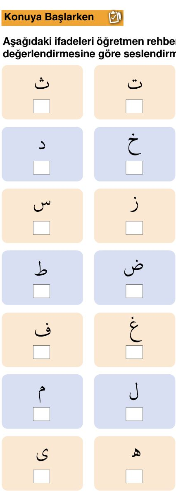 alfabede yer alan bir harf değildir. Lâm ($\text{\small ل}$)  ve elif ($\text{\small ا}$) harflerinin bir araya gelmesiyle oluşur.

<!-- sayfa 16 -->

### 1.2.1. Kur'an Harfleri

Kur'an alfabesi yirmi sekiz harften meydana gelir. Bu harflerle oluşturulan kelimeler sağdan sola doğru yazılır ve okunur.$^{14}$

#### 4. Etkinlik
⏱️ 30 dk. 

| Adı | *Kur'an Harflerini Telaffuz Ediyorum* |
| :--- | :--- |
| **Amaç** | *Kur'an harflerini doğru bir şekilde telaffuz edebilme* |

**Yönerge:** Aşağıdaki işlem adımlarını takip ederek etkinliği tamamlayınız.

**1. Adım:** Aşağıdaki tabloda verilen Kur'an harflerinin okunuşunu öğretmeninizden dinleyiniz.

**2. Adım:** Dinlediğiniz Kur'an harflerini koro hâlinde seslendiriniz.

**3. Adım:** Seslendirme sırasında ve sonrasında öğretmeninizin önerilerini dikkate alınız.

**4. Adım:** Öğretmeninizin aşağıdaki tablodan karışık olarak seçtiği Kur'an harflerini bireysel olarak seslendiriniz. 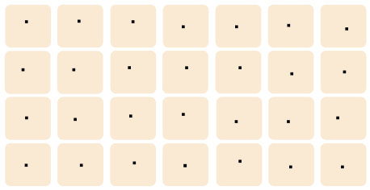

| | | | | | | |
| :---: | :---: | :---: | :---: | :---: | :---: | :---: |
| ا | ب | ت | ث | ج | ح | خ |
| د | ذ | ر | ز | س | ش | ص |
| ض | ط | ظ | ع | غ | ف | ق |
| ك | ل | م | ن | و | ه | ى |

**5. Adım:** Öğretmeninizin önerileri doğrultusunda Kur'an harflerinin okunuşunu tekrar ediniz.

**6. Adım:** Kur'an harflerini telaffuz ederken dikkat edilmesi gereken durumları noktalı alana yazınız.

......................................................................................................................................................
......................................................................................................................................................
......................................................................................................................................................

**Değerlendirme:** Yandaki karekodu kullanarak Öz Değerlendirme Formu'nu doldurunuz. 

<!-- sayfa 17 -->

### 1.2.2. Okunuşlarına Göre Harfler

Kur'an harfleri, okunuşlarına göre ince ve kalın olmak üzere iki gruba ayrılır. Bu grupların içinde peltek okunan ve boğazdan seslendirilen harfler de bulunur. Okunuşlarına göre harfler şu şekilde sınıflandırılır.$^{15}$ <!-- KONTROL: Marker'da karşılığı yok, uydurma olabilir -->

| 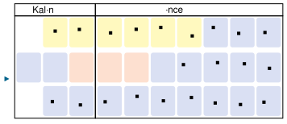 | Kalın Harfler | İnce Harfler |
| :--- | :---: | :---: |
| Karekoddan yararlanarak harflerin seslendirilmesi ile ilgili e-içeriğe ulaşabilirsiniz.    | غ خ ع ه | ا ح ج ح ت ب |
| | ص ض ط ظ ذ ش ث | د ز ر س ش ث ذ |
| | ق | ف ك ل م ن و ى ط |

Pembe renkli kutucuklarda yer alan peltek harfler, dil ucunun üst yüzeyi üst ön dişlerin ucuna getirilerek seslendirilir. Bunlardan $\text{\textit{\textarabic{ذ}}}, \text{\textit{\textarabic{ث}}}$ harfleri ince; $\text{\textit{\textarabic{ظ}}}$ harfi ise kalın harflerdir. Sarı kutucuklarda yer alan boğaz harfleri ise boğazdan gelen bir titreşimle telaffuz edilir. Bunlardan $\text{\textit{\textarabic{ا}}}, \text{\textit{\textarabic{ح}}}, \text{\textit{\textarabic{ع}}}, \text{\textit{\textarabic{ه}}}$ harfleri ince; $\text{\textit{\textarabic{غ}}}, \text{\textit{\textarabic{خ}}}$ harfleri ise kalın harflerdir.

**Not:** $\text{\textit{\textarabic{ر}}}$ harfi, aldığı hareke veya sakin olması durumuna göre ince ya da kalın okunur.

---

#### 5. Etkinlik 🕒 30 dk. 👥

**Adı:** Okunuşlarına Göre Kur'an Harflerini Öğreniyorum  
**Amaç:** Kur'an harflerini doğru bir şekilde telaffuz edebilme  

**Yönerge:** Aşağıdaki işlem adımlarını takip ederek etkinliği tamamlayınız.

1. **Adım:** Yukarıdaki tabloda verilen ince, kalın, peltek harfler ile boğaz harflerinin okunuşunu öğretmeninizden dinleyiniz.
2. **Adım:** Dinlediğiniz bu harfleri koro hâlinde seslendiriniz.
3. **Adım:** Seslendirme sırasında ve sonrasında öğretmeninizin önerilerini dikkate alınız.
4. **Adım:** Öğretmeninizin bu tablodan karışık olarak seçtiği harfleri bireysel olarak seslendiriniz.
5. **Adım:** Öğretmeninizin önerileri doğrultusunda harflerin okunuşunu bireysel olarak tekrar ediniz.
6. **Adım:** Bu harfleri telaffuz ederken dikkat edilmesi gereken durumları noktalı alana yazınız.

......................................................................................................................................................
......................................................................................................................................................
......................................................................................................................................................

**Değerlendirme:** Yandaki karekodu kullanarak Öz Değerlendirme Formu'nu doldurunuz. 

<!-- sayfa 18 -->

### 1.2.3. Harflerin Mahreçleri

Kur'an-ı Kerim'i doğru okuyabilmek için harfleri **mahreç**lerine uygun olarak seslendirmek gerekir. Mahreç, harflerin ses yolundan çıktığı yerlere denir.$^{16}$ <!-- KONTROL: Marker'da karşılığı yok, uydurma olabilir --> Her dilde harflere ait seslerin kendine özgü bir çıkış yeri vardır. Bir harfin yanlış seslendirilmesi kelimelerin anlamlarının değişmesine yol açabilir. Bu sebeple Kur'an harflerinin mahreç kurallarına uygun biçimde telaffuz edilmesi gerekir. Harflerin çıkış yerleri dil, dudak ve boğaz olmak üzere üçe ayrılır. Bunlar şöyledir.$^{17}$ <!-- KONTROL: Marker'da karşılığı yok, uydurma olabilir -->

| Dil (Diş/Damak) Harfleri |
| :--- |
| ت ث ج د ذ   ر   ز س ش ص ض ط   ظ ق ك ل ن ى |

| Dudak Harfleri |
| :--- |
| ب ف م و |

| Boğaz Harfleri |
| :--- |
| ا ح خ ع غ ه |

| Harf | Mahreç (Çıkış Yeri) | Türkçedeki Karşılığı |
| :--- | :--- | :--- |
| ا | Boğaz sonu | "E" harfi gibidir. |
| ب | Alt ve üst dudak | "B" harfi gibidir. |
| ت | Dil ucu ile ön diş dipleri | "T" harfi gibidir. |
| ث | Dil ucu ile ön diş uçları | "S" harfinin yumuşak söylenen hâli gibidir (Se). |
| ج | Dil ve üst damak ortası | "C" harfinin yumuşatılmış şeklidir. |
| ح | Boğaz ortası | "H" harfinin kalın söylenen hâli gibidir (Ha). |
| خ | Boğazın ağza en yakın kısmı | "H" harfinin dar ve kalın söylenen hâli gibidir (Hı). |
| د | Dil ucu ile ön diş dipleri | "D" harfi gibidir. |
| ذ | Dil ucu ile diş uçları | "Z" harfinin ince ve vurgusuz... |


<!-- sayfa 19 -->

| Harf | Mahreç (Çıkış Yeri) | Türkçedeki Karşılığı |
| :--- | :--- | :--- |
| ر | Dil ucu ile ön dişlerin üstündeki damak | "R" harfi gibidir. |
| ز | Dil ucu ile ön dişlerin üst yüzeyi | "Z" harfi gibidir. |
| س | Dil ucu ile ön dişlerin üst yüzeyi | "S" harfi gibidir. |
| ش | Dil ve üst damak ortası | "Ş" harfi gibidir. |
| ص | Dil ucu ile ön dişlerin üst yüzeyi | "S" harfinin kalın söylenen hâli gibidir (Sa). |
| ض | Dil kenarı ile üst azı dişler | "D" ve "Z" harflerinin kalın hâlleri gibi söylenen iki tercihli bir harftir (Da-Za). |
| ط | Dil ucu ile ön diş dipleri | "T" harfinin kalınlaştırılmış hâli gibidir (Ta). |
| ظ | Dil ucu ile ön diş uçları | "Z" harfinin kalın ve dar söylenen hâli gibidir (Zı). |
| ع | Boğaz ortası | Bağlamına göre “A, İ, U ve Ğ” gibi okunabilen bir harftir. |
| غ | Boğazın ağza en yakın kısmı | "Ğ" harfinin kalınlaştırılmış hâli gibidir (Ğa). |
| ف | Üst ön diş uçlarıyla alt dudağın içi | "F" harfi gibidir. |
| ق | Dil kökü ve üst damak | "G" harfinin kalınlaştırılmış hâli gibidir (Ga). |
| ك | Dil kökü ve küçük dil önü | "K" harfi gibidir. |
| ل | Dilin iki kenarı ucu ve üst damak | "L" harfi gibidir. |
| م | Alt ve üst dudak | "M" harfi gibidir. |
| ن | Dil ucu ile iki üst ön diş etleri | "N" harfi gibidir. |
| و | Alt ve üst dudak | "V" harfi gibidir. |
| ه | Boğaz sonu | "H" harfi gibidir. |
| ى | Dil ve üst damak ortası | "Y" harfi gibidir. |

<!-- yer tutucu bulunamadı: sayfa sonuna eklendi -->

<!-- sayfa 20 -->

# Kontrol Noktası ✅

1. Kur'an harflerini alfabedeki sırasıyla söyleyiniz.
2. Aşağıdaki kutucuklarda belirtilen harflere üçer örnek yazınız.

| Kalın harfler | İnce harfler | Peltek harfler | Boğaz harfleri |
| :--- | :--- | :--- | :--- |
| ........   ........   ........ | ........   ........   ........ | ........   ........   ........ | ........   ........   ........ |

3. Mahreç nedir? Açıklayınız. ........................................................................................................
4. Harfler neden mahreçlerine uygun olarak okunmalıdır? Açıklayınız. .........................................

| Performans Görevi | |
| :--- | :--- |
| **Amaç:** Kur'an harflerini doğru bir şekilde öğrenebilme | **Görev:** Yönergede belirtilen işlem adımlarını takip ederek Kur'an harflerini alfabedeki sırasına göre doğru bir şekilde dizebilme |
| **Beceriler**   • Bilgi okuryazarlığı   • Belirlemek | **Süre**   • Hazırlık: 1 hafta   • Sınıf içi: 1 ders saati |
| **Ürün:** Bilgi kartları | |
| **Puanlama Yöntemi:** Dereceli Puanlama Anahtarı ve Öz Değerlendirme Formu | |
| **Yönerge:** Aşağıdaki işlem adımlarını takip ederek performans görevini tamamlayınız.   1. Her birinin üzerinde sadece bir harf bulunacak şekilde tüm Kur'an harflerini içeren kartlar hazırlayınız.   2. Bu kartları karışık bir şekilde masanızın üzerine yerleştiriniz.   3. "Başla!" komutuyla birlikte harfleri sırasıyla yan yana dizmeye başlayınız.   4. Tüm harfleri doğru bir şekilde sıraladığınızdan emin olduğunuzda elinizi kaldırarak öğretmeninize haber veriniz.   5. Doğru sıralamayı yapan arkadaşlarınızı alkışla kutlayınız. | |
| **Değerlendirme Ölçütleri:** Bu çalışmada ortaya koyduğunuz ürün; bilgi toplama, ilişki kurma, kullanışlılık ve özgünlük ölçütlerine göre değerlendirilecektir.   • Yapılan çalışmalar görsel tasarım açısından açık ve anlaşılır olmalıdır.   • Yönergede istenen tüm maddelere yer verilmelidir. | |

Bu performans görevi aşağıdaki karekodlarda verilen Dereceli Puanlama Anahtarı ve Öz Değerlendirme Formu ile değerlendirilecektir.

| Karekoddan yararlanarak Kontrol Noktası'nın cevap anahtarına ulaşabilirsiniz. | Karekoddan yararlanarak Dereceli Puanlama Anahtarı'na ulaşabilirsiniz. | Karekoddan yararlanarak Öz Değerlendirme Formu'na ulaşabilirsiniz. |
| :---: | :---: | :---: |
| 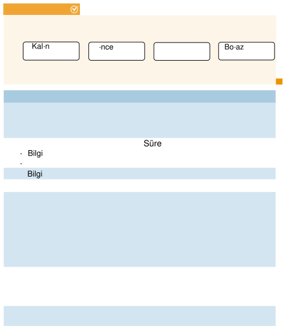 |  |  |

<!-- sayfa 21 -->

# 1.3. Harfleri Yazma

Kendinden sonra gelen harflerle birleşmeyen Kur'an harfleri şunlardır:
ا، د، ذ، ر، ز، و

* Harekeli ( اElif) hemze olarak isimlendirilir ve şu şekillerde de yazılır: ء أ إ ؤ ئ
Örnek: شيء - رأى - إرم :أ / يؤيد - ابرى - قائم
* Arapçada bazı kelimelerin sonunda yer alan ة (yuvarlak te) harfi önceki harfe birleşerek yazılırsa " ة ", birleşmezse " ة " şeklinde yazılır.
Örnek: كلمة - حيوة

### 1.3.1. Harflerin Başta, Ortada ve Sonda Yazılışları


Arapçada harflerin yazılışları kelimede bulundukları yere göre (başta, ortada, sonda) farklılık gösterir. Konumlarına göre harflerin yazılış kuralları şöyledir:$^{18}$ <!-- KONTROL: Marker'da karşılığı yok, uydurma olabilir -->

| Harfin Konumu | Harfin Yazılış Şekli | Örnek |
| :--- | :--- | :--- |
| Alfabede | Bağımsız yazımı | ب |
| Başta | Kendinden sonraki harfle bitişmiş şekli | بـ |
| Ortada | Hem önceki hem sonraki harfle bitişmiş şekli | ـبـ |
| Sonda | Kendinden önceki harfle bitişmiş şekli | ـب |

### 1.3.2. Harflerin Kelime İçindeki Yazılışları$^{19}$ <!-- KONTROL: Marker'da karşılığı yok, uydurma olabilir -->

| Sonda | Ortada | Başta | Alfabede |
| :---: | :---: | :---: | :---: |
| خطأ | ساد | اس | ا |
| قلب | صبر | بصر | ب |
| ثبت | قتل | ترك | ت |
| بعث | مثل | ثمن | ث |
| فلج | فجر | جلس | ج |
| صلح | ضحك | حطم | ح |
| رسخ | نخل | خرج | خ |
| سجد | قدم | دخل | د |

<!-- sayfa 22 -->

| Sonda | Ortada | Başta | Alfabede |
| :---: | :---: | :---: | :---: |
| اخذ | نذر | ذهب | ذ |
| عصر | غرق | رفع | ر |
| كنز | نزل | زيد | ز |
| شمس | غسق | سجد | س |
| فلش | رشد | شرب | ش |
| قصص | فصل | صبر | ص |
| بغض | غضب | ضرب | ض |
| ربط | بطن | طلخ | ط |
| حفظ | نظر | ظهر | ظ |
| سمع | بعد | عشر | ع |
| بلغ | صغر | غلب | غ |
| الف | سفر | فرق | ف |
| خلق | حقب | قرا | ق |
| ملك | مكر | كسب | ك |
| طفل | فلق | لبس | ل |
| رحم | عمل | منع | م |
| امن | سنع | نهر | ن |
| صلو | سوب | وقف | و |
| اله | عهد | هلك | ه |
| يقي | ليل | يمن | ي |

<!-- yer tutucu bulunamadı: sayfa sonuna eklendi -->

<!-- sayfa 23 -->

# 6. Etkinlik 🕒 30 dk. 👤

**Adı:** Kur'an Harflerini Yazıyorum
**Amaç:** Kur'an harflerini yazabilme

**Yönerge:** Aşağıdaki tabloda koyu olarak verilen kılavuz harflerden yararlanarak noktalı şekilleri tamamlayınız. Harfleri ok yönüne dikkat ederek yazınız.


| | | | | | | | |
| :---: | :---: | :---: | :---: | :---: | :---: | :---: | :---: |
| ا | ا | ا | ا | ا | ا | ا | ا |
| ب | ب | ب | ب | ب | ب | ب | ب |
| ت | ت | ت | ت | ت | ت | ت | ت |
| ث | ث | ث | ث | ث | ث | ث | ث |
| ج | ج | ج | ج | ج | ج | ج | ج |
| ح | ح | ح | ح | ح | ح | ح | ح |
| خ | خ | خ | خ | خ | خ | خ | خ |
| د | د | د | د | د | د | د | د |
| ذ | ذ | ذ | ذ | ذ | ذ | ذ | ذ |
| ر | ر | ر | ر | ر | ر | ر | ر |
| ز | ز | ز | ز | ز | ز | ز | ز |
| س | س | س | س | س | س | س | س |
| ش | ش | ش | ش | ش | ش | ش | ش |
| ص | ص | ص | ص | ص | ص | ص | ص |
| ض | ض | ض | ض | ض | ض | ض | ض |

<!-- sayfa 24 -->

| | | | | | | | |
|---|---|---|---|---|---|---|---|
| ط | ط | ط | ط | ط | ط | ط | ط$^2$ <!-- KONTROL: Marker'da karşılığı yok, uydurma olabilir --> |
| ظ | ظ | ظ | ظ | ظ | ظ | ظ | ظ$^2$ <!-- KONTROL: Marker'da karşılığı yok, uydurma olabilir --> |
| ع | ع | ع | ع | ع | ع | ع | ع |
| غ | غ | غ | غ | غ | غ | غ | غ |
| ف | ف | ف | ف | ف | ف | ف | ف |
| ق | ق | ق | ق | ق | ق | ق | ق |
| ك | ك | ك | ك | ك | ك | ك | ك |
| ل | ل | ل | ل | ل | ل | ل | ل |
| م | م | م | م | م | م | م | م |
| ن | ن | ن | ن | ن | ن | ن | ن |
| و | و | و | و | و | و | و | و |
| ه | ه | ه | ه | ه | ه | ه | ه |
| ى | ى | ى | ى | ى | ى | ى | ى |

| | |
|---|---|
| Karekoddan yararlanarak harflerin yazımı ile ilgili e-içeriğe ulaşabilirsiniz. | Karekoddan yararlanarak Gözlem Formu'nu doldurunuz. |
|  |  |

<!-- yer tutucu bulunamadı: sayfa sonuna eklendi -->

<!-- sayfa 25 -->

# 7. Etkinlik

⏱️ 30 dk. 👤

**Adı:** Harfleri Kelime İçindeki Yerine Göre Yazıyorum
**Amaç:** Harfleri kelime içindeki yerlerine göre (başta, ortada, sonda) yazabilme

**Yönerge:** Aşağıdaki tabloda boş bırakılan yerlere harflerin kelime içindeki kullanımını verilen örneklerdeki gibi yazınız.

| Sonda | Ortada | Başta | Harf | Sonda | Ortada | Başta | Harf |
| :---: | :---: | :---: | :---: | :---: | :---: | :---: | :---: |
| ض | ض | ض | ض | ا | ا | ا | ا |
| ṭ | ṭ | ṭ | ط | ب | ﺑ | ﺒ | ب |
| ẓ | ẓ | ẓ | ظ | ث | ﺜ | ﺛ | ث |
| ʿ | ʿ | ʿ | ع | ش | ﺷ | ﺸ | ش |
| ġ | ġ | ġ | غ | ج | ﺟ | ﺠ | ج |
| f | f | f | ف | ح | ﺤ | ﺣ | ح |
| q | q | q | ق | خ | ﺨ | ﺧ | خ |
| k | k | k | ك | د | د | د | د |
| l | l | l | ل | ذ | ذ | ذ | ذ |
| m | m | m | م | ر | ر | ر | ر |
| n | n | n | ن | ز | ز | ز | ز |
| w | w | w | و | س | ﺴ | ﺳ | س |
| h | h | h | ه | ش | ش | ش | ش |
| y | y | y | ي | ص | ص | ص | ص |

**Değerlendirme:** Yandaki karekodu kullanarak Gözlem Formu'nu doldurunuz.

<!-- yer tutucu bulunamadı: sayfa sonuna eklendi -->

<!-- yer tutucu bulunamadı: sayfa sonuna eklendi -->

<!-- sayfa 26 -->

# 1.4. Harfleri Harekelerle Telaffuz Etme

**Konuya Başlarken** 

Aşağıdaki harekeleri öğretmen rehberliğinde seslendiriniz. Öğretmeninizin değerlendirmesine göre seslendirmeniz doğru ise "$\checkmark$" işareti koyunuz.

| | | | | | |
| :---: | :---: | :---: | :---: | :---: | :---: |
| $\text{\small \char"064E}$ <!-- KONTROL: Marker'da karşılığı yok, uydurma olabilir --> | | $\text{\small \char"064E}$ <!-- KONTROL: Marker'da karşılığı yok, uydurma olabilir --> | | $\text{\small \char"064E}$ <!-- KONTROL: Marker'da karşılığı yok, uydurma olabilir --> | |


Harflerin ünlü olarak seslendirilmesine yardımcı olan işaretlere **hareke** denir. Bu işaretler üstün, esre ve ötredir.$^{20}$ <!-- KONTROL: Marker'da karşılığı yok, uydurma olabilir -->

### 1.4.1. Üstün

| | |
| :---: | :--- |
|  | Harfin üstünde bulunan yatık bir çizgidir. |
| | İnce harfleri "e", kalın harfleri ise "a" sesi ile okutur. |

**8. Etkinlik**  🕒 30 dk. 👥

| Adı | Üstün Harekeli Harf ve Kelimelerin Okunuşunu Öğreniyorum |
| :--- | :--- |
| **Amaç** | Üstün harekeli harf ve kelimeleri doğru bir şekilde telaffuz edebilme |

**Yönerge:** Aşağıdaki işlem adımlarını takip ederek etkinliği tamamlayınız.

1. **1. Adım:** Aşağıdaki tabloda verilen harflerin okunuşunu öğretmeninizden dinleyiniz.
2. **2. Adım:** Dinlediğiniz bu harfleri koro hâlinde seslendiriniz.
3. **3. Adım:** Öğretmeninizin aşağıdaki tablodan karışık olarak seçtiği harekeli harfleri bireysel olarak seslendiriniz.

| Karekoddan yararlanarak harflerin seslendirilmesi ile ilgili e-içeriğe ulaşabilirsiniz. |
| :---: |
| (QR Kod) |

| | | | | | | |
| :---: | :---: | :---: | :---: | :---: | :---: | :---: |
| $\text{\small \char"064E}\text{\small \char"062E}$ <!-- KONTROL: Marker'da karşılığı yok, uydurma olabilir --> | $\text{\small \char"064E}\text{\small \char"062D}$ <!-- KONTROL: Marker'da karşılığı yok, uydurma olabilir --> | $\text{\small \char"064E}\text{\small \char"062C}$ <!-- KONTROL: Marker'da karşılığı yok, uydurma olabilir --> | $\text{\small \char"064E}\text{\small \char"062B}$ <!-- KONTROL: Marker'da karşılığı yok, uydurma olabilir --> | $\text{\small \char"064E}\text{\small \char"062A}$ <!-- KONTROL: Marker'da karşılığı yok, uydurma olabilir --> | $\text{\small \char"064E}\text{\small \char"0628}$ <!-- KONTROL: Marker'da karşılığı yok, uydurma olabilir --> | $\text{\small \char"064E}\text{\small \char"0627}$ <!-- KONTROL: Marker'da karşılığı yok, uydurma olabilir --> |
| $\text{\small \char"064E}\text{\small \char"0635}$ <!-- KONTROL: Marker'da karşılığı yok, uydurma olabilir --> | $\text{\small \char"064E}\text{\small \char"0634}$ <!-- KONTROL: Marker'da karşılığı yok, uydurma olabilir --> | $\text{\small \char"064E}\text{\small \char"0633}$ <!-- KONTROL: Marker'da karşılığı yok, uydurma olabilir --> | $\text{\small \char"064E}\text{\small \char"0632}$ <!-- KONTROL: Marker'da karşılığı yok, uydurma olabilir --> | $\text{\small \char"064E}\text{\small \char"0631}$ <!-- KONTROL: Marker'da karşılığı yok, uydurma olabilir --> | $\text{\small \char"064E}\text{\small \char"0630}$ <!-- KONTROL: Marker'da karşılığı yok, uydurma olabilir --> | $\text{\small \char"064E}\text{\small \char"062F}$ <!-- KONTROL: Marker'da karşılığı yok, uydurma olabilir --> |
| $\text{\small \char"064E}\text{\small \char"0636}$ <!-- KONTROL: Marker'da karşılığı yok, uydurma olabilir --> | $\text{\small \char"064E}\text{\small \char"0637}$ <!-- KONTROL: Marker'da karşılığı yok, uydurma olabilir --> | $\text{\small \char"064E}\text{\small \char"0638}$ <!-- KONTROL: Marker'da karşılığı yok, uydurma olabilir --> | $\text{\small \char"064E}\text{\small \char"0639}$ <!-- KONTROL: Marker'da karşılığı yok, uydurma olabilir --> | $\text{\small \char"064E}\text{\small \char"063a}$ <!-- KONTROL: Marker'da karşılığı yok, uydurma olabilir --> | $\text{\small \char"064E}\text{\small \char"0641}$ <!-- KONTROL: Marker'da karşılığı yok, uydurma olabilir --> | $\text{\small \char"064E}\text{\small \char"0642}$ <!-- KONTROL: Marker'da karşılığı yok, uydurma olabilir --> |
| $\text{\small \char"064E}\text{\small \char"0649}$ <!-- KONTROL: Marker'da karşılığı yok, uydurma olabilir --> | $\text{\small \char"064E}\text{\small \char"0647}$ <!-- KONTROL: Marker'da karşılığı yok, uydurma olabilir --> | $\text{\small \char"064E}\text{\small \char"0646}$ <!-- KONTROL: Marker'da karşılığı yok, uydurma olabilir --> | $\text{\small \char"064E}\text{\small \char"0648}$ <!-- KONTROL: Marker'da karşılığı yok, uydurma olabilir --> | $\text{\small \char"064E}\text{\small \char"0627}$ <!-- KONTROL: Marker'da karşılığı yok, uydurma olabilir --> | $\text{\small \char"064E}\text{\small \char"0623}$ <!-- KONTROL: Marker'da karşılığı yok, uydurma olabilir --> | $\text{\small \char"064E}\text{\small \char"064a}$ <!-- KONTROL: Marker'da karşılığı yok, uydurma olabilir --> |

<!-- sayfa 27 -->

▶| 4. Adım: Aşağıdaki tabloda verilen kelimelerin okunuşunu öğretmeninizden dinleyiniz.

5. Adım: Öğretmeninizin aşağıdaki tablodan karışık olarak seçtiği kelimeleri bireysel olarak seslendiriniz.

6. Adım: Öğretmeninizin önerileri doğrultusunda kelimelerin okunuşunu tekrar ediniz.

| | | | | |
| :---: | :---: | :---: | :---: | :---: |
| أَ حَ د أَحَد | دَ خَ ل دَخَل | رَ فَ ث رَفَث | زَ رَ عَ زَرَع | ذَ هَ ب ذَهَب |
| وَ قَ ف وَقَف | مَ رَ ج مَرَج | عَ زَ م عَزَم | نَ فَ خ نَفَخ | بَ ذَ ل بَذَل |
| بَ دَ ا بَدَا | صَ دَ ق صَدَق | سَ كَ ت سَكَت | قَ سَ م قَسَم | جَ لَ س جَلَس |
| كَ شَ ف كَشَف | شَ كَ ر شَكَر | هَ لَ ك هَلَك | فَ تَ ح فَتَح | مَ نَ عَ مَنَع |
| طَ لَ ب طَلَب | نَ ظَ رَ نَظَرَ | يَ مَ نَ يَمَن | عَ رَ ضَ عَرَض | عَ غَ فَ رَ عَغَفَرَ |


7. Adım: Bu kelimeleri telaffuz ederken dikkat edilmesi gereken durumları noktalı alana yazınız.

......................................................................................................................................................
.......................................................................................................................................................
.......................................................................................................................................................

**Değerlendirme:** Yandaki karekodu kullanarak Öz Değerlendirme Formu'nu doldurunuz.

Karekoddan yararlanarak kelimelerin seslendirilmesi ile ilgili e-içeriğe ulaşabilirsiniz.

<!-- sayfa 28 -->

# Çalışma Yaprağı

Aşağıdaki tabloda verilen kelimeleri harekelerine dikkat ederek okuyunuz.

| | | | | |
| :---: | :---: | :---: | :---: | :---: |
| ذَرَا | أَخَذَ | أَمَرَ | سَأَلَ | قَرَأَ |
| رَغَبَ | ضَرَبَ | شَرَعَ | فَطَرَ | حَجَرَ |
| يَدَكَ | كَسَبَ | عَبَسَ | نَفَخَ | حَفَظَ |
| رَفَضَ | حَرَصَ | حَضَرَ | ظَهَرَ | شَجَرَ |
| وَهَنَ | وَهَبَ | وَقَعَ | طَبَعَ | طَلَعَ |
| نَزَلَ | نَزَغَ | ثَبَتَ | مَكَثَ | مَثَلَ |
| فَصَلَ | قَدَمَ | كَتَمَ | خَتَمَ | فَتَى |

<!-- yer tutucu bulunamadı: sayfa sonuna eklendi -->

<!-- yer tutucu bulunamadı: sayfa sonuna eklendi -->

<!-- yer tutucu bulunamadı: sayfa sonuna eklendi -->

<!-- yer tutucu bulunamadı: sayfa sonuna eklendi -->

<!-- yer tutucu bulunamadı: sayfa sonuna eklendi -->

<!-- yer tutucu bulunamadı: sayfa sonuna eklendi -->

<!-- yer tutucu bulunamadı: sayfa sonuna eklendi -->

<!-- sayfa 29 -->

### 1.4.2. Esre


Harfin altında bulunan yatık bir çizgidir.

İnce harfleri "i" sesiyle, kalın harfleri ise "ı-i" arası bir sesle okutur.

---

#### 9. Etkinlik
 30 dk. 

| Adı | Esre Harekeli Harf ve Kelimelerin Okunuşunu Öğreniyorum |
| :--- | :--- |
| **Amaç** | Esre harekeli harf ve kelimeleri doğru bir şekilde telaffuz edebilme |

**Yönerge:** Aşağıdaki işlem adımlarını takip ederek etkinliği tamamlayınız.

1. **Adım:** Aşağıdaki tabloda verilen harflerin okunuşunu öğretmeninizden dinleyiniz.
2. **Adım:** Dinlediğiniz bu harfleri koro hâlinde seslendiriniz.
3. **Adım:** Öğretmeninizin aşağıdaki tablodan karışık olarak seçtiği harekeli harfleri bireysel olarak seslendiriniz.

Karekoddan yararlanarak harflerin seslendirilmesi ile ilgili e-içeriğe ulaşabilirsiniz.

| | | | | | | |
| :---: | :---: | :---: | :---: | :---: | :---: | :---: |
| خِ | حِ | جِ | ثِ | تِ | بِ | اِ |
|  | | | | | | |
| صِ | شِ | سِ | زِ | رِ | ذِ | دِ |
|  | | | | | | |
| قِ | فِ | غِ | عِ | ظِ | طِ | ضِ |
|  | | | | | | |
| ى | هِ | وِ | نِ | مِ | لِ | كِ |
|  | | | | | | |

<!-- yer tutucu bulunamadı: sayfa sonuna eklendi -->

<!-- sayfa 30 -->

▶| 4. Adım: Aşağıdaki tabloda verilen kelimelerin okunuşunu öğretmeninizden dinleyiniz.

5. Adım: Öğretmeninizin aşağıdaki tablodan karışık olarak seçtiği kelimeleri bireysel olarak seslendiriniz.

6. Adım: Öğretmeninizin önerileri doğrultusunda kelimelerin okunuşunu tekrar ediniz.

| Karekoddan yararlanarak kelimelerin seslendirilmesi ile ilgili e-içeriğe ulaşabilirsiniz. |
| :---: |
|  |

| إِرَمٌ | اَبَتْ | شَرِبَ | يَدِي | رَحِمَ |
| :---: | :---: | :---: | :---: | :---: |
| إِرَمٌ | اَبَتْ | شَرِبَ | يَدِي | رَحِمَ |

| تَزِدْ | حَذِرَ | عِوَجٌ | لَوِيَ | فَهِمَ |
| :---: | :---: | :---: | :---: | :---: |
| تَزِدْ | حَذِرَ | عِوَجٌ | لَوِيَ | فَهِمَ |

| حَسِبَ | لَقِيَ | لَبِسَ | بَخِلَ | رَضِيَ |
| :---: | :---: | :---: | :---: | :---: |
| حَسِبَ | لَقِيَ | لَبِسَ | بَخِلَ | رَضِيَ |

| حَصَرَ | حَمِدَ | حَفِظَ | نَشِطَ | صَغُرَ |
| :---: | :---: | :---: | :---: | :---: |
| حَصَرَ | حَمِدَ | حَفِظَ | نَشِطَ | صَغُرَ |

| نَدِمَ | مَلِكَ | قَبَلَ | خَطِفَ | غَنِيَ |
| :---: | :---: | :---: | :---: | :---: |
| نَدِمَ | مَلِكَ | قَبَلَ | خَطِفَ | غَنِيَ |

7. Adım: Bu kelimeleri telaffuz ederken dikkat edilmesi gereken durumları noktalı alana yazınız.

......................................................................................................................................................
......................................................................................................................................................
......................................................................................................................................................

**Değerlendirme:** Yandaki karekodu kullanarak Öz Değerlendirme Formu'nu doldurunuz. 

<!-- yer tutucu bulunamadı: sayfa sonuna eklendi -->

<!-- sayfa 31 -->

# Çalışma Yaprağı

Aşağıdaki tabloda verilen kelimeleri harekelerine dikkat ederek okuyunuz.

| | | | | |
| :---: | :---: | :---: | :---: | :---: |
| رَغِبَ | رَكِبَ | أَذِنَ | أَزِفَ | إِبِلَ |
| حَيِيَ | يَدِيَ | بِيَدَ | بَقِيَ | لَوِيَ |
| مَرِضَ | فَلِمَ | فَرِحَ | فَمَنَ | خَفِيَ |
| سَنَتَ | وَسِعَ | سَمِعَ | نَعِمَ | تَبِعَ |
| شَهِدَ | خَشِيَ | نَشِطَ | وَزِنَ | سَفِهَ |
| بَصَرَ | بَطِرَ | بَرِقَ | عَجِبَ | يَلِجَ |
| ضَحِكَ | غَضِبَ | وَثِقَ | ثَبَّ | بَخِلَ |

<!-- yer tutucu bulunamadı: sayfa sonuna eklendi -->

<!-- yer tutucu bulunamadı: sayfa sonuna eklendi -->

<!-- yer tutucu bulunamadı: sayfa sonuna eklendi -->

<!-- yer tutucu bulunamadı: sayfa sonuna eklendi -->

<!-- yer tutucu bulunamadı: sayfa sonuna eklendi -->

<!-- yer tutucu bulunamadı: sayfa sonuna eklendi -->

<!-- yer tutucu bulunamadı: sayfa sonuna eklendi -->

<!-- sayfa 32 -->

### 1.4.3. Ötre

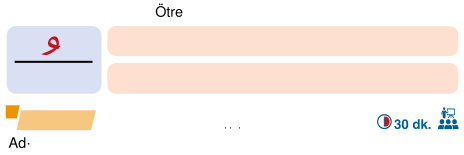

Harfin üstünde bulunan ve küçük bir vav harfine benzeyen harekedir.

İnce harfleri "u-ü" arası bir sesle, kalın harfleri ise "u" sesi ile okutur.

---

#### 10. Etkinlik    🕒 30 dk. 

| | |
| :--- | :--- |
| **Adı** | Ötre Harekeli Harf ve Kelimelerin Okunuşunu Öğreniyorum |
| **Amaç** | Ötre harekeli harf ve kelimeleri doğru bir şekilde telaffuz edebilme |

**Yönerge:** Aşağıdaki işlem adımlarını takip ederek etkinliği tamamlayınız.

1. **Adım:** Aşağıdaki tabloda verilen harflerin okunuşunu öğretmeninizden dinleyiniz.
2. **Adım:** Dinlediğiniz bu harfleri koro hâlinde seslendiriniz.
3. **Adım:** Öğretmeninizin aşağıdaki tablodan karışık olarak seçtiği harekeli harfleri bireysel olarak seslendiriniz. 

> Karekoddan yararlanarak harflerin seslendirilmesi ile ilgili e-içeriğe ulaşabilirsiniz.
> 

| | | | | | | |
| :---: | :---: | :---: | :---: | :---: | :---: | :---: |
| اُ | بُ | تُ | ثُ | جُ | حُ | خُ |
| دُ | ذُ | رُ | زُ | سُ | شُ | صُ |
| ضُ | طُ | ظُ | عُ | غُ | فُ | قُ |
| كُ | مُ | نُ | وُ | هُ | ى | يُ |


<!-- sayfa 33 -->

▶️ 4. Adım: Aşağıdaki tabloda verilen kelimelerin okunuşunu öğretmeninizden dinleyiniz.

5. Adım: Öğretmeninizin aşağıdaki tablodan karışık olarak seçtiği kelimeleri bireysel olarak seslendiriniz.

6. Adım: Öğretmeninizin önerileri doğrultusunda kelimelerin okunuşunu tekrar ediniz.

| | | | | |
| :---: | :---: | :---: | :---: | :---: |
| أَمَرَ أَمَرَ | زُبُرٍ زُبُرٌ | وُلِدَ وُلِدَ | دُعِيَ دُعِيَ | رُسُلٌ رُسُلٌ |
| قُرِيَ قُرِيَ | نُذِرَ نُذِرَ | ضُرِبَ ضُرِبَ | فَهُوَ فَهُوَ | شُكِرَ شُكِرَ |
| حُشِرَ حُشِرَ | يُمِنَ يُمِنَ | كُتِبَ كُتِبَ | تَهِنَ تَهِنَ | ثُبِتَ ثُبِتَ |
| طَلَعَ طَلَعَ | ظُلِمَ ظُلِمَ | غُلِبَ غُلِبَ | خُلِقَ خُلِقَ | صُحُفٌ صُحُفٌ |
| جُعِلَ جُعِلَ | فُعِلَ فُعِلَ | عُثِرَ عُثِرَ | مُنِعَ مُنِعَ | يَصِلُ يَصِلُ |

Karekoddan yararlanarak kelimelerin seslendirilmesi ile ilgili e-içeriğe ulaşabilirsiniz.

7. Adım: Bu kelimeleri telaffuz ederken dikkat edilmesi gereken durumları noktalı alana yazınız.

......................................................................................................................................................
......................................................................................................................................................
......................................................................................................................................................

**Değerlendirme:** Yandaki karekodu kullanarak Öz Değerlendirme Formu'nu doldurunuz.

<!-- yer tutucu bulunamadı: sayfa sonuna eklendi -->

<!-- sayfa 34 -->

# Çalışma Yaprağı

Aşağıdaki tabloda verilen kelimeleri harekelerine dikkat ederek okuyunuz.

| | | | | |
| :---: | :---: | :---: | :---: | :---: |
| أُذِنَ | رُزِقَ | أُمِرَ | وُجِدَ | يَرِثُ |
| كَبُرَ | كُتِبَ | حُشِرَ | ذُبِحَ | سُطِحَ |
| سُئِلَ | لُعِنَ | قُطِعَ | طُبِعَ | شُعِبَ |
| عُقِدَ | جُمِعَ | تَجِدُ | غُفِرَ | بُغِيَ |
| ضُرِبَ | قُبِلَ | تَصِلُ | ظُلِمَ | تَعِظُ |
| هُدِيَ | يَسِمُ | يُمِنُ | نُفِخَ | خُلِقَ |
| كَبَرَ | زُبُرِ | نُصِبَ | تُطِعْ | شَجَرَةٌ |

<!-- yer tutucu bulunamadı: sayfa sonuna eklendi -->

<!-- yer tutucu bulunamadı: sayfa sonuna eklendi -->

<!-- yer tutucu bulunamadı: sayfa sonuna eklendi -->

<!-- yer tutucu bulunamadı: sayfa sonuna eklendi -->

<!-- yer tutucu bulunamadı: sayfa sonuna eklendi -->

<!-- yer tutucu bulunamadı: sayfa sonuna eklendi -->

<!-- yer tutucu bulunamadı: sayfa sonuna eklendi -->

<!-- sayfa 35 -->

# 11. Etkinlik 🕒 30 dk. 

| Adı | Harekeleri Öğreniyorum |
| :--- | :--- |
| **Amaç** | Harekeler hakkında bilgi görseli hazırlayabilme |

**Yönerge:** Aşağıdaki işlem adımlarını öğretmen rehberliğinde takip ederek etkinliği tamamlayınız.

**1. Adım:** Aşağıdaki kutucuklara kalın, ince ve peltek harflerden birer tane Kur'an harfi yazınız.

| Kalın Harf | İnce Harf | Peltek Harf |
| :---: | :---: | :---: |
| | | |
| | | |
| | | |

**2. Adım:** Yazdığınız harflere üstün, esre ve ötre harekelerinden birini ekleyiniz. *Harekeler için farklı renkte kalemler kullanınız.*

**3. Adım:** Kullandığınız harekelerin isimlerini aynı renkte kalemle harflerin altına yazınız.

**4. Adım:** Yazdığınız harfleri harekeleriyle birlikte doğru telaffuz etmeye özen gösteriniz.

**5. Adım:** Çalışmanızı kontrol etmesi için öğretmeninize gösteriniz.

**6. Adım:** Öğretmeninizin önerileri doğrultusunda çalışmanızı tamamlayınız.

**Değerlendirme:** Öğrencilerin bu etkinlikle kazanması hedeflenen beceri ve davranışlar aşağıdaki Gözlem Formu ile değerlendirilecektir.

| Gözlem Formu | Geliştirilebilir | İyi | Çok İyi |
| :--- | :---: | :---: | :---: |
| 1. Kur'an harflerini (kalın, ince, peltek) doğru seçip kutucuklara yazabilme | | | |
| 2. Harflere üstün, esre ve ötre harekelerinden birini ekleyebilme | | | |
| 3. Harekeler için farklı renkte kalemler kullanabilme | | | |
| 4. Kullandığı harekelerin isimlerini harflerin altına doğru yazabilme | | | |
| 5. Yazdığı harfleri harekeleriyle birlikte doğru telaffuz edebilme | | | |

<!-- sayfa 36 -->

# Kontrol Noktası ✅

1. Hareke nedir? Örneklerle açıklayarak noktalı alana yazınız.
......................................................................................................................................
......................................................................................................................................
......................................................................................................................................
...................................................................................................................................... 
......................................................................................................................................

2. Aşağıdaki harekelerin isimlerini yanına yazınız.

| Hareke | İsmi | Hareke | İsmi | Hareke | İsmi |
| :---: | :---: | :---: | :---: | :---: | :---: |
|  | .......... |  | .......... |  | .......... |

3. Aşağıdaki kelimelerde hangi harekelerin kullanıldığını verilen örnekteki gibi yazınız.

  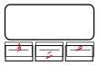

| $\text{عَظُمَ}$ | $\text{مَلِكٌ}$ | $\text{غُلِبَ}$ |
| :---: | :---: | :---: |
|  |  |  |

| $\text{مَعَدُ}$ | $\text{مَثَلٌ}$ | $\text{نُشِطَ}$ |
| :---: | :---: | :---: |
|  |  |  |

| $\text{حَسُنَ}$ | $\text{رُجِعَ}$ | $\text{يَتِمُ}$ |
| :---: | :---: | :---: |
|  |  |  |

 

| Karekoddan yarar- |
| :---: |
| lanarak Kontrol |
| Noktası'nın cevap |
| anahtarına ulaşa- |
| bilirsiniz. |
|  |
|  |
|  |
|  |

<!-- sayfa 37 -->

# 1.5. Sübhaneke Duası ve Rabbena Duaları ile Anlamları

**Konuya Başlarken** 

**insanlar niçin dua ederler? Düşüncelerinizi ifade ediniz.** 

Dua kelimesi sözlükte çağırmak, seslenmek, istemek ve yardım talep etmek anlamlarına gelir. Terim olarak ise müminlerin sevgi ve saygıyla Yüce Allah'a isteklerini ileterek O'ndan yardım dilemesidir.$^{21}$ <!-- KONTROL: Marker'da karşılığı yok, uydurma olabilir -->

Müslümanlar her türlü söz ve eylemlerinde Allah'ın (cc) rızasını gözetirler. Sadece zor zamanlarında değil hayatlarının her anında Allah'a (cc) dua ederek O'nu hatırlarında tutarlar. Yüce Allah "Kullarım sana, beni sorduğunda (söyle onlara): Ben çok yakınım. Bana dua ettiği vakit dua edenin dileğine karşılık veririm..."$^{22}$ <!-- KONTROL: Marker'da karşılığı yok, uydurma olabilir --> buyurarak kullarına yakın olduğunu ve kendisine dua edenlere mutlaka karşılık vereceğini bildirir.

Müslümanlar, Yüce Allah'a kulluk görevlerini yerine getirmek için ibadet ederler. Bu ibadetlerden biri olan namazda çeşitli dualar okurlar. Sübhaneke duası ve Rabbena duaları bunlardan bazılarıdır.

### 1.5.1. Sübhaneke Duası ve Anlamı

سُبْحَانَكَ اللَّهُمَّ وَبِحَمْدِكَ ۞ وَتَبَارَكَ اسْمُكَ ۞ وَتَعَالَى جَدُّكَ ۞ (وَجَلَّ ثَنَاؤُكَ) ۞ وَلَا إِلَهَ غَيْرُكَ

Sen eksik sıfatlardan uzaksın Allah'ım! Seni daima böyle tenzih eder ve sana hamt ederim. Senin adın mübarektir. İzzet ve celalin yücedir. (Senin şanın yücedir.) Senden başka ilah yoktur.

> Karekoddan yararlanarak Sübhaneke duası ile ilgili e-içeriğe ulaşabilirsiniz.
> [[QR KOD]]

Sübhaneke kelimesi, Arapça "tespih" kelimesiyle aynı kökten türemiştir. Tespih, Allah'ı (cc) her türlü eksiklikten uzak tutmak; O'nun, yüceliğine layık olmayan kusur ve noksanlıklardan uzak olduğuna kalpten inanmak ve bunu söz ile ifade etmek anlamlarına gelir.$^{23}$ <!-- KONTROL: Marker'da karşılığı yok, uydurma olabilir --> Kur'an-ı Kerim'deki bir ayette tespih "... Senden başka hiçbir ilah yoktur. Seni eksikliklerden uzak tutarım..."$^{24}$ <!-- KONTROL: Marker'da karşılığı yok, uydurma olabilir --> şeklinde ifade edilir. 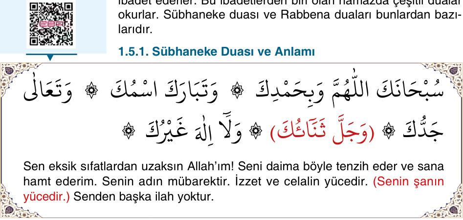

<!-- sayfa 38 -->

Sübhaneke, Hz. Muhammed'in (sav) sahaba- beye öğrettiği dualardandır. Hz. Peygamber her namazın başında tekbir aldıktan sonra Sübhaneke duasını okurdu.$^{25}$ <!-- KONTROL: Marker'da karşılığı yok, uydurma olabilir -->

Sübhaneke duasında övgüye en çok layık olanın Allah (cc) olduğu anlatılır. Müslümanlar bu dua ile Allah'ın (cc) yüceliği karşısında O'na olan teslimiyetlerini bildirirler. Yüce Allah'a olan sevgi, saygı ve bağlılıklarını ifade ederler (Görsel 1.4).

Sübhaneke duası Allah'tan (cc) başka ilahın olmadığını bildirerek sona erer. Bu ifade ile İslam'ın temel inanç esaslarından biri olan tevhit kavramı vurgulanır.

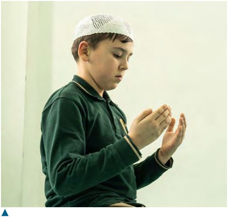
**Görsel 1.4:** *Sübhaneke, çocukların ilk öğrendiği ve ezberlediği dualardandır.*

**Bilgi Görseli 1.1:** Sübhaneke duasının okunduğu yerler

* **Sübhaneke Duası Nerelerde Okunur?**
    * Namazların ilk rekâtında Fatiha suresinden önce okunur.
    * İkindi namazının sünnetinde, üçüncü rekâtın başında Fatiha suresinden önce okunur.
    * Yatsı namazının ilk sünnetinde, üçüncü rekâtın başında Fatiha suresinden önce okunur.
    * Teravih namazı dört rekâtta bir selam verilerek kılınıyorsa üçüncü rekâtın başında Fatiha suresinden önce okunur.
    * Cenaze namazının birinci tekbirinden sonra "Ve celle senâük" ifadesi eklenerek okunur.

<!-- sayfa 39 -->

# 12. Etkinlik 🕒 30 dk. 👤

| | |
| :--- | :--- |
| **Adı** | Sübhaneke Duasının Anlamını Öğreniyorum |
| **Amaç** | Sübhaneke duasının anlamını kendi hayatı için anlamlı bir hâle getirebilme |

**Yönerge:** Aşağıdaki işlem adımlarını takip ederek etkinliği tamamlayınız.

**1. Adım:** Sübhaneke duasının anlamını okuyunuz.
**2. Adım:** Sübhaneke duasının anlamını kendi ifadelerinizle noktalı alana yazınız.
.............................................................................................................................................................
.............................................................................................................................................................
.............................................................................................................................................................

**3. Adım:** Müslümanların yaşamlarında Sübhaneke duasının yeri ve önemini sınıf arkadaşlarınızla konuşunuz.
**4. Adım:** Elde ettiğiniz bilgileri sınıf arkadaşlarınızla paylaşınız.

**Değerlendirme:** Yandaki karekodu kullanarak Öz Değerlendirme Formu'nu doldurunuz.

***

# 13. Etkinlik 🕒 30 dk. 👥

| | |
| :--- | :--- |
| **Adı** | Sübhaneke Duasını Ezberleyelim |
| **Amaç** | Sübhaneke duasını ezbere okuyabilme |

**1. Adım:** Sübhaneke duasının okunuşunu öğretmeninizden veya yandaki karekoddan dinleyiniz.

Karekoddan yararlanarak Sübhaneke duasının ezberlenmesi ile ilgili e-içeriğe ulaşabilirsiniz.

**2. Adım:** Dinlediğiniz her bölümü koro hâlinde tekrar ederek ezberleyiniz.
**3. Adım:** Ezberlediğiniz bu bölümleri birleştirerek duayı bütün olarak tekrar ediniz.
**4. Adım:** Ezberledikten sonra bu duayı tecvit kurallarına uygun bir şekilde öğretmeninize bireysel olarak okuyunuz.
**5. Adım:** Öğretmeninizin önerileri doğrultusunda Sübhaneke duasını ezberden tekrar ediniz.

**Değerlendirme:** Yandaki karekodu kullanarak Gözlem Formu'nu doldurunuz.

<!-- sayfa 40 -->

# 1.5.2. Rabbena Duaları ve Anlamları

> رَبَّنَا آتِنَا فِي الدُّنْيَا حَسَنَةً وَفِي الْآخِرَةِ حَسَنَةً وَقِنَا عَذَابَ النَّارِ
>
> Rabbimiz! Bize dünyada iyilik ver, ahirette de iyilik ver ve bizi ateş azabından koru. (Bakara suresi 201. ayet)
>
> رَبِّ اجْعَلْنِي مُقِيمَ الصَّلَاةِ وَمِنْ ذُرِّيَّتِي رَبَّنَا وَتَقَبَّلْ دُعَاءِ
>
> Rabbim! Beni ve soyumdan gelecek olanları namazı devamlı kılanlardan eyle. Rabbimiz, duamı kabul et. (İbrahim suresi 40. ayet)
>
> رَبَّنَا اغْفِرْ لِي وَلِوَالِدَيَّ وَلِلْمُؤْمِنِينَ يَوْمَ يَقُومُ الْحِسَابُ
>
> Rabbimiz! Hesap görülecek günde beni, ana babamı ve inananları bağışla. (İbrahim suresi 41. ayet)

Kur'an-ı Kerim'de yer alan dua ayetlerinden biri olan Rabbena Âtina, Hz. Muhammed'in (sav) sık sık tekrar ettiği dualardandır. Bu duada dünya ve ahiret hayatının birbiriyle bağlantılı olduğu vurgulanır. Bu bakımdan Müslümanların dünya ile ahiret arasında bir denge kurması gerekir.$^{26}$ <!-- KONTROL: Marker'da karşılığı yok, uydurma olabilir --> Kur'an-ı Kerim'de bu durum "Allah’ın sana verdiği şeylerde ahiret yurdunu ara. Dünyadan da nasibini unutma..."$^{27}$ <!-- KONTROL: Marker'da karşılığı yok, uydurma olabilir --> şeklinde ifade edilir.

Peygamberler de diğer insanlar gibi Yüce Allah'a dua etmişlerdir. Onların dualarından bazılarına Kur'an-ı Kerim'de yer verilmiştir. Bunlardan biri de İbrahim suresinin 40. ayeti olan Rabbicalni duasıdır. Hz. İbrahim, bu duada Yüce Allah'tan kendisinin ve sonraki nesillerinin namaz kılanlardan olmasını istemiştir.

Müslümanlar, Rabbenağfirli duasını okuyarak başta anne ve babaları olmak üzere tüm müminler için dua ederler. Manevi açıdan büyük bir değere sahip olan Rabbenağfirli aynı zamanda bir istiğfar duasıdır. İstiğfar sözlükte örtme, perdeleme, kirden, pastan korunma, bağışlanma ve af isteğinde bulunma anlamlarına gelir.$^{28}$ <!-- KONTROL: Marker'da karşılığı yok, uydurma olabilir --> Müslümanlar bu dua ile Allah'a (cc) samimi bir şekilde istiğfar ederler. Rabbenağfirli, Hz. İbrahim'in anne babası ve tüm inananlar için ettiği bir duadır.

Rabbena Âtina ve Rabbenağfirli duaları namazın son oturuş kısmında Tahiyyat, Salli ve Barik dualarından sonra okunur.

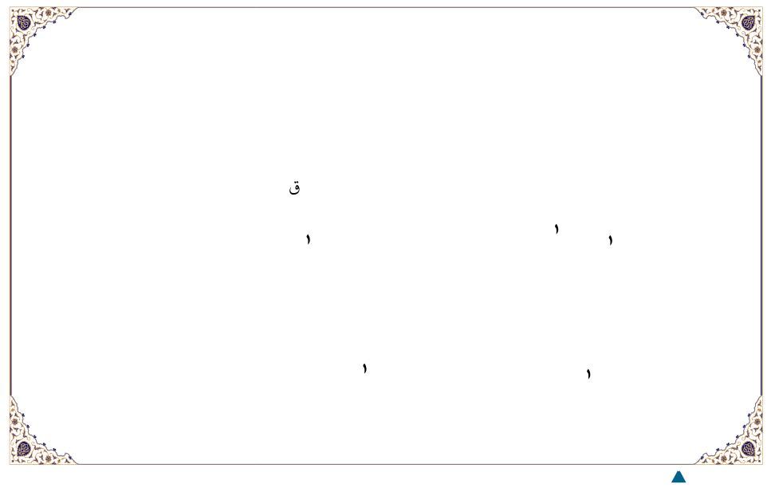
Karekoddan yararlanarak Rabbena duaları ile ilgili e-içeriğe ulaşabilirsiniz.

<!-- sayfa 41 -->

# 14. Etkinlik 🕒 30 dk. 👥

| Adı | Rabbimizden Neler İstiyoruz? |
| :--- | :--- |
| **Amaç** | Rabbena dualarının anlamlarını yorumlayabilme |

**Yönerge:** Aşağıdaki işlem adımlarını öğretmen rehberliğinde takip ederek etkinliği tamamlayınız.

**1. Adım:** Rabbena dualarında Yüce Allah'tan istenilenleri tespit ediniz.
**2. Adım:** Tespit ettiğiniz istekleri aşağıdaki tabloda verilen başlıkların altına yazınız.

| Rabbena Âtina Duasıyla İsteklerimiz | Rabbenağfirli Duasıyla İsteklerimiz | Rabbicalni Duasıyla İsteklerimiz |
| :--- | :--- | :--- |
| | | |

**3. Adım:** Hazırlanan tabloyu kontrol etmesi için öğretmeninize gösteriniz.
**4. Adım:** Öğretmeninizin önerileri doğrultusunda çalışmanızı tamamlayınız.

**Değerlendirme:** Öğrencilerin bu etkinlikle kazanması hedeflenen beceri ve davranışlar aşağıdaki Gözlem Formu ile değerlendirilecektir.

| Gözlem Formu | Geliştirilebilir | İyi | Çok İyi |
| :--- | :---: | :---: | :---: |
| 1. Duaların içeriğindeki temel istekleri doğru ve eksiksiz tespit edebilme | | | |
| 2. İstekleri, ilgili duanın altına doğru ve anlaşılır bir şekilde yazabilme | | | |
| 3. İmla ve dil kurallarına uygun yazabilme | | | |
| 4. Etkinlik yönerge ve adımlarına göre çalışmasını tamamlayabilme | | | |

<!-- sayfa 42 -->

# 15. Etkinlik 🕒 30 dk. 👤

| | |
| :--- | :--- |
| **Adı** | *Rabbena Dualarının Anlamını Öğreniyorum* |
| **Amaç** | *Rabbena dualarını kendi hayatı için anlamlı bir hâle getirebilme* |

**Yönerge:** Aşağıdaki işlem adımlarını takip ederek etkinliği tamamlayınız.

**1. Adım:** *Rabbena dualarının anlamını kendi ifadelerinizle noktalı alana yazınız.*
.......................................................................................................................................................
.......................................................................................................................................................
.......................................................................................................................................................

**2. Adım:** *Rabbena dualarının ne zaman ve hangi durumlarda okunduğunu noktalı alana yazınız.*
.......................................................................................................................................................
.......................................................................................................................................................
.......................................................................................................................................................

**Değerlendirme:** Yandaki karekodu kullanarak Öz Değerlendirme Formu'nu doldurunuz.

---

# 16. Etkinlik 🕒 30 dk. 👥

| | |
| :--- | :--- |
| **Adı** | *Rabbena Dualarını Ezberleyelim* |
| **Amaç** | *Rabbena dualarını ezberleyebilme* |

**1. Adım:** *Rabbena dualarının okunuşunu öğretmeninizden veya yandaki karekoddan dinleyiniz.*

**2. Adım:** *Dinlediğiniz her bölümü koro hâlinde tekrar ederek ezberleyiniz.*

**3. Adım:** *Ezberlediğiniz bu bölümleri birleştirerek duaları bütün olarak tekrar ediniz.*

**4. Adım:** *Duaları öğretmeninize tecvit kurallarına uygun biçimde bireysel olarak okuyunuz.*

**5. Adım:** *Öğretmeninizin önerileri doğrultusunda Rabbena dualarını ezberden tekrar ediniz.*

> Karekoddan yararlanarak Rabbena dualarının ezberlenmesi ile ilgili e-içeriğe ulaşabilirsiniz.
> 

**Değerlendirme:** Yandaki karekodu kullanarak Gözlem Formu'nu doldurunuz.

<!-- sayfa 43 -->

# Kontrol Noktası ✅

Aşağıdaki cümleler ile kavramları verilen örnekteki gibi eşleştiriniz.

| Cümleler | Harf | Kavramlar |
| :--- | :---: | :--- |
| Müslümanların dünya ve ahiret iyiliğini istediği duadır. | A | [ ] Rabbenağfirli |
| Namazların ilk rekâtında Fatiha suresinden önce okunan duadır. | B | [ ] Dua |
| Yüce Allah'a isteklerin iletilerek O'ndan yardım istenmesidir. | C | [ ] Rabbicalni |
| Hz. İbrahim'in Yüce Allah'tan kendisi ve sonraki nesillerinin namaz kılanlardan olması için ettiği duadır. | Ç | [ ] Sübhaneke |
| Müslümanların başta anne ve babaları olmak üzere tüm sevdikleri için ettikleri duadır. | D | [ ] Tespih |
| Allah'ı (cc) her türlü eksiklikten uzak tutarak O'nun yüceliğini ifade eden kavramdır. | E | [ ] İstiğfar |
| Yüce Allah'tan bağışlanma ve af isteğinde bulunma anlamına gelen kavramdır. | F | [A] Rabbena Âtina |
| | | [ ] Tevhit |

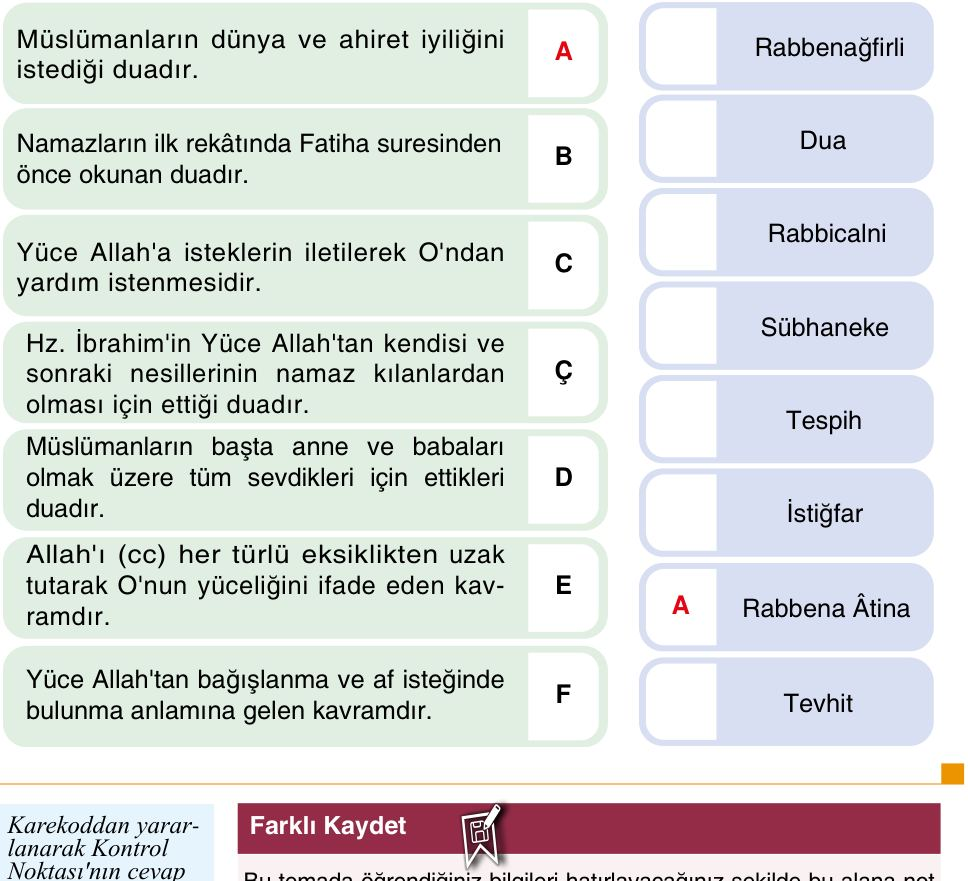

---

| Karekoddan yararlanarak Kontrol Noktası'nın cevap anahtarına ulaşabilirsiniz. | # Farklı Kaydet 📝 |
| :--- | :--- |
|  | Bu temada öğrendiğiniz bilgileri hatırlayacağınız şekilde bu alana not edebilirsiniz.   ......................................................................................................................................   ....................................................................................................................................   .....................................................................................................................................   ....................................................................................................................................   ....................................................................................................................................   .................................................................................................................................

<!-- sayfa 44 -->

# 1. Tema Ölçme ve Değerlendirme

Bu bölümde cevaplamanız için toplam 25 soru verilmiştir.

**Aşağıdaki açıklamaları okuyarak yargılar doğru ise "D" harfini, yanlış ise "Y" harfini işaretleyiniz.**

| | Açıklama | Cevap |
|---|---|---|
| 1. | Rabbena, Kur'an-ı Kerim'de yer alan dualardandır. | ( ) D   ( ) Y |
| 2. | Üstün, esre ve ötre harekeleri harflerin sessiz okunmasını sağlar. | ( ) D   ( ) Y |
| 3. | Namazda okunan dualardan biri de Sübhaneke'dir. | ( ) D   ( ) Y |
| 4. | Müslümanlar Kur'an-ı Kerim'e saygı gösterir. | ( ) D   ( ) Y |
| 5. | $\text{ب , ف , م , و}$ harfleri, boğaz harfleridir. | ( ) D   ( ) Y |

**Aşağıdaki kelimelerde hangi harekelerin bulunduğunu tespit ediniz. Hare- kelerle kelimeleri örnekteki gibi eşleştiriniz.**

| | | | |
|---|---|---|---|
| 6. | $\text{شُكِرَ}$ | | |
| 7. | $\text{عَوْجَ}$ | | |
| 8. | $\text{صَدَقَ}$ | | **A** |
| 9. | $\text{حَسَنَ}$ | | |
| 10. | $\text{حَسِبَ}$ | | |

 

| | |
|---|---|
| Üstün + Ötre + Esre | **A** |
| Ötre + Esre + Üstün | **B** |
| Üstün + Üstün + Esre | **C** |
| Üstün + Esre + Üstün | **Ç** |
| Esre + Üstün + Üstün | **D** |
| Üstün + Üstün + Ötre | **E** |

<!-- yer tutucu bulunamadı: sayfa sonuna eklendi -->

<!-- sayfa 45 -->

# Aşağıdaki cümlelerde boş bırakılan yerleri uygun sözcüklerle tamamlayınız.

* euzübesmele
* mahreç
* hareke
* ötre
* Rabbicalni
* esre

11. Kur'an-ı Kerim'i okumaya ........................... ile başlanır.
12. Harflerin ses yolundan çıktığı yerlere ........................... denir.
13. Harflerin ünlü olarak seslendirilmesine yardımcı olan işaretlere ........................... denir.
14. Hz. İbrahim ........................... duası ile Yüce Allah'tan kendisinin ve sonraki nesillerinin namaz kılanlardan olmasını istemiştir.
15. Harfin üstüne yazılan ve küçük bir $و$'a benzeyen işarete ........................... denir.

# Aşağıdaki çoktan seçmeli soruların doğru cevabını işaretleyiniz.

16. **Aşağıdakilerden hangisi Kur'an-ı Kerim'e duyulan saygının bir göstergesi değildir?**

A) Yüzünden okurken abdestli olmaya özen göstermek
B) Euzübesmele çekerek okumaya başlamak
C) Bel hizasından aşağıda tutmak
D) Okunurken saygı ve ilgiyle dinlemek

17. **Çıkış yerlerine göre harfler üç grupta incelenebilir.**
    I. Dil (diş/damak) harfleri
    II. Boğaz harfleri
    III. Dudak harfleri

    **Aşağıdakilerden hangisi bu gruplardan biri için örnek olamaz?**

A) ت ث د ذ س ش
B) ب ف م و

C) ا ح خ ع غ ه
D) خ ص ض ط ظ

18. **Aşağıdakilerin hangisinde "ن" harfinin ortada yazılış şekli doğru olarak verilmiştir?**

A) نَبَّدَ
B) سُنُّ
C) اَذَنْتُ
D) حَرَّنَا

<!-- sayfa 46 -->

**19.** I. Müslümanların sevgi ve saygıyla Yüce Allah’tan yardım dilemesidir.
II. Her türlü kötülükten Yüce Allah'a sığınıp yalnızca O'ndan yardım istemektir.
III. Allah'ı (cc) her türlü eksiklikten uzak tutarak O'nun yüceliğini sözlü olarak ifade etmektir.

**Aşağıdakilerden hangisinde bu ifadelere ait kavramlar verilmiştir?**

| | I | II | III |
| :--- | :--- | :--- | :--- |
| A) | İstiaze | Tespih | Mahreç |
| B) | Dua | Hareke | İstiaze |
| C) | Dua | İstiaze | Tespih |
| D) | Tespih | Mahreç | Dua |

**20.** Aşağıdakilerin hangisinde sadece ince harfler bulunmaktadır?

A) ب ,ج ,ف ,ك ,م
B) ت ,ض ,ط ,ل
C) خ ,ش ,ص ,ى
D) د ,ز ,ق ,و

***

**Aşağıdaki soruların cevaplarını noktalı alanlara yazınız.**

**21. Kur'an-ı Kerim'i kısaca tanıtınız.**
................................................................................................................................
................................................................................................................................
................................................................................................................................
................................................................................................................................

**22. Kur'an-ı Kerim'i öğrenmenin faydaları nelerdir? Açıklayınız.**
................................................................................................................................
................................................................................................................................
................................................................................................

<!-- sayfa 47 -->

23. İnsan hayatında duanın önemi nedir? Açıklayınız.
..................................................................................................................................
..................................................................................................................................
..................................................................................................................................
..................................................................................................................................
..................................................................................................................................

24. Sübhaneke duasında Yüce Allah'ı öven ifadeleri yazınız.
..................................................................................................................................
..................................................................................................................................
..................................................................................................................................
..................................................................................................................................
..................................................................................................................................

25. Rabbena dualarında Yüce Allah'tan istenilenler nelerdir? Verilen örnekteki gibi maddeler hâlinde yazınız.
1. Dünya hayatı için iyilikler istenir.
2. ................................................................................................................................
3. ................................................................................................................................
4. ................................................................................................................................
5. ................................................................................................................................
6. ................................................................................................................................

| Karekoddan yararlanarak tema ile ilgili daha fazla soruya ulaşabilirsiniz. |
| :---: |
|  |

<!-- sayfa 48 -->

# Sonnot

1. bk. "Kur'an-ı Kerim", *Dinî Terimler Sözlüğü*, 209.
2. bk. Müslim, Müsafirin, 252.
3. bk. Tirmizi, "Fezailü'l-Kur'an", 15.
4. bk. Nahl suresi 90. ayet.
5. bk. İsra suresi 23. ayet.
6. bk. Taha suresi 44. ayet.
7. bk. Duhan suresi 56. ayet; Gaşiye suresi 13. ayet; İnfitar suresi 19. ayet; Tarık suresi 9. ayet; Yunus suresi 45. ayet; Zümer suresi 70. ayet.
8. Bakara suresi 46. ayet.
9. Zilzal suresi 7-8. ayetler.
10. Fatır suresi 29. ayet.
11. Nahl suresi 98. ayet.
12. bk. "istiaze", *Dinî Terimler Sözlüğü*, 179.
13. Araf suresi 204. ayet.
14. bk. Ertem, "Elifbâ", 11/40-41.
15. bk. Salman vd., *Tecvidli Kur'an-ı Kerim Elif-bâ'sı*, 4.
16. bk. Durmuş, "Harf", 16/158.
17. bk. Polat vd., *Kur'an-ı Kerim Renkli Lugatı ve İrab Klavuzu*, 22-23.
18. bk. Kaya, *Tecvid Uygulamalı Kur'ân Okumayı Öğrenme Rehberi*, 29-31.
19. bk. Kaya, *Tecvid Uygulamalı Kur'ân Okumayı Öğrenme Rehberi*, 30-31.
20. bk. Kılıçaslan, *Kur’an Okuma & TECVİD Notları*, 57.
21. bk. Cilacı, "Dua", 9/529.
22. bk. Bakara suresi 186. ayet.
23. bk. "tespih", *Dinî Terimler Sözlüğü*, 362.
24. Enbiya suresi 87. ayet.
25. Ebu Davud, "Salat", 119-120.
26. bk. Özafşar vd., *Hadislerle İslam*, 3/626.
27. Kasas suresi 77. ayet.
28. bk. "istiğfar", *Dinî Terimler Sözlüğü*, 180.

Sonnot

<!-- sayfa 49 -->

# 2. TEMA
# KUR'AN-I KERİM'İ OKUMAYA GİRİŞ

2.1. Cezim ve Şedde
2.2. Tenvin
2.3. Tahiyyat Duası ve Anlamı

► Anahtar Kavramlar
* cezim
* rahmet
* sükûn
* şedde
* tahiyyat
* tenvin

► Bu temada sizden
* cezimi ve şeddeyi telaffuz edebilmeniz,
* tenvini telaffuz edebilmeniz,
* Tahiyyat duasının anlamını yorumlayıp bu duayı ezberden okuyabilmeniz

**beklenmektedir.**

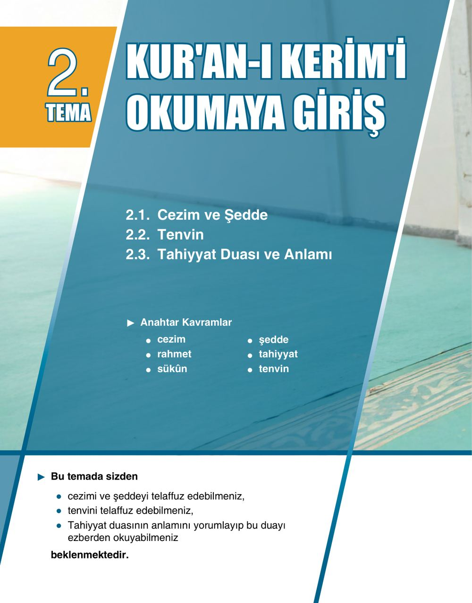
<!-- yer tutucu bulunamadı: sayfa sonuna eklendi -->

<!-- sayfa 50 -->

# Başlarken 🔗

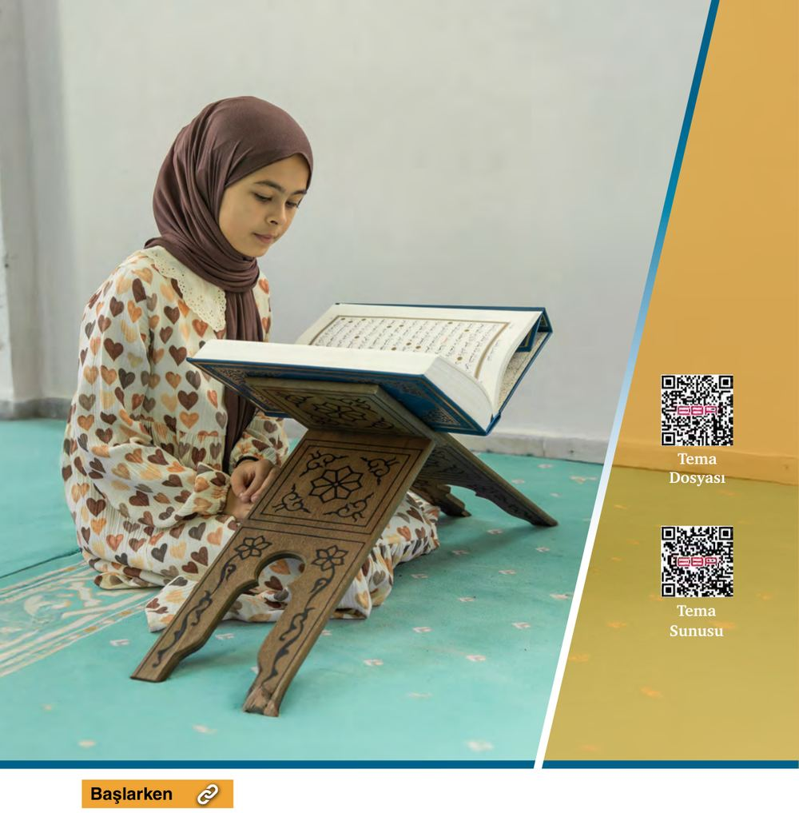

Bir metni doğru okuyabilmek ve anlayabilmek için o metnin yazıldığı dilin kuralların bilinmesi gerekir. Bunları bilmeden yapılan okumalarda hatalar ortaya çıkar. Kur'an-ı Kerim'i okurken de dikkat edilmesi gereken kurallar vardır. Bu kurallardan bir kısmı özel işaretlerle gösterilir. Bu işaretlerden biri olan tenvin ile üstün, esre ve ötre harekeleri arasında benzerlikler bulunur.

**Kur'an-ı Kerim'deki ayetleri oluşturan harflerde bazı özel işaretler sizce hangi nedenle kullanılmıştır? Düşüncelerinizi ifade ediniz.**

Namazlarda okunan duaların bazılarında Allah'ın (cc) varlığı ve birliği vurgulanır. Hz. Muhammed'e (sav) övgü ve selamlar iletilir.

**İçinde kelimeşehadetin geçtiği dualardan hangilerini biliyorsunuz?**

---

Tema Dosyası (QR Kod)
Tema Sunusu (QR Kod)

Tema Karekodu
Tema Sunusu
Tema Dosyası
Tema e-içeriğine ulaşmak için karekodu kullanınız.
Tema sunusuna ulaşmak için karekodu kullanınız.

<!-- sayfa 51 -->

# 2.1. Cezim ve Şedde

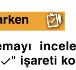

**Konuya Başlarken** 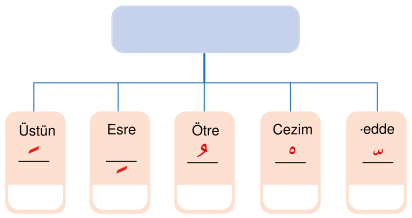

Aşağıdaki şemayı inceleyiniz. Şemadaki hareke ve işaretlerden bildiklerinize "✓" işareti koyunuz.

| Hareke ve Özel İşaretler |
| :---: |
| Üstün   ⎯  َ | Üstün   ⎯  َ | Ötre   ⎯  ُ | Cezim   ⎯  ْ | Şedde   ⎯  ّ |
| Esre   ⎯  ِ | | | | |

*(Not: Şema yapısı görseldeki hiyerarşiye göre düzenlenmiştir)*

Aşağıdaki kelimelerden okuyabildiklerinizin altındaki kutucukları işaretleyiniz.


### 2.1.1. Cezim

| | |
| :--- | :--- |
| | Harfin üstüne konan, yuvarlak ve küçük bir işarettir. |
| | Üzerinde bulunduğu harfi harekesiz okutur ve kendinden önceki harfe bağlar.$^1$ <!-- KONTROL: Marker'da karşılığı yok, uydurma olabilir --> |
| | Cezimli harf, "sakin harf" olarak da ifade edilir.$^2$ <!-- KONTROL: Marker'da karşılığı yok, uydurma olabilir --> |

<!-- sayfa 52 -->

# 1.Etkinlik
🕒 20 dk. 👥

**Adı:** Cezim İşareti Bulunan Harf ve Kelimelerin Okunuşunu Öğreniyorum
**Amaç:** Cezim işareti bulunan harf ve kelimeleri doğru bir şekilde telaffuz edebilme

**Yönerge:** Aşağıdaki işlem adımlarını takip ederek etkinliği tamamlayınız.
1. **Adım:** Aşağıdaki tabloda verilen harflerin okunuşunu öğretmeninizden dinleyiniz.
2. **Adım:** Dinlediğiniz bu harfleri koro hâlinde seslendiriniz. 
3. **Adım:** Öğretmeninizin aşağıdaki tablodan karışık olarak seçtiği cezimli ifadeleri bireysel olarak seslendiriniz. 

> Karekoddan yararlanarak harflerin seslendirilmesi ile ilgili e-içeriğe ulaşabilirsiniz.
> [[SEKIL:QR KOD]]

| ب | ت | ث | ج |
| :---: | :---: | :---: | :---: |
| اَبْ اِبْ اُبْ | اَتْ اِتْ اُتْ | اَثْ اِثْ اُثْ | اَجْ اِجْ اُجْ |

| ح | خ | د | ذ |
| :---: | :---: | :---: | :---: |
| اَحْ اِحْ اُحْ | اَخْ اِخْ اُخْ | اَدْ اِدْ اُدْ | اَذْ اِذْ اُذْ |

| ر | ز | س | ش |
| :---: | :---: | :---: | :---: |
| اَرْ اِرْ اُرْ | اَزْ اِزْ اُزْ | اَسْ اِسْ اُسْ | اَشْ اِشْ اُشْ |

| ص | ض | ط | ظ |
| :---: | :---: | :---: | :---: |
| اَصْ اِصْ اُصْ | اَضْ اِضْ اُضْ | اَطْ اِطْ اُطْ | اَظْ اِظْ اُظْ |

| ع | غ | ف | ق |
| :---: | :---: | :---: | :---: |
| اَعْ اِعْ اُعْ | اَغْ اِغْ اُغْ | اَفْ اِفْ اُفْ | اَقْ اِقْ اُقْ |

| ك | ل | م | ن |
| :---: | :---: | :---: | :---: |
| اَكْ اِكْ اُكْ | اَلْ اِلْ اُلْ | اَمْ اِمْ اُمْ | اَنْ اِنْ اُنْ |

| و | ه | ی | |
| :---: | :---: | :---: | :---: |
| اَوْ اِوْ اُوْ | اَهْ اِهْ اُهْ | اَیْ اَیْ اُیْ | |

<!-- sayfa 53 -->

▶️ 4. Adım: Aşağıdaki tabloda verilen kelimelerin okunuşunu öğretmeninizden dinleyiniz.

5. Adım: Öğretmeninizin aşağıdaki tablodan karışık olarak seçtiği kelimeleri bireysel olarak seslendiriniz.

6. Adım: Öğretmeninizin önerileri doğrultusunda kelimelerin okunuşunu tekrar ediniz.

| Karekoddan yararlanarak kelimelerin seslendirilmesi ile ilgili e-içeriğe ulaşabilirsiniz. |
| :---: |
|  |

| | | | | |
| :---: | :---: | :---: | :---: | :---: |
| إِذْ | بِرْ | مِنْ | قُمْ | كَيْ |
| تُزِغْ | يَتُبْ | تَخَفْ | يَلِدْ | فَلَو |
| أَنْتَ | رَيْبٌ | كَشَفَ | تِلْكَ | مِثْلُ |
| دَرَسَ | جِسْمٌ | شَهْرٌ | خَيْرٌ | عِلْمٌ |
| تُنْذِرُ | يُخْرِجُ | كُنْتُمْ | أَسْلِمْ | يَفْعَلْ |

                    

7. Adım: Bu kelimeleri telaffuz ederken dikkat edilmesi gereken durumları noktalı alana yazınız.

.......................................................................................................................................................

.......................................................................................................................................................

.......................................................................................................................................................

**Değerlendirme:** Yandaki karekodu kullanarak Öz Değerlendirme Formu'nu doldurunuz.
 

<!-- sayfa 54 -->

# 2.1.2. Şedde

| $\text{w}$ <!-- KONTROL: Marker'da karşılığı yok, uydurma olabilir --> | Şedde işareti, ters "m" şekline benzer ve harfin üstüne yazılır.    Üzerinde bulunduğu harfin iki defa okunmasını sağlar. Bunlardan birincisi cezimli, ikincisi kendi harekesi ile okunur.$^3$ <!-- KONTROL: Marker'da karşılığı yok, uydurma olabilir -->    Şedde bulunan harfte ayrıca üstün, esre veya ötre harekelerinden biri de yer alır. Şeddeli harf, kelimenin başında bulunmaz.$^4$ <!-- KONTROL: Marker'da karşılığı yok, uydurma olabilir --> |
| :--- | :--- |

## 2. Etkinlik ⏱️ 20 dk. 👥

**Adı:** Şedde İşareti Bulunan Harf ve Kelimelerin Okunuşunu Öğreniyorum  
**Amaç:** Şedde işareti bulunan harf ve kelimeleri doğru bir şekilde telaffuz edebilme

**Yönerge:** Aşağıdaki işlem adımlarını takip ederek etkinliği tamamlayınız.

1. **Adım:** Aşağıdaki tabloda verilen harflerin okunuşunu öğretmeninizden dinleyiniz.
2. **Adım:** Dinlediğiniz bu harfleri koro hâlinde seslendiriniz.
3. **Adım:** Öğretmeninizin aşağıdaki tablodan karışık olarak seçtiği şeddeli ifadeleri bireysel olarak seslendiriniz.

| | | | | | | | |
| :---: | :---: | :---: | :---: | :---: | :---: | :---: | :---: |
| $\text{أَبّ} = \text{أَبْ} + \text{بَ}$ | $\text{أَتّ} = \text{أَتْ} + \text{تَ}$ | $\text{أَثّ} = \text{أَثْ} + \text{ثَ}$ | $\text{أَجّ} = \text{أَجْ} + \text{جَ}$ |
| $\text{أَخّ} = \text{أَخْ} + \text{خَ}$ | $\text{أَحّ} = \text{أَحْ} + \text{حَ}$ | $\text{أَذّ} = \text{أَذْ} + \text{ذَ}$ | $\text{أَدّ} = \text{أَدْ} + \text{دَ}$ |
| $\text{أَزّ} = \text{أَزْ} + \text{زَ}$ | $\text{أَزْ} = \text{أَزْ} + \text{زَ}$ | $\text{أَشّ} = \text{أَشْ} + \text{شَ}$ | $\text{أَسّ} = \text{أَسْ} + \text{سَ}$ |
| $\text{أَضّ} = \text{أَضْ} + \text{ضَ}$ | $\text{أَطّ} = \text{أَطْ} + \text{طَ}$ | $\text{أَظّ} = \text{أَظْ} + \text{ظَ}$ | $\text{أَطّ} = \text{أَطْ} + \text{طَ}$ |
| $\text{أَقّ} = \text{أَقْ} + \text{قَ}$ | $\text{أَقْ} = \text{أَقْ} + \text{قَ}$ | $\text{أَغّ} = \text{أَغْ} + \text{غَ}$ | $\text{أَعّ} = \text{أَعْ} + \text{عَ}$ |
| $\text{أَنّ} = \text{أَنْ} + \text{نَ}$ | $\text{أَمّ} = \text{أَمْ} + \text{مَ}$ | $\text{أَلّ} = \text{أَلْ} + \text{لَ}$ | $\text{أَكّ} = \text{أَكْ} + \text{كَ}$ |
| $\text{أَوّْ} = \text{أَوْْ} + \text{وَ}$ | $\text{أَهّ} = \text{أَهْ} + \text{هَ}$ | $\text{أَيّْ} = \text{أَيْ} + \text{ىَ}$ | |

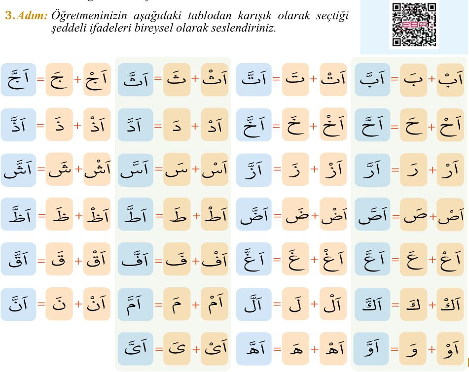
Karekoddan yararlanarak harflerin seslendirilmesi ile ilgili e-içeriğe ulaşabilirsiniz.

<!-- yer tutucu bulunamadı: sayfa sonuna eklendi -->

<!-- sayfa 55 -->

▶| 4. Adım: Aşağıdaki tabloda verilen kelimelerin okunuşunu öğretmeninizden dinleyiniz.

5. Adım: Öğretmeninizin aşağıdaki tablodan karışık olarak seçtiği kelimeleri bireysel olarak seslendiriniz.

6. Adım: Öğretmeninizin önerileri doğrultusunda kelimelerin okunuşunu tekrar ediniz. 

| | | | | |
| :---: | :---: | :---: | :---: | :---: |
| إِنَّ  | تَبَّ  | حَقٌّ  | كَفَّ  | مَدَّ  |
| رَبَّكَ  | قُوَّتَ  | حُجَّةً  | طَهُرَ  | فَضَّلَ  |
| يَدْعُ  | أُحِبُّ  | تَظُنُّ  | يَسُرُ  | تُحِسُّ  |
| إِنَّهُمْ  | رَبَّكُمْ  | نَفَرِقُ  | تُذَكِّرُ  | فُصِلَتْ  |
| تُكَلِّفُ  | حُرِمَتْ  | فحدثَ  | أُعِدَّتْ  | يَخْتَصُّ  |

> Karekoddan yararlanarak kelimelerin seslendirilmesi ile ilgili e-içeriğe ulaşabilirsiniz.
>  (QR Kod)

7. Adım: Bu kelimeleri telaffuz ederken dikkat edilmesi gereken durumları noktalı alana yazınız.
.......................................................................................................................................................
.......................................................................................................................................................
.......................................................................................................................................................

**Değerlendirme:** Yandaki karekodu kullanarak Öz Değerlendirme Formu'nu doldurunuz. 

<!-- sayfa 56 -->

# Çalışma Yaprağı

Aşağıdaki tabloda verilen kelimeleri cezim ve şedde işaretlerine dikkat ederek okuyunuz.
Yandaki karekoddan yararlanarak yazma içeriğine ulaşabilirsiniz.  

| | | | | |
| :---: | :---: | :---: | :---: | :---: |
| اَسْفَلَ | ظَهْرَكَ | اَذْكُرْ | تَنْهَرْ | يُصْلِحْ |
| يَنْقَلِبُ | كَيْدَهُمْ | مِثْلَيْهِمْ | يُمْدِدْكُمْ | يَغْفِرْ لَكُمْ |
| جَهَّزَ | سَخَّرَ | يَبُثُّ | تَوَدُّ | يَكُفُّ |
| مِمَّنْ | ثَبَّتَ | حَقَّتْ | قَدَّمَتْ | يُكَفِّرُ |
| يُبَيِّنُ | وَسَبِّحْ | يُعَظِّمُ | تُصَعِّرُ | طَلَّقْتُمْ |
| يَخْتَصُّ | تَسْوَدُّ | تَمَنَّوْنَ | فَتَوَكَّلْ | فَضَّلْتُكُمْ |
| يَذَّكَّرُ | يَشْفِقُ | ذُرِّيَّةَ | يَغُرُّنَّكَ | اَكْفِرَنَّ |

     

<!-- sayfa 57 -->

# Kontrol Noktası ✅

1. Aşağıdaki ifadeleri okuyunuz. İfadelerin doğru ya da yanlış olma durumuna göre yönlendirici okları takip ederek çıkışı işaretleyiniz.

2. Aşağıdaki kelimeleri hareke ve işaretlerine dikkat ederek okuyunuz. Cezimli kelimelerin yanına "C", şeddeli kelimelerin yanına "Ş", cezim ve şeddenin birlikte kullanıldığı kelimelerin yanına "CŞ" yazınız.

| | | | |
| :--- | :--- | :--- | :--- |
| يُحِبُّ | حُكْمَ | نِصْفُ | كَشَفَ |
| قُوَّتُ | كَسْمُكَ | حَمِدَكَ | سُنَّتِ |
| تَبَّتْ | عَدُوٌّ | رَبِّكُمْ | جَدُّكَ |

Karekoddan yararlanarak Kontrol Noktası'nın cevap anahtarına ulaşabilirsiniz.

<!-- sayfa 58 -->

# 2.2. Tenvin

**Konuya Başlarken** 

Aşağıda verilen işaretleri şekil yönünden hangi harekelere benzettiğinizi yanlarına yazınız.

| | | |
| :--- | :--- | :--- |
| İki Üstün $\text{\underline{\underline{\phantom{x}}}}$ <!-- KONTROL: Marker'da karşılığı yok, uydurma olabilir --> | İki Esre $\text{\underline{\underline{\phantom{x}}}}$ <!-- KONTROL: Marker'da karşılığı yok, uydurma olabilir --> | İki Ötre $\text{\underline{\underline{\phantom{x}}}}$ <!-- KONTROL: Marker'da karşılığı yok, uydurma olabilir --> |

Tenvin, harekenin sesine "n" sesi ilave eder. İki üstün ($\text{\underline{\underline{\phantom{x}}}}$ <!-- KONTROL: Marker'da karşılığı yok, uydurma olabilir -->), iki esre ($\text{\underline{\underline{\phantom{x}}}}$ <!-- KONTROL: Marker'da karşılığı yok, uydurma olabilir -->) veya iki ötre ($\text{\underline{\underline{\phantom{x}}}}$ <!-- KONTROL: Marker'da karşılığı yok, uydurma olabilir -->) şeklinde yazılır ve kelimelerin sonlarında bulunur.$^5$ <!-- KONTROL: Marker'da karşılığı yok, uydurma olabilir -->

## 2.2.1. İki Üstün

* Harfin üzerine konan, sol taraftan aşağı doğru hafif eğik, üst üste ve küçük çift çizgi şeklindedir.
* İnce harfleri "en", kalın harfleri "an" sesiyle okutur.
* $\text{ة}$ (yuvarlak te) dışındaki harflerde $\text{|}$ (elif) desteği ile birlikte yazılır.$^6$ <!-- KONTROL: Marker'da karşılığı yok, uydurma olabilir -->
  Örnek: $\text{بُكْرَةً - قَدْرًا}$

### 3. Etkinlik  ⏱️ 20 dk. 👥

**Adı:** Tenvin İşareti Bulunan Harf ve Kelimelerin Okunuşunu Öğreniyorum
**Amaç:** İki üstün işareti bulunan harf ve kelimeleri doğru bir şekilde telaffuz edebilme

**Yönerge:** Aşağıdaki işlem adımlarını takip ederek etkinliği tamamlayınız.

1. **Adım:** Aşağıdaki tabloda verilen tenvinli harflerin okunuşunu öğretmeninizden dinleyiniz.
2. **Adım:** Dinlediğiniz bu harfleri koro hâlinde seslendiriniz.
3. **Adım:** Öğretmeninizin aşağıdaki tablodan karışık olarak seçtiği iki üstünlü harfleri bireysel olarak seslendiriniz.

| | | | | | | |
| :---: | :---: | :---: | :---: | :---: | :---: | :---: |
| $\text{أً}$ | $\text{بًا}$ | $\text{تًا}$ | $\text{ثًا}$ | $\text{جًا}$ | $\text{حًا}$ | $\text{خًا}$ |
| $\text{دًا}$ | $\text{ذًا}$ | $\text{رًا}$ | $\text{زًا}$ | $\text{سًا}$ | $\text{شًا}$ | $\text{صًا}$ |
| $\text{ضًا}$ | $\text{طًا}$ | $\text{ظًا}$ | $\text{عً}$ | $\text{غً}$ | $\text{فً}$ | $\text{قًا}$ |
| $\text{كً}$ | $\text{لًا}$ | $\text{مًا}$ | $\text{نًا}$ | $\text{هًا}$ | $\text{وًا}$ | $\text{يً}$ |

<!-- sayfa 59 -->

▶️ 4. Adım: Aşağıdaki tabloda verilen kelimelerin okunuşunu öğretmeninizden dinleyiniz.

5. Adım: Öğretmeninizin aşağıdaki tablodan karışık olarak seçtiği kelimeleri bireysel olarak seslendiriniz.

6. Adım: Öğretmeninizin önerileri doğrultusunda kelimelerin okunuşunu bireysel olarak tekrar ediniz.

| Karekoddan yararlanarak kelimelerin seslendirilmesi ile ilgili e-içeriğe ulaşabilirsiniz. |
| :---: |
|  |

| عِوَجًا | صُحُفًا | مَلِكًا | طَمَعًا | وَهَنًا |
| :---: | :---: | :---: | :---: | :---: |
|  | | | | |

| يَوْمًا | جُزْءًا | بَعْضًا | رِجْزًا | فَتْحًا |
| :---: | :---: | :---: | :---: | :---: |
|  | | | | |

| رِزْقًا | قَوْلًا | شُكْرًا | عَبْدًا | نِصْفًا |
| :---: | :---: | :---: | :---: | :---: |
|  | | | | |

| اِذًا | حَقًّا | شَرًّا | سَدًّا | غَرًّا |
| :---: | :---: | :---: | :---: | :---: |
|  | | | | |

| كَوْكَبًا | شَجَرَةً | عَشِيَّةً | مُطَهَّرًا | مُتَوَفًّا |
| :---: | :---: | :---: | :---: | :---: |
|  | | | | |

7. Adım: Bu kelimeleri telaffuz ederken dikkat edilmesi gereken durumları noktalı alana yazınız.

.......................................................................................................................................................
.......................................................................................................................................................
.......................................................................................................................................................

**Değerlendirme:** Yandaki karekodu kullanarak Öz Değerlendirme Formu'nu doldurunuz.

<!-- sayfa 60 -->

# 2.2.2. İki Esre

Harfin altına konan, sol taraftan aşağı doğru hafif eğik, üst üste ve küçük çift çizgi şeklindedir.
İnce harfleri "in" sesiyle, kalın harfleri "in-ın" arası bir sesle okutur.$^7$ <!-- KONTROL: Marker'da karşılığı yok, uydurma olabilir -->
$$\text{بٍر - ظٍق}$$

## 4. Etkinlik  

| Adı | Tenvin İşareti Bulunan Harf ve Kelimelerin Okunuşunu Öğreniyorum |
| :--- | :--- |
| **Amaç** | İki esre işareti bulunan harf ve kelimeleri doğru bir şekilde telaffuz edebilme |

**Yönerge:** Aşağıdaki işlem adımlarını takip ederek etkinliği tamamlayınız.

1. **Adım:** Aşağıdaki tabloda verilen tenvinli harflerin okunuşunu öğretmeninizden dinleyiniz.
2. **Adım:** Dinlediğiniz bu harfleri koro hâlinde seslendiriniz.
3. **Adım:** Öğretmeninizin aşağıdaki tablodan karışık olarak seçtiği iki esreli harfleri bireysel olarak seslendiriniz.

> Karekoddan yararlanarak harflerin seslendirilmesi ile ilgili e-içeriğe ulaşabilirsiniz.
> [[SEKIL:QR KOD]]

| | | | | | | |
| :---: | :---: | :---: | :---: | :---: | :---: | :---: |
| $\text{اٍ}$ | $\text{بٍ}$ | $\text{تٍ}$ | $\text{ثٍ}$ | $\text{جٍ}$ | $\text{حٍ}$ | $\text{خٍ}$ |
| $\text{دٍ}$ | $\text{ذٍ}$ | $\text{رٍ}$ | $\text{زٍ}$ | $\text{سٍ}$ | $\text{شٍ}$ | $\text{صٍ}$ |
| $\text{ضٍ}$ | $\text{طٍ}$ | $\text{ظٍ}$ | $\text{عٍ}$ | $\text{غٍ}$ | $\text{فٍ}$ | $\text{قٍ}$ |
| $\text{كٍ}$ | $\text{لٍ}$ | $\text{مٍ}$ | $\text{نٍ}$ | $\text{وٍ}$ | $\text{هٍ}$ | $\text{ىٍ}$ |

<!-- sayfa 61 -->

▶| 4. Adım: Aşağıdaki tabloda verilen kelimelerin okunuşunu öğretmeninizden dinleyiniz.

5. Adım: Öğretmeninizin aşağıdaki tablodan karışık olarak seçtiği kelimeleri bireysel olarak seslendiriniz.

6. Adım: Öğretmeninizin önerileri doğrultusunda kelimelerin okunuşunu tekrar ediniz.

| | | | | |
| :---: | :---: | :---: | :---: | :---: |
| عَوْجٌ | لَهَبٌ | حَسَنٌ | مَسَدٍ | كُتُبٌ |
| قَوْمٌ | كَنْزٌ | شَهْرٌ | شَيْءٌ | بَيْعٌ |
| شَرٌّ | أُفٍ | شَكٌّ | ضُرٌّ | أُمٌّ |
| قُوَّةٌ | بِحَقٍّ | عُتُوٌّ | شَدٌّ | نَبِيٌّ |
| هُمَزَةٌ | مُحَبَّةٌ | قُرَيْشٌ | كَصِيبٍ | تَفَكُّرْ |

7. Adım: Bu kelimeleri telaffuz ederken dikkat edilmesi gereken durumları noktalı alana yazınız.

.......................................................................................................................................................
.......................................................................................................................................................
.......................................................................................................................................................

**Değerlendirme:** Yandaki karekodu kullanarak Öz Değerlendirme Formu'nu doldurunuz.

<!-- sayfa 62 -->

# 2.2.3. İki Ötre

Harfin üzerine konur ve şapkalı vav şeklindedir.
İnce harfleri "ün-un" arası bir sesle, kalın harfleri "un" sesiyle okutur.$^8$ <!-- KONTROL: Marker'da karşılığı yok, uydurma olabilir -->
İki ötre, "◌ٌ" şeklinde de kullanılabilir.
Örnek: $\text{بَشَرٌ - قَلَمٌ}$

## 5. Etkinlik 🕒 20 dk. 

| Adı | Tenvin İşareti Bulunan Harf ve Kelimelerin Okunuşunu Öğreniyorum |
| :--- | :--- |
| **Amaç** | İki ötre işareti bulunan harf ve kelimeleri doğru bir şekilde telaffuz edebilme |

**Yönerge:** Aşağıdaki işlem adımlarını takip ederek etkinliği tamamlayınız.

1. **1. Adım:** Aşağıdaki tabloda verilen tenvinli harflerin okunuşunu öğretmeninizden dinleyiniz.
2. **2. Adım:** Dinlediğiniz bu harfleri koro hâlinde seslendiriniz.
3. **3. Adım:** Öğretmeninizin aşağıdaki tablodan karışık olarak seçtiği iki ötreli harfleri bireysel olarak seslendiriniz. 

| | | | | | | |
| :---: | :---: | :---: | :---: | :---: | :---: | :---: |
| $\text{أٌ}$ | $\text{بٌ}$ | $\text{تٌ}$ | $\text{ثٌ}$ | $\text{جٌ}$ | $\text{حٌ}$ | $\text{خٌ}$ |
| $\text{دٌ}$ | $\text{ذٌ}$ | $\text{رٌ}$ | $\text{زٌ}$ | $\text{سٌ}$ | $\text{شٌ}$ | $\text{صٌ}$ |
| $\text{ضٌ}$ | $\text{طٌ}$ | $\text{ظٌ}$ | $\text{عٌ}$ | $\text{غٌ}$ | $\text{فٌ}$ | $\text{قٌ}$ |
| $\text{كٌ}$ | $\text{لٌ}$ | $\text{مٌ}$ | $\text{نٌ}$ | $\text{هٌ}$ | $\text{وٌ}$ | $\text{ىٌ}$ |

<!-- sayfa 63 -->

▶️ 4. **Adım:** Aşağıdaki tabloda verilen kelimelerin okunuşunu öğretmeninizden dinleyiniz.

5. **Adım:** Öğretmeninizin aşağıdaki tablodan karışık olarak seçtiği kelimeleri bireysel olarak seslendiriniz.

6. **Adım:** Öğretmeninizin önerileri doğrultusunda kelimelerin okunuşunu tekrar ediniz.

| | | | | |
| :---: | :---: | :---: | :---: | :---: |
| مَرَضٌ | فَرِحٌ | رُسُلٌ | كُتُبٌ | عَيْنٌ |
| رِزْقٌ | اِنْسٌ | مِسْكٌ | عُمْيٌ | رِجْسٌ |
| عَرْشٌ | زَيْغٌ | خَلْفٌ | جُزْءٌ | اُخْتٌ |
| شَكٌّ | صِرٌ | حُبٌّ | صُمٌّ | كُلٌّ |
| مُخْرِجٌ | مَسْجِدٌ | قَيِّمَةٌ | مُحَمَّدٌ | مُصَرِّفٌ |

> Karekoddan yararlanarak kelimelerin seslendirilmesi ile ilgili e-içeriğe ulaşabilirsiniz.
> 

7. **Adım:** Bu kelimeleri telaffuz ederken dikkat edilmesi gereken durumları noktalı alana yazınız.

.......................................................................................................................................................
.......................................................................................................................................................
.......................................................................................................................................................

**Değerlendirme:** Yandaki karekodu kullanarak Öz Değerlendirme Formu'nu doldurunuz.

<!-- yer tutucu bulunamadı: sayfa sonuna eklendi -->

<!-- yer tutucu bulunamadı: sayfa sonuna eklendi -->

<!-- yer tutucu bulunamadı: sayfa sonuna eklendi -->

<!-- sayfa 64 -->

# Çalışma Yaprağı

**Aşağıdaki tabloda verilen kelimeleri tenvin işaretlerine dikkat ede-rek okuyunuz.** 

Yandaki karekoddan yararlanarak yazma içeriğine ulaşabilirsiniz. 

| | | | | |
| :---: | :---: | :---: | :---: | :---: |
| سَفَهًا | عَبَثًا | مَلِكًا | شَطَطًا | شُيُخًا |
| صُبْحًا | شَهْرًا | فَظًّا | بَسًّا | اَعْجَمِيًّا |
| جُرُفٍ | فُرُشٍ | بُرُجٍ | بَيْتٍ | يَوْمَئِذٍ |
| حِزْبٍ | نَقْصٍ | غِلٍّ | عِزٍّ | تُبَّعٌ |
| ظَمَأً | قَسَمٌ | مَرَضٌ | فَرَحٌ | نُزُلٌ |
| لَهْوٌ | دُرٌّ | وَصَدٌّ | هَيِّنٌ | عَرَبِيٌّ |
| فَوَيْلٌ | كَعَصْفٍ | مُصَدِّقٌ | قِرَدَةً | مُّمَدَّدَةً |

    

<!-- sayfa 65 -->

# Kontrol Noktası ✅

Aşağıdaki ifadeleri ve işaretleri inceleyiniz. Cezim, şedde ve tenvin işaretlerine dikkat ederek ifadelerle işaretleri örnekteki gibi eşleştiriniz.

| Sol Sütun | No | Orta Sütun | Sağ Sütun |
| :--- | :---: | :--- | :---: |
| $\text{فَهْمٌ}$ | 1 | **1**   Cezim | $\square$ $\text{قَوْلٌ}$ |
| $\text{أُحِلَّتْ}$ | $\square$ | **2**   Şedde | $\square$ $\text{أَبْلُغُكُمْ}$ |
| $\text{فَضْلًا}$ | $\square$ | **3**   Tenvin | $\square$ $\text{تُعَسِّرُ}$ |
| $\text{سَحَرٌ}$ | $\square$ | **4**   Şedde + Cezim | $\square$ $\text{بَغْتَةً}$ |
| $\text{قَوْمٍ}$ | $\square$ | **5**   Şedde + Tenvin | $\square$ $\text{لَعَلَّهُمْ}$ |
| $\text{رَبِّكُمْ}$ | $\square$ | **6**   Cezim + Tenvin | $\square$ $\text{بِشَيْءٍ}$ |
| $\text{جِسْمٌ}$ | $\square$ | | $\square$ $\text{إِلَيْهِ}$ |
| $\text{يُكَذِّبُ}$ | $\square$ | | $\square$ $\text{أَحَدًا}$ |
| $\text{لَهَبٌ}$ | $\square$ | | $\square$ $\text{لَهَبٌ}$ |
| $\text{أَبَدًا}$ | $\square$ | | $\square$ $\text{مِنْهُمْ}$ |

Karekoddan yarar-
lanarak Kontrol
Noktası'nın cevap
anahtarına ulaşa-
bilirsiniz.

<!-- sayfa 66 -->

| Performans Görevi |
| :--- |
| **Amaç:** Cezim, şedde ve tenvin işaretleri hakkında bilgi veren bir poster hazırlayabilme | **Görev:** Yönergede belirtilen işlem adımlarını takip ederek bir poster hazırlayıp sunma |
| **Beceriler**   • Ayırt etme   • Yazma | **Süre**   • Hazırlık: 1 hafta   • Sınıf içi: 1 ders saati |
| **Ürün:** Poster |
| **Puanlama Yöntemi:** Dereceli Puanlama Anahtarı ve Öz Değerlendirme Formu |
| **Yönerge:** Aşağıdaki işlem adımlarını takip ederek azimli ve kararlı bir şekilde performans görevini tamamlayınız.    1. Resim kâğıdına farklı Kur'an-ı Kerim harfleri yazınız.   2. Üstün harekeli bir elif harfi yazınız. Bunun yanına yazdığınız diğer harfin üzerine cezim, şedde, iki üstün, iki esre ve iki ötre işaretlerinden birini ekleyiniz. Her bir işaret için farklı renkte kalemler kullanınız.   3. Kullandığınız işaretleri tanıtan bilgiyi harflerin yanına ekleyiniz.   4. Hazırlanan posterleri öğretmeninize sununuz ve sınıf panosunda sergileyiniz. |
| **Değerlendirme Ölçütleri:** Bu çalışmada ortaya koyduğunuz ürün; görsel tasarım, doğruluk, hedef kitleye uygunluk ve özgünlük ölçütlerine göre değerlendirilecektir.    • Yönergede istenen tüm maddelere yer verilmelidir.   • Hazırlanan poster sınıf panosunda sergilenmelidir. |
| Bu performans görevi aşağıdaki karekodlarda verilen Dereceli Puanlama Anahtarı ve Öz Değerlendirme Formu ile değerlendirilecektir. |

| Karekoddan yararlanarak Dereceli Puanlama Anahtarı'na ulaşabilirsiniz.    | Karekoddan yararlanarak Öz Değerlendirme Formu'na ulaşabilirsiniz.    |
| :--- | :--- |

<!-- sayfa 67 -->

# 2.3. Tahiyyat Duası ve Anlamı

**Konuya Başlarken**

Tahiyyat duasında geçen bazı kavramlar aşağıda verilmiştir. Bu kavramlardan bildiklerinizin altındaki kutucuğa "$\checkmark$" işareti koyunuz.

| Kelimeişehadet | Salavat | Selam | Rahmet |
| :---: | :---: | :---: | :---: |
| [ ] | [ ] | [ ] | [ ] |

> Karekoddan yararlanarak Tahiyyat duası ile ilgili e-içeriğe ulaşabilirsiniz.
> [[QR KOD]]

  
  التَّحِيَّاتُ لِلّٰهِ وَالصَّلَوَاتُ وَالطَّيِّبَاتُ ۞ اَلسَّلَامُ عَلَيْكَ أَيُّهَا النَّبِيُّ وَرَحْمَةُ اللّٰهِ وَبَرَكَاتُهُ ۞ اَلسَّلَامُ عَلَيْنَا وَعَلٰى عِبَادِ اللّٰهِ الصَّالِح۪ينَ ۞ أَشْهَدُ أَنْ لَآ إِلٰهَ إِلَّا اللّٰهُ ۞ وَأَشْهَدُ أَنَّ مُحَمَّدًا عَبْدُهُ وَرَسُولُهُ ۞

  Bütün yüceltmeler (tazim), övgüler ve dualar, bütün ibadetler Allah'a mahsustur. Sana selam olsun Ey Peygamber! Allah'ın rahmeti ve bereketi üzerine olsun. Selam bize ve Allah'ın salih kulları üzerine olsun. Şahitlik ederim ki Allah'tan başka ilah yoktur ve şahitlik ederim ki Muhammed, Allah'ın kulu ve Resulü'dür.
  
  (Buhari, Ezân, 148)

Tahiyyat duası, Hz. Muhammed'in (sav) Miraç Gecesi'nde Allah (cc) ile selamlaşmasını konu edinir. Bu manevi hitapta Hz. Peygamber, Allah'a (cc) tahiyyat ve salavat ifadeleri ile tazimde bulunmuştur. Yüce Allah da Peygamber Efendimiz'e selam, rahmet ve bereket ile karşılık vermiştir. Bunun üzerine Hz. Muhammed (sav), selamın kendisi ile birlikte Allah'ın (cc) salih kullarının üzerine olmasını temenni etmiştir. Daha sonra bütün melekler Allah'tan (cc) başka ilah olmadığına ve Hz. Muhammed'in (sav) O'nun kulu ve elçisi olduğuna şehadet...

<!-- sayfa 68 -->

Selam kelimesi Kur'an-ı Kerim'de bazen "tahiyye" kelimesiyle ifade edilir. Tahiyye, selamlama, sağlık ve esenlik temennisi, Allah'tan (cc) hayırlı ömür dileme anlamlarına gelir. Selamlaşma duası olan Tahiyyat ile Müslümanlar, Allah'a (cc) saygılarını sunarlar. Hz. Peygamber'e selam ve bağlılıklarını bildirirler. Tahiyyat duasını okuyarak Miraç Gecesi'nin hatırasını yaşarlar. Allah'ın (cc), kendilerine ve salih kullara rahmetle yaklaşmasını isterler.$^{10}$ <!-- KONTROL: Marker'da karşılığı yok, uydurma olabilir --> **Rahmet;** sevgi, şefkat, merhamet, bütün varlıkların iyiliğini arzu etme ve onlara her türlü yardımda bulunma isteğidir.$^{11}$ <!-- KONTROL: Marker'da karşılığı yok, uydurma olabilir --> Allah'ın (cc) kullarına sevgi, şefkat ve merhametle muamele etmesidir. Kul; Allah'ın (cc) yarattığı, O'na inanan ve O'na ibadet etmekle sorumlu olan insandır.$^{12}$ <!-- KONTROL: Marker'da karşılığı yok, uydurma olabilir --> Tahiyyat duası Allah'a (cc) kulluğu ifade eder. Aynı zamanda Hz. Peygamberin Allah'ın (cc) elçisi olduğundan bahseder. Elçi (resul) ise Allah'ın (cc) emir ve yasaklarını insanlara bildirmek üzere seçtiği peygamber demektir.$^{13}$ <!-- KONTROL: Marker'da karşılığı yok, uydurma olabilir -->

Hz. Muhammed (sav), namazlarda Tahiyyat duasının okunmasını istemiştir (Görsel 2.1). O, bu durumu "Sizden biriniz namaz kılarken son oturuşa geldiğinde Allah'a hamd ve sena (tahiyyat) ile başlasın. Ardından Peygamber'e salat ve selam getirsin..."$^{14}$ <!-- KONTROL: Marker'da karşılığı yok, uydurma olabilir --> sözleriyle ifade etmiştir. Hz. Peygamber, Tahiyyat duasını, Kur'an-ı Kerim'den bir sure öğretir gibi sahabeye öğretmiştir.$^{15}$ <!-- KONTROL: Marker'da karşılığı yok, uydurma olabilir -->

**Görsel 2.1:** Tahiyyat, namazların oturuşlarında okunan bir duadır.

---

# 6. Etkinlik 🕒 15 dk. 👤

| Adı | Tahiyyat Duasının Anlamını Öğreniyorum |
| :--- | :--- |
| **Amaç** | Tahiyyat duasının anlamını bağlamından koparmadan kendi cümleleriyle ifade edebilme |

**Yönerge:** Aşağıdaki işlem adımlarını takip ederek etkinliği tamamlayınız.

**1. Adım:** "Tahiyyat, salavat, selam, rahmet, bereket, kul ve elçi" kavramlarını araştırınız.

**2. Adım:** Araştırdığınız kavramlardan yararlanarak Tahiyyat duasından anladıklarınızı kendi ifadelerinizle noktalı alana yazınız.
.............................................................................................................................................................
.............................................................................................................................................................
.............................................................................................................................................................

**Değerlendirme:** Tahiyyat duasında en çok hangi ifadeler dikkatinizi çekti? Nedenleriyle birlikte noktalı alana yazınız.
.............................................................................................................................................................
.............................................................................................................................................................
.............................................................................................................................................................
.............................................................................................................................................................

<!-- sayfa 69 -->

# 7. Etkinlik
🕒 20 dk. 👥

| Adı | Tahiyyat Duasını Anlıyorum |
| :--- | :--- |
| **Amaç** | Tahiyyat duasında geçen "rahmet" ve "tahiyyat" kavramlarını yorumlayabilme |

**Yönerge:** Aşağıdaki işlem adımlarını takip ederek etkinliği tamamlayınız.

**1. Adım:** Öğretmen rehberliğinde iki gruba ayrılınız.
**2. Adım:** Birinci grup olarak rahmet kavramının, ikinci grup olarak tahiyyat kavramının anlamını araştırınız.
**3. Adım:** Araştırmalarınızdan hareketle aşağıdaki görevleri tamamlayınız.

| | Rahmet Grubu | Tahiyyat Grubu |
| :--- | :--- | :--- |
| **Görev 1**   Kavramın ne anlama geldiğini yazınız. | | |
| **Görev 2**   Kavramın hayatınızdaki yeri ile ilgili örnek veriniz. | | |
| **Görev 3**   Kavramı anlatan kısa bir slogan yazınız. | | |

**4. Adım:** Yazdıklarınızı öğretmen rehberliğinde sınıfta sununuz.

**Değerlendirme:** Yandaki karekodu kullanarak *Grup Değerlendirme Formu*'nu doldurunuz.

<!-- sayfa 70 -->

# 8. Etkinlik 🕒 40 dk. 👥

**Adı:** Tahiyyat Duasını Ezberleyelim
**Amaç:** Tahiyyat duasını ezberleyebilme

**Yönerge:** Aşağıdaki işlem adımlarını takip ederek etkinliği tamamlayınız.

1. **Adım:** Tahiyyat duasının okunuşunu öğretmeninizden veya yandaki karekoddan dinleyiniz.
2. **Adım:** Dinlediğiniz her bölümü koro hâlinde tekrar ederek ezberleyiniz.

3. **Adım:** Ezberlediğiniz bölümleri birleştirerek duayı bütün olarak tekrar ediniz.
4. **Adım:** Duayı öğretmeninize tecvit kurallarına uygun biçimde bireysel olarak okuyunuz.
5. **Adım:** Öğretmeninizin önerileri doğrultusunda Tahiyyat duasını ezberden tekrar ediniz.

**Değerlendirme:** Öğrencilerin bu etkinlikle kazanması hedeflenen beceri ve davranışlar aşağıdaki Gözlem Formu ile değerlendirilecektir.

| Gözlem Formu | Geliştirilebilir | İyi | Çok İyi |
| :--- | :---: | :---: | :---: |
| 1. Dinlediği bölümleri doğru telaffuzla, koro içinde aktif olarak tekrar edebilme | | | |
| 2. Duayı bölümler hâlinde hatasız ezberleyebilme | | | |
| 3. Ezberlediği bölümleri birleştirerek duayı bütün olarak doğru ve akıcı okuyabilme | | | |
| 4. Öğretmenine bireysel olarak okurken doğru ve akıcı bir şekilde ezbere okuyabilme | | | |
| 5. Harflerin çıkış yerlerine (mahreç) ve telaffuzuna dikkat edebilme | | | |
| 6. Duayı duraksamadan, ritmik ve akıcı bir şekilde okuyabilme | | | |

> Karekoddan yararlanarak Tahiyyat duasının ezberlenmesi ile ilgili e-içeriğe ulaşabilirsiniz.

<!-- sayfa 71 -->

# Kontrol Noktası ✅

1. Tahiyyat duasının anlamını kendi cümlelerinizle yazınız.
.................................................................................................................................
.................................................................................................................................
.................................................................................................................................

2. Tahiyyat duasının namazın hangi bölümünde okunduğunu yazınız.
.................................................................................................................................
.................................................................................................................................

3. Aşağıdaki cümlelerde boş bırakılan yerleri kutucuklarda verilen uygun sözcüklerle tamamlayınız.

| Muhammed | salih | selam | ilah |
| :---: | :---: | :---: | :---: |
| Allah | şehadet | saygı | söz |

"Selam, .................... ve en güzel sözler .................... içindir. Ey Peygamber! Allah’ın selamı, rahmeti ve bereketi senin üzerine olsun. Bizlere ve Allah'ın ..................... kullarına da ..................... olsun. Ben .................. ederim ki Allah'tan başka ..................... yoktur. Yine şehadet ederim ki .................., O'nun kulu ve elçisidir."

---

| Karekoddan yararlanarak Kontrol Noktası'nın cevap anahtarına ulaşabilirsiniz. | **Farklı Kaydet** 🗒️ |
| :--- | :--- |
| ![QR Code] | Bu temada öğrendiğiniz bilgileri hatırlayacağınız şekilde bu alana not edebilirsiniz. |
| | .................................................................................................................................... |
| | .................................................................................................................................... |
| | .................................................................................................................................... |
| | .................................................................................................................................... |
| | .................................................................................................................................... |
| | .................................................................................................................................... |
| | .................................................................................................................................... |

<!-- yer tutucu bulunamadı: sayfa sonuna eklendi -->

<!-- yer tutucu bulunamadı: sayfa sonuna eklendi -->

<!-- sayfa 72 -->

# 2. Tema Ölçme ve Değerlendirme

Bu bölümde cevaplamanız için toplam 26 soru verilmiştir.

Aşağıda Tahiyyat duasıyla ilgili bilgi grafiği verilmiştir.

| Tahiyyat Duasıyla İlgili Bilgiler | Tahiyyat, Hz. Muhammed'in (sav) Miraç Gecesi'nde Yüce Allah ile yaptığı selamlaşmadır. Namazlarda ilk ve son oturuşta okunan bir duadır. Bu duada rahmet, bereket ve esenlik kavramları geçer. Müslümanlar Tahiyyat duasını okuduklarında Allah'ı (cc) ve bütün salih kulları selamlamış olurlar. |
| :--- | :--- |
| **Tahiyyat Duasındaki Konular** | Allah'a (cc) hamt ve övgü, Hz. Peygamber'e dua, iman, salat ve selam konularına yer verilir. |
| **Tahiyyat Duasının Verdiği Mesajlar** | Allah'ın (cc) yüceliği ve O'nun her türlü övgüye layık olduğu anlatılır. Hz. Peygamber'e olan sevgi ve saygı ifade edilir. Her türlü dua ve senanın, bedenî ve mali ibadetlerin Allah'a (cc) mahsus olduğu belirtilir. |

Bu bilgi grafiğine göre aşağıdaki ifadelerden hangilerine ulaşılabilir? İşaretleyiniz.

| | | |
| :--- | :--- | :--- |
| 1. | Tahiyyat duası, Müslümanların Allah'a (cc) dua etmeleri ve O'ndan istekte bulunmaları için bir fırsattır. | |
| 2. | Tahiyyat duasında Allah'ın (cc) tek ilah olduğu vurgulanır. | |
| 3. | Tahiyyat duası Yüce Allah ile melekler arasında geçen bir konuşmadır. | |
| 4. | Tahiyyat duasında Hz. Peygamber'in Kadir Gecesi'nde Cebrail ile konuşması anlatılır. | |
| 5. | Dua ve ibadetler yalnızca Allah (cc) için yapılır. | |
| 6. | Tahiyyat duasıyla Hz. Muhammed'e (sav) olan saygı ve sevgi ifade edilir. | |
| 7. | Tahiyyat duasında Allah'ın (cc) kullarını koruyup gözeten olduğu bilgisi | |

<!-- sayfa 73 -->

# Aşağıdaki soruları tablo üzerinde cevaplayınız.

Aşağıdaki cümleler ile kavramları verilen harflerle eşleştirerek doğru harfi açık-lamanın yanındaki kutucuğa yazınız.

| | | | | | | | |
| :--- | :--- | :--- | :--- | :--- | :--- | :--- | :--- |
| 8. | Harfin altına konan, sol taraftan aşağı doğru eğik, üst üste, küçük çift çizgidir. | | | Cezim | A | | |
| 9. | Harfin üzerine konan, şapkalı vav şekline ben-zeyen bir işarettir. | | | İki üstün | B | | |
| 10. | Harfin üzerine küçük bir daire şeklinde yazılan işarettir. | | | İki ötre | C | | |
| 11. | Harfin üzerine konan, sol taraftan aşağı doğru eğik, üst üste, küçük çift çizgidir. | | | Şedde | Ç | | |
| 12. | Harfin üzerine konan ve ters "m" şekline ben-zeyen küçük bir işarettir. | | | İki esre | D | | |
| | | | | Üstün | E | | |

Aşağıdaki kelimelerde hangi harekelerin bulunduğunu tespit ediniz. Hare-kelerle kelimeleri örnekteki gibi eşleştiriniz.

| | | | | | | | |
| :--- | :--- | :--- | :--- | :--- | :--- | :--- | :--- |
| 13. |  | | Üstün + Ötre + Şedde | A | | | |
| 14. |  | | Üstün + Cezim + İki Ötre | B | | | |
| 15. |  | A | Üstün + Cezim + İki Esre | C | | | |
| 16. |  | | Üstün + Şedde + İki Esre | Ç | | | |
| 17. |  | | Üstün + Şedde + İki Üstün | D | | | |

<!-- sayfa 74 -->

Aşağıdaki soruları tablodaki kutucuklarda yer alan harfleri kullanarak cevap-
layınız. Aynı harfi birden fazla cevap için kullanabilirsiniz.

| | | | |
| :---: | :---: | :---: | :---: |
| لَعَلَّكُمْ | A | أَرْسِلْ | Ç | يَغْفِرُ | F | تَأَذَّنَ | H |
| لَعِبًا | B | يَخْتَصُّ | D | نَشْتُ | G | مِثْلُ | I |
| يُكَلِّفُ | C | شُكْرٌ | E | جُنْدٌ | Ğ | ذِكْرٌ | İ |

18. Hangi kelimelerde cezim vardır?
    ............................................................................................................................................................
    ............................................................................................................................................................

19. Hangi kelimelerde şedde vardır?
    ............................................................................................................................................................
    ............................................................................................................................................................

20. Kelimelerin hangilerinde cezim ve şedde birlikte kullanılmıştır?
    ............................................................................................................................................................
    ............................................................................................................................................................

21. Kelimelerin hangilerinde cezim ve tenvin birlikte kullanılmıştır?
    ............................................................................................................................................................
    ................................................................................................................................

<!-- yer tutucu bulunamadı: sayfa sonuna eklendi -->

<!-- sayfa 75 -->

24. $\text{\underline{يُـسَّـرُ}}$ $\text{\underline{يُـكَـذِّبُ}}$ $\text{\underline{فِـرْعَـوْنُ}}$ $\text{\underline{يَوْمَـهُـمُ}}$

Bu kelimeler için aşağıdakilerden hangisi **söylenemez**?

A) Kelimelerin bir tanesinde tenvin kullanılmıştır.
B) Kelimelerin iki tanesinde iki ötre kullanılmıştır.
C) Kelimelerin iki tanesinde cezim kullanılmıştır.
D) Kelimelerin iki tanesinde şedde kullanılmıştır.

25. Şedde işareti kullanılan kelimelerden bir grup oluşturulması istenseydi aşağıdakilerden hangisi bu grupta **yer almazdı**?

A) $\text{\underline{يَـدُعُ}}$  B) $\text{\underline{تُـكَـذِّبًـا}}$  C) $\text{\underline{سُـجَّـدُ}}$  D) $\text{\underline{يَـضْـرِبُ}}$

26. Tahiyyat duasında aşağıdakilerden hangisine **değinilmez**?

A) Allah'ın (cc) selam, rahmet ve bereketinin Peygamberimize olduğuna
B) Bütün selam, saygı ve güzel sözlerin Allah'a (cc) ait olduğuna
C) Allah'ın (cc) her türlü eksik sıfattan uzak ve yüce olduğuna
D) Allah'tan (cc) başka hiçbir ilah bulunmadığına

| Karekoddan yararlanarak tema ile ilgili daha fazla soruya ulaşabilirsiniz. |
| :---: |
|  |

<!-- sayfa 76 -->

# Sonnot

1. bk. Kaya, *Tecvid Uygulamalı Kur'ân Okumayı Öğrenme Rehberi*, 39.
2. bk. Pakdil, *Ta'lim Tecvid ve Kıraat*, 109.
3. bk. Pakdil, *Ta'lim Tecvid ve Kıraat*, 109.
4. bk. Kaya, *Tecvid Uygulamalı Kur'ân Okumayı Öğrenme Rehberi*, 43-46.
5. bk. Çetin, *Kur'an Okuma Esasları*, 161.
6. bk. Kaya, *Tecvid Uygulamalı Kur'ân Okumayı Öğrenme Rehberi*, 48-49.
7. bk. Kaya, *Tecvid Uygulamalı Kur'ân Okumayı Öğrenme Rehberi*, 50.
8. bk. Kaya, *Tecvid Uygulamalı Kur'ân Okumayı Öğrenme Rehberi*, 52.
9. bk. Atar, "Teşehhüd", 40/563.
10. bk. Atar, "Teşehhüd", 40/563.
11. bk. "rahmet", *Dinî Terimler Sözlüğü*, 300-301.
12. bk. Hamîdullah, "Abd", 1/57.
13. bk. "resul" *Dinî Terimler Sözlüğü*, 304.
14. Tirmizi, "Deavât", 64.
15. bk. Özafşar vd., *Hadislerle İslam*, 2/169.

<!-- sayfa 77 -->

# 3. TEMA
# KUR'AN-I KERİM'İ ÖĞRENİYORUM

3.1. Med Harfleri
3.2. Okunuşla İlgili Özel Durumlar
3.3. Fatiha Suresi ve Bakara Suresinin 1-24. Ayetleri
3.4. Fatiha Suresi ve Anlamı

► Anahtar Kavramlar
* âsar
* çeker
* hamt
* harfimed
* hurufımukattaa
* kasır
* lafzatullah
* med
* sıratımüstakim

► Bu temada sizden
* med harflerini sınıflandırabilmeniz,
* okunuşla ilgili özel durumları telaffuz edebilmeniz,
* Fatiha suresi ve Bakara suresi 1-24. ayetlerini yüzünden okuyabilmeniz,
* Fatiha suresinin anlamında Kur'an-ı Kerim mealine başvurabilmeniz,
* Fatiha suresini tilavet edebilmeniz beklenmektedir.

<!-- yer tutucu bulunamadı: sayfa sonuna eklendi -->

<!-- sayfa 78 -->

# Başlarken 🔗

Ana dili Arapça olmayan Müslümanların Kur'an-ı Kerim'i doğru ve kolay okuyabilmeleri için hareke, cezim ve şedde ile birlikte Kur'an'a özgü başka işaretler geliştirilmiştir. Bu işaretlerle sesin uzunluğu, vurgusu ve diğer özellikleri belirlenmiştir.

**Buna göre Kur'an-ı Kerim'i doğru okumanın önemi hakkındaki düşüncelerinizi ifade ediniz.**

**"Elhamdülillah" ifadesini günlük hayatta hangi durumlarda kullandığınızı düşününüz. Bu ifadenin, Fatiha suresinde verilen hangi mesajla ilişkili olduğunu açıklayınız.**

<!-- sayfa 79 -->

# 3.1. Med Harfleri

**Konuya Başlarken** 

Kur'an-ı Kerim'i okurken en sık yapılan hatalardan biri, harfleri gereksiz yere uzatmak veya kısaltmaktır. Bu durum, kelimelerde anlam kayıplarına veya farklı anlamların ortaya çıkmasına sebep olur. Uzatma harf ve işaretleri okuyuş hatalarının önüne geçmek için kullanılır. Türkçede de buna benzer durumlar söz konusudur. Bazı harflerin üstüne konan "düzeltme işareti" o seslerin uzatılarak veya inceltilerek okunmasını sağlar.

**Kar ve kâr, hala ve hâlâ, alem ve âlem kelimelerinde düzeltme işareti kullanılmasaydı ne gibi sorunlar ortaya çıkabilirdi?**

**Aşağıdaki kutucuklarda verilen ifadeleri öğretmen rehberliğinde seslendiriniz. Seslendirmeniz doğru ise "Evet", yanlış ise "Hayır" kelimelerinin yanındaki boşluğu işaretleyiniz.**  

| السَّلَامُ | قَالَ |
| :---: | :---: |
| Kelimeyi doğru seslendirebiliyorum. | Kelimeyi doğru seslendirebiliyorum. |
| Evet | [ ] Hayır | Evet | [ ] Hayır |

| مُحِيطٌ | أَعُوذُ |
| :---: | :---: |
| Kelimeyi doğru seslendirebiliyorum. | Kelimeyi doğru seslendirebiliyorum. |
| Evet | [ ] Hayır | Evet | [ ] Hayır |

 

***

**Bir Elif Miktarı** 
*Bir parmak kaldırma veya indirme süresidir.*

# M
ed, "çekmek, uzatmak, yaymak" anlamlarına gelir.$^1$ <!-- KONTROL: Marker'da karşılığı yok, uydurma olabilir --> Med harfleri (**harfimed**) kendisinden önce gelen harfleri **bir elif miktarı** uzatarak okutur. Kur'an-ı Kerim'i med harflerine dikkat ederek okumak gerekir.$^2$ <!-- KONTROL: Marker'da karşılığı yok, uydurma olabilir --> Med harfleri şunlardır: ا , و , ى

### 3.1.1. Elif

 (Görseldeki kırmızı çizgi)

Sakin (harekesiz) olup kendinden önce gelen üstün harekeli harfin bir elif miktarı uzatılarak okunmasını sağlar. İnce harfleri "e-a" arası bir sesle, kalın harfleri ise "a" sesi ile uzatır.

Örnek: صَامَ - بَا

<!-- sayfa 80 -->

# 1. Etkinlik 🕒 30 dk. 👥

| Adı | Med Harflerini Tanıyorum |
| :--- | :--- |
| **Amaç** | Med harflerinden $\text{ا}$ ile harfleri ve kelimeleri seslendirip med kurallarını açıklayabilme |

**Yönerge:** Aşağıdaki işlem adımlarını takip ederek etkinliği tamamlayınız.

1. **Adım:** Aşağıdaki tabloda verilen harflerin okunuşunu öğretmeninizden dinleyiniz.
2. **Adım:** Dinlediğiniz bu harfleri koro hâlinde seslendiriniz. 
3. **Adım:** Seslendirme sırasında ve sonrasında öğretmeninizin önerilerini dikkate alınız.                            

> Karekoddan yararlanarak harflerin seslendirilmesi ile ilgili e-içeriğe ulaşabilirsiniz.

| | | | |
| :---: | :---: | :---: | :---: |
| $\text{ثَا}$ | $\text{تَا}$ | $\text{بَا}$ | $\text{أَ}$ |
| $\text{دَا}$ | $\text{خَا}$ | $\text{حَا}$ | $\text{جَا}$ |
| $\text{سَا}$ | $\text{زَا}$ | $\text{رَا}$ | $\text{ذَا}$ |
| $\text{طَا}$ | $\text{ضَا}$ | $\text{صَا}$ | $\text{شَا}$ |
| $\text{فَا}$ | $\text{غَا}$ | $\text{عَا}$ | $\text{ظَا}$ |
| $\text{مَا}$ | $\text{لَا}$ | $\text{كَا}$ | $\text{قَا}$ |
| $\text{يَا}$ | $\text{هَا}$ | $\text{وَا}$ | $\text{نَا}$ |

<!-- sayfa 81 -->

▶️ 4. Adım: Aşağıdaki tabloda bulunan kelimelerin okunuşunu öğretmeninizden dinleyiniz. Bu kelimeleri daha sonra koro hâlinde seslendiriniz.

5. Adım: Öğretmeninizin aşağıdaki tablodan karışık olarak seçtiği kelimeleri bireysel olarak seslendiriniz.

6. Adım: Öğretmeninizin önerileri doğrultusunda kelimelerin okunuşunu tekrar ediniz.

| | | | | |
| :---: | :---: | :---: | :---: | :---: |
| يَا | إِذَا | كَمَا | لَهَا | فَلَا |
| دَامَ | زَادَ | قَالَ | طَالَ | كَانَا |
| ظَالِمٌ | ضَاحِكٌ | تُرَابٍ | عَذَابًا | شَاكِرٌ |
| كِتَابٌ | حِسَابٌ | أَفَاضَ | جَنَّاتٍ | تَوَّابٌ |
| وَأَمَّا | إِيَّاكَ | أَخْبَارَهَا | صَالِحَاتٍ | عَادِيَاتٍ |

> Karekoddan yararlanarak kelimelerin seslendirilmesi ile ilgili e-içeriğe ulaşabilirsiniz.

7. Adım: Bu kelimeleri telaffuz ederken dikkat edilmesi gereken durumları noktalı alana yazınız.
.......................................................................................................................................................
.......................................................................................................................................................
.......................................................................................................................................................

**Değerlendirme:** Yandaki karekodu kullanarak Öz Değerlendirme Formu'nu doldurunuz.

<!-- yer tutucu bulunamadı: sayfa sonuna eklendi -->

<!-- sayfa 82 -->

### 3.1.2. Vav

> Sakin (harekesiz) olup kendinden önce gelen ötre harekeli harfin bir elif miktarı uzatılarak okunmasını sağlar. İnce harfleri "u-ü" arası bir sesle, kalın harfleri ise "u" sesi ile uzatır.
>
> Örnek: $\text{يُوحَ - سُورَ}$

---

#### 2. Etkinlik  ⏱️ 30 dk. 

**Adı:** Med Harflerini Tanıyorum  
**Amaç:** Med harflerinden ﻭ ile harfleri ve kelimeleri seslendirip med kurallarını açıklayabilme

**Yönerge:** Aşağıdaki işlem adımlarını takip ederek etkinliği tamamlayınız.

1. **Adım:** Aşağıdaki tabloda verilen harflerin okunuşunu öğretmeninizden dinleyiniz.
2. **Adım:** Dinlediğiniz bu harfleri koro hâlinde seslendiriniz.
3. **Adım:** Seslendirmeyle ilgili öğretmeninizin önerilerini dikkate alınız.

> Karekoddan yararlanarak harflerin seslendirilmesi ile ilgili e-içeriğe ulaşabilirsiniz.
> 

| | | | | | | |
| :---: | :---: | :---: | :---: | :---: | :---: | :---: |
| أُو | بُو | تُو | ثُو | جُو | حُو | خُو |
| دُو | ذُو | رُو | زُو | سُو | شُو | صُو |
| ضُو | طُو | ظُو | عُو | غُو | فُو | قُو |
| كُو | لُو | يُو | هُو | وَو | نُو | مُو |

<!-- sayfa 83 -->

▶| 4. Adım: Aşağıdaki tabloda bulunan kelimelerin okunuşunu öğretmeninizden dinleyiniz. Bu kelimeleri daha sonra koro hâlinde seslendiriniz.

5. Adım: Öğretmeninizin aşağıdaki tablodan karışık olarak seçtiği kelimeleri bireysel olarak seslendiriniz.

6. Adım: Öğretmeninizin önerileri doğrultusunda kelimelerin okunuşunu tekrar ediniz.

| | | | | |
| :---: | :---: | :---: | :---: | :---: |
| دُونَ | طُورٌ | جُوعٍ | نُشُوزٌ | نَخُوضٌ |
| يُوصَلُ | يَأْتُوكَ | حَصُورًا | جَزُوعًا | بَعُوضَةٌ |
| مُصْلِحُونَ | يَنْقُضُونَ | طَاغُونَ | فَتَكُونَا | حَافِظُونَ |
| تُحَدِّثُونَ | يَسُرُّونَ | يَزِفُّونَ | تُحِبُّونَ | يُوقِنُونَ |
| يُؤْمِنُونَ | يَعْمَهُونَ | يَكْذِبُونَ | يَسُومُونَ | يَقُولُونَ |

Karekoddan yararlanarak kelimelerin seslendirilmesi ile ilgili e-içeriğe ulaşabilirsiniz.

7. Adım: Bu kelimeleri telaffuz ederken dikkat edilmesi gereken durumları noktalı alana yazınız.
.......................................................................................................................................................
.......................................................................................................................................................
.......................................................................................................................................................

Değerlendirme: Yandaki karekodu kullanarak Öz Değerlendirme Formu'nu doldurunuz.

<!-- yer tutucu bulunamadı: sayfa sonuna eklendi -->

<!-- sayfa 84 -->

### 3.1.3. Ya

![Ya harfi]

Sakin (harekesiz) olup kendinden önce gelen esre harekeli harfin bir elif miktarı uzatılarak okunmasını sağlar. İnce harfleri “i” sesiyle, kalın harfleri ise “ı-i” arası bir sesle uzatır.

Örnek: بَنِي - حِينُ

---

#### 3. Etkinlik  30 dk. 

**Adı:** Med Harflerini Tanıyorum
**Amaç:** Med harflerinden ى ile harfleri ve kelimeleri seslendirip kurallarını açıklayabilme

**Yönerge:** Aşağıdaki işlem adımlarını takip ederek etkinliği tamamlayınız.

1. **Adım:** Aşağıdaki tabloda verilen harflerin okunuşunu öğretmeninizden dinleyiniz.
2. **Adım:** Dinlediğiniz bu harfleri koro hâlinde seslendiriniz. 
3. **Adım:** Seslendirme sırasında ve sonrasında öğretmeninizin önerilerini dikkate alınız.

> Karekoddan yararlanarak harflerin seslendirilmesi ile ilgili e-içeriğe ulaşabilirsiniz.
> [QR Kod]

| | | | | | | |
| :---: | :---: | :---: | :---: | :---: | :---: | :---: |
| إِي | بِي | تِي | ثِي | جِي | حِي | خِي |
| دِي | ذِي | رِي | زِي | سِي | شِي | صِي |
| ضِي | طِي | ظِي | عِي | غِي | فِي | قِي |
| كِي | لِي | مِي | نِي | وِي | هِي | يِي |

<!-- sayfa 85 -->

▶| 4. Adım: Aşağıdaki tabloda bulunan kelimelerin okunuşunu öğretmeninizden dinleyiniz. Bu kelimeleri daha sonra koro hâlinde seslendiriniz.

5. Adım: Öğretmeninizin aşağıdaki tablodan karışık olarak seçtiği kelimeleri bireysel olarak seslendiriniz. 

6. Adım: Öğretmeninizin önerileri doğrultusunda kelimelerin okunuşunu tekrar ediniz.

| | | | | |
| :---: | :---: | :---: | :---: | :---: |
| فِى | اِنَّى | قِيلَ | سَبِيلٌ | يَتِيمٌ |
| اَخِى | تَجْرِى | يُحْيِى | اَلَّذِى | مَصِيرٌ |
| جَمِيعًا | بَشِيرٌ | اَلِيمٌ | مُحِيطٌ | عَظِيمٌ |
| تُثِيرُ | سَنَزِيدُ | مُهْتَدِينَ | نَسْتَعِينُ | نُسَوِّيكُمْ |
| اَرُونِى | سِنِينَ | مِيثَاقٌ | مَسَاكِينُ | شَيَاطِينِهِمْ |

 

7. Adım: Bu kelimeleri telaffuz ederken dikkat edilmesi gereken durumları noktalı alana yazınız.  

.......................................................................................................................................................
.......................................................................................................................................................
.......................................................................................................................................................

**Değerlendirme:** Yandaki karekodda verilen Öz Değerlendirme Formu'nu doldurunuz.

Karekoddan yararlanarak kelimelerin seslendirilmesi ile ilgili e-içeriğe ulaşabilirsiniz.
 (Not: Karekod görseli metnin sağ üstünde ve sağ altında bulunmaktadır)

<!-- sayfa 86 -->

# 4. Etkinlik 🕒 20 dk. 👥

**Adı:** Med Harfleri
**Amaç:** Med harflerini sınıflandırabilme

**Yönerge:** Aşağıdaki işlem adımlarını takip ederek etkinliği tamamlayınız.
1. **Adım:** Aşağıdaki tabloda verilen ayetleri okuyunuz.
2. **Adım:** Okuduğunuz ayetlerde bulunan med harflerini öğretmen rehberliğinde belirleyiniz ve öncesindeki harfin harekesini işaretleyiniz.
3. **Adım:** Her ayet için işaretlediğiniz med harflerinin sayısını verilen örnekteki gibi yazınız.

| | ا | و | ى |
| :--- | :---: | :---: | :---: |
| فِيهَا سُرُرٌ مَّرْفُوعَةٌ | 1 | 1 | 1 |
| فَادْخُلِي فِي عِبَادِي | | | |
| إِنَّمَا تُوعَدُونَ لَوَاقِعٌ | | | |
| إِنَّمَا تُوعَدُونَ لَصَادِقٌ | | | |
| فِي جِيدِهَا حَبْلٌ مِّن مَّسَدٍ | | | |
| يَقُولُ يَا لَيْتَنِي قَدَّمْتُ لِحَيَاتِي | | | |

**Değerlendirme:** Yandaki karekodu kullanarak Öz Değerlendirme Formu'nu doldurunuz. 

<!-- sayfa 87 -->

# Çalışma Yaprağı

Aşağıdaki tabloda verilen kelimeleri med harflerine dikkat ederek okuyunuz.

| | | | | |
| :---: | :---: | :---: | :---: | :---: |
| طَالَ | مَالِكِ | فَتَابَ | إِيَّاكَ | أَنْصَارٌ |
|  | | | | |
| يُوحَى | حُدُودٌ | بُطُونٌ | تُحِبُّونَ | تُبْدُؤُونَ |
|  | | | | |
| غِيضَ | شَهِيدٌ | تَجْرِي | أَمِينٌ | يُنْفِقُونَ |
|  | | | | |
| عَالَمِينَ | تَقَرَّبَا | أَنْدَادًا | ذَلُولٌ | نَصِيرٍ |
|  | | | | |
| صَادِقِينَ | كَافِرِينَ | فَاسِقِينَ | رَاجِعُونَ | نَزَّلْنَا |
|  | | | | |
| وَقُودُهَا | يُخَادِعُونَ | يُوقِنُونَ | يَذُوقُونَ | فَيَقُولُونَ |
|  | | | | |
| يُقِيمُونَ | خَاسِرِينَ | بِمِيثَاقِكُمْ | بِخَازِنِينَ | شَيَاطِينِهِمْ |

<!-- sayfa 88 -->

# Kontrol Noktası ✅

1. Med harflerini aşağıda verilen panolara yazınız.

  

2. Med harflerini harekelerine göre sınıflandırınız.

3. Med harflerinin işlevini yazınız.

---

Karekoddan yararlanarak Kontrol Noktası'nın cevap anahtarına ulaşabilirsiniz.

[[SEKIL:QR KOD]]

<!-- sayfa 89 -->

# 3.2. Okunuşla İlgili Özel Durumlar

**Konuya Başlarken**

Med harfleri, sesleri uzatmaya yarayan ve kelimenin aslında bulunan harflerdir. Kur'an-ı Kerim'de med harfleriyle birlikte başka işaret ve kurallar da vardır. Âsar-çeker, vav ve ya şeklinde yazılan elif, okunmayan elif, elif lâm takısı, lafzatullah, med ve kasır, zamir ve hurufimukattaa bunlardan bazılarıdır.

**Aşağıdaki kutucuklarda verilen ifadeleri öğretmen rehberliğinde seslendiriniz. Seslendirmeniz doğru ise "Evet", yanlış ise "Hayır" kelimelerinin yanındaki boşluğu işaretleyiniz.**

| | |
| :--- | :--- |
| تـَوَلّٰى   Kelimeyi doğru seslendirebiliyorum.   Evet [ ] Hayır [ ] | ذٰلِكَ   Kelimeyi doğru seslendirebiliyorum.   Evet [ ] Hayır [ ] |
|  | |
| بِاللّٰهِ / وَاللّٰهِ   Kelimeyi doğru seslendirebiliyorum.   Evet [ ] Hayır [ ] | بِهِ / مِنْهُ   Kelimeyi doğru seslendirebiliyorum.   Evet [ ] Hayır [ ] |
|  | |
| وَالشَّمْسِ   Kelimeyi doğru seslendirebiliyorum.   Evet [ ] Hayır [ ] | فَاُو۬لٰئِكَ   Kelimeyi doğru seslendirebiliyorum.   Evet [ ] Hayır [ ] |
|  | |

## 3.2.1. Âsar-Çeker

Harfin üstüne dikey olarak konan ($\text{\textvisiblespace}$) âsar, harfin altına dikey olarak konan ($\text{\textvisiblespace}$) çeker işaretidir.

Âsar işareti, hangi harfin üzerinde bulunuyorsa o harfi bir elif miktarı uzatarak okutur. Çeker ise genellikle med harfi olan 'y'dan önce bulunan esre işareti yerine kullanılır. Bazen de med harfi olan 'y'yı temsil eder. Çeker işareti bulunduğu harfi bir elif miktarı uzatarak okutur.

Örnek: هٰذَا - اُمِّيّٖنَ

<!-- sayfa 90 -->

# 5. Etkinlik

🕒 15 dk. 👥

**Adı:** Âsar-Çeker İşaretini Öğreniyorum
**Amaç:** Okunuşla ilgili özel durumları telaffuz edebilme

**Yönerge:** Aşağıdaki işlem adımlarını takip ederek etkinliği tamamlayınız.

1. **1. Adım:** Aşağıdaki tabloda verilen kelimelerin okunuşunu öğretmeninizden dinleyiniz.
2. **2. Adım:** Dinlediğiniz kelimelerin okunuşuyla ilgili özel durumları belirleyiniz ve bu kelimeleri koro hâlinde seslendiriniz.
3. **3. Adım:** Seslendirme sırasında ve sonrasında öğretmeninizin önerilerini dikkate alınız.
4. **4. Adım:** Öğretmeninizin aşağıdaki tablodan karışık olarak seçtiği kelimeleri bireysel olarak seslendiriniz.

| | | | | |
| :---: | :---: | :---: | :---: | :---: |
| أَمَنَ | أَخِرُ | إِلٰهَ | ثُلُثَ | هٰذَا |
| قِيمَةٌ | رَحْمٰنِ | إِسْحٰقَ | قُرْآنٌ | وَلٰكِنَّ |
| اٰيٰتٌ | هٰرُونَ | كَذٰلِكَ | سَمٰوٰتٍ | اٰلِ عِمْرٰنَ |
| كَبِيْرٌ | يَتِيْمٌ | كَثِيْرًا | اَلِيْمٌ | مُحِيْطٌ |
| تَجْرِي | اَلَّذِي | سَبِيْلِي | مُنِيْبِيْنَ | يُجِيْرَنِي |

Karekoddan yararlanarak kelimelerin seslendirilmesi ile ilgili e-içeriğe ulaşabilirsiniz.

5. **5. Adım:** Öğretmeninizin önerileri doğrultusunda kelimelerin okunuşunu tekrar ediniz.

**Değerlendirme:** Yandaki karekodda verilen Öz Değerlendirme Formu'nu doldurunuz.

<!-- yer tutucu bulunamadı: sayfa sonuna eklendi -->

<!-- yer tutucu bulunamadı: sayfa sonuna eklendi -->

<!-- yer tutucu bulunamadı: sayfa sonuna eklendi -->

<!-- yer tutucu bulunamadı: sayfa sonuna eklendi -->

<!-- sayfa 91 -->

### 3.2.2. Okunmayan Elif

| ا | Kur'an-ı Kerim'de ا, bazen yazıldığı hâlde okunmaz.   Örneğin هُودًا kelimesinin sonunda ا harfi bulunmasına rağmen kelimenin okunmasına etki etmez. |
| :--- | :--- |

---

#### 6. Etkinlik  🕒 15 dk. 

| **Adı** | Okunmayan Elifi Öğreniyorum |
| :--- | :--- |
| **Amaç** | Okunuşla ilgili özel durumları telaffuz edebilme |

**Yönerge:** Aşağıdaki işlem adımlarını takip ederek etkinliği tamamlayınız.

1. **1. Adım:** Aşağıdaki tabloda verilen kelimelerin okunuşunu öğretmeninizden dinleyiniz.
2. **2. Adım:** Dinlediğiniz kelimelerin okunuşuyla ilgili özel durumları belirleyiniz ve bu kelimeleri koro hâlinde seslendiriniz.
3. **3. Adım:** Seslendirme sırasında ve sonrasında öğretmeninizin önerilerini dikkate alınız.
4. **4. Adım:** Öğretmeninizin aşağıdaki tablodan karışık olarak seçtiği kelimeleri bireysel olarak seslendiriniz.

| | | | | |
| :---: | :---: | :---: | :---: | :---: |
| كُلُوا | لَقُوا | كَانُوا | آمَنُوا | فَأْتُوا |
| أَوْفُوا | كَذَّبُوا | تَلْبِسُوا | اهْبِطُوا | تَشْتَرُوا |
| خَلَوْا | مَشَوْا | عَصَوْا | تَعْثَوْا | بِاتِّخَاذٍ |
| فَاعْفُوا | وَاذْكُرُوا | وَادْعُوا | وَارْكَعُوا | وَادْخُلُوا |
| وَاسْتَعِينُوا | قُلْنَا اهْبِطُوا | قَالُوا ادْعُ لَنَا | وَاذْكُرِ اسْمَ | الَّذِينَ اعْتَدَوْا |

> Karekoddan yararlanarak kelimelerin seslendirilmesi ile ilgili e-içeriğe ulaşabilirsiniz.
> 

5. **5. Adım:** Öğretmeninizin önerileri doğrultusunda kelimelerin okunuşunu tekrar ediniz. 

**Değerlendirme:** Yandaki karekodu kullanarak Öz Değerlendirme Formu'nu doldurunuz. 

<!-- sayfa 92 -->

# 3.2.3. Vav ve Ya Şeklinde Yazılan Elif

Kur'an-ı Kerim'de $\text{ا}$ harfi yazılış kurallarından dolayı bazen $\text{و}$ bazen de $\text{ى}$ şeklinde yazılır.

1. $\text{و}$ şeklinde yazılışına örnekler: $\text{حَيٰوة - زَكٰوة}$
2. $\text{ى}$ şeklinde yazılışına örnekler: $\text{هُدٰى - كَفٰى}$

---

## 7. Etkinlik
**Süre:** 15 dk. 

**Adı:** Vav ve Ya Şeklinde Yazılan Elifi Öğreniyorum
**Amaç:** Okunuşla ilgili özel durumları telaffuz edebilme

**Yönerge:** Aşağıdaki işlem adımlarını takip ederek etkinliği tamamlayınız.

1. **1. Adım:** Aşağıdaki tabloda verilen kelimelerin okunuşunu öğretmeninizden dinleyiniz.
2. **2. Adım:** Dinlediğiniz kelimelerin okunuşuyla ilgili özel durumları belirleyiniz ve bu kelimeleri koro hâlinde seslendiriniz.
3. **3. Adım:** Seslendirme sırasında ve sonrasında öğretmeninizin önerilerini dikkate alınız.
4. **4. Adım:** Öğretmeninizin aşağıdaki tablodan karışık olarak seçtiği kelimeleri bireysel olarak seslendiriniz. 

| | | | | |
| :---: | :---: | :---: | :---: | :---: |
| $\text{اٰبِى}$ | $\text{اِلٰى}$ | $\text{عَلٰى}$ | $\text{كَفٰى}$ | $\text{هُدٰى}$ |
| $\text{حَتّٰى}$ | $\text{مَوْتٰى}$ | $\text{اَدْنٰى}$ | $\text{قُرْبٰى}$ | $\text{سَلْوٰى}$ |
| $\text{مُوسٰى}$ | $\text{فَآوٰى}$ | $\text{يَتَامٰى}$ | $\text{فَتَلَقّٰى}$ | $\text{ثُمَّ اسْتَوٰى}$ |
| $\text{سَمِّيْكُمْ}$ | $\text{فَسَوِّيْهُنَّ}$ | $\text{فَقَضَيْنَهُنَّ}$ | $\text{زَكٰوةٌ}$ | $\text{يُوْحٰى}$ |
| $\text{حَيٰوةٌ}$ | $\text{نَجْوٰةٌ}$ | $\text{غَدْوَةٌ}$ | $\text{نَجْوٰيكُمْ}$ | $\text{صَلٰوتُكَ}$ |

5. **5. Adım:** Öğretmeninizin önerileri doğrultusunda kelimelerin okunuşunu tekrar ediniz.

**Değerlendirme:** Yandaki karekodu kullanarak Öz Değerlendirme Formu'nu doldurunuz. 

> Karekoddan yararlanarak kelimelerin seslendirilmesi ile ilgili e-içeriğe ulaşabilirsiniz.

<!-- sayfa 93 -->

### 3.2.4. Elif Lâm Takısı

ال takısı, Arapçada isimlerin başına gelir ve o isimleri belirli yapar.

Kur’an harfleri kamerî ve şemsî olmak üzere ikiye ayrılır. Bu harflerin on dört tanesi kamerî, on dört tanesi de şemsî harftir.$^3$ <!-- KONTROL: Marker'da karşılığı yok, uydurma olabilir -->

ال takısından sonra kamerî harflerden biri gelirse ل harfi cezimli olarak (لْ) okunur.

| Kamerî harfler | Kamerî harf |
| :--- | :--- |
| ا ب ج ح خ ع غ   ف ق ك م و ه ى | ق   قَمَرٌ   اَلْقَمَرُ |

#### Uygulama

Aşağıdaki tabloda verilen kelimeleri öğretmeninizin rehberliğinde seslendiriniz.

Yandaki karekoddan yararlanarak kelimelerin seslendirilmesi ile ilgili e-içeriğe ulaşabilirsiniz.

| | | | | | |
| :---: | :---: | :---: | :---: | :---: | :---: |
| ا | اَلْأُمُّ | ب | اَلْبِنْتُ | ج | اَلْجِبَالُ |
| ح | اَلْحَاكِمُ | خ | اَلْخُبْزُ | ع | اَلْعَيْنُ |
| غ | اَلْغُرْفَةُ | ف | اَلْفُرْقَانُ | ق | اَلْقَلَمُ |
| ك | اَلْكِتَابُ | م | اَلْمَلِكُ | و | اَلْوِرْدُ |
| ه | اَلْهِلَالُ | ى | اَلْيَوْمُ | | |

<!-- yer tutucu bulunamadı: sayfa sonuna eklendi -->

<!-- sayfa 94 -->

ال takısından sonra şemsî harflerden biri gelirse ل harfi okunmaz. ل harfinden sonra gelen şemsî harf şedde ile okunur.

| Şemsî harfler | Şemsî harf | |
| :--- | :---: | ---: |
| ت ث د ذ ر ز س   ش ص ض ط ظ ل ن | ش | شَمْسٌ   اَلشَّمْسُ |

## Uygulama

**Aşağıdaki tabloda verilen kelimeleri öğretmeninizin rehberliğinde seslendiriniz.**

Yandaki karekoddan yararlanarak kelimelerin seslendirilmesi ile ilgili e-içeriğe ulaşabilirsiniz.   

| | | |
| :---: | :---: | :---: |
| ت | اَلتَّوَّابُ | |
| ث | اَلثَّلْجُ | |
| د | اَلدُّنْيَا | |
| ذ | اَلذِّكْرُ | |
| ر | اَلرَّجُلُ | |
| ز | اَلزُّورُ | |
| س | اَلسَّلَامُ | |
| ش | اَلشَّجَرَةُ | |
| ص | اَلصِّرَاطُ | |
| ض | اَلضُّرُّ | |
| ط | اَلطَّبِيبُ | |
| ظ | اَلظَّالِمُ | |
| ل | اَلَّذِينَ | |
| ن | اَلنُّورُ | |

<!-- sayfa 95 -->

### 3.2.5. Lafzatullah

 "Allah lafzı" demektir. $\text{\small ل}$ isminde bulunan $\text{\small ل}$, kendinden önce gelen harfin harekesine göre ince veya kalın okunur.
$\text{\small ل}$ harfinden önceki harfin harekesi üstün veya ötre ise lafzatullahın $\text{\small ل}$ harfi kalın okunur.
$\text{\small ل}$ harfinden önceki harfin harekesi esre ise lafzatullahın $\text{\small ل}$ harfi ince okunur.$^4$ <!-- KONTROL: Marker'da karşılığı yok, uydurma olabilir -->

---

**8. Etkinlik** $\quad$ ⏱️ **15 dk.** 

| Adı | Lafzatullahı Okuyorum |
| :--- | :--- |
| **Amaç** | Okunuşla ilgili özel durumları telaffuz edebilme |

**Yönerge:** Aşağıdaki adımları takip ederek etkinliği tamamlayınız.

1. **Adım:** Aşağıdaki tabloda verilen ifadelerin okunuşunu öğretmeninizden dinleyiniz.
2. **Adım:** Dinlediğiniz ifadelerin okunuşuyla ilgili özel durumları belirleyiniz ve bu ifadeleri koro hâlinde seslendiriniz. 
3. **Adım:** Seslendirme sırasında ve sonrasında öğretmeninizin önerilerini dikkate alınız.
4. **Adım:** Öğretmeninizin aşağıdaki tablodan karışık olarak seçtiği ifadeleri bireysel olarak seslendiriniz.

| | | | | |
| :---: | :---: | :---: | :---: | :---: |
| $\text{اللّٰهُ}$ | $\text{وَاللّٰهِ}$ | $\text{فَاللّٰهُ}$ | $\text{اَرَادَ اللّٰهُ}$ | $\text{هُوَ اللّٰهُ}$ |
| $\text{خَلَقَ اللّٰهُ}$ | $\text{نَصْرُ اللّٰهِ}$ | $\text{وَجْهُ اللّٰهِ}$ | $\text{اِنَّ اللّٰهَ}$ | $\text{اِلَّا اللّٰهُ}$ |
| $\text{شَهِدَ اللّٰهُ}$ | $\text{فَضْلُ اللّٰهِ}$ | $\text{اَلَيْسَ اللّٰهُ}$ | $\text{يَمْحُ اللّٰهُ}$ | $\text{رَسُولُ اللّٰهِ}$ |
| $\text{يَبْعَثُ اللّٰهُ}$ | $\text{خَتَمَ اللّٰهُ}$ | $\text{كَلِمٰتُ اللّٰهِ}$ | $\text{حَفِظَ اللّٰهُ}$ | $\text{فَاذْكُرُوا اللّٰهَ}$ |
| $\text{سَخَطَ اللّٰهُ}$ | $\text{فَزَادَهُمْ اللّٰهُ}$ | $\text{يُبَيِّنُ اللّٰهُ}$ | $\text{يُكَلِّمُهُمُ اللّٰهُ}$ | $\text{سُبْحَانَكَ اللّٰهُمَّ}$ |

5. **Adım:** Öğretmeninizin önerileri doğrultusunda ifadelerin okunuşunu tekrar ediniz. 

**Değerlendirme:** Yandaki karekodu kullanarak Öz Değerlendirme Formu'nu doldurunuz. 

> Karekoddan yararlanarak ifadelerin seslendirilmesi ile ilgili e-içeriğe ulaşabilirsiniz.
> [[QR CODE]]

<!-- sayfa 96 -->

# 9. Etkinlik 🕒 15 dk. 👥

**Adı:** Lafzatullahı Okuyorum
**Amaç:** Okunuşla ilgili özel durumları telaffuz edebilme

**Yönerge:** Aşağıdaki işlem adımlarını takip ederek etkinliği tamamlayınız.

1. **1. Adım:** Aşağıdaki tabloda verilen ifadelerin okunuşunu öğretmeninizden dinleyiniz.
2. **2. Adım:** Dinlediğiniz ifadelerin okunuşuyla ilgili özel durumları belirleyiniz ve bu ifadeleri koro hâlinde seslendiriniz.

Karekoddan yararlanarak ifadelerin seslendirilmesi ile ilgili e-içeriğe ulaşabilirsiniz.

3. **3. Adım:** Seslendirme sırasında ve sonrasında öğretmeninizin önerilerini dikkate alınız.
4. **4. Adım:** Öğretmeninizin aşağıdaki tablodan karışık olarak seçtiği ifadeleri bireysel olarak seslendiriniz.

| | | | | |
| :---: | :---: | :---: | :---: | :---: |
| لِلّٰهِ | بِاللّٰهِ | فِي اللّٰهِ | اَمَّ اللّٰهُ | يَدَى اللّٰهِ |
| بِسْمِ اللّٰهِ | بَأْسِ اللّٰهِ | رَحْمَةُ اللّٰهِ | لِوَجْهِ اللّٰهِ | يُطِعِ اللّٰهَ |
| رَوْحُ اللّٰهِ | عِنْدَ اللّٰهِ | كَذٰلِكَ اللّٰهُ | صِرَاطَ اللّٰهِ | يَتَّقِ اللّٰهَ |
| يَعْصِ اللّٰهَ | رِزْقُ اللّٰهِ | بِعَهْدِ اللّٰهِ | يَفْسَحَ اللّٰهُ | قُلِ اللّٰهُمَّ |
| سَبِيلُ اللّٰهِ | بِإِذْنِ اللّٰهِ | لِغَيْرِ اللّٰهِ | بِاٰيَاتِ اللّٰهِ | كَحُبِّ اللّٰهِ |

5. **5. Adım:** Öğretmeninizin önerileri doğrultusunda ifadelerin okunuşunu tekrar ediniz.

**Değerlendirme:** Yandaki karekodu kullanarak Öz Değerlendirme Formu'nu doldurunuz.

<!-- sayfa 97 -->

# Uygulama

Aşağıdaki tabloda verilen ifadeleri öğretmeninizin rehberliğinde seslendiriniz.

Yandaki karekoddan yararlanarak ifadelerin seslendirilmesi ile ilgili e-içeriğe ulaşabilirsiniz.

| | | | |
| :---: | :---: | :---: | :---: |
| اَمَرَ اللّٰهُ | كِتٰابُ اللّٰهِ | يَطْبَعُ اللّٰهُ | يَفْتَحُ اللّٰهُ | وَمَا اللّٰهُ |
| صَدَقَ اللّٰهُ | حُدُودُ اللّٰهِ | خَشْيَةِ اللّٰهِ | اَحَاطَ اللّٰهُ | يَنْسَخُ اللّٰهُ |
| لِسُنَّةِ اللّٰهِ | يَعْلَمُهُ اللّٰهُ | يُخْلِفُ اللّٰهُ | لَمَقْتُ اللّٰهُ | يَأْتِيَ اللّٰهُ |
| يُحْيِي اللّٰهُ | يُشَاقِقُ اللّٰهِ | لَعَنَهُمُ اللّٰهُ | مَرْضَاتِ اللّٰهِ | يَرْفَعُ اللّٰهُ |
| صِبْغَةَ اللّٰهِ | دِينِ اللّٰهِ | قَالُوا اللّٰهُمَّ | مَسَاجِدَ اللّٰهِ | يُرِيدُ اللّٰهُ |

***

### 3.2.6. Med ve Kasır

| | |
| :--- | :--- |
|    $\text{\underline{\hspace{1cm}}}$ <!-- KONTROL: Marker'da karşılığı yok, uydurma olabilir -->   مد | Kur'an-ı Kerim'de bazı harflerin altında küçük ve eğik olarak مد veya قصر kelimeleri yazılıdır. |
|    $\text{\underline{\hspace{1cm}}}$ <!-- KONTROL: Marker'da karşılığı yok, uydurma olabilir -->   قصر | Altında مد işareti olan harf uzatılır. قصر işareti olan harf ise uzatılmadan okunur.$^5$ <!-- KONTROL: Marker'da karşılığı yok, uydurma olabilir --> |
| | Örnek: $\text{\underline{\hspace{1cm}}}$ <!-- KONTROL: Marker'da karşılığı yok, uydurma olabilir --> دَاوُدَ - $\text{\underline{\hspace{1cm}}}$ <!-- KONTROL: Marker'da karşılığı yok, uydurma olabilir --> اَنَا |

<!-- sayfa 98 -->

# 10. Etkinlik
🕒 15 dk. 👥

**Adı:** Med ve Kasır İşaretlerini Öğreniyorum
**Amaç:** Okunuşla ilgili özel durumları telaffuz edebilme

**Yönerge:** Aşağıdaki işlem adımlarını takip ederek etkinliği tamamlayınız.

1. **1. Adım:** Aşağıdaki tabloda verilen kelimelerin okunuşunu öğretmeninizden dinleyiniz.
2. **2. Adım:** Dinlediğiniz kelimelerin okunuşuyla ilgili özel durumları belirleyiniz ve bu kelimeleri koro hâlinde seslendiriniz.

> Karekoddan yararlanarak kelimelerin seslendirilmesi ile ilgili e-içeriğe ulaşabilirsiniz.
> 

3. **3. Adım:** Seslendirme sırasında ve sonrasında öğretmeninizin önerilerini dikkate alınız.
4. **4. Adım:** Öğretmeninizin aşağıdaki tablodan karışık olarak seçtiği kelimeleri bireysel olarak seslendiriniz.

| | | | | |
| :---: | :---: | :---: | :---: | :---: |
| يَسْتَوُونَ مد | رُؤُوسِهِمْ مد | دَاوُدَ مد | أُوتِيَ مد | يَقْرَؤُونَ مد |
| رَؤُفَ مد | أُوذِيَ مد | غَاوُونَ مد | تَلُوا مد | فَأُوا مد |
| وَأُودُوا مد | بِرُؤُوسِكُمْ مد | أُوتِينَا مد | يَسْتَهْزِئُونَ مد | مُبْرَؤُونَ مد |

| أَنَا قصر | أُولَى قصر | مَلَؤُوا قصر | نَبَؤُوا قصر | نَدْعُوَا قصر |

| أُولَاتِ قصر | يَدْرَؤُوا قصر | اتَّوَكَّؤُوا قصر | سَلَاسِلَا قصر | اللُّؤْلُؤَ قصر |

5. **5. Adım:** Öğretmeninizin önerileri doğrultusunda kelimelerin okunuşunu tekrar ediniz.

**Değerlendirme:** Yandaki karekodu kullanarak Öz Değerlendirme Formu'nu doldurunuz.

<!-- sayfa 99 -->

### 3.2.7. $\text{ـهُ / ـهَا}$ Zamirinin Okunuşu

| | |
| :--- | :--- |
|  | Kelimenin aslında olmayıp sonuna eklenen $\text{ـهُ / ـهَا}$ harfine zamir denir. Zamir, kendinden önceki harfe birleştiğinde $\text{ـهُ}$ şeklinde, birleşmediğinde $\text{ـهُ}$ şeklinde yazılır.    Zamir olan $\text{ـهُ / ـهَا}$ kendinden önceki harfin harekeli olup olmamasına göre uzatılır veya uzatılmaz.    $\text{ـهُ / ـهَا}$ zamirinden önceki harf harekeli ise $\text{ـهُ / ـهَا}$ harfi uzatılarak okunur. Öncesinde harekesiz veya cezimli harf bulunan $\text{ـهُ / ـهَا}$ zamir ise uzatılmadan okunur.$^6$ <!-- KONTROL: Marker'da karşılığı yok, uydurma olabilir --> |

---

**11. Etkinlik**  $\quad$ ⏱️ 15 dk. 

| Adı | Zamirin Okunuşunu Öğreniyorum |
| :--- | :--- |
| **Amaç** | Okunuşla ilgili özel durumları telaffuz edebilme |

**Yönerge:** Aşağıdaki işlem adımlarını takip ederek etkinliği tamamlayınız.

1. **Adım:** Aşağıdaki tabloda verilen ifadelerin okunuşunu öğretmeninizden dinleyiniz.
2. **Adım:** Dinlediğiniz ifadelerin okunuşuyla ilgili özel durumları belirleyiniz ve bu ifadeleri koro hâlinde seslendiriniz. 
3. **Adım:** Seslendirme sırasında ve sonrasında öğretmeninizin önerilerini dikkate alınız. 

Karekoddan yararlanarak ifadelerin seslendirilmesi ile ilgili e-içeriğe ulaşabilirsiniz.

| $\text{خَلْفَهُ}$ | $\text{أَهْلَهُ}$ | $\text{حَرْثَهُ}$ | $\text{أَمْرَهُ}$ | $\text{بِهِ}$ |
| :---: | :---: | :---: | :---: | :---: |

| $\text{نَقُصَّهُ}$ | $\text{اِسْمَهُ}$ | $\text{إِنَّهُ}$ | $\text{مَعَهُ}$ | $\text{لَهُ}$ |
| :---: | :---: | :---: | :---: | :---: |

| $\text{نَبَاتَهُ}$ | $\text{بَعْدَهُ}$ | $\text{مِثْلَهُ}$ | $\text{بَيْنَهُ}$ | $\text{نَفْسَهُ}$ |
| :---: | :---: | :---: | :---: | :---: |

| $\text{تَدَارَكَهُ}$ | $\text{وَامْرَأَتَهُ}$ | $\text{رَحْمَتَهُ}$ | $\text{يُؤَدُّهُ}$ | $\text{رَبَّهُ}$ |
| :---: | :---: | :---: | :---: | :---: |

| $\text{فَقَدَّرَهُ}$ | $\text{وَثَاقَهُ}$ | $\text{مِزَاجَهُ}$ | $\text{تَخُطُّهُ}$ | $\text{طَعَامَهُ}$ |
| :---: | :---: | :---: | :---: | :---: |

<!-- sayfa 100 -->

▶| 4. Adım: Aşağıdaki tabloda bulunan ifadelerin okunuşunu öğretmeninizden dinleyiniz. Dinlediğiniz ifadelerin okunuşuyla ilgili özel durumları belirleyiniz ve bu ifadeleri koro hâlinde seslendiriniz.

5. Adım: Öğretmeninizin aşağıdaki tablodan karışık olarak seçtiği ifadeleri bireysel olarak seslendiriniz.

Karekoddan yararlanarak ifadelerin seslendirilmesi ile ilgili e-içeriğe ulaşabilirsiniz.

| | | | | |
| :---: | :---: | :---: | :---: | :---: |
| عَنْهُ | يَزِدْهُ | يَعْلَمُهُ | وَجْهِ | إِلَيْهِ |
| فِيهِ | أَخِيهِ | بَنِيهِ | يُغْنِيهِ | تُؤْتِيهِ |
| آبَاهُ | أَخَذْتَهُ | يَرْزُقُهُ | أَنْزَلْنَاهُ | أَشْرَكُهُ |
| نَصَرُوهُ | تُبْدُوهُ | يُؤْتِيهِ | تُطِعْهُ | عَقِبَيْهِ |
| أَبَوَاهُ | وُجُوهُ | بَيَّنَّاهُ | وَسَبِّحْهُ | فَاتَّخِذْهُ |

6. Adım: Öğretmeninizin önerileri doğrultusunda ifadelerin okunuşunu tekrar ediniz.

Değerlendirme: Yandaki karekodu kullanarak Öz Değerlendirme Formu'nu doldurunuz.

<!-- sayfa 101 -->

### 3.2.8. Hurufımukattaa

Kur'an-ı Kerim'de yirmi dokuz surenin başında, "kesik harfler" anlamına gelen hurufımukattaa bulunur. Bunlar tek bir harf olabildiği gibi birkaç harften de oluşabilir. Bu harflerde hareke varsa harekesiyle, harekesiz ise kendi isimleriyle okunur.$^7$ <!-- KONTROL: Marker'da karşılığı yok, uydurma olabilir -->
Örnek: $\text{الم} \leftarrow \text{أَلِفٌ لَامٌ مِيمٌ}$

)
**Uygulama**

**Aşağıdaki tabloda verilen harf ve kelimeleri öğretmeninizin rehberliğinde seslendiriniz.**

Yandaki karekoddan yararlanarak harf ve kelimelerin seslendirilmesi ile ilgili e-içeriğe ulaşabilirsiniz.

| | | | |
| :---: | :---: | :---: | :---: |
|  |  |  |  |
|  |  |  |  |
|  |  |  |  |
| |  | | |

<!-- sayfa 102 -->

| Performans Görevi |
| :--- |
| **Amaç:** Med harfleri, âsar-çeker, med ve kasır, okunmayan elif, hurufımukattaa, vav ve ya şeklinde yazılan elif, elif lâm takısı, zamir ve lafzatullah konularıyla ilgili kuralları açıklayan bir poster hazırlayabilme | **Görev:** Yönergede belirtilen işlem adımlarını takip ederek bir poster hazırlayıp sunma |
| **Beceriler**   • Ayırt etme   • Yazma | **Süre**   • Hazırlık: 1 hafta   • Sınıf içi: 1 ders saati |
| **Ürün:** Poster | |
| **Puanlama Yöntemi:** Dereceli Puanlama Anahtarı ve Öz Değerlendirme Formu | |
| **Yönerge:** Aşağıdaki işlem adımlarını takip ederek performans görevini tamamlayınız.   1. Amaç bölümünde belirtilen konulardan birini seçiniz.   2. Seçtiğiniz konuları açıklayan posterleri hazırlayabilmek için araştırmalar yapınız.   3. Araştırdığınız konuya uygun Kur'an ayetlerinden örnek harf ve kelimelerle posterinizi hazırlayınız.   4. Hazırladığınız posterleri öğretmeninize sununuz ve sınıf panosunda sergileyiniz. |
| **Değerlendirme Ölçütleri:** Bu çalışmada ortaya koyduğunuz ürün; bilgi toplama, sınıflandırma, anlaşılırlık, hedef kitleye uygunluk ve özgünlük ölçütlerine göre değerlendirilecektir.   • Yapılan çalışmalar görsel tasarım açısından açık ve anlaşılır olmalıdır.   • Yönergede istenen tüm maddelere yer verilmelidir.   • Hazırlanan poster sınıf panosunda sergilenmelidir. |
| Bu performans görevi aşağıdaki karekodlarda verilen Dereceli Puanlama Anahtarı ve Öz Değerlendirme Formu ile değerlendirilecektir. |

| Karekoddan yararlanarak Dereceli Puanlama Anahtarı'na ulaşabilirsiniz.    | Karekoddan yararlanarak Öz Değerlendirme Formu'na ulaşabilirsiniz.    |
| :--- | :--- |

<!-- sayfa 103 -->

# Kontrol Noktası ✅

**Yukarıdan Aşağıya**

1. Allah (cc) lafzının özel adı
2. Harfin altında dikey olarak yer alan uzatma işareti
5. Kendisinden önceki harfin harekesi üstün olan med harfi
7. Kendisinden önceki harfin harekesi ötre olan med harfi

**Soldan Sağa**

3. Kendisinden önceki harfin harekesi esre olan med harfi
4. Kendisinden önceki harfleri uzatmaya yarayan harfler
6. Kelime sonunda yer alan ve özel bir okunuşu olan harf ($\text{/}\text{/}\text{/}$)
8. Kendi sesiyle okunan kesik harfler
9. Harfin üzerinde dikey olarak yer alan uzatma işareti

Karekoddan yararlanarak Kontrol Noktası'nın cevap anahtarına ulaşabilirsiniz.

<!-- sayfa 104 -->

# 3.3. Fatiha Suresi ve Bakara Suresinin 1-24. Ayetleri

## Konuya Başlarken 

Kur'an-ı Kerim'i okumayı öğrenmek, Müslümanlar için hem önemli bir sorumluluk hem de sabır ve kararlılık gerektiren bir süreçtir. Bu süreci başarıyla tamamlamak, kişiye huzur ve manevi güç verir.

**Buna göre Kur'an-ı Kerim'i doğru bir şekilde okumak için neler yapılabilir?**

## 12. Etkinlik 🕒 30 dk. 👥

| Adı | Kur'an-ı Kerim'i Dinliyor ve Okuyorum |
| :--- | :--- |
| **Amaç** | Kur'an-ı Kerim'i yüzünden okuyabilme |

**Yönerge:** Aşağıdaki işlem adımlarını takip ederek etkinliği tamamlayınız.

1. **1. Adım:** Öğretmeninizden veya verilen karekodlardan Fatiha suresi ile Bakara suresinin 1-24. ayetlerini dinleyiniz.
2. **2. Adım:** Fatiha suresi ile Bakara suresinin 1-24. ayetlerini eüzübesmeleyle yüzünden okuyunuz.
3. **3. Adım:** Ayetleri okurken harfleri mahreçlerine uygun olarak telaffuz ediniz.
4. **4. Adım:** Bu temada öğrendiğiniz tecvit kurallarını açıklayınız.
5. **5. Adım:** Öğrendiğiniz tecvit kurallarını okuduğunuz ayetlerde uygulayınız.
6. **6. Adım:** Yüzünden okuma sırasındaki sorumluluklarınızı yerine getirmek için kararlı ve sabırlı olmaya gayret ediniz.

**Değerlendirme:** Aşağıdaki Öz Değerlendirme Formu'nu doldurunuz.

| Davranışlar | Evet | Kısmen | Hayır |
| :--- | :---: | :---: | :---: |
| 1. Fatiha suresi ve Bakara suresinin 1-24. ayetlerini dinledim. | | | |
| 2. Fatiha suresi ile Bakara suresinin 1-24. ayetlerini euzübesmeleyle yüzünden okudum. | | | |
| 3. Ayetleri okurken harfleri mahreçlerine uygun olarak telaffuz ettim. | | | |
| 4. Bu temada öğrendiğim tecvit kurallarını okuduğum ayetlerde tespit ederek açıkladım. | | | |
| 5. Öğrendiğim tecvit kurallarını okuduğum ayetlerde uyguladım. | | | |

<!-- sayfa 105 -->

مَثَلُهُمْ كَمَثَلِ الَّذِي اسْتَوْقَدَ نَارًا فَلَمَّا أَضَاءَتْ مَا حَوْلَهُ ذَهَبَ اللَّهُ بِنُورِهِمْ وَتَرَكَهُمْ فِي ظُلُمَاتٍ لَا يُبْصِرُونَ ﴿١٧﴾ صُمٌّ بُكْمٌ عُمْيٌ فَهُمْ لَا يَرْجِعُونَ ﴿١٨﴾ أَوْ كَصَيِّبٍ مِنَ السَّمَاءِ فِيهِ ظُلُمَاتٌ وَرَعْدٌ وَبَرْقٌ يَجْعَلُونَ أَصَابِعَهُمْ فِي آذَانِهِمْ مِنَ الصَّوَاعِقِ حَذَرَ الْمَوْتِ وَاللَّهُ مُحِيطٌ بِالْكَافِرِينَ ﴿١٩﴾ يَكَادُ الْبَرْقُ يَخْطَفُ أَبْصَارَهُمْ كُلَّمَا أَضَاءَ لَهُمْ مَشَوْا فِيهِ وَإِذَا أَظْلَمَ عَلَيْهِمْ قَامُوا وَلَوْ شَاءَ اللَّهُ لَذَهَبَ بِسَمْعِهِمْ وَأَبْصَارِهِمْ إِنَّ اللَّهَ عَلَى كُلِّ شَيْءٍ قَدِيرٌ ﴿٢٠﴾ يَا أَيُّهَا النَّاسُ اعْبُدُوا رَبَّكُمُ الَّذِي خَلَقَكُمْ وَالَّذِينَ مِنْ قَبْلِكُمْ لَعَلَّكُمْ تَتَّقُونَ ﴿٢١﴾ الَّذِي جَعَلَ لَكُمُ الْأَرْضَ فِرَاشًا وَالسَّمَاءَ بِنَاءً وَأَنْزَلَ مِنَ السَّمَاءِ مَاءً فَأَخْرَجَ بِهِ مِنَ الثَّمَرَاتِ رِزْقًا لَكُمْ فَلَا تَجْعَلُوا لِلَّهِ أَنْدَادًا وَأَنْتُمْ تَعْلَمُونَ ﴿٢٢﴾ وَإِنْ كُنْتُمْ فِي رَيْبٍ مِمَّا نَزَّلْنَا عَلَى عَبْدِنَا فَأْتُوا بِسُورَةٍ مِنْ مِثْلِهِ وَادْعُوا شُهَدَاءَكُمْ مِنْ دُونِ اللَّهِ إِنْ كُنْتُمْ صَادِقِينَ ﴿٢٣﴾ فَإِنْ لَمْ تَفْعَلُوا وَلَنْ تَفْعَلُوا فَاتَّقُوا النَّارَ الَّتِي وَقُودُهَا النَّاسُ وَالْحِجَارَةُ أُعِدَّتْ لِلْكَافِرِينَ ﴿٢٤﴾

<!-- yer tutucu bulunamadı: sayfa sonuna eklendi -->

<!-- sayfa 106 -->

إِنَّ الَّذِينَ كَفَرُوا سَوَاءٌ عَلَيْهِمْ ءَأَنذَرْتَهُمْ أَمْ لَمْ تُنذِرْهُمْ لَا يُؤْمِنُونَ ٦ خَتَمَ اللَّهُ عَلَىٰ قُلُوبِهِمْ وَعَلَىٰ سَمْعِهِمْ ۖ وَعَلَىٰ أَبْصَارِهِمْ غِشَاوَةٌ ۖ وَلَهُمْ عَذَابٌ عَظِيمٌ ٧ وَمِنَ النَّاسِ مَنْ يَقُولُ آمَنَّا بِاللَّهِ وَبِالْيَوْمِ الْآخِرِ وَمَا هُم بِمُؤْمِنِينَ ٨ يُخَادِعُونَ اللَّهَ وَالَّذِينَ آمَنُوا وَمَا يَخْدَعُونَ إِلَّا أَنفُسَهُمْ وَمَا يَشْعُرُونَ ٩ فِي قُلُوبِهِم مَّرَضٌ فَزَادَهُمُ اللَّهُ مَرَضًا ۖ وَلَهُمْ عَذَابٌ أَلِيمٌ بِمَا كَانُوا يَكْذِبُونَ ١٠ وَإِذَا قِيلَ لَهُمْ لَا تُفْسِدُوا فِي الْأَرْضِ قَالُوا إِنَّمَا نَحْنُ مُصْلِحُونَ ١١ أَلَا إِنَّهُمْ هُمُ الْمُفْسِدُونَ وَلَٰكِن لَّا يَشْعُرُونَ ١٢ وَإِذَا قِيلَ لَهُمْ آمِنُوا كَمَا آمَنَ النَّاسُ قَالُوا أَنُؤْمِنُ كَمَا آمَنَ السُّفَهَاءُ ۗ أَلَا إِنَّهُمْ هُمُ السُّفَهَاءُ وَلَٰكِن لَّا يَعْلَمُونَ ١٣ وَإِذَا لَقُوا الَّذِينَ آمَنُوا قَالُوا آمَنَّا وَإِذَا خَلَوْا إِلَىٰ شَيَاطِينِهِمْ قَالُوا إِنَّا مَعَكُمْ إِنَّمَا نَحْنُ مُسْتَهْزِئُونَ ١٤ اللَّهُ يَسْتَهْزِئُ بِهِمْ وَيَمُدُّهُمْ فِي طُغْيَانِهِمْ يَعْمَهُونَ ١٥ أُولَٰئِكَ الَّذِينَ اشْتَرَوُا الضَّلَالَةَ بِالْهُدَىٰ ۖ فَمَا رَبِحَت تِّجَارَتُهُمْ وَمَا كَانُوا مُهْتَدِينَ ١٦

<!-- yer tutucu bulunamadı: sayfa sonuna eklendi -->

<!-- sayfa 107 -->

# سُورَةُ الْبَقَرَةِ مَدَنِيَّةٌ

بِسْـــــــــــــــــمِ اللّٰهِ الرَّحْمٰنِ الرَّح۪يمِ

الٓمٓ ﴿١﴾ ذٰلِكَ الْكِتٰبُ لَا رَيْبَۛ ف۪يهِۛ هُدًى لِّلْمُتَّق۪ـينَ ﴿٢﴾ الَّذ۪ينَ يُؤْمِنُونَ بِالْغَيْبِ وَيُق۪يمُونَ الصَّلٰوةَ وَمِمَّا رَزَقْنَاهُمْ يُنْفِقُونَ ﴿٣﴾ وَالَّذ۪ينَ يُؤْمِنُونَ بِمَٓا اُنْزِلَ اِلَيْكَ وَمَٓا اُنْزِلَ مِنْ قَبْلِكَۚ وَبِالْاٰخِرَةِ هُمْ يُوقِنُونَ ﴿٤﴾ اُولٰٓئِكَ عَلٰى هُدًى مِّنْ رَّبِّهِمْ وَاُولٰٓئِكَ هُمُ الْمُفْلِحُونَ ﴿٥﴾

وَهِيَ مِائَتَانِ وَسِتٌّ وَثَمَانُونَ اٰيَةً

<!-- sayfa 108 -->

# سُورَةُ الْفَاتِحَةِ مَكِّيَّةٌ

بِسْمِ اللّٰهِ الرَّحْمٰنِ الرَّحِيمِ ﴿١﴾
اَلْحَمْدُ لِلّٰهِ رَبِّ الْعَالَمِينَ ﴿٢﴾ الرَّحْمٰنِ الرَّحِيمِ ﴿٣﴾ مَالِكِ يَوْمِ الدِّينِ ﴿٤﴾ إِيَّاكَ نَعْبُدُ وَإِيَّاكَ نَسْتَعِينُ ﴿٥﴾ اهْدِنَا الصِّرَاطَ الْمُسْتَقِيمَ ﴿٦﴾ صِرَاطَ الَّذِينَ أَنْعَمْتَ عَلَيْهِمْ غَيْرِ الْمَغْضُوبِ عَلَيْهِمْ وَلَا الضَّالِّينَ ﴿٧﴾

# وَهِيَ سَبْعُ آيَاتٍ

<!-- yer tutucu bulunamadı: sayfa sonuna eklendi -->

<!-- sayfa 109 -->

# 3.4. Fatiha Suresi ve Anlamı

**Konuya Başlarken** 

Müslümanlar Fâtiha suresini sadece namazlarda değil düğün, cenaze, açılış gibi çeşitli törenlerde de okurlar.

**Bu durum Fatiha suresinin Müslümanların hayatındaki yeri ve önemi hakkında ne ifade eder?**

---

بِسْمِ اللّٰهِ الرَّحْمٰنِ الرَّح۪يمِ ﴿١﴾
اَلْحَمْدُ لِلّٰهِ رَبِّ الْعَالَم۪ينَ ﴿٢﴾ اَلرَّحْمٰنِ الرَّح۪يمِ ﴿٣﴾ مَالِكِ يَوْمِ الدّ۪ينِ ﴿٤﴾ اِيَّاكَ نَعْبُدُ وَاِيَّاكَ نَسْتَع۪ينُ ﴿٥﴾ اِهْدِنَا الصِّرَاطَ الْمُسْتَق۪يمَ ﴿٦﴾ صِرَاطَ الَّذ۪ينَ اَنْعَمْتَ عَلَيْهِمْ غَيْرِ الْمَغْضُوبِ عَلَيْهِمْ وَلَا الضَّٓالِّ۪ينَ ﴿٧﴾

Rahman ve Rahîm olan Allah'ın adıyla ﴾1﴿
Hamd, âlemlerin Rabbi Allah'a mahsustur. ﴾2﴿ O, Rahman ve Rahîm'dir. ﴾3﴿ Din gününün sahibidir. ﴾4﴿ Ancak sana kulluk eder ve yalnız senden yardım dileriz. ﴾5﴿ Bizi doğru yola eriştir. ﴾6﴿ Nimete erdirdiğin kimselerin yoluna, gazaba uğrayanların ya da sapıtanların yoluna değil. ﴾7﴿

---

Karekoddan yararlanarak Fatiha suresi ile ilgili e-içeriğe ulaşabilirsiniz.  

<!-- sayfa 110 -->

# 13. Etkinlik 🕒 15 dk. 👤

| Adı | Fatiha Suresinin Anlamını Öğreniyorum |
| :--- | :--- |
| **Amaç** | Fatiha suresinin anlamında Kur’an-ı Kerim mealine başvurabilme |

**Yönerge:** Aşağıdaki işlem adımlarını takip ederek etkinliği tamamlayınız.

**1. Adım:** Fatiha suresinin mealini Kur’an-ı Kerim’den veya ders kitabından bularak inceleyiniz.

**2. Adım:** Fatiha suresinde geçen konuları belirleyerek noktalı alana yazınız.
.............................................................................................................................................................
.............................................................................................................................................................
.............................................................................................................................................................
.............................................................................................................................................................

**3. Adım:** Fatiha suresinin ayetlerinin anlamını içeriklerine göre sınıflandırınız. Tablodaki uygun başlığın yanındaki boşluğa yazınız.

| | |
| :--- | :--- |
| **İman** | |
| **İbadet** | |
| **Dua** | |
| **Ahlak** | |

**4. Adım:** Belirlediğiniz konulardan ve yaptığınız sınıflandırmadan yararlanarak Fatiha suresiyle ilgili çıkarımlarınızı noktalı alana yazınız.
.............................................................................................................................................................
................................................

<!-- yer tutucu bulunamadı: sayfa sonuna eklendi -->

<!-- yer tutucu bulunamadı: sayfa sonuna eklendi -->

<!-- sayfa 111 -->

Fatiha suresi, namazların her rekâtında okunur. Hz. Peygamber bu sure okunmadığı takdirde kılınan namazın eksik kalacağını belirtmiştir. (bk. Komisyon, Hadislerle İslam, 2/166.)

Fatiha, Kur'an-ı Kerim'in ilk suresidir. Bu nedenle ismini "bir şeyin evveli, baş tarafı, başlangıcı, girişi" anlamlarına gelen fatiha kelimesinden alır. Halk arasında "Elham" olarak bilinir. Surenin bir diğer ismi olan Ümmülkitab "kitabın aslı, temeli, anası" demektir. Her namazda tekrar tekrar okunduğu için "tekrarlanan yedili"; şifa, dua özellikleri taşıdığı için de "dua" ve "şifa" adlarıyla anılır.$^8$ <!-- KONTROL: Marker'da karşılığı yok, uydurma olabilir -->

**Görsel 3.1: Besmele hat levhası**

Fatiha suresinin ilk ayeti besmeledir (Görsel 3.1). Besmele "Rahman ve Rahîm olan Allah'ın (cc) adıyla" anlamına gelir. Allah'ın (cc) tüm varlığa ve özellikle de iman eden kullarına sonsuz merhametinin ifadesidir. Müslümanlar herhangi bir davranışta bulunurken, bir işe başlarken Allah'ı (cc) anarak ve O'ndan yardım dileyerek besmele çeker.

# Fatiha Suresinde Geçen Kavramlar

**Hamt**
Övme, yüceltme, üstünlükle niteleme, şükür ve teşekkür ifadesidir.

**Rahman**
Allah'ın (cc) tüm yaratılmışlara karşı sonsuz ve sınırsız ikramlarını ifade eden isim ve sıfattır.

**Rahîm**
Allah'ın (cc), mümin kullarına ahirette göstereceği sınırsız merhametini ifade eden isim ve sıfattır.

**Din günü**
Ahiret günü anlamına gelen kalıplaşmış bir ifadedir.

**Sıratımüstakim**
Allah'ın (cc) ve peygamberlerinin tavsiye ettiği, dosdoğru yol anlamına gelen yaşam tarzıdır.

<!-- sayfa 112 -->

Fatiha suresinde besmeleden sonra gelen ayette Allah'a (cc) hamdedilir. Allah (cc), övgü ve yüceltmeye layık bütün sıfatlara sahiptir. Bundan dolayı yalnızca O'na hamdedilir. Hamt, şükür ve teşekkürü de kapsayan farklı bir anlama sahiptir. Şükretmek genellikle artması istenilen, hoşa giden durumlarda kullanılır. Hamdetmek ise Allah'ın (cc) verdiği nimetlerin bilinciyle her türlü durumdan razı olmayı ifade eder.$^9$ <!-- KONTROL: Marker'da karşılığı yok, uydurma olabilir --> Surenin devamında ibadet ve kulluğun yalnızca Allah'a (cc) yapılması gerektiği bildirilerek O'nun varlığı ve birliği vurgulanır.

## Uygulama

**Günlük hayatta kullandığınız "hamt" ve "şükür" ifadelerine dair örnek cümle- ler yazınız.**

### Hamt

### Şükür

<!-- sayfa 113 -->

Fatiha suresinin son ayetlerinde iki yoldan bahsedilir. Bunlardan ilki peygamberlerin ve salih kulların takip ettiği **sıratımüstakim**-dir. Bu; iyilik ve kötülüklerin, haram ve helallerin belirtildiği hidayet yoludur. Hidayet; doğru yolu gösterme, doğru yolu bulma, rehberlik yapma, irşat etme demektir.$^{10}$ <!-- KONTROL: Marker'da karşılığı yok, uydurma olabilir --> Müslümanlar, Fatiha suresini her okuyuşlarında bu yolda kalmak için dua ederler. Bunun için kişinin inanç, söz ve davranışlarında tutarlı olması gerekir. Kişi, inandığı değerleri günlük yaşamına yansıtmalıdır. Örneğin adalet ve dürüstlüğe inanan birinin her zaman doğruyu söylemesi ve hakka uygun davranması beklenir.

Surede sıratımüstakimin karşıtı olarak dalalet yolu gösterilir. Dalalet; doğru yoldan sapma, sapkınlık, şaşırma, tereddüt etme demektir.$^{11}$ <!-- KONTROL: Marker'da karşılığı yok, uydurma olabilir --> Bu yol ise aşırılıkların ve sapmışların yoludur. Fatiha suresi bu yola düşmemeleri için müminleri uyarır.

"Sıratımüstakim"e Uygun Davranışlar

* Doğa korumak
* İbadet etmek
* Saygılı olmak
* Dürüst olmak
* Affedici olmak
* Alçak gönüllü olmak
* Merhametli olmak
* Adaletli olmak
* Kibar ve nezaketle olmak
* Anne babaya iyi davranmak
* Yardımsever olmak
* Sabırlı olmak
* Doğru sözlü olmak
* Kötülüğe karşı çıkmak
* Dua etmek
* İyiliği yaymak

<!-- sayfa 114 -->

# 14. Etkinlik 🕒 30 dk. 👤

**Adı:** Fatiha Suresinin İzinde  
**Amaç:** Fatiha suresinin ayetleriyle ilgili çıkarım yapabilme  

**Yönerge:** Aşağıdaki kutucuklarda verilen ayetlerle ilgili soruları kendi çıkarımlarınızdan hareketle cevaplayınız.

| **Rahman ve Rahîm olan Allah'ın adıyla** | **Hamt, âlemlerin Rabbi Allah'a mahsustur.** |
| :--- | :--- |
| Bu ayeti günlük hayatta hangi durumlarda kullanırsınız? | Bu ayette geçen "hamt" kelimesi sizin için ne ifade ediyor? |
| ........................................................................ ........................................................................ ........................................................................ | ........................................................................ ........................................................................ ........................................................................ |

**O, Rahman ve Rahîm’dir.**  
Bu ayette geçen Allah'ın (cc) isim ve sıfatlarını aşağıdaki kutucuklarda verilen tanımlara uygun olacak şekilde altına yazınız.

| Yarattığı tüm varlığa merhamet eden ve sebepsiz rızıklandıran: | Esirgeyen, bağışlayan, merhamet eden, özellikle mümin kullarına karşı ahirette bağışlayıcı olan: |
| :--- | :--- |
| | |

| **Din gününün sahibidir.** | **Ancak sana kulluk eder ve yalnız senden yardım dileriz.** |
| :--- | :--- |
| Ayette geçen "din günü" ifadesi ne demektir? | Bu ayeti günlük yaşamınızda nasıl uygularsınız? |
| ........................................................................ ........................................................................ ........................................................................ ........................................................................ ........................................................................ | ........................................................................ ........................................................................ ................................................................

<!-- yer tutucu bulunamadı: sayfa sonuna eklendi -->

<!-- sayfa 115 -->

# 15. Etkinlik 🕒 40+40 dk. 👥

| Adı | Fatiha Suresini Ezberleyelim |
| :--- | :--- |
| **Amaç** | Fatiha suresini tilavet edebilme |

**Yönerge:** Aşağıdaki işlem adımlarını takip ederek etkinliği tamamlayınız.

1. **1. Adım:** *Fatiha suresinin okunuşunu harf, hareke ve işaretlerin telaffuz özelliklerine dikkat ederek karekoddan dinleyiniz.*
2. **2. Adım:** ***Dinlediğiniz okuyuşta harflerin telaffuz özelliklerini belirleyiniz ve sureyi koro hâlinde tekrar ediniz.***
3. **3. Adım:** *Fatiha suresini harfleri mahreçlerine göre telaffuz etmeye özen göstererek yüzünden okuyunuz. Okumaya başlamadan önce euzübesmele çekmeyi unutmayınız.*
4. **4. Adım:** *Fatiha suresinde yer alan tecvit kurallarını tespit ederek açıklayınız.*
5. **5. Adım:** *Fatiha suresini öğretmen rehberliğinde ezberleyiniz.*
6. **6. Adım:** *Fatiha suresini ezberleme sırasındaki sorumluluklarınızı yerine getirmek için gayret ediniz.*
7. **7. Adım:** *Fatiha suresini tecvit kurallarına uygun olarak sınıfta öğretmeninize ezbere okuyunuz.*
8. **8. Adım:** *Öğretmeninizin önerileri doğrultusunda Fatiha suresini ezberden tekrar ediniz.*

> Karekoddan yararlanarak Fatiha suresinin ezberlenmesi ile ilgili e-içeriğe ulaşabilirsiniz.
> 

**Değerlendirme:** Aşağıdaki Öz Değerlendirme Formu'nu doldurunuz.

| Davranışlar | Evet | Kısmen | Hayır |
| :--- | :---: | :---: | :---: |
| 1. Seslendirilen sureyi dikkatle dinledim. | | | |
| 2. Koro hâlindeki seslendirme esnasında öğretmenin uyarılarına dikkat ettim. | | | |
| 3. Fatiha suresini tekrar ederek ezberledim. | | | |
| 4. Fatiha suresinde yer alan tecvit kurallarını tespit ederek açıkladım. | | | |
| 5. Fatiha suresini öğretmene ezberden okudum. | | | |
| 6. Öğretmenin önerileri doğrultusunda Fatiha suresini ezberden tekrar ettim. | | | |
| 7. Fatiha suresini ezberlerken dikkat etmem gereken durumları açıkladım. | | | |

<!-- sayfa 116 -->

# Kontrol Noktası ✅

Aşağıdaki ifadeleri okuyunuz. İfadelerin başına doğru ise D, yanlış ise Y yazınız.

- Fatiha suresi namazların her rekâtında okunur.
- Fatiha suresi Allah’ın (cc) isim ve sıfatlarından mesajlar verir.
- Fatiha suresi dua niyetine okunmaz.
- “Sıratımüstakim”, Fatiha suresinde tavsiye edilmeyen bir yoldur.
- Kur’an-ı Kerim’in ilk suresi Fatiha’dır.
- Fatiha suresi üç ayettir.
- Fatiha suresi Kur’an-ı Kerim’in özeti niteliğindedir.
- Besmele, Fatiha suresinde yer alan bir ayettir.
- Bakara suresi, halk arasında "Elham" olarak bilinir.
- Hamt; övgü, şükür ve sığınma ifadesidir.

## Farklı Kaydet 📝

Bu temada öğrendiğiniz bilgileri hatırlayacağınız şekilde bu alana not edebilirsiniz.
....................................................................................................................................
....................................................................................................................................
....................................................................................................................................
....................................................................................................................................
....................................................................................................................................
....................................................................................................................................
....................................................................................................................................
....................................................................................................................................
....................................................................................................................................
....................................................................................................................................

Karekoddan yararlanarak Kontrol Noktası'nın cevap anahtarına ulaşabilirsiniz.

<!-- sayfa 117 -->

# 3. Tema Ölçme ve Değerlendirme

Bu bölümde cevaplamanız için toplam 20 soru verilmiştir.

**Aşağıdaki cümlelerde boş bırakılan yerleri uygun sözcüklerle tamamlayınız.**

* besmele
* çeker
* hamt
* hurufımukattaa
* Ümmülkitab
* zamir

1. Övme, yüceltme, üstünlükle niteleme anlamına gelen ............................, bir şükür ifadesidir.

2. "Kesik harfler" anlamına gelen ............................. kendi isimleriyle okunan harflerdir.

3. Fatiha suresinin ilk ayeti ............................. ile başlar.

4. "Kitabın aslı, anası, temeli" anlamlarına gelen ............................., Fatiha suresinin diğer bir adıdır.

5. Harfin altında dikey olarak yer alan ............................. işareti, harfi uzatmaya yarar.

**Aşağıda verilen açık uçlu soruların cevaplarını noktalı alanlara yazınız.**

6. Kur'an-ı Kerim'i okurken med harflerine dikkat etmek neden önemlidir?
........................................................................................................................................
........................................................................................................................................
........................................................................................................................................

7. Hurufımukattaanın nasıl seslendirildiğini bir örnekle açıklayınız.
........................................................................................................................................
........................................................................................................................................
........................................................................................................................................

8. Âsar-çeker ve med harflerinin ortak özellikleri nelerdir?
........................................................................................................................................
........................................................................................................................................
........................................................................................................................................

9. Günlük hayatta Fatiha suresini hangi durumlarda okursunuz?
........................................................................................................................................
........................................................................................................................................

<!-- sayfa 118 -->

10. Allah'ın (cc) çok bağışlayıcı ve merhametli anlamlarına gelen sıfatlarını noktalı alana yazınız.
........................................................................................................................................
........................................................................................................................................
........................................................................................................................................

| Aşağıdaki çoktan seçmeli soruların doğru cevabını işaretleyiniz. |

11. Aşağıdakilerin hangisinde diğerlerinden farklı bir med harfi vardır?

A) $\text{فِيهِ}$ $\quad$ B) $\text{قَالَ}$ $\quad$ C) $\text{قِيلَ}$ $\quad$ D) $\text{جِنَّ}$

12. Aşağıdakilerin hangisinde âsar işareti bulunmaktadır?

A) $\text{آيَاتٌ}$ $\quad$ B) $\text{عِلْمِهِ}$ $\quad$ C) $\text{دُونِهِ}$ $\quad$ D) $\text{أُوتِينَا}$

13. Aşağıdaki elif lâm takısı almış kelimelerin hangisi doğru yazılmıştır?

A) $\text{السَّلَامُ}$ $\quad$ B) $\text{الرَّجُلُ}$ $\quad$ C) $\text{التَّوْمُ}$ $\quad$ D) $\text{الْجِسْمُ}$

14. $\text{الٓر \text{ تِلْكَ آيَاتُ الْكِتَابِ الْمُبِينِ.}}$

Bu ayetteki altı çizili kelimelerde aşağıdakilerden hangisi sırasıyla bulunmaktadır?

A) Okunmayan elif, hurufumukatta
B) Hurufımukattaa, elif lâm takısı
C) Okunmayan elif, elif lâm takısı
D) Elif lâm takısı, he zamiri

15. Aşağıdaki kelimeler ile bunlarda bulunan kurallar hangisinde doğru olarak eşleştirilmiştir?

A) $\text{ذٰلِكَ} \longrightarrow \text{Çeker}$ <!-- KONTROL: Marker'da karşılığı yok, uydurma olabilir -->
B) $\text{يَسْ} \longrightarrow \text{Okunmayan elif}$ <!-- KONTROL: Marker'da karşılığı yok, uydurma olabilir -->
C) $\text{الْكِتَابُ} \longrightarrow \text{Elif lâm takısı}$ <!-- KONTROL: Marker'da karşılığı yok, uydurma olabilir -->

<!-- sayfa 119 -->

**Fatiha suresinin aşağıda verilen ayetleriyle ilgili soruların cevaplarını yanla-**
**rındaki boş bırakılan alana yazınız.**

| | AYET | SORU | CEVAP |
| :--- | :--- | :--- | :--- |
| 16. | Rahman ve Rahîm olan Allah'ın adıyla (1. ayet) | Ayette Allah'ın (cc) han- gi sıfatları anılmaktadır? | |
| 17. | Hamt, âlemlerin Rabbi Allah'a mahsustur. (2. ayet) | Âlemlerin Rabbi Allah'a (cc) nasıl hamt edilir? | |
| 18. | (Rabbimiz!) Ancak sana kulluk ederiz ve yalnız senden medet umarız. (5. ayet) | Yalnızca Allah'a (cc) kul olmanın önemi nedir? | |
| 19. | Bize doğru yolu göster. Kendilerine lütuf ve ikramda bulunduğun kimselerin yolunu. (6. ayet) | Doğru yolda olanlar kimlerdir? | |
| 20. | Gazaba uğramışların ve sapmışların yolunu değil! (7. ayet) | Ayette hangi yoldan korunmak için dua ediliyor? | |

 

Karekoddan ya-
rarlanarak tema
ile ilgili daha faz-
la soruya ulaşabi-
lirsiniz.

<!-- sayfa 120 -->

# Sonnot

1. bk. Sarı, "Med", 28/288.
2. bk. Salman vd., *Tecvîdli Kur’an-ı Kerim Elif-bâ'sı*, 42.
3. bk. Şakir, *Termînli ve İ'rablı-Arapça*, 23.
4. bk. Salman vd., *Tecvîdli Kur’an-ı Kerim Elif-bâ'sı*, 47.
5. bk. Salman vd., *Tecvîdli Kur’an-ı Kerim Elif-bâ'sı*, 49.
6. bk. Salman vd., *Tecvîdli Kur’an-ı Kerim Elif-bâ'sı*, 47.
7. bk. Duman, "Hurûf-ı Mukattaa".
8. bk. Bakara suresi 6. ayet.
9. bk. Topaloğlu, "Hamd", 15/442.
10. bk. "hidayet", *Dinî Terimler Sözlüğü*, 137.
11. bk. "dalalet", *Dinî Terimler Sözlüğü*, 56.

<!-- sayfa 121 -->

# 4. TEMA
# KUR'AN-I KERİM'İ OKUYORUM

4.1. Med Çeşitleri
4.2. Bakara Suresinin 25-83. Ayetleri
4.3. Peygamber Duaları: Şuara Suresinin 83-85. Ayetleri
4.4. İhlas ve Kevser Sureleri ile Anlamları

► Anahtar Kavramlar

* ihlas
* meddimunfasıl
* meddimuttasıl
* medditabii
* sebebimed
* tecvit
* tevhit

► Bu temada sizden

* med çeşitlerini sınıflandırabilmeniz,
* Bakara suresi 25-83. ayetlerini yüzünden okuyabilmeniz,
* Şuara suresinin 83-85. ayetlerinde Kur'an-ı Kerim meallerine başvurabilmeniz,
* İhlas ve Kevser surelerinin anlamında Kur'an-ı Kerim mealine başvurabilmeniz,
* İhlas ve Kevser surelerini tilavet edebilmeniz

beklenmektedir.

<!-- yer tutucu bulunamadı: sayfa sonuna eklendi -->

<!-- sayfa 122 -->

# Başlarken 🔗

Aşağıdaki kavramlardan ا ,و ,ى harflerinin İlişkili olduğunu düşündüklerinizin yanındaki kutucuğu işaretleyiniz.

| | | | |
| :--- | :--- | :--- | :--- |
| Meddimuttasıl | Medditabii | Meddimunfasıl | Hareke |
| Hemze | Tecvit | Dört elif miktarı | Uzatma |

Çevrenizdeki insanlardan en son ne gibi isteklerde bulundunuz? Allah’tan (cc) bir şey istemeniz ile insanlardan istemeniz arasında nasıl bir fark vardır? Düşüncelerinizi 

<!-- sayfa 123 -->

# 4.1. Med Çeşitleri

**Konuya Başlarken** 

Aşağıdaki ifadeleri öğretmen rehberliğinde seslendiriniz. Öğretmeninizin değerlendirmesine göre seslendirmeniz doğru ise "$\checkmark$" işareti koyunuz.

| | | | |
| :---: | :---: | :---: | :---: |
| اَلَّذ۪ينَ   $\square$ | اِلَيْكَ   $\square$ | اَعْلَمُ   $\square$ | نَذ۪يرٌ   $\square$ |
| بِمَٓا اُنْزِلَ   $\square$ | مَآ اَدْرٰى   $\square$ | دُعَٓائِهِمْ   $\square$ | لَا يَهْد۪ى   $\square$ |

Kur'an-ı Kerim'i, harflerin çıkış yerlerine, sıfatlarına ve konumlarına uygun olarak hatasız bir biçimde okumayı öğreten ilme **tecvit** denir.$^1$ <!-- KONTROL: Marker'da karşılığı yok, uydurma olabilir --> Kur'an-ı Kerim'i tecvit kurallarına dikkat ederek okumak gerekir (Görsel 4.1). Kelimelerin doğru anlaşılması bu kurallara uyulmasına bağlıdır.$^2$ <!-- KONTROL: Marker'da karşılığı yok, uydurma olabilir -->

Med harfleri, önüne geldiği harfin doğal bir şekilde uzatılmasını sağlar. Bunlar $\text{ا , و , ى}$ harfleridir.$^3$ <!-- KONTROL: Marker'da karşılığı yok, uydurma olabilir --> Medler, med harfleri ile sebebimed durumuna göre çeşitli kısımlara ayrılır.$^4$ <!-- KONTROL: Marker'da karşılığı yok, uydurma olabilir -->

**Görsel 4.1:** *"Allah sözün en güzelini, birbirleriyle uyumlu ve bıkılmadan tekrar tekrar okunan bir kitap olarak indirdi..."*
(Zümer suresi 23. ayet)

---

### Bazı Med Çeşitleri

| Medditabii | Meddimuttasıl | Meddimunfasıl |
| :---: | :---: | :---: |

<!-- yer tutucu bulunamadı: sayfa sonuna eklendi -->

<!-- sayfa 124 -->

# Sebebimed (Med Sebebi)

Kur'an-ı Kerim'i kurallarına göre okurken harflerin bir elif miktarından fazla uzatılmasını gerektiren bazı harf ve işaretler vardır. Bunlara **sebebimed** denir. Sebebimed, hemze ve sükûn olmak üzere ikiye ayrılır.$^5$ <!-- KONTROL: Marker'da karşılığı yok, uydurma olabilir -->

| Sebebimed |
| :--- |
| **Hemze:** Harekeli elif harfine denir. Kelime içinde kullanıldığı yere göre uzun ($\text{أ}, \text{إ}, \text{أ}$) veya kısa ($\text{ء}, \text{ئ}, \text{ؤ}$) şekillerde yazılır. |
| **Sükûn:** Harekesizlik anlamına gelir. Cezim veya şedde işaretiyle gösterilir. |

Bilgi Görseli 4.2: Sebebimed çeşitleri

## 1. Etkinlik 🕒 30 dk. 👥

| Adı | Bilgi Havuzunda Med Çeşitleri |
| :--- | :--- |
| **Amaç** | Med çeşitleri hakkındaki ön bilgileri kontrol edebilme |

**Yönerge:** Aşağıdaki işlem adımlarını öğretmen rehberliğinde takip ederek etkinliği tamamlayınız.

**1. Adım:** Aşağıdaki kavramları okuyunuz ve her biriyle ilgili neler bildiklerinizi düşününüz.

| Med harfleri | Sebebimed | Medditabii | Meddimuttasıl | Meddimunfasıl |
| :--- | :--- | :--- | :--- | :--- |

**2. Adım:** Bir dosya kâğıdını veya defter yaprağını katlayıp dört eşit parçaya ayırınız.

**3. Adım:** Med harfleri ve med çeşitleriyle ilgili ön bilgilerinizi her bir kâğıda tek madde olacak şekilde yazınız.

**4. Adım:** Sınıfça belirlenen ortak bir alana, yazdığınız kâğıtları bırakınız (kutu, poşet, masa üstü vb.) ve kâğıtları karıştırınız.

**5. Adım:** Herkes kâğıtlarını bıraktıktan sonra sırayla ortak alandan rastgele dört kâğıt seçiniz.

**6. Adım:** Seçtiğiniz kâğıtlar arasında kendi yazdığınız kâğıt varsa arkadaşlarınızla değiştiriniz.

**7. Adım:** Seçtiğiniz kâğıtlardaki bilgileri karşılıklı olarak sıra arkadaşınızla paylaşınız ve bu bilgilerin doğruluğu hakkında fikir alışverişinde bulununuz.

**8. Adım:** Doğru olduğunu düşündüğünüz bilgileri öğretmen rehberliğinde tahtaya yazınız.

**Değerlendirme:** Yandaki karekodu kullanarak Öz Değerlendirme Formu'nu doldurunuz.

<!-- sayfa 125 -->

> Med harfi olan $\text{و . ى . ا}$ harflerinden hemen sonra hemze, cezim veya şedde olduğunda medditabii kuralı uygulanmaz.$^8$ <!-- KONTROL: Marker'da karşılığı yok, uydurma olabilir -->

### 4.1.1. Medditabii

Med harfinden sonra sebebimed gelmezse medditabii olur. Medditabii kuralında aldığı harekeye göre harfin sesi uzatılır.$^6$ <!-- KONTROL: Marker'da karşılığı yok, uydurma olabilir --> Med harfinden önceki harfin uzatılarak okunması vaciptir. Medditabiinin uzatılma süresi bir elif miktarıdır.$^7$ <!-- KONTROL: Marker'da karşılığı yok, uydurma olabilir -->

> **Bu örnekte**
> * $\text{ا}$ med harfidir.
> * Med harfinden sonra sebebimed (hemze veya sükûn) yoktur.
> * Bu durumda medditabii meydana gelir.
> * $\text{ق}$ harfi, bir elif miktarı uzatılarak okunur.

## Uygulama

**Aşağıdaki tabloda verilen kelimeleri öğretmeninizin rehberliğinde seslendiriniz.**

Yandaki karekoddan yararlanarak kelimelerin seslendirilmesi ile ilgili e-içeriğe ulaşabilirsiniz.

| | | | | |
| :---: | :---: | :---: | :---: | :---: |
| $\text{اَبَا}$ | $\text{فَلَا}$ | $\text{عَصَا}$ | $\text{قَالَ}$ | $\text{ضَاقَ}$ |
| $\text{مِنْهَا}$ | $\text{كُلَّمَا}$ | $\text{كُنَّا}$ | $\text{مِمَّا}$ | $\text{كَانَا}$ |
| $\text{اَخَاهُ}$ | $\text{فَارِضٌ}$ | $\text{وَاسِعٌ}$ | $\text{غِشَاوَةٌ}$ | $\text{حِجَارَةٌ}$ |
| $\text{اِلْ}$ | $\text{اٰدَمَ}$ | $\text{ذٰلِكَ}$ | $\text{هٰذَا}$ | $\text{اٰمَنَّا}$ |
| $\text{وَلٰكِنْ}$ | $\text{رَحْمٰنٌ}$ | $\text{عِمْرٰنَ}$ | $\text{وٰعَدْنَا}$ | $\text{صَالِحَاتٍ}$ |

<!-- yer tutucu bulunamadı: sayfa sonuna eklendi -->

<!-- sayfa 126 -->

**Bu örnekte**
*   و med harfidir.
*   و harfinden sonra sebebimed (hemze veya sükûn) yoktur.
*   Bu durumda medditabii meydana gelir.
*   س harfi, bir elif miktarı uzatılarak okunur.

## Uygulama

**Aşağıdaki tabloda verilen kelimeleri öğretmeninizin rehberliğinde seslendiriniz.**

Yandaki karekoddan yararlanarak kelimelerin seslendirilmesi ile ilgili e-içeriğe ulaşabilirsiniz.  

| | | | | |
| :---: | :---: | :---: | :---: | :---: |
|  | | | | |
| | | | | |
| | | | | |
| | | | | |
| | | | | |
| | | | | |
| | | | | |
| | | | | |
| | | | | |
| | | | | |
| | | | | |
| | | | | |
| | | | | |
| | | | | |
| | | | | |
| | | | | |
| | | | | |
| | | | | |
| | | | | |
| | | | | |
| | | | | |
| | | | | |
| | | | | |
| | | | | |
| | | | | |
| | | | | |
| | | | | |
| | | | | |
| | | | | |
| | | | | |
| | | | | |
| | | | | |
| | | | | |
| | | | | |
| | | | | |
| | | | | |
| | | | | |
| | | | | |
| | | | | |
| | | | | |
| | | | | |
| | | | | |
| | | | | |
| | | | | |
| | | | | |
| | | | | |
| | | | | |
| | | | | |
| | | | | |
| | | | | |
| | | | | |
| | | | | |
| | | | | |
| | | | | |
| | | | | |
| | | | | |
| | | | | |
| | | | | |
| | | | | |
| | | | | |
| | | | | |
| | | | | |
| | | | | |
| | | | | |
| | | | | |
| | | | | |
| | | | | |
| | | | | |
| | | | | |
| | | | | |
| | | | | |
| | | | | |
| | | | | |
| | | | | |
| | | | | |
| | | | | |
| | | | | |
| | | | | |
| | | | | |
| | | | | |
| | | | | |
| | | | | |
| | | | | |
| | | | |

<!-- yer tutucu bulunamadı: sayfa sonuna eklendi -->

<!-- yer tutucu bulunamadı: sayfa sonuna eklendi -->

<!-- yer tutucu bulunamadı: sayfa sonuna eklendi -->

<!-- sayfa 127 -->

**Bu örnekte**
* ى med harfidir.
* ى harfinden sonra sebebimed (hemze veya sükûn) yoktur.
* Bu durumda medditabii meydana gelir.
* ب harfi, bir elif miktarı uzatılarak okunur.

# Uygulama

**Aşağıdaki tabloda verilen kelimeleri öğretmeninizin rehberliğinde seslendiriniz.**

Yandaki karekoddan yararlanarak kelimelerin seslendirilmesi ile ilgili e-içeriğe ulaşabilirsiniz.  

| | | | | |
| :---: | :---: | :---: | :---: | :---: |
| فِي | جَيْدٍ | زَيْدٌ | كَيْلٌ | مِنْهَى |
| تُثِيرُ | صَغِيرٌ | الَّتِي | الَّذِينَ | خِيفَةً |
| تَجْرِي | يَهْدِي | يُحْيِي | يُمِيتُ | سَبِيلِي |
| فِيهَا | خَاشِعِينَ | أَقِيمُوا | شَيَاطِينَهُمْ | فَأَعِينُونِي |
| بِهِ | رَبِّهِ | مِثْلِهِ | دُونِهِ | مِيثَاقِهِ |

   

<!-- sayfa 128 -->

# 2. Etkinlik 🕒 20 dk. 👥

**Adı:** Medditabii Kuralını Öğreniyorum
**Amaç:** Medditabiiyi sınıflandırabilme

**Yönerge:** Aşağıdaki işlem adımlarını takip ederek etkinliği tamamlayınız.

1. **Adım:** Aşağıdaki tabloda verilen kelimelerin okunuşunu öğretmeninizden dinleyiniz.
2. **Adım:** Dinlediğiniz kelimeleri koro hâlinde seslendiriniz.
3. **Adım:** Seslendirme sırasında ve sonrasında öğretmeninizin önerilerini dikkate alınız.  
4. **Adım:** Med harflerinin kırmızı, yeşil ve mavi ile renklendirilmelerinin nedenini açıklayınız.

| Karekoddan yararlanarak kelimelerin seslendirilmesi ile ilgili e-içeriğe ulaşabilirsiniz. |
| :---: |
|  |

| صَارَ | أُتُوا | فِيهَا | تُرَابًا | كِتَابٌ |
| :---: | :---: | :---: | :---: | :---: |
| يُطَافُ | عَنْهَا | مَالِكٍ | سَمِيعٌ | عِبَادٍ |
| قَدِيرٌ | بُطُونٌ | عَظِيمٌ | رَسُولٌ | سَلِيمٍ |
| جَحِيمٌ | عِظَامًا | ظُلُمَاتٌ | عَاقِبَةٌ | تُرِيدُ |
| أَبَابِيلَ | مُدْبِرِينَ | تَعْمَلُونَ | فِي الْمَنَامِ | بِنُورِهِمْ |

  

<!-- sayfa 129 -->

▶ | 5. Adım: Öğretmeninizin aşağıdaki tablodan karışık olarak seçtiği kelimeleri bireysel olarak seslendiriniz.

6. Adım: Kelimelerde hangi med harfinin kullanıldığını bulunuz. Bulduğunuz harfleri kelimelerin sağındaki kutucukta yuvarlak içine alınız.

7. Adım: Öğretmeninizin önerileri doğrultusunda kelimelerin okunuşunu bireysel olarak tekrar ediniz.

8. Adım: Bu kelimeleri seslendirirken dikkat edilmesi gereken durumları noktalı alanlara yazınız.
......................................................................................................................................................
......................................................................................................................................................
......................................................................................................................................................
......................................................................................................................................................
......................................................................................................................................................

Değerlendirme: Yandaki karekodu kullanarak Öz Değerlendirme Formu'nu doldurunuz.

<!-- sayfa 130 -->

# 3. Etkinlik 🕒 15 dk. 👤

| Adı | Medditabii Kuralını Buluyorum |
| :--- | :--- |
| **Amaç** | Bakara suresinin 30-31. ayetlerinde bulunan medditabii kurallarını belirleme ve ayırt edebilme |

**Yönerge:** Aşağıdaki işlem adımlarını takip ederek etkinliği tamamlayınız.

1. **Adım:** Ayetlerde bulunan medditabii kurallarını bulunuz ve işaretleyiniz.
2. **Adım:** Medditabii bulunan kelimeleri kuralına göre okuyunuz.

بِسْمِ اللّٰهِ الرَّحْمٰنِ الرَّح۪يمِ

وَاِذْ قَالَ رَبُّكَ لِلْمَلٰٓئِكَةِ اِنّ۪ي جَاعِلٌ فِى الْاَرْضِ خَل۪يفَةً قَالُوآ اَتَجْعَلُ ف۪يهَا مَنْ يُفْسِدُ ف۪يهَا وَيَسْفِكُ الدِّمَٓاءَ وَنَحْنُ نُسَبِّحُ بِحَمْدِكَ وَنُقَدِّسُ لَكَۜ قَالَ اِنّ۪ىٓ اَعْلَمُ مَا لَا تَعْلَمُونَ ﴿٣٠﴾ وَعَلَّمَ اٰدَمَ الْاَسْمَٓاءَ كُلَّهَا ثُمَّ عَرَضَهُمْ عَلَى الْمَلٰٓئِكَةِ فَقَالَ اَنْۢبِـُٔون۪ي بِاَسْمَٓاءِ هٰٓؤُلَٓاءِ اِنْ كُنْتُمْ صَادِق۪ينَ ﴿٣١﴾

(Bakara suresi 30-31. ayetler)

**Değerlendirme:** Yandaki karekodu kullanarak Öz Değerlendirme Formu'nu doldurunuz. 

<!-- sayfa 131 -->

| Meddimuttasıl kuralına göre hemze, genellikle kısa hemze şeklinde $\text{\small ء}$ , $\text{\small ئ}$ , $\text{\small ؤ}$ şeklinde yazılır. (bk. Yılmaz vd., Kur'an-ı Kerim'i Doğru ve Güzel Okuma: Tecvid, 10) | ### 4.1.2. Meddimuttasıl |
| :--- | :--- |
| | Bir kelimede med harfinden hemen sonra sebebimedden hemze gelirse **meddimuttasıl** olur. Muttasıl, bitişik demektir. Meddimuttasıl dört elif miktarı uzatılır. Meddimuttasıl kuralında med harfinden önceki harfin uzatılarak okunması vaciptir.$^9$ <!-- KONTROL: Marker'da karşılığı yok, uydurma olabilir --> |
| | **Bu örnekte** |
| | • $\text{\small و}$ med harfidir.  $\text{\small و}$ 'dan sonra sebebimedden $\text{\small ء}$ gelmiştir. Med harfi ile hemze aynı kelimedir. |
| | • Bu durumda meddimuttasıl meydana gelir. |
| | • $\text{\small س}$ harfi, dört elif miktarı uzatılarak okunur. |
| | |
| | **Med İşareti ($\text{\small ~}$)** Üzerinde bulunduğu harfin iki ila dört elif miktarı uzatılacağını gösteren işarettir. (bk. Tuğral, Ana Hatlarıyla Kur'ân Tecvîdi, 26) |

---

# 4. Etkinlik 🕒 20 dk. 👥

**Adı:** Meddimuttasıl Kuralını Öğreniyorum  
**Amaç:** Meddimuttasıl kuralını ayırt edebilme  
**Yönerge:** Aşağıdaki işlem adımlarını takip ederek etkinliği tamamlayınız.

1. **1. Adım:** Aşağıdaki tabloda verilen ifadelerin okunuşunu öğretmeninizden dinleyiniz.
2. **2. Adım:** Dinlediğiniz ifadeleri koro hâlinde seslendiriniz.
3. **3. Adım:** Seslendirme sırasında ve sonrasında öğretmeninizin önerilerini dikkate alınız. 
4. **4. Adım:** Meddimuttasıl kuralının bulunduğu harflerin kırmızı ile renklendirildiklerine dikkat ediniz. 

| | Karekoddan yararlanarak ifadelerin seslendirilmesi ile ilgili e-içeriğe ulaşabilirsiniz.  |
| :--- | :---: |
| | ![QR Code] |

| | | | | |
| :---: | :---: | :---: | :---: | :---: |
| $\text{\small شَٓاءَ}$ | $\text{\small جَزَٓاءٌ}$ | $\text{\small صَفْرَٓاءُ}$ | $\text{\small اَضَٓاءَتْ}$ | $\text{\small خَطِيـَٔتُهُ}$ |
| $\text{\small مَٓاءٌ}$ | $\text{\small سَوَٓاءٌ}$ | $\text{\small قُرُٓوءٌ}$ | $\text{\small سُٓوءٌ}$ | $\text{\small بَرِىٓءٌ}$ |
| $\text{\small اِسْرَٓائيل}$ | $\text{\small جَٓاءَهُمْ}$ | $\text{\small قَنَٓاتُهَا}$ | $\text{\small سِيـَٔتْ}$ | $\text{\small بِاَسْمَٓائِهِمْ}$ |
| $\text{\small اُو۬لٰٓئِكَ}$ | $\text{\small لِلْمَلٰٓئِكَةِ}$ | $\text{\small شُهَدَٓاءَكُمْ}$ | $\text{\small نِسَٓاءَكُمْ}$ | $\text{\small بَلَٓاءٌ مِّنْ}$ |
| $\text{\small اِنَّمَا النَّسِيءُ}$ | $\text{\small مَرِيـًٔا هَنِيـًٔا}$ | $\text{\small وَالسَّمَٓاءَ بَنَٓاءً}$ | $\text{\small سُفْكُ الدِّمَٓاءَ}$ | $\text{\small اٰمَنَ السُّفَهَٓاءُ}$ |

<!-- sayfa 132 -->

▶| 5. Adım: Öğretmeninizin aşağıdaki tablodan karışık olarak seçtiği ifadeleri bireysel olarak seslendiriniz.

6. Adım: Verilen örneklerde meddimuttasıl olan kısımları kırmızı kalemle işaretleyiniz.

7. Adım: Öğretmeninizin önerileri doğrultusunda ifadelerin okunuşunu bireysel olarak tekrar ediniz.

| | | | | |
| :---: | :---: | :---: | :---: | :---: |
| سَٓاءَ | عَطَٓاءُ | دُعَٓاءَهُ | قَٓائِلٌ | أَسْمَٓاءَ |
| بَأْسَٓاءُ | تَفِٓيءَ | جَزَٓاءً | اِبْتِغَٓاءَ | قَٓائِمَةٌ |
| فُقَرَٓاءُ | خُلَفَٓاءُ | خَزَٓائِنَ | طَٓائِرُكُمْ | خَلَٓائِفَ |
| بَيْضَٓاءَ | لِقَٓاءَنَا | بِالْعَرَٓاءِ | الْخَٓائِثِينَ | مَلَٓئِكَتِهِ |
| رِٓئَٓاءَ النَّاسِ | اَوْلِيَٓاؤُهُمْ | لِلسَّٓائِلِينَ | وَالْفَحْشَٓاءَ | مَا وَرَٓاءَ |

8. Adım: Bu ifadeleri seslendirirken dikkat edilmesi gereken durumları noktalı alana yazınız.
......................................................................................................................................................
......................................................................................................................................................
......................................................................................................................................................

Değerlendirme: Yandaki karekodu kullanarak Öz Değerlendirme Formu'nu doldurunuz.

Karekoddan yararlanarak ifadelerin seslendirilmesi ile ilgili e-içeriğe ulaşabilirsiniz.

<!-- sayfa 133 -->

> Meddimunfasıl kuralında kullanılan hemze, genellikle uzun hemze şeklinde de ($\text{\u0621}$ <!-- KONTROL: Marker'da karşılığı yok, uydurma olabilir -->) yazılır.
> (bk. Tuğral, *Ana Hatlarıyla Kur'ân Tecvîdi*, 28)

### 4.1.3. Meddimunfasıl

Kelimenin sonunda med harfi bulunup sonraki kelime hemze ile başlarsa meddimunfasıl olur. Munfasıl, ayrı demektir. Meddimunfasıl dört elif miktarı uzatılır. Meddimunfasıl kuralında med harfinden önceki harfin uzatılarak okunması caizdir.$^{10}$ <!-- KONTROL: Marker'da karşılığı yok, uydurma olabilir -->

**Bu örnekte**

| | |
| :--- | :--- |
| بِـمَٓا اُنْزِل | $\text{\u0621}$ <!-- KONTROL: Marker'da karşılığı yok, uydurma olabilir --> harfinden sonraki $\text{\u0627}$ <!-- KONTROL: Marker'da karşılığı yok, uydurma olabilir --> med harfidir. $\text{\u0621}$ <!-- KONTROL: Marker'da karşılığı yok, uydurma olabilir --> harfinden sonra med sebeplerinden hemze gelmiştir. Med harfi ile hemze ayrı kelimedir. Bu durumda meddimunfasıl meydana gelir. $\text{\u0621}$ <!-- KONTROL: Marker'da karşılığı yok, uydurma olabilir --> harfi, dört elif miktarı uzatılarak okunur. |
| | $\text{\u0627}$ <!-- KONTROL: Marker'da karşılığı yok, uydurma olabilir --> Med harfi |
| | $\text{\u0621}$ <!-- KONTROL: Marker'da karşılığı yok, uydurma olabilir --> Sebebimed |

---

### 5. Etkinlik
**Adı:** Meddimunfasıl Kuralını Öğreniyorum  
**Amaç:** Meddimunfasıl kuralını ayırt edebilme  
**Süre:** 20 dk.   
**Yönerge:** Aşağıdaki işlem adımlarını takip ederek etkinliği tamamlayınız.

1. **1. Adım:** Aşağıdaki tabloda verilen ifadelerin okunuşunu öğretmeninizden dinleyiniz.
2. **2. Adım:** Dinlediğiniz ifadeleri koro hâlinde seslendiriniz.
3. **3. Adım:** Seslendirme sırasında ve sonrasında öğretmeninizin önerilerini dikkate alınız. 
4. **4. Adım:** Meddimunfasıl kuralının bulunduğu harflerin kırmızı ile renklendirildiklerine dikkat ediniz.

| | | | |
| :---: | :---: | :---: | :---: |
| يَآ اَيُّهَا | يَآ اٰدَمُ | اِذَآ اَظْلَمَ | اَلَّآ اِنَّهُمْ |
| بِـمَٓا اُنْزِل | اِلَّآ اَمَانِيْ | فِيْهَآ اَزْوَاجٌ | قُلَمَّآ اَنْبَاَهُمْ |
| اِنِّيٓ اَعْلَمُ | اَلَّتِيٓ اَنْعَمْتُ | يَسْتَحْيٓا اَنْ | فَٱذْكُرُوْنِيٓ اَذْكُرْكُمْ |
| قَالُٓوا اِنَّمَا | فَاقْتُلُٓوا اَنْفُسَكُمْ | فَسَجَدُوْٓا اِلَّآ | مُوْسٰٓى اَرْبَعِيْنَ |
| تَهْوٰٓى اَنْفُسُكُمْ | عِلْمَ لَنَآ اِلَّآ | فَلَمَّآ اَنْبَاَهُمْ | ذَوَاتَٓا اَفْنَانٍ |
| بِهٖٓ اَنْفُسَهُمْ | لِقَوْمِهٖٓ اِنَّ | يُؤَدِّهٖٓ اِلَيْكَ | رَبُّهٗٓ اَسْلِمْ |
| فَلَهُۥٓ اَجْرٌ | | | |

Karekoddan yararlanılarak ifadelerin seslendirilmesi ile ilgili e-içeriğe ulaşabilirsiniz.
[QR KOD]

<!-- sayfa 134 -->

▶| 5. Adım: *Öğretmeninizin aşağıdaki tablodan karışık olarak seçtiği ifadeleri bireysel olarak seslendiriniz.*

6. Adım: *Verilen örneklerde meddimunfasıl olan kısımları kırmızı kalemle işaretleyiniz.*

7. Adım: *Öğretmeninizin önerileri doğrultusunda ifadelerin okunuşunu bireysel olarak tekrar ediniz.*

| Karekoddan yararlanarak ifadelerin seslendirilmesi ile ilgili e-içeriğe ulaşabilirsiniz. |
| :---: |
|  |

| | | | |
| :---: | :---: | :---: | :---: |
| إِنَّا إِذَا | يَا أَبَتِ | أَمَّا أَحَدٌ | وَعَلَىٰ آلِ | عِنْدَهُ إِلَّا |
| قَالُوا إِنَّا | هَا أَنْتُمْ | فِي أَصْلٍ | لَهُمَا أُفِّ | لَا إِكْرَاهَ |
| أَجْمَعُوا أَنْ | لَوْلَا أُنْزِلَ | عَلَيْنَا إِصْرًا | فَاعْلَمُوا أَنَّ | وَقَدِمْنَا إِلَى |
| يُجْزَىٰ إِلَّا | يَنْفَعَنَا أَوْ | عَلَىٰ آثَارِهِمْ | إِذَا أَرَدْنَا أَنْ | إِنَّمَا أَمْرُهُ إِذَا |
| يَا أَيُّهَا الَّذِينَ | لَوْلَا أَنْ صَبَرْنَا | فَأَقْبَلُوا إِلَيْهِ | مِمَّا آتَيْتُمُوهُنَّ | وَاعْلَمُوا أَنَّ اللَّهَ |

8. Adım: *Bu ifadeleri seslendirirken dikkat edilmesi gereken durumları noktalı alana yazınız.*

......................................................................................................................................................
......................................................................................................................................................
......................................................................................................................................................
......................................................................................................................................................

**Değerlendirme:** *Yandaki karekodu kullanarak Öz Değerlendirme Formu'nu doldurunuz.*

<!-- yer tutucu bulunamadı: sayfa sonuna eklendi -->

<!-- sayfa 135 -->

# Çalışma Yaprağı

**Aşağıdaki ayetleri Kur'an-ı Kerim'i güzel okuma kurallarını uygulayarak okuyunuz.**
Verilen ayetlerde medditabii olan yerlerin altını kırmızı, meddimuttasıl olanların altını yeşil, meddimunfasıl olanların altını mavi kalemle çizerek işaretleyiniz.

بِسْمِ اللّٰهِ الرَّحْمٰنِ الرَّح۪يمِ
كَذَّبَتْ قَبْلَهُمْ قَوْمُ نُوحٍ فكَذَّبُوا عَبْدَنَا وَقَالُوا مَجْنُونٌ وَازْدُجِرَ ﴿٩﴾
فَدَعَا رَبَّهُ أَنِّي مَغْلُوبٌ فَانْتَصِرْ ﴿١٠﴾
فَفَتَحْنَا أَبْوَابَ السَّمَاءِ بِمَاءٍ مُنْهَمِرٍ ﴿١١﴾
وَفَجَّرْنَا الْأَرْضَ عُيُونًا فَالْتَقَى الْمَاءُ عَلَى أَمْرٍ قَدْ قُدِرَ ﴿١٢﴾
وَحَمَلْنَاهُ عَلَى ذَاتِ أَلْوَاحٍ وَدُسُرٍ ﴿١٣﴾
تَجْر۪ي بِأَعْيُنِنَا جَزَاءً لِمَنْ كَانَ كَفِرَ ﴿١٤﴾
وَلَقَدْ تَرَكْنَاهَا اٰيَةً فَهَلْ مِنْ مُدَّكِرٍ ﴿١٥﴾
فَكَيْفَ كَانَ عَذَاب۪ي وَنُذُرِ ﴿١٦﴾
وَلَقَدْ يَسَّرْنَا الْقُرْآنَ لِلذِّكْرِ فَهَلْ مِنْ مُدَّكِرٍ ﴿١٧﴾

(Kamer suresi 9-17. ayetler)

<!-- sayfa 136 -->

# Kontrol Noktası

1. Med çeşitleri nelerdir? Belirtiniz.
2. Med çeşitleri ile ilgili kuralları kısaca açıklayınız.
3. Aşağıdaki kelime ve kelime gruplarını inceleyiniz. Örnekte olduğu gibi medditabii olanların sağındaki kutulara **1**, meddimuttasıl olanların sağındaki kutulara **2**, meddimunfasıl olanların sağındaki kutulara **3** yazınız.

| | | | | | | |
| :---: | :---: | :---: | :---: | :---: | :---: | :---: |
| جَزَاءٌ | | إِلَىٰ أَجَلٍ | | فَإِنَّهَا | |
| | | | | 1 | | |
| لَا أَمْلِكُ | | قَاعِدُونَ | | جَاءَتْهُمْ | |
| | | | | | | |
| يَشَاءُ | | دَامُوا | | بِمَا أُنْزِلَ | |
| | | | | | | |
| وَمَا أُهِلَّ | | كَفَّارَةٌ | | شُهَدَاءَ | |
| | | | | | | |
| فَاعْلَمُوا أَنَّ | | آمَنُوا أَوْفُوا | | فَاسِقِينَ | |

بِسْمِ اللَّهِ الرَّحْمَٰنِ الرَّحِيمِ 
فَإِذَا لَقِيتُمُ الَّذِينَ كَفَرُوا فَضَرْبَ الرِّقَابِ حَتَّىٰ إِذَا أَثْخَنْتُمُوهُمْ 
فَشُدُّوا الْوَثَاقَ ۖ فَإِمَّا مَنًّا بَعْدُ وَإِمَّا فِدَاءً حَتَّىٰ تَضَعَ الْحَرْبُ 
أَوْزَارَهَا ۚ ذَٰلِكَ وَلَوْ يَشَاءُ اللَّهُ لَانْتَصَرَ مِنْهُمْ وَلَٰكِنْ لِيَبْلُوَ 
بَعْضَكُمْ بِبَعْضٍ ۗ وَالَّذِينَ قُتِلُوا فِي سَبِيلِ اللَّهِ فَلَنْ يُضِلَّ أَعْمَالَهُمْ ۝

(Muhammed suresi 4. ayet)

4. Yukarıda verilen ayette
* Meddimuttasıl kuralı olan kelimeleri daire içine alınız. 
* Meddimunfasıl kuralı olan kelimeleri daire içine alınız. 
* Kırmızı renkle gösterilen kısımlarda hangi tecvit kuralı vardır?
......................................................................................................................................................

Karekoddan yararlanarak Kontrol Noktası'nın cevap anahtarına ulaşabilirsiniz.
 

<!-- sayfa 137 -->

| Performans Görevi |
| :--- |
| **Amaç:** Tarık suresinin ilk on bir ayetindeki med çeşitlerini bulup sunabilme | **Görev:** Yönergede belirtilen işlem adımlarını takip ederek sunum yapma |
| **Beceriler**   • Ayırt etme   • Sınıflandırma   • Sunma | **Süre**   • Hazırlık: 1 hafta   • Sınıf içi: 1 ders saati |
| **Ürün:** Sunu |
| **Puanlama Yöntemi:** Dereceli Puanlama Anahtarı ve Öz Değerlendirme Formu |
| **Yönerge:** Aşağıdaki işlem adımlarını takip ederek performans görevini tamamlayınız.   **1.** Tarık suresinin ilk on bir ayetinin çıktısını/fotokopisini alınız.   **2.** Ayetlerde bulunan medditabii, meddimunfasıl ve meddimuttasıl kurallarının bulunduğu yerleri belirleyiniz.   **3.** Her bir kuralı farklı renkte kalemle daire içine alarak işaretleyiniz.   **4.** Hazırladığınız çalışmayı öğretmen rehberliğinde sınıfta sununuz. |
| **Değerlendirme Ölçütleri:** Bu çalışmada ortaya koyduğunuz ürün; veri toplama, verileri kaydetme, içeriğin doğruluğu, sınıflandırma ve sunma ölçütlerine göre değerlendirilecektir.   • Yapılan çalışmalar görsel tasarım açısından açık ve anlaşılır olmalıdır.   • Yönergede istenen tüm maddelere yer verilmelidir.   • Hazırlanan çalışma sınıfta sunulmalıdır.    Bu performans görevi aşağıdaki karekodlarda verilen Dereceli Puanlama Anahtarı ve Öz Değerlendirme Formu ile değerlendirilecektir. |

| Karekoddan yararlanarak Dereceli Puanlama Anahtarı'na ulaşabilirsiniz.   [QR KOD] | Karekoddan yararlanarak Öz Değerlendirme Formu'na ulaşabilirsiniz.   [QR KOD] |
| :--- | :--- |

<!-- yer tutucu bulunamadı: sayfa sonuna eklendi -->

<!-- sayfa 138 -->

# 4.2. Bakara Suresinin 25-83. Ayetleri

**Konuya Başlarken** 

Kur'an-ı Kerim'i doğru ve güzel bir şekilde okuyabilmek için okuma çalışmaları yapmak ve onu güzel okuyan birinden dinlemek gerekir. Büyük bir sabırla gerçekleştirilen bu çalışmalar Kur'an-ı Kerim okumayı geliştirir.

"Taşı delen suyun gücü değil damlaların sürekliliğidir." sözü ile Kur'an-ı Kerim'i yüzünden okumayı geliştirme arasında nasıl bir ilişki kurulabilir? Düşüncelerinizi arkadaşlarınızla paylaşınız.

---

## 6. Etkinlik 🕒 40 dk. 👤

| Adı | Kendime Güveniyorum |
| :--- | :--- |
| **Amaç** | Kur'an-ı Kerim'i yüzünden okuyabilme |

**Yönerge:** Aşağıdaki işlem adımlarını takip ederek etkinliği tamamlayınız.

1. **1. Adım:** Öğretmeninizden veya 140-147. sayfalarda verilen Bakara suresinin 25-83. ayetlerini dinleyiniz.
2. **2. Adım:** Bakara suresinin 25-83. ayetlerini euzübesmeleyle yüzünden okuyunuz.
3. **3. Adım:** Ayetleri okurken harfleri mahreçlerine uygun olarak telaffuz ediniz.
4. **4. Adım:** Bu temada öğrendiğiniz tecvit kurallarını açıklayınız.
5. **5. Adım:** Öğrendiğiniz tecvit kurallarını okuduğunuz ayetlerde uygulayınız.

**Değerlendirme:** Yandaki karekodu kullanarak Öz Değerlendirme Formu'nu doldurunuz. 

<!-- sayfa 139 -->

أَوَلَا يَعْلَمُونَ أَنَّ اللَّهَ يَعْلَمُ مَا يُسِرُّونَ وَمَا يُعْلِنُونَ ﴿٧٧﴾ وَمِنْهُمْ أُمِّيُّونَ لَا يَعْلَمُونَ الْكِتَابَ إِلَّا أَمَانِيَّ وَإِنْ هُمْ إِلَّا يَظُنُّونَ ﴿٧٨﴾ فَوَيْلٌ لِلَّذِينَ يَكْتُبُونَ الْكِتَابَ بِأَيْدِيهِمْ ثُمَّ يَقُولُونَ هَذَا مِنْ عِنْدِ اللَّهِ لِيَشْتَرُوا بِهِ ثَمَنًا قَلِيلًا فَوْيْلٌ لَهُمْ مِمَّا كَتَبَتْ أَيْدِيهِمْ وَوَيْلٌ لَهُمْ مِمَّا يَكْسِبُونَ ﴿٧٩﴾ وَقَالُوا لَنْ تَمَسَّنَا النَّارُ إِلَّا أَيَّامًا مَعْدُودَةً قُلْ أَتَّخَذْتُمْ عِنْدَ اللَّهِ عَهْدًا فَلَنْ يُخْلِفَ اللَّهُ عَهْدَهُ أَمْ تَقُولُونَ عَلَى اللَّهِ مَا لَا تَعْلَمُونَ ﴿٨٠﴾ بَلَىٰ مَنْ كَسَبَ سَيِّئَةً وَأَحَاطَتْ بِهِ خَطِيئَتُهُ فَأُولَٰئِكَ أَصْحَابُ النَّارِ هُمْ فِيهَا خَالِدُونَ ﴿٨١﴾ وَالَّذِينَ آمَنُوا وَعَمِلُوا الصَّالِحَاتِ أُولَٰئِكَ أَصْحَابُ الْجَنَّةِ هُمْ فِيهَا خَالِدُونَ ﴿٨٢﴾ وَإِذْ أَخَذْنَا مِيثَاقَ بَنِي إِسْرَائِيلَ لَا تَعْبُدُونَ إِلَّا اللَّهَ وَبِالْوَالِدَيْنِ إِحْسَانًا وَذِي الْقُرْبَىٰ وَالْيَتَامَىٰ وَالْمَسَاكِينِ وَقُولُوا لِلنَّاسِ حُسْنًا وَأَقِيمُوا الصَّلَاةَ وَآتُوا الزَّكَاةَ ثُمَّ تَوَلَّيْتُمْ إِلَّا قَلِيلًا مِنْكُمْ وَأَنْتُمْ مُعْرِضُونَ ﴿٨٣﴾

<!-- yer tutucu bulunamadı: sayfa sonuna eklendi -->

<!-- sayfa 140 -->

قَالُوا ادْعُ لَنَا رَبَّكَ يُبَيِّنْ لَنَا مَا هِيَ إِنَّ الْبَقَرَ تَشَابَهَ عَلَيْنَا وَإِنَّا إِنْ شَاءَ اللَّهُ لَمُهْتَدُونَ ﴿٧٠﴾ قَالَ إِنَّهُ يَقُولُ إِنَّهَا بَقَرَةٌ لَا ذَلُولٌ تُثِيرُ الْأَرْضَ وَلَا تَسْقِي الْحَرْثَ مُسَلَّمَةٌ لَا شِيَةَ فِيهَا قَالُوا الْآنَ جِئْتَ بِالْحَقِّ فَذَبَحُوهَا وَمَا كَادُوا يَفْعَلُونَ ﴿٧١﴾ وَإِذْ قَتَلْتُمْ نَفْسًا فَادَّارَأْتُمْ فِيهَا وَاللَّهُ مُخْرِجٌ مَا كُنْتُمْ تَكْتُمُونَ ﴿٧٢﴾ فَقُلْنَا اضْرِبُوهُ بِبَعْضِهَا كَذَلِكَ يُحْيِي اللَّهُ الْمَوْتَى وَيُرِيكُمْ آيَاتِهِ لَعَلَّكُمْ تَعْقِلُونَ ﴿٧٣﴾ ثُمَّ قَسَتْ قُلُوبُكُمْ مِنْ بَعْدِ ذَلِكَ فَهِيَ كَالْحِجَارَةِ أَوْ أَشَدُّ قَسْوَةً وَإِنَّ مِنَ الْحِجَارَةِ لَمَا يَتَفَجَّرُ مِنْهُ الْأَنْهَارُ وَإِنَّ مِنْهَا لَمَا يَشَّقَّقُ فَيَخْرُجُ مِنْهُ الْمَاءُ وَإِنَّ مِنْهَا لَمَا يَهْبِطُ مِنْ خَشْيَةِ اللَّهِ وَمَا اللَّهُ بِغَافِلٍ عَمَّا تَعْمَلُونَ ﴿٧٤﴾ أَفَتَطْمَعُونَ أَنْ يُؤْمِنُوا لَكُمْ وَقَدْ كَانَ فَرِيقٌ مِنْهُمْ يَسْمَعُونَ كَلَامَ اللَّهِ ثُمَّ يُحَرِّفُونَهُ مِنْ بَعْدِ مَا عَقَلُوهُ وَهُمْ يَعْلَمُونَ ﴿٧٥﴾ وَإِذَا لَقُوا الَّذِينَ آمَنُوا قَالُوا آمَنَّا وَإِذَا خَلَا بَعْضُهُمْ إِلَى بَعْضٍ قَالُوا أَتُحَدِّثُونَهُمْ بِمَا فَتَحَ اللَّهُ عَلَيْكُمْ لِيُحَاجُّوكُمْ بِهِ عِنْدَ رَبِّكُمْ أَفَلَا تَعْقِلُونَ ﴿٧٦﴾

<!-- sayfa 141 -->

إِنَّ الَّذِينَ آمَنُوا وَالَّذِينَ هَادُوا وَالنَّصَارَىٰ وَالصَّابِئِينَ مَنْ آمَنَ بِاللَّهِ وَالْيَوْمِ الْآخِرِ وَعَمِلَ صَالِحًا فَلَهُمْ أَجْرُهُمْ عِنْدَ رَبِّهِمْ وَلَا خَوْفٌ عَلَيْهِمْ وَلَا هُمْ يَحْزَنُونَ ﴿٦٢﴾ وَإِذْ أَخَذْنَا مِيثَاقَكُمْ وَرَفَعْنَا فَوْقَكُمُ الطُّورَ خُذُوا مَا آتَيْنَاكُمْ بِقُوَّةٍ وَاذْكُرُوا مَا فِيهِ لَعَلَّكُمْ تَتَّقُونَ ﴿٦٣﴾ ثُمَّ تَوَلَّيْتُمْ مِنْ بَعْدِ ذَٰلِكَ فَلَوْلَا فَضْلُ اللَّهِ عَلَيْكُمْ وَرَحْمَتُهُ لَكُنْتُمْ مِنَ الْخَاسِرِينَ ﴿٦٤﴾ وَلَقَدْ عَلِمْتُمُ الَّذِينَ اعْتَدَوْا مِنْكُمْ فِي السَّبْتِ فَقُلْنَا لَهُمْ كُونُوا قِرَدَةً خَاسِئِينَ ﴿٦٥﴾ فَجَعَلْنَاهَا نَكَالًا لِمَا بَيْنَ يَدَيْهَا وَمَا خَلْفَهَا وَمَوْعِظَةً لِلْمُتَّقِينَ ﴿٦٦﴾ وَإِذْ قَالَ مُوسَىٰ لِقَوْمِهِ إِنَّ اللَّهَ يَأْمُرُكُمْ أَنْ تَذْبَحُوا بَقَرَةً ۖ قَالُوا أَتَتَّخِذُنَا هُزُوًا ۖ قَالَ أَعُوذُ بِاللَّهِ أَنْ أَكُونَ مِنَ الْجَاهِلِينَ ﴿٦٧﴾ قَالُوا ادْعُ لَنَا رَبَّكَ يُبَيِّنْ لَنَا مَا هِيَ ۚ قَالَ إِنَّهُ يَقُولُ إِنَّهَا بَقَرَةٌ لَا فَارِضٌ وَلَا بِكْرٌ عَوَانٌ بَيْنَ ذَٰلِكَ ۖ فَافْعَلُوا مَا تُؤْمَرُونَ ﴿٦٨﴾ قَالُوا ادْعُ لَنَا رَبَّكَ يُبَيِّنْ لَنَا مَا لَوْنُهَا ۚ قَالَ إِنَّهُ يَقُولُ إِنَّهَا بَقَرَةٌ صَفْرَاءُ فَاقِعٌ لَوْنُهَا تَسُرُّ النَّاظِرِينَ ﴿٦٩﴾

<!-- yer tutucu bulunamadı: sayfa sonuna eklendi -->

<!-- sayfa 142 -->

وَاِذْ قُلْنَا ادْخُلُوا هٰذِهِ الْقَرْيَةَ فَكُلُوا مِنْهَا حَيْثُ شِئْتُمْ رَغَدًا وَادْخُلُوا الْبَابَ سُجَّدًا وَقُولُوا حِطَّةٌ نَّغْفِرْ لَكُمْ خَطَايَاكُمْ ۚ وَسَنَزِيدُ الْمُحْسِنِينَ ٥٨ فَبَدَّلَ الَّذِينَ ظَلَمُوا قَوْلًا غَيْرَ الَّذِي قِيلَ لَهُمْ فَأَنزَلْنَا عَلَى الَّذِينَ ظَلَمُوا رِجْزًا مِّنَ السَّمَاءِ بِمَا كَانُوا يَفْسُقُونَ ٥٩ وَإِذِ اسْتَسْقَىٰ مُوسَىٰ لِقَوْمِهِ فَقُلْنَا اضْرِب بِّعَصَاكَ الْحَجَرَ فَانفَجَرَتْ مِنْهُ اثْنَتَا عَشْرَةَ عَيْنًا ۖ قَدْ عَلِمَ كُلُّ أُنَاسٍ مَّشْرَبَهُمْ ۖ كُلُوا وَاشْرَبُوا مِن رِّزْقِ اللَّهِ وَلَا تَعْثَوْا فِي الْأَرْضِ مُفْسِدِينَ ٦٠ وَإِذْ قُلْتُمْ يَا مُوسَىٰ لَن نَّصْبِرَ عَلَىٰ طَعَامٍ وَاحِدٍ فَادْعُ لَنَا رَبَّكَ يُخْرِجْ لَنَا مِمَّا تُنبِتُ الْأَرْضُ مِن بَقْلِهَا وَقِثَّائِهَا وَفُومِهَا وَعَدَسِهَا وَبَصَلِهَا ۖ قَالَ أَتَسْتَبْدِلُونَ الَّذِي هُوَ أَدْنَىٰ بِالَّذِي هُوَ خَيْرٌ ۚ اهْبِطُوا مِصْرًا فَإِنَّ لَكُم مَّا سَأَلْتُمْ ۗ وَضُرِبَتْ عَلَيْهِمُ الذِّلَّةُ وَالْمَسْكَنَةُ وَبَاؤُوا بِغَضَبٍ مِّنَ اللَّهِ ۗ ذَٰلِكَ بِأَنَّهُمْ كَانُوا يَكْفُرُونَ بِآيَاتِ اللَّهِ وَيَقْتُلُونَ النَّبِيِّينَ بِغَيْرِ الْحَقِّ ۗ ذَٰلِكَ بِمَا عَصَوْا وَكَانُوا يَعْتَدُونَ ٦١

<!-- yer tutucu bulunamadı: sayfa sonuna eklendi -->

<!-- sayfa 143 -->

وَاِذْ نَجَّيْنٰكُمْ مِّنْ اٰلِ فِرْعَوْنَ يَسُوْمُوْنَكُمْ سُوْۤءَ الْعَذَابِۚ يَّذْبَحُوْنَ اَبْنَاۤءَكُمْ وَيَسْتَحْيُوْنَ نِسَاۤءَكُمْ ۚ وَفِيْ ذٰلِكُمْ بَلَاۤءٌ مِّنْ رَّبِّكُمْ عَظِيْمٌ ﴿٤٩﴾ وَاِذْ فَرَقْنَا بِكُمُ الْبَحْرَ فَاَنْجَيْنٰكُمْ وَاَغْرَقْنَآ اٰلَ فِرْعَوْنَ وَاَنْتُمْ تَنْظُرُوْنَ ﴿٥٠﴾ وَاِذْ وَاعَدْنَا مُوْسٰٓى اَرْبَعِيْنَ لَيْلَةً ثُمَّ اتَّخَذْتُمُ الْعِجْلَ مِنْۢ بَعْدِهٖ وَاَنْتُمْ ظٰلِمُوْنَ ﴿٥١﴾ ثُمَّ عَفَوْنَا عَنْكُمْ مِّنْۢ بَعْدِ ذٰلِكَ لَعَلَّكُمْ تَشْكُرُوْنَ ﴿٥٢﴾ وَاِذْ اٰتَيْنَا مُوْسَى الْكِتٰبَ وَالْفُرْقَانَ لَعَلَّكُمْ تَهْتَدُوْنَ ﴿٥٣﴾ وَاِذْ قَالَ مُوْسٰى لِقَوْمِهٖ يٰقَوْمِ اِنَّكُمْ ظَلَمْتُمْ اَنْفُسَكُمْ بِاتِّخَاذِكُمُ الْعِجْلَ فَتُوْبُوْٓا اِلٰى بَارِئِكُمْ فَاقْتُلُوْٓا اَنْفُسَكُمْ ذٰلِكُمْ خَيْرٌ لَّكُمْ عِنْدَ بَارِئِكُمْ فَتَابَ عَلَيْكُمْ ۗ اِنَّهٗ هُوَ التَّوَّابُ الرَّحِيْمُ ﴿٥٤﴾ وَاِذْ قُلْتُمْ يٰمُوْسٰى لَنْ نُّؤْمِنَ لَكَ حَتّٰى نَرَى اللّٰهَ جَهْرَةً فَاَخَذَتْكُمُ الصَّاعِقَةُ وَاَنْتُمْ تَنْظُرُوْنَ ﴿٥٥﴾ ثُمَّ بَعَثْنٰكُمْ مِّنْۢ بَعْدِ مَوْتِكُمْ لَعَلَّكُمْ تَشْكُرُوْنَ ﴿٥٦﴾ وَظَلَّلْنَا عَلَيْكُمُ الْغَمَامَ وَاَنْزَلْنَا عَلَيْكُمُ الْمَنَّ وَالسَّلْوٰى كُلُوْا مِنْ طَيِّبٰتِ مَا رَزَقْنٰكُمْ ۚ وَمَا ظَلَمُوْنَا وَلٰكِنْ كَانُوْٓا اَنْفُسَهُمْ يَظْلِمُوْنَ ﴿٥٧﴾

<!-- yer tutucu bulunamadı: sayfa sonuna eklendi -->

<!-- sayfa 144 -->

قُلْنَا اهْبِطُوا مِنْهَا جَمِيعًا فَاِمَّا يَأْتِيَنَّكُمْ مِنِّي هُدًى فَمَنْ تَبِعَ
هُدَايَ فَلَا خَوْفٌ عَلَيْهِمْ وَلَا هُمْ يَحْزَنُونَ ﴿٣٨﴾ وَالَّذِينَ كَفَرُوا
وَكَذَّبُوا بِآيَاتِنَا أُولَٰئِكَ أَصْحَابُ النَّارِ هُمْ فِيهَا خَالِدُونَ ﴿٣٩﴾
يَا بَنِي إِسْرَائِيلَ اذْكُرُوا نِعْمَتِيَ الَّتِي أَنْعَمْتُ عَلَيْكُمْ وَأَوْفُوا
بِعَهْدِي أُوفِ بِعَهْدِكُمْ وَإِيَّايَ فَارْهَبُون ﴿٤٠﴾ وَآمِنُوا بِمَا أَنْزَلْتُ
مُصَدِّقًا لِمَا مَعَكُمْ وَلَا تَكُونُوا أَوَّلَ كَافِرٍ بِهِ وَلَا تَشْتَرُوا
بِآيَاتِي ثَمَنًا قَلِيلًا وَإِيَّايَ فَاتَّقُون ﴿٤١﴾ وَلَا تَلْبِسُوا الْحَقَّ
بِالْبَاطِلِ وَتَكْتُمُوا الْحَقَّ وَأَنْتُمْ تَعْلَمُونَ ﴿٤٢﴾ وَأَقِيمُوا الصَّلَاةَ
وَآتُوا الزَّكَاةَ وَارْكَعُوا مَعَ الرَّاكِعِينَ ﴿٤٣﴾ أَتَأْمُرُونَ النَّاسَ بِالْبِرِّ
وَتَنْسَوْنَ أَنْفُسَكُمْ وَأَنْتُمْ تَتْلُونَ الْكِتَابَ ۚ أَفَلَا تَعْقِلُونَ ﴿٤٤﴾
وَاسْتَعِينُوا بِالصَّبْرِ وَالصَّلَاةِ ۚ وَإِنَّهَا لَكَبِيرَةٌ إِلَّا عَلَى الْخَاشِعِينَ
الَّذِينَ يَظُنُّونَ أَنَّهُمْ مُلَاقُوا رَبِّهِمْ وَأَنَّهُمْ إِلَيْهِ رَاجِعُونَ ﴿٤٥﴾ يَا بَنِي
إِسْرَائِيلَ اذْكُرُوا نِعْمَتِيَ الَّتِي أَنْعَمْتُ عَلَيْكُمْ وَأَنِّي فَضَّلْتُكُمْ
عَلَى الْعَالَمِينَ ﴿٤٦﴾ وَاتَّقُوا يَوْمًا لَا تَجْزِي نَفْسٌ عَنْ نَفْسٍ شَيْئًا
وَلَا يُقْبَلُ مِنْهَا شَفَاعَةٌ وَلَا يُؤْخَذُ مِنْهَا عَدْلٌ وَلَا هُمْ يُنْصَرُونَ ﴿٤٧﴾

حِزْبٌ
٢

<!-- sayfa 145 -->

وَاِذْ قَالَ رَبُّكَ لِلْمَلٰٓئِكَةِ اِنّ۪ى جَاعِلٌ فِى الْاَرْضِ خَل۪يفَةًۜ قَالُٓوا اَتَجْعَلُ ف۪يهَا مَنْ يُفْسِدُ ف۪يهَا وَيَسْفِكُ الدِّمَٓاءَۚ وَنَحْنُ نُسَبِّحُ بِحَمْدِكَ وَنُقَدِّسُ لَكَۜ قَالَ اِنّ۪ى اَعْلَمُ مَا لَا تَعْلَمُونَ ﴿٣٠﴾ وَعَلَّمَ اٰدَمَ الْاَسْمَٓاءَ كُلَّهَا ثُمَّ عَرَضَهُمْ عَلَى الْمَلٰٓئِكَةِ فَقَالَ اَنْبِـُٔون۪ى بِاَسْمَٓاءِ هٰٓؤُلَٓاءِ اِنْ كُنْتُمْ صَادِق۪ينَ ﴿٣١﴾ قَالُوا سُبْحَانَكَ لَا عِلْمَ لَنَآ اِلَّا مَا عَلَّمْتَنَآ اِنَّكَ اَنْتَ الْعَل۪يمُ الْحَك۪يمُ ﴿٣٢﴾ قَالَ يٰٓا اٰدَمُ اَنْبِـْٔهُمْ بِاَسْمَٓائِهِمْۚ فَلَمَّا اَنْبَاَهُمْ بِاَسْمَٓائِهِمْ قَالَ اَلَمْ اَقُلْ لَّكُمْ اِنّ۪ى اَعْلَمُ غَيْبَ السَّمٰوَاتِ وَالْاَرْضِ وَاَعْلَمُ مَا تُبْدُونَ وَمَا كُنْتُمْ تَكْتُمُونَ ﴿٣٣﴾ وَاِذْ قُلْنَا لِلْمَلٰٓئِكَةِ اسْجُدُوا لِاٰدَمَ فَسَجَدُوا اِلَّآ اِبْل۪يسَۜ اَبٰى وَاسْتَكْبَرَ وَكَانَ مِنَ الْكَافِر۪ينَ ﴿٣٤﴾ وَقُلْنَا يٰٓا اٰدَمُ اسْكُنْ اَنْتَ وَزَوْجُكَ الْجَنَّةَ وَكُلَا مِنْهَا رَغَدًا حَيْثُ شِئْتُمَا وَلَا تَقْرَبَا هٰذِهِ الشَّجَرَةَ فَتَكُونَا مِنَ الظّٰالِم۪ينَ ﴿٣٥﴾ فَاَزَلَّهُمَا الشَّيْطَانُ عَنْهَا فَاَخْرَجَهُمَا مِمَّا كَانَا ف۪يهِ وَقُلْنَا اهْبِطُوا بَعْضُكُمْ لِبَعْضٍ عَدُوٌّۚ وَلَكُمْ فِى الْاَرْضِ مُسْتَقَرٌّ وَمَتَاعٌ اِلٰى ح۪ينٍ ﴿٣٦﴾ فَتَلَقّٰى اٰدَمُ مِنْ رَّبِّه۪ كَلِمَاتٍ فَتَابَ عَلَيْهِۜ اِنَّهُ هُوَ التَّوَّابُ الرَّح۪يمُ ﴿٣٧﴾

<!-- yer tutucu bulunamadı: sayfa sonuna eklendi -->

<!-- sayfa 146 -->

وَبَشِّرِ الَّذِينَ آمَنُوا وَعَمِلُوا الصَّالِحَاتِ أَنَّ لَهُمْ جَنَّاتٍ تَجْرِي مِنْ تَحْتِهَا الْأَنْهَارُ كُلَّمَا رُزِقُوا مِنْهَا مِنْ ثَمَرَةٍ رِزْقًا قَالُوا هَذَا الَّذِي رُزِقْنَا مِنْ قَبْلُ وَأُتُوا بِهِ مُتَشَابِهًا وَلَهُمْ فِيهَا أَزْوَاجٌ مُطَهَّرَةٌ وَهُمْ فِيهَا خَالِدُونَ ﴿٢٥﴾ إِنَّ اللَّهَ لَا يَسْتَحْيِي أَنْ يَضْرِبَ مَثَلًا مَا بَعُوضَةً فَمَا فَوْقَهَا فَأَمَّا الَّذِينَ آمَنُوا فَيَعْلَمُونَ أَنَّهُ الْحَقُّ مِنْ رَبِّهِمْ وَأَمَّا الَّذِينَ كَفَرُوا فَيَقُولُونَ مَاذَا أَرَادَ اللَّهُ بِهَذَا مَثَلًا يُضِلُّ بِهِ كَثِيرًا وَيَهْدِي بِهِ كَثِيرًا وَمَا يُضِلُّ بِهِ إِلَّا الْفَاسِقِينَ ﴿٢٦﴾ الَّذِينَ يَنْقُضُونَ عَهْدَ اللَّهِ مِنْ بَعْدِ مِيثَاقِهِ وَيَقْطَعُونَ مَا أَمَرَ اللَّهُ بِهِ أَنْ يُوصَلَ وَيُفْسِدُونَ فِي الْأَرْضِ أُولَئِكَ هُمُ الْخَاسِرُونَ ﴿٢٧﴾ كَيْفَ تَكْفُرُونَ بِاللَّهِ وَكُنْتُمْ أَمْوَاتًا فَأَحْيَاكُمْ ثُمَّ يُمِيتُكُمْ ثُمَّ يُحْيِيكُمْ ثُمَّ إِلَيْهِ تُرْجَعُونَ ﴿٢٨﴾ هُوَ الَّذِي خَلَقَ لَكُمْ مَا فِي الْأَرْضِ جَمِيعًا ثُمَّ اسْتَوَى إِلَى السَّمَاءِ فَسَوَّاهُنَّ سَبْعَ سَمَاوَاتٍ وَهُوَ بِكُلِّ شَيْءٍ عَلِيمٌ ﴿٢٩﴾

<!-- yer tutucu bulunamadı: sayfa sonuna eklendi -->

<!-- sayfa 147 -->

# 4.3. Peygamber Duaları: Şuara Suresinin 83-85. Ayetleri

**Konuya Başlarken** 

**Günlük hayatta ettiğiniz dualarda aşağıdakilerden hangilerine dair isteklerde bulunursunuz? Seçtiğiniz kutucuğun yanındaki boşluğa "✓" işareti koyunuz.**

| | | |
| :--- | :--- | :--- |
| Cennet [ ] | Başarı [ ] | Sağlık [ ] |
| Barış [ ] | Mutluluk [ ] | İyilik [ ] |
| Zenginlik [ ] | Hayvanlar [ ] | Doğa [ ] |
| Aile [ ] | Kimsesizler [ ] | Yoksullar [ ] |

***

**Hz. İbrahim'in Duası ve Anlamı**

رَبِّ هَبْ لِي حُكْمًا وَأَلْحِقْنِي بِالصَّالِحِينَ ﴿٨٣﴾ وَاجْعَلْ لِي لِسَانَ صِدْقٍ فِي الْآخِرِينَ ﴿٨٤﴾ وَاجْعَلْنِي مِنْ وَرَثَةِ جَنَّةِ النَّعِيمِ ﴿٨٥﴾

Ey Rabbim! Bana hikmet bahşet ve beni salih kimseler arasına kat. Sonra gelecekler arasında beni doğrulukla anılanlardan kıl. Beni Naim cennetinin varislerinden eyle.
(Şuara suresi 83-85. ayetler)

<!-- sayfa 148 -->

# 7. Etkinlik 🕒 20 dk. 👤

| | |
| :--- | :--- |
| **Adı** | Hz. İbrahim'in Duası |
| **Amaç** | Şuara suresinin 83-85. ayetlerini Kur'an-ı Kerim mealinden yararlanarak kavrayabilme |

**Yönerge:** Aşağıdaki işlem adımlarını takip ederek etkinliği tamamlayınız.

**1. Adım:** Şuara suresinin 83-85. ayetlerinin mealini Kur'an-ı Kerim'den veya ders kitabından bularak inceleyiniz.

**2. Adım:** Şuara suresinin 83-85. ayetlerinde geçen konuları belirleyerek noktalı alana yazınız.
.......................................................................................................................................................
.......................................................................................................................................................
.......................................................................................................................................................
.......................................................................................................................................................
.......................................................................................................................................................

**3. Adım:** Şuara suresinin 83-85. ayetlerinin anlamını içeriklerine göre sınıflandırınız. Tablodaki uygun başlığın altındaki boşluğa yazınız.

| Hikmet | İyilik | Ahiret |
| :--- | :--- | :--- |
| | | |
| | | |
| | | |

**Değerlendirme:** Yandaki karekodu kullanarak Öz Değerlendirme Formu'nu doldurunuz. 

<!-- yer tutucu bulunamadı: sayfa sonuna eklendi -->

<!-- sayfa 149 -->

*Salih*
Sözlükte "dinin emir ve yasaklarına uygun hareket eden, sorumluluk bilinci taşıyan, inancı ile amelleri arasında uygunluk bulunan samimi mümin" anlamına gelir.
(bk. Çağrıcı, "Salih", 36/31)

Hz. İbrahim, Allah'tan (cc) kendisine hikmet vermesini istemiştir. O da diğer peygamberler gibi Allah'ın (cc) emir ve yasaklarına uygun bir hayat sürmüştür. Dinî ve ahlaki yönden doğru yolda kalabilmek için dua ederek çevresinde *salih* kimselerin bulunması ve kendisinin de bu kişiler arasında yer alması için Allah'a (cc) niyaz etmiştir.
Hz. İbrahim, insanlar arasında doğrulukla anılan biri olmayı dilemiştir. Ayrıca Allah'a (cc) kendisini Naim cennetinin varislerinden kılması için dua etmiştir. Böylece hem dünyada hem de ahirette iyilik ve mutluluk içinde yaşamayı amaçlamıştır.

**Bilgi Görseli 4.3: Hz. İbrahim'in duasındaki istekler**

---

### 8. Etkinlik 🕒 15 dk. 👤

**Adı:** Hz. İbrahim'in Duası Hayatımda
**Amaç:** Şuara suresinin 83-85. ayetleriyle ilgili yaptığı çıkarımlara durumlarda yer verebilme

**Yönerge:** Aşağıdaki işlem adımlarını takip ederek etkinliği tamamlayınız.

1. **1. Adım:** Şuara suresinin 83-85. ayetleri hakkındaki düşüncelerinizi tablodaki “Çıkarım” başlığı altına yazınız.
2. **2. Adım:** Yazdığınız her düşüncenin hayatınızdaki karşılığını tablodaki “Kendi Hayatım” başlığı altına yazınız.
3. **3. Adım:** “Kendi Hayatım” başlığı altına yazdıklarınızın insanlar üzerindeki etkilerini tablodaki “İnsanlara Olası Etkisi” başlığı altına yazınız.

| Çıkarım | Kendi Hayatım | İnsanlara Olası Etkisi |
| :--- | :--- | :--- |
| | | |
| | | |
| | | |

<!-- sayfa 150 -->

| | | |
|---|---|---|

**Değerlendirme:** *Yandaki karekodu kullanarak Öz Değerlendirme Formu'nu doldurunuz.*  

---

**Kontrol Noktası** 

**Aşağıdaki soruların cevaplarını panoların üzerine yazınız.**

Kimler için dua ederim?   

Ne zaman dua ederim?  

Niçin dua ederim? 

<!-- sayfa 151 -->

# 4.4. İhlas ve Kevser Sureleri ile Anlamları

**Konuya Başlarken** 

**Kur'an-ı Kerim'de yer alan iman esaslarından ve ibadetlerden bildiklerinizi söyleyiniz.**

### 4.4.1 İhlas Suresi ve Anlamı 

  
بِسْمِ اللّٰهِ الرَّحْمٰنِ الرَّح۪يمِ

  
قُلْ هُوَ اللّٰهُ اَحَدٌۚ ﴿١﴾ اَللّٰهُ الصَّمَدُۚ ﴿٢﴾ لَمْ يَلِدْ وَلَمْ يُولَدْۙ ﴿٣﴾ وَلَمْ يَكُنْ لَهُ كُفُوًا اَحَدٌ ﴿٤﴾

  
Rahman ve Rahîm olan Allah'ın adıyla

  
De ki: O, Allah'tır, bir tektir. ﴾1﴿ Allah Samed'dir (Her şey O'na muhtaçtır. O, hiçbir şeye muhtaç değildir.). ﴾2﴿ O'ndan çocuk olmamıştır (Kimsenin babası değildir.). Kendisi de doğmamıştır (Kimsenin çocuğu değildir.). ﴾3﴿ Hiçbir şey O'na denk ve benzer değildir. ﴾4﴿

---

**9. Etkinlik**  ⏱️ 20 dk. 👤

| Adı | İhlas Suresinin Anlamını Öğreniyorum |
| :--- | :--- |
| **Amaç** | İhlas suresinin anlamında Kur'an-ı Kerim mealine başvurabilme |

**Yönerge:** Aşağıdaki işlem adımlarını takip ederek etkinliği tamamlayınız.

**1. Adım:** İhlas suresinin mealini Kur'an-ı Kerim'den veya ders kitabından bularak inceleyiniz. ▶

<!-- sayfa 152 -->

▶ | 2. Adım: İhlas suresinin ayetlerinde geçen konuları belirleyerek noktalı alana yazınız.
.......................................................................................................................................................
.......................................................................................................................................................

3. Adım: İhlas suresinin ayetlerinin anlamını içeriklerine göre sınıflandırınız. Tablodaki uygun başlığın altındaki boşluğa yazınız.

| Tevhit | Samed | İman |
| :--- | :--- | :--- |
| | | |
| | | |

4. Adım: Belirlediğiniz konulardan hareketle aşağıdaki soruları cevaplayınız.

* *Allah’ın (cc) bir ve tek olduğunu bilmek insana hangi duyguları kazandırır? Noktalı alana kısaca yazınız.*
.......................................................................................................................................................
.......................................................................................................................................................

* *Allah’ın (cc) hiçbir şeye muhtaç olmamasıyla ilgili düşüncelerinizi yazınız.*
.......................................................................................................................................................
.......................................................................................................................................................

5. Adım: Cevapladığınız soruları arkadaşlarınızla paylaşarak ortak noktaları tahtaya listeleyiniz.

**Değerlendirme:** Yandaki karekodu kullanarak Öz Değerlendirme Formu'nu doldurunuz.

İhlas suresi, Kur'an-ı Kerim'in yüz on ikinci suresidir. **İhlas** kelimesi sözlükte samimiyet, içtenlik, karşılıksız sevgi, doğruluk ve gösterişsizlik anlamlarına gelir. Terim olarak ise insanın bütün davranışlarında, sözlerinde, inançlarında ve ibadetlerinde yalnızca Allah'ın (cc) rızasını gözetmesi şeklinde tanımlanır.$^{11}$ <!-- KONTROL: Marker'da karşılığı yok, uydurma olabilir -->

İhlas suresinde geçen "De ki: O, Allah'tır, bir tektir." ayeti tevhit kavramının özünü ortaya koyar. Tevhit "Yüce Allah'ın tek ve eşsiz olduğuna inanmak, O'na hiçbir şey şirk koşmadan ibadeti

<!-- yer tutucu bulunamadı: sayfa sonuna eklendi -->

<!-- sayfa 153 -->

İhlas suresi vakit namazlarda ve günlük dualarda sıklıkla okunan sureler arasında yer alır. Hz. Peygamber "Bu sure Kur'an'ın üçte birine denktir."$^{13}$ <!-- KONTROL: Marker'da karşılığı yok, uydurma olabilir --> sözleriyle İhlas suresinin önemine işaret etmiştir.

# İhlas Suresinde Anlatılanlar

**Bilgi Görseli 4.4: İhlas suresinin içeriği**

---

## 10. Etkinlik 🕒 40 dk. 

| Adı | İhlas Suresini Ezberleyelim |
| :--- | :--- |
| **Amaç** | İhlas suresini tilavet edebilme |

**Yönerge:** Aşağıdaki işlem adımlarını takip ederek etkinliği tamamlayınız.

1. **1. Adım:** İhlas suresinin okunuşunu harf, hareke ve işaretlerin telaffuz özelliklerine dikkat ederek karekoddan dinleyiniz.
2. **2. Adım:** Dinlediğiniz okuyuşta harflerin telaffuz özelliklerini belirleyiniz ve sureyi koro hâlinde tekrar ediniz.
3. **3. Adım:** İhlas suresini harfleri mahreçlerine göre telaffuz etmeye özen göstererek yüzünden okuyunuz. Okumaya başlamadan önce euzübesmele çekmeyi unutmayınız.

| Ezberleme Adımları | Okunuşu |
| :--- | :--- |
| Euzübesmele çekilir. | أَعُوذُ بِاللّٰهِ مِنَ الشَّيْطَانِ الرَّجِيمِ بِسْمِ اللّٰهِ الرَّحْمٰنِ الرَّحِيمِ |
| 1. ayet ezberlenir. | قُلْ هُوَ اللّٰهُ اَحَدٌ ﴿١﴾ |
| 2. ayet ezberlenir. | اَللّٰهُ الصَّمَدُ ﴿٢﴾ |
| 1 ve 2. ayetler birleştirilerek ezberlenir. | قُلْ هُوَ اللّٰهُ اَحَدٌ ﴿١﴾ اَللّٰهُ الصَّمَدُ ﴿٢﴾ |
| 3. ayet ezberlenir. | لَمْ يَلِدْ وَلَمْ يُولَدْ ﴿٣﴾ |

Karekoddan yararlanarak İhlas suresinin ezberlenmesi ile ilgili e-içeriğe ulaşabilirsiniz.

<!-- sayfa 154 -->

| 1, 2 ve 3. ayetler birleştirile-rek ezberlenir. | قُلْ هُوَ اللّٰهُ اَحَدٌ ﴿١﴾ اَللّٰهُ الصَّمَدُ ﴿٢﴾ لَمْ يَلِدْ وَلَمْ يُولَدْ ﴿٣﴾ |
| :--- | :--- |
| 4. ayet ezberlenir. | وَلَمْ يَكُنْ لَهُ كُفُوًا اَحَدٌ ﴿٤﴾ |
| 1, 2, 3 ve 4. ayetler birleştirilerek ezberlenir. | قُلْ هُوَ اللّٰهُ اَحَدٌ ﴿١﴾ اَللّٰهُ الصَّمَدُ ﴿٢﴾ لَمْ يَلِدْ وَلَمْ يُولَدْ ﴿٣﴾ وَلَمْ يَكُنْ لَهُ كُفُوًا اَحَدٌ ﴿٤﴾ |

4. **Adım:** *İhlas suresinde yer alan tecvit kurallarını tespit ederek açıklayınız.*
5. **Adım:** *Tablodaki yöntemi öğretmen rehberliğinde uygulayarak İhlas suresini ezberleyiniz.*
6. **Adım:** *İhlas suresini tecvit kurallarına uygun olarak sınıfta öğretmeninize ezbere okuyunuz.*
7. **Adım:** *Öğretmeninizin önerileri doğrultusunda İhlas suresini ezberden tekrar ediniz.*

**Değerlendirme:** *Aşağıdaki Öz Değerlendirme Formu'nu doldurunuz.*

| Davranışlar | Evet | Kısmen | Hayır |
| :--- | :---: | :---: | :---: |
| 1. Surenin seslendirilişini dikkatle dinledim. | | | |
| 2. Koro hâlindeki seslendirme esnasında öğretmenin önerilerine dikkat ettim. | | | |
| 3. İhlas suresini tekrar ederek ezberledim. | | | |
| 4. İhlas suresinde yer alan tecvit kurallarını tespit ederek açıkladım. | | | |
| 5. İhlas suresini öğretmene ezberden okudum. | | | |
| 6. Öğretmenin önerileri doğrultusunda İhlas suresini ezberden tekrar ettim. | | | |
| 7. İhlas suresini ezberlerken dikkat etmem gereken durumları açıkladım. | | | |

<!-- sayfa 155 -->

### 4.4.2. Kevser Suresi ve Anlamı

بِسْمِ اللّٰهِ الرَّحْمٰنِ الرَّح۪يمِ
اِنَّٓا اَعْطَيْنَاكَ الْكَوْثَرَؕ ﴿١﴾ فَصَلِّ لِرَبِّكَ وَانْحَرْؕ ﴿٢﴾ اِنَّ شَانِئَكَ هُوَ الْاَبْتَرُ ﴿٣﴾

Rahman ve Rahîm olan Allah'ın adıyla

Şüphesiz biz sana Kevser'i verdik. ﴾1﴿ O hâlde, Rabb'in için namaz kıl, kurban kes. ﴾2﴿ Doğrusu sana buğzeden, soyu kesik olanın ta kendisidir. ﴾3﴿

Karekoddan yararlanarak Kevser suresi ile ilgili e-içeriğe ulaşabilirsiniz.

---

**11. Etkinlik**    $\textcircled{\small{20}}$ <!-- KONTROL: Marker'da karşılığı yok, uydurma olabilir --> **dk.** $\text{\small{👤}}$

| Adı | Kevser Suresinin Anlamını Öğreniyorum |
| :--- | :--- |
| **Amaç** | Kevser suresinin anlamında Kur’an-ı Kerim mealine başvurabilme |

**Yönerge:** Aşağıdaki işlem adımlarını takip ederek etkinliği tamamlayınız.

**1. Adım:** Kevser suresinin mealini Kur’an-ı Kerim’den veya ders kitabından bularak inceleyiniz.

**2. Adım:** Kevser suresinin ayetlerinde geçen konuları belirleyerek noktalı alana yazınız.
.............................................................................................................................................................
.............................................................................................................................................................

**3. Adım:** Kevser suresinin ayetlerinin anlamını içeriklerine göre sınıflandırınız. Tablodaki uygun başlığın yanındaki boşluğa yazınız.

| | |
| :--- | :--- |
| **iman** | |
| **ibadet** | |

<!-- sayfa 156 -->

▶ | 4. Adım: Belirlediğiniz konulardan hareketle aşağıdaki soruları cevaplayınız.

* *Allah (cc) bize hangi nimetleri vermiştir? Noktalı alana kısaca yazınız.*
.............................................................................................................................................................
.............................................................................................................................................................

* *Allah’ın (cc) verdiği nimetlere karşı nasıl davranmalıyız?*

* *Kurban ve namaz bizi kime yakınlaştırır?*

5. Adım: Cevapladığınız soruları arkadaşlarınızla paylaşarak ortak noktaları tahtaya listeleyiniz.

**Değerlendirme:** Yandaki karekodu kullanarak Öz Değerlendirme Formu'nu doldurunuz.

***

Kevser suresi Kur'an-ı Kerim'in yüz sekizinci suresidir ve adını ilk ayette geçen "kevser" kelimesinden alır. Kevser kelimesi sözlükte sınırsız bolluk, maddi ve manevi çokluk anlamlarına gelir. Terim olarak Hz. Peygamber'e cennette verilecek ırmak demektir.$^{14}$ <!-- KONTROL: Marker'da karşılığı yok, uydurma olabilir --> Hz. Muhammed (sav) "Kevser, cennette bir ırmaktır. Her iki kıyısı altındandır. Bu ırmak inci ve yakut üzerinden akar. Toprağı miskten daha hoştur. Suyu baldan tatlı, kardan daha beyazdır."$^{15}$ <!-- KONTROL: Marker'da karşılığı yok, uydurma olabilir --> diyerek kevseri tanımlamıştır.

Kevser suresinde Peygamber Efendimiz'in yalnızca Allah (cc) için namaz kılması ve kurban kesmesi buyrulur. Namaz, insanın Allah'a (cc) yönelmesini sağlar ve tevhit inancını güçlendirir (Görsel 4.2). Kurban ise şükür ve bağlılığın bir göstergesidir. Aynı zamanda insanlar arasında yardımlaşma ve paylaşmayı artırır. Surede hem Allah'a (cc) kulluk bilincinin yerleşmesi hem de toplumsal dayanışmanın güçlendirilmesi amaçlanır.

Hz. Muhammed'in (sav) erkek çocukları yaşamadığı için müşrikler onunla "ebter" (nesli kesik) diyerek alay etmişlerdir. Kevser suresinde, esas nesli kesik olanların Peygamber Efendimiz'e düşmanlık besleyenler olduğu belirtilir. Onlar o gün erkek çocuklara sahip olup kalabalık olsalar da bugün isimleri unutulmuş durumdadır. Oysa Hz. Peygamber sevgi ve rahmetle anılmaktadır.

▲ **Görsel 4.2:** Namaz, Allah'a (cc) şükretme yol-

<!-- sayfa 157 -->

# Kevser Suresinde Anlatılanlar

* Allah'ın (cc) cömertliği
* Allah'ın (cc) verdiklerine şükretmek
* Namaz ve kurban ibadeti

Bilgi Görseli 4.5: Kevser suresinin içeriği

---

## 12. Etkinlik 🕒 30 dk. 

**Adı:** Kevser Suresini Ezberleyelim  
**Amaç:** Kevser suresini tilavet edebilme  

**Yönerge:** Aşağıdaki işlem adımlarını takip ederek etkinliği tamamlayınız.

1. **1. Adım:** Kevser suresinin okunuşunu harf, hareke ve işaretlerin telaffuz özelliklerine dikkat ederek karekoddan dinleyiniz.
2. **2. Adım:** Dinlediğiniz okuyuşta harflerin telaffuz özelliklerini belirleyiniz ve sureyi koro hâlinde tekrar ediniz.
3. **3. Adım:** Kevser suresini harfleri mahreçlerine göre telaffuz etmeye özen göstererek yüzünden okuyunuz. Okumaya başlamadan önce euzübesmele çekmeyi unutmayınız.

| Ezberleme Adımları | Okunuşu |
| :--- | :--- |
| Euzübesmele çekilir. | أَعُوذُ بِاللّٰهِ مِنَ الشَّيْطٰنِ الرَّج۪يمِ   بِسْمِ اللّٰهِ الرَّحْمٰنِ الرَّح۪يمِ |
| 1. ayet ezberlenir. | اِنَّٓا اَعْطَيْنَاكَ الْكَوْثَرَۜ |
| 2. ayet ezberlenir. | فَصَلِّ لِرَبِّكَ وَانْحَرْۜ |
| 1 ve 2. ayetler birleştirilerek ezberlenir. | اِنَّٓا اَعْطَيْنَاكَ الْكَوْثَرَۜ فَصَلِّ لِرَبِّكَ وَانْحَرْۜ |

<!-- sayfa 158 -->

| 3. ayet ezberlenir. | $\text{إِنَّ شَانِئَكَ هُوَ الْأَبْتَرُ ط}$ ﴿٣﴾ |
| :--- | :--- |
| 1, 2 ve 3. ayetler birleştirilerek ezberlenir. | $\text{إِنَّا أَعْطَيْنَاكَ الْكَوْثَرَ ط}$ ﴿١﴾ $\text{فَصَلِّ لِرَبِّكَ ط}$ ﴿٢﴾ $\text{وَانْحَرْ ط}$ ﴿٢﴾ $\text{إِنَّ شَانِئَكَ هُوَ الْأَبْتَرُ ط}$ ﴿٣﴾ |

**4. Adım:** Kevser suresinde yer alan tecvit kurallarını tespit ederek açıklayınız.
**5. Adım:** Tablodaki yöntemi öğretmen rehberliğinde uygulayarak Kevser suresini ezberleyiniz.
**6. Adım:** Kevser suresini tecvit kurallarına uygun olarak sınıfta öğretmeninize ezbere okuyunuz.
**7. Adım:** Öğretmeninizin önerileri doğrultusunda Kevser suresini ezberden tekrar ediniz.

**Değerlendirme:** Aşağıdaki Öz Değerlendirme Formu'nu doldurunuz.

| Davranışlar | Evet | Kısmen | Hayır |
| :--- | :---: | :---: | :---: |
| 1. Surenin seslendirilişini dikkatle dinledim. | | | |
| 2. Koro hâlindeki seslendirme esnasında öğretmenin önerilerine dikkat ettim. | | | |
| 3. Kevser suresini tekrar ederek ezberledim. | | | |
| 4. Kevser suresinde yer alan tecvit kurallarını tespit ederek açıkladım. | | | |
| 5. Kevser suresini öğretmene ezberden okudum. | | | |
| 6. Öğretmenin önerileri doğrultusunda Kevser suresini ezberden tekrar ettim. | | | |
| 7. Kevser suresini ezberlerken dikkat etmem gereken durumları açıkladım. | | | |

<!-- sayfa 159 -->

# Kontrol Noktası ✅

Aşağıdaki ifadeleri, kavramları ve sure isimlerini inceleyiniz. İfadeler ile sure simleri ya da kavramları örnekteki gibi eşleştiriniz.

| İfadeler |  | | Sure İsimleri ve Kavramlar |
| :--- | :--- | :--- | :--- |
| ( E ) | Peygamber Efendimiz'e cennette verilecek olan ırmağın adıdır. | | **A** Tevhit |
| ( ) | İnsanın davranış, söz, inanç ve ibadetlerinde yalnızca Allah'ın (cc) rızasını gözetmesine verilen isimdir. | | **B** İhlas suresi |
| ( ) | Allah'ın (cc) tek ve eşsiz olduğunu kabul etmek anlamına gelen kelimedir. | | **C** İhlas |
| ( ) | Hz. Peygamber'e, namaz kılması ve kurban kesmesi emredilen suredir. | | **Ç** Kevser suresi |
| ( ) | Allah'ın (cc) birliğini ve yüceliğini vurgulayan kısa bir suredir. | | **D** İman |
| | | | **E** Kevser |
| | | | **H** Salih |

***

 Karekoddan yararlanarak Kontrol Noktası'nın cevap anahtarına ulaşabilirsiniz.

# Farklı Kaydet 📝

Bu temada öğrendiğiniz bilgileri hatırlayacağınız şekilde bu alana not edebilirsiniz.

....................................................................................................................................
....................................................................................................................................
....................................................................................................................................
....................................................................................................................................
....................................................................................................................................
....................................................................................................................................
................................................................................................................

<!-- yer tutucu bulunamadı: sayfa sonuna eklendi -->

<!-- sayfa 160 -->

# 4. Tema Ölçme ve Değerlendirme

Bu bölümde cevaplamanız için toplam 20 soru verilmiştir.

Aşağıdaki medditabii ile ilgili şemayı inceleyiniz. Tabloda verilen açıklamaları okuyarak doğru ise "D" harfini, yanlış ise "Y" harfini işaretleyiniz. Yanlış olan ifadenin karşısına doğrusunu yazınız.

| A | B |
| :--- | :--- |
| Med harfinden sonra sebebimed gelmezse medditabii olur. | 1. Med harfinden sonra sebebimed (hemze veya sükûn) yoktur. 2. Dört elif miktarı uzatılarak okunur. |
| **C** | **Ç** |
| 1. $\text{يَقُولُ}$   2. $\text{رَبَّكَ}$   3. $\text{فَعَلَ}$ | 1. $\text{لِقَوْمِهِ اِنَّ}$   2. $\text{تَسُرُّ}$   3. $\text{فَارِضُ}$ |

Medditabii

| Açıklamalar | Cevaplar | Notlar |
| :--- | :--- | :--- |
| 1. "B" bölümündeki 2 numaralı cümlede bilgi hatası vardır. | ( ) D ( ) Y | |
| 2. "B" bölümündeki 1 numaralı cümle doğrudur. | ( ) D ( ) Y | |
| 3. "A" bölümündeki cümle doğrudur. | ( ) D ( ) Y | |
| 4. "Ç" bölümündeki örneklerin tamamı medditabii kuralıyla ilgilidir. | ( ) D ( ) Y | |
| 5. "C" bölümündeki örneklerin tamamında medditabii kuralı vardır. | ( ) D ( ) Y | |

<!-- sayfa 161 -->

# Aşağıdaki cümlelerde boş bırakılan yerleri uygun sözcüklerle tamamlayınız.

* hikmet
* ihlas
* meddimuttasıl
* hemze
* tecvit
* tevhit

6. İnsanın eylem, söz, inanç ve ibadetlerinde yalnızca Allah'ın (cc) hoşnutluğunu aramasını ifade eden kavrama ........................ denir.
7. Allah'ın (cc) bir ve tek olduğuna inanma, O'na hiçbir şeyi ortak koşmama, ibadeti yalnızca Allah (cc) için yapma ........................ kavramıyla açıklanır.
8. Bir kelimede med harfinden hemen sonra aynı kelime içinde sebebimedden hemze gelirse ........................ olur.
9. Kur'an-ı Kerim'i okurken ........................ kurallarına dikkat etmek gerekir.
10. Sebebimed; sükûn ve ........................ olmak üzere ikiye ayrılır.

# Aşağıdaki çoktan seçmeli soruların doğru cevabını işaretleyiniz.

11. Aşağıdakilerin hangisinde medditabii **yoktur**?

A) جَعَلْنَا
B) عَاكِفُونَ
C) لَعَلَّكُمْ
D) مُدْبِرِينَ

12. Aşağıdakilerden hangisi sebebimedden biridir?

A) Hemze
B) Ötre
C) Tenvin
D) Üstün

13. 
قَالُوا ادْعُ لَنَا رَبَّكَ يُبَيِّنْ لَنَا مَا هِيَ إِنَّ الْبَقَرَ تَشَابَهَ عَلَيْنَا ۖ
||
وَإِنَّا إِن شَاءَ اللَّهُ لَمُهْتَدُونَ 
III IV

(Bakara suresi 70. ayet)

Bu ayette yer alan tecvit kuralları aşağıdakilerin hangisinde doğru sıralama ile verilmiştir?

| | I | II | III | IV |
| :--- | :--- | :--- | :--- | :--- |
| A) | Meddimunfasıl | Medditabii | Meddimuttasıl | Medditabii |
| B) | Meddimuttasıl | Meddimunfasıl | Medditabii | Medditabii |
| C) | Medditabii | Medditabii | Meddimuttasıl | Meddimunfasıl |

<!-- sayfa 162 -->

14. İhlas; şirkten, batıl inançlardan, kötü duygulardan, gösterişten kalbi temizlemeyi; her işe iyi niyetle yönelmeyi ve her durumda yalnızca Allah'ın (cc) rızasını gözetmeyi ifade eder.

**Bu metne göre "ihlas" kavramıyla ilgili aşağıdaki ifadelerden hangisi yanlıştır?**

A) Her söz ve davranışta iyi niyetli olmayı içerir.
B) Yalnızca dünyevi kazançlar için çaba harcamayı teşvik eder.
C) Her durumda yalnızca Allah'ın (cc) rızasını gözetmeyi ifade eder.
D) Şirk ve gösterişten uzak durmayı amaçlar.

| Aşağıdaki soruların cevabını noktalı alanlara yazınız. |
| :--- |

**(15 ve 16. soruları aşağıdaki metne göre cevaplayınız.)**

Aşağıda bir grup öğrencinin $\text{فَلَمَّا أَحْسُوا}$ ifadesinde yer alan tecvit kuralı hakkındaki konuşmalarına yer verilmiştir.

Yaren : Arkadaşlar! Bu kelimedeki tecvit kuralı hakkındaki bilgileriniz nelerdir?
Zeynep: $\text{م}$ harfini çeken $\text{ا}$, med harfidir.
Emin : $\text{م}$ bir elif miktarı uzatılır.
Asude : Med harfi ve hemze farklı kelimelerde kullanılmıştır.
Tarık : Hemze, sebebimeddir.

15. **Öğrenciler hangi tecvit kuralı hakkında görüş bildirmişlerdir?**
..................................................................................................................................

16. **Sözü edilen tecvit kuralı ile ilgili olarak hangi öğrenciler yanlış bilgi vermiştir? Sebeplerini açıklayarak yazınız.**
..................................................................................................................................
..................................................................................................................................

17. "Ey Rabbim! Bana hikmet bahşet ve beni salih kimseler arasına kat. Sonra gelecekler arasında beni doğrulukla anılanlardan kıl. Beni Naim cennetinin vârislerinden eyle."

($\text{Şuara suresi 83-85. ayetler}$ <!-- KONTROL: Marker'da karşılığı yok, uydurma olabilir -->)

**Hz. İbrahim bu ayetlerde neler için dua etmektedir?**
..................................................................................................................................
..................................................................................................................................
..................................................................................................................................
..................................................................................................................................

<!-- sayfa 163 -->

**18.** Hz. Muhammed (sav) "Kevser, cennette bir ırmaktır. Her iki kıyısı altındandır. Bu ırmak inci ve yakut üzerinden akar. Toprağı miskten daha hoştur. Suyu baldan tatlı, kardan daha beyazdır." diyerek Kevser ırmağının nasıl olduğunu anlatmıştır.
(Tirmizi, "Tefsir" 108)

**Hadiste bahsedilen suyun bal gibi tatlı olduğu ifadesinden yararlanarak cennetteki nimetler ile ilgili düşüncelerinizi yazınız.**

..................................................................................................................................
..................................................................................................................................
..................................................................................................................................
..................................................................................................................................

**(19 ve 20. soruları aşağıdaki metne göre cevaplayınız.)**

Aşağıda Semih, Aslı ve Ahsen'in İhlas suresi ile ilgili konuşmalarına yer verilmiştir.

Semih: Allah (cc), bu surede müminlerden kurban kesmelerini ister.

Aslı: İhlas suresinde Allah'ın (cc) varlığı ve birliği anlatılır.

Ahsen: Bu surede hiçbir şeyin Allah'a (cc) denk olmadığı belirtilir.

**19. Hangi öğrenci İhlas suresi ile ilgili <ins>yanlış</ins> bilgi vermiştir?**

..................................................................................................................................

**20. Aslı, İhlas suresi ile ilgili hangi kavramdan bahsetmiştir?**

..................................................................................................................................
..................................................................................................................................

Karekoddan yararlanarak tema ile ilgili daha fazla soruya ulaşabilirsiniz.

<!-- sayfa 164 -->

# Sonnot

1. bk. Bosat, *Kaynaklarıyla Uygulamalı Tecvit*, 11.
2. bk. "tecvit", *Dinî Terimler Sözlüğü*, 355.
3. bk. Kılıçaslan, *Kur'an Okuma & TECVİD Notları*, 69.
4. bk. Pakdil, *Ta'lim Tecvid ve Kıraat*, 141.
5. bk. Kılıçaslan, *Kur'an Okuma & TECVİD Notları*, 70.
6. bk. Kaya, *Tecvid Uygulamalı Kur'ân Okumayı Öğrenme Rehberi*, 69-70.
7. bk. Pakdil, *Ta'lim Tecvid ve Kıraat*, 141-142.
8. bk. Kılıçaslan, *Kur'an Okuma & TECVİD Notları*, 70.
9. bk. Kaya, *Tecvid Uygulamalı Kur'ân Okumayı Öğrenme Rehberi*, 70.
10. bk. Pakdil, *Ta'lim Tecvid ve Kıraat*, 144.
11. bk. "ihlas", *Dinî Terimler Sözlüğü*, 160.
12. bk. "tevhit", *Dinî Terimler Sözlüğü*, 365.
13. bk. Buhari, "Tevhid", 1.
14. bk. Ertürk, "Havz-ı Kevser", 16/546.
15. bk. Tirmizi, "Tefsir", 108.

<!-- sayfa 165 -->

# Sözlük

## A-B

**abdest:** Başta namaz olmak üzere bazı ibadetler için bir düzen içinde yapılması gereken maddi ve manevi temizlik.

**ahiret:** Dünya hayatındaki söz, davranış ve eylemlerin sonuçlarının alınacağı ve değerlendirileceği zaman.

**ahlak:** Bir toplum içinde kişilerin uymak zorunda oldukları davranış biçimleri ve kuralları.

**atfetmek:** Bir sözü veya eylemi birine yöneltmek, çevirmek.

**ayet:** Kur’an’daki sureleri meydana getiren kelime veya cümlelerden her biri.

**ayırt etmek:** Birkaç şeyi birbirinden ayıran niteliği anlamak.

**azap:** Dünyada günah işlemiş olanlara ahirette verilecek ceza.

**azim:** Bir işteki engelleri yenme kararlılığı.

**bereket:** Alışılandan veya beklenilenden fazla olma durumu; bolluk.

## C-Ç-D-E

**caiz:** Din, yasa, töre vb. bakımdan işlenmesinde, yapılmasında sakınca olmayan, yapılıp işlenmesine izin verilen.

**değerlendirme:** Değerlendirmek işi.

**dikey:** Dik olarak.

**e-içerik:** Elektronik içerik.

**esirgemek:** Birini korumak, himaye etmek.

**etkinlik:** Öğrencilerin, kendi amaç ve gereksinimlerine uygun olduğu için isteyerek katıldıkları herhangi bir öğrenme durumu.

## F-G-Ğ-H

**hadis:** Hz. Peygamber'in sözlerini, fiillerini ve tasviplerini ifade eden terim.

**hamt:** Yüce Allah'a şükretme.

**hikmet:** Hüküm vermede doğru karar verme yeteneği.

**hitap:** Sözü birine veya birilerine yöneltme; seslenme.

**hoşnutluk:** Bir davranış, bir durum veya bir kimseden memnun olma durumu.

<!-- sayfa 166 -->

# I-İ-J-K

**ibadet:** Allah'ın (cc) insanlara emrettiği ve insanların da Allah'a (cc) karşı yapmakla yükümlü oldukları tüm davranışlar.

**içerik:** Bir şeyin içinde bulunanların bütünü.

**ilah:** Tapınılan, yüceliği karşısında hayranlık duyulan, gönülden bağlanılıp sığınılan, sevgi, saygı ve yüceltmede eşsiz kabul edilen mutlak varlık; Allah (cc).

**ilahi:** Allah'a (cc) ait olan, Allah'la (cc) ilgili.

**ilke:** Temel bilgi, davranış kuralı.

**iman:** Allah'a (cc), meleklerine, kitaplarına, peygamberlerine, ahiret gününe, kaza ve kadere; hayır ve şerrin Allah'tan (cc) olduğuna (kesin bir şekilde) inanmak.

**Kadir Gecesi:** Kur'an-ı Kerim'in inmeye başladığı ramazan ayının yirmi yedinci gecesi.

**karekod:** Bilişim, yayımcılık, eğitim vb. alanlarda verilerin gizlendiği kare veya dikdörtgen biçiminde simge.

**kavram:** Nesnelerin veya olayların ortak özelliklerini kapsayan ve bir ortak ad altında toplayan genel tasarım.

**kelam:** Dilediği varlıkla kendine özgü bir biçimde konuşması anlamında Allah'ın (cc) ezelî sıfatlarından biri.

**koro:** Tek veya çok sesli olarak yazılmış bir eseri seslendirmek için bir araya gelen topluluk.

# L-M-N

**manevi:** Gözle görülüp elle tutulamayan, inançla ilgili, ruha ait olan.

**miktar:** Bir şeyin sayılabilen, ölçülebilen veya azalıp çoğalabilen durumu.

**Miraç Gecesi:** Hz. Muhammed'in (sav) göğe çıktığına inanılan, kamerî aylardan Recep'in yirmi yedinci gecesi.

**mümin:** Yüce Allah'ın peygamberleri aracılığı ile gönderdiği her şeyi tereddütsüz olarak kabul eden kişi.

# O-Ö-P-R

**öğüt:** Bir kimseye yapması veya yapmaması gereken şeyler için söylenen söz, nasihat.

**öneri:** Bir sorunu çözmek üzere öne sürülen görüş, düşünce.

**öz:** Bir şeyin iç yapısını ve ayırt edici özelliğini meydana getiren şey.

**özgü:** Birine, bir şeye ait olan.

<!-- sayfa 167 -->

**poster:** Bir şeyi duyurmak veya tanıtmak için hazırlanan, kalabalığın görebileceği yere asılmış, genellikle resimli duvar ilanı.

**Rahîm:** Yaratmış olduğu bütün varlıklara karşılıksız rızık veren, yarattıklarını koruyan, esirgeyen, bağışlayan ve merhamet eden, ahirette ise sadece mümin kullarına şefkat edecek olan anlamında Allah'ın (cc) esmayıhüsnalarından biri.

**Rahman:** Dünyada, bütün canlılara şefkat gösteren, inanan-inanmayan ayrımı yapmaksızın tüm insanlara merhamet eden, her türlü nimeti sürekli veren, rahmeti sonsuz olan anlamında Allah'ın (cc) esmayıhüsnasından biri.

**rehberlik:** Rehber olma işi, kılavuzluk.

**rekât:** Namazda bir kıyam, bir rükû ve iki secdeden oluşan bölüm.

**rızık:** Yüce Allah'ın bütün yarattıklarına verdiği nimetler.

### S-Ş-T

**sabır:** Hoşa gitmeyen olaylar, nefse ağır gelen şeyler ve insanı zorlayan durumlar karşısında ruhsal dengeyi bozmamak için dünya ve ahiret yararlarını düşünerek insanın kalbinde yer tutan sükûnet ve dayanma kuvveti; Allah'a (cc) sığınıp güvenerek bela ve felaketlere direnç gösterme.

**salat:** İslam'ın beş şartından biri olan ve Müslümanların günde beş vakit, dinî kurallara göre yapmak zorunda oldukları ibadet, namaz. Hz. Peygamber'in manevi şahsiyetini selamlama anlamında bir tabir.

**salavat:** Hz. Muhammed'e (sav) saygı bildirmek için okunan dua.

**salih:** Dinin emir ve yasaklarına uygun hareket eden, sorumluluk bilinci taşıyan, inancı ile amelleri arasında uygunluk bulunan samimi mümin.

**sevap:** Kişinin iman, ibadet, ahlak ve tüm güzel davranışlarının karşılığı olarak Yüce Allah tarafından kendisine verilen ödül; mükâfat.

**sena:** Bir kimseyi iyi veya kötü vasıflarıyla yahut sadece iyi yönleriyle tanıtmak.

**sorumluluk:** Kişinin kendi davranışlarını veya kendi yetki alanına giren herhangi bir olayın sonuçlarını üstlenmesi.

**soy:** Bir atadan gelen kimselerin topluluğu; ev, asıl, cins, ırk, nesep, sülale.

**sure:** Kur'an-ı Kerim'in besmele ile birbirinden ayrılmış yüz on dört bölümünden her birine verilen isim.

**sünnet:** Hz. Peygamber'in yapmış olduğu farz ve vacibin dışındaki tavsiyeler, öğütler.

**şefaat:** Birinden başkası adına ricada bulunma, aracı olma, kusurlarının bağışlanmasını dileme.

<!-- sayfa 168 -->

**şehadet:** Tanıklık, şahitlik, bir şeyin doğruluğuna inanma.

**şeytan:** Hz. Âdem'e secde etmediği için cennetten kovulan, insanları Allah'ın (cc) emirlerine karşı kışkırtan, kötülüğe yönelten cin; iblis.

**şükür:** Allah'tan (cc) veya insanlardan gelen nimet ve iyilikten dolayı minnettarlığını ifade etme, nimete söz ve fiille mukabelede bulunma, Allah'a (cc) itaat edip günah işlemekten uzak durmak suretiyle nimetin gereğini yapma.

**telaffuz:** Kelimenin ses, hece, ton ve vurgu bakımından söylenişi; sesletim, söyleyiş, artikülasyonu.

**tenzih:** Allah'ı (cc), şanına ve zatına layık olmayan şeylerden uzak ve yüce tutma; yaratılmışlara ait olan her türlü eksikliği Allah'a (cc) yakıştırmama.

**tevhit:** Yüce Allah'ın tek ve eşsiz olduğuna inanma, O'na hiçbir şeyi şirk koşmadan ibadeti yalnızca Allah (cc) için yapma.

**tilavet:** Kur'an-ı Kerim'i güzel ve yüksek sesle, usulünce okuma.

**U-Ü-V-Y-Z**

**vahiy:** Allah'ın (cc), emir ve hükümlerini peygamberine bildirmesi.

**yüce:** Nicelik, nitelik, erdem vb. bakımlardan en üstün olan.

<!-- sayfa 169 -->

# Kaynakça

Atar, Fahrettin. "Teşehhüd". *Türkiye Diyanet Vakfı İslâm Ansiklopedisi*. Erişim 29 Eylül 2025. https://islamansiklopedisi.org.tr/tesehhud

Bosat, Sait. *Kaynaklarıyla Uygulamalı Tecvit*. İstanbul: Ensar Neşriyat, 2022.

Buhari, Ebû Abdullah Muhammed b. İsmail. *Sahîh-i Buhârî, el-Kütübü's-Sitte, Mevsûatü'l-Hadîs eş-Şerîf*. Arabistan: Dâru's-Selâm, 2000.

Cilacı, Osman. "Dua". *Türkiye Diyanet Vakfı İslâm Ansiklopedisi*. Erişim 29 Eylül 2025. https://islamansiklopedisi.org.tr/dua#1

Çağrıcı, Mustafa. "Salih". *Türkiye Diyanet Vakfı İslâm Ansiklopedisi*. Erişim 29 Eylül 2025. https://islamansiklopedisi.org.tr/salih

Çetin, Abdurrahman. *Kur'an Okuma Esasları*. Emin Yayınları , 2010.

*Dinî Terimler Sözlüğü*. Erişim 17 Şubat 2026. https://ayazagaaihl.meb.k12.tr/meb_iys_dosyalar/34/17/758901/dosyalar/2020_12/11171357_MEB_DOGM_Dini_Terimler_SoYzluYg-YuY.pdf

Duman, Zeki. “Hurûf-ı Mukattaa”. *Türkiye Diyanet Vakfı İslâm Ansiklopedisi*. 18/401. İstanbul: TDV Yayınları, 1998.

Efendioğlu, Mehmet. "Selam". *Türkiye Diyanet Vakfı İslâm Ansiklopedisi*. Erişim 29 Eylül 2025. https://islamansiklopedisi.org.tr/selam#1

Ertem, Rekin. "Elifbâ". *Türkiye Diyanet Vakfı İslâm Ansiklopedisi*. Erişim 29 Eylül 2025. https://islamansiklopedisi.org.tr/elifba

Ertürk, Mustafa. "Havz-ı Kevser". *Türkiye Diyanet Vakfı İslâm Ansiklopedisi*. Erişim 29 Eylül 2025. https://islamansiklopedisi.org.tr/havz-i-kevser

Hamiîdullah, Muhammed. "Abd". *Türkiye Diyanet Vakfı İslâm Ansiklopedisi*. Erişim 27 Mart 2026. https://islamansiklopedisi.org.tr/abd#1-fikih

Kaya, Davut. *Tecvid Uygulamalı Kur'ân Okumayı Öğrenme Rehberi*. İstanbul: Çelik Yayınevi, 2018.

Kılıçaslan, Halil İbrahim. *Kur’an Okuma & TECVİD Notları*. İstanbul: Gelenek Yayıncılık, 2014.

*Kur’an Yolu*. Erişim 16 Kasım 2025. https://kuran.diyanet.gov.tr

Millî Eğitim Bakanlığı. Talim ve Terbiye Kurulu. "*Kur'an-ı Kerim Dersi Öğretim Programı (5. Sınıf)*". Ankara. 2026.

Millî Eğitim Bakanlığı. Talim ve Terbiye Kurulu. "*Türkiye Yüzyılı Maarif Modeli Öğretim Programları Ortak Metni*". Ankara. 2025.

Özafşar, Mehmet Emin vd. *Hadislerle İslam*. 7 Cilt, Ankara: DİB Yayınları, 2011.

<!-- sayfa 170 -->

Sarı, Mehmet Ali. "Med". *Türkiye Diyanet Vakfı İslâm Ansiklopedisi*. Erişim 29 Eylül 2025. https://islamansiklopedisi.org.tr/med

Şakir, Muhammed. *Termînli ve İ'rablı-Arapça-Sarf*. İzmir: Anadolu Yayınları, 2009.

Pakdil, Ramazan. *Ta'lim Tecvid ve Kıraat*. İstanbul: M.Ü. İlâhiyat Fakültesi Vakfı Yayınları, 2016.

Topaloğlu, Bekir. "Hamd". *Türkiye Diyanet Vakfı İslâm Ansiklopedisi*. Erişim 29 Eylül 2025. https://islamansiklopedisi.org.tr/hamd

 Yandaki karekoddan yararlanarak İSNAD Sonnot Atıf Sistemi Kılavuzu'na ulaşabilirsiniz.

| Karekoddan yararlanarak ölçme ve değerlendirme cevap anahtarlarına ulaşabilirsiniz. | Karekoddan yararlanarak kitaba ait Görsel Kaynakçaya ve Genel Ağ Kaynakçasına ulaşabilirsiniz. |
| :--- | :--- |
|  |  |

<!-- sayfa 171 -->

50°D 45°D 40°D 35°D 30°D 25°D
40°K 35°K

UKRAYNA
RUSYA FEDERASYONU
HAZAR DENİZİ
AZERBAYCAN
ERMENİSTAN
NAHÇIVAN Ö.C. (AZERBAYCAN)
İRAN
İRAK
SURİYE
LÜBNAN
KUZEY KIBRIS TÜRK CUMHURİYETİ
GÜNEY KIBRIS RUM YÖNETİMİ
FİLİSTİN
İSRAİL
MISIR
LİBYA
YUNANİSTAN
BULGARİSTAN
ROMANYA

KARADENİZ
MARMARA DENİZİ
EGE DENİZİ
AKDENİZ

Tiflis
Erivan
Lefkoşa
Bağdat
Şam
Beyrut
Atina
Sofya
Bükreş
Tel Aviv
Kudüs
Gazze Şeridi
Batı Şeria

Aras N.
Kura N.
Çoruh N.
Tuna N.
Nil N.
Fırat N.
Dicle N.
Sakarya N.
Kızılırmak N.
Yeşilırmak N.
Gediz N.
Büyük Menderes N.
Bakırçay N.
Küçük Menderes N.
Seyhan N.
Göksu N.
Ceyhan N.
Meriç N.
Asi N.

Van Gölü
Tuz Gölü
Urumiye Gölü
Süveyş K.

Adana
Adıyaman
Afyonkarahisar
Ağrı
Amasya
Ankara
Antalya
Artvin
Aydın
Balıkesir
Bilecik
Bingöl
Bitlis
Bolu
Burdur
Bursa
Çanakkale
Çankırı
Çorum
Denizli
Diyarbakır
Edirne
Elâzığ
Erzincan
Erzurum
Eskişehir
Gaziantep
Giresun
Gümüşhane
Hakkâri
Hatay
Isparta
Mersin
İstanbul
İzmir
Kars
Kastamonu
Kayseri
Kırklareli
Kırşehir
Kocaeli
Konya
Kütahya
Malatya
Manisa
Kahramanmaraş
Mardin
Muğla
Muş
Nevşehir
Niğde
Ordu
Rize
Sakarya
Samsun
Siirt
Sinop
Sivas
Tekirdağ
Tokat
Trabzon
Tunceli
Şanlıurfa
Uşak
Van
Yozgat
Zonguldak
Aksaray
Bayburt
Karaman
Kırıkkale
Batman
Şırnak
Bartın
Ardahan
Iğdır
Yalova
Karabük
Kilis
Osmaniye
Düzce

Gökçeada
Bozcaada

TÜRKİYE'NİN MÜLKİ İDARE BÖLÜMLERİ İLE KARA VE DENİZ KOMŞULARI HARİTASI

BAŞKENT ●
İL MERKEZİ ●
GÖL ●
AKARSU 
ÜLKE SINIRI ───
ÖZERK BÖLGE SINIRI ─ ─ ─

0 100 200 300 400 500 km

Harita Genel Müdürlüğü tarafından üretilmiştir.

<!-- sayfa 172 -->

# TÜRK DÜNYASI HARİTASI

**Lejant:**
- Bağımsız Türk Devletleri
- Türk Cumhuriyetleri, Türk Bölgeleri
- Türk Toplulukları

**Ölçek:**
0 - 250 - 500 - 1.000 - 1.500 - 2.000 km

---

### TÜRK CUMHURİYETLERİ, TÜRK BÖLGELERİ
1. GAGAVUZ YERİ
2. KARAÇAY-ÇERKESYA
3. KABARDİN-BALKARYA C.
4. DAĞISTAN C.
5. ÇUVAŞİSTAN C.
6. TATARİSTAN C.
7. BAŞKURT C.
8. KARAKALPAKİSTAN C.
9. ALTAY C.
10. HAKASYA C.

### TÜRK TOPLULUKLARI
a. Avrupa'daki Türkler
b. Kosova Türkleri
c. Yunanistan Türkleri
ç. Bulgaristan Türkleri
d. Romanya Türkleri
e. Suriye Türkmenleri
f. Irak Türkmenleri
g. İran Türkleri
ğ. Afganistan Türkmenleri
h. Pakistan Türkmenleri
ı. Hindistan Türkmenleri
i. Çin H. C. Türkleri
j. Moğolistan Türkleri
k. Rusya Federasyonu Türkleri

---

### ÜLKE KISALTMALARI
ARN: ARNAVUTLUK
BH: BOSNA - HERSEK
BEL: BELÇİKA
GKRY: GÜNEY KIBRIS RUM YÖNETİMİ
HRV: HIRVATİSTAN
ISV: İSVİÇRE
KMKD: KUZEY MAKEDONYA
KKTC: KUZEY KIBRIS TÜRK CUMHURİYETİ
KRD: KARADAĞ
KSV: KOSOVA
LİH: LİHHTENŞTAYN
SRB: SIRBİSTAN

---

**Koordinatlar ve Coğrafi İsimler (Harita Üzerinden):**

**Boylamlar:**
$180^\circ$ <!-- KONTROL: Marker'da karşılığı yok, uydurma olabilir -->, $170^\circ\text{D}$ <!-- KONTROL: Marker'da karşılığı yok, uydurma olabilir -->, $160^\circ\text{D}$ <!-- KONTROL: Marker'da karşılığı yok, uydurma olabilir -->, $150^\circ\text{D}$ <!-- KONTROL: Marker'da karşılığı yok, uydurma olabilir -->, $140^\circ\text{D}$ <!-- KONTROL: Marker'da karşılığı yok, uydurma olabilir -->, $130^\circ\text{D}$ <!-- KONTROL: Marker'da karşılığı yok, uydurma olabilir -->, $120^\circ\text{D}$ <!-- KONTROL: Marker'da karşılığı yok, uydurma olabilir -->, $110^\circ\text{D}$ <!-- KONTROL: Marker'da karşılığı yok, uydurma olabilir -->, $100^\circ\text{D}$ <!-- KONTROL: Marker'da karşılığı yok, uydurma olabilir -->, $90^\circ\text{D}$ <!-- KONTROL: Marker'da karşılığı yok, uydurma olabilir -->, $80^\circ\text{D}$ <!-- KONTROL: Marker'da karşılığı yok, uydurma olabilir -->, $70^\circ\text{D}$ <!-- KONTROL: Marker'da karşılığı yok, uydurma olabilir -->, $60^\circ\text{D}$ <!-- KONTROL: Marker'da karşılığı yok, uydurma olabilir -->, $50^\circ\text{D}$ <!-- KONTROL: Marker'da karşılığı yok, uydurma olabilir -->, $40^\circ\text{D}$ <!-- KONTROL: Marker'da karşılığı yok, uydurma olabilir -->, $30^\circ\text{D}$ <!-- KONTROL: Marker'da karşılığı yok, uydurma olabilir -->, $20^\circ\text{D}$ <!-- KONTROL: Marker'da karşılığı yok, uydurma olabilir -->, $10^\circ\text{D}$ <!-- KONTROL: Marker'da karşılığı yok, uydurma olabilir -->, $0^\circ$ <!-- KONTROL: Marker'da karşılığı yok, uydurma olabilir -->, $10^\circ\text{B}$ <!-- KONTROL: Marker'da karşılığı yok, uydurma olabilir -->, $20^\circ\text{B}$ <!-- KONTROL: Marker'da karşılığı yok, uydurma olabilir -->, $30^\circ\text{B}$ <!-- KONTROL: Marker'da karşılığı yok, uydurma olabilir -->

**Enlemler:**
$50^\circ\text{K}$ <!-- KONTROL: Marker'da karşılığı yok, uydurma olabilir -->, $40^\circ\text{K}$ <!-- KONTROL: Marker'da karşılığı yok, uydurma olabilir -->, $30^\circ\text{K}$ <!-- KONTROL: Marker'da karşılığı yok, uydurma olabilir -->, $20^\circ\text{K}$ <!-- KONTROL: Marker'da karşılığı yok, uydurma olabilir -->, $10^\circ\text{K}$ <!-- KONTROL: Marker'da karşılığı yok, uydurma olabilir -->

**Denizler ve Okyanuslar:**
Bering Denizi, Ohotsk Denizi, Doğu Çin Denizi, Güney Çin Denizi, Japon Denizi, Doğu Denizi, Sarı Deniz, Umman Denizi, Hint Okyanusu, Kızıldeniz, Akdeniz, Ege Denizi, Adriyatik Denizi, Tiren Denizi, Baltık Denizi, Kuzey Denizi, Norveç Denizi, Barents Denizi, Manş Denizi, Atlantik Denizi.

**Nehirler ve Göller:**
Lena G., İndigirka N., Amur N., Ob N., Yenisey N., Volga N., Ural N., Don N., Dicle N., Fırat N., Nil N., Ganj N., İndus N., Aral G., Hazar Denizi, Karadeniz, Azak Denizi, Kaspi (Hazar) Denizi.

**Şehirler ve Bölgeler:**
Moskova, Kiev, İstanbul, Ankara, Bakü, Taşkent, Astana, Bişkek, Aşkabat, Duşanbe, Pekin, Ulanbator, Tahran, Bağdat, Riyad, Kahire, Londra, Paris, Berlin, Atina, Yeni Delhi, İslamabad, Kâbil.
