# Matematik 1.Sınıf Ders Kitabı (1.Kitap)

<!-- sayfa 0 -->

# İLKOKUL
# MATEMATİK
## 1. SINIF
## DERS KİTABI
## 1. KİTAP

### YAZARLAR
Dr. Emine SELMANOĞLU
Akile AVCI
Berna ARGÜN
Güldeniz ÇELİK
İbrahim GÜMÜŞ
Ramazan AKTÜRK
Ramazan EYİCE

<!-- sayfa 1 -->

MİLLÎ EĞİTİM BAKANLIĞI YAYINLARI ........................................................................................ : 2023
DERS KİTAPLARI DİZİSİ ..................................................................................................................... : 9602

Her hakkı saklıdır ve Millî Eğitim Bakanlığına aittir. Kitabın metin, soru ve şekilleri kısmen de olsa hiçbir surette alınıp yayımlanamaz.

| | |
| :--- | :--- |
| Editör | Doç. Dr. Okan KUZU   Doç. Dr. Ahmet Oğuz AKÇAY   Doç. Dr. Emel ÇİLİNGİR ALTINER |
| Dil Uzmanı | Hikmet ÇİFÇİ |
| Görsel Tasarımcı | Gökhan YILMAZEL   Murat YARDIM |
| Çoklu Ortam Tasarımcısı | Gülseren KARATAŞ   Hafize AÇAR KAŞTAN   Nebi PALANCI   Osman Yasin KÜÇÜKBALLI |
| Program Geliştirme Uzmanı | Dr. Halil ÇOBAN |
| Ölçme ve Değerlendirme Uzmanı | Handegül SANDIKÇIOĞLU |
| Rehberlik Uzmanı | Selin ÇALIŞKAN |

ISBN 978-975-11-8012-4

Millî Eğitim Bakanlığı, Talim ve Terbiye Kurulunun 17.07.2024 tarih ve 110460159 sayılı Kurul kararı ile 2025/2026 öğretim yılından itibaren 5 (beş) yıl süre ile Ders kitabı olarak kabul edilmiştir.

<!-- sayfa 2 -->

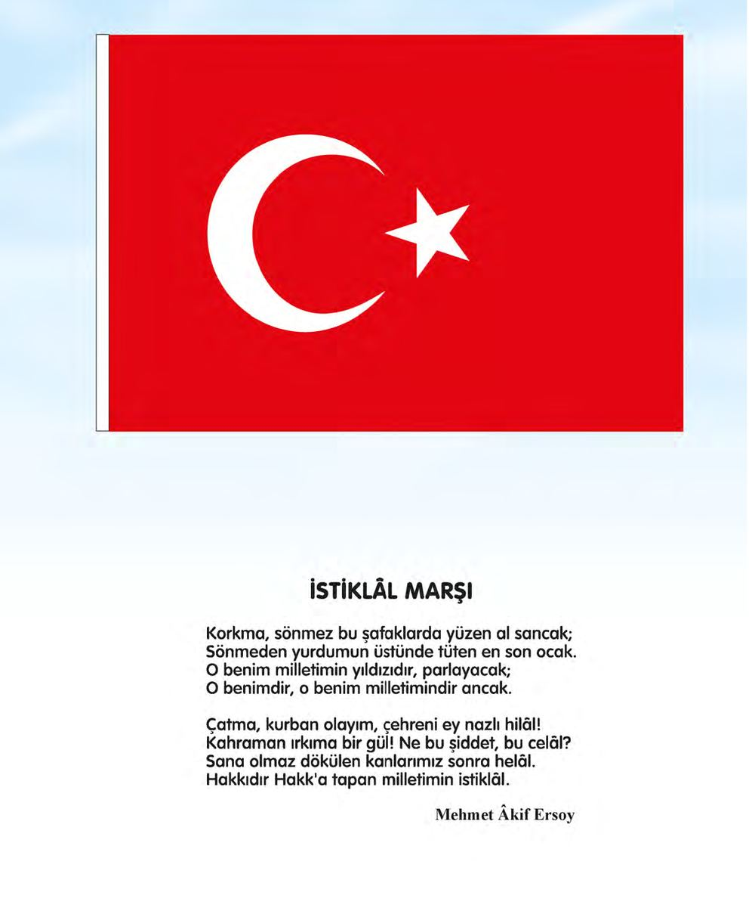

# İSTİKLÂL MARŞI

Korkma, sönmez bu şafaklarda yüzen al sancak;
Sönmeden yurdumun üstünde tüten en son ocak.
O benim milletimin yıldızıdır, parlayacak;
O benimdir, o benim milletimindir ancak.

Çatma, kurban olayım, çehreni ey nazlı hilâl!
Kahraman ırkıma bir gül! Ne bu şiddet, bu celâl?
Sana olmaz dökülen kanlarımız sonra helâl.
Hakkıdır Hakk'a tapan milletimin istiklâl.

Mehmet Âkif Ersoy

<!-- sayfa 3 -->

ANDIMIZ

Türküm, doğruyum, çalışkanım.

İlkem küçüklerimi korumak, büyüklerimi saymak; yurdumu, milletimi özümden çok sevmektir.
Ülküm yükselmek, ileri gitmektir.

Ey Büyük Atatürk!

Açtığın yolda, gösterdiğin hedefe durmadan yürüyeceğime ant içerim.

Varlığım Türk varlığına armağan olsun.

Ne mutlu Türküm diyene!

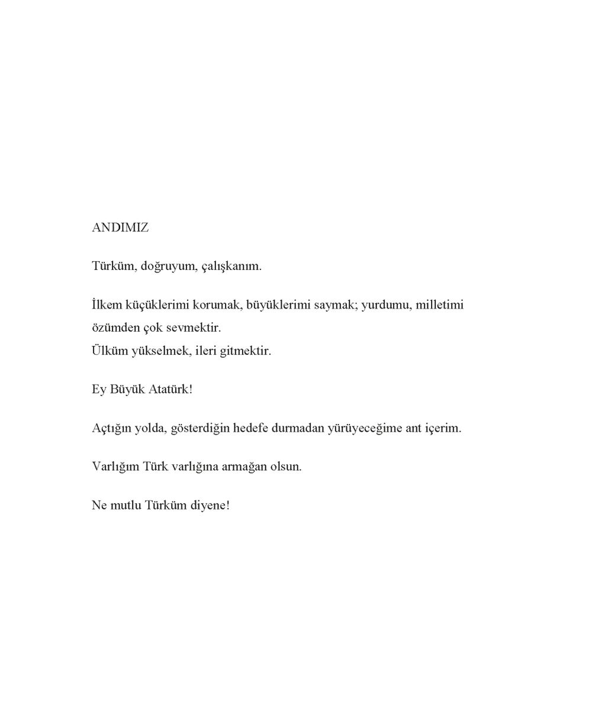
<!-- yer tutucu bulunamadı: sayfa sonuna eklendi -->

<!-- sayfa 4 -->

MUSTAFA KEMAL ATATÜRK

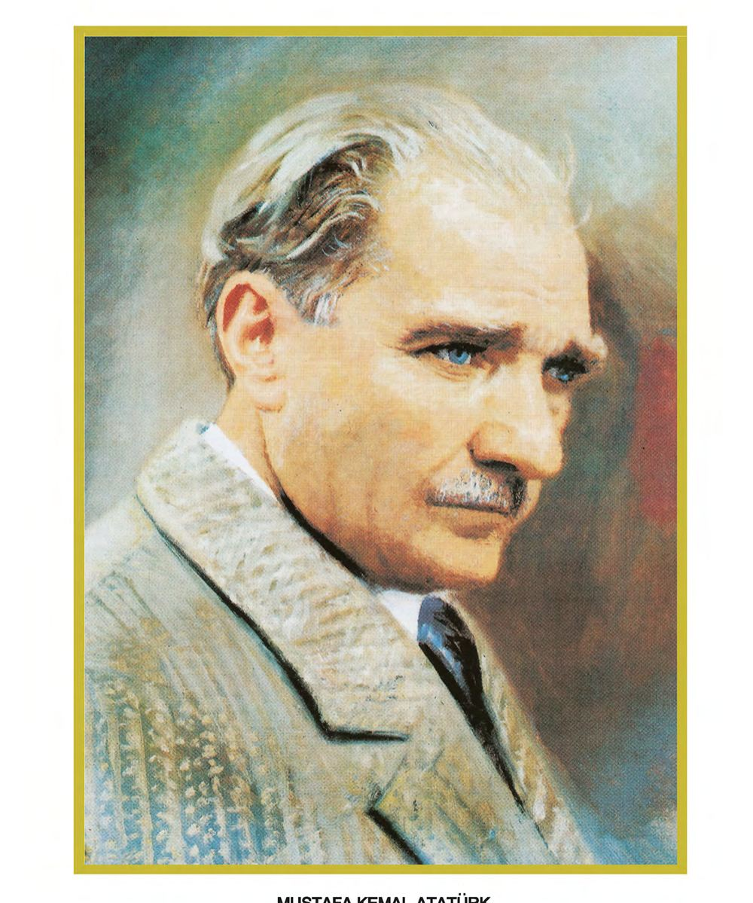
<!-- yer tutucu bulunamadı: sayfa sonuna eklendi -->

<!-- sayfa 5 -->

Verdiğiniz mesajda PDF metin katmanı kısmı boş (`<<< >>>`) görünüyor. Sayfayı Markdown formatına çevirebilmem için lütfen ilgili metni veya görüntüyü paylaşın. Metni paylaştığınızda kurallara tam uyarak çeviriyi gerçekleştireceğim.

<!-- sayfa 6 -->

# İçindekiler

Kitabımızı Tanıyalım ..................................................................................................... 9

## 1. Tema: Nesnelerin Geometrisi 1 .................................. 11
Uzamsal İlişkiler .................................................................................................... 12
Eş Nesneler ............................................................................................................... 28
1. Tema Değerlendirme ....................................................................................... 38

## 2. Tema: Sayılar ve Nicelikler 1 ..................................... 41
Rakamlar ve Sayılar ..................................................................................... 42
Sayıları Çözümleme ....................................................................................... 92
Sıra Sayıları ......................................................................................................... 98
Büyüklükleri Karşılaştırma ........................................................................ 104
Ritmik Sayma ....................................................................................................... 108
İleriye Doğru Birer Ritmik Sayma ............................................. 108
İleriye Doğru Beşer Ritmik Sayma ............................................ 111
İleriye Doğru Onar Ritmik Sayma ............................................ 113
İleriye Doğru İkişer Ritmik Sayma ............................................. 116
Geriye Doğru Birer Ritmik Sayma ........................................... 119
Geriye Doğru İkişer Ritmik Sayma ............................................ 121

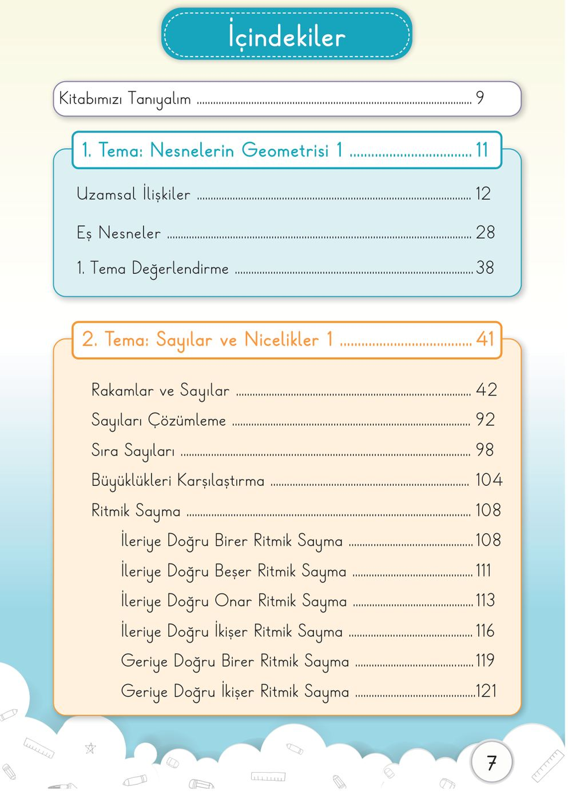
<!-- yer tutucu bulunamadı: sayfa sonuna eklendi -->

<!-- sayfa 7 -->

Sayı ve Şekil Örüntüleri .............................................................................. 123
Nesne Sayısını Tahmin Etme ................................................................... 131
2. Tema Değerlendirme ............................................................................ 136

### 3. Tema: Sayılar ve Nicelikler 2 ................................................. 141

Uzunluk Ölçme ....................................................................................... 142
Kütle Ölçme .............................................................................................. 162
3. Tema Değerlendirme ...................................................................... 175

Sözlük ..................................................................................................................... 181
Kaynakça ............................................................................................................. 184
Cevap Anahtarı ............................................................................................. 184
Görsel ve Genel Ağ Kaynakçası .................................................................... 184
Ekler ........................................................................................................................ 185
Türkiye’nin Mülki İdare Bölümleri ile Kara ve Deniz Komşuları Haritası .......................................................................................................... 190
Türk Dünyası Haritası ............................................................................... 191

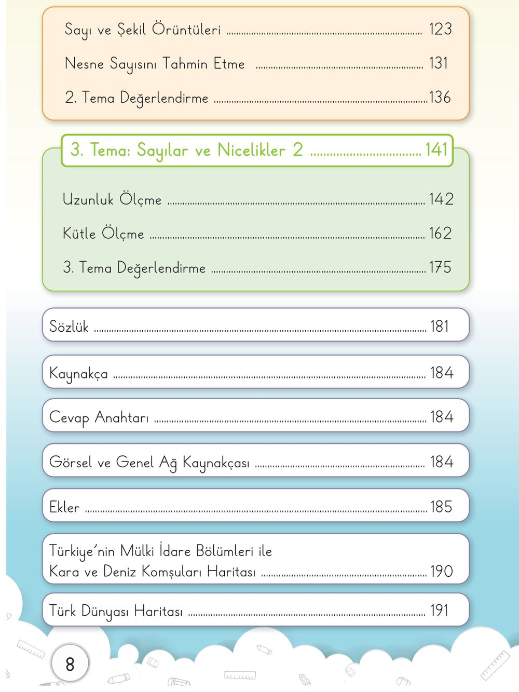
<!-- yer tutucu bulunamadı: sayfa sonuna eklendi -->

<!-- sayfa 8 -->

# Kitabımızı Tanıyalım

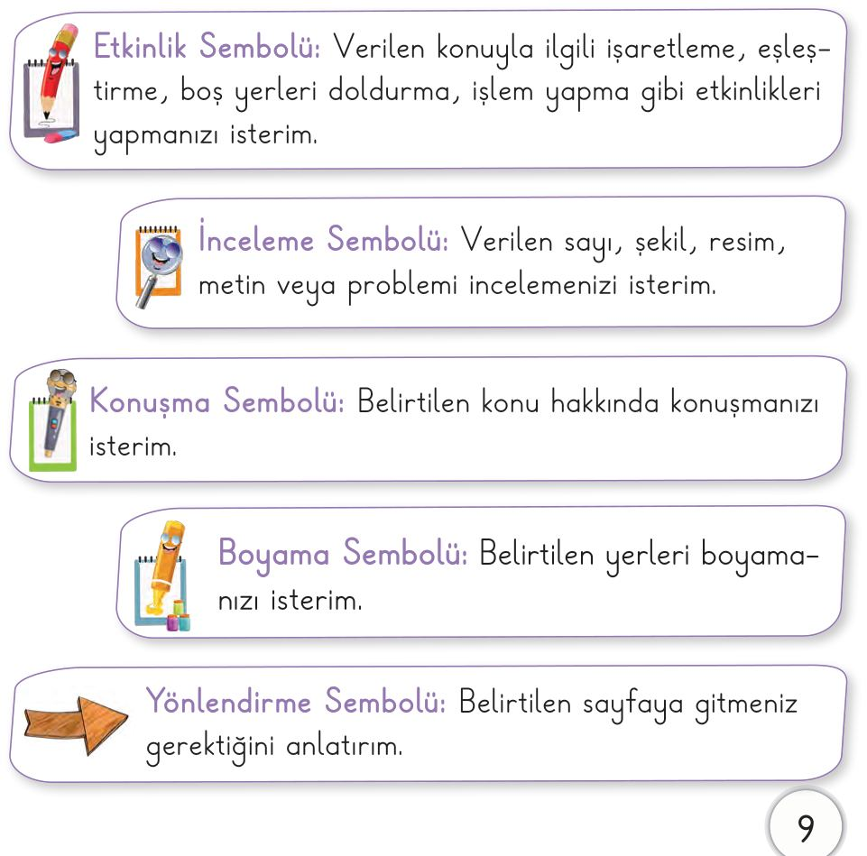

- Konu Başlığı
- Bölüm Numarası
- Etkinlik
- Sayfa Numarası

 **Etkinlik Sembolü:** Verilen konuyla ilgili işaretleme, eşleştirme, boş yerleri doldurma, işlem yapma gibi etkinlikleri yapmanızı isterim.

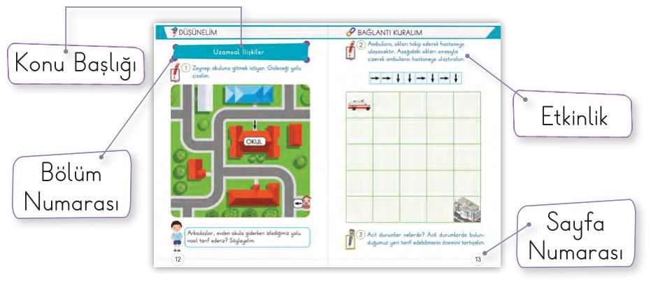 **İnceleme Sembolü:** Verilen sayı, şekil, resim, metin veya problemi incelemenizi isterim.

**Konuşma Sembolü:** Belirtilen konu hakkında konuşmanızı isterim.

**Boyama Sembolü:** Belirtilen yerleri boyamanızı isterim.

**Yönlendirme Sembolü:** Belirtilen sayfaya gitmeniz gerektiğini anlatırım.

<!-- sayfa 9 -->

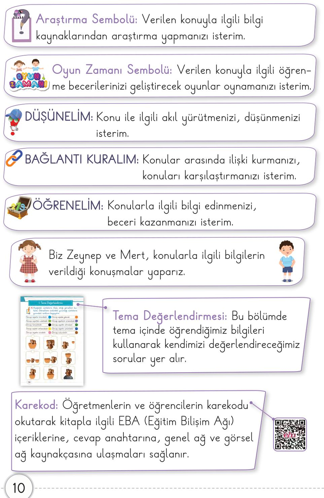 **Araştırma Sembolü:** Verilen konuyla ilgili bilgi kaynaklarından araştırma yapmanızı isterim.

 **Oyun Zamanı Sembolü:** Verilen konuyla ilgili öğrenme becerilerinizi geliştirecek oyunlar oynamanızı isterim.

 **DÜŞÜNELİM:** Konu ile ilgili akıl yürütmenizi, düşünmenizi isterim.

 **BAĞLANTI KURALIM:** Konular arasında ilişki kurmanızı, konuları karşılaştırmanızı isterim.

 **ÖĞRENELİM:** Konularla ilgili bilgi edinmenizi, beceri kazanmanızı isterim.

 Biz Zeynep ve Mert, konularla ilgili bilgilerin verildiği konuşmalar yaparız. 

 **Tema Değerlendirmesi:** Bu bölümde tema içinde öğrendiğimiz bilgileri kullanarak kendimizi değerlendireceğimiz sorular yer alır.

 **Karekod:** Öğretmenlerin ve öğrencilerin karekodu okutarak kitapla ilgili EBA (Eğitim Bilişim Ağı) içeriklerine, cevap anahtarına, genel ağ ve görsel ağ kaynakçasına ulaşmaları sağlanır. 

<!-- sayfa 10 -->

# 1. TEMA

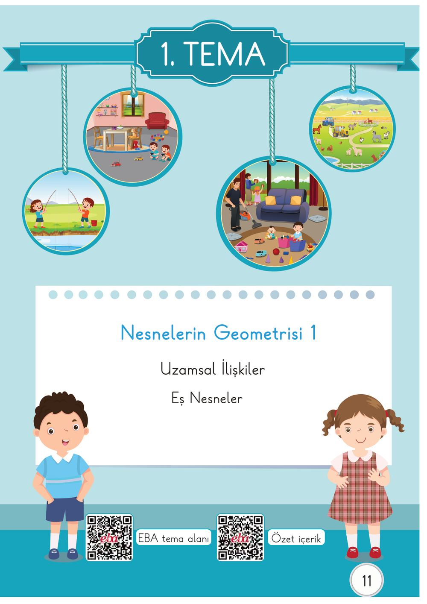

## Nesnelerin Geometrisi 1

### Uzamsal İlişkiler

#### Eş Nesneler

[EBA tema alanı] [Özet içerik]

<!-- sayfa 11 -->

# Uzamsal İlişkiler

1 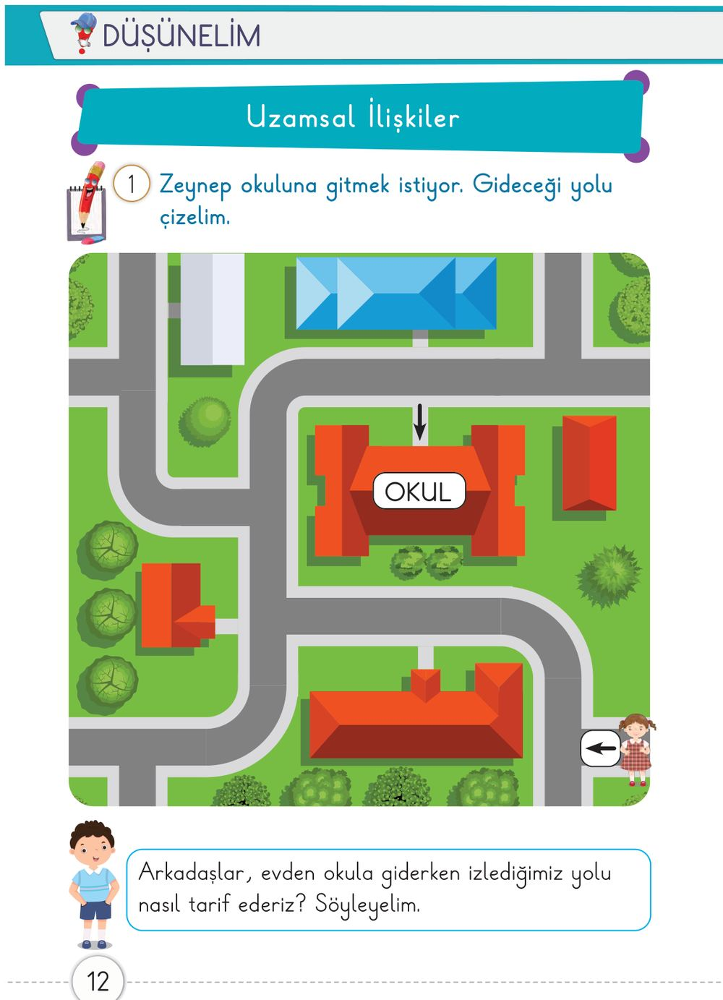 Zeynep okuluna gitmek istiyor. Gideceği yolu çizelim.

Arkadaşalar, evden okula giderken izlediğimiz yolu nasıl tarif ederiz? Söyleyelim.

<!-- sayfa 12 -->

 2 Ambulans, okları takip ederek hastaneye ulaşacaktır. Aşağıdaki okları sırasıyla çizerek ambulansı hastaneye ulaştıralım.

$\rightarrow$ <!-- KONTROL: Marker'da karşılığı yok, uydurma olabilir --> $\rightarrow$ <!-- KONTROL: Marker'da karşılığı yok, uydurma olabilir --> $\downarrow$ <!-- KONTROL: Marker'da karşılığı yok, uydurma olabilir --> $\downarrow$ <!-- KONTROL: Marker'da karşılığı yok, uydurma olabilir --> $\rightarrow$ <!-- KONTROL: Marker'da karşılığı yok, uydurma olabilir --> $\downarrow$ <!-- KONTROL: Marker'da karşılığı yok, uydurma olabilir --> $\rightarrow$ <!-- KONTROL: Marker'da karşılığı yok, uydurma olabilir --> $\downarrow$ <!-- KONTROL: Marker'da karşılığı yok, uydurma olabilir -->

| | | | | |
| :---: | :---: | :---: | :---: | :---: |
| AMBULANS | | | | |
| | | | | |
| | | | | |
| | | | | |
| | | | | HASTANE |

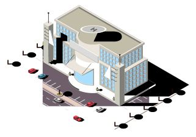 3 Acil durumlar nelerdir? Acil durumlarda bulunduğumuz yeri tarif edebilmenin önemini tartışalım.

<!-- sayfa 13 -->

# İleri Geri Oyunu

## Oyun Kuralları

* Öğretmen sınıftaki öğrencileri iki eşit gruba ayırır. Grupların yanındaki sepetlerde öğrenci sayısı kadar top vardır.
* Öğrenciler yanlarındaki pembe sepetten bir top alır.
* Öğrenciler çemberlerden ileriye doğru gider. Ellerindeki topu mavi sepete atar. Öğrenciler beklemeden aynı yoldan geri döner.
* Öğrenciler sıranın kendisine gelmesini beklerken birbirlerine dostça ve saygılı davranırlar. Sıra kendilerine geldiğinde de aynı hareketleri yapar.
* Tüm topları en kısa sürede taşıyan grup oyunu kazanır.

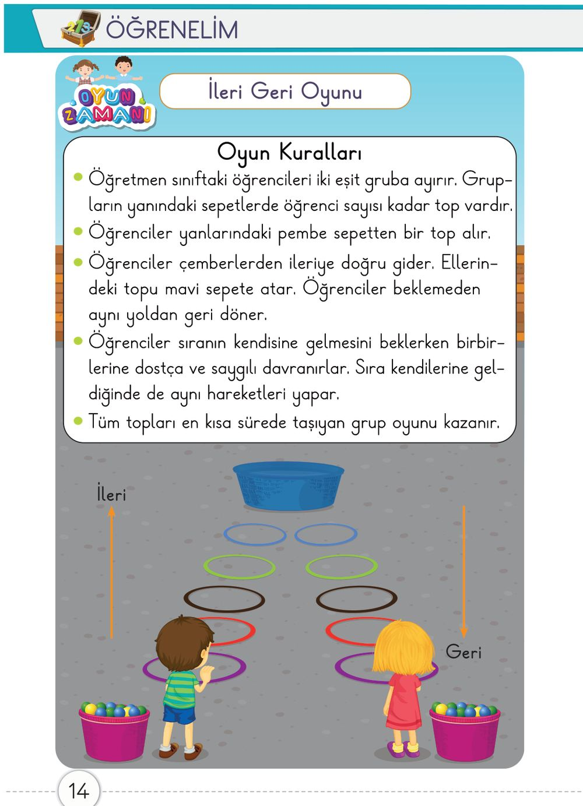: İleri ve Geri yönlerini gösteren oklar, renkli çemberler, bir mavi sepet, iki pembe sepet ve top taşıyan iki çocuk figürü içeren oyun şeması.

<!-- sayfa 14 -->

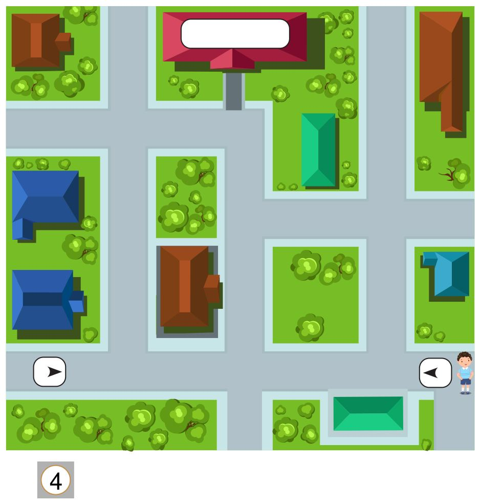 Arkadaşlar, bugün Mert ile kütüphaneye gittik. Aşağıda benim bulunduğum noktadan kütüphaneye giderken kullandığım yol gösterilmiştir.

[Harita Görseli]

4 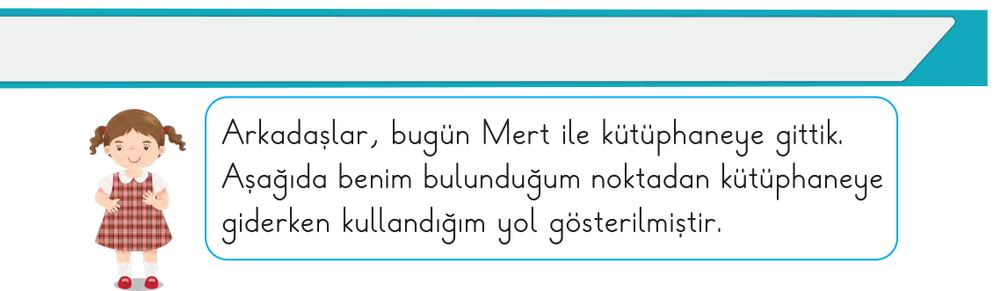 Mert’in kütüphaneye giderken kullanabileceği yolları renkli kalemlerle boyayalım.

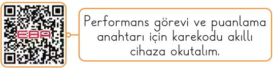 Performans görevi ve puanlama anahtarı için karekodu akıllı cihaza okutalım

<!-- sayfa 15 -->

5 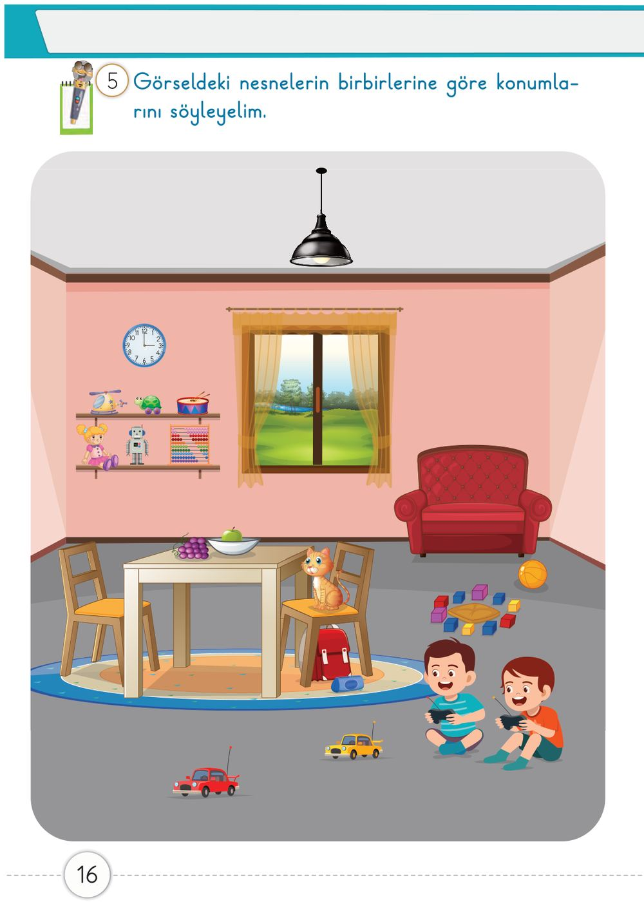 Görseldeki nesnelerin birbirlerine göre konumla-
rını söyleyelim.

<!-- sayfa 16 -->

Zeynep, odadaki varlıkların yerlerini diğer varlıklara göre belirleyelim.

Tamam, Mert. Lamba, saatten **yüksek**tedir.

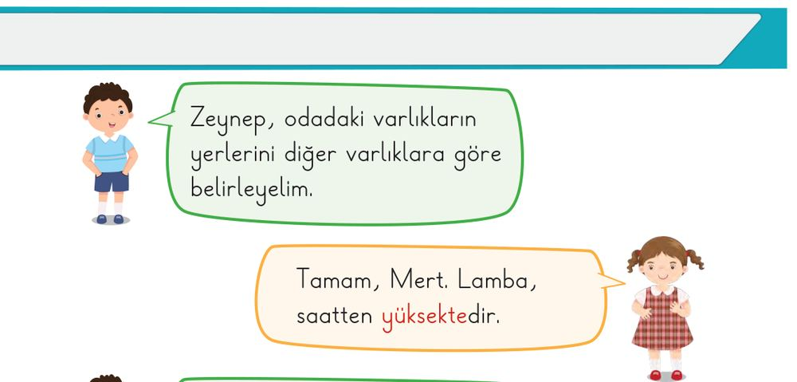
Masa, lambadan **alçak**tadır.

Sarı araba, kırmızı arabaya göre çocuklara **daha yakın**dır.

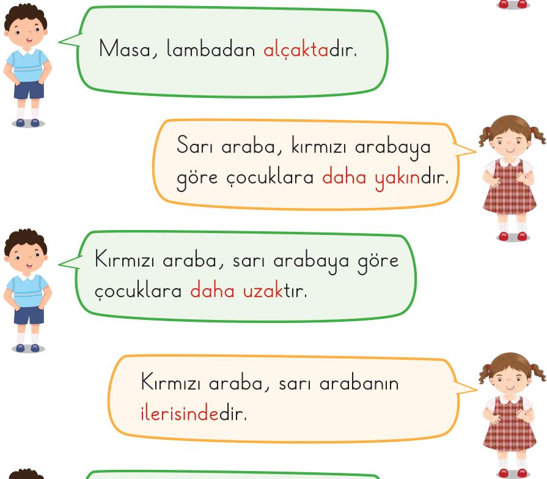
Kırmızı araba, sarı arabaya göre çocuklara **daha uzak**tır.

Kırmızı araba, sarı arabanın **ileri**sindedir.

Sarı araba, kırmızı arabanın **geri**sindedir.

<!-- sayfa 17 -->

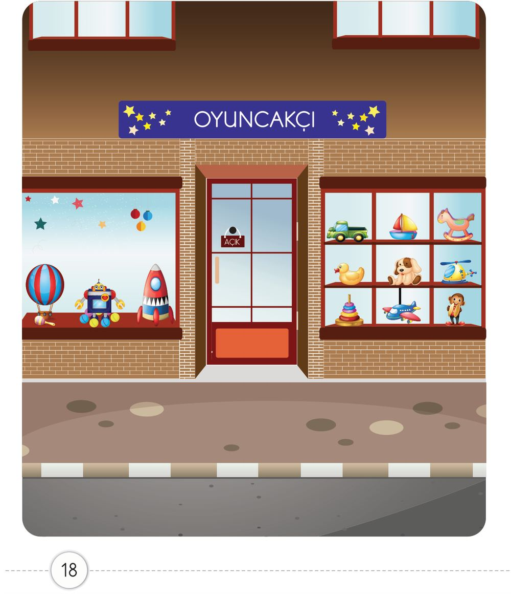 6 Görseldeki nesnelerin birbirlerine göre konumla- rını söyleyelim.

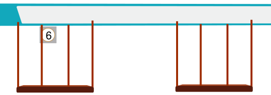

<!-- sayfa 18 -->

Uçak, oyuncak köpeğin altındadır.

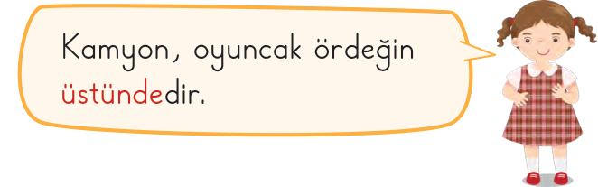
Kamyon, oyuncak ördeğin üstündedir.

Toplar, robotun etrafındadır.

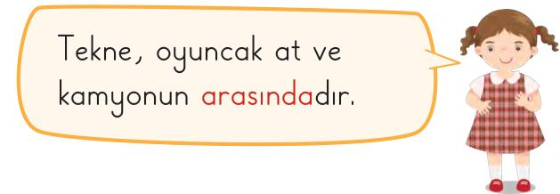
Tekne, oyuncak at ve kamyonun arasındadır.

Roket, size göre robotun sağındadır.

Uçan balon, size göre robotun solundadır.

<!-- yer tutucu bulunamadı: sayfa sonuna eklendi -->

<!-- sayfa 19 -->

7 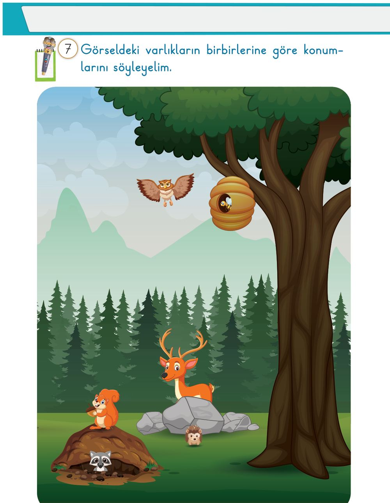 Görseldeki varlıkların birbirlerine göre konumlarını söyleyelim.

<!-- sayfa 20 -->

 Arı, kovanın içindedir.

 Baykuş, kovanın dışındadır.

 Kirpi, taşın önündedir.

 Geyik, taşın arkasındadır.

 Sincap, tümsektedir.

 Rakun, çukurdadır.

<!-- yer tutucu bulunamadı: sayfa sonuna eklendi -->

<!-- yer tutucu bulunamadı: sayfa sonuna eklendi -->

<!-- yer tutucu bulunamadı: sayfa sonuna eklendi -->

<!-- sayfa 21 -->

 8 İneğin yakınına ot çizelim ve otu boyayalım. İneğin uzağına çiçek çizelim ve çiçeği boyayalım.

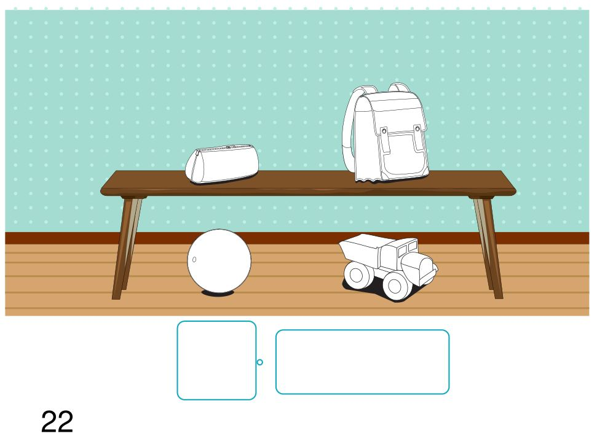 9 Masanın altındaki nesneleri turuncuya, üstündeki nesneleri kırmızıya boyayalım.

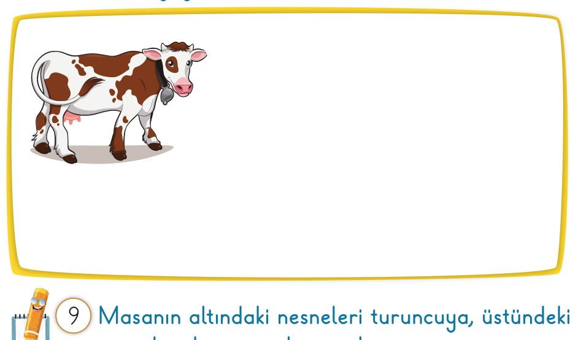 Videoyu izlemek için karekodu akıllı

<!-- sayfa 22 -->

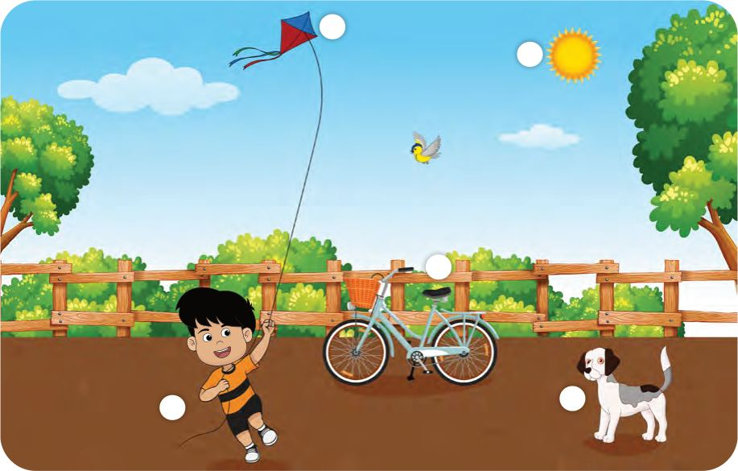 10 Kuşa göre yüksekteki varlıklara ait yuvarlağı “$\checkmark$ <!-- KONTROL: Marker'da karşılığı yok, uydurma olabilir -->” ile işaretleyelim.

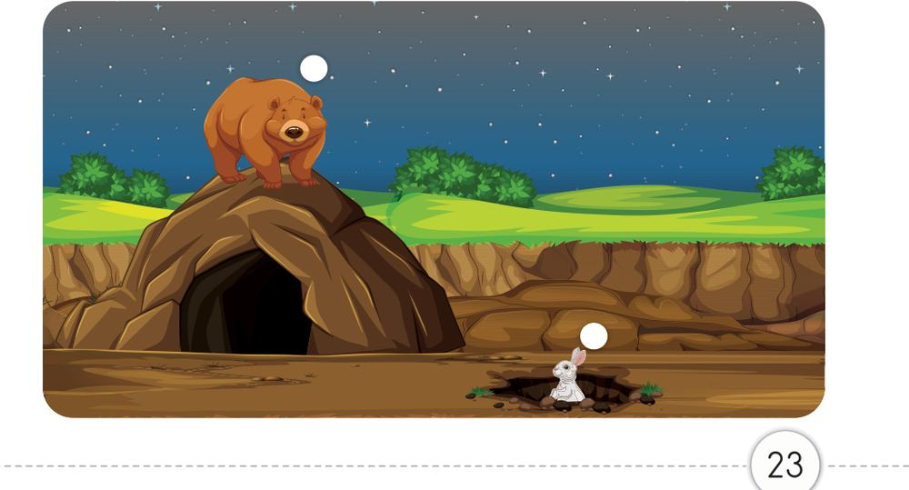 11 Çukurdaki hayvana ait yuvarlağı “$\checkmark$ <!-- KONTROL: Marker'da karşılığı yok, uydurma olabilir -->” ile işaretleyelim.

<!-- sayfa 23 -->

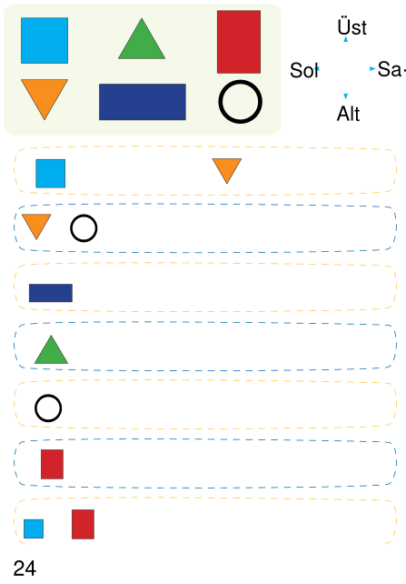 12 Verilen ifadelere uygun şekilleri noktalı yerlere örnekteki gibi çizelim ve boyayalım.

| | | |
| :---: | :---: | :---: |
|  |  |  |
|  |  |  |

Üst
Sol $\leftarrow$ <!-- KONTROL: Marker'da karşılığı yok, uydurma olabilir --> $\rightarrow$ <!-- KONTROL: Marker'da karşılığı yok, uydurma olabilir --> Sağ
Alt

---

 şeklinin altında ................... vardır.

 ile  şekillerinin arasında ................... vardır.

 şeklinin size göre sağında ................... vardır.

 şeklinin size göre solunda ................... vardır.

 şeklinin üstünde ................... vardır.

<!-- sayfa 24 -->

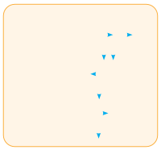 13 Serra’yı yönergeleri takip ederek mesleği ile ilgili araç gerece ulaştıralım. Ulaştırdığımız araç gereci yuvarlak içine alalım. Serra’nın mesleği hakkında konuşalım.

Üst
Sol $\longleftrightarrow$ <!-- KONTROL: Marker'da karşılığı yok, uydurma olabilir --> Sağ
Alt

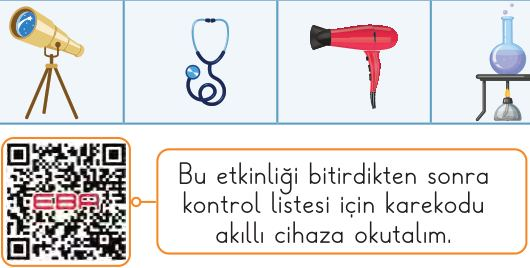
**Yönerge:**
2 kare sağa ($\rightarrow \rightarrow$ <!-- KONTROL: Marker'da karşılığı yok, uydurma olabilir -->),
2 kare aşağı ($\downarrow \downarrow$ <!-- KONTROL: Marker'da karşılığı yok, uydurma olabilir -->),
1 kare sola ($\leftarrow$ <!-- KONTROL: Marker'da karşılığı yok, uydurma olabilir -->),
1 kare aşağı ($\downarrow$ <!-- KONTROL: Marker'da karşılığı yok, uydurma olabilir -->),
1 kare sağa ($\rightarrow$ <!-- KONTROL: Marker'da karşılığı yok, uydurma olabilir -->),
1 kare aşağı ($\downarrow$ <!-- KONTROL: Marker'da karşılığı yok, uydurma olabilir -->) gidiniz.

Başlangıç noktası

(Izgara üzerinde teleskop, stetoskop, saç kurutma makinesi ve erlenmeyer görselleri bulunmaktadır.)

Bu etkinliği bitirdikten sonra kontrol listesi için karekodu akıllı cihaza okutalım.

<!-- sayfa 25 -->

14 Aşağıdaki soruları cevaplayalım. Doğru cevaplara ait yuvarlağı boyayalım.

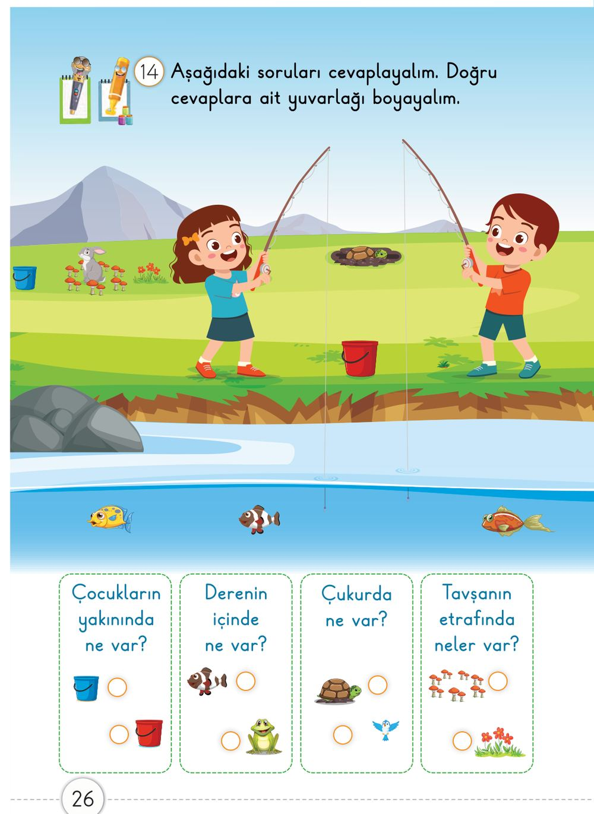

| Çocukların yakınında ne var? | Derenin içinde ne var? | Çukurda ne var? | Tavşanın etrafında neler var? |
| :---: | :---: | :---: | :---: |
| ![Mavi Kova] ○ | ![Balık] ○ | ![Kaplumbağa] ○ | ![Mantarlar] ○ |
| ○ ![Kırmızı Kova] | ![Kurbağa] ○ | ○ ![Kuş] | ○ ![Çiçekler] |

<!-- sayfa 26 -->

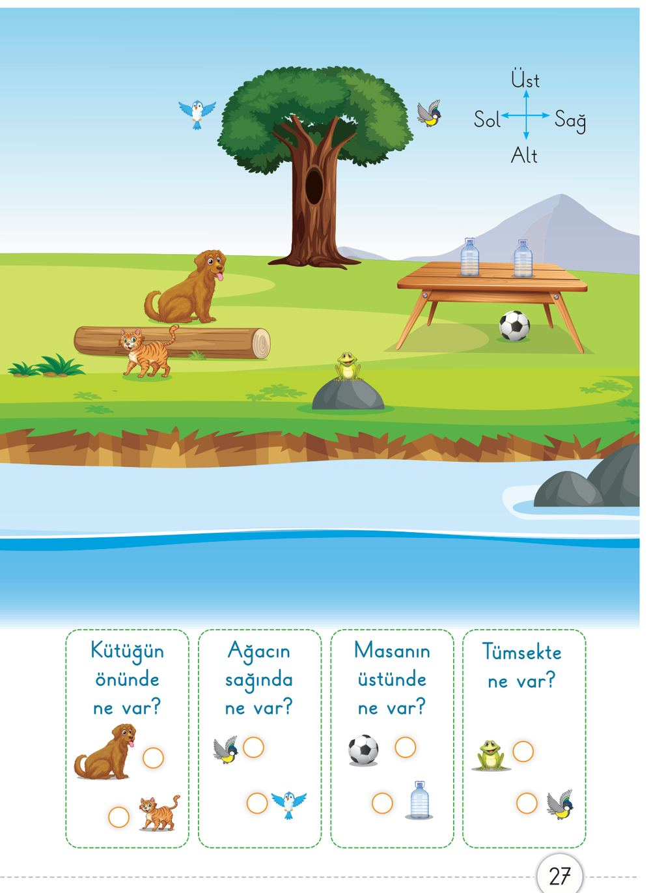

Üst
Sol $\leftrightarrow$ <!-- KONTROL: Marker'da karşılığı yok, uydurma olabilir --> Sağ
Alt

Kütüğün önünde ne var?
 $\bigcirc$ <!-- KONTROL: Marker'da karşılığı yok, uydurma olabilir -->
$\bigcirc$ <!-- KONTROL: Marker'da karşılığı yok, uydurma olabilir --> 

Ağacın sağında ne var?
 $\bigcirc$ <!-- KONTROL: Marker'da karşılığı yok, uydurma olabilir -->
$\bigcirc$ <!-- KONTROL: Marker'da karşılığı yok, uydurma olabilir --> 

Masanın üstünde ne var?
 $\bigcirc$ <!-- KONTROL: Marker'da karşılığı yok, uydurma olabilir -->
$\bigcirc$ <!-- KONTROL: Marker'da karşılığı yok, uydurma olabilir --> 

Tümsekte ne var?
 $\bigcirc$ <!-- KONTROL: Marker'da karşılığı yok, uydurma olabilir -->
$\bigcirc$ <!-- KONTROL: Marker'da karşılığı yok, uydurma olabilir --> 

<!-- sayfa 27 -->

# Eş Nesneler

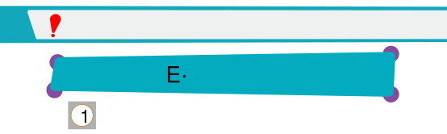
1. 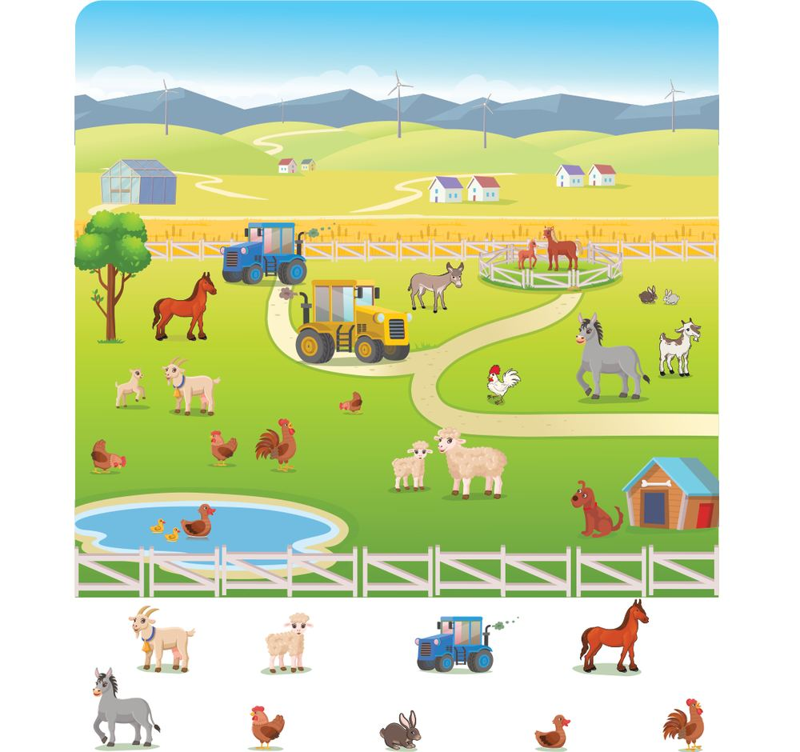 Aşağıdaki nesneleri görselden bularak yuvarlak içine alalım.

<!-- sayfa 28 -->

# Eş Nesneleri Bulma Oyunu

## Oyun Kuralları

* Öğrenciler sınıftaki çeşitli nesneleri (kalem, silgi, kitap, defter, cetvel vb.) öğretmen masasının üzerine koyar.
* Öğretmen, öğrencilerden sırayla üçer kişiyi masanın yanına çağırır ve her öğrenciye birer tane nesne verir.
* Her öğrenci kendisine verilen nesnenin eşini bulmaya çalışır.
* Öğrenciler eş nesneleri buldukça puan kazanır.
* Eş nesneyi bulan öğrenci bu nesneyi niçin tercih ettiğini anlatır.
* Öğrenciler konuşurken ve dinlerken birbirlerine karşı saygılı ve sabırlı olurlar.
* Öğrencilerin buldukları eş nesneler sergilenir.

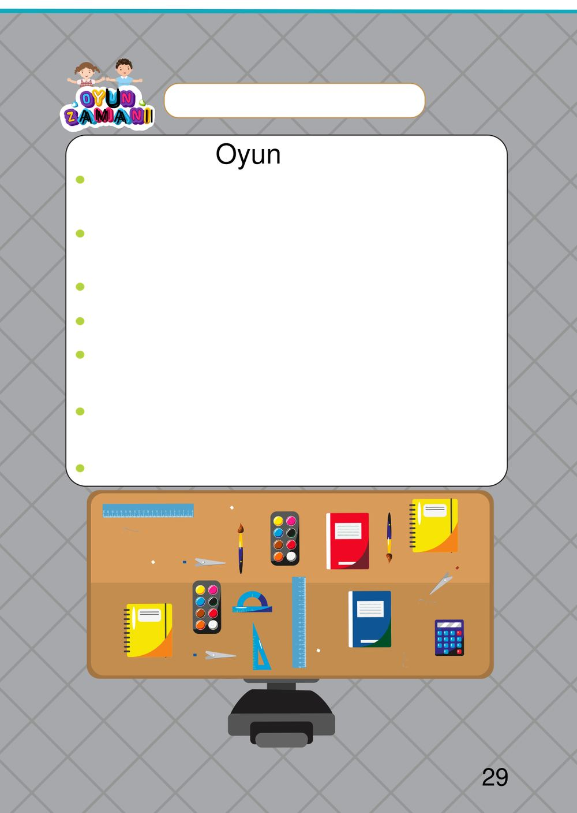

<!-- sayfa 29 -->

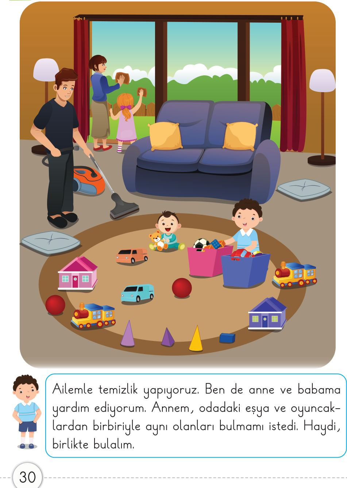 2 Görselde gördüklerimizi anlatalım.

 Ailemle temizlik yapıyoruz. Ben de anne ve babama yardım ediyorum. Annem, odadaki eşya ve oyuncaklardan birbiriyle aynı olanları bulmamı istedi. Haydi, birlikte bulalım.

<!-- sayfa 30 -->

Oyuncak tren, yastık, minder, lamba ve topların birbiriyle aynı olduğuna karar verdim.

Mert, bu eşya ve oyuncakları neden seçtin?

Çünkü bu eşya ve oyuncakların renkleri, büyüklükleri, şekilleri aynıydı.

Oyuncak arabaları neden seçmedin?

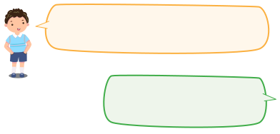
Çünkü oyuncak arabaların bütün özellikleri aynı değildi. Oyuncak arabaların renkleri farklıydı.

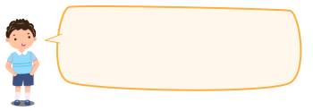
Anladım Mert. Bütün özellikleri aynı olan nesneler **eş nesnelerdir**. Bundan sonra eş nesneleri kolaylıkla bulabilirim.

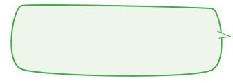

<!-- sayfa 31 -->

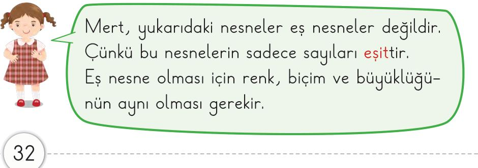 Peki Zeynep, aşağıdaki nesneler sence eş nesneler midir?

 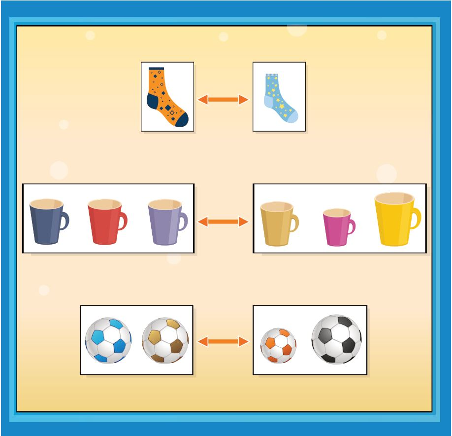

 Mert, yukarıdaki nesneler eş nesneler değildir. Çünkü bu nesnelerin sadece sayıları eşitdir. Eş nesne olması için renk, biçim ve büyüklüğünün aynı olması gerekir.

<!-- sayfa 32 -->

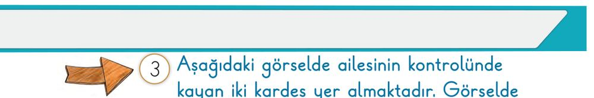 3 Aşağıdaki görselde ailesinin kontrolünde kayan iki kardeş yer almaktadır. Görselde eksik bırakılan eş nesnelerin eşini “Ekler” bölümündeki Ek-1’den bulup keselim. Uygun yerlere yapıştıralım.

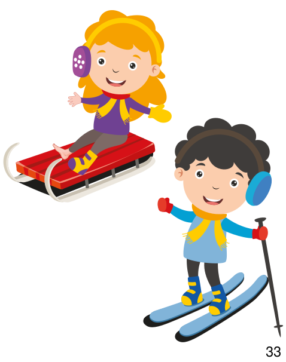

<!-- sayfa 33 -->

 4 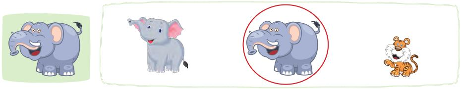 Renkli kutulardaki hayvanların eşlerini bulalım. Örnekteki gibi yuvarlak içine alalım.

| 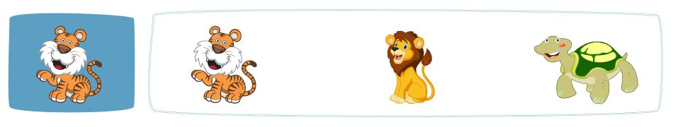 | 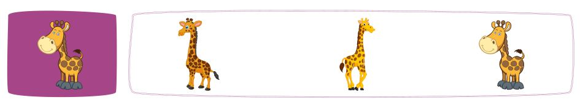 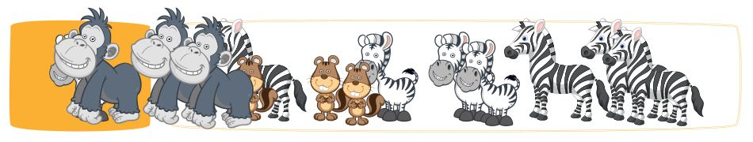 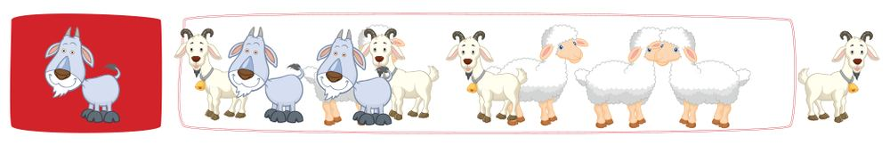 |
| :---: | :---: |
|  |    |
| 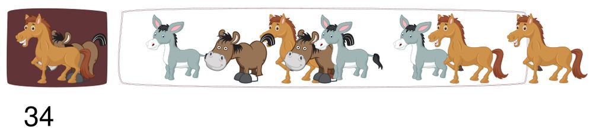 |    |
|  |    |
|  |    |
|  |    |

<!-- sayfa 34 -->

 5 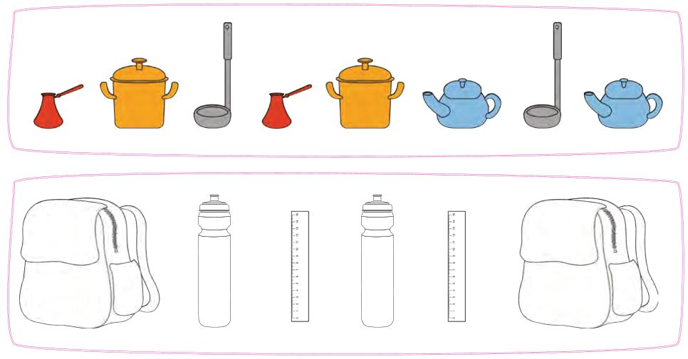 Çerçevelerin içindeki eş nesneleri birbiriyle aynı renge örnekteki gibi boyayalım.

(Renkli mutfak gereçleri: kırmızı cezve, turuncu tencere, gri kepçe, kırmızı cezve, turuncu tencere, mavi çaydanlık, gri kepçe, mavi çaydanlık)

(Çizim halinde okul eşyaları: sırt çantası, su şişesi, cetvel, su şişesi, cetvel, sırt çantası)

(Çizim halinde giysiler: ayakkabı, pantolon, tişört, pantolon, ayakkabı, tişört)

(Çizim halinde oyuncaklar: uçak, kamyon, davul, kamyon, uçak, davul)

(Çizim halinde hayvanlar: tilki, horoz, baykuş, horoz, tilki, baykuş)

<!-- sayfa 35 -->

 6  Çerçevelerin içindeki eşi olmayan nesneleri bulalım. Örnekteki gibi “$\checkmark$ <!-- KONTROL: Marker'da karşılığı yok, uydurma olabilir -->” ile işaretleyelim.

○ ○ $\checkmark$ <!-- KONTROL: Marker'da karşılığı yok, uydurma olabilir --> ○ ○

○ ○ ○ ○ ○

○ ○ ○ ○ ○

○ ○ ○ ○ ○

○ ○ ○ ○ ○

<!-- sayfa 36 -->

 7 Aşağıda eşi olan nesneleri bulalım. Örnekteki gibi okla gösterelim.

[Görsel Alanı: Eşleştirilecek nesneler (eldiven, çorap, şapka, düğme)]

 Evimizde kullanmadığımız, eşi olan eski eşyaları belirleyelim (çorap, düğme, şapka, eldiven gibi). Belirlediğimiz bu eş nesnelerle bir oyuncak tasarlayalım. Oyuncağımızı sınıfa getirerek arkadaşlarımızla oynayalım.

 Daha fazla soru için karekodu akıllı cihaza okutalım

 Bu etkinliği bitirdikten sonra kontrol listesi için karekodu akıllı

<!-- yer tutucu bulunamadı: sayfa sonuna eklendi -->

<!-- sayfa 37 -->

# 1. Tema Değerlendirme

A) Aşağıdaki cümlelerin ifade ettiği görselleri bulalım. Görsellerin üstündeki yuvarlağı cümlelerin yanındaki renklere boyayalım.

* Sincap sepetin önündedir. (Mavi)
* Sincap sepete yakındır. (Turuncu)
* Sincap sepetten uzaktadır. (Açık Yeşil)
* Sincap sepetlerin arasındadır. (Mor)
* Sincap tümsektedir. (Siyah)
* Sincap sepetin altındadır. (Koyu Yeşil)
* Sincap sepetin arkasındadır. (Sarı)
* Sincap sepetin üstündedir. (Lacivert)
* Sincap sepetin içindedir. (Pembe)
* Sincap çukurdadır. (Kahverengi)

<!-- sayfa 38 -->

 B) Aşağıdaki soruları cevaplayalım.

1. Çerçeve içindeki nesnelerin hangileri birbirine eşit? Çerçevelerin altındaki kutuları boyayalım.

  
  

2. Bebek ileriye doğru gittiğinde hangi oyuncağa ulaşır? Ulaşacağı oyuncağı mora boyayalım. Bebek geriye doğru gittiğinde hangi oyuncağa ulaşır? Ulaşacağı oyuncağı turuncuya boyayalım.

<!-- sayfa 39 -->

 C) Aşağıda verilen renkli kutulardaki nesnelerin eşini yuvarlak içine alalım.

| | | |
| :---: | :---: | :---: |
|  |    | |
|  |    | |
|  |    | |

 Ç) Aşağıdaki kelimelerden uygun olanları kullanarak sınıfımızdaki yerimizi arkadaşlarımıza anlatalım.

 önünde
 solunda
 uzağında
 yakınında
 sağında
 etrafında
 arkasında

 Daha fazla soru için karekodu akıllı cihaza okutalım..
 Daha fazla soru için karekodu akıllı cihaza okutalım..

<!-- sayfa 40 -->

# 2. TEMA

: "2. TEMA" yazılı turuncu şerit ve altında asılı duran dört adet yuvarlak illüstrasyon (akvaryum, doğum günü partisi, doğa manzarası ve renkli şemsiye).

## Sayılar ve Nicelikler 1

* Rakamlar ve Sayılar
* Sayıları Çözümleme
* Sıra Sayıları
* Büyüklükleri Karşılaştırma
* Ritmik Sayma
* Sayı ve Şekil Örüntüleri
* Nesne Sayısını Tahmin Etme

: Sayfanın alt kısmında yer alan çocuk figürleri ve QR kodlu butonlar.

[EBA tema alanı]
[Özet içerik]

<!-- sayfa 41 -->

# Rakamlar ve Sayılar

## Aynısını Bul Oyunu

### Oyun Kuralları

* Öğretmen sınıfın farklı yerlerine üzerinde $1$'den $9$'a kadar sayıların yazılı olduğu sayı kartları yapıştırır ($1$'den bir tane, $2$'den iki tane... $9$'dan dokuz tane olacak şekilde).
* Öğretmen tahtaya $0$'dan $9$'a kadar olan sayıları yapıştırır. Her sayının altına kutu koyar.
* Öğrenciler tahtada yazılı olan sayılardan birini seçer.
* Daha sonra öğrenciler seçtiği sayının yazılı olduğu sayı kartını sınıfta arayarak bulur.
* Bulduğu sayı kartını tahtada yazılı olan sayının altındaki kutuya koyar.
* Bu şekilde sınıfın farklı yerlerine yapıştırılan sayı kartları ile oyun devam ettirilir.
* Öğretmen oyunu oynatırken sayılardan bahsetmez. “Tahtaya yapıştırdıklarımın aynısını bulup uygun kutuya atacaksınız.” der.

<!-- sayfa 42 -->

  1 Görseli inceleyelim. Her varlıktan kaç tane olduğunu söyleyelim.

<!-- sayfa 43 -->

 2  Aşağıda çerçeve içindeki varlıkların sayısını söyleyelim.

 

 

 

<!-- sayfa 44 -->

 3  Parmağımızı yandaki gibi gösterelim. Parmakla gösterdiğimiz sayıyla aynı sayıda olan görselleri boyayalım.

![Görsel içeriği: Kar ve buz temalı bir manzara içerisinde renklendirilmemiş hayvan figürleri ve bir iglo bulunmaktadır.]

<!-- sayfa 45 -->

# 1

4  “1” rakamlarını yazılış yönüne dikkat ederek boyayalım.
1 1 1 1 1

5  “1” rakamlarını yazılış yönüne dikkat ederek yazalım.
1 1 1 1 1 1 1 1 1 1 1 1 1 1 1 1 1 1 1 1 1 1 1 1 1 1 1 1 1 1 1 1 1 1 1 1 1 1 1 1 1 1 1 1 1 1 1 1 1 1 1 1 1 1 1 1 1 1 1 1 1 1 1 1 1 1 1 1 1 1 1 1 1 1 1 1 1 1 1 1 1 1 1 1 1 1 1 1 1 1 1 1 1 1 1 1 1 1 1 1 1 1 1 1 1 1 1 1 1 1 1 1 1 1 1 1 1 1 1 1 1 1 1 1 1 1 1 1 1 1 1 1 1 1 1 1 1 1 1 1 1 1 1 1 1 1 1 1 1 1 1 1 1 1 1 1 1 1 1 1 1 1 1 1 1 1 1 1 1 1 1 1 1 1 1 1 1 1 1 1 1 1 1 1 1 1 1 1 1 1 1 1 1 1 1 1 1 1 1 1 1 1 1 1 1 1 1 1 1 1 1 1 1 1 1 1 1 1 1 1 1 1 1 1 1 1 1 1 1 1 1 1 1 1 1 1 1 1 1 1 1 1 1 1 1 1 1 1 1 1 1 1 1 1 1 1 1 1 1 1 1 1 1 1 1 1 1 1 1 1 1 1 1 1 1 1 1 1 1 1 1 1 1 1 1 1 1 1 1 1 1 1 1 1 1 1 1 1 1 1 1 1 1 1 1 1 1 1 1 1 1 1 1 1 1 1 1 1 1 1 1 1 1 1 1 1 1 1 1 1 1 1 1 1 1 1 1 1 1 1 1 1 1 1 1 1 1 1 1 1 1 1 1 1 1 1 1 1 1 1 1 1 1 1 1 1 1 1 1 1 1 1 1 1 1 1 1 1 1 1 1 1 1 1 1 1 1 1 1 1 1 1 1 1 1 1 1 1 1 1 1 1 1 1 1 1 1 1 1 1 1 1 1 1 1 1 1 1 1 1 1 1 1 1 1 1 1 1 1 1 1 1 1 1 1 1 1 1 1 1 1 1 1 1 1 1 1 1 1 1 1 1 1 1 1 1 1 1 1 1 1 1 1 1 1 1 1 1 1 1 1 1 1 1 1 1 1 1 1 1 1 1 1 1 1 1 1 1 1 1 1 1 1 1 1 1 1 1 1 1 1 1 1 1 1 1 1 1 1 1 1 1 1 1 1 1 1 1 1 1 1 1 1 1 1 1 1 1 1 1 1 1 1 1 1 1 1 1 1 1 1 1 1 1 1 1 1 1 1 1 1 1 1 1 1 1 1 1 1 1 1 1 1 1 1 1 1 1 1 1 1 1 1 1 1 1 1 1 1 1 1 1 1 1 1 1 1 1 1 1 1 1 1 1 1 1 1 1 1 1 1 1 1 1 1 1 1 1 1 1 1 1 1 1 1 1 1 1 1 1 1 1 1 1 1 1 1 1 1 1 1 1 1 1 1 1 1 1 1 1 1 1 1 1 1 1 1 1 1 1 1 1 1 1 1 1 1 1 1 1 1 1

<!-- yer tutucu bulunamadı: sayfa sonuna eklendi -->

<!-- yer tutucu bulunamadı: sayfa sonuna eklendi -->

<!-- yer tutucu bulunamadı: sayfa sonuna eklendi -->

<!-- sayfa 46 -->

    8 Çerçeve içindeki varlıkları sayalım. Bir tane olan varlığı bularak 1 rakamını örnekteki gibi yazalım.

(1)

( )

( )

( )

( )

( )

( )

( )

( )

( )

( )

“1” rakamının etkinliği için karekodu akıllı cihaza okutalım

<!-- sayfa 47 -->

 1  Aşağıda çerçeve içindeki varlıkların sayısını söyleyelim.

<!-- sayfa 48 -->

 2  Parmağımızı yandaki gibi gösterelim. Parmakla gösterdiğimiz sayıyla aynı sayıda olan görselleri boyayalım.

![Akvaryum görseli]

<!-- sayfa 49 -->

# 2

3. “2” rakamlarını yazılış yönüne dikkat ederek boyayalım.

4. “2” rakamlarını yazılış yönüne dikkat ederek yazalım.

5. 2 tane ⛱️ boyayalım.

6. Kaç tane ⛱️ boyadığımızı rakamla yazalım. [......]

<!-- sayfa 50 -->

 7 Üzerinde “2” yazan roketleri mora boyayalım. Üzerinde “1” yazan roketleri sarıya boyayalım.

“2” rakamının etkinliği için karekodu akıllı cihaza okutalım

<!-- sayfa 51 -->

 1  Aşağıda çerçeve içindeki varlıkların sayısını söyleyelim.

<!-- sayfa 52 -->

 2  Parmağımızı yandaki gibi gösterelim. Parmakla gösterdiğimiz sayıyla aynı sayıda olan görselleri boyayalım.

![Görsel içeriği: Deniz altı temalı boyama sayfası]

<!-- sayfa 53 -->

# 3

|||

3 “3” rakamlarını yazılış yönüne dikkat ederek boyayalım.

3 3 3 3 3

4 “3” rakamlarını yazılış yönüne dikkat ederek yazalım.

3 3 3 3 3 3 3 3 3 3 3 3 3
3 3 3 3 3 3 3 3 3 3 3 3 3

5 3 tane  boyayalım.

6 Kaç tane  boyadığımızı rakamla yazalım. 

<!-- sayfa 54 -->

7 “3” rakamlarını bulup sarıya boyayalım.

: 
3 8 1 2
1 9 5 3
4 3 7 4
1 6 3
3 1 6 3 2
2 1 3

“3” rakamının etkinliği için karekodu akıllı

<!-- sayfa 55 -->

 1  Aşağıda çerçeve içindeki varlıkların sayısını söyleyelim.

<!-- sayfa 56 -->

 2  Parmağımızı yandaki gibi gösterelim. Parmakla gösterdiğimiz sayıyla aynı sayıda olan görselleri boyayalım.

![Görsel içeriği: Bir çiftlik manzarası içerisinde boyanmamış hayvan figürleri (kazlar, tavuklar, tavşanlar ve civcivler) bulunmaktadır.]

<!-- sayfa 57 -->

3.  “4” rakamlarını yazılış yönüne dikkat ederek boyayalım.

4.  “4” rakamlarını yazılış yönüne dikkat ederek yazalım.

5.  4 tane  boyayalım.

6. Kaç tane  boyadığımızı rakamla yazalım. 

<!-- sayfa 58 -->

7 Aşağıdaki meyveleri sayalım. Meyvelerin karşı-
sındaki renkli kutulara kaç tane olduklarını
rakamla yazalım.

$\rightarrow$ <!-- KONTROL: Marker'da karşılığı yok, uydurma olabilir --> [Mavi kutu]

$\rightarrow$ <!-- KONTROL: Marker'da karşılığı yok, uydurma olabilir --> [Pembe kutu]

$\rightarrow$ <!-- KONTROL: Marker'da karşılığı yok, uydurma olabilir --> [Sarı kutu]

$\rightarrow$ <!-- KONTROL: Marker'da karşılığı yok, uydurma olabilir --> [Yeşil kutu]

$\rightarrow$ <!-- KONTROL: Marker'da karşılığı yok, uydurma olabilir --> [Kırmızı kutu]

 “4” rakamının etkinliği
için karekodu akıllı

<!-- sayfa 59 -->

 1  Aşağıda çerçeve içindeki varlıkların sayısını söyleyelim.

<!-- sayfa 60 -->

2

Parmağımızı yandaki gibi gösterelim.
Parmakla gösterdiğimiz sayıyla aynı 
sayıda olan görselleri boyayalım.

<!-- sayfa 61 -->

# 5

3  “5” rakamlarını yazılış yönüne dikkat ederek boyayalım.

 5 5 5 5 5

4  “5” rakamlarını yazılış yönüne dikkat ederek yazalım.

5 5 5 5 5 5 5 5 5 5 5 5 5 5 5 5 5 5 5 5 5 5 5 5 5 5 5 5 5 5 5 5 5 5 5 5 5 5 5 5 5 5 5 5 5 5 5 5 5 5 5 5 5 5 5 5 5 5 5 5 5 5 5 5 5 5 5 5 5 5 5 5 5 5 5 5 5 5 5 5 5 5 5 5 5 5 5 5 5 5 5 5 5 5 5 5 5 5 5 5 5 5 5 5 5 5 5 5 5 5 5 5 5 5 5 5 5 5 5 5 5 5 5 5 5 5 5 5 5 5 5 5 5 5 5 5 5 5 5 5 5 5 5 5 5 5 5 5 5 5 5 5 5 5 5 5 5 5 5 5 5 5 5 5 5 5 5 5 5 5 5 5 5 5 5 5 5 5 5 5 5 5 5 5 5 5 5 5 5 5 5 5 5 5 5 5 5 5 5 5 5 5 5 5 5 5 5 5 5 5 5 5 5 5 5 5 5 5 5 5 5 5 5 5 5 5 5 5 5 5 5 5 5 5 5 5 5 5 5 5 5 5 5 5 5 5 5 5 5 5 5 5 5 5 5 5 5 5 5 5 5 5 5 5 5 5 5 5 5 5 5 5 5 5 5 5 5 5 5 5 5 5 5 5 5 5 5 5 5 5 5 5 5 5 5 5 5 5 5 5 5 5 5 5 5 5 5 5 5 5 5 5 5 5 5 5 5 5 5 5 5 5 5 5 5 5 5 5 5 5 5 5 5 5 5 5 5 5 5 5 5 5 5 5 5 5 5 5 5 5 5 5 5 5 5 5 5 5 5 5 5 5 5 5 5 5 5 5 5 5 5 5 5 5 5 5 5 5 5 5 5 5 5 5 5 5 5 5 5 5 5 5 5 5 5 5 5 5 5 5 5 5 5 5 5 5 5 5 5 5 5 5 5 5 5 5 5 5 5 5 5 5 5 5 5 5 5 5 5 5 5 5 5 5 5 5 5 5 5 5 5 5 5 5 5 5 5 5 5 5 5 5 5 5 5 5 5 5 5 5 5 5 5 5 5 5 5 5 5 5 5 5 5 5 5 5 5 5 5 5 5 5 5 5 5 5 5 5 5 5 5 5 5 5 5 5 5 5 5 5 5 5 5 5 5 5 5 5 5 5 5 5 5 5 5 5 5 5 5 5 5 5 5 5 5 5 5 5 5 5 5 5 5 5 5 5 5 5 5 5 5 5 5 5 5 5 5 5 5 5 5 5 5 5 5 5 5 5 5 5 5 5 5 5 5 5 5 5 5 5 5 5 5 5 5 5 5 5 5 5 5 5 5 5 5 5 5 5 5 5 5 5 5 5 5 5 5 5 5 5 5 5 5 5 5 5 5 5 5 5 5 5 5 5 5 5 5 5 5 5 5 5 5 5 5 5 5 5 5 5 5 5 5 5 5 5 5

<!-- yer tutucu bulunamadı: sayfa sonuna eklendi -->

<!-- yer tutucu bulunamadı: sayfa sonuna eklendi -->

<!-- yer tutucu bulunamadı: sayfa sonuna eklendi -->

<!-- yer tutucu bulunamadı: sayfa sonuna eklendi -->

<!-- yer tutucu bulunamadı: sayfa sonuna eklendi -->

<!-- yer tutucu bulunamadı: sayfa sonuna eklendi -->

<!-- sayfa 62 -->

 7 Gruptaki nesne sayısını örnekteki gibi noktalı yerlere yazalım. Nesne gruplarını istediğimiz renklere boyayalım.

“5” rakamının etkinliği için karekodu akıllı cihaza okutalım.

<!-- sayfa 63 -->

 1  Aşağıda çerçeve içindeki varlıkların sayısını söyleyelim.

 
 

<!-- sayfa 64 -->

 2  Parmağımızı yandaki gibi gösterelim. Parmakla gösterdiğimiz sayıyla aynı sayıda olan görselleri boyayalım.

![Görsel içeriği: Bir çiçekçi tezgahı çizimi bulunmaktadır.]

<!-- sayfa 65 -->

# 6
⭐ ⭐ ⭐
⭐ ⭐ ⭐
| ● ● | □ □ |
| ● ● | □ □ |

 3 “6” rakamlarını yazılış yönüne dikkat ederek boyayalım.

6 6 6 6 6

 4 “6” rakamlarını yazılış yönüne dikkat ederek yazalım.

6 6 6 6 6 6 6 6 6 6 6 6 6 6 6 6 6 6 6 6 6 6 6 6 6 6 6 6 6 6 6 6 6 6 6 6 6 6 6 6 6 6 6 6 6 6 6 6 6 6 6 6 6 6 6 6 6 6 6 6 6 6 6 6 6 6 6 6 6 6 6 6 6 6 6 6 6 6 6 6 6 6 6 6 6 6 6 6 6 6 6 6 6 6 6 6 6 6 6 6 6 6 6 6 6 6 6 6 6 6 6 6 6 6 6 6 6 6 6 6 6 6 6 6 6 6 6 6 6 6 6 6 6 6 6 6 6 6 6 6 6 6 6 6 6 6 6 6 6 6 6 6 6 6 6 6 6 6 6 6 6 6 6 6 6 6 6 6 6 6 6 6 6 6 6 6 6 6 6 6 6 6 6 6 6 6 6 6 6 6 6 6 6 6 6 6 6 6 6 6 6 6 6 6 6 6 6 6 6 6 6 6 6 6 6 6 6 6 6 6 6 6 6 6 6 6 6 6 6 6 6 6 6 6 6 6 6 6 6 6 6 6 6 6 6 6 6 6 6 6 6 6 6 6 6 6 6 6 6 6 6 6 6 6 6 6 6 6 6 6 6 6 6 6 6 6 6 6 6 6 6 6 6 6 6 6 6 6 6 6 6 6 6 6 6 6 6 6 6 6 6 6 6 6 6 6 6 6 6 6 6 6 6 6 6 6 6 6 6 6 6 6 6 6 6 6 6 6 6 6 6 6 6 6 6 6 6 6 6 6 6 6 6 6 6 6 6 6 6 6 6 6 6 6 6 6 6 6 6 6 6 6 6 6 6 6 6 6 6 6 6 6 6 6 6 6 6 6 6 6 6 6 6 6 6 6 6 6 6 6 6 6 6 6 6 6 6 6 6 6 6 6 6 6 6 6 6 6 6 6 6 6 6 6 6 6 6 6 6 6 6 6 6 6 6 6 6 6 6 6 6 6 6 6 6 6 6 6 6 6 6 6 6 6 6 6 6 6 6 6 6 6 6 6 6 6 6 6 6 6 6 6 6 6 6 6 6 6 6 6 6 6 6 6 6 6 6 6 6 6 6 6 6 6 6 6 6 6 6 6 6 6 6 6 6 6 6 6 6 6 6 6 6 6 6 6 6 6 6 6 6 6 6 6 6 6 6 6 6 6 6 6 6 6 6 6 6 6 6 6 6 6 6 6 6 6 6 6 6 6 6 6 6 6 6 6 6 6 6 6 6 6 6 6 6 6 6 6 6 6 6 6 6 6 6 6 6 6 6 6 6 6 6 6 6 6 6 6 6 6 6 6 6 6 6 6 6 6 6 6 6 6 6 6 6 6 6 6 6 6 6 6 6 6 6 6 6 6 6 6 6 6 6 6 6 6 6 6 6 6 6 6 6 6 6 6 6 6 6 6 6 6 6 6 6 6 6 6 6 6 6 6 6 6 6 6 6

<!-- yer tutucu bulunamadı: sayfa sonuna eklendi -->

<!-- yer tutucu bulunamadı: sayfa sonuna eklendi -->

<!-- sayfa 66 -->

 7 Uğur böceklerinin beneklerini örnekteki gibi verilen rakam kadar boyayalım.

| | | |
| :---: | :---: | :---: |
| 3 | 6 | 2 |
| 5 | 4 | 6 |
| 4 | 1 | |

“6” rakamının etkinliği için karekodu akıllı cihaza okutalım.

<!-- sayfa 67 -->

 1  Aşağıda çerçeve içindeki varlıkların sayısını söyleyelim.

<!-- sayfa 68 -->

 2  Parmağımızı yandaki gibi gösterelim. Parmakla gösterdiğimiz sayıyla aynı sayıda olan görselleri boyayalım.

![Görsel içeriği: Mutfak eşyalarının bulunduğu bir raf düzeni. Üstte talimatlar yer alıyor.]

<!-- sayfa 69 -->

3  “7” rakamlarını yazılış yönüne dikkat ederek boyayalım.

$1 \rightarrow$ <!-- KONTROL: Marker'da karşılığı yok, uydurma olabilir -->
$2 \rightarrow$ <!-- KONTROL: Marker'da karşılığı yok, uydurma olabilir -->
7 7 7 7 7

4  “7” rakamlarını yazılış yönüne dikkat ederek yazalım.

7 7 7 7 7 7 7 7 7 7 7 7 7 7 7 7 7 7 7 7 7 7 7 7 7 7 7 7 7 7 7 7 7 7 7 7 7 7 7 7 7 7 7 7 7 7 7 7 7 7 7 7 7 7 7 7 7 7 7 7 7 7 7 7 7 7 7 7 7 7 7 7 7 7 7 7 7 7 7 7 7 7 7 7 7 7 7 7 7 7 7 7 7 7 7 7 7 7 7 7 7 7 7 7 7 7 7 7 7 7 7 7 7 7 7 7 7 7 7 7 7 7 7 7 7 7 7 7 7 7 7 7 7 7 7 7 7 7 7 7 7 7 7 7 7 7 7 7 7 7 7 7 7 7 7 7 7 7 7 7 7 7 7 7 7 7 7 7 7 7 7 7 7 7 7 7 7 7 7 7 7 7 7 7 7 7 7 7 7 7 7 7 7 7 7 7 7 7 7 7 7 7 7 7 7 7 7 7 7 7 7 7 7 7 7 7 7 7 7 7 7 7 7 7 7 7 7 7 7 7 7 7 7 7 7 7 7 7 7 7 7 7 7 7 7 7 7 7 7 7 7 7 7 7 7 7 7 7 7 7 7 7 7 7 7 7 7 7 7 7 7 7 7 7 7 7 7 7 7 7 7 7 7 7 7 7 7 7 7 7 7 7 7 7 7 7 7 7 7 7 7 7 7 7 7 7 7 7 7 7 7 7 7 7 7 7 7 7 7 7 7 7 7 7 7 7 7 7 7 7 7 7 7 7 7 7 7 7 7 7 7 7 7 7 7 7 7 7 7 7 7 7 7 7 7 7 7 7 7 7 7 7 7 7 7 7 7 7 7 7 7 7 7 7 7 7 7 7 7 7 7 7 7 7 7 7 7 7 7 7 7 7 7 7 7 7 7 7 7 7 7 7 7 7 7 7 7 7 7 7 7 7 7 7 7 7 7 7 7 7 7 7 7 7 7 7 7 7 7 7 7 7 7 7 7 7 7 7 7 7 7 7 7 7 7 7 7 7 7 7 7 7 7 7 7 7 7 7 7 7 7 7 7 7 7 7 7 7 7 7 7 7 7 7 7 7 7 7 7 7 7 7 7 7 7 7 7 7 7 7 7 7 7 7 7 7 7 7 7 7 7 7 7 7 7 7 7 7 7 7 7 7 7 7 7 7 7 7 7 7 7 7 7 7 7 7 7 7 7 7 7 7 7 7 7 7 7 7 7 7 7 7 7 7 7 7 7 7 7 7 7 7 7 7 7 7 7 7 7 7 7 7 7 7 7 7 7 7 7 7 7 7 7 7 7 7 7 7 7 7 7 7 7 7 7 7 7 7 7 7 7 7 7 7 7 7 7 7 7 7 7 7 7 7 7 7 7 7 7 7 7 7 7 7 7 7 7 7 7 7 7 7 7 7 7 7 7 7 7 7 7 7 7 7 7 7 7 7 7 7 7 7 7 7 7

<!-- sayfa 70 -->

 7  Oyuncakların altındaki kutulara örnekteki gibi oyuncakların sayısı kadar nokta koyalım. Oyuncakların sayısını rakamla yazalım.

|  |  |
| :---: | :---: |
| (7 ayı resmi)   [ . . . . . . . ] [ 7 ] | (4 tren resmi)   [ . . . . . . . . . . . . . . ] [ . . . . ] |

|  |  |
| :---: | :---: |
| (3 at resmi)   [ . . . . . . . . . . . . . . ] [ . . . . ] | (7 top resmi)   [ . . . . . . . . . . . . . . ] [ . . . . ] |

|  |  |
| :---: | :---: |
| (6 ördek resmi)   [ . . . . . . . . . . . . . . ] [ . . . . ] | (5 araba resmi)   [ . . . . . . . . . . . . . . ] [ . . . . ] |

|  |  |
| :---: | :---: |
| (7 halka oyuncağı resmi)   [ . . . . . . . . . . . . . . ] [ . . . . ] |    “7” rakamının etkinliği için karekodu akıllı cihaza okutalım. |

<!-- yer tutucu bulunamadı: sayfa sonuna eklendi -->

<!-- sayfa 71 -->

 1  Aşağıda çerçeve içindeki varlıkların sayısını söyleyelim.

<!-- sayfa 72 -->

Parmağımızı yandaki gibi gösterelim. Parmakla gösterdiğimiz sayıyla aynı sayıda olan görselleri boyayalım.

2

<!-- sayfa 73 -->

$8_1$ <!-- KONTROL: Marker'da karşılığı yok, uydurma olabilir -->

3. “8” rakamlarını yazılış yönüne dikkat ederek boyayalım.

4. “8” rakamlarını yazılış yönüne dikkat ederek yazalım.

5. 8 tane  boyayalım.

6. Kaç tane  boyadığımızı rakamla yazalım. 

<!-- yer tutucu bulunamadı: sayfa sonuna eklendi -->

<!-- sayfa 74 -->

 7 Aşağıdaki yönergeleri okuyup uygulayalım.

| Bulutun altına sekiz tane yağmur damlası çizelim. Yağmur damlasının sayısını noktalı yere rakamla yazalım.
| 
| [.........] | Vazonun içine yedi tane çiçek çizelim. Çiçek sayısını noktalı yere rakamla yazalım.
| | 
| | [.........] |
| Kolyeye sekiz tane boncuk çizelim. Boncuk sayısını noktalı yere rakamla yazalım.
| 
| [.........] |

“8” rakamının etkinliği için karekodu akıllı cihaza okutalım.

<!-- sayfa 75 -->

 1  Aşağıda çerçeve içindeki varlıkların sayısını söyleyelim.

 
 

<!-- sayfa 76 -->

 2  Parmağımızı yandaki gibi gösterelim. Parmakla gösterdiğimiz sayıyla aynı sayıda olan görselleri boyayalım.

![Görsel içeriği: Bir meyve tezgahı çizimi. Tezgahta çilekler, soğanlar, elmalar, armutlar, havuçlar, muzlar, kabaklar ve karpuzlar bulunmaktadır. Talimat, 2 parmak gösterildiğine göre içinde 2 adet nesne bulunan grupları boyamayı istemektedir.]

<!-- sayfa 77 -->

# 9

3  “9” rakamlarını yazılış yönüne dikkat ederek boyayalım.

9 9 9 9 9

4  “9” rakamlarını yazılış yönüne dikkat ederek yazalım.

9 9 9 9 9 9 9 9 9 9 9 9 9 9 9
9 9 9 9 9 9 9 9 9 9 9 9 9 9 9

5  9 tane 🪣 boyayalım.

6 Kaç tane 🪣 boyadığımızı rakamla yazalım. [......]

<!-- sayfa 78 -->

 7 Sarı kutulardaki rakamları yan taraftaki rakam-lar arasından bulalım. Örnekteki gibi yuvarlak içine alalım.

| | |
| :--- | :--- |
| **1** | $2 \quad 6 \quad \textcircled{1} \quad 9 \quad \textcircled{1}$ <!-- KONTROL: Marker'da karşılığı yok, uydurma olabilir -->   $\textcircled{1} \quad 3 \quad 8 \quad \textcircled{1}$ <!-- KONTROL: Marker'da karşılığı yok, uydurma olabilir --> |
| **2** | $2 \quad 9 \quad 2 \quad 8$ <!-- KONTROL: Marker'da karşılığı yok, uydurma olabilir -->   $3 \quad 6 \quad 7 \quad 2$ <!-- KONTROL: Marker'da karşılığı yok, uydurma olabilir --> |
| **3** | $6 \quad 9 \quad 3 \quad 5 \quad 8$ <!-- KONTROL: Marker'da karşılığı yok, uydurma olabilir -->   $3 \quad 2 \quad 7 \quad 3$ <!-- KONTROL: Marker'da karşılığı yok, uydurma olabilir --> |
| **4** | $9 \quad 2 \quad 4 \quad 7 \quad 4$ <!-- KONTROL: Marker'da karşılığı yok, uydurma olabilir -->   $4 \quad 3 \quad 6 \quad 9$ <!-- KONTROL: Marker'da karşılığı yok, uydurma olabilir --> |
| **5** | $8 \quad 5 \quad 2 \quad 5$ <!-- KONTROL: Marker'da karşılığı yok, uydurma olabilir -->   $5 \quad 9 \quad 4 \quad 7$ <!-- KONTROL: Marker'da karşılığı yok, uydurma olabilir --> |
| **6** | $6 \quad 7 \quad 5 \quad 6 \quad 9$ <!-- KONTROL: Marker'da karşılığı yok, uydurma olabilir -->   $2 \quad 6 \quad 8 \quad 4$ <!-- KONTROL: Marker'da karşılığı yok, uydurma olabilir --> |
| **7** | $3 \quad 9 \quad 7 \quad 2 \quad 1$ <!-- KONTROL: Marker'da karşılığı yok, uydurma olabilir -->   $7 \quad 8 \quad 4 \quad 7$ <!-- KONTROL: Marker'da karşılığı yok, uydurma olabilir --> |
| **8** | $2 \quad 7 \quad 8 \quad 8 \quad 1$ <!-- KONTROL: Marker'da karşılığı yok, uydurma olabilir -->   $8 \quad 9 \quad 5 \quad 8$ <!-- KONTROL: Marker'da karşılığı yok, uydurma olabilir --> |
| **9** | $8 \quad 7 \quad 1 \quad 6 \quad 9$ <!-- KONTROL: Marker'da karşılığı yok, uydurma olabilir -->   $9 \quad 3 \quad 9 \quad 8$ <!-- KONTROL: Marker'da karşılığı yok, uydurma olabilir --> |

 “9” rakamının etkinliği için karekodu akıllı

<!-- sayfa 79 -->

1  Parmaklarımızı yandaki gibi gösterelim. Kaç parmağımızın açık kaldığını söyleyelim.

* Parkta kaç çocuk vardır? Söyleyelim.
* Ağaçta kaç kuş vardır? Söyleyelim.
* Parkta kaç çiçek vardır? Söyleyelim.

<!-- sayfa 80 -->

Parmaklarımın hiçbirini açmadım.
Bu durumda açık parmaklarının sayısı $0$'dır.

Parkta hiç çocuk yoktur.
Bu durumda çocuk sayısı $0$'dır.

Ağaçta hiç kuş yoktur.
Bu durumda kuş sayısı $0$'dır.

Parkta hiç çiçek yoktur. 
Bu durumda parktaki çiçek sayısı $0$'dır. 

<!-- sayfa 81 -->

 2 “0” rakamlarını yazılış yönüne dikkat ederek boyayalım.

0 0 0 0 0

 3 “0” rakamlarını yazılış yönüne dikkat ederek yazalım.

0 0 0 0 0 0 0 0 0 0 0 0 0 0 0
0 0 0 0 0 0 0 0 0 0 0 0 0 0 0

 4 0 tane  boyayalım.

(Yunus resimleri)

 5 Kaç tane  boyadığımızı rakamla yazalım. [......]

<!-- sayfa 82 -->

 6   Fanusların içindeki balık sayısı kadar yuvarlağı örnekteki gibi “$\checkmark$ <!-- KONTROL: Marker'da karşılığı yok, uydurma olabilir -->” ile işaretleyelim. Balık sayısını noktalı yerlere yazalım.

(Yuvarlaklar ve içinde $\checkmark$ <!-- KONTROL: Marker'da karşılığı yok, uydurma olabilir --> işaretleri)
(Balık fanusu)
6

(Yuvarlaklar)
(Balık fanusu)
[ ]

(Yuvarlaklar)
(Boş balık fanusu)
[ ]

(Yuvarlaklar)
(2 balıklı fanus)
[ ]

(Yuvarlaklar)
(1 balıklı fanus)
[ ]

(Yuvarlaklar)
(6 balıklı fanus)
[ ]

(Yuvarlaklar)
(4 balıklı fanus)
[ ]

    

(QR Kod)
“0” rakamının etkinliği için karekodu akıllı cihaza okutalım.

<!-- sayfa 83 -->

 7 Kutulardaki nesnelerin sayısını bulalım. Bulduğumuz sayıyı örnekteki gibi “$\checkmark$ <!-- KONTROL: Marker'da karşılığı yok, uydurma olabilir -->” ile işaretleyelim.

| | |
| :---: | :---: |
| (7 tişört resmi) | (9 şapka resmi) |
| $\textcircled{\checkmark}$ <!-- KONTROL: Marker'da karşılığı yok, uydurma olabilir --> 7 $\bigcirc$ <!-- KONTROL: Marker'da karşılığı yok, uydurma olabilir --> 8 $\bigcirc$ <!-- KONTROL: Marker'da karşılığı yok, uydurma olabilir --> 9 | $\bigcirc$ <!-- KONTROL: Marker'da karşılığı yok, uydurma olabilir --> 9 $\bigcirc$ <!-- KONTROL: Marker'da karşılığı yok, uydurma olabilir --> 8 $\bigcirc$ <!-- KONTROL: Marker'da karşılığı yok, uydurma olabilir --> 7 |
| | |
| (3 mont resmi) | (7 çanta resmi) |
| $\bigcirc$ <!-- KONTROL: Marker'da karşılığı yok, uydurma olabilir --> 3 $\bigcirc$ <!-- KONTROL: Marker'da karşılığı yok, uydurma olabilir --> 2 $\bigcirc$ <!-- KONTROL: Marker'da karşılığı yok, uydurma olabilir --> 1 | $\bigcirc$ <!-- KONTROL: Marker'da karşılığı yok, uydurma olabilir --> 8 $\bigcirc$ <!-- KONTROL: Marker'da karşılığı yok, uydurma olabilir --> 7 $\bigcirc$ <!-- KONTROL: Marker'da karşılığı yok, uydurma olabilir --> 6 |
| | |
| (8 saat resmi) | |
| $\bigcirc$ <!-- KONTROL: Marker'da karşılığı yok, uydurma olabilir --> 8 $\bigcirc$ <!-- KONTROL: Marker'da karşılığı yok, uydurma olabilir --> 7 $\bigcirc$ <!-- KONTROL: Marker'da karşılığı yok, uydurma olabilir --> 6 |  |

 Daha fazla soru için karekodu akıllı cihaza okutalım.

<!-- sayfa 84 -->

 8  Aşağıdaki varlıkları belirtilen sayılarda çizelim.

 $\rightarrow$ <!-- KONTROL: Marker'da karşılığı yok, uydurma olabilir --> 1 [ ]
$\rightarrow$ <!-- KONTROL: Marker'da karşılığı yok, uydurma olabilir --> 8 [ ]
$\rightarrow$ <!-- KONTROL: Marker'da karşılığı yok, uydurma olabilir --> 3 [ ]
$\rightarrow$ <!-- KONTROL: Marker'da karşılığı yok, uydurma olabilir --> 6 [ ]
$\rightarrow$ <!-- KONTROL: Marker'da karşılığı yok, uydurma olabilir --> 7 [ ]
$\rightarrow$ <!-- KONTROL: Marker'da karşılığı yok, uydurma olabilir --> 2 [ ]
$\rightarrow$ <!-- KONTROL: Marker'da karşılığı yok, uydurma olabilir --> 4 [ ]
$\rightarrow$ <!-- KONTROL: Marker'da karşılığı yok, uydurma olabilir --> 5 [ ]
$\rightarrow$ <!-- KONTROL: Marker'da karşılığı yok, uydurma olabilir --> 9 [ ]

<!-- sayfa 85 -->

  9 Açık olan parmakların sayıları yanlarında verilmiştir. Açık olan parmakları sayalım. Bu sayıları örnekteki gibi yazalım.

 10
____________________
____________________

 11
____________________
____________________

 12
____________________
____________________

 13
____________________
____________________

 14
____________________
____________________

<!-- sayfa 86 -->

 15
      
 16
      
 17
      
 18
      
 19
      
 20

<!-- sayfa 87 -->

   10 Çiçekleri sayalım. Çiçeklerin sayısı kadar yuvarlağı boyayalım. Çiçeklerin sayılarını örnekteki gibi yazalım.

 $\rightarrow$ <!-- KONTROL: Marker'da karşılığı yok, uydurma olabilir -->  $\rightarrow$ <!-- KONTROL: Marker'da karşılığı yok, uydurma olabilir --> 10

 $\rightarrow$ <!-- KONTROL: Marker'da karşılığı yok, uydurma olabilir -->  

 $\rightarrow$ <!-- KONTROL: Marker'da karşılığı yok, uydurma olabilir -->  

 $\rightarrow$ <!-- KONTROL: Marker'da karşılığı yok, uydurma olabilir -->  

 $\rightarrow$ <!-- KONTROL: Marker'da karşılığı yok, uydurma olabilir -->

<!-- sayfa 88 -->

![Bahçe resmi]

 $\rightarrow$ <!-- KONTROL: Marker'da karşılığı yok, uydurma olabilir --> 
| ○ | ○ | ○ | ○ | ○ | ○ | ○ | ○ |
|---|---|---|---|---|---|---|---|
| ○ | ○ | ○ | ○ | ○ | ○ | ○ | ○ |
[ ]

 $\rightarrow$ <!-- KONTROL: Marker'da karşılığı yok, uydurma olabilir --> 
| ○ | ○ | ○ | ○ | ○ | ○ | ○ | ○ |
|---|---|---|---|---|---|---|---|
| ○ | ○ | ○ | ○ | ○ | ○ | ○ | ○ |
[ ]

 $\rightarrow$ <!-- KONTROL: Marker'da karşılığı yok, uydurma olabilir --> 
| ○ | ○ | ○ | ○ | ○ | ○ | ○ | ○ |
|---|---|---|---|---|---|---|---|
| ○ | ○ | ○ | ○ | ○ | ○ | ○ | ○ |
[ ]

 $\rightarrow$ <!-- KONTROL: Marker'da karşılığı yok, uydurma olabilir --> 
| ○ | ○ | ○ | ○ | ○ | ○ | ○ | ○ |
|---|---|---|---|---|---|---|---|
| ○ | ○ | ○ | ○ | ○ | ○ | ○ | ○ |
[ ]

 $\rightarrow$ <!-- KONTROL: Marker'da karşılığı yok, uydurma olabilir --> 
| ○ | ○ | ○ | ○ | ○ | ○ | ○ | ○ |
|---|---|---|---|---|---|---|---|
| ○ | ○ | ○ | ○ | ○ | ○ | ○ | ○ |
[ ]

 $\rightarrow$ <!-- KONTROL: Marker'da karşılığı yok, uydurma olabilir --> 
| ○ | ○ | ○ | ○ | ○ | ○ | ○ | ○ |
|---|---|---|---|---|---|---|---|
| ○ | ○ | ○ | ○ | ○ | ○ | ○ | ○ |
[ ]

<!-- sayfa 89 -->

Mert, biliyor musun? $0, 1, 2, 3,$ $4, 5, 6, 7, 8, 9$ işaretlerine rakam diyoruz. $10$ tane rakam vardır. Tüm sayılar rakamlarla yazılır.

Anladım Zeynep. Örneğin $14$ sayısını yazmak için $1$ ve $4$ rakamlarını yan yana kullanırız.

 11. Yapraklardaki sayılardan rakam olanları örnekteki gibi boyayalım.

1.

(Yapraklar: $0, 15, 6, 19, 3$ <!-- KONTROL: Marker'da karşılığı yok, uydurma olabilir -->)

2.

(Yapraklar: $5, 4, 17, 18, 8$ <!-- KONTROL: Marker'da karşılığı yok, uydurma olabilir -->)

3.

(Yapraklar: $3, 14, 2, 6, 20$ <!-- KONTROL: Marker'da karşılığı yok, uydurma olabilir -->)

4.

(Yapraklar: $1, 7, 13, 8, 0$ <!-- KONTROL: Marker'da karşılığı yok, uydurma olabilir -->)

 12. Sınıfımızda bulunan farklı nesne ve araç gereçleri sayalım.

 Gözlem formu için karekodu akıllı cihaza okutalım.

 Daha fazla soru için karekodu akıllı cihaza okutalım.

 Performans görevi ve puanlama anahtarı için karekodu akıllı cihaza okutalım.

<!-- sayfa 90 -->

Çocuklar birlikte ritim oyunu oynayacağız. Bu eğlenceli oyuna katılmanızı istiyorum.

# Ritim Oyunu

## Oyun Kuralları

* Öğretmen, öğrencilere $1$'den $9$'a kadar yazılmış rakamlardan oluşan kartları dağıtır.
* Öğretmen, $1$'den $9$'a kadar olan rakamlardan bir tane söyler.
* Öğretmenin söylediği rakamın kartını tutan öğrenci kalemiyle masaya o rakam kadar vurur.
* Öğretmenin söylediği rakam iki öğrencideyse her iki öğrenci de vuruş yapar.
* Oyun bu şekilde devam eder.

<!-- sayfa 91 -->

# Sayıları Çözümleme

 1  Görselde gördüklerimizi anlatalım. Her nesneden kaç tane olduğunu söyleyelim.

<!-- sayfa 92 -->

 Zeynep, hediye paketlerinin sayısını nasıl buldun?

 Mert, önce yerdeki hediye paketlerini saydım. Sonra masanın üzerindeki hediye paketlerini saydım. Hediye paketlerinin sayısını $8$ buldum.

 Peki Zeynep, balonları nasıl saydın?

 Tek tek saydım. Balon sayısını $14$ buldum. Sonra kolay bir yol aklıma geldi. $10$ balonu ayırıp bir elimde tuttum. Kalan $4$ balonu da diğer elimde tuttum. $10$ sayısının üzerine $4$ balonu ekledim. Yine $14$ sayısına ulaştım.

 Evet Zeynep, $10$'dan büyük olan sayıları bu şekilde sayabiliriz. $10$ tane birlik bir araya gelince $1$ onluk oluşur. $10$'dan küçük olan sayılarda ise onluk bölümüne $0$ yazılır. Onluk gruba dâhil olmayan sayılar da birlik oluşturur.

<!-- sayfa 93 -->

Mert, elimdeki balonların sayısını başka nasıl gösterebilirim?

Model ve onluk taban blokları gibi farklı şekillerle gösterebilirsin.

Modelle Gösterimi

Onluk Taban Blokları ile Gösterimi

| Onluk | Birlik |
| :---: | :---: |
| $1$ | $4$ |
| \multicolumn{2}{c|}{$14$} |

1 onluk 4 birlik
$$\rightarrow$$
<!-- KONTROL: Marker'da karşılığı yok, uydurma olabilir -->
$$14$$

<!-- sayfa 94 -->

 2 Aşağıdaki balıkların sayısını örnekteki gibi onluk ve birliklerine ayıralım. Noktalı yerleri dolduralım.

| | | |
| :--- | :--- | :--- |
| ![balıklar] | ![balıklar] | ![balıklar] |
| Onluk | Birlik | Onluk | Birlik | Onluk | Birlik |
| $0$ | $8$ | $1$ | $6$ | ......... | ......... |
| $8$ | $16$ | ......... |

| | | |
| :--- | :--- | :--- |
| ![balıklar] | ![balıklar] | ![balıklar] |
| Onluk | Birlik | Onluk | Birlik | Onluk | Birlik |
| ......... | ......... | ......... | ......... | ......... | ......... |
| ......... | ......... | ......... |

 Bu etkinliği bitirdikten sonra kontrol listesi için karekodu akıllı

<!-- yer tutucu bulunamadı: sayfa sonuna eklendi -->

<!-- sayfa 95 -->

 3. Onluk taban blokları ile gösterilen sayıyı bulalım. Noktalı yerlere örnekteki gibi yazalım.

| Onluk Taban Blokları ile Gösterimi | Sayı |
| :---: | :---: |
|  | 13 |
|  | .......... |
|  | .......... |
|  | .......... |

<!-- sayfa 96 -->

 4 Aşağıda verilen sayıları onluk ve birliklerine ayırarak örnekteki gibi yazalım.

$10 = 1$ <!-- KONTROL: Marker'da karşılığı yok, uydurma olabilir --> onluk ve $0$ birlik

$12 = \dots\dots\dots$ <!-- KONTROL: Marker'da karşılığı yok, uydurma olabilir --> onluk ve $\dots\dots\dots$ <!-- KONTROL: Marker'da karşılığı yok, uydurma olabilir --> birlik 

$20 = \dots\dots\dots$ <!-- KONTROL: Marker'da karşılığı yok, uydurma olabilir --> onluk ve $\dots\dots\dots$ <!-- KONTROL: Marker'da karşılığı yok, uydurma olabilir --> birlik

$11 = \dots\dots\dots$ <!-- KONTROL: Marker'da karşılığı yok, uydurma olabilir --> onluk ve $\dots\dots\dots$ <!-- KONTROL: Marker'da karşılığı yok, uydurma olabilir --> birlik

$14 = \dots\dots\dots$ <!-- KONTROL: Marker'da karşılığı yok, uydurma olabilir --> onluk ve $\dots\dots\dots$ <!-- KONTROL: Marker'da karşılığı yok, uydurma olabilir --> birlik

$19 = \dots\dots\dots$ <!-- KONTROL: Marker'da karşılığı yok, uydurma olabilir --> onluk ve $\dots\dots\dots$ <!-- KONTROL: Marker'da karşılığı yok, uydurma olabilir --> birlik

$17 = \dots\dots\dots$ <!-- KONTROL: Marker'da karşılığı yok, uydurma olabilir --> onluk ve $\dots\dots\dots$ <!-- KONTROL: Marker'da karşılığı yok, uydurma olabilir --> birlik

 5 Aşağıda onluk ve birliklerine ayrılmış sayıları noktalı yerlere örnekteki gibi yazalım.

$1$ onluk ve $8$ birlik $= 18$ <!-- KONTROL: Marker'da karşılığı yok, uydurma olabilir -->

$1$ onluk ve $3$ birlik $= \dots\dots\dots$ <!-- KONTROL: Marker'da karşılığı yok, uydurma olabilir -->

$1$ onluk ve $2$ <!-- KONTROL: Marker'da karşılığı yok, uydurma olabilir --> birlik $= \dots\dots\dots$ <!-- KONTROL: Marker'da karşılığı yok, uydurma olabilir -->

$1$ onluk ve $4$ birlik $= \dots\dots\dots$ <!-- KONTROL: Marker'da karşılığı yok, uydurma olabilir -->

$1$ onluk ve $9$ birlik $= \dots\dots\dots$ <!-- KONTROL: Marker'da karşılığı yok, uydurma olabilir -->

$2$ <!-- KONTROL: Marker'da karşılığı yok, uydurma olabilir --> onluk ve $0$ birlik $= \dots\dots\dots$ <!-- KONTROL: Marker'da karşılığı yok, uydurma olabilir -->

$1$ onluk ve $5$ birlik $= \dots\dots\dots$ <!-- KONTROL: Marker'da karşılığı yok, uydurma olabilir -->

Daha fazla soru için karekodu akıllı cihaza okutalım

<!-- sayfa 97 -->

# Sıra Sayıları

Bugün hayat bilgisi dersinde konumuz meyve ve sebzelerdi. Derste yeterli ve dengeli beslenmeyi de öğrendik. Öğrendiğimiz meyve ve sebzeleri mutfak tezgâhının üstüne sıraladım.

![Mutfak tezgahı üzerinde sıralanmış meyve ve sebzeler]

Mert, meyve ve sebzeleri soldan sağa doğru sıraladım. Sıralarken ilk sıraya domatesi sonra cevizi koydum. Patlıcandan önce biberi koydum. Marul ile salatalığın arasına da patatesi koydum. En sona da karpuzu koydum.

<!-- sayfa 98 -->

Zeynep, meyve ve sebzelerin yerini daha farklı anlatabiliriz. Örneğin domates birinci sıradadır. Ceviz ikinci sıradadır. Tezgâhın üstündeki meyve ve sebzeleri bu şekilde sıralayabiliriz. Bu sayılara sıra bildiren sayılar diyoruz.

Biliyorum Mert. Sıra bildiren sayılar rakamlarla yazılır. Sayının sağına nokta işareti "." konur. Birinci "$1.$", ikinci "$2.$", üçüncü "$3.$" şeklinde gösterilir.

Haydi, mutfak tezgâhının üstündeki meyve ve sebzelerin sıra sayılarını belirleyelim. Kaçıncı sırada olduklarını örneklerdeki gibi noktalı yerlere yazalım.

![Kalem ve defter simgesi] 1

| | | | | | | | | | | |
| :---: | :---: | :---: | :---: | :---: | :---: | :---: | :---: | :---: | :---: | :---: |
| $\square$ <!-- KONTROL: Marker'da karşılığı yok, uydurma olabilir --> | $\square$ <!-- KONTROL: Marker'da karşılığı yok, uydurma olabilir --> | $\square$ <!-- KONTROL: Marker'da karşılığı yok, uydurma olabilir --> | $8.$ <!-- KONTROL: Marker'da karşılığı yok, uydurma olabilir --> | $\square$ <!-- KONTROL: Marker'da karşılığı yok, uydurma olabilir --> | $\square$ <!-- KONTROL: Marker'da karşılığı yok, uydurma olabilir --> | $\square$ <!-- KONTROL: Marker'da karşılığı yok, uydurma olabilir --> | $\square$ <!-- KONTROL: Marker'da karşılığı yok, uydurma olabilir --> | $\square$ <!-- KONTROL: Marker'da karşılığı yok, uydurma olabilir --> | $\square$ <!-- KONTROL: Marker'da karşılığı yok, uydurma olabilir --> | $\square$ <!-- KONTROL: Marker'da karşılığı yok, uydurma olabilir --> |
| $\downarrow$ <!-- KONTROL: Marker'da karşılığı yok, uydurma olabilir --> | $\downarrow$ <!-- KONTROL: Marker'da karşılığı yok, uydurma olabilir --> | $\downarrow$ <!-- KONTROL: Marker'da karşılığı yok, uydurma olabilir --> | $\downarrow$ <!-- KONTROL: Marker'da karşılığı yok, uydurma olabilir --> | $\downarrow$ <!-- KONTROL: Marker'da karşılığı yok, uydurma olabilir --> | $\downarrow$ <!-- KONTROL: Marker'da karşılığı yok, uydurma olabilir --> | $\downarrow$ <!-- KONTROL: Marker'da karşılığı yok, uydurma olabilir --> | $\downarrow$ <!-- KONTROL: Marker'da karşılığı yok, uydurma olabilir --> | $\downarrow$ <!-- KONTROL: Marker'da karşılığı yok, uydurma olabilir --> | $\downarrow$ <!-- KONTROL: Marker'da karşılığı yok, uydurma olabilir --> | $\downarrow$ <!-- KONTROL: Marker'da karşılığı yok, uydurma olabilir --> |
| 🍅 | 🥔 | 🍄 | 🍆 | 🥬 | 🥔 | 🥒 | 🥜 | 🍎 | 🍋 | 🎃 | 🧅 | 🍇 | 🍠 | 🥕 | 🍎 | 🥦 | 🍉 |
| $\downarrow$ <!-- KONTROL: Marker'da karşılığı yok, uydurma olabilir --> | $\downarrow$ <!-- KONTROL: Marker'da karşılığı yok, uydurma olabilir --> | $\downarrow$ <!-- KONTROL: Marker'da karşılığı yok, uydurma olabilir --> | $\downarrow$ <!-- KONTROL: Marker'da karşılığı yok, uydurma olabilir --> | $\downarrow$ <!-- KONTROL: Marker'da karşılığı yok, uydurma olabilir --> | $\downarrow$ <!-- KONTROL: Marker'da karşılığı yok, uydurma olabilir --> | $\downarrow$ <!-- KONTROL: Marker'da karşılığı yok, uydurma olabilir --> | $\downarrow$ <!-- KONTROL: Marker'da karşılığı yok, uydurma olabilir --> | $\downarrow$ <!-- KONTROL: Marker'da karşılığı yok, uydurma olabilir --> | $\downarrow$ <!-- KONTROL: Marker'da karşılığı yok, uydurma olabilir --> | $\downarrow$ <!-- KONTROL: Marker'da karşılığı yok, uydurma olabilir --> | $\downarrow$ <!-- KONTROL: Marker'da karşılığı yok, uydurma olabilir --> | $\downarrow$ <!-- KONTROL: Marker'da karşılığı yok, uydurma olabilir --> | $\downarrow$ <!-- KONTROL: Marker'da karşılığı yok, uydurma olabilir --> | $\downarrow$ <!-- KONTROL: Marker'da karşılığı yok, uydurma olabilir --> | $\downarrow$ <!-- KONTROL: Marker'da karşılığı yok, uydurma olabilir --> | $\downarrow$ <!-- KONTROL: Marker'da karşılığı yok, uydurma olabilir --> | $\downarrow$ <!-- KONTROL: Marker'da karşılığı yok, uydurma olabilir --> |
| $1.$ | | | | | | | | | | | $13.$ <!-- KONTROL: Marker'da karşılığı yok, uydurma olabilir --> | | | | | | |

<!-- sayfa 99 -->

 2 Görseli inceleyelim. Yarışmacıların sırasını belirten sayıları örnekteki gibi yazalım.

 Daha fazla soru için karekodu akıllı cihaza okutalım

<!-- sayfa 100 -->

 3 Bardakların sırasını belirleyelim. Sıra sayılarını örnekteki gibi altlarına yazalım. Soruları cevaplayalım.

| ![brown cup] | ![orange cup] | ![blue cup] | ![pink cup] | ![green cup] | ![red cup] | ![white cup] | ![purple cup] | ![grey cup] |
| :---: | :---: | :---: | :---: | :---: | :---: | :---: | :---: | :---: |
| 1. | .......... | .......... | .......... | .......... | .......... | .......... | .......... | .......... |

1. Pembe bardaktan önceki bardak kaçıncı sıradadır?

2. Yeşil bardaktan sonraki bardak kaçıncı sıradadır?
[ ]

3. Kahverengi bardak ile mavi bardak arasındaki bardak kaçıncı sıradadır?
[ ]

4. Mor bardaktan sonraki bardak kaçıncı sıradadır?
[ ]

5. Mavi bardaktan sonraki bardak kaçıncı sıradadır?
[ ]

6. Kırmızı bardak ile mor bardak arasındaki bardak kaçıncı sıradadır?
[ ]

<!-- sayfa 101 -->

 4 Civcivleri ok yönünde sıralayalım. 1. civcivi ye-
şile, 2. civcivi maviye, 3. civcivi kahverengiye,
4. civcivi pembeye, 5. civcivi sarıya boyayalım.

 5 Apartmanın katlarını aşağıdan yukarıya doğru sıra-
layalım. Sıra bildiren sayıları noktalı yerlere örnek-
teki gibi yazalım.

..... kat pembe ile boyanmıştır.
..... kat lacivert ile boyanmıştır.
..... kat kırmızı ile boyanmıştır.
..... kat gri ile boyanmıştır.
..... kat mavi ile boyanmıştır.
..... kat yeşil ile boyanmıştır.
..... kat kahverengi ile boyanmıştır.
..... kat mor ile boyanmıştır.
1. kat turuncu ile boyanmıştır.

<!-- sayfa 102 -->

# Sıralama Oyunu

## Oyun Kuralları

* Öğrenciler iki gruba ayrılır.
* Öğretmen her grup için birden başlayarak sırayla numaralandırılmış kartlar oluşturur.
* Oluşturulan bu kartlar gruptaki öğrencilere rastgele dağıtılır.
* Gruplardaki öğrenciler kartlarında yazan numaraya göre sıralanır.
* Daha sonra öğretmen sıra bildiren bir sayı söyler. Örneğin beşinci.
* Her iki grupta da öğretmenin söylediği sıradaki öğrenci elini kaldırır.
* Elini yanlışlıkla kaldıran veya elini kaldırması gerektiği hâlde kaldırmayan öğrenci elenir.
* Öğretmenin söylediği sayılar bittiğinde elenmeyen öğrenci sayısının fazla olduğu grup oyunu kazanır.

<!-- sayfa 103 -->

# Büyüklükleri Karşılaştırma

1. Yavuz, elindeki kalemleri arkadaşlarına hediye etmiştir. Yavuz’un hediye ettiği kalemler Cemre ve Seda’nın önünde yer almaktadır.

![Görsel: Seda'nın önünde 6 kalem, Cemre'nin önünde 4 kalem ve Yavuz masada oturuyor.]

* Yavuz, hangi arkadaşına daha çok kalem hediye etmiştir?
* Yavuz, hangi arkadaşına daha az kalem hediye etmiştir? Haydi, birlikte söyleyelim.

* Seda ve Cemre’nin eşit sayıda kalemleri olması için ne yapılması gerekir? Haydi, birlikte söyleyelim.

Arkadaşlarımızla kalem kutularımızdaki kalem sayılarını karşılaştıralım. Karşılaştırma yaparken çok, daha çok,

<!-- sayfa 104 -->

 Seda’nın kalem sayısı, Cemre’nin kalem sayısından daha çoktur.

  Cemre’nin kalem sayısı, Seda’nın kalem sayısından daha azdır.

 Seda ve Cemre’nin kalemlerinin sayısının eşit olması için Seda’nın Cemre’ye 1 kalem vermesi gerekir.

   Evet Mert, o zaman Seda ve Cemre’nin kalemlerinin sayısı eşit olur.

 Zeynep, varlıkların sayısını karşılaştırırken “daha çok”, “daha az”, “eşittir” ifadelerini kullanırız.

<!-- sayfa 105 -->

 2 Aşağıdaki soruları örnekteki gibi eşleştirerek cevaplayalım.

 Hangisinin sayısı daha azdır?
Eşleştirerek bulalım.
"$\checkmark$ <!-- KONTROL: Marker'da karşılığı yok, uydurma olabilir -->" ile işaretleyelim.

Hangisinin sayısı daha çoktur?
Eşleştirerek bulalım.
"$\checkmark$ <!-- KONTROL: Marker'da karşılığı yok, uydurma olabilir -->" ile işaretleyelim.

Daha fazla soru için karekodu akıllı cihaza okutalım.

Hangisinin sayısı daha azdır?
Eşleştirerek bulalım.
"$\checkmark$ <!-- KONTROL: Marker'da karşılığı yok, uydurma olabilir -->" ile işaretleyelim.

Hangi çerçevelerdeki nesnelerin sayısı eşittir? Eşleştirerek bulalım. "$\checkmark$ <!-- KONTROL: Marker'da karşılığı yok, uydurma olabilir -->" ile işaretleyelim.

<!-- sayfa 106 -->

3 Aşağıda boncuklarla ilgili verilen cümleler doğru ise 🙂 görselini, yanlış ise ☹️ görselini boyayalım.

| Sorular | Karşılaştırma |
| :--- | :---: |
| Mavi boncukların sayısı yeşil boncukların sayısından azdır. | 🙂 ☹️ |
| Kırmızı boncukların sayısı $10$'dan çoktur. | 🙂 ☹️ |
| Yeşil boncukların sayısı kırmızı boncukların sayısından çoktur. | 🙂 ☹️ |
| Yeşil boncukların sayısı $10$'a eşittir. | 🙂 ☹️ |
| Mavi boncukların sayısı turuncu boncukların sayısına eşittir. | 🙂 ☹️ |
| Kırmızı boncukların sayısı yeşil boncukların sayısından azdır. | 🙂 ☹️ |
| Yeşil boncukların sayısı mavi boncukların sayısından azdır. | 🙂 ☹️ |
| Turuncu boncukların sayısı $10$'dan azdır. | 🙂 ☹️ |

<!-- sayfa 107 -->

# Ritmik Sayma

## İleriye Doğru Birer Ritmik Sayma

 1. 1’den 100’e kadar ileriye doğru birer ritmik sayalım. Hazineye ulaşalım.

1 2 3 4 5 6 7 8 9 10
21 20 19 18 17 16 15 14 13 12 11
22 23 24 25 26 27 28 29 30 31 32
43 42 41 40 39 38 37 36 35 34 33
44 45 46 47 48 49 50 51 52 53 54
65 64 63 62 61 60 59 58 57 56 55
66 67 68 69 70 71 72 73 74 75
86 85 84 83 82 81 80 79 78 77 76
87 88 89 90 91 92 93 94 95 96
100 99 98 97

<!-- sayfa 108 -->

 Zeynep, $1$'den başlayıp $100$'e kadar birer birer sayarak hazineye ulaşabilir misin?

Tabi, Mert. $1, 2, 3, 4, \dots, 100$ <!-- KONTROL: Marker'da karşılığı yok, uydurma olabilir --> şeklinde sayarak hazineye ulaşabilirim.

 Peki, birer birer ilerlemek yerine hazineye daha çabuk nasıl ulaşabilirsin?

Mert, sayıları beşer beşer sayarak hazineye daha çabuk ulaşabilirim.

 Anladım. Peki, onar onar sayarak daha da çabuk ulaşabilir misin?

 Evet, doğru. Onar onar sayarak hazineye daha da çabuk ulaşabilirim.

Zeynep, $100$'den geriye doğru sayarak da başladığımız noktaya dönebiliriz.

<!-- sayfa 109 -->

Mert, belirli bir kurala göre ileriye ya da geriye doğru sayma ritmik saymadır.

Zeynep, ileriye doğru ritmik sayma yaparken o sayıya hep aynı sayıyı ekleriz. Geriye doğru ritmik sayma yaparken o sayıdan hep aynı sayıyı çıkarırız. Örneğin $4$'ten ileriye doğru ikişer ritmik sayarken hep $2$ sayısını ekleriz. $4, 6, 8, 10$ gibi.

2. Gülten, okuma yazmaya geçtiği için her gün $1$ masal kitabı okumayı planlamıştır. Bunun için $1$'den $20$'ye kadar kitapları numaralandırmıştır. Sayıların bazılarını yazmayı unutmuştur. Gülten'in unuttuğu sayıları noktalı yerlere yazalım.

1 $\rightarrow$ <!-- KONTROL: Marker'da karşılığı yok, uydurma olabilir --> 2 $\rightarrow$ <!-- KONTROL: Marker'da karşılığı yok, uydurma olabilir --> ..... $\rightarrow$ <!-- KONTROL: Marker'da karşılığı yok, uydurma olabilir --> 4 $\rightarrow$ <!-- KONTROL: Marker'da karşılığı yok, uydurma olabilir --> 5 $\rightarrow$ <!-- KONTROL: Marker'da karşılığı yok, uydurma olabilir --> 6
$\downarrow$ <!-- KONTROL: Marker'da karşılığı yok, uydurma olabilir -->
11 $\leftarrow$ <!-- KONTROL: Marker'da karşılığı yok, uydurma olabilir --> 10 $\leftarrow$ <!-- KONTROL: Marker'da karşılığı yok, uydurma olabilir --> ..... $\leftarrow$ <!-- KONTROL: Marker'da karşılığı yok, uydurma olabilir --> 8 $\leftarrow$ <!-- KONTROL: Marker'da karşılığı yok, uydurma olabilir --> .....
$\downarrow$ <!-- KONTROL: Marker'da karşılığı yok, uydurma olabilir -->
..... $\leftarrow$ <!-- KONTROL: Marker'da karşılığı yok, uydurma olabilir --> 13 $\leftarrow$ <!-- KONTROL: Marker'da karşılığı yok, uydurma olabilir --> 14 $\leftarrow$ <!-- KONTROL: Marker'da karşılığı yok, uydurma olabilir --> ..... $\leftarrow$ <!-- KONTROL: Marker'da karşılığı yok, uydurma olabilir --> 16 $\leftarrow$ <!-- KONTROL: Marker'da karşılığı yok, uydurma olabilir --> .....
$\downarrow$ <!-- KONTROL: Marker'da karşılığı yok, uydurma olabilir -->
..... $\leftarrow$ <!-- KONTROL: Marker'da karşılığı yok, uydurma olabilir --> 19 $\leftarrow$ <!-- KONTROL: Marker'da karşılığı yok, uydurma olabilir --> 20

<!-- sayfa 110 -->

# İleriye Doğru Beşer Ritmik Sayma

   
Aşağıda 5’ten başlayarak 100’e kadar ileriye doğru beşer ritmik sayılmıştır. İnceleyelim.

 $5$ $\rightarrow$ <!-- KONTROL: Marker'da karşılığı yok, uydurma olabilir -->  $10$ $\rightarrow$ <!-- KONTROL: Marker'da karşılığı yok, uydurma olabilir -->  $15$ <!-- KONTROL: Marker'da karşılığı yok, uydurma olabilir --> $\rightarrow$ <!-- KONTROL: Marker'da karşılığı yok, uydurma olabilir -->  $20$ $\rightarrow$ <!-- KONTROL: Marker'da karşılığı yok, uydurma olabilir -->  $25$ <!-- KONTROL: Marker'da karşılığı yok, uydurma olabilir -->
                                                                                                   $\downarrow$ <!-- KONTROL: Marker'da karşılığı yok, uydurma olabilir -->
 $30$ <!-- KONTROL: Marker'da karşılığı yok, uydurma olabilir --> $\leftarrow$ <!-- KONTROL: Marker'da karşılığı yok, uydurma olabilir -->  $35$ <!-- KONTROL: Marker'da karşılığı yok, uydurma olabilir --> $\leftarrow$ <!-- KONTROL: Marker'da karşılığı yok, uydurma olabilir -->  $40$ <!-- KONTROL: Marker'da karşılığı yok, uydurma olabilir --> $\leftarrow$ <!-- KONTROL: Marker'da karşılığı yok, uydurma olabilir -->  $45$ <!-- KONTROL: Marker'da karşılığı yok, uydurma olabilir --> $\leftarrow$ <!-- KONTROL: Marker'da karşılığı yok, uydurma olabilir -->  $50$ <!-- KONTROL: Marker'da karşılığı yok, uydurma olabilir -->
  $\downarrow$ <!-- KONTROL: Marker'da karşılığı yok, uydurma olabilir -->
 $55$ <!-- KONTROL: Marker'da karşılığı yok, uydurma olabilir --> $\rightarrow$ <!-- KONTROL: Marker'da karşılığı yok, uydurma olabilir -->  $60$ <!-- KONTROL: Marker'da karşılığı yok, uydurma olabilir --> $\rightarrow$ <!-- KONTROL: Marker'da karşılığı yok, uydurma olabilir -->  $65$ <!-- KONTROL: Marker'da karşılığı yok, uydurma olabilir --> $\rightarrow$ <!-- KONTROL: Marker'da karşılığı yok, uydurma olabilir -->  $70$ <!-- KONTROL: Marker'da karşılığı yok, uydurma olabilir --> $\rightarrow$ <!-- KONTROL: Marker'da karşılığı yok, uydurma olabilir -->  $75$ <!-- KONTROL: Marker'da karşılığı yok, uydurma olabilir -->
                                                                                                   $\downarrow$ <!-- KONTROL: Marker'da karşılığı yok, uydurma olabilir -->
 $80$ <!-- KONTROL: Marker'da karşılığı yok, uydurma olabilir --> $\leftarrow$ <!-- KONTROL: Marker'da karşılığı yok, uydurma olabilir -->  $85$ <!-- KONTROL: Marker'da karşılığı yok, uydurma olabilir --> $\leftarrow$ <!-- KONTROL: Marker'da karşılığı yok, uydurma olabilir -->  $90$ <!-- KONTROL: Marker'da karşılığı yok, uydurma olabilir --> $\leftarrow$ <!-- KONTROL: Marker'da karşılığı yok, uydurma olabilir -->  $95$ <!-- KONTROL: Marker'da karşılığı yok, uydurma olabilir --> $\leftarrow$ <!-- KONTROL: Marker'da karşılığı yok, uydurma olabilir -->  $100$

<!-- sayfa 111 -->

 1. Doğaya ve çevreye sahip çıkmak isteyen öğrenciler Orman Haftası’nda fidan dikme etkinliği düzenlemişlerdir. Öğrenciler fidanları beşer beşer sayarak dikmişlerdir. Bazı sayıları yazmayı unutmuşlardır. Unutulan sayıları noktalı yerlere yazalım.

      

![fidanlar]
$\boxed{\phantom{00}}$ <!-- KONTROL: Marker'da karşılığı yok, uydurma olabilir --> $\rightarrow$ <!-- KONTROL: Marker'da karşılığı yok, uydurma olabilir --> 10 $\rightarrow$ <!-- KONTROL: Marker'da karşılığı yok, uydurma olabilir --> $\boxed{\phantom{00}}$ <!-- KONTROL: Marker'da karşılığı yok, uydurma olabilir --> $\rightarrow$ <!-- KONTROL: Marker'da karşılığı yok, uydurma olabilir --> $\boxed{\phantom{00}}$ <!-- KONTROL: Marker'da karşılığı yok, uydurma olabilir --> $\rightarrow$ <!-- KONTROL: Marker'da karşılığı yok, uydurma olabilir --> 25 $\rightarrow$ <!-- KONTROL: Marker'da karşılığı yok, uydurma olabilir --> 30
35 $\rightarrow$ <!-- KONTROL: Marker'da karşılığı yok, uydurma olabilir --> 40 $\rightarrow$ <!-- KONTROL: Marker'da karşılığı yok, uydurma olabilir --> 45 $\rightarrow$ <!-- KONTROL: Marker'da karşılığı yok, uydurma olabilir --> 50 $\rightarrow$ <!-- KONTROL: Marker'da karşılığı yok, uydurma olabilir --> 55 $\rightarrow$ <!-- KONTROL: Marker'da karşılığı yok, uydurma olabilir --> 60

 2. 5’ten başlayıp beşer ritmik sayarak noktaları birleştirelim. Oluşan resmi istediğimiz renklere boyayalım.

(Noktalarla oluşturulmuş resim alanı)
5, 10, 15, 20, 25, 30, 35, 40, 45, 50, 55, 60, 65, 70, 75, 80, 85, 90, 95, 100

<!-- sayfa 112 -->

# İleriye Doğru Onar Ritmik Sayma

Aşağıda $10$'dan başlayarak $100$'e kadar ileriye doğru onar ritmik sayılmıştır. Okları takip ederek inceleyelim.

$10 \rightarrow 20 \rightarrow 30 \rightarrow 40 \rightarrow 50$ <!-- KONTROL: Marker'da karşılığı yok, uydurma olabilir -->
$\downarrow$ <!-- KONTROL: Marker'da karşılığı yok, uydurma olabilir -->
$60 \leftarrow 70 \leftarrow 80 \leftarrow 90 \leftarrow 100$ <!-- KONTROL: Marker'da karşılığı yok, uydurma olabilir -->

1. $30$'dan başlayarak $100$'e kadar ileriye doğru onar ritmik sayalım. Söylediğimiz sayıları tabloda maviye boyayalım.

| | | | | | | | | | | | | | |
|---|---|---|---|---|---|---|---|---|---|---|---|---|---|
| 30 | 31 | 32 | 33 | 34 | 35 | 36 | 37 | 38 | 39 | 40 | 41 | 42 | 43 | 44 |
| 45 | 46 | 47 | 48 | 49 | 50 | 51 | 52 | 53 | 54 | 55 | 56 | 57 | 58 | 59 |
| 60 | 61 | 62 | 63 | 64 | 65 | 66 | 67 | 68 | 69 | 70 | 71 | 72 | 73 | 74 |
| 75 | 76 | 77 | 78 | 79 | 80 | 81 | 82 | 83 | 84 | 85 | 86 | 87 | 88 | 89 |
| 90 | 91 | 92 | 93 | 94 | 95 | 96 | 97 | 98 | 99 | 100 | | | | |

<!-- sayfa 113 -->

 2. 10’dan başlayarak ileriye doğru onar ritmik sayalım. Verilmeyen sayıyı noktalı yere yazalım.

| 10 | $\dots$ <!-- KONTROL: Marker'da karşılığı yok, uydurma olabilir --> | 30 | 40 |

 3. Aşağıda 10’dan başlayarak ileriye doğru onar ritmik sayalım. Bu sayıları sırasıyla boyayalım. Tarçın’ın hangi kulübeye ulaşacağını bulalım.

| 25 | 35 | 50 | 10 | 20 | 35 | 90 |
|---|---|---|---|---|---|---|
| 5 | 30 | 40 | 50 | 55 | 80 | 100 |
| 10 | 20 | 45 | 60 | 65 | 85 | 95 |
| 15 | 25 | 65 | 70 | 80 | 90 | 100 |
| 70 | 20 | 25 | 55 | 85 | 95 | 80 |

Tarçın $\rightarrow$ <!-- KONTROL: Marker'da karşılığı yok, uydurma olabilir --> 1. kulübe
Tarçın $\rightarrow$ <!-- KONTROL: Marker'da karşılığı yok, uydurma olabilir --> 2. kulübe

<!-- sayfa 114 -->

 4 Aşağıda $100$'e kadar olan sayıların bulunduğu yüzlük tablo verilmiştir. Yüzlük tabloyu inceleyelim. Çocukların söylediklerini tabloda uygulayalım.

Berker
25'ten başlayarak 75'e kadar ileriye doğru beşer ritmik sayalım. Sayarken söylediğimiz her sayının kutusunu sarıya boyayalım.

İlknur
76'dan başlayarak 89'a kadar ileriye doğru birer ritmik sayalım. Sayarken söylediğimiz her sayının kutusunu mora boyayalım.

| 1 | 2 | 3 | 4 | 5 | 6 | 7 | 8 | 9 | 10 |
|---|---|---|---|---|---|---|---|---|---|
| 11 | 12 | 13 | 14 | 15 | 16 | 17 | 18 | 19 | 20 |
| 21 | 22 | 23 | 24 | 25 | 26 | 27 | 28 | 29 | 30 |
| 31 | 32 | 33 | 34 | 35 | 36 | 37 | 38 | 39 | 40 |
| 41 | 42 | 43 | 44 | 45 | 46 | 47 | 48 | 49 | 50 |
| 51 | 52 | 53 | 54 | 55 | 56 | 57 | 58 | 59 | 60 |
| 61 | 62 | 63 | 64 | 65 | 66 | 67 | 68 | 69 | 70 |
| 71 | 72 | 73 | 74 | 75 | 76 | 77 | 78 | 79 | 80 |
| 81 | 82 | 83 | 84 | 85 | 86 | 87 | 88 | 89 | 90 |
| 91 | 92 | 93 | 94 | 95 | 96 | 97 | 98 | 99 | 100 |

<!-- sayfa 115 -->

# İleriye Doğru İkişer Ritmik Sayma

  1 “Ekler” bölümündeki Ek-2’de karışık olarak verilen görselin parçalarını keselim. Kestiğimiz parçaları bu sayfaya yapıştırarak görseli oluşturalım.

| |
| :--- |
| |
| |
| |
| |
| |
| |
| |
| |
| |
| |
| |
| |
| |
| |
| |
| |
| |
| |
| |
| |
| |
| |
| |
| |
| |
| |
| |
| |
| |
| |
| |
| |
| |
| |
| |
| |
| |
| |
| |
| |
| |
| |
| |
| |
| |
| |
| |
| |
| |
| |
| |
| |
| |
| |
| |
| |
| |
| |
| |
| |
| |
| |
| |
| |
| |
| |
| |
| |
| |
| |
| |
| |
| |
| |
| |
| |
| |
| |
| |
| |
| |
| |
| |
| |
| |
| |
| |
| |
| |
| |
| |
| |
| |
| |
| |
| |
| |
| |
| |
| |
| |
| |
| |
| |
| |
| |
| |
| |
| |
| |
| |
| |
| |
| |
| |
| |
| |
| |
| |
| |
| |
| |
| |
| |
| |
| |
| |
| |
| |
| |
| |
| |
| |
| |
| |
| |
| |
| |
| |
| |
| |
| |
| |
| |
| |
| |
| |
| |
| |
| |
| |
| |
| |
| |
| |
| |
| |
| |
| |
| |
| |
| |
| |
| |
| |
| |
| |
| |
| |
| |
| |
| |
| |
| |
| |
| |
| |
| |
| |
| |
| |
| |
| |
| |
| |
| |
| |
| |
| |
| |
| |
| |
| |
| |
| |
| |
| |
| |
| |
| |
| |
| |
| |
| |
| |
| |
| |
| |
| |
| |
| |
| |
| |
| |
| |
| |
| |
| |
| |
| |
| |
| |
| |
| |
| |
| |
| |
| |
| |
| |
| |
| |
| |
| |
| |
| |
| |
| |
| |
| |
| |
| |
| |
| |
| |
| |
| |
| |
| |
| |
| |
| |
| |
| |
| |
| |
| |
| |
| |
| |
| |
| |
| |
| |
| |
| |
| |
| |
| |
| |
| |
| |
| |
| |
| |
| |
| |
| |
| |
| |
| |
| |
| |
| |
| |
| |
| |
| |
| |
| |
| |
| |
| |
| |
| |
| |
| |
| |
| |
| |
| |
| |
| |
| |
| |
| |
| |
| |
| |
| |
| |
| |
| |
| |
| |
| |
|

<!-- yer tutucu bulunamadı: sayfa sonuna eklendi -->

<!-- sayfa 116 -->

  Aşağıda $2$'den başlayarak $20$'ye kadar ileriye doğru ikişer ritmik sayma verilmiştir. İnceleyelim.

$2 \rightarrow 4 \rightarrow 6 \rightarrow 8 \rightarrow 10 \rightarrow 12 \rightarrow 14 \rightarrow 16 \rightarrow 18 \rightarrow 20$ <!-- KONTROL: Marker'da karşılığı yok, uydurma olabilir -->

İleriye doğru ikişer ritmik sayma yaparken sayılar ikişer artar.

2  Verilen sayılardan başlayarak ileriye doğru ikişer ritmik sayalım. Söylediğimiz sayıları noktalı yerlere yazalım.

$2 \dots \dots 8 \dots \dots \dots \dots$ <!-- KONTROL: Marker'da karşılığı yok, uydurma olabilir -->

$6 \dots \dots \dots \dots 14 \dots \dots$ <!-- KONTROL: Marker'da karşılığı yok, uydurma olabilir -->

$12 \dots \dots 18 \dots \dots$ <!-- KONTROL: Marker'da karşılığı yok, uydurma olabilir -->

<!-- sayfa 117 -->

 3) 2’den başlayarak ileriye doğru ikişer ritmik sayalım. Söylediğimiz sayıları noktalı yerlere yazalım.

(Balon görselleri ve kutucuklar)
[ 2 ] [ ...... ] [ ...... ] [ ...... ] [ ...... ] [ ...... ] [ ...... ]

 4) 2’den başlayarak $20$’ye kadar ileriye doğru ikişer ritmik sayma yapalım. Noktalı yerleri dolduralım.

[ 2 ] $\rightarrow$ <!-- KONTROL: Marker'da karşılığı yok, uydurma olabilir --> [ ...... ] $\rightarrow$ <!-- KONTROL: Marker'da karşılığı yok, uydurma olabilir --> [ ...... ] $\rightarrow$ <!-- KONTROL: Marker'da karşılığı yok, uydurma olabilir --> [ ...... ] $\rightarrow$ <!-- KONTROL: Marker'da karşılığı yok, uydurma olabilir --> [ ...... ] $\rightarrow$ <!-- KONTROL: Marker'da karşılığı yok, uydurma olabilir --> [ ...... ] $\rightarrow$ <!-- KONTROL: Marker'da karşılığı yok, uydurma olabilir --> [ ...... ] $\rightarrow$ <!-- KONTROL: Marker'da karşılığı yok, uydurma olabilir --> [ ...... ] $\rightarrow$ <!-- KONTROL: Marker'da karşılığı yok, uydurma olabilir --> [ ...... ] $\rightarrow$ <!-- KONTROL: Marker'da karşılığı yok, uydurma olabilir --> [ 20 ]

<!-- sayfa 118 -->

# Geriye Doğru Birer Ritmik Sayma

Kargo paketleri $20$'den başlayarak geriye doğru birer ritmik sayılarak dağıtılacaktır. Dağıtılacak kargo paketleri aşağıda gösterilmiştir. Okları takip ederek inceleyelim.

1. Türksat 6A Haberleşme Uydusu yörüngeye başarıyla fırlatıldı. Fırlatılırken $10$'dan başlayarak geriye doğru birer ritmik sayma yapıldı. Buna göre $10$'dan geriye doğru birer ritmik sayalım. Noktalı yerlere uygun sayıları yazalım.

$10 \rightarrow \boxed{\dots} \rightarrow \boxed{\dots} \rightarrow \boxed{\dots} \rightarrow \boxed{\dots} \rightarrow \boxed{\dots}$ <!-- KONTROL: Marker'da karşılığı yok, uydurma olabilir -->
$\quad \quad \quad \quad \quad \quad \quad \quad \quad \quad \quad \quad \quad \quad \downarrow$ <!-- KONTROL: Marker'da karşılığı yok, uydurma olabilir -->
$\boxed{\dots} \leftarrow \boxed{\dots} \leftarrow \boxed{\dots} \leftarrow \boxed{\dots} \leftarrow \boxed{\dots}$ <!-- KONTROL: Marker'da karşılığı yok, uydurma olabilir -->

<!-- sayfa 119 -->

Geriye doğru birer ritmik sayma yaparken sayıları birer azaltırız.

2) 20’den başlayarak geriye doğru birer ritmik sayalım. Noktaları birleştirelim. Oluşan resmi istediğimiz renklere boyayalım.

![Noktaları birleştirme etkinliği - ördek resmi]

<!-- sayfa 120 -->

# Geriye Doğru İkişer Ritmik Sayma

 Babamla $20$ tane kurabiye yaptık. Yaptığımız kurabiyeleri sınıfa getirip arkadaşlarıma ikişerli dağıttım. Elimde hiç kurabiye kalmadı.

$20 \rightarrow 18 \rightarrow 16 \rightarrow 14 \rightarrow 12 \rightarrow 10 \rightarrow 8 \rightarrow 6 \rightarrow 4 \rightarrow 2$ <!-- KONTROL: Marker'da karşılığı yok, uydurma olabilir -->

1.  Aslan ormana ulaşmak istiyor. $20$’den başlayarak geriye doğru ikişer ritmik sayalım. Söylediğimiz sayıların kutularını sırasıyla boyayalım. Aslanı ormana ulaştıralım.

| | | | | | | |
| :---: | :---: | :---: | :---: | :---: | :---: | :---: |
| $1$ | $5$ | $7$ | $22$ | $37$ | $31$ | $2$ |
| $20$ | $10$ | $12$ | $10$ | $8$ | $6$ | $28$ |
| $18$ | $16$ | $14$ | $21$ | $20$ | $4$ | $2$ |
| $17$ | $2$ | $19$ | $27$ | $9$ | $27$ | $20$ |
| $13$ | $14$ | $33$ | $36$ | $22$ | $21$ | $2$ |

 Geriye doğru ikişer ritmik sayma yaparken sayıları ikişer azaltırız.

<!-- sayfa 121 -->

2) Balonda yazan sayıdan başlayarak geriye doğru birer ritmik sayalım. Noktalı yerleri dolduralım.

$16 \rightarrow \dots \rightarrow \dots \rightarrow 13 \rightarrow \dots \rightarrow \dots \rightarrow \dots \rightarrow 9$ <!-- KONTROL: Marker'da karşılığı yok, uydurma olabilir -->

3) Balonda yazan sayıdan başlayarak geriye doğru ikişer ritmik sayalım. Noktalı yerleri dolduralım.

$20 \rightarrow \dots \rightarrow \dots \rightarrow \dots \rightarrow 12 \rightarrow \dots \rightarrow \dots$ <!-- KONTROL: Marker'da karşılığı yok, uydurma olabilir -->

4) Balonda yazan sayıdan başlayarak ileriye doğru ikişer ritmik sayalım. Noktalı yerleri dolduralım.

$4 \rightarrow \dots \rightarrow \dots \rightarrow 10 \rightarrow \dots \rightarrow \dots \rightarrow \dots \rightarrow 18$ <!-- KONTROL: Marker'da karşılığı yok, uydurma olabilir -->

Daha fazla soru için karekodu akıllı

<!-- sayfa 122 -->

# Sayı ve Şekil Örüntüleri

Görselleri inceleyelim.

$3\ 3\ 5\ 3\ 3\ 5$

$2\ 4\ 6\ 8\ 10$

Verilen görsellerde neler dikkatini çekti? Aynı şekil ve renklerin tekrar ettiğini fark ettin mi? Sayılar arasındaki ilişkiyi fark ettin mi? Çevrende şekil ve renk bakımından tekrar eden başka nesneler var mı? Haydi, birlikte söyleyelim.

<!-- sayfa 123 -->

# OYUN ZAMANI

Oyunu hep birlikte kurallarına göre oynayalım.

Zıpla ve Dur Oyunu

## Oyun Kuralları

Sınıftan $10$ öğrenci seçilir. Öğrencilere $1$'den $10$'a kadar sayıların yazılı olduğu kartlar dağıtılır. Öğrenciler kartlarla birlikte $1$'den $10$'a kadar sıralanır. Öğretmen komutlar vererek ne yapacaklarını söyler. Komuta uymayanlar oyundan çıkar.

* $1, 3, 5, 7, 9$ numaralı öğrenciler öne zıplar.
* $2, 4, 6, 8, 10$ numaralı öğrenciler yerinde durur.

Daha sonra

* $2, 4, 6, 8, 10$ numaralı öğrenciler öne zıplar.
* $1, 3, 5, 7, 9$ numaralı öğrenciler yerinde durur.

Oyun örüntü oluşturan farklı sayılarla devam eder.

<!-- sayfa 124 -->

Zeynep, sınıfta oynanan oyunda sayılar arasındaki ilişkiyi fark ettin mi?

Evet Mert, fark ettim. $1, 3, 5, 7, 9$ sayıları ikişer artarak ilerlemiştir. $2, 4, 6, 8, 10$ sayıları da ikişer artarak ilerlemiştir.

Peki Zeynep, azalarak ilerleyen sayıları da bulabilir misin?

Evet, bulabilirim. $10, 8, 6, 4, 2$ sayıları ikişer azalarak ilerlemiştir. $9, 7, 5, 3, 1$ sayıları da ikişer azalarak ilerlemiştir.

Belirli bir kurala göre devam eden sayıların oluşturduğu örüntü **sayı örüntüsüdür**.

Her örüntünün bir **kuralı** vardır. Örüntü kuralını bulduktan sonra örüntüyü devam ettirmek kolaydır.

<!-- sayfa 125 -->

Zeynep, örüntüler her zaman azalıp artarak mı oluşturulur?

Hayır Mert. Bazen örüntüler tekrar ederek de oluşturulabilir.

1 Örneği inceleyelim. Tekrar eden sayı örüntülerini devam ettirelim.

$1\ 2\ 1\ 2\ 1\ 2\ \dots\ \dots\ \dots\ \dots$ <!-- KONTROL: Marker'da karşılığı yok, uydurma olabilir -->

$2\ 3\ 2\ 3\ 2\ 3\ \dots\ \dots\ \dots\ \dots\ \dots$ <!-- KONTROL: Marker'da karşılığı yok, uydurma olabilir -->

$8\ 4\ 4\ 8\ 4\ 4\ 8\ 4\ 4\ \dots\ \dots\ \dots\ \dots\ \dots\ \dots$ <!-- KONTROL: Marker'da karşılığı yok, uydurma olabilir -->

$3\ 3\ 4\ 3\ 3\ 4\ 3\ 3\ 4\ \dots\ \dots\ \dots\ \dots\ \dots\ \dots$ <!-- KONTROL: Marker'da karşılığı yok, uydurma olabilir -->

$0\ 0\ 9\ 9\ 0\ 0\ 9\ 9\ 0\ 0\ 9\ 9\ \dots\ \dots\ \dots\ \dots\ \dots$ <!-- KONTROL: Marker'da karşılığı yok, uydurma olabilir -->

$0\ 0\ 5\ 5\ 0\ 0\ 5\ 5\ 0\ 0\ 5\ 5\ \dots\ \dots\ \dots\ \dots\ \dots$ <!-- KONTROL: Marker'da karşılığı yok, uydurma olabilir -->

<!-- yer tutucu bulunamadı: sayfa sonuna eklendi -->

<!-- yer tutucu bulunamadı: sayfa sonuna eklendi -->

<!-- sayfa 126 -->

 Nesne, geometrik şekil veya cisimlerin belli bir kurala göre dizilmesi şekil örüntüsüdür. Aşağıdaki örüntünün kuralı 1 uçak, 1 davuldur.

2 Örneği inceleyelim. Şekilleri boyayarak örüntüleri devam ettirelim.

<!-- sayfa 127 -->

   3 Örüntülerde noktalı yerlere gelmesi gereken nesneleri “Ekler” bölümündeki Ek-3’ten bulup keselim. Uygun yerlere yapıştıralım.

1.
🐞🐛🐞🐛🐞🐛🐞..........

2.
🚁✈️🚁✈️🚁✈️..........✈️

3.
🎸🎺🎸🎺🎸🎺🎸..........

4.
🍍🍉🍍🍉🍍🍉🍉..........🍍🍉

  Bu etkinliği bitirdikten sonra kontrol listesi için karekodu akıllı

<!-- sayfa 128 -->

 4 Aşağıdaki örüntüleri inceleyelim. Soruların cevaplarını söyleyelim.

1. 
Örüntü hangi araçla devam eder?

2. 
Örüntü hangi sıraya göre dizilmiştir?

3. 
Örüntüde kullanılan yiyecekler nasıl tekrar etmiştir?

4. 
Örüntü hangi sıraya göre dizilmiştir?

 Daha fazla soru için karekodu akıllı cihaza okutalım

<!-- sayfa 129 -->

 5 Örüntülerde eksik bırakılan yerlere uygun sayıları yazalım.

1.  $\rightarrow$ <!-- KONTROL: Marker'da karşılığı yok, uydurma olabilir -->  $\rightarrow$ <!-- KONTROL: Marker'da karşılığı yok, uydurma olabilir -->  $\rightarrow$ <!-- KONTROL: Marker'da karşılığı yok, uydurma olabilir -->  $\rightarrow$ <!-- KONTROL: Marker'da karşılığı yok, uydurma olabilir -->  $\rightarrow$ <!-- KONTROL: Marker'da karşılığı yok, uydurma olabilir --> 
(Panda resimleri üzerinde sayılar: 7, 8, 9, ....., ....., .....)

2.  $\rightarrow$ <!-- KONTROL: Marker'da karşılığı yok, uydurma olabilir -->  $\rightarrow$ <!-- KONTROL: Marker'da karşılığı yok, uydurma olabilir -->  $\rightarrow$ <!-- KONTROL: Marker'da karşılığı yok, uydurma olabilir -->  $\rightarrow$ <!-- KONTROL: Marker'da karşılığı yok, uydurma olabilir -->  $\rightarrow$ <!-- KONTROL: Marker'da karşılığı yok, uydurma olabilir --> 
(Aslan resimleri üzerinde sayılar: 20, 19, 18, ....., ....., .....)

3.  $\rightarrow$ <!-- KONTROL: Marker'da karşılığı yok, uydurma olabilir -->  $\rightarrow$ <!-- KONTROL: Marker'da karşılığı yok, uydurma olabilir -->  (tekrar eden figürler)
(Tilki resimleri üzerinde sayılar: 9, 11, 13, ....., ....., .....)

  6 Örüntülerde eksik bırakılan yerlere uygun sayıları yazalım. Örüntülerin kurallarını söyleyelim.

1. 
$6 \rightarrow 5 \rightarrow 4 \rightarrow 3 \rightarrow ..... \rightarrow ........$ <!-- KONTROL: Marker'da karşılığı yok, uydurma olabilir -->

2. 
$18 \rightarrow 16 \rightarrow 14 \rightarrow 12 \rightarrow ..... \rightarrow ........$ <!-- KONTROL: Marker'da karşılığı yok, uydurma olabilir -->

 
[QR Kod] Bu etkinliği bitirdikten sonra kontrol listesi için karekodu akıllı

[QR Kod] Performans görevi ve puanlama anahtarı için karekodu akıllı

<!-- sayfa 130 -->

# Nesne Sayısını Tahmin Etme

 Tahmin Oyunu

## Oyun Kuralları

* Öğretmen öğrencileri ikişer kişilik gruplara ayırır.
* Öğretmen, masasının üzerine içinde farklı nesneler bulunan kapalı bir kutu koyar. Kutu içindeki nesne sayısı yirmiyi geçmez.
* Öğretmen, kutunun içinden mümkün olduğunca nesneyi avucuna alır.
* Öğretmen, avucundaki nesneleri 3-5 saniye gösterdikten sonra avucunu kapatır. Çocuklara avucunda tahminî kaç nesne olduğunu sorar.
* Çocuklar verilen süre sonunda tahminlerini söyler.
* Nesne sayısını doğru tahmin eden veya en yakın tahminde bulunan öğrenci oyunu kazanır.
* Diğer öğrenciler doğru tahmin yapan öğrenciyi alkışlar.

<!-- sayfa 131 -->

 1 Görsele göre aşağıdaki soruları cevaplayalım.

* Tahminine göre gökyüzünde kaç kuş vardır?
* Tahminine göre gölde kaç ördek vardır?
* Tahminine göre yerde kaç çiçek vardır?

<!-- sayfa 132 -->

 2 Akvaryumdaki balıkların sayısını tahmin edip söyleyelim. Balıkları sayalım. Balıkları saydığımızda tahminimizin balık sayısına yakın olup olmadığını belirleyelim.

 Arkadaşlarımızdan kalem kutumuzdaki kalem sayısını tahmin etmelerini isteyelim. Kalem sayısını doğru tahmin eden arkadaşımızı söyleyelim.

<!-- sayfa 133 -->

Zeynep, akvaryumdaki balıkları sayabildin mi?

Hayır Mert, sayamadım. Çünkü balıklar çok hızlı hareket ediyordu. Balıkların sayısının $10$'dan çok olduğunu tahmin ediyorum. Bence $12$ tane balık var.

Ben balıkları saydım. Akvaryumda $14$ tane balık var. Tahmin ettiğin sayı sayma sonucundan küçüktür.

Anladım Mert. Peki akvaryumdaki ahtapotları sayabildin mi? 

Hayır Zeynep, sayamadım. Ahtapot sayısının $5$'ten az olduğunu düşünüyorum. Tahminime göre $4$ tane ahtapot var. 

Ben ahtapotları saydım. Akvaryumda $3$ tane ahtapot var. Tahmin ettiğin sayı sayma sonucundan büyüktür.

<!-- sayfa 134 -->

 3) Görseldeki arabaların sayılarını tahmin edelim. Arabaları sayalım. Tabloyu dolduralım. Tahminlerimiz ile sayma sonuçlarını büyüklük, küçüklük ve eşitlik bakımından karşılaştıralım.

| | Tahminim | Sayma Sonucu |
| :--- | :---: | :---: | :---: |
| | $5$'ten az | $5$'ten çok | |
|  | | | |
|  | | | |

| | Tahminim | Sayma Sonucu |
| :--- | :---: | :---: | :---: |
| | $10$'dan küçük | $10$'dan büyük | |
|  | | | |
|  | | | |

<!-- sayfa 135 -->

# 2. Tema Değerlendirme

A) Verilen görseli inceleyelim.

Görsele göre aşağıdaki cümlelerden doğru olanın “D” kutusunu, yanlış olanın “Y” kutusunu boyayalım. Yanlış ifadelerin doğrusunu söyleyelim.

1. 1. raftaki sarı kitap sayısı tahminen $10$'dan çoktur. | D | Y |
2. 3. raftaki turuncu kitap sayısı tahminen $10$'dan azdır. | D | Y |
3. 2. raftaki mavi kitap sayısı tahminen $5$'ten azdır. | D | Y |
4. 4. raftaki sarı kitap sayısı tahminen $10$'dan azdır. | D | Y |
5. 1. raftaki turuncu kitap sayısı tahminen $5$'ten büyüktür. | D | Y |
6. 3. raftaki mavi kitap sayısı tahminen $5$'ten küçüktür. | D | Y |

<!-- sayfa 136 -->

 B) 1. Verilen çiçek sayısı kadar kutuyu boyayalım.

| | | | | | |
|---|---|---|---|---|---|
| 7 | | | | | |
| 6 | | | | | |
| 5 | | | | | |
| 4 | | | | | |
| 3 | | | | | |
| 2 | | | | | |
| 1 | | | | | |

![Çiçekler]

<!-- sayfa 137 -->

2. Kitapları aşağıdan yukarıya doğru sıra bildiren sayıları kullanarak numaralandıralım.

C) Aşağıdaki soruları cevaplayalım. Doğru cevabın yuvarlağını “$\checkmark$ <!-- KONTROL: Marker'da karşılığı yok, uydurma olabilir -->” ile işaretleyelim.

1. Aşağıda kuralı verilen örüntü hangisidir?

Örüntü kuralı:
1 araba, 2 uçak, 1 motorsiklet

2. “$6 - 8 - 10 - ? - 14$” ritmik saymasında “?” yerine hangi sayı gelmelidir?

$\bigcirc$ <!-- KONTROL: Marker'da karşılığı yok, uydurma olabilir --> $4$ $\quad$ <!-- KONTROL: Marker'da karşılığı yok, uydurma olabilir --> $\bigcirc$ <!-- KONTROL: Marker'da karşılığı yok, uydurma olabilir --> $12$ $\quad$ <!-- KONTROL: Marker'da karşılığı yok, uydurma olabilir --> $\bigcirc$ <!-- KONTROL: Marker'da karşılığı yok, uydurma olabilir --> $16$

3. Aşağıdakilerden hangisi rakamdır?

<!-- yer tutucu bulunamadı: sayfa sonuna eklendi -->

<!-- sayfa 138 -->

4. 

Yukarıdaki sayı örüntüsünde noktalı yere hangi sayı gelmelidir?

$\bigcirc$ <!-- KONTROL: Marker'da karşılığı yok, uydurma olabilir --> $12$ $\quad$ <!-- KONTROL: Marker'da karşılığı yok, uydurma olabilir --> $\bigcirc$ <!-- KONTROL: Marker'da karşılığı yok, uydurma olabilir --> $13$ $\quad$ <!-- KONTROL: Marker'da karşılığı yok, uydurma olabilir --> $\bigcirc$ <!-- KONTROL: Marker'da karşılığı yok, uydurma olabilir --> $14$

5. Aşağıdaki ritmik saymada $\blacksquare$ <!-- KONTROL: Marker'da karşılığı yok, uydurma olabilir --> şekli yerine hangi sayı gelmelidir?

$\bigcirc$ <!-- KONTROL: Marker'da karşılığı yok, uydurma olabilir --> $25$ <!-- KONTROL: Marker'da karşılığı yok, uydurma olabilir --> $\quad$ <!-- KONTROL: Marker'da karşılığı yok, uydurma olabilir --> $\bigcirc$ <!-- KONTROL: Marker'da karşılığı yok, uydurma olabilir --> $30$ <!-- KONTROL: Marker'da karşılığı yok, uydurma olabilir --> $\quad$ <!-- KONTROL: Marker'da karşılığı yok, uydurma olabilir --> $\bigcirc$ <!-- KONTROL: Marker'da karşılığı yok, uydurma olabilir --> $35$ <!-- KONTROL: Marker'da karşılığı yok, uydurma olabilir -->

6. Aşağıdaki sebzelerden hangisinin sayısı diğerlerinden daha çoktur?

$\bigcirc$ <!-- KONTROL: Marker'da karşılığı yok, uydurma olabilir -->  $\quad$ <!-- KONTROL: Marker'da karşılığı yok, uydurma olabilir --> $\bigcirc$ <!-- KONTROL: Marker'da karşılığı yok, uydurma olabilir -->  $\quad$ <!-- KONTROL: Marker'da karşılığı yok, uydurma olabilir --> $\bigcirc$ <!-- KONTROL: Marker'da karşılığı yok, uydurma olabilir --> 

7. Sembollerle verilen sayılardan hangisi yanlıştır?

<!-- sayfa 139 -->

8. Aşağıdaki ritmik saymada $\star$ <!-- KONTROL: Marker'da karşılığı yok, uydurma olabilir --> şekli yerine hangi sayı gelmelidir?

$5 \quad 10 \quad 15 \quad \star \quad 25 \quad 30$ <!-- KONTROL: Marker'da karşılığı yok, uydurma olabilir -->

$\bigcirc \text{ } 20 \quad \bigcirc \text{ } 35 \quad \bigcirc \text{ } 40$ <!-- KONTROL: Marker'da karşılığı yok, uydurma olabilir -->

9. Geriye doğru $8$'den başlayıp birer ritmik sayarken $\color{green}{\bullet}$ <!-- KONTROL: Marker'da karşılığı yok, uydurma olabilir --> ve $\color{purple}{\blacktriangle}$ <!-- KONTROL: Marker'da karşılığı yok, uydurma olabilir --> yerine gelecek rakamlar hangileridir?

$8 \rightarrow 7 \rightarrow \color{green}{\boxed{\bullet}} \rightarrow 5 \rightarrow 4 \rightarrow 3 \rightarrow \color{purple}{\boxed{\blacktriangle}} \rightarrow 1$ <!-- KONTROL: Marker'da karşılığı yok, uydurma olabilir -->

$\bigcirc \text{ } \color{green}{\bullet} = 3 \quad \color{purple}{\blacktriangle} = 6$ <!-- KONTROL: Marker'da karşılığı yok, uydurma olabilir -->
$\bigcirc \text{ } \color{green}{\bullet} = 6 \quad \color{purple}{\blacktriangle} = 2$ <!-- KONTROL: Marker'da karşılığı yok, uydurma olabilir -->
$\bigcirc \text{ } \color{green}{\bullet} = 4 \quad \color{purple}{\blacktriangle} = 6$ <!-- KONTROL: Marker'da karşılığı yok, uydurma olabilir -->

Ç) Öğrendiğimiz $2$ rakamının çizim aşamalarına dikkat ederek resim defterimize bir kuğu çizelim. Çizdiğimiz kuğu resmini istediğimiz renge boyayalım. Rakamlarla daha farklı neler çizebileceğimizi düşünerek sınıfta arkadaşlarımızla konuşalım.

$1$

$2$

$3$

$4$

Daha fazla soru için karekodu akıllı cihaza okutalım

Daha fazla soru için karekodu akıllı cihaza okutalım

<!-- sayfa 140 -->

# 3. TEMA

## Sayılar ve Nicelikler 2

### Uzunluk Ölçme
### Kütle Ölçme

 EBA tema alanı
 Özet içerik

<!-- sayfa 141 -->

# Uzunluk Ölçme

## Yeni Oyuncağımız

1

Hikâyeyi dinlemek için karekodu akıllı cihaza okutalım.

Aşağıdaki soruları metne göre cevaplayalım.

1. Tahterevalli neden tahmin edilenden uzundu?
2. Sizce marangoz nasıl bir çözüm üretti?
3. Neden ilk önce çocuklardan biri yukarıda, diğeri aşağıda kaldı?

<!-- sayfa 142 -->

 2 Tavşanlar yerdeki yaprakları yiyebilir. Deve ise hem yerdeki hem ağaçtaki yaprakları yiyebilir. Nedenini söyleyelim.

<!-- sayfa 143 -->

 3 Ali, Asaf ve Zehra görsel sanatlar dersi bitince resim defterlerini resim dosyalarına koyacaklardı. Ancak sohbet ederken resim dosyalarını karıştırdılar. Ali, resim defterini resim dosyasına sığdıramadı. Asaf, resim defterini resim dosyasına koyduğu zaman defter çok küçük kaldı. Zehra ise resim defterini resim dosyasına tam sığdırdı. Sebebi ne olabilir? Söyleyelim.

![Görselde Ali, Asaf ve Zehra bir masa etrafında oturmaktadır. Masanın üzerinde defterler, kalemler ve resim dosyaları bulunmaktadır.]

 Sınıftaki arkadaşlarımızla en fazla beş nesne seçelim. Seçtiğimiz nesnelerin uzunluklarını uzun, daha uzun, en uzun, kısa, daha kısa ve en kısa ifadelerini kullanarak karşılaştıralım.

<!-- sayfa 144 -->

 4 Görselde gördüklerimizi anlatalım.

 Mehmet Dede ve torunları bahçeye meyve fidanları dikti. Haydi, fidanların boylarını birlikte karşılaştıralım.

<!-- sayfa 145 -->

 Mert, kimin diktiği fidanın boyu en uzundur?

 Mehmet Dede’nin diktiği fidanın boyu en uzundur.

 Peki Mert, kimin diktiği fidanın boyu en kısadır?

 Esin’in diktiği fidanın boyu en kısadır. Peki Zeynep, kimlerin diktiği fidanların boyları eşittir?

 Kaan ve Sinan’ın diktikleri fidanların boyları eşittir. Esin’in fidanının boyu Mehmet Dede’nin fidanının boyundan daha kısadır. Sinan’ın fidanının boyu Esin’in fidanının boyundan daha uzundur.

 Zeynep, varlıkları uzunluklarına göre karşılaştırırken “daha uzun”, “daha kısa”, “en uzun”, “en kısa” ve “eşit” gibi kelimeleri kullanırız.

<!-- sayfa 146 -->

 5 Örneği inceleyelim. Aşağıdaki nesnelerden daha kısa olan nesnelerin kutusunu maviye boyayalım. Daha uzun olan nesnelerin kutusunu pembeye boyayalım.

[Görsel içeriği: Cetveller, buzdolabı/çamaşır makinesi, bardaklar, fırçalar, şemsiyeler, vazolar]

 6 Aşağıdaki nesnelerin uzunluklarını örnekteki gibi kısadan uzuna doğru sıra sayılarıyla sıralayalım.

[Merdivenler]
3.  2.  1.

[Makaslar]
.......  .......  .......

[Mumlar]
.......  .......  .......

[Tahta bloklar]
.......  .......  .......

<!-- sayfa 147 -->

 7 Gökhan ve ablası deprem çantası hazırlamak istiyorlar. Malzemeleri deprem çantasına uzun olandan kısa olana doğru yerleştirmeleri gerekiyor. Malzemeleri örnekteki gibi numaralandırarak onlara yardım edelim.

Bisküvi (...)
YARA BANDI (...)
...
...
...
...
...

<!-- sayfa 148 -->

 8 Aşağıdaki cümleleri örnekteki gibi tamamlayalım.

1. Mavi kalem, $\underline{\text{ }4\text{ }}$ <!-- KONTROL: Marker'da karşılığı yok, uydurma olabilir --> numaralı kalemden daha kısadır.
2. En kısa kalem $\underline{\text{           }}$ <!-- KONTROL: Marker'da karşılığı yok, uydurma olabilir --> numaralı kalemdir.
3. En uzun kalem $\underline{\text{           }}$ <!-- KONTROL: Marker'da karşılığı yok, uydurma olabilir --> numaralı kalemdir.
4. Pembe kalem ile $\underline{\text{           }}$ <!-- KONTROL: Marker'da karşılığı yok, uydurma olabilir --> numaralı kalem eşit boydadır.
5. Kalemlerin boyları uzundan kısaya doğru sıralandığında kahverengi kalemden sonra $\underline{\text{           }}$ <!-- KONTROL: Marker'da karşılığı yok, uydurma olabilir --> numaralı kalem gelir.

 9 Sandalyenin sağına sandalyeden daha uzun bir nesne çizip boyayalım. Sandalyenin soluna sandalyeden daha kısa bir nesne çizip boyayalım.

$\longleftarrow$ <!-- KONTROL: Marker'da karşılığı yok, uydurma olabilir --> Sol $\qquad \qquad \qquad \qquad \qquad \qquad \qquad \qquad \qquad \qquad$ <!-- KONTROL: Marker'da karşılığı yok, uydurma olabilir --> Sağ $\longrightarrow$ <!-- KONTROL: Marker'da karşılığı yok, uydurma olabilir -->

<!-- sayfa 149 -->

 10  Renkli kutulardaki varlıkların uzunluk sıra-
lamasındaki yerlerini belirleyelim. Örnekte-
ki gibi okla gösterelim.

| | |
| :---: | :--- |
|  |     |
|  |     |
|  |     |
|  |     |
|  |     |

<!-- sayfa 150 -->

 11  Aşağıdaki nesnelerin uzunluklarını en uygun hangisi ile ölçebiliriz? Örnekteki gibi eşleştirelim.

<!-- sayfa 151 -->

Zeynep, bir varlığın boyunu ölçmek için “parmak”, “karış”, “kulaç”, “ayak” ve “adım” gibi ölçme araçları kullanırız. Bu ölçme araçlarına standart olmayan ölçme araçları deriz.

Adım
Ayak
Kulaç

Karış
Parmak

Mert, standart olmayan ölçme araçlarıyla yapılan ölçümler kişiye göre değişir. Bunu da unutmayalım.

<!-- sayfa 152 -->

12 Görseli inceleyelim.

Masanın uzunluğunu her birimiz karışla ölçelim. Ölçüm sonuçlarımızı karşılaştıralım. Ölçüm sonuçlarımız neden farklı çıkmış olabilir? Söyleyelim.

<!-- sayfa 153 -->

Mert, masanın uzunluğunu ölçmek için hangi standart olmayan ölçme aracını kullandın?

Masanın uzunluğunu ölçmek için karış kullandım.

Masayı karışla ölçerken masanın ortasından mı ölçmeye başladın?

Hayır, masanın başından ölçmeye başladım. Masanın sonuna kadar ölçtüm.

Peki, ölçme yaparken başka nelere dikkat ettin?

Kullandığım ölçme araçlarının arasında boşluk bırakmamaya dikkat ettim.

<!-- yer tutucu bulunamadı: sayfa sonuna eklendi -->

<!-- yer tutucu bulunamadı: sayfa sonuna eklendi -->

<!-- sayfa 154 -->

# Benim Tahminim Oyunu

## Oyun Kuralları

* Öğretmen her seferinde iki öğrenciyi tahtaya çıkarır.
* Öğretmen, bu iki öğrenciden sınıftaki bir nesnenin uzunluğunu standart olmayan araçlarla tahmin etmelerini ister. Örneğin “Kitaplık kaç karış uzunluğundadır?” gibi bir soru sorar.
* Sonra öğrencilerden belirtilen nesneyi ölçmesini ister.
* Hangi öğrencinin tahminî doğru cevaba en yakınsa o öğrenciyi tüm sınıf alkışlar.
* Tahmin yaparken nelere dikkat edildiği öğrenciye sorulur.
* Oyun bu şekilde farklı nesnelerin uzunlukları tahmin ettirilip ölçülerek devam eder.

  Performans görevi ve puanlama anahtarı için karekodu akıllı

 Daha fazla soru için karekodu akıllı cihaza okutalım

<!-- sayfa 155 -->

 13 Aşağıdaki nesnelerin uzunlukları standart olmayan ölçme birimleriyle ölçülmüştür. Tahminî ölçümlerimizi noktalı yerlere yazalım.

..........
kulaç

..........
karış

..........
ayak

..........
parmak

<!-- sayfa 156 -->

Zeynep, bence defterin uzunluğu $8$ parmaktır. Sence defterin uzunluğu kaç parmaktır?

Benim tahminime göre defterin uzunluğu $10$ parmaktır.

Birlikte ölçelim. Ben ölçtüm ve defterin uzunluğunu $12$ parmak buldum. Tahminim ile ölçüm sonucum arasındaki fark $4$ parmaktır. Yani tahminim ölçüm sonucundan küçüktür.

Ben de ölçtüğümde defterin uzunluğunu $13$ parmak buldum. Tahminim ile ölçüm sonucum arasındaki fark $3$ parmaktır. Yani tahminim ölçüm sonucundan büyüktür.

 14 Zeynep ve Mert’in ölçüm sonuçları birbirinden neden farklıdır? Söyleyelim.

 15 Resim defterimizin uzunluğunu tahmin edelim. Daha sonra resim defterimizi parmağımızla ölçelim. Sınıftaki arkadaşlarımızla ölçüm sonuçlarımızı karşılaştıralım.

Gözlem formu için karekodu akıllı cihaza okutalım

<!-- sayfa 157 -->

  16 Tablodaki nesnelerin uzunluklarını tahmin edelim. Nesneleri ölçelim. Tahminlerimizi ve ölçüm sonuçlarımızı karşılaştıralım. Tabloyu örnekteki gibi dolduralım.

| Nesneler | Ölçme Aracı | Tahmin | Ölçüm Sonucu | Ölçüm Sonucu Tahminimden | | |
| :---: | :---: | :---: | :---: | :---: | :---: | :---: |
| | | | | **Az** | **Çok** | **Eşit** |
|  |  | $\underline{6}$ <!-- KONTROL: Marker'da karşılığı yok, uydurma olabilir --> | $\underline{7}$ <!-- KONTROL: Marker'da karşılığı yok, uydurma olabilir --> | .......... | $\checkmark$ <!-- KONTROL: Marker'da karşılığı yok, uydurma olabilir --> | .......... |
|  |  | .......... | .......... | .......... | .......... | .......... |
|  |  | .......... | .......... | .......... | .......... | .......... |
|  |  | .......... | .......... | .......... | .......... | .......... |
|  |  | .......... | .......... | .......... | .......... | .......... |
|  |  | .......... | .......... | .......... | .......... | .......... |

<!-- sayfa 158 -->

Zeynep, nesnelerin uzunluklarını ölçmek için başka nesneleri kullanabilir miyiz?

Evet Mert, kullanabiliriz. Örneğin flütün uzunluğunu ölçmek için silgi kullanabiliriz. Masanın uzunluğunu ölçmek için kitap kullanabiliriz.

Aşağıdaki flütün uzunluğu 6 silgi uzunluğundadır.

Aşağıdaki masanın uzunluğu 5 kitap uzunluğundadır.

<!-- sayfa 159 -->

Anladım, Zeynep. Standart olmayan ölçme araçlarının dışında başka nesneleri de ölçme aracı olarak kullanabiliriz. Ancak bu araçların aynı tür ve eşit uzunlukta olması gerekir.

17 Aşağıdaki nesnelerin uzunluklarını verilen ölçme araçlarıyla ölçelim. Ölçüm sonuçlarını noktalı yerlere yazalım.

Kalemin uzunluğu ........ ataş uzunluğundadır.

Kitaplığın yüksekliği ........ flüt uzunluğundadır.

Çamaşır makinesinin yüksekliği ........ baston uzunluğundadır.

Çantanın yüksekliği ........ kalem uzunluğundadır.

Mandalı ölçme aracı olarak kullanalım. Evimizdeki istediğimiz eşyaların uzunluğunu ölçelim.

<!-- sayfa 160 -->

![Görseldeki çocukların isimleri: Tarık, Meltem, Öykü, Emre]

18 Görsele göre aşağıdaki cümlelerden doğru olanın “D” kutusunu, yanlış olanın “Y” kutusunu boyayalım. Yanlış ifadelerin doğrusunu söyleyelim.

1. Tarık, Meltem’den daha uzundur.  D | Y

2. Boyu en kısa olan çocuk Öykü’dür. D | Y

3. Emre, Tarık’tan daha kısadır. D | Y

4. Tarık ve Emre’nin boy uzunlukları eşittir. D | Y

5. Öykü, Tarık’tan daha kısadır. D | Y

6. Öykü, Meltem’den daha uzundur.  D | Y

[QR Kod] Daha fazla soru için karekodu akıllı cihaza okutalım

<!-- sayfa 161 -->

# Kütle Ölçme

## Kollarımız Terazi

Aşağıdaki soruları metne göre cevaplayalım.

1. Hikâyede dinlediğimiz yöntemi kullanarak seçtiğimiz nesneleri tartalım. Tarttığımız nesnelerin kütleleri ile ilgili arkadaşlarımızla konuşalım.
2. Dinlediğimiz hikâyeyi evde büyüklerimize anlatalım. Aile büyüklerimizin de tartma yaparken kullandığı farklı yöntemleri sorarak öğrenelim.

<!-- sayfa 162 -->

 2 Görselde gördüklerimizi anlatalım.

Görseldeki hayvanlardan hangilerini taşıyabilirim? 
Haydi, nedenini birlikte söyleyelim.

Görseldeki hayvanlardan hangilerini taşıyamam? 
Haydi, nedenini birlikte söyleyelim.

<!-- sayfa 163 -->

Görseli inceleyelim.

> Dede sence elimdeki soğan ve patatesin ağırlıkları aynı mıdır?
>
> Torunum, bence aynıdır. Ancak doğru sonuç elde etmek için patates ve soğanı elektronik terazide tartabiliriz.

Evimizden birer tane meyve getirelim. Öğretmenimizin her seferinde seçtiği iki meyvenin hangisinin ağır ya da hafif olduğunu önce tahmin edelim. Sonra öğretmenimizin sınıfa getirdiği eşit kollu terazi ile ölçüm yapalım. Tahminimiz ile ölçüm sonucunu az, çok ve eşit ifadelerinden uygun olanı seçerek karşılaştıralım.

 Performans görevi ve puanlama anahtarı için karekodu akıllı cihaza okutalım

 Daha fazla soru için karekodu akıllı cihaza okutalım

<!-- sayfa 164 -->

3️⃣ Eşit kollu terazide patates mandalinaya göre neden daha aşağıdadır? Söyleyelim.

4️⃣ Eşit kollu teraziye 1 mandalina daha eklenince terazinin dengesi neden değişmiştir? Söyleyelim.

5️⃣ Eşit kollu terazi neden dengede durmuştur? Söyleyelim.

6️⃣ Eşit kollu terazide patates mandalinalara göre neden yukarıdadır? Söyleyelim.

<!-- yer tutucu bulunamadı: sayfa sonuna eklendi -->

<!-- sayfa 165 -->

1 patatesin kütlesi, 1 mandalinanın kütlesinden daha ağırdır. Bunun için patates aşağıdadır.

Eşit kollu teraziye 1 mandalina daha eklenince mandalinaların toplam kütlesi artmıştır. Bunun için eşit kollu terazi dengeye yaklaşmıştır.

1 patatesin kütlesi 3 mandalinanın kütlesine eşittir. Bunun için terazi dengede durmuştur.

1 patatesin kütlesi 4 mandalinanın kütlesinden daha hafiftir. Bunun için patates yukarıdadır.

Çevremizdeki nesneleri kütlelerine göre karşılaştırdığımızda “ağır”, “daha ağır”, “hafif”, “daha hafif”, “en ağır”, “en hafif” ve “eşit” ifadelerini kullanırız.

<!-- sayfa 166 -->

🔍 Görseli inceleyelim.

7 ✏️ Aşağıdaki kelimeleri uygun cümlelerle örnekteki gibi okla eşleştirelim.

☁️ hafif
☁️ horoz
☁️ inek
☁️ koyun
☁️ ağır

1. Hindi, horozdan daha ağır;  ve koyundan daha hafiftir.

2. Horoz, en ..................... hayvandır.

3. Koyun, horoz ve hindiden daha .....................; inekten daha hafiftir.

4. Hayvanların kütleleri hafiften ağıra doğru sıralandığında sıralama .....................,  hindi, koyun ve inek şeklinde olur.

[QR KOD] Daha fazla soru için karekodu akıllı cihaza okutalım.

<!-- sayfa 167 -->

 8 Aşağıdaki nesnelerin kütlelerini tahmin edelim. Sonra bu nesneleri eşit kollu terazi ile tartalım. Tahminimiz ile tartma sonucunu karşılaştıralım. Buna göre “ağırdır” ve “hafiftir” ifadelerinden uygun olanı yuvarlak içine alalım. Tahminimiz doğru ise 🙂, yanlış ise ☹️ boyayalım (Kalemlik, matara ve çantanın içi doludur.).

| Tahmin | Ölçüm Sonucu | Karşılaştırma |
| :--- | :--- | :--- |
| Çanta, not defterinden daha ağırdır / hafiftir. | Çanta, not defterinden daha ağırdır / hafiftir. | 🙂 ☹️ |
| Silgi, çantadan daha ağırdır / hafiftir. | Silgi, çantadan daha ağırdır / hafiftir. | 🙂 ☹️ |
| Kalemlik, silgiden daha ağırdır / hafiftir. | Kalemlik, silgiden daha ağırdır / hafiftir. | 🙂 ☹️ |
| Not defteri, mataradan daha ağırdır / hafiftir. | Not defteri, mataradan daha ağırdır / hafiftir. | 🙂 ☹️ |
| Matara, çantadan daha ağırdır / hafiftir. | Matara, çantadan daha ağırdır / hafiftir. | 🙂 ☹️ |

Ölçüm sonuçlarına göre nesneleri hafiften ağıra doğru sıralayarak söyleyelim.

<!-- sayfa 168 -->

 9 Görselleri inceleyelim. Karpuz, kavun ve limonların kütleleri hakkında arkadaşlarımızla konuşalım.

 10 Yukarıdaki görsele göre cümlelerden doğru olanın “D” kutusunu, yanlış olanın “Y” kutusunu boyayalım. Yanlış ifadelerin doğrusunu söyleyelim.

1. 1 karpuzun kütlesi, 7 limonun kütlesine eşittir. | D | Y |
2. 1 kavunun kütlesi, 5 limonun kütlesine eşittir. | D | Y |
3. 1 karpuzun kütlesi, 1 kavunun kütlesinden daha ağırdır. | D | Y |
4. 4 limonun kütlesi, 1 kavunun kütlesine eşittir. | D | Y |
5. 6 limonun kütlesi, 1 karpuzun kütlesine eşittir. | D | Y |

 11 Sınıfa getirilen elektronik terazi ile farklı nesnelerin kütlelerini tartarak karşılaştıralım.

<!-- sayfa 169 -->

 12 Çerçeve içindeki nesneleri kütlelerine göre karşılaştırdığınızda hangisi ağırdır? Örnekteki gibi “$\checkmark$ <!-- KONTROL: Marker'da karşılığı yok, uydurma olabilir -->” ile işaretleyelim.

| | |
| :---: | :---: |
|  $\square$ <!-- KONTROL: Marker'da karşılığı yok, uydurma olabilir --> |  $\checkmark$ <!-- KONTROL: Marker'da karşılığı yok, uydurma olabilir --> |
|  $\square$ <!-- KONTROL: Marker'da karşılığı yok, uydurma olabilir --> |  $\square$ <!-- KONTROL: Marker'da karşılığı yok, uydurma olabilir --> |
|  $\square$ <!-- KONTROL: Marker'da karşılığı yok, uydurma olabilir --> |  $\square$ <!-- KONTROL: Marker'da karşılığı yok, uydurma olabilir --> |
|  $\square$ <!-- KONTROL: Marker'da karşılığı yok, uydurma olabilir --> |  $\square$ <!-- KONTROL: Marker'da karşılığı yok, uydurma olabilir --> |

 13 Çerçeve içindeki nesneleri kütlelerine göre karşılaştırdığınızda hangisi hafiftir? Örnekteki gibi “$\checkmark$ <!-- KONTROL: Marker'da karşılığı yok, uydurma olabilir -->” ile işaretleyelim.

| | |
| :---: | :---: |
|  $\checkmark$ <!-- KONTROL: Marker'da karşılığı yok, uydurma olabilir --> |  $\square$ <!-- KONTROL: Marker'da karşılığı yok, uydurma olabilir --> |
|  $\square$ <!-- KONTROL: Marker'da karşılığı yok, uydurma olabilir --> |  $\square$ <!-- KONTROL: Marker'da karşılığı yok, uydurma olabilir --> |
|  $\square$ <!-- KONTROL: Marker'da karşılığı yok, uydurma olabilir --> |  $\square$ <!-- KONTROL: Marker'da karşılığı yok, uydurma olabilir --> |
|  $\square$ <!-- KONTROL: Marker'da karşılığı yok, uydurma olabilir --> |  $\square$ <!-- KONTROL: Marker'da karşılığı yok, uydurma olabilir --> |

<!-- sayfa 170 -->

 14 Örneği inceleyelim. Çerçeve içindeki nesneleri kütlelerine göre karşılaştıralım. En hafif olanı pembeye, en ağır olanı maviye boyayalım.

(Çerçeve 1)
- Çalar saat: ○
- Kol saati: ● (pembe)
- Duvar saati: ● (mavi)

(Çerçeve 2)
- Kabak: ○
- Çilek: ○
- Elma: ○

(Çerçeve 3)
- Makas: ○
- Sırt çantası: ○
- Kalemlik: ○

(Çerçeve 4)
- Zeytin ağacı: ○
- Zeytinler: ○
- Zeytin dalı: ○

(Çerçeve 5)
- Diş fırçası: ○
- Diş macunu: ○
- Sıvı sabun: ○

(Çerçeve 6)
- Tuzluk: ○
- Tencere: ○
- Tava: ○

<!-- sayfa 171 -->

 15  Renkli kutulardaki hayvanların kütle sıralama-
sındaki yerlerini belirleyelim. Örnekteki gibi okla
gösterelim.

<!-- sayfa 172 -->

 16 Varlıklardan en hafif olan hangisidir? “$\checkmark$ <!-- KONTROL: Marker'da karşılığı yok, uydurma olabilir -->” ile işaretleyelim.

(Şeftali resmi)
(Boş daire)

(Lahana resmi)
(Boş daire)

(Portakal resmi)
(Boş daire)

 17 Varlıklardan en ağır olan hangisidir? “$\checkmark$ <!-- KONTROL: Marker'da karşılığı yok, uydurma olabilir -->” ile işaretleyelim.

(Televizyon resmi)
(Boş daire)

(Su ısıtıcısı resmi)
(Boş daire)

(Çamaşır makinesi resmi)
(Boş daire)

 18 Ütünün sağına ütüden daha hafif bir eşya çizelim. Ütünün soluna ütüden daha ağır bir eşya çizelim ve bu eşyayı boyayalım.

$\longleftarrow$ <!-- KONTROL: Marker'da karşılığı yok, uydurma olabilir --> Sol $\qquad\qquad\qquad\qquad\qquad\qquad\qquad\qquad$ <!-- KONTROL: Marker'da karşılığı yok, uydurma olabilir --> Sağ $\longrightarrow$ <!-- KONTROL: Marker'da karşılığı yok, uydurma olabilir -->

__________________________________________________________
|                                                        |
|                                                        |
|                                                        |
|                        (Ütü resmi)                     |
|                                                        |
|________________________________________________________|

<!-- sayfa 173 -->

 19 Görsellere göre verilen cümlelerden doğru olanın “D” kutusunu, yanlış olanın “Y” kutusunu boyayalım. Yanlış ifadelerin doğrusunu söyleyelim.

  1. Balon, portakaldan ağırdır. [ D ] [ Y ]

  2. Cezve, kaşıktan daha ağırdır. [ D ] [ Y ]

  3. Yastık, tuğladan hafiftir. [ D ] [ Y ]

  4. Güvercin, kelebekten hafiftir. [ D ] [ Y ]

  5. Aslan, kediden daha hafiftir. [ D ] [ Y ]

  6. Portakal, kaşıktan ağırdır. [ D ] [ Y ]

<!-- sayfa 174 -->

# 3. Tema Değerlendirme

A) Bilgi notunun numarasını uygun görselin yuvarlağına yazalım.

①
Ayakla
ya da
adımla
ölçülür.

②
Karışla
ya da
parmakla
da ölçülür.

③
Kulaçla
ya da
karışla
ölçülür.

④
Sadece
parmakla
ölçülür.

![Görseldeki park alanı ve nesneler üzerinde boş yuvarlaklar bulunmaktadır.]

<!-- sayfa 175 -->

 B) Aşağıdaki varlıkların uzunluklarını hangi birimle ölçmek daha uygun olur? “$\checkmark$ <!-- KONTROL: Marker'da karşılığı yok, uydurma olabilir -->” ile işaretleyelim.

1.

$\square$ <!-- KONTROL: Marker'da karşılığı yok, uydurma olabilir --> adım $\square$ <!-- KONTROL: Marker'da karşılığı yok, uydurma olabilir --> kulaç

2.

$\square$ <!-- KONTROL: Marker'da karşılığı yok, uydurma olabilir --> kulaç $\square$ <!-- KONTROL: Marker'da karşılığı yok, uydurma olabilir --> karış

3.

$\square$ <!-- KONTROL: Marker'da karşılığı yok, uydurma olabilir --> parmak $\square$ <!-- KONTROL: Marker'da karşılığı yok, uydurma olabilir --> adım

4.

$\square$ <!-- KONTROL: Marker'da karşılığı yok, uydurma olabilir --> kulaç $\square$ <!-- KONTROL: Marker'da karşılığı yok, uydurma olabilir --> parmak

5.

$\square$ <!-- KONTROL: Marker'da karşılığı yok, uydurma olabilir --> parmak $\square$ <!-- KONTROL: Marker'da karşılığı yok, uydurma olabilir --> ayak

6.

$\square$ <!-- KONTROL: Marker'da karşılığı yok, uydurma olabilir --> karış $\square$ <!-- KONTROL: Marker'da karşılığı yok, uydurma olabilir --> adım

7.

$\square$ <!-- KONTROL: Marker'da karşılığı yok, uydurma olabilir --> parmak $\square$ <!-- KONTROL: Marker'da karşılığı yok, uydurma olabilir --> adım

8.

$\square$ <!-- KONTROL: Marker'da karşılığı yok, uydurma olabilir --> kulaç $\square$ <!-- KONTROL: Marker'da karşılığı yok, uydurma olabilir --> karış

9.

$\square$ <!-- KONTROL: Marker'da karşılığı yok, uydurma olabilir --> parmak $\square$ <!-- KONTROL: Marker'da karşılığı yok, uydurma olabilir --> adım

<!-- yer tutucu bulunamadı: sayfa sonuna eklendi -->

<!-- sayfa 176 -->

 C) Aşağıdaki soruları cevaplayalım.

1. Terazilerdeki nesnelerin kütlelerini karşılaştıralım.
Kütlesi daha ağır olan hangisidir? “$\checkmark$ <!-- KONTROL: Marker'da karşılığı yok, uydurma olabilir -->” ile işaretleyelim.

 

2. Terazilerdeki nesnelerin kütlelerini karşılaştıralım.
Dengede olan terazi hangisidir? “$\checkmark$ <!-- KONTROL: Marker'da karşılığı yok, uydurma olabilir -->” ile işaretleyelim.

 

<!-- sayfa 177 -->

3. Terazilerdeki nesnelerin kütlelerini karşılaştıralım. Kütlesi daha hafif olan hangisidir? “$\checkmark$ <!-- KONTROL: Marker'da karşılığı yok, uydurma olabilir -->” ile işaretleyelim.

4. Tavşanın diğer hayvanlara göre kütle sıralamasındaki yeri neresidir? Okla gösterelim.

5. Görselde verilen en ağır nesne hangisidir? Boyayalım.

<!-- sayfa 178 -->

6. Görselde verilen en hafif nesne hangisidir? Yuvarlak içine alalım.

7. Araçların kütlelerini en hafiften en ağıra doğru araçların altındaki sembolleri kullanarak nasıl sıralarız? Bu sembolleri noktalı yerlere çizelim.

.............., .............., ..............

8. Hayvanların kütlelerini en ağırdan en hafife doğru hayvanların altındaki sembolleri kullanarak nasıl sıralarız? Bu sembolleri noktalı yerlere çizelim.

<!-- sayfa 179 -->

9. Renkli kutudaki merdivenin uzunluk sıralamasındaki yeri neresidir? Okla gösterelim.

 Ç) Aşağıda nesnelerin uzunluğunun kaç karış olduğunu tahmin edelim. Sonra karışımız ile ölçelim. Tahminimiz doğru ise yıldızı boyayalım.

| Ölçtüğüm Nesne | Tahminim | Ölçüm Sonucum | Başarılı Olduğum Tahmin |
| :--- | :--- | :--- | :--- |
| Öğrenci çantası | | |  |
| Öğrenci sırası | | |  |
| Sınıf penceresi | | |  |
| Öğretmen masası | | |  |

 Daha fazla soru için karekodu akıllı cihaza okutalım.

 Daha fazla soru için karekodu akıllı cihaza okutalım.

<!-- sayfa 180 -->

# Sözlük

## A - B - C - Ç

**akvaryum** : Suda yaşayan hayvanların ve bitkilerin yapay bir ortamda beslendiği ve yetiştirildiği cam su kabı.

**benek** : Herhangi bir şey üzerindeki ufak leke.

**cüzdan** : İçine genellikle para ve çeşitli kartlar konulan cebe sığacak boyutta küçük çanta.

**çiftçi** : Geçimini toprağı ekerek sağlayan kimse.

## D - E - F - G

**dergi** : Farklı konuları inceleyen ve belirli aralıklarla çıkan süreli yayın.

**fatura** : Satılan bir malın cinsini, miktarını ve fiyatını bildirmek için satıcının alıcıya verdiği hesap pusulası.

**göl** : Karaların içinde denizlerle bağlantısı olmayan durgun su birikintisi.

## H - I - İ - J

**havalimanı** : Uluslararası veya şehirler arası hava yolu ulaşımı için gerekli teknik ve ticari kuruluşların bütünü, hava meydanı havaalanı

<!-- yer tutucu bulunamadı: sayfa sonuna eklendi -->

<!-- sayfa 181 -->

**hazine** : Gömülü veya saklıyken bulunan değerli şeylerin hepsi.

**ihtiyaç** : Eksikliği duyulan şey, gereksinim.

**israf** : Gereksiz yere para, zaman, emek ve benzerini harcama.

**istek** : Bir şeye karşı içten gelen yönelme duygusu.

K-L-M-N

**kargo** : Bir şirketin taşıdığı yük veya posta, kargo paketi.

**kefe** : Terazi gözlerinden her biri.

**komut** : Öğrencilere beden eğitimi çalışmalarında veya bir tören sırasında bir durumdan başka bir duruma geçmeleri için verilen emir.

**kumbara** : Para biriktirmek için kullanılan, bozuk veya kâğıt para atılan küçük kap.

**malzeme** : Herhangi bir iş için gerekli her türlü nesne.

**menü** : Yemek listesi.

**müşteri** : Hizmet ve malı alan, karşılığında da ücret ödeyen kimse.

**nesne** : Belli bir ağırlığı, uzayda kapladığı yeri ve rengi

<!-- yer tutucu bulunamadı: sayfa sonuna eklendi -->

<!-- sayfa 182 -->

# O-Ö-P-R

**park** : Bir yerleşme merkezinde halkın gezip hava alması için düzenlenmiş ağaçlı ve çiçekli bahçe.

# S-Ş-T

**sembol** : Duyularla ifade edilemeyen bir şeyi belirten somut nesne veya işaret, simge.

**takas** : Yapılan alışverişin karşılıklı olarak malla ödenmesi.

**tasarlamak** : Bir şeyin nasıl gerçekleşebileceğini zihinde hazırlamak, zihinde kurmak, düşünmek.

**türbin** : Su, buhar, rüzgâr gibi herhangi bir akışkanın hareket enerjisiyle ve birtakım özel düzenekler yardımıyla dönerek çalışan, genellikle elektrik üretmede kullanılan araç.

# U-Ü-V-Y-Z

**uydu** : Çeşitli amaçlarla yerden fırlatılan ve genellikle kapalı bir yörünge çizerek Dünya çevresinde dolanan araç.

**varlık** : 1- Var olma durumu.
2- Var olan her şey.

**yazar kasa** : Satılan malları ve tutarlarını gösteren bir fiş veren elektronik makine.

**yönerge** : Herhangi bir konuda tutulacak yol için verilen

<!-- yer tutucu bulunamadı: sayfa sonuna eklendi -->

<!-- sayfa 183 -->

# Kaynakça

Millî Eğitim Bakanlığı, Talim ve Terbiye Kurulu (2024). *Matematik Dersi Öğretim Programı (1 ve 4. Sınıflar)*. Ankara.

Millî Eğitim Bakanlığı, Talim ve Terbiye Kurulu (2024). *Türkiye Yüzyılı Maarif Modeli Öğretim Programları Ortak Metni*. Ankara.

Türk Dil Kurumu. (2023). *Türkçe Sözlük*. Ankara: Türk Dil Kurumu Yayınları.

Türk Dil Kurumu. (2023). *Yazım Kılavuzu*. Ankara: Türk Dil Kurumu Yayınları.

Kaynak gösterme yöntemi APA 6.0 sürümüne göre oluşturulmuştur.

# Cevap Anahtarı

 Cevap anahtarına ulaşmak için karekodu akıllı cihaza okutalım.

# Görsel ve Genel Ağ Kaynakçası

 Görsel ve Genel Ağ Kaynakçasına ulaşmak için karekodu akıllı cihaza okutalım.

<!-- yer tutucu bulunamadı: sayfa sonuna eklendi -->

<!-- sayfa 184 -->

# Ekler

 EK-1 $\rightarrow$ <!-- KONTROL: Marker'da karşılığı yok, uydurma olabilir --> 33 3

<!-- sayfa 185 -->

Henüz bir görsel paylaşmadınız. Lütfen dönüştürülmesini istediğiniz matematik ders kitabı sayfasının görüntüsünü yükleyin. Görüntüyü paylaştığınızda, verdiğiniz talimatlara ve kurallara (LaTeX kullanımı, şekil gösterimi, Markdown formatı vb.) harfiyen uyarak metni hazırlayacağım.

<!-- yer tutucu bulunamadı: sayfa sonuna eklendi -->

<!-- sayfa 186 -->

 EK-2  116 1

| | |
|---|---|
| | 6 |
| | 14 |
| | 10 |
| | 2 |
| | 8 |
| | 16 |
| | 20 |
| | 4 |
| | 12 |
| | 18 |

 EK-3  128 3

   

<!-- sayfa 187 -->

Üzgünüm, ancak bana herhangi bir görsel veya metin içeriği sağlamadınız. Lütfen dönüştürmemi istediğiniz matematik ders kitabı sayfasının görüntüsünü veya PDF metin katmanını paylaşın. İçeriği paylaştığınızda, talimatlarınıza harfiyen uyarak Markdown formatına çevirebilirim.

<!-- yer tutucu bulunamadı: sayfa sonuna eklendi -->

<!-- sayfa 188 -->

Üzgünüm, ancak sağladığınız girdi içerisinde herhangi bir metin veya görsel bulunmamaktadır. Gönderdiğiniz mesajda metin katmanı kısmı boş (`<<< >>>`) görünüyor ve herhangi bir resim eklenmemiş.

Lütfen dönüştürülmesini istediğiniz **sayfanın görüntüsünü** ve varsa **metin katmanını** paylaşın. Paylaştığınız anda talimatlarınıza harfiyen uyarak (LaTeX kullanımı, şekil yerleşimi ve Markdown formatı dahil) çeviriyi gerçekleştirebilirim.

<!-- yer tutucu bulunamadı: sayfa sonuna eklendi -->

<!-- sayfa 189 -->

50°D 45°D 40°D 35°D 30°D 25°D
40°K 35°K

RUSYA FEDERASYONU
UKRAYNA
ROMANYA
BULGARİSTAN
YUNANİSTAN
EGE DENİZİ
MARMARA DENİZİ
KARADENİZ
GÜRCİSTAN
ERMENİSTAN
AZERBAYCAN
NAHÇIVAN Ö.C. (AZERBAYCAN)
İRAN
IRAK
SURİYE
LÜBNAN
KUZEY KIBRIS TÜRK CUMHURİYETİ
GÜNEY KIBRIS RUM YÖNETİMİ
FİLİSTİN
İSRAİL
MISIR
LİBYA
HAZAR DENİZİ

**TÜRKİYE'NİN MÜLKİ İDARE BÖLÜMLERİ İLE KARA VE DENİZ KOMŞULARI HARİTASI**

**BAŞKENT**
• Ankara

**İL MERKEZİ**
• Elâzığ

**GÖL**
(Sembol)

**AKARSU**
(Sembol)

**ÜLKE SINIRI**
(Sembol)

**ÖZERK BÖLGE SINIRI**
(Sembol)

0 50 100 200 300 400 km

Harita Genel Müdürlüğü tarafından üretilmiştir.

<!-- sayfa 190 -->

: TÜRK DÜNYASI HARİTASI

**TÜRK DÜNYASI HARİTASI**

**Lejant:**
*   Bağımsız Türk Devletleri (Turuncu)
*   Türk Cumhuriyetleri, Türk Bölgeleri (Kırmızı)
*   Türk Toplulukları (Sarı)

**Ölçek:**
0 250 500 1.000 1.500 2.000 km

---

**TÜRK CUMHURİYETLERİ, TÜRK BÖLGELERİ**
1. GAGAVUZ YERİ
2. KARAÇAY-ÇERKESYA
3. KABARDİN-BALKARYA C.
4. DAĞISTAN C.
5. ÇUVAŞİSTAN C.
6. TATARİSTAN C.
7. BAŞKURT C.
8. KARAKALPAKİSTAN C.
9. ALTAY C.
10. HAKASYA C.

**TÜRK TOPLULUKLARI**
**Avrupa'daki Türkler**
a. Kosova Türkleri
b. Yunanistan Türkleri
c. Bulgaristan Türkleri
d. Romanya Türkleri
**Diğerleri**
e. Suriye Türkmenleri
f. Irak Türkmenleri
g. İran Türkleri
h. Afganistan Türkmenleri
ı. Pakistan Türkmenleri
i. Hindistan Türkmenleri
j. Çin H. C. Türkleri
k. Moğolistan Türkleri
l. Rusya Federasyonu Türkleri

---

**ÜLKE KISALTMALARI**
ARN: ARNAVUTLUK
BEL: BELÇİKA
BH: BOSNA - HERSEK
GRY: GRUZYA (Görüntüde listede var ancak haritada Gürcistan olarak geçiyor)
HRV: HIRVATİSTAN
ISV: İSVİÇRE
KSV: KOSOVA
KRD: KARADAĞ
KKTC: KUZEY KIBRIS TÜRK CUMHURİYETİ
LİH: LİHTENŞTAYN
SRB: SIRBİSTAN
GKRY: GÜNEY KIBRIS RUM YÖNETİMİ
KMKD: KUZEY MAKEDONYA

---

**Harita Üzerindeki Bazı Yer İsimleri ve Coğrafi Bilgiler (Metin Katmanından):**

**Denizler ve Okyanuslar:**
Bering Denizi, Ohotsk Denizi, Doğu Çin Denizi, Güney Çin Denizi, Japon Denizi, Doğu Denizi, Sarı Deniz, Umman Denizi, Yemen Denizi, Kızıldeniz, Akdeniz, Ege Denizi, Adriyatik Denizi, Tiren Denizi, Baltık Denizi, Kuzey Denizi, Norveç Denizi, Barents Denizi, Kara Denizi, Hazar Denizi.

**Nehirler ve Göller:**
Volga N., Ural N., Obi N., Yenisey N., Lena N., Amur N., İrtiş N., Sırderya N., Don N., Dicle N., Fırat N., Nil N., Tuna N., Baykal G., Aral G., Balkaş G., Ladoga G., Onega G., Van G., Urumiye G., Hulun G., Tuz G.

**Ülkeler ve Bölgeler:**
RUSYA FEDERASYONU, KAZAKİSTAN, ÖZBEKİSTAN, KIRGIZİSTAN, TACİKİSTAN, AFGANİSTAN, PAKİSTAN, HİNDİSTAN, ÇİN HALK CUMHURİYETİ, SİNCAN UYGUR ÖZERK BÖLGESİ, MOĞOLİSTAN, SAHA (YAKUT) C., TÜRKİYE, AZERBAYCAN, NAHÇIVAN Ö.C., TÜRKMENİSTAN, İRAN, IRAK, SURİYE, ÜRDÜN, İSRAİL, FİLİSTİN, MISIR, SUDAN, LİBYA, TUNUS, CEZAYİR, FAS, İSPANYA, PORTEKİZ, FRANSA, İTALYA, YUNANİSTAN, BULGARİSTAN, ROMANYA, MACARİSTAN, AVUSTURYA, ALMANYA, POLONYA, BELARUS, UKRAYNA, MOLDOVA, GÜRCİSTAN, ARMENYA, AZERBAYCAN, KAZAKİSTAN, KİRGİZİSTAN, TACİKİSTAN, AFGANİSTAN, PAKİSTAN, HİNDİSTAN, BANGLADEŞ, ÇİN, MOĞOLİSTAN.

**Koordinatlar:**
Boylam: 180° - 10°B
Enlem: 50°K - 10°K

<!-- sayfa 191 -->

# Bu kitaba sığmayan daha neler var!

eba
www.eba.gov.tr

Karekodu okut, bu kitapla ilgili EBA içeriklerine ulaş!

## Teknoloji Yolculuğumuz

* GÖKMEN
* İstanbul Havalimanı
* Mikro Uydu Fırlatma Sistemi
* TÜRKSAT
* KAAN
* İnsansız Hava Aracı
* Yerli ve Millî Otomobil
* TCG Anadolu
* GÖKBEY
* Sondaj ve Sismik Arama Gemisi
* Yüksek Hızlı Tren
* Turbofan Motoru

**BU DERS KİTABI MİLLÎ EĞİTİM BAKANLIĞINCA ÜCRETSİZ OLARAK VERİLMİŞTİR. PARA İLE SATILAMAZ.**
