# Matematik 1.Sınıf Ders Kitabı (2.Kitap)

<!-- sayfa 0 -->

# İLKOKUL
# MATEMATİK
## 1. SINIF
## DERS KİTABI
## 2. KİTAP

### YAZARLAR
Dr. Emine SELMANOĞLU
Akile AVCI
Berna ARGÜN
Güldeniz ÇELİK
İbrahim GÜMÜŞ
Ramazan AKTÜRK
Ramazan EYİCE

<!-- sayfa 1 -->

MİLLÎ EĞİTİM BAKANLIĞI YAYINLARI .................................................................................................. : 2023
DERS KİTAPLARI DİZİSİ ............................................................................................................................ : 9602

Her hakkı saklıdır ve Millî Eğitim Bakanlığına aittir. Kitabın metin, soru ve şekilleri kısmen de olsa hiçbir surette alınıp yayımlanamaz.

| | |
| :--- | :--- |
| Editör | Doç. Dr. Okan KUZU   Doç. Dr. Ahmet Oğuz AKÇAY   Doç. Dr. Emel ÇİLİNGİR ALTINER |
| Dil Uzmanı | Hikmet ÇİFÇİ |
| Görsel Tasarımcı | Gökhan YILMAZEL   Murat YARDIM |
| Çoklu Ortam Tasarımcısı | Gülseren KARATAŞ   Hafize AÇAR KAŞTAN   Nebi PALANCI   Osman Yasin KÜÇÜKBALLI |
| Program Geliştirme Uzmanı | Dr. Halil ÇOBAN |
| Ölçme ve Değerlendirme Uzmanı | Handegül SANDIKÇIOĞLU |
| Rehberlik Uzmanı | Selin ÇALIŞKAN |

ISBN 978-975-11-8012-4

Millî Eğitim Bakanlığı, Talim ve Terbiye Kurulunun 17.07.2024 tarih ve 110460159 sayılı Kurul kararı ile 2025/2026 öğretim yılından itibaren 5 (beş) yıl süre ile Ders kitabı olarak kabul edilmiştir.

<!-- sayfa 2 -->

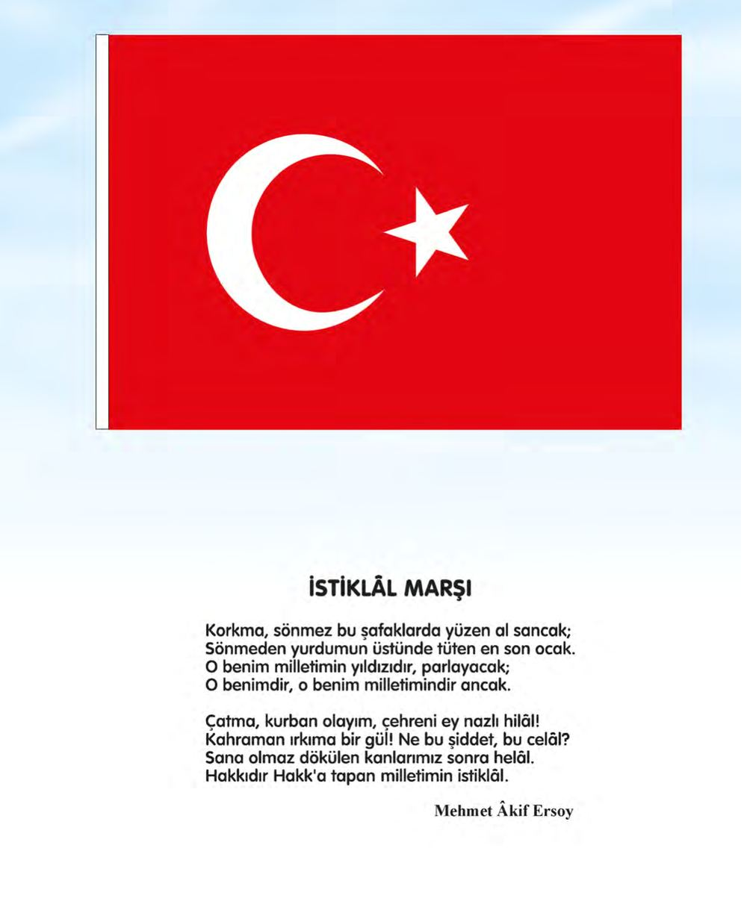

# İSTİKLÂL MARŞI

Korkma, sönmez bu şafaklarda yüzen al sancak;
Sönmeden yurdumun üstünde tüten en son ocak.
O benim milletimin yıldızıdır, parlayacak;
O benimdir, o benim milletimindir ancak.

Çatma, kurban olayım, çehreni ey nazlı hilâl!
Kahraman ırkıma bir gül! Ne bu şiddet, bu celâl?
Sana olmaz dökülen kanlarımız sonra helâl.
Hakkıdır Hakk'a tapan milletimin istiklâl.

Mehmet Âkif Ersoy

<!-- sayfa 3 -->

ANDIMIZ

Türküm, doğruyum, çalışkanım.

İlkem küçüklerimi korumak, büyüklerimi saymak; yurdumu, milletimi özümden çok sevmektir.
Ülküm yükselmek, ileri gitmektir.

Ey Büyük Atatürk!

Açtığın yolda, gösterdiğin hedefe durmadan yürüyeceğime ant içerim.

Varlığım Türk varlığına armağan olsun.

Ne mutlu Türküm diyene!

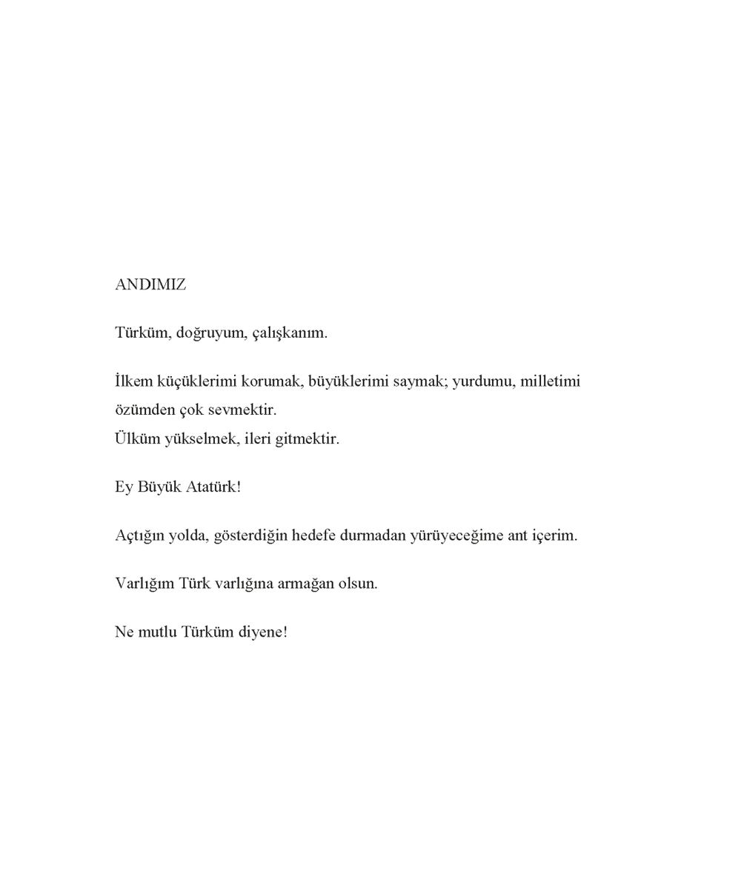
<!-- yer tutucu bulunamadı: sayfa sonuna eklendi -->

<!-- sayfa 4 -->

MUSTAFA KEMAL ATATÜRK

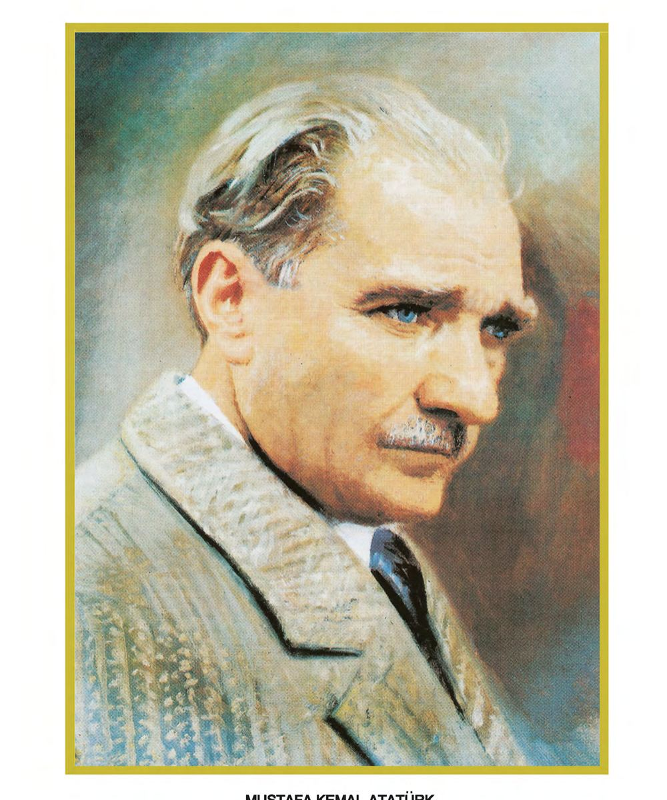
<!-- yer tutucu bulunamadı: sayfa sonuna eklendi -->

<!-- sayfa 5 -->

Verdiğiniz metin katmanı boş olduğu için (`<<< >>>` arası boş) çevrilecek bir içerik bulunmamaktadır. Lütfen metin katmanını içeren içeriği paylaşın, böylece kurallara uygun şekilde Markdown formatına dönüştürebilirim.

<!-- sayfa 6 -->

# İçindekiler

Kitabımızı Tanıyalım ..................................................................................................... 9

## 4. Tema: İşlemlerden Cebirsel Düşünmeye ............ 11

Toplama ve Çıkarma İşlemlerini Çözümleme ................................ 12
* Çıkarma İşlemi .......................................................................................... 35
* Birbirine Eşit İki Sayının Farkı ........................................................ 46
* Toplama ve Çıkarma İşleminde Sıfırın Etkisi ..................... 48

Toplama ve Çıkarma İşlemlerinin Sonuçlarını Tahmin Etme ve Zihinden İşlem ................................................................ 58
* Zihinden Toplama İşlemi .................................................................... 60
* Çıkarma İşleminin Sonucunu Tahmin Etme ......................... 66
* Zihinden Çıkarma İşlemi .................................................................... 68

Toplama ve Çıkarma İşlemlerinde Eşitlik ........................................... 71
Toplama ve Çıkarma İşlemlerinin İlişkisi ............................................. 76
4. Tema Değerlendirme .................................................................................... 85

## 5. Tema: Sayılar ve Nicelikler 3 .................................. 91

Paralarımız ................................................................................................................... 92
5. Tema Değerlendirme ....................................................................................... 104

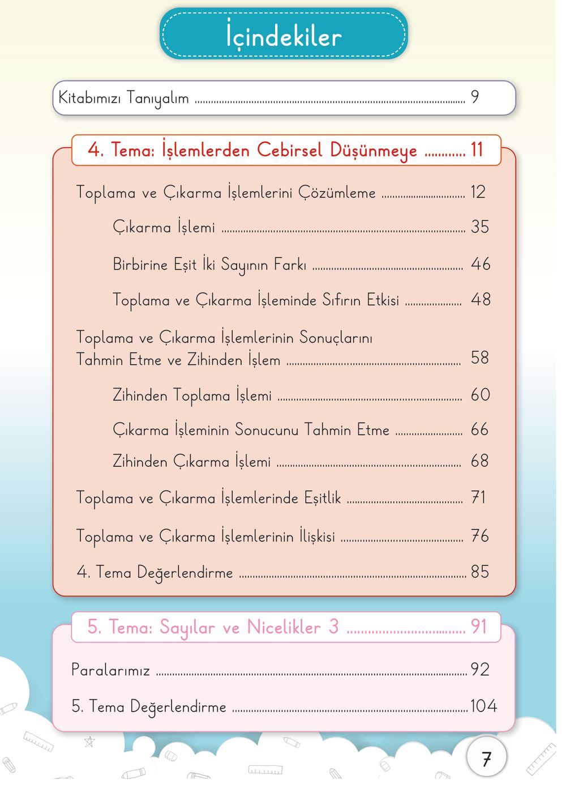
<!-- yer tutucu bulunamadı: sayfa sonuna eklendi -->

<!-- sayfa 7 -->

# 6. Tema: Nesnelerin Geometrisi 2 ............................. 109
* Nesnelerin Biçimsel Özellikleri ................................................................... 110
* Geometrik Yapılardaki Geometrik Şekiller .................................... 115
* Geometrik Şekilleri Sınıflandırma ............................................................ 118
* 6. Tema Değerlendirme ..................................................................................... 126

# 7. Tema: Veriye Dayalı Araştırma ............................. 129
* Veriyle Çalışma ve Veriye Dayalı Karar Verme....................130
* 7. Tema Değerlendirme ...................................................................................... 143

* Sözlük ..................................................................................................................................... 146
* Kaynakça ............................................................................................................................. 149
* Cevap Anahtarı ............................................................................................................ 149
* Görsel ve Genel Ağ Kaynakçası .................................................................... 149
* Ekler ........................................................................................................................................ 151
* Türkiye’nin Mülki İdare Bölümleri ile Kara ve Deniz Komşuları Haritası ......................................................................................................... 158
* Türk Dünyası Haritası ............................................................................................... 159

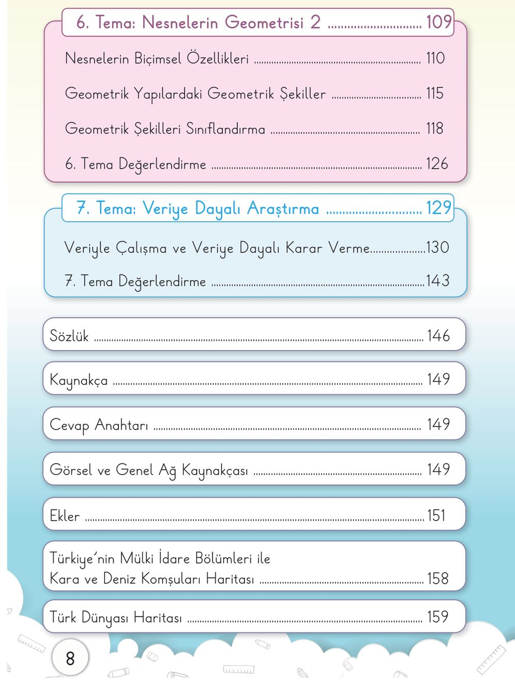
<!-- yer tutucu bulunamadı: sayfa sonuna eklendi -->

<!-- sayfa 8 -->

# Kitabımızı Tanıyalım

*   Konu Başlığı
*   Bölüm Numarası
*   Etkinlik
*   Sayfa Numarası

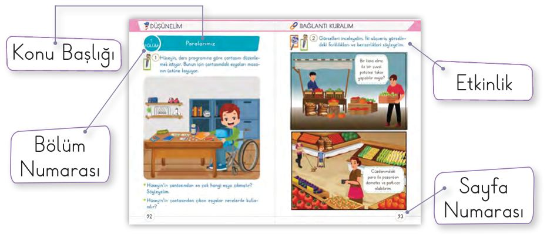
**Etkinlik Sembolü:** Verilen konuyla ilgili işaretleme, eşleştirme, boş yerleri doldurma, işlem yapma gibi etkinlikleri yapmanızı isterim.

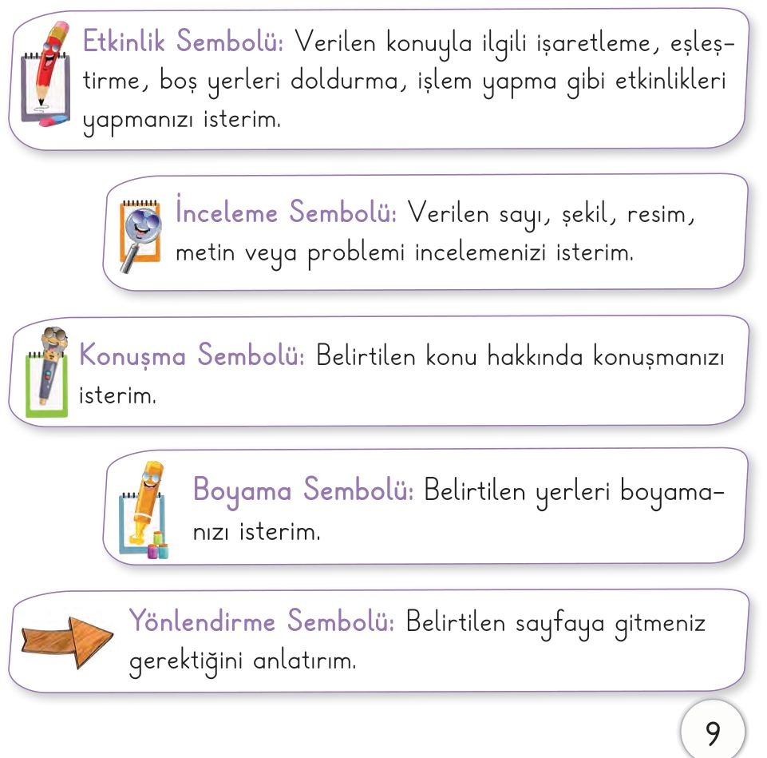
**İnceleme Sembolü:** Verilen sayı, şekil, resim, metin veya problemi incelemenizi isterim.

**Konuşma Sembolü:** Belirtilen konu hakkında konuşmanızı isterim.

**Boyama Sembolü:** Belirtilen yerleri boyamanızı isterim.

**Yönlendirme Sembolü:** Belirtilen sayfaya gitmeniz gerektiğini anlatırım.

<!-- sayfa 9 -->

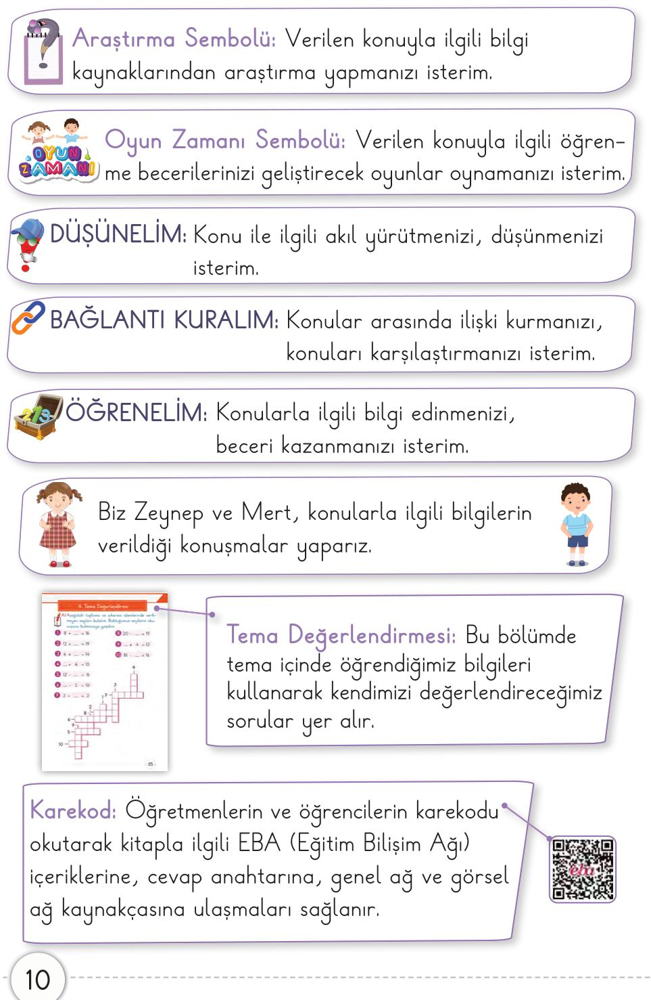 Araştırma Sembolü: Verilen konuyla ilgili bilgi kaynaklarından araştırma yapmanızı isterim.

 Oyun Zamanı Sembolü: Verilen konuyla ilgili öğrenme becerilerinizi geliştirecek oyunlar oynamanızı isterim.

 DÜŞÜNELİM: Konu ile ilgili akıl yürütmenizi, düşünmenizi isterim.

 BAĞLANTI KURALIM: Konular arasında ilişki kurmanızı, konuları karşılaştırmanızı isterim.

 ÖĞRENELİM: Konularla ilgili bilgi edinmenizi, beceri kazanmanızı isterim.

 Biz Zeynep ve Mert, konularla ilgili bilgilerin verildiği konuşmalar yaparız. 

 Tema Değerlendirmesi: Bu bölümde tema içinde öğrendiğimiz bilgileri kullanarak kendimizi değerlendireceğimiz sorular yer alır.

 Karekod: Öğretmenlerin ve öğrencilerin karekodu okutarak kitapla ilgili EBA (Eğitim Bilişim Ağı) içeriklerine, cevap anahtarına, genel ağ ve görsel ağ kaynakçasına ulaşmaları sağlanır. 

<!-- sayfa 10 -->

# 4. TEMA

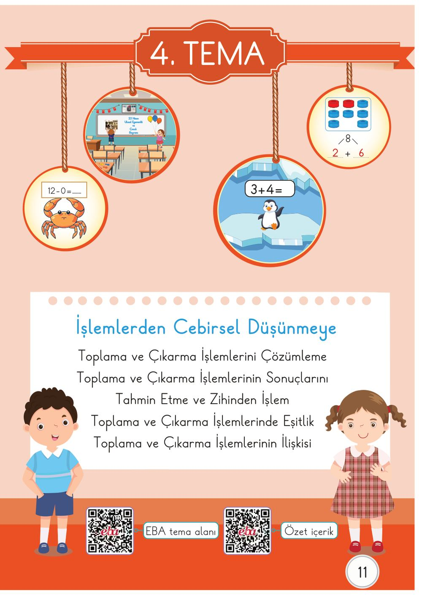

$12 - 0 = .......$ <!-- KONTROL: Marker'da karşılığı yok, uydurma olabilir -->

$3 + 4 =$ <!-- KONTROL: Marker'da karşılığı yok, uydurma olabilir -->

$2 + 6 = 8$ <!-- KONTROL: Marker'da karşılığı yok, uydurma olabilir -->

## İşlemlerden Cebirsel Düşünmeye

* Toplama ve Çıkarma İşlemlerini Çözümleme
* Toplama ve Çıkarma İşlemlerinin Sonuçlarını Tahmin Etme ve Zihinden İşlem
* Toplama ve Çıkarma İşlemlerinde Eşitlik
* Toplama ve Çıkarma İşlemlerinin İlişkisi

| EBA tema alanı | Özet içerik |
| :--- | :--- |

<!-- sayfa 11 -->

# Toplama ve Çıkarma İşlemlerini Çözümleme

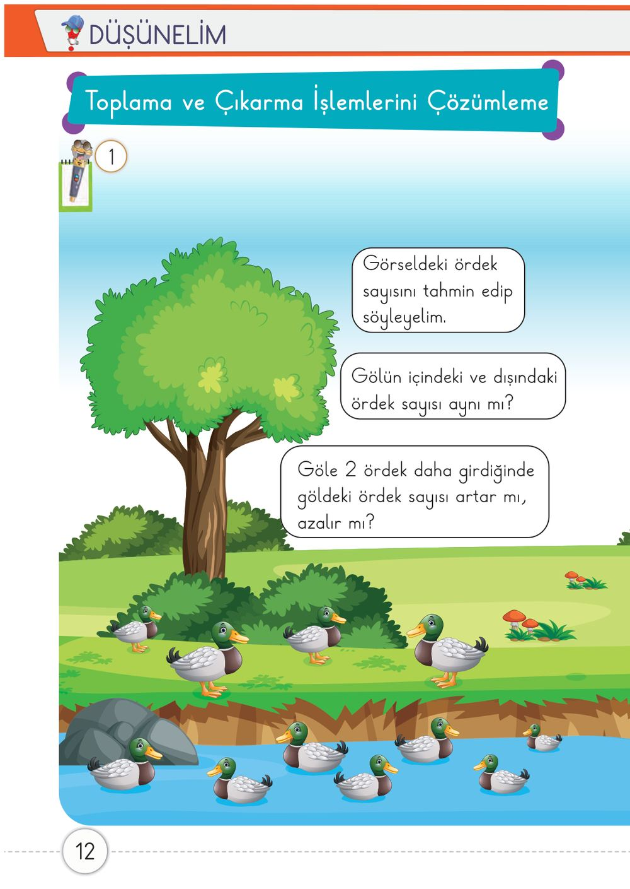

Görseldeki ördek sayısını tahmin edip söyleyelim.

Gölün içindeki ve dışındaki ördek sayısı aynı mı?

Göle 2 ördek daha girdiğinde göldeki ördek sayısı artar mı, azalır mı?

<!-- sayfa 12 -->

Ağaçtan 1 kuş daha uçarsa ağaçtaki kuş sayısıyla uçan kuş sayısı eşit olur mu?

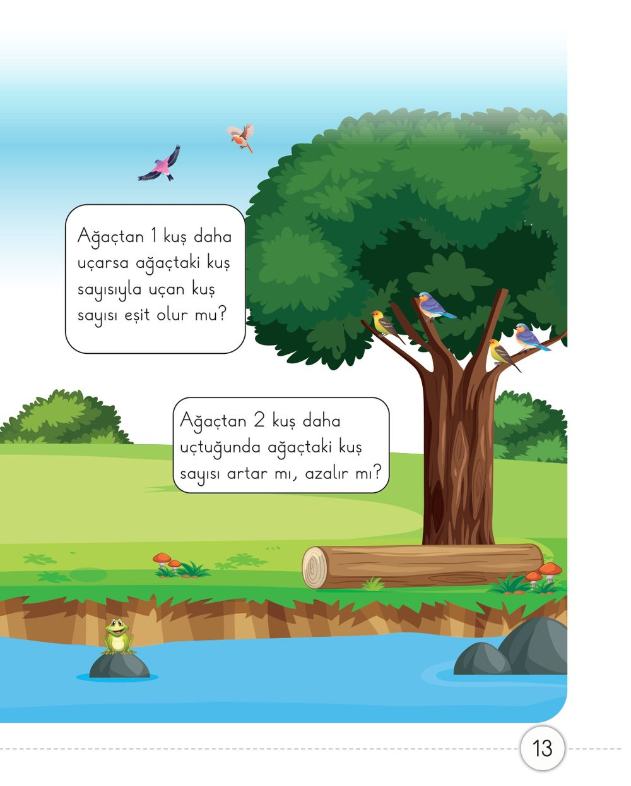
Ağaçtan 2 kuş daha uçtuğunda ağaçtaki kuş sayısı artar mı, azalır mı?

<!-- sayfa 13 -->

![OYUN ZAMANI]

# Arttıralım mı, Azaltalım mı Oyunu

## Oyun Kuralları

* Öğretmen, öğrencileri iki gruba ayırır. Sınıfta her iki grup için birer bölüm oluşturur.
* Öğretmen tahtaya bölümlerde bulunması gereken öğrenci sayılarını yazar.
* Gruplar bu sayılara göre bölümlerine öğrenci gönderirler ya da bölümlerinden öğrenci azaltırlar.
* Öğretmen yeni sayılar yazarak etkinliğe devam eder.
* Bu şekilde gruplar artma ya da azaltma kararlarını doğru vererek puan alır.
* En çok puanı alan grup kazanır.

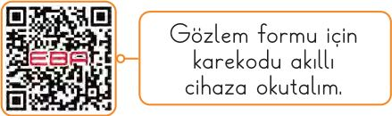

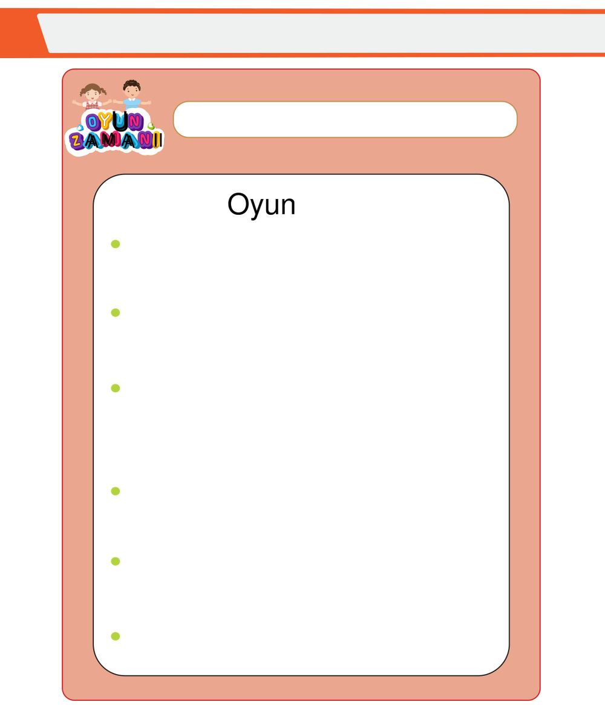
Gözlem formu için karekodu akıllı cihaza okutalım.

<!-- sayfa 14 -->

 2 Melike’nin 3 tane inciri vardır. Babası Melike’ye tabağındaki incirlerden 1 tane daha verir. Melike ve babasının incirlerinin artma ve azalma durumlarını söyleyelim. Son durumda Melike ve babasının incir sayılarını karşılaştıralım. Tabaklardaki incir sayıları için artma ve azalma dışında hangi kelimeler kullanılabilir? Söyleyelim.

<!-- sayfa 15 -->

 3  Aşağıdaki durumlardan hangisinde nesne sayısında artma ya da azalma olacağına karar verelim. Örnekteki gibi “$\checkmark$ <!-- KONTROL: Marker'da karşılığı yok, uydurma olabilir -->” ile işaretleyelim.

| Durum | Artma | Azalma |
| :--- | :---: | :---: |
| Tabaktaki muzlardan bir kısmını yedim. Buna göre muzların sayısı artar mı, azalır mı? | | $\checkmark$ <!-- KONTROL: Marker'da karşılığı yok, uydurma olabilir --> |
| Manava bugün 1 kasa daha erik geldi. Buna göre eriklerin sayısı artar mı, azalır mı? | | |
| Aynur, elindeki fındıkların bir kısmını komşusuna verdi. Buna göre Aynur’un elindeki fındıkların sayısı artar mı, azalır mı? | | |
| Sezer, kırtasiyeden 3 tane daha kalem aldı. Bu durumda Sezer’in kalem sayısı artar mı, azalır mı? | | |
| Ümit, bir tabak kirazın bir kısmını yedi. Buna göre tabaktaki kiraz sayısı artar mı, azalır mı? | | |

<!-- sayfa 16 -->

 4 Satranç turnuvasında Emre ile Ayşe yarışmıştır. Emre maçı kazanmıştır. Emre, Ayşe’yi iyi bir oyun çıkardığı için tebrik etmiştir. Emre’ye ödül olarak 7 boya kalemi verilmiştir. Emre, kalemlerinin 3 tanesini Ayşe’ye vermiştir. Bu durumda Emre’nin kalemleri artmış mıdır, azalmış mıdır?

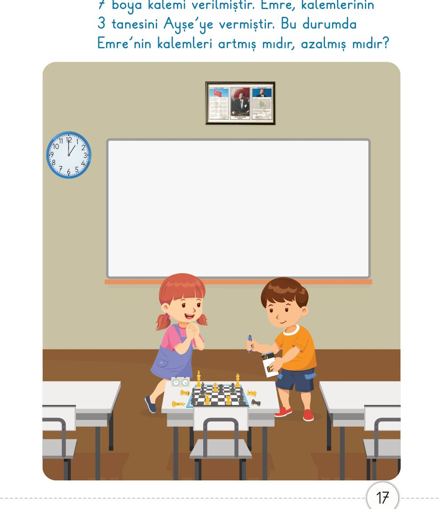

<!-- sayfa 17 -->

 23 Nisan Ulusal Egemenlik ve Çocuk Bayramı için sınıf süslenecektir. Şule, sınıfa 7 balon getirmiştir. Balonlardan birkaç tanesini şişirmiştir. Şişirmediği balonları sıranın üzerine bırakmıştır.

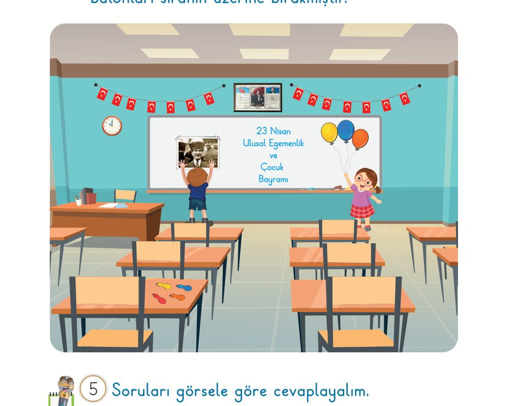 5 Soruları görsele göre cevaplayalım.

* Şule, kaç balon şişirmiştir?
* Sıranın üzerinde kaç balon vardır?
* Şule, 2 balon daha şişirirse Şule'nin elindeki balonlar artar mı azalır mı?

<!-- sayfa 18 -->

 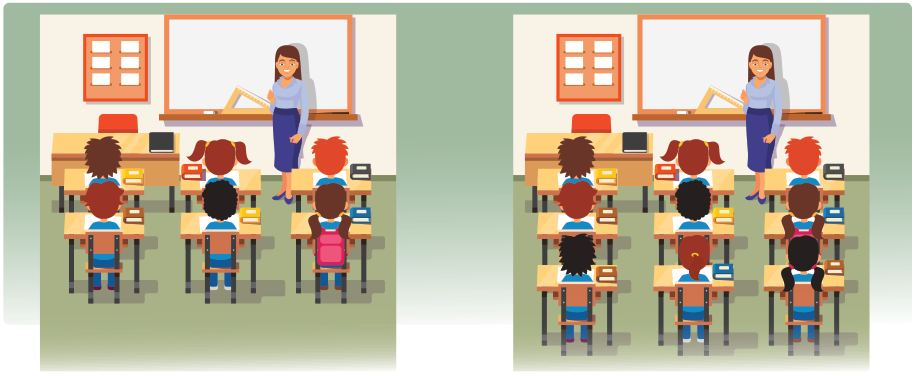 1/A sınıfında geçen hafta 6 öğrenci okuma yazma öğrenmiştir. Bu hafta 3 öğrenci daha okuma yazma öğrenmiştir. Okuma yazma öğrenen öğrenciler, öğretmenleri tarafından tebrik edilmiştir.

 Mert, 1/A sınıfında okuma yazma öğrenenlerin sayısı geçen haftaya göre değişmiştir.

 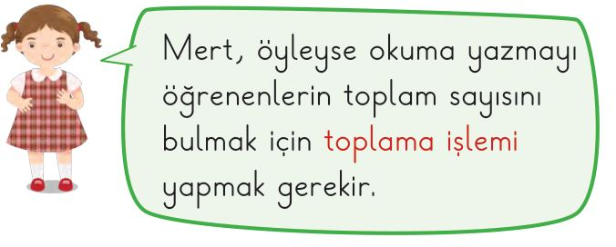 Evet Zeynep, okuma yazmayı öğrenenlerin sayısı artmıştır yani çoğalmıştır.

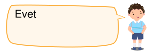 Mert, öyleyse okuma yazmayı öğrenenlerin toplam sayısını bulmak için toplama işlemi yapmak gerekir.

<!-- sayfa 19 -->

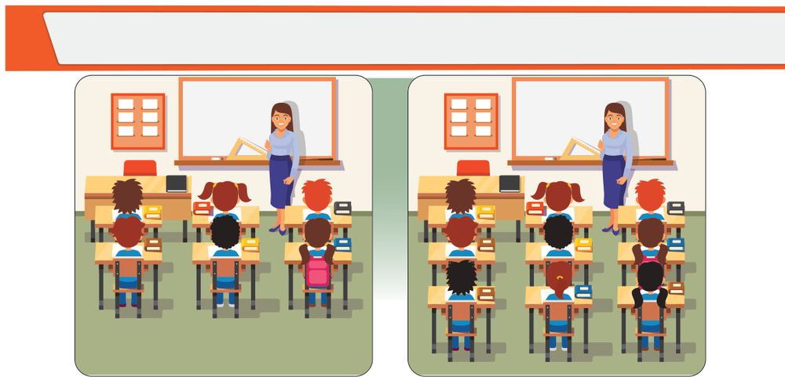 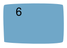

 6 öğrenci okuma yazmayı öğrendi.

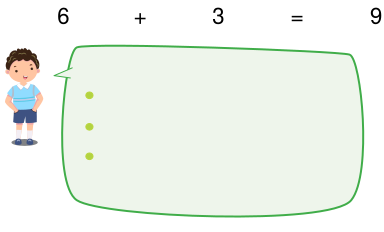 3 öğrenci daha okuma yazmayı öğrendi. Toplam 9 öğrenci okuma yazmayı öğrendi.

$$6 + 3 = 9$$

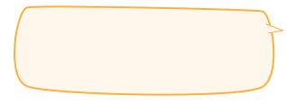 Zeynep, yukarıdaki toplama işlemini
* “Altı artı üç eşittir dokuz.”
* “Altı üç daha dokuz eder.”
* “Altı ile üçü toplarsak dokuz eder.”
şeklinde söyleyebiliriz.

 Mert, toplama işlemi varlıkları bir araya getirme ve birbirine ekleme işlemidir.

<!-- sayfa 20 -->

 Yeliz’in 5 kalemi vardır. Yeliz’e 2 kalem de arkadaşı hediye etmiştir. Buna göre Yeliz’in toplam kalem sayısı aşağıdaki gibi farklı şekillerde söylenebilir.

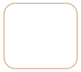 + 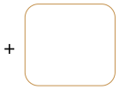 $\rightarrow$ <!-- KONTROL: Marker'da karşılığı yok, uydurma olabilir --> 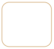

| $5$ | $+$ | $2$ | $=$ | $7$ |
| :--- | :---: | :--- | :---: | :--- |
| $5$ | artı | $2$ | eşittir | $7$ |
| $5$ | $'e$ | $2$ | eklersek | $7$ eder. |
| $5$ | $'in$ | $2$ | fazlası | $7$ eder. |

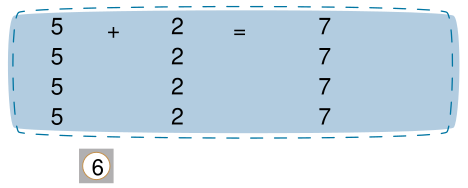 6 Aşağıdaki toplama işlemlerini yapalım. Noktalı yerleri dolduralım. Yazdığımız cümleleri okuyalım.

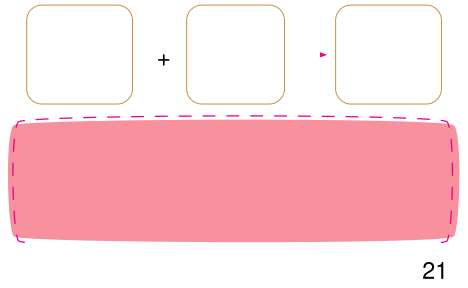 +  $\rightarrow$ <!-- KONTROL: Marker'da karşılığı yok, uydurma olabilir --> 

| $\dots\dots\dots$ <!-- KONTROL: Marker'da karşılığı yok, uydurma olabilir --> | $+$ | $\dots\dots\dots$ <!-- KONTROL: Marker'da karşılığı yok, uydurma olabilir --> | $=$ | $\dots\dots\dots$ <!-- KONTROL: Marker'da karşılığı yok, uydurma olabilir --> |
| :--- | :---: | :--- | :---: | :--- |
| $\dots\dots\dots$ <!-- KONTROL: Marker'da karşılığı yok, uydurma olabilir --> | artı | $\dots\dots\dots$ <!-- KONTROL: Marker'da karşılığı yok, uydurma olabilir --> | eşittir | $\dots\dots\dots$ <!-- KONTROL: Marker'da karşılığı yok, uydurma olabilir --> |
| $\dots\dots\dots$ <!-- KONTROL: Marker'da karşılığı yok, uydurma olabilir --> | $'e$ | $\dots\dots\dots$ <!-- KONTROL: Marker'da karşılığı yok, uydurma olabilir --> | eklersek | $\dots\dots\dots$ <!-- KONTROL: Marker'da karşılığı yok, uydurma olabilir --> eder. |
| $\dots\dots\dots$ <!-- KONTROL: Marker'da karşılığı yok, uydurma olabilir --> | $'in$ | $\dots\dots\dots$ <!-- KONTROL: Marker'da karşılığı yok, uydurma olabilir --> | fazlası | $\dots\dots\dots$ <!-- KONTROL: Marker'da karşılığı yok, uydurma olabilir --> eder. |

<!-- sayfa 21 -->

# 7. Aşağıdaki toplama işlemlerini yapalım. Toplama işlemlerine ait cümleleri örnekteki gibi yazalım. Yazdığımız cümleleri okuyalım.

$\text{🍄🍄} + \text{🍄🍄} \longrightarrow \text{🍄🍄🍄🍄}$ <!-- KONTROL: Marker'da karşılığı yok, uydurma olabilir -->
$2 + 2 = 4$
İki artı iki eşittir dört eder.

---

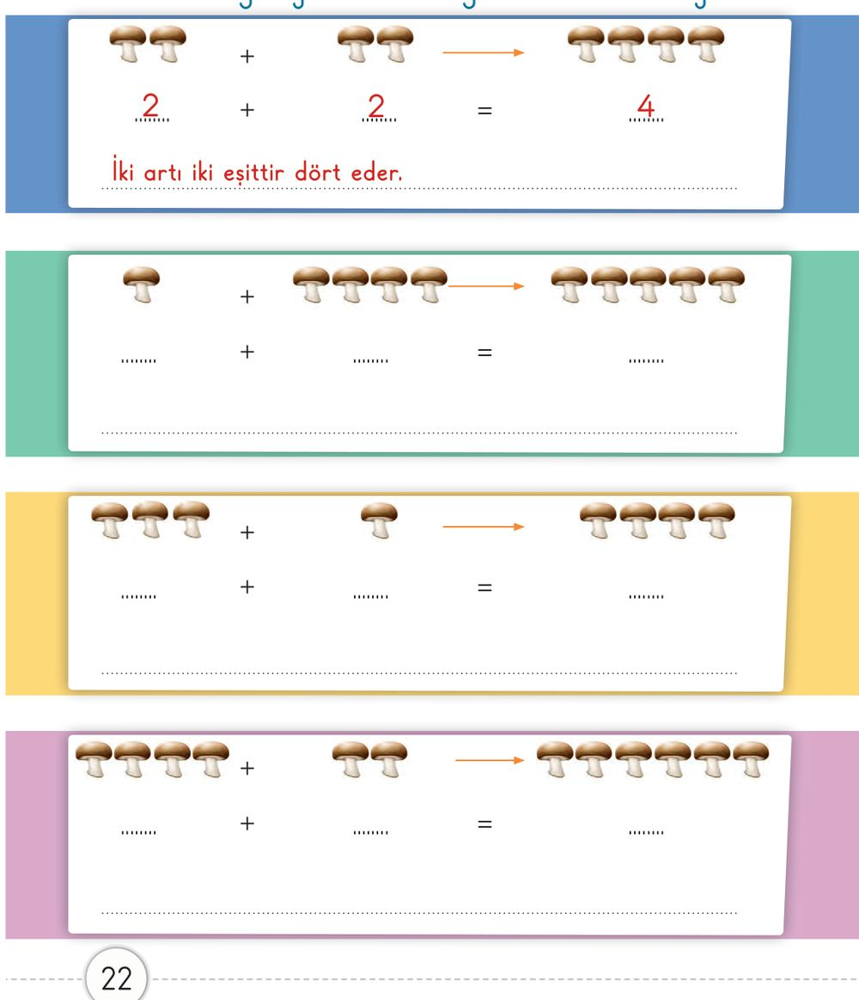
$\text{🍄} + \text{🍄🍄🍄🍄} \longrightarrow \text{🍄🍄🍄🍄🍄}$ <!-- KONTROL: Marker'da karşılığı yok, uydurma olabilir -->
$\dots + \dots = \dots$ <!-- KONTROL: Marker'da karşılığı yok, uydurma olabilir -->
$\dots$ <!-- KONTROL: Marker'da karşılığı yok, uydurma olabilir -->

---

$\text{🍄🍄🍄} + \text{🍄} \longrightarrow \text{🍄🍄🍄🍄}$ <!-- KONTROL: Marker'da karşılığı yok, uydurma olabilir -->
$\dots + \dots = \dots$ <!-- KONTROL: Marker'da karşılığı yok, uydurma olabilir -->
$\dots$ <!-- KONTROL: Marker'da karşılığı yok, uydurma olabilir -->

---

$\text{🍄🍄🍄🍄} + \text{🍄🍄} \longrightarrow \text{🍄🍄🍄🍄🍄🍄}$ <!-- KONTROL: Marker'da karşılığı yok, uydurma olabilir -->
$\dots + \dots = \dots$ <!-- KONTROL: Marker'da karşılığı yok, uydurma olabilir -->
$\dots$ <!-- KONTROL: Marker'da karşılığı yok, uydurma olabilir -->

<!-- sayfa 22 -->

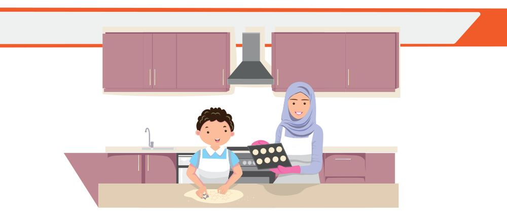

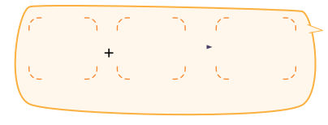
Zeynep, annemle kurabiye yaptık. Ben önce $3$ tane sonra $2$ tane daha kurabiye yaptım. Toplam kaç tane kurabiye yaptım?

$3 + 2 \rightarrow 5$ <!-- KONTROL: Marker'da karşılığı yok, uydurma olabilir -->
Mert, $5$ <!-- KONTROL: Marker'da karşılığı yok, uydurma olabilir --> tane kurabiye yapmışsın.

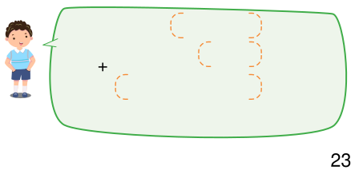
$\begin{array}{r}
\text{🍪 🍪 🍪} \\
+ \text{ 🍪 🍪} \\
\hline
\text{🍪 🍪 🍪 🍪 🍪}
\end{array}$
Evet Zeynep, toplam $5$ <!-- KONTROL: Marker'da karşılığı yok, uydurma olabilir --> tane kurabiye yaptım.

<!-- sayfa 23 -->

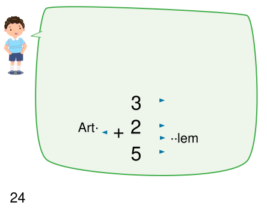

Ben kurabiyelerin sayısını yan yana toplama işlemi yaparak buldum. Toplama işleminin sembolü olan “$+$” (artı) işaretini kullandım. İşlemi yan yana yaptığım için “$=$” (eşit) işareti de kullandım.

$$3 + 2 = 5$$
<!-- KONTROL: Marker'da karşılığı yok, uydurma olabilir -->

$$\downarrow \quad \downarrow \quad \downarrow$$
<!-- KONTROL: Marker'da karşılığı yok, uydurma olabilir -->
$$\text{Toplanan} \quad \text{Toplanan} \quad \text{Toplam}$$
<!-- KONTROL: Marker'da karşılığı yok, uydurma olabilir -->

$$\text{Artı işareti} \quad \text{Eşit işareti}$$
<!-- KONTROL: Marker'da karşılığı yok, uydurma olabilir -->

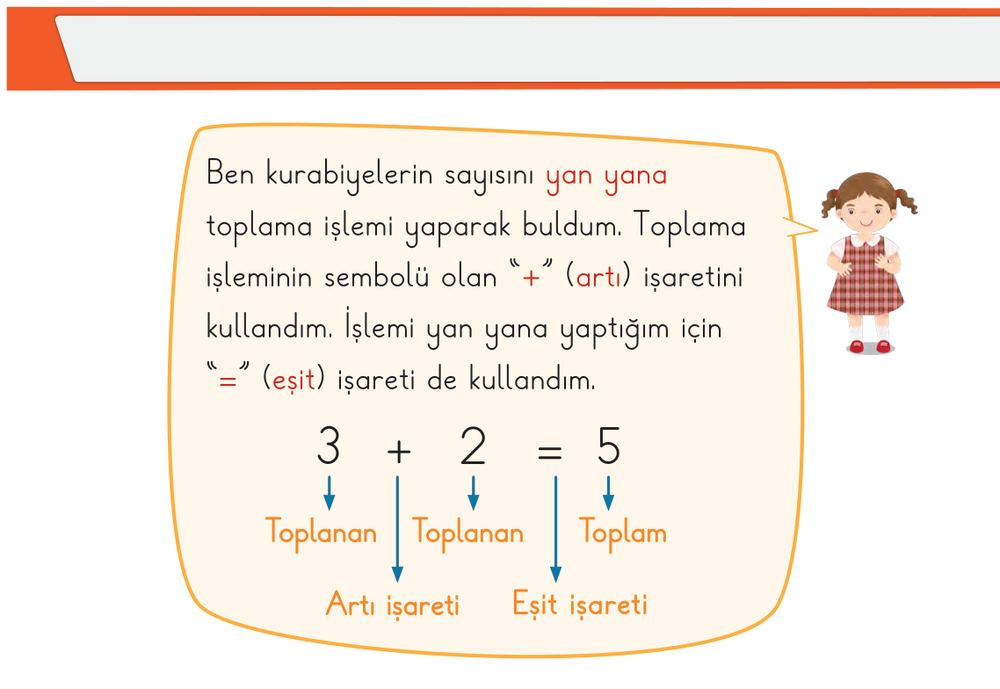

Ben de kurabiyelerin sayısını alt alta toplama işlemi yaparak buldum. Alt alta toplama işlemi yaparken toplananların altına işlem çizgisini çizdim.

$$3 \longrightarrow \text{Toplanan}$$
<!-- KONTROL: Marker'da karşılığı yok, uydurma olabilir -->
$$\text{Artı işareti} \quad 2 \longrightarrow \text{Toplanan}$$
<!-- KONTROL: Marker'da karşılığı yok, uydurma olabilir -->
$$\quad + \quad \longrightarrow \text{İşlem çizgisi}$$
<!-- KONTROL: Marker'da karşılığı yok, uydurma olabilir -->
$$5 \longrightarrow \text{Toplam}$$
<!-- KONTROL: Marker'da karşılığı yok, uydurma olabilir -->

<!-- sayfa 24 -->

 8 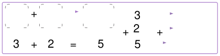 Aşağıda verilen toplama işlemlerini örnekteki gibi yapalım.

---

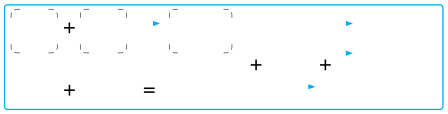
$\text{🟠🟠}$ <!-- KONTROL: Marker'da karşılığı yok, uydurma olabilir -->
$\text{🟠}$ <!-- KONTROL: Marker'da karşılığı yok, uydurma olabilir -->
$+$
$\text{🔴🔴}$ <!-- KONTROL: Marker'da karşılığı yok, uydurma olabilir -->
$\rightarrow$ <!-- KONTROL: Marker'da karşılığı yok, uydurma olabilir -->
$\text{🟠🟠🟠}$ <!-- KONTROL: Marker'da karşılığı yok, uydurma olabilir -->
$\text{🔴🔴}$ <!-- KONTROL: Marker'da karşılığı yok, uydurma olabilir -->

$3 \longrightarrow \text{🟠🟠🟠}$ <!-- KONTROL: Marker'da karşılığı yok, uydurma olabilir -->
$+ 2 \longrightarrow \text{🔴🔴}$ <!-- KONTROL: Marker'da karşılığı yok, uydurma olabilir -->
$5 \longrightarrow \text{🟠🟠🟠🔴🔴}$ <!-- KONTROL: Marker'da karşılığı yok, uydurma olabilir -->

$3 + 2 = 5$ <!-- KONTROL: Marker'da karşılığı yok, uydurma olabilir -->

---

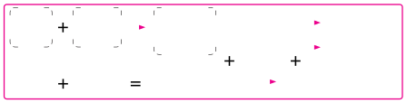
$\text{🟣🟣}$ <!-- KONTROL: Marker'da karşılığı yok, uydurma olabilir -->
$\text{🟣🟣}$ <!-- KONTROL: Marker'da karşılığı yok, uydurma olabilir -->
$+$
$\text{🟠🟠}$ <!-- KONTROL: Marker'da karşılığı yok, uydurma olabilir -->
$\text{🟠}$ <!-- KONTROL: Marker'da karşılığı yok, uydurma olabilir -->
$\rightarrow$ <!-- KONTROL: Marker'da karşılığı yok, uydurma olabilir -->
$\text{🟣🟣🟣🟣}$ <!-- KONTROL: Marker'da karşılığı yok, uydurma olabilir -->
$\text{🟠🟠🟠}$ <!-- KONTROL: Marker'da karşılığı yok, uydurma olabilir -->

$\dots \longrightarrow \text{🟣🟣🟣🟣}$ <!-- KONTROL: Marker'da karşılığı yok, uydurma olabilir -->
$+ \dots \longrightarrow \text{🟠🟠}$ <!-- KONTROL: Marker'da karşılığı yok, uydurma olabilir -->
$\dots \longrightarrow \text{🟣🟣🟣🟣🟠🟠🟠}$ <!-- KONTROL: Marker'da karşılığı yok, uydurma olabilir -->

$\dots + \dots = \dots$ <!-- KONTROL: Marker'da karşılığı yok, uydurma olabilir -->

---

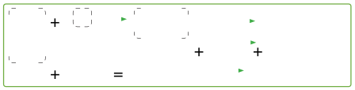
$\text{🟢🟢}$ <!-- KONTROL: Marker'da karşılığı yok, uydurma olabilir -->
$\text{🟢🟢}$ <!-- KONTROL: Marker'da karşılığı yok, uydurma olabilir -->
$+$
$\text{🔵🔵🔵}$ <!-- KONTROL: Marker'da karşılığı yok, uydurma olabilir -->
$\text{🔵🔵}$ <!-- KONTROL: Marker'da karşılığı yok, uydurma olabilir -->
$\rightarrow$ <!-- KONTROL: Marker'da karşılığı yok, uydurma olabilir -->
$\text{🟢🟢🟢🟢}$ <!-- KONTROL: Marker'da karşılığı yok, uydurma olabilir -->
$\text{🔵🔵🔵🔵🔵}$ <!-- KONTROL: Marker'da karşılığı yok, uydurma olabilir -->

$\dots \longrightarrow \text{🟢🟢🟢🟢}$ <!-- KONTROL: Marker'da karşılığı yok, uydurma olabilir -->
$+ \dots \longrightarrow \text{🔵🔵🔵🔵🔵}$ <!-- KONTROL: Marker'da karşılığı yok, uydurma olabilir -->
$\dots \longrightarrow \text{🟢🟢🟢🟢🔵🔵🔵🔵🔵}$ <!-- KONTROL: Marker'da karşılığı yok, uydurma olabilir -->

$\dots + \dots = \dots$ <!-- KONTROL: Marker'da karşılığı yok, uydurma olabilir -->

---

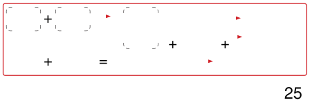
$\text{🔵🔵🔵}$ <!-- KONTROL: Marker'da karşılığı yok, uydurma olabilir -->
$\text{🔵🔵}$ <!-- KONTROL: Marker'da karşılığı yok, uydurma olabilir -->
$+$
$\text{🌸}$ <!-- KONTROL: Marker'da karşılığı yok, uydurma olabilir -->
$\rightarrow$ <!-- KONTROL: Marker'da karşılığı yok, uydurma olabilir -->
$\text{🔵🔵🔵🔵🔵}$ <!-- KONTROL: Marker'da karşılığı yok, uydurma olabilir -->
$\text{🌸}$ <!-- KONTROL: Marker'da karşılığı yok, uydurma olabilir -->

$\dots \longrightarrow \text{🔵🔵🔵🔵🔵🔵🔵🔵}$ <!-- KONTROL: Marker'da karşılığı yok, uydurma olabilir -->
$+ \dots \longrightarrow \text{🌸}$ <!-- KONTROL: Marker'da karşılığı yok, uydurma olabilir -->
$\dots \longrightarrow \text{🔵🔵🔵🔵🔵🔵🔵🔵🌸}$ <!-- KONTROL: Marker'da karşılığı yok, uydurma olabilir -->

$\dots + \dots = \dots$ <!-- KONTROL: Marker'da karşılığı yok, uydurma olabilir -->

---

$\text{🟢🟢}$ <!-- KONTROL: Marker'da karşılığı yok, uydurma olabilir -->
$\text{🟢🟢}$ <!-- KONTROL: Marker'da karşılığı yok, uydurma olabilir -->
$+$
$\text{🟠🟠}$ <!-- KONTROL: Marker'da karşılığı yok, uydurma olabilir -->
$\text{🟠}$ <!-- KONTROL: Marker'da karşılığı yok, uydurma olabilir -->
$\text{🟠}$ <!-- KONTROL: Marker'da karşılığı yok, uydurma olabilir -->
$\rightarrow$ <!-- KONTROL: Marker'da karşılığı yok, uydurma olabilir -->
$\text{🟢🟢🟢}$ <!-- KONTROL: Marker'da karşılığı yok, uydurma olabilir -->
$\text{🟠🟠🟠}$ <!-- KONTROL: Marker'da karşılığı yok, uydurma olabilir -->
$\text{🟠}$ <!-- KONTROL: Marker'da karşılığı yok, uydurma olabilir -->

$\dots \longrightarrow \text{🟢🟢🟢}$ <!-- KONTROL: Marker'da karşılığı yok, uydurma olabilir -->
$+ \dots \longrightarrow \text{🟠🟠🟠🟠}$ <!-- KONTROL: Marker'da karşılığı yok, uydurma olabilir -->
$\dots \longrightarrow \text{🟢🟢🟢🟠🟠🟠🟠}$ <!-- KONTROL: Marker'da karşılığı yok, uydurma olabilir -->

$\dots + \dots = \dots$ <!-- KONTROL: Marker'da karşılığı yok, uydurma olabilir -->

<!-- sayfa 25 -->

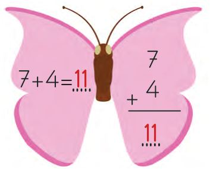 9 Aşağıda yan yana ve alt alta verilen toplama işlemlerini örnekteki gibi yapalım.

1.
 $7+4=11$ <!-- KONTROL: Marker'da karşılığı yok, uydurma olabilir -->
$\begin{array}{r} 7 \\ +\ 4 \\ \hline 11 \end{array}$ <!-- KONTROL: Marker'da karşılığı yok, uydurma olabilir -->

2.
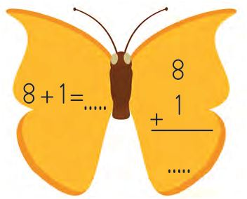 $5+2=\dots$ <!-- KONTROL: Marker'da karşılığı yok, uydurma olabilir -->
$\begin{array}{r} 5 \\ +\ 2 \\ \hline \dots \end{array}$ <!-- KONTROL: Marker'da karşılığı yok, uydurma olabilir -->

3.
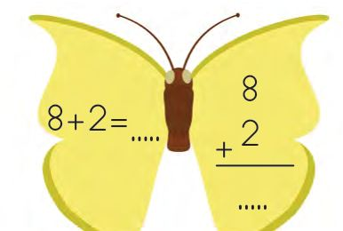 $8+1=\dots$ <!-- KONTROL: Marker'da karşılığı yok, uydurma olabilir -->
$\begin{array}{r} 8 \\ +\ 1 \\ \hline \dots \end{array}$ <!-- KONTROL: Marker'da karşılığı yok, uydurma olabilir -->

4.
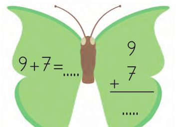 $3+3=\dots$ <!-- KONTROL: Marker'da karşılığı yok, uydurma olabilir -->
$\begin{array}{r} 3 \\ +\ 3 \\ \hline \dots \end{array}$ <!-- KONTROL: Marker'da karşılığı yok, uydurma olabilir -->

5.
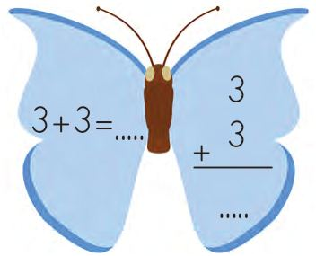 $4+3=\dots$ <!-- KONTROL: Marker'da karşılığı yok, uydurma olabilir -->
$\begin{array}{r} 4 \\ +\ 3 \\ \hline \dots \end{array}$ <!-- KONTROL: Marker'da karşılığı yok, uydurma olabilir -->

6.
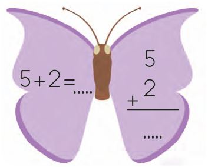 $9+3=\dots$ <!-- KONTROL: Marker'da karşılığı yok, uydurma olabilir -->
$\begin{array}{r} 9 \\ +\ 3 \\ \hline \dots \end{array}$ <!-- KONTROL: Marker'da karşılığı yok, uydurma olabilir -->

7.
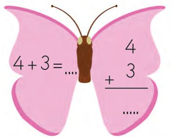 $8+2=\dots$ <!-- KONTROL: Marker'da karşılığı yok, uydurma olabilir -->
$\begin{array}{r} 8 \\ +\ 2 \\ \hline \dots \end{array}$ <!-- KONTROL: Marker'da karşılığı yok, uydurma olabilir -->

8.
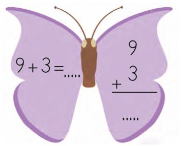 $9+7=\dots$ <!-- KONTROL: Marker'da karşılığı yok, uydurma olabilir -->
$\begin{array}{r} 9 \\ +\ 7 \\ \hline \dots \end{array}$ <!-- KONTROL: Marker'da karşılığı yok, uydurma olabilir -->

<!-- sayfa 26 -->

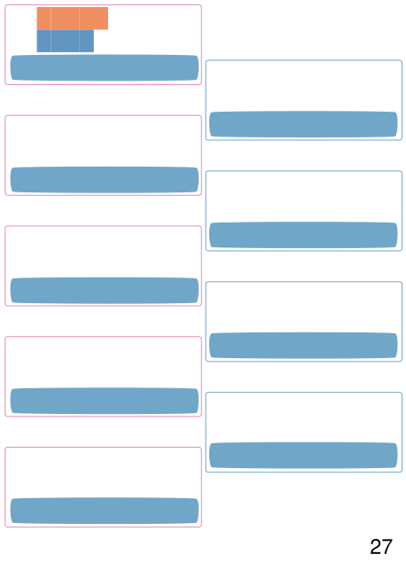 10 Aşağıdaki kutuları, kutuların altında verilen sayılara göre farklı renklerle boyayalım. Toplama işlemlerini örnekteki gibi yapalım.

$5 + 4 = 9$ <!-- KONTROL: Marker'da karşılığı yok, uydurma olabilir -->

$1 + 9 = \dots\dots\dots$ <!-- KONTROL: Marker'da karşılığı yok, uydurma olabilir -->

$3 + 4 = \dots\dots\dots$ <!-- KONTROL: Marker'da karşılığı yok, uydurma olabilir -->

$2 + 6 = \dots\dots\dots$ <!-- KONTROL: Marker'da karşılığı yok, uydurma olabilir -->

$6 + 5 = \dots\dots\dots$ <!-- KONTROL: Marker'da karşılığı yok, uydurma olabilir -->

$8 + 5 = \dots\dots\dots$ <!-- KONTROL: Marker'da karşılığı yok, uydurma olabilir -->

$7 + 7 = \dots\dots\dots$ <!-- KONTROL: Marker'da karşılığı yok, uydurma olabilir -->

$9 + 8 = \dots\dots\dots$ <!-- KONTROL: Marker'da karşılığı yok, uydurma olabilir -->

$8 + 7 = \dots\dots\dots$ <!-- KONTROL: Marker'da karşılığı yok, uydurma olabilir -->

<!-- sayfa 27 -->

Efe’nin $3$ boya kalemi vardır. Çağla’nın ise $4$ boya kalemi vardır. Efe, kalemlerini Çağla’nın kalemlerine eklemiştir. Toplam kalem sayısı yanda gösterilmiştir.

Çağla, kalemlerini Efe’nin kalemlerine eklemiştir. Toplam kalem sayısı yanda gösterilmiştir.

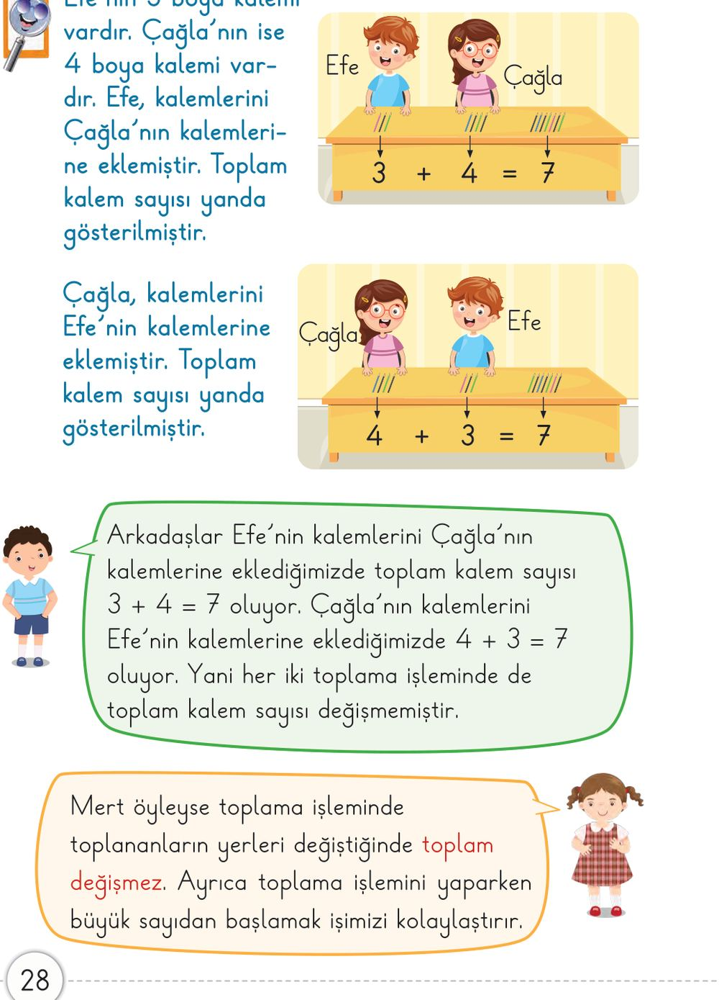

> Arkadaşlar Efe’nin kalemlerini Çağla’nın kalemlerine eklediğimizde toplam kalem sayısı $3 + 4 = 7$ oluyor. Çağla’nın kalemlerini Efe’nin kalemlerine eklediğimizde $4 + 3 = 7$ oluyor. Yani her iki toplama işleminde de toplam kalem sayısı değişmemiştir.

> Mert öyleyse toplama işleminde toplananların yerleri değiştiğinde **toplam değişmez**. Ayrıca toplama işlemini yaparken büyük sayıdan başlamak işimizi kolaylaştırır.

<!-- sayfa 28 -->

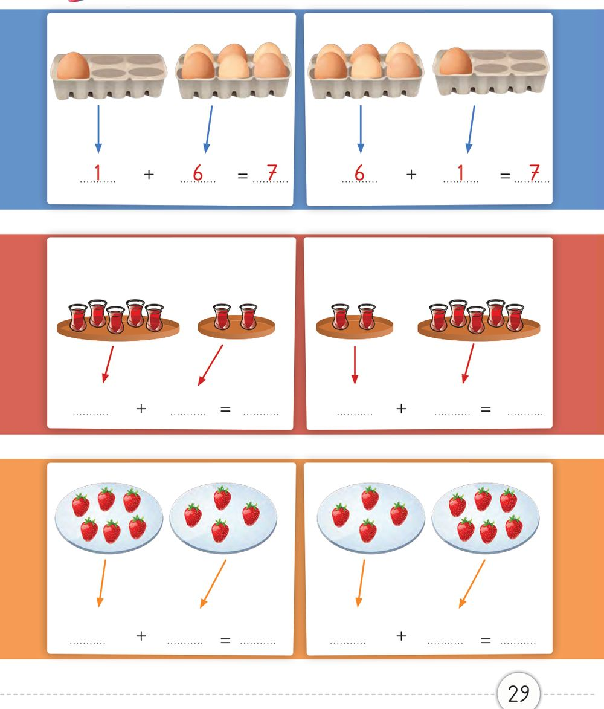 11 Aşağıdaki toplama işlemlerini örnekteki gibi yapalım.

$1 + 6 = 7$ <!-- KONTROL: Marker'da karşılığı yok, uydurma olabilir -->

$6 + 1 = 7$ <!-- KONTROL: Marker'da karşılığı yok, uydurma olabilir -->

$\dots\dots + \dots\dots = \dots\dots$ <!-- KONTROL: Marker'da karşılığı yok, uydurma olabilir -->

<!-- sayfa 29 -->

 12 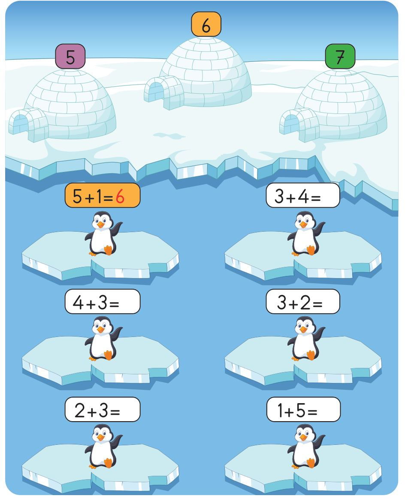 Penguenlerin üstündeki işlemleri yapalım. İşlemlerin yer aldığı kutuları, evlerdeki sayıların kutularıyla örnekteki gibi aynı renge boyayalım.

![Görsel içeriği]

| | |
| :---: | :---: |
| $\color{orange}{5+1=6}$ <!-- KONTROL: Marker'da karşılığı yok, uydurma olabilir --> | $3+4=$ <!-- KONTROL: Marker'da karşılığı yok, uydurma olabilir --> |
| $4+3=$ <!-- KONTROL: Marker'da karşılığı yok, uydurma olabilir --> | $3+2=$ <!-- KONTROL: Marker'da karşılığı yok, uydurma olabilir --> |
| $2+3=$ <!-- KONTROL: Marker'da karşılığı yok, uydurma olabilir --> | $1+5=$ <!-- KONTROL: Marker'da karşılığı yok, uydurma olabilir --> |

<!-- sayfa 30 -->

 13 Toplama işlemlerini yapalım. İşlem sonuçlarını uçurtmanın kuyruğunda yer alan sayılarla örnekteki gibi oklarla gösterelim.

$4 + 8 = 12$ <!-- KONTROL: Marker'da karşılığı yok, uydurma olabilir --> 
$8 + 4 = 12$ <!-- KONTROL: Marker'da karşılığı yok, uydurma olabilir --> 

$5 + 9 = ..........$ <!-- KONTROL: Marker'da karşılığı yok, uydurma olabilir -->
$9 + 5 = ..........$ <!-- KONTROL: Marker'da karşılığı yok, uydurma olabilir -->
$8 + 5 = ..........$ <!-- KONTROL: Marker'da karşılığı yok, uydurma olabilir -->
$7 + 8 = ..........$ <!-- KONTROL: Marker'da karşılığı yok, uydurma olabilir -->
$8 + 10 = ..........$ <!-- KONTROL: Marker'da karşılığı yok, uydurma olabilir -->
$9 + 7 = ..........$ <!-- KONTROL: Marker'da karşılığı yok, uydurma olabilir -->

$12$
$13$
$14$
$15$ <!-- KONTROL: Marker'da karşılığı yok, uydurma olabilir -->
$16$ <!-- KONTROL: Marker'da karşılığı yok, uydurma olabilir -->
$17$ <!-- KONTROL: Marker'da karşılığı yok, uydurma olabilir -->
$18$ <!-- KONTROL: Marker'da karşılığı yok, uydurma olabilir -->
$19$ <!-- KONTROL: Marker'da karşılığı yok, uydurma olabilir -->

$5 + 8 = ..........$ <!-- KONTROL: Marker'da karşılığı yok, uydurma olabilir -->
$7 + 9 = ..........$ <!-- KONTROL: Marker'da karşılığı yok, uydurma olabilir -->
$8 + 9 = ..........$ <!-- KONTROL: Marker'da karşılığı yok, uydurma olabilir -->
$8 + 7 = ..........$ <!-- KONTROL: Marker'da karşılığı yok, uydurma olabilir -->
$10 + 8 = ..........$ <!-- KONTROL: Marker'da karşılığı yok, uydurma olabilir -->

<!-- sayfa 31 -->

    14 Toplama işlemleriyle işlem sonuçlarını örnekteki gibi eşleştirelim.

$9+2=$ <!-- KONTROL: Marker'da karşılığı yok, uydurma olabilir -->  
$15+4=$ <!-- KONTROL: Marker'da karşılığı yok, uydurma olabilir --> 

$6+5=$ <!-- KONTROL: Marker'da karşılığı yok, uydurma olabilir --> 
$10+3=$ <!-- KONTROL: Marker'da karşılığı yok, uydurma olabilir --> 

$7+6=$ <!-- KONTROL: Marker'da karşılığı yok, uydurma olabilir --> 
$15+5=$ <!-- KONTROL: Marker'da karşılığı yok, uydurma olabilir --> 

$10+10=$ <!-- KONTROL: Marker'da karşılığı yok, uydurma olabilir -->
$8+5=$ <!-- KONTROL: Marker'da karşılığı yok, uydurma olabilir -->

$17+2=$ <!-- KONTROL: Marker'da karşılığı yok, uydurma olabilir -->
$13+6=$

<!-- sayfa 32 -->

15 Aşağıdaki toplama işlemlerini yapalım. Sonuçlara göre görseli uygun renklerle örnekteki gibi boyayalım.

$7 + 3 = 10$ <!-- KONTROL: Marker'da karşılığı yok, uydurma olabilir -->
$11 + 7 = \text{[kırmızı kutu]}$ <!-- KONTROL: Marker'da karşılığı yok, uydurma olabilir -->
$7 + 4 = \text{[mavi kutu]}$ <!-- KONTROL: Marker'da karşılığı yok, uydurma olabilir -->

$8 + 5 = \text{[turuncu kutu]}$ <!-- KONTROL: Marker'da karşılığı yok, uydurma olabilir -->
$8 + 9 = \text{[gri kutu]}$ <!-- KONTROL: Marker'da karşılığı yok, uydurma olabilir -->
$12 + 3 = \text{[mor kutu]}$ <!-- KONTROL: Marker'da karşılığı yok, uydurma olabilir -->

$13 + 7 = \text{[kahverengi kutu]}$ <!-- KONTROL: Marker'da karşılığı yok, uydurma olabilir -->
$11 + 5 = \text{[sarı kutu]}$ <!-- KONTROL: Marker'da karşılığı yok, uydurma olabilir -->

(Görseldeki sayılar)
13, 16
17, 18, 17, 18, 11, 17
10, 16, 11, 17
11, 16, 20
13, 20, 13, 13, 17, 13, 17, 13, 17, 15, 15

<!-- sayfa 33 -->

 16 Her hayvan bir sayıyı göstermektedir. Buna göre aşağıdaki toplama işlemlerini örnekteki gibi yapalım.

|  | 1 | 2 | 3 | 4 | 5 | 6 | 7 |
| :---: | :---: | :---: | :---: | :---: | :---: | :---: | :---: |
| | 🦍 | 🐿️ | 🐘 | 🦏 | 🐯 | 🦓 | 🦒 |
| | $\downarrow$ <!-- KONTROL: Marker'da karşılığı yok, uydurma olabilir --> | $\downarrow$ <!-- KONTROL: Marker'da karşılığı yok, uydurma olabilir --> | $\downarrow$ <!-- KONTROL: Marker'da karşılığı yok, uydurma olabilir --> | $\downarrow$ <!-- KONTROL: Marker'da karşılığı yok, uydurma olabilir --> | $\downarrow$ <!-- KONTROL: Marker'da karşılığı yok, uydurma olabilir --> | $\downarrow$ <!-- KONTROL: Marker'da karşılığı yok, uydurma olabilir --> | $\downarrow$ <!-- KONTROL: Marker'da karşılığı yok, uydurma olabilir --> |
| | $1$ | $2$ | $3$ | $4$ | $5$ | $6$ | $7$ <!-- KONTROL: Marker'da karşılığı yok, uydurma olabilir --> |

---

| 🐘 $\rightarrow$ <!-- KONTROL: Marker'da karşılığı yok, uydurma olabilir --> $3$   🦏 $\rightarrow$ <!-- KONTROL: Marker'da karşılığı yok, uydurma olabilir --> $4$   $+$ <!-- KONTROL: Marker'da karşılığı yok, uydurma olabilir --> \_\_\_\_\_\_   \_\_\_\_\_\_   $7$ <!-- KONTROL: Marker'da karşılığı yok, uydurma olabilir --> | 🐯 $\rightarrow$ <!-- KONTROL: Marker'da karşılığı yok, uydurma olabilir --> \_\_\_\_\_\_   🦍 $\rightarrow$ <!-- KONTROL: Marker'da karşılığı yok, uydurma olabilir --> \_\_\_\_\_\_   $+$ <!-- KONTROL: Marker'da karşılığı yok, uydurma olabilir --> \_\_\_\_\_\_   \_\_\_\_\_\_   \_\_\_\_\_\_ | 🐘 $\rightarrow$ <!-- KONTROL: Marker'da karşılığı yok, uydurma olabilir --> \_\_\_\_\_\_   🐘 $\rightarrow$ <!-- KONTROL: Marker'da karşılığı yok, uydurma olabilir --> \_\_\_\_\_\_   $+$ <!-- KONTROL: Marker'da karşılığı yok, uydurma olabilir --> \_\_\_\_\_\_   \_\_\_\_\_\_   \_\_\_\_\_\_ |
| :--- | :--- | :--- |
| 🦒 $\rightarrow$ <!-- KONTROL: Marker'da karşılığı yok, uydurma olabilir --> \_\_\_\_\_\_   🐿️ $\rightarrow$ <!-- KONTROL: Marker'da karşılığı yok, uydurma olabilir --> \_\_\_\_\_\_   $+$ <!-- KONTROL: Marker'da karşılığı yok, uydurma olabilir --> \_\_\_\_\_\_   \_\_\_\_\_\_   \_\_\_\_\_\_ | 🦓 $\rightarrow$ <!-- KONTROL: Marker'da karşılığı yok, uydurma olabilir --> \_\_\_\_\_\_   🦏 $\rightarrow$ <!-- KONTROL: Marker'da karşılığı yok, uydurma olabilir --> \_\_\_\_\_\_   $+$ <!-- KONTROL: Marker'da karşılığı yok, uydurma olabilir --> \_\_\_\_\_\_   \_\_\_\_\_\_   \_\_\_\_\_\_ | 🐿️ $\rightarrow$ <!-- KONTROL: Marker'da karşılığı yok, uydurma olabilir --> \_\_\_\_\_\_   🦍 $\rightarrow$ <!-- KONTROL: Marker'da karşılığı yok, uydurma olabilir --> \_\_\_\_\_\_   $+$ <!-- KONTROL: Marker'da karşılığı yok, uydurma olabilir --> \_\_\_\_\_\_   \_\_\_\_\_\_   \_\_\_\_\_\_ |
| 🦏 $\rightarrow$ <!-- KONTROL: Marker'da karşılığı yok, uydurma olabilir --> \_\_\_\_\_\_   🦍 $\rightarrow$ <!-- KONTROL: Marker'da karşılığı yok, uydurma olabilir --> \_\_\_\_\_\_   $+$ <!-- KONTROL: Marker'da karşılığı yok, uydurma olabilir --> \_\_\_\_\_\_   \_\_\_\_\_\_   \_\_\_\_\_\_ | 🐿️ $\rightarrow$ <!-- KONTROL: Marker'da karşılığı yok, uydurma olabilir --> \_\_\_\_\_\_   🦓 $\rightarrow$ <!-- KONTROL: Marker'da karşılığı yok, uydurma olabilir --> \_\_\_\_\_\_   $+$ <!-- KONTROL: Marker'da karşılığı yok, uydurma olabilir --> \_\_\_\_\_\_   \_\_\_\_\_\_   \_\_\_\_\_\_ | 🦏 $\rightarrow$ <!-- KONTROL: Marker'da karşılığı yok, uydurma olabilir --> \_\_\_\_\_\_   🐯 $\rightarrow$ <!-- KONTROL: Marker'da karşılığı yok, uydurma olabilir --> \_\_\_\_\_\_   $+$ <!-- KONTROL: Marker'da karşılığı yok, uydurma olabilir --> \_\_\_\_\_\_   \_\_\_\_\_\_   \_\_\_\_\_\_ |
| 🐿️ $\rightarrow$ <!-- KONTROL: Marker'da karşılığı yok, uydurma olabilir --> \_\_\_\_\_\_   🐘 $\rightarrow$ <!-- KONTROL: Marker'da karşılığı yok, uydurma olabilir --> \_\_\_\_\_\_   $+$ <!-- KONTROL: Marker'da karşılığı yok, uydurma olabilir --> \_\_\_\_\_\_   \_\_\_\_\_\_   \_\_\_\_\_\_ | 🐯 $\rightarrow$ <!-- KONTROL: Marker'da karşılığı yok, uydurma olabilir --> \_\_\_\_\_\_   🐿️ $\rightarrow$ <!-- KONTROL: Marker'da karşılığı yok, uydurma olabilir --> \_\_\_\_\_\_   $+$ <!-- KONTROL: Marker'da karşılığı yok, uydurma olabilir --> \_\_\_\_\_\_   \_\_\_\_\_\_   \_\_\_\_\_\_ | 🐘 $\rightarrow$ <!-- KONTROL: Marker'da karşılığı yok, uydurma olabilir --> \_\_\_\_\_\_   🦒 $\rightarrow$ <!-- KONTROL: Marker'da karşılığı yok, uydurma olabilir --> \_\_\_\_\_\_   $+$ <!-- KONTROL: Marker'da karşılığı yok, uydurma olabilir --> \_\_\_\_\_\_   \_\_\_\_\_\_   \_\_\_\_\_\_ |

<!-- sayfa 34 -->

# Çıkarma İşlemi

 1.  Görseldeki 8 rüzgâr türbininden 3 tanesi bakıma alınmıştır. Çalışır durumda kaç rüzgâr türbini kalmıştır?

<!-- sayfa 35 -->

Sabiha Gökçen Havalimanı’nda $4$ uçak vardır. Bu $4$ uçaktan $3$ tanesi uçuş saati geldiği için havalanmıştır.

Mert, havalimanından $3$ uçak havalandığı için havalimanındaki uçak sayısı değişmiştir.

Evet Zeynep, havalimanındaki uçakların sayısı azalmıştır yani eksilmiştir.

Bu durumda havalimanında kalan uçak sayısını bulmak için çıkarma işlemi yapmak gerekir.

<!-- sayfa 36 -->

$4 - 3 = 1$

> Zeynep, yukarıdaki çıkarma işlemini
> * “Dört eksi üç eşittir bir.”
> * “Dörtten üç çıktı bir kaldı.”
> * “Dört ile üçün farkı birdir.” şeklinde söyleyebiliriz.

> Evet Mert, bir grup varlıktan belirli bir sayıdaki varlığı ayırmak için çıkarma işlemi yapılır. Çıkarma işlemi, varlıkları ayırma ve azaltma işlemidir.

<!-- sayfa 37 -->

 2 Aşağıdaki görselleri inceleyelim. Noktalı yerleri örnekteki gibi dolduralım.

| | |
| :--- | :--- |
|  | Tabaktaki $8$ çilekten $3$ tanesi yenmiş. Tabakta $5$ çilek kalmış. |
|  | Tabaktaki .......... muzdan .......... tanesi yenmiş. Tabakta .......... muz kalmış. |
|  | Tepsideki .......... karpuz diliminden .......... tanesi yenmiş. Tepside .......... dilim karpuz kalmış. |
|  | İpteki .......... elbiseden .......... tanesi yere düşmüş. İpte .......... tane elbise kalmış. |
|  | Bitkideki .......... uğur böceğinden .......... tanesi uçmuş. Bitkide .......... uğur böceği kalmış. |

<!-- sayfa 38 -->

 Göl kenarında duran $8$ ördekten $5$ tanesi göle girmiştir. Bu durumda göl kenarında kalan ördek sayısı aşağıdaki gibi farklı şekillerde söylenebilir.

$8 - 5 = 3$ <!-- KONTROL: Marker'da karşılığı yok, uydurma olabilir --> olur.
$8$ eksi $5$ eşittir $3$.
$8$'den $5$ çıktı $3$ kaldı.
$8$ ile $5$'in farkı $3$ eder.

3  Aşağıdaki çıkarma işlemini yapalım. Noktalı yerleri dolduralım. Yazdığımız cümleleri okuyalım.

$\dots\dots\dots\dots - \dots\dots\dots\dots = \dots\dots\dots\dots$ <!-- KONTROL: Marker'da karşılığı yok, uydurma olabilir --> olur.
$\dots\dots\dots\dots$ <!-- KONTROL: Marker'da karşılığı yok, uydurma olabilir --> eksi $\dots\dots\dots\dots$ <!-- KONTROL: Marker'da karşılığı yok, uydurma olabilir --> eşittir $\dots\dots\dots\dots$ <!-- KONTROL: Marker'da karşılığı yok, uydurma olabilir -->
$\dots\dots\dots\dots$ <!-- KONTROL: Marker'da karşılığı yok, uydurma olabilir -->'ten $\dots\dots\dots\dots$ <!-- KONTROL: Marker'da karşılığı yok, uydurma olabilir --> çıktı $\dots\dots\dots\dots$ <!-- KONTROL: Marker'da karşılığı yok, uydurma olabilir --> kaldı.
$\dots\dots\dots\dots$ <!-- KONTROL: Marker'da karşılığı yok, uydurma olabilir --> ile $\dots\dots\dots\dots$ <!-- KONTROL: Marker'da karşılığı yok, uydurma olabilir -->'nin farkı $\dots\dots\dots\dots$ <!-- KONTROL: Marker'da karşılığı yok, uydurma olabilir --> eder.

<!-- sayfa 39 -->

 4 Aşağıdaki çıkarma işlemini yapalım. Noktalı yer-
leri örnekteki gibi dolduralım.

$6 - 2 = 4$ <!-- KONTROL: Marker'da karşılığı yok, uydurma olabilir -->
$6$dan $2$ çıktı, $4$ kaldı.

$\dots\dots - \dots\dots = \dots\dots$ <!-- KONTROL: Marker'da karşılığı yok, uydurma olabilir -->
$\dots\dots$ <!-- KONTROL: Marker'da karşılığı yok, uydurma olabilir --> ile $\dots\dots$ <!-- KONTROL: Marker'da karşılığı yok, uydurma olabilir -->in farkı, $\dots\dots$ <!-- KONTROL: Marker'da karşılığı yok, uydurma olabilir --> eder.

$\dots\dots - \dots\dots = \dots\dots$ <!-- KONTROL: Marker'da karşılığı yok, uydurma olabilir -->
$\dots\dots$ <!-- KONTROL: Marker'da karşılığı yok, uydurma olabilir --> eksi $\dots\dots$ <!-- KONTROL: Marker'da karşılığı yok, uydurma olabilir --> eşittir $\dots\dots$ <!-- KONTROL: Marker'da karşılığı yok, uydurma olabilir -->

<!-- sayfa 40 -->

Zeynep, babamla marketten $16$ tane elma aldık. $6$ tanesini hep birlikte yedik. Geriye kaç elma kaldı?

Mert, geriye $10$ <!-- KONTROL: Marker'da karşılığı yok, uydurma olabilir --> tane elma kaldı.

Evet Zeynep, geriye $10$ <!-- KONTROL: Marker'da karşılığı yok, uydurma olabilir --> tane elma kaldı.

<!-- sayfa 41 -->

Ben elmaların sayısını **yan yana** çıkarma işlemi yaparak buldum. Çıkarma işleminin sembolü olan “$-$” (**eksi**) işaretini kullandım. İşlemi yan yana yaptığım için “$=$” (**eşit**) işaretini de kullandum.

$$16 - 6 = 10$$
<!-- KONTROL: Marker'da karşılığı yok, uydurma olabilir -->

$$\begin{array}{l} \text{Eksilen} \\ \text{Çıkan} \\ \text{Fark} \\ \text{Eksi işareti} \\ \text{Eşit işareti} \end{array}$$
<!-- KONTROL: Marker'da karşılığı yok, uydurma olabilir -->

Ben de elmaların sayısını **alt alta** çıkarma işlemi yaparak buldum. Çıkarma işlemi yaparken çıkan ile fark arasına **işlem çizgisi** de çizdim.

$$\begin{array}{r} 16 \longrightarrow \text{Eksilen} \\ 6 \longrightarrow \text{Çıkan} \\ \hline \text{---} \longrightarrow \text{İşlem çizgisi} \\ 10 \longrightarrow \text{Fark} \end{array}$$
<!-- KONTROL: Marker'da karşılığı yok, uydurma olabilir -->

$$\text{Eksi işareti} \longleftarrow$$
<!-- KONTROL: Marker'da karşılığı yok, uydurma olabilir -->

<!-- sayfa 42 -->

 5  Aşağıda modelle gösterilen çıkarma işlemlerini örnekteki gibi yapalım.

$9 - 1 = 8$ <!-- KONTROL: Marker'da karşılığı yok, uydurma olabilir -->

$\dots\dots - \dots\dots = \dots\dots$ <!-- KONTROL: Marker'da karşılığı yok, uydurma olabilir -->

$\dots\dots - \dots\dots = \dots\dots$ <!-- KONTROL: Marker'da karşılığı yok, uydurma olabilir -->

$\dots\dots - \dots\dots = \dots\dots$ <!-- KONTROL: Marker'da karşılığı yok, uydurma olabilir -->

$\dots\dots - \dots\dots = \dots\dots$ <!-- KONTROL: Marker'da karşılığı yok, uydurma olabilir -->

<!-- sayfa 43 -->

  6 Yan yana ve alt alta verilen çıkarma işlemlerini örnekteki gibi yapalım.

1.
$7 - 4 = 3$ <!-- KONTROL: Marker'da karşılığı yok, uydurma olabilir -->  
$\begin{array}{r} 7 \\ -\ 4 \\ \hline 3 \end{array}$ <!-- KONTROL: Marker'da karşılığı yok, uydurma olabilir -->

2.
$8 - 3 = ......$ <!-- KONTROL: Marker'da karşılığı yok, uydurma olabilir -->
$\begin{array}{r} 8 \\ -\ 3 \\ \hline ...... \end{array}$ <!-- KONTROL: Marker'da karşılığı yok, uydurma olabilir -->

3.
$17 - 1 = ......$ <!-- KONTROL: Marker'da karşılığı yok, uydurma olabilir --> 
$\begin{array}{r} 17 \\ -\ 1 \\ \hline ...... \end{array}$ <!-- KONTROL: Marker'da karşılığı yok, uydurma olabilir -->

4.
$16 - 3 = ......$ <!-- KONTROL: Marker'da karşılığı yok, uydurma olabilir --> 
$\begin{array}{r} 16 \\ -\ 3 \\ \hline ...... \end{array}$ <!-- KONTROL: Marker'da karşılığı yok, uydurma olabilir -->

5.
$18 - 5 = ......$ <!-- KONTROL: Marker'da karşılığı yok, uydurma olabilir --> 
$\begin{array}{r} 18 \\ -\ 5 \\ \hline ...... \end{array}$ <!-- KONTROL: Marker'da karşılığı yok, uydurma olabilir -->

6.
$14 - 2 = ......$ <!-- KONTROL: Marker'da karşılığı yok, uydurma olabilir --> 
$\begin{array}{r} 14 \\ -\ 2 \\ \hline ...... \end{array}$ <!-- KONTROL: Marker'da karşılığı yok, uydurma olabilir -->

7.
$15 - 1 = ......$ <!-- KONTROL: Marker'da karşılığı yok, uydurma olabilir --> 
$\begin{array}{r} 15 \\ -\ 1 \\ \hline ...... \end{array}$ <!-- KONTROL: Marker'da karşılığı yok, uydurma olabilir -->

8.
$19 - 3 = ......$ <!-- KONTROL: Marker'da karşılığı yok, uydurma olabilir --> 
$\begin{array}{r} 19 \\ -\ 3 \\ \hline ...... \end{array}$ <!-- KONTROL: Marker'da karşılığı yok, uydurma olabilir -->

<!-- sayfa 44 -->

 7 Aşağıda çocuklar boyadıkları taşlarla dokuztaş oyunu oynuyorlar. Çocuklar her atışta taşları deviriyorlar. Atış sonuçlarına göre devrilmeyen taş sayısını bulalım. Çıkarma işlemlerini yapalım. Noktalı yerleri örnekteki gibi dolduralım.

| | | |
| :--- | :--- | :--- |
| | Eksi işareti | Eşit işareti |
| | $9 - 4 = 5$ <!-- KONTROL: Marker'da karşılığı yok, uydurma olabilir --> | |
| Eksilen | Çıkan | Fark |

$\dots - \dots = \dots$ <!-- KONTROL: Marker'da karşılığı yok, uydurma olabilir -->
$\downarrow \quad \downarrow \quad \downarrow$ <!-- KONTROL: Marker'da karşılığı yok, uydurma olabilir -->

$\dots - \dots = \dots$ <!-- KONTROL: Marker'da karşılığı yok, uydurma olabilir -->
$\downarrow \quad \downarrow \quad \downarrow$ <!-- KONTROL: Marker'da karşılığı yok, uydurma olabilir -->

$\dots - \dots = \dots$ <!-- KONTROL: Marker'da karşılığı yok, uydurma olabilir -->
$\downarrow \quad \downarrow \quad \downarrow$ <!-- KONTROL: Marker'da karşılığı yok, uydurma olabilir -->

 8 Okul bahçesinde arkadaşlarımızla bu eğlenceli oyunu oynayalım. Her bir oyun oynama

<!-- sayfa 45 -->

# Birbirine Eşit İki Sayının Farkı

 Selin ve arkadaşları kar yağışından sonra annele- rinden izin alıp dışarı çıktılar. Birlikte $4$ tane kardan adam yaptılar. Çocuklar kar topu oynayıp evleri- ne döndüler. Ertesi gün yaptıkları kardan adamları görmek için dışarı çıktılar. Kardan adamların eridi- ğini gördüler.

Aşağıda çocukların yaptığı kardan adamlarla bu kardan adamların erimiş hâlleri verilmiştir. Geriye erimeyen kaç kardan adam kalmıştır?

$4$ kardan adam vardı.

$4$ kardan adam da eridi. Geriye $0$ (sıfır) kardan adam kaldı.

$$4 - 4 = 0$$

$\begin{array}{rcl} 4 & \longrightarrow & \text{Kardan adam sayısı} \\ -4 & \longrightarrow & \text{Eriyen kardan adam sayısı} \\ \hline 0 & \longrightarrow & \text{Kalan kardan adam sayısı} \end{array}$ <!-- KONTROL: Marker'da karşılığı yok, uydurma olabilir -->

 Arkadaşlar, bir sayıdan sayının kendisi çıkarılırsa sonuç “$0$” (sıfır) olur.

<!-- sayfa 46 -->

 1. Örneği inceleyelim. Aşağıdaki çıkarma işlemlerini yapalım.

(Kuş yuvası görseli) - (Uçan kuşlar görseli) = (Boş yuva görseli)
$3 - 3 = 0$ <!-- KONTROL: Marker'da karşılığı yok, uydurma olabilir -->

(Portakal ağacı görseli) - (Yerdeki portakallar görseli) = (Boş ağaç görseli)
$\square - \square = \square$ <!-- KONTROL: Marker'da karşılığı yok, uydurma olabilir -->

(Arılı çiçek görseli) - (Uçan arılar görseli) = (Tek arılı çiçek görseli)
$\square - \square = \square$ <!-- KONTROL: Marker'da karşılığı yok, uydurma olabilir -->

 2. Aşağıdaki çıkarma işlemlerini yapalım.

$\begin{array}{r} 9 \\ -\ 9 \\ \hline \end{array}$ <!-- KONTROL: Marker'da karşılığı yok, uydurma olabilir -->

$\begin{array}{r} 14 \\ -\ 14 \\ \hline \end{array}$ <!-- KONTROL: Marker'da karşılığı yok, uydurma olabilir -->

$\begin{array}{r} 8 \\ -\ 8 \\ \hline \end{array}$ <!-- KONTROL: Marker'da karşılığı yok, uydurma olabilir -->

$\begin{array}{r} 17 \\ -\ 17 \\ \hline \end{array}$ <!-- KONTROL: Marker'da karşılığı yok, uydurma olabilir -->

$\begin{array}{r} 20 \\ -\ 20 \\ \hline \end{array}$ <!-- KONTROL: Marker'da karşılığı yok, uydurma olabilir -->

<!-- sayfa 47 -->

# Toplama ve Çıkarma İşleminde Sıfırın Etkisi

Ercan Bey işini seven, dürüst bir servis şoförüdür. Ercan Bey, Gümüş Apartmanı’ndan $7$ öğrenciyi servis aracına almıştır. Daha sonra Karanfil Apartmanı’nda bekleyen öğrenci olmadığını görmüştür. Öğrencilerin ailelerini aramıştır. Çocukların hasta olduklarını ve gelemeyeceklerini öğrenmiştir. Bu durumda okula servisle giden toplam öğrenci sayısı aşağıda gösterilmiştir.

$7 + 0 = 7$ veya $\begin{array}{r} 7 \\ + \phantom{0} 0 \\ \hline 7 \end{array}$ <!-- KONTROL: Marker'da karşılığı yok, uydurma olabilir -->

> Arkadaşlar bir sayıyla $0$ (sıfır)’ın toplamı, sayının kendisine eşittir. Toplananlardan biri “$0$” olduğunda toplam, diğer toplanana eşittir.

<!-- sayfa 48 -->

1. Aşağıdaki toplama işlemlerini örnekteki gibi yapalım.

$0 + 5 = 5$ <!-- KONTROL: Marker'da karşılığı yok, uydurma olabilir -->

$\square + \square = \square$ <!-- KONTROL: Marker'da karşılığı yok, uydurma olabilir -->

<!-- sayfa 49 -->

Evimizde saksıdaki çiçeklerin sulanması ve bakı-
mı benim sorumluluğumdadır. Çiçeklere zama-
nında ve yeterli miktarda su verdim. Böylece 
çiçekler solmadı.

Mert, çiçeklerin hiçbiri solmadığı için çiçek 
sayısının aynı kaldığını fark ettin mi?

Evet Zeynep, fark ettim. Bir sayıdan “0” (sıfır) 
çıkardığımızda sonuç sayının kendisine eşittir.

$$5 - 0 = 5$$ veya $$\begin{array}{r} 5 \\ -\ 0 \\ \hline 5 \end{array}$$
<!-- KONTROL: Marker'da karşılığı yok, uydurma olabilir -->

<!-- sayfa 50 -->

 2 Aşağıdaki çıkarma işlemlerini yapalım.

1. $7 - 0 = .......$

2. $9 - 0 = .......$

3. $20 - 0 = .......$

4. $11 - 0 = .......$

5. $18 - 0 = .......$

6. $12 - 0 = .......$

7. $15 - 0 = .......$

8. $14 - 0 = .......$

<!-- sayfa 51 -->

 3 Aşağıdaki toplama işlemleriyle işlem sonuçlarını örnekteki gibi eşleştirelim.

 $7+1=$ <!-- KONTROL: Marker'da karşılığı yok, uydurma olabilir -->
 $\text{🎾}$ <!-- KONTROL: Marker'da karşılığı yok, uydurma olabilir -->
 $\rightarrow$ <!-- KONTROL: Marker'da karşılığı yok, uydurma olabilir -->  $8$

 $5+5=$ <!-- KONTROL: Marker'da karşılığı yok, uydurma olabilir -->
 $\text{🎾}$ <!-- KONTROL: Marker'da karşılığı yok, uydurma olabilir -->

 $1+8=$ <!-- KONTROL: Marker'da karşılığı yok, uydurma olabilir -->
 $\text{🎾}$ <!-- KONTROL: Marker'da karşılığı yok, uydurma olabilir -->

 $4+4=$ <!-- KONTROL: Marker'da karşılığı yok, uydurma olabilir -->
 $\text{🎾}$ <!-- KONTROL: Marker'da karşılığı yok, uydurma olabilir -->

 $7+3=$ <!-- KONTROL: Marker'da karşılığı yok, uydurma olabilir -->
 $\text{🎾}$ <!-- KONTROL: Marker'da karşılığı yok, uydurma olabilir -->

 $0+9=$ <!-- KONTROL: Marker'da karşılığı yok, uydurma olabilir -->
 $\text{🎾}$ <!-- KONTROL: Marker'da karşılığı yok, uydurma olabilir -->

 $5+3=$ <!-- KONTROL: Marker'da karşılığı yok, uydurma olabilir -->
 $\text{🎾}$ <!-- KONTROL: Marker'da karşılığı yok, uydurma olabilir -->

 $4+5=$ <!-- KONTROL: Marker'da karşılığı yok, uydurma olabilir -->
 $\text{🎾}$ <!-- KONTROL: Marker'da karşılığı yok, uydurma olabilir -->

 $3+6=$ <!-- KONTROL: Marker'da karşılığı yok, uydurma olabilir -->
 $\text{🎾}$ <!-- KONTROL: Marker'da karşılığı yok, uydurma olabilir -->

 $2+8=$ <!-- KONTROL: Marker'da karşılığı yok, uydurma olabilir -->
 $\text{🎾}$ <!-- KONTROL: Marker'da karşılığı yok, uydurma olabilir -->

 $9+1=$ <!-- KONTROL: Marker'da karşılığı yok, uydurma olabilir -->
 $\text{🎾}$ <!-- KONTROL: Marker'da karşılığı yok, uydurma olabilir -->

 $10+0=$ <!-- KONTROL: Marker'da karşılığı yok, uydurma olabilir -->
 $\text{🎾}$ <!-- KONTROL: Marker'da karşılığı yok, uydurma olabilir -->

 $2+6=$ <!-- KONTROL: Marker'da karşılığı yok, uydurma olabilir -->
 $\text{🎾}$ <!-- KONTROL: Marker'da karşılığı yok, uydurma olabilir -->

 $8+0=$ <!-- KONTROL: Marker'da karşılığı yok, uydurma olabilir -->
 $\text{🎾}$ <!-- KONTROL: Marker'da karşılığı yok, uydurma olabilir -->

 $9$

 $10$

<!-- yer tutucu bulunamadı: sayfa sonuna eklendi -->

<!-- yer tutucu bulunamadı: sayfa sonuna eklendi -->

<!-- sayfa 52 -->

4) Aşağıdaki toplama işlemlerini yapalım. Toplamları şifre bölümünden bulalım. Yapraklardaki harfleri ilgili kutulara örnekteki gibi yazarak şifreyi okuyalım.

$9 + 9 = 18$ <!-- KONTROL: Marker'da karşılığı yok, uydurma olabilir --> K
$10 + 7 = \dots\dots$ O
$7 + 9 = \dots\dots$ <!-- KONTROL: Marker'da karşılığı yok, uydurma olabilir --> I
$3 + 17 = \dots\dots$ <!-- KONTROL: Marker'da karşılığı yok, uydurma olabilir --> Y
$2 + 11 = \dots\dots$ <!-- KONTROL: Marker'da karşılığı yok, uydurma olabilir --> M
$6 + 2 = \dots\dots$ <!-- KONTROL: Marker'da karşılığı yok, uydurma olabilir --> B
$7 + 8 = \dots\dots$ <!-- KONTROL: Marker'da karşılığı yok, uydurma olabilir --> S 
$9 + 5 = \dots\dots$ <!-- KONTROL: Marker'da karşılığı yok, uydurma olabilir --> A
$5 + 4 = \dots\dots$ <!-- KONTROL: Marker'da karşılığı yok, uydurma olabilir --> R
$10 + 0 = \dots\dots$ <!-- KONTROL: Marker'da karşılığı yok, uydurma olabilir --> L
$5 + 6 = \dots\dots$ <!-- KONTROL: Marker'da karşılığı yok, uydurma olabilir --> İ
$6 + 6 = \dots\dots$ <!-- KONTROL: Marker'da karşılığı yok, uydurma olabilir --> U

Şifre
| 15 | 17 | 9 | 12 | 13 | 10 | 12 | 10 | 12 | 18 | 10 | 14 | 9 | 16 | 13 | 16 |
| :---: | :---: | :---: | :---: | :---: | :---: | :---: | :---: | :---: | :---: | :---: | :---: | :---: | :---: | :---: | :---: |
| $\dots$ | $\dots$ | $\dots$ | $\dots$ | $\dots$ | $\dots$ | $\dots$ | $\dots$ | $\dots$ | K | $\dots$ | $\dots$ | $\dots$ | $\dots$ | $\dots$ | $\dots$ |

| 8 | 11 | 10 | 11 | 20 | 17 | 9 | 12 | 13 |
| :---: | :---: | :---: | :---: | :---: | :---: | :---: | :---: | :---: |
| $\dots$ | $\dots$ | $\dots$ | $\dots$ | $\dots$ | $\dots$ | $\dots$ | $\dots$ | $\dots$ |

<!-- sayfa 53 -->

5 Aşağıdaki toplama ve çıkarma işlemlerini yapalım. Sonuçlara göre görseli uygun renklerle boyayalım.

| 8 | 3 | 7 | 12 | 1 | 5 | 10 |
| :---: | :---: | :---: | :---: | :---: | :---: | :---: |
|  |  |  |  |  |  |  |

$6 - 1 = .....$ <!-- KONTROL: Marker'da karşılığı yok, uydurma olabilir -->

$10 - 2 = .....$ <!-- KONTROL: Marker'da karşılığı yok, uydurma olabilir -->

$\begin{array}{c} 16 \\ - \phantom{0}4 \\ \hline ..... \end{array}$ <!-- KONTROL: Marker'da karşılığı yok, uydurma olabilir -->

$7 - 4 = .....$ <!-- KONTROL: Marker'da karşılığı yok, uydurma olabilir -->

$\begin{array}{c} 10 \\ - \phantom{0}9 \\ \hline ..... \end{array}$ <!-- KONTROL: Marker'da karşılığı yok, uydurma olabilir -->

$8 - 5 = .....$ <!-- KONTROL: Marker'da karşılığı yok, uydurma olabilir -->

$\begin{array}{c} 7 \\ + 5 \\ \hline ..... \end{array}$ <!-- KONTROL: Marker'da karşılığı yok, uydurma olabilir -->

$14 - 6 = .....$ <!-- KONTROL: Marker'da karşılığı yok, uydurma olabilir -->

$\begin{array}{c} 7 \\ + 1 \\ \hline ..... \end{array}$ <!-- KONTROL: Marker'da karşılığı yok, uydurma olabilir -->

$\begin{array}{c} 4 \\ + 4 \\ \hline ..... \end{array}$ <!-- KONTROL: Marker'da karşılığı yok, uydurma olabilir -->

$\begin{array}{c} 20 \\ - 10 \\ \hline ..... \end{array}$ <!-- KONTROL: Marker'da karşılığı yok, uydurma olabilir -->

$\begin{array}{c} 15 \\ - \phantom{0}3 \\ \hline ..... \end{array}$ <!-- KONTROL: Marker'da karşılığı yok, uydurma olabilir -->

$\begin{array}{c} 10 \\ - \phantom{0}5 \\ \hline ..... \end{array}$ <!-- KONTROL: Marker'da karşılığı yok, uydurma olabilir -->

$8 + 0 = .....$ <!-- KONTROL: Marker'da karşılığı yok, uydurma olabilir -->

$12 - 4 = .....$ <!-- KONTROL: Marker'da karşılığı yok, uydurma olabilir -->

$9 - 2 = .....$ <!-- KONTROL: Marker'da karşılığı yok, uydurma olabilir -->

$15 - 7 = .....$ <!-- KONTROL: Marker'da karşılığı yok, uydurma olabilir -->

Daha fazla soru için karekodu akıllı cihaza okutalım

<!-- sayfa 54 -->

 6 Aşağıdaki toplama ve çıkarma işlemlerini yapalım. Bulmacada belirtilen yerlere işlem sonuçlarını örnekteki gibi yazalım.

1. $\begin{array}{r} 6 \\ - 5 \\ \hline \underline{1} \end{array}$ <!-- KONTROL: Marker'da karşılığı yok, uydurma olabilir -->

2. $\begin{array}{r} 8 \\ + 4 \\ \hline \dots \end{array}$ <!-- KONTROL: Marker'da karşılığı yok, uydurma olabilir -->

3. $\begin{array}{r} 0 \\ + 8 \\ \hline \dots \end{array}$ <!-- KONTROL: Marker'da karşılığı yok, uydurma olabilir -->

4. $\begin{array}{r} 9 \\ - 9 \\ \hline \dots \end{array}$ <!-- KONTROL: Marker'da karşılığı yok, uydurma olabilir -->

5. $7 + 4 = \dots$ <!-- KONTROL: Marker'da karşılığı yok, uydurma olabilir -->

6. $12 - 10 = \dots$ <!-- KONTROL: Marker'da karşılığı yok, uydurma olabilir -->

7. $13 - 8 = \dots$ <!-- KONTROL: Marker'da karşılığı yok, uydurma olabilir -->

8. $10 - 0 = \dots$ <!-- KONTROL: Marker'da karşılığı yok, uydurma olabilir -->

9. $9 + 6 = \dots$ <!-- KONTROL: Marker'da karşılığı yok, uydurma olabilir -->

10. $12 + 5 = \dots$ <!-- KONTROL: Marker'da karşılığı yok, uydurma olabilir -->

$\begin{array}{ccccccc} & & & & 5 & & \\ & & & & \downarrow & & \\ & & & 8 \rightarrow & \square & & \\ & & & & \square & & \\ & & 7 & & \square & 6 \rightarrow & \square & \square & \square \\ & & \downarrow & & \text{B} & \text{İ} & \text{R} \\ & 2 & & 1 \rightarrow & & & \\ & \downarrow & & & & & \\ & \square & & & & & \\ & \square & & & & & \\ 9 \rightarrow & \square & \square & \square & \square & \square & \\ 10 \rightarrow & \square & \square & \square & \square & & \\ & \square & & & & & \\ 4 & \downarrow & & & & & \\ 3 \rightarrow & \square & \square & \square & \square & & \\ & \square & & & & & \\ & \square & & & & & \\ & \square & & & & & \\ & \square & & & & & \end{array}$ <!-- KONTROL: Marker'da karşılığı yok, uydurma olabilir -->

<!-- sayfa 55 -->

 7 Aşağıdaki sayılar, okul araç ve gereçleri ile kodlanmıştır. Çıkarma işlemlerini örnekteki gibi yapınız.

📏 $= 17$ <!-- KONTROL: Marker'da karşılığı yok, uydurma olabilir -->
✏️ $= 3$ <!-- KONTROL: Marker'da karşılığı yok, uydurma olabilir -->
🧼 $= 5$ <!-- KONTROL: Marker'da karşılığı yok, uydurma olabilir -->
📓 $= 19$ <!-- KONTROL: Marker'da karşılığı yok, uydurma olabilir -->
🧽 $= 4$ <!-- KONTROL: Marker'da karşılığı yok, uydurma olabilir -->

1. 📏 $- 🧼 = 17 - 5 = 12$ <!-- KONTROL: Marker'da karşılığı yok, uydurma olabilir -->

2. 🧼 $- 🧽 = \dots\dots\dots\dots$ <!-- KONTROL: Marker'da karşılığı yok, uydurma olabilir -->

3. 🧼 $- ✏️ = \dots\dots\dots\dots$ <!-- KONTROL: Marker'da karşılığı yok, uydurma olabilir -->

4. 📓 $- ✏️ = \dots\dots\dots\dots$ <!-- KONTROL: Marker'da karşılığı yok, uydurma olabilir -->

5. ✏️ $- ✏️ = \dots\dots\dots\dots$ <!-- KONTROL: Marker'da karşılığı yok, uydurma olabilir -->

6. 📏 $- 🧽 = \dots\dots\dots\dots$ <!-- KONTROL: Marker'da karşılığı yok, uydurma olabilir -->

7. 📓 $- 🧼 = \dots\dots\dots\dots$ <!-- KONTROL: Marker'da karşılığı yok, uydurma olabilir -->

8. 📓 $- 📏 = \dots\dots\dots\dots$ <!-- KONTROL: Marker'da karşılığı yok, uydurma olabilir -->

<!-- yer tutucu bulunamadı: sayfa sonuna eklendi -->

<!-- yer tutucu bulunamadı: sayfa sonuna eklendi -->

<!-- yer tutucu bulunamadı: sayfa sonuna eklendi -->

<!-- yer tutucu bulunamadı: sayfa sonuna eklendi -->

<!-- yer tutucu bulunamadı: sayfa sonuna eklendi -->

<!-- yer tutucu bulunamadı: sayfa sonuna eklendi -->

<!-- yer tutucu bulunamadı: sayfa sonuna eklendi -->

<!-- yer tutucu bulunamadı: sayfa sonuna eklendi -->

<!-- sayfa 56 -->

 8 Aşağıdaki şekillerin ortasında yer alan sayıla-rı, bu sayıları çevreleyen sayılarla toplayalım. Yaptığımız işlemleri ve işlemlerin sonuçlarını ör-nekteki gibi yazınız.

1. 
$6+5=11$

2. 

3. 

4. 

5. 

6. 

<!-- sayfa 57 -->

# Toplama ve Çıkarma İşlemlerinin Sonuçlarını Tahmin Etme ve Zihinden İşlem

Mert, ağaçta $6$ kuş var. Ağaca $5$ kuş daha konduğunda ağaçtaki toplam kuş sayısını tahmin edebilir misin?

Evet Zeynep, tahmin edebilirim. Ağaçtaki toplam kuş sayısı tahminime göre $10$ olur.

Benim tahminime göre ağaçta toplam $13$ kuş olur. Öyleyse toplam kuş sayısını bulmak için ağaçtaki kuşları sayalım.

Ağaçta $6$ kuş vardı. $5$ kuş daha konduğunda toplam $6 + 5 = 11$ kuş oldu. Zeynep, kuşların toplam sayısını ben $10$ tahmin ettim. Sen de $13$ tahmin ettin. Benim tahminim gerçek sonuca daha yakın.

<!-- sayfa 58 -->

 1 Aşağıdaki toplama işlemlerinin sonuçlarını önce tahmin edelim. Sonra işlemleri yaparak sonuçları bulalım. İşlem sonuçları ile tahminî sonuçlarımız arasındaki farkı bulup kendi cümlelerimizle ifade edelim.

| | Tahminî Sonuç | İşlem Sonucu | Fark | Karşılaştırma |
| :--- | :---: | :---: | :---: | :---: |
| 4 boya kalemine 6 boya kalemi daha eklersek toplam kaç boya kalemi eder? | | | | |
| Sınıfta 5 kız, 4 erkek öğrenci olduğuna göre toplam kaç öğrenci vardır? | | | | |
| Aldığım 8 kitaba 7 kitap daha eklersem toplam kaç kitap almış olurum? | | | | |
| 9 deniz kabuğuna 5 deniz kabuğu eklersem toplam kaç deniz kabuğum olur? | | | | |

<!-- sayfa 59 -->

# Zihinden Toplama İşlemi

Feyza ve İlhan bilgi yarışmasına katılıyor.

Bilgi Yarışması

$12 + 3$ <!-- KONTROL: Marker'da karşılığı yok, uydurma olabilir --> işleminin sonucu kaçtır?

Cevabım $15$ <!-- KONTROL: Marker'da karşılığı yok, uydurma olabilir -->. Bu sonucu işlem yapmadan buldum. $12$ <!-- KONTROL: Marker'da karşılığı yok, uydurma olabilir --> sayısının üstüne üç kez saydım. $13, 14, 15$ <!-- KONTROL: Marker'da karşılığı yok, uydurma olabilir -->. Bu şekilde toplama işlemini zihinden yaparak cevaba kısa sürede ulaştım.

Ben işlemi deftere yazarak çözdüm. Bu yüzden cevaba daha uzun sürede ulaştım. Feyza, seni tebrik ederim.

<!-- sayfa 60 -->

1. gün

EKMEK FIRINI

AÇIK

Fırıncı Hüseyin amca, fırından çıkan ekmekleri raflara dizmiştir. Dizdikten sonra ekmekleri saymıştır. Biz de raflardaki toplam ekmek sayısını zihinden bulalım.

<!-- sayfa 61 -->

Ekmeklerin toplam sayısını bulmak için önce $3$ ekmekten birini üst rafa koydum. Ekmek sayısını $10$'a tamamlayarak $1$ onluk oluşturdum. Sonra kalan ekmek sayısını $1$ onluğun üzerine ekledim. Sonucu $12$ buldum. Bu işlemleri yaparken kalemi hiç kullanmadım.

1. raf: $9$ ekmek

2. raf: $3$ ekmek

$$9 + 1 = 10$$
$$10 + 2 = 12$$
İki rafta toplam $12$ ekmek vardır.

<!-- sayfa 62 -->

1. Aşağıdaki toplama işlemlerini örnekteki gibi zihinden yapalım.

| | | |
| :--- | :--- | :--- |
| $8 + 7 = ?$   $\wedge$ <!-- KONTROL: Marker'da karşılığı yok, uydurma olabilir -->   $2 \enspace 5$ <!-- KONTROL: Marker'da karşılığı yok, uydurma olabilir -->   $8 + 2 = 10$   $10 + 5 = 15$ | $7 + 5 = ?$   $\wedge$ <!-- KONTROL: Marker'da karşılığı yok, uydurma olabilir -->   ....................   .................... | $6 + 8 = ?$   $\wedge$ <!-- KONTROL: Marker'da karşılığı yok, uydurma olabilir -->   ....................   .................... |
| $9 + 3 = ?$   $\wedge$ <!-- KONTROL: Marker'da karşılığı yok, uydurma olabilir -->   ....................   .................... | $9 + 5 = ?$   $\wedge$ <!-- KONTROL: Marker'da karşılığı yok, uydurma olabilir -->   ....................   .................... | $5 + 8 = ?$   $\wedge$ <!-- KONTROL: Marker'da karşılığı yok, uydurma olabilir -->   ....................   .................... |
| $9 + 6 = ?$   $\wedge$ <!-- KONTROL: Marker'da karşılığı yok, uydurma olabilir -->   ....................   .................... | $8 + 4 = ?$   $\wedge$ <!-- KONTROL: Marker'da karşılığı yok, uydurma olabilir -->   ....................   .................... | $7 + 6 = ?$   $\wedge$ <!-- KONTROL: Marker'da karşılığı yok, uydurma olabilir -->   ....................   .................... |
| $6 + 5 = ?$   $\wedge$ <!-- KONTROL: Marker'da karşılığı yok, uydurma olabilir -->   ....................   .................... | $9 + 7 = ?$   $\wedge$ <!-- KONTROL: Marker'da karşılığı yok, uydurma olabilir -->   ....................   .................... | $3 + 8 = ?$   $\wedge$ <!-- KONTROL: Marker'da karşılığı yok, uydurma olabilir -->   ....................   .................... |
| $5 + 9 = ?$   $\wedge$ <!-- KONTROL: Marker'da karşılığı yok, uydurma olabilir -->   ....................   .................... | $7 + 4 = ?$   $\wedge$ <!-- KONTROL: Marker'da karşılığı yok, uydurma olabilir -->   ....................   .................... | $9 + 8 = ?$   $\wedge$ <!-- KONTROL: Marker'da karşılığı yok, uydurma olabilir -->   ....................   .................... |

<!-- yer tutucu bulunamadı: sayfa sonuna eklendi -->

<!-- sayfa 63 -->

2. gün

1. raf: 8 ekmek

2. raf: 3 ekmek

Ben, 8’den ileriye doğru 3 defa birer ritmik saydım. Zihinden toplama işlemi yaptım. Sonucu 11 buldum. Büyük sayıdan başlamak işimi kolaylaştırdı.

$\underbrace{\text{🥖🥖🥖🥖🥖🥖🥖🥖}}_{8} + \underbrace{\text{🥖}}_{1}$ <!-- KONTROL: Marker'da karşılığı yok, uydurma olabilir -->
$+ \quad +$ <!-- KONTROL: Marker'da karşılığı yok, uydurma olabilir -->
$8 \quad \quad 1$ <!-- KONTROL: Marker'da karşılığı yok, uydurma olabilir -->

$\underbrace{\text{🥖🥖🥖🥖🥖🥖🥖🥖🥖}}_{9} + \underbrace{\text{🥖}}_{1}$ <!-- KONTROL: Marker'da karşılığı yok, uydurma olabilir -->
$+ \quad +$ <!-- KONTROL: Marker'da karşılığı yok, uydurma olabilir -->
$9 \quad \quad 1$ <!-- KONTROL: Marker'da karşılığı yok, uydurma olabilir -->

$\underbrace{\text{🥖🥖🥖🥖🥖🥖🥖🥖🥖🥖}}_{10} + \underbrace{\text{🥖}}_{1}$ <!-- KONTROL: Marker'da karşılığı yok, uydurma olabilir -->
$+ \quad +$ <!-- KONTROL: Marker'da karşılığı yok, uydurma olabilir -->
$10 \quad \quad 1$ <!-- KONTROL: Marker'da karşılığı yok, uydurma olabilir -->

$\begin{array}{c} \begin{matrix} 8, & 9, & 10, & 11 \\ \downarrow & \downarrow & \downarrow & \downarrow \\ 1 & 2 & 3 \end{matrix} \end{array} \quad 8 + 3 = 11$
İki rafta toplam 11 ekmek vardır.

<!-- sayfa 64 -->

 2 Aşağıdaki toplama işlemlerini örnekteki gibi zihinden yapalım.

| | | |
| :--- | :--- | :--- |
| $7 + 4 = ?$   $\underbrace{1 \quad 2 \quad 3 \quad 4}_{\text{red arrows}}$ <!-- KONTROL: Marker'da karşılığı yok, uydurma olabilir -->   $\underbrace{7, 8, 9, 10, 11}_{\text{red arrows}}$ <!-- KONTROL: Marker'da karşılığı yok, uydurma olabilir -->   $7 + 4 = 11$ | $6 + \overset{\wedge}{9} = ?$ <!-- KONTROL: Marker'da karşılığı yok, uydurma olabilir -->   ....................   .................... | $7 + \overset{\wedge}{9} = ?$ <!-- KONTROL: Marker'da karşılığı yok, uydurma olabilir -->   ....................   .................... |
| $4 + \overset{\wedge}{5} = ?$ <!-- KONTROL: Marker'da karşılığı yok, uydurma olabilir -->   ....................   .................... | $5 + \overset{\wedge}{9} = ?$ <!-- KONTROL: Marker'da karşılığı yok, uydurma olabilir -->   ....................   .................... | $6 + \overset{\wedge}{8} = ?$ <!-- KONTROL: Marker'da karşılığı yok, uydurma olabilir -->   ....................   .................... |
| $8 + \overset{\wedge}{9} = ?$ <!-- KONTROL: Marker'da karşılığı yok, uydurma olabilir -->   ....................   .................... | $4 + \overset{\wedge}{7} = ?$ <!-- KONTROL: Marker'da karşılığı yok, uydurma olabilir -->   ....................   .................... | $5 + \overset{\wedge}{8} = ?$ <!-- KONTROL: Marker'da karşılığı yok, uydurma olabilir -->   ....................   .................... |
| $7 + \overset{\wedge}{8} = ?$ <!-- KONTROL: Marker'da karşılığı yok, uydurma olabilir -->   ....................   .................... | $5 + \overset{\wedge}{7} = ?$ <!-- KONTROL: Marker'da karşılığı yok, uydurma olabilir -->   ....................   .................... | $6 + \overset{\wedge}{11} = ?$ <!-- KONTROL: Marker'da karşılığı yok, uydurma olabilir -->   ....................   .................... |
| $7 + \overset{\wedge}{13} = ?$ <!-- KONTROL: Marker'da karşılığı yok, uydurma olabilir -->   ....................   .................... | $8 + \overset{\wedge}{11} = ?$ <!-- KONTROL: Marker'da karşılığı yok, uydurma olabilir -->   ....................   .................... | $7 + \overset{\wedge}{12} = ?$ <!-- KONTROL: Marker'da karşılığı yok, uydurma olabilir -->   ....................   .................... |

<!-- yer tutucu bulunamadı: sayfa sonuna eklendi -->

<!-- sayfa 65 -->

# Çıkarma İşleminin Sonucunu Tahmin Etme 

Zeynep, tabaktaki $13$ tane cevizden $5$ tanesi yenirse kalan ceviz sayısını tahmin edebilir misin?

Mert, tabakta $13$ tane cevizin $5$ tanesi yenirse tabakta $6$ tane ceviz kalacağını tahmin ediyorum.

Bence tabaktaki cevizlerin $5$ tanesi yenirse tahminen $7$ tane ceviz kalır. Hangimiz gerçek sonuca daha yakın tahminde bulunduk acaba?

Tabakta $13$ tane ceviz var. $13$’ten $5$’i çıkardığımızda $13 - 5 = 8$ kalır. Mert, senin tahminin gerçek sonuca daha yakındır.

<!-- sayfa 66 -->

1  Aşağıdaki çıkarma işlemlerinin sonuçlarını önce tahmin edelim. Sonra işlemleri yaparak sonuçları bulalım. İşlem sonuçları ile tahminî sonuçlarımız arasındaki farkı bulup kendi cümlelerimizle ifade edelim.

| | Tahminî Sonuç | İşlem Sonucu | Fark | Karşılaştırma |
| :--- | :---: | :---: | :---: | :---: |
| Baloncu nun $9$ balonunun $3$'ü patlarsa geriye kaç balonu kalır? | | | | |
| $6$ bardağın $4$'ü kırılırsa geriye kaç bardak kalır? | | | | |
| Mehmet $18$ fındığın $5$'ini yerse geriye kaç fındık kalır? | | | | |
| Otobüsteki $16$ koltuğun $6$'sı dolu olduğuna göre otobüste kaç boş koltuk vardır? | | | | |

<!-- sayfa 67 -->

# Zihinden Çıkarma İşlemi

 Zeynep ve Mert, pasta yapmak için aldıkları yumurtalardan bazılarının kırık olduğunu fark ettiler. Kalan sağlam yumurtaların sayısını tahmin edelim.

Ben, $13$'ten geriye doğru $4$ defa birer ritmik saydım. Zihinden çıkarma işlemi yaptım. Kalanı $9$ buldum.
$$13, 12, 11, 10, 9$$
$$\underbrace{13}_{1} \underbrace{12}_{2} \underbrace{11}_{3} \underbrace{10}_{4}$$
<!-- KONTROL: Marker'da karşılığı yok, uydurma olabilir -->
$$13 - 4 = 9$$

Ben de zihinden çıkarma işlemi yaptım. $4$ sayısını $1$ ve $3$ olarak ayırdım. $13$'ten $3$'ü çıkardım. Kalan $10$ sayısından da $1$'i çıkardım. Kalanı $9$ buldum.
$$13-4=9$$
<!-- KONTROL: Gemma farklı okudu: 13 - 4 = ? -->
$$\diagdown \diagup$$
<!-- KONTROL: Marker'da karşılığı yok, uydurma olabilir -->
$$3 \quad 1$$
<!-- KONTROL: Marker'da karşılığı yok, uydurma olabilir -->
$$13 - 3 = 10$$
<!-- KONTROL: Marker'da karşılığı yok, uydurma olabilir -->
$$10 - 1 = 9$$
<!-- KONTROL: Marker'da karşılığı yok, uydurma olabilir -->

1. Zihinden çıkarma işlemi yaparken başka hangi yolları kullanabiliriz? Sınıfta arkadaşlarımızla birbirimizin fikirlerine saygı göstererek konuşalım.

<!-- sayfa 68 -->

 2 Aşağıdaki çıkarma işlemlerini örnekteki gibi zihinden yapalım.

(Üç adet üzüm salkımı şeması)
1. Salkım:
$16 - 4$ <!-- KONTROL: Marker'da karşılığı yok, uydurma olabilir -->
$18 - 12$ <!-- KONTROL: Marker'da karşılığı yok, uydurma olabilir -->
$6 - 5$ <!-- KONTROL: Marker'da karşılığı yok, uydurma olabilir -->
$1$

2. Salkım:
$7 - 1$ <!-- KONTROL: Marker'da karşılığı yok, uydurma olabilir -->
$10 - \text{___}$
$\text{___} - 3$
$\text{___}$ <!-- KONTROL: Marker'da karşılığı yok, uydurma olabilir -->

3. Salkım:
$20 - 8$ <!-- KONTROL: Marker'da karşılığı yok, uydurma olabilir -->
$19 - \text{___}$ <!-- KONTROL: Marker'da karşılığı yok, uydurma olabilir -->
$\text{___} - 2$
$\text{___}$ <!-- KONTROL: Marker'da karşılığı yok, uydurma olabilir -->

 3 Aşağıdaki çıkarma işlemlerini örnekteki gibi zihinden yapalım.

| | |
| :--- | :--- |
| a) $16 - \text{\textasciicircum} = ?$ <!-- KONTROL: Marker'da karşılığı yok, uydurma olabilir -->   $\quad \text{ } 6 \quad 2$   $\quad 16 - 6 = 10$   $\quad 10 - 2 = 8$ | b) $12 - \text{\textasciicircum} = ?$ <!-- KONTROL: Marker'da karşılığı yok, uydurma olabilir -->   $\quad \text{...........................}$ <!-- KONTROL: Marker'da karşılığı yok, uydurma olabilir -->   $\quad \text{...........................}$ <!-- KONTROL: Marker'da karşılığı yok, uydurma olabilir --> |
| c) $14 - \text{\textasciicircum} = ?$ <!-- KONTROL: Marker'da karşılığı yok, uydurma olabilir -->   $\quad \text{...........................}$ <!-- KONTROL: Marker'da karşılığı yok, uydurma olabilir -->   $\quad \text{...........................}$ <!-- KONTROL: Marker'da karşılığı yok, uydurma olabilir --> | ç) $15 - \text{\textasciicircum} = ?$ <!-- KONTROL: Marker'da karşılığı yok, uydurma olabilir -->   $\quad \text{...........................}$ <!-- KONTROL: Marker'da karşılığı yok, uydurma olabilir -->   $\quad \text{...........................}$ <!-- KONTROL: Marker'da karşılığı yok, uydurma olabilir --> |
| d) $17 - \text{\textasciicircum} = ?$ <!-- KONTROL: Marker'da karşılığı yok, uydurma olabilir -->   $\quad \text{...........................}$ <!-- KONTROL: Marker'da karşılığı yok, uydurma olabilir -->   $\quad \text{...........................}$ <!-- KONTROL: Marker'da karşılığı yok, uydurma olabilir --> | e) $18 - \text{\textasciicircum} = ?$ <!-- KONTROL: Marker'da karşılığı yok, uydurma olabilir -->   $\quad \text{...........................}$ <!-- KONTROL: Marker'da karşılığı yok, uydurma olabilir -->   $\quad \text{...........................}$ <!-- KONTROL: Marker'da karşılığı yok, uydurma olabilir --> |

<!-- sayfa 69 -->

# Hızlı Olan Kazanır Oyunu

## Oyun Kuralları

* Öğretmen işlem kartları (toplama ve çıkarma işlemi) hazırlayarak bu kartları zarflara koyar.
* Hazırlanan kartlarda toplama işlemi için toplamın $20$'yi geçmemesine ve çıkarma işleminin işlem yaparken onluk bozma gerektirmemesine dikkat edilir.
* İki öğrenci seçilir.
* Öğrenciler işlem kartları için zarf seçer.
* İşlemi zihinden en hızlı çözen öğrenci sonuç doğru ise $1$ puan alır. Yanlış cevap veren elenir.
* Cevabı doğru bulan öğrenci yarışmaya devam eder ve karşısına bir başka öğrenci gelir.
* Tüm öğrenciler yarışmaya katıldığında yarışma biter. En çok puanı alan öğrenci oyunu kazanır.
* Oyun sırasında öğrencilere işlemi zihinden nasıl yaptıkları sorularak farklı stratejiler hakkında konuşulur.
* Öğrenciler birbirlerini tebrik eder.

 Daha fazla soru için karekodu akıllı cihaza okutalım.

 Kontrol listesi için karekodu akıllı cihaza okutalım.

<!-- yer tutucu bulunamadı: sayfa sonuna eklendi -->

<!-- sayfa 70 -->

# Toplama ve Çıkarma İşlemlerinde Eşitlik

  1 Aşağıda gösterilen farklı renkteki şekillerin sayılarını örneklerdeki gibi yazalım.

$$8$$
$$1 + 7$$

$$8$$
$$2 + 6$$

$$8$$
$$3 + 5$$

$$8$$
$$4 + 4$$

$$7$$
$$\text{____} + \text{____}$$

$$7$$
$$\text{____} + \text{____}$$

$$7$$
$$\text{____} + \text{____}$$

$$7$$
$$\text{____} + \text{____}$$

$$9$$
$$\text{____} + \text{____}$$

$$9$$
$$\text{____} + \text{____}$$

$$9$$
$$\text{____} + \text{____}$$

$$9$$
$$\text{____} + \text{____}$$

$$6$$
$$\text{____} + \text{____}$$

$$6$$
$$\text{____} + \text{____}$$

$$6$$
$$\text{____} + \text{____}$$

 (Not: Görüntüde son satırda 4 kutu bulunmaktadır ancak liste 17 şekil olarak belirtilmiştir.)
$$6$$
$$\text{____} + \text{____}$$

<!-- sayfa 71 -->

$$\begin{array}{ccc}
\text{8} & & \text{8} \\
\cline{1-1} 2 + 6 & & 4 + 4
\end{array}$$
<!-- KONTROL: Marker'da karşılığı yok, uydurma olabilir -->

Mert, $2 + 6$ ve $4 + 4$ işlemlerinin sonuçlarının aynı olduğunu fark ettin mi?

Evet Zeynep, bu işlemlerin sonuçlarının aynı olduğunu fark ettim. $3 + 5$ ve $1 + 7$ işlemlerinin sonuçları da senin yaptığın işlemlerin sonuçları ile aynıdır.

$$\begin{array}{ccc}
\text{8} & & \text{8} \\
\cline{1-1} 3 + 5 & & 1 + 7
\end{array}$$
<!-- KONTROL: Marker'da karşılığı yok, uydurma olabilir -->

Anladım Mert. Farklı sayılar toplanarak aynı sonuçlar elde edilebilir.
$2 + 6 = 4 + 4$ ve
$3 + 5 = 1 + 7$ şeklinde gösterilebilir.

<!-- sayfa 72 -->

 2  Kefelerdeki elma sayıları eşitlenecektir. Buna göre kefede belirtilen yere kaç elma daha çizilmelidir? Örnekteki gibi çizip boyayalım.

<!-- sayfa 73 -->

 3  Kefelerdeki elma sayıları eşitlenecektir. Buna göre elma sayısı fazla olan kefeden kaç tane elma alınmalıdır? Örnekteki gibi gösterelim.

<!-- sayfa 74 -->

Zeynep, $4+2$ ve $7-1$ işlemlerinin sonuçlarının aynı olduğunu fark ettin mi?

Evet, fark ettim. Bu işlemlerin sonuçları birbirine eşittir.

4. Aşağıdaki terazilerin dengesinin bozulmaması için noktalı yerleri dolduralım.

$8-3$ <!-- KONTROL: Marker'da karşılığı yok, uydurma olabilir --> $\dots + \dots$ <!-- KONTROL: Marker'da karşılığı yok, uydurma olabilir -->
$5$ $\quad \quad \quad \quad$ <!-- KONTROL: Marker'da karşılığı yok, uydurma olabilir --> $5$

$3+4$ <!-- KONTROL: Marker'da karşılığı yok, uydurma olabilir --> $\dots - \dots$ <!-- KONTROL: Marker'da karşılığı yok, uydurma olabilir -->
$7$ $\quad \quad \quad \quad$ <!-- KONTROL: Marker'da karşılığı yok, uydurma olabilir --> $7$

Daha fazla soru için karekodu akıllı cihaza okutalım.

Performans görevi ve puanlama anahtarı için karekodu akıllı cihaza okutalım.

<!-- sayfa 75 -->

# Toplama ve Çıkarma İşlemlerinin İlişkisi

Kitaplığımda $6$ tane masal kitabı var. Halam bana birkaç kitap hediye etti. Toplam $9$ tane masal kitabım oldu. Halam bana kaç tane masal kitabı hediye etti?

$$6 + \dots\dots = 9$$
<!-- KONTROL: Marker'da karşılığı yok, uydurma olabilir -->

$$\text{Toplanan} \quad + \quad \text{Toplanan} \quad = \quad \text{Toplam}$$
<!-- KONTROL: Marker'da karşılığı yok, uydurma olabilir -->

$6 + \dots\dots = 9$ <!-- KONTROL: Marker'da karşılığı yok, uydurma olabilir --> işleminde verilmeyen toplananı bulmak için $6$'dan $9$'a kadar ileriye doğru birer birer saydım. Toplama işleminde verilmeyen toplananı bulmak için verilen toplananın üzerine toplama ulaşıncaya kadar ileriye doğru birer sayma yapılır.

$1\ 2\ 3\ 4\ 5\ 6$ <!-- KONTROL: Marker'da karşılığı yok, uydurma olabilir -->
$7\ 8\ 9$ <!-- KONTROL: Marker'da karşılığı yok, uydurma olabilir -->

Halam bana $3$ tane masal kitabı hediye etti.

<!-- sayfa 76 -->

 1. Aşağıdaki işlemlerde verilmeyen toplananı bulalım. Bulduğumuz sayı kadar boncuk çizip boyayalım. Örnekteki gibi noktalı yerleri dolduralım.

 $\text{red beads} + \text{one green bead} = \text{green beads}$
$11 + 1 = 12$ <!-- KONTROL: Marker'da karşılığı yok, uydurma olabilir -->

 $\text{orange beads} + \text{empty box} = \text{orange beads}$
$7 + \dots\dots = 9$ <!-- KONTROL: Marker'da karşılığı yok, uydurma olabilir -->

 $\text{blue beads} + \text{empty box} = \text{blue beads}$
$9 + \dots\dots = 13$ <!-- KONTROL: Marker'da karşılığı yok, uydurma olabilir -->

 $\text{empty box} + \text{purple beads} = \text{purple beads}$
$\dots\dots + 8 = 18$ <!-- KONTROL: Marker'da karşılığı yok, uydurma olabilir -->

 $\text{empty box} + \text{three pink beads} = \text{pink beads}$
$\dots\dots + 3 = 8$ <!-- KONTROL: Marker'da karşılığı yok, uydurma olabilir -->

 $\text{green beads} + \text{empty box} = \text{green beads}$
$6 + \dots\dots = 10$ <!-- KONTROL: Marker'da karşılığı yok, uydurma olabilir -->

 $\text{brown beads} + \text{empty box} = \text{brown beads}$
$9 + \dots\dots = 17$ <!-- KONTROL: Marker'da karşılığı yok, uydurma olabilir -->

 $\text{empty box} + \text{brown beads} = \text{brown beads}$
$\dots\dots + 5 = 20$ <!-- KONTROL: Marker'da karşılığı yok, uydurma olabilir -->

<!-- sayfa 77 -->

Mert, elimdeki üzüm salkımında $10$ tane üzüm var. Üzümlerden birkaçı düştüğünde salkımda $6$ üzüm kaldı. Düşen üzüm sayısını nasıl bulabilirim?

Zeynep, salkımdaki $10$ tane üzümden $6$ tane üzüm kaldı. Düşen üzüm sayısını bulmak için $10$'dan $6$'yı çıkarırız.

$$\text{Eksilen} - \text{Fark} = \text{Çıkan}$$
<!-- KONTROL: Marker'da karşılığı yok, uydurma olabilir -->
$$10 - 6 = 4$$
<!-- KONTROL: Marker'da karşılığı yok, uydurma olabilir -->

Anladım Mert. Çıkarma işleminde $\color{red}{\text{çıkanı}}$ <!-- KONTROL: Marker'da karşılığı yok, uydurma olabilir --> bulmak için $\color{red}{\text{eksilen}}$ <!-- KONTROL: Marker'da karşılığı yok, uydurma olabilir --> sayıdan $\color{red}{\text{fark}}$ <!-- KONTROL: Marker'da karşılığı yok, uydurma olabilir --> çıkarılır.

<!-- sayfa 78 -->

Peki Zeynep, düşen üzümler ile kalan üzüm-
leri toplarsam ne olur?

Düşen $4$ tane üzüm ile salkımdaki kalan 
$6$ tane üzümü topladığımızda baştaki $10$ 
tane üzümü buluruz.

$4 \text{ tane üzüm} + 6 \text{ tane üzüm} = 10 \text{ tane üzüm}$ <!-- KONTROL: Marker'da karşılığı yok, uydurma olabilir -->

Zeynep, fark ettin mi? Çıkarma işleminde 
eksileni bulmak için $\text{çıkan}$ <!-- KONTROL: Marker'da karşılığı yok, uydurma olabilir --> ile $\text{fark}$ <!-- KONTROL: Marker'da karşılığı yok, uydurma olabilir --> toplanır.

Öyleyse toplama ve çıkarma işlemi birbi-
rinin tersi işlemlerdir. Toplama işleminde 
verilmeyen toplananı bulmak için $\text{çıkarma}$ <!-- KONTROL: Marker'da karşılığı yok, uydurma olabilir --> 
$\text{işlemi}$ <!-- KONTROL: Marker'da karşılığı yok, uydurma olabilir --> yapılır. Çıkarma işleminde eksileni 
bulmak için $\text{toplama işlemi}$ <!-- KONTROL: Marker'da karşılığı yok, uydurma olabilir --> yapılır.

<!-- sayfa 79 -->

 2. Aşağıdaki çıkarma işlemlerinde verilmeyen sayıyı örneklerdeki gibi bulalım.

| | |
| :--- | :--- |
| $\begin{array}{r@{\quad}l} 10 \\ \underline{-\, 2} \\ 8 \end{array}$ <!-- KONTROL: Marker'da karşılığı yok, uydurma olabilir --> $\rightarrow$ <!-- KONTROL: Marker'da karşılığı yok, uydurma olabilir --> $\begin{array}{r@{\quad}l} 10 \\ \underline{-\, 8} \\ 2 \end{array}$ <!-- KONTROL: Marker'da karşılığı yok, uydurma olabilir --> | $\begin{array}{r@{\quad}l} \boxed{15} \\ 5 \\ \hline 10 \end{array}$ <!-- KONTROL: Marker'da karşılığı yok, uydurma olabilir --> $\leftarrow$ <!-- KONTROL: Marker'da karşılığı yok, uydurma olabilir --> $\begin{array}{r@{\quad}l} 10 \\ 5 \\ \hline 15 \end{array}$ <!-- KONTROL: Marker'da karşılığı yok, uydurma olabilir --> $\leftarrow$ <!-- KONTROL: Marker'da karşılığı yok, uydurma olabilir --> $\begin{array}{r@{\quad}l} 15 \\ 5 \\ \hline 10 \end{array}$ <!-- KONTROL: Marker'da karşılığı yok, uydurma olabilir --> |
| $\begin{array}{r@{\quad}l} 18 \\ \underline{-\, \dots} \\ 13 \end{array}$ <!-- KONTROL: Marker'da karşılığı yok, uydurma olabilir --> $\rightarrow$ <!-- KONTROL: Marker'da karşılığı yok, uydurma olabilir --> $\begin{array}{r@{\quad}l} \dots \\ \underline{-\, \dots} \\ \dots \end{array}$ <!-- KONTROL: Marker'da karşılığı yok, uydurma olabilir --> | $\begin{array}{r@{\quad}l} \boxed{\dots} \\ 5 \\ \hline 6 \end{array}$ <!-- KONTROL: Marker'da karşılığı yok, uydurma olabilir --> $\leftarrow$ <!-- KONTROL: Marker'da karşılığı yok, uydurma olabilir --> $\begin{array}{r@{\quad}l} \dots \\ \dots \\ \hline \dots \end{array}$ <!-- KONTROL: Marker'da karşılığı yok, uydurma olabilir --> $\leftarrow$ <!-- KONTROL: Marker'da karşılığı yok, uydurma olabilir --> $\begin{array}{r@{\quad}l} \dots \\ 5 \\ \hline 6 \end{array}$ <!-- KONTROL: Marker'da karşılığı yok, uydurma olabilir --> |
| $\begin{array}{r@{\quad}l} 15 \\ \underline{-\, \dots} \\ 11 \end{array}$ <!-- KONTROL: Marker'da karşılığı yok, uydurma olabilir --> $\rightarrow$ <!-- KONTROL: Marker'da karşılığı yok, uydurma olabilir --> $\begin{array}{r@{\quad}l} \dots \\ \underline{-\, \dots} \\ \dots \end{array}$ <!-- KONTROL: Marker'da karşılığı yok, uydurma olabilir --> | $\begin{array}{r@{\quad}l} \boxed{\dots} \\ 3 \\ \hline 6 \end{array}$ <!-- KONTROL: Marker'da karşılığı yok, uydurma olabilir --> $\leftarrow$ <!-- KONTROL: Marker'da karşılığı yok, uydurma olabilir --> $\begin{array}{r@{\quad}l} \dots \\ \dots \\ \hline \dots \end{array}$ <!-- KONTROL: Marker'da karşılığı yok, uydurma olabilir --> $\leftarrow$ <!-- KONTROL: Marker'da karşılığı yok, uydurma olabilir --> $\begin{array}{r@{\quad}l} \dots \\ 3 \\ \hline 6 \end{array}$ <!-- KONTROL: Marker'da karşılığı yok, uydurma olabilir --> |
| $\begin{array}{r@{\quad}l} 9 \\ \underline{-\, \dots} \\ 4 \end{array}$ <!-- KONTROL: Marker'da karşılığı yok, uydurma olabilir --> $\rightarrow$ <!-- KONTROL: Marker'da karşılığı yok, uydurma olabilir --> $\begin{array}{r@{\quad}l} \dots \\ \underline{-\, \dots} \\ \dots \end{array}$ <!-- KONTROL: Marker'da karşılığı yok, uydurma olabilir --> | $\begin{array}{r@{\quad}l} \boxed{\dots} \\ 7 \\ \hline 12 \end{array}$ <!-- KONTROL: Marker'da karşılığı yok, uydurma olabilir --> $\leftarrow$ <!-- KONTROL: Marker'da karşılığı yok, uydurma olabilir --> $\begin{array}{r@{\quad}l} \dots \\ \dots \\ \hline \dots \end{array}$ <!-- KONTROL: Marker'da karşılığı yok, uydurma olabilir --> $\leftarrow$ <!-- KONTROL: Marker'da karşılığı yok, uydurma olabilir --> $\begin{array}{r@{\quad}l} \dots \\ 7 \\ \hline 12 \end{array}$ <!-- KONTROL: Marker'da karşılığı yok, uydurma olabilir --> |

<!-- yer tutucu bulunamadı: sayfa sonuna eklendi -->

<!-- yer tutucu bulunamadı: sayfa sonuna eklendi -->

<!-- yer tutucu bulunamadı: sayfa sonuna eklendi -->

<!-- yer tutucu bulunamadı: sayfa sonuna eklendi -->

<!-- sayfa 80 -->

3 Örneği inceleyelim. Aşağıda kalemlerin bulunduğu yerlere dikkat edelim. Buna göre toplama ve çıkarma işlemlerini yapalım. Yaptığımız işlemlerin matematiksel ifadelerini yazalım.

$3 + 7 = 10$ <!-- KONTROL: Marker'da karşılığı yok, uydurma olabilir -->
$7 + 3 = 10$ <!-- KONTROL: Marker'da karşılığı yok, uydurma olabilir -->
$10 - 3 = 7$ <!-- KONTROL: Marker'da karşılığı yok, uydurma olabilir -->
$10 - 7 = 3$ <!-- KONTROL: Marker'da karşılığı yok, uydurma olabilir -->

3 ile 7’nin toplamı 10’dur.
7 ile 3’ün toplamı 10’dur.
10’dan 3 çıkarsa 7 kalır.
10’dan 7 çıkarsa 3 kalır.

$\dots\dots + \dots\dots = \dots\dots$ <!-- KONTROL: Marker'da karşılığı yok, uydurma olabilir -->
$\dots\dots + \dots\dots = \dots\dots$ <!-- KONTROL: Marker'da karşılığı yok, uydurma olabilir -->
$\dots\dots - \dots\dots = \dots\dots$ <!-- KONTROL: Marker'da karşılığı yok, uydurma olabilir -->
$\dots\dots - \dots\dots = \dots\dots$ <!-- KONTROL: Marker'da karşılığı yok, uydurma olabilir -->

$\dots\dots\dots\dots\dots\dots\dots\dots\dots\dots\dots\dots\dots\dots\dots\dots\dots\dots\dots\dots\dots\dots\dots\dots\dots\dots\dots\dots\dots\dots\dots\dots\dots\dots\dots\dots\dots\dots\dots\dots\dots\dots\dots\dots\dots\dots\dots\dots\dots\dots\dots\dots\dots\dots\dots\dots\dots\dots\dots\dots\dots\dots\dots\dots\dots\dots\dots\dots\dots\dots\dots\dots\dots\dots\dots\dots\dots\dots\dots\dots\dots\dots\dots\dots\dots\dots\dots\dots\dots\dots\dots\dots\dots\dots\dots\dots\dots\dots\dots\dots\dots\dots\dots\dots\dots\dots\dots\dots\dots\dots\dots\dots\dots\dots\dots\dots\dots\dots\dots\dots\dots\dots\dots\dots\dots\dots\dots\dots\dots\dots\dots\dots\dots\dots\dots\dots\dots\dots\dots\dots\dots\dots\dots\dots\dots\dots\dots\dots\dots\dots\dots\dots\dots\dots\dots\dots\dots\dots\dots\dots\dots\dots\dots\dots\dots\dots\dots\dots\dots\dots\dots\dots\dots\dots\dots\dots\dots\dots\dots\dots\dots\dots\dots\dots\dots\dots\dots\dots\dots\dots\dots\dots\dots

<!-- sayfa 81 -->

$\dots\dots\dots + \dots\dots\dots = \dots\dots\dots$ <!-- KONTROL: Marker'da karşılığı yok, uydurma olabilir -->
$\dots\dots\dots + \dots\dots\dots = \dots\dots\dots$ <!-- KONTROL: Marker'da karşılığı yok, uydurma olabilir -->
$\dots\dots\dots - \dots\dots\dots = \dots\dots\dots$ <!-- KONTROL: Marker'da karşılığı yok, uydurma olabilir -->
$\dots\dots\dots - \dots\dots\dots = \dots\dots\dots$ <!-- KONTROL: Marker'da karşılığı yok, uydurma olabilir -->

$\dots\dots\dots\dots\dots\dots\dots\dots\dots\dots\dots\dots\dots\dots\dots\dots\dots\dots\dots\dots\dots\dots\dots\dots\dots\dots\dots\dots\dots\dots\dots\dots\dots\dots\dots\dots\dots\dots\dots\dots\dots\dots\dots\dots\dots\dots\dots\dots\dots\dots\dots\dots\dots\dots\dots\dots\dots\dots\dots\dots\dots\dots\dots\dots\dots\dots\dots\dots\dots\dots\dots\dots\dots\dots\dots\dots\dots\dots\dots\dots\dots\dots\dots\dots\dots\dots\dots\dots\dots\dots\dots\dots\dots\dots\dots\dots\dots\dots\dots\dots\dots\dots\dots\dots\dots\dots\dots\dots\dots\dots\dots\dots\dots\dots\dots\dots\dots\dots\dots\dots\dots\dots\dots\dots\dots\dots\dots\dots\dots\dots\dots\dots\dots\dots\dots\dots\dots\dots\dots\dots\dots\dots\dots\dots\dots\dots\dots\dots\dots\dots\dots\dots\dots\dots\dots\dots\dots\dots\dots\dots\dots\dots\dots\dots\dots\dots\dots\dots\dots\dots\dots\dots\dots\dots\dots\dots\dots\dots\dots\dots\dots\dots\dots\dots\dots\dots\dots\dots\dots\dots\dots\dots\dots\dots\dots\dots\dots\dots\dots\dots\dots\dots\dots\dots\dots\dots\dots\dots\dots\dots\dots\dots\dots\dots\dots\dots\dots\dots\dots\dots\dots\dots\dots\dots\dots\dots\dots\dots\dots\dots\dots\dots\dots\dots\dots\dots\dots\dots\dots\dots\dots\dots\dots\dots\dots\dots\dots\dots\dots\dots\dots\dots\dots\dots

<!-- sayfa 82 -->

 4  Verilen sayılara ve işlem sonuçlarına dikkat edelim. Buna göre toplama ve çıkarma işlemlerini örnekteki gibi yapalım.

$\begin{array}{c|cc} 5 & 2 + 3 = 5 & 5 - 2 = 3 \\ 2 & 3 + 2 = 5 & 5 - 3 = 2 \\ 3 & & \end{array}$ <!-- KONTROL: Marker'da karşılığı yok, uydurma olabilir -->

$\begin{array}{c|cc} 4 & \dots + \dots = 4 & \dots - \dots = 1 \\ 1 & \dots + \dots = 4 & \dots - \dots = 3 \\ 3 & & \end{array}$ <!-- KONTROL: Marker'da karşılığı yok, uydurma olabilir -->

$\begin{array}{c|cc} 6 & \dots + \dots = 6 & \dots - \dots = 2 \\ 2 & \dots + \dots = 6 & \dots - \dots = 4 \\ 4 & & \end{array}$ <!-- KONTROL: Marker'da karşılığı yok, uydurma olabilir -->

$\begin{array}{c|cc} 8 & \dots + \dots = 8 & \dots - \dots = 2 \\ 6 & \dots + \dots = 8 & \dots - \dots = 6 \\ 2 & & \end{array}$ <!-- KONTROL: Marker'da karşılığı yok, uydurma olabilir -->

$\begin{array}{c|cc} 9 & \dots + \dots = 9 & \dots - \dots = 4 \\ 5 & \dots + \dots = 9 & \dots - \dots = 5 \\ 4 & & \end{array}$ <!-- KONTROL: Marker'da karşılığı yok, uydurma olabilir -->

<!-- sayfa 83 -->

Hasan ve Büşra tabaklardaki cevizlerle oyun oynuyorlar.

5 Tabaklardaki ceviz sayıları yukarıda gösterilmiştir. Oyunu başlatan Büşra, 1. tabaktan aldığı 3 tane cevizi sırasıyla 2, 3 ve 4. tabaklara birer tane bırakır. Buna göre aşağıda verilen ifadelerde boş bırakılan yerleri dolduralım.

* 1. tabaktaki ceviz sayısı ................. azalır.
* 3. tabaktaki ceviz sayısı ................. olur.
* 4 ve 5. tabaklardaki toplam ceviz sayısı ................. olur.
* 1 ve 3. tabaklardaki toplam ceviz sayısı ................. olur.

<!-- sayfa 84 -->

# 4. Tema Değerlendirme

A) Aşağıdaki toplama ve çıkarma işlemlerinde verilmeyen sayıları bulalım. Bulduğumuz sayıların okunuşunu bulmacaya yazalım.

1. $11 + \dots\dots = 16$ <!-- KONTROL: Marker'da karşılığı yok, uydurma olabilir -->
2. $12 + \dots\dots = 19$ <!-- KONTROL: Marker'da karşılığı yok, uydurma olabilir -->
3. $6 + \dots\dots = 14$ <!-- KONTROL: Marker'da karşılığı yok, uydurma olabilir -->
4. $\dots\dots + 4 = 10$ <!-- KONTROL: Marker'da karşılığı yok, uydurma olabilir -->
5. $12 - \dots\dots = 8$ <!-- KONTROL: Marker'da karşılığı yok, uydurma olabilir -->
6. $\dots\dots - 5 = 10$ <!-- KONTROL: Marker'da karşılığı yok, uydurma olabilir -->
7. $3 + \dots\dots = 3$ <!-- KONTROL: Marker'da karşılığı yok, uydurma olabilir -->
8. $20 - \dots\dots = 19$ <!-- KONTROL: Marker'da karşılığı yok, uydurma olabilir -->

9. $\dots\dots + 4 = 13$ <!-- KONTROL: Marker'da karşılığı yok, uydurma olabilir -->
10. $18 - \dots\dots = 16$ <!-- KONTROL: Marker'da karşılığı yok, uydurma olabilir -->

(Bulmaca görseli)

<!-- sayfa 85 -->

 B) Kargo görevlisi kargoyu teslim alan kişinin T.C. (Türkiye Cumhuriyeti) kimlik numarasını istemektedir. T.C. kimlik numaralarının kimseyle paylaşılmaması gerekmektedir. Bunun için kargo paketlerinin üzerine T.C. kimlik numaralarının bir kısmı yazılmıştır. Kişilerin konuşmalarına dikkat edelim. Hangi paketin kime teslim edildiğini bulalım. Bu isimleri noktalı yerlere yazalım. T.C. kimlik numarasına göre teslim edilmeyen paketi yuvarlak içine alalım.

**Remzi**
 $12 + 6$ işleminin sonucu benim T.C. kimlik numaramın son iki rakamını gösterir.

**Işıl**
 Benim T.C. kimlik numaram, $13 - 4$ işleminin sonucundaki rakam ile başlamaktadır.

**Ayten**
 $11 + 1$ işleminin sonucu benim T.C. kimlik numaramın son iki rakamını gösterir.

| | | | |
| :---: | :---: | :---: | :---: |
| ![Sarı Paket] | ![Mor Paket] | ![Turuncu Paket] | ![Yeşil Paket] |
| Gönderici | Gönderici | Gönderici | Gönderici |
| Alıcı | Alıcı | Alıcı | Alıcı |
| T.C. *********12 | T.C. *********14 | T.C. 9********** | T.C. *********18 |

<!-- sayfa 86 -->

C) Aşağıdaki soruları cevaplayalım. Doğru cevabın yuvarlağını "$\checkmark$ <!-- KONTROL: Marker'da karşılığı yok, uydurma olabilir -->" ile işaretleyelim.

1.

Yunus Emre’nin şiirinde bulunan “i” harflerinin sayısı “a” harflerinin sayısından kaç tane fazladır?

$\bigcirc$ <!-- KONTROL: Marker'da karşılığı yok, uydurma olabilir --> 7 $\quad$ <!-- KONTROL: Marker'da karşılığı yok, uydurma olabilir --> $\bigcirc$ <!-- KONTROL: Marker'da karşılığı yok, uydurma olabilir --> 8 $\quad$ <!-- KONTROL: Marker'da karşılığı yok, uydurma olabilir --> $\bigcirc$ <!-- KONTROL: Marker'da karşılığı yok, uydurma olabilir --> 9

2.

Kerem yukarıdaki toplama işlemini zihinden nasıl yapmıştır?

$\bigcirc$ <!-- KONTROL: Marker'da karşılığı yok, uydurma olabilir --> Birer ritmik sayarak toplama yaptım.
$\bigcirc$ <!-- KONTROL: Marker'da karşılığı yok, uydurma olabilir --> İkişer ritmik sayarak toplama yaptım.
$\bigcirc$ <!-- KONTROL: Marker'da karşılığı yok, uydurma olabilir --> $10$'a tamamlayarak toplama yaptım.

<!-- sayfa 87 -->

3.

+

= ?

Ceren’in tabağındaki zeytinler + Mustafa’nın tabağındaki zeytinler

Ceren ile Mustafa’nın toplam zeytin sayısını gösteren işlem hangisidir?

( ) $7 + 1 = 7$
( ) $7 + 0 = 7$
( ) $0 + 7 = 0$ <!-- KONTROL: Marker'da karşılığı yok, uydurma olabilir -->

4.

Emel Öğretmen, kalemliğine $4$ tane kalem ekliyor. Öğrencilerinden kalem sayısını tahmin etmelerini istiyor. Öğrencilerin cevaplarından hangisi işlem sonucuna en yakındır?

| Sema: Benim tahminime göre $6$ kalem oldu. |
| :--- |
| **Onur:** Benim tahminime göre $12$ kalem oldu. |
| **Sevinç:** Benim tahminime göre $8$ kalem oldu. |

( ) Sema
( ) Onur
( ) Sevinç

<!-- sayfa 88 -->

5.

Ağaçtan 3 limon düşerse ağaçta kaç limon kalacağını tahmin edelim. Aşağıdaki tahminlerden hangisi gerçek sonuca en yakındır?

| | |
| :--- | :--- |
| $\bigcirc$ <!-- KONTROL: Marker'da karşılığı yok, uydurma olabilir --> | Tahminen ağaçta 8 limon kalır. |
| $\bigcirc$ <!-- KONTROL: Marker'da karşılığı yok, uydurma olabilir --> | Tahminen ağaçta 18 limon kalır. |
| $\bigcirc$ <!-- KONTROL: Marker'da karşılığı yok, uydurma olabilir --> | Tahminen ağaçta 11 limon kalır. |

6.

Levent, yukarıdaki çıkarma işlemini zihinden nasıl yapmıştır?

$\bigcirc$ <!-- KONTROL: Marker'da karşılığı yok, uydurma olabilir --> Parçalarına ayırarak çıkarma yaptım.
$\bigcirc$ <!-- KONTROL: Marker'da karşılığı yok, uydurma olabilir --> Birer ritmik sayarak çıkarma yaptım.

<!-- sayfa 89 -->

7. $\square - 4 = 5$ <!-- KONTROL: Marker'da karşılığı yok, uydurma olabilir --> işleminde kutuya hangi sayı yazılmalıdır?

( ) 4
( ) 9
( ) 13

8. Toplama işleminde verilmeyen toplananı hangi hayvan doğru söylemiştir?

( ) 
( ) 
( ) 

Ç) Bilgisayarda 1’den 20’ye kadar olan sayıların tamamı yazılmıştır.

Sayılar yazılırken “1” tuşuna kaç kez basıldığını bulalım. Sınıfta arkadaşlarımızla tartışalım.

 Daha fazla soru için karekodu akıllı cihaza okutalım.
 Daha fazla soru için karekodu akıllı cihaza okutalım.

<!-- sayfa 90 -->

# 5. TEMA

## Sayılar ve Nicelikler 3

### Paralarımız

[EBA tema alanı] [Özet içerik]

<!-- sayfa 91 -->

# Paralarımız

1 Hüseyin, ders programına göre çantasını düzenlemek istiyor. Bunun için çantasındaki eşyaları masanın üstüne koyuyor.

* Hüseyin’in çantasından en çok hangi eşya çıkmıştır? Söyleyelim.
* Hüseyin’in çantasından çıkan eşyalar nerelerde kullanılır? Söyleyelim.

<!-- yer tutucu bulunamadı: sayfa sonuna eklendi -->

<!-- sayfa 92 -->

2 Görselleri inceleyelim. Günlük yaşamda para ile neler alabileceğimizi söyleyelim.

<!-- sayfa 93 -->

3. “Ekler” bölümündeki Ek-1’de verilen paraları keselim. Kestiğimiz paraları uygun yerlere yapıştıralım.

4. Yukarıda ön yüzleri verilen paralarda kimin resmi vardır? Araştıralım. Bulduğumuz kişiye ait...

<!-- sayfa 94 -->

 5 “Ekler” bölümündeki Ek-2’de verilen paraları keselim. Kestiğimiz paraları uygun yerlere yapıştıralım.

 6 Yukarıda arka yüzleri verilen paralarda kimlerin resmi vardır? Araştıralım. Bulduğumuz kişileri...

<!-- sayfa 95 -->

Zeynep, biliyor musun? Para bir değişim aracıdır.

Evet Mert, alışveriş yaparken para kullanıyoruz. İstediklerimizi almak için para veriyoruz.

Paralarımızla önce ihtiyaçlarımızı sonra isteklerimizi karşılarız. Bu şekilde paramızı harcarsak bilinçli tüketici oluruz.

Yazar kasada gördüğümüz gibi paralar kâğıt ve madenî paralar olarak ikiye ayrılır. Türk lirası “TL” şeklinde kısaltılır. Türk lirası “₺” sembolüyle gösterilir.

<!-- yer tutucu bulunamadı: sayfa sonuna eklendi -->

<!-- sayfa 96 -->

 7) Aşağıdaki noktalı yerlere “madenî” ya da “kâğıt” kelimelerinden uygun olanını yazalım.

 8) Aşağıdaki kâğıt paraları değerlerine göre küçük-ten büyüğe doğru örnekteki gibi sıralayalım.

 
 

<!-- sayfa 97 -->

9 Aşağıda Selma’nın kumbarasından çıkan paralar gösterilmiştir. Buna göre soruların cevaplarını örnekteki gibi noktalı yerlere yazalım.

 

1. Selma’nın kumbarasında $3$ tane $100\text{ TL}$ vardır.

2. Selma’nın kumbarasında ............ tane $5\text{ TL}$ vardır.

3. Selma’nın kumbarasında ............ tane $10\text{ TL}$ vardır.

4. Selma’nın kumbarasında ............ tane $50\text{ TL}$ vardır.

5. Selma’nın kumbarasında ............ tane $1\text{ TL}$ vardır.

6. Selma’nın kumbarasında ............ tane $20\text{ TL}$ vardır.

<!-- yer tutucu bulunamadı: sayfa sonuna eklendi -->

<!-- sayfa 98 -->

 10  Aşağıdaki ürünleri satın almak için gereken paraları örnekteki gibi “$\checkmark$ <!-- KONTROL: Marker'da karşılığı yok, uydurma olabilir -->” ile işaretleyelim.

| | | $5\text{ TL}$ | $10\text{ TL}$ | $20\text{ TL}$ | $50\text{ TL}$ |
| :---: | :---: | :---: | :---: | :---: | :---: |
|    $55\text{ TL}$ | | $\checkmark$ <!-- KONTROL: Marker'da karşılığı yok, uydurma olabilir --> | | | $\checkmark$ <!-- KONTROL: Marker'da karşılığı yok, uydurma olabilir --> |
|    $21\text{ TL}$ | | | | | |
|    $35\text{ TL}$ | | | | | |
|    $60\text{ TL}$ | | | | | |
|    $15\text{ TL}$ | | | | | |
|    $51\text{ TL}$ | | | | | |
|    $70\text{ TL}$ | | | | | |

<!-- sayfa 99 -->

 11
 Ben $50\text{ TL}$'ye satın alabileceğim bir ürünü mavi renge boyadım. Sonra $50\text{ TL}$'ye satın alabileceğim iki ürünü sarı renge boyadım. Şimdi de $50\text{ TL}$'ye satın alabileceğimiz üç ürünü aynı renge boyayalım.

$50\text{ TL}$

DİŞ MACUNU
$20\text{ TL}$ <!-- KONTROL: Marker'da karşılığı yok, uydurma olabilir -->

SIVI SABUN
$30\text{ TL}$ <!-- KONTROL: Marker'da karşılığı yok, uydurma olabilir -->

ŞAMPUAN
$45\text{ TL}$

$20\text{ TL}$ <!-- KONTROL: Marker'da karşılığı yok, uydurma olabilir -->

DUŞ JELİ
$80\text{ TL}$

$20\text{ TL}$ <!-- KONTROL: Marker'da karşılığı yok, uydurma olabilir -->

$60\text{ TL}$

$10\text{ TL}$

Bu etkinliği bitirdikten sonra bütüncül dereceli puanlama anahtarı için karekodu akıllı cihaza okutalım

Performans görevi ve puanlama anahtarı için karekodu akıllı cihaza okutalım

<!-- sayfa 100 -->

 Beyza, ihtiyaçlarına göre alışveriş yapan bilinçli bir tüketicidir. Tasarruf yapmaya ve sorumluluklarını yerine getirmeye dikkat eder. Aşağıda Beyza’nın su faturası için ayırdığı paralar gösterilmiştir. İnceleyelim.

   
   
 

 12 Görsele göre noktalı yerleri dolduralım.

* Beyza, su faturası için .................... TL ayırmıştır.
* Beyza’nın su faturası .................... tane $10\text{ TL}$'ye eşittir.
* Beyza, daha az su faturası ödemek için ....................................
........................................................................................................................................
............................................................... gibi önlemler alabilir.

 13 Evde hangi konularda tasarruf yapabiliriz? Araştıralım.

<!-- yer tutucu bulunamadı: sayfa sonuna eklendi -->

<!-- sayfa 101 -->

 14  Aşağıda renkli çerçeveler içinde paralar veril- miştir. Para değerlerini bulalım. Aynı değerdeki paraları örnekteki gibi eşleştirelim.

| Sol Sütun (Turuncu Çerçeveler) | Sağ Sütun (Mavi Çerçeveler) |
| :--- | :--- |
| 5 TÜRK LİRASI | 2 tane 5 TÜRK LİRASI |
| 100 TÜRK LİRASI $\rightarrow$ <!-- KONTROL: Marker'da karşılığı yok, uydurma olabilir --> | 3 tane 5 TÜRK LİRASI |
| 50 TÜRK LİRASI | 5 tane 1 Lira madeni para |
| 20 TÜRK LİRASI | 5 tane 10 TÜRK LİRASI |
| 10 TÜRK LİRASI $\rightarrow$ <!-- KONTROL: Marker'da karşılığı yok, uydurma olabilir --> | 4 tane 5 TÜRK LİRASI |
| | 5 tane 10 TÜRK LİRASI |
| | 5 tane 10 TÜRK LİRASI |

<!-- sayfa 102 -->

# Alışveriş Oyunu

## Oyun Kuralları

* Öğrenciler dörder kişilik gruplara ayrılır.
* Öğretmen içerisinde para resimlerinin ($1\text{ TL}$, $5\text{ TL}$, $10\text{ TL}$, $20\text{ TL}$, $50\text{ TL}$, $100\text{ TL}$ ve $200\text{ TL}$) olduğu para torbaları hazırlar.
* Sınıf içerisinde bir bölüme alışveriş istasyonu kurulur. Bazı öğrenciler alışveriş istasyonunda satış görevlisi olur. Alışveriş istasyonunda fiyatları üzerlerinde yazılı ürünler yer alır.
* Her gruba içinde eşit miktarda para bulunan bir para torbası ve bir tane alışveriş sepeti verilir.
* Gruplar alışverişi verilen sürede tamamlamalıdır ve her üründen sadece bir tane almalıdır.
* Her ürün $1\text{ TL}$, $5\text{ TL}$, $10\text{ TL}$, $20\text{ TL}$, $50\text{ TL}$, $100\text{ TL}$ ve $200\text{ TL}$ değerinde olmalıdır. Alışverişte para üstü verilmez.
* Verilen sürenin sonunda alışveriş sepetinde en çok ürün olan grup oyunu kazanır.
* Diğer gruplar kazanan grubu tebrik eder.

 Daha fazla soru için karekodu akıllı cihaza okutalım.
 Kontrol listesi için karekodu akıllı cihaza okutalım.

<!-- sayfa 103 -->

# 5. Tema Değerlendirme

 A) Çocukların biriktirdiği paralar tabloda gösterilmiştir. Toplam para değerlerini noktalı yerlere yazıp soruları cevaplayalım.

| İsim | Paralar | Toplam |
| :--- | :--- | :--- |
| Büşra  | 1 TL, 1 TL, 1 TL, 1 TL | .................... |
| Hüseyin  | 50 kuruş | .................... |
| Pervin | 10 TL, 10 TL | .................... |
| Serap | 5 TL, 5 TL | .................... |
| Ahmet | 10 TL, 1 TL, 1 TL, 1 TL, 1 TL | .................... |
| Mehmet | 1 TL, 1 TL, 1 TL, 1 TL, 1 TL, 1 TL, 1 TL | .................... |
| Mine | 5 TL | .................... |

1. En fazla para biriktiren çocuk kimdir?
..........................................................................................

2. En az para biriktiren çocuk kimdir?
..........................................................................................

3. Hangi çocukların biriktirdiği para değerleri birbirine eşittir?
..........................................................................................

<!-- sayfa 104 -->

 B) Cüzdanların içinden çıkan paralar yanlarında gösterilmiştir.

Cüzdanlardan çıkan paralara göre aşağıdaki ifadelerden doğru olanların başına “D”, yanlış olanların başına “Y” yazalım.

1. ( ) Turuncu cüzdandaki paranın değeri, mavi cüzdandaki paranın değerine eşittir.
2. ( ) Sarı cüzdanda $70\text{ TL}$ bulunmaktadır.
3. ( ) Turuncu cüzdanda $60\text{ TL}$ bulunmaktadır.
4. ( ) Mor cüzdandaki madenî paraların değeri $7\text{ TL}$'dir.

<!-- sayfa 105 -->

 C) Aşağıdaki soruları cevaplayalım. Doğru cevabın yuvarlağını “$\checkmark$ <!-- KONTROL: Marker'da karşılığı yok, uydurma olabilir -->” ile işaretleyelim.

1. Aşağıdaki paralardan hangisinin değeri diğerlerinden daha büyüktür?
◯  ◯  ◯ 

2. Aşağıdaki bilgilerden hangisi doğrudur?
◯ $50\text{ TL}$, $5$ tane $10\text{ TL}$'nin değerindedir.
◯ $6$ tane $10\text{ TL}$, $70\text{ TL}$'nin değerindedir.
◯ $20\text{ TL}$, $5$ tane $5\text{ TL}$'nin değerindedir.

3. Hangi paranın ön ve arka yüzü bir arada verilmemiştir?
  
◯ ◯ ◯

4. Yandaki paralar ile hangi ürün alınabilir?

◯ $10\text{ TL}$
◯ $20\text{ TL}$
◯ $53\text{ TL}$ <!-- KONTROL: Marker'da karşılığı yok, uydurma olabilir -->

<!-- sayfa 106 -->

5. Murat, $40\text{ TL}$'siyle arkadaşına hediye almak istiyor. $40\text{ TL}$'ye alabileceği birçok ürün vardır. Murat, parasının tümünü harcayarak hangi ürünleri alabilir?

$20\text{ TL}$

$\bigcirc$ <!-- KONTROL: Marker'da karşılığı yok, uydurma olabilir -->

$10\text{ TL}$

$\bigcirc$ <!-- KONTROL: Marker'da karşılığı yok, uydurma olabilir -->

$20\text{ TL}$

$\bigcirc$ <!-- KONTROL: Marker'da karşılığı yok, uydurma olabilir -->

$60\text{ TL}$ <!-- KONTROL: Marker'da karşılığı yok, uydurma olabilir -->

$\bigcirc$ <!-- KONTROL: Marker'da karşılığı yok, uydurma olabilir -->

$20\text{ TL}$

$\bigcirc$ <!-- KONTROL: Marker'da karşılığı yok, uydurma olabilir -->

$10\text{ TL}$

$\bigcirc$ <!-- KONTROL: Marker'da karşılığı yok, uydurma olabilir -->

6. Arda, $75\text{ TL}$ biriktirmiştir. Hangisi Arda'nın biriktirdiği paradır?

$\bigcirc$ <!-- KONTROL: Marker'da karşılığı yok, uydurma olabilir -->

$\bigcirc$ <!-- KONTROL: Marker'da karşılığı yok, uydurma olabilir -->

$\bigcirc$ <!-- KONTROL: Marker'da karşılığı yok, uydurma olabilir -->

<!-- sayfa 107 -->

 Ç) Görseldeki çocuklar fırından alışveriş yapacaklar. Ceplerindeki paraların hepsini harcayarak neler alabileceklerini noktalı yerlere yazalım.

| Ürün | Fiyat |
| :--- | :--- |
| $\rightarrow$ <!-- KONTROL: Marker'da karşılığı yok, uydurma olabilir --> Köy ekmeği | $\text{₺}20$ <!-- KONTROL: Marker'da karşılığı yok, uydurma olabilir --> |
| $\rightarrow$ <!-- KONTROL: Marker'da karşılığı yok, uydurma olabilir --> Ekmek | $\text{₺}10$ |
| $\rightarrow$ <!-- KONTROL: Marker'da karşılığı yok, uydurma olabilir --> Kek | $\text{₺}30$ <!-- KONTROL: Marker'da karşılığı yok, uydurma olabilir --> |
| $\rightarrow$ <!-- KONTROL: Marker'da karşılığı yok, uydurma olabilir --> Simit | $\text{₺}10$ |
| $\rightarrow$ <!-- KONTROL: Marker'da karşılığı yok, uydurma olabilir --> Poğaça | $\text{₺}15$ <!-- KONTROL: Marker'da karşılığı yok, uydurma olabilir --> |

*(Not: Görseldeki fiyat etiketleri ürünlerle eşleştirilmiştir)*

**Sağdaki çocuk:**
Benim cebimde $3$ tane $10\text{ TL}$ <!-- KONTROL: Marker'da karşılığı yok, uydurma olabilir --> var.
Fırından $2$ çeşit ürün almak istiyorum.
................. ve ............................ ürünlerini alabilirim.

**Soldaki çocuk:**
Benim cebimde $2$ tane $20\text{ TL}$ <!-- KONTROL: Marker'da karşılığı yok, uydurma olabilir --> var.
Fırından $2$ çeşit ürün almak istiyorum.
................. ve ............................ ürünlerini alabilirim.

 50 TL ile bu fırından neler alabiliriz? Söyleyelim.

 Daha fazla soru için karekodu akıllı cihaza okutalım.

 Daha fazla soru için karekodu akıllı cihaza okutalım.

<!-- sayfa 108 -->

# 6. TEMA

## Nesnelerin Geometrisi 2

Nesnelerin Biçimsel Özellikleri
Geometrik Yapılardaki Geometrik Şekiller
Geometrik Şekilleri Sınıflandırma

EBA tema alanı
Özet içerik

<!-- sayfa 109 -->

# Nesnelerin Biçimsel Özellikleri

1. Aşağıdaki görseli inceleyelim. Numaralandırılmış görsellerin benzer yönlerini söyleyelim.

Görseldeki çocuklar masadaki nesnelerden köşeli olan ve köşeli olmayanları ayırt etmek istiyorlar. Haydi, onlara yardım edelim.

Defterimize yuvarlak ve köşeli olan nesnelerden ikişer ö

<!-- sayfa 110 -->

  2 “Ekler” bölümündeki Ek-3’ten geometrik yapıların üzerindeki geometrik şekilleri keselim. Kestiğimiz geometrik şekillerin kenar ve köşe sayılarına dikkat edelim. Görselleri aşağıdaki şekillerden benzer olanların içine yapıştıralım.

 

<!-- sayfa 111 -->

 3 Tren ve robot oluşturulurken hangi şekilden kaçar tane kullanıldığını noktalı yerlere örnekteki gibi yazalım. Tren ve robotu oluşturan şekilleri, verilen şekillerin rengine göre boyayalım.

$\bigcirc$ <!-- KONTROL: Marker'da karşılığı yok, uydurma olabilir --> \_\_\_\_ 3
 \_\_\_\_
 \_\_\_\_
 \_\_\_\_

 ..........
 ..........
 ..........

 Çevremizdeki geometrik yapıların hangi şekillerden oluştuğunu sınıfta arkadaşlarımızla konuşalım.

<!-- sayfa 112 -->

4  Aşağıdaki geometrik yapı modellerini oluşturan şekilleri örnekteki gibi eşleştirelim.

5  Verilen modeli inceleyelim. Oyun hamuru ya da el işi kâğıtları gibi malzemeler kullanarak aşağıdaki geometrik yapı modelini oluşturalım.

 Daha fazla soru için karekodu akıllı cihaza okutalım

<!-- sayfa 113 -->

# Yerlerini Değiştirelim Oyunu

## Oyun Kuralları

* Öğretmen çeşitli eşya ve nesnelerin fotoğraflarını (üçgen, dikdörtgen, kare ve çembere benzeyen silgi, kitap, bilgisayar, cetvel, tablet, pencere, kasnak, çerçeve gibi) çıktı alıp duvara biçimsel özelliklerine göre gruplandırarak asar.
* Öğretmen fotoğrafları gruplandırarak asarken her grubun arasına diğer gruplara ait olan nesnelerin fotoğraflarından da koyar.
* Öğretmen, öğrencileri sırayla tahtaya çıkarır. Öğrencilerden verilen sürede bu fotoğrafların yerini değiştirerek nesneleri biçimsel özelliklerine göre gruplandırmalarını ister.
* En kısa sürede doğru gruplandırmayı bitiren öğrenci oyunu kazanır.
* Öğrenciler, fotoğrafların yerini neden değiştirdiğini ve fotoğraf gruplarındaki ortak özellikleri konuşur.
* Öğrenciler oyun oynarken birbirlerine karşı nazik davranışlar sergiler.

<!-- sayfa 114 -->

# Geometrik Yapılardaki Geometrik Şekiller

 1 Görseli inceleyelim. Soruları cevaplayalım.

![Alp'in masası ve Ece'nin masası görseli]

 Ece ve Alp, nesneleri hangi ortak özelliklerine göre gruplandırmışlar? Haydi, birlikte bulalım.

Ece ve Alp’in masalarına birer nesne ekleyecek olsak çevremizdeki hangi nesneleri ekleriz? Söyleyelim.

<!-- sayfa 115 -->

  Zeynep, nesneleri birlikte inceleyelim. Ece’nin masasında tekerlek, yüzük, kolye ve bilezikler var. Alp’in masasında neler var?

  Alp’in masasında da cetvel, tablet, çerçeve ve silgi var.

 Zeynep, fark ettin mi? Alp’in masasındaki nesnelerin köşeleri var. Ece’nin masasındaki nesnelerin ise köşeleri yok.

  Evet Mert, Alp’in masasındaki nesneler köşeli nesnelerdir. Ece’nin masasındaki nesneler ise köşesi olmayan nesnelerdir.

<!-- sayfa 116 -->

Anladım. Haydi, Alp’in masasındaki tableti birlikte inceleyelim. Zeynep, tabletin köşelerini gösterebilir misin?

Evet Mert, tabletin köşelerini gösterdim. Tabletin kenarlarını da sen gösterebilir misin?

Köşe Köşe
Köşe Köşe

Evet Zeynep, tabletin kenarlarını gösterdim. İki köşeyi birleştirerek şekli sınırlandıran çizgiye kenar denir. Kenarların birleştiği noktaya da köşe denir.

Kenar
Kenar
Kenar
Kenar

Dergi ve gazetelerden bulduğumuz köşesi olan ve köşesi olmayan nesnelerin görsellerini kesip defterimize yapıştıralım. Bulduğumuz köşeli nesnelerin köşe ve kenarlarını gösterelim. Yaptığımız çalışmayı kontrol ederek hatamız varsa nesneleri yeniden düzenleyelim.

Daha fazla soru için karekodu akıllı

<!-- sayfa 117 -->

# Geometrik Şekilleri Sınıflandırma

1. Arabayı eve ulaştıralım. Arabanın sırasıyla üzerinden geçtiği şekilleri işaretleyelim. Evin üzerinde bu şekillerden var olanları çizerek gösterelim.

$\triangle$ <!-- KONTROL: Marker'da karşılığı yok, uydurma olabilir --> $\bigcirc$ <!-- KONTROL: Marker'da karşılığı yok, uydurma olabilir --> $\square$ <!-- KONTROL: Marker'da karşılığı yok, uydurma olabilir --> $\triangle$ <!-- KONTROL: Marker'da karşılığı yok, uydurma olabilir --> $\bigcirc$ <!-- KONTROL: Marker'da karşılığı yok, uydurma olabilir --> $\square$ <!-- KONTROL: Marker'da karşılığı yok, uydurma olabilir --> $\bigcirc$ <!-- KONTROL: Marker'da karşılığı yok, uydurma olabilir -->

$\triangle$ <!-- KONTROL: Marker'da karşılığı yok, uydurma olabilir --> $\bigcirc$ <!-- KONTROL: Marker'da karşılığı yok, uydurma olabilir --> $\square$ <!-- KONTROL: Marker'da karşılığı yok, uydurma olabilir --> $\square$ <!-- KONTROL: Marker'da karşılığı yok, uydurma olabilir --> $\bigcirc$ <!-- KONTROL: Marker'da karşılığı yok, uydurma olabilir --> $\triangle$ <!-- KONTROL: Marker'da karşılığı yok, uydurma olabilir --> $\bigcirc$ <!-- KONTROL: Marker'da karşılığı yok, uydurma olabilir -->

$\triangle$ <!-- KONTROL: Marker'da karşılığı yok, uydurma olabilir --> $\bigcirc$ <!-- KONTROL: Marker'da karşılığı yok, uydurma olabilir --> $\square$ <!-- KONTROL: Marker'da karşılığı yok, uydurma olabilir --> $\bigcirc$ <!-- KONTROL: Marker'da karşılığı yok, uydurma olabilir --> $\triangle$ <!-- KONTROL: Marker'da karşılığı yok, uydurma olabilir --> $\square$ <!-- KONTROL: Marker'da karşılığı yok, uydurma olabilir --> $\bigcirc$ <!-- KONTROL: Marker'da karşılığı yok, uydurma olabilir -->

<!-- sayfa 118 -->

 2 Uçurtmaların kenarlarını siyah, köşelerini kırmızı renkle gösterelim. Görseldeki geometrik şekilleri boyayalım.

 Hüma, Burak ve Erdem’in elindeki uçurtmaların kaç tane köşesi ve kenarı vardır? Haydi, birlikte bulalım.

<!-- yer tutucu bulunamadı: sayfa sonuna eklendi -->

<!-- sayfa 119 -->

 
Mert, üçgenin özelliklerini biliyor musun?

 
Evet Zeynep, biliyorum. Üçgenin üç kenarı ve üç köşesi vardır.

 
Karenin özelliklerini biliyor musun?

 
Evet Zeynep, kareyi de biliyorum. Karenin dört kenarı ve dört köşesi vardır. Karenin bütün kenarları eşittir.

<!-- sayfa 120 -->

Dikdörtgenin özelliklerini biliyor musun?

Evet Zeynep, biliyorum. Dikdörtgenin dört kenarı ve dört köşesi vardır. Dikdörtgenin karşılıklı kenarları birbirine eşittir.

Kenarı ve köşesi olmayan geometrik şekil var mı?

Var elbette Zeynep. Çemberin kenarı ve köşesi yoktur. İçi boştur.

<!-- sayfa 121 -->

 3 Aşağıdaki geometrik şekillerin numaralarını ilgili kutulara örnekteki gibi yazalım.

| | | |
| :---: | :---: | :---: |
|  |  |  |
| **Üçgen**   1, 4 | **Dikdörtgen**   ...... | **Çember**   ...... | **Kare**   ...... |
|  |  |  |

    4 Tablodaki görselleri inceleyelim. Kitabımızı kapatalım. Tablodaki görselleri aklımızda kaldığı şekilde resim defterimize çizip boyayalım.

| | | |
| :---: | :---: | :---: |
| ○ | ■ | ▲ |
| ■ | ■ | ○ |
| ○ | ▲ | ■ |

<!-- sayfa 122 -->

# Şekil Oluşturma Oyunu

## Oyun Kuralları

* Öğretmen, öğrencileri bahçeye çıkarır ve iki grup oluşturur.
* Her gruba birer tane ip verir.
* Öğretmen “Üçgen oluşturunuz.” der.
* Gruplar ellerindeki iple üçgen oluşturur.
* Üçgeni hızlı oluşturan grup alkışlanır.
* Öğretmen bu sefer “Kare oluşturunuz.” der.
* Kareyi hızlı oluşturan grup alkışlanır.
* Oyun bu şekilde devam eder.

<!-- yer tutucu bulunamadı: sayfa sonuna eklendi -->

<!-- sayfa 123 -->

 5  Taha, Burcu ve Serhat’ın yer aldığı parkı inceleyelim. Gördüklerimizi anlatalım.

<!-- sayfa 124 -->

 6 Parkta bulunan şekiller hangi geometrik şekillere benzemektedir? Bu şekillerin numaralarını tabloya örnekteki gibi yazalım.

| Çember | Kare | Dikdörtgen | Üçgen |
| :--- | :--- | :--- | :--- |
| 1 | | | |

 7 Parktaki şekilleri inceleyelim. Köşe ve kenar özelliklerine göre tabloya örnekteki gibi yazalım.

| | |
| :--- | :--- |
| Üç köşeliler | Üçgen |
| Dört köşeliler | |
| Köşesi olmayanlar | |
| Üç kenarlılar | |
| Dört kenarlılar | |
| Kenarı olmayanlar | |

Bilmeceleri bulmak için karekodu akıllı cihaza okutalım.

Performans görevi ve puanlama anahtarı için karekodu akıllı cihaza okutalım.

<!-- sayfa 125 -->

# 6. Tema Değerlendirme

A) Aşağıdaki soruları cevaplayalım. Cevaplarımızı bulmacadaki yerlerine yazalım.

1. Yandaki evin kapısı hangi geometrik şekle benzer? 
2. Karenin kaç kenarı vardır?
3. Kenarı ve köşesi olmayan, içi boş olan geometrik şekil hangisidir?
4. Çadırın önü hangi şekle benzer? 
5. Yandaki şekilde kaç tane dikdörtgen vardır? 

<!-- sayfa 126 -->

B) Yusuf ve ailesi, yaz tatiline gidecektir. Yönergeleri sırasıyla takip ederek Yusuf ve ailesinin gideceği yeri bulalım.

* 2 kare ($\square$ <!-- KONTROL: Marker'da karşılığı yok, uydurma olabilir -->) sağa doğru çizelim.
* 3 üçgen ($\triangle$ <!-- KONTROL: Marker'da karşılığı yok, uydurma olabilir -->) aşağı doğru çizelim.
* 3 çember ($\bigcirc$ <!-- KONTROL: Marker'da karşılığı yok, uydurma olabilir -->) sağa doğru çizelim.
* 2 dikdörtgen ($\square$ <!-- KONTROL: Marker'da karşılığı yok, uydurma olabilir -->) yukarı doğru çizelim.
* 2 çember ($\bigcirc$ <!-- KONTROL: Marker'da karşılığı yok, uydurma olabilir -->) sağa doğru çizelim.
* 4 üçgen ($\triangle$ <!-- KONTROL: Marker'da karşılığı yok, uydurma olabilir -->) aşağı doğru çizelim.
* 6 kare ($\square$ <!-- KONTROL: Marker'da karşılığı yok, uydurma olabilir -->) sola doğru çizelim.

| | | | | | | |
| :---: | :---: | :---: | :---: | :---: | :---: | :---: |
| $\square$ <!-- KONTROL: Marker'da karşılığı yok, uydurma olabilir --> | $\square$ <!-- KONTROL: Marker'da karşılığı yok, uydurma olabilir --> | $\square$ <!-- KONTROL: Marker'da karşılığı yok, uydurma olabilir --> | $\square$ <!-- KONTROL: Marker'da karşılığı yok, uydurma olabilir --> | $\bigcirc$ <!-- KONTROL: Marker'da karşılığı yok, uydurma olabilir --> | $\bigcirc$ <!-- KONTROL: Marker'da karşılığı yok, uydurma olabilir --> | $\triangle$ <!-- KONTROL: Marker'da karşılığı yok, uydurma olabilir --> |
| $\square$ <!-- KONTROL: Marker'da karşılığı yok, uydurma olabilir --> | $\triangle$ <!-- KONTROL: Marker'da karşılığı yok, uydurma olabilir --> | $\square$ <!-- KONTROL: Marker'da karşılığı yok, uydurma olabilir --> | $\triangle$ <!-- KONTROL: Marker'da karşılığı yok, uydurma olabilir --> | $\square$ <!-- KONTROL: Marker'da karşılığı yok, uydurma olabilir --> | $\bigcirc$ <!-- KONTROL: Marker'da karşılığı yok, uydurma olabilir --> | $\bigcirc$ <!-- KONTROL: Marker'da karşılığı yok, uydurma olabilir --> |
| $\bigcirc$ <!-- KONTROL: Marker'da karşılığı yok, uydurma olabilir --> | $\triangle$ <!-- KONTROL: Marker'da karşılığı yok, uydurma olabilir --> | $\bigcirc$ <!-- KONTROL: Marker'da karşılığı yok, uydurma olabilir --> | $\triangle$ <!-- KONTROL: Marker'da karşılığı yok, uydurma olabilir --> | $\square$ <!-- KONTROL: Marker'da karşılığı yok, uydurma olabilir --> | $\square$ <!-- KONTROL: Marker'da karşılığı yok, uydurma olabilir --> | $\triangle$ <!-- KONTROL: Marker'da karşılığı yok, uydurma olabilir --> |
| $\bigcirc$ <!-- KONTROL: Marker'da karşılığı yok, uydurma olabilir --> | $\triangle$ <!-- KONTROL: Marker'da karşılığı yok, uydurma olabilir --> | $\bigcirc$ <!-- KONTROL: Marker'da karşılığı yok, uydurma olabilir --> | $\bigcirc$ <!-- KONTROL: Marker'da karşılığı yok, uydurma olabilir --> | $\bigcirc$ <!-- KONTROL: Marker'da karşılığı yok, uydurma olabilir --> | $\square$ <!-- KONTROL: Marker'da karşılığı yok, uydurma olabilir --> | $\triangle$ <!-- KONTROL: Marker'da karşılığı yok, uydurma olabilir --> |
| $\square$ <!-- KONTROL: Marker'da karşılığı yok, uydurma olabilir --> | $\triangle$ <!-- KONTROL: Marker'da karşılığı yok, uydurma olabilir --> | $\triangle$ <!-- KONTROL: Marker'da karşılığı yok, uydurma olabilir --> | $\bigcirc$ <!-- KONTROL: Marker'da karşılığı yok, uydurma olabilir --> | $\square$ <!-- KONTROL: Marker'da karşılığı yok, uydurma olabilir --> | $\square$ <!-- KONTROL: Marker'da karşılığı yok, uydurma olabilir --> | $\triangle$ <!-- KONTROL: Marker'da karşılığı yok, uydurma olabilir --> |
| $\square$ <!-- KONTROL: Marker'da karşılığı yok, uydurma olabilir --> | $\square$ <!-- KONTROL: Marker'da karşılığı yok, uydurma olabilir --> | $\square$ <!-- KONTROL: Marker'da karşılığı yok, uydurma olabilir --> | $\square$ <!-- KONTROL: Marker'da karşılığı yok, uydurma olabilir --> | $\square$ <!-- KONTROL: Marker'da karşılığı yok, uydurma olabilir --> | $\square$ <!-- KONTROL: Marker'da karşılığı yok, uydurma olabilir --> | $\triangle$ <!-- KONTROL: Marker'da karşılığı yok, uydurma olabilir --> |

Yusuf ve Ailesi
Başlangıç Noktası $\rightarrow$ <!-- KONTROL: Marker'da karşılığı yok, uydurma olabilir -->

$\nearrow$ <!-- KONTROL: Marker'da karşılığı yok, uydurma olabilir --> Kapadokya / Nevşehir
$\swarrow$ <!-- KONTROL: Marker'da karşılığı yok, uydurma olabilir --> Şehitler Abidesi / Çanakkale
$\searrow$ <!-- KONTROL: Marker'da karşılığı yok, uydurma olabilir --> Efes Antik Kenti / İzmir

<!-- sayfa 127 -->

 C) Aşağıdaki nesneleri benzedikleri geometrik şekillerle eşleştirelim.

[Görsel Alanı]
(Yüzük, Halı, H harfi, Ters Üçgen, Balon nesneleri ile Pembe Kare, Mavi Üçgen, Turuncu Dikdörtgen, Beyaz Çember geometrik şekilleri arasında eşleştirme alanı)

 Ç) Geometrik şekilleri kullanarak bir ev modeli tasarlayalım. Ev modelini oluştururken oyun hamuru, sayı çubukları ve çubuk makarna gibi malzemeleri kullanabileceğimizi unutmayalım.

 
Daha fazla soru için karekodu akıllı cihaza okutalım

<!-- sayfa 128 -->

# 7. TEMA

| Tablo Adı: Oynanan Geleneksel Çocuk Oyunları | |
| :--- | :--- |
| Geleneksel Çocuk Oyunları | Öğrenci Sayısı |
| Mendil kapmaca | $\cancel{||||}$ <!-- KONTROL: Marker'da karşılığı yok, uydurma olabilir --> III |
| Halat çekme | $\cancel{||||}$ <!-- KONTROL: Marker'da karşılığı yok, uydurma olabilir --> I |
| Çuval yarışı | $\cancel{||||}$ <!-- KONTROL: Marker'da karşılığı yok, uydurma olabilir --> IIII |

| Grafik Adı: Hediye Paketleri | |
| :--- | :--- |
| Paket Rengi | Sayısı |
| Yeşil | 🎁🎁🎁 |
| Mor | 🎁🎁🎁🎁🎁 |
| Pembe | 🎁🎁🎁 |
| Mavi | 🎁🎁🎁🎁 |
| Not: Her görsel bir hediye paketini göstermektedir. | |

## Veriye Dayalı Araştırma

### Veriyle Çalışma ve Veriye Dayalı Karar Verme

| | |
| :---: | :---: |
|  |  |
| EBA tema alanı | Özet içerik |

<!-- sayfa 129 -->

# Veriyle Çalışma ve Veriye Dayalı Karar Verme

| | |
| :--- | :--- |
| **Sonbahar**  | |
| **Kış**  | |
| **İlkbahar**  | |
| **Yaz**  | |

 1 “Ekler” bölümündeki Ek-4’ten kıyafet görsel-lerinden üçer tane seçelim. Seçtiğimiz görsel-leri keselim. Uygun mevsim görselinin yanına

<!-- sayfa 130 -->

 2 Aşağıdaki apartmanın dış duvarları boyanacaktır. Duvarların hangi renge boyanacağı hakkında kimlere sorular sorabiliriz? Bu sorular neler olabilir? Söyleyelim.

 3 Yukarıdaki apartmanı istediğimiz renge boyayalım. Sınıfımızdaki arkadaşlarımıza apartmanı hangi renge boyadıklarını soralım. Buna göre en çok tercih edilen rengi

<!-- sayfa 131 -->

Babam aşçıdır. Ona Hasan Usta derler. Babama hafta sonları yardım ederim. Bu hafta sonu babamla israfı önlemek için en çok tercih edilen yiyecek ve içecekleri araştırdık. Araştırmalarımıza göre haftalık yemek menüsünü birlikte oluşturduk.

# Haftalık Yemek Menüsü

| | |
| :--- | :--- |
| **Pazartesi** | Köfte - Patlıcan yemeği - Ayran - Salata |
| **Salı** | Tarhana çorbası - Nohut yemeği - Pilav - Cacık |
| **Çarşamba** | Yayla çorbası - Patlıcan yemeği - Salata |
| **Perşembe** | Tarhana çorbası - Köfte - Pilav - Cacık |
| **Cuma** | Tarhana çorbası - Köfte - Pilav - Salata |
| **Cumartesi** | Yayla çorbası - Patlıcan yemeği - Pilav - Cacık |
| **Pazar** | Nohut yemeği - Pilav - Ayran - Salata |

<!-- sayfa 132 -->

> Hasan Usta ve oğlu, tercih edilen yiyecek ve içeceklere göre haftalık yemek menüsünü oluşturdular. Zeynep, ben bu menüden pazartesi gününün menüsünü seçerdim. Sen hangi günün menüsünü seçerdin?

> Ben de çarşamba gününün menüsünü seçerdim. Ama menüdeki bütün yiyecekleri de severek yiyorum. Çünkü sağlıklı besleniyorum.

> Zeynep, biliyor musun bir konu ile ilgili toplanan bilgilere **veri** denir. Yiyecek ve içecek tercihleri birer veridir.

> Mert, verileri daha düzenli hâle getirebilir miyiz?

> Evet Zeynep, verileri daha düzenli hâle getirebiliriz. Toplanan verilerin düzenlenerek gösterilmesine **tablo** denir. Her tablonun bir **adı** vardır.

<!-- yer tutucu bulunamadı: sayfa sonuna eklendi -->

<!-- sayfa 133 -->

Hasan Usta ve oğlu önce yemeklerin isimlerini alt alta yazdılar. Sonra hangi yemeği kaç kişinin tercih ettiğini yanlarına yazdılar. Bu şekilde bir tablo oluşturdular. Tablonun ismini de yazdılar.

Tablo Adı: Yiyecek ve İçecekler

| Yiyecek ve İçecek Adları | Sayısı |
| :--- | :--- |
| Tarhana çorbası | 3 |
| Yayla çorbası | 2 |
| Köfte | 3 |
| Patlıcan yemeği | 3 |
| Nohut yemeği | 2 |
| Pilav | 5 |
| Salata | 4 |
| Cacık | 3 |
| Ayran | 2 |

Mert, Hasan Usta ve oğlunun oluşturduğu tabloyu çok beğendim. Toplanan verilerin sayılarla belirtildiği tabloya sıklık tablosu denir.

<!-- sayfa 134 -->

Bazen tabloya veri sayılarını yazmak yerine her veri için bir çizgi ($|$) çizilir. Bu şekilde de bir tablo oluşturulabilir.

Tablo Adı: Yiyecek ve İçecekler

| Yiyecek ve İçecek Adları | Sayısı |
| :--- | :--- |
| Tarhana çorbası | $|||$ |
| Yayla çorbası | $||$ |
| Köfte | $|||$ |
| Patlıcan yemeği | $|||$ |
| Nohut yemeği | $||$ |
| Pilav | $\cancel{||||}$ <!-- KONTROL: Marker'da karşılığı yok, uydurma olabilir --> |
| Salata | $||||$ |
| Cacık | $|||$ |
| Ayran | $||$ |

Evet Mert, bu şekilde de tablo oluşturulabilir. Toplanan verilerin çizgi ile gösterildiği tabloya **çetele tablosu** denir. Çetele tablosunda her beş nesne için "$\cancel{||||}$ <!-- KONTROL: Marker'da karşılığı yok, uydurma olabilir -->" şekli çizilir.

<!-- sayfa 135 -->

 4 1/C sınıfındaki öğrencilere oynadıkları geleneksel çocuk oyunları sorulmuştur. Öğrencilerden alınan cevaplar ile çetele tablosu oluşturulmuştur. Çetele tablosundaki verileri kullanarak sıklık tablosunu dolduralım. Tablo adını noktalı yere yazalım.

Tablo Adı: Oynanan Geleneksel Çocuk Oyunları

| Geleneksel Çocuk Oyunları | Öğrenci Sayısı |
| :--- | :--- |
| Mendil kapmaca | $\cancel{||||}$ <!-- KONTROL: Marker'da karşılığı yok, uydurma olabilir --> $|||$ |
| Halat çekme | $\cancel{||||}$ <!-- KONTROL: Marker'da karşılığı yok, uydurma olabilir --> $|$ |
| Çuval yarışı | $\cancel{||||}$ <!-- KONTROL: Marker'da karşılığı yok, uydurma olabilir --> $||||$ |

Tablo Adı: ......................................................................................................................
..........................................................................................................................................
..........................................................................................................................................

| Geleneksel Çocuk Oyunları | Öğrenci Sayısı |
| :--- | :--- |
| .......................................................................... | .......................................................................... |
| .......................................................................... | .......................................................................... |
| .......................................................................... | .......................................................................... |
| .......................................................................... | .......................................................................... |

<!-- sayfa 136 -->

1. 1/C sınıfında en çok oynanan geleneksel çocuk oyunu hangisidir?
..................................................................................................................................

2. 1/C sınıfında en az oynanan geleneksel çocuk oyunu hangisidir?
..................................................................................................................................

3. Çuval yarışını oynayan öğrencilerin sayısı, halat çekme oyununu oynayan öğrencilerin sayısından kaç fazladır?
..................................................................................................................................

4. Halat çekme oyununu oynayan öğrencilerin sayısı, mendil kapmaca oyununu oynayan öğrencilerin sayısından kaç azdır?
..................................................................................................................................

 5. Sınıfımızdaki arkadaşlarımıza eğlenerek oynadıkları çocuk oyunlarını soralım. Topladığımız verileri düzenleyerek defterimize sıklık ve çetele tablosu oluşturalım.

 Kontrol listesi için karekodu akıllı cihaza okutalım.

<!-- sayfa 137 -->

Simay ve Gülce, bayram için hediye paketleri hazırladılar. Hazırladıkları paketleri bayram ziyaretine gelen çocuklara hediye edecekler. Annesi çocuklardan hediye paketlerini renklerine göre ayırmalarını istedi. Haydi, onlara yardım edelim.

<!-- sayfa 138 -->

Mert, hediye paketlerini renklerine göre ayırdık. Bu paketleri sıklık ve çetele tablosu kullanmadan nasıl gösteririz?

Zeynep, nesne grafiği ile gösteririz. Hediye paketlerinin resimlerini kullanarak nesne grafiği oluştururuz. Oluşturduğumuz grafiğin de bir adı olması gerektiğini unutmamalıyız. Ayrıca nesne grafiğini gösterdiğimiz her nesnenin sayısal olarak neyi ifade ettiğini grafiğin altında not ile belirtiriz.

Grafik Adı: Hediye Paketleri

| Paket Rengi | Sayısı |
| :--- | :--- |
| Yeşil | 🎁 🎁 🎁 🎁 🎁 |
| Mor | 🎁 🎁 🎁 🎁 🎁 🎁 🎁 |
| Pembe | 🎁 🎁 🎁 🎁 |
| Mavi | 🎁 🎁 🎁 🎁 🎁 🎁 |

Not: Her görsel bir hediye paketini göstermektedir.

Daha fazla soru için karekodu akıllı cihaza okutalım.

<!-- sayfa 139 -->

 6 Aşağıda bir çiftlikte bulunan hayvanlar nesne grafiği ile gösterilmiştir. Verilen nesne grafiğine göre soruları cevaplayalım.

Grafik Adı: Çiftlikteki Hayvanlar

| Hayvan Adı | Hayvan Sayısı |
| :--- | :--- |
| İnek | 🐄 🐄 🐄 🐄 |
| Tavşan | 🐇 🐇 🐇 🐇 🐇 |
| Ördek | 🦆 🦆 🦆 🦆 🦆 🦆 🦆 |
| Tavuk | 🐓 🐓 🐓 🐓 🐓 |

Not: Her görsel bir hayvanı göstermektedir.

1. Çiftlikte en az hangi hayvan vardır?

2. Çiftlikteki ördeklerin sayısı tavukların sayısından kaç fazladır?

3. Çiftlikte sayıları eşit olan hayvanlar hangileridir?

4. Çiftlikteki ineklerin sayısı ördeklerin sayısından kaç azdır?

<!-- sayfa 140 -->

 7 Berke, yaşadığı yerdeki hava durumunu merak etmiştir. Bunun üzerine annesiyle çevrim içi ortamlarda bir araştırma yapmıştır. Yaşadığı yerin bir haftalık hava durumuna ulaşmıştır. Tabloya göre soruları cevaplayalım.

Tablo Adı: Haftalık Hava Durumu

| Gün Adı | Hava Durumu |
| :--- | :--- |
| Pazartesi | ![Yağmurlu] |
| Salı | ![Bulutlu] |
| Çarşamba | ![Güneşli] |
| Perşembe | ![Bulutlu] |
| Cuma | ![Güneşli] |
| Cumartesi | ![Karlı] |
| Pazar | ![Karlı] |

| | |
| :--- | :--- |
| ![Güneşli simgesi] | Güneşli |
| ![Yağmurlu simgesi] | Yağmurlu |
| ![Bulutlu simgesi] | Bulutlu |
| ![Karlı simgesi] | Karlı |

1. Karlı gün sayısı kaçtır?

__________________________________________________________________

2. Hangi günler hava bulutludur?
__________________________________________________________________

3. Güneşli gün sayısı kaçtır?

__________________________________________________________________

Performans görevi ve puanlama anahtarı için karekodu akıllı cihaza

<!-- sayfa 141 -->

8 Sınıf başkanlığı için yapılan oylamada; Deniz 10, Efe 4, Melis 7 ve Esila 9 oy almıştır. Aşağıdaki nesne grafiğini bu verilere göre boyayalım. Soruları cevaplayalım.

Grafik Adı: Sınıf Başkanlığı Seçimi

| Öğrenci Adı | Aldığı Oy |
| :--- | :--- |
| Deniz | ✉️ ✉️ ✉️ ✉️ ✉️ ✉️ ✉️ ✉️ ✉️ ✉️ |
| Efe | ✉️ ✉️ ✉️ ✉️ ✉️ ✉️ ✉️ ✉️ ✉️ ✉️ |
| Melis | ✉️ ✉️ ✉️ ✉️ ✉️ ✉️ ✉️ ✉️ ✉️ ✉️ |
| Esila | ✉️ ✉️ ✉️ ✉️ ✉️ ✉️ ✉️ ✉️ ✉️ ✉️ |

Not: Her boyanan zarf bir oyu göstermektedir.

1. En fazla oyu kim almıştır?
..........................................................................................................................................

2. Esila’nın oyu Deniz’in oyundan kaç tane azdır?
..........................................................................................................................................

3. En az oyu kim almıştır?
..........................................................................................................................................

4. Efe ve Melis’in oylarının toplamı kaçtır?
..........................................................................................................................................

Aşağıdaki kontrol listesini dolduralım.

| Sorular | Evet | Hayır |
| :--- | :---: | :---: |
| Her oy için bir zarf boyadın mı? | | |
| Verilen oy sayılarıyla boyadığınız oy sayıları aynı mı? | | |
| Veriye bakarak sınıf başkanının kim olduğunu bulabildin mi? | | |

<!-- yer tutucu bulunamadı: sayfa sonuna eklendi -->

<!-- sayfa 142 -->

# 7. Tema Değerlendirme

 A) Aşağıdaki tabloda bir manavda gün boyunca satılan meyvelerin sayıları verilmiştir.

Tablo Adı: Satılan Meyveler

| Meyve Adları | Sayısı |
| :--- | :--- |
| Bal kabağı | 4 |
| Karpuz | 3 |
| Limon | 7 |
| Kavun | 5 |

Sıklık tablosuna göre çetele tablosunu tamamlayalım.

| Meyve Adları | Sayısı |
| :--- | :--- |
| Bal kabağı | ................ |
| Karpuz | ................ |
| Limon | ................ |
| Kavun | ................ |

 Meyve görsellerini boyayarak nesne grafiğini oluşturalım.

Grafik Adı: Satılan Meyveler

| Meyve Adları | Sayısı |
| :--- | :--- |
| Bal kabağı | 🎃🎃🎃🎃🎃🎃🎃 |
| Karpuz | 🍉🍉🍉🍉🍉🍉🍉 |
| Limon | 🍋🍋🍋🍋🍋🍋🍋 |
| Kavun | 🍈🍈🍈🍈🍈🍈🍈 |

<!-- sayfa 143 -->

 B) Bir şehirde yardım kuruluşlarında görev alan kadın sayıları araştırılmıştır. Buna göre Kızılay 14, AFAD (Afet ve Acil Durum Yönetimi Başkanlığı) 9, UMKE (Ulusal Medikal Kurtarma Ekibi) 8 kadına görev vermiştir. Verilen bilgilerden yararlanarak sıklık tablosundaki boşlukları dolduralım.

Tablo Adı: ...........................................................................................................

| Yardım Kuruluşunun Adı | Kadın Sayısı |
| :--- | :--- |
| ................................................................................ | ........................................ |
| ................................................................................ | ........................................ |
| ................................................................................ | ........................................ |

Aşağıdaki kontrol listesini dolduralım.

| Sorular | Evet | Hayır |
| :--- | :---: | :---: |
| Tablo adını yazdın mı? | | |
| Yardım kuruluşlarının adlarını doğru yere yazdın mı? | | |
| Sayıları sıklık tablosunda doğru yerde gösterebildin mi? | | |
| Başka bir şehirde araştırma yapsaydın aynı verileri elde eder miydin? | | |

<!-- sayfa 144 -->

 C) Aşağıdaki soruları cevaplayalım.

Grafik Adı: Bahçedeki Çiçekler

| Çiçek Adları | Çiçek Sayıları |
| :--- | :--- |
| Gül | 🌹🌹🌹🌹🌹🌹 |
| Papatya | 🌼🌼🌼🌼🌼 |
| Lale | 🌷🌷🌷🌷🌷🌷🌷 |

Not: Her görsel bir çiçeği göstermektedir.

1 ve 2. soruları yukarıdaki nesne grafiğine göre cevaplayalım.

1. Bahçede en çok hangi çiçek vardır? Yazalım.
..................................................................................................................................

2. Bahçede en az hangi çiçek vardır? Yazalım.
..................................................................................................................................

3. Bahçedeki güllerin ve papatyaların toplam sayısı kaçtır?
..................................................................................................................................

 Ç) Arkadaşlarımıza en sevdiği dondurma çeşidi-
ni soralım. Aldığımız cevaplarla defterimize 
sıklık tablosu ve nesne grafiği oluşturalım.

 Daha fazla soru
için karekodu akıllı
cihaza okutalım

 Daha fazla soru
için karekodu akıllı
cihaza okutalım

<!-- sayfa 145 -->

# Sözlük

## A - B - C - Ç

**akvaryum** : Suda yaşayan hayvanların ve bitkilerin yapay bir ortamda beslendiği ve yetiştirildiği cam su kabı.

**benek** : Herhangi bir şey üzerindeki ufak leke.

**cüzdan** : İçine genellikle para ve çeşitli kartlar konulan cebe sığacak boyutta küçük çanta.

**çiftçi** : Geçimini toprağı ekerek sağlayan kimse.

## D - E - F - G

**dergi** : Farklı konuları inceleyen ve belirli aralıklarla çıkan süreli yayın.

**fatura** : Satılan bir malın cinsini, miktarını ve fiyatını bildirmek için satıcının alıcıya verdiği hesap pusulası.

**göl** : Karaların içinde denizlerle bağlantısı olmayan durgun su birikintisi.

## H - I - İ - J

**havalimanı** : Uluslararası veya şehirler arası hava yolu ulaşımı için gerekli teknik ve ticari kuruluşların bütünü, hava meydanı, havaalanı.

<!-- yer tutucu bulunamadı: sayfa sonuna eklendi -->

<!-- sayfa 146 -->

**hazine** : Gömülü veya saklıyken bulunan değerli şeylerin hepsi.

**ihtiyaç** : Eksikliği duyulan şey, gereksinim.

**israf** : Gereksiz yere para, zaman, emek ve benzerini harcama.

**istek** : Bir şeye karşı içten gelen yönelme duygusu.

# K-L-M-N

**kargo** : Bir şirketin taşıdığı yük veya posta, kargo paketi.

**kefe** : Terazi gözlerinden her biri.

**komut** : Öğrencilere beden eğitimi çalışmalarında veya bir tören sırasında bir durumdan başka bir duruma geçmeleri için verilen emir.

**kumbara** : Para biriktirmek için kullanılan, bozuk veya kâğıt para atılan küçük kap.

**malzeme** : Herhangi bir iş için gerekli her türlü nesne.

**menü** : Yemek listesi.

**müşteri** : Hizmet ve malı alan, karşılığında da ücret ödeyen kimse.

**nesne** : Belli bir ağırlığı, uzayda kapladığı yeri ve rengi l h tü l k

<!-- yer tutucu bulunamadı: sayfa sonuna eklendi -->

<!-- sayfa 147 -->

# O-Ö-P-R

**park** : Bir yerleşme merkezinde halkın gezip hava alması için düzenlenmiş ağaçlı ve çiçekli bahçe.

# S-Ş-T

**sembol** : Duyularla ifade edilemeyen bir şeyi belirten somut nesne veya işaret, simge.

**takas** : Yapılan alışverişin karşılıklı olarak malla ödenmesi.

**tasarlamak** : Bir şeyin nasıl gerçekleşebileceğini zihinde hazırlamak, zihinde kurmak, düşünmek.

**türbin** : Su, buhar, rüzgâr gibi herhangi bir akışkanın hareket enerjisiyle ve birtakım özel düzenekler yardımıyla dönerek çalışan, genellikle elektrik üretmede kullanılan araç.

# U-Ü-V-Y-Z

**uydu** : Çeşitli amaçlarla yerden fırlatılan ve genellikle kapalı bir yörünge çizerek Dünya çevresinde dolanan araç.

**varlık** : 1- Var olma durumu.
2- Var olan her şey.

**yazar kasa** : Satılan malları ve tutarlarını gösteren bir fiş veren elektronik makine.

**yönerge** : Herhangi bir konuda tutulacak yol için verilen

<!-- yer tutucu bulunamadı: sayfa sonuna eklendi -->

<!-- sayfa 148 -->

# Kaynakça

Millî Eğitim Bakanlığı, Talim ve Terbiye Kurulu (2024). *Matematik Dersi Öğretim Programı (1 ve 4. Sınıflar)*. Ankara.

Millî Eğitim Bakanlığı, Talim ve Terbiye Kurulu (2024). *Türkiye Yüzyılı Maarif Modeli Öğretim Programları Ortak Metni*. Ankara.

Türk Dil Kurumu. (2023). *Türkçe Sözlük*. Ankara: Türk Dil Kurumu Yayınları.

Türk Dil Kurumu. (2023). *Yazım Kılavuzu*. Ankara: Türk Dil Kurumu Yayınları.

Kaynak gösterme yöntemi APA 6.0 sürümüne göre oluşturulmuştur.

# Cevap Anahtarı

Cevap anahtarına ulaşmak için karekodu akıllı cihaza okutalım.

# Görsel ve Genel Ağ Kaynakçası

Görsel ve Genel Ağ Kaynakçasına ulaşmak için karekodu akıllı cihaza okutalım.

<!-- yer tutucu bulunamadı: sayfa sonuna eklendi -->

<!-- yer tutucu bulunamadı: sayfa sonuna eklendi -->

<!-- sayfa 149 -->

Henüz bir görsel veya metin katmanı paylaşmadınız. Lütfen dönüştürülmesini istediğiniz **sayfanın görüntüsünü** ve varsa belirttiğiniz **metin katmanını** gönderin. 

Verileri paylaştığınızda, talimatlarınıza harfiyen uyarak (LaTeX kullanımı, şekil yerleşimi ve Markdown formatı dahil) işlemi gerçekleştireceğim.

<!-- yer tutucu bulunamadı: sayfa sonuna eklendi -->

<!-- sayfa 150 -->

# Ekler

EK-1  94  3

  
  
 

EK-2  95  5

<!-- sayfa 151 -->

Henüz bir görsel veya metin katmanı paylaşmadınız. Lütfen dönüştürülmesini istediğiniz **sayfanın görüntüsünü** ve varsa **PDF metin katmanını** gönderin.

Verileri paylaştığınızda, talimatlarınıza harfiyen uyarak (LaTeX kullanımı, şekil yerleşimi ve Markdown formatı dahil) işlemi gerçekleştireceğim.

<!-- yer tutucu bulunamadı: sayfa sonuna eklendi -->

<!-- sayfa 152 -->

 EK-3  111  2

<!-- sayfa 153 -->

Henüz bir görsel veya metin katmanı paylaşmadınız. Lütfen dönüştürülmesini istediğiniz **sayfanın görüntüsünü** ve varsa belirttiğiniz **PDF metin katmanını** gönderin.

Verileri paylaştığınızda, talimatlarınıza harfiyen uyarak (LaTeX kullanımı, şekil gösterimi ve Markdown formatı dahil) işlemi gerçekleştireceğim.

<!-- yer tutucu bulunamadı: sayfa sonuna eklendi -->

<!-- sayfa 154 -->

 EK-4  130  1

  
  
  
  

<!-- sayfa 155 -->

Henüz bir görsel veya metin katmanı paylaşmadınız. Lütfen dönüştürülmesini istediğiniz matematik ders kitabı sayfasının görüntüsünü ve varsa metin katmanını (PDF metni) gönderin.

Verileri paylaştığınızda, talimatlarınıza harfiyen uyarak (LaTeX kullanımı, şekil yerleşimi ve Markdown formatı dahil) işlemi gerçekleştireceğim.

<!-- yer tutucu bulunamadı: sayfa sonuna eklendi -->

<!-- sayfa 156 -->

Girdiğiniz mesajda herhangi bir metin veya görsel bulunmamaktadır. Lütfen çevrilmesini istediğiniz matematik ders kitabı sayfasının görüntüsünü veya PDF metin katmanını paylaşın. Verileri paylaştığınızda, talimatlarınıza harfiyen uyarak (LaTeX kullanımı, şekil gösterimi ve Markdown formatı dahil) çeviriyi gerçekleştirebilirim.

<!-- yer tutucu bulunamadı: sayfa sonuna eklendi -->

<!-- sayfa 157 -->

50°D 45°D 40°D 35°D 30°D 25°D
40°K 35°K

| ROMANYA | UKRAYNA | RUSYA FEDERASYONU | HAZAR DENİZİ |
| :--- | :--- | :--- | :--- |
| Bükreş | | | |

| BULGARİSTAN | GÜRCİSTAN | AZERBAYCAN |
| :--- | :--- | :--- |
| | Tiflis | |
| | | |

| YUNANİSTAN | ERMENİSTAN |
| :--- | :--- |
| Atina | Erivan |
| | NAHÇIVAN Ö.C. (AZERBAYCAN) |

| SÜRİYE | IRAK | İRAN |
| :--- | :--- | :--- |
| Şam | Bağdat | Urumiye Gölü |

| LÜBNAN | FİLİSTİN | İSRAİL | MISIR | LİBYA |
| :--- | :--- | :--- | :--- | :--- |
| Beyrut | Tel Aviv | Kudüs | Nil N. | |
| | Batı Şeria | | | |
| | Gazze Şeridi | | | |

**TÜRKİYE'NİN MÜLKİ İDARE BÖLÜMLERİ İLE KARA VE DENİZ KOMŞULARI HARİTASI**

**Lejant:**
* BAŞKENT (Ankara)
* İL MERKEZİ
* GÖL
* AKARSU
* ÜLKE SINIRI
* ÖZERK BÖLGE SINIRI

**Denizler ve Göller:**
* KARADENİZ
* EGE DENİZİ
* AKDENİZ
* MARMARA DENİZİ
* HAZAR DENİZİ

**Nehirler ve Akarsular:**
* Meriç N.
* Sakarya N.
* Kızılırmak N.
* Yeşilırmak N.
* Çoruh N.
* Aras N.
* Kura N.
* Fırat N.
* Dicle N.
* Asi N.
* Seyhan N.
* Ceyhan N.
* Göksu N.
* Büyük Menderes N.
* Küçük Menderes N.
* Bakırçay N.
* Gediz N.

**İller:**
Adana, Adıyaman, Afyonkarahisar, Ağrı, Amasya, Ankara, Antalya, Artvin, Aydın, Balıkesir, Bilecik, Bingöl, Bitlis, Bolu, Burdur, Bursa, Çanakkale, Çankırı, Çorum, Denizli, Diyarbakır, Edirne, Elâzığ, Erzincan, Erzurum, Eskişehir, Gaziantep, Giresun, Gümüşhane, Hakkâri, Hatay, Isparta, Mersin, İstanbul, İzmir, Kars, Kastamonu, Kayseri, Kırklareli, Kırşehir, Kocaeli, Konya, Kütahya, Malatya, Manisa, Kahramanmaraş, Mardin, Muğla, Muş, Nevşehir, Niğde, Ordu, Rize, Sakarya, Samsun, Siirt, Sinop, Sivas, Tekirdağ, Tokat, Trabzon, Tunceli, Şanlıurfa, Uşak, Van, Yozgat, Zonguldak, Aksaray, Bayburt, Karaman, Kırıkkale, Batman, Şırnak, Bartın, Ardahan, Iğdır, Yalova, Karabük, Kilis, Osmaniye, Düzce.

**Diğer Yer İsimleri:**
Kuzey Kıbrıs Türk Cumhuriyeti, Güney Kıbrıs Rum Yönetimi, Lefkoşa, Erenköy, Gökçeada, Bozcaada, Tuz Gölü, Van Gölü.

**Ölçek:**
0 - 100 - 200 - 300 - 400 km

Harita Genel Müdürlüğü tarafından üretilmiştir.

<!-- sayfa 158 -->

# TÜRK DÜNYASI HARİTASI

**Lejant:**
* **Bağımsız Türk Devletleri** (Koyu Turuncu)
* **Türk Cumhuriyetleri, Türk Bölgeleri** (Turuncu)
* **Türk Toplulukları** (Sarı)

**Ölçek:**
0 250 500 1.000 1.500 2.000 km

---

### TÜRK CUMHURİYETLERİ, TÜRK BÖLGELERİ
1. GAGAVUZ YERİ
2. KARAÇAY-ÇERKESYA
3. KABARDİN-BALKARYA C.
4. DAĞISTAN C.
5. ÇUVAŞİSTAN C.
6. TATARİSTAN C.
7. BAŞKURT C.
8. KARAKALPAKİSTAN C.
9. ALTAY C.
10. HAKASYA C.

### TÜRK TOPLULUKLARI
**Avrupa'daki Türkler**
a. Kosova Türkleri
b. Yunanistan Türkleri
c. Bulgaristan Türkleri
ç. Romanya Türkleri

**Diğer Türk Toplulukları**
d. Suriye Türkmenleri
e. Irak Türkmenleri
f. İran Türkleri
g. Afganistan Türkmenleri
ğ. Pakistan Türkmenleri
h. Hindistan Türkmenleri
ı. Çin H. C. Türkleri
i. Moğolistan Türkleri
j. Rusya Federasyonu Türkleri

---

### ÜLKE KISALTMALARI
ARN: ARNAVUTLUK
BEL: BELÇİKA
BH: BOSNA - HERSEK
BRY: (Görüntüde listelenmiş ancak haritada farklılık gösterebilir)
HRV: HIRVATİSTAN
ISV: İSVİÇRE
KRD: KARADAĞ
KSV: KOSOVA
KKTC: KUZEY KIBRIS TÜRK CUMHURİYETİ
LİH: LİHtenştayn
SRB: SIRBİSTAN
GKRY: GÜNEY KIBRIS RUM YÖNETİMİ
KMKD: KUZEY MAKEDONYA

---

### Harita Üzerindeki Bazı Coğrafi Bilgiler (Metin Katmanından Seçilenler)

**Denizler ve Okyanuslar:**
* Barents Denizi
* Kuzey Denizi
* Manş Denizi
* Akdeniz
* Ege Denizi
* Adriyatik Denizi
* Karadeniz
* Azak Denizi
* Hazar Denizi
* Umman Denizi
* Kızıldeniz
* Güney Çin Denizi
* Japon Denizi
* Ohotsk Denizi
* Bering Denizi

**Nehirler ve Göller:**
* Volga N.
* Don N.
* Ural N.
* İrtiş N.
* Sırderya N.
* Ob N.
* Yenisey N.
* Lena N.
* Nil N.
* Fırat N.
* Dicle N.
* Baykal G.
* Aral G.
* Balkaş G.

**Ülkeler ve Bölgeler:**
* RUSYA FEDERASYONU
* TÜRKİYE
* AZERBAYCAN
* KAZAKİSTAN
* ÖZBEKİSTAN
* TÜRKMENİSTAN
* KIRGIZİSTAN
* TACİKİSTAN
* AFGANİSTAN
* PAKİSTAN
* HİNDİSTAN
* ÇİN HALK CUMHURİYETİ
* SİNCAN UYGUR ÖZERK BÖLGESİ
* MOĞOLİSTAN
* SAHA (YAKUT) C.
* ALMANYA, FRANSA, İSPANYA, İTALYA, YUNANİSTAN, BULGARİSTAN, ROMANYA, MACARİSTAN, POLONYA, UKRAYNA, BELARUS, MİSİR, SUDAN, İRAN, IRAK, SURİYE...

<!-- sayfa 159 -->

# Bu kitaba sığmayan daha neler var!

eba
www.eba.gov.tr

: Karekodu okut, bu kitapla ilgili EBA içeriklerine ulaş!

## Teknoloji Yolculuğumuz

* GÖKMEN
* GÖKBEY
* Sondaj ve Sismik Arama Gemisi
* İstanbul Havalimanı
* Mikro Uydu Fırlatma Sistemi
* TÜRKSAT
* KAAN
* İnsansız Hava Aracı
* Yerli ve Millî Otomobil
* TCG Anadolu
* Yüksek Hızlı Tren
* Turbofan Motoru

BU DERS KİTABI MİLLÎ EĞİTİM BAKANLIĞINCA ÜCRETSİZ OLARAK VERİLMİŞTİR.
**PARA İLE SATILAMAZ.**
