# Matematik 2.Sınıf Ders Kitabı (1.Kitap)

<!-- sayfa 0 -->

T.C. MİLLÎ EĞİTİM BAKANLIĞI | İLKOKUL | DERS KİTABI

# MATEMATİK
## 2. SINIF
### 1. KİTAP

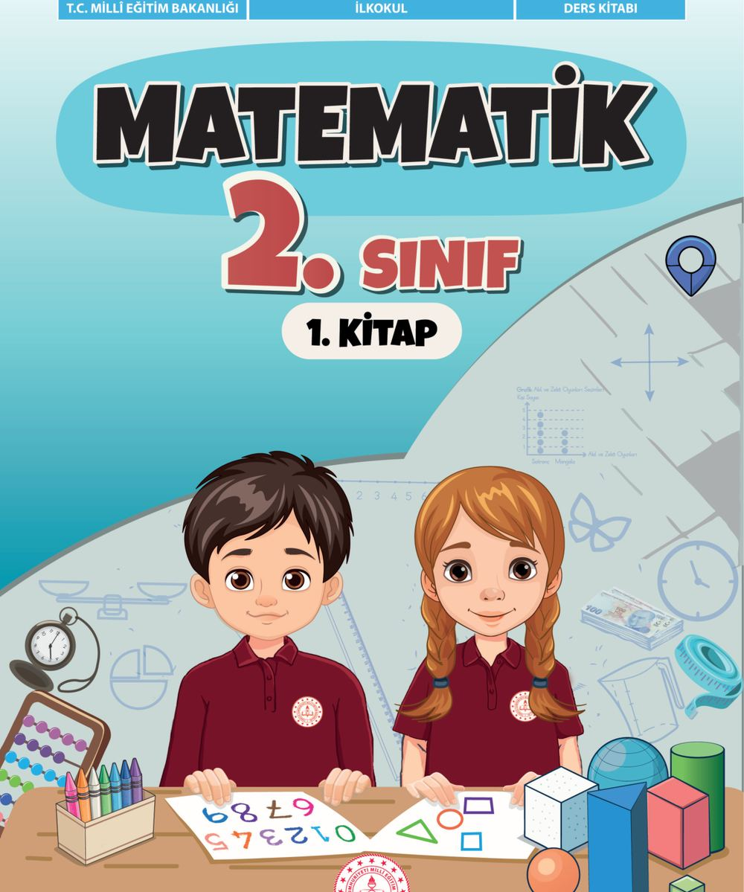
<!-- yer tutucu bulunamadı: sayfa sonuna eklendi -->

<!-- sayfa 1 -->

# İLKOKUL
# MATEMATİK
## 2. SINIF DERS KİTABI
## 1. KİTAP

### YAZARLAR
İpek TIĞLI
Şerife KAÇMAZ
Ümran ERTÜRK

<!-- sayfa 2 -->

MİLLÎ EĞİTİM BAKANLIĞI YAYINLARI ................................................................. : 10253
DERS KİTAPLARI DİZİSİ ....................................................................................... : 2258

Her hakkı saklıdır ve Millî Eğitim Bakanlığına aittir. Kitabın metin, soru ve şekilleri kısmen de olsa hiçbir surette alınıp yayımlanamaz.

# HAZIRLAYANLAR

## Editör
Prof. Dr. Veli TOPTAŞ
Dr. Dilek ÇAPAR

## Dil Uzmanı
Esra ESEN KANAN

## Görsel Tasarımcı
Ahmet Arif ÖZEN
Ali KAŞTAN
Cuma ŞAŞTIM
Gülseren KARATAŞ
Hafize AÇAR KAŞTAN
Nebi PALANCI

## Çoklu Ortam Tasarımcısı
Aslıhan BADAL
Cem SAVAŞ
Erdem TOPUZOĞLU
Fatma KAHYAOĞLU
Gökhan KAHYAOĞLU
Osman Yasin KÜÇÜKBALLI
Vahide KÜÇÜKBALLI

## Program Geliştirme Uzmanı
Doç. Dr. Azmi TÜRKAN

## Ölçme ve Değerlendirme Uzmanı
Doç. Dr. Güçlü ŞEKERCİOĞLU

## Rehberlik Uzmanı
Harun KARABULUT

ISBN 978-975-11-8765-9

Millî Eğitim Bakanlığı Talim ve Terbiye Kurulu Başkanlığının 21.05.2025 tarih ve 132696373 sayılı yazısı ile eğitim aracı olarak kabul edilmiştir.

<!-- sayfa 3 -->

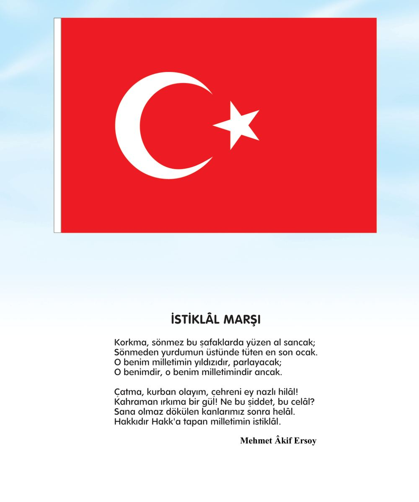

# İSTİKLÂL MARŞI

Korkma, sönmez bu şafaklarda yüzen al sancak;
Sönmeden yurdumun üstünde tüten en son ocak.
O benim milletimin yıldızıdır, parlayacak;
O benimdir, o benim milletimindir ancak.

Çatma, kurban olayım, çehreni ey nazlı hilâl!
Kahraman ırkıma bir gül! Ne bu şiddet, bu celâl?
Sana olmaz dökülen kanlarımız sonra helâl.
Hakkıdır Hakk'a tapan milletimin istiklâl.

**Mehmet Âkif Ersoy**

<!-- sayfa 4 -->

ANDIMIZ

Türküm, doğruyum, çalışkanım.

İlkem küçüklerimi korumak, büyüklerimi saymak; yurdumu, milletimi özümden çok sevmektir.
Ülküm yükselmek, ileri gitmektir.

Ey Büyük Atatürk!

Açtığın yolda, gösterdiğin hedefe durmadan yürüyeceğime ant içerim.

Varlığım Türk varlığına armağan olsun.

Ne mutlu Türküm diyene!

<!-- sayfa 5 -->

MUSTAFA KEMAL ATATÜRK

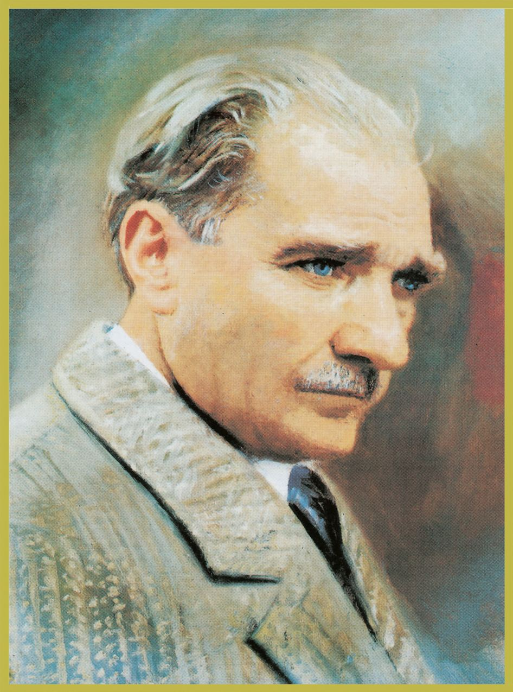
<!-- yer tutucu bulunamadı: sayfa sonuna eklendi -->

<!-- sayfa 6 -->

Verdiğiniz mesajda herhangi bir metin veya görsel bulunmamaktadır. Lütfen çevrilmesini istediğiniz metni veya görseli paylaşın, ardından talimatlarınıza uygun şekilde Markdown formatına dönüştürebilirim.

<!-- sayfa 7 -->

Kitabımızı Tanıyalım ......................................................................................................................................8

# 1. TEMA: NESNELERİN GEOMETRİSİ (1) .............................................10
Geometrik Cisimler ............................................................................................................................12
Geometrik Cisim Modelleri ...................................................................................................22
Geometrik Şekil Modelleri ......................................................................................................27
Geometrik Şekil ve Cisimlerin Biçimsel Özellikleri ....................................35
Sıvı Miktarını Tahmin Etme ......................................................................................................42
1. Tema Değerlendirme .....................................................................................................................48

# 2. TEMA: SAYILAR VE NİCELİKLER (1) .................................................54
Sayılar ...........................................................................................................................................................56
Sayıları Çözümleme ........................................................................................................................72
Sayıların Sırasını Belirleyebilme ........................................................................................90
Ritmik Sayma .......................................................................................................................................103
Sayı ve Şekil Örüntüleri .....................................................................................................116
Nesne Sayısını Tahmin Etme ...............................................................................................121
2. Tema Değerlendirme ..................................................................................................................128

# 3. TEMA: İŞLEMLERDEN CEBİRSEL DÜŞÜNMEYE .............132
Toplama ve Çıkarma İşlemleriyle İlgili Problemler ...................................134
Toplama ve Çıkarma İşlemlerinin Sonuçlarını Tahmin Etme ve Zihinden İşlem .....................................................................................................................................................146
Toplama ve Çıkarma İşlemlerinin İlişkisi ................................................................154

Kısaltmalar ve Semboller .........................................................................................................160
Sözlük ............................................................................................................................................................160
Kaynakça ..................................................................................................................................................162
Görsel Kaynakça ............................................................................................................................162
Cevap Anahtarı ................................................................................................................................162
Ekler .................................................................................................................................................................163
Türkiye’nin Mülki İdare Bölümleri ile Kara ve Deniz Komşuları Haritası .......................................................................................................177
Türk Dünyası Haritası ........................................................................................................................178

<!-- sayfa 8 -->

# Tema Numarası ve Tema Başlığı
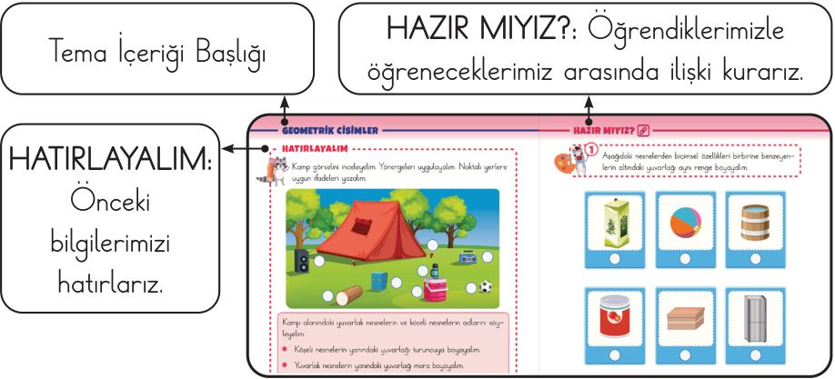

# Tema İçeriği Başlıkları
1. TOPLAMA VE ÇIKARMA İŞLEMLERİYLE İLGİLİ PROBLEMLER
2. TOPLAMA VE ÇIKARMA İŞLEMLERİNİN SONUÇLARINI TAHMİN ETME VE ZİHİNDEN İŞLEM
3. TOPLAMA VE ÇIKARMA İŞLEMLERİNİN İLİŞKİSİ

# Sayfa Numaraları

## Tema İçeriği Başlığı

### HATIRLAYALIM: Önceki bilgilerimizi hatırlarız.

### HAZIR MIYIZ?: Öğrendiklerimizle öğreneceklerimiz arasında ilişki kurarız.
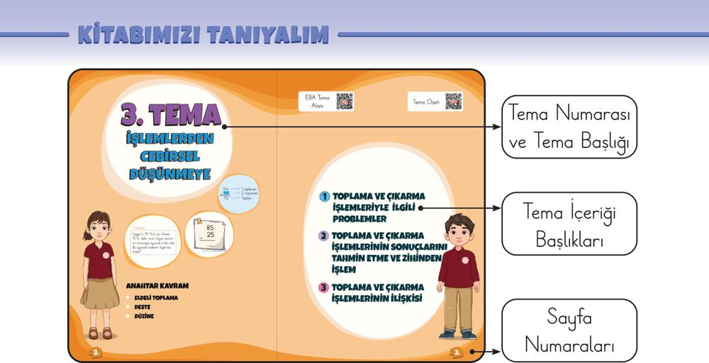

### BAŞLAYALIM: Tema içeriğiyle ilgili bilgi ve beceri kazanırız.
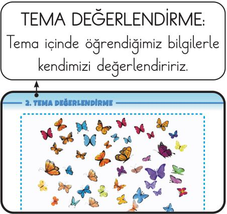

### TEMA DEĞERLENDİRME: Tema içinde öğrendiğimiz bilgilerle kendimizi değerlendiririz.
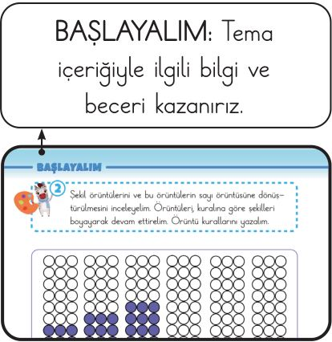

<!-- sayfa 9 -->

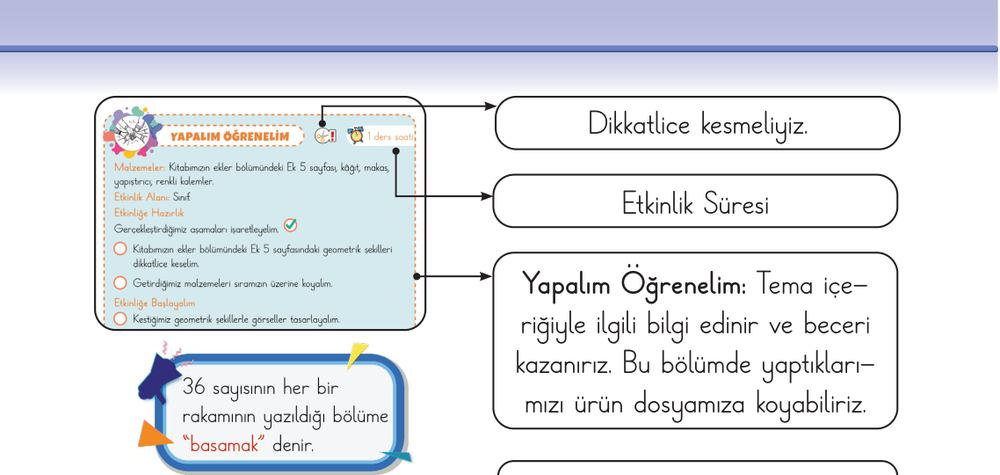
Dikkatlice kesmeliyiz.

Etkinlik Süresi

Yapalım Öğrenelim: Tema içeriğiyle ilgili bilgi edinir ve beceri kazanırız. Bu bölümde yaptıklarımızı ürün dosyamıza koyabiliriz.

36 sayısının her bir rakamının yazıldığı bölüme “basamak” denir.

Bilgi Kutusu

Boyama Sembolü

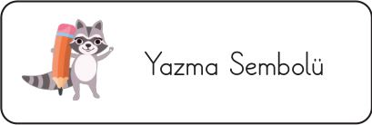
Yazma Sembolü

Konuşma Sembolü

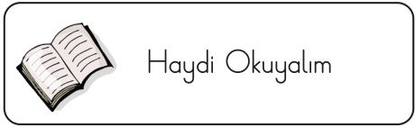
Dinleme Sembolü

Okuma Sembolü

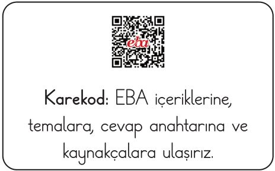
Ela Nehir Ayşe
Kerem Kaan Ali
Tema içeriğiyle ilgili bilgilerin verildiği konuşmalar yaparlar.

Haydi Okuyalım

Karekod: EBA içeriklerine, temalara, cevap anahtarına ve kaynakçalara ulaşırız

<!-- sayfa 10 -->

# 1. TEMA
## NESNELERİN GEOMETRİSİ (1)

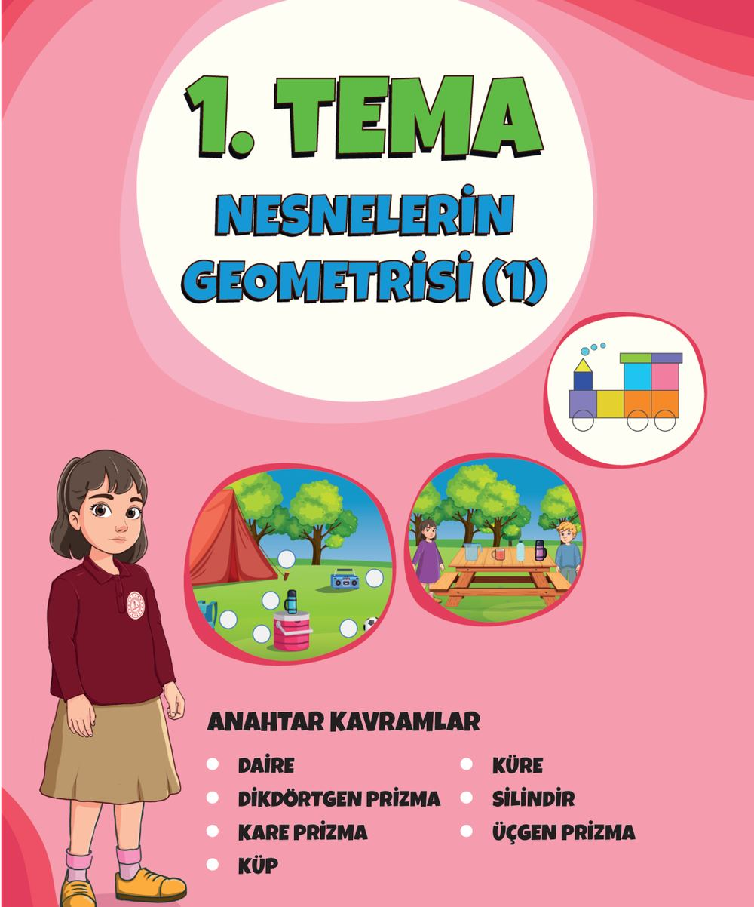

### ANAHTAR KAVRAMLAR

* DAİRE
* DİKDÖRTGEN PRİZMA
* KARE PRİZMA
* KÜP
* KÜRE
* SİLİNDİR
* ÜÇGEN PRİZMA

<!-- sayfa 11 -->

EBA Tema Alanı 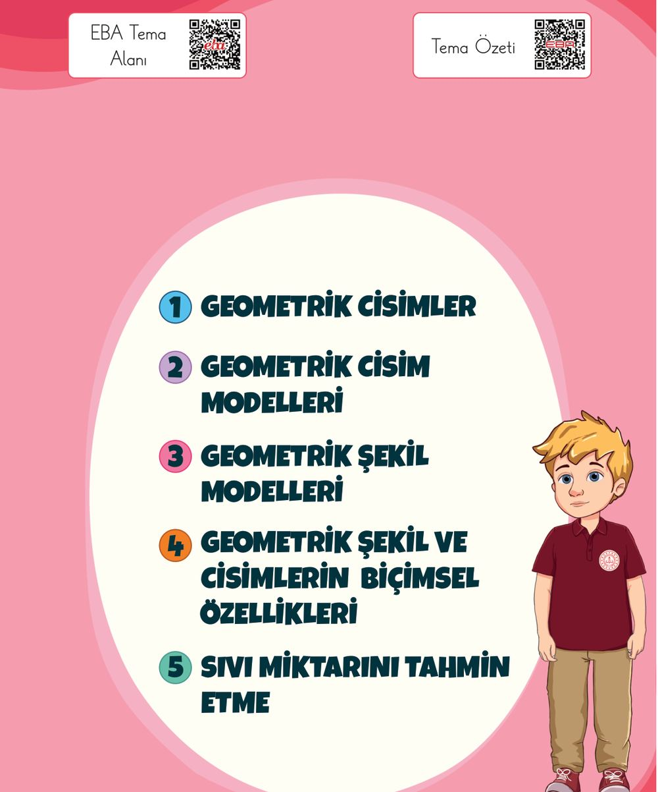
Tema Özeti 

1 GEOMETRİK CİSİMLER
2 GEOMETRİK CİSİM MODELLERİ
3 GEOMETRİK ŞEKİL MODELLERİ
4 GEOMETRİK ŞEKİL VE CİSİMLERİN BİÇİMSEL ÖZELLİKLERİ
5 SIVI MİKTARINI TAHMİN ETME

<!-- sayfa 12 -->

# HATIRLAYALIM

Kamp görselini inceleyelim. Yönergeleri uygulayalım. Noktalı yerlere uygun ifadeleri yazalım.

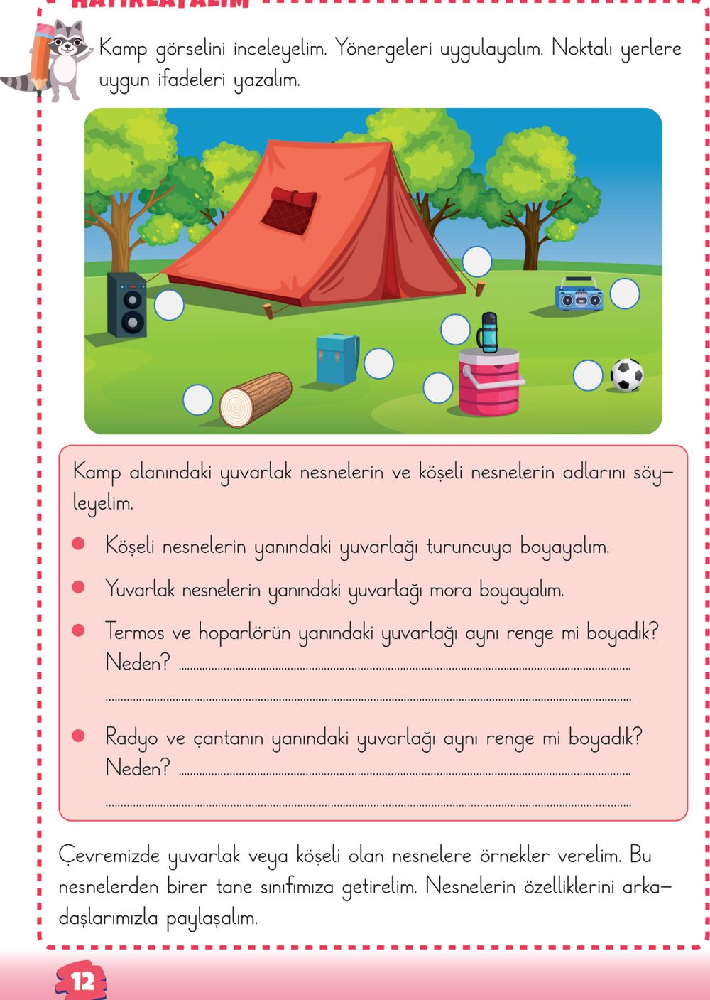

Kamp alanındaki yuvarlak nesnelerin ve köşeli nesnelerin adlarını söyleyelim.

* Köşeli nesnelerin yanındaki yuvarlağı turuncuya boyayalım.
* Yuvarlak nesnelerin yanındaki yuvarlağı mora boyayalım.
* Termos ve hoparlörün yanındaki yuvarlağı aynı renge mi boyadık? Neden? .....................................................................................................................................................
.............................................................................................................................................................................
* Radyo ve çantanın yanındaki yuvarlağı aynı renge mi boyadık? Neden? .....................................................................................................................................................
.............................................................................................................................................................................

Çevremizde yuvarlak veya köşeli olan nesnelere örnekler verelim. Bu nesnelerden birer tane sınıfımıza getirelim. Nesnelerin özelliklerini arkadaşlarımızla paylaşalım.

<!-- sayfa 13 -->

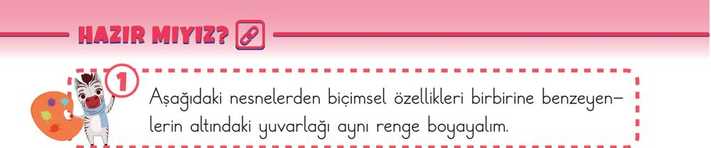
1. Aşağıdaki nesnelerden biçimsel özellikleri birbirine benzeyenlerin altındaki yuvarlağı aynı renge boyayalım.

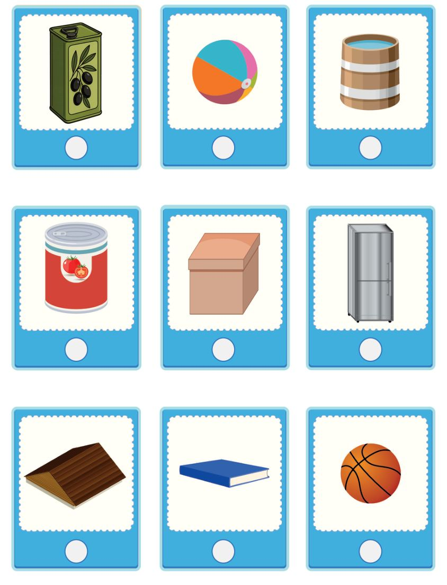

Çevremizden biçimsel özellikleri birbirine benzeyen nesneler belirleyip defterimize yazalım.

<!-- sayfa 14 -->

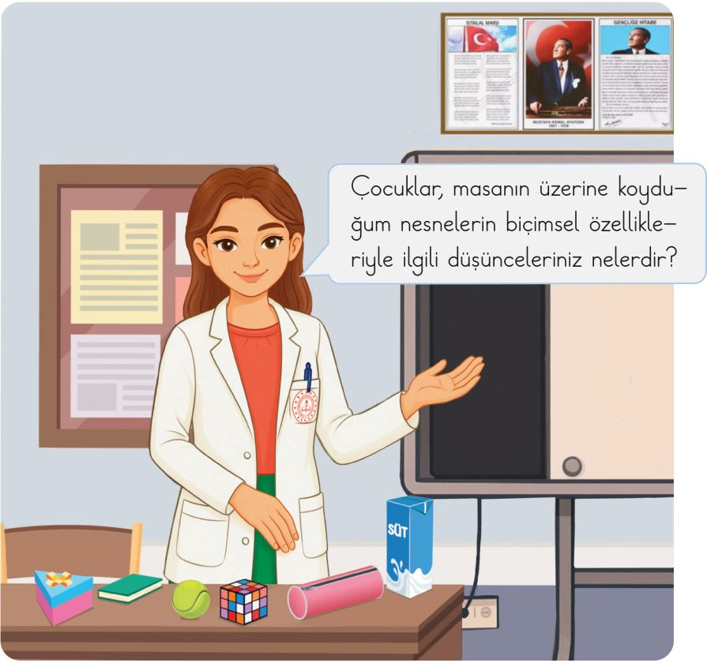
2 Ela, Kerem ve öğretmenlerinin konuşmalarını okuyalım.
Noktalı yerlere uygun ifadeleri yazalım.

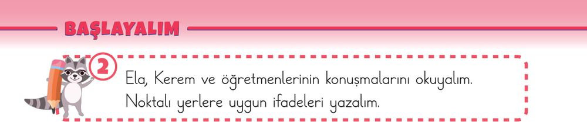
Çocuklar, masanın üzerine koydu-
ğum nesnelerin biçimsel özellikle-
riyle ilgili düşünceleriniz nelerdir?

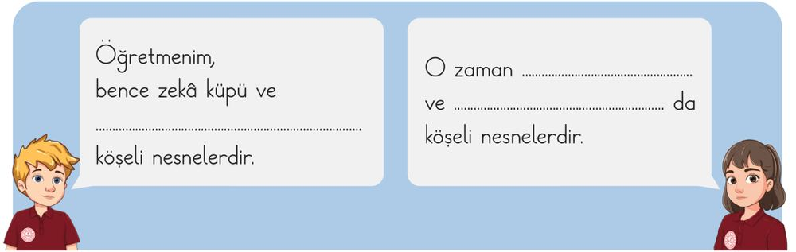
Öğretmenim,
bence zekâ küpü ve
.................................................................................
köşeli nesnelerdir.

O zaman ....................................................
ve ................................................................ da
köşeli nesnelerdir.

<!-- sayfa 15 -->

..................................................................................
köşesi yoktur.

..................................................................................
yuvarlak bir nesnedir.

Köşesi olmayan nesneler yuvarlak cisimlerdir. Yuvarlak cisimlere çevremizden örnekler verir misin? 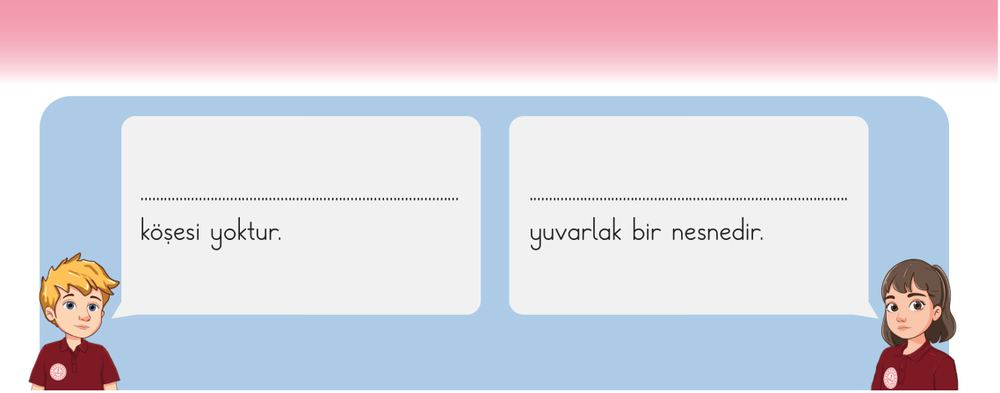

Futbol topu, ..............................................
..................................................................................
yuvarlak cisimlerdir.

Köşesi olan nesneler köşeli cisimlerdir. Köşeli cisimlere çevremizden örnekler verir misin? 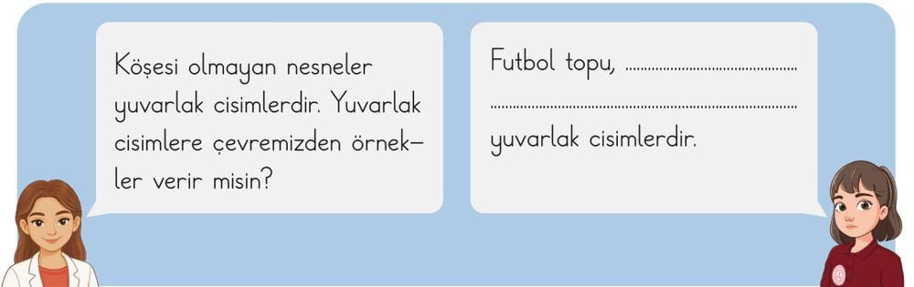

Çamaşır makinesi, ...........................
..................................................................................
köşeli cisimlerdir. 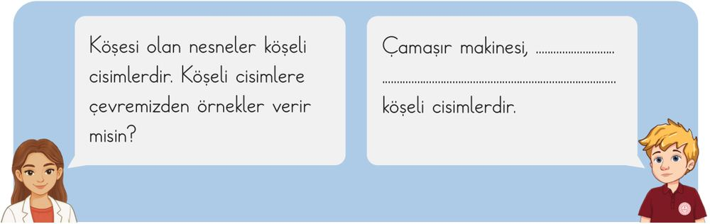

Haydi, defterimize yuvarlak ve köşeli cisimlere örnekler yazalım. Cisimlerin biçimsel özelliklerindeki benzerlik ve farklılıkları arkadaşlarımızla tartışalım.

<!-- sayfa 16 -->

# YAPALIM ÖĞRENELİM
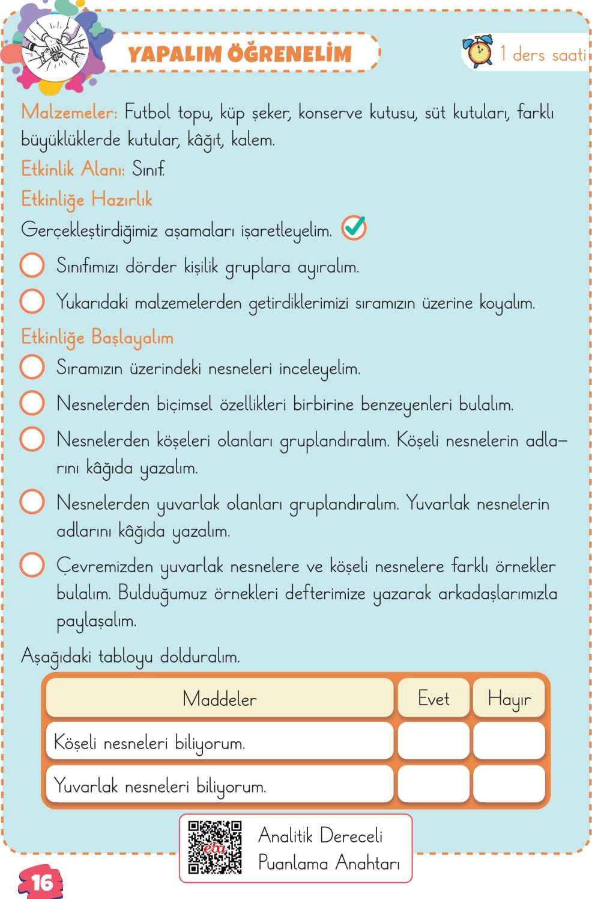: 1 ders saati

**Malzemeler:** Futbol topu, küp şeker, konserve kutusu, süt kutuları, farklı büyüklüklerde kutular, kâğıt, kalem.
**Etkinlik Alanı:** Sınıf.

### Etkinliğe Hazırlık
Gerçekleştirdiğimiz aşamaları işaretleyelim. ✅

*   Sınıfımızı dörder kişilik gruplara ayıralım.
*   Yukarıdaki malzemelerden getirdiklerimizi sıramızın üzerine koyalım.

### Etkinliğe Başlayalım
*   Sıramızın üzerindeki nesneleri inceleyelim.
*   Nesnelerden biçimsel özellikleri birbirine benzeyenleri bulalım.
*   Nesnelerden köşeleri olanları gruplandıralım. Köşeli nesnelerin adlarını kâğıda yazalım.
*   Nesnelerden yuvarlak olanları gruplandıralım. Yuvarlak nesnelerin adlarını kâğıda yazalım.
*   Çevremizden yuvarlak nesnelere ve köşeli nesnelere farklı örnekler bulalım. Bulduğumuz örnekleri defterimize yazarak arkadaşlarımızla paylaşalım.

Aşağıdaki tabloyu dolduralım.

| Maddeler | Evet | Hayır |
| :--- | :---: | :---: |
| Köşeli nesneleri biliyorum. | | |
| Yuvarlak nesneleri biliyorum. | | |

<!-- sayfa 17 -->

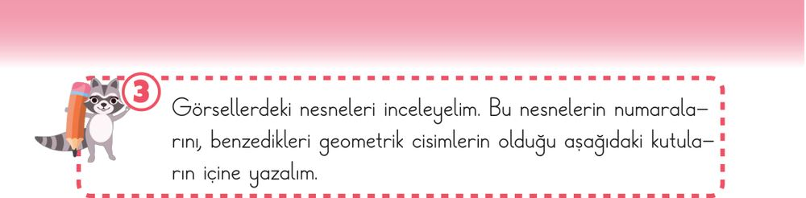
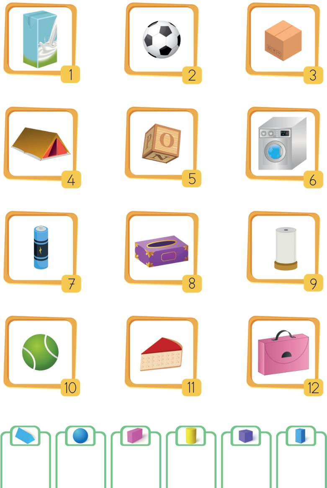
3 Görsellerdeki nesneleri inceleyelim. Bu nesnelerin numarala- rını, benzedikleri geometrik cisimlerin olduğu aşağıdaki kutula- rın içine yazalım.

1 2 3
4 5 6
7 8 9
10 11 12

<!-- sayfa 18 -->

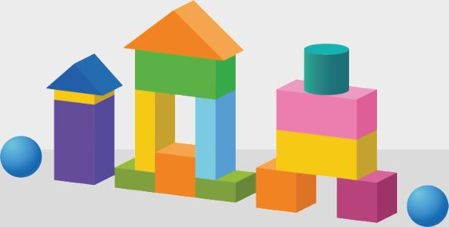
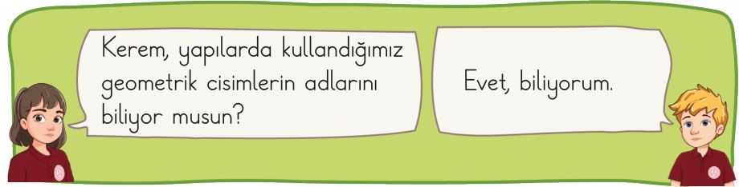
4
Ela ve Kerem geometrik cisimlerden yararlanarak aşağıdaki yapıyı oluşturdular. Bu yapıyı oluştururken hangi geometrik cisimlerden yararlanmışlardır? Ela ve Kerem’in konuşmalarını okuyalım.

![Yapı görseli]

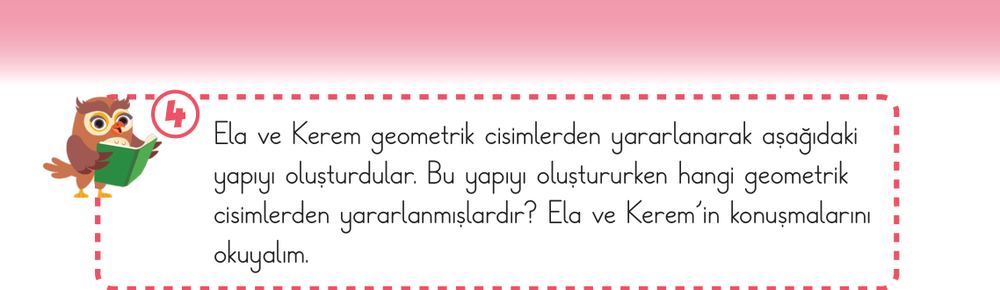
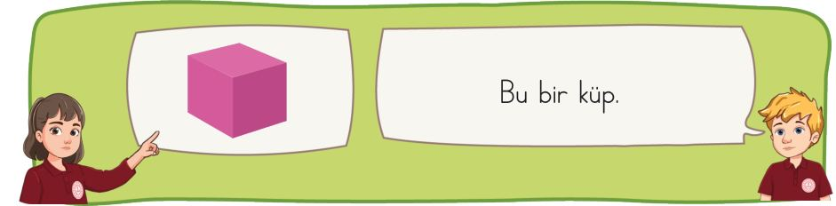
Kerem, yapılarda kullandığımız geometrik cisimlerin adlarını biliyor musun?
Evet, biliyorum.

Bu bir küp.

Bu bir küre.

<!-- sayfa 19 -->

Bu bir dikdörtgen prizma.

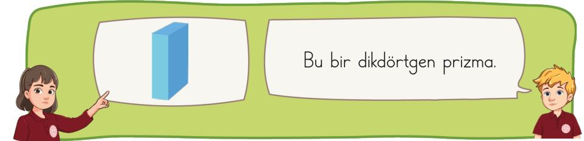
Bu bir kare prizma.

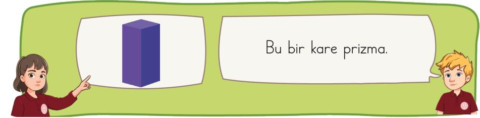
Bu bir silindir.

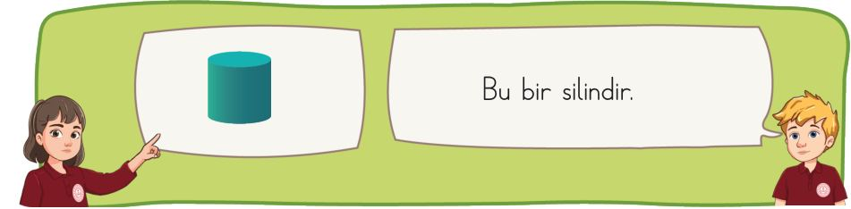
Bu bir üçgen prizma.

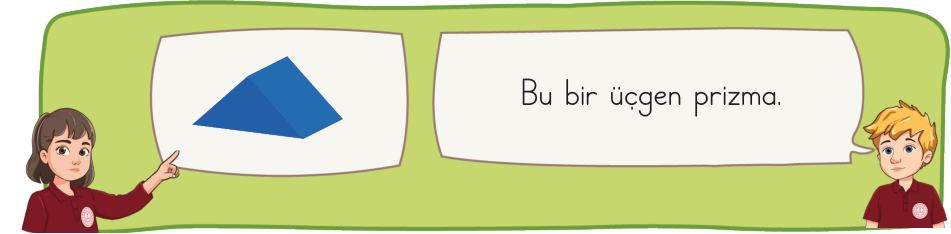
<!-- yer tutucu bulunamadı: sayfa sonuna eklendi -->

<!-- yer tutucu bulunamadı: sayfa sonuna eklendi -->

<!-- sayfa 20 -->

# 5

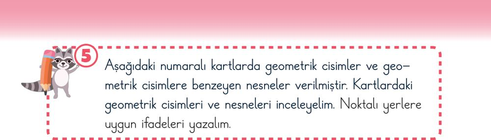
Aşağıdaki numaralı kartlarda geometrik cisimler ve geometrik cisimlere benzeyen nesneler verilmiştir. Kartlardaki geometrik cisimleri ve nesneleri inceleyelim. Noktalı yerlere uygun ifadeleri yazalım.

Aynı numara birden fazla sorunun cevabı olarak kullanılabilir.

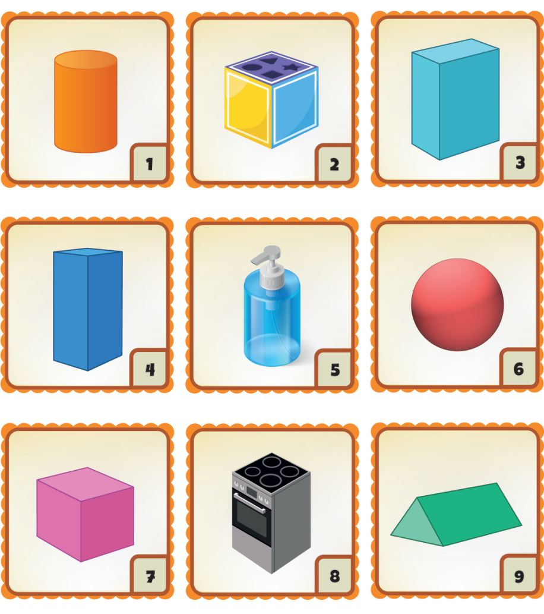

| 1 | 2 | 3 |
| :---: | :---: | :---: |
|  |  |  |
| **1** | **2** | **3** |

| 4 | 5 | 6 |
| :---: | :---: | :---: |
|  |  |  |
| **4** | **5** | **6** |

| 7 | 8 | 9 |
| :---: | :---: | :---: |
|  |  |  |
| **7** | **8** | **9** |

<!-- sayfa 21 -->

* Köşeli cisimlerin görseline benzeyen nesnelerin olduğu kartların numaralarını yazalım.
...............................................................................

* Yuvarlak cisimlerin görsellerinin olduğu kartların numaralarını yazalım.
...............................................................................

* Küp görseline benzeyen nesnelerin olduğu kartların numaralarını yazalım.
...............................................................................

* Kare prizma görseline benzeyen nesnelerin olduğu kartların numaralarını yazalım.
...............................................................................

* Dikdörtgen prizma görseline benzeyen nesnenin olduğu kartın numarasını yazalım.
...............................................................................

* Üçgen prizma görseline benzeyen nesnenin olduğu kartın numarasını yazalım.
...............................................................................

* Silindir görseline benzeyen nesnelerin olduğu kartların numaralarını yazalım.
...............................................................................

* Küre görseline benzeyen nesnenin olduğu kartın numarasını yazalım.
...............................................................................

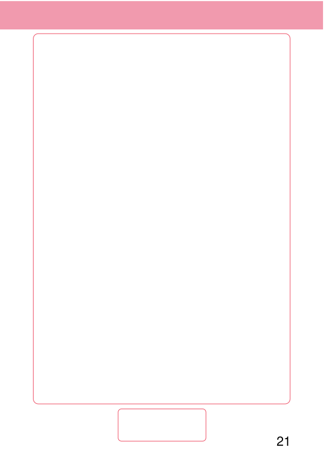
<!-- yer tutucu bulunamadı: sayfa sonuna eklendi -->

<!-- sayfa 22 -->

# HATIRLAYALIM

 İstanbul’da bulunan Kız Kulesi görselini inceleyelim. Soruları cevap-layalım.

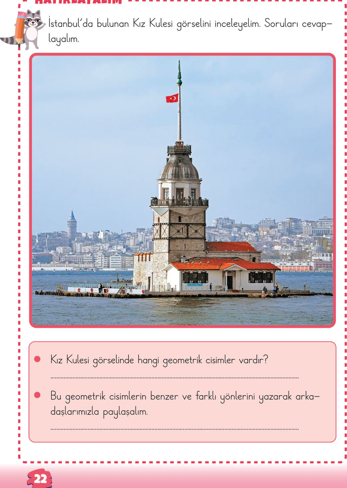

* Kız Kulesi görselinde hangi geometrik cisimler vardır?
.......................................................................................................................................................................

* Bu geometrik cisimlerin benzer ve farklı yönlerini yazarak arka-daşlarımızla paylaşalım.
.......................................................................................................................................................................

<!-- sayfa 23 -->

# 1 Fotoğraflardaki yapılar hangi geometrik cisimlere benzemektedir?

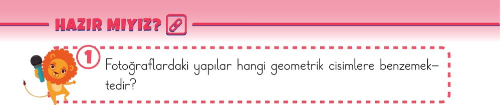
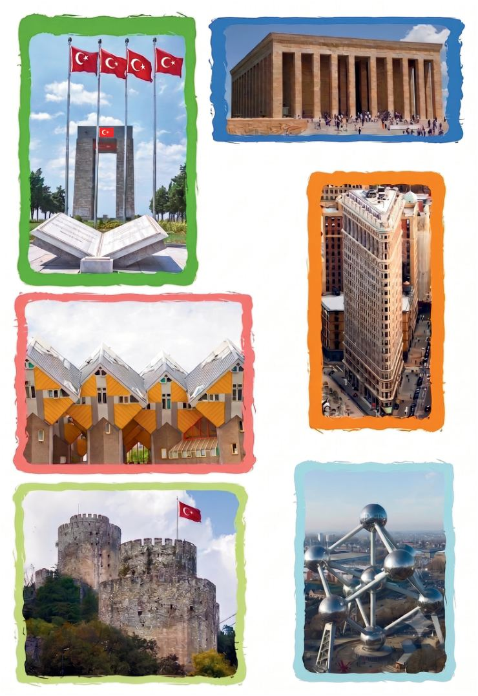

Çevremizdeki yapıları inceleyerek bunların hangi geometrik cisimlere benzediğini defterimize yazalım. Mimarların bu yapıları tasarlarken neden bu geometrik cisimleri kullandığını düşünelim. Düşüncelerimizi arka-

<!-- sayfa 24 -->

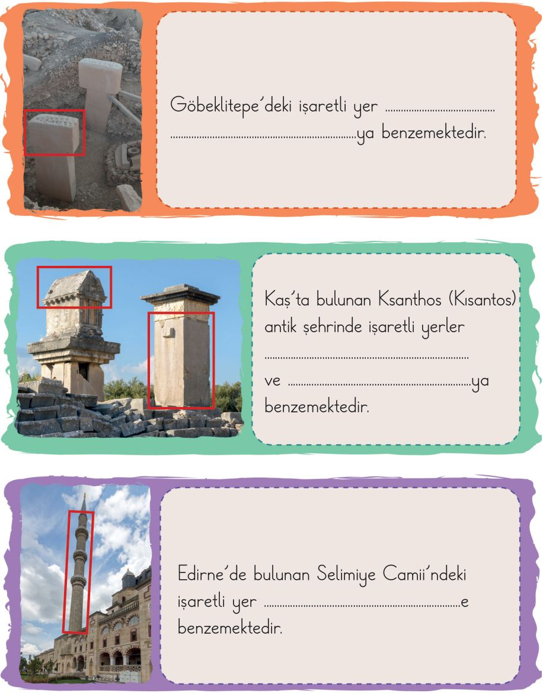
2 Görsellerdeki yapılarda işaretli yerleri inceleyelim. Bu yerlerin benzediği geometrik cismin adını noktalı yerlere yazalım.

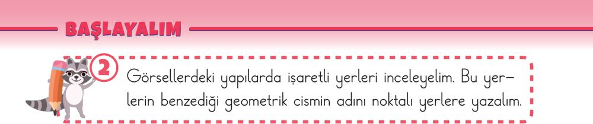
Göbeklitepe’deki işaretli yer ..........................................
.......................................................................ya benzemektedir.

Kaş’ta bulunan Ksanthos (Kısantos) antik şehrinde işaretli yerler .............................................................................. ve ......................................................................ya benzemektedir.

Edirne’de bulunan Selimiye Camii’ndeki işaretli yer ...........................................................................e benzemektedir.

<!-- sayfa 25 -->

3 Kerem ve amcasının yaptığı kuş yuvasını inceleyelim. Görsellerdeki geometrik şekillere göre noktalı yerlere uygun ifadeleri yazalım.

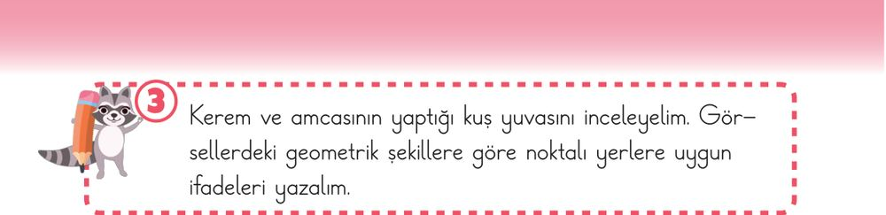

Görseldeki kuş yuvasını yapmadan önce tüm parçaları hazırladık.
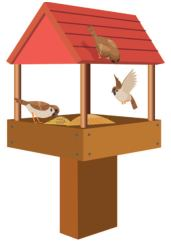

---

Kuş yuvasının ayağında 1 tane ............................................. kullandık.

Kuş yuvasının tabanında 1 tane ............................................. kullandık.

Köşelerinde 4 tane ............................................. kullandık.

Çatısında 1 tane ............................................. kullandık. Sonra da bunları birleştirdik ve kuş yuvasını tamamladık.

---

Geometrik cisimleri kullanarak bir yapı tasarlayalım. Oluşturduğumuz tasarımı arkadaşlarımızla paylaşalım.
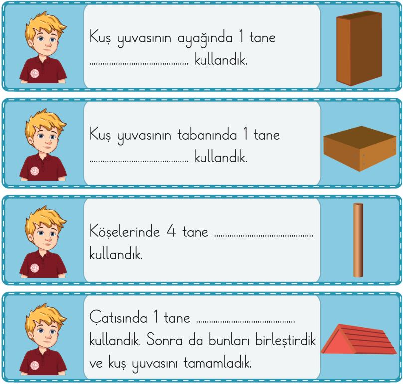

<!-- sayfa 26 -->

# YAPALIM ÖĞRENELİM
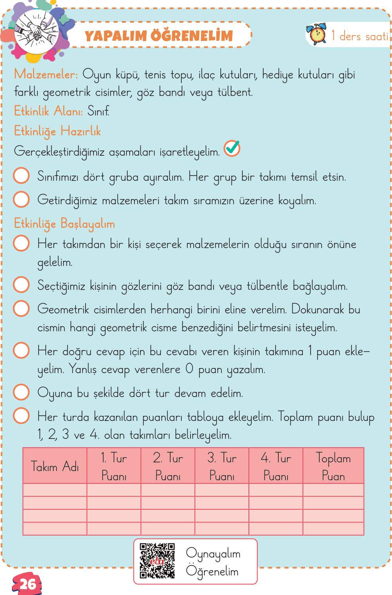: 1 ders saati

**Malzemeler:** Oyun küpü, tenis topu, ilaç kutuları, hediye kutuları gibi farklı geometrik cisimler, göz bandı veya tülbent.

**Etkinlik Alanı:** Sınıf.

### Etkinliğe Hazırlık
Gerçekleştirdiğimiz aşamaları işaretleyelim. ✅

*   Sınıfımızı dört gruba ayıralım. Her grup bir takımı temsil etsin.
*   Getirdiğimiz malzemeleri takım sıramızın üzerine koyalım.

### Etkinliğe Başlayalım
*   Her takımdan bir kişi seçerek malzemelerin olduğu sıranın önüne gelelim.
*   Seçtiğimiz kişinin gözlerini göz bandı veya tülbentle bağlayalım.
*   Geometrik cisimlerden herhangi birini eline verelim. Dokunarak bu cismin hangi geometrik cisme benzediğini belirtmesini isteyelim.
*   Her doğru cevap için bu cevabı veren kişinin takımına 1 puan ekleyelim. Yanlış cevap verenlere 0 puan yazalım.
*   Oyuna bu şekilde dört tur devam edelim.
*   Her turda kazanılan puanları tabloya ekleyelim. Toplam puanı bulup 1, 2, 3 ve 4. olan takımları belirleyelim.

| Takım Adı | 1. Tur Puanı | 2. Tur Puanı | 3. Tur Puanı | 4. Tur Puanı | Toplam Puan |
| :--- | :--- | :--- | :--- | :--- | :--- |
| | | | | | |
| | | | | | |
| | | | | | |

<!-- sayfa 27 -->

# HATIRLAYALIM

Tarihî ev görselini inceleyelim. Soruların cevaplarını noktalı yerlere yazalım.

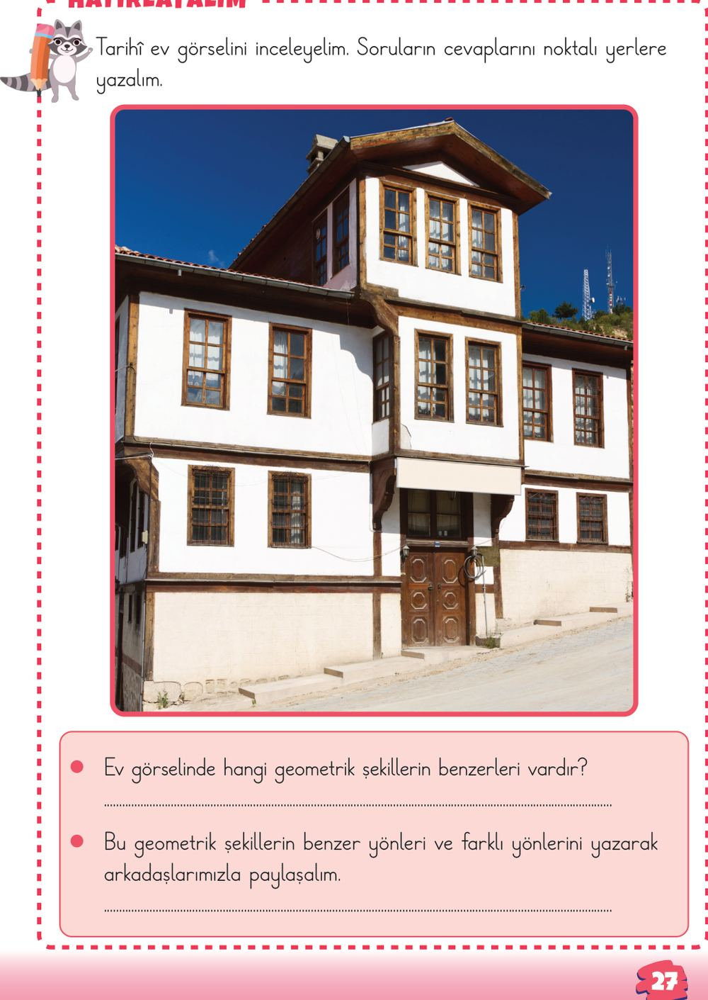

* Ev görselinde hangi geometrik şekillerin benzerleri vardır?
.......................................................................................................................................................................

* Bu geometrik şekillerin benzer yönleri ve farklı yönlerini yazarak arkadaşlarımızla paylaşalım.
.......................................................................................................................................................................

<!-- sayfa 28 -->

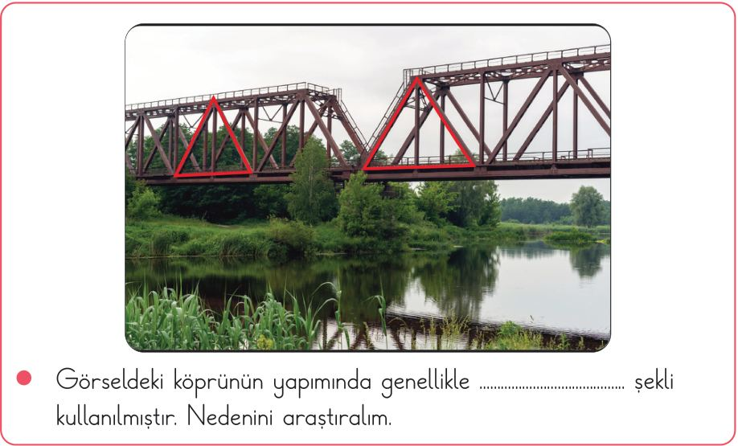
# 1 Fotoğraflardaki geometrik şekillere benzeyen kısımları inceleyelim. Noktalı yerlere uygun ifadeleri yazalım.

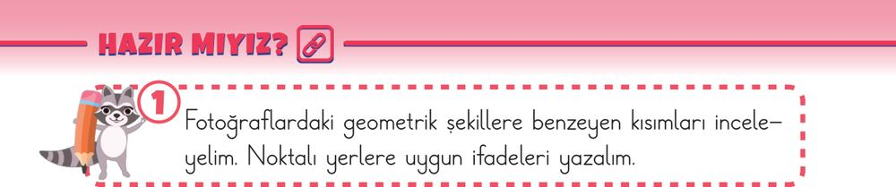
* Görseldeki köprünün yapımında genellikle ......................................... şekli kullanılmıştır. Nedenini araştıralım.

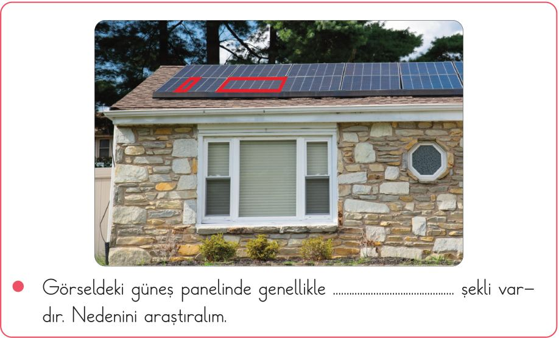
* Görseldeki güneş panelinde genellikle ............................................. şekli vardır. Nedenini araştıralım.

<!-- sayfa 29 -->

2
Modelleri inceleyelim. Noktalı yerlere modelde kullanılan geometrik şekilleri yazalım.

---

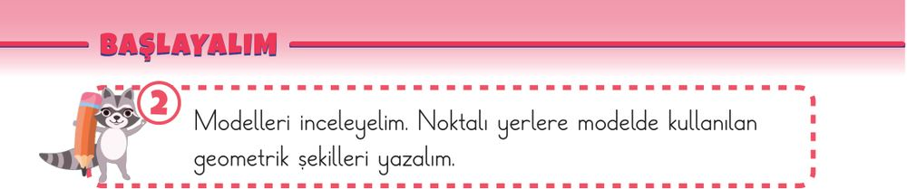 $\longrightarrow$  Çemberin içini boyayarak daire oluştururuz.

---

| | |
| :--- | :--- |
| Modelde ............................ ve daire kullanılmıştır. |  |

---

| | |
| :--- | :--- |
| Zürafa modelinde dikdörtgen, ............................ ve ............................ kullanılmıştır. |  |

---

| | |
| :--- | :--- |
| Tren modelinde kare, çember, ............................, ............................ ve ............................... kullanılmıştır. |  |

<!-- sayfa 30 -->

3
Kültürümüze ve farklı kültürlere ait geometrik şekillerin olduğu desenleri inceleyelim. Desenlerde hangi geometrik şekillerin olduğunu arkadaşlarımızla tartışalım.

<!-- sayfa 31 -->

# YAPALIM ÖĞRENELİM
1 ders saati

**Malzemeler:** Kitabımızın ekler bölümündeki Ek 1, Ek 2, Ek 3 ve Ek 4 sayfaları, makas, renkli kalemler.
**Etkinlik Alanı:** Sınıf.

**Etkinliğe Hazırlık**
Gerçekleştirdiğimiz aşamaları işaretleyelim. ✅

*   Kitabımızdan Ek 1, Ek 2, Ek 3 ve Ek 4 sayfalarını dikkatlice keselim.
*   Getirdiğimiz malzemeleri sıramızın üzerine koyalım.

**Etkinliğe Başlayalım**
*   Kestiğimiz sayfalardaki at, kamyon, kuş ve çiçek modellerini boyayalım.
*   Kestiğimiz sayfaların arkalarına benzer modeller tasarlayalım. Tasarladığımız modelleri boyayalım.
*   Yaptıklarımızı arkadaşlarımızla paylaşalım.

<!-- sayfa 32 -->

4 Aşağıdaki kamyon görselini inceleyelim. Noktalı yerlere uygun ifadeleri yazalım.

* Görseldeki kamyonda kullanılan, yuvarlak olan geometrik şekli yazalım.
.................................................................................................................................................................................

* Görseldeki kamyonda kullanılan, köşesi ve kenarı olan geometrik şekilleri yazalım.
..................................................................................................................................................................................

* Köşeli geometrik şekiller arasında nasıl bir ilişki vardır? Yazalım.
..................................................................................................................................................................................

* Görseldeki kamyonda ............ kare, ............ üçgen, ............. dikdörtgen ve ............ daire kullanılmıştır.

<!-- sayfa 33 -->

# YAPALIM ÖĞRENELİM
 1 ders saati

**Malzemeler:** Renkli kalemler.
**Etkinlik Alanı:** Sınıf veya ev.

### Etkinliğe Hazırlık
Gerçekleştirdiğimiz aşamaları işaretleyelim. ✅

◯ Kare, üçgen, daire, çember ve dikdörtgen kullanarak hazırlayacağımız bir model düşünelim.

### Etkinliğe Başlayalım
◯ Düşündüğümüz modeli aşağıda verilen alana çizelim.
◯ Oluşturduğumuz modeli renkli kalemlerimizle boyayalım.
◯ Yaptıklarımızı arkadaşlarımızla paylaşalım.

(Boş alan)

<!-- sayfa 34 -->

# 5
Aşağıdaki modellerde kullanılan geometrik şekilleri sayalım. Modellerle, bu modellerde kullanılan geometrik şekilleri renklerine göre sayılarıyla eşleştirelim.

| Mor Kare : 2   Sarı Dikdörtgen : 1   Mavi Daire : 3 | Sarı Üçgen : 1   Mor Üçgen : 1   Mavi Çember : 3 | Mor Kare : 2   Mavi Çember : 3   Mor Üçgen : 1 |

* Cevaplarımızı arkadaşlarımızla karşılaştıralım.
* Cevaplarımızın doğruluğuna göre aşağıdaki tabloyu dolduralım.

| Maddeler | Evet | Hayır |
| :--- | :---: | :---: |
| Kareyi tanıyorum. | | |
| Dikdörtgeni tanıyorum. | | |
| Üçgeni tanıyorum. | | |
| Çemberi tanıyorum. | | |
| Daireyi tanıyorum. | | |

<!-- sayfa 35 -->

# ÖZELLİKLERİ

## HATIRLAYALIM

Oda görselini inceleyelim. Soruları cevaplayalım.

| 1 | 2 | 3 | 4 | 5 | 6 | 7 | 8 | 9 | 10 |
| :---: | :---: | :---: | :---: | :---: | :---: | :---: | :---: | :---: | :---: |
| △ | ▭ | ▮ | ○ | 🧊 | ▱ | ▱ | ⬦ | ● | ⌌ |

* Oda görselinde yukarıda numaralandırılan geometrik şekil ve cisimlere benzeyen nesneleri bulalım. Nesnelerin yanındaki noktalı yerlere benzediği geometrik şekil ve cismin numarasını yazalım.
* Aynı numaralı nesnelerin biçimsel özelliklerini karşılaştıralım. Bu özellikleri arkadaşlarımızla tartışalım.

<!-- sayfa 36 -->

1. Bateri görselini inceleyelim. Noktalı yerlere görseldeki davulların ve zillerin benzedikleri geometrik cisim veya şekillerin isimlerini ve özelliklerini yazalım. Soruları cevaplayalım.

* Davullar ..........................e benziyor. Davullar ................................ cisimlerdir.
* Davulların yer, yön ve büyüklükleri değiştiğinde biçimsel özelliklerinde bir değişim olur mu? Açıklayalım.
* Zil ..........................ye benziyor. Ziller ................................. şekillerdir.
* Zillerin yer, yön ve büyüklükleri değiştiğinde biçimsel özelliklerinde bir değişim olur mu? Açıklayalım.
* Geometrik şekiller veya cisimlerin yer, yön ve büyüklükleri değiştiğinde biçimsel özelliklerinde bir değişim olur mu? Açıklayalım.

Cevaplarımızı arkadaşlarımızla tartışalım.

<!-- sayfa 37 -->

# YAPALIM ÖĞRENELİM
🕒 1 ders saati

**Malzemeler:** Farklı büyüklükte geometrik şekil ve cisim modelleri.
**Etkinlik Alanı:** Sınıf.
**Etkinliğe Hazırlık**
Gerçekleştirdiğimiz aşamaları işaretleyelim. ✅

**Etkinliğe Başlayalım**
* Sınıfımızı dörder kişilik gruplara ayıralım.
* Getirdiğimiz geometrik şekilleri sıramızın üzerine koyalım.
* Aynı olan geometrik şekillerin büyüklüklerini inceleyelim.
* Geometrik şekillerin yerleri ve yönleri değiştiğinde biçimsel özelliklerinde bir değişiklik olur mu? Arkadaşlarımızla tartışalım.
* Getirdiğimiz geometrik cisimleri sıramızın üzerine koyalım.
* Aynı geometrik cisimlerin büyüklüklerini inceleyelim.
* Geometrik cisimlerin yerleri ve yönleri değiştiğinde biçimsel özelliklerinde bir değişiklik olur mu? Arkadaşlarımızla tartışalım.

<!-- sayfa 38 -->

 2 Kerem ve Ela’nın geometrik şekillerle ilgili sorularını cevap- layalım. Cevaplarımızı defterimize yazalım.

 Geometrik şekillerin yönle- rini değiştirdiğimizde biçimsel özellikleri değişir mi? Neden?

Geometrik şekillerin büyük- lüklerinin farklı olması biçimsel özelliklerini değiştirir mi? Neden?

Geometrik şekillerin hem yönleri hem büyüklükleri değiştiğinde biçimsel özellikleri değişir mi? Neden?

<!-- sayfa 39 -->

3 Kerem ve Ela’nın geometrik cisimlerle ilgili sorularını cevaplayalım. Cevaplarımızı defterimize yazalım.

Geometrik cisimlerin yönlerini değiştirdiğimizde biçimsel özellikleri değişir mi? Neden?

Geometrik cisimlerin büyüklüklerinin farklı olması biçimsel özelliklerini değiştirir mi? Neden?

Geometrik cisimlerin hem yönleri hem büyüklükleri değişirse biçimsel özellikleri değişir mi? Neden?

<!-- sayfa 40 -->

# YAPALIM ÖĞRENELİM
 1 ders saati

**Malzemeler:** Kitabımızın ekler bölümündeki Ek 5 sayfası, kâğıt, makas, yapıştırıcı, renkli kalemler.
**Etkinlik Alanı:** Sınıf.
**Etkinliğe Hazırlık**
Gerçekleştirdiğimiz aşamaları işaretleyelim. ✅

○ Kitabımızın ekler bölümündeki Ek 5 sayfasındaki geometrik şekilleri dikkatlice keselim.
○ Getirdiğimiz malzemeleri sıramızın üzerine koyalım.

**Etkinliğe Başlayalım**
○ Kestiğimiz geometrik şekillerle görseller tasarlayalım.
○ Geometrik şekilleri kâğıdın üzerine yapıştırarak tasarladığımız görselleri oluşturalım.
○ Oluşturduğumuz görseli renkli kalemlerle boyayalım.
○ Boyadığımız görseli arkadaşlarımızla paylaşalım.

Oluşturduğumuz görsele göre aşağıdaki tabloyu dolduralım.

| Maddeler | Evet | Hayır |
| :--- | :---: | :---: |
| Geometrik şekillerle görseller tasarladım. | | |
| Tasarladığım görselleri kâğıda yapıştırdım. | | |

<!-- sayfa 41 -->

 4 
İki görsel arasındaki altı farkı bulalım. Nesnelerin yerleri, yönleri veya büyüklükleri değiştiğinde biçimsel özellikleri değişti mi? Defterimize yazalım.

<!-- sayfa 42 -->

# HATIRLAYALIM

Görseli inceleyelim. Soruları cevaplayalım.

Soruların cevaplarını defterimize yazarak arkadaşlarımızla tartışalım.

* Boş kovayı suyla doldururken şişe, bardak ve sürahiden hangisini kullanırsak kova daha çabuk dolar?
* Şişe, bardak, sürahi ve termostan hangisi en az suyla dolar?
* Boş şişenin içine $2$ bardak su koyalım. Sonra şişeyi boş kovaya boşaltalım. Kovanın içinde kaç bardak su olur?

<!-- sayfa 43 -->

# 1
Hikâyeyi okuyalım. Soruları cevaplayalım.

Sami Bey sabah erkenden uyandı. Hemen Sarıkız ile Karakız’ın yanına gitti. Onlara “günaydın” dedi. Sarıkız ile Karakız’dan üç kova süt sağdı. Sütleri kaynatmak için eve götürdü.

* Sütlerin şişelere doldurulacağını düşünelim. Sami Bey, aşağıdaki şişelerden hangisini kullanırsa daha çok şişeye ihtiyacı olur? İşaretleyelim.

* Sütlerin bidonlara doldurulacağını düşünelim. Sami Bey, aşağıdaki bidonlardan hangisini kullanırsa daha az bidona ihtiyacı olur? İşaretleyelim.

Sıvıları ölçmek için hangi araçları kullandığımızı araştıralım. Arkadaşları-

<!-- sayfa 44 -->

# 2

Günlük hayatta sıvıları ölçmek için kaşık, bardak, sürahi, kova gibi birbirinden farklı boyutlara sahip standart olmayan araçları kullanırız. Aşağıdaki görsellerdeki standart olmayan sıvı ölçme araçlarını bularak işaretleyelim.

Yukarıdaki görsellerden farklı 3 tane standart olmayan ölçme aracı yazalım.

..............................................................................................................................................................................................................
..............................................................................................................................................................................................................

<!-- sayfa 45 -->

# 3
Cümleleri okuyalım. Noktalı yere “eşit, fazla, az” ifadelerinden uygun olanı yazalım.

Onur ve babaannesi, bahçeden topladıkları güllerle gül suyu yaptılar. Gül suyunu 2 bidona doldurdular.

Onur, gül suyunu daha kolay taşımak için şişelere koyalım. Tahminine göre kaç şişeye ihtiyacımız var?

Bence 8 şişe yeterli.

Onur, gül suyunu şişelere doldurduk. 2 bidon gül suyu 6 şişeyi doldurdu.

Şişe sayısını ...................... tahmin etmişim.

<!-- sayfa 46 -->

# YAPALIM ÖĞRENELİM
 1 ders saati

**Malzemeler:** Eş büyüklükte 2 tane kova, 2 tane sürahi, bardak, kepçe, su, kalem.

**Etkinlik Alanı:** Sınıf.

**Etkinliğe Hazırlık**
Gerçekleştirdiğimiz aşamaları işaretleyelim. 
○ Sınıfımızı 2 gruba ayıralım.
○ Her gruba su dolu kova ve boş sürahi verelim.
○ 1. gruba bir bardak, 2. gruba bir kepçe verelim.

**Etkinliğe Başlayalım**
○ 1. grup üyeleri: Sürahinin kaç bardak suyla dolacağını tahmin edelim. Tahminlerimizi tabloya yazalım. Bardağı kovadaki suyla dolduralım. Bardaktaki suyu sürahiye boşal- tarak sürahinin kaç bardak suyla dolduğunu bulalım. Ölçüm sonu- cunu tabloya yazalım.
○ 2. grup üyeleri: Sürahinin kaç kepçeyle suyla dolacağını tahmin edelim. Tahminlerimizi tabloya yazalım. Kepçeyi kovadaki suyla dolduralım. Kepçedeki suyu sürahiye boşal- tarak sürahinin kaç kepçe suyla dolduğunu bulalım. Ölçüm sonucunu tabloya yazalım.
○ Tahminlerimiz ile ölçüm sonuçlarımızı karşılaştıralım. Hangi grubun ölçüm sonucuna en yakın tahmini yaptığını bulalım.

| Tahminim | Ölçüm Sonucu | Karşılaştırma (Eşit/Fazla/Az) |
| :--- | :--- | :--- |
| | | |

<!-- sayfa 47 -->

4 Aşağıdaki ifadeleri inceleyelim. Verilen ifade doğru ise “D”, yanlış ise “Y” bölümünden ilerleyerek sonuca ulaşalım. Ulaştığımız çıkışı yuvarlak içine alalım.

Bir çaydanlığı doldurmak için kullanılacak çay bardağı sayısı su bardağı sayısından daha fazladır.

D | Y
---|---
 | 
Bir tencereyi suyla doldurmak için kaşık kullanmak bardaktan kullanmaktan daha uygundur. | Kepçeyle çorba kâsesini doldurmak çay kaşığıyla doldurmaktan daha kısa sürer.
D | Y | D | Y
---|---|---|---
 | Tencere cezveden daha çok sıvı alır. | Bir kova su fincana doldurulursa fincan taşar. | Bir yemek kaşığı su, bir çay bardağı sudan daha azdır.
D | Y | D | Y | D | Y | D | Y
---|---|---|---|---|---|---|---
1. Çıkış 2. Çıkış | 3. Çıkış 4. Çıkış | 5. Çıkış 6. Çıkış | 7. Çıkış 8. Çıkış

 

<!-- yer tutucu bulunamadı: sayfa sonuna eklendi -->

<!-- sayfa 48 -->

1. Kareli kâğıttaki noktaları aşağıdaki yönergelere göre birleştirelim. Oluşan geometrik şeklin ismini noktalı yere yazalım.

* 2, 4, 6, 8 ve 2 noktalarını sırasıyla birleştirelim. Oluşan geometrik şekil .............................................. dir.
* 5, 7, 9 ve 5 noktalarını sırasıyla birleştirelim. Oluşan geometrik şekil ............................................. dir.
* 15, 20, 25, 30 ve 15 noktalarını sırasıyla birleştirelim. Oluşan geometrik şekil ............................................... dir.
* 0, 1, 3 ve 0 noktalarını sırasıyla birleştirelim. Oluşan geometrik şekil .............................................. dir.
* 10, 11, 12, 13 ve 10 noktalarını sırasıyla birleştirelim. Oluşan geometrik şekil .............................................. dir.

<!-- sayfa 49 -->

2. Aşağıdaki varlıkları inceleyelim. Varlıkların numaralarını benzediği geometrik cismin isminin altına yazalım.

| Küp | Üçgen Prizma | Dikdörtgen Prizma | Silindir | Küre |
| :---: | :---: | :---: | :---: | :---: |
| | | | | |

3. Aşağıdaki ifadeleri okuyalım. Doğru olanlara “D”, yanlış olanlara “Y” yazalım.

- Silindirin kenarı vardır. ( )
- Üçgen prizma yuvarlak bir cisimdir. ( )
- Kürede köşe ve kenar yoktur. ( )
- Küp köşeli bir cisimdir. ( )
- Dikdörtgen prizmanın köşe ve kenarları vardır. ( )

<!-- sayfa 50 -->

4. Çevremizde bulunan ve aşağıdaki geometrik cisimlere benzeyen nesneleri noktalı yerlere yazalım.

5. Aşağıdaki yapıyı inceleyelim. Yapılardaki geometrik cisimlerin isimlerini noktalı yerlere yazalım.

<!-- sayfa 51 -->

6. Aşağıdaki görselde geometrik şekillerden kaçar tane kullanıldığını bularak noktalı yerlere yazalım.

| Kare | Dikdörtgen |
| :---: | :---: |
| ......................... | ......................... |

| Çember | Üçgen |
| :---: | :---: |
| ......................... | ......................... |

---

7. Geometrik şekillerle oluşturulan aşağıdaki modeli inceleyelim. Modeli, verilen renklere uygun olarak boyayalım.

<!-- sayfa 52 -->

8. Numaralandırılmış geometrik şekil ve cisimlerin benzerlerini altta verilen çerçevede bulalım. Bulduğumuz geometrik şekil ve cisimlerin numaralarını noktalı yerlere yazalım.

<!-- sayfa 53 -->

9. Verilen standart olmayan ölçme araçlarından hangisini daha az kullanarak kovayı doldurabiliriz? İşaretleyerek nedenini noktalı yerlere yazalım.

○ 
○ 
○ 

10. Verilen standart olmayan ölçme araçlarından hangisini daha çok kullanarak damacanayı doldurabiliriz? İşaretleyerek nedenini noktalı yerlere yazalım.

○ 
○ 
○ 

11. Bardaktaki suyu verilen standart olmayan ölçme araçlarından hangisine koyarsak dolmayabilir? İşaretleyerek nedenini noktalı yerlere yazalım.

○ 
○ 
○ 

<!-- sayfa 54 -->

# 2. TEMA
# SAYILAR VE NİCELİKLER (1)

| Basamak Adı | Onlar Basamağı | Birler Basamağı |
| :--- | :---: | :---: |
| Basamak Değeri | $90$ | $4$ |
| Sayı | \multicolumn{2}{c|}{$90 + 4 = 94$ <!-- KONTROL: Marker'da karşılığı yok, uydurma olabilir -->} |

# ANAHTAR KAVRAMLAR

* SAYI DOĞRUSU
* BASAMAK DEĞERİ
* ÇÖZÜMLEME
* ONLUK
* BİRLİK
* ŞEKİL ÖRÜNTÜLERİ

<!-- sayfa 55 -->

EBA Tema Alanı 
Tema Özeti 

1. SAYILAR
2. SAYILARI ÇÖZÜMLEME
3. SAYILARIN SIRASINI BELİRLEYEBİLME
4. RİTMİK SAYMA
5. SAYI VE ŞEKİL ÖRÜNTÜLERİ
6. NESNE SAYISINI TAHMİN ETME

<!-- sayfa 56 -->

# HATIRLAYALIM

Görseli inceleyelim. Soruları cevaplayalım.

* Ördekleri sayalım. Ördeklerin sayısının okunuşunu yazalım.

  Okunuşu: ................................................................................................................................

* Kurbağaları sayalım. Kurbağaların sayısının okunuşunu yazalım.

<!-- sayfa 57 -->

Çevremizi inceleyelim. Soruları cevaplayalım.

* Sınıfımızda kaç öğrenci var? .....................
* Sınıf kitaplığımızda kaç kitap var? .....................
* Okulumuzda kaç öğretmen var? .....................

Haydi, defterimize çevremizde bulunan ve sayabildiğimiz nesnelere örnekler yazalım.

Günlük hayatımızda sayıları nerelerde kullanırız? Cevabımızı arkadaşlarımızla paylaşalım.

Görseldeki harfleri sayalım. Harflerin sayısını noktalı yere yazalım.

A B C Ç D E F
G Ğ H I İ J K L
M N O Ö P R S
Ş T U Ü V Y Z

Alfabemizde ..................... tane harf vardır.

<!-- sayfa 58 -->

3. Nesne grafiği 2/A sınıfındaki matematik araç gereçlerinin sayısını göstermektedir. Nesne grafiğine göre noktalı yerlere uygun sayıları yazalım.

# Grafik: 2/A Sınıfındaki Matematik Araç Gereç Sayısı

| Araç Gereç Adı | Araç Gereç Sayısı |
| :--- | :--- |
| Küp | |
| Kare | |
| Kare Prizma | |
| Dikdörtgen | |
| Üçgen | |

<!-- sayfa 59 -->

Nesne grafiğine göre 2/A sınıfında

* ..................... tane küp,

* ..................... tane kare,
* ..................... tane kare prizma,
* ..................... tane dikdörtgen,
* ..................... tane üçgen vardır.

---

* Haydi, 2/A Sınıfındaki Matematik Araç Gereç Sayısı grafiğine göre bir soru yazalım. Yazdığımız soruyu arkadaşlarımızla paylaşalım.

<!-- sayfa 60 -->

4 Deniz görselindeki balıkları ve denizyıldızlarını sayalım.
Noktalı yerlere uygun sayıları yazalım.

<!-- sayfa 61 -->

Deniz görselinde ..................... tane balık, ..................... tane denizyıldızı vardır.

<!-- yer tutucu bulunamadı: sayfa sonuna eklendi -->

<!-- sayfa 62 -->

5
1’den 100’e kadar olan sayıların yazılışları veya okunuşlarını noktalı yerlere yazalım.

| | | | | |
| :---: | :---: | :---: | :---: | :---: |
| 1   .................... | 2   iki | 3   üç | ............   dört | 5   beş |
| 6   altı | ............   yedi | 8   sekiz | 9   dokuz | ............   on |
| 11   on bir | ............   ............ | 13   on üç | 14   on dört | on beş |
| 16   on altı | ............   on yedi | 18   on sekiz | ............   ............ | 20   yirmi |
| 21   yirmi bir | ............   ............ | 23   yirmi üç | 24   yirmi dört | 25   yirmi beş |
| 26   yirmi altı | 27   yirmi yedi | ............   yirmi sekiz | 29   yirmi dokuz | ............   otuz |
| 31   otuz bir | 32   otuz iki | ............   ............ | 34   otuz dört | otuz beş |
| 36   otuz altı | 37   otuz yedi | ............   otuz sekiz | 39   otuz dokuz | 40   kırk |
| 41   kırk bir | 42   kırk iki | ............   kırk üç | 44   kırk dört | ............   kırk beş |
| 46   kırk altı | 47   kırk yedi | 48   kırk sekiz | ............   ............ | 50   elli |

<!-- sayfa 63 -->

51
elli bir

52
elli iki

53
elli üç

.............
elli dört

55
elli beş

56
elli altı

57
elli yedi

........................

60
altmış

58
.............
elli dokuz

61
........................

62
altmış iki

63
altmış üç

.............
altmış dört

65
altmış beş

.............
altmış altı

.............
altmış yedi

68
altmış sekiz

69
altmış dokuz

yetmiş
.............

71
yetmiş bir

72
........................

.............
yetmiş üç

74
yetmiş dört

75
yetmiş beş

76
yetmiş altı

77
yetmiş yedi

.............
yetmiş sekiz

79
.............

80
........................

81
seksen bir

82
seksen iki

.............
seksen üç

84
seksen dört

85
........................

.............
seksen altı

87
seksen yedi

88
seksen sekiz

89
........................

90
doksan

91
doksan bir

.............
doksan iki

93
doksan üç

94
doksan dört

.............
doksan beş

96
........................

97
........................

98
........................

99
........................

100
........................

<!-- yer tutucu bulunamadı: sayfa sonuna eklendi -->

<!-- sayfa 64 -->

# 6

Ezgi, yuvarlakları boyayarak bir gemi oluşturdu. Ezgi’nin boyadığı gemiye göre noktalı yerlere uygun sayıları yazalım.

* Ezgi’nin gemisinde ..................... tane kırmızı, ..................... tane mavi, ..................... tane sarı ve ..................... tane turuncu daire vardır.
* Ezgi ..................... tane yuvarlak boyadı.

Haydi, yuvarlakları boyayarak bir görsel oluşturalım.

* Görsel için kaç tane yuvarlak boyadık?

<!-- sayfa 65 -->

# RİTMİ BULALIM

Trampete her vuruşumuzda “tak” sesi oluşur. Haydi, görseldeki vuruşlara göre bir ritim oluşturalım. Noktalı yerlere uygun sayıları yazalım.

* Kaç vuruş yaptık? ....................

Haydi, bir ritim oluşturalım. Ritmimizi arkadaşlarımızla paylaşalım.

<!-- sayfa 66 -->

Görsellerdeki varlıkları sayalım. Bulduğumuz sayıyla eşleştirelim.

72

70

56

<!-- sayfa 67 -->

63

60

54

<!-- sayfa 68 -->

8
Hikâyeyi dinleyelim. Hikâyeye göre soruları cevaplayalım.
Cevaplarımızı görselin üzerinde bulup işaretleyelim.

# TIRTIL FIRFIR

* Fırfır, kozada yaklaşık kaç günde büyüyecek?
* Fırfır, türüne göre en az kaç gün kanat çırpacağını düşünüyor?
* Fırfır, türüne göre en çok kaç gün kanat çırpacağını düşünüyor?
* Hikâyede geçen diğer sayılar hangileridir?

<!-- sayfa 69 -->

Kerem, sekiz tane kart seçti. Kartların numaralarını ve görsellerini inceleyerek soruları cevaplayalım.

| 24 | 36 | 47 | 52 |
| :---: | :---: | :---: | :---: |
|  |  |  |  |

| 65 | 78 | 83 | 91 |
| :---: | :---: | :---: | :---: |
|  |  |  |  |

---

*  Şemsiye kaç numaralı kartın üzerindedir?
............................................................................................................................................................................................

*  Kelebek kaç numaralı kartın üzerindedir? Bu sayının okunuşunu yazalım.
............................................................................................................................................................................................

* Kemanın bulunduğu kart, hangi iki kartın arasındadır? Bu kart numaralarının okunuşlarını yazalım.
............................................................................................................................................................................................
............................................................................................................................................................................................

* Yetmiş sekiz numaralı karttan sonra gelen ilk kartın numarası kaçtır?
............................................................................................................................................................................................

Haydi, bu kartlara göre bir soru yazalım. Yazdığımız soruyu arkadaşlarımızla paylaşalım.
............................................................................................................................................................................................

<!-- sayfa 70 -->

# 10 Bilmecelerde sorulan sayıları bulalım. Bulduğumuz sayıları noktalı yerlere yazalım.

18 ile 22 arasında bir sayı bu.
Okunuşu bir kelime,
Beş harfli aynı zamanda.
Bilin bakalım,
Hangi sayı bu acaba?
...............................

35 ile 48 arasındadır.
Okunuşu iki kelime,
İlki dört, ikincisi beş harfli.
$35$'e daha yakındır.
Bilin bakalım,
Bu sayı kaçtır?
...............................

80 ile 100 arasındadır bu sayı.
Okunuşu bir kelime,
Altı harfli aynı zamanda.
Bilin bakalım,
Hangi sayı bu acaba?
...............................

65 ile 77 arasındadır.
Okunuşu iki kelime,
İlki altı, ikincisi üç harfli.
$77$'ye en yakındır.
Bilin bakalım,
Bu sayı kaçtır?
...............................

<!-- sayfa 71 -->

# YAPALIM ÖĞRENELİM
 1 ders saati

Oyun Alanı: Sınıf.
Oyuna Başlayalım
Gerçekleştirdiğimiz aşamaları işaretleyelim. ✅

* Sınıftan 1 arkadaşımızı seçelim.
* Aklından bir sayı tutmasını isteyelim.
* 10 soru hakkımız olduğunu unutmayalım.
* Sayıyı bulmak için “$29$’dan büyük mü, küçük mü?”, “$14$ ile $25$ arasında mı?” gibi sorular soralım.
* Aklından sayıyı tutan arkadaşımız sorulara “evet” ya da “hayır” şeklinde cevap vermelidir.
* Sayıyı doğru tahmin eden ilk arkadaşımız aklından yeni bir sayı tutma hakkı kazanır.
* 10 soru hakkı kullanıldığında doğru tahmin yapılmadıysa arkadaşımızdan aklından farklı bir sayı tutmasını isteyelim.
* Oyuna bu şekilde devam edelim.

<!-- sayfa 72 -->

# HATIRLAYALIM

Görseli inceleyelim. Noktalı yerlere uygun sayıları yazalım.

<!-- sayfa 73 -->

* Gökyüzündeki kuşları sayarak yazalım. .............................................
* Kuşları sayarken hangi yöntemi kullandığımızı arkadaşlarımızla paylaşalım.
* Kuş sayısını onluk ve birliklerine ayıralım.

Kuş sayısı .................'tür. Bu sayı ................... onluk ve ................... birlikten oluşur.

* Bahçedeki çiçekleri sayarak yazalım. .............................................
* Çiçekleri sayarken hangi yöntemi kullandığımızı arkadaşlarımızla paylaşalım.
* Çiçek sayısını onluk ve birliklerine ayıralım.

Çiçek sayısı .................'dir. Bu sayı ................... onluk ve ................... birlikten oluşur.

<!-- sayfa 74 -->

1
Görseli inceleyelim. Soruları cevaplayalım. Noktalı yerlere uygun sayıları yazalım.

Ördekleri onarlı gruplayalım.

* Onarlı kaç ördek grubu vardır? ...........................................................................................
* Onarlı gruplanamayan kaç ördek vardır? .................................................................
* Ördek sayısı ....................’dır. Bu sayı .................... onluk ve .................... birlik–ten oluşur.

Market veya kırtasiyelerde onlu gruplar hâlinde paketlenebilen nesnelere örnekler verelim. Bu örnekleri arkadaşlarımızla paylaşalım.

<!-- sayfa 75 -->

Kalemleri sayalım.

* Onarlı kaç kalem grubu vardır? ...........................................................................................
* Onarlı gruplanamayan kaç kalem vardır? .................................................................
* Kalem sayısı ....................’dir. Bu sayı .................... onluk ve .................... birlikten oluşur.

<!-- sayfa 76 -->

  Görseli inceleyelim. Soruları cevaplayalım. Noktalı yerlere uygun sayıları yazalım.

<!-- sayfa 77 -->

Elmaları onarlı gruplayalım.

* Onarlı kaç elma grubu vardır? ...........................................................................................
* Onarlı gruplanamayan kaç elma vardır? ...................................................................
* Elma sayısına göre noktalı yerleri dolduralım.

.................... elma = $10$ elma + .................... elma

Çiçekleri onarlı gruplayalım.

* Kaç tane onarlı çiçek grubu oluştu? .............................................................................  
* Onarlı gruplanamayan kaç çiçek kaldı? ...................................................................... 

Aşağıdaki onluk ve birlik taban bloklarını çiçek sayısı kadar boyayarak modelleyelim.

Modellemeye göre cümleyi tamamlayalım.

* .................... sayısı, .................... onluk ve .................... birlikten oluşur.

<!-- sayfa 78 -->

4 Serpil Hanım, oğlu Kuzey’in okul kermesi için kurabiye ha-
zırladı. Kuzey, annesinin kurabiyeleri tabaklara yerleştirmesi-
ne yardım etti.

Görseli inceleyelim. Noktalı yerlere uygun sayıları yazalım.

* Kurabiye tepsisinin birinde ...................., diğerinde .................... kurabiye 
vardır.

<!-- sayfa 79 -->

Tepsilerdeki kurabiyeleri onar tane olacak şekilde tabaklara paylaştı-
rarak çizelim.

* Her tabağa 10 kurabiye çizebildik mi? ....................
* Kurabiyeleri .................... tabağa onar tane paylaştırdık. Bir tabağa
  .................... kurabiye kaldı.

Aşağıdaki onluk ve birlik taban bloklarını kurabiye sayısı kadar boya-
yarak modelleyelim.

Modellemeye göre cümleyi tamamlayalım.

* .................... sayısı, .................... onluk ve .................... birlikten oluşur.

<!-- sayfa 80 -->

# 5 Gruplardaki nesneleri sayalım. Nesnelerin sayısını onluk ve birlik gösterimleriyle eşleştirelim.

4 onluk
6 birlik

5 onluk
1 birlik

6 onluk
1 birlik

<!-- sayfa 81 -->

6 onluk
3 birlik

8 onluk
2 birlik

7 onluk
2 birlik

<!-- sayfa 82 -->

# 6 Nesneleri sayalım. Bulduğumuz sayıları onluk ve birliklerine ayırarak çözümleyelim.

| Onluk | Birlik |
| :---: | :---: |
| ............... | ............... |

<!-- sayfa 83 -->

# YAPALIM ÖĞRENELİM
: Bir saat simgesi ve yanında "1 ders saati" yazısı.

**Malzemeler:** Sayılabilir nesneler (nohut, fasulye), silgi, kalem, kâğıt.
**Etkinlik Alanı:** Sınıf.

### Etkinliğe Başlayalım
Gerçekleştirdiğimiz aşamaları işaretleyelim. ✅

◯ Sınıfımızı dörder kişilik gruplara ayıralım. Takımlarımızı oluşturalım.

#### 1. Bölüm
◯ Nesneleri $100$'den fazla olmayacak şekilde sayarak ayıralım.

| Sayı | Onluk | Birlik |
| :--- | :--- | :--- |
| | | |

◯ Nesne sayısını onluk ve birliklerine ayıralım. Bu sayıyı çözümleyerek kâğıda yazalım.

#### 2. Bölüm
◯ Nesneleri kullanarak $10$ tane onluktan az onluk ve birlikler oluşturalım.

| Onluk | Birlik | Sayı |
| :--- | :--- | :--- |
| | | |

◯ Oluşturduğumuz sayının çözümlemesini kâğıda yazalım.
◯ Yazdıklarımızı arkadaşlarımızla paylaşalım.

Öğrendiklerimizi kontrol ederek tabloyu dolduralım.

| Maddeler | Evet | Hayır |
| :--- | :---: | :---: |
| Nesne sayılarını onluk ve birliklerine ayırdım. | | |
| Sayıları çözümledim. | | |

<!-- sayfa 84 -->

Aşağıdaki cümlelerde noktalı yerlere uygun ifadeleri yazalım.

Modellemeye göre cümleyi tamamlayalım.

• .................... sayısı, .................... onluk ve .................... birlikten oluşur.

<!-- sayfa 85 -->

| Onluk | Birlik |
| :---: | :---: |
| $3$ | $6$ |

$36$

| Onlar basamağı | Birler basamağı |
| :---: | :---: |

$36$ sayısının her bir rakamının yazıldığı bölüme “basamak” denir.

$36$ sayısının onlar basamağı $3$, birler basamağı $6$’dır.

| Onluk | Birlik |
| :---: | :---: |
| $\dots\dots\dots\dots$ | $\dots\dots\dots\dots$ |
| \multicolumn{2}{c|}{$40 + 8$ <!-- KONTROL: Marker'da karşılığı yok, uydurma olabilir -->} |

$48$ <!-- KONTROL: Marker'da karşılığı yok, uydurma olabilir -->

| Onlar basamağı | $\dots\dots\dots\dots$ basamağı |
| :---: | :---: |

| Onluk | Birlik |
| :---: | :---: |
| $8$ | $2$ |
| $\dots\dots\dots\dots + 2$ <!-- KONTROL: Marker'da karşılığı yok, uydurma olabilir --> | |

$\dots\dots\dots\dots$

| $\dots\dots\dots\dots$ basamağı | Birler basamağı |
| :---: | :---: |

<!-- sayfa 86 -->

# 8
Çözümlemelere göre noktalı yerlere uygun ifadeleri yazalım.

| Onluk | Birlik |
| :---: | :---: |
| 9 | 4 |
| ......... | ......... |
| + | |

$94$

.......................... basamağı
.......................... basamağı

Rakamlar yazıldıkları basamaklara göre değer alır. Bu değere **basamak değeri** denir.

$94$ sayısının onlar basamağındaki $9$ rakamının basamak değeri $90$'dır. Birler basamağındaki $4$ rakamının basamak değeri $4$'tür.

| Basamak Adı | Onlar Basamağı | Birler Basamağı |
| :--- | :---: | :---: |
| Basamak Değeri | $90$ | $4$ |
| Sayı | \multicolumn{2}{c|}{$90 + 4 = 94$} |

Haydi, $94$ sayısının birler ve onlar basamağındaki rakamların yerlerini değiştirelim. Yeni sayıyı oluşturan rakamların basamak değerlerini defterimize yazalım.

<!-- sayfa 87 -->

# 9
Aşağıdaki sayıları oluşturan rakamların basamak değerlerini ve sayıların okunuşlarını yazalım.

<!-- sayfa 88 -->

# 10

Aşağıdaki cümlelerde noktalı yerlere uygun ifadeleri yazalım. Sayıları onluk ve birlik taban bloklarını boyayarak modelleyelim.

---

2-A sınıfının mevcudu $25$'tir. $25$ sayısının onlar basamağındaki rakamın basamak değeri ..........'dir. Birler basamağındaki rakamın basamak değeri ........'tir.

Yunus Emre İlkokulunda $98$ öğrenci vardır. $98$ sayısının onlar basamağındaki rakamın basamak değeri ..........'dır. Birler basamağındaki rakamın basamak değeri ..........'dır.

<!-- sayfa 89 -->

 11 Minik dostlarımızın sordukları sayıları bulalım. Bulduğumuz sayının olduğu kutuya minik dostumuzun resmini çizelim.

  Onlar basamağındaki rakamın basamak değeri $90$'dır. Birler basamağındaki rakamın basamak değeri $9$'dur. Bu iki basamaklı sayı kaçtır?

 Birler basamağı $2$, onlar basamağı $5$ olan iki basamaklı sayı kaçtır?

 Onlar basamağındaki rakamın basamak değeri $80$'dir. Birler basamağındaki rakamın basamak değeri $0$'dır. Bu iki basamaklı sayı kaçtır?

 $56$ sayısının rakamlarının yerlerini değiştirelim. Onlar basamağındaki rakamı bir eksiltelim. Yeni sayı kaç olur?

| 55 | 52 | 80 | 38 | 99 |
| :---: | :---: | :---: | :---: | :---: |
| | | | | |

<!-- sayfa 90 -->

# HATIRLAYALIM

Görseli inceleyelim. Soruları cevaplayalım. Noktalı yerlere uygun ifadeleri yazalım.

Gişedeki bilet alma sırasına bakalım.

* Şapkalı kadın kaçıncı sıradadır? .........................
* Kız çocuğu kaçıncı sıradadır? .........................
* Gözlüklü adam kaçıncı sıradadır? .........................
* Erkek çocuğu kaçıncı sıradadır? .........................

<!-- yer tutucu bulunamadı: sayfa sonuna eklendi -->

<!-- sayfa 91 -->

1 Yelkenlilerin birbirlerine göre konumlarını inceleyelim. Soruları cevaplayalım.

* Yarışta hangi renk yelkenli birinci olmuştur? ............................................................
* Sarı yelkenliden önce hangi renk yelkenliler vardır?
..........................................................................................................................................................................................
* Sarı yelkenliden sonra hangi renk yelkenliler vardır?
..........................................................................................................................................................................................

| 1 | 2 | 3 | 4 | 5 | 6 |
|---|---|---|---|---|---|

Haydi, görseldeki sıraya göre yelkenlileri boyayalım.

<!-- sayfa 92 -->

# YAPALIM ÖĞRENELİM
: Bir saat ikonu ve yanında "1 ders saati" yazısı.

**Malzemeler:** Etkinlik öncesi hazırladığımız $1$'den $100$'e kadar olan sayı kartları, tebeşir.

## Oyuna Hazırlık
Gerçekleştirdiğimiz aşamaları işaretleyelim. ✅

* Sınıfımızı $4$ gruba ayıralım. Takımlarımızı oluşturalım.
* Her takıma bir ad verelim (Sincap Takımı, Mavi Takım gibi).
* Hazırladığımız kartları karıştıralım. Takımlara yirmi beşer sayı kartı dağıtalım.
* Okul bahçesine takım sayısı kadar çizgi çizelim. Çizgilere takımların adlarını yazalım.
* Takım çizgimizin olduğu yere yerleşelim.

## Oyuna Başlayalım
* Sayı kartlarımızı çizginin üzerinde büyükten küçüğe doğru sıralayalım.
* Sıralamayı doğru yapan $1.$ takım $4$ puan, $2.$ takım $3$ puan, $3.$ takım $2$ puan ve $4.$ takım $1$ puan alır.
* Takımların puanlarını tabloya yazalım.
* Oyuna bu şekilde $4$ tur devam edelim.
* Toplam puanları tabloya yazalım.

| Takım Adı | $1.$ Tur Puanı | $2.$ Tur Puanı | $3.$ Tur Puanı | $4.$ Tur Puanı |
| :--- | :--- | :--- | :--- | :--- |
| | | | | |
| | | | | |
| | | | | |
| **Toplam Puan** | | | | |

<!-- sayfa 93 -->

2 Ferhat Öğretmen masadaki kâğıdın üzerine kartondan bir şerit koydu. $0$'dan başlayarak sayı kartlarını sırasıyla ve eşit aralıklarla karton şeride yerleştirdi. Arzu, Mert, Mehmet ve Selin sırayla ilk dört sayı kartının altına o sayı kadar çiçek çizdiler.

Kalan kartların altına çiçek çizmeye devam edelim.

Arzu neden çiçek çizememiştir? Cevabımızı arkadaşlarımızla tartışalım.

<!-- sayfa 94 -->

# YAPALIM ÖĞRENELİM
1 ders saati

**Malzemeler:** Kalın ip, silgi, boya kalemleri, kâğıt.
**Etkinlik Alanı:** Sınıf.

### Etkinliğe Hazırlık
Gerçekleştirdiğimiz aşamaları işaretleyelim. ✅

*   Sınıfımızı 4 gruba ayıralım. Takımlarımızı oluşturalım.
*   İpi, kâğıdın üzerine düz bir şekilde yerleştirelim.

### Etkinliğe Başlayalım
*   İpin sol başına bir kalem yerleştirelim.
    
*   Kalemin sağına, kaleme değecek şekilde silgiyi yerleştirelim. Silginin bittiği yere bir kalem daha yerleştirelim.
    
*   Bu işlemi ipin üzerinde en az 10 kalem olana kadar tekrarlayalım.
    
*   En baştaki kalemin altına “0” yazalım. Sayıları birer artırarak sırasıyla kalemlerin altına yazmaya devam edelim.
*   Oluşturduğumuz modeli kareli defterimize cetvel ve defterimizdeki kareleri kullanarak çizelim.
*   Yaptıklarımızı arkadaşlarımızla paylaşalım.

<!-- sayfa 95 -->

# 3
Cetveli inceleyelim. Soruları cevaplayalım. Noktalı yerlere uygun sayıları yazalım.

0 1 2 3 4 5 6 7 8 9 10 11 12 13 14 15 16 17 18 19 20

* 1’den önce hangi sayı vardır? .................................................
* 7’den sonra gelen ilk sayı hangisidir? ................................................
* 14 ve 16’nın arasında hangi sayı vardır? ................................................
* 19’dan sonra hangi sayı vardır? ................................................

* Cevaplarımızı arkadaşlarımızla tartışalım.
* Öğrendiklerimizi kontrol edelim.
* Tabloyu dolduralım.

| Maddeler | Evet | Hayır |
| :--- | :---: | :---: |
| 1’in öncesindeki sayıyı buldum. | | |
| 7’den sonra gelen ilk sayıyı buldum. | | |
| 14 ve 16’nın arasındaki sayıyı buldum. | | |
| 19’dan sonraki sayıyı buldum. | | |

Haydi, istediğimiz bir malzemeden şerit kesip kendi cetvelimizi oluşturalım.

<!-- sayfa 96 -->

# YAPALIM ÖĞRENELİM
1 ders saati

**Malzemeler:** Cetvel, silgi, kalem, kareli kâğıt.
**Etkinlik Alanı:** Sınıf.
**Etkinliğe Başlayalım**
Gerçekleştirdiğimiz aşamaları işaretleyelim. ✅

○ Aşağıdaki kareli kâğıda cetvelle düz bir çizgi çizelim.

○ Çizginin iki ucuna ok işareti koyalım. Oklar bize çizginin uzayabileceğini gösterir.
○ Çizginin üzerine birer kare aralıklarla nokta koyalım.
○ Soldaki ilk noktanın altına “0” yazalım.
○ Noktaların altına sayıları sırasıyla birer artırarak yazmaya devam edelim.

Oluşturduğumuz bu çizgi modeli bir **sayı doğrusudur.**

Sayı doğrusu çizerken nelere dikkat etmeliyiz? Noktalı yerlere yazalım.
..............................................................................................................................................................................
..............................................................................................................................................................................
..............................................................................................................................................................................

<!-- sayfa 97 -->

# 4
Aşağıdaki soruların cevaplarını işaretleyelim.

* Salyangozların sayısı, $10$ ve $20$ sayılarından hangisine daha yakındır?

$10$  $20$

* Uğur böceklerinin sayısı, $20$ ve $30$ sayılarından hangisine daha yakındır?

$20$  $30$

* Arıların sayısı, $30$ ve $40$ sayılarından hangisine daha yakındır?

$30$  $40$

<!-- sayfa 98 -->

# 5
Cümlelerdeki noktalı yerlere “daha yakındır, daha uzaktır, eşit mesafededir” ifadelerinden uygun olanı yazalım.

* 8 ve $16$ sayılarından $16$ sayısı $10$'a ............................................ .
* $45$ sayısı, $40$ ile $50$ sayılarına ............................................ .
* $36$ sayısı, $30$ ile $40$ arasındadır. $36$ sayısı $40$'a ........................................... .

# 6
Aşağıdaki soruların cevabı olan görseli işaretleyelim. Cevaplarımızın nedenlerini arkadaşlarımızla tartışalım.

Ayşe ve annesi $14$. katta asansöre bineceklerdir. Apartmanda iki asansör vardır. Biri $10$. katta, diğeri $20$. kattadır. Ayşe ve annesi asansör düğmelerine aynı anda basmışlardır. Hangi kattaki asansör daha önce gelir?

| 10 | 20 |
| :---: | :---: |
|  |  |

Mete, tanesi $35\text{ TL}$ olan bir kalem almak istiyor. Kalemi alabildiğine göre hangi cüzdan Mete'nindir? İşaretleyelim.

<!-- sayfa 99 -->

# 7

Çiçekleri sayalım. Sayı doğrusu üzerinde işaretleyelim. Soruları cevaplayalım. Noktalı yerlere uygun ifadeleri yazalım.

● Sarı çiçeklerin sayısı $10$'a mı $20$'ye mi daha yakındır? ...............................

● Pembe çiçeklerin sayısı $10$'a mı $20$'ye mi daha yakındır? ...............................

Günlük hayatta hangi durumlarda sayıların daha yakın veya daha uzak olduğu onluğu bulmaya ihtiyaç duyarız? Cevabımızı arkadaşlarımızla tartışalım.

<!-- sayfa 100 -->

# YAPALIM ÖĞRENELİM
1 ders saati

**Malzemeler:** Tebeşir.
**Oyun Alanı:** Okul bahçesi.

**Oyuna Hazırlık**
Gerçekleştirdiğimiz aşamaları işaretleyelim. ✅

* Sınıfımızı 4 gruba ayıralım. Takımlarımızı oluşturalım. Okul bahçesine tebeşirle 10 tane çember çizelim.
* Çemberlerin her birine; $10, 20, 30, 40, 50, 60, 70, 80, 90, 100$ sayılarından birini yazalım.

**Oyuna Başlayalım**
* 1. grup: Oyuna başlayalım. Öğretmenimiz bize iki basamaklı bir sayı söylesin. Bu sayı hangi onluğa daha yakınsa o çemberin içine girelim. Sayı onluklara eşit mesafedeyse sayının yakın olduğu iki çembere de girebiliriz.
* Yanlış çembere girersek gruptan ayrılalım.
* 2, 3 ve 4. gruplarda da aynı işlemleri yapalım.
* Oyuna her grupta bir kişi kalana kadar devam edelim.

<!-- sayfa 101 -->

 Görsellerde verilen sayıların hangi onluğa yuvarlanacağını bulalım. Bulduğumuz sayıya göre görselin altındaki uygun yuvarlağı boyayalım

25

37

57

18

65

75

43

87

(Altındaki seçenekler sırasıyla:)
20 30
30 40
50 60
10 20
60 70
70 80
40 50
80 90

<!-- sayfa 102 -->

# 9 Sayı doğrularını inceleyelim. Noktalı yerlere uygun sayıları yazalım.

* Sayılar, sayı doğrusuna ................ artarak eşit aralıklarla yerleştirilmiştir.

Bu sayı doğruları arasındaki farklar ve benzerlikler nelerdir? Cevabımızı arkadaşlarımızla tartışalım.

<!-- sayfa 103 -->

# HATIRLAYALIM

Aşağıdaki görselleri inceleyelim. Noktalı yerlere uygun sayıları yazalım.

* 42’den başlayarak ileriye doğru birer ritmik sayalım. Noktalı yerlere uygun sayıları yazalım.

42 | 43 | 44 | ............ | ............ | ............ | ............

* 16’dan başlayarak geriye doğru ikişer ritmik sayalım. Noktalı yerlere uygun sayıları yazalım.

16 | 14 | 12 | .......... | .......... | .......... | ..........

* 20’den başlayarak ileriye doğru onar ritmik sayalım. Noktalı yerlere uygun sayıları yazalım.

20 | 30 | 40 | ............ | ............ | ............ | ............

<!-- sayfa 104 -->

# 1

Ahsen, Mert ve Sena görseldeki otoparkta kaç araba olduğunu merak ettiler. Her biri farklı ritmik sayma yaparak araba sayısını buldular.

Ahsen, Mert ve Sena’nın yaptığı ritmik saymaları tamamlayarak noktalı yerlere yazalım.

Ahsen: $1, 2, 3, 4, 5, 6,$ ................................................................................................................
...................................................................................................................................................................................
...................................................................................................................................................................................
...................................................................................................................................................................................

Mert: $5, 10, 15,$ ....................................................................................................................................
....................................................................................................................................................................................

Sena: $10, 20, 30,$ ..............................................................................................................................

Kim arabaları daha çabuk sayılmıştır? Neden?

Günlük hayattaki artma ve azalma durumlarına neleri örnek verebiliriz?

<!-- sayfa 105 -->

# YAPALIM ÖĞRENELİM
1 ders saati

**Malzemeler:** Sayı çubukları, fasulye, nohut, kitabımızın ekler bölümündeki Ek 6 sayfasındaki yüzlük tablo, makas.
**Etkinlik Alanı:** Sınıf.
**Etkinliğe Hazırlık**
Gerçekleştirdiğimiz aşamaları işaretleyelim. ✅
* Sınıfımızı dörder kişilik gruplara ayıralım.
* Kitabımızın ekler bölümündeki Ek 6 sayfasındaki- yüzlük tabloyu makas yardımıyla dikkatlice keselim. Her ritmik sayma için bir yüzlük tablo kullanalım.

**Etkinliğe Başlayalım**
* Getirdiğimiz sayma malzemelerini sıramızın üzerine çıkaralım. 20 tane sayı çubuğunu ikişerli gruplayarak sayalım. Tabloda $2$'den başlayarak ileriye doğru ikişer ritmik sayma yaparak tabloyu dolduralım.
* 30 tane fasulyeyi üçerli gruplayarak sayalım. Tabloda $3$'ten başlayarak ileriye doğru üçer ritmik sayma yaparak tabloyu dolduralım.
* 40 tane nohutu dörderli gruplayarak sayalım. Tabloda $4$'ten başlayarak ileriye doğru dörder ritmik sayma yaparak tabloyu dolduralım.
* Tabloda $5$'ten başlayarak ileriye doğru beşer ritmik sayma yaparak tabloyu dolduralım.

<!-- sayfa 106 -->

Yönergeleri uygulayarak bulmacaları çözelim.

İleriye doğru ikişer ritmik sayalım.
Söylediğimiz sayıları boyayalım.
Sincabı meşe palamuduna ulaştıralım.

| | | | | | |
|---|---|---|---|---|---|
| 4 | 3 | 1 | | | |
| 8 | 6 | 4 | 2 | 1 | 0 |
| 14 | 8 | 7 | 8 | 9 | 12 |
| 15 | 10 | 12 | 14 | 12 | 13 |
| 6 | 14 | 15 | 16 | 20 | 16 |
| | | 20 | 18 | 16 | 7 |

| | | | | |
|---|---|---|---|---|
| | 20 | 18 | 16 | 10 |
| 18 | 20 | 18 | 14 | 6 | 8 |
| 12 | 18 | 12 | 10 | 8 | 6 |
| 13 | 16 | 14 | 4 | 2 | 15 |
| 6 | 14 | 8 | 6 | |
| 7 | 12 | 10 | 4 | |

Şimdi de geriye doğru ikişer ritmik sayalım. Söylediğimiz sayıları boyayalım. Sincabı meşe palamuduna ulaştıralım.

<!-- sayfa 107 -->

İkişer ritmik sayalım. Noktalı yerlere uygun sayıları yazalım.

$0 \quad 2 \quad 4 \quad \dots \quad \dots \quad \dots \quad 12 \quad 14 \quad \dots \quad \dots \quad 20$ <!-- KONTROL: Marker'da karşılığı yok, uydurma olabilir -->

$3 \quad 5 \quad 7 \quad \dots \quad \dots \quad 13 \quad 15$ <!-- KONTROL: Marker'da karşılığı yok, uydurma olabilir -->

$0 \quad \dots \quad \dots \quad \dots \quad \dots \quad 10 \quad \dots \quad \dots \quad 16 \quad 18 \quad 20$ <!-- KONTROL: Marker'da karşılığı yok, uydurma olabilir -->

$1 \quad \dots \quad 5 \quad \dots \quad \dots \quad \dots \quad 13 \quad 15 \quad 17$ <!-- KONTROL: Marker'da karşılığı yok, uydurma olabilir -->

Haydi, $8$'den başlayıp $20$'ye kadar ileriye doğru ikişer ritmik sayalım. Defterimize sayı doğrusu çizelim. Bunları sayı doğrusunda gösterelim. $19$'dan başlayıp geriye doğru ikişer ritmik sayarak defterimize yazalım.

<!-- sayfa 108 -->

Yönergeleri uygulayarak bulmacaları çözelim.

4

İleriye doğru üçer ritmik sayalım.
Söylediğimiz sayıları boyayalım.
Kelebeği çiçeklere ulaştıralım.

| BAŞLANGIÇ | | | | |
| :---: | :---: | :---: | :---: | :---: |
| | 1 | 3 | 9 | 12 |
| 1 | 3 | 6 | 8 | 11 | 13 |
| 9 | 6 | 20 | 23 | 26 | 14 |
| 13 | 9 | 16 | 21 | 24 | 27 |
| 11 | 12 | 15 | 18 | 26 | 30 |
| 16 | 19 | 24 | 30 | | |

Geriye doğru üçer ritmik
sayalım. Söylediğimiz sayıları
boyayalım. Kelebeği çiçeklere
ulaştıralım.

| BAŞLANGIÇ | | | | |
| :---: | :---: | :---: | :---: | :---: |
| | 30 | 27 | 9 | 12 |
| 30 | 3 | 20 | 24 | 11 | 13 |
| 25 | 15 | 18 | 21 | 6 | 14 |
| 24 | 12 | 11 | 12 | 3 | 27 |
| 11 | 9 | 6 | 4 | 2 | 1 |
| 9 | 8 | 3 | | | |

<!-- sayfa 109 -->

# 5

Üçer ritmik sayalım. Noktalı yerlere uygun sayıları yazalım.

$0 \quad 3 \quad 6 \quad \dots\dots \quad \dots\dots \quad 15 \quad \dots\dots \quad \dots\dots \quad \dots\dots \quad \dots\dots \quad 30$ <!-- KONTROL: Marker'da karşılığı yok, uydurma olabilir -->

$5 \quad 8 \quad \dots\dots \quad \dots\dots \quad \dots\dots \quad 20 \quad \dots\dots \quad \dots\dots \quad 29$ <!-- KONTROL: Marker'da karşılığı yok, uydurma olabilir -->

$12 \quad \dots\dots \quad \dots\dots \quad \dots\dots \quad \dots\dots \quad 27 \quad 30$ <!-- KONTROL: Marker'da karşılığı yok, uydurma olabilir -->

$2 \quad \dots\dots \quad \dots\dots \quad \dots\dots \quad 14 \quad \dots\dots \quad \dots\dots \quad 23 \quad 26$ <!-- KONTROL: Marker'da karşılığı yok, uydurma olabilir -->

Haydi, 4’ten başlayıp 28’e kadar ileriye doğru üçer ritmik sayalım. Defterimize sayı doğrusu çizelim. Bunları sayı doğrusunda gösterelim. 25’ten başlayıp 1’e kadar geriye doğru üçer ritmik sayarak defterimize yazalım.

<!-- sayfa 110 -->

Yönergeleri uygulayarak bulmacaları çözelim.

6

| | | | | | |
| :---: | :---: | :---: | :---: | :---: | :---: |
| **BAŞLANGIÇ** | 1 | 4 | 8 | 10 | |
| 4 | 1 | 20 | 24 | 6 | 8 |
| 8 | 13 | 24 | 28 | 32 | 14 |
| 12 | 16 | 20 | 30 | 36 | 27 |
| 16 | 12 | 32 | 36 | 40 | 38 |
| 24 | 32 | 36 | 40 | | |

| | | | | | |
| :---: | :---: | :---: | :---: | :---: | :---: |
| **BAŞLANGIÇ** | 40 | 34 | 30 | 10 | |
| 40 | 30 | 36 | 32 | 28 | 24 |
| 8 | 28 | 16 | 28 | 22 | 20 |
| 13 | 24 | 20 | 8 | 12 | 16 |
| 16 | 12 | 10 | 4 | 2 | 1 |
| 24 | 18 | 8 | | | |

<!-- sayfa 111 -->

# 7

Dörder ritmik sayalım. Noktalı yerlere uygun sayıları yazalım.

Haydi, $3$'ten başlayıp $39$'a kadar ileriye doğru dörder ritmik sayalım. Defterimize sayı doğrusu çizelim. Bunları sayı doğrusunda gösterelim. $34$'ten başlayıp $2$'ye kadar geriye doğru dörder ritmik sayarak defterimize yazalım.

İleriye ve geriye doğru ritmik saymalar bir örüntü müdür? Nedenini arkadaşlarımızla tartışalım.

<!-- sayfa 112 -->

8 5’ten başlayıp $100$’e kadar ileriye doğru beşer ritmik sayalım. Noktalı yerlere uygun sayıları yazalım.

100
.........
.........
.........
.........
.........
.........
.........
.........
70
.........
.........
.........
45
.........
.........
.........
10
.........
.........
.........
5

Haydi, 3’ten başlayıp $48$’e kadar ileriye doğru beşer ritmik sayalım. Defterimize sayı doğrusu çizelim. Bunları sayı doğrusunda gösterelim. $16$’dan başlayıp $1$’e kadar geriye doğru beşer ritmik sayarak defterimize yazalım.

<!-- sayfa 113 -->

# 9

 100’den başlayıp 10’a kadar geriye doğru onar ritmik sayalım. Noktalı yerlere uygun sayıları yazalım.

![Görseldeki nilüfer yaprakları üzerinde sayılar ve noktalar bulunmaktadır]
100
90
.........
80
.........
.........
.........
.........
.........
10

 Haydi, 7’den başlayıp 97’ye kadar ileriye doğru onar ritmik sayalım. Defterimize sayı doğrusu çizelim. Bunları sayı doğrusunda gösterelim. 99’dan başlayıp 9’a kadar geriye doğru onar ritmik sayarak defterimize yazalım.

 Kitabımızın ekler bölümündeki Ek 7 formunu dolduralım.

<!-- sayfa 114 -->

(10) Dikdörtgenlerin içine ikişerli, üçerli, dörderli, beşerli ve onarlı grupladığımız nesneler çizelim. Noktalı yerlere uygun ifadeleri yazalım.

---

En fazla 20 nesne çizelim.

İkişerli gruplayarak 20 tane ataş çizdim.

---

En fazla 30 nesne çizelim.

Üçerli gruplayarak ............... tane ........................................ çizdim.

---

En fazla 40 nesne çizelim.

Dörderli gruplayarak ............... tane ........................................ çizdim.

<!-- sayfa 115 -->

En fazla 100 nesne çizelim.

Beşerli gruplayarak ............... tane ........................................ çizdim.

Onarlı gruplayarak ............... tane ........................................ çizdim.

<!-- yer tutucu bulunamadı: sayfa sonuna eklendi -->

<!-- sayfa 116 -->

# HAZIR MIYIZ? 

1. Rüzgâr’ın harçlıklarını biriktirirken oluşturduğu örüntüyü inceleyelim. Soruları cevaplayalım. Noktalı yerlere uygun ifadeleri yazalım.

Rüzgâr, pazartesi günü annesinin verdiği harçlığın $3\text{ TL}$’sini kumbarasına koydu. Sonraki günlerde ise harçlığının $2\text{ TL}$’sini kumbarasına koydu.

| Pazartesi | Salı | Çarşamba | Perşembe |
| :---: | :---: | :---: | :---: |
|  |  |  |  |

<!-- sayfa 117 -->

Cuma günü Rüzgâr’ın kumbarasında toplam kaç lirası olur? Tabloyu tamamlayarak bulalım.

| Günler | Pazartesi | Salı | Çarşamba | Perşembe | Cuma |
| :--- | :---: | :---: | :---: | :---: | :---: |
| Para Miktarı | $3\text{ TL}$ | $5\text{ TL}$ | $7\text{ TL}$ | $\dots\dots\dots\dots$ | $\dots\dots\dots\dots$ |

Duvardaki çerçevelerin kenar sayısına göre bir sayı örüntüsü oluşturalım. Oluşturduğumuz örüntünün kuralını yazalım.

$4 \quad 8 \quad 12 \quad \dots\dots\dots \quad \dots\dots\dots$ <!-- KONTROL: Marker'da karşılığı yok, uydurma olabilir -->

Örüntü Kuralı:

<!-- sayfa 118 -->

2

Şekil örüntülerini ve bu örüntülerin sayı örüntüsüne dönüştürülmesini inceleyelim. Örüntüleri, kuralına göre şekilleri boyayarak devam ettirelim. Örüntü kurallarını yazalım.

9 12 15 ................. ................. ....................

Örüntü kuralı: .............’dan başlayıp ............. artar.

20 16 12 ................. .................

Örüntü kuralı: .............’den başlayıp ............. azalır.

<!-- sayfa 119 -->

# YAPALIM ÖĞRENELİM
1 ders saati

**Malzemeler:** Sayma çubukları.
**Etkinlik Alanı:** Sınıf.

**Etkinliğe Hazırlık**
Gerçekleştirdiğimiz aşamaları işaretleyelim. ✅

◯ Sınıfımızı dörder kişilik gruplara ayıralım. Takımlarımızı oluşturalım.

**Etkinliğe Başlayalım**
◯ Sayma çubuklarımızla masanın üzerinde aşağıdaki şekilleri oluşturalım.

◯ Sayma çubuklarının sayısına göre oluşturduğumuz şekil örüntüsünün kuralını bulalım.

◯ Bulduğumuz kurala göre sayma çubuklarını kullanarak şekil örüntüsünü 3 adım devam ettirelim.

◯ Oluşturduğumuz şekil örüntüsünü defterimize çizelim.

◯ Şekil örüntüsünü sayı örüntüsüne dönüştürmek için her adımda kaç sayma çubuğu kullandığımızı şekillerin altına yazalım.

◯ Defterimize sayı örüntüsüne dönüştürebileceğimiz bir şekil örüntüsü-çizelim.

<!-- sayfa 120 -->

# 3
Şekil örüntülerini ve sayı örüntülerini 3 adım devam ettirelim. Örüntülerin kurallarını yazalım.

---

$16$ $13$ $10$ .......................... .......................... ..........................
.......................... .......................... ..........................
Örüntü kuralı: .......................................................................................................................................

---

$1$ $5$ $9$ .......................... .......................... ..........................
.......................... .......................... ..........................
Örüntü kuralı: .......................................................................................................................................

---

$4$ $9$ $14$ .......................... .......................... ..........................
.......................... .......................... ..........................
Örüntü kuralı: .......................................................................................................................................

<!-- yer tutucu bulunamadı: sayfa sonuna eklendi -->

<!-- sayfa 121 -->

# HATIRLAYALIM

Görseli inceleyelim. Noktalı yere uygun sayıyı yazalım.

* Arıların sayısını tahmin edelim. .............................................
* Arıların sayısını tahmin ederken hangi yöntemi kullandığımızı arkadaşlarımızla paylaşalım.

<!-- sayfa 122 -->

# 1

Kuzey’in dedesinin bahçesinde kümesi vardı. Kuzey ve dedesinin konuşmalarını okuyalım. Noktalı yerlere uygun ifadeleri yazalım.

Kuzey, bahçede kaç hayvan olduğunu tahmin et.

Tahminime göre 12 tavuk, .................... civciv ve .................... horoz var.

Hayvanları say bakalım. Tahminlerin doğru mu?

Dede saydım. 11 tavuk, ...................... civciv ve ...................... horoz var.

Tavukları 1 fazla, civcivleri ...................... ve horozları ...................... tahmin etmişim.

<!-- sayfa 123 -->

Kuzey, dedesiyle kümesteki yumurtaları toplamaya gitti.

(Kuzey konuşuyor)
Kümesteki yumurtalar tahminime göre ...................... tanedir.

(Dede konuşuyor)
Yumurtaları toplarken kaç tane olduğunu sayabilirsin.

(Kuzey konuşuyor)
Yumurtaları saydım.
...................... tane yumurta var.

* Kuzey'in tahmini ile kümesteki yumurta sayısı arasında fark var mı?

* Kuzey tahmin yaparken hangi yöntemi kullanmış olabilir?

<!-- sayfa 124 -->

2
Görselde Selim’in oyuncakları vardır. Görseli inceleyerek noktalı yerlere uygun sayıları yazalım.

![Görsel: Selim'in oyuncaklarının olduğu bir oda resmi]

* Selim’in kaç oyuncağı olduğunu tahmin ederek yazalım. ..............................

* Tahmin yaparken hangi yöntemi kullandığımızı arkadaşlarımızla paylaşalım.

* Selim’in kaç oyuncağı olduğunu sayarak yazalım. ...........................
* Tahminimiz ile oyuncakların sayısını karşılaştıralım.
..........................................................................................................................................................................................

<!-- sayfa 125 -->

# YAPALIM ÖĞRENELİM
 1 ders saati

**Malzemeler:** Sayı çubukları, fasulye gibi sayma malzemeleri, şeffaf kap (her gruba 1 tane).

**Etkinlik Alanı:** Sınıf.

**Etkinliğe Hazırlık**

Gerçekleştirdiğimiz aşamaları işaretleyelim. ✅

*   Sınıfımızı 4 gruba ayıralım.
*   Getirdiğimiz malzemeleri şeffaf kaba koyalım.

**Etkinliğe Başlayalım**

*   Her gruptan bir kişi seçelim. Seçtiğimiz arkadaşımızdan gruplara “Bu kapta tahminen kaç nesne var?” “Tahmininizi yaparken hangi yöntemi kullandınız?” sorularını sormasını isteyelim. Tahmin edilen sayıları ve yöntemleri aşağıdaki tabloya yazalım.
*   Kaptaki malzemeleri sayalım. Malzemelerin sayısını tabloya yazalım.
*   Grubumuzun tahminiyle kaptaki malzeme sayısını karşılaştırarak tabloyu tamamlayalım.
*   Arkadaşlarımıza etkinliği nasıl yaptığımızı bir sunumla anlatalım.

| | Tahmin Edilen Sayı | Kullanılan Yöntem | Malzeme Sayısı | Tahmin ile Malzeme Sayısını Karşılaştırma |
| :--- | :--- | :--- | :--- | :--- |
| 1. Grup | | | | |
| 2. Grup | | | | |
| 3. Grup | | | | |
| 4. Grup | | | | |

<!-- sayfa 126 -->

# 3
Görsele göre noktalı yerlere uygun ifadeleri yazalım.

Basketbol sahasındaki toplar eşit sayıda gruplara ayrılmıştır.

* Sahada kaç basketbol topu olduğunu tahmin ederek yazalım. .............
* Tahminimizi yaparken hangi yöntemi kullandık? Arkadaşlarımızla paylaşalım.
* Şimdi de sahadaki basketbol toplarını sayarak yazalım. ...............
* Tahminimiz ile top sayısını karşılaştıralım.
..........................................................................................................................................................................................

<!-- sayfa 127 -->

* Öğrendiklerimizi kontrol edelim.
* Yaptıklarımıza göre tabloyu dolduralım.

| Maddeler | Evet | Hayır |
| :--- | :---: | :---: |
| Tahmin ederken farklı yöntemler kullanabildim. | | |
| Tahminimle top sayısını karşılaştırabildim. | | |

<!-- sayfa 128 -->

1. Yukarıdaki görsele göre soruları cevaplayarak noktalı yerlere yazalım.

    * Kaç kelebek vardır?
    ......................................................................................................................................................................................
    * Kelebek sayısı kaç onluk kaç birlikten oluşur?
    ......................................................................................................................................................................................
    * Kelebek sayısının onlar ve birler basamağındaki rakamın basamak değerlerini yazalım.
    ......................................................................................................................................................................................
    * Kelebek sayısı hangi onluğa daha yakındır?
    ......................................................................................................................................................................................

2. Aşağıdaki şekil örüntüsünü, örüntü kuralına göre 2 adım daha devam ettirelim. Şekil örüntüsünü sayı örüntüsüne dönüştürelim. Örüntünün kuralını yazalım.

..........              ..........           ..........              .......... 	
    ..........
    ..........
    ..........
    ..........
    ..........

Örüntü kuralı:
............................
............................

<!-- sayfa 129 -->

3. Yukarıdaki görsele göre noktalı yerlere uygun ifadeleri yazalım.

* Çiçeklerin sayısını tahmin ederek yazalım.
.........................................................................................................................................................................................

* Tahmin ederken hangi yöntemi kullandığımızı yazalım.
.........................................................................................................................................................................................

* Çiçekleri sayarak sonucunu yazalım.
.........................................................................................................................................................................................

* Tahminimizle çiçek sayısı arasındaki fark kaçtır?
.........................................................................................................................................................................................

4. Aşağıdaki şekil örüntüsünü kuralına göre 3 adım daha devam ettirelim. Şekil örüntüsünü sayı örüntüsüne dönüştürelim. Örüntünün kuralını yazalım.

      ...............................  ...............................  ...............................
..........      ..........          ..........          .......... 	         ..........           ..........

Örüntü kuralı:
.........................................................................................................................................................................................

<!-- sayfa 130 -->

5. Yönergelere göre görseldeki noktalı yerlere uygun sayıları yazalım.

* Kar toplarındaki sayıları $25$'ten başlayıp ileriye doğru beşer ritmik sayma yaparak dolduralım.
* Penguenlerin altındaki sayıları $40$'tan başlayıp geriye doğru dörder ritmik sayma yaparak dolduralım.
* Bulutlardaki sayıları $2$'den başlayıp ileriye doğru ikişer ritmik sayma yaparak dolduralım.
* İgludaki sayıları $80$'den başlayıp geriye doğru onar ritmik sayma yaparak dolduralım.
* İgludaki sayıları $30$'dan başlayıp geriye doğru üçer ritmik sayma yaparak dolduralım.

<!-- sayfa 131 -->

6. Soruların cevaplarını noktalı yerlere yazalım.

* 32 sayısı hangi onluğa daha yakındır? ..........
* 87 sayısı onluğa yuvarlandığında bulunan sayı kaçtır? .......
* Birler basamağı 2, onlar basamağı 1 olan iki basamaklı sayı kaçtır? ..........
* Onlar basamağındaki rakamın basamak değeri 20, birler basamağındaki rakamın basamak değeri 7 olan iki basamaklı sayı kaçtır? ..........

12
........

........
........

30
27
........
........

18
........
........

24
........
........
........

<!-- sayfa 132 -->

# 3. TEMA
# İŞLEMLERDEN CEBİRSEL DÜŞÜNMEYE

**ANAHTAR KAVRAM**

* ELDELİ TOPLAMA
* DESTE
* DÜZİNE

<!-- sayfa 133 -->

EBA Tema Alanı 
Tema Özeti 

1. TOPLAMA VE ÇIKARMA İŞLEMLERİYLE İLGİLİ PROBLEMLER
2. TOPLAMA VE ÇIKARMA İŞLEMLERİNİN SONUÇLARINI TAHMİN ETME VE ZİHİNDEN İŞLEM
3. TOPLAMA VE ÇIKARMA İŞLEMLERİNİN İLİŞKİSİ

<!-- sayfa 134 -->

# PROBLEMLER

## HATIRLAYALIM

 Verilen soruları cevaplayarak bulmacayı çözelim.

$\downarrow$ Seda $8$ kırmızı, $9$ mavi kalem aldı. Seda toplam kaç kalem aldı?

$\downarrow$ Semih $10$ yaşındadır. Kardeşi, Semih'ten $4$ yaş küçük olduğuna göre kardeşinin yaşı kaçtır?

$\rightarrow$ Bir çiçek buketinde $10$ papatya, $6$ lale vardır. Bu buketle toplam kaç çiçek bulunmaktadır?

$\rightarrow$ Ali'nin $8$ bilyesi vardır. $7$ bilye daha alırsa toplam kaç bilyesi olur?

$\rightarrow$ Esra'nın $5$ portakalı vardı. $4$ portakalı arkadaşlarına verdi. Esra'nın kaç portakalı kaldı?

<!-- sayfa 135 -->

1. Mert, elindeki bilyelerin $8$'ini Tuana'ya, $6$'sını Melisa'ya verince elinde $9$ bilye kaldı.
Yukarıdaki bilgiye göre aşağıdaki soruları cevaplayalım.

● Mert, hangi arkadaşına daha çok bilye verdi?
.........................................................................................................................................................................................

● Mert, Melisa ve Tuana'nın bilye sayılarını küçükten büyüğe doğru sıralayalım.
.........................................................................................................................................................................................

● Bilyelerini vermeden önce Mert'te kaç bilye vardı?
..........................................................................................................................................................................................

● Mert'in Tuana'ya verdiği bilyelerin sayısı, Melisa'ya verdiği bilyelerin sayısından kaç fazladır?
.........................................................................................................................................................................................

<!-- sayfa 136 -->

Seda, harçlıklarından biriktirdiği $58\text{ TL}$ ile parktaki hayvan dostları için mama alacaktır. Markette bir paket mama $22\text{ TL}$'dir. Seda, $2$ paket mama alınca kaç lirası kalır?

Problemi çözmek için önce verilenleri sonra da istenenleri yazalım.

**Verilenler:**
* Seda'nın $58\text{ TL}$'si var.
* $1$ paket mama $22\text{ TL}$'dir.
* $2$ paket mama aldı.

**İstenenler:**
* Seda'nın kaç lirası kaldı?

<!-- sayfa 137 -->

Problemi 2 farklı yöntemle çözelim.

| 1. Çözüm: | Kontrol Edelim |
| :--- | :--- |
| 2 paket mama için ödenecek parayı hesaplayalım. $22 + 22 = 44\text{ TL}$ Kalan parasını bulmak için $58$'den $44$'ü çıkaralım. $58 - 44 = 14\text{ TL}$ | $14 + 44 = 58\text{ TL}$ biriktirmiştir. |

| 2. Çözüm: | Kontrol Edelim |
| :--- | :--- |
| Önce $58$'den $22$'yi çıkaralım. $58 - 22 = 36$ Sonra da $36$'dan $22$'yi çıkaralım. $36 - 22 = 14\text{ TL}$ Seda'nın $14\text{ TL}$ parası kaldı. | $14 + 22 = 36$ $36 + 22 = 58\text{ TL}$ biriktirmiştir. |

Haydi, aşağıdaki problemi çözelim. Hangi yöntemle çözdüğümüzü arkadaşlarımızla paylaşalım.

Aykut'un $37\text{ TL}$'si vardı. Aykut, teyzesine giderken vapura binmek için $15\text{ TL}$ ödedi. Eve dönerken ise metroya binmek için $20\text{ TL}$ ödedi. Aykut'un eve döndüğünde kaç lirası kaldı?

Verilenler:

İstenenler:

Çözüm:

<!-- sayfa 138 -->

3 Atatürk İlkokulundan 38, Cumhuriyet İlkokulundan 25 öğrenci pazartesi günü Anıtkabir’e ziyarete gitmiştir. Bu okullardan pazartesi günü Anıtkabir’e ziyarete giden toplam kaç öğrenci vardır?

Problemi çözmek için önce verilenleri sonra da istenenleri yazalım.

**Verilenler:**
Atatürk İlkokulundan .......... öğrenci Anıtkabir’e gitti.
Cumhuriyet İlkokulundan .......... öğrenci Anıtkabir’e gitti.

**İstenenler:**
......................................................................................................................................................................................
......................................................................................................................................................................................

<!-- sayfa 139 -->

# Çözüm:

İki okuldan Anıtkabir’e giden toplam öğrenci sayısını bulmak için $38$ ile $25$’i alt alta toplayalım.
Alt alta toplama işlemi yaparken onlar ve birler basamağının aynı hizaya gelmesine dikkat edelim.

| Onlar Basamağı | Birler Basamağı | Önce birler basamağındaki $8$ ve $5$’i toplayalım. |
| :--- | :--- | :--- |
| $3$ | $8$ | $8 + 5 = 13$ |
| $+ 2$ | $5$ | |
| | $?$ | |

$13$ tane birlik, $1$ onluk $3$ birlikten oluşur. O zaman $3$, birler basamağına yazılır. $1$, onlar basamağındaki sayıların toplamına eklenir.

| Onlar Basamağı | Birler Basamağı | Şimdi de onlar basamağındaki $3$ ve $2$’yi toplayalım. |
| :--- | :--- | :--- |
| $\textcircled{1}$ <!-- KONTROL: Marker'da karşılığı yok, uydurma olabilir --> | | $3 + 2 = 5$ |
| $3$ | $8$ | $5$ sayısına da $1$ eldeyi ekleyelim. |
| $+ 2$ | $5$ | $5 + 1 = 6$ |
| $?$ | $3$ | |

| Onlar Basamağı | Birler Basamağı | |
| :--- | :--- | :--- |
| $\textcircled{1}$ <!-- KONTROL: Marker'da karşılığı yok, uydurma olabilir --> | | |
| $3$ | $8$ | |
| $+ 2$ | $5$ | |
| $6$ | $3$ | |

Anıtkabir ziyaretine bu okullardan toplam $63$ öğrenci gitmiştir.
Yaptığımız eldeli toplama işlemiydi.

<!-- yer tutucu bulunamadı: sayfa sonuna eklendi -->

<!-- yer tutucu bulunamadı: sayfa sonuna eklendi -->

<!-- sayfa 140 -->

# 4

Sibel, masal kitabından pazartesi günü $45$ sayfa okudu. Salı günü, pazartesi okuduğundan $4$ sayfa daha az okudu. Sibel, masal kitabından bu iki günde kaç sayfa okudu?

Ayşe ve Ali’nin konuşmalarını okuyalım. Problemi çözelim.

**Ali:** Ali, bu problemi çözmek için hangi işlemleri yapmalıyız?
**Ali:** Bence toplama ve çıkarma işlemleri yapmalıyız.
**Ayşe:** Haydi, bu problemi çözmek için önce verilenleri yazalım.
**Ayşe:** Evet, sonra da istenenleri yazalım. Problemi çözelim.

---

Verilenler:

İstenenler:

Çözüm:

<!-- sayfa 141 -->

# 5

Taner, Ertuğrul ve Bülent aynı takımda basketbol oynamaktadırlar. Hafta sonu oynanan maçta Taner $10$, Ertuğrul $12$ sayı aldı. Bülent ise Taner'den $5$ fazla sayı aldı. Taner, Ertuğrul ve Bülent maçta toplam kaç sayı aldı?

Ayşe ve Ali'nin konuşmalarını okuyalım. Problemi çözelim.

Ali, bu problemi çözmek için hangi işlemleri yapmalıyız?

Bence toplama işlemleri yapmalıyız.

Haydi, bu problemi çözmek için önce verilenleri yazalım.

Sonra da istenenleri yazalım. Problemi çözelim.

Verilenler:

İstenenler:

Çözüm:

<!-- sayfa 142 -->

6 Feyyaz, kumbarasındaki $32\text{ TL}$'nin $27\text{ TL}$'sine kalem aldı. Buna göre Feyyaz'ın kumbarasında kaç lira kaldı?

---

Problemi çözmek için önce verilenleri sonra da istenenleri yazalım.

### Verilenler:
Feyyaz'ın kumbarasında ................................ $\text{TL}$ var.
......................... $\text{TL}$'ye kalem aldı.

### İstenenler:
......................................................................................................................................................................................

### Çözüm:
Feyyaz'ın kumbarasında kaç lira kaldığını bulmak için $32$'den $27$'yi alt alta yazarak çıkaralım. Alt alta çıkarma işlemi yaparken onlar ve birler basamağının aynı hizaya gelmesine dikkat edelim.

| Onlar Basamağı | Birler Basamağı |
| :---: | :---: |
| $3$ | $2$ |
| $- 2$ | $7$ |
| $?$ | $?$ |

Çıkarma işleminin sonucunu modelleme yaparak bulalım.

<!-- sayfa 143 -->

32 sayısı 3 onluk 2 birlikten oluşur.
27 sayısı 2 onluk 7 birlikten oluşur.

| Onlar Basamağı | Birler Basamağı |
| :--- | :--- |

2 birlikten 7 birlik çıkmaz. Onlar basamağından 1 onluğu alıp 10 birlik olarak birliklere ekleriz.

| Onlar Basamağı | Birler Basamağı |
| :--- | :--- |

| Onlar Basamağı | Birler Basamağı |
| :--- | :--- |
$$\begin{array}{r|l} \cancel{3}^2 & \text{ }^1 2 \\ - 2 & - 7 \\ \hline 0 & 5 \end{array}$$
<!-- KONTROL: Marker'da karşılığı yok, uydurma olabilir -->
$12 - 7 = 5$ <!-- KONTROL: Marker'da karşılığı yok, uydurma olabilir --> olur.
$2 - 2 = 0$ olur.

Feyyaz'ın kumbarasında 5 TL kaldı.
Yaptığımız onluk bozarak yapılan çıkarma işlemiydi.

<!-- sayfa 144 -->

7
Gönül, 3 düzine çiçek fidesi satın aldı. Bu fidelerin bir des-
tesini bahçelerine dikti. Gönül’ün henüz dikmediği kaç çiçek
fidesi kaldı?

Aynı türden on tane
varlığın oluşturduğu
çokluğa **deste** denir.

Aynı türden on iki tane
varlığın oluşturduğu
çokluğa **düzine** denir.

Ayşe ve Ali’nin konuşmalarını okuyalım. Noktalı yerlere uygun ifadeleri
yazalım. Problemi çözelim.

Bu soruyu çözmek için
hangi işlemleri yapmalı-
yız?

Bence ..........................................
..............................................................
işlemlerini yapmalıyız.

Haydi, bu problemi çöz-
mek için önce verilenleri
yazalım.

Evet, sonra da istenen-
leri yazalım. Problemi
çözelim.

Verilenler:

İstenenler:

Çözüm:

<!-- sayfa 145 -->

# 8
Aşağıdaki problemleri defterimize çözelim. Problemin başındaki harfi bulduğumuz sonucun altına yazalım. Şifreyi bulalım.

---

**E** Aycan’ın kütlesi $24$ kilogramdır. Berk’in kütlesi Aycan’ın kütlesinden $3$ kilogram eksiktir. İkisinin kütlelerinin toplamı kaç kilogramdır?

---

**İ** Orta oyunu gösterisi $51$ dakika sürmektedir. Gösterinin $15$ dakikası giriş bölümüdür. Karşılıklı konuşma bölümü $27$ dakikadır. Gösterinin bitiş bölümü kaç dakikadır?

---

**S** Bir terzinin $90$ metre kumaşı vardı. Siparişlerini hazırlarken kumaşın önce $47$ metresini sonra $20$ metresini kullandı. Terzinin kaç metre kumaşı kaldı?

---

**V** Mustafa $8$ yaşındadır. Annesi Mustafa’dan $24$ yaş büyüktür. Babasının yaşı ise annesinden $4$ yaş fazladır. Buna göre babasının yaşı kaçtır?

---

**G** Nihal kalemliğindeki kalemleri saydı. $2$ deste kalem de annesi verdi. Nihal’in toplam $49$ kalemi olduğuna göre başlangıçta kalemliğinde kaç kalemi vardı?

---

**ŞİFRE** 

<!-- sayfa 146 -->

# TAHMİN ETME VE ZİHİNDEN İŞLEM

## BAŞLAYALIM

1. Ayşe ve Ali’nin konuşmalarını okuyalım. Noktalı yerlere uygun sayıları yazalım.

$\begin{array}{r} 67 \\ + 28 \\ \hline ? \end{array}$ <!-- KONTROL: Marker'da karşılığı yok, uydurma olabilir -->
Bu toplama işleminde 1. toplanan $67$, 2. toplanan $28$'dir. Toplama işlemlerinin sonucuna da toplam denir.

$\begin{array}{r} 67 \\ + 28 \\ \hline \dots\dots \end{array}$ <!-- KONTROL: Marker'da karşılığı yok, uydurma olabilir -->
$\longrightarrow$ 1. Toplanan
$\longrightarrow$ + 2. Toplanan
$\longrightarrow$ Toplam

Bu eldeli bir toplama işlemidir.

Evet, önce birler basamağındaki $7$ ve $8$'i toplayalım.
$7 + 8 = \dots\dots\dots\dots\dots$ <!-- KONTROL: Marker'da karşılığı yok, uydurma olabilir -->

$\begin{array}{r} \textcircled{1} \\ 67 \\ + 28 \\ \hline ? \dots\dots \end{array}$ <!-- KONTROL: Marker'da karşılığı yok, uydurma olabilir -->

Şimdi de onlar basamağındaki $6$, $2$ ve eldeki $1$'i toplayalım.
$6 + 2 + 1 = \dots\dots\dots\dots\dots$ <!-- KONTROL: Marker'da karşılığı yok, uydurma olabilir -->

$\begin{array}{r} \textcircled{1} \\ 67 \\ + 28 \\ \hline \dots\dots\dots\dots \end{array}$ <!-- KONTROL: Marker'da karşılığı yok, uydurma olabilir -->

Aşağıdaki toplama işlemlerini yapalım.

$\begin{array}{r} 46 \\ + 36 \\ \hline \dots\dots\dots\dots \end{array}$ <!-- KONTROL: Marker'da karşılığı yok, uydurma olabilir -->

$\begin{array}{r} 82 \\ + 18 \\ \hline \dots\dots\dots\dots \end{array}$ <!-- KONTROL: Marker'da karşılığı yok, uydurma olabilir -->

$\begin{array}{r} 75 \\ + 20 \\ \hline \dots\dots\dots\dots \end{array}$ <!-- KONTROL: Marker'da karşılığı yok, uydurma olabilir -->

<!-- sayfa 147 -->

# 2

Ayşe ve Ali’nin konuşmalarını okuyalım. Noktalı yerlere uygun sayıları yazalım.

$\begin{array}{r} 86 \\ - 49 \\ \hline ? \end{array}$ <!-- KONTROL: Marker'da karşılığı yok, uydurma olabilir -->

Bu çıkarma işleminde eksilen $86$, çıkan $49$'dur. Çıkarma işleminin sonucuna da fark denir.

$\begin{array}{r} 86 \longrightarrow \text{Eksilen} \\ - 49 \longrightarrow \text{Çıkan} \\ \dots \dots \longrightarrow \text{Fark} \end{array}$ <!-- KONTROL: Marker'da karşılığı yok, uydurma olabilir -->

Bu yaptığımız onluk bozarak yapılan çıkarma işlemidir.

Evet, önce birler basamağına bakalım. $6$ birliğin içinde $9$ birlik bulunmadığından onlar basamağından $1$ onluğu alalım. $10$ birlik olarak birliklere ekleyelim.

$\begin{array}{r} 7 \quad 16 \\ 86 \\ - 49 \\ \hline ? \dots \dots \end{array}$ <!-- KONTROL: Marker'da karşılığı yok, uydurma olabilir -->

$16 - 9 = \dots\dots\dots\dots\dots$

Şimdi de onlar basamağındaki kalan $7$'den $4$ çıkaralım.

$\begin{array}{r} 7 \quad 16 \\ 86 \\ - 49 \\ \hline \dots\dots \dots \end{array}$ <!-- KONTROL: Marker'da karşılığı yok, uydurma olabilir -->

$7 - 4 = \dots\dots\dots\dots\dots$ <!-- KONTROL: Marker'da karşılığı yok, uydurma olabilir -->

Aşağıdaki çıkarma işlemlerini yapalım.

$\begin{array}{r} 85 \\ - 25 \\ \hline \dots\dots\dots\dots \end{array}$ <!-- KONTROL: Marker'da karşılığı yok, uydurma olabilir -->

$\begin{array}{r} 99 \\ - 71 \\ \hline \dots\dots\dots\dots \end{array}$ <!-- KONTROL: Marker'da karşılığı yok, uydurma olabilir -->

$\begin{array}{r} 74 \\ - 56 \\ \hline \dots\dots\dots\dots \end{array}$ <!-- KONTROL: Marker'da karşılığı yok, uydurma olabilir -->

<!-- sayfa 148 -->

# 3
Aşağıdaki görsellerle hangi işlemlerin yapıldığını bulalım. Noktalı yerlere ve kutulara uygun ifadeleri yazalım. İşlemler arasındaki ilişkiyi arkadaşlarımızla paylaşalım.

<!-- sayfa 149 -->

4 Anıl, kitap toplama kampanyasına $15$ kitap bağışladı. Tuğba ise bir düzine kitap bağışladı. Anıl ve Tuğba kampanyaya toplam kaç kitap bağışladılar?

Ayşe ve Ali’nin konuşmalarını okuyalım. Noktalı yerlere uygun sayıları yazarak problemi çözelim.

Ayşe, bu problemi çözmek için önce verilenleri yazalım.

Verilenler:
Anıl $15$ kitap bağışladı.
Tuğba $12$ kitap bağışladı.

Evet, sonra da istenenleri yazalım. Problemi çözelim.

İstenenler:
Anıl ve Tuğba toplam kaç kitap bağışladı.

Ben problemi çözmek için $15$ ile $12$’yi topladım.
$$\begin{array}{r@{\quad}l}
15 \\
+\ 12 \\
\hline
\dots\dots\dots
\end{array}$$
<!-- KONTROL: Marker'da karşılığı yok, uydurma olabilir -->

Ben problemi çözmek için $12$ ile $15$’i topladım.
$$\begin{array}{r@{\quad}l}
12 \\
+\ 15 \\
\hline
\dots\dots\dots
\end{array}$$
<!-- KONTROL: Marker'da karşılığı yok, uydurma olabilir -->

Toplamlarımız ..................... çıktı.

Evet, toplananların yerlerini değiştirmişiz ama sonuç değişmemiş.

<!-- sayfa 150 -->

5 Zehra ve kardeşi Betül huzurevi ziyaretine gittiler. Ziyarete giderken $36$ kırmızı ve $13$ beyaz gülden oluşan bir buket aldılar. Buket için tahminen toplam kaç gül kullanılmıştır?

Ayşe ve Ali’nin konuşmalarını okuyalım. Noktalı yerlere uygun ifadeleri yazarak problemi çözelim.

**Ayşe:** Tahminime göre bukette $50$ gül var.

**Ali:** Nasıl tahmin ettin?

**Ayşe:** Bunun için $36$ ve $13$'ün en yakın onluklarını buldum. Sonra da bu iki onluğu topladım.

**Ali:** $36$'ya en yakın onluk ..............'tır.
$13$'e en yakın onluk ..............'dur.
Bu iki onluğun toplamı $50$'dir.

**Ayşe:** $36 + 13 = 49$ olduğu için tahminim işlem sonucundan fazladır.

**Ali:** Bu güllerden bir kısmını kullanarak bir buket daha hazırladıklarını düşünelim. Yeni bukete $11$ gül koyalım.

<!-- sayfa 151 -->

11’e en yakın onluk ...................’dur. Toplam 49 gülümüz vardı. 49’a en yakın onluk ...................’dir. Bu iki onluğun farkı $40$’tır.

O zaman ilk bukette kaç gül kalacağını tahmin edelim.

Tahminimizle işlem sonucunu karşılaştırırken eksik, fazla, eşit, az, çok ifadelerinden uygun olanı noktalı yere yazalım.

$49 - 11 =$ ...................’dir. İlk bukette ................... tane gül kalmış.

Tahminim işlem sonucundan ...................dır.

Bu işlemler için başka yöntemler de kullanabilir miyiz?

Evet, farklı yöntemlerle bu işlemleri yapabiliriz.

Gül sayısını bulmak için başka hangi yöntemi kullanabiliriz?

<!-- sayfa 152 -->

# 6 Aşağıdaki problemlerin sonucunu tahmin edelim. Zihinden işlem yaparak sonucu bulalım. Kullandığımız yöntemleri yazarak arkadaşlarımızla tartışalım.

Ada’nın sepetinde $25$, kabın içinde ise $12$ yumurta vardı. Ada, bu yumurtalardan $11$’inin kırılmış olduğunu gördü. Sağlam yumurtaları kırılmamaları için $30$’luk viyole koymak istedi. Kalan yumurtalar viyole sığar mı?

Berke bahçeden $18$ elma, Sefer $26$ elma topladı. Topladıkları elmaları kasaya koydular. Bu elmaların $14$’ünü arkadaşları Murat’a verdiler. Kasada kaç elma kaldığını tahmin edelim.

<!-- sayfa 153 -->

Kadriye’nin $36$'lı kuru boya kalemi seti vardı. Kutudaki kalemleri saydığında $2$ düzine kalemi kaldığını gördü. Kadriye’nin boya kalemlerinden kaç tanesi eksiktir?

---

Merve’nin doğum günü pastasında $13$ mavi, $16$ kırmızı mum vardı. Merve mumlara üfleyince $18$ tanesi söndü. Sönmeyen kaç mum kaldı?

<!-- yer tutucu bulunamadı: sayfa sonuna eklendi -->

<!-- sayfa 154 -->

# BAŞLAYALIM

Uygar, annesiyle oyuncakçıdan bir oyuncak araba aldı. Buna göre 1 ve 2. problemi inceleyelim. Problemleri çözerek noktalı yerlere uygun sayıları yazalım.

## 1. Problem

Uygar'ın $70\text{ TL}$'si var. Annesi $15\text{ TL}$ daha verdi. Uygar parasının tamamıyla oyuncak araba aldı. Bu oyuncak arabanın fiyatı kaç liradır?

## 2. Problem

Uygar'ın $70\text{ TL}$'si var. Fiyatı $85\text{ TL}$ olan oyuncak arabayı almak istiyor. Uygar'ın bu oyuncak arabayı alabilmesi için kaç lirası eksiktir?

## 1. problemin çözümü

Verilenler:
Uygar'ın $70\text{ TL}$'si var.
$15\text{ TL}$ annesi verdi.

İstenenler:
Oyuncak araba kaç liradır?

Çözüm:
$$\begin{array}{r@{\quad}l}
70 \\
+\ 15 \\
\hline
\dots\dots
\end{array}$$
<!-- KONTROL: Marker'da karşılığı yok, uydurma olabilir -->

Oyuncak araba $\dots\dots\dots\dots\dots\text{ TL}$ <!-- KONTROL: Marker'da karşılığı yok, uydurma olabilir -->'dir.

## 2. problemin çözümü

Verilenler:
Uygar'ın $70\text{ TL}$'si var.
Oyuncak araba $85\text{ TL}$'dir.

İstenenler:
Oyuncak arabayı alabilmek için kaç lira eksiktir?

Çözüm:
$$\begin{array}{r@{\quad}l}
85 \\
-\ 70 \\
\hline
\dots\dots
\end{array}$$
<!-- KONTROL: Marker'da karşılığı yok, uydurma olabilir -->

Oyuncak araba için $\dots\dots\dots\dots\dots\text{ TL}$ <!-- KONTROL: Marker'da karşılığı yok, uydurma olabilir --> daha gerekiyor.

Oyuncak arabanın fiyatını ve Uygar'ın kaç lirasının eksik olduğunu bulmak için hangi işlemleri yaptık? Bu işlemler arasında nasıl bir ilişki var?

<!-- sayfa 155 -->

# YAPALIM ÖĞRENELİM
1 ders saati

**Malzemeler:** Sayı çubuğu, kâğıt, kalem.
**Etkinlik Alanı:** Sınıf.

**Etkinliğe Hazırlık**
Gerçekleştirdiğimiz aşamaları işaretleyelim. 

**Etkinliğe Başlayalım**
“Sevimli tavşan Tontiş, $30$ havuçtan bir kısmını yedi. Geriye $12$ havuç kaldı. Tontiş kaç havuç yedi?”

Problemi çözmek için aşağıdaki adımları uygulayalım.
* $30$ sayı çubuğunu sıranın üzerine koyalım.
* $30$’dan $12$’ye kadar geriye doğru birer ritmik sayma yapalım. Söylediğimiz her sayı için sıradaki bir sayı çubuğunu elimize alalım.
* Elimize kaç tane sayı çubuğu aldık? Kâğıda yazalım.
* Elimizdeki sayı çubuklarının sayısı Tontiş’in yediği havuçların sayısına eşit midir? Kâğıda yazalım.
* Şimdi de sıranın üzerindeki sayı çubuklarını sayarak kâğıda yazalım.
* Sıranın üzerindeki sayı çubuklarına yenen havuç sayısı kadar sayı çubuğu ekleyelim.
* Sıranın üzerinde kaç sayı çubuğu oldu? Kâğıda yazalım.
* Sıranın üzerindeki sayı çubuklarının sayısı başlangıçtaki havuç sayısına eşit midir? Kâğıda yazalım.
* Toplama işlemi ile çıkarma işlemi arasında nasıl bir ilişki olduğunu belirleyerek arkadaşlarımızla paylaşalım. Defterimize benzer adımları uygulayarak bir problem yazalım.

<!-- sayfa 156 -->

# 2
Toplama ve çıkarma işlemlerinde noktalı yerlere uygun sayıları yazalım. İşlemlerdeki verilmeyen sayıları bulalım.

---

$\begin{array}{r@{\quad}l} \text{■} & \longrightarrow \text{1. toplanan} \\ + 15 & \longrightarrow \text{2. toplanan} \\ \hline 49 & \longrightarrow \text{Toplam} \end{array}$ <!-- KONTROL: Marker'da karşılığı yok, uydurma olabilir -->

1. toplananı bulmak için:
$\begin{array}{r} 49 \\ - 15 \\ \hline \text{■} \longrightarrow \dots \end{array}$ <!-- KONTROL: Marker'da karşılığı yok, uydurma olabilir -->

---

$\begin{array}{r@{\quad}l} 54 & \longrightarrow \text{1. toplanan} \\ + \text{■} & \longrightarrow \text{2. toplanan} \\ \hline 72 & \longrightarrow \text{Toplam} \end{array}$ <!-- KONTROL: Marker'da karşılığı yok, uydurma olabilir -->

2. toplananı bulmak için:
$\begin{array}{r} 72 \\ - 54 \\ \hline \text{■} \longrightarrow \dots \end{array}$ <!-- KONTROL: Marker'da karşılığı yok, uydurma olabilir -->

---

$\begin{array}{r@{\quad}l} \text{■} & \longrightarrow \text{Eksilen} \\ - 17 & \longrightarrow \text{Çıkan} \\ \hline 63 & \longrightarrow \text{Fark} \end{array}$ <!-- KONTROL: Marker'da karşılığı yok, uydurma olabilir -->

Eksileni bulmak için:
$\begin{array}{r} 63 \\ + 17 \\ \hline \text{■} \longrightarrow \dots \end{array}$ <!-- KONTROL: Marker'da karşılığı yok, uydurma olabilir -->

---

$\begin{array}{r@{\quad}l} 74 & \longrightarrow \text{Eksilen} \\ - \text{■} & \longrightarrow \text{Çıkan} \\ \hline 25 & \longrightarrow \text{Fark} \end{array}$ <!-- KONTROL: Marker'da karşılığı yok, uydurma olabilir -->

Çıkanı bulmak için:
$\begin{array}{r} 74 \\ - 25 \\ \hline \text{■} \longrightarrow \dots \end{array}$ <!-- KONTROL: Marker'da karşılığı yok, uydurma olabilir -->

<!-- sayfa 157 -->

# 3

Problemlerin çözümleri için verilen işlemleri inceleyelim.
$\square$ yerine gelmesi gereken sayıları bulalım.

---

Ağaçtaki elmalardan $12$ tanesi yere düşünce ağaçta $14$ elma kalmıştır. Elmalar yere düşmeden önce ağaçta kaç tane elma vardır?
$$\square - 12 = 14$$
<!-- KONTROL: Marker'da karşılığı yok, uydurma olabilir -->

---

Nesrin Hanım, her öğün yiyeceği kadar ekmek dilimleyerek ekmek israfını önlemektedir. Nesrin Hanım hafta içi $18$ dilim, tüm hafta ise $30$ dilim ekmek tüketmiştir. Nesrin Hanım hafta sonunda toplam kaç dilim ekmek tüketmiştir?
$$18 + \square = 30$$
<!-- KONTROL: Marker'da karşılığı yok, uydurma olabilir -->

---

Bir havalimanında $86$ uçak vardır. Uçaklardan bir kısmı havalandıktan sonra havalimanında $35$ uçak kalmıştır. Havalimanından kaç uçak havalanmıştır?
$$86 - \square = 35$$
<!-- KONTROL: Marker'da karşılığı yok, uydurma olabilir -->

<!-- yer tutucu bulunamadı: sayfa sonuna eklendi -->

<!-- sayfa 158 -->

# 4

Verilmeyen eksilen, çıkan ve toplananları bulmak için yapılacak işlemleri verilmeyen ögelerin olduğu işlemlerle eşleştirelim.

**Mavi Şekiller:**

$$\begin{array}{r}
97 \\
- \dots \\
\hline
23
\end{array}$$
<!-- KONTROL: Marker'da karşılığı yok, uydurma olabilir -->

$$\begin{array}{r}
42 \\
+ \dots \\
\hline
59
\end{array}$$
<!-- KONTROL: Marker'da karşılığı yok, uydurma olabilir -->

$$\begin{array}{r}
\dots \\
+ 38 \\
\hline
88
\end{array}$$
<!-- KONTROL: Marker'da karşılığı yok, uydurma olabilir -->

$$\begin{array}{r}
\dots \\
+ 46 \\
\hline
84
\end{array}$$
<!-- KONTROL: Marker'da karşılığı yok, uydurma olabilir -->

$$\begin{array}{r}
\dots \\
- 21 \\
\hline
39
\end{array}$$
<!-- KONTROL: Marker'da karşılığı yok, uydurma olabilir -->

**Turuncu Şekiller:**

$$\begin{array}{r}
88 \\
- 38 \\
\hline
\dots
\end{array}$$
<!-- KONTROL: Marker'da karşılığı yok, uydurma olabilir -->

$$\begin{array}{r}
39 \\
+ 21 \\
\hline
\dots
\end{array}$$
<!-- KONTROL: Marker'da karşılığı yok, uydurma olabilir -->

$$\begin{array}{r}
97 \\
- 23 \\
\hline
\dots
\end{array}$$
<!-- KONTROL: Marker'da karşılığı yok, uydurma olabilir -->

$$\begin{array}{r}
59 \\
- 42 \\
\hline
\dots
\end{array}$$
<!-- KONTROL: Marker'da karşılığı yok, uydurma olabilir -->

$$\begin{array}{r}
84 \\
- 46 \\
\hline
\dots
\end{array}$$
<!-- KONTROL: Marker'da karşılığı yok, uydurma olabilir -->

$$\begin{array}{r}
39 \\
- 21 \\
\hline
\dots
\end{array}$$
<!-- KONTROL: Marker'da karşılığı yok, uydurma olabilir -->

<!-- sayfa 159 -->

# 5 Bulmacadaki boşluklara gelmesi gereken sayıları ve “+”, “-” sembollerinden uygun olanı yazalım.

| | + | 2 | = | 20 | 4 | = | | | | 6 | = | 10 |
|---|---|---|---|---|---|---|---|---|---|---|---|---|
| | $-$ | | $-$ | | | $-$ | | | $+$ | | $+$ |
| | 8 | | | | | | 2 | | 8 | | |
| | $=$ | | $=$ | | | $=$ | | | $=$ | | $=$ |
| 10 | $+$ | | $=$ | 17 | 3 | $=$ | 14 | $-$ | 2 | $=$ | | 13 |
| | | | $-$ | | | $+$ | | | $+$ | | $+$ |
| | | | | | | 2 | | | 1 | | 2 |
| | | | $=$ | | | $=$ | | | $=$ | | $=$ |
| | $+$ | 4 | $=$ | 8 | $+$ | 8 | $=$ | $-$ | 3 | $=$ | 13 |
| | | | $-$ | | | $+$ | | | $-$ | | $-$ |
| 16 | | | $=$ | | 1 | | | 3 | | 11 | | 5 |
| | $=$ | | $=$ | | | $=$ | | | $=$ | | $=$ |
| 20 | $-$ | 13 | $=$ | | $+$ | 12 | $=$ | 19 | | | $+$ | 8 | $=$ | 10 |

* Yaptıklarımıza göre aşağıdaki tabloyu dolduralım.

| Maddeler | Evet | Hayır |
| :--- | :---: | :---: |
| Verilmeyen toplananı bulabilirim. | | |
| Verilmeyen eksileni bulabilirim. | | |
| Verilmeyen çıkanı bulabilirim. | | |

<!-- sayfa 160 -->

| $+$   artı | $-$   eksi | $\times$   çarpı | $\div$   bölü | $=$   eşittir | kr.   kuruş | dk.   dakika |
| :---: | :---: | :---: | :---: | :---: | :---: | :---: |

# SÖZLÜK

## A – B – C

**basamak değeri:**  Bir sayıda bulunan rakamın bulunduğu basamağa göre aldığı değerdir.

**bateri:** Orkestrada vurmalı çalgılar topluluğu, davul.

**cisim:** Kütlesi olan, duyularla algılanabilen şey.

## Ç – D – E – F – G

**çözümleme:** Bir sayıyı onluk ve birliklerine göre ayırıp yazmak.

**gösteri:** İlgi, dikkat çekmek için bir topluluk önünde gösterilen beceri veya oyun.

## H – I – İ – J – K – L

**hâl:** Bir kişinin ya da nesnenin içinde bulunduğu durum ve biçim.

**huzurevi:** Yaşlanmış kimselerin bakımlarının yapıldığı ve barındığı kurum; yaşlılar yurdu.

**iglu:** Kar bloklarından kubbe biçiminde yapılan kulübe.

**kamp:** Çadır, baraka gibi araçlardan oluşturulan konak yeri.

<!-- sayfa 161 -->

# M – N – O – Ö

**nesne:** Belli bir kütlesi ve rengi olan her türlü cansız varlık.  
**orta oyunu:** Sahne, perde, dekor, suflör kullanmadan halkın orta-sında oynanan Türk halk tiyatrosu.  
**öge:** Bir bütünü oluşturan, bir bütünden ayrıştığında da kendi başına anlam taşıyan parça, unsur, eleman.

# P – R – S

**sembol:** Duyularla ifade edilemeyen bir şeyi belirten somut nesne veya işaret, simge.  
**standart:** Belli ölçülere, yasaya, kullanıma uygun olan.

# Ş – T – U – Ü

**şekil:** Bir konuyu açıklamaya yarayan resim veya çizim.

# V – Y – Z

**viyol:** Satış sırasında yumurtayı korumayı amaçlayan, atık malzemeden yapılmış özel kap.  
**yöntem:** Belli bir sonuca ulaşmak için izlenen yol.  
**zihin:** İnsanda anlayış, kavrayış, algılama yeteneği.

<!-- yer tutucu bulunamadı: sayfa sonuna eklendi -->

<!-- sayfa 162 -->

Millî Eğitim Bakanlığı. (2024). *Türkiye Yüzyılı Maarif Modeli İlkokul Matematik Dersi Öğretim Programı (1, 2, 3 ve 4. Sınıflar)*. Ankara: Millî Eğitim Bakanlığı.

Altun, M. (2016). *İlkokullarda matematik öğretimi*. Bursa: Alfa Aktüel.

Arseven, A. (2020). *Sınıf öğretmenleri, matematik öğretmenleri ve öğretmen adayları için matematik öğretim yöntemleri gerçekçi matematik öğretimi ve matematiksel modelleme*. Ankara: Pegem Akademi.

Baykul, Y. (2016). *İlkokulda matematik öğretimi*. Ankara: Pegem Akademi.

Sarpkaya Aktaş, G. (2019). *Matematik öğretiminde somut materyaller ve tasarımları*. Ankara: Pegem Akademi.

Van Del Walle, J. A., Karp, K. S., ve Bay - Williams, J. M. (2019). *İlkokul ve ortaokul matematiği gelişimsel yaklaşımla öğretim*. (S. Durmuş, Çev.) Ankara: Nobel.

Not: Kaynakça APA6 formatına göre yazılmıştır.

---

## GÖRSEL KAYNAKÇA

 Görsel Kaynakça için karekodu okutunuz.

---

## CEVAP ANAHTARI

 Cevap Anahtarı için karekodu okutunuz.

<!-- yer tutucu bulunamadı: sayfa sonuna eklendi -->

<!-- sayfa 163 -->

<!-- sayfa 164 -->

Verdiğiniz mesajda PDF metin katmanı boş görünüyor (`<<< >>>` arası boş). Sayfaya ait metin içeriği veya görseli paylaşmadığınız için herhangi bir çeviri yapamıyorum.

Lütfen dönüştürülmesini istediğiniz **sayfanın görüntüsünü** veya **metin katmanını** paylaşın, ardından kurallarınıza uygun şekilde Markdown formatına çevireyim.

<!-- sayfa 165 -->

<!-- sayfa 166 -->

Verdiğiniz mesajda PDF metin katmanı kısmı boş (`<<< >>>`) görünüyor. Sayfaya ait metin içeriği veya görseli paylaşmadığınız için dönüşümü gerçekleştiremiyorum.

Lütfen **sayfanın görüntüsünü** veya **metin katmanını** paylaşın, ardından kurallarınıza uygun şekilde Markdown formatına hemen çevireyim.

<!-- sayfa 167 -->

<!-- sayfa 168 -->

Verdiğiniz mesajda PDF metin katmanı boş görünüyor (`<<< >>>` arası boş). Lütfen dönüştürülmesini istediğiniz metni veya görseli paylaşın, böylece kurallara uygun şekilde Markdown formatına çevirebilirim.

<!-- sayfa 169 -->

<!-- sayfa 170 -->

Girdiğiniz mesajda herhangi bir metin veya görsel bulunmamaktadır. Lütfen dönüştürülmesini istediğiniz metni `<<< >>>` işaretleri arasına yapıştırın veya ilgili görseli paylaşın. Veriyi sağladığınızda kurallara uygun şekilde Markdown formatına çevirebilirim.

<!-- sayfa 171 -->

<!-- sayfa 172 -->

Verdiğiniz mesajda PDF metin katmanı kısmında herhangi bir metin bulunmamaktadır (`<<< >>>` arası boş). Bu nedenle çevrilecek bir içerik mevcut değildir. Lütfen metin katmanını içeren içeriği tekrar gönderiniz.

<!-- sayfa 173 -->

1 2 3 4 5
6 7 8 9 10 11 12 13 14
15 16 17 18 19 20 21 22 23
24 25 26 27 28 29 30 31 32
33 34 35 36 37 38 39 40 41
42 43 44 45 46 47 48 49 50
51 52 53 54 55 56 57 58 59
60 61 62 63 64 65 66 67 68
69 70 71 72 73 74 75 76 77
78 79 80 81 82 83 84 85 86
87 88 89 90 91 92 93 94 95
96 97 98 99 100

<!-- sayfa 174 -->

Verdiğiniz mesajda PDF metin katmanı boş görünüyor (`<<< >>>` arası boş). Lütfen dönüştürülmesini istediğiniz metni veya görseli paylaşın, böylece kurallara uygun şekilde Markdown formatına çevirebilirim.

<!-- sayfa 175 -->

| Maddeler | Evet | Hayır |
| :--- | :---: | :---: |
| $20$'ye kadar ileriye doğru ikişer ritmik sayabilirim. | | |
| $20$'den geriye doğru ikişer ritmik sayabilirim. | | |
| $30$'a kadar ileriye doğru üçer ritmik sayabilirim. | | |
| $30$'dan geriye doğru üçer ritmik sayabilirim. | | |
| $40$'a kadar ileriye doğru dörder ritmik sayabilirim. | | |
| $40$'tan geriye doğru dörder ritmik sayabilirim. | | |
| $100$'e kadar ileriye doğru beşer ritmik sayabilirim. | | |
| $100$'den geriye doğru beşer ritmik sayabilirim. | | |
| $100$'e kadar ileriye doğru onar ritmik sayabilirim. | | |
| $100$'den geriye doğru onar ritmik sayabilirim. | | |

<!-- yer tutucu bulunamadı: sayfa sonuna eklendi -->

<!-- sayfa 176 -->

Verdiğiniz mesajda PDF metin katmanı boş görünüyor (`<<< >>>` arası boş). Lütfen dönüştürülmesini istediğiniz metni veya görseli paylaşın, böylece kurallara uygun şekilde Markdown formatına çevirebilirim.

<!-- sayfa 177 -->

50°D
45°D
40°D
35°D
30°D
25°D

40°
35°
30°
25°

(Harita içeriği: Türkiye'nin mülki idare bölümleri, kara ve deniz komşuları, şehirler, göller, akarsular ve sınırları gösteren siyasi/fiziki harita.)

**Harita üzerindeki bazı önemli yer isimleri ve veriler:**

*   **Denizler:** KARADENİZ, EGE DENİZİ, AKDENİZ, MARMARA DENİZİ, HAZAR DENİZİ
*   **Komşu Ülkeler ve Bölgeler:** ROMANYA, UKRAYNA, RUSYA FEDERASYONU, GÜRCİSTAN, ERMENİSTAN, NAHÇIVAN Ö.C. (AZERBAYCAN), İRAN, IRAK, SURİYE, LÜBNAN, KUZEY KIBRIS TÜRK CUMHURİYETİ, GÜNEY KIBRIS RUM YÖNETİMİ, İSRAİL, FİLİSTİN, MISIR, YUNANİSTAN, BULGARİSTAN
*   **Şehirler (Örnekler):** Ankara, İstanbul, İzmir, Bursa, Antalya, Adana, Erzurum, Van, Diyarbakır, Trabzon, Samsun, vb.
*   **Akarsular:** Kızılırmak N., Sakarya N., Yeşilırmak N., Fırat N., Dicle N., Aras N., Çoruh N., Meriç N., vb.
*   **Göller:** Van Gölü, Tuz Gölü, Urumiye Gölü, vb.

**Lejant / Açıklama:**

TÜRKİYE'NİN MÜLKİ İDARE BÖLÜMLERİ İLE KARA VE DENİZ KOMŞULARI HARİTASI

*   BAŞKENT (Ankara)
*   İL MERKEZİ (Elâzığ, vb.)
*   GÖL
*   AKARSU
*   ÜLKE SINIRI
*   ÖZERK BÖLGE SINIRI

0 100 200 300 400 km

Harita Genel Müdürlüğü tarafından üretilmiştir.

<!-- sayfa 178 -->

: Türk Dünyası Haritası

# TÜRK DÜNYASI HARİTASI

**Bağımsız Türk Devletleri**
**Türk Cumhuriyetleri, Türk Bölgeleri**
**Türk Toplulukları**

| km | 0 | 250 | 500 | 1.000 | 1.500 | 2.000 |
|---|---|---|---|---|---|---|

---

### TÜRK CUMHURİYETLERİ, TÜRK BÖLGELERİ
1. GAGAVUZ YERİ
2. KARAÇAY-ÇERKESYA
3. KABARDİN-BALKARYA C.
4. DAĞİSTAN C.
5. ÇUVAŞİSTAN C.
6. TATARİSTAN C.
7. BAŞKURT C.
8. KARAKALPAKİSTAN C.
9. ALTAY C.
10. HAKASYA C.

### TÜRK TOPLULUKLARI
**Avrupa'daki Türkler**
a. Kosova Türkleri
b. Yunanistan Türkleri
c. Bulgaristan Türkleri
ç. Romanya Türkleri
d. Suriye Türkmenleri
e. Irak Türkmenleri
f. İran Türkleri
g. Afganistan Türkmenleri
ğ. Pakistan Türkmenleri
h. Hindistan Türkmenleri
ı. Çin H. C. Türkleri
i. Moğolistan Türkleri
j. Rusya Federasyonu Türkleri

---

### ÜLKE KISALTMALARI
ARN: ARNAVUTLUK
BEL: BELÇİKA
BH: BOSNA - HERSEK
GHRV: GÜNEY KIBRIS RUM YÖNETİMİ
HRV: HIRVATİSTAN
İSV: İSVİÇRE
KRD: KARADAĞ
KSV: KOSOVA
KKTC: KUZEY KIBRIS TÜRK CUMHURİYETİ
KMKD: KUZEY MAKEDONYA
LİH: LİHTENŞTAYN
SRB: SIRBİSTAN

---

**Coğrafi İsimler ve Yerleşim Yerleri (Harita Üzerinden Seçilmiş Örnekler):**

*   **Denizler:** Bering Denizi, Ohotsk Denizi, Japon Denizi, Doğu Çin Denizi, Güney Çin Denizi, Sulu Denizi, Umman Denizi, Hint Okyanusu, Kızıldeniz, Akdeniz, Ege Denizi, Adriyatik Denizi, Tiren Denizi, Baltık Denizi, Kuzey Denizi, Norveç Denizi, Barents Denizi, Karadeniz, Azak Denizi, Hazar Denizi.
*   **Nehirler/Göller:** Volga N., Ural N., Obi N., Yenisey N., Lena N., Amur N., İndigirka N., Nil N., Dicle N., Fırat N., Tuna N., Don N., Baykal G., Aral G., Balkaş G.
*   **Ülkeler/Bölgeler:** RUSYA FEDERASYONU, KAZAKİSTAN, ÖZBEKİSTAN, TÜRKMENİSTAN, KIRGIZİSTAN, TACİKİSTAN, AFGANİSTAN, PAKİSTAN, HİNDİSTAN, ÇİN HALK CUMHURİYETİ, SİNCAN UYGUR ÖZERK BÖLGESİ, MOĞOLİSTAN, TÜRKİYE, AZERBAYCAN, GÜRCİSTAN, ERMENİSTAN, İRAN, IRAK, SURİYE, ÜRDÜN, İSRAİL, FİLİSTİN, MISIR, SUDAN, LİBYA, TUNUS, CEZAYİR, MAROKKO, İSPANYA, PORTEKİZ, FRANSA, ALMANYA, POLONYA, UKRAYNA, BELARUS, ROMANYA, BULGARİSTAN, YUNANİSTAN.
*   **Şehirler:** Moskova, Astana, Taşkent, Aşkabat, Bişkek, Duşanbe, Tahran, Bağdat, Şam, Ankara, Bakü, Tiflis, İstanbul, Kahire, Riyad, Pekin, Ulanbator, Yeni Delhi, İslamabad, Kâbil.

<!-- sayfa 179 -->

# Bu kitapta sığmayan daha neler var!

eba
www.eba.gov.tr

Karekodu oku, bu kitapla ilgili EBA içeriklerine ulaş!

## Teknoloji Yolculuğumuz

* GÖKMEN
* İstanbul Havalimanı
* Mikro Uydu Fırlatma Sistemi
* TÜRSAT
* GÖKBEY
* KAAN
* Sondaj ve Sismik Arama Gemisi
* İnsansız Hava Aracı
* Yüksek Hızlı Tren
* Yerli ve Millî Otomobil
* Turbofan Motoru
* TCG Anadolu

BU DERS KİTABI MİLLÎ EĞİTİM BAKANLIĞINCA ÜCRETSİZ OLARAK VERİLMİŞTİR.
**PARA İLE SATILAMAZ.**
