# Matematik 2.Sınıf Ders Kitabı (2.Kitap)

<!-- sayfa 0 -->

T.C. MİLLÎ EĞİTİM BAKANLIĞI İLKOKUL DERS KİTABI

# MATEMATİK
## 2. SINIF
### 2. KİTAP

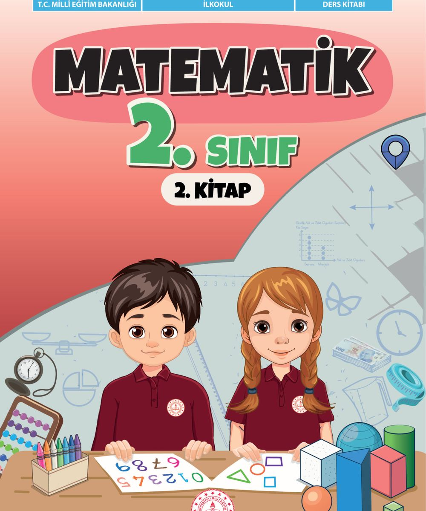
<!-- yer tutucu bulunamadı: sayfa sonuna eklendi -->

<!-- sayfa 1 -->

# İLKOKUL
# MATEMATİK
## 2. SINIF DERS KİTABI
## 2. KİTAP

### YAZARLAR
İpek TIĞLI
Şerife KAÇMAZ
Ümran ERTÜRK

<!-- sayfa 2 -->

MİLLÎ EĞİTİM BAKANLIĞI YAYINLARI ................................................................. : 10253
DERS KİTAPLARI DİZİSİ ....................................................................................... : 2258

Her hakkı saklıdır ve Millî Eğitim Bakanlığına aittir. Kitabın metin, soru ve şekilleri kısmen de olsa hiçbir surette alınıp yayımlanamaz.

# HAZIRLAYANLAR

## Editör
Prof. Dr. Veli TOPTAŞ
Dr. Dilek ÇAPAR

## Dil Uzmanı
Esra ESEN KANAN

## Görsel Tasarımcı
Ahmet Arif ÖZEN
Ali KAŞTAN
Cuma ŞAŞTIM
Gülseren KARATAŞ
Hafize AÇAR KAŞTAN
Nebi PALANCI

## Çoklu Ortam Tasarımcısı
Aslıhan BADAL
Cem SAVAŞ
Erdem TOPUZOĞLU
Fatma KAHYAOĞLU
Gökhan KAHYAOĞLU
Osman Yasin KÜÇÜKBALLI
Vahide KÜÇÜKBALLI

## Program Geliştirme Uzmanı
Doç. Dr. Azmi TÜRKAN

## Ölçme ve Değerlendirme Uzmanı
Doç. Dr. Güçlü ŞEKERCİOĞLU

## Rehberlik Uzmanı
Harun KARABULUT

ISBN 978-975-11-8765-9

Millî Eğitim Bakanlığı Talim ve Terbiye Kurulu Başkanlığının 21.05.2025 tarih ve 132696373 sayılı yazısı ile eğitim aracı olarak kabul edilmiştir.
Kurulca bu kitabın kabul edilmiş olması ders kitabından yayınevi ve yazarın sorumluluğunu

<!-- sayfa 3 -->

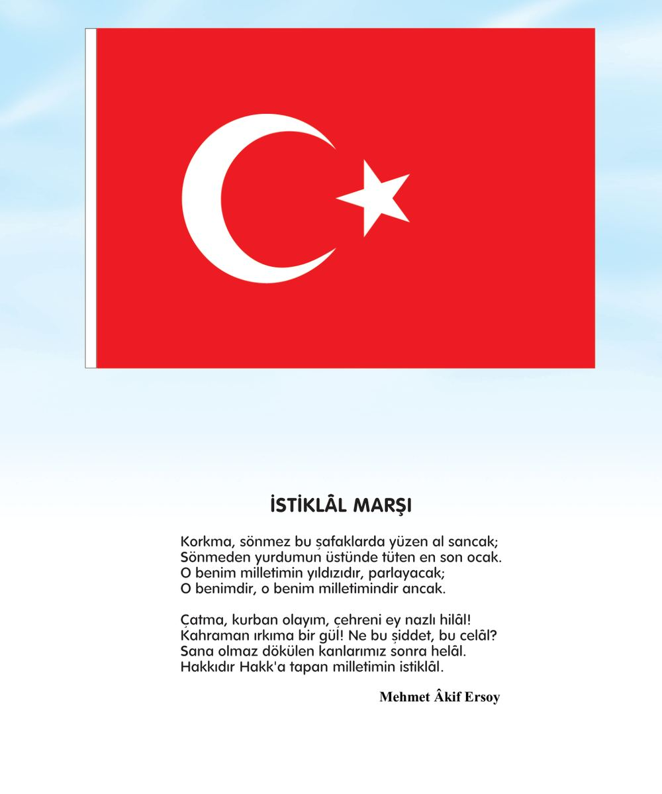

# İSTİKLÂL MARŞI

Korkma, sönmez bu şafaklarda yüzen al sancak;
Sönmeden yurdumun üstünde tüten en son ocak.
O benim milletimin yıldızıdır, parlayacak;
O benimdir, o benim milletimindir ancak.

Çatma, kurban olayım, çehreni ey nazlı hilâl!
Kahraman ırkıma bir gül! Ne bu şiddet, bu celâl?
Sana olmaz dökülen kanlarımız sonra helâl.
Hakkıdır Hakk'a tapan milletimin istiklâl.

**Mehmet Âkif Ersoy**

<!-- sayfa 4 -->

ANDIMIZ

Türküm, doğruyum, çalışkanım.

İlkem küçüklerimi korumak, büyüklerimi saymak; yurdumu, milletimi özümden çok sevmektir.
Ülküm yükselmek, ileri gitmektir.

Ey Büyük Atatürk!

Açtığın yolda, gösterdiğin hedefe durmadan yürüyeceğime ant içerim.

Varlığım Türk varlığına armağan olsun.

Ne mutlu Türküm diyene!

<!-- sayfa 5 -->

MUSTAFA KEMAL ATATÜRK

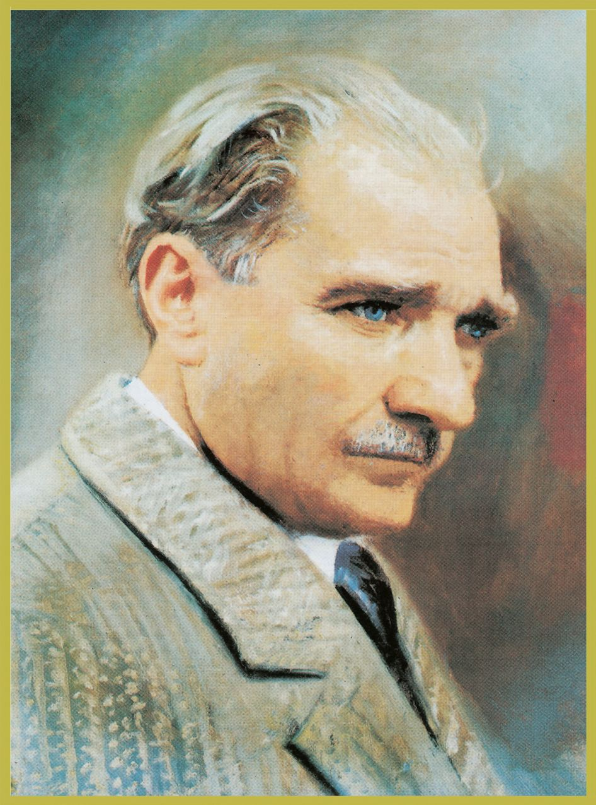
<!-- yer tutucu bulunamadı: sayfa sonuna eklendi -->

<!-- sayfa 6 -->

Verdiğiniz metin katmanı boş olduğu için (`<<< >>>` arası boş) dönüştürülecek bir içerik bulunmamaktadır. Lütfen metin katmanını içeren içeriği paylaşın, böylece talimatlarınıza uygun şekilde Markdown formatına çevirebilirim.

<!-- sayfa 7 -->

Kitabımızı Tanıyalım ......................................................................................................................................8

# 3. TEMA: İŞLEMLERDEN CEBİRSEL DÜŞÜNMEYE .............................10
Çarpma ve Bölme İşlemleri ......................................................................................................12
Çarpma ve Bölme İşlemlerinin Sonuçlarını Tahmin Etme ve Zihinden İşlem ........................................................................................................................................................32
Dört İşlemde Eşitlik .........................................................................................................................42
3. Tema Değerlendirme .....................................................................................................................48

# 4. TEMA: SAYILAR VE NİCELİKLER (2) ................................................54
Kesirler ...........................................................................................................................................................56
Paralarımız .....................................................................................................................................................66
Zaman Ölçme .................................................................................................................................................80
Uzunluk ve Kütle Ölçme Araç ve Birimleri .......................................................................100
Uzunluk ve Kütle Ölçmede Tahmin ..............................................................................................122
4. Tema Değerlendirme .....................................................................................................................128

# 5. TEMA: NESNELERİN GEOMETRİSİ (2) ..........................................136
Yer ve Yön Bulma ...............................................................................................................................138
Simetri ...........................................................................................................................................................148
5. Tema Değerlendirme ....................................................................................................................158

# 6. TEMA: VERİYE DAYALI ARAŞTIRMA .................................................160
Veriyle Çalışma ve Veriye Dayalı Karar Verme ............................................................................162
6. Tema Değerlendirme ....................................................................................................................184

Kısaltmalar ve Semboller .........................................................................................................188
Sözlük ............................................................................................................................................................188
Kaynakça ..................................................................................................................................................190
Görsel Kaynakça ............................................................................................................................190
Cevap Anahtarı ................................................................................................................................190
Ekler .................................................................................................................................................................191
Türkiye’nin Mülki İdare Bölümleri ile Kara ve Deniz Komşuları Haritası ........................................................................................................................................................199
Türk Dünyası Haritası .............................................................................................................................200

<!-- sayfa 8 -->

# Tema Numarası ve Tema Başlığı
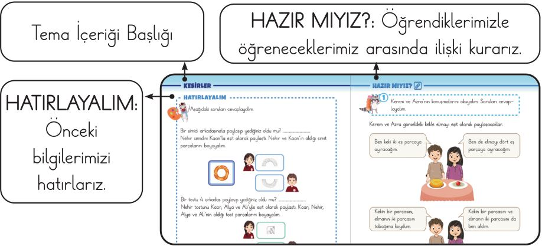

# Tema İçeriği Başlıkları

# Sayfa Numaraları

# Tema İçeriği Başlığı

# HAZIR MIYIZ?: Öğrendiklerimizle öğreneceklerimiz arasında ilişki kurarız.
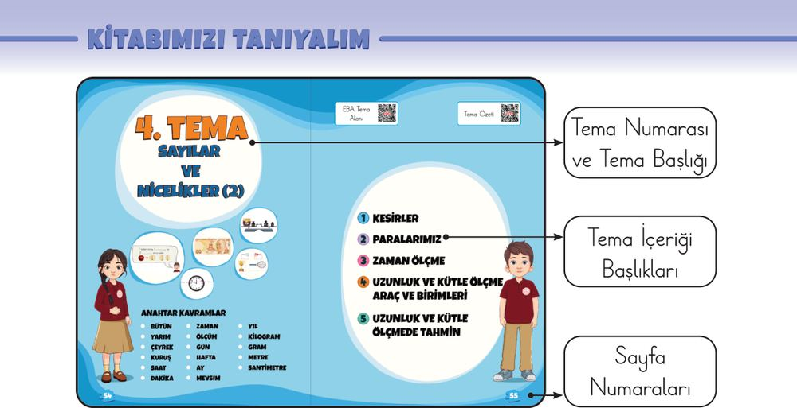

# HATIRLAYALIM: Önceki bilgilerimizi hatırlarız.

# BAŞLAYALIM: Tema içeriğiyle ilgili bilgi ve beceri kazanırız.
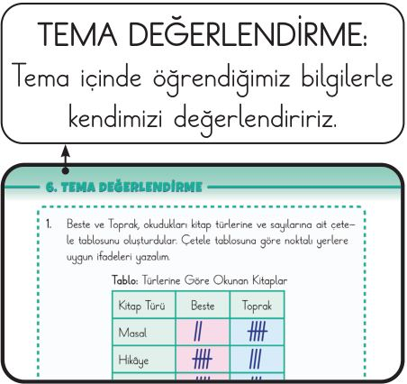

# TEMA DEĞERLENDİRME: Tema içinde öğrendiğimiz bilgilerle kendimizi değerlendiririz.
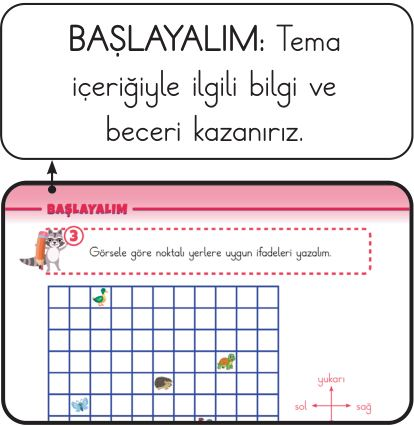

<!-- sayfa 9 -->

# YAPALIM ÖĞRENELİM

**Malzemeler:** Kitabımızın ekler bölümündeki Ek 1 ve Ek 2 sayfaları, önceden planlanan etkinlik gününde öğrencilerin getireceği manav, market, kırtasiye ürünleri, oyuncaklar ve düdük.

**Etkinlik Alanı:** Sınıf

**Etkinliğe Hazırlık**
Kitabımızdan Ek 1 ve Ek 2 sayfalarını dikkatlice keselim.
Gerçekleştirdiğimiz aşamaları işaretleyelim.
[ ] Etkinlikten 1 gün önce:
[ ] Sınıfımızı market, kırtasiye, manav ve oyuncak mağazası olacak şekilde dört istasyona ayıralım.
[ ] İstasyonlar için tahtada hep birlikte malzeme listesi oluşturalım.
[ ] Belirlenen malzemeleri getirebilecek olan arkadaşlarımızın isimlerini belirleyip getirecekleri malzemeler için bir liste hazırlayalım.
[ ] Market, manav, kırtasiye ve oyuncak istasyonu için bir arkadaşımızı satış görevlisi olarak belirleyelim.

| Market | Manav | Kırtasiye | Oyuncak Mağazası |
| :--- | :--- | :--- | :--- |
| Su | Elma | Kalem | Araba |
| Mendil | Portakal | Silgi | Bebek |

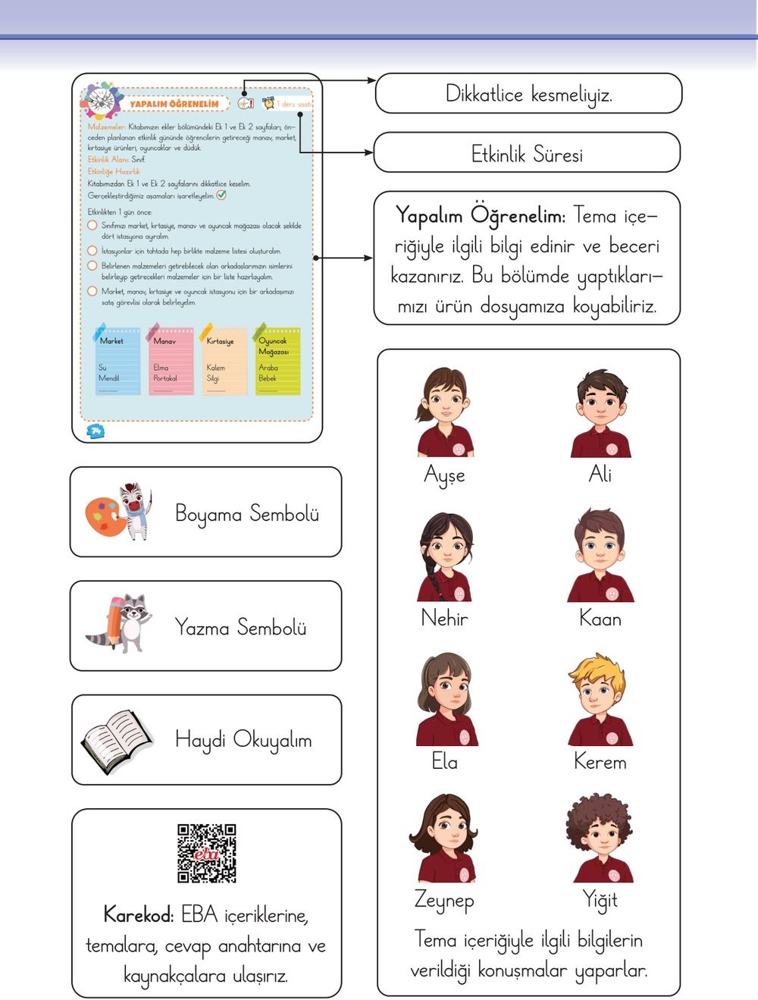 Dikkatlice kesmeliyiz.
 Etkinlik Süresi
 Yapalım Öğrenelim: Tema içeriğiyle ilgili bilgi edinir ve beceri kazanırız. Bu bölümde yaptıklarımızı ürün dosyamıza koyabiliriz.

 Boyama Sembolü
 Yazma Sembolü
 Haydi Okuyalım

**Karekod:** EBA içeriklerine, temalara, cevap anahtarına ve kaynakçalara ulaşırız

Ayşe

Ali

Nehir

Kaan

Ela

Kerem

Zeynep

Yiğit

Tema içeriğiyle ilgili bilgilerin verildiği konuşmalar yaparlar.

<!-- sayfa 10 -->

# 3. TEMA
# İŞLEMLERDEN CEBİRSEL DÜŞÜNMEYE

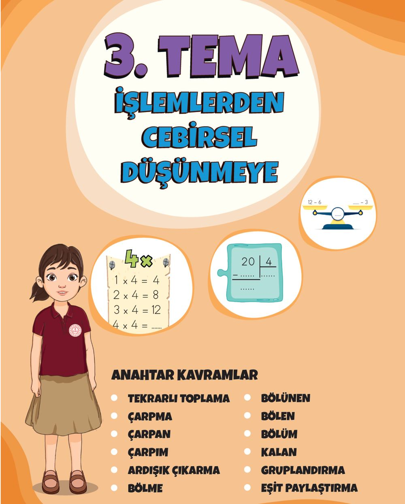

**ANAHTAR KAVRAMLAR**

* TEKRARLI TOPLAMA
* ÇARPMA
* ÇARPAN
* ÇARPIM
* ARDIŞIK ÇIKARMA
* BÖLME
* BÖLÜNEN
* BÖLEN
* BÖLÜM
* KALAN
* GRUPLANDIRMA
* EŞİT PAYLAŞTIRMA

<!-- sayfa 11 -->

EBA Tema Alanı 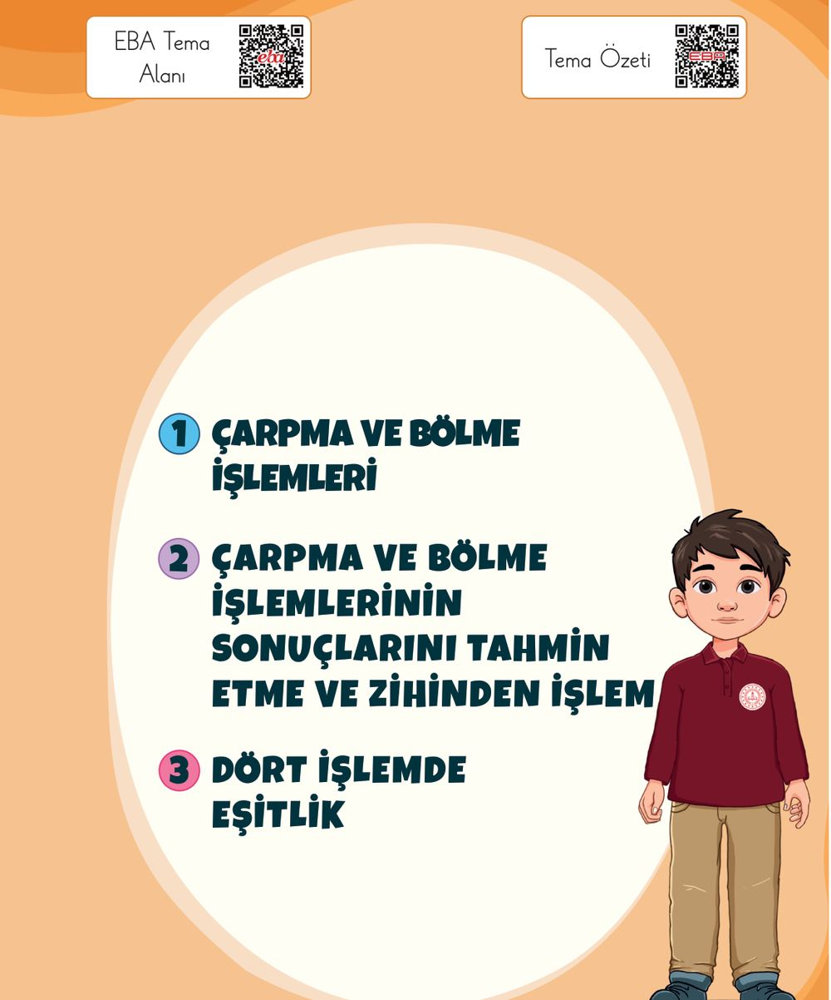
Tema Özeti 

1. ÇARPMA VE BÖLME İŞLEMLERİ
2. ÇARPMA VE BÖLME İŞLEMLERİNİN SONUÇLARINI TAHMİN ETME VE ZİHİNDEN İŞLEM
3. DÖRT İŞLEMDE EŞİTLİK

<!-- sayfa 12 -->

# HATIRLAYALIM

Görseli inceleyelim. Alya ve Ali’nin konuşmalarını okuyalım. Noktalı yerlere uygun sayıları yazalım.

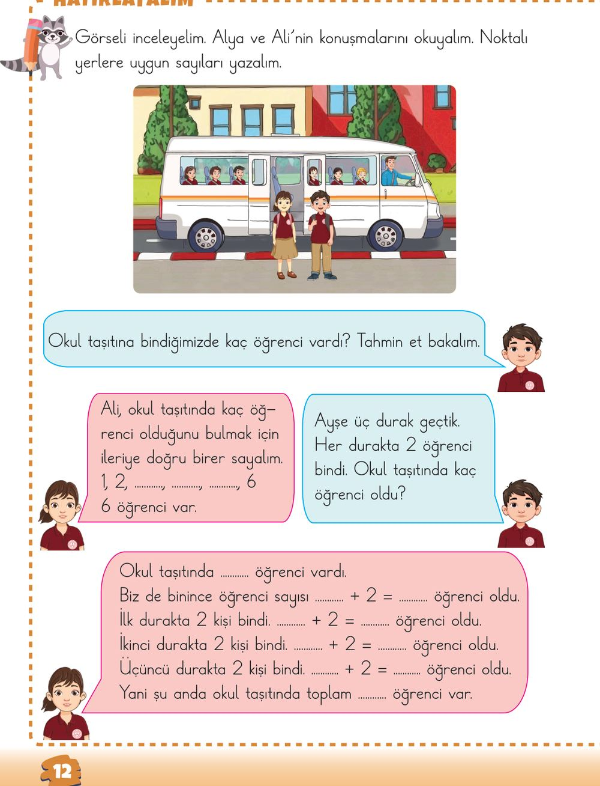

> Okul taşıtına bindiğimizde kaç öğrenci vardı? Tahmin et bakalım.

> Ali, okul taşıtında kaç öğrenci olduğunu bulmak için ileriye doğru birer sayalım.
> $1, 2, \dots\dots\dots, \dots\dots\dots, \dots\dots\dots, 6$ <!-- KONTROL: Marker'da karşılığı yok, uydurma olabilir -->
> $6$ öğrenci var.

> Ayşe üç durak geçtik. Her durakta $2$ öğrenci bindi. Okul taşıtında kaç öğrenci oldu?

> Okul taşıtında $\dots\dots\dots$ öğrenci vardı.
> Biz de binince öğrenci sayısı $\dots\dots\dots + 2 = \dots\dots\dots$ <!-- KONTROL: Marker'da karşılığı yok, uydurma olabilir --> öğrenci oldu.
> İlk durakta $2$ kişi bindi. $\dots\dots\dots + 2 = \dots\dots\dots$ <!-- KONTROL: Marker'da karşılığı yok, uydurma olabilir --> öğrenci oldu.
> İkinci durakta $2$ kişi bindi. $\dots\dots\dots + 2 = \dots\dots\dots$ <!-- KONTROL: Marker'da karşılığı yok, uydurma olabilir --> öğrenci oldu.
> Üçüncü durakta $2$ kişi bindi. $\dots\dots\dots + 2 = \dots\dots\dots$ <!-- KONTROL: Marker'da karşılığı yok, uydurma olabilir --> öğrenci oldu.
> Yani şu anda okul taşıtında toplam $\dots\dots\dots$ öğrenci var.

<!-- sayfa 13 -->

Bir pastaneye pazartesi günü alınan sütler görselde verilmiştir. Ali ve Ayşe’nin konuşmalarını okuyalım. Noktalı yerlere uygun sayıları yazalım.

> Bir pastaneye pazartesi günü $20$ şişe süt alındı. Pastanede her gün $4$ şişe süt kullanıldı. Pastanede $3.$ günün sonunda kaç şişe süt kalmıştır?

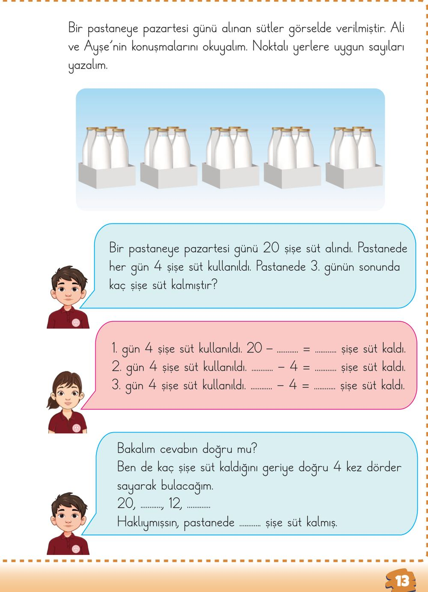

1. gün $4$ şişe süt kullanıldı. $20 - \dots\dots\dots\dots = \dots\dots\dots\dots$ <!-- KONTROL: Marker'da karşılığı yok, uydurma olabilir --> şişe süt kaldı.
2. gün $4$ şişe süt kullanıldı. $\dots\dots\dots\dots - 4 = \dots\dots\dots\dots$ <!-- KONTROL: Marker'da karşılığı yok, uydurma olabilir --> şişe süt kaldı.
3. gün $4$ şişe süt kullanıldı. $\dots\dots\dots\dots - 4 = \dots\dots\dots\dots$ <!-- KONTROL: Marker'da karşılığı yok, uydurma olabilir --> şişe süt kaldı.

> Bakalım cevabın doğru mu?
> Ben de kaç şişe süt kaldığını geriye doğru $4$ kez dörder sayarak bulacağım.
> $20, \dots\dots\dots\dots, 12, \dots\dots\dots\dots$ <!-- KONTROL: Marker'da karşılığı yok, uydurma olabilir -->
> Haklıymışsın, pastanede $\dots\dots\dots\dots$ şişe süt kalmış.

<!-- sayfa 14 -->

# 1

Tabakta kaç tane kurabiye vardır? Noktalı yerlere uygun sayıları yazalım.

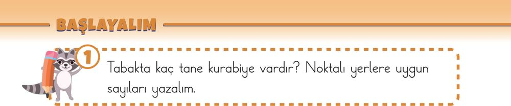

* Kurabiye sayısını bulmak için ileriye doğru ikişer ritmik sayma yapabiliriz.

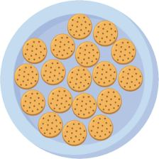

$2, 4, \dots, \dots, \dots, \dots, \dots, \dots, 18$ <!-- KONTROL: Marker'da karşılığı yok, uydurma olabilir -->

* Tekrarlı toplama işlemi yapabiliriz.

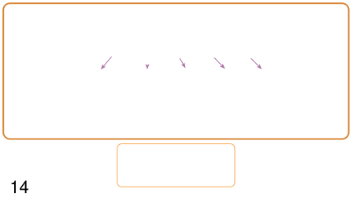

$2 + 2 + \dots + \dots + \dots + \dots + \dots + \dots + \dots = 18$ <!-- KONTROL: Marker'da karşılığı yok, uydurma olabilir -->

$\dots$ tane $2$'nin toplamı $18$'dir.

* Tabaktaki kurabiye sayısını bulmak için ritmik sayma ve tekrarlı toplamadan başka çözüm yolu var mıdır? Arkadaşlarımızla paylaşalım

> Kurabiyeleri ikişerli gruplandırdığımızda $9$ grup oluştu. Kurabiye sayısını bulmak için çarpma işlemi yapabiliriz.
>
> $$9 \times 2 = 18$$
<!-- KONTROL: Marker'da karşılığı yok, uydurma olabilir -->
>
> $\underbrace{9}_{\text{çarpan}} \quad \underbrace{\times}_{\text{çarpma işareti}} \quad \underbrace{2}_{\text{çarpan}} \quad \underbrace{=}_{\text{eşit işareti}} \quad \underbrace{18}_{\text{çarpım}}$ <!-- KONTROL: Marker'da karşılığı yok, uydurma olabilir -->
>
> Çarpma işlemini okurken "$9$ çarpı $2$ eşittir $18$" veya "$9$ kere $2, 18$'dir." deriz.

<!-- sayfa 15 -->

# 2

Ali ve Ayşe’nin konuşmalarını okuyalım. Noktalı yerlere uygun sayıları yazalım.

* Kaç tane bilye vardır?
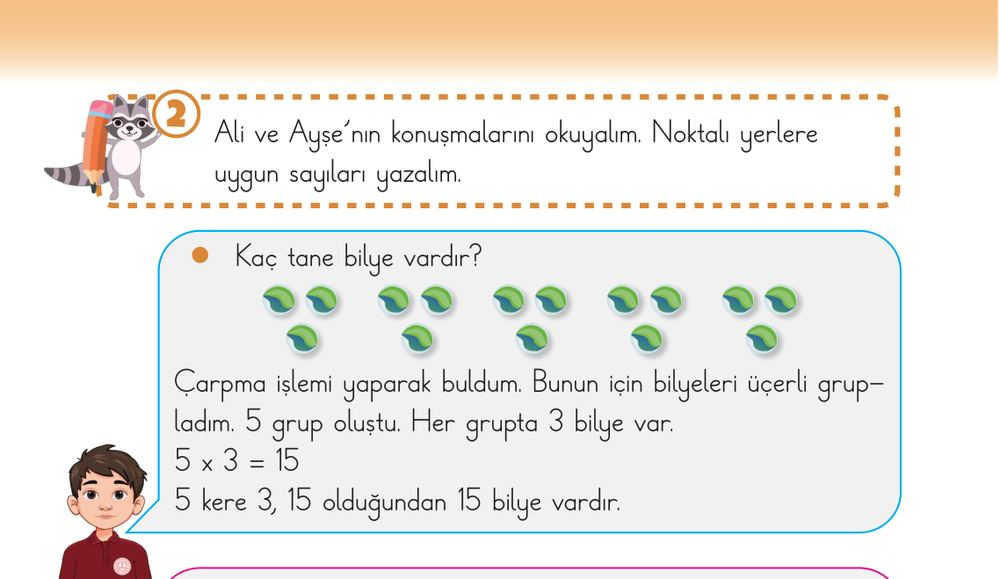
Çarpma işlemi yaparak buldum. Bunun için bilyeleri üçerli grupladım. $5$ grup oluştu. Her grupta $3$ bilye var.
$$5 \times 3 = 15$$
<!-- KONTROL: Marker'da karşılığı yok, uydurma olabilir -->
$5$ kere $3$, $15$ olduğundan $15$ bilye vardır.

* Kaç tane fındık vardır?
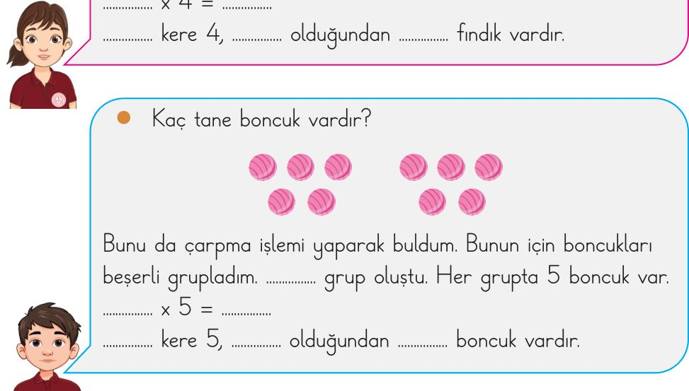
Ben de çarpma işlemi yaparak buldum. Bunun için fındıkları dörderli grupladım. ................ grup oluştu. Her grupta $4$ fındık var.
$$\text{................} \times 4 = \text{................}$$
$$\text{................} \text{ kere } 4, \text{ ................ olduğundan ................ fındık vardır.}$$

* Kaç tane boncuk vardır?
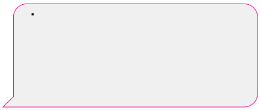
Bunu da çarpma işlemi yaparak buldum. Bunun için boncukları beşerli grupladım. ................ grup oluştu. Her grupta $5$ boncuk var.
$$\text{................} \times 5 = \text{................}$$
<!-- KONTROL: Marker'da karşılığı yok, uydurma olabilir -->
$$\text{................} \text{ kere } 5, \text{ ................ olduğundan ................ boncuk vardır.}$$

<!-- sayfa 16 -->

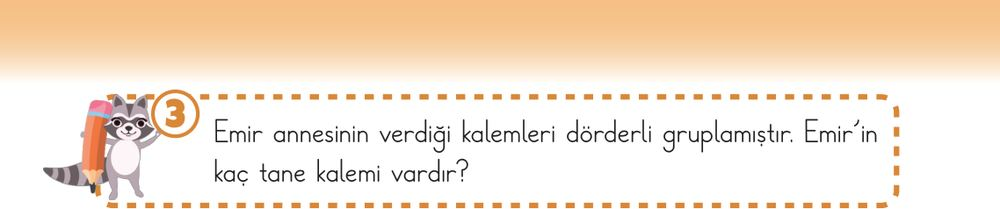
3 Emir annesinin verdiği kalemleri dörderli gruplamıştır. Emir’in kaç tane kalemi vardır?

Emir ve annesinin konuşmalarını okuyalım. Noktalı yerlere uygun ifadeleri yazalım.

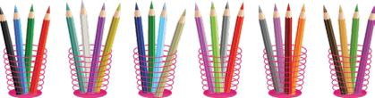

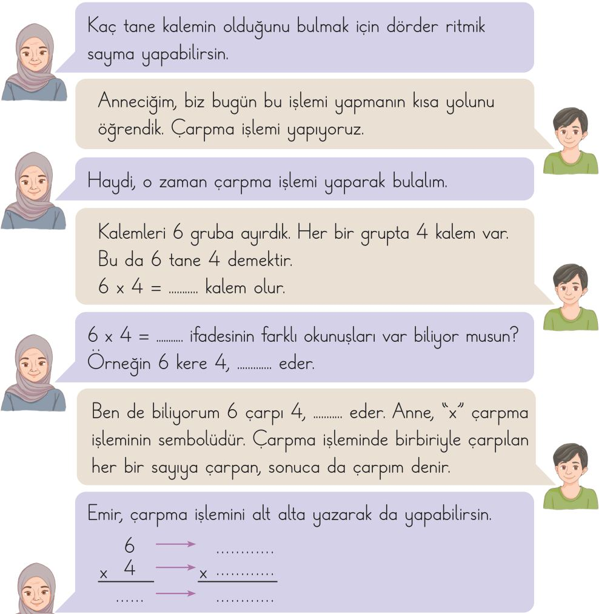
Kaç tane kalemin olduğunu bulmak için dörder ritmik sayma yapabilirsin.

Anneciğim, biz bugün bu işlemi yapmanın kısa yolunu öğrendik. Çarpma işlemi yapıyoruz.

Haydi, o zaman çarpma işlemi yaparak bulalım.

Kalemleri $6$ gruba ayırdık. Her bir grupta $4$ kalem var. Bu da $6$ tane $4$ demektir.
$6 \times 4 = ..........$ <!-- KONTROL: Marker'da karşılığı yok, uydurma olabilir --> kalem olur.

$6 \times 4 = ..........$ <!-- KONTROL: Marker'da karşılığı yok, uydurma olabilir --> ifadesinin farklı okunuşları var biliyor musun? Örneğin $6$ kere $4$, ............ eder.

Ben de biliyorum $6$ çarpı $4$, .......... eder. Anne, "$\times$" çarpma işleminin sembolüdür. Çarpma işleminde birbiriyle çarpılan her bir sayıya çarpan, sonuca da çarpım denir.

Çarpan
Çarpan
Çarpan
Çarpım

Emir, çarpma işlemini alt alta yazarak da yapabilirsin.

$$\begin{array}{r}
6 \\
\times 4 \\
\hline
\end{array}
\quad \longrightarrow \quad
\begin{array}{r}
\dots\dots\dots\dots \\
\times \dots\dots\dots\dots \\
\hline
\dots\dots\dots\dots \\
\dots\dots\dots\dots
\end{array}$$
<!-- KONTROL: Marker'da karşılığı yok, uydurma olabilir -->

<!-- sayfa 17 -->

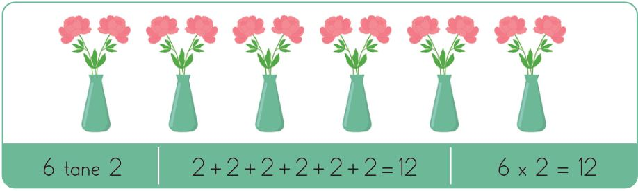
# 4
Aşağıdaki vazolarda kaç çiçek olduğunu toplama ve çarpma işlemi yaparak bulalım. Noktalı yerlere uygun sayı ve işlemleri yazalım.

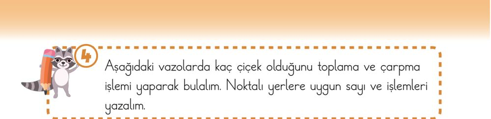
| 6 tane 2 | $2 + 2 + 2 + 2 + 2 + 2 = 12$ <!-- KONTROL: Marker'da karşılığı yok, uydurma olabilir --> | $6 \times 2 = 12$ <!-- KONTROL: Marker'da karşılığı yok, uydurma olabilir --> |

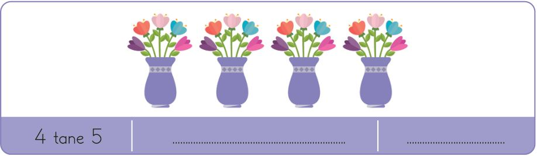
| 4 tane 5 | ............................................................ | ........................................ |

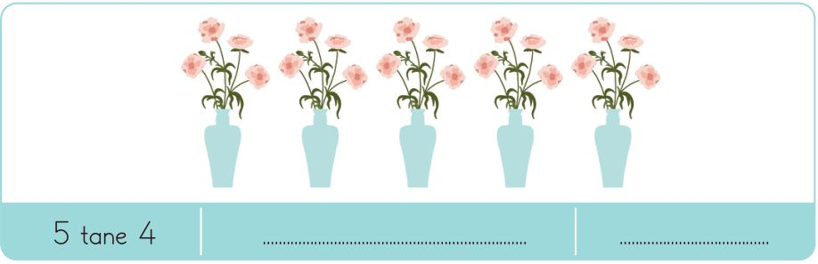
| 7 tane 3 | ............................................................ | ........................................ |

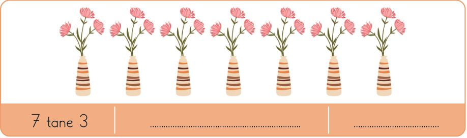
| 5 tane 4 | ............................................................ | ........................................ |

<!-- sayfa 18 -->

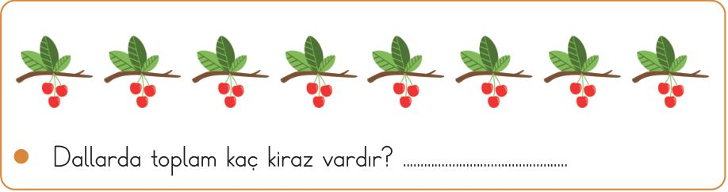
5 Aşağıdaki soruların cevaplarını çarpma işlemi yaparak nok-
talı yerlere yazalım.

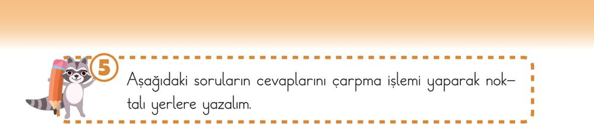
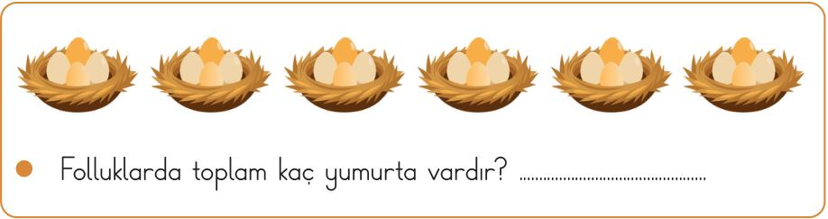
• Dallarda toplam kaç kiraz vardır? ..................................................

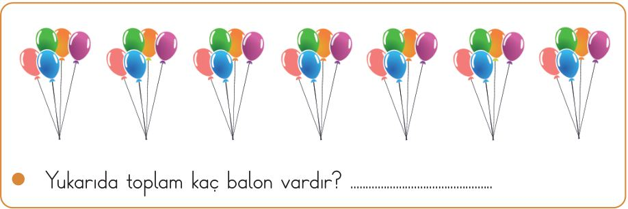
• Folluklarda toplam kaç yumurta vardır? ..................................................

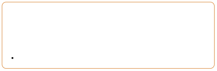
• Yukarıda toplam kaç balon vardır? ..................................................

• Tabaklarda toplam kaç armut vardır? ..................................................

<!-- sayfa 19 -->

# YAPALIM ÖĞRENELİM
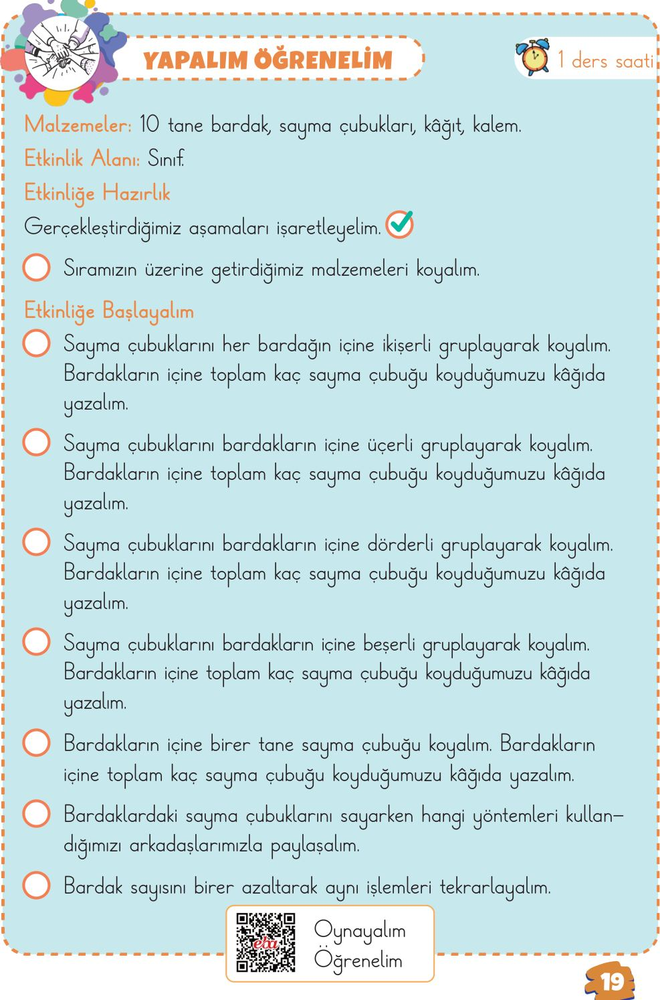: 1 ders saati

**Malzemeler:** 10 tane bardak, sayma çubukları, kâğıt, kalem.
**Etkinlik Alanı:** Sınıf.

### Etkinliğe Hazırlık
Gerçekleştirdiğimiz aşamaları işaretleyelim. ✅

* Sıramızın üzerine getirdiğimiz malzemeleri koyalım.

### Etkinliğe Başlayalım
* Sayma çubuklarını her bardağın içine ikişerli gruplayarak koyalım. Bardakların içine toplam kaç sayma çubuğu koyduğumuzu kâğıda yazalım.
* Sayma çubuklarını bardakların içine üçerli gruplayarak koyalım. Bardakların içine toplam kaç sayma çubuğu koyduğumuzu kâğıda yazalım.
* Sayma çubuklarını bardakların içine dörderli gruplayarak koyalım. Bardakların içine toplam kaç sayma çubuğu koyduğumuzu kâğıda yazalım.
* Sayma çubuklarını bardakların içine beşerli gruplayarak koyalım. Bardakların içine toplam kaç sayma çubuğu koyduğumuzu kâğıda yazalım.
* Bardakların içine birer tane sayma çubuğu koyalım. Bardakların içine toplam kaç sayma çubuğu koyduğumuzu kâğıda yazalım.
* Bardaklardaki sayma çubuklarını sayarken hangi yöntemleri kullandığımızı arkadaşlarımızla paylaşalım.
* Bardak sayısını birer azaltarak aynı işlemleri tekrarlayalım.

<!-- sayfa 20 -->

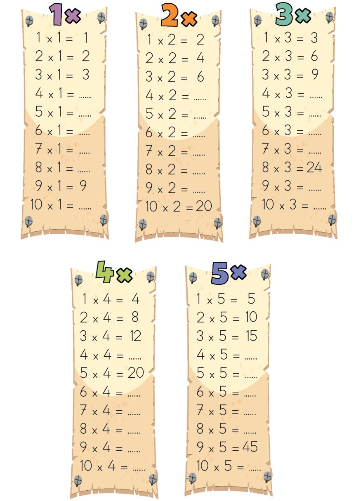

# 6
Çarpım tablosundaki noktalı yerlere uygun sayıları yazalım.

| $1\times$ <!-- KONTROL: Marker'da karşılığı yok, uydurma olabilir --> | $2\times$ <!-- KONTROL: Marker'da karşılığı yok, uydurma olabilir --> | $3\times$ <!-- KONTROL: Marker'da karşılığı yok, uydurma olabilir --> |
| :--- | :--- | :--- |
| $1 \times 1 = 1$ <!-- KONTROL: Marker'da karşılığı yok, uydurma olabilir --> | $1 \times 2 = 2$ <!-- KONTROL: Marker'da karşılığı yok, uydurma olabilir --> | $1 \times 3 = 3$ <!-- KONTROL: Marker'da karşılığı yok, uydurma olabilir --> |
| $2 \times 1 = 2$ <!-- KONTROL: Marker'da karşılığı yok, uydurma olabilir --> | $2 \times 2 = 4$ <!-- KONTROL: Marker'da karşılığı yok, uydurma olabilir --> | $2 \times 3 = 6$ <!-- KONTROL: Marker'da karşılığı yok, uydurma olabilir --> |
| $3 \times 1 = 3$ <!-- KONTROL: Marker'da karşılığı yok, uydurma olabilir --> | $3 \times 2 = 6$ <!-- KONTROL: Marker'da karşılığı yok, uydurma olabilir --> | $3 \times 3 = 9$ <!-- KONTROL: Marker'da karşılığı yok, uydurma olabilir --> |
| $4 \times 1 = \dots$ <!-- KONTROL: Marker'da karşılığı yok, uydurma olabilir --> | $4 \times 2 = \dots$ <!-- KONTROL: Marker'da karşılığı yok, uydurma olabilir --> | $4 \times 3 = \dots$ <!-- KONTROL: Marker'da karşılığı yok, uydurma olabilir --> |
| $5 \times 1 = \dots$ <!-- KONTROL: Marker'da karşılığı yok, uydurma olabilir --> | $5 \times 2 = \dots$ <!-- KONTROL: Marker'da karşılığı yok, uydurma olabilir --> | $5 \times 3 = \dots$ <!-- KONTROL: Marker'da karşılığı yok, uydurma olabilir --> |
| $6 \times 1 = \dots$ <!-- KONTROL: Marker'da karşılığı yok, uydurma olabilir --> | $6 \times 2 = \dots$ <!-- KONTROL: Marker'da karşılığı yok, uydurma olabilir --> | $6 \times 3 = \dots$ <!-- KONTROL: Marker'da karşılığı yok, uydurma olabilir --> |
| $7 \times 1 = \dots$ <!-- KONTROL: Marker'da karşılığı yok, uydurma olabilir --> | $7 \times 2 = \dots$ <!-- KONTROL: Marker'da karşılığı yok, uydurma olabilir --> | $7 \times 3 = \dots$ <!-- KONTROL: Marker'da karşılığı yok, uydurma olabilir --> |
| $8 \times 1 = \dots$ <!-- KONTROL: Marker'da karşılığı yok, uydurma olabilir --> | $8 \times 2 = \dots$ <!-- KONTROL: Marker'da karşılığı yok, uydurma olabilir --> | $8 \times 3 = 24$ <!-- KONTROL: Marker'da karşılığı yok, uydurma olabilir --> |
| $9 \times 1 = 9$ <!-- KONTROL: Marker'da karşılığı yok, uydurma olabilir --> | $9 \times 2 = \dots$ <!-- KONTROL: Marker'da karşılığı yok, uydurma olabilir --> | $9 \times 3 = \dots$ <!-- KONTROL: Marker'da karşılığı yok, uydurma olabilir --> |
| $10 \times 1 = \dots$ <!-- KONTROL: Marker'da karşılığı yok, uydurma olabilir --> | $10 \times 2 = 20$ <!-- KONTROL: Marker'da karşılığı yok, uydurma olabilir --> | $10 \times 3 = \dots$ <!-- KONTROL: Marker'da karşılığı yok, uydurma olabilir --> |

| $4\times$ <!-- KONTROL: Marker'da karşılığı yok, uydurma olabilir --> | $5\times$ <!-- KONTROL: Marker'da karşılığı yok, uydurma olabilir --> |
| :--- | :--- |
| $1 \times 4 = 4$ <!-- KONTROL: Marker'da karşılığı yok, uydurma olabilir --> | $1 \times 5 = 5$ <!-- KONTROL: Marker'da karşılığı yok, uydurma olabilir --> |
| $2 \times 4 = 8$ <!-- KONTROL: Marker'da karşılığı yok, uydurma olabilir --> | $2 \times 5 = 10$ <!-- KONTROL: Marker'da karşılığı yok, uydurma olabilir --> |
| $3 \times 4 = 12$ <!-- KONTROL: Marker'da karşılığı yok, uydurma olabilir --> | $3 \times 5 = 15$ <!-- KONTROL: Marker'da karşılığı yok, uydurma olabilir --> |
| $4 \times 4 = \dots$ <!-- KONTROL: Marker'da karşılığı yok, uydurma olabilir --> | $4 \times 5 = \dots$ <!-- KONTROL: Marker'da karşılığı yok, uydurma olabilir --> |
| $5 \times 4 = 20$ <!-- KONTROL: Marker'da karşılığı yok, uydurma olabilir --> | $5 \times 5 = \dots$ <!-- KONTROL: Marker'da karşılığı yok, uydurma olabilir --> |
| $6 \times 4 = \dots$ <!-- KONTROL: Marker'da karşılığı yok, uydurma olabilir --> | $6 \times 5 = \dots$ <!-- KONTROL: Marker'da karşılığı yok, uydurma olabilir --> |
| $7 \times 4 = \dots$ <!-- KONTROL: Marker'da karşılığı yok, uydurma olabilir --> | $7 \times 5 = \dots$ <!-- KONTROL: Marker'da karşılığı yok, uydurma olabilir --> |
| $8 \times 4 = \dots$ <!-- KONTROL: Marker'da karşılığı yok, uydurma olabilir --> | $8 \times 5 = \dots$ <!-- KONTROL: Marker'da karşılığı yok, uydurma olabilir --> |
| $9 \times 4 = \dots$ <!-- KONTROL: Marker'da karşılığı yok, uydurma olabilir --> | $9 \times 5 = 45$ <!-- KONTROL: Marker'da karşılığı yok, uydurma olabilir --> |
| $10 \times 4 = \dots$ <!-- KONTROL: Marker'da karşılığı yok, uydurma olabilir --> | $10 \times 5 = \dots$ <!-- KONTROL: Marker'da karşılığı yok, uydurma olabilir --> |

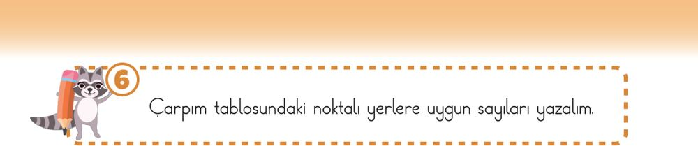
<!-- yer tutucu bulunamadı: sayfa sonuna eklendi -->

<!-- sayfa 21 -->

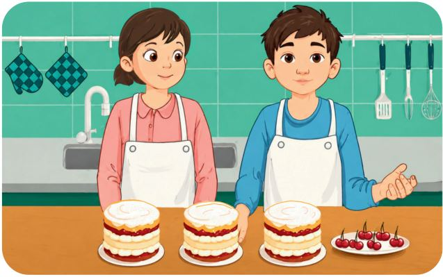
# 7
Ayşe ve Ali’nin konuşmalarını okuyalım. Noktalı yerlere uygun ifadeleri yazalım.

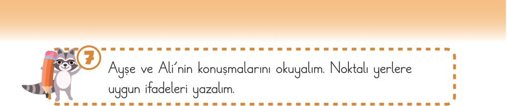
Ayşe ve Ali, annelerinin kermes için hazırladığı 3 pastanın üstünü vişnelerle süsleyecekler. Anneleri her pastanın üzerine dört vişne koymalarını söyledi. Pastalar için kaç tane vişneye ihtiyaçları vardır?

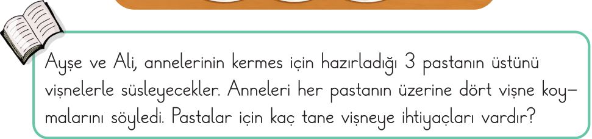
Ben vişne sayısını bulmak için 3 ile 4’ü çarptım.
$3 \times 4 = \dots\dots\dots\dots$ <!-- KONTROL: Marker'da karşılığı yok, uydurma olabilir -->
$\dots\dots\dots\dots$ vişne gerekiyor.

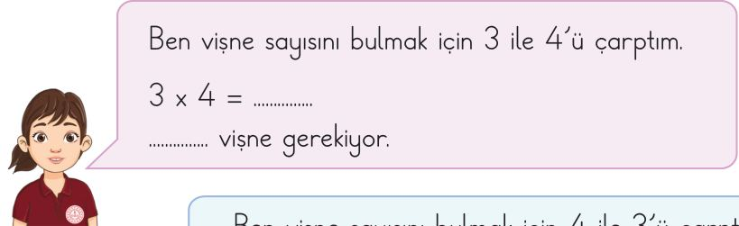
Ben vişne sayısını bulmak için 4 ile 3’ü çarptım.
$4 \times 3 = \dots\dots\dots\dots$ <!-- KONTROL: Marker'da karşılığı yok, uydurma olabilir -->
$\dots\dots\dots\dots$ vişne gerekiyor.

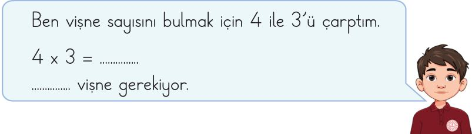
Ayşe ve Ali’nin çarpma işlemlerinin sonuçlarını karşılaştıralım. Sonuçlar arasında nasıl bir ilişki olduğunu yazalım. Arkadaşlarımızla paylaşalım.

<!-- sayfa 22 -->

# 8
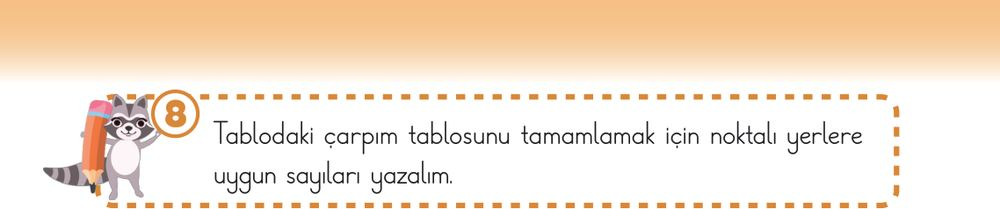 Tablodaki çarpım tablosunu tamamlamak için noktalı yerlere uygun sayıları yazalım.

| $\times$ | 0 | 1 | 2 | 3 | 4 | 5 |
| :---: | :---: | :---: | :---: | :---: | :---: | :---: |
| 0 | 0 | 0 | 0 | 0 | 0 | 0 |
| 1 | 0 | 1 | 2 | 3 | 4 | 5 |
| 2 | 0 | ........ | 4 | ........ | ........ | ........ |
| 3 | 0 | ........ | ........ | ........ | 12 | ........ |
| 4 | 0 | ........ | ........ | ........ | ........ | ........ |
| 5 | 0 | ........ | ........ | ........ | ........ | 25 |
| 6 | 0 | ........ | ........ | ........ | ........ | 30 |
| 7 | 0 | 7 | ........ | ........ | ........ | ........ |
| 8 | 0 | ........ | 16 | ........ | ........ | ........ |
| 9 | 0 | ........ | ........ | ........ | 36 | ........ |
| 10 | 0 | ........ | ........ | 30 | ........ | ........ |

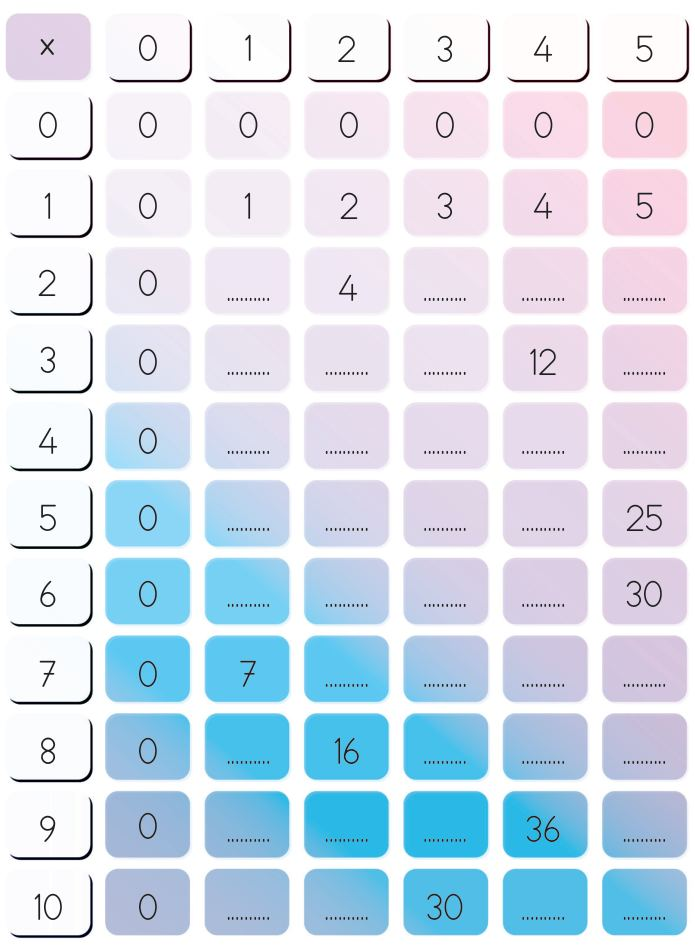 0 ile yapılan çarpma işlemlerinin sonuçlarını inceleyelim. Arkadaşlarımızla paylaşalım.

 1 ile çarptığımız sayıların sonuçlarını karşılaştırıp yazalım. Arkadaşlarımızla paylaşalım.

<!-- sayfa 23 -->

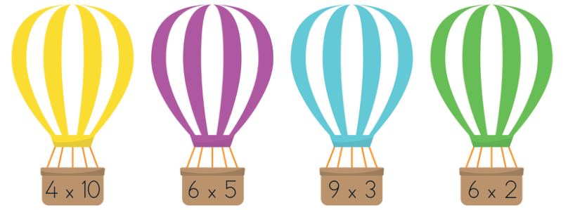
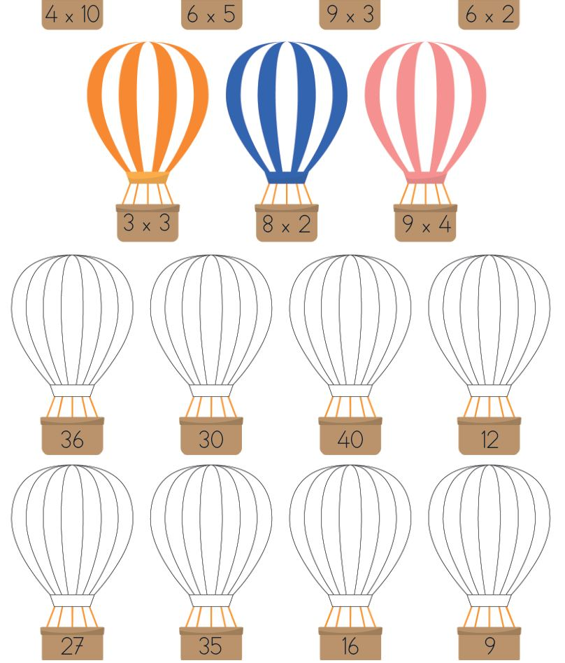

# 9

Renkli balonlardaki çarpma işlemlerinin sonucunu bulalım. İşlemin sonucunun yazılı olduğu balonu, işlemin yazılı olduğu balonun rengine boyayalım.

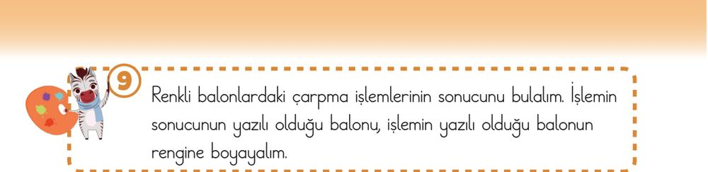

$4 \times 10$ <!-- KONTROL: Marker'da karşılığı yok, uydurma olabilir -->
$6 \times 5$ <!-- KONTROL: Marker'da karşılığı yok, uydurma olabilir -->
$9 \times 3$ <!-- KONTROL: Marker'da karşılığı yok, uydurma olabilir -->
$6 \times 2$ <!-- KONTROL: Marker'da karşılığı yok, uydurma olabilir -->

$3 \times 3$ <!-- KONTROL: Marker'da karşılığı yok, uydurma olabilir -->
$8 \times 2$ <!-- KONTROL: Marker'da karşılığı yok, uydurma olabilir -->
$9 \times 4$ <!-- KONTROL: Marker'da karşılığı yok, uydurma olabilir -->

$36$ <!-- KONTROL: Marker'da karşılığı yok, uydurma olabilir -->
$30$ <!-- KONTROL: Marker'da karşılığı yok, uydurma olabilir -->
$40$ <!-- KONTROL: Marker'da karşılığı yok, uydurma olabilir -->
$12$

$27$ <!-- KONTROL: Marker'da karşılığı yok, uydurma olabilir -->
$35$ <!-- KONTROL: Marker'da karşılığı yok, uydurma olabilir -->
$16$ <!-- KONTROL: Marker'da karşılığı yok, uydurma olabilir -->
$9$ <!-- KONTROL: Marker'da karşılığı yok, uydurma olabilir -->

<!-- sayfa 24 -->

 Ayşe, Ali ve öğretmenlerinin konuşmalarını okuyalım. Soruları cevaplayalım. Noktalı yerlere uygun sayıları yazalım.

12 elmayı tabaklara eşit olarak dağıtalım.

* Her tabağa $2$ elma koyalım. Kaç tabağa ihtiyacımız var?

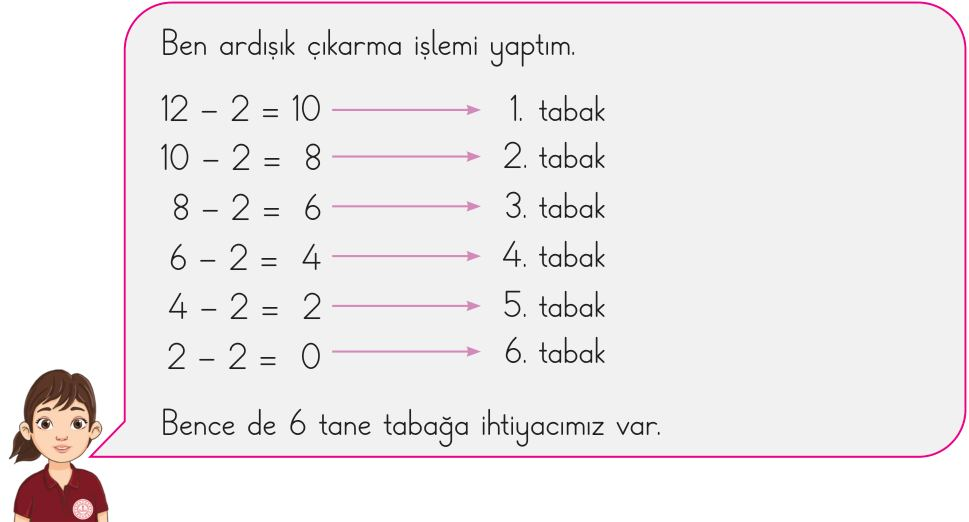
Ayşe, ben $12$’den başlayarak geriye doğru ikişer ritmik sayma yaptım.

$12$ , $10$ , $\dots\dots$ , $\dots\dots$ , $\dots\dots$ , $2$ , $0$

$6$ tane tabağa ihtiyacımız var.

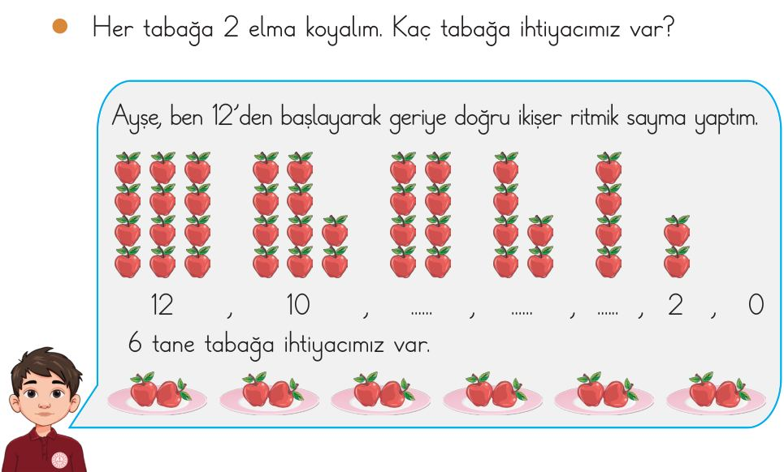
Ben ardışık çıkarma işlemi yaptım.

$12 - 2 = 10 \longrightarrow$ <!-- KONTROL: Marker'da karşılığı yok, uydurma olabilir --> 1. tabak
$10 - 2 = 8 \longrightarrow$ <!-- KONTROL: Marker'da karşılığı yok, uydurma olabilir --> 2. tabak
$6 - 2 = 4 \longrightarrow 4$ <!-- KONTROL: Gemma farklı okudu: 8 - 2 = 6 \longrightarrow --> 3. tabak
$6 - 2 = 4 \longrightarrow$ 4. tabak
$6 - 2 = 4 \longrightarrow 4$ <!-- KONTROL: Gemma farklı okudu: 4 - 2 = 2 \longrightarrow --> 5. tabak
$2 - 2 = 0 \longrightarrow$ <!-- KONTROL: Marker'da karşılığı yok, uydurma olabilir --> 6. tabak

Bence de $6$ tane tabağa ihtiyacımız var.

<!-- sayfa 25 -->

12 elmayı tabaklara ikişer tane koyarak dağıttığımızda 6 tabağa ihtiyacımız olur. Bunu bölme işlemi yaparak da bulabiliriz. Bölme işleminde $12$'nin içinde kaç tane $2$ olduğunu bulalım.

$$12 \div 2 = 6$$
<!-- KONTROL: Marker'da karşılığı yok, uydurma olabilir -->

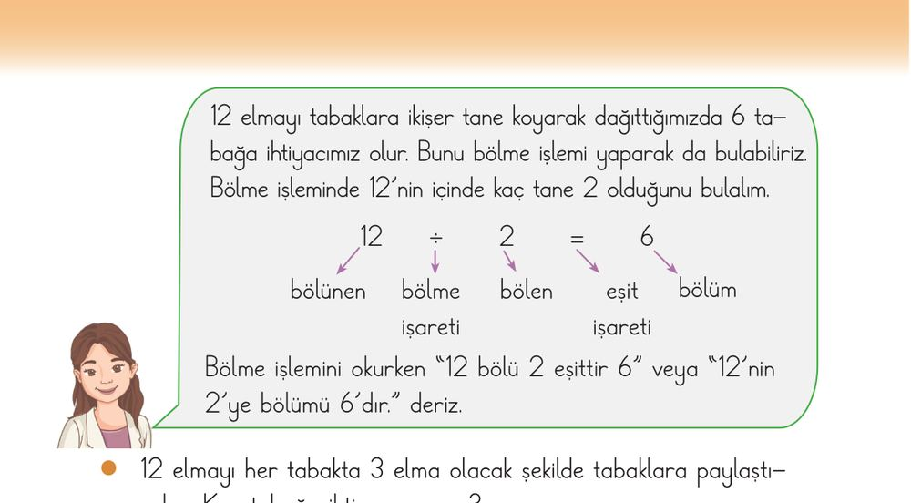

Bölme işlemini okurken "$12$ bölü $2$ eşittir $6$" veya "$12$'nin $2$'ye bölümü $6$'dır." deriz.

• 12 elmayı her tabakta 3 elma olacak şekilde tabaklara paylaştıralım. Kaç tabağa ihtiyacımız var?

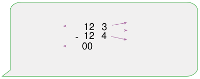

Bölme işleminde $12$'nin içinde kaç tane $3$ olduğunu bulalım.

$$\begin{array}{r|l} 12 & 3 \\ -12 & 4 \\ \hline 00 & \end{array}$$
<!-- KONTROL: Marker'da karşılığı yok, uydurma olabilir -->

Kalan $0$ olduğu için tüm elmalar tabaklara dağıtıldı.
4 tane tabağa ihtiyacımız var.

• 12 elmayı her tabakta 4 elma olacak şekilde paylaştıralım. Kaç tabağa ihtiyacımız var?

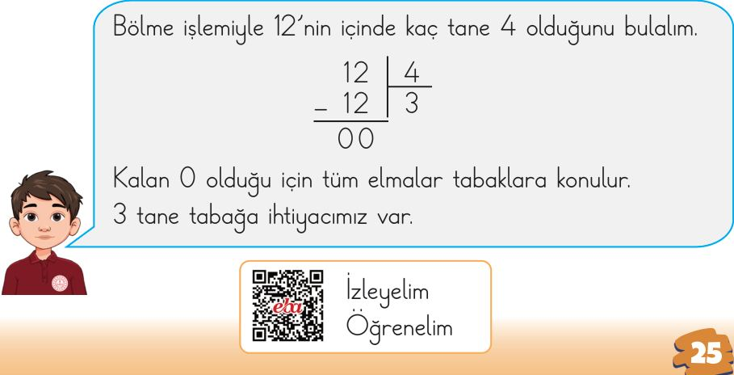

Bölme işlemiyle $12$'nin içinde kaç tane $4$ olduğunu bulalım.

$$\begin{array}{r|l} 12 & 4 \\ -12 & 3 \\ \hline 00 & \end{array}$$
<!-- KONTROL: Marker'da karşılığı yok, uydurma olabilir -->

Kalan $0$ olduğu için tüm elmalar tabaklara konulur.
3 tane tabağa ihtiyacımız var.

<!-- sayfa 26 -->

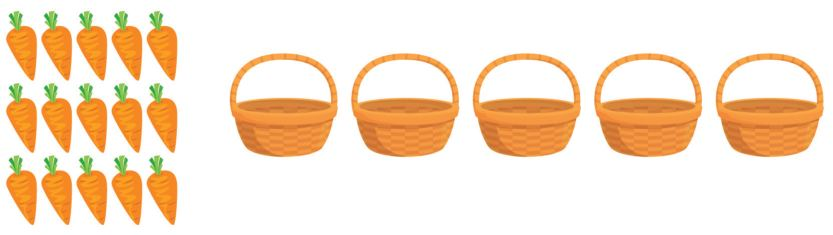
11
Arzu ve babası bahçeden $15$ havuç topladılar. Topladıkları havuçları $5$ sepete eşit olarak paylaştırdılar. Bir sepette kaç havuç olur?

Arzu, bir sepete kaç havuç koyacağımızı bulalım.

Babacığım, biz bugün bu işlemi yapmanın kısa yolunu öğrendik. Bölme işlemi yapalım. $15$ sayısını $5$'e bölelim. $15$ sayısına bölünen, $5$ sayısına bölen denir. Eğer yan yana bölme işlemi yaparsak bölünen ile bölenin arasına bölme sembolü "$\div$" konur.
Bölü çizgisiyle de bölme işlemi yapabiliriz.

$$\begin{array}{r|l}
\text{bölünen} \longleftarrow 15 & 5 \longrightarrow \text{bölen} \\
- 15 & \text{---} \longrightarrow \text{bölü çizgisi} \\
\hline
00 \longrightarrow \text{kalan} & 3 \longrightarrow \text{bölüm}
\end{array}$$
<!-- KONTROL: Marker'da karşılığı yok, uydurma olabilir -->

İşlemi yaptığımızda bölüm $3$, kalan $0$'dır.
Buna göre her sepete $3$ havuç koymalıyız.

<!-- sayfa 27 -->

# 12
Aşağıdaki bölme işlemlerinin sonuçlarını ardışık çıkarma ve bölme işlemi yaparak bulalım. Noktalı yerlere uygun sayıları yazalım.

|  | | |  |
| :--- | :--- | :--- | :--- |
| 10 Antep fıstığını 2 kişiye eşit olarak paylaştıralım. Bir kişiye kaç Antep fıstığı düşer? | $10 - 2 = 8$   $8 - 2 = \dots\dots\dots$   $\dots\dots\dots - 2 = \dots\dots\dots$ <!-- KONTROL: Marker'da karşılığı yok, uydurma olabilir -->   $\dots\dots\dots - 2 = \dots\dots\dots$ <!-- KONTROL: Marker'da karşılığı yok, uydurma olabilir -->   $\dots\dots\dots - 2 = \dots\dots\dots$ <!-- KONTROL: Marker'da karşılığı yok, uydurma olabilir --> | $\begin{array}{r@{\quad}l} 10 & \vert \enspace 2 \\ \underline{-\dots\dots} & \dots\dots \\ \dots\dots & \end{array}$ <!-- KONTROL: Marker'da karşılığı yok, uydurma olabilir --> | Bir kişiye   $\dots\dots\dots$ Antep fıstığı   düşer. |

|  | | | |
| :--- | :--- | :--- | :--- |
| 9 cevizi 3 kişiye eşit olarak paylaştırılalım. Bir kişiye kaç ceviz düşer? | $9 - 3 = 6$   $\dots\dots\dots - 3 = \dots\dots\dots$ <!-- KONTROL: Marker'da karşılığı yok, uydurma olabilir -->   $\dots\dots\dots - 3 = \dots\dots\dots$ <!-- KONTROL: Marker'da karşılığı yok, uydurma olabilir --> | $\begin{array}{r@{\quad}l} 9 & \vert \enspace 3 \\ \underline{-\dots\dots} & \dots\dots \\ \dots\dots & \end{array}$ <!-- KONTROL: Marker'da karşılığı yok, uydurma olabilir --> | Bir kişiye   $\dots\dots\dots$ ceviz düşer. |

| | | | |
| :--- | :--- | :--- | :--- |
| 20 fındığı 4 kişiye eşit olarak paylaştıralım. Bir kişiye kaç fındık düşer? | $20 - 4 = 16$   $\dots\dots\dots - 4 = \dots\dots\dots$ <!-- KONTROL: Marker'da karşılığı yok, uydurma olabilir -->   $\dots\dots\dots - 4 = \dots\dots\dots$ <!-- KONTROL: Marker'da karşılığı yok, uydurma olabilir -->   $\dots\dots\dots - 4 = \dots\dots\dots$ <!-- KONTROL: Marker'da karşılığı yok, uydurma olabilir -->   $\dots\dots\dots - 4 = \dots\dots\dots$ <!-- KONTROL: Marker'da karşılığı yok, uydurma olabilir --> | $\begin{array}{r@{\quad}l} 20 & \vert \enspace 4 \\ \underline{-\dots\dots} & \dots\dots \\ \dots\dots & \end{array}$ <!-- KONTROL: Marker'da karşılığı yok, uydurma olabilir --> | Bir kişiye   $\dots\dots\dots$ fındık düşer. |

12

<!-- sayfa 28 -->

# 13
Aşağıdaki bölme işlemlerini yapalım. Noktalı yerlere uygun sayıları yazalım.

| | | | |
| :--- | :--- | :--- | :--- |
| $14 \begin{array}{|l} \phantom{-} \\ \hline \end{array} 2$ <!-- KONTROL: Marker'da karşılığı yok, uydurma olabilir -->   $- \dots\dots \dots\dots$   $\dots\dots$ | Bölünen: $\dots\dots\dots$   Bölen: $\dots\dots\dots$   Bölüm: $\dots\dots\dots$   Kalan: $\dots\dots\dots$ | $15 \div 3 = \dots\dots\dots$ <!-- KONTROL: Marker'da karşılığı yok, uydurma olabilir --> | Bölünen: $\dots\dots\dots$   Bölen: $\dots\dots\dots$   Bölüm: $\dots\dots\dots$   Kalan: $\dots\dots\dots$ |
| $18 \begin{array}{|l} \phantom{-} \\ \hline \end{array} 3$ <!-- KONTROL: Marker'da karşılığı yok, uydurma olabilir -->   $- \dots\dots \dots\dots$   $\dots\dots$ | Bölünen: $\dots\dots\dots$   Bölen: $\dots\dots\dots$   Bölüm: $\dots\dots\dots$   Kalan: $\dots\dots\dots$ | $4 \div 4 = \dots\dots\dots$ <!-- KONTROL: Marker'da karşılığı yok, uydurma olabilir --> | Bölünen: $\dots\dots\dots$   Bölen: $\dots\dots\dots$   Bölüm: $\dots\dots\dots$   Kalan: $\dots\dots\dots$ |
| $8 \begin{array}{|l} \phantom{-} \\ \hline \end{array} 4$ <!-- KONTROL: Marker'da karşılığı yok, uydurma olabilir -->   $- \dots\dots \dots\dots$   $\dots\dots$ | Bölünen: $\dots\dots\dots$   Bölen: $\dots\dots\dots$   Bölüm: $\dots\dots\dots$   Kalan: $\dots\dots\dots$ | $10 \div 5 = \dots\dots\dots$ <!-- KONTROL: Marker'da karşılığı yok, uydurma olabilir --> | Bölünen: $\dots\dots\dots$   Bölen: $\dots\dots\dots$   Bölüm: $\dots\dots\dots$   Kalan: $\dots\dots\dots$ |
| $20 \begin{array}{|l} \phantom{-} \\ \hline \end{array} 5$ <!-- KONTROL: Marker'da karşılığı yok, uydurma olabilir -->   $- \dots\dots \dots\dots$   $00$ | Bölünen: $\dots\dots\dots$   Bölen: $\dots\dots\dots$   Bölüm: $\dots\dots\dots$   Kalan: $\dots\dots\dots$ | $12 \div 2 = \dots\dots\dots$ <!-- KONTROL: Marker'da karşılığı yok, uydurma olabilir --> | Bölünen: $\dots\dots\dots$   Bölen: $\dots\dots\dots$   Bölüm: $\dots\dots\dots$   Kalan: $\dots\dots\dots$ |

<!-- sayfa 29 -->

 Verilen problemleri defterimize çözelim.

> Berfin, $20$ tane çıkartmayı defterinin $5$ sayfasına eşit olarak yapıştırdı. Berfin her bir sayfaya kaç tane çıkartma yapıştırmıştır?

> İki arkadaş $8$ kurabiyeyi eşit olarak paylaştılar. Her biri kaç kurabiye almıştır?

> Dilara’nın $18$ tokası var. Tokalarını her bir kutuda $3$ toka olacak şekilde kutulara koydu. Dilara tokalarını kaç kutuya koydu?

> Mehmet’in $20$ TL’si var. Parasının tamamıyla tanesi $4$ TL olan bilyelerden kaç tane alır?

 Haydi, defterimize bölme işlemi gerektiren bir problem yazarak çözelim. Arkadaşlarımızla paylaşalım.

<!-- sayfa 30 -->

# 15

Çarpma ve bölme işlemlerini yapalım. İşlem sonuçlarını görselde bulup işlemin yanındaki renge boyayalım.

$9 \div 3 = \dots\dots\dots$ <!-- KONTROL: Marker'da karşılığı yok, uydurma olabilir -->
$5 \times 0 = \dots\dots\dots$ <!-- KONTROL: Marker'da karşılığı yok, uydurma olabilir -->
$18 \div 2 = \dots\dots\dots$ <!-- KONTROL: Marker'da karşılığı yok, uydurma olabilir -->
$10 \div 5 = \dots\dots\dots$ <!-- KONTROL: Marker'da karşılığı yok, uydurma olabilir -->
$6 \times 2 = \dots\dots\dots$ <!-- KONTROL: Marker'da karşılığı yok, uydurma olabilir -->
$5 \times 1 = \dots\dots\dots$ <!-- KONTROL: Marker'da karşılığı yok, uydurma olabilir -->
$10 \times 3 = \dots\dots\dots$ <!-- KONTROL: Marker'da karşılığı yok, uydurma olabilir -->
$8 \times 4 = \dots\dots\dots$ <!-- KONTROL: Marker'da karşılığı yok, uydurma olabilir -->
$9 \times 5 = \dots\dots\dots$ <!-- KONTROL: Marker'da karşılığı yok, uydurma olabilir -->
$16 \div 4 = \dots\dots\dots$ <!-- KONTROL: Marker'da karşılığı yok, uydurma olabilir -->

● Yaptıklarımıza göre aşağıdaki tabloyu dolduralım.

| Maddeler | Evet | Hayır |
| :--- | :---: | :---: |
| Çarpma işlemi yapabilirim. | | |
| Bölme işlemi yapabilirim. | | |

<!-- sayfa 31 -->

# 16
Aşağıda verilen problemleri çözelim. Bulduğumuz sayıların okunuşunu problemin başındaki taşıtlarla gösterilen yere soldan sağa doğru yazalım.

| | |
| :--- | :--- |
|  | Çınar oyuncak arabalarını $6$ gruba ayırdı. Her gruba $5$ araba düştü. Çınar'ın kaç oyuncak arabası vardır? |
|  | Arzu, $8$ oyuncak helikopteri $4$ kişiye eşit olarak paylaştırdı. Her birinin kaç oyuncak helikopteri olur? |
|  | Ahmet, $14$ oyuncak kamyonu Mehmet'le eşit olarak paylaştı. Her birinin kaç oyuncak kamyonu olur? |
|  | Annesi Asuman'a her birinin içinde $3$ tane oyuncak uçak olan kutulardan $2$ tane verdi. Annesi Asuman'a kaç oyuncak uçak verdi? |
|  | Bir oyuncakçıda $18$ oyuncak tren vardır. Oyuncakçı bu oyuncak trenleri raflara ikişer ikişer yerleştirdi. Oyuncakçı oyuncak trenleri kaç rafa yerleştirmiştir? |

 $\rightarrow$ [ ] [ ] [ ] [ ] [ ]
 $\rightarrow$ [ ] [ ] [ ]
 $\rightarrow$ [ ] [ ] [ ] [ ] [ ]
&nbsp;&nbsp;&nbsp;&nbsp;&nbsp;&nbsp;&nbsp;&nbsp;&nbsp;&nbsp;&nbsp;&nbsp;&nbsp;&nbsp;&nbsp;&nbsp;&nbsp;&nbsp;&nbsp;&nbsp;&nbsp;&nbsp;&nbsp;&nbsp;&nbsp;&nbsp;&nbsp;&nbsp;&nbsp;&nbsp;&nbsp;&nbsp;&nbsp;&nbsp;&nbsp;&nbsp;&nbsp;&nbsp;&nbsp;&nbsp;&nbsp;&nbsp;&nbsp;&nbsp;&nbsp;&nbsp;&nbsp;&nbsp;&nbsp;&nbsp;&nbsp;&nbsp;&nbsp;&nbsp;[ A ]
 $\rightarrow$ [ ] [ ] [ ] [ ]
&nbsp;&nbsp;&nbsp;&nbsp;&nbsp;&nbsp;&nbsp;&nbsp;&nbsp;&nbsp;&nbsp;&nbsp;&nbsp;&nbsp;&nbsp;&nbsp;&nbsp;&nbsp;&nbsp;&nbsp;&nbsp;&nbsp;&nbsp;&nbsp;&nbsp;&nbsp;&nbsp;&nbsp;&nbsp;&nbsp;&nbsp;&nbsp;&nbsp;&nbsp;&nbsp;&nbsp;&nbsp;&nbsp;&nbsp;&nbsp;&nbsp;&nbsp;&nbsp;&nbsp;&nbsp;&nbsp;&nbsp;&nbsp;&nbsp;&nbsp;&nbsp;&nbsp;&nbsp;&nbsp;[ R ]
 $\rightarrow$ [ ] [ ] [ ] [ ] [ ]

<!-- sayfa 32 -->

# TAHMİN ETME VE ZİHİNDEN İŞLEM

## BAŞLAYALIM

1. İrem ve ablasının konuşmalarını okuyalım. Noktalı yerlere uygun sayıları yazalım.

İrem, anne ve babasıyla bayramda büyüklerini ziyarete gitti. Teyzesi, eniştesi, dedesi ve anneannesi İrem’e üçer tane bayram şekeri verdiler. Ablası, İrem’e eve döndüklerinde kaç şekeri olduğunu sordu.

Teyzem, eniştem, dedem ve anneannemden üçer şeker aldım.

$$\begin{array}{r@{\quad}l}
4 & \longrightarrow \text{çarpan} \\
\times 3 & \longrightarrow \text{çarpan} \\
\dots\dots & \longrightarrow \text{çarpım}
\end{array}$$
<!-- KONTROL: Marker'da karşılığı yok, uydurma olabilir -->

Abla, $\dots\dots$ tane şekerim var. Her gün iki şekeri ablamla yersem şekerler kaç günde biter?

Şekerleri günlere paylaştırmak için bölme işlemi yapalım.

$$\begin{array}{r@{\quad}l}
\dots\dots & \text{bölünen} \longrightarrow \\
- \dots\dots & \\
\dots\dots & \text{kalan} \longrightarrow \quad | \quad 2 \longrightarrow \text{bölen} \\
& \quad \text{---} \longrightarrow \text{bölü çizgisi} \\
& \quad \dots\dots \longrightarrow \text{bölüm}
\end{array}$$
<!-- KONTROL: Marker'da karşılığı yok, uydurma olabilir -->

İrem ve ablası günde $2$ şeker yerlerse şekerler $\dots\dots\dots\dots\dots$ günde biter.

<!-- sayfa 33 -->

# 2

Çarpma ve bölme işlemlerini tamamlayalım. Noktalı yerlere uygun ifadeleri yazalım.

$$\begin{array}{r@{\quad}l}
5 & \text{Bu çarpma işleminde 5 sayısı çarpan, 4 sayısı} \\
\times 4 & \text{................................ ve .............................. sayısı çarpımdır.} \\
\dots\dots & \text{Bu işlemi “5 çarpı 4” veya “5 kere 4” şeklinde} \\
& \text{okuyabiliriz.}
\end{array}$$
<!-- KONTROL: Marker'da karşılığı yok, uydurma olabilir -->

$$\begin{array}{r@{\quad}l}
3 & \text{Bu çarpma işleminde ................... sayısı çarpan, 2 sayısı} \\
\times 2 & \text{........................... ve .............................. sayısı çarpımdır. Bu işlemi} \\
\dots\dots & \text{“.................. çarpı ..................” veya “.................. kere ..................”} \\
& \text{şeklinde okuyabiliriz.}
\end{array}$$
<!-- KONTROL: Marker'da karşılığı yok, uydurma olabilir -->

$$\begin{array}{r@{\quad}l}
12 & \text{Bu bölme işleminde .......................... sayısı bölünen, 3} \\
\overline{\vert \quad 3} & \text{sayısı ............................... dir. Bu işlemde bölüm .............................} \\
\dots\dots & \text{ve kalan .......................’dır.} \\
& \text{Bu işlemi “................... bölü .................” şeklinde okuyabiliriz.}
\end{array}$$
<!-- KONTROL: Marker'da karşılığı yok, uydurma olabilir -->

$$\begin{array}{r@{\quad}l}
15 & \text{Bu bölme işleminde 15 sayısı ..............................., ....................} \\
\overline{\vert \quad 5} & \text{sayısı bölendir. Bu işlemde bölüm ............................. ve} \\
\dots\dots & \text{kalan .......................’dır.} \\
& \text{Bu işlemi “.................. bölü ................” şeklinde okuyabiliriz.}
\end{array}$$
<!-- KONTROL: Marker'da karşılığı yok, uydurma olabilir -->

Haydi, defterimize birer çarpma ve bölme işlemi yazıp yapalım.
Bu çarpma ve bölme işlemlerinin elemanlarını yazalım. Arkadaşlarımızla paylaşalım.

<!-- yer tutucu bulunamadı: sayfa sonuna eklendi -->

<!-- sayfa 34 -->

3 Ayşe ve Ali, kardeş okuldaki arkadaşlarına hediye etmek için kitap kutuları hazırladılar. Konuşmalarını inceleyelim. Soruları cevaplayalım.

Ben 3 kutu hazırladım. Her kutunun içine de 5 kitap koydum. Kutulara toplam kaç kitap koyduğumu bulalım.

Ben 5 kutu hazırladım. Her kutunun içine de 3 kitap koydum. Kutulara toplam kaç kitap koyduğumu bulalım.

$3 \times 5 = 15$ <!-- KONTROL: Marker'da karşılığı yok, uydurma olabilir -->
Ben 15 kitap hazırladım.

$5 \times 3 = 15$ <!-- KONTROL: Marker'da karşılığı yok, uydurma olabilir -->
Ben de 15 kitap hazırladım.

* Ayşe ve Ali farklı sayılarda kutu hazırladılar. Hazırladıkları kutulara toplamda eşit sayıda kitap yerleştirdiler. Bu eşitliğin nasıl sağlandığını arkadaşlarımızla tartışalım.
* Çarpma işlemlerinde çarpanların yerinin değişmesi, sonucu nasıl etkiler? Bu durum çarpma işleminin hangi özelliğidir? Arkadaşlarımızla tartışalım.

<!-- sayfa 35 -->

# 4

Görsellerdeki kuş yuvalarını inceleyelim. Soruların cevaplarını noktalı yerlere yazalım.

---

Her yuvada kaç kuş var?
.........................

Görselde kaç kuş var?
Çarpma işlemi yaparak bulalım.
......... $\times$ ......... = ..................

---

Çarpma işlemi yaparken çarpanlardan biri $1$ olursa çarpımın ne olacağını arkadaşlarımızla tartışalım.

---

Çarpma işlemi yaparken çarpanlardan biri $0$ olursa çarpımın ne olacağını arkadaşlarımızla tartışalım.

<!-- sayfa 36 -->

# 5
Nisa ve Füsun, 6 saksıya çiçek tohumu ektiler. Bir süre sonra her saksıda 5 çiçek çıktığını gördüler. Saksılarda toplam kaç çiçek vardır?

Ayşe ve Ali’nin konuşmalarını inceleyelim. Noktalı yerlere uygun sayıları yazalım.

Her saksıda 5 çiçek var. Çiçeklerin sayısını bulmak için tekrarlı toplama yapabiliriz.

$5 + 5 + 5 + 5 + 5 + 5 = \dots\dots\dots$ <!-- KONTROL: Marker'da karşılığı yok, uydurma olabilir -->

Saksılarda toplam $\dots\dots\dots$ çiçek var.

Tekrarlı toplamayı kısaca çarpma işlemiyle gösterebiliriz. 6 saksıda da 5 çiçek olduğundan toplam çiçek sayısını bulmak için 6 ile 5’i çarpabiliriz.

$6 \times 5 = \dots\dots\dots$ <!-- KONTROL: Marker'da karşılığı yok, uydurma olabilir -->

<!-- sayfa 37 -->

 6 Öğretmenleri 2/A sınıfına 23 Nisan Ulusal Egemenlik ve Çocuk Bayramı’nda sınıfı süslemeleri için 18 balon aldı. Her pencereye ikişer tane balon asılınca balonların tamamı kullanılmış oldu. 2/A sınıfında kaç pencereye balon asılmıştır?

Ayşe ve Ali’nin konuşmalarını okuyalım. Noktalı yerlere uygun sayıları yazalım.

 18 balon var. Her pencere 2 balonla süslenmiştir. Sınıfta balonla süslenmiş kaç pencere olduğunu bulmak için bölme yapalım.

 18’i 2’ye bölelim. Ayşe, 18’in içinde kaç tane 2 olduğunu nasıl bulabilirim?

 Ali, şöyle düşünmelisin: 2’yi hangi sayıyla çarparsam 18 olur? Çarpım tablosundan yararlanarak bulabilirsin..

$$\begin{array}{r|l}
18 & 2 \\
-\, 18 & \dots\dots \\
\hline
00 & 
\end{array}$$
<!-- KONTROL: Marker'da karşılığı yok, uydurma olabilir -->

2/A sınıfında
.................. pencere balonla süslenmiştir.

<!-- sayfa 38 -->

Okulumuzda 2. sınıflar arasında bilgi yarışması yapılacaktır. Bu yarışmaya her sınıftan 4 kişi katılacaktır. Okulumuzda 5 tane 2. sınıf vardır. Bilgi yarışmasına kaç kişi katılmıştır?

Ayşe ve Ali’nin konuşmalarını okuyalım. Noktalı yerlere uygun sayıları yazalım.

Ali, 5 sınıftan da dörder öğrenci katılmış.
O zaman
$$\begin{array}{r@{\quad}l}
5 & \\
\times 4 & \\
\hline
\dots\dots & \text{öğrenci}
\end{array}$$
<!-- KONTROL: Marker'da karşılığı yok, uydurma olabilir -->

Ayşe, bulduğun sonucun doğru olduğundan emin misin? Sonucu kontrol etmek için hangi işlemi yapabiliriz?

Ali, her sınıftan eşit sayıda öğrenci katıldığı için kontrolü bölme işlemiyle yapabiliriz.

O zaman bulduğumuz sayıyı 4'e bölelim. Böylece kaç sınıfın yarışmaya katıldığını buluruz.

Evet, haydi bölelim.
$$\begin{array}{r@{\quad}l}
20 & \vert 4 \\
-\dots\dots & \dots\dots \\
\hline
00 &
\end{array}$$
<!-- KONTROL: Marker'da karşılığı yok, uydurma olabilir -->

5 sınıf çıktı. Okulda 5 sınıf vardı. İşlemimizi doğru yapmışız.

Haydi, çarpma ve bölme işlemleri arasındaki ilişkiyi arkadaşlarımızla...

<!-- sayfa 39 -->

 8 Aşağıdaki çarpma ve bölme işlemlerini yapalım. Çarpma işlemlerinin doğruluğunu kontrol etmek için yaptığımız bölme işlemleriyle eşleştirelim.

$$\begin{array}{r}
4 \\
\times 4 \\
\hline
\dots\dots
\end{array}
\quad \circ$$
<!-- KONTROL: Marker'da karşılığı yok, uydurma olabilir -->

$$\begin{array}{r}
8 \\
\times 2 \\
\hline
\dots\dots
\end{array}
\quad \circ$$
<!-- KONTROL: Marker'da karşılığı yok, uydurma olabilir -->

$$\begin{array}{r}
3 \\
\times 4 \\
\hline
\dots\dots
\end{array}
\quad \circ$$
<!-- KONTROL: Marker'da karşılığı yok, uydurma olabilir -->

$$\begin{array}{r}
3 \\
\times 5 \\
\hline
\dots\dots
\end{array}
\quad \circ$$
<!-- KONTROL: Marker'da karşılığı yok, uydurma olabilir -->

$$\begin{array}{r}
6 \\
\times 3 \\
\hline
\dots\dots
\end{array}
\quad \circ$$
<!-- KONTROL: Marker'da karşılığı yok, uydurma olabilir -->

$\circ \quad \begin{array}{r|l}
12 & 3 \\
\hline
\dots\dots & \dots\dots \\
\dots\dots &
\end{array}$

$\circ \quad \begin{array}{r|l}
16 & 4 \\
\hline
\dots\dots & \dots\dots \\
\dots\dots &
\end{array}$

$\circ \quad \begin{array}{r|l}
18 & 3 \\
\hline
\dots\dots & \dots\dots \\
\dots\dots &
\end{array}$

$\circ \quad \begin{array}{r|l}
15 & 5 \\
\hline
\dots\dots & \dots\dots \\
\dots\dots &
\end{array}$

$\circ \quad \begin{array}{r|l}
16 & 2 \\
\hline
\dots\dots & \dots\dots \\
\dots\dots &
\end{array}$

$\circ \quad \begin{array}{r|l}
18 & 2 \\
\hline
\dots\dots & \dots\dots \\
\dots\dots &
\end{array}$

<!-- sayfa 40 -->

# 9
Kemal, 12 simidi 4 gruba eşit olarak paylaştıracaktır. Kemal her gruba kaç simit vermiştir?

Aybars, Sude ve Mavi’nin konuşmalarını inceleyelim. Noktalı yerlere uygun sayıları yazalım.

12 simidi 4 gruba eşit olarak paylaştırarak her gruptaki simit sayısını buldum.
Kemal, her gruba ............ simit vermiştir.

12’den başlayarak geriye doğru dörder ritmik sayma yaptım.
12, ............ , ............ , ............
Buna göre Kemal, her gruba ............ simit vermiştir.

12 simit 4 gruba eşit olarak paylaştırıldığı için bölme işlemi yaptım.
$12 \div 4 =$ <!-- KONTROL: Marker'da karşılığı yok, uydurma olabilir --> ............
Kemal, her gruba ............ simit vermiştir.

Bu problemi farklı yöntemler kullanarak çözebilir miyiz? Arkadaşlarımızla tartışalım.

<!-- sayfa 41 -->

# 10
Aşağıdaki problemlerin sonuçlarını tahmin edelim. Zihinden işlem yaparak sonucu bulalım. Kullandığımız yöntemleri yazarak arkadaşlarımızla tartışalım.

---

Irmak, 6 katlı bir apartmanda yaşamaktadır. Apartmanlarının her katında 2 daire vardır. Irmakların oturduğu apartmanda toplam kaç daire vardır?

---

Eylül, 18 sayfalık kitabı her gün eşit sayıda sayfa okuyarak 3 günde bitirdi. Eylül her gün kaç sayfa kitap okumuştur?

---

Mete, kırtasiyeden tanesi 4 TL olan kalemtıraşlardan alacaktır. Mete parasının tamamıyla 3 tane kalemtıraş alabilmektedir. Mete'nin kaç Türk lirası vardır?

---

Bir trenin 5 vagonunda toplam 20 kişi vardır. Bu vagonlarda eşit sayıda kişi olduğuna göre her bir vagonda kaç kişi vardır?

<!-- sayfa 42 -->

# HATIRLAYALIM

 Verilen soruları cevaplayarak bulmacayı çözelim.

$9 + 1$ | $18 - \dots\dots\dots$ <!-- KONTROL: Marker'da karşılığı yok, uydurma olabilir -->
--- | ---
| $10$ |

$16 + 4$ <!-- KONTROL: Marker'da karşılığı yok, uydurma olabilir --> | $17 + \dots\dots\dots$ <!-- KONTROL: Marker'da karşılığı yok, uydurma olabilir -->
--- | ---
| $20$ |

$12 - 6$ <!-- KONTROL: Marker'da karşılığı yok, uydurma olabilir --> | $\dots\dots\dots - 3$ <!-- KONTROL: Marker'da karşılığı yok, uydurma olabilir -->
--- | ---
| $\dots\dots\dots$ |

$19 - 5$ <!-- KONTROL: Marker'da karşılığı yok, uydurma olabilir --> | $\dots\dots\dots - \dots\dots\dots$
--- | ---
| $\dots\dots\dots$ |

$13 - \dots\dots\dots$ <!-- KONTROL: Marker'da karşılığı yok, uydurma olabilir --> | $\dots\dots\dots + \dots\dots\dots$
--- | ---
| $9$ |

<!-- yer tutucu bulunamadı: sayfa sonuna eklendi -->

<!-- sayfa 43 -->

# 1
İşlemleri yaparak noktalı yerlere sonuçları yazalım. Sonuçları eşit olanları bulup eşleştirelim.

$21 + 17 = 38$
$34 - 19 = ..........$
$18 \div 3 = ..........$ <!-- KONTROL: Marker'da karşılığı yok, uydurma olabilir -->
$8 \times 4 = ..........$ <!-- KONTROL: Marker'da karşılığı yok, uydurma olabilir -->
$62 - 58 = ..........$
$45 + 39 = ..........$

$16 \div 4 = ..........$ <!-- KONTROL: Marker'da karşılığı yok, uydurma olabilir -->
$82 - 76 = ..........$
$100 - 16 = ..........$
$91 - 59 = ..........$
$19 + 19 = 38$
$25 + 67 = ..........$
$5 \times 3 = ..........$ <!-- KONTROL: Marker'da karşılığı yok, uydurma olabilir -->

<!-- yer tutucu bulunamadı: sayfa sonuna eklendi -->

<!-- sayfa 44 -->

# YAPALIM ÖĞRENELİM
1 ders saati

**Malzemeler:** Kâğıt, kalem, torba.
**Etkinlik Alanı:** Sınıf.

### Etkinliğe Hazırlık
Gerçekleştirdiğimiz aşamaları işaretleyelim. ✅
* ◯ 100’e kadar olan sayıları kâğıtlara yazıp bir torbaya atalım.

### Etkinliğe Başlayalım
* ◯ İkişerli gruplara ayrılalım.
* ◯ Sayı torbasından bir sayı çekelim.
* ◯ Kâğıda, çektiğimiz sayıyı verecek bir işlem yazalım. Bu işlemi toplama, çıkarma, çarpma veya bölme işlemlerinden birini kullanarak yapabiliriz.
* ◯ Grup arkadaşımızla kâğıtlarımızı değiştirerek yaptığımız işlemleri kontrol edelim.
* ◯ Sonuca ulaşamadıysak birlikte düzeltelim.
* ◯ Yazdığımız işlemleri diğer gruplardaki arkadaşlarımızla paylaşalım.
* ◯ Çektiğimiz sayılara farklı işlemler yaparak ulaşabilir miydik? Arkadaşlarımızla tartışalım.

<!-- sayfa 45 -->

2
 Aşağıdaki işlemleri inceleyelim. İşlemlerin sonuçları eşitse “D”, eşit değilse “Y” bölümünden ilerleyerek sonuca ulaşalım. Ulaştığımız nesneyi yuvarlak içine alalım.

$$35 - 28 = 14 \div 2$$
<!-- KONTROL: Marker'da karşılığı yok, uydurma olabilir -->

D | Y
---|---
 $44 + 55 = 29 + 70$ <!-- KONTROL: Marker'da karşılığı yok, uydurma olabilir --> |  $29 + 65 = 51 + 43$ <!-- KONTROL: Marker'da karşılığı yok, uydurma olabilir -->
D | Y | D | Y
---|---|---|---
 $15 \div 5 = 10 \div 2$ <!-- KONTROL: Marker'da karşılığı yok, uydurma olabilir --> | $6 \times 5 = 19 + 13$ <!-- KONTROL: Marker'da karşılığı yok, uydurma olabilir --> | $3 \times 8 = 4 \times 6$ <!-- KONTROL: Marker'da karşılığı yok, uydurma olabilir --> |  $12 \div 4 = 3 \times 1$ <!-- KONTROL: Marker'da karşılığı yok, uydurma olabilir -->
D | Y | D | Y | D | Y | D | Y
---|---|---|---|---|---|---|---
(Büyüteç) | (Mor silindir) | (Kalemler) | (Defter) | (Cetvel) | (Çalar saat) | (Palet) | (Boya seti)

• Yaptıklarımıza göre aşağıdaki tabloyu dolduralım.

| Maddeler | Evet | Hayır |
| :--- | :---: | :---: |
| Bir eşitlikte her iki tarafın aynı sonucu verdiği işlemler yazabilirim. | | |
| Sonuçları eşit olan işlemlerin arasına “=” işareti koyabilirim. | | |

<!-- sayfa 46 -->

# 3
Bulut, Derya, Nehir ve Toprak yaşlarını işlemlerle ifade ettiler. Çocukların yaşlarını bu işlemleri yaparak bulalım.

Bulut
> Yaşımı bulmak için $25$'ten $18$'i çıkaralım.  
> Bulduğumuz sayıya $3$ ekleyelim.
> ..........................................................................................................

Derya
> Yaşımı bulmak için $20$'yi $2$'ye bölelim.
> ..........................................................................................................

Nehir
> Yaşımı bulmak için $2$ ile $5$'i çarpalım.
> ..........................................................................................................

Toprak
> Yaşımı bulmak için $15$ ile $7$'yi toplayalım.  
> Bulduğumuz sayıdan $12$'yi çıkaralım.
> ..........................................................................................................

Bulut, Derya, Nehir ve Toprak'ın yaşlarını karşılaştırdığımızda ne söyleyebiliriz? Arkadaşlarımızla tartışalım.

<!-- sayfa 47 -->

Aşağıdaki işlemleri yaparak kalem, silgi ve kalemtıraşın fiyatlarını bulalım. Noktalı yerlere uygun sayıları yazalım.

$4 \times 9 = \dots\dots\dots\dots \text{ TL}$ <!-- KONTROL: Marker'da karşılığı yok, uydurma olabilir -->

Kalemin fiyatına eşit sonuçlar bulacağımız farklı işlemler yapalım.
......................................................................................................................................................
......................................................................................................................................................

$40 - 12 = \dots\dots\dots\dots \text{ TL}$ <!-- KONTROL: Marker'da karşılığı yok, uydurma olabilir -->

Silginin fiyatına eşit sonuçlar bulacağımız farklı işlemler yapalım.
......................................................................................................................................................
......................................................................................................................................................

$18 \div 2 = \dots\dots\dots\dots \text{ TL}$ <!-- KONTROL: Marker'da karşılığı yok, uydurma olabilir -->

Kalemtıraşın fiyatına eşit sonuçlar bulacağımız farklı işlemler yapalım.
......................................................................................................................................................
......................................................................................................................................................

Haydi, çevremizden bir nesnenin fiyatını öğrenelim. Sonuçları bu nesnenin fiyatına eşit olan iki farklı işlem yapalım. Arkadaşlarımızla paylaşalım.

<!-- sayfa 48 -->

1. Aşağıdaki işlemleri yapalım. İşlemlerin altındaki harfleri, bulduğumuz sonuçlara göre şifre alanına yazıp şifreyi bulalım.

<!-- sayfa 49 -->

2. Ahsen’in $12$ tane, Banu’nun ise $26$ tane boya kalemi vardır. İki arkadaş kalemlerinin toplam sayısını tahmin edip işlem yaptılar. Ahsen ve Banu’nun konuşmalarındaki noktalı yerlere uygun sayıları yazalım.

Banu, tahminine göre toplam kaç kalemimiz var?

$12$ ile $26$’nın en yakın onluklarını buldum. $12$’nin en yakın onluğu ..............., $26$’nın en yakın onluğu ...............’dur. Bu iki onluğu topladığımda ............... buldum.

Ben $12$ ile $26$’yı topladığımda ............... değil, $38$ buluyorum.

Tahminim işlem sonucundan fazlaymış.

<!-- sayfa 50 -->

3. Aşağıda toplama ve çıkarma işlemlerinin birer ögesi eksik verilmiştir. Verilmeyen ögelerin bulunduğu işlemle, bu ögeleri bulmak için yapılması gereken işlemleri eşleştirelim.

$\begin{array}{r} 80 \\ +\ 13 \\ \hline \dots\dots\dots \end{array}$ <!-- KONTROL: Marker'da karşılığı yok, uydurma olabilir --> $\quad$ $\begin{array}{r} 44 \\ +\ 19 \\ \hline \dots\dots\dots \end{array}$ <!-- KONTROL: Marker'da karşılığı yok, uydurma olabilir -->

$\begin{array}{r} \dots\dots\dots \\ -\ 44 \\ \hline 19 \end{array}$ <!-- KONTROL: Marker'da karşılığı yok, uydurma olabilir --> $\quad$ $\begin{array}{r} \dots\dots\dots \\ -\ 7 \\ \hline 75 \end{array}$ <!-- KONTROL: Marker'da karşılığı yok, uydurma olabilir -->

$\begin{array}{r} \dots\dots\dots \\ +\ 52 \\ \hline 68 \end{array}$ <!-- KONTROL: Marker'da karşılığı yok, uydurma olabilir --> $\quad$ $\begin{array}{r} \dots\dots\dots \\ -\ 13 \\ \hline 80 \end{array}$ <!-- KONTROL: Marker'da karşılığı yok, uydurma olabilir -->

$\begin{array}{r} 75 \\ -\ 7 \\ \hline \dots\dots\dots \end{array}$ <!-- KONTROL: Marker'da karşılığı yok, uydurma olabilir --> $\quad$ $\begin{array}{r} 81 \\ -\ 18 \\ \hline \dots\dots\dots \end{array}$ <!-- KONTROL: Marker'da karşılığı yok, uydurma olabilir -->

$\begin{array}{r} \dots\dots\dots \\ +\ 7 \\ \hline 75 \end{array}$ <!-- KONTROL: Marker'da karşılığı yok, uydurma olabilir -->

$\begin{array}{r} 81 \\ -\ \dots\dots\dots \\ \hline 18 \end{array}$ <!-- KONTROL: Marker'da karşılığı yok, uydurma olabilir --> $\quad$ $\begin{array}{r} 68 \\ -\ 52 \\ \hline \dots\dots\dots \end{array}$ <!-- KONTROL: Marker'da karşılığı yok, uydurma olabilir -->

<!-- yer tutucu bulunamadı: sayfa sonuna eklendi -->

<!-- yer tutucu bulunamadı: sayfa sonuna eklendi -->

<!-- sayfa 51 -->

4. Aşağıdaki işlemleri yapalım. Çarpma işlemlerini, çarpım sonuçlarının doğruluğunu kontrol etmek için yapılan bölme işlemleriyle eşleştirelim.

$\begin{array}{r} 3 \\ \times 4 \\ \hline \dots\dots \end{array}$ <!-- KONTROL: Marker'da karşılığı yok, uydurma olabilir -->

$\begin{array}{r} 2 \\ \times 3 \\ \hline \dots\dots \end{array}$ <!-- KONTROL: Marker'da karşılığı yok, uydurma olabilir -->

$\begin{array}{r} 5 \\ \times 4 \\ \hline \dots\dots \end{array}$ <!-- KONTROL: Marker'da karşılığı yok, uydurma olabilir -->

$\begin{array}{r} 4 \\ \times 4 \\ \hline \dots\dots \end{array}$ <!-- KONTROL: Marker'da karşılığı yok, uydurma olabilir -->

$\begin{array}{r} 3 \\ \times 5 \\ \hline \dots\dots \end{array}$ <!-- KONTROL: Marker'da karşılığı yok, uydurma olabilir -->

$\begin{array}{c|c} 20 & 4 \\ \hline \dots & \dots \\ \dots & \dots \end{array}$ <!-- KONTROL: Marker'da karşılığı yok, uydurma olabilir -->

$\begin{array}{c|c} 15 & 5 \\ \hline \dots & \dots \\ \dots & \dots \end{array}$ <!-- KONTROL: Marker'da karşılığı yok, uydurma olabilir -->

$\begin{array}{c|c} 16 & 4 \\ \hline \dots & \dots \\ \dots & \dots \end{array}$ <!-- KONTROL: Marker'da karşılığı yok, uydurma olabilir -->

$\begin{array}{c|c} 12 & 3 \\ \hline \dots & \dots \\ \dots & \dots \end{array}$ <!-- KONTROL: Marker'da karşılığı yok, uydurma olabilir -->

$\begin{array}{c|c} 12 & 2 \\ \hline \dots & \dots \\ \dots & \dots \end{array}$ <!-- KONTROL: Marker'da karşılığı yok, uydurma olabilir -->

$\begin{array}{c|c} 6 & 2 \\ \hline \dots & \dots \\ \dots & \dots \end{array}$ <!-- KONTROL: Marker'da karşılığı yok, uydurma olabilir -->

<!-- sayfa 52 -->

5. Bulmacanın sorularını cevaplayalım. Cevapların okunuşunu numara-
sına göre soldan sağa veya yukarıdan aşağıya doğru yazalım.

Soldan Sağa

1. Aycan’ın kütlesi $24\text{ kg}$'dır. Berk’in kütlesi Aycan’dan $3\text{ kilogram}$
eksiktir. İkisinin toplam kütlesi kaç kilogramdır?

2. Kadir, $20\text{ sayfalık}$ bir kitabı her gün eşit sayıda sayfa okuyarak
$2\text{ günde}$ bitirdi. Kadir, bir günde kaç sayfa okudu?

3. Efsun Öğretmen, sınıfındaki öğrencilerini $6\text{ gruba}$ ayırdı. Her
gruba $4\text{ balon}$ verdi. Efsun Öğretmen, öğrencilerine toplam kaç
balon verdi?

4. Zeynelerin bahçesinde $36\text{ çiçek}$ vardır. Bu çiçeklerin $20\text{ ta-}$
nesi sümbüldür. Zeynelerin bahçesinde sümbül dışında kaç çiçek
vardır?

Yukarıdan Aşağıya

1. Beril’in $100\text{ lirası}$ vardı. Defter almak için $57\text{ lirasını}$ harcadı.
Kalan parasının $20\text{ lirasıyla}$ da kalem aldı. Buna göre Beril’in
kaç lirası kalmıştır?

2. Mustafa, $8\text{ yaşındadır.}$ Annesi Mustafa’dan $24\text{ yaş büyüktür.}$
Babasının yaşı da annesinin yaşından $4\text{ yaş fazladır.}$ Buna göre
babasının yaşı kaçtır?

<!-- yer tutucu bulunamadı: sayfa sonuna eklendi -->

<!-- yer tutucu bulunamadı: sayfa sonuna eklendi -->

<!-- yer tutucu bulunamadı: sayfa sonuna eklendi -->

<!-- sayfa 53 -->

# 

<!-- sayfa 54 -->

# 4. TEMA
# SAYILAR VE NİCELİKLER (2)

1 bütün elma, 1 ............ ve 2 ............ elma eder.

**ANAHTAR KAVRAMLAR**

* BÜTÜN
* YARIM
* ÇEYREK
* KURUŞ
* SAAT
* DAKİKA
* ZAMAN
* ÖLÇÜM
* GÜN
* HAFTA
* AY
* MEVSİM
* YIL
* KİLOGRAM
* GRAM
* METRE
* SANTİMETRE

<!-- sayfa 55 -->

EBA Tema Alanı 
Tema Özeti 

1. KESİRLER
2. PARALARIMIZ
3. ZAMAN ÖLÇME
4. UZUNLUK VE KÜTLE ÖLÇME ARAÇ VE BİRİMLERİ
5. UZUNLUK VE KÜTLE ÖLÇMEDE TAHMİN

<!-- sayfa 56 -->

# HATIRLAYALIM

Aşağıdaki soruları cevaplayalım.

Bir simidi arkadaşınızla paylaşıp yediğiniz oldu mu? .........................................
Nehir simidini Kaan’la eşit olarak paylaştı. Nehir ve Kaan’ın aldığı simit parçalarını boyayalım.

Bir tostu 4 arkadaş paylaşıp yediğiniz oldu mu? .........................................
Nehir tostunu Kaan, Alya ve Ali’yle eşit olarak paylaştı. Kaan, Nehir, Alya ve Ali’nin aldığı tost parçalarını boyayalım.

Simit ve tostu eş parçalara ayırırken nelere dikkat ettiğimizi arkadaşlarımızla tartışalım.

<!-- sayfa 57 -->

# 1
Kerem ve Azra’nın konuşmalarını okuyalım. Soruları cevaplayalım.

Kerem ve Azra görseldeki kekle elmayı eşit olarak paylaşacaklar.

Ben keki iki eş parçaya ayıracağım.
Ben de elmayı dört eş parçaya ayıracağım.

Kekin bir parçasını, elmanın iki parçasını tabağıma koydum.
Kekin bir parçasını ve elmanın iki parçasını da ben aldım.

Kerem tabağındaki keki yediğinde bütün kekin ne kadarını yemiş olur?
Arkadaşlarımızla tartışalım.

Azra tabağındaki elma dilimlerinden birini yediğinde bütün elmanın ne kadarını yemiş olur? Cevabı arkadaşlarımızla tartışalım.

<!-- sayfa 58 -->

# 2 Noktalı yerlere “bütün, yarım ve çeyrek” kelimelerinden uygun olanı yazalım.

1 bütün portakalı iki eş parçaya ayıralım. Parçalardan her birine ne denir?

.................................... portakal denir.

1 elmanın tamamını yersek ne kadar elma yemiş oluruz?

Bir .................................... elma yemiş oluruz.

1 bütün ramazan pidesini dört eş parçaya ayıralım. Parçalardan her biri-ne ne denir?

.................................... ramazan pidesi denir.

1 limonun tümünü kullanarak limonata yaptım. Limonatada ne kadar limon kullandım?

Bir .................................... limon kullandım.

<!-- yer tutucu bulunamadı: sayfa sonuna eklendi -->

<!-- sayfa 59 -->

# 3 Nehir ve Kaan’ın konuşmalarını okuyalım. Noktalı yerlere uygun ifadeleri yazalım.

Yukarıdaki her bir yiyecek $1$ bütünü göstermektedir.
Bir bütünü iki eş parçaya böldüğümüzde elde ettiğimiz iki eş parçadan her birine ............................ denir.

Annemle kavunu iki eş parçaya ayırdık.
$1$ bütünden $2$ ........................... elde ettik.

Biz de $1$ limonu iki eş parçaya ayırdık.
$1$ limondan $2$ ...................... limon elde ettik.

O zaman $2$ ..................... parça da $1$ bütün eder.

Evet, haklısın.

Haydi, defterimize çevremizden iki eş parçaya ayrılabilecek nesnelere örnekler yazarak arkadaşlarımızla paylaşalım.

<!-- sayfa 60 -->

 4
 Yiyeceklerin bütününü oluşturan yarım parçaları yuvarlak içine alalım.

| | | | | |
| :---: | :---: | :---: | :---: | :---: |
|  | | | | |
| | | | | |
| | | | | |
| | | | | |

<!-- sayfa 61 -->

# YAPALIM ÖĞRENELİM
1 ders saati

**Malzemeler:** Oyun hamuru, cetvel, kalem, defter.
**Etkinlik Alanı:** Sınıf.

**Etkinliğe Başlayalım**
Gerçekleştirdiğimiz aşamaları işaretleyelim. ✅

* ○ Oyun hamurumuzdan bir parça koparalım. Hamuru yuvarlayarak top hâline getirelim.
* ○ Top hâline getirdiğimiz hamurumuzu sıramızın üzerine koyup hamurumuza elimizle bastıralım.
* ○ Cetvelimizin kenarından faydalanarak düzleştirdiğimiz hamuru iki eş parçaya ayıralım. Elde ettiğimiz şekli defterimize çizelim.
* ○ Elde ettiğimiz parçalara ne ad verilir? Çizdiğimiz şeklin altına yazalım.
* ○ Bu parçaların her birini cetvelimizin kenarından faydalanarak tekrar eş iki parçaya ayıralım. Bu şekilleri de defterimize çizelim.
* ○ Elde ettiğimiz parçalara ne ad verilir? Çizdiğimiz şeklin altına yazalım.
* ○ Oyun hamurumuzla başka şekiller oluşturarak aynı işlemleri yeni oluşturduğumuz şekillerle de yapalım.
* ○ Defterimize yazdıklarımızı arkadaşlarımızla paylaşalım.

<!-- sayfa 62 -->

# 5 Noktalı yerlere uygun ifadeleri yazalım.

Yukarıdaki elma ve omlet 1 bütünü göstermektedir. Bir bütünü dört eş parçaya böldüğümüzde elde edeceğimiz 4 parçadan her biri çeyrektir.

Elmayı dört eş parçaya ayıralım.

Bir bütün elma, 4 .................................... elmadır.

Omleti dört eş parçaya ayıralım.

Bir bütün omlet, 4 .................................... omlettir.

Haydi, defterimize çevremizdeki nesnelerden dört eş parçaya bölünebilecek nesnelere örnekler yazalım. Örneklerimizi arkadaşlarımızla paylaşalım.

<!-- sayfa 63 -->

# 6 Nehir ve Kaan’ın konuşmalarını okuyalım. Noktalı yerlere uygun ifadeleri yazalım.

Kaan biliyor musun, 4 çeyrek elma 2 ........................... elma eder.
(4 çeyrek elma görseli $\rightarrow$ 2 yarım elma görseli)

O zaman 1 bütün elma 2 ........................... elma veya 4 ........................... elma eder.
(1 bütün elma görseli $\rightarrow$ 2 yarım elma görseli $\rightarrow$ 4 çeyrek elma görseli)

2 çeyrek elma, 1 ........................... elma eder.
(2 çeyrek elma görseli $\rightarrow$ 1 yarım elma görseli)

1 bütün elma, 1 ........................... ve 2 ........................... elma eder.
(1 bütün elma görseli $\rightarrow$ 1 yarım elma görseli ve 2 çeyrek elma görseli)

Haydi, defterimize çevremizdeki nesnelerden bütün, yarım ve çeyrekle gösterilebilecek örnekler bulup yazalım. Örneklerimizi arkadaşlarımızla paylaşalım.

<!-- sayfa 64 -->

# Aşağıdaki noktalı yerlere uygun sayıları yazalım.

$1$ bütün ekmek ............ çeyrek ekmektir.

$2$ yarım erik ............ bütün eriktir.

$2$ çeyrek ayva ............ yarım ayvadır.

$1$ yarım pasta ............ çeyrek pastadır.

$1$ bütün karpuz ............ yarım karpuzdur.

$1$ bütün şeftali ............ çeyrek şeftalidir.

$1$ yarım ve $2$ çeyrek limon ............ bütün limondur.

• Yazdıklarımıza göre aşağıdaki tabloyu dolduralım.

| Maddeler | Evet | Hayır |
| :--- | :---: | :---: |
| Bütünü biliyorum. | | |
| $1$ bütünün $2$ yarım olduğunu biliyorum. | | |
| $1$ bütünün $4$ çeyrek olduğunu biliyorum. | | |
| $1$ bütünün $1$ yarım $2$ çeyrek olduğunu biliyorum. | | |

<!-- sayfa 65 -->

# 8
Aşağıdaki yönergeleri uygulayalım.

Aşağıdaki varlıklardan bütün olanları işaretleyelim.

◯  ◯  ◯  ◯

Aşağıdaki varlıklardan yarım olanı işaretleyelim.

◯  ◯  ◯  ◯

Aşağıdaki varlıklardan çeyrek olanı işaretleyelim.

◯  ◯  ◯  ◯

<!-- sayfa 66 -->

# HATIRLAYALIM

Görseldeki paraları inceleyelim. Paraların değerlerini altındaki noktalı yerlere yazalım.

50 TL
..................................................

100 TL
..................................................

10 TL
..................................................

20 TL
..................................................

5 TL
..................................................

(Madeni para)
..................................................

Paraları değerlerine göre küçükten büyüğe doğru sıralayalım.

........................  ........................  ........................  ........................  ........................  ........................

200
İKİYÜZ TÜRK LİRASI
200

İki yüz Türk lirası

<!-- sayfa 67 -->

    Günlük yaşamımızda alışveriş yaparken para kullanırız. Paraları inceleyelim. Yönergeleri uygulayarak noktalı yerlere uygun ifadeleri yazalım.

 

Paralardan bir tanesini seçelim. Seçtiğimiz paranın değerini yazalım.

................................................................................

Seçtiğimiz parayla diğer paraların üç tanesinin değerini karşılaştıralım. Paraları karşılaştırırken “az, çok” ifadelerini kullanalım.

......................................................................................................................................................................................................
......................................................................................................................................................................................................
......................................................................................................................................................................................................
......................................................................................................................................................................................................

<!-- sayfa 68 -->

# 2
Nehir ve Kaan’ın konuşmalarını okuyalım. Noktalı yerlere uygun sayıları yazalım.

Kaan, not defteri ve sulu boya almak için para biriktirdim.

Yeterli parayı biriktirebildin mi?

Evet, harçlığımdan ihtiyacım kadarını harcadım. Kalanını biriktirdim.

O zaman tasarruf yapmışsın. Tasarruf bence de çok önemli.

**Defterin Fiyatı**

Kaan, not defteri almak için satıcıya $5\text{ TL}$ ve $20\text{ TL}$ verdim. Not defterini kaç liraya aldım?

Not defterini ...................$\text{TL}$'ye almışsın. Sulu boyaya kaç lira verdin?

**Sulu Boyanın Fiyatı**

Sulu boya almak için $1\text{ TL}$, $10\text{ TL}$ ve $50\text{ TL}$ verdim.

Sulu boyayı ..................$\text{TL}$'ye almışsın.

<!-- sayfa 69 -->

Sen para biriktiriyor musun? 

Biriktiriyorum. Nehir, çok istediğin bir bebek vardı, onu satın aldın mı? 

Hayır, çünkü başka bebeklerim vardı. Paramı ihtiyaçlarım için biriktiriyorum. 

Peki, para günlük yaşamda sürekli kullanılan bir şey mi? 

Evet, para ihtiyaçlarımızı satın almak için gerekli. 

Evet, çok haklısın. 

Sen harçlıklarını nasıl harcıyorsun? 

Genellikle kantin alışveriş- lerimde, bazen de istediğim oyuncakları satın alırken harcıyorum. 

Haydi, harçlıklarımızdan biriktirerek satın aldığımız nesnelerden birini söyleyelim. Bu nesneyi kaç liraya satın aldığımızı arkadaşlarımızla paylaşalım. 

<!-- sayfa 70 -->

# 3 Kâğıt ve madenî paraları inceleyelim. Soruları cevaplayalım.

Aşağıdaki madenî paraları inceleyelim.

Değeri $1\text{ TL}$'den küçük olan paralarımıza kuruş diyoruz. Kuruşu kısaca $\text{kr.}$ <!-- KONTROL: Marker'da karşılığı yok, uydurma olabilir --> ile gösteriyoruz. $1\text{ TL}$'den küçük madenî paralarımız; $25$ ve $50$ kuruştur.

Ayrıca $1$ ve $5\text{ TL}$ değerinde madenî paralarımız da vardır.

Haydi, aşağıdaki soruların cevaplarını defterimize yazalım. Arkadaşlarımızla paylaşalım.

*  Madenî paraların ön ve arka yüzlerinin özelliklerini yazalım.
* Madenî paraların benzer ve farklı özelliklerini yazalım.

<!-- sayfa 71 -->

Aşağıdaki kâğıt paraları inceleyelim.

| 5 TL |
| :---: |
|   |
| 5 TL’nin ön yüzünde Gazi Mustafa Kemal Atatürk’ün portresi vardır. | Arka yüzünde Ordinaryus Profesör Doktor Aydın Sayılı’nın portresi vardır. |

| 10 TL |
| :---: |
|   |
| 10 TL’nin ön yüzünde Gazi Mustafa Kemal Atatürk’ün portresi vardır. | Arka yüzünde Ordinaryus Profesör Doktor Cahit Arf’ın portresi vardır. |

| 20 TL |
| :---: |
| 20 TL’nin ön yüzünde Gazi Mustafa Kemal Atatürk’ün portresi vardır. | Arka yüzünde Mimar Kemaleddin’in portresi vardır. |

<!-- sayfa 72 -->

# 50 TL

50 TL’nin ön yüzünde Gazi Mustafa Kemal Atatürk’ün portresi vardır.

Arka yüzünde Fatma Aliye Topuz’un portresi vardır.

# 100 TL

100 TL’nin ön yüzünde Gazi Mustafa Kemal Atatürk’ün portresi vardır.

Arka yüzünde Itri (Buhurizade Mustafa Efendi)’nin portresi vardır.

# 200 TL

200 (iki yüz) TL’nin ön yüzünde Gazi Mustafa Kemal Atatürk’ün portresi vardır.

Arka yüzünde Yunus Emre’nin portresi vardır.

Kâğıt paraların arka yüzlerinde bulunan ve ülkemizin tarihinde izler bırakan kişilerin hayatlarını araştırarak defterimize yazalım.

<!-- sayfa 73 -->

# 4
Aşağıdaki metni okuyup yönergeyi uygulayalım.

Adile, Aziz ve Duygu’nun aldıkları süt, top ve berenin fiyatları aşağıda verilmiştir. Çocuklar bu ürünleri satın alırken para üstü almadıklarına göre satıcıya verdikleri paraları işaretleyelim.

|  | Adile’nin parası: |
| :--- | :--- |
| 58 TL | (Paralar görselde gösterilmiştir) |

|  | Aziz’in parası: |
| :--- | :--- |
| 99 TL | (Paralar görselde gösterilmiştir) |

|  | Duygu’nun parası: |
| :--- | :--- |
| 70 TL | (Paralar görselde gösterilmiştir) |

<!-- sayfa 74 -->

# YAPALIM ÖĞRENELİM
 1 ders saati

**Malzemeler:** Kitabımızın ekler bölümündeki Ek 1 ve Ek 2 sayfaları, önceden planlanan etkinlik gününde öğrencilerin getireceği manav, market, kırtasiye ürünleri, oyuncaklar ve düdük.

**Etkinlik Alanı:** Sınıf.

**Etkinliğe Hazırlık**

Kitabımızdan Ek 1 ve Ek 2 sayfalarını dikkatlice keselim.

Gerçekleştirdiğimiz aşamaları işaretleyelim. ✅

Etkinlikten 1 gün önce:

*   Sınıfımızı market, kırtasiye, manav ve oyuncak mağazası olacak şekilde dört istasyona ayıralım.
*   İstasyonlar için tahtada hep birlikte malzeme listesi oluşturalım.
*   Belirlenen malzemeleri getirebilecek olan arkadaşlarımızın isimlerini belirleyip getirecekleri malzemeler için bir liste hazırlayalım.
*   Market, manav, kırtasiye ve oyuncak istasyonu için bir arkadaşımızı satış görevlisi olarak belirleyelim.

| Market | Manav | Kırtasiye | Oyuncak Mağazası |
| :--- | :--- | :--- | :--- |
| Su | Elma | Kalem | Araba |
| Mendil | Portakal | Silgi | Bebek |
| ................... | ................... | ................... | ................... |

<!-- sayfa 75 -->

# Etkinliğe Başlayalım

* Getirilen ürünleri market, manav, kırtasiye ve oyuncak istasyonlarındaki sıraların üzerine yerleştirelim.
* Ürünler için fiyat etiketi oluşturalım.
* İstasyon satış görevlisi dışında kalan arkadaşlarımızla dört gruba ayrılalım.
* Düdük sesiyle birlikte bir istasyona girelim. Her istasyon için alışveriş süremiz $5$ dakikadır.
* Elimizdeki temsilî kâğıt ve madenî paralar ile neler alabileceğimizi belirleyelim.
* Listemizi oluşturalım, alışverişimizi yapalım.
* Dört istasyonu da gezdikten sonra elimizde ne kadar para kaldığını hesaplayalım. Bulduğumuz sonucu defterimize yazalım.

# Birlikte Değerlendirelim

* Alışverişe başlamadan önce planlama yaptık mı?
* Alışveriş yaparken nelere dikkat ettik?
* Alışverişte tasarruf ettik mi?
* En çok hangi ürünleri tercih ettik?
* Paramızı daha iyi kullanabilir miydik?
* Ürünleri seçerken o ürüne ihtiyacımız olup olmadığını düşündük mü?
* $20\text{ TL}$ ile hangi ürünleri alabiliriz?
* Paramızı dikkatli harcamazsak neler olabilir?

<!-- yer tutucu bulunamadı: sayfa sonuna eklendi -->

<!-- sayfa 76 -->

# 5
Nehir ve Kaan’ın konuşmalarını okuyalım. Noktalı yerlere uygun sayıları yazalım.

> Kaan, $1\text{ TL}$’nin $100\text{ kr.}$ olduğunu öğrendim.

> Ben de $2$ tane $50\text{ kuruşun } 1\text{ TL}$ <!-- KONTROL: Marker'da karşılığı yok, uydurma olabilir --> olduğunu öğrendim.

> Aynı $2$ yarımın $1$ bütün olması gibi değil mi?

> Evet. Hatta $4$ tane $25\text{ kr.}$ da $1\text{ TL}$’dir. $1$ bütünün $4$ çeyrek olmasıyla aynıdır.

> O zaman $2$ tane $25\text{ kr.}$ $1$ tane ................... $\text{kr.}$ <!-- KONTROL: Marker'da karşılığı yok, uydurma olabilir --> eder.

> $1$ tane $50\text{ kr.}$ ve $2$ tane $25\text{ kr.}$ da .................... $\text{TL}$ eder.

> $4$ tane $1\text{ TL}$ ve $4$ tane $25\text{ kr.}$ $1$ tane ................. $\text{TL}$’dir.

> Evet Nehir. Bu örnekleri çoğaltabiliriz.

Türk lirasını kuruşa ya da kuruşu Türk lirasına neden çeviriyoruz? Arkadaşlarımızla tartışalım.

<!-- sayfa 77 -->

# 6

: Çerçeve içindeki paraları, toplam değeriyle eşleştirelim.

| | |
| :--- | :--- |
| 1 TL, 50 Kuruş, 25 Kuruş, 25 Kuruş | 6 TL |
| 25 Kuruş, 25 Kuruş, 25 Kuruş, 25 Kuruş | 5 TL |
| 1 TL, 50 Kuruş, 25 Kuruş, 25 Kuruş, 25 Kuruş, 25 Kuruş, 25 Kuruş, 25 Kuruş | 4 TL |
| 50 Kuruş, 25 Kuruş, 25 Kuruş, 25 Kuruş, 25 Kuruş | 3 TL |
| 50 Kuruş, 50 Kuruş, 50 Kuruş, 50 Kuruş, 50 Kuruş, 50 Kuruş, 50 Kuruş, 50 Kuruş | 2 TL |
| | 1 TL |

<!-- sayfa 78 -->

7
Paralarımızla ilgili ifadeleri okuyalım. İfade doğru ise “D”, yanlış ise “Y” yazan yoldan ilerleyerek sonuca ulaşalım. Ulaştığımız meyveyi işaretleyelim.

4 tane $25\text{ kr.}$ <!-- KONTROL: Marker'da karşılığı yok, uydurma olabilir -->
$1\text{ TL}$ <!-- KONTROL: Marker'da karşılığı yok, uydurma olabilir -->’ye eşittir.

$\text{D} \rightarrow$ <!-- KONTROL: Marker'da karşılığı yok, uydurma olabilir --> Değeri en büyük madenî paramız $50\text{ kr.}$ <!-- KONTROL: Marker'da karşılığı yok, uydurma olabilir -->tur.
$\text{Y} \rightarrow$ <!-- KONTROL: Marker'da karşılığı yok, uydurma olabilir --> 2 tane $50\text{ kr.}$ <!-- KONTROL: Marker'da karşılığı yok, uydurma olabilir --> $1\text{ TL}$ <!-- KONTROL: Marker'da karşılığı yok, uydurma olabilir -->’ye eşittir.

$\text{D} \rightarrow$ <!-- KONTROL: Marker'da karşılığı yok, uydurma olabilir --> Kuruş kısaca $\text{kr.}$ <!-- KONTROL: Marker'da karşılığı yok, uydurma olabilir --> şeklinde gösterilir.
$\text{Y} \rightarrow$ <!-- KONTROL: Marker'da karşılığı yok, uydurma olabilir --> 4 tane $50\text{ kr.}$ <!-- KONTROL: Marker'da karşılığı yok, uydurma olabilir --> $1\text{ TL}$ <!-- KONTROL: Marker'da karşılığı yok, uydurma olabilir -->’ye eşittir.

$\text{D} \rightarrow$ <!-- KONTROL: Marker'da karşılığı yok, uydurma olabilir --> (Portakal resmi)
$\text{Y} \rightarrow$ <!-- KONTROL: Marker'da karşılığı yok, uydurma olabilir --> (Üzüm resmi)

$\text{D} \rightarrow$ <!-- KONTROL: Marker'da karşılığı yok, uydurma olabilir --> (Çilek resmi)
$\text{Y} \rightarrow$ <!-- KONTROL: Marker'da karşılığı yok, uydurma olabilir --> (Armut resmi)

$\text{D} \rightarrow$ <!-- KONTROL: Marker'da karşılığı yok, uydurma olabilir --> Değeri en büyük kâğıt paramız $200\text{ TL}$ <!-- KONTROL: Marker'da karşılığı yok, uydurma olabilir -->’dir.
$\text{Y} \rightarrow$ <!-- KONTROL: Marker'da karşılığı yok, uydurma olabilir --> 1 tane $50\text{ kr.}$ <!-- KONTROL: Marker'da karşılığı yok, uydurma olabilir --> ve 2 tane $25\text{ kr.}$ <!-- KONTROL: Marker'da karşılığı yok, uydurma olabilir --> $1\text{ TL}$ <!-- KONTROL: Marker'da karşılığı yok, uydurma olabilir -->’ye eşittir.

$\text{D} \rightarrow$ <!-- KONTROL: Marker'da karşılığı yok, uydurma olabilir --> (Elma resmi)
$\text{Y} \rightarrow$ <!-- KONTROL: Marker'da karşılığı yok, uydurma olabilir --> (Kivi resmi)

$\text{D} \rightarrow$ <!-- KONTROL: Marker'da karşılığı yok, uydurma olabilir --> (Karpuz resmi)
$\text{Y} \rightarrow$ <!-- KONTROL: Marker'da karşılığı yok, uydurma olabilir --> (Kiraz resmi)

<!-- sayfa 79 -->

# 8

Görsellerde Doruk, Fatma ve Hasan’ın kitap fuarına gider-
ken yanlarına aldıkları para miktarları verilmiştir. Çerçeve
içindeki paraların değerlerini bulalım. Bu paraların ait olduğu
kişinin adını noktalı yerlere yazalım.

| Doruk | Fatma | Hasan |
| :---: | :---: | :---: |
| $67\text{ TL}$ | $29\text{ TL}$ | $45\text{ TL}$ |

...............................................

 

<!-- sayfa 80 -->

# HATIRLAYALIM

Aşağıdaki soruları cevaplayalım. Cevaplarımızı arkadaşlarımızla tartışalım.

> Yaşadığımız bir günü düşünerek cümlelerdeki noktalı yerlere “önce, ev ödevimi, yatağıma, gündüz, sonra, kitap” ifadelerinden uygun olanı yazalım.
>
> * Sabah uyandığımda ............................. yatağımı toplarım.
> * Yatağımı topladıktan ............................. kahvaltımı yaparım.
> * Öğleden sonra okuldan eve gelir, dinlenir ve ............................. yaparım.
> * Akşam yemeğimi yerim sonra ............................. okurum.
> * Gece dişlerimi fırçalayıp ............................. yatarım.

> Aşağıdaki soruları cevaplarıyla eşleştirelim.
>
> 8 yaşındaki çocukların bir günde kaç saat uyuması önerilir? &nbsp;&nbsp;&nbsp;&nbsp;&nbsp;&nbsp;&nbsp;&nbsp;&nbsp;&nbsp;&nbsp;&nbsp;&nbsp;&nbsp;&nbsp;&nbsp;&nbsp;&nbsp;&nbsp;&nbsp;&nbsp;&nbsp;&nbsp;&nbsp;&nbsp;&nbsp;&nbsp;&nbsp;&nbsp;&nbsp;&nbsp;&nbsp;&nbsp;&nbsp;&nbsp;&nbsp;&nbsp;&nbsp;&nbsp;&nbsp;&nbsp;&nbsp;&nbsp;&nbsp;&nbsp;&nbsp;&nbsp;&nbsp;&nbsp;&nbsp;&nbsp;&nbsp;&nbsp;&nbsp;&nbsp;&nbsp;&nbsp;&nbsp;&nbsp;&nbsp;&nbsp;&nbsp;&nbsp;&nbsp;&nbsp;&nbsp;&nbsp;&nbsp;&nbsp;&nbsp;&nbsp;&nbsp;&nbsp;&nbsp;&nbsp;&nbsp;&nbsp;&nbsp;&nbsp;&nbsp;&nbsp;&nbsp;&nbsp;&nbsp;&nbsp;&nbsp;&nbsp;&nbsp;&nbsp;&nbsp;&nbsp;&nbsp;&nbsp;&nbsp;&nbsp;&nbsp;&nbsp;&nbsp;&nbsp;&nbsp;&nbsp;&nbsp;&nbsp;&nbsp;&nbsp;&nbsp;&nbsp;&nbsp;&nbsp;&nbsp;&nbsp;&nbsp;&nbsp;&nbsp;&nbsp;&nbsp;&nbsp;&nbsp;&nbsp;&nbsp;&nbsp;&nbsp;&nbsp;&nbsp;&nbsp

<!-- yer tutucu bulunamadı: sayfa sonuna eklendi -->

<!-- sayfa 81 -->

1 Simge’nin bir gününü nasıl geçirdiğini okuyalım. Biz de defterimize bir günümüzü nasıl geçirdiğimizi yazalım.

Simge, sabah erkenden uyandı. Takvime baktı. Günlerden 8 Kasım Cumartesi’ydi. Bugün Simge için özel bir gündü. Çünkü 8 yıl önce bugün dünyaya gelmişti. 

Simge bir gününü planladı.

| Tarih | 8 Kasım Cumartesi |
| :--- | :--- |
| **Zaman** | **Yapılacaklar** |
| Sabah | Elimi yüzümü yıkayıp giyineceğim. |
| Sabah | Kahvaltı yapacağım. |
| Öğleden önce | Anneme evi toplarken yardım edeceğim. |
| Öğlen | Yemeğimi yiyeceğim. |
| Öğleden sonra | Arkadaşlarım bize gelecek, doğum günümü kutlayacağız. |
| Akşam | Ailecek akşam yemeği yiyeceğiz. |
| Akşam | Uyuyacağım. |

Bu yılın takviminde doğum günümüzün hangi güne denk geldiğini bulalım. Arkadaşlarımızla paylaşalım.

<!-- sayfa 82 -->

2
Yönergelere göre planlarımızı yapalım.

Pazartesi günü okuldan sonra neler yapacağımızı yazalım.

| Zaman | Planım |
| :--- | :--- |
| | |
| | |
| | |
| | |
| | |

Cumartesi günü yapmak istediklerimizi yazalım.

<!-- sayfa 83 -->

 3 Nehir ve Kaan’ın konuşmalarını okuyalım. Noktalı yerlere “akşam, öğle, öğleden önce, öğleden sonra, sabah ” ifadelerinden uygun olanı yazalım.

 Kaan, ben her .............................................. saat yedi buçukta kahvaltı yapıyorum.

 Nehir, ben .............................................. saat onda 40 dakika oyun oynuyorum. 

 Kaan, ben .............................................. yemeğini saat on ikide yiyorum.

 Nehir, bizim okulumuzda dersler ....................................... başlıyor. Ben okula saat biri çeyrek geçe gidiyorum.

 Kaan, biz evimizde .............................................. yemeğini saat yedide yiyoruz.

 Haydi, bir günümüzü “sabah, öğleden önce, öğle, öğleden sonra, akşam” ifadeleriyle planlayıp defterimize yazalım.

<!-- sayfa 84 -->

4 Demet ve annesinin konuşmalarını okuyalım. Noktalı yerlere “tam, yarım, çeyrek” ifadelerinden uygun olanı yazalım.

Demet’in bugün piyano dersi var.

Anneciğim saat kaç oldu?

Saat ikiye çeyrek var. Otobüse yetişmek için acele etmeliyiz.

Demet ve annesi otobüse 15 dakika sonra bindiler. Yarım saatlik otobüs yolculuğunun ardından gidecekleri yere vardılar. Demet’in piyano dersi bir saat sürdü. Demet dönüş yolunda annesine çeyrek, yarım ve bir saatin ne anlama geldiğini sordu.

Aynı bütün, yarım, çeyrek gibi düşünebilirsin.

O zaman bir bütün, bir saattir.

Evet. 1 tamın 2 eş parçasından her biri .................dır. 1 saatin 2 eş parçasından her biri de yarım saattir.

Aynı şekilde 1 tamın 4 eş parçasından her biri ................tir. 1 saatin 4 eş parçalarından her biri de çeyrek saattir.

Haydi, defterimize içinde “tam, yarım, çeyrek” saatlerin geçtiği cümleler yazalım. Yazdıklarımızı arkadaşlarımızla paylaşalım.

<!-- sayfa 85 -->

# 5
Yan yana verilen olaylardan süresi diğerinden fazla olanın altındaki yuvarlağı işaretleyelim.

---

| | |
| :--- | :--- |
| Hacivat ve Karagöz oyunu $37$ <!-- KONTROL: Marker'da karşılığı yok, uydurma olabilir --> dakika sürdü.      $\bigcirc$ | Öğretmen, Nasrettin Hoca’nın bir fıkrasını $7$ dakikada anlattı.      $\bigcirc$ |

| | |
| :--- | :--- |
| Dişlerimi $2$ dakika fırçalıyorum.      $\bigcirc$ | Bir günde $9$ saat uyuyorum.      $\bigcirc$ |

| | |
| :--- | :--- |
| Yaz tatili $3$ aydır.      $\bigcirc$ | Yarıyıl tatili $2$ haftadır.      $\bigcirc$ |

<!-- sayfa 86 -->

# 6 Görselleri inceleyelim. Zaman ölçme araçlarını belirleyip işaretleyelim.

Cetvel

Dijital saat

Su saati

Çalar saat

Kum saati

Pusula

Güneş saati

Köstekli saat

Tartı

<!-- sayfa 87 -->

# YAPALIM ÖĞRENELİM
: 1 ders saati

**Malzemeler:** Kum saati, dijital saat, defter, kalem, analog saat.
**Etkinlik Alanı:** Sınıf.

### Etkinliğe Hazırlık
Gerçekleştirdiğimiz aşamaları işaretleyelim. ✅

* EBA’dan bir çocuk şarkısı açalım.

### Etkinliğe Başlayalım
* Şarkıyı başlatalım. Kum saatiyle süre tutalım.
* Şarkı bittiğinde kum saatimizdeki kum seviyesinin nereye geldiğini işaretleyelim.
* Şarkıyı başlatalım. Analog saatimizle süre tutalım.
* Şarkının analog saate göre kaç dakika sürdüğünü defterimize yazalım.
* Şarkıyı başlatalım. Dijital saatle süre tutalım.
* Şarkının dijital saate göre kaç dakika sürdüğünü defterimize yazalım.
* Şarkının ne kadar sürdüğünü ölçmek kum saati, analog saat ve dijital saatten hangisiyle daha kolay oldu? Nedenlerini arkadaşlarımızla tartışalım.
* Zamanı ölçmek için standart ölçme araçları mı standart olmayan ölçme araçları mı kullanmak daha kullanışlı oldu? Nedenini arkadaşlarımızla tartışalım.

<!-- sayfa 88 -->

# 7 Aşağıdaki saatleri inceleyelim. Açıklamaları okuyarak noktalı yerlere uygun ifadeleri yazalım.

Saatteki kısa kola .......................... denir.

Uzun kola ise .......................... denir. Akrep saati, yelkovan dakikayı gösterir.

(Saat görseli: Akrep 10'un, yelkovan 12'nin üzerindedir.)

* Yukarıdaki saatte akrep $10$'un, yelkovan $12$'nin üzerinde olduğundan saat tam ......................dur.
* Saat $10.00$ şeklinde yazarız. Bu tam saati gösterir.
* $1$ saat $60$ dakikaya eşittir. Dakikayı kısaca dk. şeklinde gösteririz.
* Yelkovan $12$'den başlayıp tekrar $12$'ye geldiğinde $1$ saat yani $60$ dk. geçer.

<!-- sayfa 89 -->

![Karakter] Saat kaç? 

* Gösterilen saatte yelkovan $6$'nın üzerinde olduğundan saat "buçuk" diye okunur.
* Buçuk, $1$ tamın yarısına eşit olduğundan "yarım saat" deriz.
* Akrep $8$ ile $9$'un tam ortasında olduğundan saat sekiz buçuk deriz.
* Yarım saat $30$ dk. olduğundan $8.30$ şeklinde yazılır.

---

![Karakter] Saat kaç? 

* Gösterilen saatte yelkovan $3$'ün üzerinde olduğundan çeyrek geçiyor diye okunur.
* Çeyrek $1$ tamın $4$ eş parçasından biri olduğundan "çeyrek saat" deriz.
* Akrep $9$ ile $10$ arasında ve $9$'a daha yakın olduğundan saat dokuzu çeyrek geçiyor deriz.
* Çeyrek saat $15$ dk. olduğundan $9.15$ şeklinde yazılır. 

<!-- sayfa 90 -->

![Karakter] Saat kaç? 

* Gösterilen saatte yelkovan $9$'un üzerinde yani çeyrek var diye okunur.
* Akrep $5$ ile $6$ arasında ve $6$'ya daha yakın olduğundan saat altıya çeyrek var deriz.
* $1$ yarım $1$ çeyrek saat $45$ dakika olduğundan $5.45$ şeklinde yazılır.

![Karakter] Saat kaç? 

* Saat on ikiye çeyrek var diye okunur ve ........................... yazılır.

![Karakter] Saat kaç? 

* Saat ......................................................... diye okunur ve $4.30$ yazılır.

<!-- sayfa 91 -->

# YAPALIM ÖĞRENELİM
1 ders saati

**Malzemeler:** Kitabımızın ekler bölümündeki Ek 3 sayfası, makas, kalem, yapıştırıcı.

**Etkinlik Alanı:** Sınıf.

**Etkinliğe Hazırlık**
Kitabımızdan Ek 3 sayfasını dikkatlice keselim.
Gerçekleştirdiğimiz aşamaları işaretleyelim. ✅

*   ◯ Kestiğimiz sayıları saatin üzerine yapıştıralım.
*   ◯ Saatin tam ortasına akrep ve yelkovanı dikkatlice tutturalım.

**Etkinliğe Başlayalım**
*   ◯ İkişerli grup olalım.
*   ◯ Hazırladığımız saat modelinde tam, yarım ve çeyrek saatlerden birini seçerek gösterelim.
*   ◯ Grup arkadaşımıza saatin kaç olduğunu soralım. Cevabını defterimize yazalım.
*   ◯ Aynı şekilde grup arkadaşımızın hazırladığı saat modeline bakarak saatin kaç olduğunu defterimize yazalım.
*   ◯ Bu işlemi sırayla 4 defa tekrar edelim.

Hazırladığımız saat modelini ayarlarken akrep ve yelkovan hangi yönde hareket etti? Defterimize yazalım.

<!-- sayfa 92 -->

# 8
Aşağıdaki saatleri ve okunuşlarını noktalı yerlere yazalım.

Saat: .................................
Okunuşu: .........................................................

Saat: .................................
Okunuşu: ......................................................

Saat: .................................
Okunuşu: ..........................................................

Saat: .................................
Okunuşu: ..........................................................

Saat: .................................
Okunuşu: ..........................................................

Saat: .................................
Okunuşu: ..........................................................

Saat: .................................
Ok

Saat: .................................
Ok

<!-- sayfa 93 -->

# 9
Aşağıdaki saatleri okunuşlarıyla eşleştirelim.

  Saat ikiyi çeyrek geçiyor.  
  Saat dokuz.  
  Saat bir.  
  Saat üç buçuk.  
  Saat yediye çeyrek var.  
Saat beşi çeyrek geçiyor.
Saat sekiz buçuk.
Saat üçü çeyrek geçiyor.
Saat on bire çeyrek var.

<!-- sayfa 94 -->

Aşağıdaki dijital saatlerin okunuşunu noktalı yerlere yazalım.

12:00 ...................................................................................................................

08:15 ...................................................................................................................

10:00 ...................................................................................................................

09:30 ...................................................................................................................

02:45 ...................................................................................................................

<!-- sayfa 95 -->

11 Okunuşları verilen saatleri dijital saatlerin üzerindeki noktalı yerlere yazalım.

Saat üç. 

Saat sekiz buçuk. 

Saat ona çeyrek var. 

Saat on ikiyi çeyrek geçiyor. 

Saat iki buçuk. 

Saat dokuza çeyrek var. 

<!-- sayfa 96 -->

# 12
Aşağıdaki takvimi inceleyelim. Noktalı yerlere uygun ifadeleri yazalım.

| Ocak | Şubat | Mart | Nisan |
| :--- | :--- | :--- | :--- |
| Pt Sa Ça Pe Cu Ct Pz | Pt Sa Ça Pe Cu Ct Pz | Pt Sa Ça Pe Cu Ct Pz | Pt Sa Ça Pe Cu Ct Pz |
| 1 2 3 4 | 1 | 1 | 1 2 3 4 5 |
| 5 6 7 8 9 10 11 | 2 3 4 5 6 7 8 | 2 3 4 5 6 7 8 | 6 7 8 9 10 11 12 |
| 12 13 14 15 16 17 18 | 9 10 11 12 13 14 15 | 9 10 11 12 13 14 15 | 13 14 15 16 17 18 19 |
| 19 20 21 22 23 24 25 | 16 17 18 19 20 21 22 | 16 17 18 19 20 21 22 | 20 21 22 23 24 25 26 |
| 26 27 28 29 30 31 | 23 24 25 26 27 28 | 23 24 25 26 27 28 29 | 27 28 29 30 |
| | | 30 31 | |

| Mayıs | Haziran | Temmuz | Ağustos |
| :--- | :--- | :--- | :--- |
| Pt Sa Ça Pe Cu Ct Pz | Pt Sa Ça Pe Cu Ct Pz | Pt Sa Ça Pe Cu Ct Pz | Pt Sa Ça Pe Cu Ct Pz |
| 1 2 3 | 1 2 3 4 5 6 7 | 1 2 3 4 5 | 1 2 |
| 4 5 6 7 8 9 10 | 8 9 10 11 12 13 14 | 6 7 8 9 10 11 12 | 3 4 5 6 7 8 9 |
| 11 12 13 14 15 16 17 | 15 16 17 18 19 20 21 | 13 14 15 16 17 18 19 | 10 11 12 13 14 15 16 |
| 18 19 20 21 22 23 24 | 22 23 24 25 26 27 28 | 20 21 22 23 24 25 26 | 17 18 19 20 21 22 23 |
| 25 26 27 28 29 30 31 | 29 30 | 27 28 29 30 31 | 24 25 26 27 28 29 30 |
| | | | 31 |

| Eylül | Ekim | Kasım | Aralık |
| :--- | :--- | :--- | :--- |
| Pt Sa Ça Pe Cu Ct Pz | Pt Sa Ça Pe Cu Ct Pz | Pt Sa Ça Pe Cu Ct Pz | Pt Sa Ça Pe Cu Ct Pz |
| 1 2 3 4 5 6 | 1 2 3 4 | 1 | 1 2 3 4 5 6 |
| 7 8 9 10 11 12 13 | 5 6 7 8 9 10 11 | 2 3 4 5 6 7 8 | 7 8 9 10 11 12 13 |
| 14 15 16 17 18 19 20 | 12 13 14 15 16 17 18 | 9 10 11 12 13 14 15 | 14 15 16 17 18 19 20 |
| 21 22 23 24 25 26 27 | 19 20 21 22 23 24 25 | 16 17 18 19 20 21 22 | 21 22 23 24 25 26 27 |
| 28 29 30 | 26 27 28 29 30 31 | 23 24 25 26 27 28 29 | 28 29 30 31 |
| | | 30 | |

Takvime bakınca 1 yılda
............... ay olduğunu görüyoruz.

Ayların bazıları ............... gün
bazıları ............... gündür. Şubat
ayı ise ............... gündür.

<!-- yer tutucu bulunamadı: sayfa sonuna eklendi -->

<!-- sayfa 97 -->

1 hafta ............... gündür.

Pazartesi, ..................., çarşamba 
...................., cuma günleri hafta 
içi günleridir.

Cumartesi ve .................... günleri 
de hafta sonu günleridir.

Özel günler, tatil günleri ve 
................... günleri kırmızı, hafta içi 
günler siyah ile gösterilmiştir.

Aşağıdaki soruları verilen takvime göre cevaplayalım. Cevaplarımızı 
noktalı yerlere yazalım.

* 23 Nisan Ulusal Egemenlik ve Çocuk Bayramı hangi gündür? 
............................................................................................................................................................................................

* 29 Ekim Cumhuriyet Bayramı hangi gündür? 
............................................................................................................................................................................................

* Hangi aylar 30 gündür? 
............................................................................................................................................................................................

* Hangi aylar 31 gündür? 
............................................................................................................................................................................................

<!-- sayfa 98 -->

# 13

 Nehir ve Kaan’ın zaman ölçme birimleri arasındaki ilişkiyle ilgili konuşmalarını okuyalım. Noktalı yerlere uygun ifadeleri yazalım.

Zaman ölçme birimleriyle ilgili bildiklerimizi tekrar edelim.
1 yılda ................. mevsim vardır.

Kış mevsiminde ................. ay vardır.
Bu aylar aralık, ........................... ve şubattır.

İlkbahar mevsiminde ................. ay vardır.
Bu aylar mart, ........................... ve ...........................tır.

Yaz mevsiminde ................. ay vardır.
Bu aylar haziran, ........................... ve ağustostur.

Sonbahar mevsiminde ................. ay vardır.
Bu aylar eylül, ........................... ve kasımdır.

1 yılda ................. ay vardır.
1 ay 30 gün kabul edilir.

1 ay aynı zamanda 4 hafta kabul edilir.

1 yılda 52 hafta vardır.
1 hafta ................. gündür.

1 gün 24 saattir.
1 saat ................. dakikadır.

<!-- yer tutucu bulunamadı: sayfa sonuna eklendi -->

<!-- sayfa 99 -->

# 14

Didem, nisan ayında yapacağı bazı etkinlikleri takvime bakarak planladı. Takvime göre cümlelerdeki noktalı yerlere uygun ifadeleri yazalım.

| NİSAN | | | | | | | |
| :---: | :---: | :---: | :---: | :---: | :---: | :---: | :---: |
| **P** | **S** | **Ç** | **P** | **C** | **C** | **C** | **P** |
| | | 1 | 2 | 3 | 4 | 5 | |
| 6 | 7 | 8 | 9 | 10 | 11 | 12 | |
| 13 | 14 | 15 | 16 | 17 | 18 | 19 | |
| 20 | 21 | 22 | 23 | 24 | 25 | 26 | |
| 27 | 28 | 29 | 30 | | | | |

Bugün günlerden 12 Nisan ............................. günüdür.
Anneannemi 3 gün sonra ............................. günü ziyaret edeceğim.
Anneannemi ziyarete gittikten bir hafta sonra ............................. Nisan Çarşamba günü tiyatroya gideceğim.
Ertesi gün ise ............................. Nisan Ulusal Egemenlik ve Çocuk Bayramı’nı coşkuyla kutlayacağız.

Yukarıdaki takvime göre soruların cevaplarını yazalım.

* Nisan ayında kaç gün vardır? ............................

* Nisan ayında kaç gün tatil vardır? ............................
* 23 Nisan Ulusal Egemenlik ve Çocuk Bayramı hangi gündür? ............................
* Her pazartesi resim kursuna giden Didem, nisan ayında kaç defa resim kursuna gitmiştir? ............................

<!-- sayfa 100 -->

# HATIRLAYALIM

Standart olmayan uzunluk ölçme birimleriyle ilgili soruların cevaplarını noktalı yerlere yazalım. Yazdıklarımızı arkadaşlarımızla tartışalım.

| | |
| :--- | :--- |
|    Masanın en ve boyunu hangi ölçme aracıyla ölçebiliriz?   ...................................................................................... |    Yazı tahtasının en ve boyunu hangi ölçme aracıyla ölçebiliriz?   ...................................................................................... |
|    Kitabın en ve boyunu hangi ölçme aracıyla ölçebiliriz?   ...................................................................................... |    Sulu boyanın en ve boyunu hangi ölçme aracıyla ölçebiliriz?   ...................................................................................... |

Standart olmayan uzunluk ölçme birimlerini kullanarak ölçebileceğimiz nesnelere 5 örneği defterimize yazalım.

<!-- sayfa 101 -->

Standart olmayan kütle ölçme birimleriyle ilgili soruların cevaplarını noktalı yerlere yazalım. Cevaplarımızı arkadaşlarımızla tartışalım.

Elif’in bir elinde kalem, diğer elinde kitap vardır. Hangisi daha ağırdır?
......................................................................................

Buğra ve İlknur tahterevallidedir. Hangisi daha hafiftir?
......................................................................................

Yukarıdaki hayvanları en ağırdan en hafife doğru sıralayalım.
.....................................................................................................................................................................................................

Haydi, çevremizde çantamızdan daha ağır ve daha hafif olan nesneleri bulup defterimize yazalım. Yazdıklarımızı arkadaşlarımızla paylaşalım.

<!-- sayfa 102 -->

# YAPALIM ÖĞRENELİM
1 ders saati

Oyun Alanı: Okul bahçesi.
Oyuna Başlayalım
Gerçekleştirdiğimiz aşamaları işaretleyelim.

* İkişerli gruplara ayrılalım.
* Grup arkadaşımızla belirli bir mesafede karşılıklı duralım.
* “Aldım, verdim, ben seni yendim.” diyerek adım atalım. Her kelimede bir ayağımızın topuğunu diğer ayağımızın burnuna denk getirelim. Arada boşluk kalmayacak şekilde adım atmaya devam edelim.
* Grup arkadaşımızla karşılıklı olarak sırayla sözleri söyleyip adım atalım.
* Hangimizin ayağı diğerinin ayağına ilk değerse o kazanan olacaktır.
* Grupların kazananlarıyla yine ikişerli eşleşelim.
* Son kişi kalana kadar oyuna bu şekilde devam edelim.

<!-- sayfa 103 -->

# 1 Standart olmayan uzunluk ölçme araçlarını kullanarak ölçüm yapan çocukların cümlelerini okuyalım. Noktalı yerlere uygun ifadeleri yazalım.

Can, masanın uzunluğunu 6 ................................... ölçtü.

Sinan, halının uzunluğunu 20 ................................... ölçtü.

Ceyda, tahtanın uzunluğu-nu 2 ................................... ölçtü.

Meltem, kitabın uzunluğu-nu 5 ................................... ölçtü.

Kübra, kalem kutusunun uzun-luğunu 12 ................................... ölçtü.

Asrın, koridorun uzunluğunu 22 ................................... ölçtü.

<!-- sayfa 104 -->

![2] Aşağıdaki soruları cevaplayalım.

Görseldeki nesnelerden kütlesi hafif olanların altındaki kutuyu işaretleyelim.

Görseldeki nesnelerden kütlesi ağır olanların altındaki kutuyu işaretleyelim.

<!-- sayfa 105 -->

# 3
Nehir ve Kaan’ın konuşmalarını okuyalım. Soruların cevapla- rını arkadaşlarımızla tartışalım.

Kaan, bugün bize dolap ölçüsü almak için marangoz geldi.

Marangoz ölçümü karışla mı adımla mı yaptı?

Hayır, karış veya adımla ölçmedi. Ölçümü şerit met- reyle yaptı.

Bence karışla da yapabilirdi.

Evet, bence de. Bana karışla duvarın uzunluğunu ölçtürdü. Kendi karışıyla da ölçtü. İkimi- zin sonuçları çok farklı çıktı.

Anladım. Karışla yapılan ölçümler farklı çıktı. Marangoz hassas ölçüm yapabilmek için şerit metreyi kullandı.

* Nehir ve marangozun ölçüm sonuçları neden farklı çıktı?
* Marangozluk dışında başka hangi mesleklerde standart uzunluk ölçme araçları kullanılır?
* Standart uzunluk ölçme araçları- nı kullanmak bize ne gibi kolaylıklar sağlar?

<!-- sayfa 106 -->

# YAPALIM ÖĞRENELİM
![Saat simgesi] 1 ders saati

**Malzemeler:** Sulu boya, kalem, silgi, ataş, kalemtıraş, kalem kutusu, kitap, çanta.

**Etkinlik Alanı:** Sınıf.

**Oyuna Başlayalım**
Gerçekleştirdiğimiz aşamaları işaretleyelim. 

* Defterimizin kısa kenarının kaç karış, kaç parmak olduğunu ölçerek defterimize yazalım.
* Yazı tahtasının boyunun kaç kulaç, kaç karış olduğunu ölçerek defterimize yazalım.
* Öğretmen masasının boyunun kaç kulaç, kaç karış olduğunu ölçerek defterimize yazalım.
* Sıramızın uzunluğunun kaç karış, kaç parmak olduğunu ölçerek defterimize yazalım.
* Sınıfımızın boyunun kaç adım, kaç ayak olduğunu ölçerek defterimize yazalım.
* Sulu boyanın uzunluğunun kaç silgi, kaç kalemtıraş olduğunu ölçerek defterimize yazalım.
* Matematik kitabının uzunluğunun kaç ataş, kaç silgi olduğunu ölçerek defterimize yazalım.
* Ölçüm sonuçlarımızı arkadaşlarımızın bulduğu sonuçlarla karşılaştıralım.
* Sonuçlarımızda farklılıklar var mı? Nedenini arkadaşlarımızla tartışalım.
* Ölçüm sonuçlarımızın aynı olması için ne yapmamız gerekirdi?

Cevaplarımızı arkadaşlarımızla paylaşalım.

<!-- sayfa 107 -->

# 4
Nehir ve Kaan’ın konuşmalarını okuyalım. Noktalı yerlere uygun ifadeleri yazalım.

![Flüt resmi]

> Flütün uzunluğunu bu silgiyle $4$ silgi ölçtüm.
> ![Mavi silgi]

> Ben de flütün uzunluğunu bu silgiyle $5$ silgi ölçtüm.
> ![Yeşil silgi]

> İki ölçüm sonucumuz da birbirinden farklı çıktı. Sence neden?

> Çünkü ...........................................................
> ................................................ kullandık. Cetvel kullansaydık ölçüm sonuçlarımız aynı olur muydu?

> Evet. Flütün uzunluğunu $20$ santimetrelik cetvelle ölçerek $32$ santimetre buldum.
> ![20 cm cetvel]

> Ben de $15$ santimetrelik cetvelle ölçerek ............... santimetre buldum.
> ![15 cm cetvel]

<!-- sayfa 108 -->

# 5
Görsellerle ilgili yazıları okuyalım. Soruların cevaplarını arkadaşlarımızla tartışalım.

Ayşe Hanım elbise dikmek için mezura ile ölçü aldı.

Akın Bey mimardır. Çizimlerini yaparken cetvel ile ölçüm yapar.

Günlük yaşamımızda karşılaştığımız uzunluk ölçümü yapılan durumları defterimize yazalım.

Mezura ve cetvel gibi araçlar standart uzunluk ölçme araçlarıdır. Bunların dışında başka standart uzunluk ölçme aracı var mıdır? Araştırıp defterimize yazalım.

<!-- sayfa 109 -->

# 6

Damla, Doruk ve Sevgi’nin konuşmalarını okuyalım. Noktalı yerlere uygun ifadeleri yazalım.

Damla, Doruk ve Sevgi standart uzunluk ölçme araçlarını kullanarak saksıların arasındaki mesafeyi ölçtüler. Doğru sonuca ulaşabilmek için önce iki saksı arasına ip koydular. Daha sonra şerit metre, kırık metre ve mezura ile ipin uzunluğunu ölçtüler.

Ben kırık metreyle ipin uzunluğunu $85$ santimetre ölçtüm.

Ben şerit metreyle ipin uzunluğunu ............ santimetre ölçtüm.

Ben mezurayla ipin uzunluğunu ............ santimetre ölçtüm.

> Uzunluk ölçme birimi metredir. Metreyi kısaca “m” ile gösteririz. $1\text{ m}$’den daha kısa uzunlukları ölçmek için santimetre birimini kullanırız. Santimetreyi de kısaca “cm” ile gösteririz.

Haydi, defterimize metre ve santimetreyle ölçebileceğimiz nesnelere

<!-- sayfa 110 -->

# 7
Nil, Arda ve babalarının konuşmalarını okuyalım. Soruları cevaplayalım.

> Nil, senin boyunu $90\text{ cm}$, Arda senin boyunu da $1\text{ m}$ ölçtüm.

> O zaman benim boyum daha mı uzun?

> Babam, benim boyumu metre olarak senin boyunu ise santimetre olarak söyledi.

> Doğru bir tespit Arda. $1\text{ m}$, $100\text{ cm}$ <!-- KONTROL: Marker'da karşılığı yok, uydurma olabilir -->'ye eşittir. Her iki ölçü birimini de kullanabiliriz.

Haydi, defterimize metre ve santimetre ile ölçebileceğimiz nesnelere örnekler yazalım. Bulduğumuz örnekleri arkadaşlarımızla paylaşalım.

<!-- sayfa 111 -->

# 8

Aşağıdaki nesnelerin uzunluklarını “metre” ve “santimetre” birimlerinden hangisiyle ölçebileceğimizi belirleyelim. Noktalı yerlere birimleri yazalım.

.........................................

.........................................

.........................................

<!-- sayfa 112 -->

Aşağıdaki görselle ilgili açıklamaları okuyalım. Soruların cevaplarını arkadaşlarımızla tartışalım.

9

Çınar, bugün babasıyla baharatçıya gitti. Evlerinde ihtiyaç duydukları birkaç çeşit baharat aldılar.

Baharatçı, Çınar ve babasının aldıklarını elektronik terazi ile tarttı. Hesap makinesiyle ödemesi gereken miktarı hesapladı. Babası da ödemeyi yaptı.

* Baharatçı, Çınar ve babasının aldıklarını tartmak için elektronik terazi yerine başka bir araç kullanabilir mi?
* Bir nesnenin kütlesini ölçmek için standart ölçüm araçlarını kullanmak neden önemlidir?

<!-- sayfa 113 -->

# YAPALIM ÖĞRENELİM
: 1 ders saati

**Malzemeler:** Portakal, 2 tane elma, 10 tane fındık, patates, defter, kalem.
**Etkinlik Alanı:** Sınıf.
**Etkinliğe Başlayalım**
Gerçekleştirdiğimiz aşamaları işaretleyelim.

* Bir elimize 1 tane patates, diğer elimize 1 tane elma alalım. İki elimizi terazi gibi iki yana açalım. Hangisi daha ağırsa defterimize yazalım.
* Bir elimize 1 tane portakal, diğer elimize 2 tane elma alalım. İki elimizi terazi gibi iki yana açalım. Hangisi daha ağırsa defterimize yazalım.
* Bir elimize 10 tane fındık, diğer elimize elma alıp iki elimizi terazi gibi iki yana açalım. Hangisi daha ağırsa defterimize yazalım.
* Defterimize yazdığımız sonuçlarımızı arkadaşlarımızın sonuçlarıyla karşılaştıralım.
* Sonuçlarımızda farklılıklar var mı? Nedenini arkadaşlarımızla tartışalım.
* Sınıftaki herkesin yazdığı sonuçların aynı olması için bu nesneleri ne ile tartmamız gerekirdi? Araştıralım.
* Pazarda satıcılar sebze ve meyvelerin kütlelerini bizim gibi tartsalardı nasıl sonuçlar ortaya çıkardı? Arkadaşlarımızla tartışalım.

<!-- sayfa 114 -->

Nehir ve Kaan’ın konuşmalarını okuyalım. Noktalı yerlere uygun ifadeleri yazalım.

Nehir ve Kaan oyuncak arabanın kütlesini standart ölçme aracı olmayan elbise askısıyla ölçtüler. Sonra da standart ölçme aracı olan elektronik terazi ve elektronik kantar ile ölçtüler. Yaptıkları ölçümleri inceleyelim.

Kaan, ben oyuncak ara-banın kütlesini bir oyuncak trenin kütlesine eşit ölçtüm.

Ben oyuncak arabanın kütlesini oyuncak uçağın kütlesine eşit ölçtüm.

Ben oyuncak arabanın kütlesini bir .......................................................... kütlesine eşit ölçtüm. Sen ise bir.......................................................................................... kütlesine eşit ölçtün.

Bence standart ölçme araçlarını kullansaydık ölçü birimlerimiz aynı olurdu.

<!-- sayfa 115 -->

O zaman ben elektronik terazi kullanabilirim.

Ben de elektronik el kantarı ile ölçebilirim.

Elektronik teraziyle oyuncak arabayı tarttım. Arabanın kütlesini ............... gram buldum.

Ben de elektronik el kantarıyla oyuncak arabayı tarttım. Arabanın kütlesini $90$ gram buldum.

Standart ölçme aracı ile ölçüm yapılması neden gereklidir? Arkadaşlarımızla tartışalım.

Günlük yaşamınızda gördüğümüz kütle ölçümü yapılan durumları defterimize yazalım.

Nehir ve Kaan’ın kullandığı elektronik terazi ve el kantarı gibi araçlar standart ölçme araçları mıdır?

<!-- sayfa 116 -->

# 11
Açıklamaları okuyalım. Soruların cevaplarını arkadaşlarımızla tartışalım.

Aslıhan ve babası manava gittiler. Babası bir karpuz aldı. Manav karpuzun kütlesini eşit kollu teraziyle ölçtü. Karpuzun kütlesini $8$ kilogram olarak ölçtü.

Manavdan sonra baharatçıya gittiler. Baharatçıdan $60$ gram kırmızı toz biber ve $100$ gram fındık aldılar.

Günlük yaşamımızda gördüğümüz kütle ölçümlerini defterimize yazalım.

Eşit kollu terazi, elektronik terazi gibi araçlar standart kütle ölçme araçlarıdır. Bunların dışında başka standart kütle ölçme aracı var mıdır? Araştırarak bulduklarımızı defterimize yazalım.

<!-- sayfa 117 -->

# 12

İlayda, Alp ve annelerinin konuşmalarını okuyalım. Noktalı yerlere uygun sayıları yazalım.

İlayda, Alp ve anneleri standart kütle ölçme araçlarını kullanarak içi boş olan kalem kutusunun ve çantanın kütlelerini ölçtüler.

Kütle ölçme birimi kilogramdır. Kilogramı kısaca “kg” ile gösteririz. $1\text{ kg}$’dan daha hafif nesnelerin kütlelerini ölçmek için gram birimini kullanırız. Gramı da kısaca “g” ile gösteririz. Kütle ölçmek için baskül eşit kollu terazi, elektronik terazi, kantar gibi araçları kullanabiliriz.

Ben içi boş kalem kutusunu tarttım. Kalem kutusunun kütlesini .................... g buldum.

Ben içi boş çantayı tarttım. Çantanın kütlesini .................... kg buldum.

Kilogram ve gramla kütleleri ölçülen varlıklar hangileridir? Defterimize

<!-- sayfa 118 -->

Aşağıdaki öğrencilerin kütlelerine göre soruları cevaplayalım.

Ayla: $28\text{ kg}$ <!-- KONTROL: Marker'da karşılığı yok, uydurma olabilir -->
Uras: $32\text{ kg}$ <!-- KONTROL: Marker'da karşılığı yok, uydurma olabilir -->
Murat: $30\text{ kg}$ <!-- KONTROL: Marker'da karşılığı yok, uydurma olabilir -->
Kübra: $25\text{ kg}$ <!-- KONTROL: Marker'da karşılığı yok, uydurma olabilir -->

* Kütlesi en hafif olan kimdir?
............................................................

* Kütlesi en ağır olan kimdir?
............................................................

* Uras’ın kütlesi Murat’ın kütlesinden kaç kilogram fazladır?
...................................................................................................................................................................................

* Kızların kütlelerinin toplamı kaç kilogramdır?
...................................................................................................................................................................................

<!-- sayfa 119 -->

  14
 Aşağıdaki varlıklardan kütleleri ölçülürken gram kullanıl-
ması daha uygun olanların altındaki yuvarlağı işaretleyelim.

<!-- sayfa 120 -->

  15 Aşağıdaki varlıklardan kütleleri ölçülürken kilogram kullanıl-
ması daha uygun olanların altındaki yuvarlağı işaretleyelim.

<!-- sayfa 121 -->

# 16

Ayten Hanım, hazırladığı reçelleri kavanozlara doldurdu. Terazide tarttı. Teraziler dengede olduğuna göre reçellerin kütlesini noktalı yerlere yazalım.

$\dots\dots\dots\dots$ kg

<!-- sayfa 122 -->

# HAZIR MIYIZ? 🔗

1. Görsellerdeki meslekleri inceleyelim. Bu mesleklerde hangi ölçme araç ve birimlerinin kullanıldığını noktalı yerlere yazalım.

| | |
| :--- | :--- |
| Marangoz Osman Bey, köpeği Kekik için güzel bir kulübe yaptı.   ........................................................................................... | Takı Tasarımcısı Sezen Hanım, takılarının fiyatlarını takıları satışa çıkarmadan hesapladı.   ...........................................................................................  |
| Çocuk Doktoru Candan Hanım, İdil'in boyunu ölçtü. Sonra da ona sağlıklı beslenmenin önemini anlattı..   ........................................................................................... | Manav Rüstem Bey meyve ve sebzeleri tarttı. Kasalara yerleştir-tirdi.   ........................................................................................... |

Standart ölçme araçlarının kullanıldığı farklı meslekler bulalım. Bu mesleklerde kullanılan standart ölçme araçlarını yazalım. Yazdıklarımızı arkadaşlarımızla

<!-- sayfa 123 -->

# 2

Ataşın uzunluğundan yararlanarak nesnelerin uzunlukları- nı tahmin edelim. Nesnelerin uzunluğunu cetvelimizle ölçerek ölçüm sonuçlarını noktalı yerlere yazalım. Tabloyu dolduralım.

Nilay, yukarıdaki cetvelle ataşın boyunu $5\text{ cm}$ ölçtü.

| Nesne | Tahminim ($\text{cm}$ <!-- KONTROL: Marker'da karşılığı yok, uydurma olabilir -->) | Ölçüm sonucu ($\text{cm}$ <!-- KONTROL: Marker'da karşılığı yok, uydurma olabilir -->) | Karşılaştırma sonucu |
| :--- | :--- | :--- | :--- |
| Ataş | $5\text{ cm}$ | $5\text{ cm}$ | eşit |
| Büyüteç | ........................... | ........................... | ........................... |
| Makas | ........................... | ........................... | ........................... |
| Kupa | ........................... | ........................... | ........................... |
| Tenis Raketi | ........................... | ........................... | ........................... |

<!-- sayfa 124 -->

# YAPALIM ÖĞRENELİM
: Saat simgesi ve yanında "1 ders saati" yazısı

**Malzemeler:** 30 santimetrelik cetvel, şerit metre, kalem.
**Etkinlik Alanı:** Sınıf.
**Etkinliğe Başlayalım**
Gerçekleştirdiğimiz aşamaları işaretleyelim. ✅

* Cetvelimizin boyu $30\text{ cm}$'dir. Buna göre sınıfımızdaki diğer eşyaların uzunluklarını tahmin edelim.
* Tahminlerimizi tabloya yazalım.
* Aynı eşyaları şerit metre ile ölçelim.
* Ölçümlerimizi tabloya yazalım.
* Tahminlerimizle ölçümlerimizi karşılaştıralım.
* Tablomuzu sıra arkadaşımızın tablosuyla karşılaştıralım.

| Ölçülecek Uzunluk | Tahminim (cm) | Ölçüm sonucu (cm) | Karşılaştırma sonucu (cm) |
| :--- | :---: | :---: | :---: |
| Sıranın uzun kenarı | | | |
| Öğretmen masasının kısa kenarı | | | |
| Yazı tahtasının uzun kenarı | | | |
| Kitabın kısa kenarı | | | |
| Resim defterinin uzun kenarı | | | |

<!-- sayfa 125 -->

# 3

Aşağıdaki sebze ve meyvelerin kütlelerini domatesin kütlesine göre tahmin edelim. Teraziler dengede olduğuna göre sebze ve meyvelerin kütlelerini bulalım. Tabloyu dolduralım.

Mutlu, elektronik tartıyla bir domatesin kütlesini $75\text{ g}$ ölçtü.

| Sebze – Meyve | Tahminim ($\text{g}$ <!-- KONTROL: Marker'da karşılığı yok, uydurma olabilir -->) | Ölçüm sonucu ($\text{g}$ <!-- KONTROL: Marker'da karşılığı yok, uydurma olabilir -->) | Karşılaştırma sonucu ($\text{g}$ <!-- KONTROL: Marker'da karşılığı yok, uydurma olabilir -->) |
| :--- | :--- | :--- | :--- |
| Elma | ........................... | ........................... | ........................... |
| Dolmalık biber | ........................... | ........................... | ........................... |
| Mısır | ........................... | ........................... | ........................... |

<!-- sayfa 126 -->

# YAPALIM ÖĞRENELİM
1 ders saati

**Malzemeler:** Hassas terazi, kalem, gözlük, yüzük, flüt.
**Etkinlik Alanı:** Sınıf.

**Etkinliğe Başlayalım**
Gerçekleştirdiğimiz aşamaları işaretleyelim. ✅

* Aşağıdaki tabloda tahminî ağırlıkları ve uzunlukları verilen nesneleri inceleyelim. Uygun olduğunu düşündüğümüz tahmini işaretleyelim.
* Gözlük ve yüzüğü hassas terazi ile tartalım. Kalem ve flütü metre ile ölçelim.
* Aşağıdaki tabloya bulduğumuz sonuçları yazalım.
* Tahminlerimizle ölçümlerimizi karşılaştıralım.
* Doldurduğumuz tabloyu arkadaşlarımızın doldurduğu tabloyla karşı-laştıralım.

| Nesneler | Tahminî Ölçüm | Ölçüm Sonucu | Karşılaştırma |
| :---: | :---: | :---: | :---: |
|  | $50\text{ g}$ $1\text{ kg}$ $10\text{ kg}$ | | |
|  | $20\text{ cm}$ $80\text{ cm}$ $1\text{ m}$ | | |
|  | $4\text{ g}$ $40\text{ g}$ $4\text{ kg}$ | | |
|  | $3\text{ cm}$ $33\text{ cm}$ $3\text{ m}$ | | |

<!-- sayfa 127 -->

 
Aşağıdaki varlıkların kütlelerini tahmin edelim. Görseldeki varlıklarla bu varlıkların tahminî kütlelerini eşleştirelim.

| Varlıklar | Tahmini Kütleler |
| :---: | :---: |
|  | $5\text{ g}$ |
|  | $12\text{ kg}$ |
|  | $80\text{ g}$ |
|  | $1\text{ kg}$ |
| | $1\text{ g}$ |
| | $80\text{ kg}$ |

<!-- sayfa 128 -->

1. Oya, Pelin, Utku ve Ümit hafta sonunda lahmacun yemeye gittiler. Hepsi birer bütün lahmacun siparişi verdiler. Oya, Pelin, Utku ve Ümit'in konuşmalarını okuyalım.

Pelin: Ben, 2 eş parçaya böldürdüğüm lahmacunun bir parçasını yedim.

Utku: Ben, lahmacunun tamamını yedim.

Oya: Ben, 4 eş parçaya böldürdüğüm lahmacunun bir parçasını yedim.

Ümit: Ben, 4 eş parçaya böldürdüğüm lahmacunun 3 parçasını yedim.

Aşağıdaki lahmacun tabaklarının altına kime ait olduklarını yazalım.

<!-- sayfa 129 -->

2. Aşağıdaki her bir çerçevede verilen paraların toplam değerlerini noktalı yerlere yazalım.

..................................................................................................................................................................

..................................................................................................................................................................

..................................................................................................................................................................

..................................................................................................................................................................

..................................................................................................................................................................

<!-- sayfa 130 -->

3. Aşağıdaki analog saatleri inceleyelim. Saatleri ve okunuşlarını noktalı yerlere yazalım.

Saat: ........................................................
Okunuşu: ...................................................

Saat: ........................................................
Okunuşu: ...................................................

Saat: ........................................................
Okunuşu: ...................................................

Saat: ........................................................
Okunuşu: ...................................................

4. Aşağıdaki dijital saatleri inceleyelim. Saatlerin okunuşlarını noktalı yerlere yazalım.

Okunuşu: ...................................................

Okunuşu: ...................................................

Okunuşu: ...................................................

Okunuşu: ...................................................

<!-- sayfa 131 -->

5. Aşağıdaki soruları cevaplarıyla eşleştirelim.

| Soru | Cevap |
| :--- | :---: |
| 1 yılda kaç hafta vardır? | 24 |
| 1 yılda kaç ay vardır? | 7 |
| 1 gün kaç saattir? | 12 |
| 1 hafta kaç gündür? | 52 |
| 1 yılda kaç mevsim vardır? | 4 |
| 1 mevsim kaç aydır? | 30 |
| 1 ay kaç haftadır? | 3 |
| 1 saat kaç dakikadır? | 60 |
| | 4 |

<!-- yer tutucu bulunamadı: sayfa sonuna eklendi -->

<!-- sayfa 132 -->

6. Aşağıdaki nesnelerin uzunlukları standart olmayan birimlerle ölçülmüştür. Ölçüm sonuçlarını noktalı yerlere yazalım.

Kitabın uzunluğu .......... karış.
Kitabın uzunluğu .......... silgi.

Çantanın uzunluğu .......... kalemlik.
Çantanın uzunluğu .......... fırça.

Masanın uzunluğu .......... kalem.
Masanın uzunluğu .......... pastel boya.

Kalemin uzunluğu .......... kalemtıraş.
Kalemin uzunluğu .......... ataş.

Tahtanın uzunluğu .......... tahta silgisi.
Tahtanın uzunluğu .......... flüt.

<!-- sayfa 133 -->

7. Aşağıdaki görselleri inceleyelim. Boyunun 1 metreden fazla olduğunu düşündüğümüz hayvanları bulup yuvarlakları işaretleyelim.

<!-- sayfa 134 -->

8. Aşağıdaki meyvelerin kütleleri ölçülmüştür. Ölçümlere göre nok-
tali yerlere uygun ifadeleri yazalım.

* Eriğin kütlesi ................................ gramdır.
* Kivinin kütlesi ................................ gramdır.
* Tartılan meyvelerden ................................ en hafif olandır.
* Tartılan meyvelerden ................................ en ağır olandır.
* Elmanın kütlesi kivinin kütlesinden ............................... gram fazladır.
* Çilek ile kivinin kütlelerinin toplamı, elmanın kütlesinden daha
  ..................................................................................................................................

<!-- sayfa 135 -->

9. Aşağıdaki varlıkların kütlelerinin kutularda verilen ölçümlerden hangisinin olabileceğini tahmin edelim. Tahminimizin bulunduğu kutuyu boyayalım.

| $3\text{ g}$ | $3\text{ kg}$ |

| $2\text{ g}$ | $2\text{ kg}$ |

| $99\text{ g}$ <!-- KONTROL: Marker'da karşılığı yok, uydurma olabilir --> | $99\text{ kg}$ <!-- KONTROL: Marker'da karşılığı yok, uydurma olabilir --> |

| $13\text{ g}$ | $13\text{ kg}$ |

| $5\text{ g}$ | $5\text{ kg}$ |

| $3\text{ g}$ | $3\text{ kg}$ |

| $40\text{ g}$ <!-- KONTROL: Marker'da karşılığı yok, uydurma olabilir --> | $40\text{ kg}$ <!-- KONTROL: Marker'da karşılığı yok, uydurma olabilir --> |

| $50\text{ g}$ <!-- KONTROL: Marker'da karşılığı yok, uydurma olabilir --> | $50\text{ kg}$ <!-- KONTROL: Marker'da karşılığı yok, uydurma olabilir --> |

| $95\text{ g}$ <!-- KONTROL: Marker'da karşılığı yok, uydurma olabilir --> | $95\text{ kg}$ <!-- KONTROL: Marker'da karşılığı yok, uydurma olabilir --> |

| $25\text{ g}$ <!-- KONTROL: Marker'da karşılığı yok, uydurma olabilir --> | $25\text{ kg}$ <!-- KONTROL: Marker'da karşılığı yok, uydurma olabilir --> |

| $7\text{ g}$ <!-- KONTROL: Marker'da karşılığı yok, uydurma olabilir --> | $7\text{ kg}$ <!-- KONTROL: Marker'da karşılığı yok, uydurma olabilir --> |

| $20\text{ g}$ <!-- KONTROL: Marker'da karşılığı yok, uydurma olabilir --> | $20\text{ kg}$ <!-- KONTROL: Marker'da karşılığı yok, uydurma olabilir --> |

<!-- sayfa 136 -->

# 5. TEMA
# NESNELERİN GEOMETRİSİ (2)

**ANAHTAR KAVRAM**

* **SİMETRİ**

<!-- sayfa 137 -->

EBA Tema Alanı 
Tema Özeti 

1 YER VE YÖN BULMA
2 SİMETRİ

<!-- sayfa 138 -->

# HATIRLAYALIM

Görseli inceleyelim. Noktalı yerlere “altında, üstünde, arasında, yük- sekte, alçakta, uzakta, yakında” ifadelerinden uygun olanı yazalım.

* Resim yapan çocuk ağaca diğer çocuklardan daha .................................dır.
* Gitar çalan çocuk ağaca diğer çocuklardan daha .................................dır.
* Sarı kuş mavi kuştan .................................dir.
* Top masanın .................................dır.
* Piknik sepeti masanın .................................dir.
* Köpek, kaykay yapan kızla gitar çalan çocuğun .................................dır.
* Kelebek, mavi kuştan .................................dır.

<!-- sayfa 139 -->

Görselleri inceleyelim. Aşağıdaki yön oklarına göre soruları cevapla-
yalım. Noktalı yerlere “etrafında, önünde, arkasında, sağında, solunda,
içinde, dışında, üstünde, çukurda, tümsekte” ifadelerinden uygun olanı
yazalım.

* Balık akvaryumun ...................................dir.
* Akvaryum kepçesi akvaryumun ...................................dır.

* Kemik ..................................dır.
* Karınca ..................................dir.

* Çocuklar masanın ............................ oturuyorlar.
* Erkek çocuğun ............................ taburede oturan kız çocuk vardır.
* Erkek çocuğun ............................ sandalyede oturan kız çocuk vardır.

* Gitar çalan çocuk piyanonun ............................ duruyor.
* Keman çalan kız çocuk piyano- nun ............................ duruyor.
* Nota defteri piyanonun ............................dir.

Kitabımızın ekler bölümündeki Ek 5 formunu dolduralım.

<!-- yer tutucu bulunamadı: sayfa sonuna eklendi -->

<!-- sayfa 140 -->

# 1 Arda, oturduğu mahalleyi tanıtan bir kroki çizdi. Krokiyi inceleyelim. Aşağıdaki yön oklarına göre soruları cevaplayalım. Noktalı yerlere “ileri, sağında, çocuk parkı, yukarısında, cami, arasında, aşağı, solunda” ifadelerinden uygun olanı yazalım.

* Okulun .......................................................... çocuk parkı vardır.
* Alya’nın eviyle marketin ......................................................... fırın vardır.
* Fırının yukarısında .......................................................... vardır.
* Parkın .......................................................... Arda’nın evi, .......................................................... cami vardır.
* Çocuk parkının sağında .......................................................... vardır.
* Arda okuldan eve dönerken fırınla marketin arasından .................................. döner.

Haydi, Arda’yı okuldan evine ulaştırmak için farklı bir yol bulalım..
..............................................................................................................................................................................................................
..............................................................................................................................................................................................................

<!-- sayfa 141 -->

2 Yiğit Bey, iş gezisine gitmektedir. Benzinlikte durduğunda harita-
dan otelin yerini işaretler. Haritayı kullanarak otele ulaşacaktır. 
Aşağıdaki yön oklarına göre soruları cevaplayalım. Noktalı 
yerlere “sağa, sola, aşağı, yukarı” ifadelerinden uygun olanı 
yazalım. Yiğit Bey’in otele nasıl ulaşacağını bulalım.

* Yiğit Bey, benzinlikten yola çıktıktan sonra ...................................... doğru ilerledi.
* Sonra ..................................... döndü ve ...................................... doğru ilerledi.
* Daha sonra ..................................... döndü ve ...................................... doğru ilerledi.
* En sonunda ..................................... döndüğünde otele ulaştı.
* Yiğit Bey’in haritası olmasaydı yolunu nasıl bulurdu? Yazalım. Arka-
daşlarımızla tartışalım.
................................................................................................................................................................................................
................................................................................................................................................................................................

Haydi, şehrimizin haritasından okulumuzun ve evimizin yerlerini işaretle-
yelim. Arkadaşlarımızla evimizden okulumuza nasıl gideceğimizi paylaşalım.

<!-- sayfa 142 -->

# 3
Görsele göre noktalı yerlere uygun ifadeleri yazalım.

* Kelebek, 4 kare sağa 1 kare yukarı giderse ............................... ulaşır.
* Ördek, 7 kare ............................... 1 kare ............................... giderse sincaba ulaşır.
* Balık, ............................... kare yukarı ............................... kare sağa giderse penguene ulaşır.
* Horoz, 3 kare ............................... 1 kare ............................... giderse kaplumbağa-ya ulaşır.
* Sincap, 4 kare sağa 3 kare yukarıya giderse ............................... ulaşır.
* ................................, 2 kare aşağıya 2 kare sağa giderse horoza ulaşır.

<!-- sayfa 143 -->

# YAPALIM ÖĞRENELİM
: 1 ders saati

**Malzemeler:** 5 nesne, kâğıt, kalem, düdük.
**Etkinlik Alanı:** Okul bahçesi.
**Etkinliğe Hazırlık:**
Gerçekleştirdiğimiz aşamaları işaretleyelim. ✅

*   Sınıfımızı iki gruba ayıralım.
*   Sınıf öğretmeni okul bahçesinin krokisini çizerek iki çıktı alır.
*   Bu krokilerin üzerinde iki grup için ayrı ayrı 5 yer belirler. “Ağacın arkası, bankın sağı, bayrak direğinin solu, çöp kutusunun önü” gibi yer yön bildiren ifadeler yazarak krokilerde belirlenen 5 yere 5 nesne gizler.

**Etkinliğe Başlayalım**
*   Grubumuzla başlangıç noktasında hazır bulunalım.
*   Krokilerde bulunan 5 nesneyi bulmak için düdük sesiyle başlangıç noktasından oyuna başlayalım.
*   İki gruptan 5 nesneyi bitiş noktasına ilk getiren grup yarışmayı kazanır.
*   Yarışmayı kazanan grubu hep birlikte alkışlayalım.

<!-- sayfa 144 -->

4 Emre, her seferinde evinden çıkarak farklı yerlere gitti. Bu yerlere ulaşmak için gittiği yönleri bir kâğıda yazdı. Emre’nin yazdığı yönlere göre gittiği yerleri bulalım.

| Park | | | | | Market | |
| :--- | :--- | :--- | :--- | :--- | :--- | :--- |
| | | | Emre'nin Evi | | | |
| | | Okul | | | | Kırtasiye |
| | Fırın | | | Manav | | |

| ↑ | ↓ | ← | → |
| :---: | :---: | :---: | :---: |
| Yukarı | Aşağı | Sola | Sağa |

| → | → | → | ↓ | Emre, bu yönlerde ilerlediğinde ........................................ ulaşmıştır. |
| :---: | :---: | :---: | :---: | :--- |

| ← | ← | ↓ | ↓ | Emre, bu yönlerde ilerlediğinde ........................................ ulaşmıştır. |
| :---: | :---: | :---: | :---: | :--- |

| ↓ | ↓ | ← | ↑ | Emre, bu yönlerde ilerlediğinde ........................................ ulaşmıştır. |
| :---: | :---: | :---: | :---: | :--- |

| ← | ↑ | ← | ← | Emre, bu yönlerde ilerlediğinde ........................................ ulaşmıştır. |
| :---: | :---: | :---: | :---: | :--- |

Haydi, Emre'nin gitmediği yerleri bulalım. Bu yerlere ulaşması için evden...

<!-- sayfa 145 -->

# 5 Burcu, yavru köpeği oklar yönünde ilerleterek kemiğe ulaştırdığı 3 farklı kodlama yaptı. Aşağıdaki kodlamaları inceleyerek noktalı yerlere uygun okları çizelim.

| 1. Oyun | $\rightarrow$ ........ $\downarrow$ ........ ........ $\rightarrow$ ........ $\downarrow$ |
| :--- | :--- |
| 2. Oyun | $\rightarrow$ $\downarrow$ ........ ........ $\rightarrow$ ........ ........ $\downarrow$ |
| 3. Oyun | $\rightarrow$ ........ $\downarrow$ ........ $\rightarrow$ ........ $\downarrow$ ........ |

<!-- yer tutucu bulunamadı: sayfa sonuna eklendi -->

<!-- yer tutucu bulunamadı: sayfa sonuna eklendi -->

<!-- sayfa 146 -->

# 6

 Başlangıç noktasından enstrümanlara, nota sehpasına ve mik-
rofona ilerlediğimiz yollardaki okları noktalı yerlere çizelim. İçi
dolu karelerin üzerinden geçemeyeceğimizi unutmayalım.

| ↑ Yukarı | ↓ Aşağı | ← Sola | → Sağa |
| :---: | :---: | :---: | :---: |

| Başlangıç | | | | | | 🎼 |
| :---: | :---: | :---: | :---: | :---: | :---: | :---: |
| | | 🎸 | | | 🎼 | |
| | 🎼 | | 🎹 | | | 🎻 |
| | | | | | | |
| | | 🥁 | | 🎼 | | |
| 🎼 | | | | 🪕 | | 🎤 |

* Gitara ulaşmak için nasıl ilerlemeliyiz?
.........................................................................................................................................................................................

* Piyanoya en kısa yoldan ulaşmak için nasıl ilerlemeliyiz?
..........................................................................................................................................................................................

* Davula ulaşmak için nasıl ilerlemeliyiz?

<!-- sayfa 147 -->

* Mikrofona ulaşmak için nasıl ilerlemeliyiz?
...........................................................................................................................................................................................

* Başlangıç noktasına en uzak olan nota sehpasına ulaşmak için nasıl ilerlemeliyiz?
..........................................................................................................................................................................................

* Karelerden birine farklı bir enstrüman yerleştirelim. Bu enstrümana ulaşmak için nasıl ilerlediğimizi yazalım. Arkadaşlarımızla paylaşalım.
..........................................................................................................................................................................................

* Enstrümanlara ulaşmak için başka yollar var mı? Bulduğumuz yolları arkadaşlarımızla tartışalım.

* Yaptıklarımıza göre aşağıdaki tabloyu dolduralım.

| Maddeler | Evet | Hayır |
| :--- | :---: | :---: |
| Hedefe ulaşmak için yön belirlemeyi biliyorum. | | |
| Hedefe ulaşmak için en uygun yolu bulmayı biliyorum. | | |

<!-- sayfa 148 -->

# HATIRLAYALIM

Görseldeki çorap ve eldivenlerden aynı olanları eşleştirelim..

<!-- sayfa 149 -->

1. Görselleri inceleyelim. Görsellerde verilenler ortadan katlanırsa iki eş parça oluşur mu? Cevabı arkadaşlarımızla paylaşalım.

El dokuma kilim

El işi dantel
Tülbent

Çini

Haydi, çevremizden ortadan katlandığında iki eş parça oluşturabilecek farklı iki örnek bularak defterimize yazalım. Bulduğumuz örnekleri arkadaşlarımızla paylaşalım.

<!-- sayfa 150 -->

2 Aşağıda ortadan katlandığında iki eş parça olan görseller verilmiştir. İki parça arasındaki benzerlikleri inceleyelim.

Kerem, kelebek görselini iki eş parça olacak şekilde ortadan katladım. Açtığımda oluşan çizginin sağındaki ve solundaki parçalarını inceledim.

Ela, kat çizgisinin her iki yanındaki görseller birbirinin yansımasıdır.

Evet, bu çizgi “simetri çizgisi”dir.

<!-- sayfa 151 -->

Ela, ben de suya yansıma görüntüsü olan manzara görselini iki eş parça olacak şekilde ortadan katladım. Açtığımda oluşan çizginin alt ve üst parçalarını inceledim.

Kerem, simetri çizgisi görseli iki eş parçaya ayırıyor.

Evet, simetri çizgisi bir şeklin simetrisini oluşturur.

<!-- sayfa 152 -->

# YAPALIM ÖĞRENELİM
1 ders saati

**Malzemeler:** İp, sulu boya, resim kâğıdı.
**Etkinlik Alanı:** Sınıf.
**Etkinliğe Hazırlık**
Gerçekleştirdiğimiz aşamaları işaretleyelim. ✅

**Etkinliğe Başlayalım**
* Kâğıdı iki eş parça olacak şekilde katlayalım.
* Sulu boyayla ipi istediğimiz renkte boyayalım.
* Bu ipi katladığımız kâğıdın içine yerleştirerek kâğıdı kapatalım.
* İpi kâğıttan çekip çıkaralım. Kâğıdı açalım.
* Katlama sonucu oluşan çizgiye ne ad verilir? Arkadaşlarımızla tartışalım.
* Katlama çizgisinin her iki yanında oluşan görseller birbirinin yansıması mıdır? Arkadaşlarımızla tartışalım.

İp baskısı örneği

Oluşan görseldeki uyumu inceleyelim. Doğada veya çevremizdeki simetrik yapılarda bu görsel uyumun olduğu başka neler vardır? Arkadaşlarımızla

<!-- sayfa 153 -->

   3 Görselleri inceleyelim. Simetri çizgisi çizilebilenlerin altındaki yuvarlağı işaretleyelim.

◯ ◯ ◯

◯ ◯ ◯

◯ ◯ ◯

<!-- sayfa 154 -->

4 Görsellerdeki çizgilerden simetri çizgisi olanların altındaki yuvarlağı işaretleyelim.

(Elma görseli)
◯

(Dolar işareti görseli)
◯

(M harfi görseli)
◯

(A harfi görseli)
◯

(Zarf görseli)
◯

(N harfi görseli)
◯

(3 rakamı görseli)
◯

(Dondurma görseli)
◯

(9 rakamı görseli)
◯

<!-- sayfa 155 -->

# 5

Şekil, harf ve nesneleri iki eş parçaya ayıracak şekilde simetri çizgisi çizelim.

  

  

  

<!-- sayfa 156 -->

# 6

 Görseldeki kar kristallerini inceleyelim. Kar kristallerinin simetri çizgilerini gösterelim.

Kar tanelerinin boyut ve şekli oluştuğu sıcaklıkla ilişkilidir. Bir tek kar tanesi içinde yüzlerce kar kristali bulunabilir. Her kar kristali simetriktir.

<!-- sayfa 157 -->

  7 Top görselleri simetri çizgisinden kesilerek iki eş parçaya ayrılmıştır. Bu parçaları eşleştirelim.

| Sol Parçalar | Sağ Parçalar |
| :---: | :---: |
| ![Top yarısı: sarı, kırmızı, mavi] | ![Top yarısı: mor, sarı, pembe] |
| ![Top yarısı: pembe, mavi, pembe] | ![Top yarısı: sarı, pembe, mavi] |
| ![Top yarısı: sarı, pembe, mavi] | ![Top yarısı: pembe, mavi, gri] |
| ![Top yarısı: sarı, pembe, mavi] | ![Top yarısı: pembe, mavi, pembe] |
| ![Top yarısı: mor, sarı, pembe] | ![Top yarısı: sarı, kırmızı, mavi] |

<!-- sayfa 158 -->

1. Bulmacaya göre  görselinden başlayan kodlamaların ulaştığı görselin numarasını kodun sonundaki bölüme yazalım.

| | | | | | | |
|---|---|---|---|---|---|---|
| | | | | | | |
| | | | 4  | | | |
| 2  | | | | | | |
| | | | | 1  | | |
| | | | | | | |
| |  | | | | | |
| | | 5  | | | | |
| | | | | | | |
| | | | | | | |
| | | | 3  | | | |

Yukarı $\uparrow$
Sola $\leftarrow$ $\rightarrow$ Sağa
Aşağı $\downarrow$

| | | | | | | |
|---|---|---|---|---|---|---|
|  | $\uparrow$ | $\rightarrow$ | $\downarrow$ | $\downarrow$ | $\rightarrow$ | $\rightarrow$ | $\uparrow$ | $\leftarrow$ | [ ] |
|  | $\downarrow$ | $\rightarrow$ | $\uparrow$ | $\uparrow$ | $\leftarrow$ | $\uparrow$ | $\uparrow$ | $\leftarrow$ | $\downarrow$ | [ ] |
|  | $\uparrow$ | $\uparrow$ | $\rightarrow$ | $\downarrow$ | $\downarrow$ | $\rightarrow$ | $\rightarrow$ | $\uparrow$ | $\rightarrow$ | [ ] |
|  | $\rightarrow$ | $\downarrow$ | $\downarrow$ | $\downarrow$ | $\rightarrow$ | $\uparrow$ | $\rightarrow$ | $\rightarrow$ | $\downarrow$ | $\leftarrow$ | [ ] |
|  | $\leftarrow$ | $\uparrow$ | $\rightarrow$ | $\uparrow$ | $\rightarrow$ | $\uparrow$ | $\rightarrow$ | $\rightarrow$ | $\rightarrow$ | [ ] |

<!-- sayfa 159 -->

2. Görsellerdeki simetrik parçaları noktalı yerlerden çizerek tamamlayalım. Parçaları, simetrisine uygun şekilde boyayalım.

<!-- sayfa 160 -->

# 6. TEMA
# VERİYE DAYALI ARAŞTIRMA

**Şekil Grafiği**
Grafik Adı: Akıl ve Zeka Oyunları Seçimleri
Kişi Sayısı
$\uparrow$
6
5 $\bullet$
4 $\bullet$ $\quad$ $\bullet$
3 $\bullet$ $\quad$ $\bullet$ $\quad$ $\bullet$
2 $\bullet$ $\quad$ $\bullet$ $\quad$ $\bullet$
1 $\bullet$ $\quad$ $\bullet$ $\quad$ $\bullet$
Satranç Mangala Reversi $\rightarrow$ Akıl ve Zeka Oyunları
Not: Her $\bullet$ 1 kişiyi temsil etmektedir.

**Çetele Tablosu**
Tablo Adı: Türlerine Göre Okunan Kitaplar

| Kitap Türü | Beste | Toprak |
| :--- | :---: | :---: |
| Masal | $//$ | $\cancel{|||}$ |
| Hikâye | $\cancel{||||}$ | $//$ |
| Roman | $|||$ | $//$ |
| Şiir | $//$ | $||||$ |

# ANAHTAR KAVRAM
* **ŞEKİL GRAFİĞİ**

<!-- sayfa 161 -->

EBA Tema Alanı 
Tema Özeti 

# VERİYLE ÇALIŞMA VE VERİYE DAYALI KARAR VERME

<!-- sayfa 162 -->

# HATIRLAYALIM

Sınıf arkadaşlarımıza “Armut, muz, elma meyvelerinden hangisini en çok seversiniz?” sorusunu soralım. Portakal örneğindeki gibi aşağıdaki bölümlere verdikleri cevaplara göre arkadaşlarımızın isimlerini yazalım.

|  |  |
| :--- | :--- |
| Ahmet   Elif   Mustafa   Emre   Ayşe   Melek | |
|  |  |

 

Cevaplara göre noktalı yerlere uygun sayıları yazalım.

* Armut seven kaç arkadaşımız vardır? .....................................
* Muz seven kaç arkadaşımız vardır? .....................................
* Elma seven kaç arkadaşımız vardır? .....................................
* Soruyu cevaplayan toplam kaç arkadaşımız vardır? .....................................

<!-- sayfa 163 -->

Şimdi de toplanan verileri çizgiyle göstererek çetele tablosunu, sayılarla belirterek de sıklık tablosunu dolduralım.

## Çetele Tablosu
**Tablo Adı:** En Çok Sevilen Meyveler

| Meyveler | Kişi Sayısı |
| :--- | :--- |
| Portakal | //// |
| Armut | |
| Muz | |
| Elma | |

## Sıklık Tablosu
**Tablo Adı:** En Çok Sevilen Meyveler

| Meyveler | Kişi Sayısı |
| :--- | :--- |
| Portakal | 6 |
| Armut | |
| Muz | |
| Elma | |

Çetele veya sıklık tablosuna göre nesne grafiğini dolduralım.

### Nesne Grafiği

**Grafik Adı:** En Çok Sevilen Meyveler

| Meyveler | Kişi Sayısı |
| :--- | :--- |
| Portakal | |
| Armut | |
| Muz | |
| Elma | |

Not: Her meyve ........... kişiyi göstermektedir.

Merak ettiğimiz bir konu hakkında araştırma yapalım. Araştırma sonucunda elde ettiğimiz verileri nesne grafiğinde gösterelim.

<!-- sayfa 164 -->

1 Pınar, 2/A sınıfındaki arkadaşlarına “Hangi mesleği seçmek istersiniz?” diye sordu. Arkadaşlarının verdiği cevapları aşağıdaki gibi listeledi. Cevaplara göre çetele tablosunu dolduralım. Soruların cevaplarını yazalım.

Doktor
Fatma, Hüseyin, Recep, Sevil, Ayşe, Serdar, Seda, Meral, Furkan
Öğretmen
Rıza, Mehmet, Ayça, Sevim, Ufuk, Sezen, Sema, Atakan, Erdal, Ertuğrul, Emine
Avukat
Ayten, Hayri, Bilge, Burak, Metin
Pilot
Hakan, Aliye, Gizem, Efe

Çetele Tablosu

| Meslekler | Kişi Sayısı |
| :--- | :--- |
| Doktor | $\cancel{||||}$ $\cancel{||||}$ |
| Öğretmen | |
| Avukat | |
| Pilot | |

Tablo Adı: 2/A Sınıfında Seçilen Meslekler

* Avukat olmak isteyen kaç kişi vardır?
........................................................................................

* Öğretmen olmak isteyenlerin sayısı doktor olmak isteyenlerin sayısından kaç fazladır?
........................................................................................

* Pilot olmak isteyenlerin sayısı avukat olmak isteyenlerin sayısından kaç eksiktir?
........................................................................................

Pınar, bu soruyu başka bir sınıfa sorsaydı meslekleri seçen kişi sayısı aynı olur muydu? Nedenini arkadaşlarımızla tartışalım.

<!-- sayfa 165 -->

Pınar, 2/B ve 2/C sınıfındaki arkadaşlarına “Doktor, öğretmen, avukat ve pilot mesleklerinden hangisini seçersiniz?” diye sordu. Arkadaşlarının verdiği cevaplara göre sıklık tablolarını oluşturdu.

Sıklık Tablosu

Tablo Adı: 2/B Sınıfında Seçilen Meslekler
| Meslekler | Kişi Sayısı |
| :--- | :--- |
| Doktor | 11 |
| Öğretmen | 9 |
| Avukat | 3 |
| Pilot | 4 |

Sıklık Tablosu

Tablo Adı: 2/C Sınıfında Seçilen Meslekler
| Meslekler | Kişi Sayısı |
| :--- | :--- |
| Doktor | 7 |
| Öğretmen | 10 |
| Avukat | 3 |
| Pilot | 7 |

Sıklık tablolarına göre noktalı yerlere uygun ifadeleri yazalım.

* 2/B sınıfında doktor olmak isteyenlerin sayısı ile 2/C sınıfında doktor olmak isteyenlerin sayısını karşılaştıralım.
............................................................................................................................................................................................

* 2/B ve 2/C sınıflarında eşit sayıda kişinin seçtiği meslek hangisidir?
.....................................................................................................................................................................................

* 2/C sınıfında pilot olmak isteyenlerin sayısı ile 2/B sınıfında öğretmen olmak isteyenlerin sayısını karşılaştıralım.
.....................................................................................................................................................................................

Bir grupta yapılan araştırma ile iki grupta yapılan araştırma sonucunda çıkan veriler arasında ne gibi farklılıklar vardır? Cevabımızı arkadaşlarımızla tartışalım.

<!-- sayfa 166 -->

Aşağıdaki metni okuyalım. Metne göre soruları cevaplayalım.

> ### YAZ TATİLİ
> Yılmaz ailesi, yaz tatiline gitmek istemektedir. Melek Hanım, ailesindeki herkese tatilde gitmek istediği yeri sordu. Ahmet Bey ve Melek Hanım Nevşehir’i tercih ettiler. Arda, Beyhan ve Bulut İzmir’i görmek istediler.
>
> Ahmet Bey İzmir’e gitmek için ekonomik uçak biletini araştırma görevini çocuklara verdi. En uygun fiyatlı biletler alındı.
>
> Melek Hanım da gezilecek yerleri araştırarak bir liste yaptı. Listeden herkesin en çok görmek istediği yerleri seçtiler. Ahmet Bey de araştırmaları sonucunda uygun oteli buldu.
>
> Komisyon

* Yılmaz ailesi, tatile gidecekleri yeri nasıl belirlediler?
..........................................................................................................................................................

* Çocuklar, geziye gitmek için kullanılacak ekonomik uçak biletini nasıl belirlemiştir?
..........................................................................................................................................................

* Melek Hanım, gezilecek yerleri nasıl belirlemiştir?
..........................................................................................................................................................

* Ahmet Bey, gezide kalacakları yeri nasıl belirlemiştir?
..........................................................................................................................................................

Sınıftaki arkadaşlarımıza “En çok gezmek istediğiniz şehir hangisidir?” diye soralım. Bu geziye çıkmadan önce neleri araştırmamız gerektiğini

<!-- sayfa 167 -->

Aşağıdaki metni okuyalım. Metne göre soruları cevaplayalım.

---

# DAMLA’NIN GEZİSİ
Ebru Hanım rehberdir. Damla, annesiyle bir geziye katılacaktır. Meteoroloji Genel Müdürlüğünün genel ağ sitesinden 7 günlük hava durumu tahminine baktılar. 2 gün sonra havanın güneşli olacağını görüp o gün gitmeye karar verdiler.

Damla gezide 6 kadın, 7 erkek turist olduğunu gördü. Turistlerin hangi ülkelerden geldiklerini annesine sordu.

Annesi gezideki 2 kadın ve 2 erkek turistin Almanya’dan, 2 kadın ve 1 erkek turistin Japonya’dan, 2 kadın ve 4 erkek turistin de İngiltere’den geldiğini söyledi.

Komisyon

---

* Damla ve annesi geziye gidecekleri güne nasıl karar verdiler?
..........................................................................................................................................................................................

* Damla gezideki kişileri nasıl gruplandırdı?
..........................................................................................................................................................................................

* Gezide hangi ülkeden kaç kadın ve kaç erkek olduğuyla ilgili bir araştırma sorusu sorulabilir mi? Neden?
..........................................................................................................................................................................................

---

Çevremizde gezebileceğimiz iki yer belirleyelim. Arkadaşlarımıza ve öğretmenlerimize “Bu yerlerden en çok hangisini görmek istersiniz?” diye soralım. Topladığımız verilere göre sıklık tablosunu nasıl oluşturacağımızı arkadaşlarımızla tartışalım.

<!-- sayfa 168 -->

# YAPALIM ÖĞRENELİM
: 1 ders saati

**Malzemeler:** Kalem, kâğıt.
**Etkinlik Alanı:** Sınıf.

### Etkinliğe Hazırlık
Gerçekleştirdiğimiz aşamaları işaretleyelim. 
- Sınıfımızda tahtayı iki bölüme ayıralım.
- Bir bölüme “Yaz Mevsimi”, bir bölüme “Kış Mevsimi” başlıklarını yazalım.

### Etkinliğe Başlayalım
- Arkadaşlarımıza “Yaz ve kış mevsiminden hangisini daha çok sever-siniz?” diye soralım.
- Hangi mevsimi daha çok seviyorsak o mevsimin başlığının altına sırayla ismimizi yazalım.
- Bir kâğıda sıklık tablosu çizelim.
- Tablomuza “Yaz Mevsimi” ve “Kış Mevsimi” yazalım.
- Mevsim başlıklarının altında kaçar kişinin adının olduğunu sayalım. Tablomuzu dolduralım.
- “En az sevilen mevsim hangisi?”, “Bu etkinliğe sınıfta kaç kişi katıldı?” sorularını yazalım.
- Bu etkinlik başka sınıfta yapılsaydı yaz ve kış mevsimlerini seven kişi sayıları değişir miydi? Arkadaşlarımızla tartışalım.
- Etkinlik yarın yapılsa yine aynı sonuçlar çıkar mı? Cevabımızı arkadaşlarımızla tartışalım.

<!-- sayfa 169 -->

4 Zeynep ve Yiğit’in konuşmalarını inceleyelim. Noktalı yerlere uygun ifadeleri yazalım.

Yiğit, bugün bir köpek sahiplendim. Adı da Köpük. Sınıftaki arkadaşlarımızdan bazılarının da köpeği olduğunu öğrendim. Tıpkı senin gibi.

Kaç kişinin daha köpeği var?

Köpeği olan arkadaşlarımı defterime not ettim: Yusuf, Rabia, Havva, Yasemin, Kuzey, Ziya, Mine, Barış, Alp, Arzu ve sen.

Zeynep, o zaman köpek sahibi olan arkadaşlarımızı kızlar ve erkekler şeklinde iki kategoriye ayırarak tablo yapalım.

**Tablo Adı:** Sınıfımızda Köpeği Olanlar

| | | | | | |
| :--- | :--- | :--- | :--- | :--- | :--- |
| Kızlar | Zeynep | ..................... | ..................... | ..................... | ..................... | ..................... |
| Erkekler | Yiğit | ..................... | ..................... | ..................... | ..................... | ..................... |

Sınıf arkadaşlarımıza kedilerinin olup olmadığını soralım. Defterimize...

<!-- sayfa 170 -->

 5 Zeynep ve Yiğit’in konuşmalarını inceleyelim. Noktalı yerlere uygun ifadeleri yazalım.

 Yiğit, bugün araştırma sorusu yazarken nelere dikkat etmemiz gerektiğini öğrendik. Öğrendiklerimizi tekrar edelim.

Araştırma sorusu açık ve net olmalıdır. Seçilen soruya cevap verebilecek uygun kişiler seçmeliyiz.

Aynı zamanda araştırma sorusunun araştırmanın amacına uygun olması gerekir.

O zaman sınıf arkadaşlarımıza “En çok hangi rengi seversiniz?” diye sorarsak bu bir araştırma sorusu olur.

“En çok hangi yabancı dili öğrenmek istersiniz?” de bir araştırma sorusudur.

<!-- sayfa 171 -->

# 6

 A ve B kulüplerine “Hangi sporu yapıyorsunuz?” sorusunu sorduk. Verilen cevaplara göre noktalı yerlere uygun sayıları yazalım. Soruları cevaplayalım.

A kulübünde eskrim yapan 33, okçuluk yapan 14, tekvando yapan 42 sporcu olduğunu öğrendik.
B kulübünde eskrim yapan 26, okçuluk yapan 18, tekvando yapan 49 sporcu olduğunu öğrendik.

Sıklık Tablosu
Tablo Adı: A Kulübündeki Sporcu Sayıları

| Spor Dalı | Sporcu Sayısı |
| :--- | :--- |
| Eskrim | ...................................... |
| Okçuluk | ...................................... |
| Tekvando | ...................................... |

Sıklık Tablosu
Tablo Adı: B Kulübündeki Sporcu Sayıları

* “Hangi sporu yapıyorsunuz?” sorusunu başka hangi gruplara sorabiliriz?
* Farklı gruplar farklı cevaplar verebilir mi? Neden?
* Aynı soru farklı bir kulübe sorulursa cevaplarda farklılık olur mu?
* Soruların cevaplarını defterimize yazarak arkadaşlarımızla paylaşalım.
* Arkadaşlarımızın cevaplarını dinlerken dikkatli ve saygılı olalım.

“Hangi sporu yapıyorsunuz?” sorusunu belirlediğimiz bir gruba soralım. Veri toplama sürecini planlayalım. Verilerimizi sıklık tablosunda göstererek...

<!-- sayfa 172 -->

 7 Zeynep ve Yiğit’in konuşmalarını inceleyelim. Noktalı yerlere uygun ifadeleri yazalım.

Yiğit, birlikte araştırma sorusu oluşturmaya ne dersin? | Tamam. “En sevdiğiniz geleneksel çocuk oyunu hangisidir?” sorusu bir araştırma sorusu olabilir mi? 

Olabilir. Bu soruyu sadece bana sorarsan araştırma sorusu olmaz. | Bu soruyu kimlere sorabiliriz?

Bir gruba sormalıyız. | Oyun parkındaki çocuklara sormaya ne dersin?

O zaman annelerimizden izin alıp parka gidelim. Cevapları not etmek için yanımıza defter alalım.

| Ayşe | Körebe |
| :--- | :--- |
| Kumru | Saklambaç |
| Özlem | Mendil kapmaca |
| Mert | Saklambaç |
| Leyla | Mendil kapmaca |

| Ferhan | Salıncağa binme |
| :--- | :--- |
| Salih | Saklambaç |
| Yasin | Mendil kapmaca |
| İnci | Saklambaç |

<!-- sayfa 173 -->

Verilerle cinsiyete göre bir sıklık tablosu oluşturalım.

**Sıklık Tablosu**
**Tablo Adı:** Parktaki Çocukların Sevdiği Geleneksel Çocuk Oyunları

| | Körebe | ............................ | ............................ |
| :--- | :--- | :--- | :--- |
| **Kız** | ............................ | ............................ | ............................ |
| **Erkek** | ............................ | ............................ | ............................ |

* Kimin cevabı araştırma sorusuna uygun bir cevap değildir?
............................................................................................................................................................................................

* Zeynep ve Yiğit parka ertesi gün gitselerdi aynı sonuçları elde ederler miydi? Neden?
..........................................................................................................................................................................................

* Zeynep ve Yiğit'in topladıkları verileri gruplamaları gerekir mi? Neden?
............................................................................................................................................................................................

* Verileri gruplamayı nasıl yapabilirler?
............................................................................................................................................................................................

* Topladıkları verilerin gösterimi için çetele, sıklık tablosu, nesne grafiğinden hangisi daha uygundur?
............................................................................................................................................................................................

Defterimize bir araştırma sorusu yazalım. Elde ettiğimiz verileri sıklık tablosu ve nesne grafiğiyle göstererek arkadaşlarımızla paylaşalım.

<!-- sayfa 174 -->

8
2/C sınıfına “Satranç, mangala, reversi (röversi) oyunların-dan hangisini oynamak istersiniz?” sorusunu sorduk. Zeynep ve Yiğit’in açıklamalarını okuyalım. Noktalı yerlere uygun sayıları yazalım.

Verileri grupladığımızda satrancı 6, reversiyi 4, mangalayı 3 öğrenci seçmiş.

# Sıklık Tablosu
Tablo Adı: Akıl ve Zekâ Oyunları Seçimleri

| Akıl ve Zekâ Oyunları | Kişi Sayısı |
| :--- | :--- |
| Satranç | ..................... |
| Mangala | ..................... |
| Reversi | ..................... |

# Çetele Tablosu
Tablo Adı: Akıl ve Zekâ Oyunları Seçimleri

| Akıl ve Zekâ Oyunları | Kişi Sayısı |
| :--- | :--- |
| Satranç | ..................... |
| Mangala | ..................... |
| Reversi | ..................... |

Şimdi de verilerimizi şekil grafiğinde gösterelim.

Şekil grafiği nedir?

<!-- sayfa 175 -->

Verilerin grafikte uygun şekillerle gösterilmesine “şekil grafiği” denir. Grafikte her şekil belirli bir sayıda veriyi ifade eder.

Hangi şekli kullanacaksın?

Verileri yıldız, kare, üçgen gibi şekillerle gösterebiliriz.

Anladım. Biz her 1 kişiyi 1 daire ile gösterelim.

# Şekil Grafiği
**Grafik Adı:** Akıl ve Zekâ Oyunları Seçimleri

| Kişi Sayısı | | | |
| :--- | :---: | :---: | :---: |
| 6 | ● | | |
| 5 | ● | | |
| 4 | ● | | ● |
| 3 | ● | ● | ● |
| 2 | ● | ● | ● |
| 1 | ● | ● | ● |
| | **Satranç** | **Mangala** | **Reversi** |

$\rightarrow$ Akıl ve Zekâ Oyunları

Not: Her ● 1 kişiyi temsil etmektedir.

Arkadaşlarımıza “Hangi akıl ve zekâ oyununu oynamak istersiniz?” diye soralım. Cevapları defterimize not edelim. Sıklık veya çetele tablosunu oluşturarak şekil grafiğini çizelim. Arkadaşlarımızla paylaşalım.

<!-- sayfa 176 -->

# YAPALIM ÖĞRENELİM
1 ders saati

**Malzemeler:** Defter, kalem.
**Etkinlik Alanı:** Ev.
**Etkinliğe Başlayalım**

Gerçekleştirdiğimiz aşamaları işaretleyelim. ✅

* Bir araştırma sorusu oluşturarak defterimize yazalım.
* Bu soruyu kimlere sorabiliriz? Defterimize yazalım.
* Verileri toplamak için belirlediğimiz kişilere soruları sararak defterimize sonuçları yazalım.
* Elde ettiğimiz verileri gruplayalım.
* Elde ettiğimiz verilerin gösterimi için defterimize çetele ve sıklık tablosu hazırlayalım.
* Topladığımız verileri nasıl göstereceğimize karar verelim.
* Her veri bir şekle karşılık gelecek şekilde verileri şekil grafiğine yerleştirelim.
* Defterimize yazdıklarımızı sınıfta arkadaşlarımızla tartışalım.

Yaptıklarımıza göre tabloyu dolduralım.

| Sorular | Evet | Hayır |
| :--- | :---: | :---: |
| Tablo ve grafik adını yazdın mı? | | |
| Verileri çetele ve sıklık tablosu ile ifade edebildin mi? | | |
| Verileri şekil grafiği ile ifade edebildin mi? | | |

<!-- sayfa 177 -->

9
Noktalı yerlere uygun ifadeleri yazalım. Şekil grafiğini ta-
mamlayalım.

# Nesne Grafiği
Grafik Adı: Çiftlikteki Hayvanlar

| Hayvan Adı | Hayvan Sayısı |
| :--- | :--- |
| Tavuk |  |
| Hindi |  |
| Keçi |  |
| Koyun |  |

Not: Her varlık 1 hayvanı temsil etmektedir.

# Şekil Grafiği
Grafik Adı: Çiftlikteki Hayvanlar

Not: Her $\square$ 1 hayvanı temsil etmektedir.

Nesne grafiği ve şekil grafiği arasındaki benzerlik ve farklılıkları arka-
daşlarımızla tartışalım.

<!-- sayfa 178 -->

# 10

Veli, arkadaşlarına en sevdikleri dondurma çeşidini sordu. Elde ettiği verilere göre şekil grafiğini oluşturdu. Şekil grafiğine göre soruları cevaplayalım.

## Şekil Grafiği
**Grafik Adı:** En Sevilen Dondurma Çeşitleri

Not: Her $\star$ $1$ kişiyi temsil etmektedir.

* En çok sevilen dondurma çeşidi hangisidir?
.......................................................................

* Dondurma çeşitlerini en çok sevilenden en az sevilene doğru sıralayalım.
........................................................................

Arkadaşlarımıza en sevdikleri dondurma çeşidini soralım. Cevaplara göre defterimize sıklık tablosu ve şekil grafiği yapalım.

<!-- sayfa 179 -->

# 11

Doğanın kirlenmesini engellemek için “Atık Pilleri Toplama Kampanyası” düzenlenmiştir. Toplanan pil sayılarının günlere göre dağılımını gösteren şekil grafiği aşağıda verilmiştir. Grafiğe göre noktalı yerleri dolduralım.

## Şekil Grafiği

Grafik Adı: .................................................................................................

Not: Her 🔵 1 pili temsil etmektedir.

* En çok atık pil ......................................... günü toplanmıştır.
* En az atık pil ......................................... günü toplanmıştır.
* Eşit sayıda atık pil ......................................... ve ......................................... günleri toplanmıştır.
* En çok atık pil toplanan günden en az atık pil toplanan güne doğru sıralama ............................................................................................................................................. şeklindedir.

<!-- yer tutucu bulunamadı: sayfa sonuna eklendi -->

<!-- sayfa 180 -->

12
Tolga, 2/A ve 2/B sınıflarındaki öğrencilere “Futbol, bas-
ketbol ve voleybol kurslarından hangisine katılmak istersiniz?”
diye sordu. Her öğrenci bir tercih yaptı. Tolga, verileri sıklık
tablosunda gösterdi. Tabloya göre soruları cevaplayalım.

## Sıklık Tablosu
Tablo Adı: Seçilen Kurslar

| Kurs Adı | 2/A Sınıfı Kişi Sayısı | 2/B Sınıfı Kişi Sayısı |
| :--- | :---: | :---: |
| Futbol | 15 | 9 |
| Basketbol | 8 | 12 |
| Voleybol | 6 | 8 |

* 2/A sınıfında en çok tercih edilen kurs hangisidir?
.......................................................................

* 2/B sınıfında en çok tercih edilen kurs hangisidir?
.......................................................................

* 2/A sınıfında futbol kursuna katılmak isteyenlerin sayısı 2/B sınıfın-
da voleybol kursuna katılmak isteyenlerin sayısından kaç fazladır?
.......................................................................

* 2/A ve 2/B sınıflarında eşit sayıda öğrencinin tercih ettiği bir
kurs var mı? Varsa hangisidir?
.......................................................................

2/A ve 2/B sınıflarından elde edilen sonuçlar neden farklıdır? Neden-
leri arkadaşlarımızla tartışalım.

<!-- sayfa 181 -->

13

2/B sınıfındaki öğrencilerin hepsi bir sosyal kulübe katılmıştır. Öğrencilerin katıldığı kulüpler, kulüplere katılan kız ve erkek öğrenci sayıları aşağıdaki tabloda verilmiştir. Tabloya göre soruları cevaplayalım.

# Sıklık Tablosu
Tablo Adı: Seçilen Sosyal Kulüpler

| Kulüp Adı | Kız Öğrenci Sayısı | Erkek Öğrenci Sayısı |
| :--- | :---: | :---: |
| Kızılay | 5 | 2 |
| Kütüphanecilik | 4 | 2 |
| Yeşilay | 2 | 3 |
| Satranç | 5 | 5 |

* Kızılay Kulübü'ne kaç kız öğrenci katılmıştır?
.......................................................................

* Satranç Kulübü'ne kaç erkek öğrenci katılmıştır?
.......................................................................

* Kütüphanecilik Kulübü'ne katılan öğrenci sayısı, Yeşilay Kulübü'ne katılan öğrenci sayısından kaç fazladır?
.......................................................................

* Hangi kulübe katılan kız ve erkek öğrenci sayısı birbirine eşittir?
.......................................................................

* 2/B sınıfında toplam kaç öğrenci vardır?
.......................................................................

<!-- sayfa 182 -->

# 14

Burçak ve Ümit bilyeleri renklerine göre gruplandırarak şekil grafiğinde gösterdi. Grafikleri inceleyelim. Noktalı yerlere uygun ifadeleri yazalım.

## Şekil Grafiği
**Grafik Adı: Burçak’ın Bilyeleri**

| Bilye Sayısı | | | |
| :--- | :---: | :---: | :---: |
| 8 | | | |
| 7 | | | |
| 6 | | | |
| 5 | | | |
| 4 | | | |
| 3 | | | |
| 2 | | | |
| 1 | | | |
| | **Kırmızı** | **Mavi** | **Yeşil** |
| | | | **Renk** |

## Şekil Grafiği
**Grafik Adı: Ümit’in Bilyeleri**

* Burçak’ın ................ yeşil bilyesi vardır.
* Ümit’in toplam .......................... bilyesi vardır.
* Burçak’ın mavi bilyelerinin sayısı Ümit’in mavi bilyelerinin sayısından ......................... eksiktir.
* Burçak’ın kırmızı bilyelerinin sayısı Ümit’in kırmızı bilyelerinin sayısından .................. fazladır.

<!-- sayfa 183 -->

# 15

Sevinç, arkadaşlarına en çok sevdikleri tatlıları sordu. Elde ettiği verileri şekil grafiğinde gösterdi. Grafiği inceleyelim. Soruları cevaplayalım.

## Şekil Grafiği

Not: Her $\square$ 2 kişiyi temsil etmektedir.

* En çok sevilen tatlı hangisidir?.......................................................................
* En az sevilen tatlı hangisidir?.......................................................................
* Baklava sevenlerin sayısı kazandibi sevenlerin sayısından kaç fazladır?.......................................................................
* Sütlaç sevenlerin sayısı keşkül sevenlerin sayısından kaç eksiktir?.......................................................................

<!-- sayfa 184 -->

1. Beste ve Toprak, okudukları kitap türlerine ve sayılarına ait çetele tablosunu oluşturdular. Çetele tablosuna göre noktalı yerlere uygun ifadeleri yazalım.

### Çetele Tablosu
**Tablo Adı: Türlerine Göre Okunan Kitaplar**

| Kitap Türü | Beste | Toprak |
| :--- | :---: | :---: |
| Masal | // | //// |
| Hikâye | //// | /// |
| Roman | //// | /// |
| Şiir | /// | //// |

* 

* Beste ................... tane roman okumuştur.
* Toprak ................... tane masal okumuştur.
* Toprak’ın en çok okuduğu kitap türü ...................................dır.
* Beste’nin en çok okuduğu kitap türü ...................................dir.
* Toprak’ın okuduğu toplam kitap sayısı ...................................tir.
* Beste’nin okuduğu hikâye kitabı sayısı Toprak’ın okuduğu ......................... kitabı sayısına eşittir.
* Beste’nin okuduğu roman sayısı Toprak’ın okuduğu ......................... kitabı sayısına eşittir.
* Toprak’ın okuduğu masal kitabı sayısı Beste’nin okuduğu masal kitabı sayısından ...................................dır.
* En çok kitap okuyan kişi ...............................................tır.

<!-- sayfa 185 -->

2. Nalan Öğretmen, 2/A sınıfındaki öğrencilerine “Flüt, bağlama, piyano müzik aletlerinden hangisini çalmak istersiniz?” diye sordu. Elde ettiği verileri şekil grafiğinde gösterdi. Grafiğe göre soruları cevaplayalım.

## Şekil Grafiği
**Grafik Adı:** Çalmak İstenilen Müzik Aletleri

**Not:** Her ⭐ $1$ kişiyi temsil etmektedir.

* En çok çalınmak istenen müzik aleti hangisi olmuştur?
* En az çalınmak istenen müzik aleti hangisi olmuştur?
* Piyano çalmak isteyenlerin sayısı flüt çalmak isteyenlerin sayısından kaç fazladır?

<!-- sayfa 186 -->

3. Hüseyin Bey, bir restoranda aşçıdır. Çocukları Esila ve Yiğit babalarına yardım etmek için restorana gittiler. Restoranda satılan yemekleri ve içecekleri listelediler. Listeye göre şekil grafiği oluşturdular. Grafiklere göre noktalı yerlere uygun ifadeleri yazalım. Soruları cevaplayalım.

**Şekil Grafiği**
**Grafik Adı:** Satılan Yemekler
**Yemek Sayısı**
$8$
$7$
$6$
$5$
$4$
$3$
$2$
$1$
$0$ $\rightarrow$ **Yemekler**
Nohut Pilav Mercimek

**Not:** Her $\bullet$ $1$ yemeği temsil etmektedir.

**Şekil Grafiği**
**Grafik Adı:** Satılan İçecekler
**İçecek Sayısı**
$8$
$7$
$6$
$5$
$4$
$3$
$2$
$1$
$0$ $\rightarrow$ **İçecekler**
Su Ayran Limonata

**Not:** Her $\bullet$ $1$ içeceği temsil etmektedir.

* En çok satılan yemek .........................................tir.
* En az satılan yemek .........................................dır.
* En çok satılan içecek .........................................dur.
* En az satılan içecek .........................................dır.
* Satılan toplam yemek sayısı ve içecek sayısı eşit midir? .........................................................................................

<!-- sayfa 187 -->

4. Aşağıdaki nesne grafiği bir çocuk orkestrasındaki müzik aletlerinin sayısını göstermektedir. Bu nesne grafiğine göre oluşturulmuş şekil grafiğini tamamlayalım. Soruları cevaplayalım.

# Nesne Grafiği
**Grafik Adı:** Orkestradaki Müzik Aletleri

| Müzik Aletleri | Müzik Aletleri Sayısı |
| :--- | :--- |
| Keman | 🎻 🎻 🎻 🎻 🎻 🎻 🎻 🎻 |
| Piyano | 🎹 🎹 |
| Gitar | 🎸 🎸 🎸 🎸 🎸 |

Not: Her nesne 1 müzik aletini temsil etmektedir.

# Şekil Grafiği
**Grafik Adı:** Orkestradaki Müzik Aletleri

Not: Her ■ 1 müzik aletini temsil etmektedir.

* Orkestrada kaç gitar bulunmaktadır?
...........................................................

* Orkestradaki piyano ve keman sayısı arasındaki fark kaçtır?
...........................................................

<!-- sayfa 188 -->

| TL   Türk lirası | ₺   Türk lirası | kr.   kuruş | $\times$   çarpma | $\div$   bölme |
| :--- | :--- | :--- | :--- | :--- |
| kg   kilogram | g   gram | m   metre | cm   santimetre | dk.   dakika |

# SÖZLÜK

| A – B – C – Ç |
| :--- |

**ardışık:** Birbiri ardından gelen, üst üste olan.  
**çini:** Duvarları kaplayıp süslemek için kullanılan, genellikle çiçek resimleriyle kaplı pişmiş balçık levha.

| D – E – F – G |
| :--- |

**eskrim:** Kendine has bir kılıçla yapılan spor dalı.  
**eş:** Birbirinin aynı olan veya birbirine çok benzeyen iki şeyden her biri.

| H – I – İ |
| :--- |

**israf etmek:** Gereksiz yere para, zaman, emek harcamak. Savurganlık yapmak.

| J – K – L |
| :--- |

**kategori:** Aralarında herhangi bir bakımdan benzerlik bulunan

<!-- sayfa 189 -->

# M – N – O

**madenî:** Madenle ilgili, madenden yapılmış.
**mangala:** Geleneksel bir zekâ ve strateji oyunu.
**muhakeme:** Bir sorunu çözmek için çıkar yol arama.

# Ö – P – R – S

**reversi:** Dama tahtasında oynanan bir akıl ve zekâ oyunu.

# Ş – T – U – Ü

**tahminî:** Oranlamaya, tahmine göre, ayarlama, kestirmece.
**tekvando:** El ve kol vuruşlarından çok ayak tekniklerine önem veren spor dalı.
**tülbent:** İnce ve seyrek dokunmuş, hafif ve yumuşak pamuklu kumaş.

# V – Y – Z

**veri:** Bir problemde bilinen, belirtilmiş anlatımlarda bilinmeyeni bulmaya yarayan şey.
**yöntem:** Bir amaca erişmek için izlenen, tutulan yol.

<!-- sayfa 190 -->

Millî Eğitim Bakanlığı. (2024). *Türkiye Yüzyılı Maarif Modeli İlkokul Matematik Dersi Öğretim Programı (1, 2, 3 ve 4. Sınıflar)*. Ankara: Millî Eğitim Bakanlığı.

Altun, M. (2016). *İlkokullarda matematik öğretimi*. Bursa: Alfa Aktüel.

Arseven, A. (2020). *Sınıf öğretmenleri, matematik öğretmenleri ve öğretmen adayları için matematik öğretim yöntemleri gerçekçi matematik öğretimi ve matematiksel modelleme*. Ankara: Pegem Akademi.

Baykul, Y. (2016). *İlkokulda matematik öğretimi*. Ankara: Pegem Akademi.

Sarpkaya Aktaş, G. (2019). *Matematik öğretiminde somut materyaller ve tasarımları*. Ankara: Pegem Akademi.

Van Del Walle, J. A., Karp, K. S., ve Bay - Williams, J. M. (2019). *İlkokul ve ortaokul matematiği gelişimsel yaklaşımla öğretim*. (S. Durmuş, Çev.) Ankara: Nobel.

Not: Kaynakça APA6 formatına göre yazılmıştır.

---

## GÖRSEL KAYNAKÇA

 Görsel Kaynakça için karekodu okutunuz.

---

## CEVAP ANAHTARI

 Cevap Anahtarı için karekodu okutunuz.

<!-- yer tutucu bulunamadı: sayfa sonuna eklendi -->

<!-- sayfa 191 -->

<!-- sayfa 192 -->

<!-- sayfa 193 -->

<!-- sayfa 194 -->

$A(g) = \sum_{i=1}^{\infty} g_i g(x_i) \in Z_2$ <!-- KONTROL: Marker'da karşılığı yok, uydurma olabilir -->

<!-- sayfa 195 -->

9
10
2
12
3
4
1
5
7
8
11
6

<!-- sayfa 196 -->

Verdiğiniz mesajda PDF metin katmanı boş görünüyor (`<<< >>>` arası boş). Lütfen dönüştürülmesini istediğiniz metni veya görseli paylaşın, böylece kurallara uygun şekilde Markdown formatına çevirebilirim.

<!-- sayfa 197 -->

EK 5: GÖRÜŞME FORMU

| Öğrencinin Adı Soyadı: | |
| :--- | :--- |
| Görüşme Tarihi: | |
| Açıklama | |

| SORULAR |
| :--- |
| Resim yapan çocuğun ağaca diğer çocuklardan daha yakın olduğunu bulabildin mi? |
| Gitar çalan çocuğun ağaca diğer çocuklardan daha uzakta olduğunu bulabildin mi? |
| Sarı kuşun mavi kuştan yüksekte olduğunu bulabildin mi? |
| Topun masanın altında olduğunu bulabildin mi? |
| Piknik sepetinin masanın üstünde olduğunu bulabildin mi? |
| Köpeğin kaykay yapan kızla gitar çalan çocuğun arasında olduğunu bulabildin mi? |
| Kelebeğin mavi kuştan alçakta olduğunu bulabildin mi? |
| Balığın akvaryumun içinde olduğunu bulabildin mi? |
| Akvaryum kepçesinin akvaryumun dışında olduğunu bulabildin mi? |
| Kemiğin çukurda olduğunu bulabildin mi? |
| Karıncanın tümsekte olduğunu bulabildin mi? |
| Çocukların masanın etrafında oturduğunu bulabildin mi? |
| Erkek çocuğun sağında taburede oturan kız çocuğu olduğunu bulabil- din mi? |

<!-- sayfa 198 -->

| Erkek çocuğun solunda sandalyede oturan kız çocuğu olduğunu bulabil- din mi? |
| :--- |
| Gitar çalan çocuğun piyanonun önünde durduğunu bulabildin mi? |
| Keman çalan kız çocuğunun piyanonun piyanonun arkasında durduğu- nu bulabildin mi? |
| Nota defterinin piyanonun üstünde olduğunu bulabildin mi? |

<!-- sayfa 199 -->

50°D
45°D
40°D
35°D
30°D
25°D

40°
35°
30°
25°

: Türkiye'nin mülki idare bölümleri, kara ve deniz komşularını gösteren harita.

# TÜRKİYE'NİN MÜLKİ İDARE BÖLÜMLERİ İLE KARA VE DENİZ KOMŞULARI HARİTASI

**Lejant:**
* BAŞKENT: Ankara
* İL MERKEZİ: Elâzığ
* GÖL
* AKARSU
* ÜLKE SINIRI
* ÖZERK BÖLGE SINIRI

**Ölçek:**
0 - 50 - 100 - 200 - 300 - 400 km

Harita Genel Müdürlüğü tarafından üretilmiştir.

---

**Harita Üzerindeki Yer İsimleri ve Coğrafi Unsurlar:**

**Denizler ve Göller:**
* KARADENİZ
* EGE DENİZİ
* AKDENİZ
* MARMARA DENİZİ
* HAZAR DENİZİ
* Van Gölü
* Tuz Gölü
* Urumiye Gölü

**Komşu Ülkeler ve Bölgeler:**
* ROMANYA
* UKRAYNA
* RUSYA FEDERASYONU
* GÜRCİSTAN
* ERMENİSTAN
* AZERBAYCAN
* NAHÇIVAN Ö.C. (AZERBAYCAN)
* İRAN
* IRAK
* SURİYE
* LÜBNAN
* KUZEY KIBRIS TÜRK CUMHURİYETİ
* GÜNEY KIBRIS RUM YÖNETİMİ
* İSRAİL
* FİLİSTİN (Gazze Şeridi, Batı Şeria)
* MISIR

**Şehirler (İller):**
Adana, Adıyaman, Afyonkarahisar, Ağrı, Amasya, Ankara, Antalya, Artvin, Aydın, Balıkesir, Bilecik, Bingöl, Bitlis, Bolu, Burdur, Bursa, Çanakkale, Çankırı, Çorum, Denizli, Diyarbakır, Edirne, Elâzığ, Erzincan, Erzurum, Eskişehir, Gaziantep, Giresun, Gümüşhane, Hakkâri, Hatay, Isparta, Mersin, İstanbul, İzmir, Kars, Kastamonu, Kayseri, Kırklareli, Kırşehir, Kocaeli, Konya, Kütahya, Malatya, Manisa, Kahramanmaraş, Mardin, Muğla, Muş, Nevşehir, Niğde, Ordu, Rize, Sakarya, Samsun, Siirt, Sinop, Sivas, Tekirdağ, Tokat, Trabzon, Tunceli, Şanlıurfa, Uşak, Van, Yozgat, Zonguldak, Aksaray, Bayburt, Karaman, Kırıkkale, Batman, Şırnak, Bartın, Ardahan, Iğdır, Yalova, Karabük, Kilis, Osmaniye, Düzce.

**Akarsular ve Diğer Unsurlar:**
Meriç N., Sakarya N., Kızılırmak N., Yeşilırmak N., Çoruh N., Aras N., Kura N., Fırat N., Dicle N., Seyhan N., Ceyhan N., Asi N., Büyük Menderes N., Küçük Menderes N., Gediz N., Bakırçay N., Göksu N., Nil N., Süveyş K.

**Diğer Yer İsimleri:**
Sofya, Bükreş, Tiflis, Erivan, Bağdat, Şam, Beyrut, Lefkoşa, Atina, Tel Aviv, Kudüs.

<!-- sayfa 200 -->

<!-- yer tutucu bulunamadı: sayfa sonuna eklendi -->

<!-- sayfa 201 -->

# Bu Kitaba Sığmayan daha neler var!

eba
www.eba.gov.tr

: QR kod ve "Karekodu okut, bu kitapla ilgili EBA içeriklerine ulaş!" metni.

## Teknoloji Yolculuğumuz

* İstanbul Havalimanı
* Mikro Uydu Fırlatma Sistemi
* TÜRSAT
* KAAN
* İnsansız Hava Aracı
* Yerli ve Millî Otomobil
* TCG Anadolu
* GÖKMEN
* GÖKBEY
* Sondaj ve Sismik Arama Gemisi
* Yüksek Hızlı Tren
* Turbofan Motoru
