# Matematik 3.Sınıf Ders Kitabı (1.Kitap)

<!-- sayfa 0 -->

T.C. MİLLÎ EĞİTİM BAKANLIĞI İLKOKUL DERS KİTABI

# MATEMATİK
## 3. SINIF
### 1. KİTAP

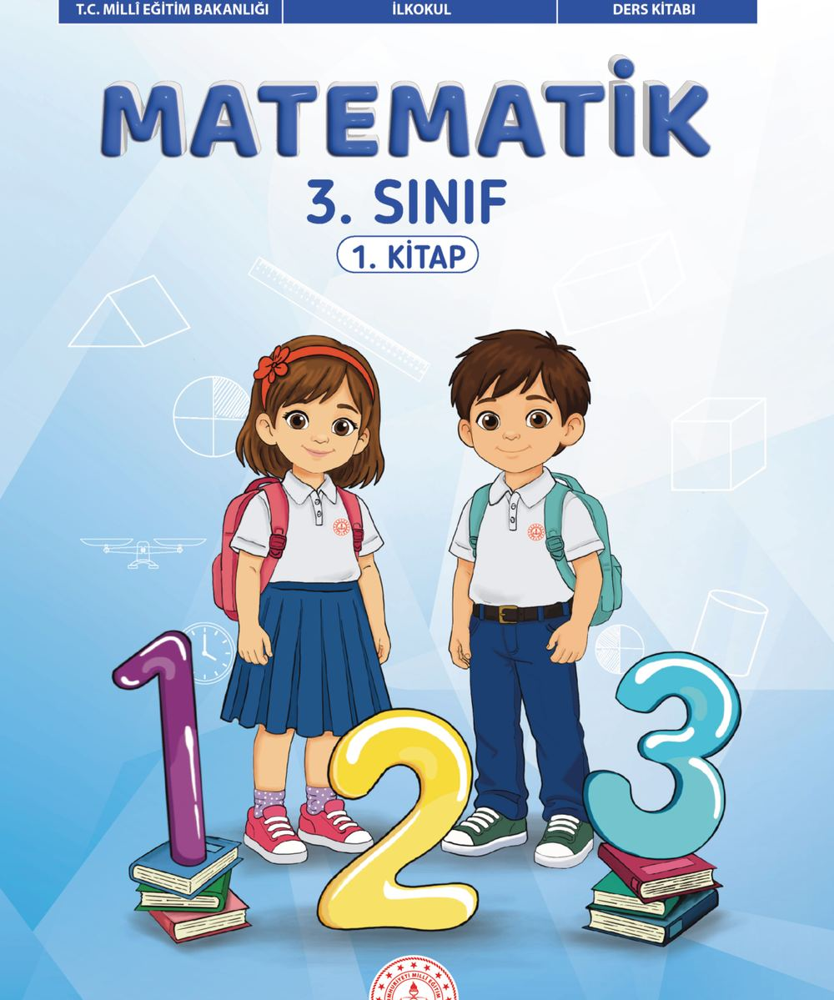
<!-- yer tutucu bulunamadı: sayfa sonuna eklendi -->

<!-- sayfa 1 -->

# İLKOKUL

# MATEMATİK

## 3. SINIF DERS KİTABI

## 1. KİTAP

### YAZARLAR

Çiğdem KAYA
Filiz BAŞAY
Kamil YEŞİLOVA
Sakine GÖNDÜK
Seval KALKAN

<!-- sayfa 2 -->

MİLLÎ EĞİTİM BAKANLIĞI YAYINLARI ....................................................................... : 10797
DERS KİTAPLARI DİZİSİ ....................................................................................................... : 2533

Her hakkı saklıdır ve Millî Eğitim Bakanlığına aittir. Kitabın metin, soru ve şekilleri kısmen de olsa hiçbir surette alınıp yayımlanamaz.

# HAZIRLAYANLAR

## Editör
Prof. Dr. Kâmuran TARIM

## Dil Uzmanı
Şükrü BAŞKAYA

## Görsel Tasarımcı
Alper KILIÇ
Aysel YEŞİLOVA
Can HİLÂL

## Çoklu Ortam Tasarımcısı
Burcu YAMANER
Cuma ŞAŞTIM
Enver ÜLKER
Hasan ARLI
Hatice YILDIRIM IŞIK

## Program Geliştirme Uzmanı
Dr. Fadime MENGİ US

## Ölçme ve Değerlendirme Uzmanı
Dr. Öğretim Üyesi Mustafa KÖROĞLU

## Rehberlik Uzmanı
Aybüke YAMAN

ISBN 978-975-11-9897-6

Millî Eğitim Bakanlığı Talim ve Terbiye Kurulunun 13/07/2026 tarih ve 164290654 sayılı Kurul kararı ile öğretim yılından itibaren 5 (beş) yıl süre ile Ders Kitabı olarak kabul edilmiştir. 

Kurulca bu kitabın kabul edilmiş olması ders kitabından yayınevi ve yazarın

<!-- sayfa 3 -->

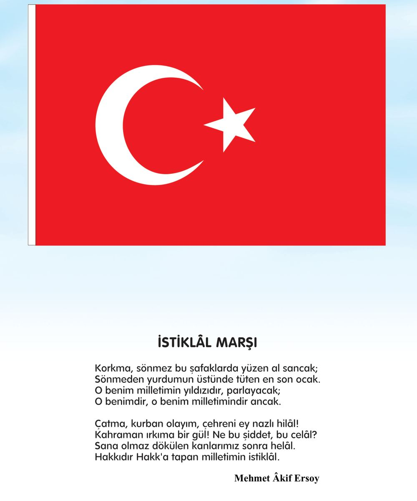

# İSTİKLÂL MARŞI

Korkma, sönmez bu şafaklarda yüzen al sancak;
Sönmeden yurdumun üstünde tüten en son ocak.
O benim milletimin yıldızıdır, parlayacak;
O benimdir, o benim milletimindir ancak.

Çatma, kurban olayım, cehren ey nazlı hilâl!
Kahraman ırkıma bir gül! Ne bu şiddet, bu celâl?
Sana olmaz dökülen kanlarımız sonra helâl.
Hakkıdır Hakk'a tapan milletimin istiklâl.

**Mehmet Âkif Ersoy**

<!-- sayfa 4 -->

ANDIMIZ

Türküm, doğruyum, çalışkanım.

İlkem küçüklerimi korumak, büyüklerimi saymak; yurdumu, milletimi özümden çok sevmektir.
Ülküm yükselmek, ileri gitmektir.

Ey Büyük Atatürk!

Açtığın yolda, gösterdiğin hedefe durmadan yürüyeceğime ant içerim.

Varlığım Türk varlığına armağan olsun.

Ne mutlu Türküm diyene!

<!-- sayfa 5 -->

[Görüntüde sadece Mustafa Kemal Atatürk'ün portresi bulunmaktadır. Herhangi bir matematiksel metin, formül veya şekil içermemektedir.]

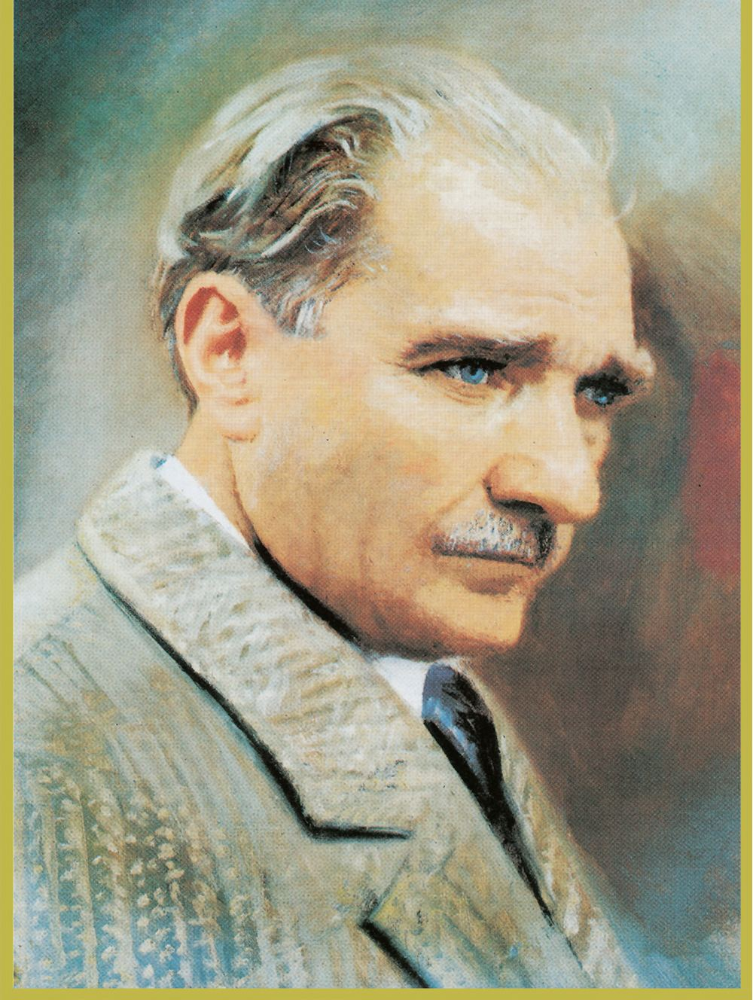
<!-- yer tutucu bulunamadı: sayfa sonuna eklendi -->

<!-- sayfa 6 -->

Verdiğiniz mesajda PDF metin katmanı boş görünüyor (`<<< >>>` arası boş). Lütfen dönüştürülmesini istediğiniz metni veya görseli paylaşın. Metni paylaştığınızda kurallara uygun şekilde Markdown formatına çevirebilirim.

<!-- sayfa 7 -->

# İÇİNDEKİLER

Kitabımızı Tanıyalım .......................................................................................................... 8

## 1. TEMA: SAYILAR VE NİCELİKLER (1)

Sayıları Okuma ve Yazma ............................................................................................. 12
Sayıları Çözümleme ....................................................................................................... 18
Sayıları Sıralama ............................................................................................................ 28
Ritmik Sayma ................................................................................................................ 40
Tek ve Çift Sayılar ......................................................................................................... 56
Tek ve Çift Sayıları Toplama ........................................................................................ 63
Sayı ve Şekil Örüntüleri ............................................................................................... 68
Nesnelerin Sayılarını Tahmin Etme .............................................................................. 74
1. Tema Değerlendirme ................................................................................................. 79

## 2. TEMA: SAYILAR VE NİCELİKLER (2)

Bütün, Yarım ve Çeyreğin Kesir Gösterimi ................................................................. 86
Bir Bütünü Oluşturan Eş Parçalar ................................................................................ 92
Pay ve Payda Arasındaki İlişki ..................................................................................... 97
Analog ve Dijital Saatler ............................................................................................... 108
Zaman Ölçü Birimleri ................................................................................................... 114
Olayların Oluş Sürelerini Tahmin Etme ...................................................................... 124
Uzunluk ve Kütle Ölçü Birimleri ................................................................................. 126
Madenî ve Kâğıt Paralar ............................................................................................... 144
2. Tema Değerlendirme ................................................................................................ 153

## 3. TEMA: İŞLEMLERDEN CEBİRSEL DÜŞÜNMEYE

Toplama ve Çıkarma İşlemlerinin Sonuçlarını Tahmin Etme .................................... 160
Toplama ve Çıkarma İşlemlerini Çözümleme ............................................................. 181
Sözlük ............................................................................................................................. 192
Kaynakça ....................................................................................................................... 194
Cevap Anahtarı ............................................................................................................. 194
Görsel ve Genel Ağ Kaynakçası .................................................................................. 194
Ekler ............................................................................................................................... 195
Türkiye'nin Mülki İdare Bölümleri ile Kara ve Deniz Komşuları Haritası ................. 199

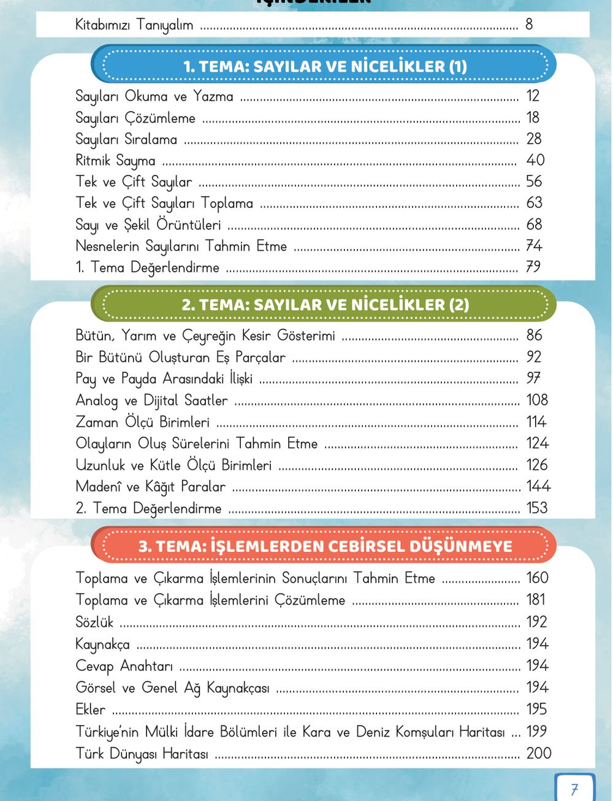
<!-- yer tutucu bulunamadı: sayfa sonuna eklendi -->

<!-- sayfa 8 -->

# KİTABIMIZI TANIYALIM

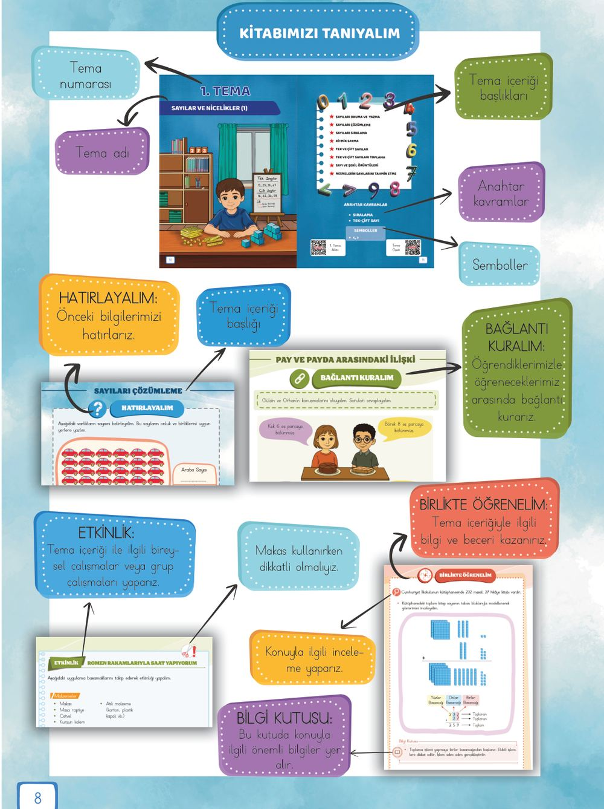

* Tema numarası
* Tema adı
* Tema içeriği başlıkları
* Anahtar kavramlar
* Semboller
* Tema içeriği başlığı

---

## HATIRLAYALIM:
Önceki bilgilerimizi hatırlarız.

* Tema içeriği başlığı

---

## BAĞLANTI KURALIM:
Öğrendiklerimizle öğreneceklerimiz arasında bağlantı kurarız.

---

## BİRLİKTE ÖĞRENELİM:
Tema içeriğiyle ilgili bilgi ve beceri kazanırız.

---

## ETKİNLİK:
Tema içeriği ile ilgili bireysel çalışmalar veya grup çalışmaları yaparız.

---

* Makas kullanırken dikkatli olmalıyız.
* Konuyla ilgili inceleme yaparız.
* BİLGİ KUTUSU: Bu kutuda konuyla ilgili önemli bilgiler yer alır.

<!-- sayfa 9 -->

# ÇÖZELİM ÖĞRENELİM:
Konu ile ilgili sorular çözeriz.

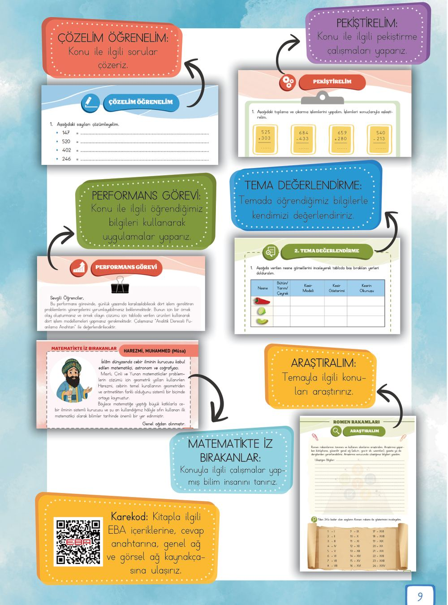

## ÇÖZELİM ÖĞRENELİM

1. Aşağıdaki sayıları çözümleyelim.
* $147 =$ <!-- KONTROL: Marker'da karşılığı yok, uydurma olabilir -->
* $520 =$ <!-- KONTROL: Marker'da karşılığı yok, uydurma olabilir -->
* $402 =$ <!-- KONTROL: Marker'da karşılığı yok, uydurma olabilir -->
* $246 =$ <!-- KONTROL: Marker'da karşılığı yok, uydurma olabilir -->

# PEKİŞTİRELİM:
Konu ile ilgili pekiştirme çalışmaları yaparız.

## PEKİŞTİRELİM

1. Aşağıdaki toplama ve çıkarma işlemlerini yapalım. İşlemleri sonuçlarıyla eşleştirelim.

| $525 + 303 = \dots$ <!-- KONTROL: Marker'da karşılığı yok, uydurma olabilir --> | $684 - 433 = \dots$ <!-- KONTROL: Marker'da karşılığı yok, uydurma olabilir --> | $659 + 280 = \dots$ <!-- KONTROL: Marker'da karşılığı yok, uydurma olabilir --> | $540 - 213 = \dots$ <!-- KONTROL: Marker'da karşılığı yok, uydurma olabilir --> |
| :--- | :--- | :--- | :--- |

# PERFORMANS GÖREVİ:
Konu ile ilgili öğrendiğimiz bilgileri kullanarak uygulamalar yaparız.

## PERFORMANS GÖREVİ

Sevgili Öğrenciler,
Bu performans görevinde, günlük yaşamda karşılaşabileceğiniz dört işlem gerektiren problemlerin yergelerini uygulayabilmeniz beklenmektedir. Bunun için bir örnek olay oluşturmanız ve örneğin çözümünü için tabloda verilen ürünleri kullanarak dört işlem modellerini yapmanız gerekmektedir. Çalışmanız "Analitik Dereceli Puanlama Anlatımı" ile değerlendirilecektir.

# MATEMATİKTE İZ BIRAKANLAR:
Konuyla ilgili çalışmalar yapmış bilim insanını tanırız.

## MATEMATİKTE İZ BIRAKANLAR: HAREZMİ, MUHAMMED (Mûsâ)

İslam dünyasının kurucu kabul edilen matematikçi, astronom ve coğrafyacı Mısırlı, Çinli ve Yunan matematikçiler problemleri çözmek için geometrik yöntemler kullananların, aritmetik ile geometrinin farklı yönlerini bir biçimde ortaya koymuştur. Büyece matematiğe yaptığı büyük katkılarla cebir biliminin kurucusu ve şu an kullandığımız hâliyle sıfır kullanan ilk matematikçi olarak bilimler tarihinde önemli bir yer edinmiştir. Genel ağdan alınmıştır.

# TEMA DEĞERLENDİRME:
Temada öğrendiğimiz bilgilerle kendimizi değerlendiririz.

## 2. TEMA DEĞERLENDİRME

1. Aşağıda verilen nesne görsellerini inceleyerek tabloda boş bırakılan yerleri doldurunuz.

| Nesne | Bütün/ Yarım/ Çeyrek | Kesir Modeli | Kesir Gösterimi | Kesirlerin Okunuşu |
| :--- | :--- | :--- | :--- | :--- |
|  | | | | |
|  | | | | |
|  | | | | |

# ARAŞTIRALIM:
Temayla ilgili konuları araştırırız.

## ROMEN RAKAMLARI
## ARAŞTIRALIM

Romen rakamlarının tanımı ve kullanım alanları araştırılır. Araştırma yaparken kitaplarından, internetten (google, youtube vb.) yararlanınız. Araştırmanız sonucunda ulaştığınız bilgileri kaydediniz.
*Ulaştığım Bilgiler:*

**Aşağıda bir Türkçe matematik ders kitabı sayfasıdır.**

| 1 - I | 7 - VII | 17 - XVII |
| :--- | :--- | :--- |
| 2 - II | 10 - X | 18 - XVIII |
| 3 - III | 11 - XI | 19 - XIX |
| 4 - IV | 12 - XII | 20 - XX |
| 5 - V | 13 - XIII | 21 - XXI |
| 6 - VI | 14 - XIV | 22 - XXII |
| 8 - VIII | 15 - XV | 23 - XXIII |
| 16 - XVI | 24 - XXIV | |

# Karekod: Kitapla ilgili EBA içeriklerine, cevap anahtarına, genel ağ ve görsel ağ kaynakçasına ulaşırız

<!-- sayfa 10 -->

# 1. TEMA
## SAYILAR VE NİCELİKLER (1)

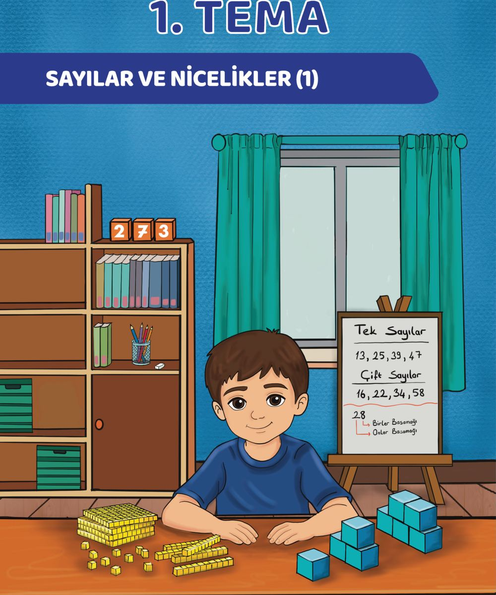

Tek Sayılar
$13, 25, 39, 47$ <!-- KONTROL: Marker'da karşılığı yok, uydurma olabilir -->

Çift Sayılar
$16, 22, 34, 58$ <!-- KONTROL: Marker'da karşılığı yok, uydurma olabilir -->

$28$ <!-- KONTROL: Marker'da karşılığı yok, uydurma olabilir -->
$\llcorner$ Birler Basamağı
$\quad \llcorner$ Onlar Basamağı

<!-- sayfa 11 -->

# 0 1 2 3 4 5 6 7 8 9 < >

* SAYILARI OKUMA VE YAZMA
* SAYILARI ÇÖZÜMLEME
* SAYILARI SIRALAMA
* RİTMİK SAYMA
* TEK VE ÇİFT SAYILAR
* TEK VE ÇİFT SAYILARI TOPLAMA
* SAYI VE ŞEKİL ÖRÜNTÜLERİ
* NESNELERİN SAYILARINI TAHMİN ETME

## ANAHTAR KAVRAMLAR

* SIRALAMA
* TEK-ÇİFT SAYI

## SEMBOLLER

* $<, >$

| 1. Tema Alanı | Tema Özeti |
| :---: | :---: |
| 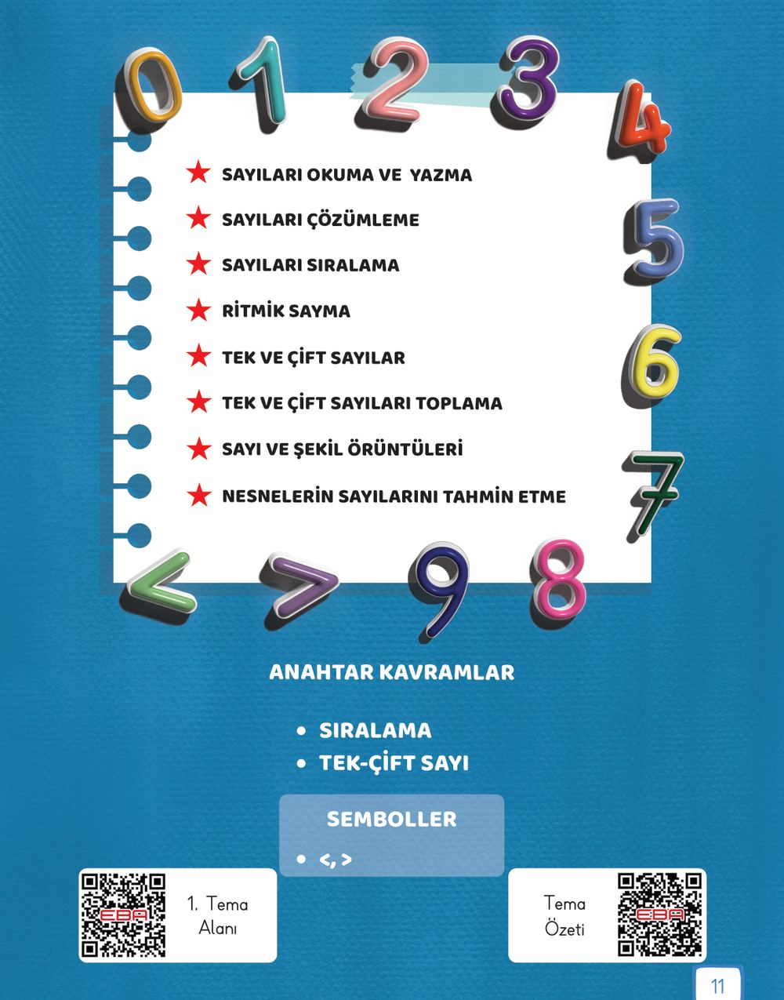 |  |

<!-- sayfa 12 -->

# HATIRLAYALIM

Aşağıdaki görselde bazı sayılar ile bu sayıların okunuşları verilmiştir. Sayılar ile okunuşlarını örnekteki gibi aynı renge boyayarak eşleştirelim.

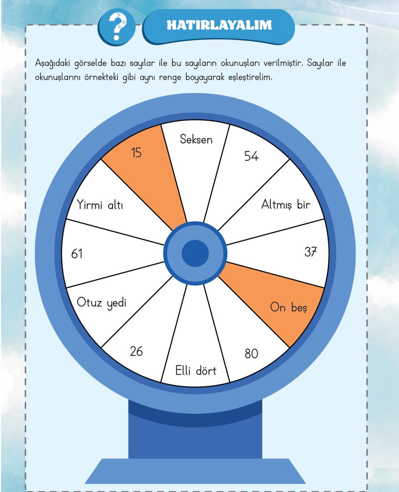

<!-- sayfa 13 -->

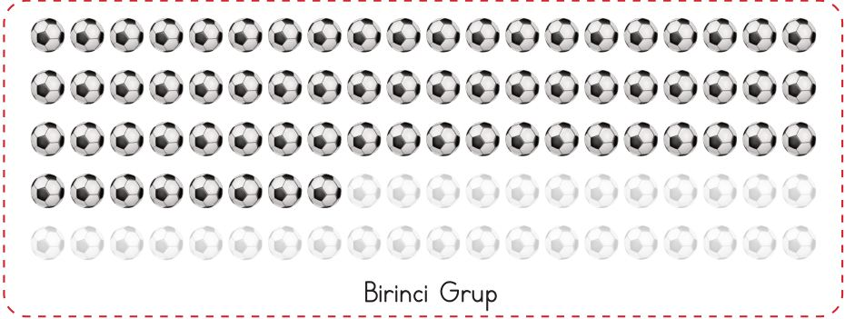

Birinci Grup

İkinci Grup
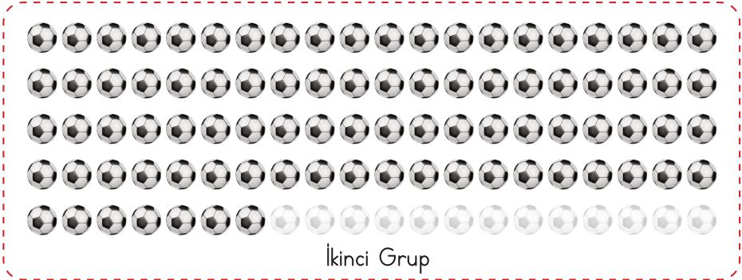

3/C sınıfı öğrencileri beden eğitimi ve oyun dersinde iki gruba ayrılarak yakantop oynamaya karar verdiler. Oyuncular yakaladıkları her top için kendi gruplarındaki top görsellerinden birini boyadılar. Bu bilgilere göre aşağıdaki soruları cevaplayalım.

• Birinci grup kaç top yakalamıştır?
....................................................................................................................................................

• İkinci grup kaç top yakalamıştır?
....................................................................................................................................................

• İkinci grup tablodaki bütün topları boyasaydı kaç top yakalamış olurdu?
....................................................................................................................................................

<!-- sayfa 14 -->

# BİRLİKTE ÖĞRENELİM

Aşağıda görselleri verilen nesnelerin sayısının yazılış ve okunuşlarını inceleyelim.

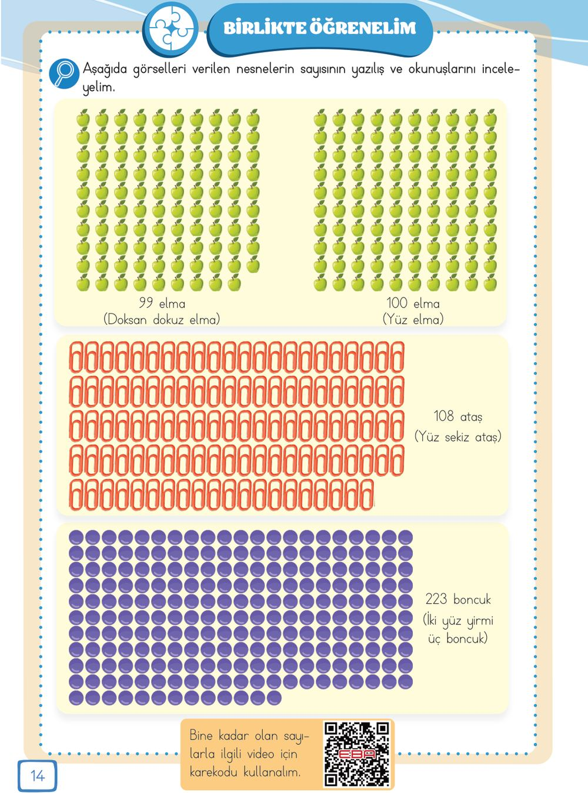

99 elma
(Doksan dokuz elma)

100 elma
(Yüz elma)

108 ataş
(Yüz sekiz ataş)

223 boncuk
(İki yüz yirmi üç boncuk)

Bine kadar olan sayı-

<!-- sayfa 15 -->

🔍 Aşağıdaki fındıkların sayısını inceleyelim.

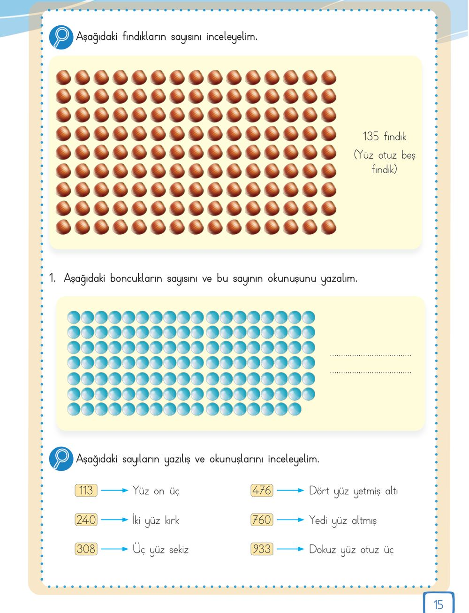

$135$ fındık
(Yüz otuz beş fındık)

1. Aşağıdaki boncukların sayısını ve bu sayının okunuşunu yazalım.

.....................................
.....................................

🔍 Aşağıdaki sayıların yazılış ve okunuşlarını inceleyelim.

$113 \longrightarrow$ <!-- KONTROL: Marker'da karşılığı yok, uydurma olabilir --> Yüz on üç
$240 \longrightarrow$ <!-- KONTROL: Marker'da karşılığı yok, uydurma olabilir --> İki yüz kırk
$308 \longrightarrow$ <!-- KONTROL: Marker'da karşılığı yok, uydurma olabilir --> Üç yüz sekiz
$476 \longrightarrow$ <!-- KONTROL: Marker'da karşılığı yok, uydurma olabilir --> Dört yüz yetmiş altı
$760 \longrightarrow$ <!-- KONTROL: Marker'da karşılığı yok, uydurma olabilir --> Yedi yüz altmış
$933 \longrightarrow$ <!-- KONTROL: Marker'da karşılığı yok, uydurma olabilir --> Dokuz yüz otuz üç

<!-- sayfa 16 -->

# ETKİNLİK SAYILARI YAZALIM VE OKUYALIM

Aşağıdaki uygulama basamaklarını takip ederek etkinliği yapalım.

## Uygulama Basamakları

1. Tabloda verilen örnek durumlara ait sayıları belirleyelim.
2. Belirlediğimiz sayıları tabloda uygun yere yazalım.
3. Sayıların okunuşlarını tabloda uygun yere yazalım.

| Günlük Yaşamda Sayılarla Karşılaşabileceğimiz Durumlar | Sayının Yazılışı | Sayının Okunuşu |
| :--- | :--- | :--- |
| Türkçe ders kitabımızın sayfa sayısı | | |
| Matematik ders kitabımızın sayfa sayısı | | |
| Sınıf kitaplığımızdaki kitap sayısı | | |
| Acil Çağrı Merkezi'nin telefon numarası | | |
| Yaşadığımız ilin şehirler arası telefon kodu | | |

## Değerlendirme

* Üç basamaklı sayıların kullanımına günlük yaşamdan iki örnek belirleyelim. Belirlediğimiz sayıları ve bu sayıların okunuşlarını yazalım.
................................................................................................................................................................
................................................................................................................................................................
................................................................................................................................................................
................................................................................................................................................................
................................................................................................................................................................

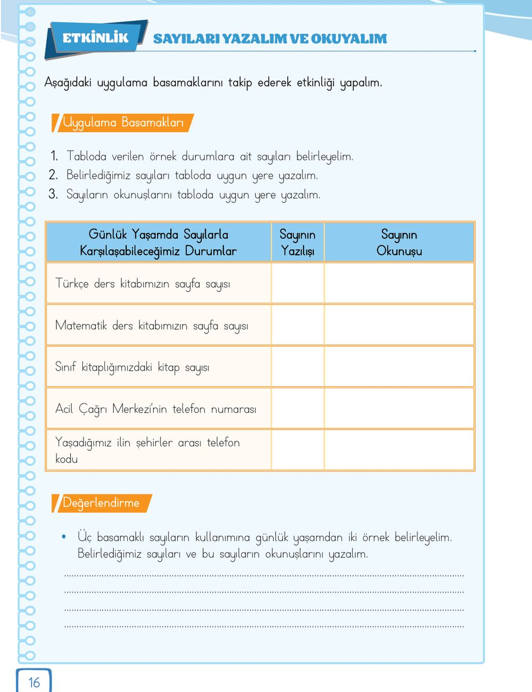
<!-- yer tutucu bulunamadı: sayfa sonuna eklendi -->

<!-- sayfa 17 -->

2. Aşağıdaki görseli inceleyelim. Verilen ifadelerdeki boşlukları örnekteki gibi dolduralım.

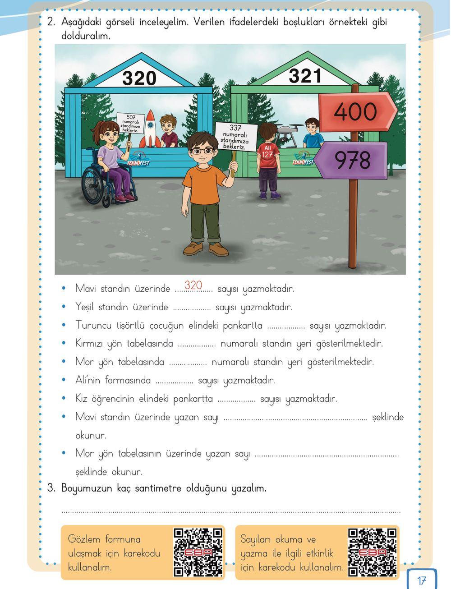

* Mavi standın üzerinde $320$ sayısı yazmaktadır.
* Yeşil standın üzerinde ......................... sayısı yazmaktadır.
* Turuncu tişörtlü çocuğun elindeki pankartta ......................... sayısı yazmaktadır.
* Kırmızı yön tabelasında ......................... numaralı standın yeri gösterilmektedir.
* Mor yön tabelasında ......................... numaralı standın yeri gösterilmektedir.
* Ali'nin formasında ......................... sayısı yazmaktadır.
* Kız öğrencinin elindeki pankartta ......................... sayısı yazmaktadır.
* Mavi standın üzerinde yazan sayı .................................................................... şeklinde okunur.
* Mor yön tabelasının üzerinde yazan sayı .................................................................... şeklinde okunur.

3. Boyumuzun kaç santimetre olduğunu yazalım.
................................................................................................................................................................

| Gözlem formuna ulaşmak için karekodu | Sayıları okuma ve yazma ile ilgili etkinlik |
| :---: | :---: |
| [QR Kod] | [QR Kod] |

<!-- sayfa 18 -->

# HATIRLAYALIM

Aşağıdaki varlıkların sayısını belirleyelim. Bu sayıların onluk ve birliklerini uygun yerlere yazalım.

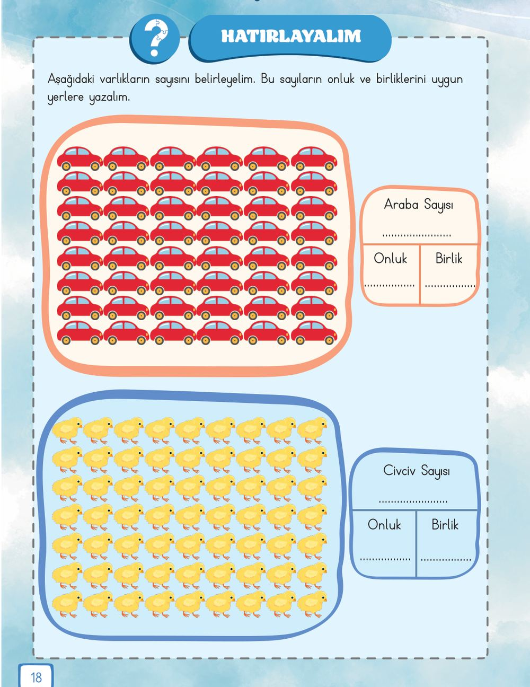

| Araba Sayısı |
| :--- |
| ....................... |

| Onluk | Birlik |
| :--- | :--- |
| ................. | ................. |

| Civciv Sayısı |
| :--- |
| ....................... |

<!-- sayfa 19 -->

# BAĞLANTI KURALIM

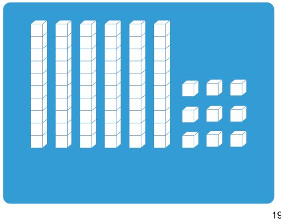

Zeynep, dedesinin kırtasiyesinde kalemleri saymaya yardım etmek istedi. Kalemleri saymayı kolaylaştırmak için görseldeki gibi gruplandırdı. Kalem sayısını taban bloklarını boyayarak gösterelim.

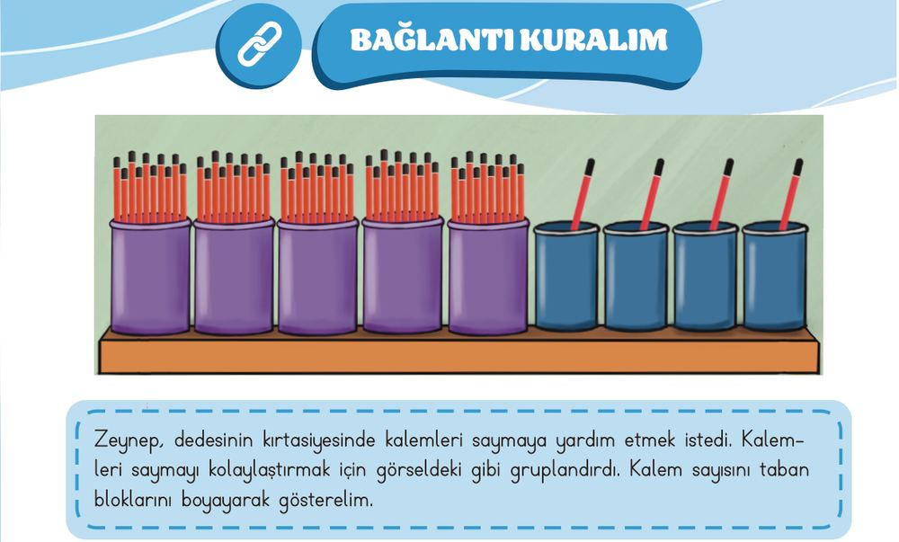

Modellemeye göre cümleyi tamamlayalım.

* Modellenen .................... sayısı, .................... onluk ve .................... birlikten oluşur.

<!-- sayfa 20 -->

# BİRLİKTE ÖĞRENELİM

1. Aşağıdaki $123$ badem görselini inceleyelim.

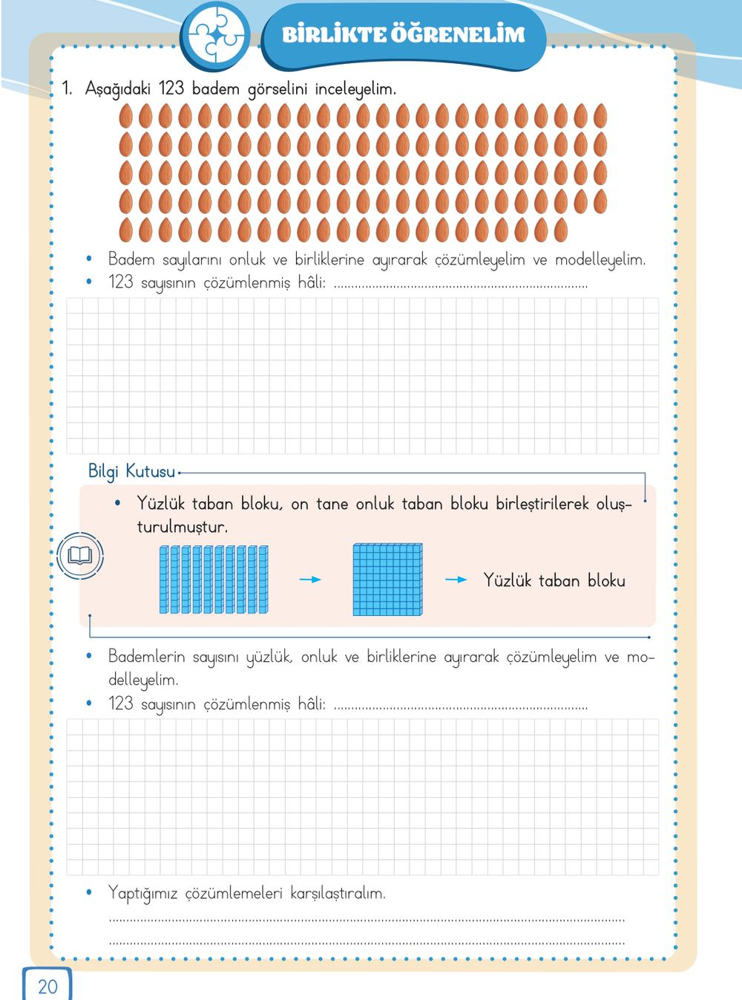

* Badem sayılarını onluk ve birliklerine ayırarak çözümleyelim ve modelleyelim.
* $123$ sayısının çözümlenmiş hâli: ............................................................

## Bilgi Kutusu

* Yüzlük taban bloku, on tane onluk taban bloku birleştirilerek oluşturulmuştur.

* Bademlerin sayısını yüzlük, onluk ve birliklerine ayırarak çözümleyelim ve modelleyelim.
* $123$ sayısının çözümlenmiş hâli: ............................................................

* Yaptığımız çözümlemeleri karşılaştıralım.

....................................................................................................................................................

<!-- sayfa 21 -->

2. Aşağıda verilen sayıları örnekteki gibi çözümleyelim ve modelleyelim.

* $142$ sayısının çözümlenmiş hâli: $100 + 40 + 2$

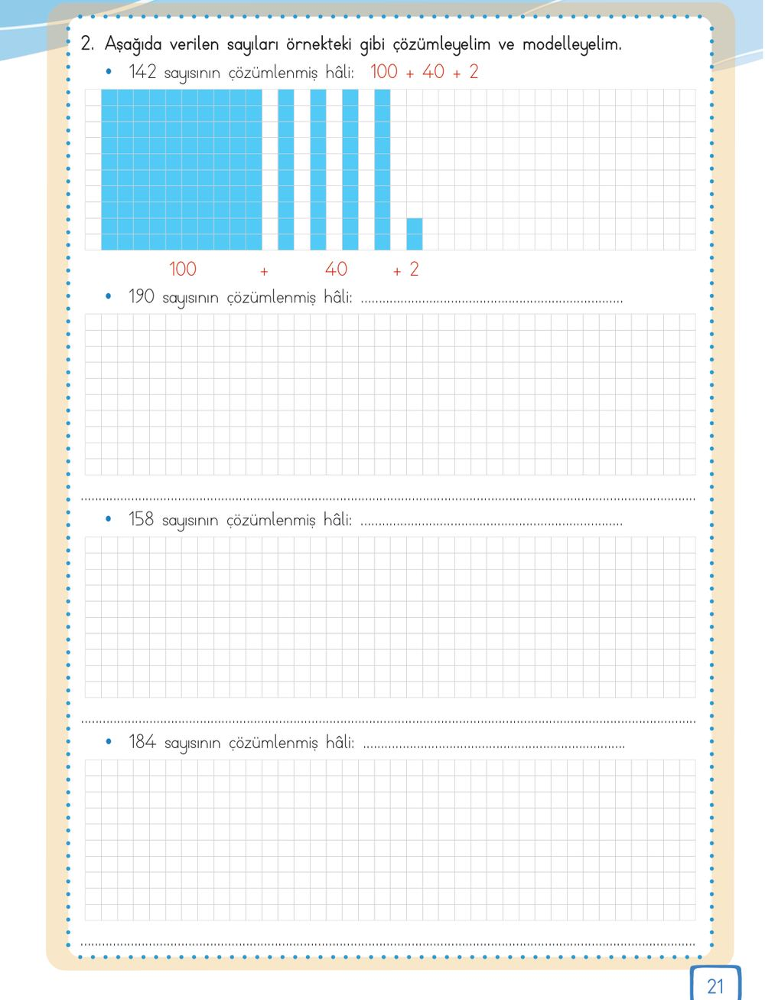

* $190$ sayısının çözümlenmiş hâli: .........................................................................

...........................................................................................................................................................................
...........................................................................................................................................................................

* $158$ sayısının çözümlenmiş hâli: .........................................................................

* $184$ sayısının çözümlenmiş hâli: .........................................................................

<!-- sayfa 22 -->

# ETKİNLİK SAYILARI ÇÖZÜMLÜYORUM

Aşağıdaki uygulama basamaklarını takip ederek etkinliği yapalım.

## Malzemeler
* Her öğrenci için 200 adet fasulye
* Kâğıt
* Kurşun kalem

## Uygulama Basamakları
1. Öğretmenimizin rehberliğinde ikişer kişilik gruplar oluşturalım.
2. Fasulyelerimizin sayısını geçmeyecek şekilde üç basamaklı bir sayı belirleyelim. Belirlediğimiz sayıyı kâğıda yazalım.
3. Yazdığımız sayıyı yüzlük, onluk ve birliklerine ayırarak çözümleyelim. Çözümlememizi fasulyelerle modelleyelim. Çözümlememizi kâğıda yazalım.
4. Grup arkadaşımızdan bir miktar fasulye alarak kendi fasulyelerimize ekleyelim.
5. Ekleme sonucunda oluşan fasulye sayısını kâğıda yazalım.
6. Toplam fasulye sayısını çözümleyelim. Çözümlememizi fasulyelerle modelleyelim. Çözümlememizi kâğıda yazalım.
7. Modelimizin doğruluğunu kontrol edelim. Hatalı çözümlemelerimizi düzeltelim. Arkadaşımızdan aldığımız fasulyeleri geri verelim.
8. Farklı sayılarda fasulye ile etkinliği tekrarlayalım.
9. Sınıf arkadaşlarımızla aktif şekilde rol alarak öğretmenimizin belirlediği süre boyunca etkinliğe devam edelim.

## Değerlendirme
1. Sayıların çözümlenmiş hâllerini farklı şekillerde nasıl gösterebiliriz?
................................................................................................................................................................
................................................................................................................................................................
................................................................................................................................................................

2. Sayıları çözümlerken hangi bilgilerden yararlandığımızı açıklayalım.
................................................................................................................................................................
................................................................................................................................................................
................................................................................................................................................................

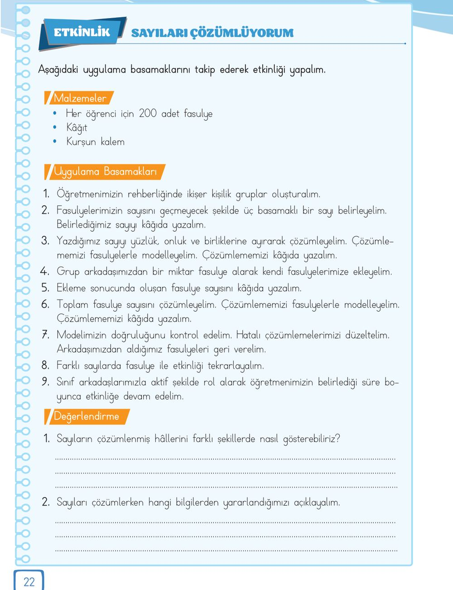
<!-- yer tutucu bulunamadı: sayfa sonuna eklendi -->

<!-- sayfa 23 -->

3. Aşağıda taban blokları ile gruplanmış sayıları bularak örnekteki gibi çözümleyelim.

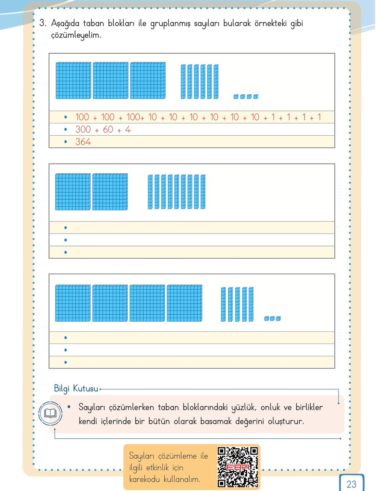

* $100 + 100 + 100 + 10 + 10 + 10 + 10 + 10 + 10 + 1 + 1 + 1 + 1$ <!-- KONTROL: Marker'da karşılığı yok, uydurma olabilir -->
* $300 + 60 + 4$ <!-- KONTROL: Marker'da karşılığı yok, uydurma olabilir -->
* $364$ <!-- KONTROL: Marker'da karşılığı yok, uydurma olabilir -->

* 
* 
* 

* 
* 
* 

**Bilgi Kutusu**

* Sayıları çözümlerken taban bloklarındaki yüzlük, onluk ve birlikler kendi içlerinde bir bütün olarak basamak değerini oluşturur.

Sayıları çözümleme ile

<!-- sayfa 24 -->

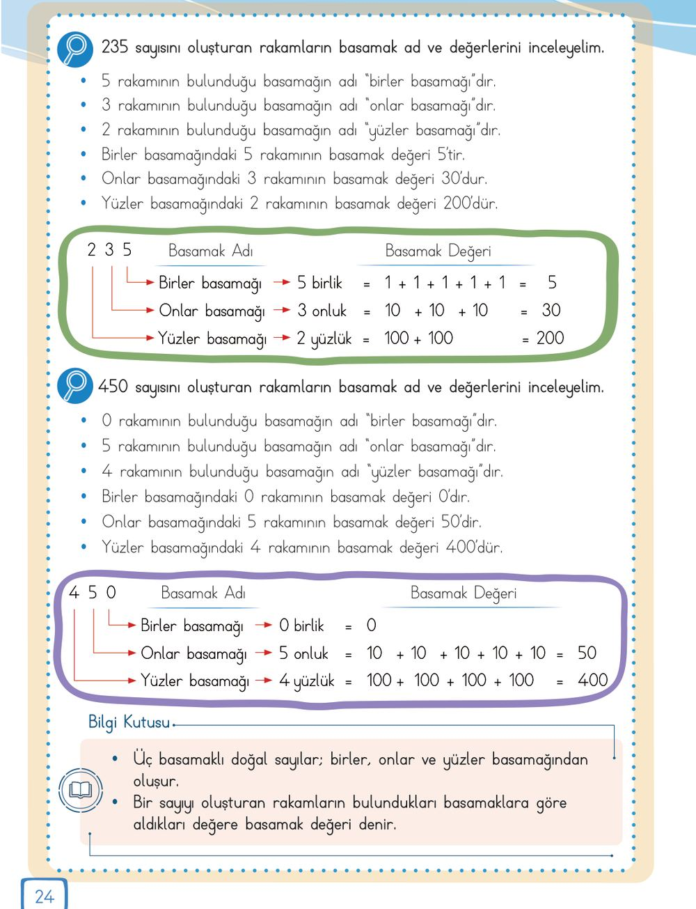 235 sayısını oluşturan rakamların basamak ad ve değerlerini inceleyelim.

* 5 rakamının bulunduğu basamağın adı "birler basamağı"dır.
* 3 rakamının bulunduğu basamağın adı "onlar basamağı"dır.
* 2 rakamının bulunduğu basamağın adı "yüzler basamağı"dır.
* Birler basamağındaki 5 rakamının basamak değeri $5$'tir.
* Onlar basamağındaki 3 rakamının basamak değeri $30$'dur.
* Yüzler basamağındaki 2 rakamının basamak değeri $200$'dür.

| 2 3 5 | Basamak Adı | Basamak Değeri |
| :--- | :--- | :--- |
| | Birler basamağı $\rightarrow$ 5 birlik | $= 1 + 1 + 1 + 1 + 1 = 5$ |
| | Onlar basamağı $\rightarrow$ 3 onluk | $= 10 + 10 + 10 = 30$ |
| | Yüzler basamağı $\rightarrow$ 2 yüzlük | $= 100 + 100 = 200$ |

 450 sayısını oluşturan rakamların basamak ad ve değerlerini inceleyelim.

* 0 rakamının bulunduğu basamağın adı "birler basamağı"dır.
* 5 rakamının bulunduğu basamağın adı "onlar basamağı"dır.
* 4 rakamının bulunduğu basamağın adı "yüzler basamağı"dır.
* Birler basamağındaki 0 rakamının basamak değeri $0$'dır.
* Onlar basamağındaki 5 rakamının basamak değeri $50$'dir.
* Yüzler basamağındaki 4 rakamının basamak değeri $400$'dür.

| 4 5 0 | Basamak Adı | Basamak Değeri |
| :--- | :--- | :--- |
| | Birler basamağı $\rightarrow$ 0 birlik | $= 0$ <!-- KONTROL: Marker'da karşılığı yok, uydurma olabilir --> |
| | Onlar basamağı $\rightarrow$ 5 onluk | $= 10 + 10 + 10 + 10 + 10 = 50$ <!-- KONTROL: Marker'da karşılığı yok, uydurma olabilir --> |
| | Yüzler basamağı $\rightarrow$ 4 yüzlük | $= 100 + 100 + 100 + 100 = 400$ <!-- KONTROL: Marker'da karşılığı yok, uydurma olabilir --> |

### Bilgi Kutusu

* Üç basamaklı doğal sayılar; birler, onlar ve yüzler basamağından oluşur.
* Bir sayıyı oluşturan rakamların bulundukları basamaklara göre aldıkları değere basamak değeri denir.

<!-- sayfa 25 -->

# ÇÖZELİM ÖĞRENELİM

1. Aşağıdaki sayıları çözümleyelim.
* $147 =$ .........................................................................................................................
* $520 =$ .........................................................................................................................
* $402 =$ .........................................................................................................................
* $246 =$ .........................................................................................................................

2. Aşağıdaki sayıları oluşturan rakamların basamak ad ve değerlerini noktalı yerlere yazalım.

$251$ <!-- KONTROL: Marker'da karşılığı yok, uydurma olabilir -->
Basamak Adı $\rightarrow$ Basamak Değeri
................................. $\rightarrow$ .................................
................................. $\rightarrow$ .................................
................................. $\rightarrow$ .................................

$403$ <!-- KONTROL: Marker'da karşılığı yok, uydurma olabilir -->
Basamak Adı $\rightarrow$ Basamak Değeri
................................. $\rightarrow$ .................................
................................. $\rightarrow$ .................................
................................. $\rightarrow$ .................................

$530$ <!-- KONTROL: Marker'da karşılığı yok, uydurma olabilir -->
Basamak Adı $\rightarrow$ Basamak Değeri
................................. $\rightarrow$ .................................
................................. $\rightarrow$ .................................

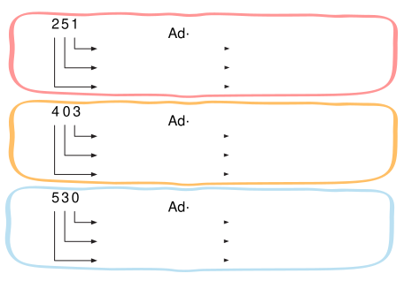
<!-- yer tutucu bulunamadı: sayfa sonuna eklendi -->

<!-- sayfa 26 -->

# ETKİNLİK BASAMAKLARIN DEĞERLERİNİ BULUYORUM

Aşağıdaki uygulama basamaklarını takip ederek etkinliği yapalım.

## Malzemeler
* Tahta kalemi
* A4 kâğıdı
* Poşet dosya
* Peçete

## Uygulama Basamakları
1. Öğretmenimizin rehberliğinde ikişer kişilik gruplar oluşturalım.
2. A4 kâğıdını poşet dosyaya yerleştirelim.
3. Grup arkadaşımızdan en fazla üç basamaklı bir sayı söylemesini isteyelim.
4. Grup arkadaşımızın söylediği sayıyı tahta kalemiyle poşet dosyanın üzerine yazalım.
5. Poşet dosyanın üzerinde yazdığımız sayının basamak ad ve değerlerini gösterelim.
6. Yaptığımız işlemin doğruluğunu kontrol ettikten sonra işlemi peçeteyle silelim.
7. Daha sonra grup arkadaşımıza en fazla üç basamaklı bir sayı söyleyelim. Grup arkadaşımızdan bu sayının basamak ad ve değerlerini yazmasını isteyelim.
8. Etkinliği işlemlerin doğruluğunu kontrol ettikten sonra öğretmenimizin belirlediği süre boyunca tekrarlayalım.
9. Sınıf arkadaşlarımızla aktif bir şekilde etkinlikte rol alalım.
10. Etkinliğin her aşamasında arkadaşlarımızdan yardım alarak onlarla iletişim hâlinde olalım.

## Değerlendirme
1. Etkinlikte oluşturduğumuz sayıların basamak değerlerini neye göre belirleriz?
................................................................................................................................................................
................................................................................................................................................................
................................................................................................................................................................
................................................................................................................................................................

2. Etkinlikte belirlediğimiz üç basamaklı bir sayının kaç yüzlük ve onluktan oluştuğunu nasıl bulabiliriz?
................................................................................................................................................................
................................................................................................................................................................
................................................................................................................................................

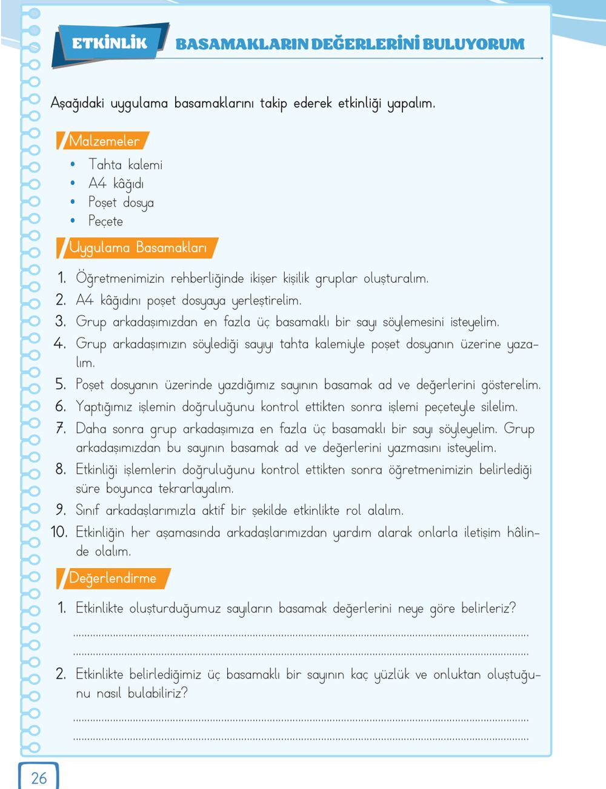
<!-- yer tutucu bulunamadı: sayfa sonuna eklendi -->

<!-- sayfa 27 -->

# PEKİŞTİRELİM

1. 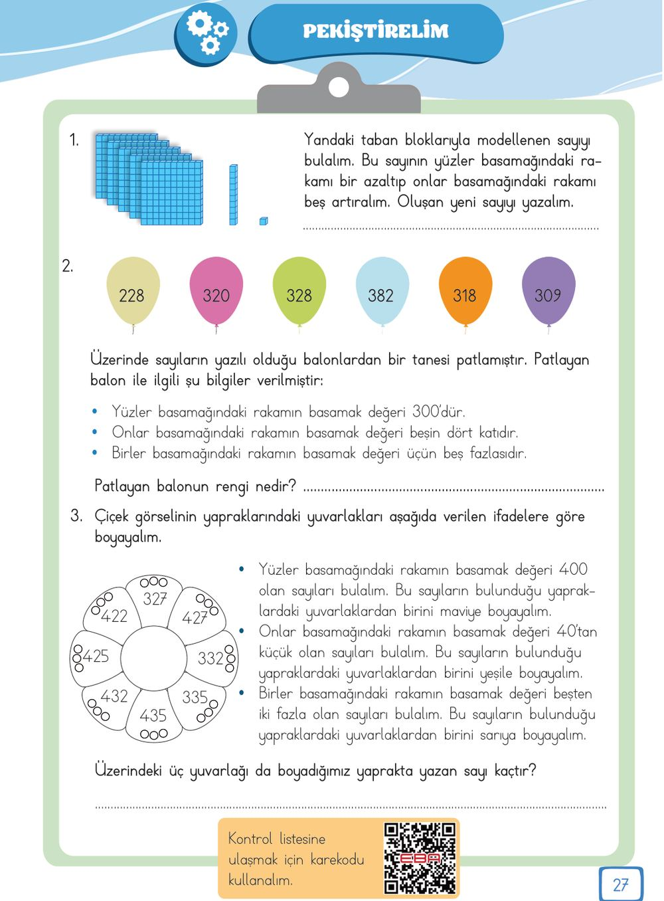
Yandaki taban bloklarıyla modellenen sayıyı bulalım. Bu sayının yüzler basamağındaki rakamı bir azaltıp onlar basamağındaki rakamı beş artıralım. Oluşan yeni sayıyı yazalım.
....................................................................................................................................................................................

2.

Üzerinde sayıların yazılı olduğu balonlardan bir tanesi patlamıştır. Patlayan balon ile ilgili şu bilgiler verilmiştir:
* Yüzler basamağındaki rakamın basamak değeri $300$'dür.
* Onlar basamağındaki rakamın basamak değeri beşin dört katıdır.
* Birler basamağındaki rakamın basamak değeri üçün beş fazlasıdır.

Patlayan balonun rengi nedir? .....................................................................................

3. Çiçek görselinin yapraklarındaki yuvarlakları aşağıda verilen ifadelere göre boyayalım.

* Yüzler basamağındaki rakamın basamak değeri $400$ olan sayıları bulalım. Bu sayıların bulunduğu yapraklardaki yuvarlaklardan birini maviye boyayalım.
* Onlar basamağındaki rakamın basamak değeri $40$'tan küçük olan sayıları bulalım. Bu sayıların bulunduğu yapraklardaki yuvarlaklardan birini yeşile boyayalım.
* Birler basamağındaki rakamın basamak değeri beşten iki fazla olan sayıları bulalım. Bu sayıların bulunduğu yapraklardaki yuvarlaklardan birini sarıya boyayalım.

Üzerindeki üç yuvarlağı da boyadığımız yaprakta yazan sayı kaçtır?
....................................................................................................................................................................................

Kontrol listesine

<!-- sayfa 28 -->

# HATIRLAYALIM

* Verilen sayıları küçükten büyüğe doğru sıralayarak vagonlara yazalım.

$5$  $14$ <!-- KONTROL: Marker'da karşılığı yok, uydurma olabilir -->  $11$

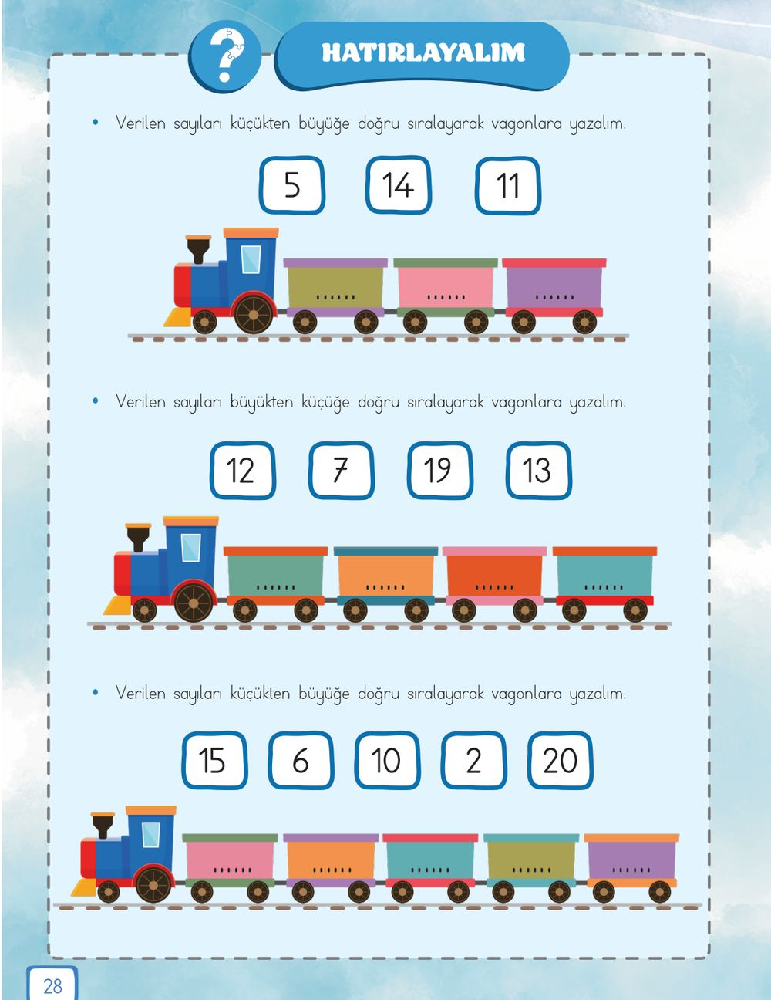

* Verilen sayıları büyükten küçüğe doğru sıralayarak vagonlara yazalım.

$12$  $7$  $19$  $13$

$15$  $6$  $10$  $2$  $20$

<!-- sayfa 29 -->

# BAĞLANTI KURALIM

Öğrenciler okul şenliğinde seksek, yakantop ve mendil kapmaca gibi oyunlara gruplar hâlinde katıldılar. Her oyunda kazandıkları puanlar toplandı. Gün sonunda ise her grubun toplam puanı açıklandı. Bu bilgilere göre aşağıdaki konuşmaları okuyarak soruları cevaplayalım.

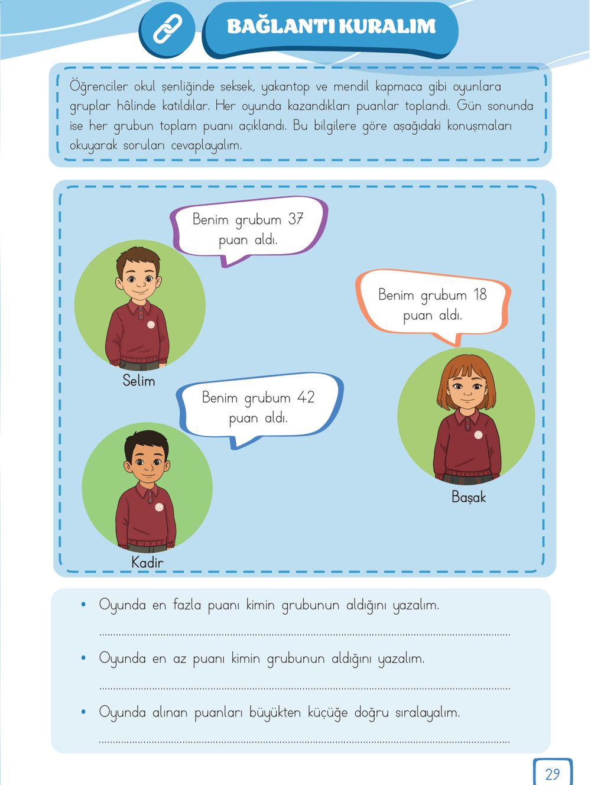

* Oyunda en fazla puanı kimin grubunun aldığını yazalım.
....................................................................................................................................................

* Oyunda en az puanı kimin grubunun aldığını yazalım.
....................................................................................................................................................

* Oyunda alınan puanları büyükten küçüğe doğru sıralayalım.
....................................................................................................................................................

<!-- sayfa 30 -->

# BİRLİKTE ÖĞRENELİM

1. Tabloda birinci durumdaki nesnelerin sayısı ikinci duruma getirilmiştir. Nesnelerin sayılarındaki artma ve azalma durumunu örnekteki gibi yazalım.

| Birinci Durum | İkinci Durum | Artmış/Azalmış |
| :--- | :--- | :--- |
| 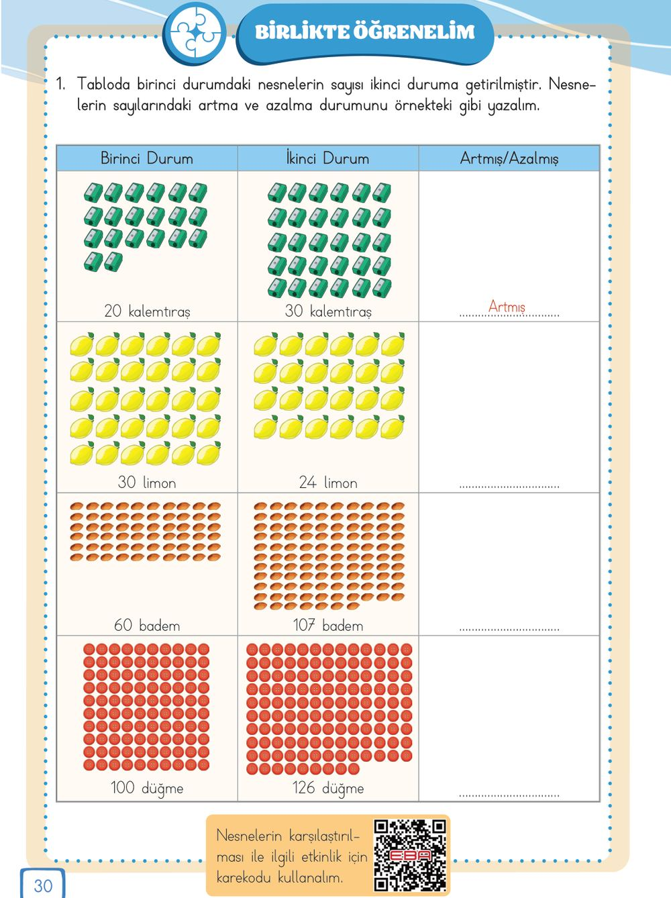 20 kalemtıraş |  30 kalemtıraş | ................................ Artmış |
|  30 limon |  24 limon | ................................ |
|  60 badem |  107 badem | ................................ |
|  100 düğme |  126 düğme | ................................ |

Nesnelerin karşılaştırıl-

<!-- sayfa 31 -->

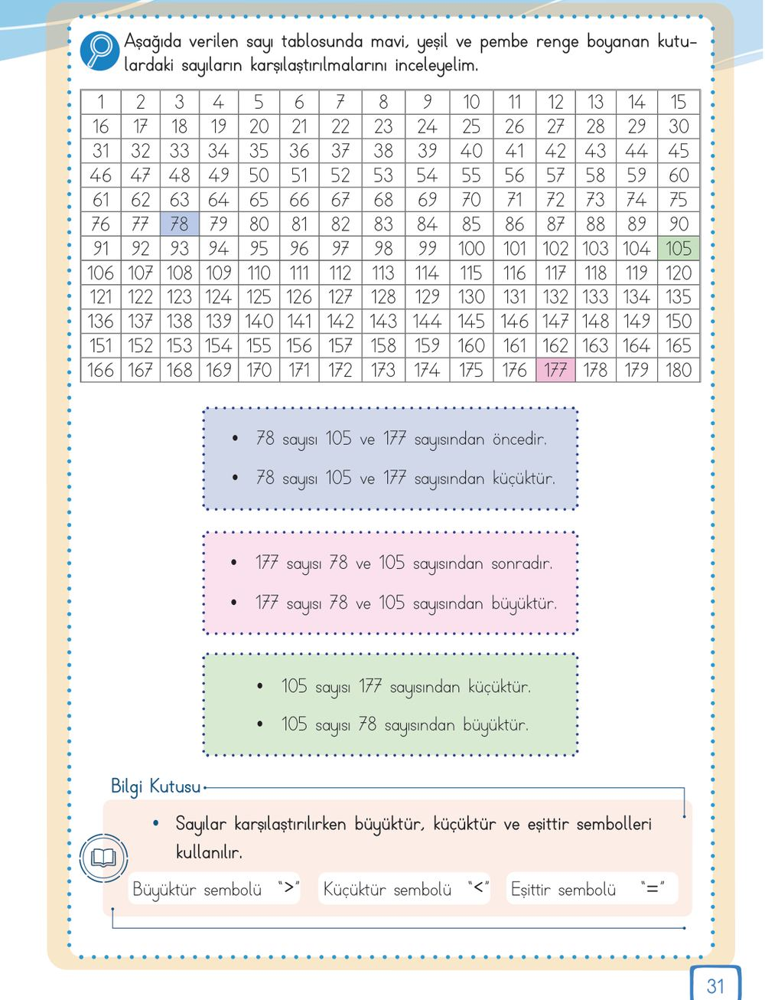 Aşağıda verilen sayı tablosunda mavi, yeşil ve pembe renge boyanan kutulardaki sayıların karşılaştırılmalarını inceleyelim.

| 1 | 2 | 3 | 4 | 5 | 6 | 7 | 8 | 9 | 10 | 11 | 12 | 13 | 14 | 15 |
|---|---|---|---|---|---|---|---|---|---|---|---|---|---|---|
| 16 | 17 | 18 | 19 | 20 | 21 | 22 | 23 | 24 | 25 | 26 | 27 | 28 | 29 | 30 |
| 31 | 32 | 33 | 34 | 35 | 36 | 37 | 38 | 39 | 40 | 41 | 42 | 43 | 44 | 45 |
| 46 | 47 | 48 | 49 | 50 | 51 | 52 | 53 | 54 | 55 | 56 | 57 | 58 | 59 | 60 |
| 61 | 62 | 63 | 64 | 65 | 66 | 67 | 68 | 69 | 70 | 71 | 72 | 73 | 74 | 75 |
| 76 | 77 | 78 | 79 | 80 | 81 | 82 | 83 | 84 | 85 | 86 | 87 | 88 | 89 | 90 |
| 91 | 92 | 93 | 94 | 95 | 96 | 97 | 98 | 99 | 100 | 101 | 102 | 103 | 104 | 105 |
| 106 | 107 | 108 | 109 | 110 | 111 | 112 | 113 | 114 | 115 | 116 | 117 | 118 | 119 | 120 |
| 121 | 122 | 123 | 124 | 125 | 126 | 127 | 128 | 129 | 130 | 131 | 132 | 133 | 134 | 135 |
| 136 | 137 | 138 | 139 | 140 | 141 | 142 | 143 | 144 | 145 | 146 | 147 | 148 | 149 | 150 |
| 151 | 152 | 153 | 154 | 155 | 156 | 157 | 158 | 159 | 160 | 161 | 162 | 163 | 164 | 165 |
| 166 | 167 | 168 | 169 | 170 | 171 | 172 | 173 | 174 | 175 | 176 | 177 | 178 | 179 | 180 |

* $78$ sayısı $105$ ve $177$ sayısından öncedir.
* $78$ sayısı $105$ ve $177$ sayısından küçüktür.

* $177$ sayısı $78$ ve $105$ sayısından sonradır.
* $177$ sayısı $78$ ve $105$ sayısından büyüktür.

* $105$ sayısı $177$ sayısından küçüktür.
* $105$ sayısı $78$ sayısından büyüktür.

## Bilgi Kutusu

* Sayılar karşılaştırılırken büyüktür, küçüktür ve eşittir sembolleri kullanılır.

Büyüktür sembolü "$>$" Küçüktür sembolü "$<$" Eşittir sembolü "$=$"

<!-- sayfa 32 -->

2. 200 ile 300 arasındaki bazı doğal sayılar sayı doğrusunda gösterilmiştir.

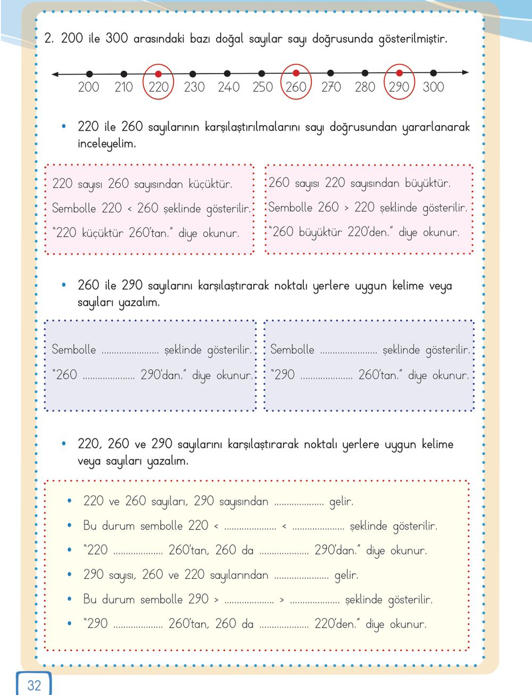

* 220 ile 260 sayılarının karşılaştırılmalarını sayı doğrusundan yararlanarak inceleyelim.

| 220 sayısı 260 sayısından küçüktür.   Sembolle $220 < 260$ şeklinde gösterilir.   “220 küçüktür 260’tan.” diye okunur. | 260 sayısı 220 sayısından büyüktür.   Sembolle $260 > 220$ şeklinde gösterilir.   “260 büyüktür 220’den.” diye okunur. |
| :--- | :--- |

* 260 ile 290 sayılarını karşılaştırarak noktalı yerlere uygun kelime veya sayıları yazalım.

| Sembolle ....................... şeklinde gösterilir.   “260 ..................... 290’dan.” diye okunur. | Sembolle ....................... şeklinde gösterilir.   “290 ..................... 260’tan.” diye okunur. |
| :--- | :--- |

* 220, 260 ve 290 sayılarını karşılaştırarak noktalı yerlere uygun kelime veya sayıları yazalım.

* 220 ve 260 sayıları, 290 sayısından .................... gelir.
* Bu durum sembolle $220 <$ ..................... $<$ ..................... şeklinde gösterilir.
* “220 .................... 260’tan, 260 da .................... 290’dan.” diye okunur.
* 290 sayısı, 260 ve 220 sayılarından ...................... gelir.
* Bu durum sembolle $290 >$ .................... $>$ .................... şeklinde gösterilir.
* “290 .................... 260’tan, 260 da .................... 220’den.” diye okunur.

<!-- sayfa 33 -->

# 114 sayısı ile ilgili aşağıda verilen ifadeleri inceleyelim.

* 114 sayısının çözümlenmiş hâli $100 + 10 + 4$ şeklindedir.
* 114 sayısı $110$ ile $120$ sayıları arasındadır.
* 114 sayısının hangi onluğa daha yakın olduğu sayı doğrusunda gösterilmiştir. İnceleyelim.

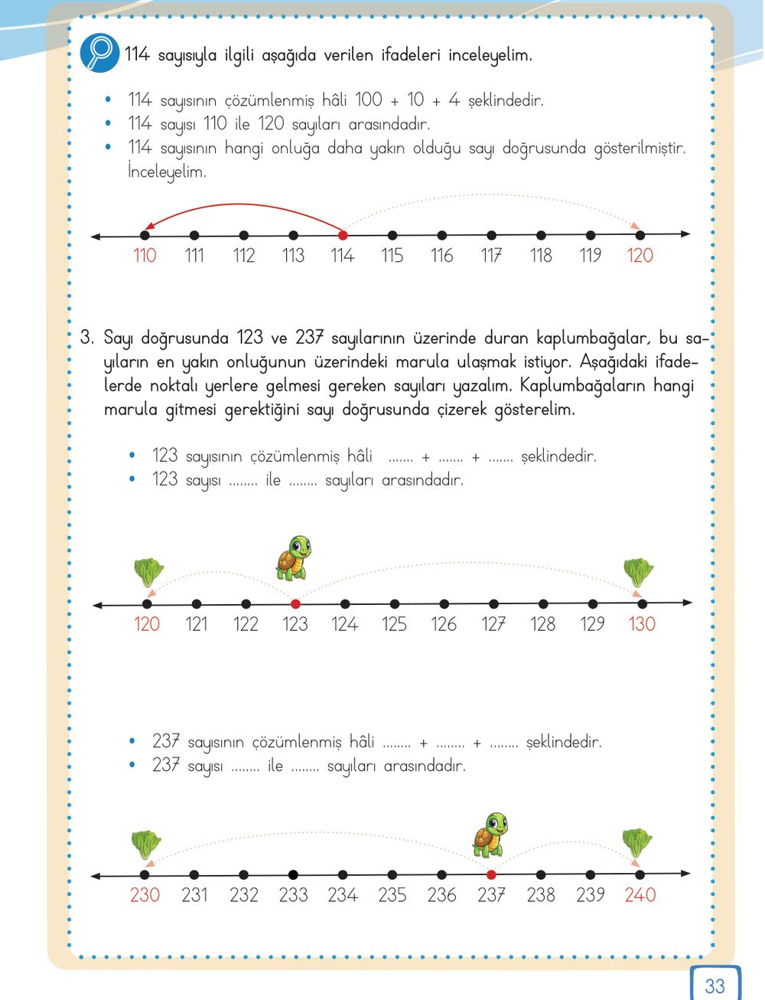

3. Sayı doğrusunda $123$ ve $237$ sayılarının üzerinde duran kaplumbağalar, bu sayıların en yakın onluğunun üzerindeki marula ulaşmak istiyor. Aşağıdaki ifadelerde noktalı yerlere gelmesi gereken sayıları yazalım. Kaplumbağaların hangi marula gitmesi gerektiğini sayı doğrusunda çizerek gösterelim.

* $123$ sayısının çözümlenmiş hâli $\dots\dots\dots + \dots\dots\dots + \dots\dots\dots$ şeklindedir.
* $123$ sayısı $\dots\dots\dots$ ile $\dots\dots\dots$ sayıları arasındadır.

* $237$ sayısının çözümlenmiş hâli $\dots\dots\dots + \dots\dots\dots + \dots\dots\dots$ şeklindedir.
* $237$ sayısı $\dots\dots\dots$ ile $\dots\dots\dots$ sayıları arasındadır.

<!-- sayfa 34 -->

# 386 sayısıyla ilgili aşağıda verilen ifadeleri inceleyelim.

* 386 sayısının çözümlenmiş hâli $300 + 80 + 6$ şeklindedir.
* En yakın yüzler basamağı düşünüldüğünde 386 sayısı 300 ile 400 sayıları arasındadır.
* 386 sayısının hangi yüzlüğe daha yakın olduğunu sayı doğrusunda inceleyelim.

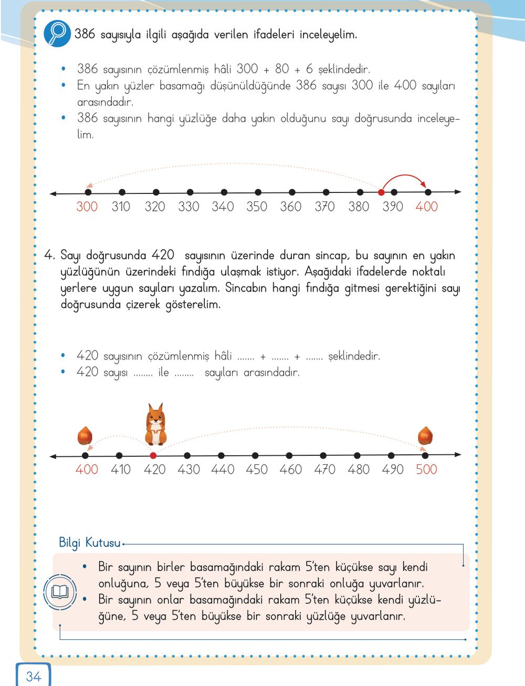

4. Sayı doğrusunda 420 sayısının üzerinde duran sincap, bu sayının en yakın yüzlüğünün üzerindeki fındığa ulaşmak istiyor. Aşağıdaki ifadelerde noktalı yerlere uygun sayıları yazalım. Sincabın hangi fındığa gitmesi gerektiğini sayı doğrusunda çizerek gösterelim.

* 420 sayısının çözümlenmiş hâli ....... + ....... + ....... şeklindedir.
* 420 sayısı ....... ile ....... sayıları arasındadır.

## Bilgi Kutusu

* Bir sayının birler basamağındaki rakam 5'ten küçükse sayı kendi onluğuna, 5 veya 5'ten büyükse bir sonraki onluğa yuvarlanır.
* Bir sayının onlar basamağındaki rakam 5'ten küçükse kendi yüzlüğüne, 5 veya 5'ten büyükse bir sonraki yüzlüğe yuvarlanır.

<!-- sayfa 35 -->

# ETKİNLİK EN YAKIN ONLUĞA YUVARLIYORUM

Aşağıdaki uygulama basamaklarını takip ederek etkinliği yapalım.

## Malzemeler
* Plastik top
* Kurşun kalem
* Kâğıt

## Uygulama Basamakları
1. Öğretmenimizin rehberliğinde iki gruba ayrılalım.
2. Her grup için birer temsilci seçelim.
3. Diğer grupla karşılıklı olarak ve aramızda dört beş adım mesafe bırakarak yan yana dizilelim.
4. Etkinliğe hangi grubun başlayacağını sayışma ile belirleyelim.
5. Oyuna başlayacak grubun ilk üyesinden $1000$'e (bin) kadar bir sayı söyleyerek topu karşı gruptan bir arkadaşına atmasını isteyelim.
6. Topu tutan arkadaşımızdan söylenen sayıyı en yakın onluğa yuvarlamasını ve yeni bir sayı söyleyerek topu karşı gruptan başka bir arkadaşına atmasını isteyelim.
7. Topu tutan arkadaşımızın söylenen sayıyı en yakın onluğa yuvarlayıp yeni bir sayı söyledikten sonra topu karşı gruptan başka bir arkadaşına atmasıyla oyunu sürdürelim.
8. Grup temsilcilerinden yapılan yuvarlama işlemlerinin doğruluğunu kontrol etmesini isteyelim. Doğru olmayan yuvarlama işlemlerinin doğrusunu belirtelim.
9. En fazla doğru yuvarlama yapan grubu tebrik edelim.
10. Yeni grup temsilcileri belirleyerek öğretmenimizin belirlediği süre boyunca oyuna devam edelim.
11. Etkinliğin her aşamasında arkadaşlarımıza saygılı davranıp olumlu iletişim dili kullanalım.

## Değerlendirme
* Sayıları en yakın onluğa yuvarlarken nelere dikkat ettiğimizi yazalım.
................................................................................................................................................................
................................................................................................................................................................
................................................................................................................................................................

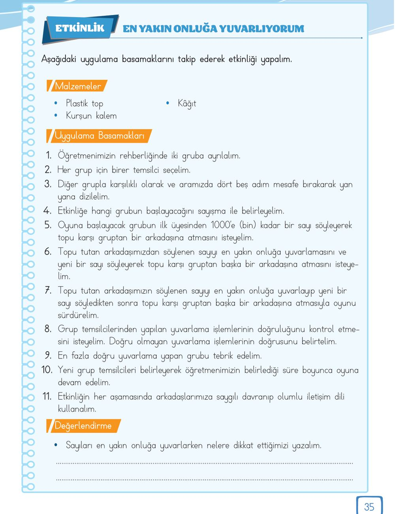
<!-- yer tutucu bulunamadı: sayfa sonuna eklendi -->

<!-- sayfa 36 -->

# ETKİNLİK EN YAKIN YÜZLÜĞE YUVARLIYORUM

Aşağıdaki uygulama basamaklarını takip ederek etkinliği yapalım.

## Malzemeler
* 9 adet A4 kâğıdı
* 9 adet şeffaf dosya
* Yapışkan bant
* Kurşun kalem
* Sarı ve pembe not kâğıtları

## Uygulama Basamakları
1. Öğretmenimizin rehberliğinde iki gruba ayrılalım.
2. İki gruptan birer arkadaşımızı grup temsilcisi seçelim.
3. Gruplardan birine sarı, diğerine pembe not kâğıtlarını verelim.
4. Boş A4 kâğıtlarının her birine “$100, 200, 300, 400, 500, 600, 700, 800$ ve $900$” sayılarından birini yeterli büyüklükte yazalım. A4 kâğıtlarını şeffaf dosyaya koyalım. Şeffaf dosyaları yapışkan bantla tahtaya sabitleyelim.
5. Grup temsilcileri önde olacak şekilde arka arkaya dizilerek bir sıra oluşturalım.
6. Sayışma ile oyuna hangi grubun başlayacağını belirleyelim.
7. Oyuna başlayacak grubun ilk üyesinden üç basamaklı bir sayı söylemesini sonra sıranın arkasına geçmesini isteyelim.
8. Diğer grubun ilk üyesinden söylenen sayıyı elindeki not kâğıdına yazmasını ve üzerinde yuvarlanabileceği yüzlüğün yazılı olduğu şeffaf dosyaya atmasını isteyelim.
9. Not kâğıdını poşet dosyaya koyan arkadaşımızın yeni bir sayı söylemesiyle oyuna devam edelim.
10. Yeni temsilciler seçerek öğretmenimizin belirlediği süre boyunca etkinliğe devam edelim.
11. Tüm öğrenciler sırayla etkinliğe katıldıktan sonra grup temsilcilerinden şeffaf dosyalardaki not kâğıtlarını kontrol etmesini isteyelim. Hatalı yapılan yuvarlamaları öğretmenimizin rehberliğinde düzeltelim.
12. Etkinliğin her aşamasında arkadaşlarımıza saygılı davranıp olumlu iletişim dili kullanalım.

## Değerlendirme
* Sayıları en yakın yüzlüğe yuvarlamak için kullandığımız yöntemler nelerdir? Açıklayalım.

................................................................................................................................................................

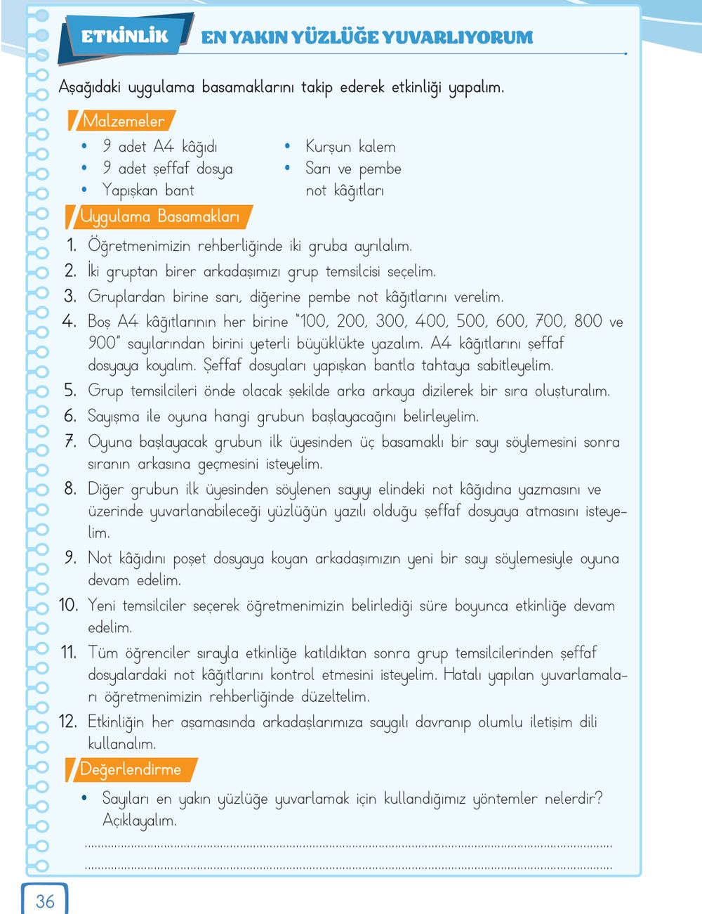
<!-- yer tutucu bulunamadı: sayfa sonuna eklendi -->

<!-- sayfa 37 -->

# ETKİNLİK SAYILARI SIRALIYORUM

Aşağıdaki uygulama basamaklarını takip ederek etkinliği yapalım.

## Malzemeler
* Karton bardak (sınıf mevcudu kadar)
* Tahta kalemi

## Uygulama Basamakları
1. $1000$'e (bin) kadar bir sayı belirleyelim.
2. Belirlediğimiz sayıyı karton bardağın üzerine yazıp bardağı öğretmen masasına koyalım.
3. Öğretmenimizin rehberliğinde dörder kişilik gruplar oluşturalım.
4. Öğretmen masasından sırayla birer karton bardak alıp grup arkadaşlarımızla uygun bir sıranın etrafında toplanalım.
5. Grup arkadaşlarımızla üzerinde yazan sayıları dikkate alarak bardakları büyükten küçüğe veya küçükten büyüğe doğru sıralayalım.
6. Yaptığımız sıralamayı kontrol etmeleri için diğer gruplara gösterelim.
7. Hatalı yaptığımız sıralamaları öğretmenimizin rehberliğinde düzeltelim.
8. Yeni sayılar belirleyerek öğretmenimizin uygun gördüğü süre boyunca etkinliğe devam edelim.
9. Etkinliğin her aşamasında arkadaşlarımıza saygılı davranıp olumlu iletişim dili kullanalım.

## Değerlendirme
1. Sayıları büyükten küçüğe doğru sıralarken nelere dikkat ettiğimizi yazalım.
.................................................................................................................................................................
.................................................................................................................................................................
.................................................................................................................................................................
................................................................................................................................................................
................................................................................................................................................................

2. Sayıları küçükten büyüğe doğru sıralarken nelere dikkat ettiğimizi yazalım.
.................................................................................................................................................................
.................................................................................................................................................................
................................................

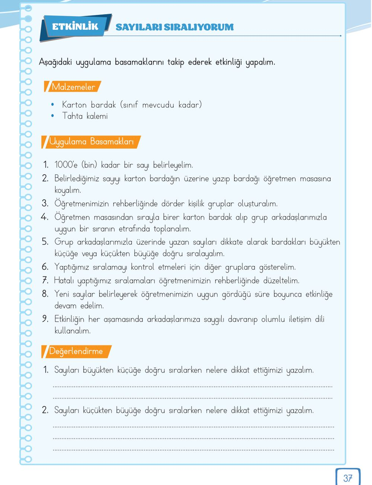
<!-- yer tutucu bulunamadı: sayfa sonuna eklendi -->

<!-- sayfa 38 -->

# PEKİŞTİRELİM

1. Aşağıdaki sayıların yuvarlanabileceği en yakın yüzlüğü belirleyelim. Bu sayıları uygun olan noktalı yere yazalım. En fazla sayı yazdığımız kutuyu işaretleyelim.

$257$ $\quad$ $331$ $\quad$ $410$ $\quad$ $349$ $\quad$ $350$ $\quad$ $433$
$472$ $\quad$ $534$ $\quad$ $374$ $\quad$ $460$ $\quad$ $278$ $\quad$ $510$ $\quad$ $290$

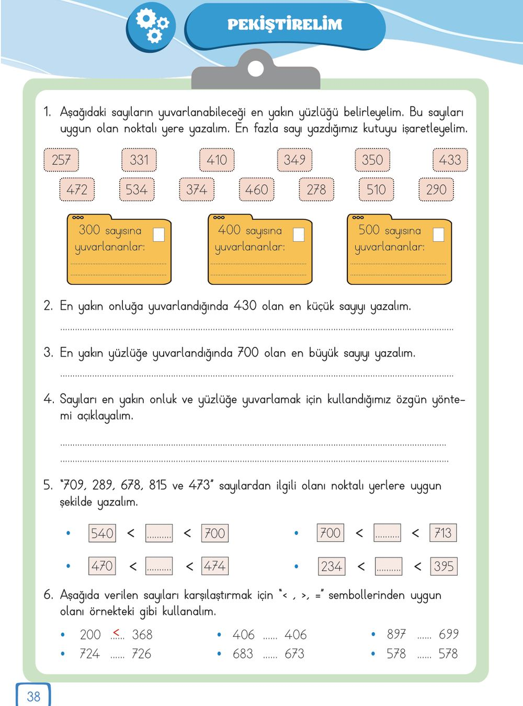

2. En yakın onluğa yuvarlandığında $430$ olan en küçük sayıyı yazalım.
................................................................................................................................................................

3. En yakın yüzlüğe yuvarlandığında $700$ olan en büyük sayıyı yazalım.
................................................................................................................................................................

4. Sayıları en yakın onluk ve yüzlüğe yuvarlamak için kullandığımız özgün yöntemi açıklayalım.
................................................................................................................................................................
................................................................................................................................................................

5. “$709, 289, 678, 815$ ve $473$” sayılardan ilgili olanı noktalı yerlere uygun şekilde yazalım.

* $540 < \dots\dots < 700$ <!-- KONTROL: Marker'da karşılığı yok, uydurma olabilir --> $\quad$ $700 < \dots\dots < 713$ <!-- KONTROL: Marker'da karşılığı yok, uydurma olabilir -->
* $470 < \dots\dots < 474$ <!-- KONTROL: Marker'da karşılığı yok, uydurma olabilir --> $\quad$ $234 < \dots\dots < 395$ <!-- KONTROL: Marker'da karşılığı yok, uydurma olabilir -->

6. Aşağıda verilen sayıları karşılaştırmak için “$<, >, =$” sembollerinden uygun olanı örnekteki gibi kullanalım.

* $200 < 368$ <!-- KONTROL: Marker'da karşılığı yok, uydurma olabilir --> $\quad$ $406 \dots 406$ <!-- KONTROL: Marker'da karşılığı yok, uydurma olabilir --> $\quad$ $897 \dots 699$ <!-- KONTROL: Marker'da karşılığı yok, uydurma olabilir -->
* $724 \dots 726$ <!-- KONTROL: Marker'da karşılığı yok, uydurma olabilir --> $\quad$ $683 \dots 673$ <!-- KONTROL: Marker'da karşılığı yok, uydurma olabilir --> $\quad$ $578 \dots 578$ <!-- KONTROL: Marker'da karşılığı yok, uydurma olabilir -->

<!-- sayfa 39 -->

7. Bir haftada satılan tiyatro biletlerinin sayısı tabloda verilmiştir.

| Pazartesi | Salı | Çarşamba | Perşembe | Cuma | Cumartesi | Pazar |
| :---: | :---: | :---: | :---: | :---: | :---: | :---: |
| 450 | 267 | 449 | 645 | 415 | 394 | 368 |

Tablodaki bilgilerden yararlanarak soruları cevaplayalım.

* Satılan bilet sayısının aynı yüzlüğe yuvarlanabileceği günler hangileridir?
..................................................................................................................................................

* Pazartesi günü satılan bilet sayısının en yakın yüzlüğü kaçtır?
..................................................................................................................................................

* Perşembe günü satılan bilet sayısının en yakın onluğu kaçtır?
..................................................................................................................................................

* Hangi gün satılan bilet sayısı en yakın yüzlüğe yuvarlandığında $300$ olur?
..................................................................................................................................................

8. Çantamızda bulunan ders kitaplarımızın sayfa sayılarına göre aşağıdaki soruları cevaplayalım.

* Hangi kitabımız sayfa sayısı en fazladır?
..................................................................................................................................................

* Hangi kitabımız sayfa sayısı en azdır?
..................................................................................................................................................

* Kitaplarımızın sayfa sayılarını küçükten büyüğe doğru sembol kullanarak sıralayalım.
..................................................................................................................................................
..................................................................................................................................................
..................................................................................................................................................

9. Aşağıdaki sayıları küçükten büyüğe doğru uygun sembolü kullanarak sıralayalım.

$93 - 493 - 793 - 193$
..................................................................................................................................................
..................................................................................................................................................

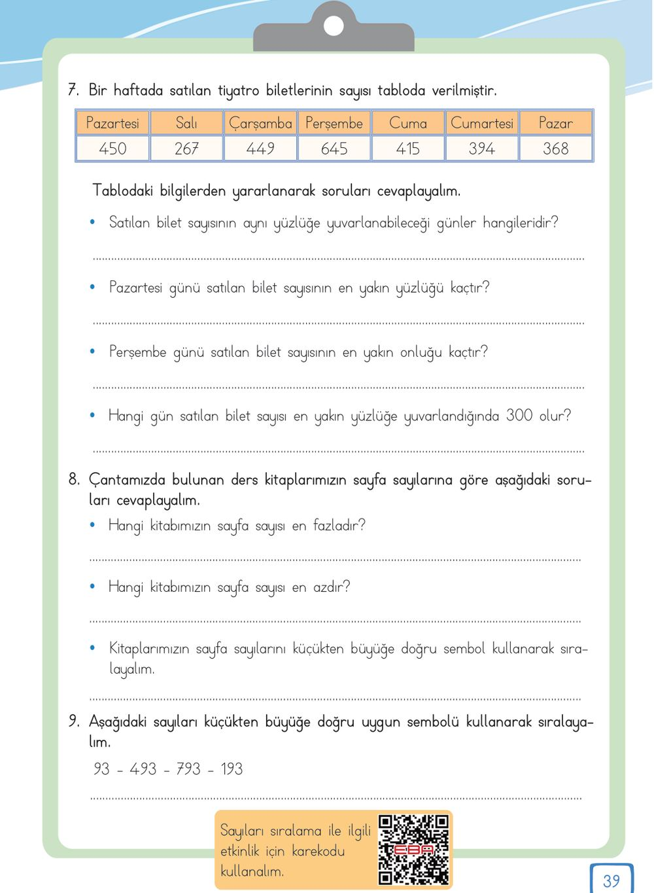 Sayıları sıralama ile ilgili

<!-- sayfa 40 -->

# HATIRLAYALIM

Aşağıdaki soruları cevaplayalım.

1. Verilen ritmik saymalarda boş bırakılan yerlere uygun sayıları örnekteki gibi yazalım.

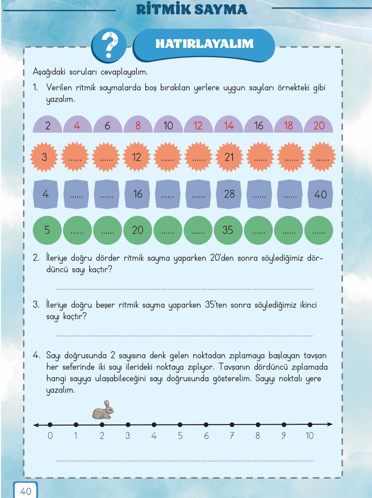

2. İleriye doğru dörder ritmik sayma yaparken $20$'den sonra söylediğimiz dördüncü sayı kaçtır?
....................................................................................................................................................

3. İleriye doğru beşer ritmik sayma yaparken $35$'ten sonra söylediğimiz ikinci sayı kaçtır?
....................................................................................................................................................

4. Sayı doğrusunda $2$ sayısına denk gelen noktadan zıplamaya başlayan tavşan her seferinde iki sayı ilerideki noktaya zıplıyor. Tavşanın dördüncü zıplamada hangi sayıya ulaşabileceğini sayı doğrusunda gösterelim. Sayıyı noktalı yere yazalım.

....................................................................................................................................................

<!-- sayfa 41 -->

# BAĞLANTI KURALIM

Aylin her gün kumbarasına $5\text{ TL}$, Barış ise $6\text{ TL}$ para atarak harçlıklarını biriktirmektedir. Kumbaralarda biriken para miktarlarını örnekteki gibi yazalım.

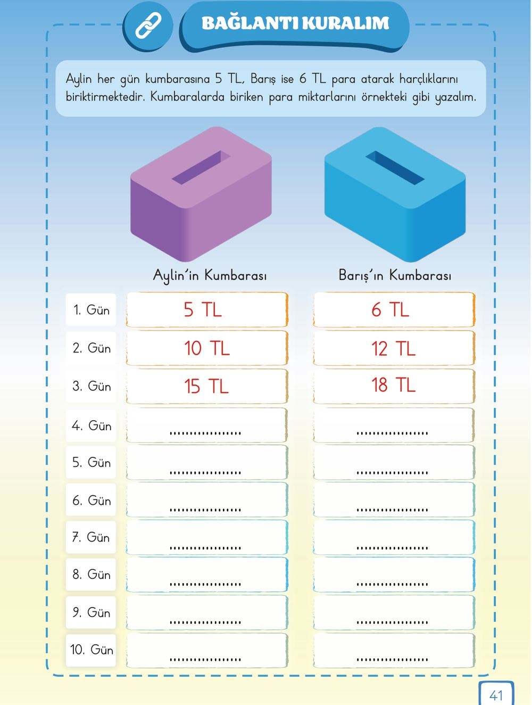

| | Aylin'in Kumbarası | Barış'ın Kumbarası |
| :--- | :---: | :---: |
| 1. Gün | $5\text{ TL}$ | $6\text{ TL}$ |
| 2. Gün | $10\text{ TL}$ | $12\text{ TL}$ |
| 3. Gün | $15\text{ TL}$ | $18\text{ TL}$ |
| 4. Gün | ................... | ................... |
| 5. Gün | ................... | ................... |
| 6. Gün | ................... | ................... |
| 7. Gün | ................... | ................... |
| 8. Gün | ................... | ................... |
| 9. Gün | ................... | ................... |
| 10. Gün | ................... | ................... |

<!-- sayfa 42 -->

# BİRLİKTE ÖĞRENELİM

1. Aşağıdaki görsellerde buket sayısı arttıkça lale sayısının nasıl değiştiğini inceleyelim. Soruları verilen bilgilere göre cevaplayalım.

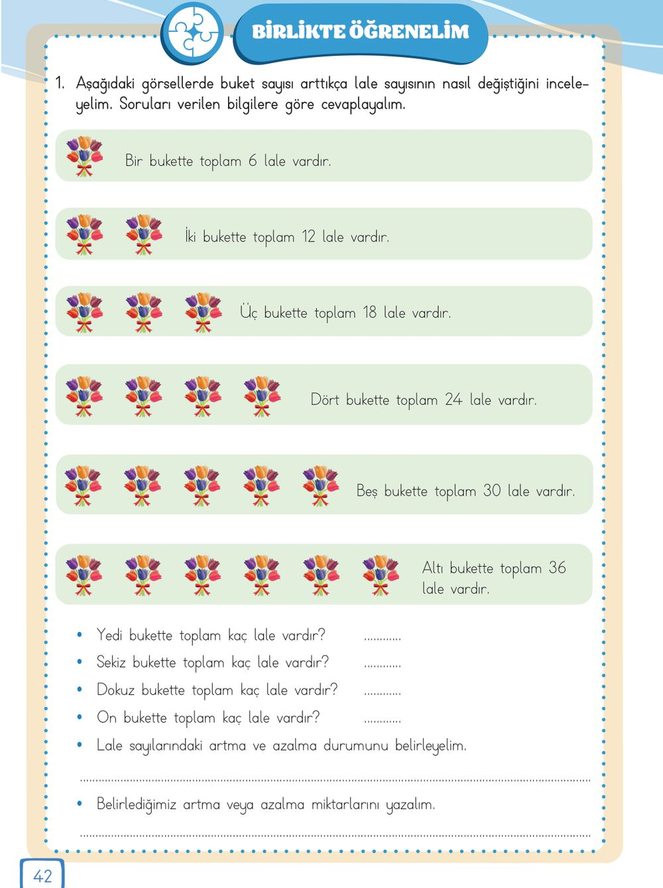 Bir bukette toplam $6$ lale vardır.

 İki bukette toplam $12$ lale vardır.

 Üç bukette toplam $18$ lale vardır.

 Dört bukette toplam $24$ lale vardır.

 Beş bukette toplam $30$ lale vardır.

 Altı bukette toplam $36$ lale vardır.

* Yedi bukette toplam kaç lale vardır? ........................
* Sekiz bukette toplam kaç lale vardır? ........................
* Dokuz bukette toplam kaç lale vardır? ........................
* On bukette toplam kaç lale vardır? ........................
* Lale sayılarındaki artma ve azalma durumunu belirleyelim.
....................................................................................................................................................................
....................................................................................................................................................................

* Belirlediğimiz artma veya azalma miktarlarını yazalım.
....................................................................................................................................................................

<!-- sayfa 43 -->

2. Aşağıdaki görsellerde tabak sayısı arttıkça çilek sayısının nasıl değiştiğini inceleyelim. Soruları verilen bilgilere göre cevaplayalım.

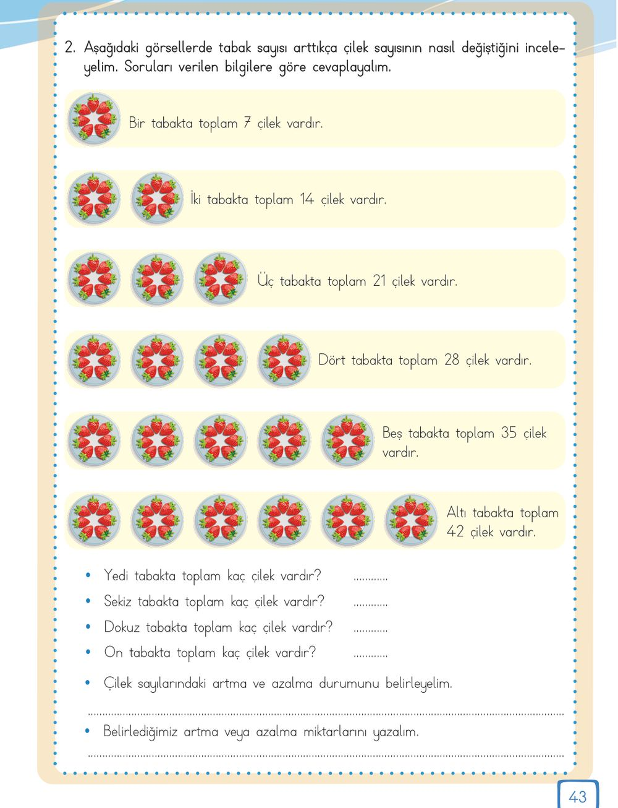 Bir tabakta toplam $7$ çilek vardır.

  İki tabakta toplam $14$ çilek vardır.

   Üç tabakta toplam $21$ çilek vardır.

    Dört tabakta toplam $28$ çilek vardır.

     Beş tabakta toplam $35$ çilek vardır.

      Altı tabakta toplam $42$ çilek vardır.

* Yedi tabakta toplam kaç çilek vardır? ....................
* Sekiz tabakta toplam kaç çilek vardır? ....................
* Dokuz tabakta toplam kaç çilek vardır? ....................
* On tabakta toplam kaç çilek vardır? ....................
* Çilek sayılarındaki artma ve azalma durumunu belirleyelim.
....................................................................................................................................................................
....................................................................................................................................................................
* Belirlediğimiz artma veya azalma miktarlarını yazalım.
....................................................................................................................................................................

<!-- sayfa 44 -->

3. Aşağıdaki görsellerde tabak sayısı arttıkça havuç sayısının nasıl değiştiğini inceleyelim. Soruları verilen bilgilere göre cevaplayalım.

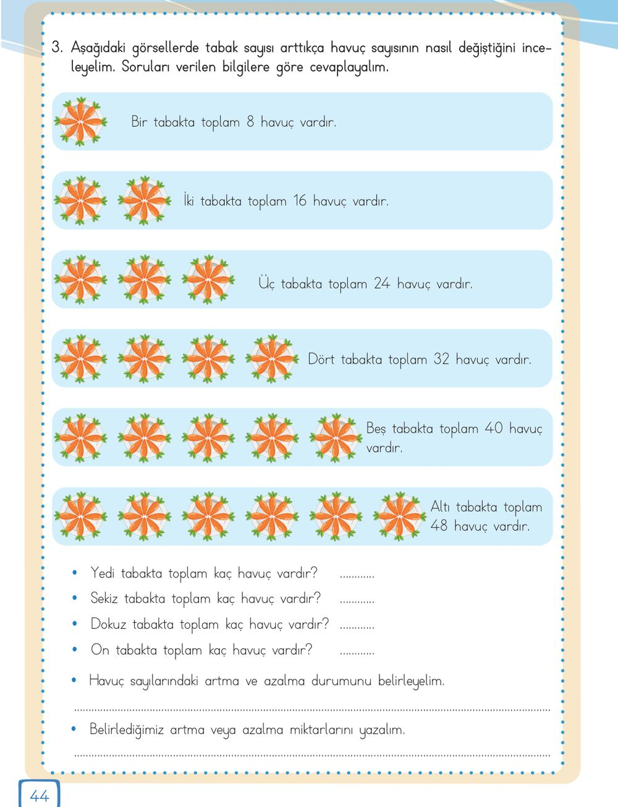 Bir tabakta toplam 8 havuç vardır.

 İki tabakta toplam 16 havuç vardır.

 Üç tabakta toplam 24 havuç vardır.

 Dört tabakta toplam 32 havuç vardır.

 Beş tabakta toplam 40 havuç vardır.

 Altı tabakta toplam 48 havuç vardır.

* Yedi tabakta toplam kaç havuç vardır? ............
* Sekiz tabakta toplam kaç havuç vardır? ............
* Dokuz tabakta toplam kaç havuç vardır? ............
* On tabakta toplam kaç havuç vardır? ............
* Havuç sayılarındaki artma ve azalma durumunu belirleyelim.
....................................................................................................................................................................
* Belirlediğimiz artma veya azalma miktarlarını yazalım.
....................................................................................................................................................................

<!-- sayfa 45 -->

4. Aşağıdaki görsellerde çiçek sayısı arttıkça yaprak sayısının nasıl değiştiğini inceleyelim. Soruları verilen bilgilere göre cevaplayalım.

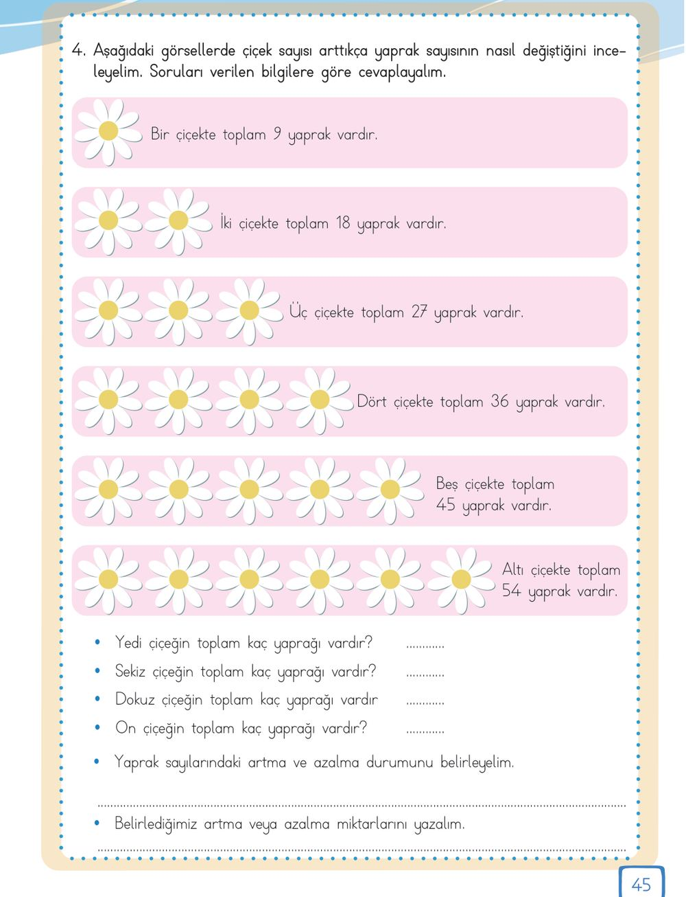 Bir çiçekte toplam $9$ yaprak vardır.

 İki çiçekte toplam $18$ yaprak vardır.

 Üç çiçekte toplam $27$ yaprak vardır.

 Dört çiçekte toplam $36$ yaprak vardır.

 Beş çiçekte toplam $45$ yaprak vardır.

 Altı çiçekte toplam $54$ yaprak vardır.

* Yedi çiçeğin toplam kaç yaprağı vardır? ...............
* Sekiz çiçeğin toplam kaç yaprağı vardır? ...............
* Dokuz çiçeğin toplam kaç yaprağı vardır ...............
* On çiçeğin toplam kaç yaprağı vardır? ...............
* Yaprak sayılarındaki artma ve azalma durumunu belirleyelim.

....................................................................................................................................................................

* Belirlediğimiz artma veya azalma miktarlarını yazalım.

<!-- sayfa 46 -->

5. Aşağıdaki görsellerde viyol sayısı arttıkça yumurta sayısının nasıl değiştiğini inceleyelim. Soruları verilen bilgilere göre cevaplayalım.

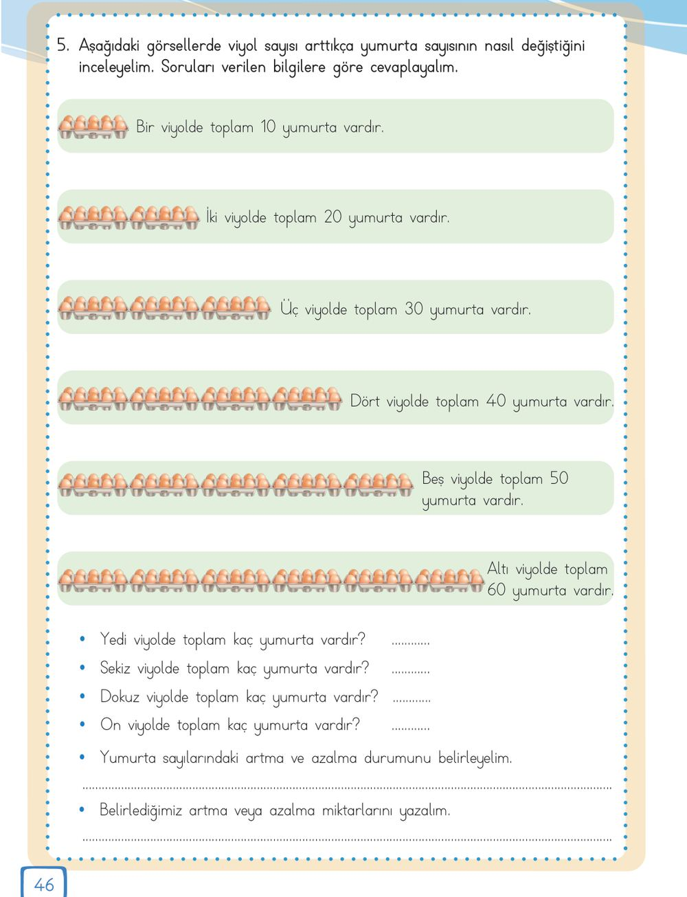 Bir viyolde toplam $10$ yumurta vardır.

 İki viyolde toplam $20$ yumurta vardır.

 Üç viyolde toplam $30$ yumurta vardır.

 Dört viyolde toplam $40$ yumurta vardır.

 Beş viyolde toplam $50$ yumurta vardır.

 Altı viyolde toplam $60$ yumurta vardır.

* Yedi viyolde toplam kaç yumurta vardır? ............
* Sekiz viyolde toplam kaç yumurta vardır? ............
* Dokuz viyolde toplam kaç yumurta vardır? ............
* On viyolde toplam kaç yumurta vardır? ............
* Yumurta sayılarındaki artma ve azalma durumunu belirleyelim.
....................................................................................................................................................................
....................................................................................................................................................................
* Belirlediğimiz artma veya azalma miktarlarını yazalım.
....................................................................................................................................................................

<!-- sayfa 47 -->

6. Aşağıdaki görsellerde defter sayısı arttıkça sayfa sayısının nasıl değiştiğini inceleyelim. Soruları verilen bilgilere göre cevaplayalım.

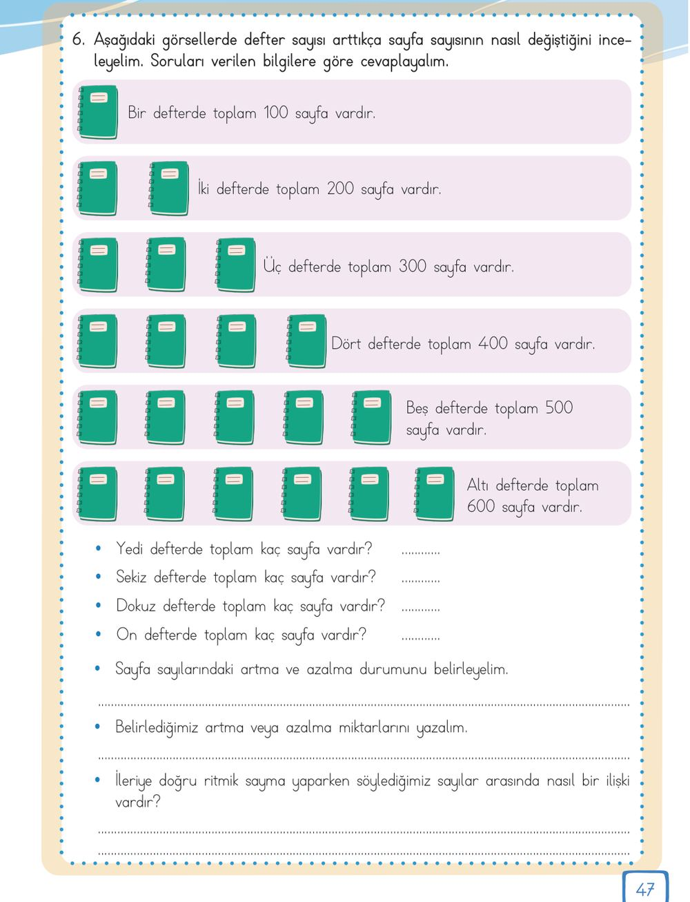 Bir defterde toplam $100$ sayfa vardır.

 İki defterde toplam $200$ sayfa vardır.

 Üç defterde toplam $300$ sayfa vardır.

 Dört defterde toplam $400$ sayfa vardır.

 Beş defterde toplam $500$ sayfa vardır.

 Altı defterde toplam $600$ sayfa vardır.

* Yedi defterde toplam kaç sayfa vardır? ........................
* Sekiz defterde toplam kaç sayfa vardır? ........................
* Dokuz defterde toplam kaç sayfa vardır? ........................
* On defterde toplam kaç sayfa vardır? ........................
* Sayfa sayılarındaki artma ve azalma durumunu belirleyelim.
....................................................................................................................................................................
* Belirlediğimiz artma veya azalma miktarlarını yazalım.
....................................................................................................................................................................
* İleriye doğru ritmik sayma yaparken söylediğimiz sayılar arasında nasıl bir ilişki vardır?
....................................................................................................................................................................

<!-- sayfa 48 -->

7. Aşağıdaki boya kalemi paketlerinde altışar boya kalemi vardır. Her gün bir paket kalem satıldığına göre kalem sayısındaki değişimi inceleyelim. Noktalı yerlere uygun sayıları yazalım.

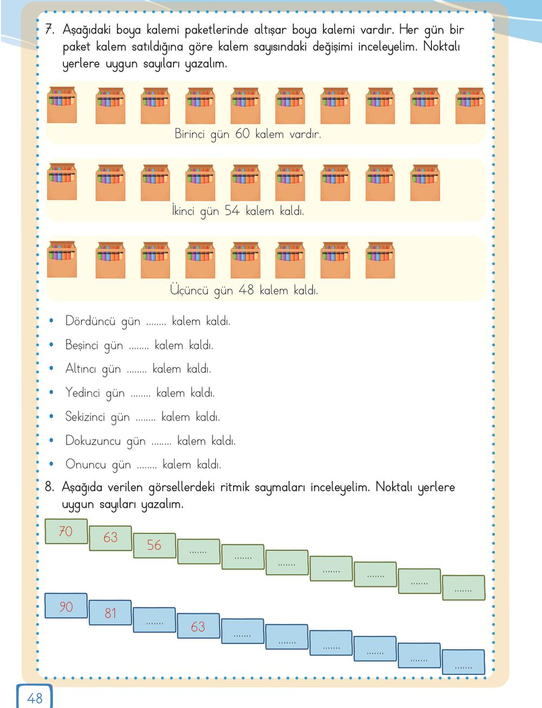
Birinci gün $60$ kalem vardır.

İkinci gün $54$ <!-- KONTROL: Marker'da karşılığı yok, uydurma olabilir --> kalem kaldı.

Üçüncü gün $48$ kalem kaldı.

* Dördüncü gün ....... kalem kaldı.
* Beşinci gün ....... kalem kaldı.
* Altıncı gün ....... kalem kaldı.
* Yedinci gün ....... kalem kaldı.
* Sekizinci gün ....... kalem kaldı.
* Dokuzuncu gün ....... kalem kaldı.
* Onuncu gün ....... kalem kaldı.

8. Aşağıda verilen görsellerdeki ritmik saymaları inceleyelim. Noktalı yerlere uygun sayıları yazalım.

$70$ <!-- KONTROL: Marker'da karşılığı yok, uydurma olabilir --> | $63$ <!-- KONTROL: Marker'da karşılığı yok, uydurma olabilir --> | $56$ <!-- KONTROL: Marker'da karşılığı yok, uydurma olabilir --> | ....... | ....... | ....... | ....... | ....... | ....... | .......

$90$ <!-- KONTROL: Marker'da karşılığı yok, uydurma olabilir --> | $81$ <!-- KONTROL: Marker'da karşılığı yok, uydurma olabilir --> | ....... | $63$ <!-- KONTROL: Marker'da karşılığı yok, uydurma olabilir --> | ....... | ....... | ....... | ....... | ....... | .......

<!-- sayfa 49 -->

9. Aşağıdaki her bir bileklikte on boncuk vardır. Her gün bir bileklik satıldığına göre boncuk sayısındaki değişimi inceleyelim. Noktalı yerlere uygun sayıları yazalım.

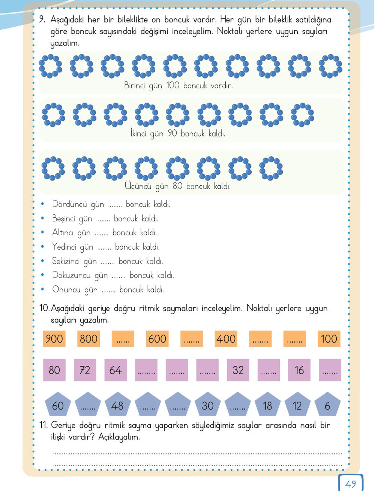
Birinci gün $100$ <!-- KONTROL: Marker'da karşılığı yok, uydurma olabilir --> boncuk vardır.

İkinci gün $90$ <!-- KONTROL: Marker'da karşılığı yok, uydurma olabilir --> boncuk kaldı.

Üçüncü gün $80$ <!-- KONTROL: Marker'da karşılığı yok, uydurma olabilir --> boncuk kaldı.

* Dördüncü gün ....... boncuk kaldı.
* Beşinci gün ....... boncuk kaldı.
* Altıncı gün ....... boncuk kaldı.
* Yedinci gün ....... boncuk kaldı.
* Sekizinci gün ....... boncuk kaldı.
* Dokuzuncu gün ....... boncuk kaldı.
* Onuncu gün ....... boncuk kaldı.

10. Aşağıdaki geriye doğru ritmik saymaları inceleyelim. Noktalı yerlere uygun sayıları yazalım.

| $900$ <!-- KONTROL: Marker'da karşılığı yok, uydurma olabilir --> | $800$ <!-- KONTROL: Marker'da karşılığı yok, uydurma olabilir --> | $\dots\dots$ | $600$ <!-- KONTROL: Marker'da karşılığı yok, uydurma olabilir --> | $\dots\dots$ | $400$ <!-- KONTROL: Marker'da karşılığı yok, uydurma olabilir --> | $\dots\dots$ | $\dots\dots$ | $100$ <!-- KONTROL: Marker'da karşılığı yok, uydurma olabilir --> |
| :---: | :---: | :---: | :---: | :---: | :---: | :---: | :---: | :---: |

| $80$ <!-- KONTROL: Marker'da karşılığı yok, uydurma olabilir --> | $72$ <!-- KONTROL: Marker'da karşılığı yok, uydurma olabilir --> | $64$ <!-- KONTROL: Marker'da karşılığı yok, uydurma olabilir --> | $\dots\dots$ | $\dots\dots$ | $\dots\dots$ | $32$ <!-- KONTROL: Marker'da karşılığı yok, uydurma olabilir --> | $\dots\dots$ | $16$ <!-- KONTROL: Marker'da karşılığı yok, uydurma olabilir --> | $\dots\dots$ |
| :---: | :---: | :---: | :---: | :---: | :---: | :---: | :---: | :---: | :---: |

| $60$ <!-- KONTROL: Marker'da karşılığı yok, uydurma olabilir --> | $\dots\dots$ | $48$ | $\dots\dots$ | $30$ <!-- KONTROL: Marker'da karşılığı yok, uydurma olabilir --> | $\dots\dots$ | $18$ <!-- KONTROL: Marker'da karşılığı yok, uydurma olabilir --> | $12$ <!-- KONTROL: Marker'da karşılığı yok, uydurma olabilir --> | $6$ |
| :---: | :---: | :---: | :---: | :---: | :---: | :---: | :---: | :---: |

11. Geriye doğru ritmik sayma yaparken söylediğimiz sayılar arasında nasıl bir ilişki vardır? Açıklayalım.
....................................................................................................................................................................
....................................................................................................................................................................

<!-- sayfa 50 -->

# ETKİNLİK RİTMİK SAYMA YAPIYORUM

Aşağıdaki uygulama basamaklarını takip ederek etkinliği yapalım.

## Malzemeler
* Tahta kalemi
* 50 adet pembe yapışkan not kâğıdı
* 50 adet mavi yapışkan not kâğıdı

## Uygulama Basamakları
1. Öğretmenimizin rehberliğinde iki gruba ayrılalım.
2. Gruplardan birine mavi, diğerine pembe yapışkan not kâğıtlarını verelim.
3. Grup arkadaşlarımızla yapışkan not kâğıtlarına altıdan başlayarak altmışa, yediden başlayarak yetmişe, sekizden başlayarak seksene, dokuzdan başlayarak doksana ve ondan başlayarak yüze kadar ritmik saymada söyleyeceğimiz sayıları yazalım.
4. Tahtayı ikiye bölelim ve grubumuza ait bölümü belirleyelim.
5. Grubumuza ait bölüme yapışkan not kâğıtlarımızı karışık olarak yapıştıralım. Grup arkadaşlarımızla kendi bölümümüzün önünde sıralanalım.
6. Grupların ilk sıralarındaki arkadaşlarımızdan etkinliğe başlamak için hazır olmalarını isteyelim.
7. Öğretmenimizin işaretiyle tahtaya çıkalım. Karışık olarak verilen yapışkan not kâğıtlarını kullanarak tahtanın bize ait bölümünde ileriye doğru altışar ritmik sayma oluşturalım.
8. Ritmik saymayı en hızlı ve doğru şekilde tamamlayan grubu tebrik edelim. Ritmik sayma yaptığımız kâğıtları karışık olarak kendi bölümümüze yeniden yapıştıralım. Grubumuzun arkasına geçelim.
9. Yedişer, sekizer, dokuzar, onar ileriye ve geriye doğru ritmik sayma yaparak öğretmenimizin belirlediği süre boyunca oyuna devam edelim.
10. Oyunun her aşamasında arkadaşlarımıza saygılı davranalım, onlarla iletişim hâlinde olalım.

## Değerlendirme
* İleriye ve geriye doğru ritmik sayma yaparken nelere dikkat etmemiz gerektiğini yazalım.
................................................................................................................................................................
................................................................................................................................................................

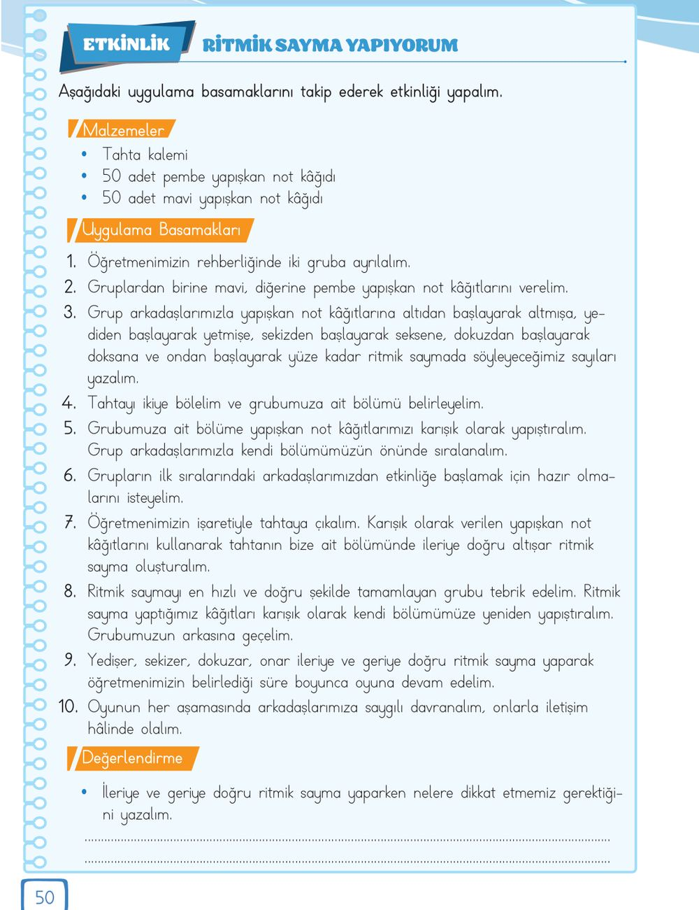
<!-- yer tutucu bulunamadı: sayfa sonuna eklendi -->

<!-- sayfa 51 -->

# ETKİNLİK SAYI DOĞRUSUNDA RİTMİK SAYIYORUM

Aşağıdaki uygulama basamaklarını takip ederek etkinliği yapalım.

## Malzemeler
* Kurşun kalem
* Her grup için 10 tane A4 kâğıdı
* İp (Sınıfın fiziki koşullarına dikkat edilerek 10 öğrencinin yan yana sıralanabileceği uzunlukta olmalıdır.)

## Uygulama Basamakları
1. Öğretmenimizin rehberliğinde onar kişilik gruplara ayrılalım.
2. A4 kâğıtlarına altıdan başlayarak altmışa kadar ileri doğru altışar ritmik sayma sayılarını yazalım.
3. Sınıfın uygun bir yerinde ipi gergin şekilde tutması için grubumuzdan iki arkadaşımızı seçelim.
4. İpi tutan arkadaşlarımızdan solda olana 6, sağda olana 60 yazan kâğıdı verelim. Kâğıtları görünür şekilde tutmalarını isteyelim.
5. Grup arkadaşlarımızla üzerinde altışar ritmik sayma sayılarının yazılı olduğu diğer kâğıtları rastgele paylaşalım.
6. Grup arkadaşlarımızla elimizde tuttuğumuz kâğıtlar görünecek şekilde ipin önüne sıralanalım. Sıralanırken grup arkadaşlarımızla aramızdaki mesafenin eşit olmasına dikkat edelim.
7. Doğru sıralanan grubu tebrik edelim.
8. Yanlış yapılan ritmik saymaları öğretmenimizin rehberliğinde düzeltelim.
9. Etkinliğe yedişer, sekizer, dokuzar, onar ileriye ve geriye doğru ritmik sayma yapmak için öğretmenimizin belirlediği süre boyunca devam edelim.
10. Etkinliğin her aşamasında arkadaşlarımıza saygılı davranalım, onlarla iletişim hâlinde olalım.

## Değerlendirme
* Yaptığımız etkinlikte grup arkadaşlarımızla yan yana sıralanırken nelere dikkat ettiğimizi yazalım.
................................................................................................................................................................
................................................................................................................................................................

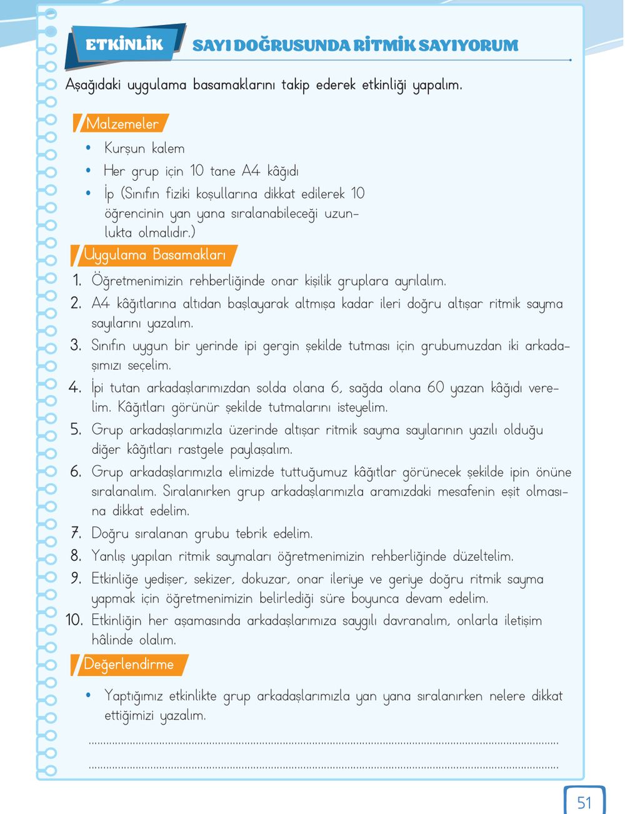
<!-- yer tutucu bulunamadı: sayfa sonuna eklendi -->

<!-- sayfa 52 -->

12. Ritmik saymalarda verilmeyen sayıları bularak noktalı yerlere yazalım.

$7 \quad 14 \quad \dots\dots \quad 28 \quad \dots\dots \quad 42 \quad 49 \quad \dots\dots \quad 63 \quad 70$ <!-- KONTROL: Marker'da karşılığı yok, uydurma olabilir -->

$9 \quad 18 \quad \dots\dots \quad 36 \quad \dots\dots \quad 54 \quad 63 \quad \dots\dots \quad 81 \quad 90$ <!-- KONTROL: Marker'da karşılığı yok, uydurma olabilir -->

$8 \quad \dots\dots \quad 24 \quad 32 \quad \dots\dots \quad 48 \quad \dots\dots \quad 64 \quad \dots\dots \quad 80$ <!-- KONTROL: Marker'da karşılığı yok, uydurma olabilir -->

$6 \quad 12 \quad 18 \quad \dots\dots \quad 30 \quad 36 \quad \dots\dots \quad 48 \quad 54 \quad 60$ <!-- KONTROL: Marker'da karşılığı yok, uydurma olabilir -->

$10 \quad \dots\dots \quad 30 \quad 40 \quad \dots\dots \quad 60 \quad \dots\dots \quad 80 \quad \dots\dots \quad 100$ <!-- KONTROL: Marker'da karşılığı yok, uydurma olabilir -->

$100 \quad \dots\dots \quad 300 \quad \dots\dots \quad 500 \quad 600 \quad 700 \quad \dots\dots \quad 900 \quad 1000$ <!-- KONTROL: Marker'da karşılığı yok, uydurma olabilir -->

<!-- sayfa 53 -->

13. Aşağıdaki alanda dilediğimiz nesneleri gruplandırarak $6$'dan başlayarak $60$'a kadar ritmik sayma içeren görsel tasarlayalım.

14. Dijital ortamda ritmik saymayla ilgili bir araştırma yapalım. Bu araştırmayı yaparken güvenilir genel ağ ($\text{gov.tr}$ <!-- KONTROL: Marker'da karşılığı yok, uydurma olabilir -->, $\text{edu.tr}$ <!-- KONTROL: Marker'da karşılığı yok, uydurma olabilir --> vb.) kaynaklarından yararlanalım ve aşağıdaki bilgileri dikkate alalım.

<!-- sayfa 54 -->

# PEKİŞTİRELİM

Aşağıdaki ileriye ve geriye doğru ritmik saymalar harfle gösterilmiştir. Ritmik saymaların önündeki harfi ilgili olduğu ifadenin karşısına yazalım. Bir ifadenin karşısındaki noktalı yere birden fazla harf yazılabilir.

> a) $8 - 16 - 24 - 32 - 40 - 48 - 56 - 64 - 72 - 80$
> b) $60 - 54 - 48 - 42 - 36 - 30 - 24 - 18 - 12 - 6$
> c) $9 - 18 - 27 - 36 - 45 - 54 - 63 - 72 - 81 - 90$
> ç) $6 - 12 - 18 - 24 - 30 - 36 - 42 - 48 - 54 - 60$
> d) $70 - 63 - 56 - 49 - 42 - 35 - 28 - 21 - 14 - 7$
> e) $90 - 81 - 72 - 63 - 54 - 45 - 36 - 27 - 18 - 9$
> f) $7 - 14 - 21 - 28 - 35 - 42 - 49 - 56 - 63 - 70$
> g) $80 - 72 - 64 - 56 - 48 - 40 - 32 - 24 - 16 - 8$

* İleriye doğru altışar ritmik sayma yapılanlar : ..........................................
* İleriye doğru ritmik sayma yapılanlar : ..........................................
* İleriye doğru yedişer ritmik sayma yapılanlar : ..........................................
* Geriye doğru ritmik sayma yapılanlar : ..........................................
* Geriye doğru dokuzar ritmik sayma yapılanlar : ..........................................
* İleriye doğru sekizer ritmik sayma yapılanlar : ..........................................
* İleriye doğru dokuzar ritmik sayma yapılanlar : ..........................................

<!-- sayfa 55 -->

Sevgili Öğrenciler,
Bu performans görevinde sayıları ritmik olarak ileriye ve geriye doğru saymamız beklenmektedir. Bunun için üzerinde ritmik saymalar yapabileceğimiz bir yüzlük tablo oluşturmamız ve öğrendiğimiz ritmik saymaları uygulamalı olarak göstermemiz gerekmektedir. Performans görevimizi yerine getirebilmek için aşağıdaki adımları takip edelim.

## Uygulama Basamakları

1. İkişer kişilik gruplar oluşturalım.
2. A4 kâğıdı, fon kartonu, mukavva ya da karton kullanarak yüzlük tablo oluşturalım. Bu aşamada atık malzemelerden faydalanabiliriz.
3. Oluşturduğumuz tablonun üzerini şeffaf ve yazılıp silinebilir bir malzemeyle kaplayalım. Bunun için streç, şeffaf poşet gibi malzemelerden faydalanabiliriz.
4. Arkadaşımızla iş bölümü yaparak çalışmamızı planlayalım. Birbirimizin fikrini saygılı bir şekilde dinleyelim ve iş birliği içinde çalışmaya özen gösterelim.
5. İleriye doğru altışar ritmik saymada söylediğimiz sayıları boyayalım. Sonra boyadığımız sayıları silelim. Aynı işlemi yedişer, sekizer, dokuzar ve onar ileriye ve geriye doğru ritmik saymalar için tekrarlayalım.
6. Bu aşamada $60$ içinde altışar, $70$ içinde yedişer, $80$ içinde sekizer, $90$ içinde dokuzar, $1000$ (bin) içinde onar ve yüzer ritmik saymaları dikkate alalım.

Bütüncül dereceli puanlama anahtarına ulaşmak için karekodu kullanalım.

<!-- sayfa 56 -->

# BAĞLANTI KURALIM

Sepetteki yumurtaları tabaklara eşit olarak paylaştırabilir miyiz? Çizerek gösterelim. Paylaşıp paylaşılamama durumlarını açıklayalım.

<!-- sayfa 57 -->

# ETKİNLİK TEK VE ÇİFT SAYILARI BULUYORUM

Aşağıdaki uygulama basamaklarını takip ederek etkinliği yapalım.

## Malzemeler
* Kurşun kalem
* Her grup için 20 tane ataş

## Uygulama Basamakları
1. Öğretmenimizin rehberliğinde ikişer kişilik gruplara ayrılalım.
2. Tabloda belirtilen sayılarda ataşı grup arkadaşımızla paylaşmayı deneyelim.
3. Tabloda verilen ataş sayılarının paylaşılabilme durumlarını belirleyerek tabloyu dolduralım.
4. Etkinliğin her aşamasında arkadaşlarımıza saygılı davranalım, olumlu iletişim dili kullanalım.

| Ataş | Paylaşılan | Paylaşılamayan | | Ataş | Paylaşılan | Paylaşılamayan |
| :---: | :---: | :---: | --- | :---: | :---: | :---: |
| 1 | | | | 11 | | |
| 2 | | | | 12 | | |
| 3 | | | | 13 | | |
| 4 | | | | 14 | | |
| 5 | | | | 15 | | |
| 6 | | | | 16 | | |
| 7 | | | | 17 | | |
| 8 | | | | 18 | | |
| 9 | | | | 19 | | |
| 10 | | | | 20 | | |

## Değerlendirme
* Bazı sayılardaki ataşları eşit paylaşıp bazılarını paylaşamamanızın nedeni nedir? Açıklayalım.
................................................................................................................................................................

<!-- yer tutucu bulunamadı: sayfa sonuna eklendi -->

<!-- sayfa 58 -->

# BİRLİKTE ÖĞRENELİM

1. Aşağıdaki fındıkların sayılarını belirleyelim. Sayısını belirlediğimiz fındıkların 2 kişiye eşit sayıda paylaştırılıp paylaştırılamayacağını örnekteki gibi yazalım.

1 fındık
eşit
paylaşılmaz.

2 fındık
eşit
paylaşılır.

...... fındık
eşit
.........................

...... fındık
eşit
.........................

...... fındık
eşit
.........................

...... fındık
eşit
.........................

...... fındık
eşit
.........................

...... fındık
eşit
.........................

...... fındık
eşit
.........................

...... fındık
eşit
.........................

...... fındık
eşit
.........................

...... fındık
eşit
.........................

...... fındık
eşit
.........................

...... fındık
eşit
.........................

...... fındık
eşit
.........................

...... fındık
eşit
.........................

...... fındık
eşit
.........................

...... fındık
eşit
.........................

...... fındık
eşit
.........................

...... fındık
eşit
.........................

<!-- sayfa 59 -->

2. İkiden başlayarak ileriye doğru ikişer ritmik sayma yaparken söyleyeceğimiz sayıların olduğu kutuları boyayalım.

| 1 | 2 | 3 | 4 | 5 | 6 | 7 | 8 | 9 | 10 |
|---|---|---|---|---|---|---|---|---|----|
| 11 | 12 | 13 | 14 | 15 | 16 | 17 | 18 | 19 | 20 |
| 21 | 22 | 23 | 24 | 25 | 26 | 27 | 28 | 29 | 30 |
| 31 | 32 | 33 | 34 | 35 | 36 | 37 | 38 | 39 | 40 |
| 41 | 42 | 43 | 44 | 45 | 46 | 47 | 48 | 49 | 50 |
| 51 | 52 | 53 | 54 | 55 | 56 | 57 | 58 | 59 | 60 |
| 61 | 62 | 63 | 64 | 65 | 66 | 67 | 68 | 69 | 70 |
| 71 | 72 | 73 | 74 | 75 | 76 | 77 | 78 | 79 | 80 |
| 81 | 82 | 83 | 84 | 85 | 86 | 87 | 88 | 89 | 90 |
| 91 | 92 | 93 | 94 | 95 | 96 | 97 | 98 | 99 | 100 |

* Boyadığımız kutulardaki sayıların birler basamağında yer alan rakamları inceleyelim. Bu rakamların ortak özelliklerini yazalım.

................................................................................................................................................................
................................................................................................................................................................
................................................................................................................................................................

* Boyamadığımız kutulardaki sayıların birler basamağında yer alan rakamları inceleyelim. Bu rakamların ortak özelliklerini yazalım.

<!-- sayfa 60 -->

# Bilgi Kutusu
* Birler basamağında $1, 3, 5, 7, 9$ rakamları bulunan sayılara tek; $0, 2, 4, 6, 8$ rakamları bulunan sayılara çift sayı denir.

3. Sayı doğrusunda verilen sayıların tek veya çift olduğunu belirleyerek noktalı yerlere örnekteki gibi yazalım.

$1$ $\quad$ $2$ $\quad$ $3$ $\quad$ $4$ $\quad$ $5$ $\quad$ $6$ $\quad$ $7$ $\quad$ $8$ $\quad$ $9$ $\quad$ $10$
tek $\quad$ çift $\quad$ .......... $\quad$ .......... $\quad$ .......... $\quad$ .......... $\quad$ .......... $\quad$ .......... $\quad$ .......... $\quad$ ..........
sayı $\quad$ sayı $\quad$ .......... $\quad$ .......... $\quad$ .......... $\quad$ .......... $\quad$ .......... $\quad$ .......... $\quad$ .......... $\quad$ ..........

4. Sayı tablosundaki tek sayıların olduğu kutuları maviye, çift sayıların olduğu kutuları pembeye boyayalım.

| 1 | 2 | 3 | 4 | 5 |
|---|---|---|---|---|
| 6 | 7 | 8 | 9 | 10 |
| 11 | 12 | 13 | 14 | 15 |
| 16 | 17 | 18 | 19 | 20 |

5. Aşağıdaki nesnelerin sayılarını inceleyelim. Tek sayıda olanların altına "tek", çift sayıda olanların altına "çift" yazalım.

16 düğme
...............

5 ceviz
...............

11 kalemtıraş
...............

4 elma
...............

17 boncuk
...............

20 kalem
...............

<!-- sayfa 61 -->

6. Aşağıda verilen sayıların tek veya çift olma durumlarını örnekteki gibi yazalım.

| | | |
| :--- | :--- | :--- |
| $11 \longrightarrow$ <!-- KONTROL: Marker'da karşılığı yok, uydurma olabilir --> tek sayı | $24 \longrightarrow$ <!-- KONTROL: Marker'da karşılığı yok, uydurma olabilir --> çift sayı | $325 \longrightarrow$ <!-- KONTROL: Marker'da karşılığı yok, uydurma olabilir --> ............ |
| $47 \longrightarrow$ <!-- KONTROL: Marker'da karşılığı yok, uydurma olabilir --> ............ | $158 \longrightarrow$ <!-- KONTROL: Marker'da karşılığı yok, uydurma olabilir --> ............ | $436 \longrightarrow$ <!-- KONTROL: Marker'da karşılığı yok, uydurma olabilir --> ............ |
| $30 \longrightarrow$ <!-- KONTROL: Marker'da karşılığı yok, uydurma olabilir --> ............ | $52 \longrightarrow$ <!-- KONTROL: Marker'da karşılığı yok, uydurma olabilir --> ............ | $104 \longrightarrow$ <!-- KONTROL: Marker'da karşılığı yok, uydurma olabilir --> ............ |
| $73 \longrightarrow$ <!-- KONTROL: Marker'da karşılığı yok, uydurma olabilir --> ............ | $38 \longrightarrow$ <!-- KONTROL: Marker'da karşılığı yok, uydurma olabilir --> ............ | $992 \longrightarrow$ <!-- KONTROL: Marker'da karşılığı yok, uydurma olabilir --> ............ |
| $226 \longrightarrow$ <!-- KONTROL: Marker'da karşılığı yok, uydurma olabilir --> ............ | $807 \longrightarrow$ <!-- KONTROL: Marker'da karşılığı yok, uydurma olabilir --> ............ | $400 \longrightarrow$ <!-- KONTROL: Marker'da karşılığı yok, uydurma olabilir --> ............ |
| $81 \longrightarrow$ <!-- KONTROL: Marker'da karşılığı yok, uydurma olabilir --> ............ | $63 \longrightarrow$ <!-- KONTROL: Marker'da karşılığı yok, uydurma olabilir --> ............ | $209 \longrightarrow$ <!-- KONTROL: Marker'da karşılığı yok, uydurma olabilir --> ............ |

7. Üzerinde tek sayı yazan misketleri maviye, çift sayı yazan misketleri sarıya boyayalım. Boyama işlemi bittikten sonra arkadaşlarımızın çalışmalarıyla kendi çalışmalarımızı karşılaştıralım. Karşılaştırma yaparken arkadaşlarımıza saygılı olalım.

Tek ve çift sayılar ile ilgili etkinlik için

<!-- sayfa 62 -->

1. Aşağıdaki sayıları "Tek sayı" ve "Çift sayı" ifadelerinden uygun olanı ile eşleştirelim.

2. Aşağıda A Millî Kadın Voleybol Takımı'mızdaki bazı oyuncuların forma numaraları verilmiştir. Bu numaralara göre soruları cevaplayalım.

* Forma numarası tek sayı olanlar kimlerdir?
...........................................................................................................................................................
* Forma numarası çift sayı olanlar kimlerdir?
...........................................................................................................................................................

3. Güler Öğretmen, okuldaki dolabının numarası ile ilgili öğrencilerine şu bilgileri vermiştir:

* Dolap numaram tek sayıdır.
* Birler basamağındaki rakam en küçük tek sayıdır.
* Onlar basamağındaki rakam en büyük çift sayıdır.

Dolabın numarasını bularak üzerindeki noktalı alana öğretmenin adını yazalım.

| 169 | 170 | 171 | 172 |
| :---: | :---: | :---: | :---: |
| ......... | ......... | ......... | ......... |

| 180 | 181 | 182 | 183 |
| :---: | :---: | :---: | :---: |
| ......... | ......... | ......... | ......... |

<!-- sayfa 63 -->

# BAĞLANTI KURALIM

Aşağıdaki yönergeleri takip ederek etkinliği yapalım.
* Tabaklardaki boncukları sayalım.
* İki tabaktaki boncuk sayılarını toplayalım ve beyaz alana yazalım
* Toplam boncuk sayısı kadar boncuğu ipin üzerine çizelim.
* Sonucun tek mi yoksa çifti mi olduğunu noktalı alana yazalım.

<!-- sayfa 64 -->

# BİRLİKTE ÖĞRENELİM

1. Görselleri verilen nesnelerin sayılarını, bu sayıların toplamının tek ya da çift olma durumlarını örnekteki gibi yazalım. Toplam nesne sayısını çizerek gösterelim.

$11$ kalem
tek

$+$

$3$ kalem
tek

$=$

Toplam $14$ kalem
çift

$+$

$=$

....... kalemtıraş
.......

Toplam ....... kalemtıraş
.......

$+$

$=$

....... silgi
.......

....... silgi
.......

Toplam ....... silgi
.......

$+$

$=$

....... top
.......

....... top
.......

Toplam ....... top
.......

<!-- sayfa 65 -->

# ETKİNLİK | TEK VE ÇİFT SAYILARI TOPLUYORUM

Aşağıdaki uygulama basamaklarını takip ederek etkinliği yapalım.

## Malzemeler
* 20 adet sayı çubuğu
* 2 adet karton bardak

## Uygulama Basamakları
1. Öğretmenimizin rehberliğinde üç gruba ayrılalım.
2. Sayışmaca ile birinci, ikinci ve üçüncü grubu belirleyelim.
3. Öğretmen masasına içinde onar adet sayı çubuğu olan iki adet bardak koyalım.
4. Grup arkadaşlarımızla arka arkaya gelecek şekilde öğretmen masasının yanına sıralanalım.
5. Birinci gruptaki ilk arkadaşımızdan bardakların birinden bir miktar sayı çubuğu alarak saymasını ve ulaştığı sonucun tek veya çift olduğunu söylemesini isteyelim.
6. İkinci gruptaki ilk arkadaşımızdan diğer bardaktan bir miktar sayı çubuğu alarak saymasını ve ulaştığı sonucun tek veya çift olduğunu söylemesini isteyelim.
7. Üçüncü gruptaki ilk arkadaşımızdan söylenen sayı çubuğu sayılarını toplayıp ulaştığı sonucun tek veya çift olduğunu söylemesini isteyelim.
8. Arkadaşlarımızın söylediği sayıları ve ulaştığı sonuçları kontrol edelim. Tüm arkadaşlarımız katılana kadar etkinliğe devam edelim.
9. Grupların rollerini değiştirerek öğretmenimizin belirlediği süre boyunca etkinliği tekrarlayalım.
10. Etkinliğin her aşamasında arkadaşlarımıza saygılı davranıp olumlu iletişim dili kullanalım.

## Değerlendirme
1. İki tek sayının toplamı için nasıl bir genelleme yapabiliriz?
....................................................................................................................................................................
....................................................................................................................................................................
....................................................................................................................................................................

2. İki çift sayının toplamı için nasıl bir genelleme yapabiliriz?
....................................................................................................................................................................

3. Bir çift sayı ile bir tek sayının toplamı için nasıl bir genelleme yapabiliriz?
....................................................................................................................................................................

<!-- yer tutucu bulunamadı: sayfa sonuna eklendi -->

<!-- sayfa 66 -->

1. Kutularda verilen toplama işlemlerinin sonuçlarını bulalım. Verilen ifadelerin altına kutuları belirten harflerden uygun olanı yazalım. Bir ifadenin karşısına birden fazla harf yazabiliriz.

| a | b | c |
| :---: | :---: | :---: |
| $20 + 18 = \dots\dots\dots$ <!-- KONTROL: Marker'da karşılığı yok, uydurma olabilir --> | $15 + 22 = \dots\dots\dots$ <!-- KONTROL: Marker'da karşılığı yok, uydurma olabilir --> | $51 + 4 = \dots\dots\dots$ <!-- KONTROL: Marker'da karşılığı yok, uydurma olabilir --> |

| ç | d | e |
| :---: | :---: | :---: |
| $11 + 19 = \dots\dots\dots$ <!-- KONTROL: Marker'da karşılığı yok, uydurma olabilir --> | $15 + 17 = \dots\dots\dots$ <!-- KONTROL: Marker'da karşılığı yok, uydurma olabilir --> | $37 + 8 = \dots\dots\dots$ <!-- KONTROL: Marker'da karşılığı yok, uydurma olabilir --> |

| f | g | ğ |
| :---: | :---: | :---: |
| $12 + 38 = \dots\dots\dots$ <!-- KONTROL: Marker'da karşılığı yok, uydurma olabilir --> | $55 + 34 = \dots\dots\dots$ <!-- KONTROL: Marker'da karşılığı yok, uydurma olabilir --> | $42 + 17 = \dots\dots\dots$ <!-- KONTROL: Marker'da karşılığı yok, uydurma olabilir --> |

* Sonucu tek sayı olan işlemler:
................................................................................................................................................
* Sonucu çift sayı olan işlemler:
................................................................................................................................................
* İki tek sayının toplamı şeklinde verilen işlemler:
................................................................................................................................................
* İki çift sayının toplamı şeklinde verilen işlemler:
................................................................................................................................................
* Tek ve çift sayının toplamı şeklinde verilen işlemler:
................................................................................................................................................

<!-- sayfa 67 -->

2. Aşağıdaki ifadelerin doğru veya yanlış olduğunu belirleyerek ilgili kutuyu işaretleyelim.

| | Doğru | Yanlış |
| :--- | :---: | :---: |
| İki tek sayının toplamı çifttir. | | |
| İki çift sayının toplamı tektir. | | |
| Bir tek ve bir çift sayının toplamı tektir. | | |
| En küçük tek sayı $1$'dir. | | |
| En büyük iki basamaklı çift sayı $99$'dur. | | |
| En küçük iki basamaklı çift sayı $10$'dur. | | |

..................................................................................................................................................................
..................................................................................................................................................................
..................................................................................................................................................................

3. Tabloda beden eğitimi ve oyun dersinde basketbol oynayan öğrencilerin sıra numaraları, isimleri ve isabetli atış sayıları verilmiştir. Buna göre soruları cevaplayalım.

| Sıra Numarası | İsim | İsabetli Atış Sayısı |
| :---: | :---: | :---: |
| 1 | Faruk | 7 |
| 2 | Deren | 9 |
| 3 | Murat | 8 |
| 4 | Pınar | 10 |
| 5 | Kaan | 11 |
| 6 | İnci | 14 |

* Faruk ile Murat'ın isabetli atış sayılarını topladığımızda sonucun tek ya da çift olma durumunu belirleyelim.

..................................................................................................................................................................

* Sıra numarası ile isabetli atış sayısı toplamının tek sayı olduğu öğrenciler kimlerdir?

* Sıra numarası ile isabetli atış sayısı toplamının çift sayı olduğu öğrenciler kimlerdir?

<!-- sayfa 68 -->

# HATIRLAYALIM

Aşağıdaki soruları cevaplayalım.

1. Aşağıdaki örüntülerde verilmeyen adımlara gelecek şekilleri çizelim. Şekil sayılarını örnekte olduğu gibi noktalı yerlere yazalım.

$\underline{3}$ <!-- KONTROL: Marker'da karşılığı yok, uydurma olabilir --> $\quad$ $\underline{5}$ <!-- KONTROL: Marker'da karşılığı yok, uydurma olabilir --> $\quad$ $\underline{7}$ <!-- KONTROL: Marker'da karşılığı yok, uydurma olabilir --> $\quad$ $\underline{\dots\dots\dots\dots}$ $\quad$ $\underline{\dots\dots\dots\dots}$

$\underline{\dots\dots\dots\dots}$ $\quad$ $\underline{\dots\dots\dots\dots}$ $\quad$ $\underline{\dots\dots\dots\dots}$ $\quad$ $\underline{\dots\dots\dots\dots}$ $\quad$ $\underline{\dots\dots\dots\dots}$

2. Aşağıdaki örüntünün kuralını belirtilen yere yazalım. Örüntünün verilmeyen adımındaki şekilleri çizelim. Şekil sayılarını örnekteki gibi yazalım.

$\underline{12}$ <!-- KONTROL: Marker'da karşılığı yok, uydurma olabilir --> $\quad$ $\underline{10}$ <!-- KONTROL: Marker'da karşılığı yok, uydurma olabilir --> $\quad$ $\underline{8}$ <!-- KONTROL: Marker'da karşılığı yok, uydurma olabilir --> $\quad$ $\underline{\dots\dots\dots\dots}$ $\quad$ $\underline{\dots\dots\dots\dots}$

Örüntü kuralı: $\dots\dots\dots\dots\dots\dots\dots\dots\dots\dots\dots\dots\dots\dots\dots\dots\dots\dots\dots\dots\dots\dots\dots\dots\dots\dots\dots\dots\dots\dots\dots\dots\dots\dots\dots\dots\dots\dots\dots\dots\dots\dots\dots\dots\dots\dots\dots\dots\dots\dots\dots\dots\dots\dots\dots\dots\dots\dots\dots\dots\dots\dots\dots\dots\dots\dots\dots\dots\dots\dots\dots\dots\dots\dots\dots\dots\dots\dots\dots\dots\dots\dots\dots\dots\dots\dots\dots\dots\dots\dots\dots\dots\dots\dots\dots\dots\dots\dots\dots\dots\dots\dots\dots\dots\dots\dots\dots\dots\dots\dots\dots\dots\dots\dots\dots\dots\dots\dots\dots\dots\dots\dots\dots\dots\dots\dots\dots\dots

<!-- sayfa 69 -->

# BAĞLANTI KURALIM

Aşağıda daire etrafında verilen şekiller dairenin içindeki örüntülerin dördüncü adımını ifade etmektedir. Verilen sayı örüntülerini inceleyelim. Noktalı yerlere gelecek sayıları bularak tabloyu dolduralım.

| Şekil | Sayı | Kural |
| :---: | :---: | :---: |
|  | | |
|  | | |
|  | | |
|  | | |
|  | | |
|  | | |

<!-- sayfa 70 -->

# BİRLİKTE ÖĞRENELİM

1. Aşağıdaki ilk dört adımı verilen örüntüyü inceleyelim. Örüntüyü oluşturan şekillerin sayısını noktalı yerlere yazalım. Örüntüden yararlanarak soruları cevaplayalım.

1. adım ....................
2. adım ....................
3. adım ....................
4. adım ....................
5. adım ....................

* Örüntü adımları arasında nasıl bir ilişki vardır? Açıklayalım.
....................................................................................................................................................................
....................................................................................................................................................................

* Aşağıda ilk üç adımı verilen örüntüyü şekilleri boyayarak oluşturalım. Oluşturduğumuz örüntünün kuralını yazalım.

30  25  20  ............  ............

Örüntü kuralı: ............................................................................................................................

4  8  12  ............  ............  ............

<!-- sayfa 71 -->

2. Aşağıdaki şekilleri boyayarak bir örüntü oluşturalım. Oluşturduğumuz örüntüye göre noktalı yerlere uygun sayıları yazalım. Soruları cevaplayalım.

* Örüntüyü oluşturan şekillerdeki artma veya azalma durumunu yazalım.
...................................................................................................................................................................

* Örüntüyü sayılarla ifade etmek istesek bunu nasıl yapmamız gerekir?
...................................................................................................................................................................

Örüntü kuralı: ....................................................................................................................................

3. Aşağıdaki alana şekil veya nesnelerle örüntü oluşturalım. Oluşturduğumuz örüntüleri sayılarla ifade edelim. Oluşturduğumuz örüntülerin kuralını yazalım. Bu süreçte arkadaşlarımızın örüntüleriyle kendi örüntülerimizi karşılaştıralım. Karşılaştırma yaparken arkadaşlarımıza saygılı olalım.

<!-- sayfa 72 -->

# PEKİŞTİRELİM

1. Aşağıdaki örüntülerin kuralını belirleyerek her adımın kaç şekilden oluştuğunu noktalı yerlere yazalım.

Kural: ..............................................................................................................................................

2. Aşağıdaki örüntüleri devam ettirmek için boş bırakılan adımlara uygun sayıda şekiller çizelim.

3. Aşağıdaki örüntülerde verilmeyen sayıları bularak noktalı yerlere yazalım.

* $9 - 16 - 23 - \dots$ <!-- KONTROL: Marker'da karşılığı yok, uydurma olabilir -->
* $121 - 221 - 321 - \dots - \dots - \dots$ <!-- KONTROL: Marker'da karşılığı yok, uydurma olabilir -->
* $98 - 90 - 82 - \dots - \dots - \dots$ <!-- KONTROL: Marker'da karşılığı yok, uydurma olabilir -->
* $31 - 36 - 41 - \dots - \dots - \dots$ <!-- KONTROL: Marker'da karşılığı yok, uydurma olabilir -->

<!-- sayfa 73 -->

4. Aşağıda kuralları verilen örüntülerin ilk altı adımını boş bırakılan kutulara yazalım.

12'den başlayarak yedişer artan örüntü $\rightarrow$ 

71'den başlayarak beşer azalan örüntü $\rightarrow$ 

53'ten başlayarak üçer azalan örüntü $\rightarrow$ 

5. Aşağıdaki örüntü kurallarını oluşturmak için noktalı yerlere dilediğimiz sayı veya ifadeyi yazalım. Oluşturduğumuz kurala göre örüntünün ilk altı adımını boş bırakılan kutulara yazalım.

......... başlayarak ......... artan örüntü $\rightarrow$ 

......... başlayarak ......... azalan örüntü $\rightarrow$ 

......... başlayarak ......... örüntü $\rightarrow$ 

6. Aşağıdaki alanda bir şekil örüntüsü oluşturalım. Oluşturduğumuz örüntüyü sayılarla ifade edelim.

<!-- sayfa 74 -->

# HATIRLAYALIM

Aşağıdaki soruları cevaplayalım.

Belirtilen nesnelerin sayısını tahmin ederek “Tahminim” bölümüne, sonra bu nesneleri sayarak “Nesnelerin Sayısı” bölümüne yazalım.

* Sınıfımızdaki sıra sayısı

| | |
| :--- | :--- |
| Tahminim | |
| Nesnelerin Sayısı | |

* Kalemliğimdeki kalem sayısı

* Viyoldeki yumurta sayısı

* Kasadaki meyve sayısı

<!-- sayfa 75 -->

# BAĞLANTI KURALIM

Aşağıdaki görseli inceleyelim. Önce kuşların sayısını tahmin ederek “Tahminim” bölümüne yazalım. Daha sonra kuşları sayarak sonucu “Kuşların Sayısı” bölümüne yazalım.

| Tahminim | |
| :--- | :--- |
| Kuşların Sayısı | |

<!-- sayfa 76 -->

# BİRLİKTE ÖĞRENELİM

1. Aşağıdaki kalemlerin sayısını tahmin ederek “Tahminim” bölümüne yazalım. Daha sonra kalemleri sayarak sonucu “Kalemlerin Sayısı” bölümüne yazalım.

| Tahminim | |
| :--- | :--- |
| Kalemlerin Sayısı | |

2. Birinci akvaryumda $36$ balık vardır. İkinci akvaryumda balıkların sayısının arttığı bilinmektedir. Bu bilgilere göre ikinci akvaryumdaki balıkların sayısını tahmin ederek “Tahminim” bölümüne yazalım. Daha sonra ikinci akvaryumdaki balıkları sayalım. Sonucu “Balıkların Sayısı” bölümüne yazalım.

1. akvaryum

2. akvaryum

| Tahminim | |
| :--- | :--- |
| Balıkların Sayısı | |

<!-- sayfa 77 -->

# ETKİNLİK KALEM SAYILARINI TAHMİN EDİYORUM

Aşağıdaki uygulama basamaklarını takip ederek etkinliği yapalım.

## Malzemeler
* Kalemliğimizdeki boya kalemleri

## Uygulama Basamakları
1. Öğretmenimizin rehberliğinde dört gruba ayrılalım ve her gruba isim verelim (Kırmızı Takım, Mavi Takım gibi).
2. Kalemliğimizdeki boya kalemlerinin sayısını tahmin edelim. Tahminimizi aşağıdaki tabloya yazalım.
3. Kalemliğimizdeki boya kalemlerini sayarak sayma sonucunu tabloya yazalım.
4. Grup arkadaşımızla boya kalemlerimizi birleştirelim.
5. Toplam kalem sayısını tahmin ederek tabloda belirtilen yere yazalım.
6. Boya kalemlerimizi sayalım. Toplam boya kalemi sayısını tabloya yazalım.
7. Tahminlerimizi nesne sayıları ile karşılaştıralım. Tahminlerimizin nesne sayılarından az, çok veya eşit olma durumlarını söyleyelim.
8. Boya kalemlerinin sayısına en yakın tahminde bulunan grubu belirleyerek alkışlayalım.
9. Bu oyunu sayı çubuğu ve fasulye gibi farklı nesneleri kullanarak da oynayabileceğimizi unutmayalım.
10. Etkinliğin her aşamasında arkadaşlarımıza saygılı davranıp onlarla iş birliği içinde olalım.

| | |
| :--- | :--- |
| Kalemliğimdeki boya kalemlerinin tahminî sayısı | |
| Kalemliğimdeki boya kalemlerinin sayısı | |
| Grup arkadaşlarımızla birleştirdiğimiz boya kalemlerinin tahminî sayısı | |
| Grup arkadaşlarımızla birleştirdiğimiz boya kalemlerinin sayısı | |

## Değerlendirme
1. Kalemliğimizdeki boya kalemlerinin sayısını tahmin etmek için kullandığımız yöntemi açıklayalım.
................................................................................................................................................................
2. Grup arkadaşlarımızla boya kalemlerimizi birleştirdiğimizde oluşan toplam boya kalemi sayısını tahmin etmek için kullandığımız yöntemi açıklayalım.
................................................................................................................................................................

<!-- yer tutucu bulunamadı: sayfa sonuna eklendi -->

<!-- sayfa 78 -->

# PEKİŞTİRELİM

1. Görsellerdeki nesnelerin sayısını önce tahmin edelim, sonra nesneleri sayalım. Tahminimiz ile nesnelerin sayısını tabloya yazarak karşılaştıralım.

| Tahminim | |
| :--- | :--- |
| Limon Sayısı | |

2. Görselleri verilen çiçeklerin yapraklarının sayısını önce tahmin edelim, sonra yaprakları sayalım. Tahminimiz ile nesnelerin sayısını tabloya yazarak karşılaştıralım.

| Tahminim | |
| :--- | :--- |
| Yaprak Sayısı | |

3. Günlük yaşamda nesnelerin sayısını tahmin etmek için kullandığımız kendi yöntem ve tekniklerimizi açıklayalım.

................................................................................................................................................................
................................................................................................................................................................
................................................................................................................................................................

4. Şule bir kitabı 4 günde okuyarak bitirecektir. İlk gün 9, ikinci gün 11, üçüncü gün 13 sayfa okumuştur. Şule’nin okuduğu sayfa sayıları arasında bir örüntü vardır. Bu örüntüye göre dördüncü gün kaç sayfa okuması gerektiğini ve kitabın toplam sayfa sayısını tahmin ederek yazalım.

................................................................................................................................................................

| Kontrol listesine | | Tahmin etme ile |
| :--- | :--- | :--- |

<!-- sayfa 79 -->

# 1. TEMA DEĞERLENDİRME

1. Aşağıdaki sayıların okunuşunu tabloda uygun yerlere yazalım.

| Sayılar | Okunuşu |
| :--- | :--- |
| $379$ | |
| $611$ | |
| $135$ | |
| $577$ | |
| $624$ | |
| $986$ | |

2. Aşağıdaki sayıları ile bu sayıların çözümlemelerini eşleştirelim.

$520 \bullet$ <!-- KONTROL: Marker'da karşılığı yok, uydurma olabilir --> $\quad$ $\bullet$ $100 + 100 + 10 + 10 + 10 + 1 + 1 + 1 + 1$ 
$234 \bullet$ <!-- KONTROL: Marker'da karşılığı yok, uydurma olabilir --> $\quad$ $\bullet$ $5$ yüzlük $+ 2$ onluk
$602 \bullet$ <!-- KONTROL: Marker'da karşılığı yok, uydurma olabilir --> $\quad$ $\bullet$ $400 + 50 + 5$
$455 \bullet$ <!-- KONTROL: Marker'da karşılığı yok, uydurma olabilir --> $\quad$ $\bullet$ $500 + 20 + 5$
$\quad \quad \quad$ $\bullet$ $100 + 100 + 100 + 100 + 100 + 100 + 1 + 1$ 

3.

 (Not: Görüntüde Yasemin karakteri ve konuşma balonu bulunmaktadır)
Merhaba, ben Yasemin.
Okul numaramı bulabilir miyiz?

* Okul numaram üç basamaklı bir sayıdır.
* Yüzler basamağındaki rakam üçtür.
* Birler basamağında en küçük rakam vardır.
* Onlar basamağındaki rakamın basamak değeri $50$'dir.

Bu bilgilere göre Yasemin'in okul numarası kaçtır?
.....................................................................................................................................................................

<!-- sayfa 80 -->

4. Seda'nın beklediği otobüsün numarası ile ilgili şu bilgiler verilmektedir:

* Üç basamaklıdır.
* Birler basamağındaki rakam $3$ ile toplanırsa $9$ sayısı elde edilir.
* Onlar basamağındaki rakam en küçük tek sayının $2$ fazlasıdır.
* Yüzler basamağındaki rakam onlar basamağındaki rakamın $1$ fazlasıdır.

Seda'nın beklediği otobüsün numarası kaçtır?
...............................................................................................................

5. Aşağıdaki sayı doğrularını inceleyerek istenilenleri bulalım.

460 --------- 464 --------- 470
  🥬           🐰           🥕

500 --------- 564 --------- 600
  🌰           🐿️           🥜

* Tavşan, bulunduğu noktadaki sayının en yakın onluğundaki sebzeyi yemiştir. Tavşanın yediği sebzeyi yazalım.
...............................................................................................................

* Sincap, bulunduğu noktadaki sayının en yakın yüzlüğündeki kuru yemişi yemiştir. Sincabın yediği kuru yemişi yazalım.
...............................................................................................................

6. Aşağıdaki tabloda üç basamaklı sayılar verilmiştir. En yakın yüzlüğü aynı olan sayıların kutularını aynı renge boyayalım.

| 655 | 555 | 699 | 649 | 545 | 470 |

<!-- sayfa 81 -->

7. 

| 597 | 507 | 287 | 605 | 249 | 745 | 930 |
| :---: | :---: | :---: | :---: | :---: | :---: | :---: |
| I | Y | A | L | S | A | R |

Yukarıdaki tabloda verilen üç basamaklı sayıları küçükten büyüğe doğru sıralayarak harflerle şifrelenen kelimeyi bulalım.

Sıralama ............................................................ Şifre: ................................

8. Birinci çiçekte en yakın onluğa yuvarlandığında $530$ olan sayıların bulunduğu yaprakları pembeye boyayalım. İkinci çiçekte en yakın yüzlüğe yuvarlandığında $700$ olan sayıların bulunduğu yaprakları maviye boyayalım.

9. Tabloda $9$'dan başlayıp ileriye doğru dokuzar ritmik saymada söylediğimiz sayıların bulunduğu kutuları kırmızıya, $8$'den başlayıp ileriye doğru sekizer ritmik saymada söylediğimiz sayıların bulunduğu kutuları maviye boyayalım. Hem kırmızıya hem de maviye boyadığımız kutulardaki sayıları noktalı alana yazalım.

| 1 | 2 | 3 | 4 | 5 | 6 | 7 | 8 | 9 | 10 |
|---|---|---|---|---|---|---|---|---|----|
| 11 | 12 | 13 | 14 | 15 | 16 | 17 | 18 | 19 | 20 |
| 21 | 22 | 23 | 24 | 25 | 26 | 27 | 28 | 29 | 30 |
| 31 | 32 | 33 | 34 | 35 | 36 | 37 | 38 | 39 | 40 |
| 41 | 42 | 43 | 44 | 45 | 46 | 47 | 48 | 49 | 50 |
| 51 | 52 | 53 | 54 | 55 | 56 | 57 | 58 | 59 | 60 |
| 61 | 62 | 63 | 64 | 65 | 66 | 67 | 68 | 69 | 70 |
| 71 | 72 | 73 | 74 | 75 | 76 | 77 | 78 | 79 | 80 |

10. 

Asuman Çınar Bahar

| 2, 28, 31, 49 | 11, 6, 55, 48 | 38, 22, 30, 46 |
| :---: | :---: | :---: |

Sadece çift sayıların bulunduğu pankartı tutan çocuğun adı nedir?

<!-- sayfa 82 -->

11.

Yukarıdaki şekillere karşılık gelen sayılar üzerlerine yazılmıştır. Şekillere karşılık gelen sayıları dikkate alarak aşağıdaki toplama işlemlerinin sonuçlarını bulalım. İşlem sonucu tek sayı ise yanındaki "Tek", çift sayı ise "Çift" yazan yuvarlağı işaretleyelim.

 +  = ............ (Tek) (Çift)
 +  = ............ (Tek) (Çift)
 +  = ............ (Tek) (Çift)

12. İlk üç adımı verilen örüntünün boş bırakılan adımlara gelmesi gereken şekilleri çizelim. Örüntüyü oluşturan şekillerin sayılarını altlarındaki noktalı alana yazalım.

      ....................  ....................

............  ............  ............  ....................  ....................

13. Aybüke Öğretmen, öğrencilerinden ikişerli gruplar oluşturarak bir örüntü kuralı belirlemelerini istiyor. Serap ve Arda'nın belirlediği 6 adımdan oluşan örüntü kuralıyla ilgili bazı bilgiler aşağıda verilmiştir.

Serap: Örüntünün ilk adımı $88$ sayısıdır.
Arda: Örüntüyü oluşturan sayılar her adımda $2$ azalıyor.

.....................................................................................................................................................................

Serap ve Arda'nın kuralını belirlediği örüntüyü aşağıya yazalım.

.....................................................................................................................................................................
.....................................................................................................................................................................

<!-- sayfa 83 -->

14. Burcu: İki basamaklı en küçük sayıyı seçtim.
    Seray: Bu sayıyı dörder artırarak 5 adımlı bir örüntü oluşturdum.
    Burcu ve Seray'ın belirledikleri kurala göre oluşturdukları örüntüyü aşağıya yazalım.
    ...................................................................................................................................................................
    ..................................................................................................................................................................
    .....................................................................................................................................................................

15. Yüksel Öğretmen Emir ve Seda'dan birer örüntü oluşturmalarını istemiştir.
    Emir, $17$'den başlayarak sekizer artan $6$ adımlı bir örüntü oluşturmuştur.
    Seda, $48$'den başlayarak beşer azalan $6$ adımlı bir örüntü oluşturmuştur.
    * Emir ve Seda'nın oluşturdukları örüntüleri yazalım.
    ...................................................................................................................................................................
    ..................................................................................................................................................................
    .....................................................................................................................................................................
    * Emir ve Seda'nın oluşturdukları örüntülerdeki ortak sayıyı yazalım.
    ...................................................................................................................................................................

16. Görselleri verilen nesnelerin sayısını önce tahmin edelim, sonra nesneleri sayalım. Tahminimiz ile nesnelerin sayısını tabloya yazarak karşılaştıralım.

| | |
| :--- | :--- |
| Tahminim | |
| Havuç Sayısı | |

Ölçme ve değerlendirme

<!-- sayfa 84 -->

# 2. TEMA
## SAYILAR VE NİCELİKLER (2)

<!-- sayfa 85 -->

* BÜTÜN, YARIM VE ÇEYREĞİN KESİR GÖSTERİMİ
* BİR BÜTÜNÜ OLUŞTURAN EŞ PARÇALAR
* PAY VE PAYDA ARASINDAKİ İLİŞKİ
* ANALOG VE DİJİTAL SAATLER
* ZAMAN ÖLÇÜ BİRİMLERİ
* OLAYLARIN OLUŞ SÜRELERİNİ TAHMİN ETME
* UZUNLUK VE KÜTLE ÖLÇÜ BİRİMLERİ
* MADENÎ VE KÂĞIT PARALAR

# ANAHTAR KAVRAMLAR
* KESİR GÖSTERİMİ
* BİRİM KESİR
* SANİYE
* TON
* KİLOMETRE

### SEMBOLLER
* $t, km, s$

2. Tema Alanı
Tema Özeti

<!-- sayfa 86 -->

# HATIRLAYALIM

Aşağıdaki etkinlikleri yaparak soruları cevaplayalım.

1. Aşağıda verilen görselleri inceleyelim. Kareli zemine farklı nesne veya şekillerle “bütün”, ”yarım” ve “çeyrek” modelleri oluşturalım. Oluşturduğumuz modelleri arkadaşlarımızın modelleriyle karşılaştıralım. Modellerimizin doğruluğunu tartışalım.

| | | |
|---|---|---|
| | | |
| | | |
| | | |
| | | |
| | | |
| | | |
| | | |
| | | |
| | | |
| | | |
| | | |
| | | |
| | | |
| | | |
| | | |
| | | |
| | | |
| | | |
| | | |
| | | |
| | | |
| | | |
| | | |
| | | |
| | | |
| | | |
| | | |
| | | |
| | | |
| | | |
| | | |
| | | |
| | | |
| | | |
| | | |
| | | |
| | | |
| | | |
| | | |
| | | |
| | | |
| | | |
| | | |
| | | |
| | | |
| | | |
| | | |
| | | |
| | | |
| | | |
| | | |
| | | |
| | | |
| | | |
| | | |
| | | |
| | | |
| | | |
| | | |
| | | |
| | | |
| | | |
| | | |
| | | |
| | | |
| | | |
| | | |
| | | |
| | | |
| | | |
| | | |
| | | |
| | | |
| | | |
| | | |
| | | |
| | | |
| | | |
| | | |
| | | |
| | | |
| | | |
| | | |
| | | |
| | | |
| | | |
| | | |
| | | |
| | | |
| | | |
| | | |
| | | |
| | | |
| | | |
| | | |
| | | |
| | | |
| | | |
| | | |
| | | |
| | | |
| | | |
| | | |
| | | |
| | | |
| | | |
| | | |
| | | |
| | | |
| | | |
| | | |
| | | |
| | | |
| | | |
| | | |
| | | |
| | | |
| | | |
| | | |
| | | |
| | | |
| | | |
| | | |
| | | |
| | | |
| | | |
| | | |
| | | |
| | | |
| | | |
| | | |
| | | |
| | | |
| | | |
| | | |
| | | |
| | | |
| | | |
| | | |
| | | |
| | | |
| | |

<!-- sayfa 87 -->

# BAĞLANTI KURALIM

( Görsellerle kesir kartlarının nasıl eşleştirildiğini inceleyelim. )

( Aşağıdaki görselleri kesir kartları ile eşleştirelim. Görsellerin bütün, yarım, çeyrek olma durumlarını yazalım. )

............
............
............

<!-- sayfa 88 -->

# BİRLİKTE ÖĞRENELİM

1.

Gülseren Hanım, kızı Ayşe için kahvaltı hazırlıyordu. Önce bir yumurta haşladı. Sonra bir bütün domatesi iki eş parçaya, bir bütün ekmeği dört eş parçaya böldü. Yumurtanın tamamı ile domates ve ekmeğin birer parçasını Ayşe'nin tabağına koydu. Bu bilgilere göre aşağıdaki soruları cevaplayalım.

* Ayşe'nin tabağında yumurtanın ne kadarı vardır?
..........................................................................................................................................
..........................................................................................................................................

* Ayşe'nin tabağında bir bütün domatesin ne kadarı vardır?
..........................................................................................................................................
..........................................................................................................................................

* Ayşe'nin tabağında bir bütün ekmeğin ne kadarı vardır?
..........................................................................................................................................
..........................................................................................................................................

* Günlük yaşamda hangi ürün veya nesneleri bütün, yarım ve çeyrek olarak paylaşabiliriz? Örnekler vererek arkadaşlarımızla tartışalım.
..........................................................................................................................................
................................................................................

<!-- sayfa 89 -->

Aşağıdaki bütün, yarım ve çeyrek modellerin kesir gösterimlerini inceleyelim.

* Parçalara ayrılmamış şekil veya nesneler bütündür.
* Kesir gösterimi: $$\frac{1}{1}$$
<!-- KONTROL: Marker'da karşılığı yok, uydurma olabilir -->
    * Boyanan parça sayısı $\rightarrow$
    * Kesir çizgisi $\rightarrow$
    * Toplam parça sayısı $\rightarrow$
* Kesrin okunuşu: Birde bir

* İki eş parçaya bölünen bütünün bir parçası gösterilmiştir.
* Kesir gösterimi: $$\frac{1}{2}$$
<!-- KONTROL: Marker'da karşılığı yok, uydurma olabilir -->
    * Boyanan parça sayısı $\rightarrow$
    * Kesir çizgisi $\rightarrow$
    * Toplam parça sayısı $\rightarrow$
* Kesrin okunuşu: İkide bir

* Dört eş parçaya bölünen bütünün bir parçası gösterilmiştir.
* Kesir gösterimi: $$\frac{1}{4}$$
<!-- KONTROL: Marker'da karşılığı yok, uydurma olabilir -->
    * Boyanan parça sayısı $\rightarrow$
    * Kesir çizgisi $\rightarrow$
    * Toplam parça sayısı $\rightarrow$
* Kesrin okunuşu: Dörtte bir

2. Aşağıdaki bütün, yarım ve çeyrek meyve görsellerini inceleyelim. Meyve görsellerinin parça-bütün olma durumunu ve kesir gösterimlerini noktalı yerlere örnekteki gibi yazalım.

parça
$$\frac{1}{2}$$
<!-- KONTROL: Marker'da karşılığı yok, uydurma olabilir -->
....................
....................
....................
....................
....................
....................
....................

<!-- sayfa 90 -->

# ETKİNLİK BÜTÜN, YARIM VE ÇEYREĞİ BULALIM

Aşağıdaki uygulama basamaklarını takip ederek etkinliği yapalım.

## Uygulama Basamakları

1. Tabloda verilen şekil ve nesneleri inceleyelim.
2. Tablodaki şekil ve nesneler için istenilen bilgileri boş bırakılan yerlere yazalım.

| Şekil/Nesne | Bütün/Yarım/Çeyrek | Kesir Gösterimi | Kesrin Okunuşu |
| :---: | :---: | :---: | :---: |
|  | | | |
|  | | | |
|  | | | |
|  | | | |

## Değerlendirme

* Etkinlikteki kesir gösterimlerini yaparken nelere dikkat ettiğimizi açıklayalım.
................................................................................................................................................................
................................................................................................................................................................
................................................................................................................................................................
................................................................................................................................................................

<!-- sayfa 91 -->

# ÇÖZELİM ÖĞRENELİM

1. Aşağıda verilen bütün, yarım ve çeyrek nesnelerin kesir gösterimlerini noktalı yerlere yazalım.

.........

.........

.........

.........

2. Aşağıdaki tabloda verilen nesnelerin bütün, yarım, çeyrek olma durumlarını ve kesir gösterimlerini yazarak tabloyu dolduralım.

| Nesneler | Bütün/Yarım/Çeyrek | Kesir Gösterimi |
| :---: | :---: | :---: |
|  | | |
|  | | |
|  | | |

3. Aşağıda verilen kesir gösterimlerini yanlarındaki alana modelleyelim.

$\frac{1}{2}$ <!-- KONTROL: Marker'da karşılığı yok, uydurma olabilir -->  $\frac{1}{4}$ <!-- KONTROL: Marker'da karşılığı yok, uydurma olabilir --> 

4. Kesir gösterimleri ile bütün, yarım ve çeyrek modellerini eşleştirelim.

$\frac{1}{4}$ <!-- KONTROL: Marker'da karşılığı yok, uydurma olabilir --> $\circ$ $\quad$ $\circ$ 
$\frac{1}{2}$ <!-- KONTROL: Marker'da karşılığı yok, uydurma olabilir --> $\circ$ $\quad$ $\circ$ 
$\frac{1}{1}$ <!-- KONTROL: Marker'da karşılığı yok, uydurma olabilir --> $\circ$ $\quad$ $\circ$ 
$\quad$ $\quad$ $\quad$ $\circ$ 

<!-- sayfa 92 -->

# BAĞLANTI KURALIM

Aşağıdaki görselleri inceleyelim. Görselin yanındaki soruları cevaplayalım.

Pembe renk ile gösterilen kesir gösterimi bütünün kaçta kaçıdır? Yazalım.
.....................

Mavi renk ile gösterilen kesir gösterimi bütünün kaçta kaçıdır? Yazalım.
.....................

Mor renk ile gösterilen kesir gösterimi bütünün kaçta kaçıdır? Yazalım.
.....................

<!-- sayfa 93 -->

# BİRLİKTE ÖĞRENELİM

Aşağıda gösterilen bütün karpuz ve bal kabağının eş parçalara ayrılmış hâllerini inceleyelim.

Bütün $\frac{1}{1} = 1$ <!-- KONTROL: Marker'da karşılığı yok, uydurma olabilir -->

$\frac{1}{8}$ <!-- KONTROL: Marker'da karşılığı yok, uydurma olabilir --> $\frac{1}{8}$ <!-- KONTROL: Marker'da karşılığı yok, uydurma olabilir --> $\frac{1}{8}$ <!-- KONTROL: Marker'da karşılığı yok, uydurma olabilir --> $\frac{1}{8}$ <!-- KONTROL: Marker'da karşılığı yok, uydurma olabilir --> $\frac{1}{8}$ <!-- KONTROL: Marker'da karşılığı yok, uydurma olabilir --> $\frac{1}{8}$ <!-- KONTROL: Marker'da karşılığı yok, uydurma olabilir --> $\frac{1}{8}$ <!-- KONTROL: Marker'da karşılığı yok, uydurma olabilir --> $\frac{1}{8}$ <!-- KONTROL: Marker'da karşılığı yok, uydurma olabilir -->

Bütün $\frac{1}{1} = 1$ <!-- KONTROL: Marker'da karşılığı yok, uydurma olabilir -->

$\frac{1}{4}$ <!-- KONTROL: Marker'da karşılığı yok, uydurma olabilir --> $\frac{1}{4}$ <!-- KONTROL: Marker'da karşılığı yok, uydurma olabilir --> $\frac{1}{4}$ <!-- KONTROL: Marker'da karşılığı yok, uydurma olabilir --> $\frac{1}{4}$ <!-- KONTROL: Marker'da karşılığı yok, uydurma olabilir -->

1. Aşağıda 5 eş parçaya ayrılan mavi renkli şekli inceleyelim. Pembe renkli şekli 3 eş parçaya, yeşil renkli şekli ise 6 eş parçaya ayıralım. Eş parçaların kesir gösterimlerini model üzerine yazalım.

| $\frac{1}{5}$ <!-- KONTROL: Marker'da karşılığı yok, uydurma olabilir --> | $\frac{1}{5}$ <!-- KONTROL: Marker'da karşılığı yok, uydurma olabilir --> | $\frac{1}{5}$ <!-- KONTROL: Marker'da karşılığı yok, uydurma olabilir --> | $\frac{1}{5}$ <!-- KONTROL: Marker'da karşılığı yok, uydurma olabilir --> | $\frac{1}{5}$ <!-- KONTROL: Marker'da karşılığı yok, uydurma olabilir --> |
| :---: | :---: | :---: | :---: | :---: |

<!-- sayfa 94 -->

# ETKİNLİK BİRİM KESRİ BULALIM

Aşağıdaki uygulama basamaklarını takip ederek etkinliği yapalım.

## Malzemeler
* Kurşun kalem
* Renkli kalemler

## Uygulama Basamakları
1. Aşağıdaki kareli zemine boyut ve şekilleri birbirinden farklı bütün modelleri oluşturalım.
2. Oluşturduğumuz bütün modellerini farklı sayıda eş parçalara bölelim.
3. Eş parçalara böldüğümüz bütünün parçalarından birini boyayalım.
4. Boyadığımız eş parçanın kesir gösterimini yanına yazalım.

## Değerlendirme
* Modellerimizi parçalara ayırırken nelere dikkat ettiğimizi açıklayalım.
................................................................................................................................................................
................................................................................................................................................................
................................................................................................................................................................

<!-- sayfa 95 -->

# Bilgi Kutusu

* Eş parçalara ayırdığımız şeklin her bir parçası bütünün birim kesridir. Bütünün eş parçalarından her birine birim kesir denir.

Eş parçalara ayrılan aşağıdaki şekilleri inceleyelim.

$\rightarrow \frac{6}{6}$ <!-- KONTROL: Marker'da karşılığı yok, uydurma olabilir -->
Şeklin birim kesri $\frac{1}{6}$ <!-- KONTROL: Marker'da karşılığı yok, uydurma olabilir -->'dir.

$\rightarrow \frac{5}{5}$ <!-- KONTROL: Marker'da karşılığı yok, uydurma olabilir -->
Şeklin birim kesri $\frac{1}{5}$ <!-- KONTROL: Marker'da karşılığı yok, uydurma olabilir -->'dir.

Sayı doğrusunda gösterilen birim kesirleri inceleyelim.

$0 \quad \quad \quad \quad \quad \frac{1}{2} \quad \quad \quad \quad \quad 1$ <!-- KONTROL: Marker'da karşılığı yok, uydurma olabilir -->

$0 \quad \quad \quad \frac{1}{3} \quad \quad \quad \quad \quad 1$ <!-- KONTROL: Marker'da karşılığı yok, uydurma olabilir -->

$0 \quad \quad \frac{1}{4} \quad \quad \quad \quad \quad 1$ <!-- KONTROL: Marker'da karşılığı yok, uydurma olabilir -->

$0 \quad \frac{1}{6} \quad \quad \quad \quad \quad 1$ <!-- KONTROL: Marker'da karşılığı yok, uydurma olabilir -->

Birim kesir ile ilgili

<!-- sayfa 96 -->

# ÇÖZELİM ÖĞRENELİM

1. Birim kesir modelleri ile modellerin kesir gösterimlerini eşleştirelim.

$\circ$ $\quad$ $\circ$ $\quad$ $\circ$ $\quad$ $\circ$ $\quad$ $\circ$ $\quad$ $\circ$

$\frac{1}{9}$ <!-- KONTROL: Marker'da karşılığı yok, uydurma olabilir --> $\quad$ $\frac{1}{8}$ <!-- KONTROL: Marker'da karşılığı yok, uydurma olabilir --> $\quad$ $\frac{1}{5}$ <!-- KONTROL: Marker'da karşılığı yok, uydurma olabilir --> $\quad$ $\frac{1}{4}$ <!-- KONTROL: Marker'da karşılığı yok, uydurma olabilir --> $\quad$ $\frac{1}{6}$ <!-- KONTROL: Marker'da karşılığı yok, uydurma olabilir --> $\quad$ $\frac{1}{10}$ <!-- KONTROL: Marker'da karşılığı yok, uydurma olabilir -->

2. Aşağıda verilen kesir modellerinin birim kesirlerini örnekteki gibi yazalım.

 $\quad$  $\quad$ 

3. Aşağıda verilen kareli zemine bir kesir modeli çizelim. Modelin birim kesrini her bir parçanın üzerine yazalım.

<!-- sayfa 97 -->

# BAĞLANTI KURALIM

Gülçin ve Orhan’ın konuşmalarını okuyalım. Soruları cevaplayalım.

* Kek 6 eş parçaya bölünmüş.
* Börek 8 eş parçaya bölünmüş.
* Ben kekin 2 parçasını, böreğin ise 1 parçasını tabağıma koydum.
* Ben de kekin 1 parçasını, böreğin ise 3 parçasını tabağıma koydum.

• Orhan’ın tabağındaki kek bütün kekin kaçta kaçıdır?
..........................................................................................................................................

• Gülçin’in tabağındaki kek bütün kekin kaçta kaçıdır?
..........................................................................................................................................

• Orhan’ın tabağındaki börek bütün böreğin kaçta kaçıdır?
..........................................................................................................................................

• Gülçin’in tabağındaki börek bütün böreğin kaçta kaçıdır?
..........................................................................................................................................

<!-- sayfa 98 -->

# BİRLİKTE ÖĞRENELİM

1. Aşağıda verilen şekilleri inceleyelim. Noktalı yeri örnekteki gibi dolduralım.

Bir bütün üç eş parçaya bölünmüştür.
Bütünün iki eş parçası boyanmıştır.
Boyalı alanın gösterdiği kesir: $\frac{2}{3}$

Bir bütün sekiz eş parçaya bölünmüştür.
Bütünün beş eş parçası boyanmıştır.
Boyalı alanın gösterdiği kesir: ......................

$\frac{2}{3}$ kesrinin sayı doğrusunda gösterimini inceleyelim.

Sayı doğrusunda $0$ ile $1$ aralığı bir bütün olarak kabul edilmektedir.
$0$ ile $1$ aralığı üç eş parçaya bölünmüştür. Bölünen parçaların ikisi boyanmıştır.

2. $\frac{5}{6}$ kesrini şekil üzerinde modelleyerek sayı doğrusunda gösterelim. Verilen ifadedeki noktalı yeri uygun şekilde dolduralım.

$0$ ile $1$ aralığı altı eş parçaya bölünmüş, bölünen parçaların ................. boyanmıştır.

<!-- sayfa 99 -->

# ÇÖZELİM ÖĞRENELİM

1. Aşağıdaki kesirleri sayı doğrusunda göstermek için $0$ ile $1$ aralığının kaç eş parçaya bölünmesi gerektiğini noktalı yerlere yazalım. Kesirleri sayı doğrusunda çizerek gösterelim.

* $\frac{3}{4}$ <!-- KONTROL: Marker'da karşılığı yok, uydurma olabilir --> kesrini sayı doğrusunda gösterebilmek için $0$ ile $1$ aralığını .......... eş parçaya bölmeliyiz. Böldüğümüz eş parçalardan ............ tanesini almalıyız.

* $\frac{5}{8}$ kesrini sayı doğrusunda gösterebilmek için $0$ ile $1$ aralığını .......... eş parçaya bölmeliyiz. Böldüğümüz eş parçalardan ............ tanesini almalıyız.

2. Aşağıda verilen kesirleri sayı doğrusunda ve model üzerinde gösterelim.

* $\frac{3}{8}$ <!-- KONTROL: Marker'da karşılığı yok, uydurma olabilir -->

* $\frac{4}{6}$ <!-- KONTROL: Marker'da karşılığı yok, uydurma olabilir -->

* $\frac{2}{4}$ <!-- KONTROL: Marker'da karşılığı yok, uydurma olabilir -->

3. Modellere uygun kesir gösterimlerini noktalı yerlere yazalım.

......

......

......

......

<!-- sayfa 100 -->

# Bilgi Kutusu

Modelde bir bütün dört eş parçaya bölünmüş ve bu parçalardan 3 tanesi boyanmıştır. Modelin parça sayısı paydayı, boyanan parça sayısı payı ifade eder. Modelle-nen kesir "dörtte üç" şeklinde okunur.

$$\frac{3}{4} \rightarrow \text{Pay (Boyanan parça sayısı)}$$
<!-- KONTROL: Marker'da karşılığı yok, uydurma olabilir -->
$$\text{Payda (Toplam parça sayısı)}$$
<!-- KONTROL: Marker'da karşılığı yok, uydurma olabilir -->

---

Aşağıdaki modellerin kesir gösterimlerini inceleyelim.

$\frac{1}{6}$ <!-- KONTROL: Marker'da karşılığı yok, uydurma olabilir --> $\frac{2}{6}$ <!-- KONTROL: Marker'da karşılığı yok, uydurma olabilir --> $\frac{3}{6}$ <!-- KONTROL: Marker'da karşılığı yok, uydurma olabilir --> $\frac{4}{6}$ <!-- KONTROL: Marker'da karşılığı yok, uydurma olabilir --> $\frac{5}{6}$ <!-- KONTROL: Marker'da karşılığı yok, uydurma olabilir --> $\frac{6}{6}$ <!-- KONTROL: Marker'da karşılığı yok, uydurma olabilir -->

---

4. Aşağıdaki soruları cevaplayarak modellenmiş kesirlerin gösterimlerini yazalım.

* 
    * Bütünü oluşturan eş parça sayısı kaçtır? .....................
    * Boyanan eş parça sayısı kaçtır? .....................
    * Modellenmiş kesrin paydası kaç birimdir? .....................
    * Modellenmiş kesrin payı kaç birimdir? .....................
    * Kesir gösterimi: .....................

* 
    * Bütünü oluşturan eş parça sayısı kaçtır? .....................
    * Boyanan eş parça sayısı kaçtır? .....................
    * Modellenmiş kesrin paydası kaç birimdir? .....................
    * Modellenmiş kesrin payı kaç birimdir? .....................
    * Kesir gösterimi: .....................

* Bir kesrin pay ve paydasını nasıl belirlediğimizi aşağıdaki noktalı yere yazalım.
..........................................................................................................................................................
..........................................................................................................................................................
..........................................................................................................................................................

<!-- sayfa 101 -->

5. Aşağıda verilen tabloda boş bırakılan yerleri örnekteki gibi dolduralım.

| Kesir Modeli | Bölünen Eş Parça Sayısı | Kırmızıya Boyanan Eş Parça Sayısı | Pay | Payda | Kesir Gösterimi | Kesrin Okunuşu |
| :---: | :---: | :---: | :---: | :---: | :---: | :---: |
|  | $4$ | $3$ | $3$ | $4$ | $\frac{3}{4}$ <!-- KONTROL: Marker'da karşılığı yok, uydurma olabilir --> | Dörtte üç |
|  | | | | | | |
|  | | | | | | |
|  | | | | | | |
|  | | | | | | |
|  | | | | | | |

Bütüncül dereceli puanlama anahtarına ulaşmak için karekodu kullanalım.

<!-- sayfa 102 -->

6. Görseldeki 10 eş parçadan oluşan beyaz dolap kapaklarını inceleyelim.

* Beyaz dolap kapaklarından üç tanesini kırmızıya boyayalım. Kırmızıya boyadığı- mız kapakların ifade ettiği kesrin birim kesrini kareli zemine modelleyelim.

7. Görseldeki 100 eşit parçadan oluşan fayansları inceleyelim.

* Fayansların beş tanesi turuncuya boyanmıştır. Boyalı kısmın ifade ettiği kesrin birim kesrini kareli zemine modelleyelim.

<!-- sayfa 103 -->

8. Meryem Hanım'ın misafirleri için sipariş ettiği bir tepsi baklava $100$ eş parçaya bölünmüştür. Meryem Hanım misafirlerinin her birine üç parça baklava ikram etmiştir.

* Meryem Hanım'ın bir misafirine ikram ettiği baklava miktarını aşağıdaki kareli zeminden yararlanarak modelleyelim.

| | | | | | | | | | | | | | | | | | | | |
|---|---|---|---|---|---|---|---|---|---|---|---|---|---|---|---|---|---|---|---|
| | | | | | | | | | | | | | | | | | | | |
| | | | | | | | | | | | | | | | | | | | |
| | | | | | | | | | | | | | | | | | | | |
| | | | | | | | | | | | | | | | | | | | |

* Modellediğimiz baklavanın kesirle gösterimini yazalım.
......................................................................................................................................................

* Modellediğimiz baklavanın birim kesrini ve birim kesrinin okunuşunu yazalım.
Birim kesri: ............................................................................................................................................
Birim kesrinin okunuşu: .....................................................................................................................

* Birim kesrini gösterdiğimiz modelimizi arkadaşlarımızın modelleriyle karşılaştıralım. Varsa modeller arasındaki farklılıkları tartışalım.

<!-- sayfa 104 -->

🔍 Güven Bey'in bahçesinin görselini inceleyelim.

| $\frac{1}{10}$ | $\frac{1}{10}$ | $\frac{1}{10}$ | $\frac{1}{10}$ | $\frac{1}{10}$ | $\frac{1}{10}$ | $\frac{1}{10}$ | $\frac{1}{10}$ | $\frac{1}{10}$ | $\frac{1}{10}$ |
| :---: | :---: | :---: | :---: | :---: | :---: | :---: | :---: | :---: | :---: |

Güven Bey'in bahçesi $10$ eş parçaya bölünerek modellenmiştir. Eş parçalardan birine ekim yapıldığı için modelin bir eş parçası boyanmıştır.

Modelin her bir eş parçasının kesirle gösterimi $\frac{1}{10}$'dir. Birim kesri $\frac{1}{10}$'dir.

🔍 Duygu'nun yapboza yerleştirdiği $1$ parçanın model üzerinde gösterimini inceleyelim.

Duygu'nun yaptığı yapboz $100$ eş parçaya bölünerek modellenmiştir. Eş parçalardan biri yerleştirildiği için modelin bir parçası boyanmıştır.

Modelin her bir eş parçasının kesirle gösterimi $\frac{1}{100}$'dir. Birim kesri $\frac{1}{100}$'dir.

<!-- sayfa 105 -->

# ÇÖZELİM ÖĞRENELİM

1. Aşağıda verilen modellerin ifade ettiği kesirleri, birim kesirleri ve bunların okunuşlarını yazalım.

| Kesir Gösterimi | Kesrin Okunuşu |
| :--- | :--- |
| .................... | ........................................ |

| Birim Kesrin Gösterimi | Birim Kesrin Okunuşu |
| :--- | :--- |
| .................... | ........................................ |

2. Modelle gösterilen kesirleri ve bu kesirlerin okunuşlarını yazalım.

 Kesir gösterimi
......
Kesrin okunuşu: ...........................................

 Kesir gösterimi
......
Kesrin okunuşu: ...........................................

3. Aşağıda verilen kesirlerin okunuşlarını noktalı yerlere yazalım.

$\frac{3}{7}$ <!-- KONTROL: Marker'da karşılığı yok, uydurma olabilir --> : ..........................................

$\frac{4}{10}$ <!-- KONTROL: Marker'da karşılığı yok, uydurma olabilir --> : ..........................................

4. Okunuşları verilen kesirleri noktalı yerlere yazalım.

* Dokuzda iki: ................
* Sekizde beş: ................
* On birde beş: ................
* Yedide dört: ................

Kesirler ile ilgili etkinlik [QR KOD]

<!-- sayfa 106 -->

5. Aşağıda verilen kesirlerin modellerini kareli zemine çizelim.

$\frac{3}{5}$ <!-- KONTROL: Marker'da karşılığı yok, uydurma olabilir -->

$\frac{4}{8}$ <!-- KONTROL: Marker'da karşılığı yok, uydurma olabilir -->

6. Aşağıdaki şekillerin kesir gösterimlerini ve birim kesirlerini noktalı yerlere yazalım.

Kesir ......
Birim Kesir ......

7. Şemadaki ifadelerin doğru ya da yanlış olduğuna karar verelim. İfade doğru ise "D", yanlış ise "Y" yönündeki oku takip ederek doğru çıkışı bulalım.

Pay payda ilişkisi ile

<!-- sayfa 107 -->

# PERFORMANS GÖREVİ

Sevgili Öğrenciler,
Bu performans görevinde pay ve payda ilişkisini yorumlayabilmemiz beklenmektedir. Bunun için kesir modelleri oluşturarak poster yapmamız ve posteri arkadaşlarımıza sunmamız gerekmektedir. Çalışmamız için aşağıdaki uygulama basamaklarını takip edelim.

## Uygulama Basamakları

1. İkişerli gruplar oluşturalım.
2. Grup arkadaşımızla iş bölümü yaparak çalışmamızı planlayalım. Planımızı yandaki alana yazalım.
3. Performans görevimizde kullanmak üzere fon kartonu, makas, renkli kalem ve A4 kâğıdı temin edelim.
4. Geometrik şekilleri (daire, kare, dikdörtgen gibi) A4 kâğıdına çizelim. Çizdiğimiz şekilleri öğretmenimizin gözetiminde dikkatlice keselim.
5. Kestiğimiz şekilleri farklı kesirleri modelleyecek şekilde eş parçalara ayıralım.
6. Eş parçalardan dilediğimiz kadarını boyayalım.
7. Kesip boyadığımız kesir modellerini fon kartona yapıştıralım.
8. Fon kartona yapıştırdığımız modellerin yanına kesir gösterimlerini yazalım.
9. Etkinliğimizi iş birliği içerisinde kontrol ederek eksik ya da hatalı bilgileri düzeltelim.
10. Hazırladığımız posteri dilediğimiz gibi süsleyerek özgün hâle getirelim. Öğrendiğimiz bilgileri arkadaşlarımızla sunalım.

| Çalışma Planı |
| :--- |
| .......................................................... |
| .......................................................... |
| .......................................................... |
| .......................................................... |
| .......................................................... |
| .......................................................... |
| .......................................................... |
| .......................................................... |
| .......................................................... |
| .......................................................... |
| .......................................................... |
| ..........................................................

<!-- yer tutucu bulunamadı: sayfa sonuna eklendi -->

<!-- sayfa 108 -->

# HATIRLAYALIM

Aşağıdaki soruları cevaplayalım.

1. Analog ve dijital saatlerin okunuşlarını örnekteki gibi yazalım.

Öğleden Önce
Saat yedi

Öğleden Önce
.........................

Öğleden Önce
.........................

Öğleden Önce
.........................

11:00
Saat on bir

06:30
.........................

04:15
.........................

05:45
.........................

2. Tam, yarım ve çeyrek saatleri kullanarak günlük yaşamımızdan örnekteki gibi durumlar yazalım.

* Kahvaltımı saat $08.00$'da yaparım.
* ...........................................................................................................................................................
* ...........................................................................................................................................................
* ...........................................................................................................................................................

<!-- sayfa 109 -->

# KOŞMA SÜREMİ ÖLÇÜYORUM

Aşağıdaki uygulama basamaklarını takip ederek etkinliği yapalım.

## Malzemeler

* Mendil
* Saat
* Pet şişe
* Kurşun kalem
* Kâğıt

## Uygulama Basamakları

1. Öğretmenimizin rehberliğinde beş gruba ayrılalım.
2. Grupların yarışmaya hangi sırayla başlayacağını sayışma ile belirleyelim.
3. Bir çizgi çizerek başlangıç noktası oluşturalım.
4. Yaklaşık otuz adım uzağa bir pet şişe yerleştirelim.
5. Grup üyelerinden hangi sırayla yarışacaklarını belirlemelerini isteyelim.
6. Yarışmaya başlayacak grubun ilk yarışmacısına bir mendil verelim.
7. Hazır olduğumuzda öğretmenimizden saati kontrol edip yarışmayı başlatmasını isteyelim.
8. Başlama işaretini duyunca koşmaya başlayalım. Pet şişenin etrafından dönerek başlangıç çizgisinde mendili sıradaki takım arkadaşımıza verelim.
9. Yarışan grup koşusunu tamamlayınca öğretmenimizden koşu süresini söylemesini isteyelim. Grubun yarışı tamamlama süresini not edelim.
10. Tüm gruplar yarıştıktan sonra koşuyu en kısa sürede tamamlayan grubu tebrik edelim.

---

* Grupların yarışmayı tamamlama sürelerini yazarak karşılaştıralım.

................................................................................................................................................................
................................................................................................................................................................
................................................................................................................................................................
................................................................................................................................................................

<!-- sayfa 110 -->

# ETKİNLİK ANALOG SAAT YAPALIM

Aşağıdaki uygulama basamaklarını takip ederek etkinliği yapalım.

## Malzemeler
* Köpük tabak
* Tahta kalemi
* Renkli karton
* Makas
* Maşa raptiye

## Uygulama Basamakları
1. Köpük tabağın çevresine tabağı dört eşit parçaya bölen noktalar koyalım. Sonra her iki noktanın arasına eşit aralıklı iki nokta daha ekleyerek toplam 12 nokta oluşturalım.
2. Noktaların yanlarına sırayla birden on ikiye kadar sayılar yazalım.
3. Akrep ve yelkovan için renkli kartondan uygun uzunluklarda iki adet dikdörtgen şerit keselim. Kestiğimiz şeritlerin bir ucuna ok şekli verelim. Bu aşamada makası gerektiğinde öğretmenimizden yardım alarak dikkatli bir şekilde kullanalım.
4. Tabağın orta noktasını belirleyelim.
5. Akrep ve yelkovanı kalın uçlarından köpük tabağın ortasına raptiye ile tutturalım. Bu aşamada gerekirse öğretmenimizden yardım isteyelim.
6. Oluşturduğumuz analog saat modelinde farklı saatleri gösterelim.
7. Gösterdiğimiz saati ve saatin okunuşunu aşağıdaki tabloda uygun yerlere yazalım.

| | 1 | 2 | 3 |
| :--- | :---: | :---: | :---: |
| Saat | | | |
| Okunuşu | | | |

## Değerlendirme
1. Analog saatte bulunan akrep hangi zaman ölçme birimini ifade etmektedir?
................................................................................................................................................................
2. Analog saatte bulunan yelkovan hangi zaman ölçme birimini ifade etmektedir?
................................................................................................................................................................

<!-- yer tutucu bulunamadı: sayfa sonuna eklendi -->

<!-- sayfa 111 -->

# BİRLİKTE ÖĞRENELİM

1. Aşağıda verilen dairenin üzerine eşit aralıklı çizgiler çizerek toplam 60 çizgi oluşturalım.

* Sınıfımıza getirdiğimiz analog saatin saniye (s) çubuğunu 60'a kadar sayarak takip edelim.
* Saniye çubuğunun takip ettiğimiz hareketi sonrasında yelkovanın hareketini gözlemleyelim.
* 60 saniyelik süreyi daha farklı nasıl ifade edebiliriz? Yazalım.

......................................................................................................................................................
......................................................................................................................................................

Gözlem formuna ulaşmak için karekodu kullanalım.

<!-- sayfa 112 -->

Aynı saat dilimini gösteren aşağıdaki analog ve dijital saatler ile bu saat gösterimlerinin yazılış ve okunuşlarını inceleyelim.

 Saat “İkiyi beş geçiyor.” şeklinde okunur.
$02.05$ şeklinde yazılır.

 Saat “İkiyi beş geçiyor.” şeklinde okunur.
$02.05$ şeklinde yazılır.

 Saat “Üçü yirmi yedi geçiyor.” şeklinde okunur.
$03.27$ şeklinde yazılır.

 Saat “Üçü yirmi yedi geçiyor.” şeklinde okunur.
$03.27$ şeklinde yazılır.

 Saat “Altıyı elli geçiyor.” şeklinde okunur.
$06.50$ şeklinde yazılır.

 Saat “Altıyı elli geçiyor.” şeklinde okunur.
$06.50$ şeklinde yazılır.

<!-- sayfa 113 -->

# PEKİŞTİRELİM

1. Aşağıdaki tabloda verilen dijital saatlerin belirttiği zamanı akrep ve yelkovan çizerek analog saat üzerinde gösterelim. Daha sonra dijital saatin gösterdiği zamanın okunuş ve yazılışını tabloda belirtilen yere yazalım.

| Dijital saat | Analog saat | Saatin okunuşu | Saatin yazılışı |
| :---: | :---: | :---: | :---: |
|  |  | | |
|  |  | | |

2. Emine’nin panosundaki not kâğıtlarını inceleyerek aşağıda verilen soruları cevaplayalım.

* Emine kahvaltısını sekizi çeyrek geçe yaptığına göre kahvaltı saatini yazalım.
......................................................................................................................................................
* Emine’nin kitap okumaya başlayacağı saatin okunuşunu yazalım.
......................................................................................................................................................
* Emine’nin voleybol kursuna gideceği saatin okunuşunu yazalım.
......................................................................................................................................................

Kontrol listesine

<!-- sayfa 114 -->

# BİRLİKTE ÖĞRENELİM

1. Aşağıda verilen ifadelerdeki sürelerin bir dakikadan kısa veya uzun olduğunu belirleyerek uygun kutuyu işaretleyelim.

| İfade | Seçenekler |
| :--- | :--- |
| Kitabın bir sayfasını çevirme süresi | $\square$ Bir dakikadan daha kısa   $\square$ Bir dakikadan daha uzun |
| Okulumuzdaki bir teneffüsün süresi | $\square$ Bir dakikadan daha kısa   $\square$ Bir dakikadan daha uzun |
| Kapı zilinin çalma süresi | $\square$ Bir dakikadan daha kısa   $\square$ Bir dakikadan daha uzun |

2. Bir dakikadan daha kısa süreleri ölçmek için hangi zaman ölçme birimine ihtiyaç duyarız? Arkadaşlarımızla tartışalım.

 70 saniyenin dakika olarak ifade edilişini inceleyelim.

**1. Adım**
| 70 saniye | 60 saniye | 10 saniye |
| :---: | :---: | :---: |

**2. Adım**
| 70 saniye | 1 dakika | 10 saniye |
| :---: | :---: | :---: |

70 saniye, 1 dakika 10 saniye olarak ifade edilir.

> ### Bilgi Kutusu
> * Bir dakika $60$ saniyedir. Saniye kısaca "s" ile gösterilir.

Dakika saniye ilişkisi ile

<!-- sayfa 115 -->

# ARAŞTIRALIM

Romen rakamlarını ve bu rakamların kullanım alanlarını araştıralım. Araştırma yaparken kütüphane, güvenilir genel ağ (edu.tr, gov.tr vb. uzantılar), gazete ya da dergilerden yararlanabiliriz. Araştırma sonucunda ulaştığımız bilgileri yazalım.

Ulaştığım Bilgiler: ..............................................................................................................................
.....................................................................................................................................................................
.....................................................................................................................................................................
.....................................................................................................................................................................
.....................................................................................................................................................................
.....................................................................................................................................................................
.....................................................................................................................................................................
.....................................................................................................................................................................
................................................................................................................................................................

<!-- yer tutucu bulunamadı: sayfa sonuna eklendi -->

<!-- sayfa 116 -->

# Bilgi Kutusu

* Romen rakamları bazı derslerde; tarihî olayların, yüzyılların, hükümdar adlarının yazımında; kitap ve dergi ciltlerinde, maddelerin sıralanmasında kullanılır.
    * II. Dünya Savaşı $\longrightarrow$ 2. Dünya Savaşı
    * XX. yüzyıl $\longrightarrow$ 20. yüzyıl
    * III. Selim $\longrightarrow$ 3. Selim
    * Türk Edebiyatı Ansiklopedisi V. cilt $\longrightarrow$ Türk Edebiyatı Ansiklopedisi 5. cilt

3. Aşağıda verilen ifadelerde Romen rakamları ile yazılan sayıları örnekteki gibi günümüzde kullandığımız rakamlarla yazalım.

* Türkiye Cumhuriyeti XX. yüzyılın başlarında kuruldu.
  Türkiye Cumhuriyeti 20. yüzyılın başlarında kuruldu.
* Aradığım ansiklopedinin VI. cildini sonunda buldum.
* XVII. Uluslararası Dünya Dili Türkçe Sempozyumu Bartın’da yapıldı.

4. 1'den 24'e kadar olan sayıların Romen rakamı ile gösterimini noktalı yerlere yazalım.

## ROMEN RAKAMLARI

| | | | | | |
| :---: | :---: | :---: | :---: | :---: | :---: |
| 1   ......... | 2   ......... | 3   ......... | 4   ......... | 5   ......... | 6   ......... |
| 7   ......... | 8   ......... | 9   ......... | 10   ......... | 11   ......... | 12   ......... |
| 13   ......... | 14   ......... | 15   ......... | 16   ......... | 17   ......... | 18   ......... |
| 19   ......... | 20   ......... | 21   ......... | 22   ......... | 23   ......... | 24   ......... |

<!-- yer tutucu bulunamadı: sayfa sonuna eklendi -->

<!-- sayfa 117 -->

# ETKİNLİK ROMEN RAKAMLARIYLA SAAT YAPIYORUM

Aşağıdaki uygulama basamaklarını takip ederek etkinliği yapalım.

## Malzemeler
* Makas
* Maşa raptiye
* Cetvel
* Kurşun kalem
* Atık malzeme (karton, plastik kapak vb.)

## Uygulama Basamakları
1. Saat modelimizin yapımında kullanmak üzere evimizden uygun atık malzemeler getirelim.
2. Getirdiğimiz malzemelerden uygun birini seçelim. Saatimizin kadranını oluşturmak için öğretmenimizden yardım alarak dikkatli şekilde bir daire keselim.
3. Akrep ve yelkovan oluşturmak için yine atık malzemelerden farklı uzunlukta iki parça keselim.
4. Cetvel yardımıyla saat modelinin orta noktasını belirleyelim.
5. Akrep ve yelkovanı bu noktaya bir raptiye veya ataş yardımıyla dönebilecek şekilde tutturalım.
6. Romen rakamlarını saatimize doğru şekilde yazalım.
7. Saatimizi dilediğimiz gibi boyayıp süsleyelim.
8. Etkinliğin her aşamasını öğretmenimizin gözetiminde gerçekleştirelim.

## Değerlendirme
1. Romen rakamları kullanılan saatler ile günümüzde kullandığımız rakamların yer aldığı saatlerin benzerliklerini açıklayalım.
................................................................................................................................................................
................................................................................................................................................................
................................................................................................................................................................
................................................................................................................................................................

2. Günlük yaşamda başka hangi alanlarda Romen rakamları ile karşılaşabiliriz?
................................................................................................................................................................
................................................................................................................................................................

<!-- yer tutucu bulunamadı: sayfa sonuna eklendi -->

<!-- sayfa 118 -->

Bir gün $24$ saattir. Analog saatlerde sayılar $1$'den $12$'ye kadardır. Bu yüzden akrep, bir günde aynı sayı üzerinden iki defa geçer. Analog saatlerde öğleden sonrayı gösteren bir saati okurken akrebin gösterdiği saate $12$ eklenir. Yani akrep öğleden sonra $1$'i gösterdiğinde saat $12 + 1 = 13$'tür.

Öğleden Önce Saat: $04.15$
Okunuşu: Dördü çeyrek geçiyor.

Öğleden Sonra Saat: $16.15$
Okunuşu: On altıyı çeyrek geçiyor.

5. Aşağıda verilen analog saatlerin öğleden önce ve öğleden sonra gösterdiği saati örnekteki gibi yazalım.

Öğleden Önce: $06.05$
Öğleden Sonra: $18.05$

Öğleden Önce: .................
Öğleden Sonra: .................

Zamanı okuma ve

<!-- sayfa 119 -->

6. Aşağıdaki soruları cevaplayalım.
* Okula gittiğimiz günler hangileridir?
..............................................................................................................................................................
* Hafta sonu tatilinden sonra okula gittiğimiz ilk gün hangisidir?
..............................................................................................................................................................
* Hafta sonu tatilinden önce okula gittiğimiz son gün hangisidir?
..............................................................................................................................................................

7. Aşağıda verilen noktalı yerlere önce haftanın günlerini, sonra hafta içi ve hafta sonu günlerini yazalım.

Bilgi Kutusu
* Bir hafta yedi gündür. Haftanın günleri hafta içi ve hafta sonu olarak gruplanır.

Bilgi Kutusu
* 1 ay yaklaşık 4 haftadır. Yaklaşık 30 günlük süreye 1 ay denir.

<!-- sayfa 120 -->

# ETKİNLİK 1 YILI TANIYALIM

Aşağıdaki uygulama basamaklarını takip ederek etkinliği yapalım.

## Malzemeler
* Kurşun kalem
* Renkli kalem

## Uygulama Basamakları
1. Sayfa 121'deki takvim görselini inceleyelim.
2. Takvim görselinde eksik olan ayların isimlerini yazalım.
3. Takvim görselinde kasım ayının haftalarını örnekteki gibi gösterelim.
4. Takvim görselinde aralık ayındaki perşembe günlerini örnekte olduğu gibi renkli kalemle kutu içine alarak gösterelim.
5. Etkinlik sırasında zorlanan arkadaşlarımıza yardım edelim.

## Değerlendirme
1. Etkinlik sonucunda ulaştığımız bilgilerden yararlanarak aşağıdaki soruları cevaplayalım.
* Bir yıl kaç gündür?
.................................................................................................................................................................
.................................................................................................................................................................
* Bir yıl kaç haftadır?
.................................................................................................................................................................
.................................................................................................................................................................
* Bir yıl kaç aydır?
.................................................................................................................................................................
.................................................................................................................................................................
* Mart ayının birinci günü hangi gündür?
.................................................................................................................................................................
................................................................................................................

<!-- yer tutucu bulunamadı: sayfa sonuna eklendi -->

<!-- sayfa 121 -->

# TAKVİM

| OCAK | ŞUBAT | MART |
| :--- | :--- | :--- |
| Pt Sa Ça Pe Cu Ct Pz | Pt Sa Ça Pe Cu Ct Pz | Pt Sa Ça Pe Cu Ct Pz |
| &nbsp;&nbsp;&nbsp;&nbsp;&nbsp;&nbsp;&nbsp;&nbsp;&nbsp;&nbsp;1 2 3 4 | &nbsp;&nbsp;&nbsp;&nbsp;&nbsp;&nbsp;&nbsp;&nbsp;&nbsp;&nbsp;&nbsp;&nbsp;&nbsp;&nbsp;&nbsp;&nbsp;&nbsp;&nbsp;&nbsp;&nbsp;&nbsp;&nbsp;1 | &nbsp;&nbsp;&nbsp;&nbsp;&nbsp;&nbsp;&nbsp;&nbsp;&nbsp;&nbsp;&nbsp;&nbsp;&nbsp;&nbsp;&nbsp;&nbsp;&nbsp;&nbsp;&nbsp;&nbsp;&nbsp;&nbsp;1 |
| 5 6 7 8 9 10 11 | 2 3 4 5 6 7 8 | 2 3 4 5 6 7 8 |
| 12 13 14 15 16 17 18 | 9 10 11 12 13 14 15 | 9 10 11 12 13 14 15 |
| 19 20 21 22 23 24 25 | 16 17 18 19 20 21 22 | 16 17 18 19 20 21 22 |
| 26 27 28 29 30 31 | 23 24 25 26 27 28 | 23 24 25 26 27 28 29 |
| | | 30 31 |

| MAYIS | HAZİRAN |
| :--- | :--- |
| Pt Sa Ça Pe Cu Ct Pz | Pt Sa Ça Pe Cu Ct Pz |
| &nbsp;&nbsp;&nbsp;&nbsp;&nbsp;&nbsp;&nbsp;&nbsp;&nbsp;&nbsp;&nbsp;&nbsp;&nbsp;&nbsp;&nbsp;&nbsp;&nbsp;&nbsp;&nbsp;&nbsp;1 2 3 4 5 | 1 2 3 4 5 6 7 |
| 6 7 8 9 10 11 12 | 8 9 10 11 12 13 14 |
| 13 14 15 16 17 18 19 | 15 16 17 18 19 20 21 |
| 20 21 22 23 24 25 26 | 22 23 24 25 26 27 28 |
| 27 28 29 30 | 29 30 |

| AĞUSTOS | EYLÜL |
| :--- | :--- |
| Pt Sa Ça Pe Cu Ct Pz | Pt Sa Ça Pe Cu Ct Pz |
| &nbsp;&nbsp;&nbsp;&nbsp;&nbsp;&nbsp;&nbsp;&nbsp;&nbsp;&nbsp;&nbsp;&nbsp;&nbsp;&nbsp;&nbsp;&nbsp;&nbsp;&nbsp;&nbsp;&nbsp;&nbsp;&nbsp;&nbsp;&nbsp;&nbsp;&nbsp;&nbsp;&nbsp;&nbsp;&nbsp;&nbsp;&nbsp;&nbsp;&nbsp;1 2 | 1 2 3 4 5 6 |
| 3 4 5 6 7 8 9 | 7 8 9 10 11 12 13 |
| 10 11 12 13 14 15 16 | 14 15 16 17 18 19 20 |
| 17 18 19 20 21 22 23 | 21 22 23 24 25 26 27 |
| 24 25 26 27 28 29 30 | 28 29 30 |
| 31 | |

| KASIM | ARALIK |
| :--- | :--- |
| Pt Sa Ça Pe Cu Ct Pz | Pt Sa Ça Pe Cu Ct Pz |
| &nbsp;&nbsp;&nbsp;&nbsp;&nbsp;&nbsp;&nbsp;&nbsp;&nbsp;&nbsp;&nbsp;&nbsp;&nbsp;&nbsp;&nbsp;&nbsp;&nbsp;&nbsp;&nbsp;&nbsp;&nbsp;&nbsp;&nbsp;&nbsp;&nbsp;&nbsp;&nbsp;&nbsp;&nbsp;&nbsp;&nbsp;&nbsp;&nbsp;&nbsp;1 | 1 2 3 4 5 6 |
| 2 3 4 5 6 7 8 | 7 8 9 10 11 12 13 |
| 9 10 11 12 13 14 15 | 14 15 16 17 18 19 20 |
| 16 17 18 19 20 21 22 | 21 22 23 24 25 26 27 |
| 23 24 25 26 27 28 29 | 28 29 30 31 |
| 30 | |

Bilgi Kutusu

| 1 Yıl |
| :--- |

| 12 Ay | 52 Hafta | 365 Gün |
| :--- | :--- | :--- |
| Bir ay yaklaşık 30 gün olarak hesaplanır. | Bir hafta 7 gündür. Bir ay yaklaşık 4 haftadır. | Bir yıl yaklaşık 365 gündür. Bir gün 24 saattir. |

<!-- sayfa 122 -->

8. Aşağıdaki ifadelerde boş bırakılan yerlere uygun sayıları yazalım.

$\text{saat}$ <!-- KONTROL: Marker'da karşılığı yok, uydurma olabilir --> $\rightarrow$ ........................ dakikadır.
$\text{gün}$ <!-- KONTROL: Marker'da karşılığı yok, uydurma olabilir --> $\rightarrow$ ........................ saattir.
$\text{hafta}$ <!-- KONTROL: Marker'da karşılığı yok, uydurma olabilir --> $\rightarrow$ ........................ gündür.
$\text{ay}$ <!-- KONTROL: Marker'da karşılığı yok, uydurma olabilir --> $\rightarrow$ yaklaşık ........................ gündür.
$\text{ay}$ <!-- KONTROL: Marker'da karşılığı yok, uydurma olabilir --> $\rightarrow$ yaklaşık ........................ haftadır.
$\text{yıl}$ <!-- KONTROL: Marker'da karşılığı yok, uydurma olabilir --> $\rightarrow$ yaklaşık ........................ gündür.
$\text{yıl}$ <!-- KONTROL: Marker'da karşılığı yok, uydurma olabilir --> $\rightarrow$ ........................ aydır.
$\text{yıl}$ <!-- KONTROL: Marker'da karşılığı yok, uydurma olabilir --> $\rightarrow$ ........................ haftadır.

🔍 Ellerimizi görseldeki gibi kapattığımızda kemiklerimizin oluşturduğu çıkıntılar 31 gün süren ayları gösterir. Çıkıntıların arasındaki çukurlar ise 30 gün süren ayları ve 28 gün süren şubat ayını gösterir.

Ocak
31 gün
Şubat
28 gün
Mart
31 gün
Nisan
30 gün
Mayıs
31 gün
Haziran
30 gün
Temmuz
31 gün
Ağustos
31 gün
Eylül
30 gün
Ekim
31 gün
Kasım
30 gün
Aralık
31 gün

Zaman ölçü birimleri

<!-- sayfa 123 -->

# PEKİŞTİRELİM

1. Boş bırakılan yerlere kutu içinde verilen ifade ve sayılardan uygun olanı yazalım.

* 1 ayda yaklaşık 4 ......................... vardır.
* 1 yıl yaklaşık ......................... gündür.
* 1 yıl ......................... aydır.
* 1 ay yaklaşık ......................... gündür.
* 1 yıl ......................... haftadır.
* 1 hafta ......................... gündür.

2. Aşağıdaki zaman ifadelerinden birbirine eşit olanları aynı renge boyayalım.

3. Aşağıdaki ifadelerde boş bırakılan yerlere uygun sayıları yazalım.

* $60$ saniye, ..... dakikadır.
* $68$ saniye, ..... dakika ..... saniyedir.
* $85$ dakika, ..... saat ..... dakikadır.
* $76$ saniye, ..... dakika ..... saniyedir.
* $99$ dakika, ..... saat ..... dakikadır.
* $24$ saat, ..... gündür.

4. Aşağıda verilen takvimi inceleyelim. Soruları takvime göre cevaplayalım.

| ARALIK | | | | | | | |
| :--- | :--- | :--- | :--- | :--- | :--- | :--- | :--- |
| **Pt** | **Sa** | **Ça** | **Pe** | **Cu** | **Ct** | **Pz** | |
| | | 1 | 2 | 3 | 4 | 5 | 6 |
| 7 | 8 | 9 | 10 | 11 | 12 | 13 | |
| 14 | 15 | 16 | 17 | 18 | 19 | 20 | |
| 21 | 22 | 23 | 24 | 25 | 26 | 27 | |
| 28 | 29 | 30 | 31 | | | | |

* Ayın ilk günü hangi gündür?
....................................................................................................
* Ayın son günü hangi gündür?
....................................................................................................
* Aralık ayı kaç gündür?
....................................................................................................

Kontrol listesine

<!-- sayfa 124 -->

# BİRLİKTE ÖĞRENELİM

Aşağıdaki her bir tabloda zaman belirten iki ifade verilmiştir. İfadeleri karşılaştırarak örnekteki gibi daha uzun bir süreyi belirtene “uzun”, daha kısa bir süreyi belirtene “kısa” yazalım.

| Sınıftan okul kantinine gitme süresi | Sınıf kapısından öğretmen masasına gitme süresi |
| :--- | :--- |
| Uzun | Kısa |

| İki ders arasındaki teneffüs süresi | Bir ders süresi |
| :--- | :--- |
| | |

| İstiklâl Marşı’nın on kıtasını okuma süresi | İstiklâl Marşı’nın ilk iki kıtasını okuma süresi |
| :--- | :--- |
| | |

| Diş fırçalama süresi | Gece uykuda geçirilen süre |
| :--- | :--- |
| | |

| Bir cümleyi okuma süresi | Hikâye kitabını okuma süresi |
| :--- | :--- |
| | |

| Okulda bulunma süresi | Kalemi kalemtıraş ile açma süresi |
| :--- | :--- |
| | |

<!-- sayfa 125 -->

# ETKİNLİK SÜRELERİ TAHMİN EDİYORUM

Aşağıdaki uygulama basamaklarını takip ederek etkinliği yapalım.

### Malzemeler
* Kurşun kalem
* Saat

### Uygulama Basamakları

1. Aşağıdaki ifadelerde belirtilen süreleri tahmin edelim. Tahminimizi tablodaki “Tahminim” bölümüne yazalım.
2. Aşağıdaki ifadelerde belirtilen durumların gerçekleşme sürelerini öğretmenimiz yardımıyla saat kullanarak bulalım. Bulduğumuz sonucu “Ölçüm Sonucu” bölümüne yazalım.

| Süre Belirten Günlük Durumlar | Tahminim | Ölçüm Sonucu |
| :--- | :--- | :--- |
| Sıramızdan öğretmen masasına ulaşma süremiz | | |
| Çantamızdan kalemliğimizi çıkarıp sıranın üzerine bırakma süremiz | | |
| Sınıfımızdan okul müdürünün odasına gidip gelme süremiz | | |
| İstiklâl Marşı’nın ilk kıtasını defterimize yazma süremiz | | |

### Değerlendirme

1. Tahminlerimiz ile ölçüm sonuçlarını karşılaştıralım. Aralarındaki farkları yazalım.
......................................................................................................................................................
......................................................................................................................................................

2. Ölçüm sonucuna daha yakın tahminler yapmak için nelere dikkat etmeliyiz? Açıklayalım.
......................................................................................................................................................
......................................................................................................................................................

| Bütüncül dereceli puanla- | Olayların oluş süreleri |
| :--- | :--- |

<!-- yer tutucu bulunamadı: sayfa sonuna eklendi -->

<!-- sayfa 126 -->

# HATIRLAYALIM

Aşağıdaki soruları cevaplayalım.

1. Boyumuzun uzunluğunu hangi standart ölçü birimi ile ölçeriz?
...............................................................................................................................................

2. Kitabımızın eninin uzunluğunu hangi standart ölçü birimi ile ölçeriz?
...............................................................................................................................................

3. Gümüş bir kolyenin kütlesini hangi standart ölçü birimi ile ölçeriz?
...............................................................................................................................................

4. Aşağıda görselleri verilen nesnelerin kütlelerinin ölçümüne uygun olan standart ölçü biriminin yazıldığı kutuyu işaretleyelim.

| kg | g | | kg | g | | kg | g | | kg | g |
| :---: | :---: | --- | :---: | :---: | --- | :---: | :---: | --- | :---: | :---: |

5. Aşağıdaki kalemin uzunluğunu görselde verilen cetvellerden yararlanarak ölçelim. Noktalı yere ölçüm sonucunu yazalım.

.........................

<!-- sayfa 127 -->

# UZUNLUK VE KÜTLE ÖLÇÜ BİRİMLERİNİ BULUYORUM

Aşağıdaki uygulama basamaklarını takip ederek etkinliği yapalım.

## Malzemeler
* Sınıf mevcudu kadar not kâğıdı
* Kurşun kalem
* Kutu

## Uygulama Basamakları
1. Sınıf arkadaşlarımıza birer not kâğıdı verelim.
2. Çevremizdeki nesneleri inceleyerek dilediğimiz bir tanesinin adını not kâğıdına yazalım.
3. Nesnelerin adını yazdığımız kâğıtları kutuya atalım.
4. Sırayla kutudan birer kâğıt çekelim.
5. Çektiğimiz kâğıtta yazan nesnenin uzunluk veya kütlesini ölçmek için kullanmamız gereken standart ölçü birimlerini tahmin ederek söyleyelim.
6. Sınıf arkadaşlarımızın söylediği standart ölçü birimlerinin doğruluğunu kontrol edelim.
7. Standart ölçü birimlerini doğru belirlediğimiz nesnelerin yazılı olduğu kâğıtları masanın üzerine bırakalım. Doğru belirleyemediğimiz nesnelerin yazılı olduğu kâğıtları ise tekrar kutuya atalım.
8. Etkinliğe tüm sınıf arkadaşlarımızı dâhil ederek öğretmenimizin belirlediği süre boyunca devam edelim.
9. Uzunluk ve kütle ölçme becerisinin günlük hayatımızı kolaylaştırdığını ve birçok matematik bilgisinin temelini oluşturduğunu unutmayalım.

***

* Çevremizdeki nesnelerin uzunluk ve kütlelerini hangi standart ölçü birimleri ile belirlediğimizi açıklayalım.
....................................................................................................................................................................
....................................................................................................................................................................
....................................................................................................................................................................

* Nesnelerin uzunluk ve kütlelerini ölçmek için doğru standart ölçü birimini kullanmak neden önemlidir? Açıklayalım.
....................................................................................................................................................................
....................................................................................................................................................................
....................................................................................................................................................................

<!-- yer tutucu bulunamadı: sayfa sonuna eklendi -->

<!-- sayfa 128 -->

# BİRLİKTE ÖĞRENELİM

1. Tablodaki nesnelerin uzunluklarını tahmin ederek “Tahminî Uzunluk” bölümüne yazalım. Ardından cetvelle ölçüp “Ölçüm Sonucu” bölümünü yazalım. Boş satırlara cetvelle ölçülebilen başka nesneler ekleyerek tabloyu dolduralım.

| Ölçülecek Nesne | Tahminî Uzunluk | Ölçüm Sonucu |
| :--- | :--- | :--- |
| Kalemimizin boyu | | |
| Silgimizin boyu | | |
| Matematik kitabımızın eni | | |
| Sıramızın boyu | | |
| Öğretmen masasının eni | | |
| Kalemliğimizin boyu | | |
| ............................................................... | | |
| ............................................................... | | |
| ............................................................... | | |

2. Bir nesnenin uzunluğunu ölçerken ölçüm sonucunun doğru olabilmesi için nelere dikkat etmeliyiz?
..................................................................................................................................................................
..................................................................................................................................................................
..................................................................................................................................................................
..................................................................................................................................................................

<!-- yer tutucu bulunamadı: sayfa sonuna eklendi -->

<!-- sayfa 129 -->

# ETKİNLİK ÖLÇÜM YAPIYORUM

Aşağıdaki uygulama basamaklarını takip ederek etkinliği yapalım.

## Malzemeler
* Kurşun kalem
* Cetvel

## Uygulama Basamakları
1. Sıramızın kısa kenarının uzunluğunu cetvelle ölçelim. Ölçüm yaparken her seferinde cetvelin bitiş noktasından sonra bir miktar boşluk bırakalım. Ölçüm sonucunu tablodaki “1. Ölçüm” bölümüne yazalım.
2. Sıramızın kısa kenarının uzunluğunu ikinci kez cetvelle ölçelim. Ölçüm yaparken her seferinde cetvelin bitiş noktasının bir miktar gerisinden başlayalım. Ölçüm sonucunu tablodaki “2. Ölçüm” bölümüne yazalım.
3. Sıramızın kısa kenarının uzunluğunu üçüncü kez cetvelle ölçelim. Ölçüm yaparken her seferinde cetvelin bitiş noktasından başlayalım. Ölçüm sonucunu tablodaki “3. Ölçüm” bölümüne yazalım.
4. Hangi ölçüm sonucunun doğru olduğunu öğretmenimizin yardımıyla belirleyelim.

| 1. Ölçüm | 2. Ölçüm | 3. Ölçüm | Ölçüm Sonucu |
| :--- | :--- | :--- | :--- |
| | | | |

## Değerlendirme
1. Yaptığımız ölçümlerin sonuçlarını karşılaştıralım.
................................................................................................................................................................
................................................................................................................................................................
2. Aynı nesneyi ölçtüğünüz hâlde farklı sonuçlarla karşılaşmamızın nedenini açıklayalım.
................................................................................................................................................................
................................................................................................................................................................
3. Ölçüm sonuçlarından hangisi doğrudur? Nedenini açıklayalım.
................................................................................................................................................................
................................................................................

<!-- yer tutucu bulunamadı: sayfa sonuna eklendi -->

<!-- sayfa 130 -->

# BİRLİKTE ÖĞRENELİM

3. Aşağıdaki görsellerde bir defterin uzun kenarının farklı şekillerde ölçümü verilmiştir. Doğru yapılan ölçümü işaretleyelim.

**Bilgi Kutusu**
* Uzunluk ölçümünün doğru yapılabilmesi için ölçme araçlarının başlangıç ve bitiş noktaları arasında boşluk bırakılmamalı ve ölçme araçları birbirinin üzerine gelmemelidir.

4. Aşağıda verilen cetvel ve sayı doğrusu görselini inceleyelim.

* Sayı doğrusundaki birimler ile cetveldeki birimler arasında nasıl bir benzerlik vardır? Arkadaşlarımızla tartışalım.

5. Aşağıda cetvel kullanılarak çizilen $7$ birimlik uzunluk ile kareli zemine çizilen $7$ birim kare uzunluğu inceleyelim.

* Yukarıda cetvel kullanılarak çizilen çizginin uzunluğu ile kareli zemine çizilen çizginin uzunluğunu karşılaştıralım. Ulaştığımız sonuçları yazalım.
................................................................................................................................................................

<!-- sayfa 131 -->

6. Aşağıdaki görselleri inceleyelim.

* Tamamının uzunluğu verilen ipin yarısının uzunluğunu yazalım.

..................................................................................................................................................................

* Tamamının uzunluğu verilen ipin çeyreğinin uzunluğunu yazalım.

* Yarısının uzunluğu verilen ipin tamamının uzunluğunu yazalım.

* Çeyreğinin uzunluğu verilen ipin tamamının uzunluğunu yazalım.

<!-- sayfa 132 -->

7. Aşağıdaki görsellerde kırmızı çizgiyle gösterilen uzunlukları ölçmek için "$10\text{ cm}$", "$30\text{ cm}$", "$50\text{ cm}$" ve "$1\text{ m}$'lik (metre) cetvellerden hangisinin daha uygun olduğunu yazalım."

........................

8. Aşağıdaki ifadelerde boş bırakılan yerlere gelmesi gereken uygun sayıları yazalım.

* $30\text{ cm}$'lik cetvelin uzunluğu ...... tane $10\text{ cm}$'lik cetvelin uzunluğuna eşittir.
* $1\text{ m}$'lik cetvelin uzunluğu ...... tane $50\text{ cm}$'lik cetvelin uzunluğuna eşittir.
* $50\text{ cm}$'lik cetvelin uzunluğu ...... tane $10\text{ cm}$'lik cetvelin uzunluğuna eşittir.
* $1\text{ m}$'lik cetvelin uzunluğu ...... tane $10\text{ cm}$'lik cetvelin uzunluğuna eşittir.

......................................
......................................
......................................
......................................

**Bilgi Kutusu**
* $1\text{ metre } 100\text{ santimetreye eşittir. } (1\text{ m} = 100\text{ cm})$ <!-- KONTROL: Marker'da karşılığı yok, uydurma olabilir -->

<!-- sayfa 133 -->

Görseldeki sınıf panosunun kenar ölçülerini inceleyelim.

Görseldeki sınıf panosunun kısa kenarının uzunluğu $120$ santimetredir.
$120$ santimetre = $1$ metre $20$ santimetredir.

| Sınıf panosunun kısa kenarının uzunluğu | $120\text{ cm}$ | $1$ metre $20$ santimetre ($1\text{ m } 20\text{ cm}$) |
| :--- | :--- | :--- |

Görseldeki sınıf panosunun uzun kenarının uzunluğu $1$ metre $60$ santimetredir.
$1$ metre $60$ santimetre = $160$ santimetredir.

| Sınıf panosunun uzun kenarının uzunluğu | $160\text{ cm}$ | $1$ metre $60$ santimetre ($1\text{ m } 60\text{ cm}$) |
| :--- | :--- | :--- |

9. Metre ve santimetreden daha büyük uzunluk ölçme birimleriyle ölçmemiz gereken uzunluklara çevremizden örnekler verelim.
................................................................................................................................................
................................................................................................................................................
................................................................................................................................................
................................................................................................................................................

10. Şehirler arası mesafeleri hangi uzunluk ölçme birimiyle ölçebiliriz?
................................................................................................................................................
................................................................................................................................................

11. Uzunlukları ölçerken hangi durumlarda metreyi, hangi durumlarda kilometreyi kullanırız? Arkadaşlarımızla tartışalım.
................................................................................................................................................
................................................................................................

<!-- sayfa 134 -->

# Görselleri inceleyerek verilen bilgileri okuyalım.

* Bazı tünellerin uzunluğunu söylerken kilometre biriminden faydalanabiliriz. Örneğin ülkemizde yer alan Övit Tüneli yaklaşık $14$ kilometre uzunluğundadır.

* Nehirlerin uzunluğunu ölçmek için kilometre biriminden faydalanabiliriz. Örneğin Sakarya Nehri $824$ kilometre uzunluğundadır.
* Çevremizde gördüğümüz kapı, pencere, perde gibi nesnelerin kenar uzunlukları metre ile ölçülür. Metre ile ölçülmesi zor olan il, ilçe, köy gibi yerleşim yerleri arasındaki mesafeler; ülkeler arası mesafeler, nehirlerin uzunlukları kilometre ile ifade edilir.

> **Bilgi Kutusu**
> * Kilometre kısaca "$km$" ile gösterilir.

12. Kilometre ile ölçülen uzunluklara dünyadan ve ülkemizden örnekler bularak aşağıdaki noktalı yerlere yazalım.

.......................................................................................................................................................
.......................................................................................................................................................
.......................................................................................................................................................
.......................................................................................................................................................
.......................................................................................................................................................

<!-- sayfa 135 -->

13. Aşağıdaki nesnelerin kütlelerinin hangi kütle ölçü birimi ile ölçülmesi gerektiği-
ni önceki bilgilerimizi kullanarak belirleyelim. Belirlediğimiz ölçü biriminin yazılı
olduğu kutuyu işaretleyelim.
Görsellerdeki nesnelerin kütleleri ile ilgili düşüncelerimizi arkadaşlarımızla
paylaşalım.

14. Nesnelerin kütlelerini hangi kütle ölçü birimleriyle ölçeriz?
......................................................................................................................................................
......................................................................................................................................................
......................................................................................................................................................
......................................................................................................................................................

15. Nesnelerin kütlelerini ölçmek için kullanacağımız kütle ölçü birimlerini belirler-
ken nelere dikkat etmeliyiz? Yazalım.
......................................................................................................................................................
......................................................................................................................................................
......................................................................................................................................................
......................................................................................................................................................

<!-- sayfa 136 -->

16. Bir çerez paketinin kütlesi $100$ gramdır. Bir kuruyemişçi, eşit kollu terazinin bir kefesine $10$ adet çerez paketi, diğer kefesine $1$ kilogramlık kütle koydu. Terazinin dengede olduğunu gördü.

* Yukarıdaki görselde $1\text{ kg}$'lık kütlenin dengede kalabilmesi için karşısına $100\text{ g}$'lık çerez paketlerinden kaç tane koyulmuştur?
......................................................................................................................................................

***

Bilgi Kutusu
* Kütle ölçü birimi kilogramdır. Kısaca "$kg$" şeklinde yazılır.

* Yarım kilogram = $500\text{ gram}$
* $1\text{ kilogram} = 2\text{ tane yarım kilogram}$ <!-- KONTROL: Marker'da karşılığı yok, uydurma olabilir -->

* $1\text{ kilogram} = 10\text{ tane } 100\text{ gram}$ <!-- KONTROL: Marker'da karşılığı yok, uydurma olabilir -->

<!-- sayfa 137 -->

17. Aşağıdaki eşit kollu terazilerin dengede durabilmesi için boş kefelere konulması gereken kütleleri yuvarlak içine alarak belirleyelim.

$1\text{ kg}$ $\quad$ $500\text{ g}$ $\quad$ $500\text{ g}$ $\quad$ $100\text{ g}$
$100\text{ g}$ $\quad$ $100\text{ g}$ $\quad$ $100\text{ g}$ $\quad$ $100\text{ g}$
$100\text{ g}$ $\quad$ $100\text{ g}$ $\quad$ $100\text{ g}$ $\quad$ $100\text{ g}$

<!-- sayfa 138 -->

 Günlük hayatta karşılaştığımız tır, vapur, traktör ve uçak gibi büyük varlıkların kütleleri ton ile ölçülür.

### Bilgi Kutusu
* Ton kısaca “t” şeklinde gösterilir.

 Kütle ölçü birimleri olan gram, kilogram ve ton arasındaki ilişkiyi inceleyelim.

* Bir adet patatesin kütlesi gram ile ölçülür. 
* Bir çuval patatesin kütlesi kilogram ile ölçülür. 
* Bir traktörün römorkundaki patateslerin kütlesi ton ile ölçülür. 

<!-- sayfa 139 -->

# ARAŞTIRALIM

Kütle ölçü birimi olan tonun nerelerde kullanıldığını araştıralım. Araştırma yaparken kütüphane, güvenilir genel ağ (edu.tr, gov.tr vb. uzantılar), gazete ya da dergilerden yararlanabiliriz. Araştırma sonucunda elde ettiğimiz bilgileri aşağıda verilen alana yazarak arkadaşlarımızla paylaşalım.

Ulaştığım Bilgiler: .............................................................................................................................
.....................................................................................................................................................................
.....................................................................................................................................................................
.....................................................................................................................................................................
.....................................................................................................................................................................
.....................................................................................................................................................................
.....................................................................................................................................................................
.....................................................................................................................................................................
.....................................................................................................................................................................
.....................................................................................................................................................................
.....................................................................................................................................................................
.....................................................................................................................................................................
.....................................................................................................................................................................
.....................................................................................................................................................................
.....................................................................................................................................................................
................................................................................................................................................................

<!-- yer tutucu bulunamadı: sayfa sonuna eklendi -->

<!-- sayfa 140 -->

# ETKİNLİK BİRİMLERİ DÖNÜŞTÜRÜYORUM

Aşağıdaki uygulama basamaklarını takip ederek etkinliği yapalım.

## Malzemeler
* 1 adet kutu
* 1 adet hassas terazi
* 1 adet mezura
* Cetvel
* Kurşun kalem
* Küçük not kâğıdı

## Uygulama Basamakları
1. Sınıfımızdaki metre ile ölçülebilen nesnelerin uzunluğunu mezurayla ölçelim. Ölçüm sonucunu bir kâğıda yazarak kutuya atalım.
2. Sınıfımızdaki kilogram ile ölçülebilen nesnelerin kütlesini hassas terazi ile ölçelim. Ölçüm sonucunu bir kâğıda yazarak kutuya atalım.
3. Tüm sınıf arkadaşlarımız aynı işlemleri yaptıktan sonra kutudan bir kâğıt çekelim.
4. Çektiğimiz kâğıtta yazan metre cinsinden ölçüm sonucunu santimetre cinsine dönüştürerek söyleyelim.
5. Çektiğimiz kâğıtta yazan kilogram cinsinden ölçüm sonucunu gram cinsine dönüştürerek söyleyelim. Tüm sınıf arkadaşlarımız dönüştürme işlemi yapıp aktif bir şekilde rol alana kadar oyuna devam edelim.

## Değerlendirme
1. Metreyi santimetreye dönüştürürken hangi adımları izlediğimizi yazalım.
................................................................................................................................................................
................................................................................................................................................................
................................................................................................................................................................
................................................................................................................................................................

2. Kilogramı grama dönüştürürken hangi adımları izlediğimizi yazalım.
................................................................................................................................................................
................................................................................................................................................................
................................................................

<!-- yer tutucu bulunamadı: sayfa sonuna eklendi -->

<!-- sayfa 141 -->

Sevgili Öğrenciler,
Bu performans görevinde uzunluk ve kütle ölçümü yaparken, ölçüm sonuçlarını birbirine çevirirken doğruya ulaşmamız beklenmektedir. Performans görevimizi tamamlamak için aşağıdaki uygulama basamaklarını takip edelim.

## Uygulama Basamakları

1. Çalışmanız için bir planlama yaparak bu planlamayı yandaki alana yazalım.
2. A4 kâğıdı veya fon kartonu üzerine bir tablo oluşturalım. Tabloyu oluştururken yazı alanlarının olmasına dikkat edelim. Ölçeceğimiz nesnelerin isimlerini, ölçüm sonuçlarını ve ölçüm sonuçlarının ifade edileceği birimleri bu alanlara yazalım.
3. Masa, sandalye, televizyon, sehpa, halı, yatak gibi eşyaların kısa ve uzun kenarlarının ölçümlerini aile bireylerimizden yardım alarak yapalım. Ölçüm sonuçlarını doğru birimlerle ifade ederek tabloya yazalım.
4. Kalem, defter, içinde kitaplarımızın olduğu okul çantası ve bir poşet sebzenin kütle ölçümlerini yapalım. Ölçüm sonuçlarını uygun standart ölçü birimi ile ifade ederek tabloya yazalım.
5. Ölçü birimini metre olarak belirlediğimiz ölçüm sonuçlarını santimetreye çevirerek tabloda uygun yerlere yazalım.
6. Ölçü birimini kilogram olarak belirlediğimiz ölçüm sonuçlarını grama çevirerek tabloda uygun yerlere yazalım.

| Çalışma Planı |
| :--- |
| .......................................................... |
| .......................................................... |
| .......................................................... |
| .......................................................... |
| .......................................................... |
| .......................................................... |
| .......................................................... |
| .......................................................... |
| .......................................................... |
| .......................................................... |
| .......................................................... |
| .......................................................... |
| .......................................................... |
|

<!-- sayfa 142 -->

# ÇÖZELİM ÖĞRENELİM

1. Santimetre, metre ve kilometreyle ölçülebilecek uzunluklara günlük yaşamdan örnekler verelim.

 santimetre ..........................................................................................................................................

 metre ..........................................................................................................................................

 kilometre ..........................................................................................................................................

2. Ton, kilogram ve gramla ölçülebilecek kütlelere günlük yaşamdan örnekler verelim.

 ton ..........................................................................................................................................

 kilogram ..........................................................................................................................................

 gram ..........................................................................................................................................

3. Aşağıda metre olarak verilen uzunlukları santimetreye, santimetre olarak verilen uzunlukları metreye çevirerek boşlukları dolduralım.

* $1\text{ m }30\text{ cm} = \dots\dots\dots\dots\text{ cm}$ <!-- KONTROL: Marker'da karşılığı yok, uydurma olabilir -->
* $2\text{ m }40\text{ cm} = \dots\dots\dots\dots\text{ cm}$ <!-- KONTROL: Marker'da karşılığı yok, uydurma olabilir -->
* $3\text{ m }80\text{ cm} = \dots\dots\dots\dots\text{ cm}$ <!-- KONTROL: Marker'da karşılığı yok, uydurma olabilir -->
* $7\text{ m }20\text{ cm} = \dots\dots\dots\dots\text{ cm}$ <!-- KONTROL: Marker'da karşılığı yok, uydurma olabilir -->
* $3\text{ m }60\text{ cm} = \dots\dots\dots\dots\text{ cm}$ <!-- KONTROL: Marker'da karşılığı yok, uydurma olabilir -->
* $140\text{ cm} = \dots\dots\dots\dots\text{ m } \dots\dots\dots\dots\text{ cm}$ <!-- KONTROL: Marker'da karşılığı yok, uydurma olabilir -->
* $430\text{ cm} = \dots\dots\dots\dots\text{ m } \dots\dots\dots\dots\text{ cm}$ <!-- KONTROL: Marker'da karşılığı yok, uydurma olabilir -->
* $710\text{ cm} = \dots\dots\dots\dots\text{ m } \dots\dots\dots\dots\text{ cm}$ <!-- KONTROL: Marker'da karşılığı yok, uydurma olabilir -->
* $620\text{ cm} = \dots\dots\dots\dots\text{ m } \dots\dots\dots\dots\text{ cm}$ <!-- KONTROL: Marker'da karşılığı yok, uydurma olabilir -->
* $110\text{ cm} = \dots\dots\dots\dots\text{ m } \dots\dots\dots\dots\text{ cm}$ <!-- KONTROL: Marker'da karşılığı yok, uydurma olabilir -->

4. Aşağıdaki ifadelerden doğru olanların başına “D”, yanlış olanların başına “Y” yazalım.

$(\dots\dots\dots)$ Metreden kısa uzunluklar kilometre ile ölçülür.
$(\dots\dots\dots)$ $1$ kilogram on tane $100$ gramdan oluşmaktadır.
$(\dots\dots\dots)$ Şehirler arası mesafeler kilometre ile ölçülür.
$(\dots\dots\dots)$ Kilogramdan büyük kütleler ton ile ifade edilir.
$(\dots\dots\dots)$ $1000$ (bin) gram üç tane $500$ gramdır.

<!-- sayfa 143 -->

# ÖLÇME

 Uzunluk Ölçme
- Metre
- Santimetre

Kütle Ölçme
- Kilogram
- Gram

Uzunluk ve kütle ölçü

<!-- sayfa 144 -->

# HATIRLAYALIM

1. Aşağıdaki para değerleri eşit olan kutuları eşleştirelim.

<!-- sayfa 145 -->

# BAĞLANTI KURALIM

Okulda teneffüs zilinin çalmasıyla öğrenciler kantine gittiler. Kantindeki fiyat listesini incelediler. Fidan, Ayhan ve Seçil alışveriş yaptılar. Kantine yaptıkları ödemelerle ilgili konuşmaları okuyalım. Soruları cevaplayalım.

Fidan: Aldığım ürünün ödemesini iki tane $50\text{ kr.}$ (kuruş) ve üç tane $5\text{ TL}$ (Türk lirası) ile yaptım.

Ayhan: Aldığım ürünün ödemesini bir tane $10\text{ TL}$ ve beş tane $1\text{ TL}$ ile yaptım.

Seçil: Arkadaşlar paralarınızı hesaplarken $100\text{ kuruşun } 1\text{ TL'ye}$ <!-- KONTROL: Marker'da karşılığı yok, uydurma olabilir --> eşit olduğunu unutmayın.

* Fidan hangi ürünü almış ve bu ürüne kaç $\text{TL}$ ödemiştir?
....................................................................................................................................................................
* Ayhan hangi ürünü almış ve bu ürüne kaç $\text{TL}$ ödemiştir?
....................................................................................................................................................................

<!-- sayfa 146 -->

# ETKİNLİK PARALARIMIZIN DEĞERLERİNİ BULALIM

Aşağıdaki uygulama basamaklarını takip ederek etkinliği yapalım.

## Malzemeler
* Kurşun kalem
* Ek-1 (Sayfa 195)

| Makas | Kalem | Silgi | Kalemtıraş | Not Defteri | Cetvel |
| :--- | :--- | :--- | :--- | :--- | :--- |
| $13\text{ TL } 75\text{ kr.}$ | $9\text{ TL}$ | $6\text{ TL } 75\text{ kr.}$ | $10\text{ TL } 25\text{ kr.}$ | $15\text{ TL } 50\text{ kr.}$ | $9\text{ TL } 50\text{ kr.}$ |

## Uygulama Basamakları
1. Sayfa 195’teki Ek-1’i belirtilen yerlerinden öğretmenimizden yardım alarak dikkatli bir şekilde keselim.
2. Kestiğimiz para görsellerini kullanarak tabloda verilen ürünlerin fiyatlarını gösterelim.
3. Tüm ürünlerin fiyatını gösterene kadar etkinliğe devam edelim.

## Değerlendirme
1. Hazırladığımız paraları kullanarak makasın fiyatını farklı para değerleri ile gösterelim.
................................................................................................................................................................
................................................................................................................................................................
2. Hazırladığımız paraları kullanarak kalemin fiyatını farklı para değerleri ile gösterelim.
................................................................................................................................................................
................................................................................................................................................................
3. Hazırladığımız paraları kullanarak silginin fiyatını farklı para değerleri ile gösterelim.
................................................................................................................................................................

<!-- yer tutucu bulunamadı: sayfa sonuna eklendi -->

<!-- sayfa 147 -->

# BİRLİKTE ÖĞRENELİM

1.

Sibel Hanım’ın alışveriş listesindeki ürünleri satın alabilmek için ne kadar ödeme yapması gerektiğini farklı şekillerde gösterelim. Bunun için tabloda verilen paralardan kaçar tane kullanmamız gerektiğini örnekteki gibi iki farklı şekilde işaretleyerek belirleyelim.

| Alışveriş Listesi |
| :--- |
| * 2 bağ maydanoz |
| * 1 kg elma |
| * 2 kg patates |
| * 1 kg domates |
| * 2 kg soğan |

| Paralar | 20 TL | 10 TL | 5 TL | 1 TL | 50 kr. | 25 kr. |
| :--- | :---: | :---: | :---: | :---: | :---: | :---: |
| **Ürünler** | | | | | | |
|    1 kg | $\checkmark\checkmark$   $\checkmark$ | $\checkmark\checkmark$ | $\checkmark$ | $\checkmark\checkmark\checkmark$   $\checkmark$ | | $\checkmark\checkmark\checkmark\checkmark$ |
|    2 bağ | | | | | | |
|    2 kg | | | | | | |
|    2 kg | | | | | | |
|    1 kg | | | | | | |

<!-- sayfa 148 -->

2. Bayram alışverişine çıkmak isteyen Mehmet Bey ve ailesinin almak istediği ürünlerin görselleri ve fiyat etiketleri aşağıda verilmiştir. İfadelerde boş bırakılan yerleri en az sayıda kâğıt ve madenî para kullanarak örnekteki gibi dolduralım.

180 TL

375 TL

300 TL

170 TL

60 TL

465 TL

* Mehmet Bey kendisine görseldeki çorabı almak için bir tane $50\text{ TL}$ ve bir tane $10\text{ TL}$ ödemiştir.
* Mehmet Bey kızına görseldeki eteği almak için ................................................................
........................................................................................................ ödemiştir.
* Mehmet Bey oğluna görseldeki pantolonu almak için ..................................................
................................................................................................................... ödemiştir.
* Mehmet bey kızına görseldeki ayakkabıyı almak için ......................................................
............................................................................................................... ödemiştir.
* Mehmet Bey oğluna görseldeki tişörtü almak için ..........................................................
........................................................................................................................... ödemiştir.
* Mehmet Bey kızına görseldeki gömleği almak için ..........................................................
........................................................................................................................... ödemiştir.
* Günlük yaşamda paraların kullanımı ile ilgili merak ettiklerimizi arkadaşlarımızla tartışalım.

<!-- sayfa 149 -->

3.

Onur, Sedef, Meriç ve Gamze’nin 29 Ekim Cumhuriyet Bayramı’nda sınıflarını süslemek için almak istedikleri el işi kâğıdı ve balonların fiyatları etiketlerde belirtilmiştir. Onur, Sedef, Meriç ve Gamze’nin paraları görsellerinin altında verilmiştir. Bu bilgilere göre aşağıdaki soruları cevaplayalım.

* Kimler el işi kâğıdı alabilir?
............................................................................................................................................................................

* Kimler balon alabilir?
............................................................................................................................................................................

* Meriç’in el işi kâğıdı alabilmek için kaç liraya ihtiyacı vardır?
............................................................................................................................................................................
............................................................................................................................................................................

* Paralarının miktarı birbirine eşit olan çocukların isimlerini yazalım.
............................................................................................................................................................................
............................................................................................................................................................................

<!-- sayfa 150 -->

# ETKİNLİK PARA DEĞERİNİN EŞİTİNİ BULUYORUM

Aşağıdaki uygulama basamaklarını takip ederek etkinliği yapalım.

## Malzemeler
* Kurşun kalem
* Ek-2 (Sayfa 197)
* Makas

## Uygulama Basamakları
1. Öğretmenimizin rehberliğinde iki gruba ayrılalım.
2. Sayfa 197’deki Ek-2’yi belirtilen yerlerinden öğretmenimizden yardım alarak dikkatli bir şekilde keselim.
3. Öğrenci masalarından birini sınıfın ortasına getirerek iki grup şeklinde karşılıklı dizilelim.
4. Sayışarak etkinliğe başlayacak grubu belirleyelim.
5. Etkinliğe başlayacak grubun ilk öğrencisinden kestiğimiz para görsellerini kullanarak dilediği para miktarını oluşturmasını isteyelim (Örneğin bir tane $100\text{ TL}$, bir tane $20\text{ TL}$ ve bir tane $10\text{ TL}$ kullanarak $130\text{ TL}$ oluşturalım.).
6. Diğer grubun ilk öğrencisinden karşı grubun oluşturduğu para miktarını farklı kâğıt paralarla yeniden oluşturmasını isteyelim (Örneğin iki tane $50\text{ TL}$ ve üç tane $10\text{ TL}$ kullanarak $130\text{ TL}$ oluşturalım.).
7. Tüm sınıf arkadaşlarımızla birlikte aktif şekilde rol alarak öğretmenimizin belirlediği süre boyunca etkinliğe devam edelim.
8. Etkinliğin her aşamasında arkadaşlarımıza saygılı davranalım, olumlu iletişim dili kullanalım.

## Değerlendirme
* Bir paranın değerini değiştirmeden farklı paralarla nasıl gösterebiliriz? Örnekler verelim. Örneklerimizi noktalı yerlere yazalım.

................................................................................................................................................................
................................................................................................................................................................
................................................................................................................................................................

<!-- yer tutucu bulunamadı: sayfa sonuna eklendi -->

<!-- sayfa 151 -->

--- Bilgi Kutusu ---

* Ülkemizin en önemli bağımsızlık sembollerinden biri paralarımızdır. Paralar ekonomik özgürlüğü temsil eder.

4. Aşağıdaki soruları cevaplayalım.

* Paramızı dikkatli harcamazsak aile bütçemiz ve ülke ekonomimiz bundan nasıl etkilenir? Yazalım.
.................................................................................................................................................................
.................................................................................................................................................................
.................................................................................................................................................................
.................................................................................................................................................................
.................................................................................................................................................................

* En değerli ülke varlıklarımızdan biri olan paramıza sahip çıkmamızın neden önemli olduğunu yazalım.
.................................................................................................................................................................
.................................................................................................................................................................
.................................................................................................................................................................
................................................................

<!-- sayfa 152 -->

# PEKİŞTİRELİM

1. Aşağıdaki ifadeleri inceleyelim. İfadelerin başına doğru ifadeler için “D”, yanlış ifadeler için “Y” yazalım.

(.......) $4$ lira $25$ kuruş $425$ kuruş eder.
(.......) En küçük madenî para $50$ kuruştur.
(.......) $750$ kuruş $7$ lira $50$ kuruş eder.
(.......) Dört tane $25$ kuruş $1$ lira eder.
(.......) $6$ lira $75$ kuruş $675$ kuruş eder.
(.......) En büyük kâğıt para $50$ liradır.
(.......) En büyük madenî para $1$ liradır.
(.......) İki tane $10$ lira $4$ tane $5$ liraya eşittir.

2. Tuğçe, Pınar ve Kıvanç’ın paralarıyla ilgili ifadelerden doğru olanların başına “D”, yanlış olanların başına “Y” yazalım.

| Tuğçe'nin parası | Pınar'ın parası | Kıvanç'ın parası |
| :--- | :--- | :--- |
|  |  |  |

(.......) Pınar'ın parası $270$ TL'dir.
(.......) Kıvanç'ın parası $220$ TL'dir.
(.......) Tuğçe ve Pınar'ın paralarının değeri birbirine eşittir.
(.......) Tuğçe'nin parası $270$ TL'dir.
(.......) Kıvanç ve Tuğçe'nin paralarının değeri birbirine eşittir.

Madenî ve kâğıt para-

<!-- sayfa 153 -->

# 2. TEMA DEĞERLENDİRME

1. Aşağıda verilen nesne görsellerini inceleyerek tabloda boş bırakılan yerleri dolduralım.

| Nesne | Bütün/ Yarım/ Çeyrek | Kesir Modeli | Kesir Gösterimi | Kesrin Okunuşu |
| :---: | :---: | :---: | :---: | :---: |
|  | | | | |
|  | | | | |
|  | | | | |

2. Aşağıdaki kesir modelleri ile modellerin birim kesirlerini eşleştirelim.

$\circ$ $\quad$ $\circ$ $\quad$ $\circ$ $\quad$ $\circ$ $\quad$ $\circ$

$\circ$ $\quad$ $\circ$ $\quad$ $\circ$ $\quad$ $\circ$ $\quad$ $\circ$ $\quad$ $\circ$

$\frac{1}{9}$ <!-- KONTROL: Marker'da karşılığı yok, uydurma olabilir --> $\quad$ $\frac{1}{15}$ <!-- KONTROL: Marker'da karşılığı yok, uydurma olabilir --> $\quad$ $\frac{1}{5}$ <!-- KONTROL: Marker'da karşılığı yok, uydurma olabilir --> $\quad$ $\frac{1}{10}$ <!-- KONTROL: Marker'da karşılığı yok, uydurma olabilir --> $\quad$ $\frac{1}{6}$ <!-- KONTROL: Marker'da karşılığı yok, uydurma olabilir --> $\quad$ $\frac{1}{8}$ <!-- KONTROL: Marker'da karşılığı yok, uydurma olabilir -->

3. Aşağıda verilen kesirlerin birim kesirlerini noktalı yerlere yazalım.

* $\frac{9}{10}$ <!-- KONTROL: Marker'da karşılığı yok, uydurma olabilir --> kesrinin birim kesri ............ kesridir.
* $\frac{5}{5}$ <!-- KONTROL: Marker'da karşılığı yok, uydurma olabilir --> kesrinin birim kesri ............ kesridir.
* $\frac{16}{100}$ <!-- KONTROL: Marker'da karşılığı yok, uydurma olabilir --> kesrinin birim kesri ............ kesridir.

<!-- sayfa 154 -->

4. Matematik dersinde öğretmen; Başak'a $\frac{3}{5}$, Mert'e $\frac{5}{8}$, Ayşen'e de $\frac{3}{10}$ kesrini şekil üzerinde modellemesini söylemiştir. Üçünün de doğru modellediği bilindiğine göre aşağıdaki şekillerin altlarına modelin kime ait olduğunu yazalım.

.....................

5. Tarlasının sekizde üçüne buğday eken Ahmet Bey'in ekim yaptığı bölümü aşağıdaki alana modelleyelim.

| |
| :--- |
| |

6. Aşağıdaki tabloda boş bırakılan yerleri uygun şekilde dolduralım.

| Saatlerinin Okunuşu | Analog Saatte Gösterimi | Dijital Saatte Gösterimi |
| :--- | :---: | :---: |
| Öğleden önce dokuzu çeyrek geçiyor. |  | |
| ............................................................ |  | 10:30 |
| Öğleden sonra üçü yirmi altı geçiyor. |  | |
| ............................................................ |  | 08:25 |
| ............................................................ |  | 16:48 |

<!-- sayfa 155 -->

7. Aşağıdaki ifadelerden doğru olanların başına “D”, yanlış olanların başına “Y” yazalım.

(.......) 60 saniye 1 dakikaya eşittir. $\quad$ (.......) 1 dakika 60 saniyeye eşittir.
(.......) 24 saat 1 güne eşittir. $\quad$ (.......) 1 yıl 7 aya eşittir.
(.......) 12 ay 2 yıla eşittir. $\quad$ (.......) 1 hafta 7 gündür.
(.......) 60 saniye 1 saate eşittir. $\quad$ (.......) 1 yıl yaklaşık 365 gündür.
(.......) 52 hafta 1 yıla eşittir. $\quad$ (.......) 1 ay 5 haftadır.

8. Aşağıdaki analog saatlerin gösterdiği zamanı noktalı alanlara yazalım.

 $\quad$  $\quad$  $\quad$ 
Öğleden Sonra $\quad$ Öğleden Önce $\quad$ Öğleden Sonra $\quad$ Öğleden Önce
.......................... $\quad$ .......................... $\quad$ .......................... $\quad$ ..........................

9. Aşağıdaki eşitliklerde boş bırakılan yerlere uygun sayıları yazalım.

* $3\text{ m} = \dots\dots\dots\dots\dots\text{ cm}$ <!-- KONTROL: Marker'da karşılığı yok, uydurma olabilir --> $\quad$ * $240\text{ cm} = \dots\dots\dots\dots\dots\text{ m} \dots\dots\dots\dots\dots\text{ cm}$ <!-- KONTROL: Marker'da karşılığı yok, uydurma olabilir -->
* $900\text{ cm} = \dots\dots\dots\dots\dots\text{ m} \dots\dots\dots\dots\dots\text{ cm}$ <!-- KONTROL: Marker'da karşılığı yok, uydurma olabilir --> $\quad$ * $7\text{ m } 10\text{ cm} = \dots\dots\dots\dots\dots\text{ cm}$ <!-- KONTROL: Marker'da karşılığı yok, uydurma olabilir -->
* $2\text{ m } 60\text{ cm} = \dots\dots\dots\dots\dots\text{ cm}$ <!-- KONTROL: Marker'da karşılığı yok, uydurma olabilir --> $\quad$ * $450\text{ cm} = \dots\dots\dots\dots\dots\text{ m} \dots\dots\dots\dots\dots\text{ cm}$ <!-- KONTROL: Marker'da karşılığı yok, uydurma olabilir -->
* $150\text{ cm} = \dots\dots\dots\dots\dots\text{ m} \dots\dots\dots\dots\dots\text{ cm}$ <!-- KONTROL: Marker'da karşılığı yok, uydurma olabilir --> $\quad$ * $5\text{ m } 80\text{ cm} = \dots\dots\dots\dots\dots\text{ cm}$ <!-- KONTROL: Marker'da karşılığı yok, uydurma olabilir -->

10. Aşağıdaki ifadelerde boş bırakılan yerlere “gram”, “kilogram” ve “ton” birimlerinden uygun olanı yazalım.

* 1 kilogram on tane 100 ................. eder.
* İki tane 500 gram 1 ................. eder.
* Kamyon ve tır gibi büyük araçların kütlelerini ölçmek için ................. kullanılır.
* Altın gibi çok değerli maddelerin kütleleri ölçülürken genelde ................. kullanılır.

<!-- sayfa 156 -->

11. Aşağıdaki ifadelerde boş bırakılan yerlere uygun sayıları yazalım.

* $95$ saniye ............ dakika ............ saniyedir.
* $67$ saniye ............ dakika ............ saniyedir.
* $72$ saniye ............ dakika ............ saniyedir.
* $80$ saniye ............ dakika ............ saniyedir.
* $1$ gün ............ saattir.
* $1$ saat ............ dakikadır.

12. Eşit kollu terazinin dengede durması için görselleri verilen kütlelerden en az kaç adet kullanılması gerektiğini kütlelerin üzerindeki kutulara yazalım.

13. Aşağıdaki ifadelerden doğru olanların başına “D”, yanlış olanların başına “Y” yazalım.

(.......) Yük taşımacılığında kullanılan gemilerin kütleleri ton ile ölçülür.
(.......) Kilogram kısaca “kg” ile gösterilir.
(.......) Gümüş kolyenin kütlesi kilogram ile ölçülür.
(.......) Gram kısaca “g” ile gösterilir.

<!-- sayfa 157 -->

14. Kırtasiyeye giden Nur Hanım ve oğlunun alacakları ürünler aşağıdaki tabloda gösterilmiştir. Top $35\text{ TL}$, kalemtıraş $12\text{ TL } 75\text{ kr.}$ ve zımba $48\text{ TL } 25\text{ kr.}$ olduğuna göre satın alınmak istenen ürünler için görselleri verilen paralardan en az kaç adet kullanılması gerektiğini paraların altındaki kutulara yazalım.

| | $20\text{ TL}$ | $10\text{ TL}$ | $5\text{ TL}$ | $1\text{ TL}$ | $50\text{ kr.}$ | $25\text{ kr.}$ | $10\text{ kr.}$ |
| :---: | :---: | :---: | :---: | :---: | :---: | :---: | :---: |
|  | | | | | | | |
|  | | | | | | | |
|  | | | | | | | |

15.
 $19\text{ TL}$   $20\text{ TL}$   $18\text{ TL}$

Kırtasiyeye giden Cansu, Ümit, Şeyma ve Cemil görsellerde fiyatları belirtilen ürünlerden birini almak için aşağıdaki şekilde ödeme yapmışlardır. Ödeme yaptıkları paraların karşısına aldıkları ürünü yazalım.

* Cemil : Bir tane $10\text{ TL}$, bir tane $5\text{ TL}$, beş tane $1\text{ TL}$ .......................................
* Cansu : İki tane $10\text{ TL}$ .......................................
* Şeyma : Sekiz tane $1\text{ TL}$, iki tane $5\text{ TL}$ .......................................
* Ümit : Üç tane $5\text{ TL}$, dört tane $1\text{ TL}$ .......................................

16. Görsel sanatlar dersinde yapılacak etkinlik için boya kalemi, karton ve yapıştırıcı alan Melike $256\text{ TL } 50\text{ kr.}$ ödeme yapmıştır. Bunun için $4$ kâğıt, $2$ madenî para kullandığına göre aşağıdaki paraların hangilerinden, kaçar tane kullandığını noktalı alana yazalım.

............................................................................................................................................................................
............................................................................................................................................................................

| $200\text{ TL}$ <!-- KONTROL: Marker'da karşılığı yok, uydurma olabilir --> | $100\text{ TL}$ <!-- KONTROL: Marker'da karşılığı yok, uydurma olabilir --> | $50\text{ TL}$ <!-- KONTROL: Marker'da karşılığı yok, uydurma olabilir --> | $20\text{ TL}$ | $10\text{ TL}$ | $5\text{ TL}$ | $1\text{ TL}$ | $50\text{ kr.}$ | $25\text{ kr.}$ |
| :---: | :---: | :---: | :---: | :---: | :---: | :---: | :---: | :---: |

Tema ölçme ve değer-

<!-- sayfa 158 -->

# 3. TEMA
## İŞLEMLERDEN CEBİRSEL DÜŞÜNMEYE

<!-- sayfa 159 -->

* ★ TOPLAMA VE ÇIKARMA İŞLEMLERİNİN SONUÇLARINI TAHMİN ETME
* ★ TOPLAMA VE ÇIKARMA İŞLEMLERİNİ ÇÖZÜMLEME

# ANAHTAR KAVRAMLAR

* KAT

3. Tema Alanı
Tema Özeti

<!-- sayfa 160 -->

# SONUÇLARINI TAHMİN ETME

# HATIRLAYALIM

Verilen cümleleri okuyalım. Buna göre sayfa $161$'deki bulmacayı çözelim.

1. Toplama işlemini gösteren semboldür.
2. Çıkarma işlemini gösteren semboldür.
3. Çıkarma işleminin sonucudur.
4. Çıkarma işleminde büyük olan sayıdır.
5. Eksilenden çıkarılan sayıdır.
6. Toplama işleminin sonucudur.
7. Toplamı oluşturan sayılardan her biridir.
8. $935$ sayısının onlar basamağındaki rakamın basamak değeridir.
9. $806$ sayısının yüzler basamağındaki rakamdır.
10. Okuldaki kız ve erkek öğrenci sayıları arasındaki farkı bulmak için yapılan işlemdir.
11. Müze gezisine $3/A$ sınıfından $18$, $3/B$ sınıfından $21$ öğrenci katılacaktır. $3/A$ ve $3/B$ sınıfından toplam kaç öğrenci geziye katılacaktır?

<!-- sayfa 161 -->

<!-- sayfa 162 -->

# BAĞLANTI KURALIM

Aşağıdaki örnek durumları okuyalım. Toplama işlemi gerektirenlerin altındaki kutuyu yeşile, çıkarma işlemi gerektirenlerin altındaki kutuyu kırmızıya boyayalım.

Okul kütüphanesinde $245$ kitap vardı. Kütüphaneye $138$ kitap daha alındı. Son durumdaki kitap sayısını bulmak için hangi işlemi yapmalıyız?

Ayten'in kumbarasında $963$ lira vardı. Kumbarasındaki paranın $485$ lirasını harcadı. Ayten'in kaç lirası kaldığını bulmak için hangi işlemi yapmalıyız?

Bir fırında sabah $375$, öğleden sonra $248$ ekmek pişirilmiştir. Bir günde pişirilen ekmek sayısını bulmak için hangi işlemi yapmalıyız?

Bir okulda $728$ öğrenci vardır. Öğrencilerden $194$'ü geziye katılmıştır. Geziye katılmayan öğrencilerin sayısını bulmak için hangi işlemi yapmalıyız?

* Üç basamaklı sayılarla toplama işlemi yaparken nasıl bir yol izlemeliyiz? Açıklayalım.
...............................................................................................................................................................
...............................................................................................................................................................

<!-- sayfa 163 -->

1. Görsel sanatlar dersinde yapacakları etkinlik için Yunus $152$, Gülay $135$ dil çubuğu getirdi. Yunus ve Gülay’ın sınıfa getirdiği toplam dil çubuğu sayısını bulmak için yapılan işlemi ve bu işlemin ögelerini inceleyelim.

: Yüzler Basamağı, Onlar Basamağı ve Birler Basamağı etiketlerinin olduğu, alt alta yazılmış toplama işlemi:
$\begin{array}{r@{\quad}l} & \begin{array}{c} \text{Yüzler} \\ \text{Basamağı} \end{array} \begin{array}{c} \text{Onlar} \\ \text{Basamağı} \end{array} \begin{array}{c} \text{Birler} \\ \text{Basamağı} \end{array} \\ & \begin{array}{ccc} 1 & 5 & 2 \end{array} \longrightarrow \text{Toplanan} \\ + & \begin{array}{ccc} 1 & 3 & 5 \end{array} \longrightarrow \text{Toplanan} \\ \hline & \begin{array}{ccc} 2 & 8 & 7 \end{array} \longrightarrow \text{Toplam} \end{array}$ <!-- KONTROL: Marker'da karşılığı yok, uydurma olabilir -->

Toplam dil çubuğu sayısının taban blokları ile gösterimini inceleyelim.

: Taban blokları ile toplama işleminin gösterildiği tablo:
| Yüzlük | Onluk | Birlik | |
| :---: | :---: | :---: | ---: |
|  |  |  | $\longrightarrow$ Toplanan |
|  |  |  | $\longrightarrow$ Toplanan |
| $+$ | | | |
|  |  |  | $\longrightarrow$ Toplam |

Toplama işleminin ögeleri olan toplananlar ile toplam arasındaki ilişkiyi açıklayalım.
....................................................................................................................................................................
....................................................................................................................................................................

**Bilgi Kutusu**
* Üç basamaklı sayılarla toplama işlemi yapılırken önce birler, sonra onlar, daha sonra da yüzler basamağındaki sayılar toplanır.

<!-- sayfa 164 -->

2. Özlem Hanım ve Kemal Bey'in fırınında cumartesi günü $132$, pazar günü $124$ ekmek satılmıştır. Özlem Hanım satılan toplam ekmek sayısını $132 + 124$, Kemal Bey de $124 + 132$ işlemini yaparak bulmuştur.

* Özlem Hanım'ın yaptığı işlemin sonucunu bulalım.

[Izgara Alanı]

* Kemal Bey'in yaptığı işlemin sonucunu bulalım.

[Izgara Alanı]

* Yapılan toplama işlemlerini ve bu işlemlerin ögelerini karşılaştıralım. Ögeler arasındaki benzerlik veya farklılıkları noktalı yerlere yazalım.

...............................................................................................................................................................
...............................................................................................................................................................

### Bilgi Kutusu

* Toplama işleminde toplananların yerleri değiştirildiğinde sonuç değişmez.

 İlimizde düzenlenen Havacılık, Uzay ve Teknoloji Festivali'ne (TEKNOFEST) okulumuzdan pazartesi günü $148$, salı günü $264$ öğrenci katılmıştır. Okulumuzdan TEKNOFEST'e toplam kaç öğrencinin katıldığını bulmak için yapılan toplama işlemini inceleyelim.

$$\begin{array}{r@{\quad}c@{\quad}c@{\quad}c}
 & \text{\small 1} & \text{\small 1} & \text{\small 11} \\
 & 1 & 4 & 8 \\
+ & 2 & 6 & 4 \\
\hline
 & 4 & 1 & 2 \\
\end{array}$$
<!-- KONTROL: Marker'da karşılığı yok, uydurma olabilir -->

$$\begin{array}{l@{\quad}c@{\quad}c@{\quad}c}
& 1 \text{ yüzlük} & 4 \text{ onluk} & 8 \text{ birlik} & \longrightarrow & 148 \\
+ & 2 \text{ yüzlük} & 6 \text{ onluk} & 4 \text{ birlik} & \longrightarrow & + 264 \\
\hline
& 4 \text{ yüzlük} & 1 \text{ onluk} & 2 \text{ birlik} & \longrightarrow & 412 \\
\end{array}$$
<!-- KONTROL: Marker'da karşılığı yok, uydurma olabilir -->

<!-- sayfa 165 -->

# 1. Adım
Toplama işlemi yapılırken birler basamağında elde varsa onlar basamağına eklenir.

# 2. Adım
Onlar basamağındaki sayılar toplanır ve toplam onlar basamağına yazılır. Eğer elde varsa yüzler basamağına eklenir.

<!-- sayfa 166 -->

3. Adım

Yüzler basamağındaki sayılar toplanır ve toplam yüzler basamağına yazılır.

* Teknofest'e katılan toplam öğrenci sayısı $412$'dir.

* Toplama işlemi yaparken birliklerin toplamında elde olması durumunda işleme nasıl devam etmeliyiz? Yazalım.

...............................................................................................................................................................
...............................................................................................................................................................
...............................................................................................................................................................
...............................................................................................................................................................

* Toplama işlemi yaparken onlukların toplamında elde olması durumunda işleme nasıl devam etmeliyiz? Yazalım.

...............................................................................................................................................................
...............................................................................................................................................................

<!-- sayfa 167 -->

Balıkçı Kemal Bey hafta sonu $197$ kilogram levrek, $232$ kilogram çupra ve $323$ kilogram hamsi satmıştır. Hafta sonu satılan balık miktarının bulunması için yapılan işlemi inceleyelim.

| Yüzler Basamağı | Onlar Basamağı | Birler Basamağı |
| :---: | :---: | :---: |
| $\textcircled{1}$ <!-- KONTROL: Marker'da karşılığı yok, uydurma olabilir --> | $\textcircled{1}$ <!-- KONTROL: Marker'da karşılığı yok, uydurma olabilir --> | |
| $1$ | $9$ | $7$ |
| $2$ | $3$ | $2$ |
| $+$ $3$ | $2$ | $3$ |
| $7$ | $5$ | $2$ |

Hafta sonu satılan toplam balık miktarını hesaplamak için yapılan toplama işleminin taban bloklarıyla gösterimini inceleyelim.

| Yüzlük | Onluk | Birlik |
| :---: | :---: | :---: |
| | | |
| | | |
| | | |
| | | |
| $+$ | | |
| | | |

<!-- sayfa 168 -->

3. Fulya kumbarasındaki $246$ liranın $132$ lirası ile kitap aldı. Fulya’nın kumbarasında kaç lirası kaldığını bulmak için yapılan işlemi inceleyelim.

* Yapılan işlemin modellenerek gösterimini inceleyelim.

* Çıkarma işleminin ögelerinden hangisi en büyüktür?
__________________________________________________________________________________________

* Çıkarma işleminin ögeleri arasındaki ilişkiyi açıklayalım.
__________________________________________________________________________________________
__________________________________________________________________________________________

<!-- sayfa 169 -->

4. Namık Bey'in bilet satışını yaptığı tiyatro salonunda $593$ <!-- KONTROL: Marker'da karşılığı yok, uydurma olabilir --> kişilik koltuk vardır. Koltuklardan $346$ <!-- KONTROL: Marker'da karşılığı yok, uydurma olabilir --> tanesinin bileti satılmıştır. Namık Bey bileti satılmayan koltukların sayısını hesaplamak istemektedir.

* Boş koltuk sayısını bulmak için hangi işlemi yapmalıyız? Belirlediğimiz işlemi aşağıdaki kareli zemine yapalım.

* Çıkarma işlemini yapmaya hangi basamaktan başlamalıyız?
...............................................................................................................................................................

* Çıkarma işleminde eksilen sayının birler basamağı çıkan sayının birler basamağından küçükse nasıl bir yol izlemeliyiz?
...............................................................................................................................................................
...............................................................................................................................................................
...............................................................................................................................................................
...............................................................................................................................................................

* Satılmayan bilet sayısını bulmanızı sağlayacak aşağıdaki çıkarma işlemini yapalım.

$$\begin{array}{r@{\quad}c@{\quad}c@{\quad}c}
& 5 \text{ yüzlük} & 9 \text{ onluk} & 3 \text{ birlik} \\
- & 3 \text{ yüzlük} & 4 \text{ onluk} & 6 \text{ birlik} \\
\hline
\end{array}$$
<!-- KONTROL: Marker'da karşılığı yok, uydurma olabilir -->

Satılmayan bilet sayısı: .................... .................... .................... $= \dots\dots\dots\dots\dots\dots$

<!-- sayfa 170 -->

Kameraman Caner çektiği film için $327$ <!-- KONTROL: Marker'da karşılığı yok, uydurma olabilir --> dakikalık görüntü kaydetmiştir. Kameraman İbrahim ise çektiği film için $141$ <!-- KONTROL: Marker'da karşılığı yok, uydurma olabilir --> dakikalık görüntü kaydetmiştir. İki filmin çekim süresi arasındaki farkı bulabilmek için yapılan işlemin taban bloklarıyla gösterimini inceleyelim.

### 1. Adım
$7$ birlikten $1$ birlik çıkarılır.

### 2. Adım
$2$ onluktan $4$ onluk çıkmayacağı için yüzler basamağından bir yüzlük alınır. $1$ yüzlük $10$ onluk olduğundan $2$ onluk daha eklendiğinde $12$ onluk olur. $12$ onluktan $4$ onluk çıkarılır.

### 3. Adım
$3$ yüzlükten $1$ yüzlük onlar basamağına verildiğinde $2$ yüzlük kalır. $2$ yüzlükten $1$ yüzlük çıkarılır.

| | | |
| :--- | :--- | :--- |
| $3$ yüzlük | $2$ onluk | $7$ birlik |
| $1$ yüzlük | $4$ onluk | $1$ birlik |
| $-$ | | |
| $1$ yüzlük | $8$ onluk | $6$ birlik |

$$\begin{array}{r@{\quad}c@{\quad}c@{\quad}c}
& 2 & 12 & \\
& 3 \text{ yüzlük} & 2 \text{ onluk} & 7 \text{ birlik} & \longrightarrow & 327 \\
- & 1 \text{ yüzlük} & 4 \text{ onluk} & 1 \text{ birlik} & \longrightarrow & 141 \\
\hline
& 1 \text{ yüzlük} & 8 \text{ onluk} & 6 \text{ birlik} & \longrightarrow & 186
\end{array}$$
<!-- KONTROL: Marker'da karşılığı yok, uydurma olabilir -->

**Bilgi Kutusu**
* Çıkarma işleminde onluk bozma gerektiren durumlarda bir önceki basamaktan onluk alınarak işlem yapılır.

<!-- sayfa 171 -->

# ETKİNLİK TOPLAMI TAHMİN EDİYORUM

Serdar ve iş arkadaşları şirketlerinde atık toplama kampanyası başlatmıştır. Ekim ve kasım aylarında topladıkları atık miktarları aşağıda verilmiştir. Toplanan atık miktarlarını bulmak için uygulama basamaklarını takip ederek etkinliği yapalım.

## Uygulama Basamakları

1. Ekim ve kasım aylarında toplanan cam, plastik, kâğıt, metal ve organik atıkların toplamı ile ilgili tahminde bulunalım. Tahminimizi belirtilen kutulara yazalım. Tahminde bulunurken farklı yöntemler kullanmaya özen gösterelim.
2. Ekim ve kasım aylarında toplanan cam, plastik, kâğıt, metal ve organik atıkların toplamını işlem yaparak bulalım. Bulduğumuz sonuçları "İşlem sonucu" bölümüne yazalım.
3. Tahminimizle işlem sonucu arasındaki farkı bularak "Fark" bölümüne yazalım.
4. Tahminlerimizin işlem sonuçlarından eksik, fazla veya eşit olma durumunu açıklayalım.

| | Cam Atık  | Plastik Atık  | Kâğıt Atık  | Metal Atık  | Organik Atık  |
| :--- | :---: | :---: | :---: | :---: | :---: |
| **Ekim** | $280\text{ kg}$ | $174\text{ kg}$ | $145\text{ kg}$ | $200\text{ kg}$ | $112\text{ kg}$ |
| **Kasım** | $193\text{ kg}$ | $218\text{ kg}$ | $210\text{ kg}$ | $187\text{ kg}$ | $400\text{ kg}$ |
| **Tahminim** | | | | | |
| **İşlem sonucu** | | | | | |
| **Fark** | | | | | |

## Değerlendirme

* İşlem sonucunu tahmin ederken kullandığımız yöntemleri arkadaşlarımızla paylaşalım.

<!-- sayfa 172 -->

134 ve 353 sayılarının toplamını tahmin ederken kullandığımız yöntemi inceleyelim.

| En yakın onluk: | İşlem sonucu: | Tahminim ile işlem sonucu arasındaki fark: |
| :--- | :--- | :--- |
| $134 \longrightarrow 130$ <!-- KONTROL: Marker'da karşılığı yok, uydurma olabilir --> | $134$ | $487$ |
| $353 \longrightarrow 350$ <!-- KONTROL: Marker'da karşılığı yok, uydurma olabilir --> | $+ 353$ <!-- KONTROL: Marker'da karşılığı yok, uydurma olabilir --> | $- 480$ |
| $\quad + \quad 480$ <!-- KONTROL: Marker'da karşılığı yok, uydurma olabilir --> | $\quad 487$ | $\quad 007$ <!-- KONTROL: Marker'da karşılığı yok, uydurma olabilir --> |

5. Asya kuzeni Yalçın'la yapbozu tamamlamaya çalışıyordu. Asya yapbozun 162 parçasını, Yalçın ise 138 parçasını yerleştirdi ve yapbozu tamamladılar. Bu bilgilere göre yapbozun toplam parça sayısını önce tahmin edelim, sonra işlem yaparak bulalım.

| Tahminim: | İşlem sonucu: | Tahminim ile işlem sonucu arasındaki fark: |
| :--- | :--- | :--- |
| | | |

* Yapbozun toplam kaç parçadan oluştuğunu tahmin etmek için nasıl bir yöntemi kullandığımızı yazalım.

....................................................................................................................................................................
....................................................................................................................................................................

### Bilgi Kutusu
* Toplama işleminin sonucu tahmin edilirken toplananlar en yakın onluğa yuvarlanabilir.

<!-- sayfa 173 -->

# ETKİNLİK ZİHİNDEN TOPLAMA YAPIYORUM

Aşağıdaki uygulama basamaklarını takip ederek etkinliği yapalım.

## Malzemeler
* Top
* Tahta kalemi
* 8 adet küçük boy su şişesi
* Tebeşir

## Uygulama Basamakları
1. Pet şişelerin kapaklarının üzerine $100$, $350$, $321$, $198$, $200$, $250$, $168$ ve $123$ sayılarını yazalım. Şişeleri birer karış arayla yan yana dizelim.
2. Şişeleri görebildiğimiz bir noktaya gidelim. Yere tebeşirle bir çizgi çizelim. Çizginin arkasına sıralanalım.
3. Topu yerden şişelere doğru yuvarlayarak şişeleri devirmeye çalışalım.
4. Devirdiğimiz şişelerden ikisini seçelim.
5. Seçtiğimiz şişelerin kapaklarının üzerindeki sayıların toplamını zihinden işlem yaparak bulalım.
6. Şişelerin kapaklarının üzerindeki sayıları değiştirerek öğretmenimizin belirlediği süre boyunca etkinliğe devam edelim.

## Değerlendirme
1. Zihinden toplama işlemi yaparken kullandığımız yöntemleri yazalım.
....................................................................................................................................................................
....................................................................................................................................................................

2. Zihinden toplama işlemi yaparken hangi sayıları toplamak daha kolaydır? Düşüncelerimizi yazalım.
....................................................................................................................................................................
....................................................................................................................................................................
....................................................................................................................................................................
................................................................................................................................................................

<!-- yer tutucu bulunamadı: sayfa sonuna eklendi -->

<!-- sayfa 174 -->

🔍 Aşağıdaki toplama işleminin yapılışını inceleyelim.

$132 + 243$ <!-- KONTROL: Marker'da karşılığı yok, uydurma olabilir -->
$100 + 30 + 2$ <!-- KONTROL: Marker'da karşılığı yok, uydurma olabilir -->
$200 + 40 + 3$ <!-- KONTROL: Marker'da karşılığı yok, uydurma olabilir -->

$100 + 200 = 300$
$30 + 40 = 70$
$2 + 3 = 5$
$300 + 70 + 5 = 375$

$\begin{array}{r} 132 \\ +\ 243 \\ \hline 375 \end{array}$ <!-- KONTROL: Marker'da karşılığı yok, uydurma olabilir -->

---

📖 **Bilgi Kutusu**
* Zihinden toplama işlemi yapılırken toplananlar basamak değerlerine ayrılır. Daha sonra tüm basamak değerleri toplanarak sonuç elde edilir.

---

$186 + 13$ <!-- KONTROL: Marker'da karşılığı yok, uydurma olabilir -->
$10 + 3$ <!-- KONTROL: Marker'da karşılığı yok, uydurma olabilir -->

$186 + 10 = 196$ <!-- KONTROL: Marker'da karşılığı yok, uydurma olabilir -->
$196 + 3 = 199$ <!-- KONTROL: Marker'da karşılığı yok, uydurma olabilir -->

$\begin{array}{r} 186 \\ +\ 13 \\ \hline 199 \end{array}$ <!-- KONTROL: Marker'da karşılığı yok, uydurma olabilir -->

---

📖 **Bilgi Kutusu**
* Zihinden toplama işlemi yapılırken toplananlardan biri basamak değerlerine ayrılabilir. Basamak değerleri diğer toplanana eklenerek toplama işlemi yapılabilir.

<!-- sayfa 175 -->

# ETKİNLİK | İŞLEM SONUCUNU TAHMİN EDİYORUM

Aşağıdaki uygulama basamaklarını takip ederek etkinliği yapalım.

## Malzemeler
* Tahta kalemi

## Uygulama Basamakları
1. Sırayla tahtaya fiyatı iki veya üç basamaklı sayılardan oluşan bir ürünün adını ve fiyatını numaralandırarak yazalım (Örneğin 1. çanta $135\text{ TL}$, 2. silgi $20\text{ TL}$ gibi).
2. Tahtaya yazılan numaralardan ikisini söyleyelim.
3. Söylenen numaralara karşılık gelen ürünleri belirleyelim.
4. Belirlediğimiz iki ürünün fiyat farkını tahmin edelim. Tahminimizi söyleyelim.
5. Tahminî sonucu bulurken hangi yöntemlerden yararlandığımızı arkadaşlarımızla paylaşalım.
6. Belirlediğimiz iki ürünün fiyat farkını işlem yaparak bulalım. Bulduğumuz sonucu söyleyelim.
7. Tahminimiz ile işlem sonucunu karşılaştıralım.
8. Tahminlerimizin işlem sonuçlarından eksik, fazla veya eşit olma durumunu açıklayalım.
9. Tüm arkadaşlarımız katılana kadar etkinliğe devam edelim.

## Değerlendirme
1. Çıkarma işleminin sonucunu tahmin ederken hangi yöntemlerden yararlandığımızı açıklayalım.
...................................................................................................................................................................
...................................................................................................................................................................
...................................................................................................................................................................

2. Kendi yönteminizi arkadaşlarımızın yöntemleriyle karşılaştırdığımızda ne gibi farklılıklar gördüğümüzü yazalım.
...................................................................................................................................................................
...................................................................................................................................................................
...................................................................................................................................................................

<!-- yer tutucu bulunamadı: sayfa sonuna eklendi -->

<!-- sayfa 176 -->

6. Pelin ve Berk $184$ sayfalık hikâye kitaplarını okumaya başladılar. Bir hafta sonunda Pelin kitabının $96$ sayfasını, Berk ise $82$ sayfasını okudu. Pelin ve Berk’in kitaplarında okumaları gereken kaçar sayfa kaldığını tahmin edelim. Tahminlerimizi işlem sonucu ile karşılaştıralım.

| Pelin'in kalan sayfa sayısı | Berk'in kalan sayfa sayısı |
| :--- | :--- |
| Tahminim: | Tahminim: |
| İşlem sonucu: | İşlem sonucu: |
| Tahminim ile işlem sonucu arasındaki fark: | Tahminim ile işlem sonucu arasındaki fark: |

* Çıkarma işleminin sonucunu tahmin etmek için kullandığımız yöntemi açıklayalım.
...............................................................................................................................................................
...............................................................................................................................................................

 $476$ ve $123$ sayılarının farkını tahmin etmek için yapılan, bu sayıları en yakın onluklarına yuvarlandığı işlemleri inceleyelim.

| En yakın onluk: | İşlem sonucu: | | Tahminim ile işlem sonucu arasındaki fark: |
| :--- | :--- | :--- | :--- |
| $476 \longrightarrow 480$ <!-- KONTROL: Marker'da karşılığı yok, uydurma olabilir --> | $476$ | | $360$ |
| $123 \longrightarrow 120$ <!-- KONTROL: Marker'da karşılığı yok, uydurma olabilir --> | $- 123$ <!-- KONTROL: Marker'da karşılığı yok, uydurma olabilir --> | | $- 353$ |
| | $\overline{360}$ | | $\overline{007}$ <!-- KONTROL: Marker'da karşılığı yok, uydurma olabilir --> |
| | $353$ | | |

**Bilgi Kutusu**
* Çıkarma işleminin sonucunu tahmin etmek için eksilen ve çıkan en yakın onluğa yuvarlanabilir.

<!-- sayfa 177 -->

# ETKİNLİK ÇIKARMA İŞLEMİNİ ZİHİNDEN YAPIYORUM

Aşağıdaki uygulama basamaklarını takip ederek etkinliği yapalım.

## Malzemeler
* Tahta kalemi

## Uygulama Basamakları
1. Öğretmenimizin rehberliğinde iki gruba ayrılalım. Grupları isimlendirelim. Sayışma ile etkinliğe hangi grubun başlayacağını belirleyelim.
2. Tahtayı iki eş parçaya bölelim. Tahtanın bir tarafına göz hizasında, yan yana, aynı büyüklükte iki çember çizelim. Bu çemberlerden birini “Büyük Sayı”, diğerini “Küçük Sayı” çemberi olarak isimlendirelim. Her iki çemberi de 8 parçaya bölelim. Tahtanın diğer yarısını işlem yapabilmek için boş bırakalım.
3. Tahtanın karşısında iki grup şeklinde sıralanalım. Etkinliğe başlayacak grubun üyelerinden sırayla “Büyük Sayı” çemberinin herhangi bir parçasına $500$ ile $1000$ (bin) arasında bir sayı yazmasını ve sıranın arkasına geçmesini isteyelim.
4. Diğer grubun üyelerinden birinci grupla aynı anda “Küçük Sayı” çemberinin herhangi bir parçasına $99$ ile $501$ arasında bir sayı yazmasını ve sıranın arkasına geçmesini isteyelim.
5. Tüm parçalara sayı yazılana kadar etkinliğe devam edelim.
6. Etkinliğe başlayan grubun ilk sırasındaki arkadaşımızdan çemberlerden birer sayı seçmesini isteyelim.
7. Diğer grubun ilk sırasındaki arkadaşımızdan seçilen sayıları zihinden işlem yaparak çıkarmasını isteyelim.
8. Öğretmenimizin gözetiminde yapılan işlemin doğruluğunu kontrol edelim.
9. Zihinden çıkarma işlemini doğru yapan grubun hanesine $1$ puan yazalım.
10. Grupların rollerini değiştirelim. Tüm arkadaşlarımız işlem yapıncaya kadar etkinliğe devam edelim.
11. Etkinliğin sonunda puanı yüksek olan grubu tebrik edelim.

## Değerlendirme
* Etkinlik sırasında kullandığımız zihinden işlem yapma yöntemlerini açıklayalım.

<!-- yer tutucu bulunamadı: sayfa sonuna eklendi -->

<!-- sayfa 178 -->

Cihangir gittiği lokantadaki menüleri inceledikten sonra seçimini yapıyor ve ödeme yapmak istiyor. Cihangir'in cebinde $255\text{ TL}$ parası vardır.

Menü 1: Köfte-Ayran $123\text{ TL}$ <!-- KONTROL: Marker'da karşılığı yok, uydurma olabilir -->
Menü 2: Simit-Ayran $60\text{ TL}$ <!-- KONTROL: Marker'da karşılığı yok, uydurma olabilir -->

* Birinci menüyü aldığında Cihangir'in ne kadar parası kalır? Zihinden işlem yapılarak nasıl bulunduğunu inceleyelim.

$$\begin{array}{r@{\quad}l}
255 - 123 & \\
\hline
\end{array}$$
<!-- KONTROL: Marker'da karşılığı yok, uydurma olabilir -->

$$\begin{array}{r@{\quad}l}
200 + 50 + 5 & 100 + 20 + 3 \\
\hline
\end{array}$$
<!-- KONTROL: Marker'da karşılığı yok, uydurma olabilir -->

$$\begin{array}{r@{\quad}l}
200 - 100 = 100 & 255 \\
50 - 20 = 30 & - 123 \\
5 - 3 = 2 & \hline \\
100 + 30 + 2 = 132 & 132
\end{array}$$
<!-- KONTROL: Marker'da karşılığı yok, uydurma olabilir -->

> **Bilgi Kutusu**
> * Zihinden çıkarma işlemi yapmak için sayılar basamak değerlerine ayrılabilir.

* İkinci menüyü aldığında Cihangir'in ne kadar parası kalır? Zihinden işlem yapılarak nasıl bulunduğunu inceleyelim.

$255 - 60$

* $60$ sayısında $6$ tane $10$ vardır. $255$'ten $6$ tane $10$ çıkarılmalıdır. Yani $6$ kez geriye doğru onar ritmik sayma yapılabilir.

$$\begin{array}{r@{\quad}l}
255 & 255 \\
& - 60 \\
\hline
\end{array}$$
<!-- KONTROL: Marker'da karşılığı yok, uydurma olabilir -->

$$\begin{array}{r@{\quad}l}
255 \xrightarrow{245} 245 \xrightarrow{235} 235 \xrightarrow{225} 225 \xrightarrow{215} 215 \xrightarrow{205} 205 \xrightarrow{195} 195 & 255 \\
& - 60 \\
& \hline \\
& 195
\end{array}$$
<!-- KONTROL: Marker'da karşılığı yok, uydurma olabilir -->

> **Bilgi Kutusu**
> * Zihinden çıkarma işlemi geriye doğru onar ritmik sayma ile yapılabilir.

<!-- sayfa 179 -->

7. Ali ve Eylül yaptıkları uçurtmayla çocuk şenliğine katıldılar. Ali’nin yaptığı uçurtmanın kuyruğu $120\text{ cm}$, Eylül’ün yaptığı uçurtmanın kuyruğu ise $68\text{ cm}$ uzunluğundaydı. Bu bilgilere göre aşağıdaki soruları cevaplayalım.

* Ali ve Eylül’ün uçurtmalarının kuyruklarının uzunlukları toplamını tahmin edelim.

* Ali ve Eylül’ün uçurtmalarının kuyruklarının uzunlukları toplamını zihinden işlem yaparak bulalım.

* Tahminî sonuç ile zihinden işlem sonucunu karşılaştıralım.

# MATEMATİKTE İZ BIRAKANLAR

## HAREZMİ, MUHAMMED (Mûsa)

İslâm dünyasında cebir ilminin kurucusu kabul edilen matematikçi, astronom ve coğrafyacı.

Mısırlı, Çinli ve Yunan matematikçiler problemlerin çözümü için geometrik yolları kullanırken Harezmi, cebirin temel kurallarının geometriden ve aritmetikten farklı olduğunu sistemli bir biçimde ortaya koymuştur.

Böylece matematiğe yaptığı büyük katkılarla cebir ilminin sistemli kurucusu ve şu an kullandığımız hâliyle sıfırı kullanan ilk matematikçi olarak bilimler tarihinde önemli bir yer edinmiştir.

<!-- sayfa 180 -->

# PEKİŞTİRELİM

1. Aşağıdaki tabloda Şehit Kubilay İlkokulunun öğrenci sayıları verilmiştir. Tabloyu inceleyelim.

| Birinci Sınıftaki Öğrencilerin Sayısı | İkinci Sınıftaki Öğrencilerin Sayısı | Üçüncü Sınıftaki Öğrencilerin Sayısı | Dördüncü Sınıftaki Öğrencilerin Sayısı |
| :---: | :---: | :---: | :---: |
| 234 | 177 | 198 | 129 |

* Birinci ve ikinci sınıflardaki toplam öğrenci sayısını tahmin edelim.
  ...............................................................................................................................................................
* Birinci ve ikinci sınıflardaki toplam öğrenci sayısını zihinden işlem yaparak bulalım.
  ...............................................................................................................................................................
* Tahminî sonuç ile zihinden işlem sonucunu karşılaştıralım.
  ...............................................................................................................................................................
* Üçüncü ve dördüncü sınıftaki öğrenci sayıları arasındaki farkı tahmin edelim.
  ...............................................................................................................................................................
* Üçüncü ve dördüncü sınıftaki öğrenci sayıları arasındaki farkı zihinden işlem yaparak bulalım.
  ...............................................................................................................................................................
* Tahminî sonuç ile zihinden işlem sonucunu karşılaştıralım.
  ...............................................................................................................................................................
  ...............................................................................................................................................................
  ...............................................................................................................................................................
  ...............................................................................................................................................................
  ...............................................................................................................................................................
  ...............................................................................................................................................................
  ...............................................................................................................................................................

<!-- yer tutucu bulunamadı: sayfa sonuna eklendi -->

<!-- sayfa 181 -->

# ETKİNLİK KAHVALTI YAPIYORUM

Aşağıdaki uygulama basamaklarını takip ederek etkinliği yapalım.

## Malzemeler
* Kurşun kalem
* Taban blokları

| Yumurta | Ekmek | Domates | Salatalık | Ceviz | Peynir |
| :---: | :---: | :---: | :---: | :---: | :---: |
|  |  |  |  |  |  |
| $53\text{ g}$ | $72\text{ g}$ | $115\text{ g}$ | $121\text{ g}$ | $25\text{ g}$ | $40\text{ g}$ |

## Uygulama Basamakları

1. Öğretmenimizin rehberliğinde dörder kişilik gruplara ayrılalım.
2. Aşağıdaki örnek tabloyu inceleyelim.

| Seçilen Besinlerle İlgili Sorular | Sorunun Çözümü | İşlem Ögeleri | Sayıları Basamak Değerlerine Ayırarak Yapılan İşlem |
| :--- | :--- | :--- | :--- |
| Bir yumurta ile bir cevizin toplam kütlesi ne kadardır? | $\begin{array}{r@{\quad}l} & 53 \\ + & 25 \\ \hline & 78 \end{array}$ <!-- KONTROL: Marker'da karşılığı yok, uydurma olabilir --> | $\begin{array}{r@{\quad}l} \text{Toplanan} \\ + \text{Toplanan} \\ \hline \text{Toplam} \end{array}$ <!-- KONTROL: Marker'da karşılığı yok, uydurma olabilir --> | $\begin{array}{r@{\quad}l} & 50 & 3 & 70 \\ + & 20 & 5 & 8 \\ \hline & 70 & 8 & 78 \end{array}$ <!-- KONTROL: Marker'da karşılığı yok, uydurma olabilir --> |

3. Bir sonraki sayfada verilen tabloyu örnekte olduğu gibi dolduralım.
4. Yaptığımız toplama işlemlerinden birini seçelim. Bu işlemi taban bloklarıyla sıramızın üzerinde modelleyerek gösterelim.
5. Etkinliği yaparken grup arkadaşlarımızla yardımlaşarak çalışalım.

<!-- sayfa 182 -->

| Seçilen Besinlerle İlgili Sorular | Sorunun Çözümü | İşlem Öğeleri | Sayıları Basamak Değerlerine Ayırarak Yapılan İşlem |
| :--- | :--- | :--- | :--- |
| Bir salatalık ile bir yumurtanın toplam kütlesi ne kadardır? | | | |
| Bir yumurta, bir dilim ekmek ve bir cevizin toplam kütlesi ne kadardır? | | | |
| Bir salatalık ile bir domatesin kütleleri farkı kaçtır? | | | |
| Bir domates ile bir dilim ekmeğin kütleleri farkı kaçtır? | | | |

# Değerlendirme

1. Tabloyu doldururken yaptığımız toplama ve çıkarma işlemlerinin adımlarını açıklayalım.
...............................................................................................................................................................
...............................................................................................................................................................
...............................................................................................................................................................
...............................................................................................................................................................

2. İki basamaklı sayılarla yapılan toplama işlemi ile üç basamaklı sayılarla yapılan toplama işlemi aynı şekilde yapılabilir mi? Açıklayalım.
...............................................................................................................................................................
................................................

<!-- yer tutucu bulunamadı: sayfa sonuna eklendi -->

<!-- sayfa 183 -->

# BİRLİKTE ÖĞRENELİM

Cumhuriyet İlkokulunun kütüphanesinde $232$ masal, $127$ hikâye kitabı vardır.

* Kütüphanedeki toplam kitap sayısının taban bloklarıyla modellenerek gösterimini inceleyelim.

| Yüzler Basamağı | Onlar Basamağı | Birler Basamağı |
| :---: | :---: | :---: |
| | | |

$$\begin{array}{r@{\quad}l}
2\,3\,2 & \longrightarrow \text{Toplanan} \\
+\,1\,2\,7 & \longrightarrow \text{Toplanan} \\
\hline
3\,5\,9 & \longrightarrow \text{Toplam}
\end{array}$$
<!-- KONTROL: Marker'da karşılığı yok, uydurma olabilir -->

## Bilgi Kutusu

* Üç basamaklı sayılarla toplama işlemi yapılırken iki basamaklı sayılarda olduğu gibi işleme önce birler basamağından başlanır. Eldeli işlemlere dikkat edilir. İşlem adım adım gerçekleştirilir.

<!-- sayfa 184 -->

1. Merve bahçelerinden bir günde $178$, Kutay ise $251$ limon topladı. Toplam limon sayısını bulmak için aşağıdaki işlemi yaptı.

* Merve'nin topladığı limonların sayısı verilmeseydi bu sayıyı bulmak için hangi işlemi yapmamız gerekirdi? Yapmamız gereken işlemi ve bu işlemin ögelerini aşağıdaki kareli zemine yazalım.

| | | | | | | | | | | | | | | | | | | | |
|---|---|---|---|---|---|---|---|---|---|---|---|---|---|---|---|---|---|---|---|
| | | | | | | | | | | | | | | | | | | | |
| | | | | | | | | | | | | | | | | | | | |
| | | | | | | | | | | | | | | | | | | | |
| | | | | | | | | | | | | | | | | | | | |

* Kutay'ın topladığı limonların sayısı verilmeseydi bu sayıyı bulmak için hangi işlemi yapmamız gerekirdi? Yapmamız gereken işlemi ve bu işlemin ögelerini aşağıdaki kareli zemine yazalım.

* Bir toplama işleminde verilmeyen toplananı bulmak için hangi işlemden yararlandığımızı açıklayalım.

...............................................................................................................................................................
...............................................................................................................................................................
...............................................................................................................................................................

<!-- sayfa 185 -->

# ETKİNLİK ALIŞVERİŞ YAPIYORUM

Aşağıda bir kırtasiyede satılan bazı ürünlerin fiyatları verilmiştir. Uygulama basamaklarını takip ederek etkinliği yapalım.

| Defter | Kalemlik | Kitap | Çanta |
| :---: | :---: | :---: | :---: |
|  |  |  |  |
| $120\text{ TL}$ | $100\text{ TL}$ | $175\text{ TL}$ | $347\text{ TL}$ |

## Uygulama Basamakları

1. Öğretmenimizin rehberliğinde ikişerli gruplara ayrılalım.
2. Yukarıda verilen ürünlerin fiyatlarını inceleyelim.
3. Ürünlerin fiyatlarını dikkate alarak noktalı yerleri örnekteki gibi dolduralım.
4. Toplama işleminde ikiden fazla toplanan olabileceğini, toplananların alt alta ya da yan yana yazılabileceğini, sayının basamaklarına dikkat edilerek toplama yapılması gerektiğini unutmayalım.
5. İkiden fazla toplanan olduğunda, toplananlar gruplanarak parantez içine alınabilir. Parantez içindeki işlemler önce yapılır.

Örnek: $(25 + 12) + 36 = 73$
$$37 + 36 = 73$$

| Satın Alınan Ürünler ve Bu Ürünlerin Toplam Fiyatı | Satın Alınan Ürünler ve Bu Ürünlerin Toplam Fiyatı | Sonuç Aynı/Farklı |
| :--- | :--- | :--- |
| Kitap ve defterin toplam fiyatı   $\begin{array}{r} 175 \\ + 120 \\ \hline 295 \end{array}$ <!-- KONTROL: Marker'da karşılığı yok, uydurma olabilir --> | Defter ve kitabın toplam fiyatı   $\begin{array}{r} 120 \\ + 175 \\ \hline 295 \end{array}$ <!-- KONTROL: Marker'da karşılığı yok, uydurma olabilir --> | Aynı |
| Kalemlik ve çantanın toplam fiyatı   $\begin{array}{r} \dots\dots\dots \\ + \dots\dots\dots \\ \hline \dots\dots\dots \end{array}$ <!-- KONTROL: Marker'da karşılığı yok, uydurma olabilir --> | Çanta ve kalemliğin toplam fiyatı   $\begin{array}{r} \dots\dots\dots \\ + \dots\dots\dots \\ \hline \dots\dots\dots \end{array}$ <!-- KONTROL: Marker'da karşılığı yok, uydurma olabilir --> | $\dots\dots\dots$ |

<!-- sayfa 186 -->

| Satın Alınan Ürünler ve Bu Ürünlerin Toplam Fiyatı | Satın Alınan Ürünler ve Bu Ürünlerin Toplam Fiyatı | Sonuç Aynı/Farklı |
| :--- | :--- | :--- |
| Kitap ve kalemliğin toplam fiyatı   ..........   + ..........   .......... | Kalemlik ve kitabın toplam fiyatı   ..........   + ..........   .......... | .......... |
| Kalemlik, defter ve çantanın toplam fiyatı   ..........   + ..........   .......... | Defter, çanta ve kalemliğin toplam fiyatı   ..........   + ..........   .......... | .......... |
| Kitap, çanta ve defterin toplam fiyatı   $( .......... + .......... ) + .......... = ..........$ | Çanta, kitap ve defterin toplam fiyatı   $.......... + ( .......... + .......... ) = ..........$ | .......... |
| Kalemlik, kitap ve defterin toplam fiyatı   $( .......... + .......... ) + .......... = ..........$ | Kitap, defter ve kalemliğin toplam fiyatı   $.......... + ( .......... + .......... ) = ..........$ | .......... |

# Değerlendirme

1. Kalemlik ve çantanın toplam fiyatını veren işlemlerin benzerlik ve farklılıklarını açıklayalım.
......................................................................................................................................................................
......................................................................................................................................................................
......................................................................................................................................................................

2. Kalemlik, defter ve çantanın toplam fiyatını veren işlemlerin parantez içine alınmasının nedeni ne olabilir?
......................................................................................................................................................................
......................................................................................................................................................................

<!-- yer tutucu bulunamadı: sayfa sonuna eklendi -->

<!-- sayfa 187 -->

Gazi İlkokulu ve Hürriyet İlkokulu öğrencileri üç gün boyunca gruplar hâlinde Anıtkabir'i ziyaret etmiştir. Ziyarete katılan öğrenci sayılarıyla ilgili bilgiler tabloda verilmiştir. Tabloyu inceleyelim.

| Gazi İlkokulu | | | | Hürriyet İlkokulu | | |
| :--- | :--- | :--- | :--- | :--- | :--- | :--- |
| 1. gün | 2. gün | 3. gün | | 1. gün | 2. gün | 3. gün |
| 102 | 80 | 213 | | 213 | 102 | ............ |

* Her iki okuldan ziyarete katılan toplam öğrenci sayılarının eşit olduğu bilinmektedir. Hürriyet İlkokulundan üçüncü gün ziyarete katılan öğrenci sayısının bulunuşunu ve bu eşitliğin gösterimini inceleyelim.

Gazi İlkokulundan ziyarete katılan toplam öğrenci sayısı
$$102 + 80 + 213$$

Hürriyet İlkokulundan ziyarete katılan toplam öğrenci sayısı
$$213 + 102 + .........$$

$$(102 + 80) + 213 = 213 + (102 + .........)$$

$$(102 + 80) + 213 = 213 + (102 + 80)$$

* Hürriyet İlkokulundan Anıtkabir ziyaretine üçüncü gün $80$ öğrenci katılmıştır.

**Bilgi Kutusu**
* Üç toplananlı toplama işlemlerinden oluşan eşitliklerde iki toplanan aynı ise üçüncü toplanan da aynı olur.

2. Pelin birinci gün $25$, ikinci gün $45$, üçüncü gün $30$ sayfa kitap okuyarak kitabını bitirmiştir. Nur ise birinci gün $45$, ikinci gün $30$ sayfa kitap okumuştur. Pelin ve Nur'un üç günde okudukları toplam sayfa sayısının eşit olduğu bilinmektedir. Nur'un üçüncü gün kaç sayfa kitap okuduğunu nasıl bulabiliriz?

________________________________________________________________________________________________________________________________________________________________________________________________________________________________________________________________________________________________________________________________________________________________________________________________________________________________________________________________________________________________________________________________________________________________________________________________________________________________________________

<!-- sayfa 188 -->

3. Aşağıdaki toplama işlemini inceleyelim.

$\begin{array}{l} 243 \longrightarrow \text{1. Toplanan} \\ + 336 \longrightarrow \text{2. Toplanan} \\ \hline 579 \longrightarrow \text{Toplam} \end{array}$ <!-- KONTROL: Marker'da karşılığı yok, uydurma olabilir -->

* Yukarıdaki toplama işleminde 1. toplananı bulmak için yapacağımız işlemi mo-
delleyelim.

<!-- sayfa 189 -->

Bir havalimanına $24$ Kasım günü inen uçakların sayısı aşağıda verilmiştir. Havalimanına $24$ Kasım günü yurt içinden $100$, yurt dışından $322$ uçak inmiştir. İnen toplam uçak sayısının bulunduğu aşağıdaki işlemi inceleyelim.

$$\begin{array}{r@{\quad}l}
322 & \longrightarrow \text{1. Toplanan} \\
+ 100 & \longrightarrow \text{2. Toplanan} \\
\hline
422 & \longrightarrow \text{Toplam}
\end{array}$$
<!-- KONTROL: Marker'da karşılığı yok, uydurma olabilir -->

* Yurt dışından gelen uçak sayısının nasıl bulunduğunu inceleyelim.

$$\begin{array}{r@{\quad}l}
322 & \longrightarrow \text{1. Toplanan} \\
+ 100 & \longrightarrow \text{2. Toplanan} \\
\hline
422 & \longrightarrow \text{Toplam}
\end{array}
\quad \longrightarrow \quad
\begin{array}{r@{\quad}l}
\text{Eksilen} & \longleftarrow 422 \\
\text{Çıkan} & \longleftarrow 100 \\
\hline
\text{Fark} & \longleftarrow 322
\end{array}$$
<!-- KONTROL: Marker'da karşılığı yok, uydurma olabilir -->

* Yurt içinden gelen uçak sayısının nasıl bulunduğunu inceleyelim.

$$\begin{array}{r@{\quad}l}
322 & \longrightarrow \text{1. Toplanan} \\
+ 100 & \longrightarrow \text{2. Toplanan} \\
\hline
422 & \longrightarrow \text{Toplam}
\end{array}
\quad \longrightarrow \quad
\begin{array}{r@{\quad}l}
\text{Eksilen} & \longleftarrow 422 \\
\text{Çıkan} & \longleftarrow 322 \\
\hline
\text{Fark} & \longleftarrow 100
\end{array}$$
<!-- KONTROL: Marker'da karşılığı yok, uydurma olabilir -->

### Bilgi Kutusu
* Toplamdan herhangi bir toplanan çıkarıldığında diğer toplanan bulunur.
* Çıkarma işleminde eksilen, fark ile çıkanın toplamına eşittir.

<!-- sayfa 190 -->

# PEKİŞTİRELİM

1. Aşağıdaki toplama ve çıkarma işlemlerini yapalım. İşlemleri sonuçlarıyla eşleştirelim.

$$\begin{array}{r}
525 \\
+\ 303 \\
\hline
\dots\dots
\end{array}$$
<!-- KONTROL: Marker'da karşılığı yok, uydurma olabilir -->
$$\begin{array}{r}
684 \\
-\ 433 \\
\hline
\dots\dots
\end{array}$$
<!-- KONTROL: Marker'da karşılığı yok, uydurma olabilir -->
$$\begin{array}{r}
659 \\
+\ 280 \\
\hline
\dots\dots
\end{array}$$
<!-- KONTROL: Marker'da karşılığı yok, uydurma olabilir -->
$$\begin{array}{r}
540 \\
-\ 213 \\
\hline
\dots\dots
\end{array}$$
<!-- KONTROL: Marker'da karşılığı yok, uydurma olabilir -->

2. Aşağıdaki toplama ve çıkarma işlemleri ile işlemlerde verilmeyen sayıları eşleştirelim.

$$\begin{array}{r}
365 \\
+\ \dots\dots \\
\hline
548
\end{array}$$
<!-- KONTROL: Marker'da karşılığı yok, uydurma olabilir -->
$$\begin{array}{r}
657 \\
-\ \dots\dots \\
\hline
458
\end{array}$$
<!-- KONTROL: Marker'da karşılığı yok, uydurma olabilir -->
$$\begin{array}{r}
\dots\dots \\
+\ 175 \\
\hline
530
\end{array}$$
<!-- KONTROL: Marker'da karşılığı yok, uydurma olabilir -->
$$\begin{array}{r}
\dots\dots \\
-\ 248 \\
\hline
609
\end{array}$$
<!-- KONTROL: Marker'da karşılığı yok, uydurma olabilir -->

<!-- sayfa 191 -->

3. Aşağıdaki toplama ve çıkarma işlemlerinde verilmeyen sayıları işlem yaparak bulalım.

$$\begin{array}{r@{\quad}l}
\text{.........} & \\
+ 450 & \\
\hline
858 & 
\end{array}$$
<!-- KONTROL: Marker'da karşılığı yok, uydurma olabilir -->

$$\begin{array}{r@{\quad}l}
192 & \\
+ \text{.........} & \\
\hline
300 & 
\end{array}$$
<!-- KONTROL: Marker'da karşılığı yok, uydurma olabilir -->

$$\begin{array}{r@{\quad}l}
\text{.........} & \\
- 218 & \\
\hline
583 & 
\end{array}$$
<!-- KONTROL: Marker'da karşılığı yok, uydurma olabilir -->

$$\begin{array}{r@{\quad}l}
713 & \\
- \text{.........} & \\
\hline
408 & 
\end{array}$$
<!-- KONTROL: Marker'da karşılığı yok, uydurma olabilir -->

4. Aşağıdaki toplama ve çıkarma işlemlerinde verilmeyen sayıları bulalım. İşlemlerin ögelerini uygun yerlere yazalım.

$$\begin{array}{r}
147 \\
+ 321 \\
\hline
\text{.........}
\end{array}$$
<!-- KONTROL: Marker'da karşılığı yok, uydurma olabilir -->

$$\begin{array}{r}
\text{.........} \\
- 147 \\
\hline
321
\end{array}$$
<!-- KONTROL: Marker'da karşılığı yok, uydurma olabilir -->

$$\begin{array}{r}
\text{.........} \\
- 321 \\
\hline
147
\end{array}$$
<!-- KONTROL: Marker'da karşılığı yok, uydurma olabilir -->

5. Aşağıdaki toplama işleminin sonucunu bulalım. Toplama işleminin ögelerini çıkarma işleminde uygun yerlere yazalım.

$$\begin{array}{r}
408 \\
+ 450 \\
\hline
\text{.........}
\end{array}$$
<!-- KONTROL: Marker'da karşılığı yok, uydurma olabilir -->

$$\begin{array}{r}
\text{.........} \\
- \text{.........} \\
\hline
\text{.........}
\end{array}$$
<!-- KONTROL: Marker'da karşılığı yok, uydurma olabilir -->

6. Aşağıdaki çıkarma işleminin sonucunu bulalım. Çıkarma işleminin ögelerini toplama işleminde uygun yerlere yazalım.

$$\begin{array}{r}
583 \\
- 218 \\
\hline
\text{.........}
\end{array}$$
<!-- KONTROL: Marker'da karşılığı yok, uydurma olabilir -->

$$\begin{array}{r}
\text{.........} \\
+ \text{.........} \\
\hline
\text{.........}
\end{array}$$
<!-- KONTROL: Marker'da karşılığı yok, uydurma olabilir -->

<!-- sayfa 192 -->

# SÖZLÜK

## A - B - C

**akvaryum:** Su hayvanlarının ve su bitkilerinin yapay bir ortamda beslendiği ve yetiştirildiği cam su kabı. 

**basamak:** Bir sayının sağdan sola doğru rakamlarının her birinin bulunduğu yer.

**cisim:** Kütlesi ve ağırlığı olan, duyularla algılanabilen şey. 

## Ç - D - E - F - G

**çözümleme:** Bir sayıyı onluk ve birliklerine göre ayırarak yazmak.

**ekonomik:** En az çabayla en çok verim alınan, kazançlı olan.

**fayans:** Duvarları kaplayıp süslemek için kullanılan bir yüzü sırlı ve türlü desenlerle bezenmiş, pişmiş balçıktan levha.

**genelleme:** Bir işlemin sonucu olan genel kavram.

## H - I - İ - J - K - L

**ipucu:** İnsanı aradığı gerçeğe ulaştırabilecek belirti. 

**isabetli:** Yerine düşmüş, uygun yerde olan.

**iş birliği:** Bir işin birden fazla kişi tarafından yapılması.

**kadran:** Saatlerde üzerinde yazı, rakam, akrep, yelkovan vb. bulunan düzlem.

**komi:** Lokantalarda garson yardımcısı.

<!-- sayfa 193 -->

# M - N - O

**müze:** Sanat ve bilime yarayan nesnelerin saklandığı, halka gösterilmek üzere sergilendiği yer. 

**nesne:** Belli bir kütlesi olan her türlü cansız varlık.

# Ö - P - R - S - Ş

**örüntü:** Olay ve nesnelerin düzenli bir biçimde birbirini takip ederek gelişmesi. 

**pankart:** Üzerinde benimsenen amacın birkaç sözle gösterildiği karton.

**rakam:** Sayıları göstermek için kullanılan işaretlerden her biri.

**standart:** Belli ölçülere, yasaya, kullanıma uygun olan. 

# T - U - Ü - V - Y - Z

**tahmin:** Yaklaşık olarak değerlendirme.

**tasarlamak:** Bir şeyin nasıl gerçekleşebileceğini zihinde hazırlamak, zihinde kurmak.

**tutar:** Para miktarı.

**viyol:** Satış sırasında yumurtayı korumayı amaçlayan, atık malzemeden yapılmış özel kap.

**yöntem:** Belli bir sonuca ulaşmak için izlenen yol

<!-- sayfa 194 -->

# KAYNAKÇA

Altun, M. (2022). *İlkokullarda (1, 2, 3, 4. sınıflarda) matematik öğretimi*. Ekin Basım Yayın Dağıtım.

Baykul, Y. (2022). *İlkokulda matematik öğretimi*. Pegem Akademi.

Dede, Y., Doğan, M. F., & Aslan-Tutak, F. (2020). *Matematik eğitiminde etkinlikler ve uygulamaları*. Pegem Akademi.

Kaçar, A. (2019). *İlkokulda matematik öğretimi*. Pegem Akademi.

Millî Eğitim Bakanlığı. (2024). *Türkiye Yüzyılı Maarif Modeli ilkokul matematik dersi öğretim programı (1, 2, 3 ve 4. sınıflar)*. MEB Yayınları.

Millî Eğitim Bakanlığı. (2025). *Türkiye Yüzyılı Maarif Modeli öğretim programları ortak metni*. MEB Yayınları.

Tarım, K., & Hacıömeroğlu, G. (2019). *Matematik öğretiminin temelleri: İlkokul*. Anı Yayıncılık.

*APA 7 formatına göre düzenlenmiştir.

# CEVAP ANAHTARI

 Cevap Anahtarı için karekodu kullanalım.

# GÖRSEL VE GENEL AĞ KAYNAKÇASI

 Görsel ve Genel Ağ Kaynakçası için karekodu kullanalım.

<!-- yer tutucu bulunamadı: sayfa sonuna eklendi -->

<!-- yer tutucu bulunamadı: sayfa sonuna eklendi -->

<!-- sayfa 195 -->

<!-- sayfa 196 -->

<!-- sayfa 197 -->

<!-- sayfa 198 -->

<!-- sayfa 199 -->

50°D
45°D
40°D
35°D
30°D
25°D

40°K
35°K

: Türkiye haritası üzerinde iller, komşu ülkeler, denizler ve akarsular gösterilmiştir.

**TÜRKİYE'NİN MÜLKİ İDARE BÖLÜMLERİ İLE KARA VE DENİZ KOMŞULARI HARİTASI**

**İller:**
Adana, Adıyaman, Afyonkarahisar, Ağrı, Amasya, Ankara, Antalya, Artvin, Aydın, Balıkesir, Bilecik, Bingöl, Bitlis, Bolu, Burdur, Bursa, Çanakkale, Çankırı, Çorum, Denizli, Diyarbakır, Edirne, Elâzığ, Erzincan, Erzurum, Eskişehir, Gaziantep, Giresun, Gümüşhane, Hakkâri, Hatay, Isparta, Mersin, İstanbul, İzmir, Kars, Kastamonu, Kayseri, Kırklareli, Kırşehir, Kocaeli, Konya, Kütahya, Malatya, Manisa, Kahramanmaraş, Mardin, Muğla, Muş, Nevşehir, Niğde, Ordu, Rize, Sakarya, Samsun, Siirt, Sinop, Sivas, Tekirdağ, Tokat, Trabzon, Tunceli, Şanlıurfa, Uşak, Van, Yozgat, Zonguldak, Aksaray, Bayburt, Karaman, Kırıkkale, Batman, Şırnak, Bartın, Ardahan, Iğdır, Yalova, Karabük, Kilis, Osmaniye, Düzce.

**Komşu Ülkeler ve Bölgeler:**
ROMANYA, BULGARİSTAN, YUNANİSTAN, GÜRCİSTAN, ERMENİSTAN, AZERBAYCAN, NAHÇIVAN Ö.C. (AZERBAYCAN), İRAN, IRAK, SURİYE, LÜBNAN, İSRAİL, FİLİSTİN.

**Denizler ve Göller:**
KARADENİZ, EGE DENİZİ, AKDENİZ, MARMARA DENİZİ, HAZAR DENİZİ, Van Gölü, Tuz Gölü, Urumiye Gölü.

**Akarsular ve Diğer Coğrafi Unsurlar:**
Meriç N., Sakarya N., Kızılırmak N., Yeşilırmak N., Çoruh N., Aras N., Kura N., Fırat N., Dicle N., Asi N., Ceyhan N., Seyhan N., Göksu N., Büyük Menderes N., Küçük Menderes N., Bakırçay N., Gediz N., Nil N., Süveyş K.

**Şehirler ve Diğer Yerler:**
Bükreş, Sofya, Tiflis, Erivan, Bağdat, Şam, Beyrut, Lefkoşa, Atina, Tel Aviv, Kudüs, Gazze Şeridi, Batı Şeria.

**Lejant:**
* BASKENT: Ankara
* İL MERKEZİ
* GÖL
* AKARSU
* ÜLKE SINIRI
* ÖZERK BÖLGE SINIRI

Harita Genel Müdürlüğü tarafından üretilmiştir.

0 50 100 200 300 400 km

<!-- sayfa 200 -->

: TÜRK DÜNYASI HARİTASI

**TÜRK DÜNYASI HARİTASI**

| | | | | | | | | | | | | | | | | | | | |
|---|---|---|---|---|---|---|---|---|---|---|---|---|---|---|---|---|---|---|---|
| 180° | 170°D | 160°D | 150°D | 140°D | 130°D | 120°D | 120°D | 110°D | 100°D | 100°D | 90°D | 80°D | 80°D | 70°D | 60°D | 60°D | 50°D | 50°D | 40°D | 40°D | 30°D | 30°D | 20°D | 10°D | 0° | 10°B | 20°B | 30°B |
| 50°K | | | | | | | | | | | | | | | | | | | | | | | | | | | | |
| 40°K | | | | | | | | | | | | | | | | | | | | | | | | | | | | |
| 30°K | | | | | | | | | | | | | | | | | | | | | | | | | | | | |
| 20°K | | | | | | | | | | | | | | | | | | | | | | | | | | | | |
| 10°K | | | | | | | | | | | | | | | | | | | | | | | | | | | | |
| 0° | | | | | | | | | | | | | | | | | | | | | | | | | | | | |
| 10°B | | | | | | | | | | | | | | | | | | | | | | | | | | | | |
| 20°B | | | | | | | | | | | | | | | | | | | | | | | | | | | | |
| 30°B | | | | | | | | | | | | | | | | | | | | | | | | | | | | |

**Lejant**
- Bağımsız Türk Devletleri (Koyu Turuncu)
- Türk Cumhuriyetleri, Türk Bölgeleri (Turuncu)
- Türk Toplulukları (Sarı)

**Ölçek**
0 --- 500 --- 1.000 --- 1.500 --- 2.000 km

---

**TÜRK CUMHURİYETLERİ, TÜRK BÖLGELERİ**
1. GAGAVUZ YERİ
2. KARAÇAY-ÇERKESYA
3. KABARDİN-BALKARYA C.
4. DAĞISTAN C.
5. ÇUVAŞİSTAN C.
6. TATARİSTAN C.
7. BAŞKURT C.
8. KARAKALPAKİSTAN C.
9. ALTAY C.
10. HAKASYA C.

**TÜRK TOPLULUKLARI**
**Avrupa'daki Türkler**
a. Kosova Türkleri
b. Yunanistan Türkleri
c. Bulgaristan Türkleri
d. Romanya Türkleri
e. Suriye Türkmenleri
f. Irak Türkmenleri
g. İran Türkleri
h. Afganistan Türkmenleri
i. Pakistan Türkmenleri
j. Hindistan Türkmenleri
k. Çin H. C. Türkleri
l. Moğolistan Türkleri
m. Rusya Federasyonu Türkleri

**ÜLKE KISALTMALARI**
ARN: ARNAVUTLUK
BEL: BELÇİKA
BH: BOSNA - HERSEK
HRV: HIRVATİSTAN
İSV: İSVİÇRE
KRD: KARADAĞ
KMKD: KUZEY MAKEDONYA
KKTC: KUZEY KIBRIS TÜRK CUMHURİYETİ
KSV: KOSOVA
LİH: LİHTENŞTAYN
SRB: SIRBİSTAN
GKRY: GÜNEY KIBRIS RUM YÖNETİMİ

---

**Harita Üzerindeki Bazı Yer İsimleri (Metin Katmanından Seçilmiştir):**

**Denizler ve Okyanuslar:**
Bering Denizi, Ohotsk Denizi, Doğu Çin Denizi, Japon Denizi, Doğu Denizi, Sarı Deniz, Güney Çin Denizi, Umman Denizi, Hint Okyanusu, Kızıldeniz, Akdeniz, Ege Denizi, Adriyatik Denizi, Tiren Denizi, Baltık Denizi, Kuzey Denizi, Norveç Denizi, Barents Denizi, Karadeniz, Azak Denizi, Hazar Denizi.

**Ülkeler ve Bölgeler:**
RUSYA FEDERASYONU, UKRAYNA, MOLDOVA, ROMANYA, BULGARİSTAN, MACARİSTAN, AVUSTURYA, POLONYA, ALMANYA, FRANSA, İSPANYA, PORTEKİZ, İTALYA, YUNANİSTAN, TÜRKİYE, KIBRIS, SURİYE, IRAK, İRAN, AFGANİSTAN, PAKİSTAN, HİNDİSTAN, ÇİN HALK CUMHURİYETİ, SİNCAN UYGUR ÖZERK BÖLGESİ, MOĞOLİSTAN, KAZAKİSTAN, ÖZBEKİSTAN, KIRGIZİSTAN, TACİKİSTAN, TÜRKMENİSTAN, SAHA (YAKUT) C., TUVA C.

**Şehirler:**
Moskova, Kiev, Ankara, İstanbul, Bakü, Taşkent, Astana, Bişkek, Aşkabat, Tahran, Bağdat, Şam, Kahire, Riyad, Pekin, Yeni Delhi, Londra, Paris, Berlin, Atina, Moskova, Ulanbator.

**Nehirler ve Göller:**
Volga N., Ural N., İrtiş N., Sırderya N., Obi N., Yenisey N., Lena N., Amur N., Nil N., Fırat N., Dicle N., Tuna N., Aral G., Baykal G., Balkaş G., Ladoga G., Onega G., Van G., Urumiye G.
