# Matematik 3.Sınıf Ders Kitabı (2.Kitap)

<!-- sayfa 0 -->

T.C. MİLLÎ EĞİTİM BAKANLIĞI
İLKOKUL
DERS KİTABI

# MATEMATİK
## 3. SINIF
### 2. KİTAP

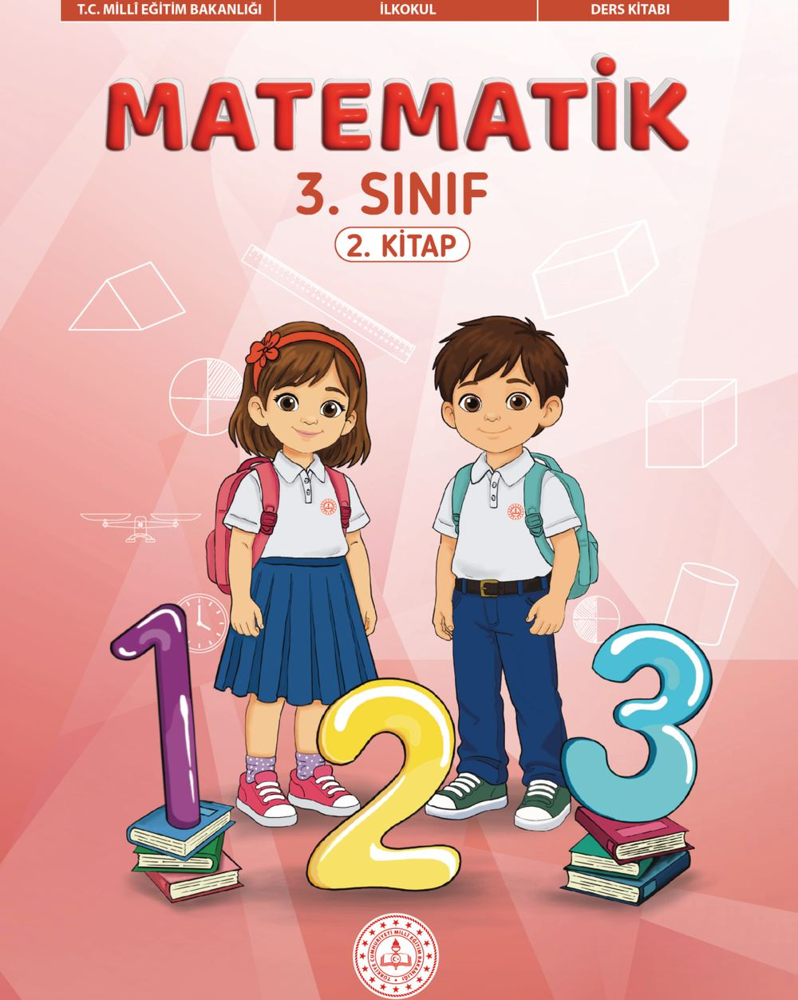
<!-- yer tutucu bulunamadı: sayfa sonuna eklendi -->

<!-- sayfa 1 -->

# İLKOKUL

# MATEMATİK

## 3. SINIF DERS KİTABI

## 2. KİTAP

YAZARLAR

Çiğdem KAYA
Filiz BAŞAY
Kamil YEŞİLOVA
Sakine GÖNDÜK
Seval KALKAN

<!-- sayfa 2 -->

MİLLÎ EĞİTİM BAKANLIĞI YAYINLARI ....................................................................... : 10797 
DERS KİTAPLARI DİZİSİ ....................................................................................................... : 2533

Her hakkı saklıdır ve Millî Eğitim Bakanlığına aittir. Kitabın metin, soru ve şekilleri kısmen de olsa hiçbir surette alınıp yayımlanamaz.

# HAZIRLAYANLAR

## Editör
Prof. Dr. Kâmuran TARIM

## Dil Uzmanı
Şükrü BAŞKAYA

## Görsel Tasarımcı
Alper KILIÇ
Aysel YEŞİLOVA
Can HİLÂL

## Çoklu Ortam Tasarımcısı
Burcu YAMANER
Cuma ŞAŞTIM
Enver ÜLKER
Hasan ARLI 
Hatice YILDIRIM IŞIK

## Program Geliştirme Uzmanı
Dr. Fadime MENGİ US

## Ölçme ve Değerlendirme Uzmanı
Dr. Öğretim Üyesi Mustafa KÖROĞLU

## Rehberlik Uzmanı
Aybüke YAMAN

ISBN 978-975-11-9898-3

Millî Eğitim Bakanlığı Talim ve Terbiye Kurulunun 13/07/2026 tarih ve 164290654 sayılı Kurul kararı ile öğretim yılından itibaren 5 (beş) yıl süre ile Ders Kitabı olarak kabul edilmiştir. 

Kurulca bu kitabın kabul edilmiş olması ders kitabından yayınevi ve yazarın

<!-- sayfa 3 -->

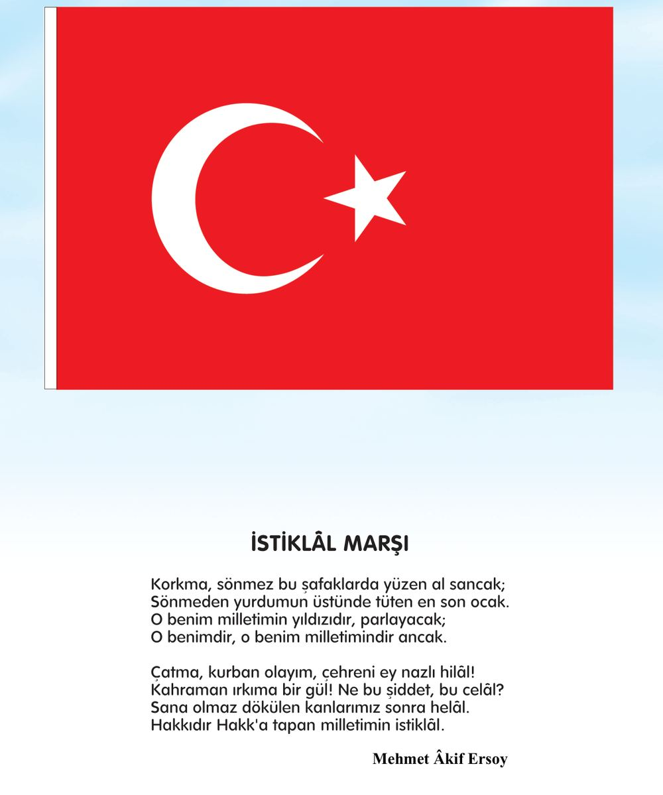

# İSTİKLÂL MARŞI

Korkma, sönmez bu şafaklarda yüzen al sancak;
Sönmeden yurdumun üstünde tüten en son ocak.
O benim milletimin yıldızıdır, parlayacak;
O benimdir, o benim milletimindir ancak.

Çatma, kurban olayım, cehren ey nazlı hilâl!
Kahraman ırkıma bir gül! Ne bu şiddet, bu celâl?
Sana olmaz dökülen kanlarımız sonra helâl.
Hakkıdır Hakk'a tapan milletimin istiklâl.

**Mehmet Âkif Ersoy**

<!-- sayfa 4 -->

ANDIMIZ

Türküm, doğruyum, çalışkanım.

İlkem küçüklerimi korumak, büyüklerimi saymak; yurdumu, milletimi özümden çok sevmektir.
Ülküm yükselmek, ileri gitmektir.

Ey Büyük Atatürk!

Açtığın yolda, gösterdiğin hedefe durmadan yürüyeceğime ant içerim.

Varlığım Türk varlığına armağan olsun.

Ne mutlu Türküm diyene!

<!-- sayfa 5 -->

![Mustafa Kemal Atatürk portresi]

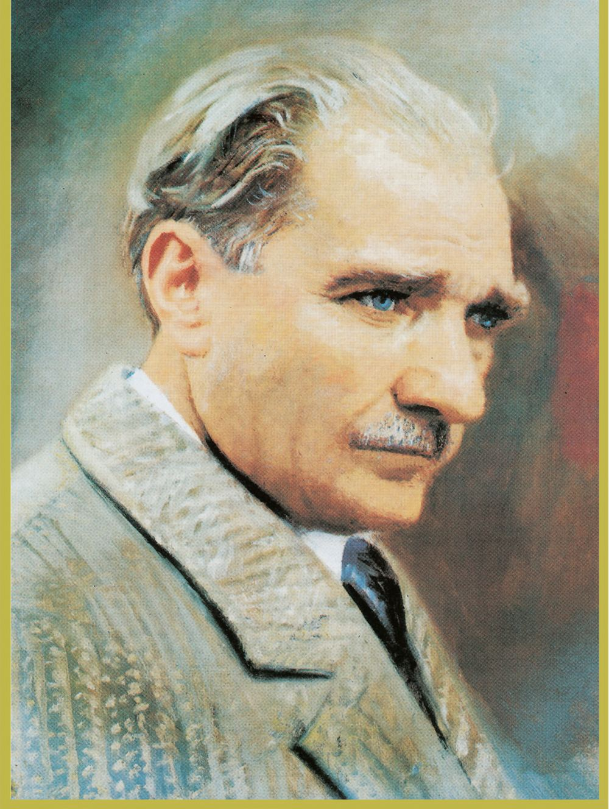
<!-- yer tutucu bulunamadı: sayfa sonuna eklendi -->

<!-- sayfa 6 -->

Verdiğiniz metin katmanı boş olduğu için (`<<< >>>`) dönüştürülecek herhangi bir içerik bulunmamaktadır. Lütfen metin katmanını içeren içeriği paylaşın, böylece talimatlarınıza uygun şekilde Markdown formatına çevirebilirim.

<!-- sayfa 7 -->

# İÇİNDEKİLER

Kitabımızı Tanıyalım ................................................................................................... 8

## 3. TEMA: İŞLEMLERDEN CEBİRSEL DÜŞÜNMEYE

Çarpma ve Bölme İşlemlerinin Sonuçlarını Muhakeme Etme ............................... 12
Çarpma ve Bölme İşlemlerini Çözümleme ............................................................ 38
Yönergeleri Yorumlama ........................................................................................... 48
Dört İşlem Gerektiren Problemleri Çözme .......................................................... 59
Dört İşlem Gerektiren Problemleri Yapılandırma ................................................ 66
Eşitliğin Farklı Anlamlarını Yorumlayabilme ....................................................... 68
3. Tema Değerlendirme ........................................................................................... 72

## 4. TEMA: NESNELERİN GEOMETRİSİ (1)

Geometrik Cisimlerin Özellikleri ............................................................................. 80
Geometrik Şekilleri Sınıflandırma .......................................................................... 88
Geometrik Cisimleri ve Şekilleri Çizme ................................................................ 95
Çevre Uzunluğunu Tahmin Etme ........................................................................... 102
Sıvı Miktarını Tahmin Etme ................................................................................... 111
4. Tema Değerlendirme ........................................................................................... 117

## 5. TEMA: NESNELERİN GEOMETRİSİ (2)

Simetri Doğrusu ........................................................................................................ 124
Simetrik Şekil .......................................................................................................... 130
Yönergeler ile Simetrik Şekiller ............................................................................. 136
5. Tema Değerlendirme ........................................................................................... 141

## 6. TEMA: VERİYE DAYALI ARAŞTIRMA

Veri Toplama ve Veriye Dayalı Karar Verme ..................................................... 146
6. Tema Değerlendirme ........................................................................................... 158
Sözlük ........................................................................................................................ 160
Kaynakça .................................................................................................................. 162
Cevap Anahtarı ........................................................................................................ 162
Görsel ve Genel Ağ Kaynakçası ............................................................................ 162
Ekler .......................................................................................................................... 163
Türkiye’nin Mülki İdare Bölümleri ile Kara ve Deniz Komşuları Haritası ...... 175

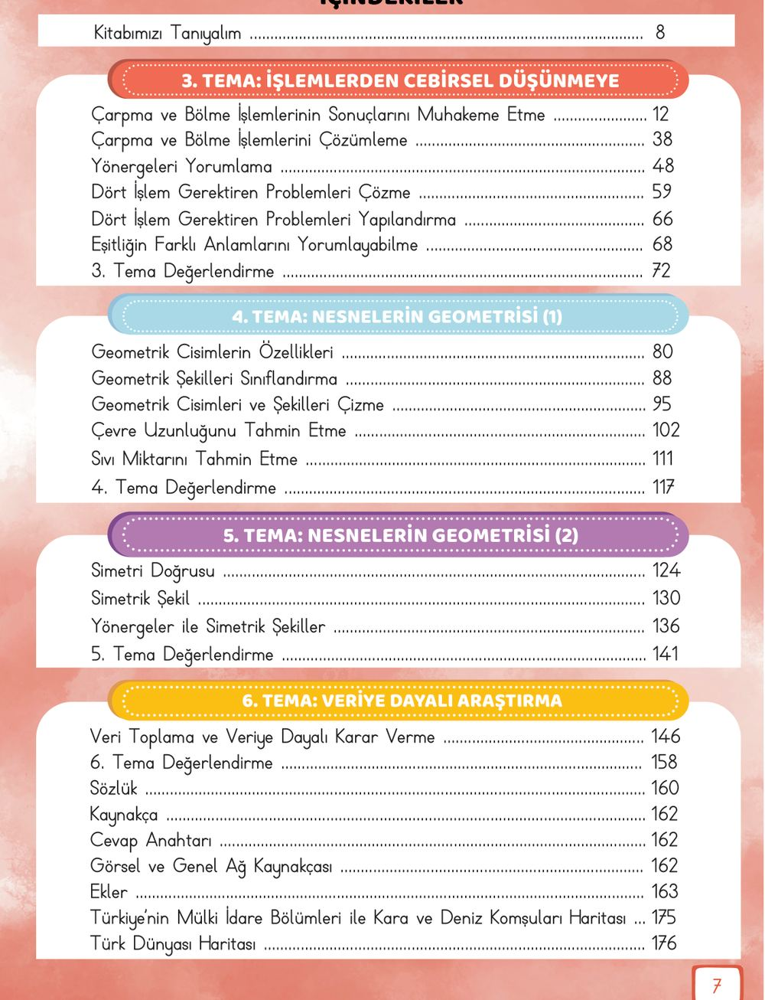
<!-- yer tutucu bulunamadı: sayfa sonuna eklendi -->

<!-- sayfa 8 -->

# KİTABIMIZI TANIYALIM

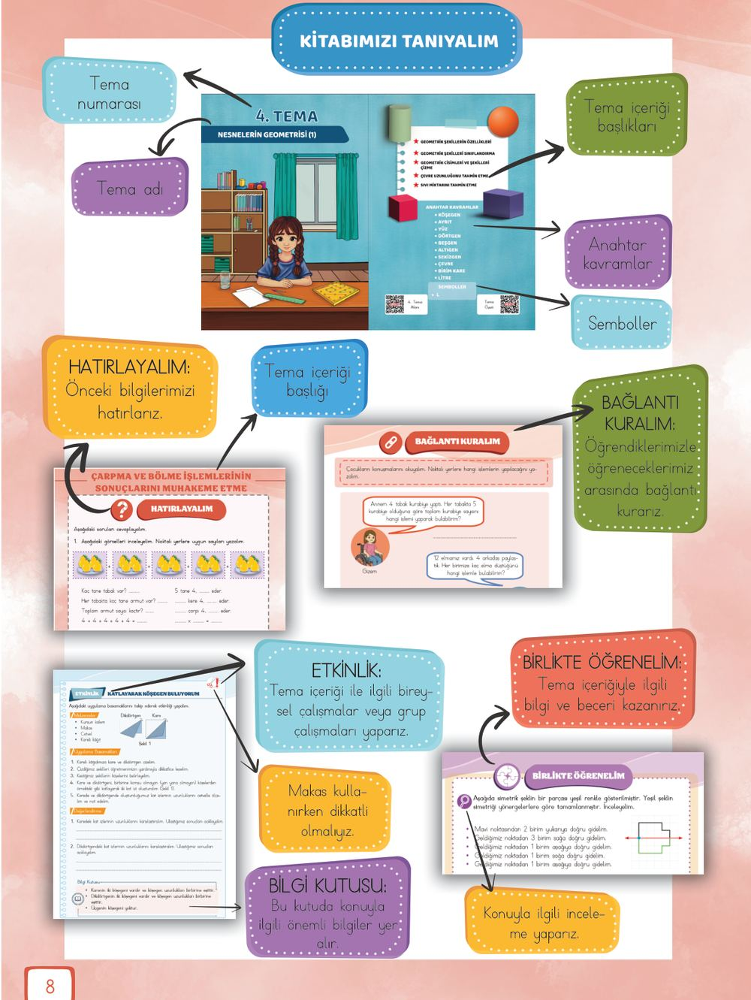

* Tema numarası
* Tema adı
* Tema içeriği başlıkları
* Anahtar kavramlar
* Semboller

---

## HATIRLAYALIM:
Önceki bilgilerimizi hatırlarız.

---

## BAĞLANTI KURALIM:
Öğrendiklerimizle öğrenileceklerimiz arasında bağlantı kurarız.

---

## ETKİNLİK:
Tema içeriği ile ilgili bireysel çalışmalar veya grup çalışmaları yaparız.

**Makas kullanırken dikkatli olmalıyız.**

---

## BİRLİKTE ÖĞRENELİM:
Tema içeriği ile ilgili bilgi ve beceri kazanırız.

**Konuyla ilgili inceleme yaparız.**

---

## BİLGİ KUTUSU:
Bu kutuda konuyla ilgili önemli bilgiler yer alır.

<!-- sayfa 9 -->

# ÇÖZELİM ÖĞRENELİM:
Konu ile ilgili sorular çözeriz.

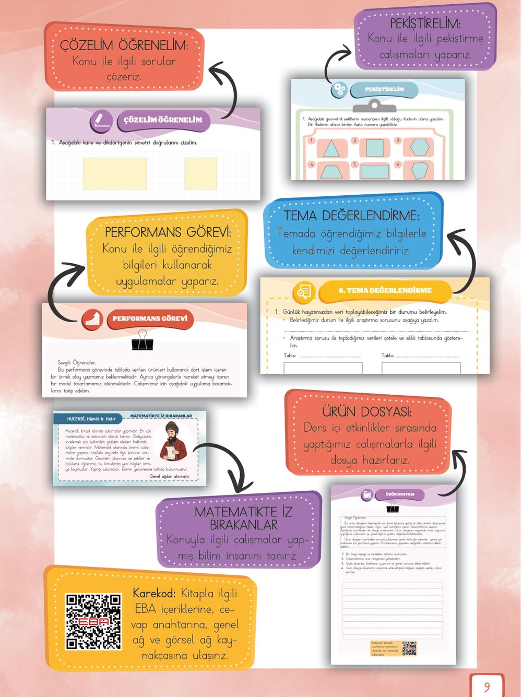

## ÇÖZELİM ÖĞRENELİM
1. Aşağıdaki kare ve dikdörtgenin simetri doğrularını çizelim.

# PEKİŞTİRELİM:
Konu ile ilgili pekiştirme çalışmaları yaparız.

1. Aşağıdaki geometrik şekillerin numarası ile ilgili ifadenin altına yazınız. Bir ifadenin altına bir-den fazla numara yazabilirsiniz.

# PERFORMANS GÖREVİ:
Konu ile ilgili öğrendiğimiz bilgileri kullanarak uygulamalar yaparız.

## PERFORMANS GÖREVİ
Sevgili Öğrenciler,
Bu performans görevinde tabloda verilen ürünleri kullanarak dört istem içeren bir örnek olay yazmanız beklenmektedir. Ayrıca yönergelerle hareket etmek isteyen bir model tasarımları istenmektedir. Çalışmamızı aşağıdaki uygulama basamaklarını takip edelim.

# TEMA DEĞERLENDİRME:
Temada öğrendiğimiz bilgilerle kendimizi değerlendiririz.

## 6. TEMA DEĞERLENDİRME
1. Günlük hayatımızdan veri toplayabileceğimiz bir durumu belirleyelim.
* Belirlediğimiz durum ile ilgili araştırma sorusunu aşağıya yazalım.
* Araştırma sorusu ile topladığımız verileri çizelge ve sıklık tablosunda gösterelim.

Tablo: _________  Tablo: _________

# ÜRÜN DOSYASI:
Ders içi etkinlikler sırasında yaptığımız çalışmalarla ilgili dosya hazırlarız.

## ÜRÜN DOSYASI
Sevgili Öğrenciler,
Bu ürün dosyasını hazırlarken tek bir boyuta değil, çeşitlilik göstermeye de önem vermeliyiz. Örneğin geometrik şekillerin çeşitlerini kullanarak çalışmalarımızı yapabiliriz. Dosyamızda her bir konuya ait çalışma örneği veya çalışma geliştirme ve gösterme çalışmaları yer almalıdır.

Ürün dosyasını oluştururken aşağıdaki noktaları dikkate alınız:
1. Bir konu başlığı ve içerik bilgi sütunu.
2. Çalışmaların konuyla ilgili görsellerini eklemek.
3. Sayı sistemleri, basamak değerleri, yuvarlama ve sıralama dikkat alınmalıdır.
4. Ürün dosyasını oluştururken sade ve estetik bir görünüm sergilemeye özen gösteriniz.

# MATEMATİKTE İZ BIRAKANLAR
Konuyla ilgili çalışmalar yapmış bilim insanını tanırız.

**HUCENDİ, Hâmid b. Hidr**
Hucendi; birikimli alan çalışmalar yapmıştır. En çok matematik ve astronomi alanında tanınır. Çalışmalarının incelenmesi için kullanılan bazı önemli bilgiler şunlardır: Matematik alanında önemli çalışmaları vardır. Geometri alanında ise şekiller ve ölçülerle ilgilenir, bu konularda yeni bilgiler katmıştır. Yapısal çözümün bilimsel temelleri bulunur. Önemli bir bilim insanıdır.

# Karekod: Kitapla ilgili EBA içeriklerine, cevap anahtarına, genel ağ ve görsel ağ kaynakçasına ulaşırız.

<!-- sayfa 10 -->

# 3. TEMA
## İŞLEMLERDEN CEBİRSEL DÜŞÜNMEYE

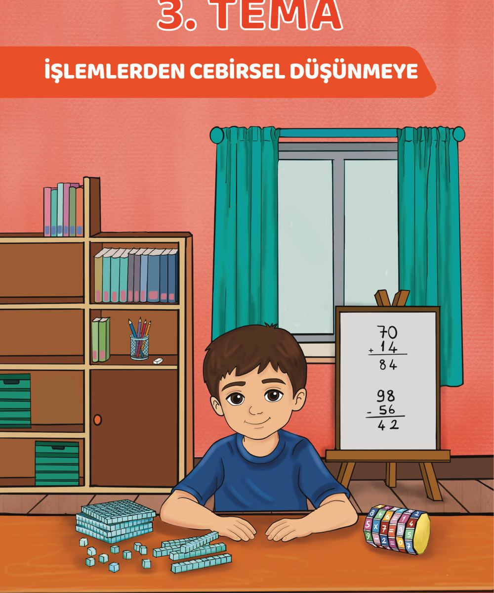

<!-- sayfa 11 -->

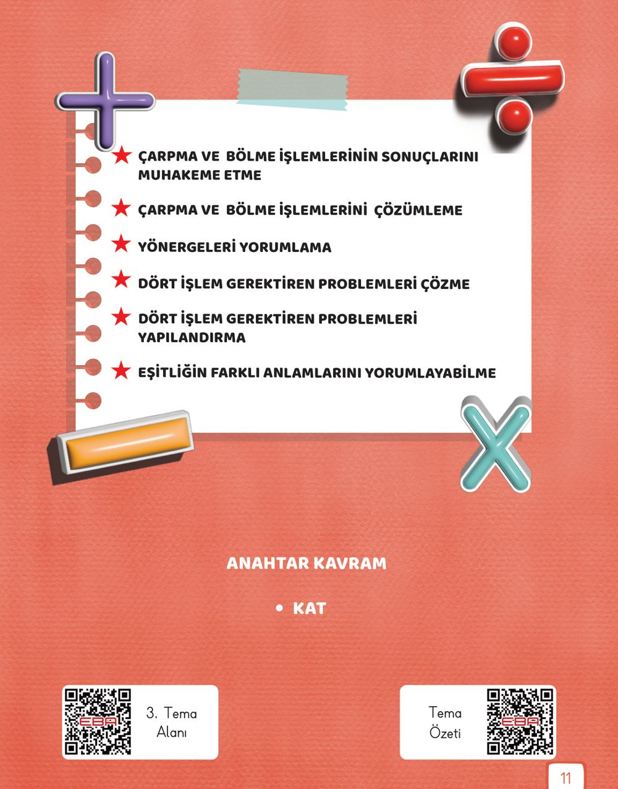

* ★ ÇARPMA VE BÖLME İŞLEMLERİNİN SONUÇLARINI MUHAKEME ETME
* ★ ÇARPMA VE BÖLME İŞLEMLERİNİ ÇÖZÜMLEME
* ★ YÖNERGELERİ YORUMLAMA
* ★ DÖRT İŞLEM GEREKTİREN PROBLEMLERİ ÇÖZME
* ★ DÖRT İŞLEM GEREKTİREN PROBLEMLERİ YAPILANDIRMA
* ★ EŞİTLİĞİN FARKLI ANLAMLARINI YORUMLAYABİLME

# ANAHTAR KAVRAM

* KAT

| 3. Tema Alanı | Tema Özeti |
| :---: | :---: |
| [[QR Kod]] | [[QR Kod]] |

<!-- sayfa 12 -->

# SONUÇLARINI MUHAKEME ETME

## HATIRLAYALIM

Aşağıdaki soruları cevaplayalım.

1. Görselleri inceleyelim. Noktalı yerlere uygun sayıları yazalım.

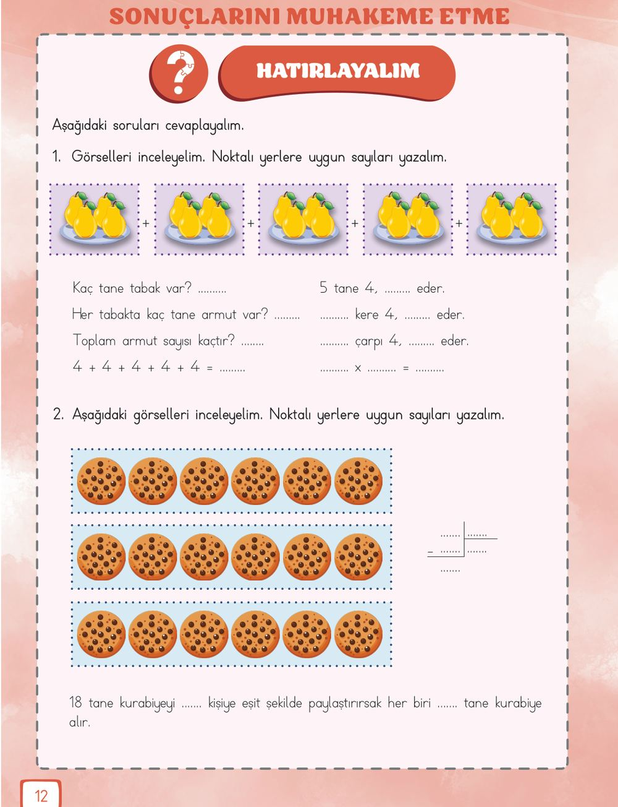

Kaç tane tabak var? ..........                                     $5$ tane $4$, .......... eder.
Her tabakta kaç tane armut var? .........                         .......... kere $4$, .......... eder.
Toplam armut sayısı kaçtır? ........                              .......... çarpı $4$, .......... eder.
$4 + 4 + 4 + 4 + 4 = ..........$ <!-- KONTROL: Marker'da karşılığı yok, uydurma olabilir -->                                 .......... $\times$ .......... $= ..........$

2. Aşağıdaki görselleri inceleyelim. Noktalı yerlere uygun sayıları yazalım.

$18$ tane kurabiyeyi ...... kişiye eşit şekilde paylaştırırsak her biri ...... tane kurabiye alır.

<!-- sayfa 13 -->

# BAĞLANTI KURALIM

Aşağıdaki soruları okuyalım. Noktalı yerlere soruyu cevaplamak için yapılması gereken işlemi yazalım.

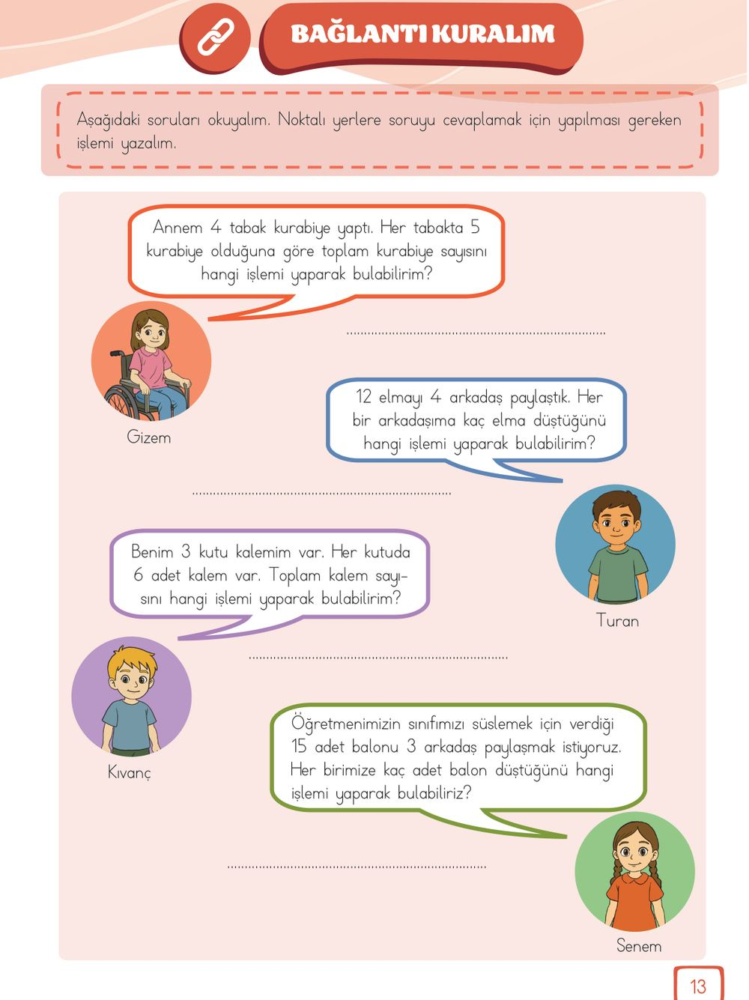

Gizem: Annem 4 tabak kurabiye yaptı. Her tabakta 5 kurabiye olduğuna göre toplam kurabiye sayısını hangi işlemi yaparak bulabilirim?
..........................................................................

Turan: 12 elmayı 4 arkadaş paylaştık. Her bir arkadaşıma kaç elma düştüğünü hangi işlemi yaparak bulabilirim?
..........................................................................

Kıvanç: Benim 3 kutu kalemim var. Her kutuda 6 adet kalem var. Toplam kalem sayısını hangi işlemi yaparak bulabilirim?
..........................................................................

S: Öğretmenimizin sınıfımızı süslemek için verdiği 15 adet balonu 3 arkadaş paylaşmak istiyoruz. Her birimize kaç adet balon düştüğünü hangi işlemi yaparak bulabiliriz?
..........................................................................

<!-- sayfa 14 -->

# ETKİNLİK ÇARPAN VE ÇARPIMI BULALIM

Aşağıdaki uygulama basamaklarını takip ederek etkinliği yapalım.

## Malzemeler
* 24 adet plastik su şişesi kapağı
* Renkli karton
* Kurşun kalem

## Uygulama Basamakları
1. Şişe kapaklarını sıramızın üzerine koyalım.
2. Sonucu $24$ olan çarpma işlemleri belirleyelim.
3. Belirlediğimiz çarpma işlemlerinden birini seçelim.
4. Seçtiğimiz çarpma işlemini şişe kapaklarını kullanarak modelleyelim.
5. Modellediğimiz işlemin çarpanlarını ve çarpımını yazalım.
6. Kartona başka çarpma işlemlerini modelleyerek öğretmenimizin belirttiği süre boyunca etkinliğe devam edelim.

## Değerlendirme
* Yaptığımız çarpma işlemlerinden iki tanesini yazalım. Çarpma işlemlerinin ögelerini belirtelim.

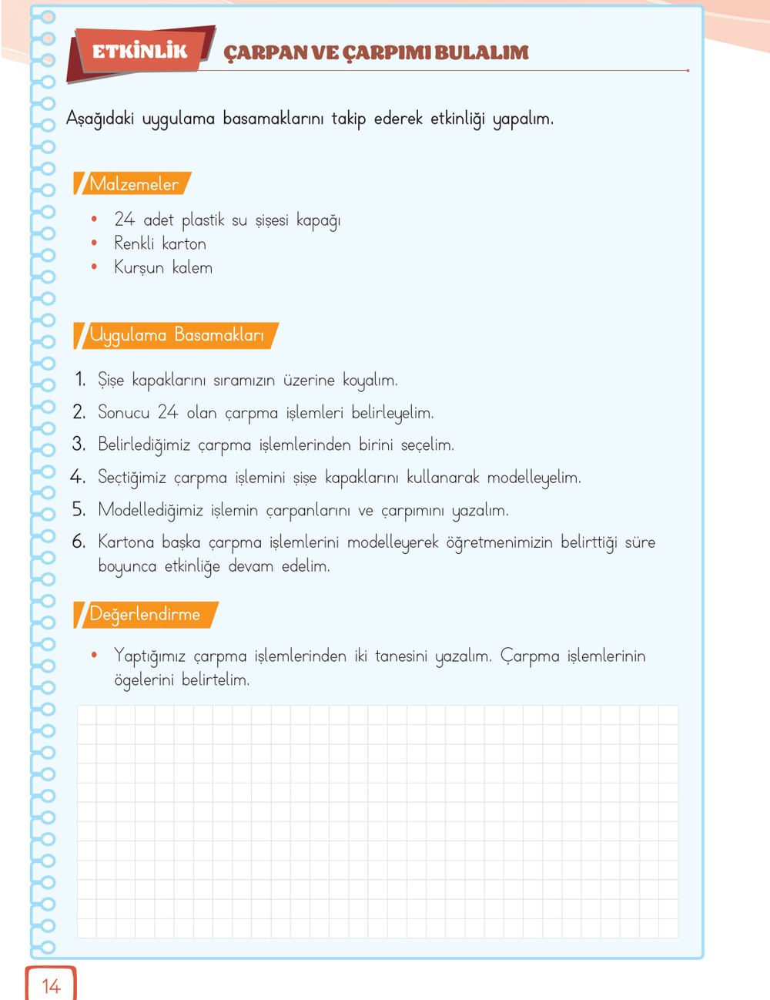

<!-- sayfa 15 -->

Suna Öğretmen, 3/A ve 3/B sınıflarından gönüllü öğrencilerle koro oluşturmak istiyor. Her iki sınıftan da $21$ öğrenci gönüllü olduğuna göre koroya katılan toplam öğrenci sayısının farklı işlemlerle nasıl bulunduğunu inceleyelim.

| 3/A sınıfından koroya katılan öğrencilerin sayısı | 3/B sınıfından koroya katılan öğrencilerin sayısı | Koroya katılan toplam öğrenci sayısı |
| :---: | :---: | :---: |
| 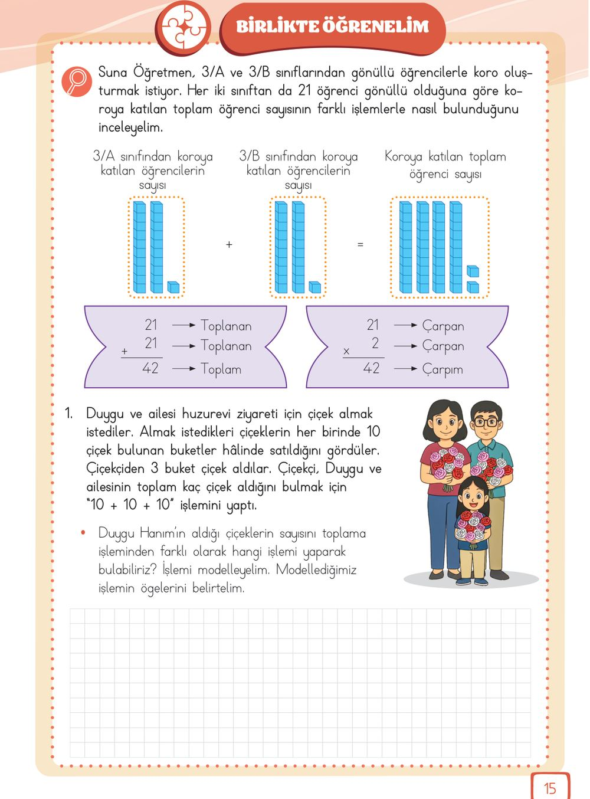 | +  | =  |

$$\begin{array}{r@{\quad}l}
21 & \longrightarrow \text{Toplanan} \\
+ 21 & \longrightarrow \text{Toplanan} \\
\hline
42 & \longrightarrow \text{Toplam}
\end{array}$$
<!-- KONTROL: Marker'da karşılığı yok, uydurma olabilir -->

$$\begin{array}{r@{\quad}l}
21 & \longrightarrow \text{Çarpan} \\
\times \phantom{0} 2 & \longrightarrow \text{Çarpan} \\
\hline
42 & \longrightarrow \text{Çarpım}
\end{array}$$
<!-- KONTROL: Marker'da karşılığı yok, uydurma olabilir -->

1. Duygu ve ailesi huzurevi ziyareti için çiçek almak istediler. Almak istedikleri çiçeklerin her birinde $10$ çiçek bulunan buketler hâlinde satıldığını gördüler. Çiçekçiden $3$ buket çiçek aldılar. Çiçekçi, Duygu ve ailesinin toplam kaç çiçek aldığını bulmak için "$10 + 10 + 10$" işlemini yaptı.

* Duygu Hanım'ın aldığı çiçeklerin sayısını toplama işleminden farklı olarak hangi işlemi yaparak bulabiliriz? İşlemi modelleyelim. Modellemiş olduğumuz işlemin ögelerini belirtelim.

<!-- sayfa 16 -->

Kadir her birinde $12$ karton bardak olan paketlerden $3$ tane almıştır. Kadir’in toplam kaç karton bardak aldığının taban blokları ile gösterimini ve çarpma işlemi ile bulunuşunu inceleyelim.

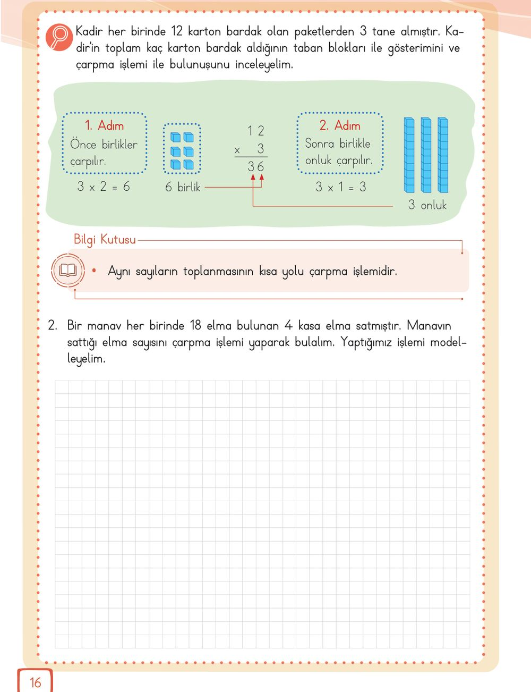

**Bilgi Kutusu**
* Aynı sayıların toplanmasının kısa yolu çarpma işlemidir.

2. Bir manav her birinde $18$ elma bulunan $4$ kasa elma satmıştır. Manavın sattığı elma sayısını çarpma işlemi yaparak bulalım. Yaptığımız işlemi modelleyelim.

<!-- sayfa 17 -->

Bir oyuncak mağazasına $2$ koli oyuncak gelmiştir. Her kolide $28$ oyuncak vardır. Toplam oyuncak sayısını bulmak için yapılan çarpma işleminin basamak tablosunda nasıl gösterildiğini inceleyelim.

| Onluk | Birlik | | |
| :---: | :---: | :--- | :--- |
| $2$ | $8$ | $\longrightarrow$ | Bir kolideki oyuncak sayısı |
| $\times$ | $2$ | $\longrightarrow$ | Koli sayısı |
| $1$ | $6$ | $\longrightarrow$ | $2$ tane $8$ birlik $2 \times 8 = 16$ <!-- KONTROL: Marker'da karşılığı yok, uydurma olabilir --> |
| $4$ | $0$ | $\longrightarrow$ | $2$ tane $2$ onluk $2 \times 20 = 40$ <!-- KONTROL: Marker'da karşılığı yok, uydurma olabilir --> |
| $5$ | $6$ | $\longrightarrow$ | Toplam oyuncak sayısı |

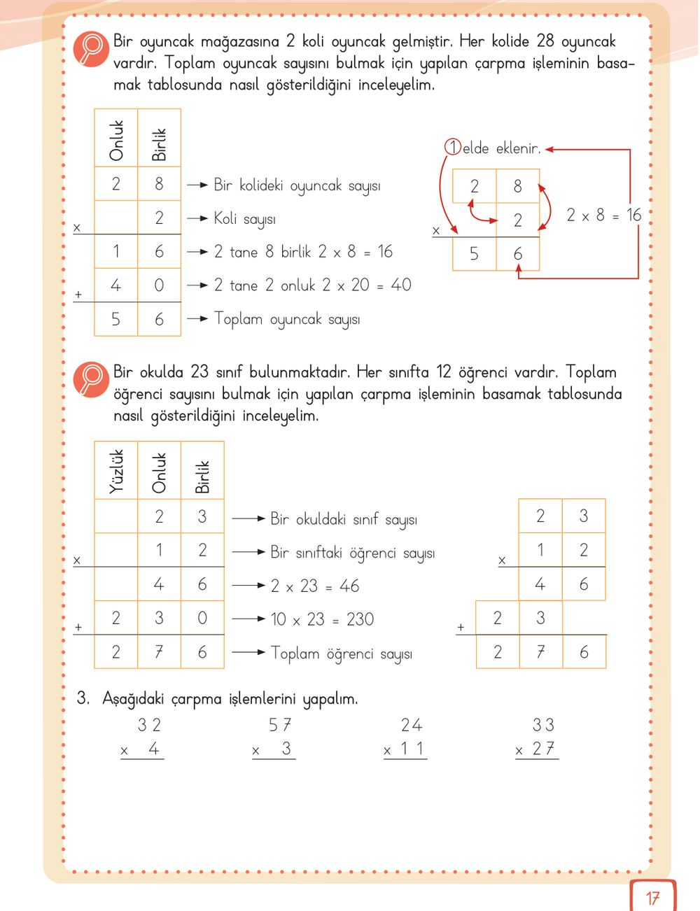

Bir okulda $23$ sınıf bulunmaktadır. Her sınıfta $12$ öğrenci vardır. Toplam öğrenci sayısını bulmak için yapılan çarpma işleminin basamak tablosunda nasıl gösterildiğini inceleyelim.

| Yüzlük | Onluk | Birlik | | |
| :---: | :---: | :---: | :--- | :--- |
| | $2$ | $3$ | $\longrightarrow$ | Bir okuldaki sınıf sayısı |
| $\times$ | $1$ | $2$ | $\longrightarrow$ | Bir sınıftaki öğrenci sayısı |
| | $4$ | $6$ | $\longrightarrow$ | $2 \times 23 = 46$ |
| $2$ | $3$ | $0$ | $\longrightarrow$ | $10 \times 23 = 230$ |
| $2$ | $7$ | $6$ | $\longrightarrow$ | Toplam öğrenci sayısı |

3. Aşağıdaki çarpma işlemlerini yapalım.

$$\begin{array}{r@{\quad}r@{\quad}r@{\quad}r}
32 & 57 & 24 & 33 \\
\times 4 & \times 3 & \times 11 & \times 27 \\
\hline
\end{array}$$
<!-- KONTROL: Marker'da karşılığı yok, uydurma olabilir -->

<!-- sayfa 18 -->

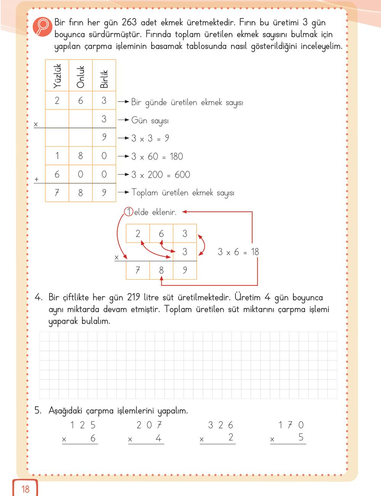
<!-- yer tutucu bulunamadı: sayfa sonuna eklendi -->

<!-- sayfa 19 -->

6. Oğuz Tutum, Yatırım ve Türk Malları Haftasında sınıfa getirdiği $24$ cevizi $6$ arkadaşı arasında eşit sayıda paylaştırmak istiyor.
    * Bir kişiye düşen ceviz sayısını bulmak için hangi işlemi yapmalıyız? ...............................................................................................................................................................
    * Yapmamız gereken işlemi aşağıdaki kareli zemine modelleyelim.
    [Kareli zemin]
    * Modellediğimiz işlemi yaparak işlem ögelerini aşağıdaki kareli zeminde gösterelim.
    [Kareli zemin]

7. Aşağıda görselleri verilen limonları $4$ kişiye eşit sayıda nasıl paylaştırabiliriz? Görsel üzerinde modelleyelim.
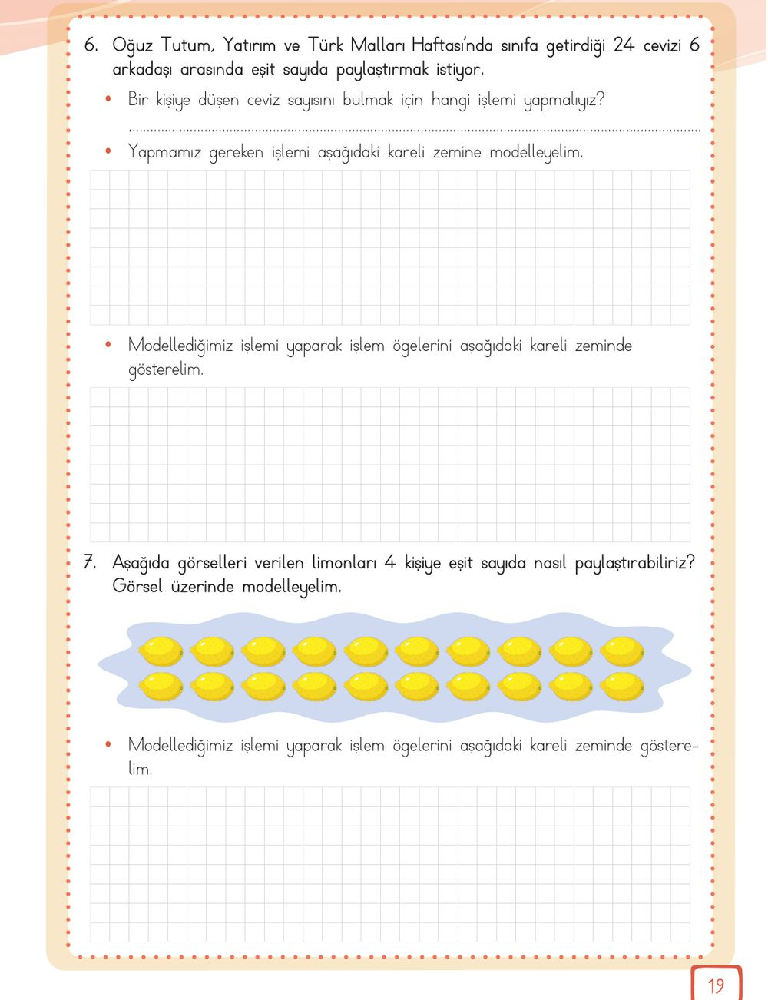
    * Modellediğimiz işlemi yaparak işlem ögelerini aşağıdaki kareli zeminde gösterelim.
    [Kareli zemin]

<!-- sayfa 20 -->

# ETKİNLİK | BÖLME İŞLEMİNİN ÖGELERİNİ BULUYORUM

Aşağıdaki uygulama basamaklarını takip ederek etkinliği yapalım.

## Malzemeler
* Kurşun kalem
* A4 kâğıdı
* Sayı çubuğu

## Uygulama Basamakları
1. 20 adet sayı çubuğunu 2 arkadaşımıza bütünlüğünü bozmadan eşit sayıda paylaştırmayı deneyelim.
2. Paylaştırma sonucunda her bir arkadaşımızın kaç tane sayı çubuğu aldığını yazalım.
3. Sonra 20 adet sayı çubuğunu 3 arkadaşımıza bütünlüğünü bozmadan eşit sayıda paylaştırmayı deneyelim.
4. Paylaştırma sonucunda her bir arkadaşımızın kaç tane sayı çubuğu aldığını ve kalan çubuk sayısını yazalım.
5. Daha sonra 20 adet sayı çubuğunu 4 arkadaşımıza çubukların bütünlüğünü bozmadan eşit sayıda paylaştırmayı deneyelim.
6. Paylaştırma sonucunda her bir arkadaşımıza düşen çubuk sayısını yazalım.
7. Uygulama sonucunda ulaştığımız çıkarımları modelleyelim.
8. Modellediğimiz işlemleri yaparak işlem ögelerini yazalım.

## Değerlendirme
* Bölme işleminin ögelerini yaptığımız etkinlikten yararlanarak açıklayalım.

....................................................................................................................................................................
....................................................................................................................................................................
....................................................................................................................................................................
....................................................................................................................................................................
....................................................................................................................................................................

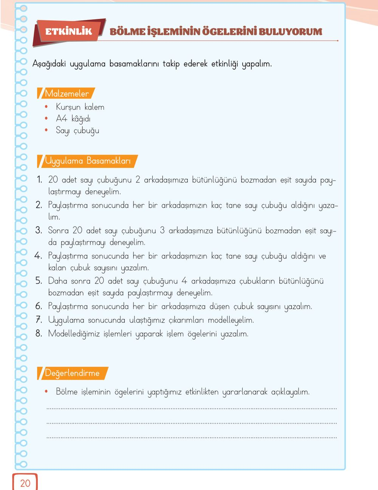
<!-- yer tutucu bulunamadı: sayfa sonuna eklendi -->

<!-- sayfa 21 -->

8. Aşağıdaki tabloda boş bırakılan yerleri örnekteki gibi dolduralım.

| | $18 \div 4$ <!-- KONTROL: Marker'da karşılığı yok, uydurma olabilir --> | $18 \div 3$ <!-- KONTROL: Marker'da karşılığı yok, uydurma olabilir --> | $18 \div 2$ <!-- KONTROL: Marker'da karşılığı yok, uydurma olabilir --> |
| :--- | :---: | :---: | :---: |
| Bölme İşleminin Ögeleri | Bölünen $\rightarrow$ $18$   Bölen $\rightarrow$ $4$   $\quad$ $18 \mid 4$ <!-- KONTROL: Marker'da karşılığı yok, uydurma olabilir -->   $\quad$ $-16$   $\quad$ $\quad$ $2$   Bölüm $\rightarrow$ $4$   Kalan $\rightarrow$ $2$ | Bölünen $\rightarrow$ ......   Bölen $\rightarrow$ ......   $\quad$ ...... $\mid$ ......   $\quad$ $- ......$   $\quad$ $\quad$ ......   Bölüm $\rightarrow$ ......   Kalan $\rightarrow$ ...... | Bölünen $\rightarrow$ ......   Bölen $\rightarrow$ ......   $\quad$ ...... $\mid$ ......   $\quad$ $- ......$   $\quad$ $\quad$ ......   Bölüm $\rightarrow$ ......   Kalan $\rightarrow$ ...... |
| Bölme İşleminin Modellemesi | 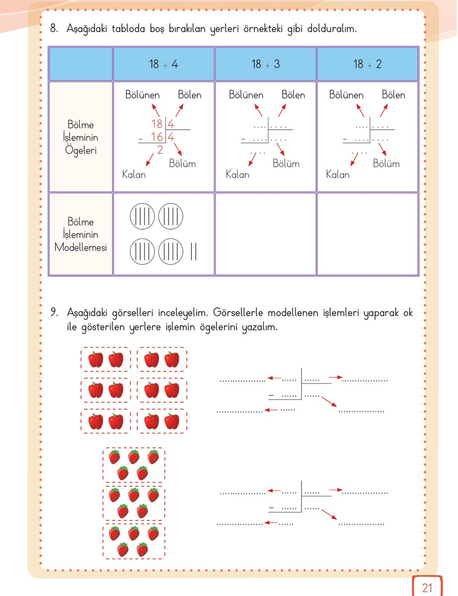 | | |

9. Aşağıdaki görselleri inceleyelim. Görsellerle modellenen işlemleri yaparak ok ile gösterilen yerlere işlemin ögelerini yazalım.

$\quad$ $\dots\dots\dots\dots \mid \dots\dots\dots\dots \rightarrow \dots\dots\dots\dots$
$\quad$ $- \dots\dots\dots\dots$
$\quad$ $\dots\dots\dots\dots \rightarrow \dots\dots\dots\dots$

$\quad$ $\dots\dots\dots\dots \mid \dots\dots\dots\dots \rightarrow \dots\dots\dots\dots$
$\quad$ $- \dots\dots\dots\dots$
$\quad$ $\dots\dots\dots\dots \rightarrow \dots\dots\dots\dots$

<!-- sayfa 22 -->

36 kalem 3 kişiye eşit sayıda paylaştırılmak isteniyor. Yapılacak işlemin taban blokları ile gösterimini inceleyelim.

1. adım: 3 onluk 3 kişiye paylaştırılır. Her bir kişiye 1 onluk düşer.

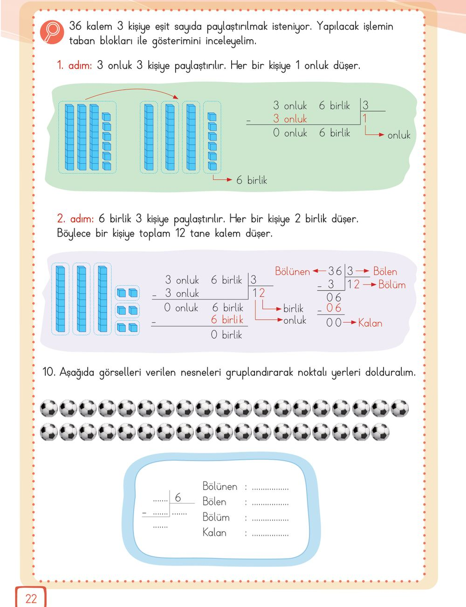

2. adım: 6 birlik 3 kişiye paylaştırılır. Her bir kişiye 2 birlik düşer. Böylece bir kişiye toplam 12 tane kalem düşer.

10. Aşağıda görselleri verilen nesneleri gruplandırarak noktalı yerleri dolduralım.

$$\begin{array}{c}
\dots\dots\dots\dots 6 \\
-\dots\dots\dots\dots \\
\dots\dots\dots\dots \\
\dots\dots\dots\dots
\end{array}$$
<!-- KONTROL: Marker'da karşılığı yok, uydurma olabilir -->

$$\begin{array}{|l|l|}
\hline
\text{Bölünen} & : \dots\dots\dots\dots \\
\hline
\text{Bölen} & : \dots\dots\dots\dots \\
\hline
\text{Bölüm} & : \dots\dots\dots\dots \\
\hline
\text{Kalan} & : \dots\dots\dots\dots \\
\hline
\end{array}$$
<!-- KONTROL: Marker'da karşılığı yok, uydurma olabilir -->

<!-- sayfa 23 -->

# ETKİNLİK SAYILARI ÇARPALIM EŞİTİNİ BULALIM

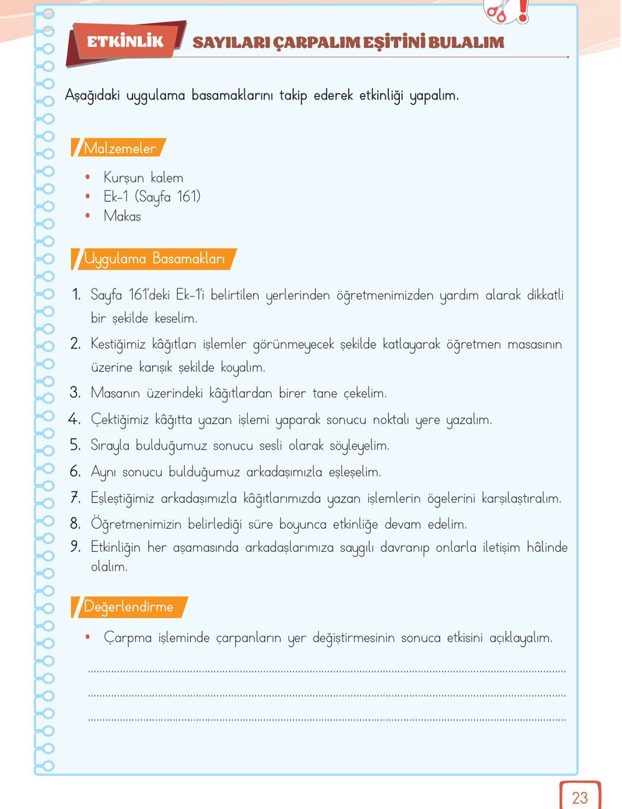

Aşağıdaki uygulama basamaklarını takip ederek etkinliği yapalım.

## Malzemeler
* Kurşun kalem
* Ek-1 (Sayfa 161)
* Makas

## Uygulama Basamakları
1. Sayfa 161’deki Ek-1’i belirtilen yerlerinden öğretmenimizden yardım alarak dikkatli bir şekilde keselim.
2. Kestiğimiz kâğıtları işlemler görünmeyecek şekilde katlayarak öğretmen masasının üzerine karışık şekilde koyalım.
3. Masanın üzerindeki kâğıtlardan birer tane çekelim.
4. Çektiğimiz kâğıtta yazan işlemi yaparak sonucu noktalı yere yazalım.
5. Sırayla bulduğumuz sonucu sesli olarak söyleyelim.
6. Aynı sonucu bulduğumuz arkadaşımızla eşleşelim.
7. Eşleştiğimiz arkadaşımızla kâğıtlarımızda yazan işlemlerin ögelerini karşılaştıralım.
8. Öğretmenimizin belirlediği süre boyunca etkinliğe devam edelim.
9. Etkinliğin her aşamasında arkadaşlarımıza saygılı davranıp onlarla iletişim hâlinde olalım.

## Değerlendirme
* Çarpma işleminde çarpanların yer değiştirmesinin sonuca etkisini açıklayalım.

....................................................................................................................................................................
....................................................................................................................................................................
....................................................................................................................................................................
....................................................................................................................................................................

<!-- sayfa 24 -->

11. Manava giden Ayten ve Tuna her birinde $8$ kavun bulunan $7$ kasa olduğunu gördüler. Kasalardaki toplam kavun sayısını hesapladılar. Ayten ve Tuna’nın yaptığı işlemleri karşılaştıralım.

| Ayten'in yaptığı işlem | Tuna'nın yaptığı işlem |
| :---: | :---: |
| $\begin{array}{r} 8 \\ \times 7 \\ \hline 56 \end{array}$ <!-- KONTROL: Marker'da karşılığı yok, uydurma olabilir --> | $\begin{array}{r} 7 \\ \times 8 \\ \hline 56 \end{array}$ <!-- KONTROL: Marker'da karşılığı yok, uydurma olabilir --> |

* Ayten ve Tuna'nın kasalardaki toplam kavun sayısını bulmak için yaptıkları işlemlerin ögelerini karşılaştıralım. Ögeler arasındaki benzerlik ve farklılıkları açıklayalım.

....................................................................................................................................................................
....................................................................................................................................................................

12. Ahmet, kırtasiyeden tanesi $9\text{ TL}$ (Türk lirası) olan kalemlerden $3$ tane, tanesi $3\text{ TL}$ olan silgilerden $9$ tane alıyor.

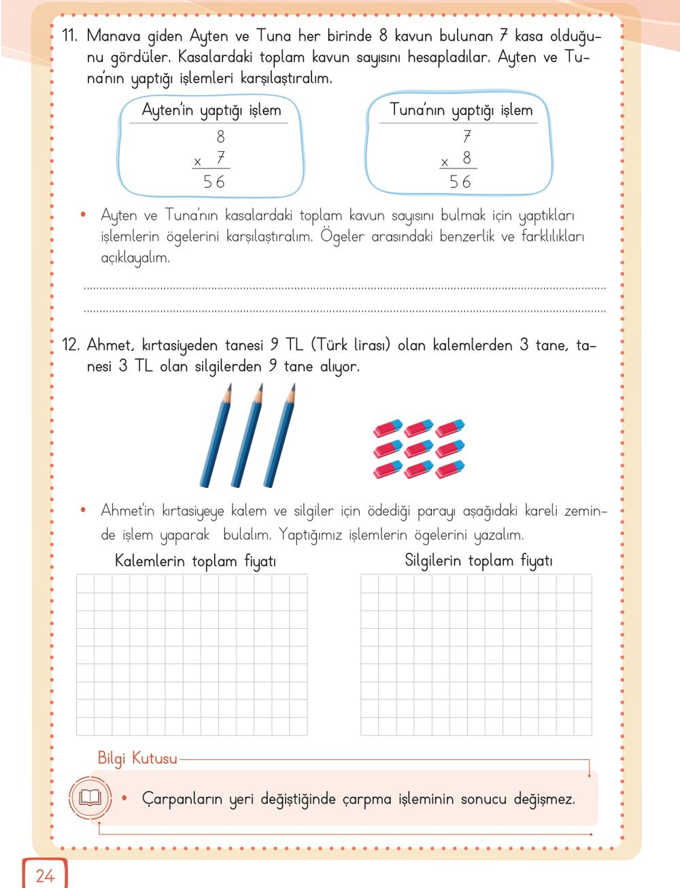

* Ahmet'in kırtasiyeye kalem ve silgiler için ödediği parayı aşağıdaki kareli zeminde işlem yaparak bulalım. Yaptığımız işlemlerin ögelerini yazalım.

Kalemlerin toplam fiyatı

Silgilerin toplam fiyatı

---
**Bilgi Kutusu**
* Çarpanların yeri değiştiğinde çarpma işleminin sonucu değişmez.

<!-- sayfa 25 -->

# ETKİNLİK ÇARPMADA KAT İLİŞKİSİNİ ANLAYALIM

Aşağıdaki uygulama basamaklarını takip ederek etkinliği yapalım.

## Malzemeler
* Kurşun kalem
* 10 adet karton kâse
* 1 paket makarna

## Uygulama Basamakları
1. 10 adet kâseyi öğretmen masasına yerleştirelim.
2. Öğretmenimizin rehberliğinde ikişerli gruplara ayrılalım. Sayışma ile etkinliğe hangi grubun önce başlayacağını belirleyelim.
3. Birlikte öğretmen masasına geldiğimiz grup arkadaşımızdan 10'a kadar bir sayı söylemesini isteyelim.
4. Arkadaşımızın söylediği sayıda makarnayı bir kâseye koyalım.
5. Bu işleme kâse sayısını artırarak devam edelim. Kâselerdeki makarna sayısının eşit olmasına dikkat edelim.
6. Her basamakta kâselerdeki toplam makarna sayısını tabloya yazalım.

| Kâse Sayısı | İşlem | Toplam Makarna Sayısı |
| :--- | :--- | :--- |
| 1 | | |
| 2 | | |
| 3 | | |
| 4 | | |
| 5 | | |

| Kâse Sayısı | İşlem | Toplam Makarna Sayısı |
| :--- | :--- | :--- |
| 6 | | |
| 7 | | |
| 8 | | |
| 9 | | |
| 10 | | |

7. Öğretmenimizin belirlediği süre boyunca etkinliğe devam edelim.

## Değerlendirme
* Toplam makarna sayısının kâse sayısına bağlı olarak nasıl bir değişiklik gösterdiğini açıklayalım.

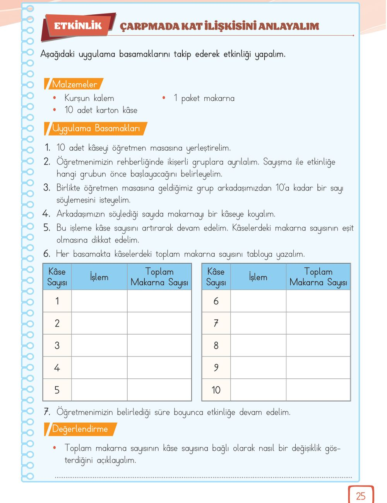
<!-- yer tutucu bulunamadı: sayfa sonuna eklendi -->

<!-- sayfa 26 -->

13. Aşağıdaki görselleri inceleyelim. Noktalı yerlere örnekteki gibi uygun sayıları yazalım.

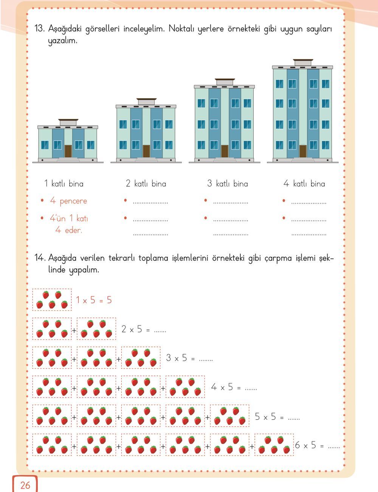

1 katlı bina
* 4 pencere
* $4$'ün $1$ katı $4$ eder.

2 katlı bina
* ....................
* ....................
....................

3 katlı bina
* ....................
* ....................
....................

4 katlı bina
* ....................
* ....................
....................

14. Aşağıda verilen tekrarlı toplama işlemlerini örnekteki gibi çarpma işlemi şeklinde yapalım.

$1 \times 5 = 5$ <!-- KONTROL: Marker'da karşılığı yok, uydurma olabilir -->

$5 + 5 + 5 + 5 = 2 \times 5 = ......$ <!-- KONTROL: Marker'da karşılığı yok, uydurma olabilir -->

$5 + 5 + 5 = 3 \times 5 = ......$ <!-- KONTROL: Marker'da karşılığı yok, uydurma olabilir -->

$5 + 5 + 5 + 5 = 4 \times 5 = ......$ <!-- KONTROL: Marker'da karşılığı yok, uydurma olabilir -->

$5 + 5 + 5 + 5 + 5 = 5 \times 5 = ......$ <!-- KONTROL: Marker'da karşılığı yok, uydurma olabilir -->

$5 + 5 + 5 + 5 + 5 + 5 = 6 \times 5 = ......$ <!-- KONTROL: Marker'da karşılığı yok, uydurma olabilir -->

<!-- sayfa 27 -->

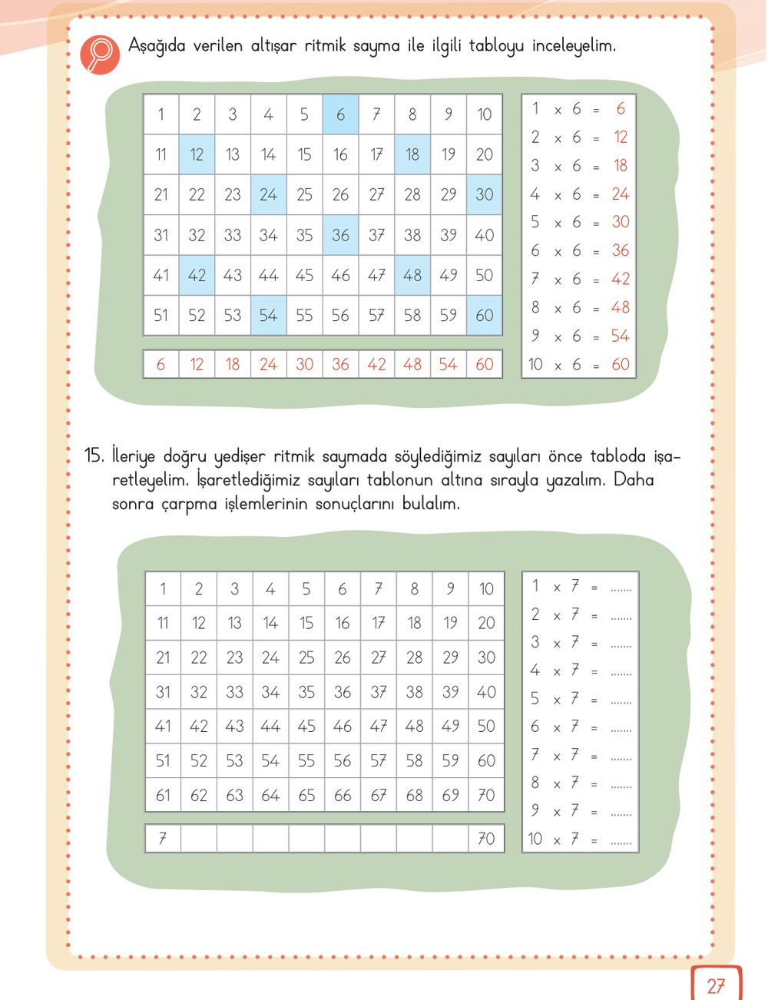 Aşağıda verilen altışar ritmik sayma ile ilgili tabloyu inceleyelim.

| 1 | 2 | 3 | 4 | 5 | 6 | 7 | 8 | 9 | 10 |
|---|---|---|---|---|---|---|---|---|----|
| 11 | 12 | 13 | 14 | 15 | 16 | 17 | 18 | 19 | 20 |
| 21 | 22 | 23 | 24 | 25 | 26 | 27 | 28 | 29 | 30 |
| 31 | 32 | 33 | 34 | 35 | 36 | 37 | 38 | 39 | 40 |
| 41 | 42 | 43 | 44 | 45 | 46 | 47 | 48 | 49 | 50 |
| 51 | 52 | 53 | 54 | 55 | 56 | 57 | 58 | 59 | 60 |
| 6 | 12 | 18 | 24 | 30 | 36 | 42 | 48 | 54 | 60 |

| İşlem | Sonuç |
| :--- | :--- |
| $1 \times 6 =$ <!-- KONTROL: Marker'da karşılığı yok, uydurma olabilir --> | $6$ |
| $2 \times 6 =$ <!-- KONTROL: Marker'da karşılığı yok, uydurma olabilir --> | $12$ |
| $3 \times 6 =$ <!-- KONTROL: Marker'da karşılığı yok, uydurma olabilir --> | $18$ |
| $4 \times 6 =$ <!-- KONTROL: Marker'da karşılığı yok, uydurma olabilir --> | $24$ |
| $5 \times 6 =$ <!-- KONTROL: Marker'da karşılığı yok, uydurma olabilir --> | $30$ |
| $6 \times 6 =$ <!-- KONTROL: Marker'da karşılığı yok, uydurma olabilir --> | $36$ |
| $7 \times 6 =$ <!-- KONTROL: Marker'da karşılığı yok, uydurma olabilir --> | $42$ |
| $8 \times 6 =$ <!-- KONTROL: Marker'da karşılığı yok, uydurma olabilir --> | $48$ |
| $9 \times 6 =$ <!-- KONTROL: Marker'da karşılığı yok, uydurma olabilir --> | $54$ |
| $10 \times 6 =$ <!-- KONTROL: Marker'da karşılığı yok, uydurma olabilir --> | $60$ |

15. İleriye doğru yedişer ritmik saymada söylediğimiz sayıları önce tabloda işaretleyelim. İşaretlediğimiz sayıları tablonun altına sırayla yazalım. Daha sonra çarpma işlemlerinin sonuçlarını bulalım.

| 1 | 2 | 3 | 4 | 5 | 6 | 7 | 8 | 9 | 10 |
|---|---|---|---|---|---|---|---|---|----|
| 11 | 12 | 13 | 14 | 15 | 16 | 17 | 18 | 19 | 20 |
| 21 | 22 | 23 | 24 | 25 | 26 | 27 | 28 | 29 | 30 |
| 31 | 32 | 33 | 34 | 35 | 36 | 37 | 38 | 39 | 40 |
| 41 | 42 | 43 | 44 | 45 | 46 | 47 | 48 | 49 | 50 |
| 51 | 52 | 53 | 54 | 55 | 56 | 57 | 58 | 59 | 60 |
| 61 | 62 | 63 | 64 | 65 | 66 | 67 | 68 | 69 | 70 |
| 7 | | | | | | | | | 70 |

| İşlem | Sonuç |
| :--- | :--- |
| $1 \times 7 =$ <!-- KONTROL: Marker'da karşılığı yok, uydurma olabilir --> | $\dots\dots$ |
| $2 \times 7 =$ <!-- KONTROL: Marker'da karşılığı yok, uydurma olabilir --> | $\dots\dots$ |
| $3 \times 7 =$ <!-- KONTROL: Marker'da karşılığı yok, uydurma olabilir --> | $\dots\dots$ |
| $4 \times 7 =$ <!-- KONTROL: Marker'da karşılığı yok, uydurma olabilir --> | $\dots\dots$ |
| $5 \times 7 =$ <!-- KONTROL: Marker'da karşılığı yok, uydurma olabilir --> | $\dots\dots$ |
| $6 \times 7 =$ <!-- KONTROL: Marker'da karşılığı yok, uydurma olabilir --> | $\dots\dots$ |
| $7 \times 7 =$ <!-- KONTROL: Marker'da karşılığı yok, uydurma olabilir --> | $\dots\dots$ |
| $8 \times 7 =$ <!-- KONTROL: Marker'da karşılığı yok, uydurma olabilir --> | $\dots\dots$ |
| $9 \times 7 =$ <!-- KONTROL: Marker'da karşılığı yok, uydurma olabilir --> | $\dots\dots$ |
| $10 \times 7 =$ <!-- KONTROL: Marker'da karşılığı yok, uydurma olabilir --> | $\dots\dots$ |

<!-- sayfa 28 -->

16. İleriye doğru sekizer ritmik saymada söylediğimiz sayıları önce tabloda işaretleyelim. İşaretlediğimiz sayıları tablonun altına sırayla yazalım. Daha sonra çarpma işlemlerinin sonuçlarını bulalım.

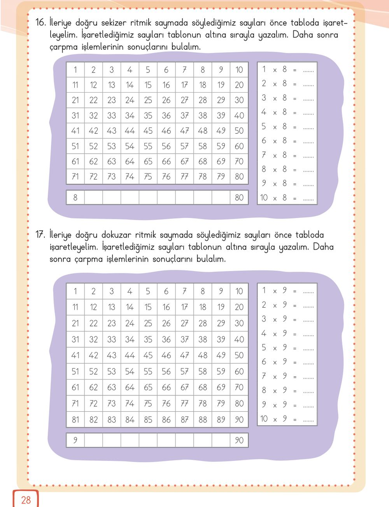

| 1 | 2 | 3 | 4 | 5 | 6 | 7 | 8 | 9 | 10 |
|---|---|---|---|---|---|---|---|---|----|
| 11 | 12 | 13 | 14 | 15 | 16 | 17 | 18 | 19 | 20 |
| 21 | 22 | 23 | 24 | 25 | 26 | 27 | 28 | 29 | 30 |
| 31 | 32 | 33 | 34 | 35 | 36 | 37 | 38 | 39 | 40 |
| 41 | 42 | 43 | 44 | 45 | 46 | 47 | 48 | 49 | 50 |
| 51 | 52 | 53 | 54 | 55 | 56 | 57 | 58 | 59 | 60 |
| 61 | 62 | 63 | 64 | 65 | 66 | 67 | 68 | 69 | 70 |
| 71 | 72 | 73 | 74 | 75 | 76 | 77 | 78 | 79 | 80 |
| 8 | | | | | | | | | 80 |

$1 \times 8 = \dots\dots$ <!-- KONTROL: Marker'da karşılığı yok, uydurma olabilir -->
$2 \times 8 = \dots\dots$ <!-- KONTROL: Marker'da karşılığı yok, uydurma olabilir -->
$3 \times 8 = \dots\dots$ <!-- KONTROL: Marker'da karşılığı yok, uydurma olabilir -->
$4 \times 8 = \dots\dots$ <!-- KONTROL: Marker'da karşılığı yok, uydurma olabilir -->
$5 \times 8 = \dots\dots$ <!-- KONTROL: Marker'da karşılığı yok, uydurma olabilir -->
$6 \times 8 = \dots\dots$ <!-- KONTROL: Marker'da karşılığı yok, uydurma olabilir -->
$7 \times 8 = \dots\dots$ <!-- KONTROL: Marker'da karşılığı yok, uydurma olabilir -->
$8 \times 8 = \dots\dots$ <!-- KONTROL: Marker'da karşılığı yok, uydurma olabilir -->
$9 \times 8 = \dots\dots$ <!-- KONTROL: Marker'da karşılığı yok, uydurma olabilir -->
$10 \times 8 = \dots\dots$ <!-- KONTROL: Marker'da karşılığı yok, uydurma olabilir -->

17. İleriye doğru dokuzar ritmik saymada söylediğimiz sayıları önce tabloda işaretleyelim. İşaretlediğimiz sayıları tablonun altına sırayla yazalım. Daha sonra çarpma işlemlerinin sonuçlarını bulalım.

| 1 | 2 | 3 | 4 | 5 | 6 | 7 | 8 | 9 | 10 |
|---|---|---|---|---|---|---|---|---|----|
| 11 | 12 | 13 | 14 | 15 | 16 | 17 | 18 | 19 | 20 |
| 21 | 22 | 23 | 24 | 25 | 26 | 27 | 28 | 29 | 30 |
| 31 | 32 | 33 | 34 | 35 | 36 | 37 | 38 | 39 | 40 |
| 41 | 42 | 43 | 44 | 45 | 46 | 47 | 48 | 49 | 50 |
| 51 | 52 | 53 | 54 | 55 | 56 | 57 | 58 | 59 | 60 |
| 61 | 62 | 63 | 64 | 65 | 66 | 67 | 68 | 69 | 70 |
| 71 | 72 | 73 | 74 | 75 | 76 | 77 | 78 | 79 | 80 |
| 81 | 82 | 83 | 84 | 85 | 86 | 87 | 88 | 89 | 90 |
| 9 | | | | | | | | | 90 |

$1 \times 9 = \dots\dots$ <!-- KONTROL: Marker'da karşılığı yok, uydurma olabilir -->
$2 \times 9 = \dots\dots$ <!-- KONTROL: Marker'da karşılığı yok, uydurma olabilir -->
$3 \times 9 = \dots\dots$ <!-- KONTROL: Marker'da karşılığı yok, uydurma olabilir -->
$4 \times 9 = \dots\dots$ <!-- KONTROL: Marker'da karşılığı yok, uydurma olabilir -->
$5 \times 9 = \dots\dots$ <!-- KONTROL: Marker'da karşılığı yok, uydurma olabilir -->
$6 \times 9 = \dots\dots$ <!-- KONTROL: Marker'da karşılığı yok, uydurma olabilir -->
$7 \times 9 = \dots\dots$ <!-- KONTROL: Marker'da karşılığı yok, uydurma olabilir -->
$8 \times 9 = \dots\dots$ <!-- KONTROL: Marker'da karşılığı yok, uydurma olabilir -->
$9 \times 9 = \dots\dots$ <!-- KONTROL: Marker'da karşılığı yok, uydurma olabilir -->
$10 \times 9 = \dots\dots$ <!-- KONTROL: Marker'da karşılığı yok, uydurma olabilir -->

<!-- sayfa 29 -->

18. İleriye doğru onar ritmik saymada söylediğimiz sayıları önce yüzlük tabloda işaretleyelim. İşaretlediğimiz sayıları tablonun altına sırayla yazalım. Daha sonra çarpma işlemlerinin sonuçlarını bulalım.

| 1 | 2 | 3 | 4 | 5 | 6 | 7 | 8 | 9 | 10 |
|---|---|---|---|---|---|---|---|---|----|
| 11 | 12 | 13 | 14 | 15 | 16 | 17 | 18 | 19 | 20 |
| 21 | 22 | 23 | 24 | 25 | 26 | 27 | 28 | 29 | 30 |
| 31 | 32 | 33 | 34 | 35 | 36 | 37 | 38 | 39 | 40 |
| 41 | 42 | 43 | 44 | 45 | 46 | 47 | 48 | 49 | 50 |
| 51 | 52 | 53 | 54 | 55 | 56 | 57 | 58 | 59 | 60 |
| 61 | 62 | 63 | 64 | 65 | 66 | 67 | 68 | 69 | 70 |
| 71 | 72 | 73 | 74 | 75 | 76 | 77 | 78 | 79 | 80 |
| 81 | 82 | 83 | 84 | 85 | 86 | 87 | 88 | 89 | 90 |
| 91 | 92 | 93 | 94 | 95 | 96 | 97 | 98 | 99 | 100 |

| 10 | | | | | | | | | 100 |
|----|---|---|---|---|---|---|---|---|----|

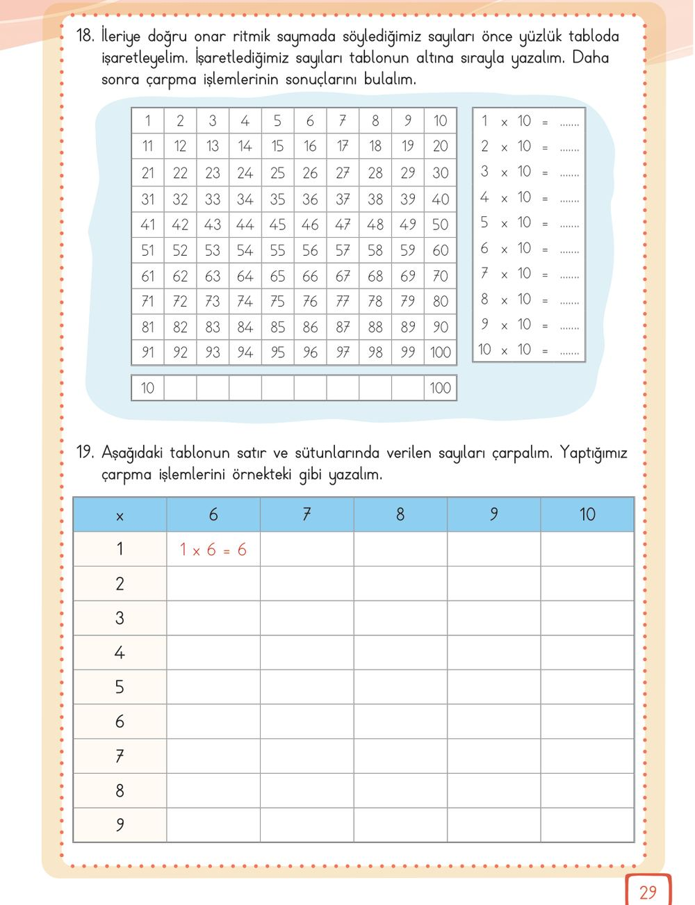

$1 \times 10 = \dots\dots$ <!-- KONTROL: Marker'da karşılığı yok, uydurma olabilir -->
$2 \times 10 = \dots\dots$ <!-- KONTROL: Marker'da karşılığı yok, uydurma olabilir -->
$3 \times 10 = \dots\dots$ <!-- KONTROL: Marker'da karşılığı yok, uydurma olabilir -->
$4 \times 10 = \dots\dots$ <!-- KONTROL: Marker'da karşılığı yok, uydurma olabilir -->
$5 \times 10 = \dots\dots$ <!-- KONTROL: Marker'da karşılığı yok, uydurma olabilir -->
$6 \times 10 = \dots\dots$ <!-- KONTROL: Marker'da karşılığı yok, uydurma olabilir -->
$7 \times 10 = \dots\dots$ <!-- KONTROL: Marker'da karşılığı yok, uydurma olabilir -->
$8 \times 10 = \dots\dots$ <!-- KONTROL: Marker'da karşılığı yok, uydurma olabilir -->
$9 \times 10 = \dots\dots$ <!-- KONTROL: Marker'da karşılığı yok, uydurma olabilir -->
$10 \times 10 = \dots\dots$ <!-- KONTROL: Marker'da karşılığı yok, uydurma olabilir -->

19. Aşağıdaki tablonun satır ve sütunlarında verilen sayıları çarpalım. Yaptığımız çarpma işlemlerini örnekteki gibi yazalım.

| $\times$ | 6 | 7 | 8 | 9 | 10 |
| :---: | :---: | :---: | :---: | :---: | :---: |
| 1 | $1 \times 6 = 6$ <!-- KONTROL: Marker'da karşılığı yok, uydurma olabilir --> | | | | |
| 2 | | | | | |
| 3 | | | | | |
| 4 | | | | | |
| 5 | | | | | |
| 6 | | | | | |
| 7 | | | | | |
| 8 | | | | | |
| 9 | | | | | |

<!-- sayfa 30 -->

20. Aşağıda verilen tablonun satır ve sütunundaki sayıları çarpalım. İşlem sonuçlarını örneklerdeki gibi sayıların kesiştiği kutulara yazalım.

| x | 1 | 2 | 3 | 4 | 5 | 6 | 7 | 8 | 9 | 10 |
|---|---|---|---|---|---|---|---|---|---|----|
| 1 | 1 | | | | | | | | | |
| 2 | | | 6 | | | | | | | |
| 3 | | | | 12 | | | | | | |
| 4 | | | | | | 24 | | | | |
| 5 | | | | | | | 35 | | | |
| 6 | | | | | | | | | | |
| 7 | | | | | | | | | | |
| 8 | | | | | | | | 64 | | |
| 9 | | | | | 45 | | | | | |
| 10| | | | | | | | | | 100|

21. Aşağıda verilen kaplumbağa görseli üzerindeki işlemleri yapalım. İşlemlerin olduğu bölümleri işlem sonucunun üzerindeki renge boyayalım.

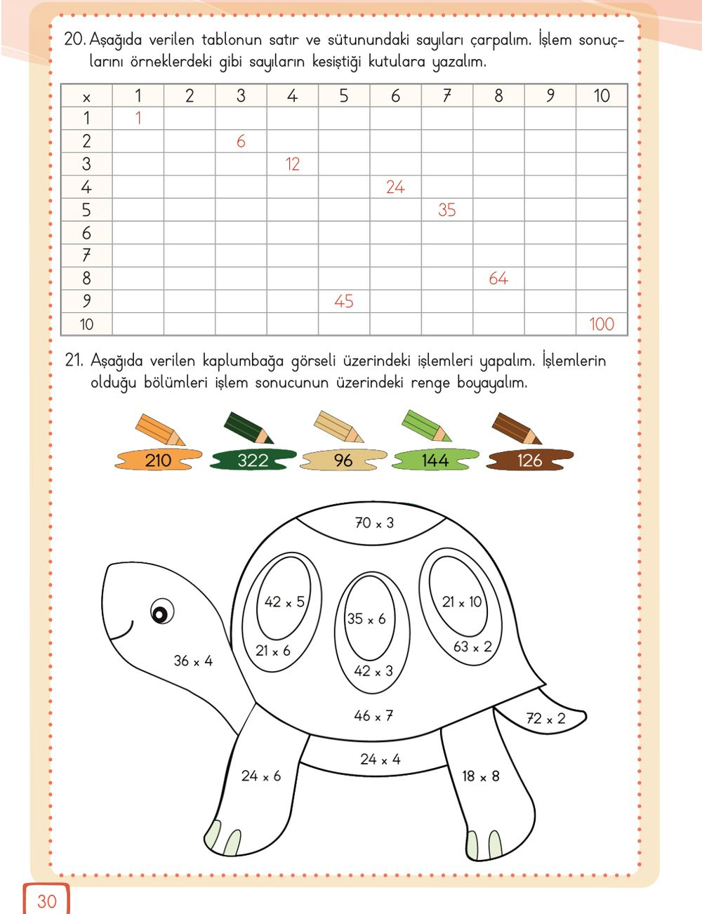

$70 \times 3$ <!-- KONTROL: Marker'da karşılığı yok, uydurma olabilir -->

$42 \times 5$ <!-- KONTROL: Marker'da karşılığı yok, uydurma olabilir -->
$21 \times 6$ <!-- KONTROL: Marker'da karşılığı yok, uydurma olabilir -->

$35 \times 6$ <!-- KONTROL: Marker'da karşılığı yok, uydurma olabilir -->
$42 \times 3$ <!-- KONTROL: Marker'da karşılığı yok, uydurma olabilir -->

$21 \times 10$ <!-- KONTROL: Marker'da karşılığı yok, uydurma olabilir -->
$63 \times 2$ <!-- KONTROL: Marker'da karşılığı yok, uydurma olabilir -->

$36 \times 4$ <!-- KONTROL: Marker'da karşılığı yok, uydurma olabilir -->

$46 \times 7$ <!-- KONTROL: Marker'da karşılığı yok, uydurma olabilir -->

$24 \times 6$ <!-- KONTROL: Marker'da karşılığı yok, uydurma olabilir -->
$24 \times 4$ <!-- KONTROL: Marker'da karşılığı yok, uydurma olabilir -->
$18 \times 8$ <!-- KONTROL: Marker'da karşılığı yok, uydurma olabilir -->

$72 \times 2$ <!-- KONTROL: Marker'da karşılığı yok, uydurma olabilir -->

<!-- sayfa 31 -->

22. Aşağıda modellenen bölme işlemlerini inceleyelim. Bölme işlemlerini yaparak noktalı yerleri örnekteki gibi dolduralım.

  

    $7 \div 3$ <!-- KONTROL: Marker'da karşılığı yok, uydurma olabilir --> 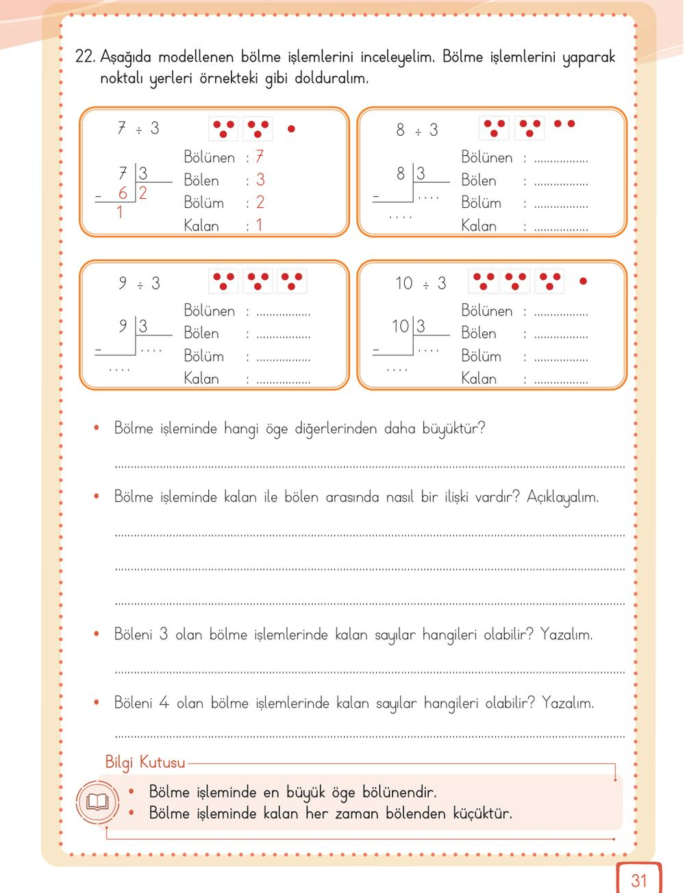
     
    $\begin{array}{r} 7 \mid 3 \\ - 6 \\ \hline 1 \end{array}$ <!-- KONTROL: Marker'da karşılığı yok, uydurma olabilir -->
     
    Bölünen : $7$
     
    Bölen : $3$
     
    Bölüm : $2$
     
    Kalan : $1$
  

  

    $8 \div 3$ <!-- KONTROL: Marker'da karşılığı yok, uydurma olabilir --> 
     
    $\begin{array}{r} 8 \mid 3 \\ - \dots \\ \hline \dots \end{array}$ <!-- KONTROL: Marker'da karşılığı yok, uydurma olabilir -->
     
    Bölünen : $\dots\dots\dots$
     
    Bölen : $\dots\dots\dots$
     
    Bölüm : $\dots\dots\dots$
     
    Kalan : $\dots\dots\dots$
  

  

    $9 \div 3$ <!-- KONTROL: Marker'da karşılığı yok, uydurma olabilir --> 
     
    $\begin{array}{r} 9 \mid 3 \\ - \dots \\ \hline \dots \end{array}$ <!-- KONTROL: Marker'da karşılığı yok, uydurma olabilir -->
     
    Bölünen : $\dots\dots\dots$
     
    Bölen : $\dots\dots\dots$
     
    Bölüm : $\dots\dots\dots$
     
    Kalan : $\dots\dots\dots$
  

  

    $10 \div 3$ <!-- KONTROL: Marker'da karşılığı yok, uydurma olabilir --> 
     
    $\begin{array}{r} 10 \mid 3 \\ - \dots \\ \hline \dots \end{array}$ <!-- KONTROL: Marker'da karşılığı yok, uydurma olabilir -->
     
    Bölünen : $\dots\dots\dots$
     
    Bölen : $\dots\dots\dots$
     
    Bölüm : $\dots\dots\dots$
     
    Kalan : $\dots\dots\

<!-- sayfa 32 -->

23. Aşağıdaki çarpma işlemlerini inceleyelim.

$3 \times 10 = 30$ $\quad$ $90 \div 10 = 9$ <!-- KONTROL: Gemma farklı okudu: 9 \times 10 = 90 --> $\quad$ $10 \times 8 = 80$
$71 \times 10 = 710$ <!-- KONTROL: Marker'da karşılığı yok, uydurma olabilir --> $\quad$ $20 \times 10 = 200$ $\quad$ $10 \times 23 = 230$

* 10 ile çarpılan sayılar ile çarpım arasındaki ilişkiyi arkadaşlarımızla tartışalım.
* 100 ile çarpılan sayılar ile çarpım arasındaki ilişkiyi arkadaşlarımızla tartışalım.
* Sayıların 10 ve 100 ile çarpımını kısa yoldan nasıl bulabiliriz? Açıklayalım.

...............................................................................................................................................................
...............................................................................................................................................................

24. Aşağıdaki bölme işlemlerini inceleyelim.

$70 \div 10 = 7$ $\quad$ $50 \div 10 = 5$ $\quad$ $40 \div 10 = 4$ $\quad$ $90 \div 10 = 9$

* 10'a bölünen sayılar ile bölüm arasındaki ilişkiyi arkadaşlarımızla tartışalım.
* Sayıların 10 ile bölümünü kısa yoldan nasıl bulabiliriz? Açıklayalım.

25. Aşağıdaki işlemleri yapalım.

$8 \times 100 =$ <!-- KONTROL: Marker'da karşılığı yok, uydurma olabilir --> $\quad$ $100 \times 7 =$ <!-- KONTROL: Marker'da karşılığı yok, uydurma olabilir --> $\quad$ $100 \times 2 =$
$5 \times 100 =$ <!-- KONTROL: Marker'da karşılığı yok, uydurma olabilir --> $\quad$ $3 \times 100 =$ <!-- KONTROL: Marker'da karşılığı yok, uydurma olabilir --> $\quad$ $9 \times 100 =$ <!-- KONTROL: Marker'da karşılığı yok, uydurma olabilir -->
$30 \div 10 =$ <!-- KONTROL: Marker'da karşılığı yok, uydurma olabilir --> $\quad$ $20 \times 10 = 200$ <!-- KONTROL: Gemma farklı okudu: 20 \div 10 = --> $\quad$ $80 \div 10 =$ <!-- KONTROL: Marker'da karşılığı yok, uydurma olabilir -->

Bilgi Kutusu
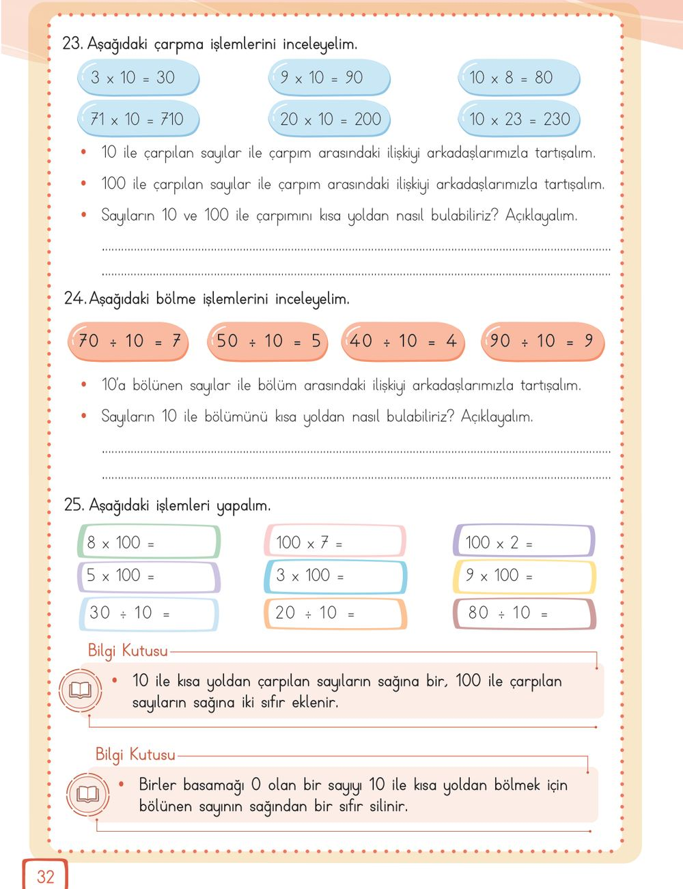
* 10 ile kısa yoldan çarpılan sayıların sağına bir, 100 ile çarpılan sayıların sağına iki sıfır eklenir.

Bilgi Kutusu

* Birler basamağı 0 olan bir sayıyı 10 ile kısa yoldan bölmek için bölünen sayının sağından bir sıfır silinir.

<!-- sayfa 33 -->

26. Şener ve ailesi bir haftada $11$ yumurta tüketmektedir. Şener ve ailesinin $4$ haftada tükettiği toplam yumurta sayısını tahmin edelim. Tahminimizin işlem sonucundan eksik, fazla veya eşit olma durumunu açıklayalım.

* Tahminim: ............ İşlem Sonucu: ............ Karşılaştırma: ............

27. Selçuk $45$ sayfalık bir kitabı her gün eşit sayıda sayfa okuyarak $5$ günde bitirmiştir. Selçuk'un bir günde kaç sayfa kitap okuduğunu tahmin edelim. Tahminimizin işlem sonucundan eksik, fazla veya eşit olma durumunu açıklayalım.

28. Aşağıdaki işlem sonuçlarını zihinden yaparak bulalım. Kullandığımız zihinden işlem yapma yöntemini açıklayalım.

* $26 \times 3 =$ <!-- KONTROL: Marker'da karşılığı yok, uydurma olabilir -->
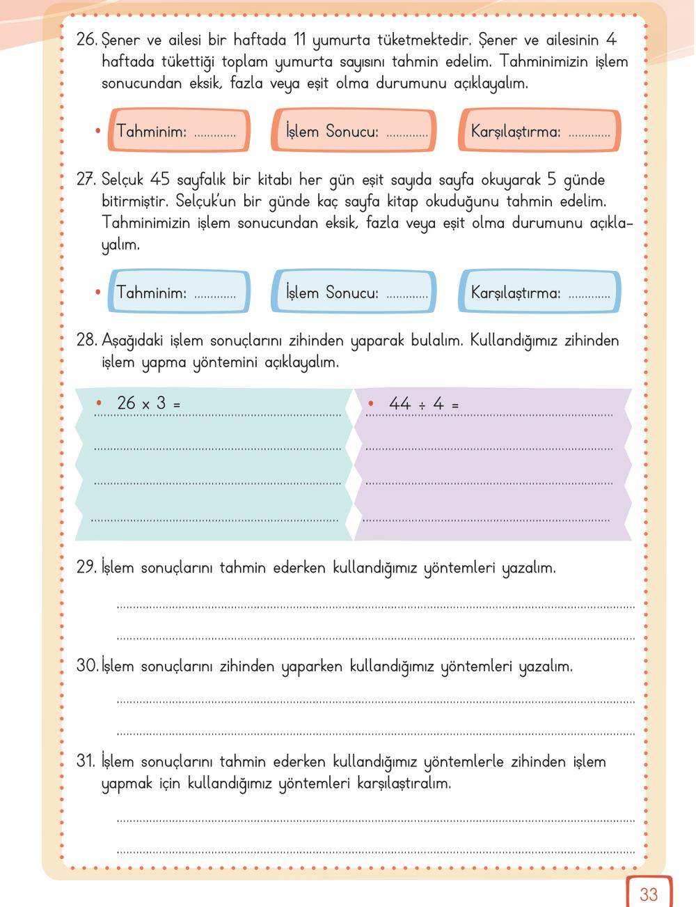

* $44 \div 4 =$ <!-- KONTROL: Marker'da karşılığı yok, uydurma olabilir -->

29. İşlem sonuçlarını tahmin ederken kullandığımız yöntemleri yazalım.
...............................................................................................................................................................
...............................................................................................................................................................

30. İşlem sonuçlarını zihinden yaparken kullandığımız yöntemleri yazalım.
...............................................................................................................................................................
...............................................................................................................................................................

31. İşlem sonuçlarını tahmin ederken kullandığımız yöntemlerle zihinden işlem yapmak için kullandığımız yöntemleri karşılaştıralım.
...............................................................................................................................................................
................................................................

<!-- sayfa 34 -->

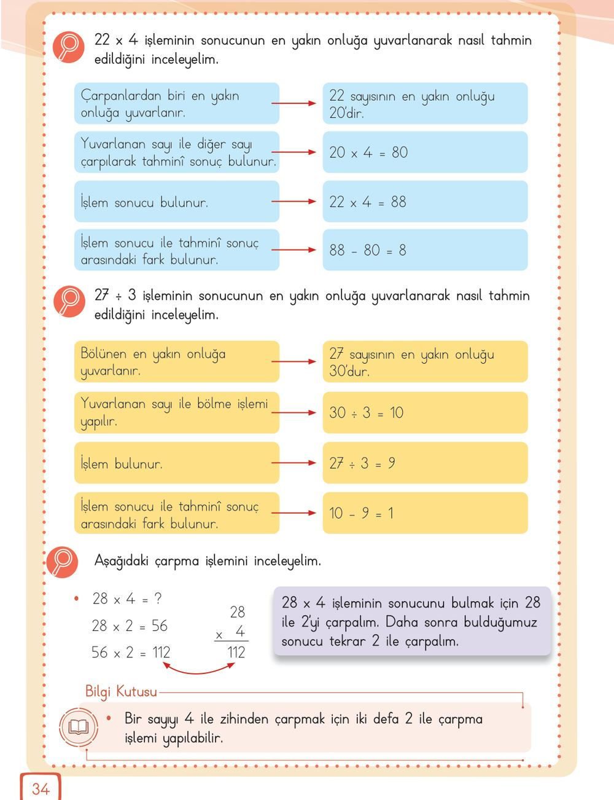 $22 \times 4$ <!-- KONTROL: Marker'da karşılığı yok, uydurma olabilir --> işleminin sonucunun en yakın onluğa yuvarlanarak nasıl tahmin edildiğini inceleyelim.

| | |
| :--- | :--- |
| Çarpanlardan biri en yakın onluğa yuvarlanır. | $22$ sayısının en yakın onluğu $20$'dir. |
| Yuvarlanan sayı ile diğer sayı çarpılarak tahminî sonuç bulunur. | $20 \times 4 = 80$ <!-- KONTROL: Marker'da karşılığı yok, uydurma olabilir --> |
| İşlem sonucu bulunur. | $22 \times 4 = 88$ <!-- KONTROL: Marker'da karşılığı yok, uydurma olabilir --> |
| İşlem sonucu ile tahminî sonuç arasındaki fark bulunur. | $88 - 80 = 8$ |

 $27 \div 3$ <!-- KONTROL: Marker'da karşılığı yok, uydurma olabilir --> işleminin sonucunun en yakın onluğa yuvarlanarak nasıl tahmin edildiğini inceleyelim.

| | |
| :--- | :--- |
| Bölünen en yakın onluğa yuvarlanır. | $27$ sayısının en yakın onluğu $30$'dur. |
| Yuvarlanan sayı ile bölme işlemi yapılır. | $30 \div 3 = 10$ <!-- KONTROL: Marker'da karşılığı yok, uydurma olabilir --> |
| İşlem bulunur. | $27 \div 3 = 9$ <!-- KONTROL: Marker'da karşılığı yok, uydurma olabilir --> |
| İşlem sonucu ile tahminî sonuç arasındaki fark bulunur. | $10 - 9 = 1$ |

 Aşağıdaki çarpma işlemini inceleyelim.

* $28 \times 4 = ?$
  $$\begin{array}{r@{\quad}l} 28 & \\ \times \phantom{0} 4 & \\ \hline 112 & \end{array}$$
<!-- KONTROL: Marker'da karşılığı yok, uydurma olabilir -->
  $$\begin{array}{r@{\quad}l} 28 & \\ \times \phantom{0} 2 & = 56 \\ 56 \times 2 & = 112 \end{array}$$
<!-- KONTROL: Marker'da karşılığı yok, uydurma olabilir -->

$28 \times 4$ işleminin sonucunu bulmak için $28$ ile $2$'yi çarpalım. Daha sonra bulduğumuz sonucu tekrar $2$ ile çarpalım.

---

**Bilgi Kutusu**
* Bir sayıyı $4$ ile zihinden çarpmak için iki defa $2$ ile çarpma işlemi yapılabilir.

<!-- sayfa 35 -->

# Aşağıdaki çarpma işlemini inceleyelim.

* $62 \times 7 = ?$
  $$62$$
  $$\text{x } 7$$
  $$\overline{434}$$

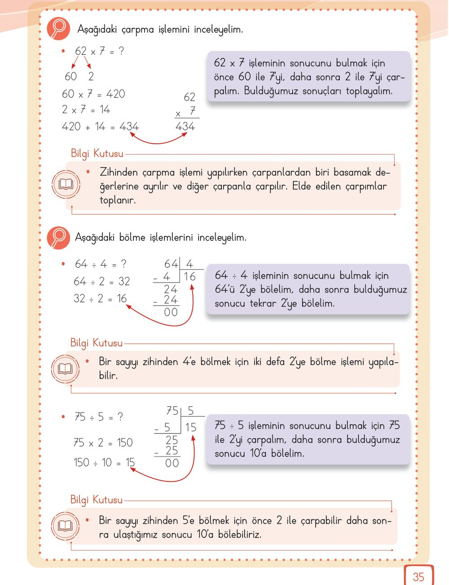

$60 \text{ } 2$
$60 \times 7 = 420$
$2 \times 7 = 14$
$420 + 14 = 434$

> $62 \times 7$ işleminin sonucunu bulmak için önce $60$ ile $7$'yi, daha sonra $2$ ile $7$'yi çarpalım. Bulduğumuz sonuçları toplayalım.

### Bilgi Kutusu
* Zihinden çarpma işlemi yapılırken çarpanlardan biri basamak değerlerine ayrılır ve diğer çarpanla çarpılır. Elde edilen çarpımlar toplanır.

# Aşağıdaki bölme işlemlerini inceleyelim.

* $64 \div 4 = ?$
  $$64 \text{ | } 4$$
<!-- KONTROL: Marker'da karşılığı yok, uydurma olabilir -->
  $$-4 \text{ | } 16$$
<!-- KONTROL: Marker'da karşılığı yok, uydurma olabilir -->
  $$24$$
  $$-24$$
  $$00$$

$64 \div 2 = 32$
$32 \div 2 = 16$

> $64 \div 4$ işleminin sonucunu bulmak için $64$'ü $2$'ye bölelim, daha sonra bulduğumuz sonucu tekrar $2$'ye bölelim.

### Bilgi Kutusu
* Bir sayıyı zihinden $4$'e bölmek için iki defa $2$'ye bölme işlemi yapılabilir.

* $75 \div 5 = ?$
  $$75 \text{ | } 5$$
<!-- KONTROL: Marker'da karşılığı yok, uydurma olabilir -->
  $$-5 \text{ | } 15$$
<!-- KONTROL: Marker'da karşılığı yok, uydurma olabilir -->
  $$25$$
  $$-25$$
<!-- KONTROL: Marker'da karşılığı yok, uydurma olabilir -->
  $$00$$

$75 \times 2 = 150$
$150 \div 10 = 15$

> $75 \div 5$ işleminin sonucunu bulmak için $75$ ile $2$'yi çarpalım, daha sonra bulduğumuz sonucu $10$'a bölelim.

### Bilgi Kutusu
* Bir sayıyı zihinden $5$'e bölmek için önce $2$ ile çarpabilir daha sonra ulaştığımız sonucu $10$'a bölebiliriz.

<!-- sayfa 36 -->

# ETKİNLİK ÇARPMA VE BÖLMEYİ ZİHİNDEN YAPIYORUM

Aşağıdaki işlemlerin sonuçlarını tahmin ederek “Tahminim” bölümüne yazalım. Sonra işlemleri zihinden yaparak “Zihinden İşlem Sonucu” bölümüne yazalım. Daha sonra tahminimizle işlem sonucunu karşılaştıralım.

| İşlem | Tahminim | Zihinden İşlem Sonucu | Karşılaştırma |
| :--- | :--- | :--- | :--- |
| $12 \times 5$ <!-- KONTROL: Marker'da karşılığı yok, uydurma olabilir --> | | | |
| $29 \times 9$ <!-- KONTROL: Marker'da karşılığı yok, uydurma olabilir --> | | | |
| $38 \times 4$ <!-- KONTROL: Marker'da karşılığı yok, uydurma olabilir --> | | | |
| $84 \div 4$ <!-- KONTROL: Marker'da karşılığı yok, uydurma olabilir --> | | | |
| $70 \div 10$ <!-- KONTROL: Marker'da karşılığı yok, uydurma olabilir --> | | | |
| $45 \div 5$ <!-- KONTROL: Marker'da karşılığı yok, uydurma olabilir --> | | | |

## Değerlendirme

1. Tahminî sonuçları ve zihinden işlem sonuçlarını bulmak için kullandığımız yöntemleri açıklayalım.
....................................................................................................................................................................
....................................................................................................................................................................

2. İşlem yaparken kullandığımız zihinden işlem yapma yöntemlerinden hangisi daha kolaydı? Açıklayalım.
....................................................................................................................................................................
....................................................................................................................................................................

| Gözlem formuna | Çarpma ve bölme |
| :---: | :---: |
| 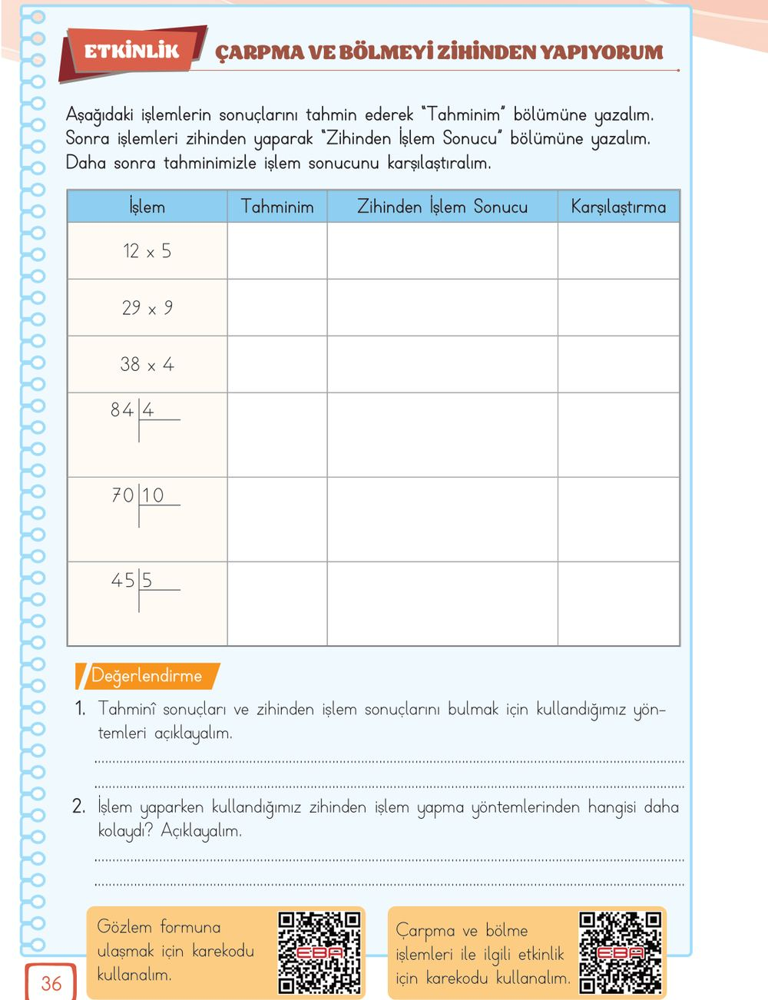 |  |

<!-- sayfa 37 -->

# PEKİŞTİRELİM

1. Aşağıdaki çarpma işlemlerini yapalım. Çarpma işlemlerinin ögelerini yazalım.

| İşlem | 1. Çarpan | 2. Çarpan | Çarpım |
| :--- | :--- | :--- | :--- |
| • $16 \times 4$ <!-- KONTROL: Marker'da karşılığı yok, uydurma olabilir --> | .................... | .................... | .................... |
| • $24 \times 6$ <!-- KONTROL: Marker'da karşılığı yok, uydurma olabilir --> | .................... | .................... | .................... |
| • $46 \times 12$ <!-- KONTROL: Marker'da karşılığı yok, uydurma olabilir --> | .................... | .................... | .................... |
| • $113 \times 5$ <!-- KONTROL: Marker'da karşılığı yok, uydurma olabilir --> | .................... | .................... | .................... |
| • $37 \times 5$ <!-- KONTROL: Marker'da karşılığı yok, uydurma olabilir --> | .................... | .................... | .................... |

2. Aşağıdaki bölme işlemlerini yapalım. Bölme işlemlerinin ögelerini yazalım.

| | $38 \div 2$ <!-- KONTROL: Marker'da karşılığı yok, uydurma olabilir --> | $76 \div 5$ <!-- KONTROL: Marker'da karşılığı yok, uydurma olabilir --> | $84 \div 3$ <!-- KONTROL: Marker'da karşılığı yok, uydurma olabilir --> | $53 \div 5$ <!-- KONTROL: Marker'da karşılığı yok, uydurma olabilir --> |
| :--- | :--- | :--- | :--- | :--- |
| Bölünen | | | | |
| Bölen | | | | |
| Bölüm | | | | |
| Kalan | | | | |

3. Böleni $6$ olan bir bölme işleminin kalanı hangi sayılar olabilir?
...............................................................................................................................................................

4. Aşağıdaki sayıları bölme işleminde uygun yerlere yazalım.

$56 \quad 9 \quad 6 \quad 13 \quad 2$ <!-- KONTROL: Marker'da karşılığı yok, uydurma olabilir -->

$$\begin{array}{r}
\dots\dots \\
\dots\dots \overline{) \dots\dots} \\
- \\
\dots\dots \\
\dots\dots \\
\hline
\dots\dots
\end{array}$$
<!-- KONTROL: Marker'da karşılığı yok, uydurma olabilir -->

5. Aşağıdaki sayıları çarpma işleminde uygun yerlere yazalım.

$72 \quad 8 \quad 9 \quad 10$

$$\begin{array}{r}
\dots\dots \\
\times \dots\dots \\
\hline
\dots\dots
\end{array}$$
<!-- KONTROL: Marker'da karşılığı yok, uydurma olabilir -->

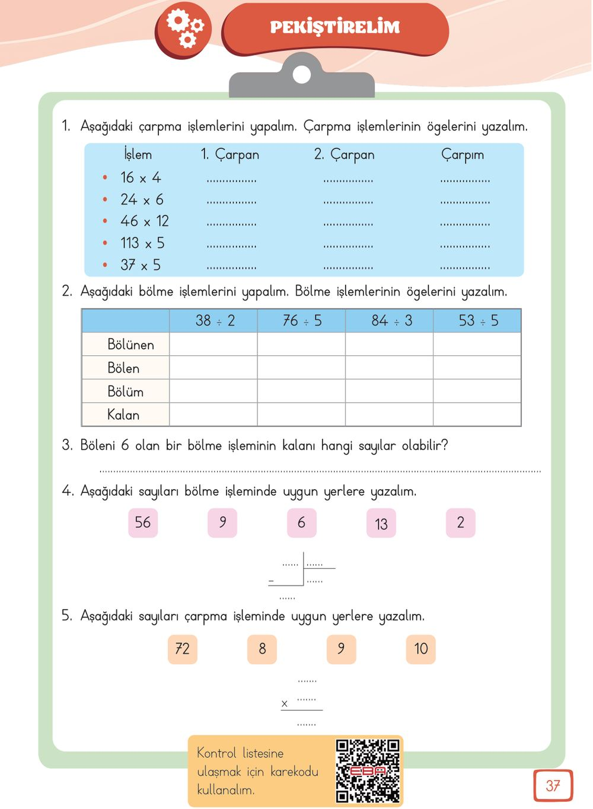
<!-- yer tutucu bulunamadı: sayfa sonuna eklendi -->

<!-- sayfa 38 -->

# ETKİNLİK ÇARPMA İŞLEMİNİ MODELLİYORUM

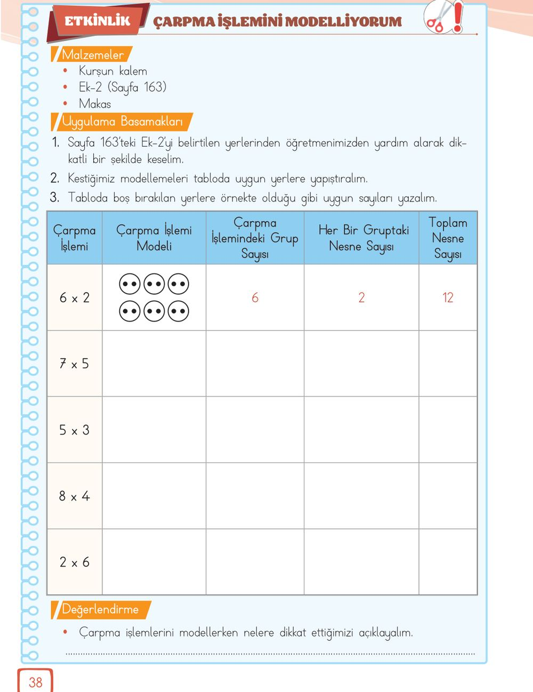

## Malzemeler
* Kurşun kalem
* Ek-2 (Sayfa 163)
* Makas

## Uygulama Basamakları
1. Sayfa 163'teki Ek-2'yi belirtilen yerlerinden öğretmenimizden yardım alarak dikkatli bir şekilde keselim.
2. Kestiğimiz modellemeleri tabloda uygun yerlere yapıştıralım.
3. Tabloda boş bırakılan yerlere örnekte olduğu gibi uygun sayıları yazalım.

| Çarpma İşlemi | Çarpma İşlemi Modeli | Çarpma İşlemindeki Grup Sayısı | Her Bir Gruptaki Nesne Sayısı | Toplam Nesne Sayısı |
| :--- | :---: | :---: | :---: | :---: |
| $6 \times 2$ <!-- KONTROL: Marker'da karşılığı yok, uydurma olabilir --> |  | $6$ | $2$ | $12$ |
| $7 \times 5$ <!-- KONTROL: Marker'da karşılığı yok, uydurma olabilir --> | | | | |
| $5 \times 3$ <!-- KONTROL: Marker'da karşılığı yok, uydurma olabilir --> | | | | |
| $8 \times 4$ <!-- KONTROL: Marker'da karşılığı yok, uydurma olabilir --> | | | | |
| $2 \times 6$ <!-- KONTROL: Marker'da karşılığı yok, uydurma olabilir --> | | | | |

## Değerlendirme
* Çarpma işlemlerini modellerken nelere dikkat ettiğimizi açıklayalım.

<!-- sayfa 39 -->

Nilay Öğretmen bir etkinlikte kullanmak üzere 4 kutu yapboz getirdi. Her kutuda 37 parça olduğuna göre yapbozlardaki toplam parça sayısının basamak tablosunda nasıl gösterildiğini inceleyelim.

| Onluk | Birlik |
| :---: | :---: |
| 3 | 7 |
| $\times$ | 3 |
| 2 | 1 |
| 9 | 0 |
| $+$ | |
| 1 | 1 | 1 |

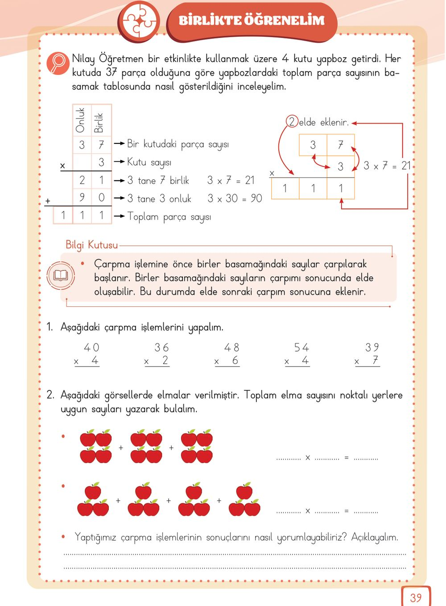

$\rightarrow$ Bir kutudaki parça sayısı
$\rightarrow$ Kutu sayısı
$\rightarrow$ 3 tane 7 birlik $\quad 3 \times 7 = 21$ <!-- KONTROL: Marker'da karşılığı yok, uydurma olabilir -->
$\rightarrow$ 3 tane 3 onluk $\quad 3 \times 30 = 90$ <!-- KONTROL: Marker'da karşılığı yok, uydurma olabilir -->
$\rightarrow$ Toplam parça sayısı

**Bilgi Kutusu**
* Çarpma işlemine önce birler basamağındaki sayılar çarpılarak başlanır. Birler basamağındaki sayıların çarpımı sonucunda elde oluşabilir. Bu durumda elde sonraki çarpım sonucuna eklenir.

1. Aşağıdaki çarpma işlemlerini yapalım.

$$\begin{array}{rrrrrr}
40 & 36 & 48 & 54 & 39 \\
\times \phantom{0} 4 & \times \phantom{0} 2 & \times \phantom{0} 6 & \times \phantom{0} 4 & \times \phantom{0} 7 \\
\hline
\end{array}$$
<!-- KONTROL: Marker'da karşılığı yok, uydurma olabilir -->

2. Aşağıdaki görsellerde elmalar verilmiştir. Toplam elma sayısını noktalı yerlere uygun sayıları yazarak bulalım.

* 🍎🍎🍎 + 🍎🍎🍎 + 🍎🍎🍎 $\quad \dots\dots\dots \times \dots\dots\dots = \dots\dots\dots$

* 🍎🍎 + 🍎🍎 + 🍎🍎🍎 + 🍎🍎🍎 $\quad \dots\dots\dots \times \dots\dots\dots = \dots\dots\dots$

* Yaptığımız çarpma işlemlerinin sonuçlarını nasıl yorumlayabiliriz? Açıklayalım.
................................................................................................................................................................................................................................................................................................................................................................................................................................................................................................................................................................................................................................................................................................................................................................................................................................................................................................................................

<!-- sayfa 40 -->

# ETKİNLİK BÖLME İŞLEMİNİ MODELLİYORUM

Aşağıda verilen tabloda boş bırakılan yerleri örnekteki gibi dolduralım.

| Bölme İşlemi | Bölme İşlemi Modeli | Bölme İşlemindeki Grup Sayısı | Her Bir Gruptaki Nesne Sayısı | Toplam Nesne Sayısı |
| :--- | :--- | :--- | :--- | :--- |
| $15 \div 5$ <!-- KONTROL: Marker'da karşılığı yok, uydurma olabilir --> | 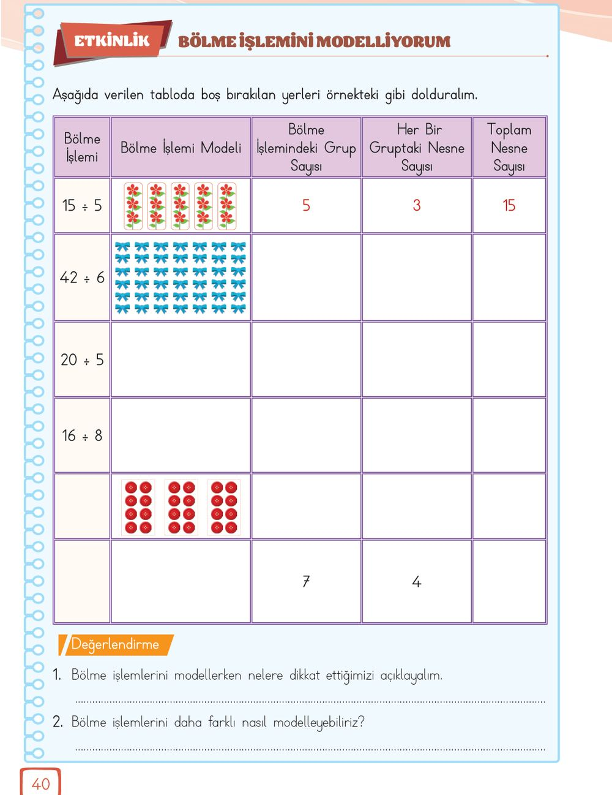 | $5$ | $3$ | $15$ |
| $42 \div 6$ <!-- KONTROL: Marker'da karşılığı yok, uydurma olabilir --> |  | | | |
| $20 \div 5$ <!-- KONTROL: Marker'da karşılığı yok, uydurma olabilir --> | | | | |
| $16 \div 8$ <!-- KONTROL: Marker'da karşılığı yok, uydurma olabilir --> | | | | |
| |  | | | |
| | | $7$ | $4$ | |

# Değerlendirme

1. Bölme işlemlerini modellerken nelere dikkat ettiğimizi açıklayalım.
....................................................................................................................................................................

2. Bölme işlemlerini daha farklı nasıl modelleyebiliriz?

<!-- sayfa 41 -->

44 fındığın 3 kişiye eşit sayıda paylaştırılmasının taban bloklarıyla gösterimini inceleyelim.

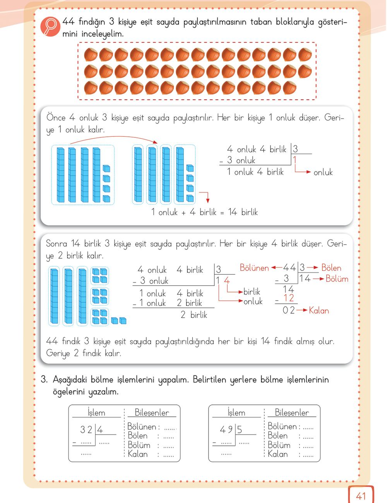

Önce 4 onluk 3 kişiye eşit sayıda paylaştırılır. Her bir kişiye 1 onluk düşer. Geriye 1 onluk kalır.

$$1 \text{ onluk} + 4 \text{ birlik} = 14 \text{ birlik}$$
<!-- KONTROL: Marker'da karşılığı yok, uydurma olabilir -->

Sonra 14 birlik 3 kişiye eşit sayıda paylaştırılır. Her bir kişiye 4 birlik düşer. Geriye 2 birlik kalır.

$$44 \text{ fındık } 3 \text{ kişiye eşit sayıda paylaştırıldığında her bir kişi } 14 \text{ fındık almış olur. Geriye } 2 \text{ fındık kalır.}$$
<!-- KONTROL: Marker'da karşılığı yok, uydurma olabilir -->

3. Aşağıdaki bölme işlemlerini yapalım. Belirtilen yerlere bölme işlemlerinin ögelerini yazalım.

| İşlem | Bileşenler |
| :--- | :--- |
| $$32 \div 4$$
<!-- KONTROL: Marker'da karşılığı yok, uydurma olabilir -->   $$\begin{array}{r@{\quad}l} 32 & \\ - \dots & \\ \hline \dots & \end{array}$$
<!-- KONTROL: Marker'da karşılığı yok, uydurma olabilir --> | Bölünen : ......   Bölen : ......   Bölüm : ......   Kalan : ...... |

| İşlem | Bileşenler |
| :--- | :--- |
| $$49 \div 5$$
<!-- KONTROL: Marker'da karşılığı yok, uydurma olabilir -->   $$\begin{array}{r@{\quad}l} 49 & \\ - \dots & \\ \hline \dots & \end{array}$$
<!-- KONTROL: Marker'da karşılığı yok, uydurma olabilir --> | Bölünen : ......   Bölen : ......   Bölüm : ......   Kalan : ...... |

<!-- sayfa 42 -->

4. Aşağıda verilen görseller üzerindeki çarpma işlemlerini yapalım. Sonuçları eşit olanları aynı renge boyayalım.

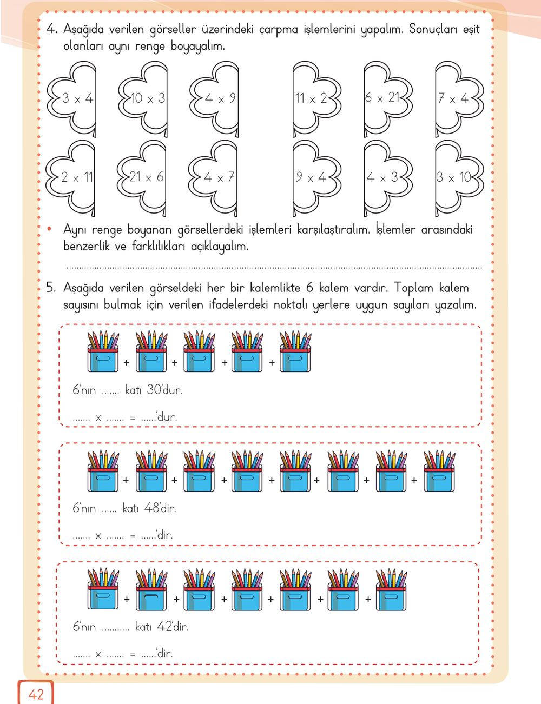

* Aynı renge boyanan görsellerdeki işlemleri karşılaştıralım. İşlemler arasındaki benzerlik ve farklılıkları açıklayalım.

----------------------------------------------------------------------------------------------------

5. Aşağıda verilen görseldeki her bir kalemlikte $6$ kalem vardır. Toplam kalem sayısını bulmak için verilen ifadelerdeki noktalı yerlere uygun sayıları yazalım.

$6$'nın ...... katı $30$'dur.

...... $\times$ ...... $=$ ......'dur.

$6$'nın ...... katı $48$'dir.

...... $\times$ ...... $=$ ......'dir.

$6$'nın ........ katı $42$'dir.

<!-- sayfa 43 -->

6. Çarpma işlemlerinin sonucunu örnekteki gibi boyayarak bulalım.

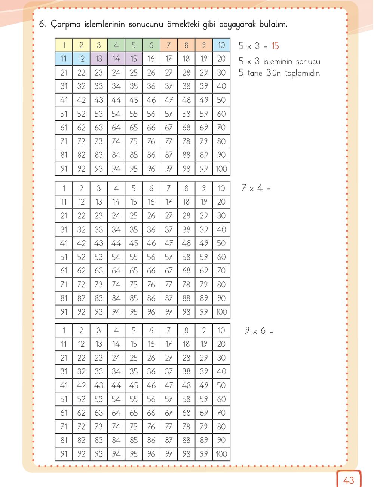
$5 \times 3 = 15$
$5 \times 3$ işleminin sonucu $5$ tane $3$'ün toplamıdır.

$7 \times 4 =$

$9 \times 6 =$ <!-- KONTROL: Marker'da karşılığı yok, uydurma olabilir -->

<!-- sayfa 44 -->

7. Bölme işlemini örnekteki gibi yapalım.

* $14 \div 4$ <!-- KONTROL: Marker'da karşılığı yok, uydurma olabilir -->

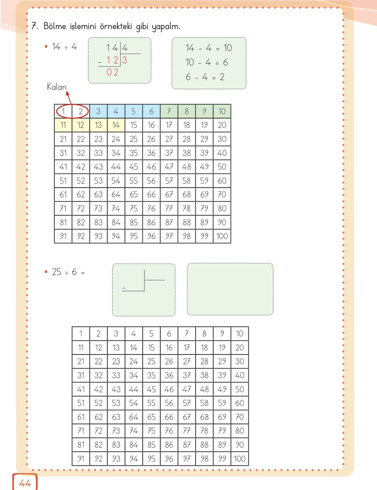

$10 - 4 = 6$ <!-- KONTROL: Gemma farklı okudu: 14 - 4 = 10 -->
$10 - 4 = 6$
$6 - 4 = 2$

Kalan

| | | | | | | | | | |
|---|---|---|---|---|---|---|---|---|---|
| 1 | 2 | 3 | 4 | 5 | 6 | 7 | 8 | 9 | 10 |
| 11 | 12 | 13 | 14 | 15 | 16 | 17 | 18 | 19 | 20 |
| 21 | 22 | 23 | 24 | 25 | 26 | 27 | 28 | 29 | 30 |
| 31 | 32 | 33 | 34 | 35 | 36 | 37 | 38 | 39 | 40 |
| 41 | 42 | 43 | 44 | 45 | 46 | 47 | 48 | 49 | 50 |
| 51 | 52 | 53 | 54 | 55 | 56 | 57 | 58 | 59 | 60 |
| 61 | 62 | 63 | 64 | 65 | 66 | 67 | 68 | 69 | 70 |
| 71 | 72 | 73 | 74 | 75 | 76 | 77 | 78 | 79 | 80 |
| 81 | 82 | 83 | 84 | 85 | 86 | 87 | 88 | 89 | 90 |
| 91 | 92 | 93 | 94 | 95 | 96 | 97 | 98 | 99 | 100 |

* $25 \div 6 =$ <!-- KONTROL: Marker'da karşılığı yok, uydurma olabilir -->

<!-- sayfa 45 -->

8. Nilgün Hanım 12 kurabiyeyi 4 tabağa eşit sayıda paylaştırmak için aşağıdaki işlemi yapıyor. İşlemin sağlamasını yapalım.

$$\begin{array}{r|l}
12 & 4 \\
\cline{2-2}
\underline{12} & 3 \\
00 &
\end{array}$$
<!-- KONTROL: Marker'da karşılığı yok, uydurma olabilir -->

9. Ali’nin 4 sepeti ve her sepette 15 yumurtası vardır. Ali toplam yumurta sayısını bulmak için aşağıdaki işlemi yapıyor. İşlemin sağlamasını yapalım.

$$\begin{array}{r}
15 \\
\times \phantom{0} 4 \\
\hline
60
\end{array}$$
<!-- KONTROL: Marker'da karşılığı yok, uydurma olabilir -->

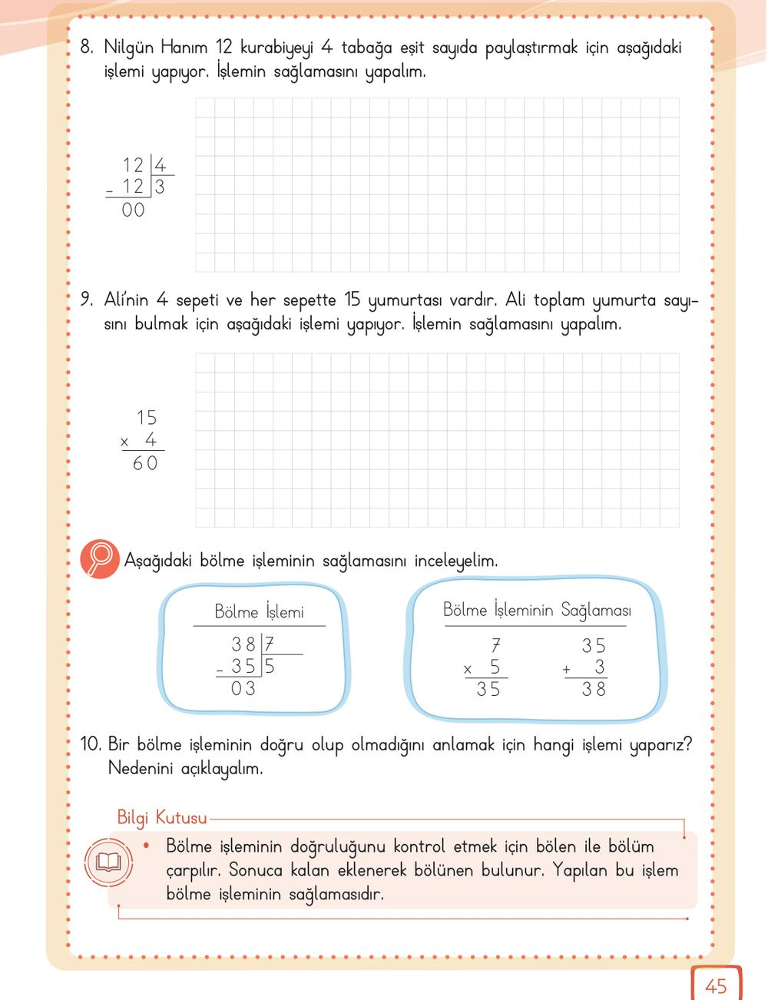 Aşağıdaki bölme işleminin sağlamasını inceleyelim.

| Bölme İşlemi | Bölme İşleminin Sağlaması |
| :--- | :--- |
| $$\begin{array}{r|l}
38 & 7 \\
\cline{2-2}
\underline{35} & 5 \\
03 &
\end{array}$$
<!-- KONTROL: Marker'da karşılığı yok, uydurma olabilir --> | $$\begin{array}{rr}
7 & 35 \\
\times \phantom{0} 5 & + \phantom{0} 3 \\
\hline
35 & 38
\end{array}$$
<!-- KONTROL: Marker'da karşılığı yok, uydurma olabilir --> |

10. Bir bölme işleminin doğru olup olmadığını anlamak için hangi işlemi yaparız? Nedenini açıklayalım.

**Bilgi Kutusu**
* Bölme işleminin doğruluğunu kontrol etmek için bölen ile bölüm çarpılır. Sonuca kalan eklenerek bölünen bulunur. Yapılan bu işlem bölme işleminin sağlamasıdır.

<!-- sayfa 46 -->

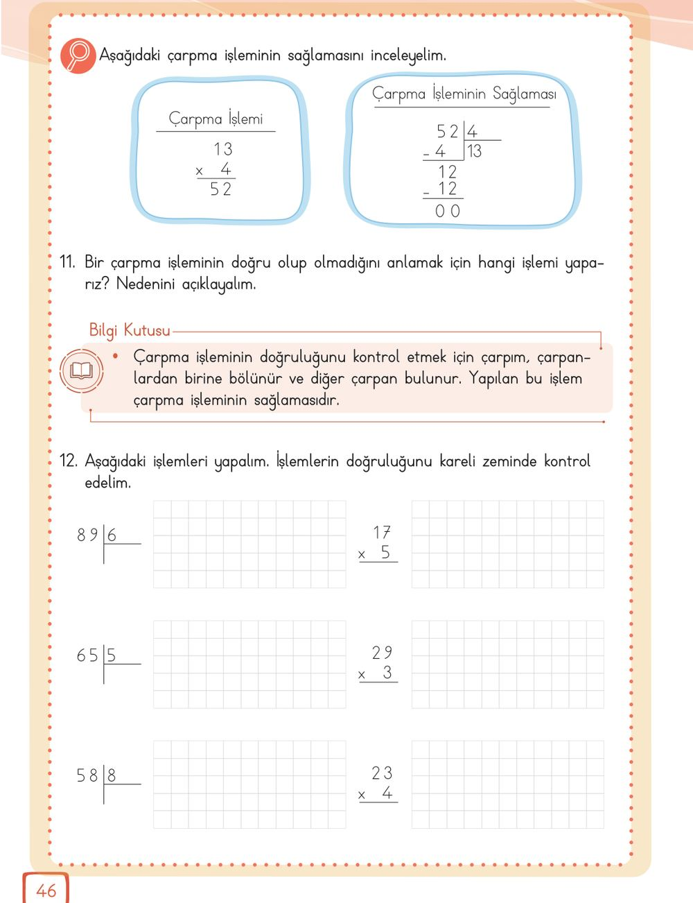 Aşağıdaki çarpma işleminin sağlamasını inceleyelim.

| Çarpma İşlemi | Çarpma İşleminin Sağlaması |
| :--- | :--- |
| $\begin{array}{r} 13 \\ \times \phantom{0} 4 \\ \hline 52 \end{array}$ <!-- KONTROL: Marker'da karşılığı yok, uydurma olabilir --> | $\begin{array}{r} 52 \mid 4 \\ -4 \phantom{0} \mid 13 \\ \hline 12 \phantom{0} \\ -12 \phantom{0} \\ \hline 00 \end{array}$ <!-- KONTROL: Marker'da karşılığı yok, uydurma olabilir --> |

11. Bir çarpma işleminin doğru olup olmadığını anlamak için hangi işlemi yaparız? Nedenini açıklayalım.

> **Bilgi Kutusu**
> * Çarpma işleminin doğruluğunu kontrol etmek için çarpım, çarpanlardan birine bölünür ve diğer çarpan bulunur. Yapılan bu işlem çarpma işleminin sağlamasıdır.

12. Aşağıdaki işlemleri yapalım. İşlemlerin doğruluğunu kareli zeminde kontrol edelim.

$\begin{array}{r} 89 \\ \div 6 \\ \hline \end{array}$ <!-- KONTROL: Marker'da karşılığı yok, uydurma olabilir --> [Kareli alan] $\quad$ $\begin{array}{r} 17 \\ \times \phantom{0} 5 \\ \hline \end{array}$ <!-- KONTROL: Marker'da karşılığı yok, uydurma olabilir --> [Kareli alan]

$\begin{array}{r} 65 \\ \div 5 \\ \hline \end{array}$ <!-- KONTROL: Marker'da karşılığı yok, uydurma olabilir --> [Kareli alan] $\quad$ $\begin{array}{r} 29 \\ \times \phantom{0} 3 \\ \hline \end{array}$ <!-- KONTROL: Marker'da karşılığı yok, uydurma olabilir --> [Kareli alan]

$\begin{array}{r} 58 \\ \div 8 \\ \hline \end{array}$ <!-- KONTROL: Marker'da karşılığı yok, uydurma olabilir --> [Kareli alan] $\quad$ $\begin{array}{r} 23 \\ \times \phantom{0} 4 \\ \hline \end{array}$ <!-- KONTROL: Marker'da karşılığı yok, uydurma olabilir --> [Kareli alan]

<!-- sayfa 47 -->

# PEKİŞTİRELİM

Aşağıdaki işlemleri inceleyelim. Kutuları belirten harfleri ilgili olduğu ifadenin karşısına yazalım. Bir ifadenin karşısına birden fazla harf yazabiliriz.

| a | b | c |
| :---: | :---: | :---: |
| $\begin{array}{r} ? \\ - \\ 0\ 3 \end{array} \big| \begin{array}{r} 8 \\ 6 \end{array}$ <!-- KONTROL: Marker'da karşılığı yok, uydurma olabilir --> | $\begin{array}{r} ? \\ - \\ 0\ 4 \end{array} \big| \begin{array}{r} 6 \\ 10 \end{array}$ <!-- KONTROL: Marker'da karşılığı yok, uydurma olabilir --> | $4 \times 7 =$ |
| **ç** | **d** | **e** |
| $12 \times 4 =$ | $4 \times 12 =$ | $69 \div 3 =$ <!-- KONTROL: Marker'da karşılığı yok, uydurma olabilir --> |
| **f** | **g** | **ğ** |
| $\begin{array}{r} 35 \\ - \\ \_\_\_ \end{array} \big| 7$ <!-- KONTROL: Marker'da karşılığı yok, uydurma olabilir --> | $24 \div 6 =$ <!-- KONTROL: Marker'da karşılığı yok, uydurma olabilir --> | $28 \div 7 =$ <!-- KONTROL: Marker'da karşılığı yok, uydurma olabilir --> |

* $28 \div 7$ <!-- KONTROL: Marker'da karşılığı yok, uydurma olabilir --> işleminin sağlaması için yapılan işlemler: .........................................
* $4 \times 7$ işleminin sağlamasının olduğu işlemler: .........................................
* Bölme işleminde böleni $6$ olan işlemler: .........................................
* Bölüneni $64$ olan işlemler: .........................................
* Sonucu eşit olan çarpma işlemleri: .........................................
* Kalanı $0$ olan işlemler: .........................................
* Çarpanları aynı olan işlemler: .........................................
* Bölümü aynı olan bölme işlemleri: .........................................

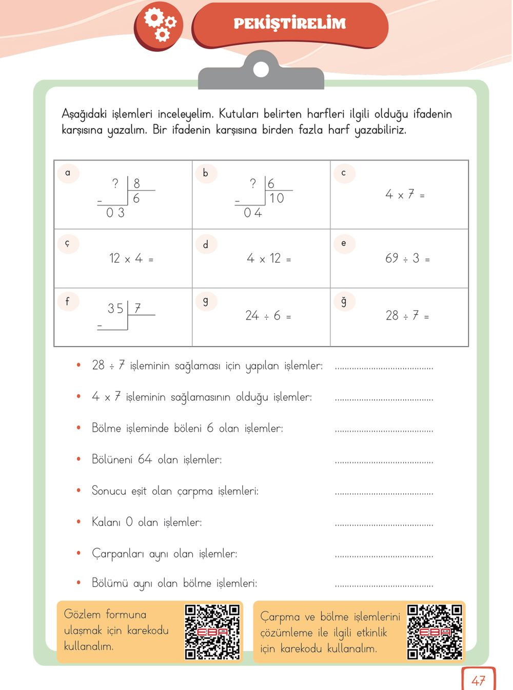 Gözlem formuna ulaşmak için karekodu kullanalım.
 Çarpma ve bölme işlemlerini çözümleme ile ilgili etkinlik için karekodu kullanalım.

<!-- sayfa 48 -->

# BAĞLANTI KURALIM

Aşağıdaki yönergeleri takip ederek etkinliği yapalım.
1. adım: $4 \times 5$ <!-- KONTROL: Marker'da karşılığı yok, uydurma olabilir --> işleminin sonucunun bulunduğu kutuyu işaretleyelim.
2. adım: Birinci adımda ulaştığımız sayının $4$ fazlasının bulunduğu kutuyu işaretleyelim.
3. adım: İkinci adımda ulaştığımız sayının yarısının bulunduğu kutuyu işaretleyelim.
4. adım: Üçüncü adımda ulaştığımız sayının $5$ eksiğinin bulunduğu kutuyu işaretleyerek çıkış numarasını yazalım.

Çıkış numarası : ...................................................

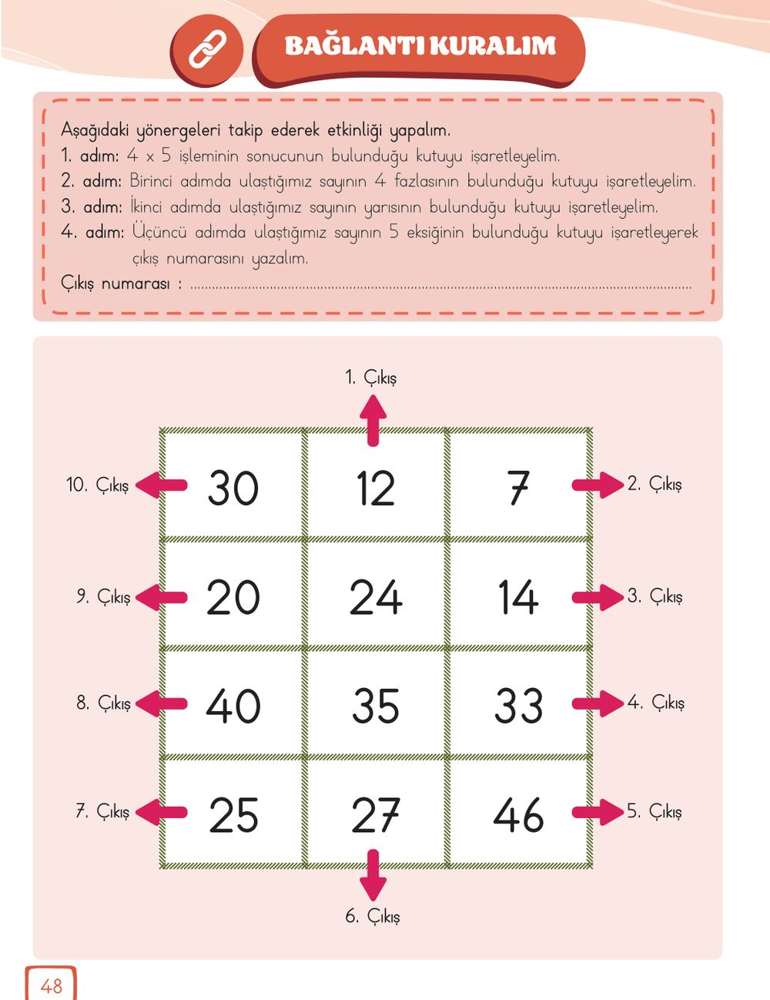

| | 1. Çıkış | |
| :---: | :---: | :---: |
| 10. Çıkış | 30 | 12 | 7 | 2. Çıkış |
| 9. Çıkış | 20 | 24 | 14 | 3. Çıkış |
| 8. Çıkış | 40 | 35 | 33 | 4. Çıkış |
| 7. Çıkış | 25 | 27 | 46 | 5. Çıkış |
| | 6. Çıkış | |

<!-- sayfa 49 -->

1.

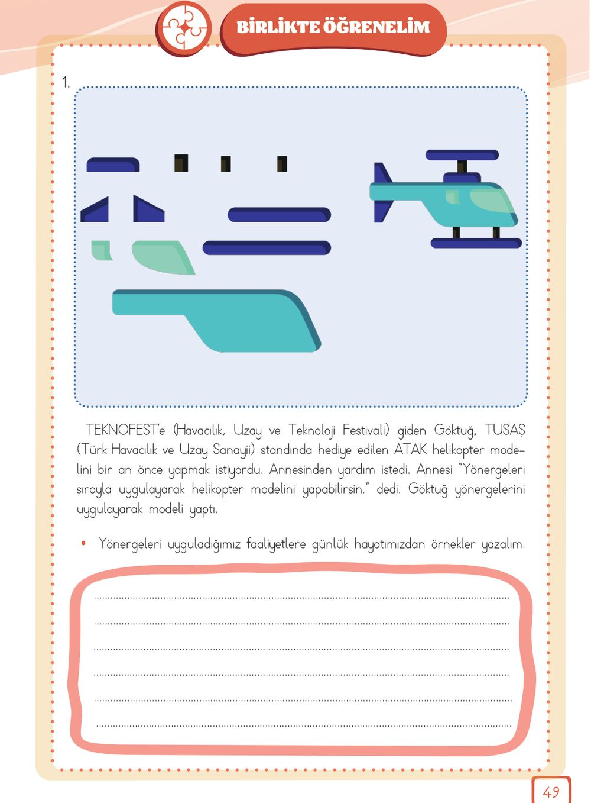

TEKNOFEST’e (Havacılık, Uzay ve Teknoloji Festivali) giden Göktuğ, TUSAŞ (Türk Havacılık ve Uzay Sanayii) standında hediye edilen ATAK helikopter modelini bir an önce yapmak istiyordu. Annesinden yardım istedi. Annesi “Yönergeleri sırayla uygulayarak helikopter modelini yapabilirsin.” dedi. Göktuğ yönergelerini uygulayarak modeli yaptı.

• Yönergeleri uyguladığımız faaliyetlere günlük hayatımızdan örnekler yazalım.

1.
......................................................................................................................................................
......................................................................................................................................................
......................................................................................................................................................
.......................................................................................................................................................
......................................................................................................................................................
......................................................................................................................................................

<!-- sayfa 50 -->

# ETKİNLİK SINIFTAKİ NESNELERİ BULMA OYUNU

Aşağıdaki uygulama basamaklarını takip ederek etkinliği yapalım.

## Malzemeler
* A4 kâğıdı
* Kurşun kalem

## Uygulama Basamakları
1. Öğretmenimizin rehberliğinde iki gruba ayrılalım. Sayışma ile birinci ve ikinci grubu belirleyelim.
2. Birinci gruptan gönüllü bir arkadaşımızı tahtaya davet edelim. Arkadaşımızdan bizi görmemesi için arkasını dönmesini isteyelim.
3. İkinci gruptan da bir nesne belirlemesini isteyelim.
4. Sınıf kapısını başlangıç noktası kabul edelim.
5. İkinci gruptan belirlediği nesnenin yerini tarif etmek için yönergeler yazmasını isteyelim (Sınıf kapısına doğru ilerle, sınıf tahtasının soluna doğru ilerle gibi.).
6. Gönüllü arkadaşımıza yönergelerin yazılı olduğu kâğıdı verelim.
7. Yönergeleri verdiğimiz arkadaşımızdan bu yönergeleri takip ederek belirlediğimiz nesneyi bulmasını isteyelim.
8. Belirlediğimiz nesneyi bulan arkadaşımızı tebrik edelim.
9. Görev değişiklikleri yaparak farklı nesnelerle etkinliği tekrarlayalım.
10. Öğretmenimizin belirlediği süre boyunca oyuna devam edelim.
11. Öğretmenimizin uygun görmesi durumunda oyunu okul bahçesi ve spor salonu gibi farklı ortamlarda oynayalım.

## Değerlendirme
1. Yönergeleri hazırlarken nelere dikkat ettiğimizi yazalım.
....................................................................................................................................................................
....................................................................................................................................................................
....................................................................................................................................................................
....................................................................................................................................................................

2. Yönerge adımlarının sırayla uygulanması neden önemlidir? Yazalım.
....................................................................................................................................................................
....................................................................................................................................................................

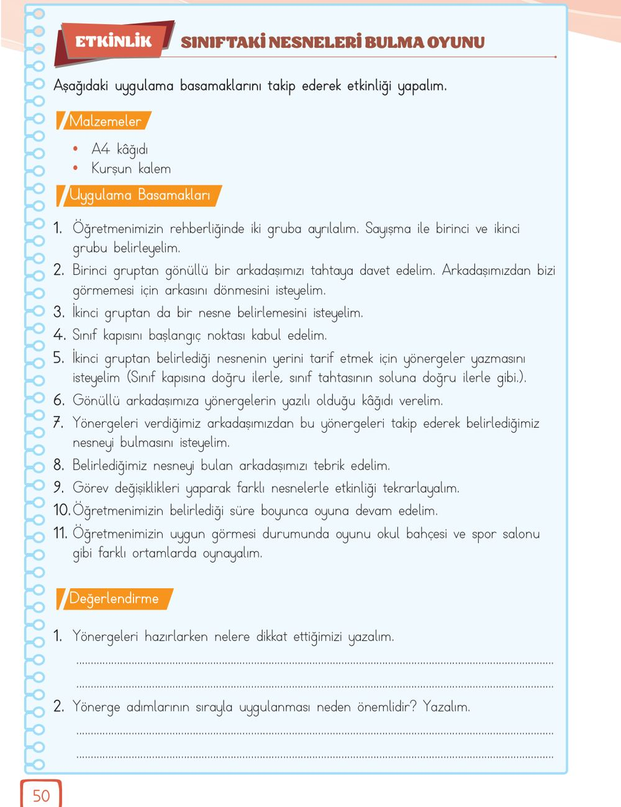
<!-- yer tutucu bulunamadı: sayfa sonuna eklendi -->

<!-- sayfa 51 -->

# ETKİNLİK KÂĞITTAN GEMİ YAPIMI

Aşağıdaki uygulama basamaklarını takip ederek etkinliği yapalım.

## Malzemeler
* A4 kâğıdı

## Uygulama Basamakları
1. A4 kâğıdını uzun kenarları üst üste gelecek ve kat izi oluşturacak şekilde tam ortasından katlayalım. Kâğıdı açalım.
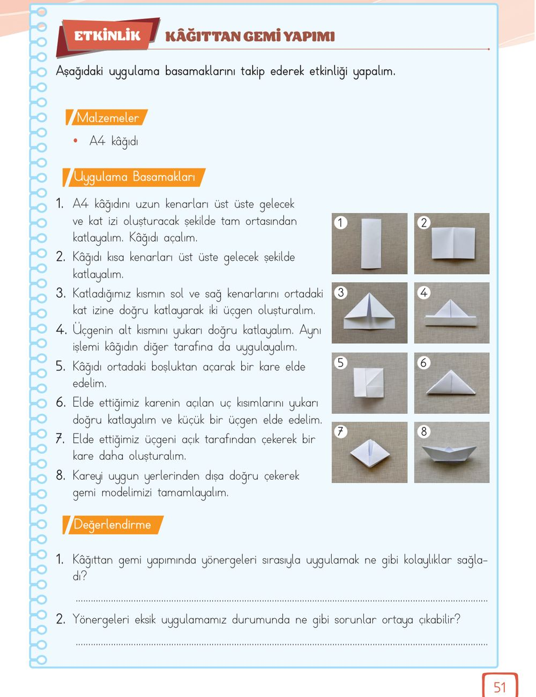

2. Kâğıdı kısa kenarları üst üste gelecek şekilde katlayalım.

3. Katladığımız kısmın sol ve sağ kenarlarını ortadaki kat izine doğru katlayarak iki üçgen oluşturalım.

4. Üçgenin alt kısmını yukarı doğru katlayalım. Aynı işlemi kâğıdın diğer tarafına da uygulayalım.

5. Kâğıdı ortadaki boşluktan açarak bir kare elde edelim.

6. Elde ettiğimiz karenin açılan uç kısımlarını yukarı doğru katlayalım ve küçük bir üçgen elde edelim.

7. Elde ettiğimiz üçgeni açık tarafından çekerek bir kare daha oluşturalım.

8. Kareyi uygun yerlerinden dışa doğru çekerek gemi modelimizi tamamlayalım.

## Değerlendirme
1. Kâğıttan gemi yapımında yönergeleri sırasıyla uygulamak ne gibi kolaylıklar sağladı?
....................................................................................................................................................................

2. Yönergeleri eksik uygulamamız durumunda ne gibi sorunlar ortaya çıkabilir?
....................................................................................................................................................................

<!-- sayfa 52 -->

2. Tabloda 3/A sınıfı ile ilgili bilgiler verilmiştir. Bilgilere göre aşağıdaki soruları cevaplayalım.

| 3/A | |
| :--- | :--- |
| Kız | 14 |
| Erkek | 13 |

* Sınıftaki toplam öğrenci sayısını bulmak için hangi işlemi yapmalıyız? Yazalım.
....................................................................................................................................................................
....................................................................................................................................................................

* Sınıftaki kız ve erkek öğrenci sayılarının farkını bulmak için hangi işlemi yapmalıyız? Yazalım.
....................................................................................................................................................................
....................................................................................................................................................................

* Beden eğitimi ve oyun dersindeki etkinlik için tüm sınıf üçer kişilik gruplara ayrılmıştır. Sınıfta toplam kaç grup oluşmuştur? Yazalım.
....................................................................................................................................................................
....................................................................................................................................................................

* Sınıftaki tüm öğrenciler okul kütüphanesine katkıda bulunmak amacıyla ikişer kitap getirmiştir. 3/A sınıfının kütüphaneye getirdiği toplam kitap sayısını bulmak için hangi işlemi yapmalıyız? Yazalım.
....................................................................................................................................................................

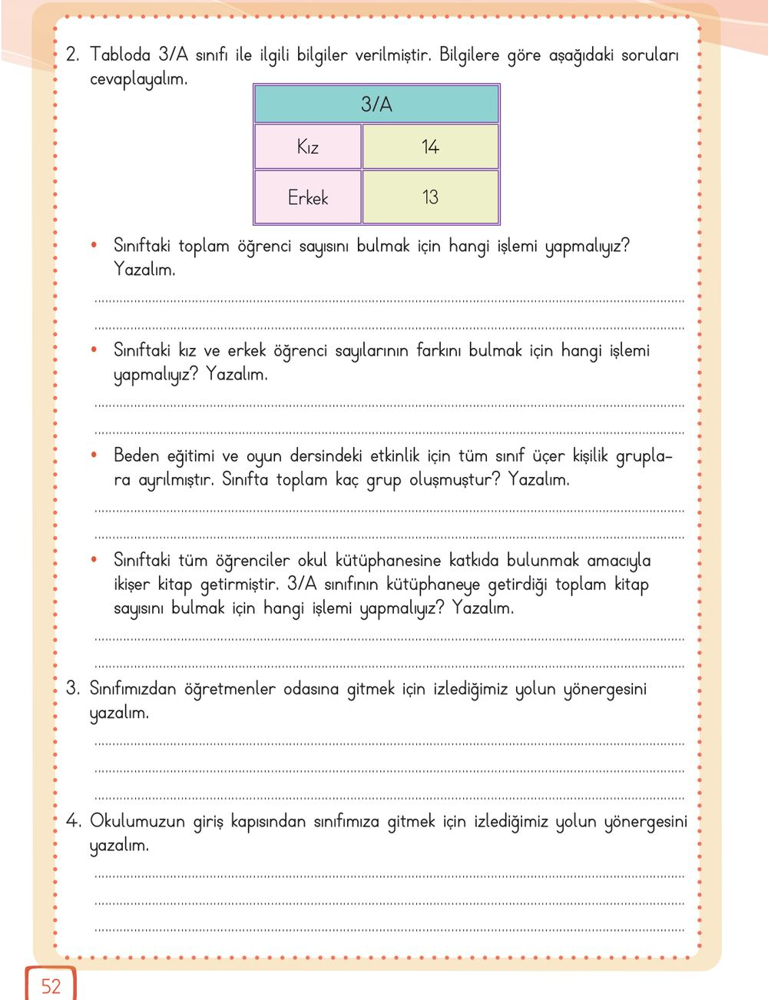
<!-- yer tutucu bulunamadı: sayfa sonuna eklendi -->

<!-- sayfa 53 -->

5. Aşağıdaki görselde Sude'nin evinden çıkıp markete gitmek için izlediği yol verilmiştir. Yönergeleri inceleyerek soruları cevaplayalım.

    1. adım: Sude evinden çıkıp $50$ metre ilerledi. Sonra sola dönerek $60$ metre ilerideki kütüphanenin önüne geldi.
    2. adım: Kütüphaneyi geçti, $75$ metre sonra huzurevinin önüne geldi.
    3. adım: Huzurevini geçti, $48$ metre sonra markete ulaştı.

    * Görsel üzerindeki noktalı yerlere yönergelerde belirtilen mesafeleri yazalım.

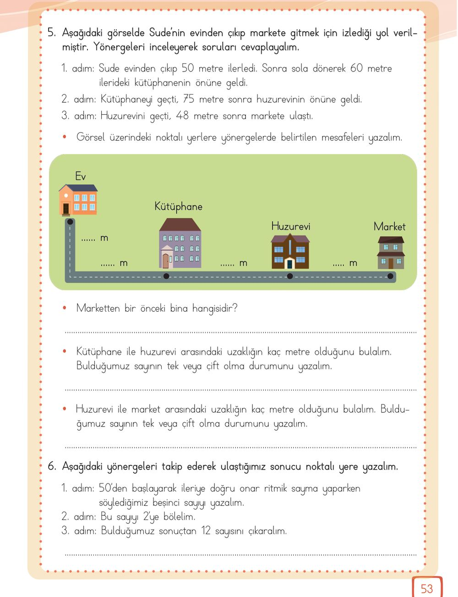

    * Marketten bir önceki bina hangisidir?
    ....................................................................................................................................................................

    * Kütüphane ile huzurevi arasındaki uzaklığın kaç metre olduğunu bulalım. Bulduğumuz sayının tek veya çift olma durumunu yazalım.
    ....................................................................................................................................................................

    * Huzurevi ile market arasındaki uzaklığın kaç metre olduğunu bulalım. Bulduğumuz sayının tek veya çift olma durumunu yazalım.
    ....................................................................................................................................................................

6. Aşağıdaki yönergeleri takip ederek ulaştığımız sonucu noktalı yere yazalım.

    1. adım: $50$'den başlayarak ileriye doğru onar ritmik sayma yaparken söylediğimiz beşinci sayıyı yazalım.
    2. adım: Bu sayıyı $2$'ye bölelim.
    3. adım: Bulduğumuz sonuçtan $12$ sayısını çıkaralım.
    ....................................................................................................................................................................

<!-- sayfa 54 -->

7. Aşağıdaki yönergeleri takip ederek ulaştığımız sonucu noktalı yere yazalım.
   1. adım: $149$ sayısından bir önce gelen tek sayıyı bulalım.
   2. adım: Bu sayıya $55$ ekleyelim.
   3. adım: Bulduğunuz sayının birler basamağındaki rakamı $7$ artıralım.
....................................................................................................................................................................

8. Aşağıdaki görselde Erdem’in mahallesinin krokisi verilmiştir.

Görselden yararlanarak aşağıdaki soruları cevaplayalım.
Erdem, babasının çalıştığı iş merkezinden evine dönmek için aşağıdaki yönerge-
leri uyguluyor.
1. adım: İş merkezinden çıkınca sola dön.
2. adım: $200$ metre ilerle, marketin önüne gelince sağa dön.
3. adım: $10$ metre daha yürü, parka gelince sola dön.
4. adım: $180$ metre yürü, hastaneye gelince $50$ metre daha ilerleyerek eve ulaş.

* Görsel üzerindeki noktalı yerlere yönergelerde belirtilen mesafeleri yazalım.
* Erdem toplam kaç metre yürümüştür?
....................................................................................................................................................................
* Park ile Erdem’in evinin arası kaç metredir?
....................................................................................................................................................................
* İş merkezinden parka gitmek için izlenmesi gereken yolun yönergesini yazalım.
....................................................................................................................................................................

<!-- sayfa 55 -->

9. Aşağıdaki yönergeleri takip ederek ulaştığımız sonucu noktalı yere yazalım.

1. adım: İki basamaklı en küçük sayıyı yazalım.
2. adım: Bu sayıya $10$ ekleyelim.
3. adım: Ulaştığımız sonucu $5$ ile çarpalım.
4. adım: Bulduğunuz sayıya $18$ ekleyelim.

10. Aşağıdaki tabloda kantinde yer alan bazı ürünlerin fiyatları verilmiştir.

| Kantin Fiyatları | | | | |
| :--- | :--- | :--- | :--- | :--- |
| Tost | Simit | Ayran | Su | Süt |
|  |  |  |  |  |
| $30\text{ TL}$ | $15\text{ TL}$ | $20\text{ TL}$ | $12\text{ TL}$ | $25\text{ TL}$ |

Tablodaki fiyatları inceleyelim. Tansu, Sarp, Çetin ve Beril'in kantinden almak istedikleri ürünlere göre soruları cevaplayalım.

Çetin : $1$ simit, $1$ su, $2$ ayran istiyorum.
Tansu: $2$ tost ve $1$ süt istiyorum.
Beril : $2$ tost ve $1$ ayran istiyorum.
Sarp : $1$ tost, $2$ su ve $1$ süt istiyorum.

* Tansu istediklerini almak için kaç lira ödemelidir?
..........................................................................................................................................................

* Sarp istediklerini almak için kaç lira ödemelidir?
..........................................................................................................................................................

* Çetin istediklerini almak için kaç lira ödemelidir?
..........................................................................................................................................................

* Beril istediklerini almak için kaç lira ödemelidir?
..........................................................................................................................................................

[Kontrol listesine]

<!-- sayfa 56 -->

11. İnci, aşağıda belirtilen kırtasiye alışverişini yaptı.

> Tanesi $15\text{ TL}$ olan silgilerden $3$ tane aldı.
> Tanesi $20\text{ TL}$ olan kalemlerden $1$ tane aldı.

Bu bilgiler göre aşağıdaki soruları cevaplayalım.
* İnci, silgilere toplam kaç $\text{TL}$ ödemiştir?
..........................................................................................................................................
..........................................................................................................................................

* İnci, kırtasiyeye toplam kaç $\text{TL}$ ödeme yapmıştır?
..........................................................................................................................................
..........................................................................................................................................

12. Aşağıdaki yönergeleri takip ederek ulaştığımız sonucu uygun yere yazalım.

| Yönerge | Sonuç |
| :--- | :---: |
| $409$ sayısının onlar basamağındaki rakamı $9$ artıralım. | [ ] |
| Ulaştığımız sayının birler basamağındaki rakamı $5$ azaltalım. | [ ] |
| Ulaştığımız sayının yüzler basamağındaki rakamı $3$ azaltalım. | [ ] |

13. Aşağıdaki yönergeleri takip ederek ulaştığımız sonucu uygun yere yazalım.

| Yönerge | Sonuç |
| :--- | :---: |
| 1. adım: Onlar basamağı $9$ olan en küçük sayıyı yazalım. | [ ] |
| 2. adım: Bulduğumuz sayıyı $2$'ye bölelim. | [ ] |
| 3. adım: Bulduğumuz sayıyı $3$ ile çarpalım. | [ ] |
| 4. adım: Bulduğumuz sayıdan $123$ çıkaralım. | [ ] |
| 5. adım: Bulduğumuz sayıya $79$ ekleyelim. | [ ] |

Dört işlemde yönergeler 

<!-- sayfa 57 -->

# PEKİŞTİRELİM

1. Aşağıdaki yönerge adımları ile karşısında verilen sayıları eşleştirelim.

| Yönerge Adımları | Sayılar |
| :--- | :--- |
| 1. adım: İki basamaklı en büyük sayıyı bulalım. | 101 |
| 2. adım: Bulduğumuz sayıya $37$ ekleyelim. | 99 |
| 3. adım: Ulaştığımız sayıya rakamları birbirinden farklı üç basamaklı en küçük sayıyı ekleyelim. | 236 |
| | 136 |
| | 238 |

| Yönerge Adımları | Sayılar |
| :--- | :--- |
| 1. adım: $143$ sayısını en yakın onluğa yuvarlayalım. | 109 |
| 2. adım: Bulduğumuz sayının birler ve onlar basamağındaki rakamların yerlerini değiştirelim. | 104 |
| 3. adım: Ulaştığımız sayının rakamları toplamını bu sayıya ekleyelim. | 110 |
| | 140 |
| | 105 |

| Yönerge Adımları | Sayılar |
| :--- | :--- |
| 1. adım: Üç basamaklı en küçük tek sayıyı bulalım. | 610 |
| 2. adım: Bulduğumuz sayının birler ve onlar basamağının yerlerini değiştirelim. | 111 |
| 3. adım: Bulduğumuz sayının yüzler basamağını beş artıralım. | 101 |
| 4. adım: Ulaştığımız sayıdan bir sonraki sayıyı bulalım. | 611 |
| | 601 |
| | 110 |

<!-- yer tutucu bulunamadı: sayfa sonuna eklendi -->

<!-- sayfa 58 -->

Sevgili Öğrenciler,
Bu performans görevinde tabloda verilen ürünleri kullanarak dört işlem içeren bir örnek olay yazmamız beklenmektedir. Ayrıca yönergelerle hareket etmeyi içeren bir model tasarlamamız istenmektedir. Çalışmamız için aşağıdaki uygulama basamaklarını takip edelim.

## Uygulama Basamakları

1. Aşağıdaki basamakları inceleyerek bir çalışma planı yapalım. Bu plan doğrultusunda hareket edelim.
2. Tabloda bazı ürünler ve bu ürünlerin birim fiyatları verilmiştir. Bu ürünlerden toplam $900\text{ TL}$'yi geçmeyecek bir alışveriş listesi oluşturalım.
3. Yapacağımız alışverişi bir örnek olay içerisinde anlatarak dört işlem gerektiren problemler kuralım.
4. Kurduğumuz problemleri bir kartona yazarak renkli kalemlerle modelleyelim.
5. Modelimizin özgün olmasına dikkat edelim.
6. Yaptığımız modeli kullanarak kurduğumuz problemlerle ilgili arkadaşlarımıza sunum yapalım.

| Ürün Adı | Fiyatı | Miktar |
| :--- | :--- | :--- |
| Portakal | $99\text{ TL}$ | $3\text{ kg (kilogram)}$ |
| Elma | $80\text{ TL}$ | $2\text{ kg}$ |
| Peçete | $13\text{ TL}$ | $1\text{ paket}$ |
| Süt | $35\text{ TL}$ | $1\text{ kutu}$ |
| Ekmek | $15\text{ TL}$ | $1\text{ adet}$ |
| Un | $95\text{ TL}$ | $5\text{ kg}$ |
| Salça | $200\text{ TL}$ | $1\text{ kg}$ |
| Yumurta | $8\text{ TL}$ | $1\text{ adet}$ |

| Alışveriş Listem |
| :--- |
| |

Analitik dereceli puanla-

<!-- sayfa 59 -->

# ÇÖZME

# BİRLİKTE ÖĞRENELİM

1. Bir sınıf kitaplığında $150$ hikâye kitabı vardır. Öğrencilerden hafta sonu okumaları için ikişer kitap seçmeleri istenmiştir. $24$ öğrenci kitaplarını seçtiğine göre sınıf kitaplığında kaç kitap kalmıştır?

* Problemi dikkatle okuyarak anlayalım. Problemde verilenler ile istenileni belirleyerek yazalım.

**Verilenler**
(Boş kutu)

**İstenilenler**
(Boş kutu)

* Problemde istenilen bilgiye ulaşmak için verilenlerden nasıl yararlanırız? Açıklayalım.
* Problemin çözümüne ulaşmak için hangi işlemleri yapmalıyız?
(Boş kutu)

* Problemi çözebilmek için uyguladığımız adımları kendi ifadelerimizle yazalım.
(Boş kutu)

* Problemi çözebilmek için verilen ve istenilenleri matematiksel işlemlere dönüştürelim.
(Boş kutu) (Boş kutu)

* Problemin çözümünde hangi işlemleri kullanabileceğimizi arkadaşlarımızla tartışalım.
* Problemin çözümünü tahmin edelim. ...............................................................................
* Problemin çözümü:
(Boş kutu)

<!-- sayfa 60 -->

* Problemi çözmek için uyguladığımız yöntem bizi doğru sonuca ulaştırabildi mi? Açıklayalım.
* Noktalı alana bir problem yazalım. Önceki problemin çözümünde kullandığımız yöntemi uygulayarak yazdığımız problemi çözelim.

....................................................................................................................................................................
....................................................................................................................................................................
....................................................................................................................................................................
....................................................................................................................................................................

(Noktalı alan)

* Problemi daha kısa yoldan çözmemizi sağlayabilecek başka yöntemleri tartışalım.

 Problem çözme basamakları kullanılarak yapılan çözümü inceleyelim.

| Mert, kırtasiyeden 3 kalem alıyor. Her bir kalemin fiyatı $4\text{ TL}$'dir. Daha sonra defter almak için $10\text{ TL}$ daha harcıyor. Mert toplam kaç $\text{TL}$ harcamıştır? |
| :--- |

| Problemi Anlayalım | Plan Yapalım | Planı Uygulayalım | Kontrol Edelim |
| :--- | :--- | :--- | :--- |
| Verilenler:  $3$ kalem her biri $4\text{ TL}$  Defter için $10\text{ TL}$  İstenilenler:  Harcanan toplam para miktarı | Kalemlerin toplam fiyatını bulalım (çarpma işlemi). Defterin fiyatını ekleyelim (toplama işlemi). Problemin sonucunu tahmin edelim. | $3 \times 4 = 12\text{ TL}$  $12 + 10 = 22\text{ TL}$ | Kalemlerin fiyatı $12\text{ TL}$  Defterin fiyatı $10\text{ TL}$  Toplam fiyat $22\text{ TL}$ |

<!-- sayfa 61 -->

2. Günlük yaşamımızdan problem örnekleri oluşturalım. Oluşturduğumuz prob-
lemler ile verilen ve istenilenleri belirtilen alanlara yazalım.

* Problem:
..........................................................................................................................................................
..........................................................................................................................................................
..........................................................................................................................................................
..........................................................................................................................................................

* Verilenler:
..........................................................................................................................................................
..........................................................................................................................................................
..........................................................................................................................................................

* İstenilenler:
..........................................................................................................................................................
..........................................................................................................................................................
................................................................................................................

<!-- yer tutucu bulunamadı: sayfa sonuna eklendi -->

<!-- sayfa 62 -->

3. Problem çözmek için kullandığımız yöntemleri aşağıdaki problemlerde uygulayalım. Bu yöntemler sonuca ulaştırmıyorsa yeni yöntemler kullanarak problemleri tekrar çözmeye çalışalım. Problemleri çözerken işlemleri zihnimizde tasarlayarak farklı yöntemler geliştirmeye çalışalım.

* Bir pastane tezgâhında sabah $185$ kurabiye vardı. Öğleden önce kurabiyelerin $128$ tanesi satıldı. Öğleden sonra tezgâha $109$ kurabiye eklendi. Son durumda tezgâhta kaç kurabiye vardır?

| | | | | | | | | | | | | | | | | | | | |
|---|---|---|---|---|---|---|---|---|---|---|---|---|---|---|---|---|---|---|---|
| | | | | | | | | | | | | | | | | | | | |
| | | | | | | | | | | | | | | | | | | | |
| | | | | | | | | | | | | | | | | | | | |
| | | | | | | | | | | | | | | | | | | | |
| | | | | | | | | | | | | | | | | | | | |
| | | | | | | | | | | | | | | | | | | | |
| | | | | | | | | | | | | | | | | | | | |

* Okulumuz tarafından düzenlenen geziye üç otobüsle gidilecektir. Her otobüste $42$ öğrenci gideceğine göre geziye gidecek toplam öğrenci sayısı kaçtır?

* Bir trende $398$ yolcu vardır. İlk durakta $140$ yolcu inip $78$ yolcu binmiştir. Buna göre son durumda trende kaç yolcu vardır?

| | | | | | | | | | | | | | | | | | | | |
|---|---|---|---|---|---|---|---|---|---|---|---|---|---|---|---|---|---|---|---|
| | | | | | | | | | | | | | | | | | | | |
| | | | | | | | | | | | | | |

<!-- yer tutucu bulunamadı: sayfa sonuna eklendi -->

<!-- sayfa 63 -->

# PEKİŞTİRELİM

1. Aşağıdaki problemleri verilen adımlara uygun olarak çözelim.

| Emir'in 60 cevizi vardı. 35 ceviz de ablası verdi. Cevizlerini 5 torbaya eşit sayıda paylaştırmak isteyen Emir, her bir torbaya kaç ceviz koymalıdır? |
| :--- |

| Problemi Anlayalım | Plan Yapalım | Tahmin Edelim | Planı Uygulayalım | Kontrol Edelim |
| :--- | :--- | :--- | :--- | :--- |
| | | | | |

| Ecem 72 sayfalık kitabın önce 18 sayfasını okudu. Geriye kalan sayfaları her gün eşit sayıda okuyarak kitabını 6 günde bitiren Ecem, bir günde kaç sayfa kitap okumuştur? |
| :--- |

* Problemlerin çözümü için hangi yöntemleri kullandığımızı açıklayalım.
....................................................................................................................................................................
....................................................................................................................................................................
* Kullandığımız yöntemleri iki probleme de uygulayabildik mi? Açıklayalım.
....................................................................................................................................................................
....................................................................................................................................................................

<!-- yer tutucu bulunamadı: sayfa sonuna eklendi -->

<!-- sayfa 64 -->

2. Aşağıda verilen problemleri problem çözme basamaklarına göre çözelim.

* Osman, tutumlu olmanın önemini bildiği için harçlıklarından artırdığı miktarı kumbarasına atmaya karar verdi. Kumbarasına her gün $14\text{ TL}$ attı. Osman, bir haftada biriktirdiği paranın $73\text{ TL}$’sini harcadı. Geriye kaç $\text{TL}$’si kaldı?

* $700\text{ kg}$ şekeri olan bir toptancı her birinde $55\text{ kg}$ şeker olan kolilerden beş tanesini satıyor. Toptancının geriye kaç $\text{kg}$ <!-- KONTROL: Marker'da karşılığı yok, uydurma olabilir --> şekeri kaldığını bulalım.

<!-- sayfa 65 -->

3. Mert, Emre ve Ela basketbol potasına onar atış yap-
mıştır. Potaya isabet eden her atış $10$ puan değerinde-
dir. Öğrencilerin isabetli atış sayıları aşağıdaki gibidir.

Mert: Emre'nin isabetli atış sayısının iki katı kadar isabetli
atış yapmıştır.
Emre: İki isabetli atış yapmıştır.
Ela : Beş isabetli atış yapmıştır.

Verilen bilgilere göre aşağıdaki soruları cevaplayalım.

* Mert toplam kaç puan almıştır?
..................................................................................................................................
* Emre toplam kaç puan almıştır?
..................................................................................................................................
* Ela toplam kaç puan almıştır?
..................................................................................................................................

4. Eda, Ferit ve Sevinç yapışkan topları görselde verilen hedef tahtasına fırla-
tarak bir oyun oynamaktadır. Oyunun kurallarına göre her oyuncu $3$ atış
yapacak ve topun isabet ettiği renk için belirlenmiş puanı kazanacaktır.

* Eda topları sarı, yeşil ve mavi renkli alanlara isabet ettirmiştir.
* Ferit $2$ topu yeşil, $1$ topu sarı alana isabet ettirmiştir.
* Sevinç $1$ topu mor, $2$ topu mavi ala-na isabet ettirmiştir.

Oyun sonunda en yüksek puanı kim almıştır?
..................................................................................................................................
..................................................................................................................................
..................................................................................................................................
..................................................................................................................................
..................................................................................................................................
..................................................................................................................................

| Kontrol listesine ulaşmak için karekodu | Dört işlem problemlerini çözebilme ile ilgili etkinlik |
| :---: | :---: |
| [QR KOD] | [QR KOD] |

<!-- sayfa 66 -->

# ETKİNLİK PROBLEM ÇÖZÜYORUM

Aşağıdaki uygulama basamaklarını takip ederek etkinliği yapalım.

## Uygulama Basamakları

Tablodaki problemleri inceleyelim. Her bir problemi çözmek için hangi işlemi kullanmamız gerektiğini ve bu işlemi seçmemize neden olan ifadeyi belirtilen yerlere yazalım.

| Problem | Çözüm İçin Gerekli İşlem ya da İşlemler | Çözüme Götüren İfade |
| :--- | :---: | :---: |
| Ali Bey bir günde $6$ saat çalıştığına göre $17$ günde kaç saat çalışır? | $17 \times 6 = 102$ <!-- KONTROL: Marker'da karşılığı yok, uydurma olabilir --> | $17$ günde kaç saat çalışır? |
| Damla annesinin verdiği $95\text{ TL}$ harçlığın $47\text{ TL}$’sini kumbarasına atmıştır. Damla’nın harcayabileceği kaç $\text{TL}$’si kalmıştır? | | |
| Görkem $257\text{ TL}$’ye gömlek ve $539\text{ TL}$’ye mont aldı. Görkem aldıkları için $950\text{ TL}$ ödeme yaptığına göre kaç $\text{TL}$ para üstü almalıdır? | | |
| Cemil $95\text{ kg}$ cevizi $5\text{ kg}$’lık paketlere ayıracaktır. Cemil’in kaç pakete ihtiyacı vardır? | | |

## Değerlendirme

* Günlük yaşamda karşılaştığımız problemleri çözmek için hangi işlemi kullanacağımızı nasıl ve neye göre tespit ediyoruz? Arkadaşlarımızla tartışalım.

<!-- yer tutucu bulunamadı: sayfa sonuna eklendi -->

<!-- sayfa 67 -->

# ETKİNLİK PROBLEM KURUYORUM

Aşağıdaki uygulama basamaklarını takip ederek etkinliği yapalım.

## Uygulama Basamakları

1. Öğretmenimizin rehberliğinde dörder kişilik gruplar oluşturalım.
2. Grup arkadaşlarımızla aşağıdaki tabloyu inceleyelim.
3. Verilenler bölümündeki görsel ve bilgileri kullanarak problem cümleleri kuralım.
4. Kurduğumuz problemi çözelim.
5. Kurduğumuz problemlerin çözüm yollarını diğer gruplarla paylaşalım.
6. Sınıf arkadaşlarımızla birlikte aktif şekilde etkinlikte rol alalım.

| Verilenler | Problem | Çözüm |
| :--- | :--- | :--- |
|  | | |
|    $220\text{ cm}$   $160\text{ cm}$ | | |
|    $5\text{ kg}$   $6\text{ kg}$   $1\text{ kg}$ | | |

## Değerlendirme

* Kurduğumuz problemler ile bu problemlerin çözüm yollarını, arkadaşlarımızın kurduğu problemler ve çözüm yolları ile karşılaştıralım.
....................................................................................................................................................................
....................................................................................................................................................................

| Kontrol listesine | Dört işlem gerektiren problemleri yapılandırma ile ilgili |
| :--- | :--- |

<!-- sayfa 68 -->

# YORUMLAYABİLME

## BİRLİKTE ÖĞRENELİM

1. Aşağıda verilen problemlerin sonuçlarını bulalım.

* Merve kırtasiyede altılı paketlerde satılan etiketlerden 4 paket, Aydın ise sekizli paketlerde satılan etiketlerden 3 paket almıştır.

Merve'nin etiketleri

Aydın'ın etiketleri

* Merve ve Aydın'ın toplam etiket sayısını kareli zeminde çarpma işlemi yaparak gösterelim.

Merve'nin toplam etiket sayısını bulmak için yapmamız gereken işlem:

Aydın'ın toplam etiket sayısını bulmak için yapmamız gereken işlem:

* Merve ve Aydın'ın toplam etiket sayısını bulmak için yaptığımız işlemlerin sonuçlarını karşılaştıralım.
....................................................................................................................................................................
....................................................................................................................................................................

<!-- sayfa 69 -->

2. Aşağıdaki görselleri inceleyelim. Portakal ve elmaları altışarlı gruplayalım. Verilen soruları cevaplayalım.

* Gruplardaki meyve sayılarını bölme işlemi yaparak bulalım.

Bir gruptaki portakal sayısı:
[Izgara alanı]

Bir gruptaki elma sayısı:
[Izgara alanı]

* Yukarıdaki bölme işlemlerinin bölünen, bölen ve bölümlerini karşılaştıralım.
....................................................................................................................................................................
....................................................................................................................................................................
....................................................................................................................................................................
....................................................................................................................................................................

3. Aşağıda verilen işlemleri yapalım. İşlem sonuçlarını karşılaştıralım.

$26 + 13 = \dots\dots\dots$ <!-- KONTROL: Marker'da karşılığı yok, uydurma olabilir --> $\quad$ $78 \div 2 = \dots\dots\dots$ <!-- KONTROL: Marker'da karşılığı yok, uydurma olabilir -->
$13 \times 3 = \dots\dots\dots$ <!-- KONTROL: Marker'da karşılığı yok, uydurma olabilir --> $\quad$ $60 - 21 = \dots\dots\dots$ <!-- KONTROL: Marker'da karşılığı yok, uydurma olabilir -->

....................................................................................................................................................................
....................................................................................................................................................................

<!-- sayfa 70 -->

Dengede duran bir terazide sol kefedeki kütlelerin toplamı, sağ kefedeki kütlelerin toplamına eşittir. Dengede duran teraziyi inceleyelim.

$\text{Mavi küp} = 3\text{ kg}$ <!-- KONTROL: Marker'da karşılığı yok, uydurma olabilir -->
$\text{Sarı küre} = 4\text{ kg}$ <!-- KONTROL: Marker'da karşılığı yok, uydurma olabilir -->
$\text{Pembe silindir} = 5\text{ kg}$ <!-- KONTROL: Marker'da karşılığı yok, uydurma olabilir -->

$$\frac{3 + 3 + 4}{10} = \frac{5 + 5}{10}$$
<!-- KONTROL: Marker'da karşılığı yok, uydurma olabilir -->

Aşağıda verilen işlemleri inceleyelim.

* $11 + 13 = 24$
* $72 \div 3 = 24$ <!-- KONTROL: Marker'da karşılığı yok, uydurma olabilir -->

"$11 + 13$" ve "$72 \div 3$ <!-- KONTROL: Marker'da karşılığı yok, uydurma olabilir -->" işlemlerinin sonuçları aynıdır. Sonuçları aynı olan bu işlemler "$11 + 13 = 72 \div 3$ <!-- KONTROL: Marker'da karşılığı yok, uydurma olabilir -->" şeklinde gösterilir.

4. Aşağıdaki işlemlerin sonuçlarını bulalım. Sonuçları aynı olan işlemleri örnekteki gibi eşleştirelim.

| Sol Sütun | Sağ Sütun |
| :--- | :--- |
| $20 + 18 = 38$ | $12 - 3 = \dots\dots\dots$ <!-- KONTROL: Marker'da karşılığı yok, uydurma olabilir --> |
| $36 \div 4 = \dots\dots\dots$ <!-- KONTROL: Marker'da karşılığı yok, uydurma olabilir --> | $75 \div 3 = \dots\dots\dots$ <!-- KONTROL: Marker'da karşılığı yok, uydurma olabilir --> |
| $17 - 12 = \dots\dots\dots$ <!-- KONTROL: Marker'da karşılığı yok, uydurma olabilir --> | $25 + 31 = \dots\dots\dots$ <!-- KONTROL: Marker'da karşılığı yok, uydurma olabilir --> |
| $28 \times 2 = \dots\dots\dots$ <!-- KONTROL: Marker'da karşılığı yok, uydurma olabilir --> | $21 \times 10 = \dots\dots\dots$ <!-- KONTROL: Marker'da karşılığı yok, uydurma olabilir --> |
| $16 + 9 = \dots\dots\dots$ <!-- KONTROL: Marker'da karşılığı yok, uydurma olabilir --> | $76 \div 2 = 38$ <!-- KONTROL: Marker'da karşılığı yok, uydurma olabilir --> |
| $47 - 20 = \dots\dots\dots$ <!-- KONTROL: Marker'da karşılığı yok, uydurma olabilir --> | $50 \div 10 = \dots\dots\dots$ <!-- KONTROL: Marker'da karşılığı yok, uydurma olabilir --> |
| $42 \times 5 = \dots\dots\dots$ <!-- KONTROL: Marker'da karşılığı yok, uydurma olabilir --> | $24 \times 3 = \dots\dots\dots$ <!-- KONTROL: Marker'da karşılığı yok, uydurma olabilir --> |
| | $9 \times 3 = \dots\dots\dots$ <!-- KONTROL: Marker'da karşılığı yok, uydurma olabilir --> |

Gözlem formuna

<!-- sayfa 71 -->

# PEKİŞTİRELİM

1. Aşağıdaki işlemleri yapalım. Sonuçları aynı olan işlemleri eşleştirelim.

$20 + 28 = \dots\dots\dots$ <!-- KONTROL: Marker'da karşılığı yok, uydurma olabilir --> $\bigcirc$ $\quad$ $\bigcirc$ $64 \div 4 = \dots\dots\dots$ <!-- KONTROL: Marker'da karşılığı yok, uydurma olabilir -->
$34 - 18 = \dots\dots\dots$ <!-- KONTROL: Marker'da karşılığı yok, uydurma olabilir --> $\bigcirc$ $\quad$ $\bigcirc$ $16 \times 3 = \dots\dots\dots$ <!-- KONTROL: Marker'da karşılığı yok, uydurma olabilir -->
$96 - 36 = \dots\dots\dots$ <!-- KONTROL: Marker'da karşılığı yok, uydurma olabilir --> $\bigcirc$ $\quad$ $\bigcirc$ $80 \div 4 = \dots\dots\dots$ <!-- KONTROL: Marker'da karşılığı yok, uydurma olabilir -->
$90 \div 3 = \dots\dots\dots$ <!-- KONTROL: Marker'da karşılığı yok, uydurma olabilir --> $\bigcirc$ $\quad$ $\bigcirc$ $15 \times 2 = \dots\dots\dots$ <!-- KONTROL: Marker'da karşılığı yok, uydurma olabilir -->
$\quad\quad\quad\quad\quad\quad\quad\quad\quad\quad\quad\quad\quad\quad\quad\quad\quad\quad\quad\quad\quad\quad\quad\quad\quad\quad\quad\quad\quad\quad\quad\quad\quad\quad\quad\quad\quad\quad\quad\quad\quad\quad\quad\quad\quad\quad\quad\quad\quad\quad\quad\quad\quad\quad\quad\quad\quad\quad\quad\quad\quad\quad\quad\quad\quad\quad\quad\quad\quad\quad\quad\quad\quad\quad\quad\quad\quad\quad\quad\quad\quad\quad\quad\quad\quad\quad\quad\quad\quad\quad\quad\quad\quad\quad\quad\quad\quad\quad\quad\quad\quad\quad\quad\quad\quad\quad\quad\quad\quad\quad\quad\quad\quad\quad\quad\quad\quad\quad\quad\quad\quad\quad\quad\quad\quad\quad\quad\quad\quad\quad\quad\quad\quad\quad\quad\quad\quad\quad\quad\quad\quad\quad\quad\quad\quad\quad\quad\quad\quad\quad\quad\quad\quad\quad\quad\quad\quad\quad\quad\quad\quad\quad\quad\quad\quad\quad\quad\quad\quad\quad\quad\quad\quad\quad\quad\quad\quad\quad\quad\quad\quad\quad\quad\quad\quad\quad\quad\quad\quad\quad\quad\quad\quad\quad\quad\quad\quad\quad\quad\quad\quad\quad\quad\quad\quad\quad\quad\quad

<!-- yer tutucu bulunamadı: sayfa sonuna eklendi -->

<!-- sayfa 72 -->

# 3. TEMA DEĞERLENDİRME

1. Aşağıdaki toplama ve çıkarma işlemlerini yapalım. İşlem ögelerini noktalı yerlere yazalım.

$$\begin{array}{r@{\quad}l}
293 & \dots\dots\dots\dots \\
+\ 185 & \dots\dots\dots\dots \\
\hline
\dots\dots\dots\dots & \dots\dots\dots\dots
\end{array}
\quad
\begin{array}{r@{\quad}l}
425 & \dots\dots\dots\dots \\
-\ 243 & \dots\dots\dots\dots \\
\hline
\dots\dots\dots\dots & \dots\dots\dots\dots
\end{array}$$
<!-- KONTROL: Marker'da karşılığı yok, uydurma olabilir -->

2. Aşağıdaki işlemlerin sonuçlarını tahmin edelim. İşlemlerin sonuçlarını bularak tahminlerimiz ile karşılaştıralım.

$$\begin{array}{|l}
\begin{array}{r}
423 \\
+\ 290 \\
\hline
\end{array}
\end{array}
\quad
\begin{array}{l}
\text{Tahminim: } \dots\dots\dots\dots \\
\text{Tahminim ile işlem sonucu} \\
\text{arasındaki fark: } \dots\dots\dots\dots
\end{array}$$
<!-- KONTROL: Marker'da karşılığı yok, uydurma olabilir -->
$$\quad$$
$$\begin{array}{|l}
\begin{array}{r}
648 \\
-\ 363 \\
\hline
\end{array}
\end{array}
\quad
\begin{array}{l}
\text{Tahminim: } \dots\dots\dots\dots \\
\text{Tahminim ile işlem sonucu} \\
\text{arasındaki fark: } \dots\dots\dots\dots
\end{array}$$
<!-- KONTROL: Marker'da karşılığı yok, uydurma olabilir -->

3. Aşağıdaki işlemlerin sonuçlarını zihinden işlem yaparak bulalım. İşlemler ile bu işlemlerin sonuçlarını eşleştirelim.

$$\begin{array}{|c|}
\hline
144 + 210 \\
\hline
\end{array}
\quad
\begin{array}{|c|}
\hline
400 + 198 \\
\hline
\end{array}
\quad
\begin{array}{|c|}
\hline
237 - 108 \\
\hline
\end{array}$$
<!-- KONTROL: Marker'da karşılığı yok, uydurma olabilir -->

$$\begin{array}{|c|c|c|c|c|}
\hline
598 & 435 & 345 & 354 & 129 \\
\hline
\end{array}$$
<!-- KONTROL: Marker'da karşılığı yok, uydurma olabilir -->

4. Aşağıdaki işlemlerin sonuçlarını bulalım. Toplama işleminin ögelerini çıkarma işleminde, çıkarma işleminin ögelerini toplama işleminde uygun yerlere yazalım.

$$\begin{array}{|l}
\begin{array}{r}
300 \\
+\ 192 \\
\hline
\end{array}
\end{array}
\quad
\begin{array}{l}
\dots\dots\dots\dots \\
-\ \dots\dots\dots\dots \\
\hline
\dots\dots\dots\dots \\
\dots\dots\dots\dots
\end{array}$$
<!-- KONTROL: Marker'da karşılığı yok, uydurma olabilir -->
$$\quad$$
$$\begin{array}{|l}
\begin{array}{r}
713 \\
-\ 408 \\
\hline
\end{array}
\end{array}
\quad
\begin{array}{l}
\dots\dots\dots\dots \\
+\ \dots\dots\dots\dots \\
\hline
\dots\dots\dots\dots \\
\dots\dots\dots\dots
\end{array}$$
<!-- KONTROL: Marker'da karşılığı yok, uydurma olabilir -->

<!-- yer tutucu bulunamadı: sayfa sonuna eklendi -->

<!-- sayfa 73 -->

5. Aşağıdaki çarpma ve bölme işlemlerini yapalım. İşlem ögelerini noktalı yerlere yazalım.

$$\begin{array}{r@{\quad}l}
43 & \longrightarrow \dots\dots\dots\dots\dots \\
\times 6 & \longrightarrow \dots\dots\dots\dots\dots \\
\hline
\dots & \longrightarrow \dots\dots\dots\dots\dots
\end{array}$$
<!-- KONTROL: Marker'da karşılığı yok, uydurma olabilir -->

$$\begin{array}{r@{\quad}l}
\longleftarrow 76 & \text{|} 8 \\
\text{---} & \text{|} \dots \\
\dots & \text{|} \dots
\end{array}$$
<!-- KONTROL: Marker'da karşılığı yok, uydurma olabilir -->

6. Aşağıdaki işlemlerin sonuçlarını tahmin edelim. İşlemlerin sonuçlarını bularak tahminlerimiz ile karşılaştıralım.

$$\begin{array}{r@{\quad}l}
27 & \text{Tahminim: } \dots\dots\dots\dots\dots \\
\times 6 & \\
\hline
& \text{Tahminim ile işlem sonucu arasındaki fark: } \dots\dots\dots\dots\dots
\end{array}$$
<!-- KONTROL: Marker'da karşılığı yok, uydurma olabilir -->

$$\begin{array}{r@{\quad}l}
85 & \text{Tahminim: } \dots\dots\dots\dots\dots \\
\div 5 & \\
\hline
& \text{Tahminim ile işlem sonucu arasındaki fark: } \dots\dots\dots\dots\dots
\end{array}$$
<!-- KONTROL: Marker'da karşılığı yok, uydurma olabilir -->

7. Aşağıdaki işlemlerin sonuçlarını zihinden işlem yaparak bulalım. İşlemler ile bu işlemlerin sonuçlarını eşleştirelim.

$$\begin{array}{|c|c|c|c|}
\hline
84 \div 7 & 43 \times 3 & 26 \times 5 & 95 \div 5 \\
\hline
\end{array}$$
<!-- KONTROL: Marker'da karşılığı yok, uydurma olabilir -->

$$\begin{array}{|c|c|c|c|c|c|}
\hline
130 & 19 & 13 & 12 & 129 & 140 \\
\hline
\end{array}$$
<!-- KONTROL: Marker'da karşılığı yok, uydurma olabilir -->

8. Aşağıdaki çarpma ve bölme işlemlerinin sonuçlarını kısa yoldan bulalım.

$$\begin{array}{l}
6 \times 10 = \dots\dots\dots\dots \\
100 \times 5 = \dots\dots\dots\dots \\
70 \div 10 = \dots\dots\dots\dots \\
6 \times 100 = \dots\dots\dots\dots
\end{array}$$
<!-- KONTROL: Marker'da karşılığı yok, uydurma olabilir -->

$$\begin{array}{l}
90 \div 10 = \dots\dots\dots\dots \\
18 \times 10 = \dots\dots\dots\dots \\
10 \times 5 = \dots\dots\dots\dots \\
100 \times 4 = \dots\dots\dots\dots
\end{array}$$
<!-- KONTROL: Marker'da karşılığı yok, uydurma olabilir -->

$$\begin{array}{l}
3 \times 100 = \dots\dots\dots\dots \\
98 \times 10 = \dots\dots\dots\dots \\
50 \div 10 = \dots\dots\dots\dots \\
100 \div 10 = \dots\dots\dots\dots
\end{array}$$
<!-- KONTROL: Marker'da karşılığı yok, uydurma olabilir -->

<!-- sayfa 74 -->

9. Aşağıdaki işlemleri yapalım. İşlemlerin doğruluğunu kontrol edelim.

| Bölme İşlemi | Bölme İşleminin Kontrolü | | Bölme İşlemi | Bölme İşleminin Kontrolü |
| :--- | :--- | --- | :--- | :--- |
| $65 \div 5$ <!-- KONTROL: Marker'da karşılığı yok, uydurma olabilir --> | | | $98 \div 4$ <!-- KONTROL: Marker'da karşılığı yok, uydurma olabilir --> | |

 

| Çarpma İşlemi | Çarpma İşleminin Kontrolü | | Çarpma İşlemi | Çarpma İşleminin Kontrolü |
| :--- | :--- | --- | :--- | :--- |
| $32 \times 3$ <!-- KONTROL: Marker'da karşılığı yok, uydurma olabilir --> | | | $25 \times 3$ <!-- KONTROL: Marker'da karşılığı yok, uydurma olabilir --> | |
| .......... | | | .......... | |

10. Aşağıdaki yönerge adımlarını takip ederek ulaştığımız sonucu yazalım.

* 1. adım: Üç basamaklı en küçük sayıyı yazalım.
* 2. adım: Bu sayıdan $25$ çıkaralım.
* 3. adım: Sonuç tek ise $3$, çift ise $4$ ekleyelim.

....................................................................................................................................................................

11. Gökhan ve ailesinin yaşadığı evin giriş kapısı şifrelidir. Gökhan kapının üç basamaklı şifresini zihninde şu şekilde kodlamıştır:

* Şifrenin birler basamağı $2$'nin iki katıdır.
* Onlar basamağı en küçük rakamdır.
* Yüzler basamağı, birler basamağı ile onlar basamağındaki rakamların toplamıdır.

Evin giriş kapısının şifresi nedir?
...................................................................................................

<!-- sayfa 75 -->

12. Aşağıdaki yönerge adımları ile karşılarında verilen sayıları eşleştirelim.

1. adım: Üç basamaklı en küçük sayıyı bulalım. $\quad$ 200
2. adım: Bulduğumuz sayıya iki basamaklı en büyük sayıyı ekleyelim. $\quad$ 139
3. adım: Bulduğumuz sayının onlar basamağındaki rakamı 6 azaltalım. $\quad$ 199
4. adım: Bulduğumuz sayıyı en yakın onluğa yuvarlayalım. $\quad$ 140
$\quad$ $\quad$ $\quad$ $\quad$ $\quad$ $\quad$ $\quad$ $\quad$ $\quad$ $\quad$ $\quad$ $\quad$ $\quad$ $\quad$ $\quad$ $\quad$ $\quad$ $\quad$ $\quad$ $\quad$ $\quad$ $\quad$ $\quad$ $\quad$ $\quad$ $\quad$ $\quad$ $\quad$ $\quad$ $\quad$ 100
$\quad$ $\quad$ $\quad$ $\quad$ $\quad$ $\quad$ $\quad$ $\quad$ $\quad$ $\quad$ $\quad$ $\quad$ $\quad$ $\quad$ $\quad$ $\quad$ $\quad$ $\quad$ $\quad$ $\quad$ $\quad$ $\quad$ $\quad$ $\quad$ $\quad$ $\quad$ $\quad$ $\quad$ $\quad$ $\quad$ 189

13. Çınar kilogramı $20\text{ TL}$ olan salatalıktan $1\text{ kilogram}$, kilogramı $35\text{ TL}$ olan mandalinadan $2\text{ kilogram}$ almıştır. Alışveriş sonunda Çınar kaç lira ödemiştir?

14. Farklı sınıflardan gelen Cumhuriyet İlkokulu Kütüphanecilik Kulübü üyeleri kendi sınıf kitaplıklarındaki kitapların sayısı hakkında bilgi vermiştir.

Sınıf kitaplığımızda $10$ deste kitabımız var.

Sınıf kitaplığımızda rakamları birbirinden farklı üç basamaklı en küçük sayı kadar kitabımız var.

Sınıf kitaplığımızda iki basamaklı en büyük sayı kadar kitap bulunmaktadır.

Yukarıdaki bilgilerin verildiği sınıfların kitaplıklarında bulunan kitapların toplam sayısı kaçtır?

<!-- sayfa 76 -->

15. Aşağıdaki problemleri verilen adımlara uygun olarak çözelim.

| Feray günde 9 sayfa okuyarak 5 günde kitabının yarısını okumuştur. Feray'ın kitabı kaç sayfadır? |
| :--- |

| Problemi Anlayalım | Plan Yapalım | Tahmin Edelim | Planı Uygulayalım | Kontrol Edelim |
| :--- | :--- | :--- | :--- | :--- |
| | | | | |

16. Aşağıda farklı renklerdeki kutularda verilen sayıları en yakın onluğuna yuvarlayalım. Yuvarladığımız sayıları aynı renkteki balonların üzerine yazarak toplama işlemlerini yapalım.

* Yeşil balonun üzerindeki sayı + Mavi balonun üzerindeki sayı $= 540$
* Kırmızı balonun üzerindeki sayı + Pembe balonun üzerindeki sayı $= \dots\dots\dots\dots$
* Mor balonun üzerindeki sayı + Turuncu balonun üzerindeki sayı $= \dots\dots\dots\dots$

17. Aşağıdaki kareli zemine bir problem yazalım. Yazdığımız problemi çözelim.

<!-- sayfa 77 -->

18. Gizem, Canan ve Eren aşağıdaki rakamları birer kez kullanarak sayılar oluşturmuşlardır. Oluşturdukları sayılarla ilgili bilgiler aşağıda verilmiştir.

(4) (3) (1) (6)

| Gizem | Canan | Eren |
| :--- | :--- | :--- |
| Benim sayım üç basamaklı oluşturulabilecek en büyük sayıdır. | Benim sayım üç basamaklı oluşturulabilecek en küçük sayıdır. | Benim sayım üç basamaklı ve birler basamağı 6 olan en büyük sayıdır. |

Gizem'in oluşturduğu sayı Canan ve Eren'in oluşturdukları sayıların toplamından kaç fazladır?

....................................................................................................................................................................

19. Babam ve kardeşimle okuduğumuz kitaplar hakkında konuşuyorduk. Ben kitabımın $100$ sayfasını okumuştum. Babam, benim okuduğum sayfa sayısının üç katı kadar okumuş. Kardeşim ise benden $12$ sayfa eksik okumuş. Buna göre aşağıdaki soruları cevaplayalım.

* Babam kaç sayfa kitap okumuştur?
....................................................................................................................................................................
* Kardeşim kaç sayfa kitap okumuştur?
....................................................................................................................................................................

20. Aşağıdaki işlemleri yapalım. Sonuçları aynı olan işlemleri eşleştirelim.

$40 + 25 = ........$ $\circ$ $80 \div 2 = ........$ <!-- KONTROL: Marker'da karşılığı yok, uydurma olabilir -->
$60 - 12 = ........$ $\circ$ $40 - 15 = ........$
$5 \times 8 = ........$ <!-- KONTROL: Marker'da karşılığı yok, uydurma olabilir --> $\circ$ $16 \times 3 = ........$ <!-- KONTROL: Marker'da karşılığı yok, uydurma olabilir -->
$50 \div 2 = ........$ <!-- KONTROL: Marker'da karşılığı yok, uydurma olabilir --> $\circ$ $13 \times 5 = ........$ <!-- KONTROL: Marker'da karşılığı yok, uydurma olabilir -->
$\quad$ $\quad$ $\quad$ $\quad$ $\circ$ $27 + 18 = ........$

Tema ölçme ve değer

<!-- sayfa 78 -->

# 4. TEMA
## NESNELERİN GEOMETRİSİ (1)

<!-- yer tutucu bulunamadı: sayfa sonuna eklendi -->

<!-- sayfa 79 -->

* ★ GEOMETRİK ŞEKİLLERİN ÖZELLİKLERİ
* ★ GEOMETRİK ŞEKİLLERİ SINIFLANDIRMA
* ★ GEOMETRİK CİSİMLERİ VE ŞEKİLLERİ ÇİZME
* ★ ÇEVRE UZUNLUĞUNU TAHMİN ETME
* ★ SIVI MİKTARINI TAHMİN ETME

# ANAHTAR KAVRAMLAR
* KÖŞEGEN
* AYRIT
* YÜZ
* DÖRTGEN
* BEŞGEN
* ALTIGEN
* SEKİZGEN
* ÇEVRE
* BİRİM KARE
* LİTRE

# SEMBOLLER
* litre (L)

4. Tema Alanı
Tema Özeti

<!-- yer tutucu bulunamadı: sayfa sonuna eklendi -->

<!-- sayfa 80 -->

# HATIRLAYALIM

Aşağıdaki etkinlikleri yapalım.

1. Nesneler ile bu nesnelerin benzerlik gösterdiği geometrik cisimleri eşleştirelim.

 
 
 
 
 
 

<!-- sayfa 81 -->

2. Geometrik cisim ve şekillerin adlarını altlarındaki noktalı yerlere yazalım.

.......................  .......................  .......................  .......................  .......................

.......................  .......................  .......................  .......................  .......................  .......................

3. Geometrik cisimlerin köşelerini örnekteki gibi işaretleyelim.

<!-- sayfa 82 -->

# BİRLİKTE ÖĞRENELİM

Aşağıda geometrik cismin köşe, yüz ve ayrıtlarının gösterimini inceleyelim.

Geometrik Cismin Adı : Küp
Köşe Sayısı : 8
Yüz Sayısı : 6
Ayrıt Sayısı : 12

1. Aşağıda verilen geometrik cisimlerle ilgili istenenleri yazalım.

........... $\leftarrow$
........... $\leftarrow$
........... $\rightarrow$

Geometrik Cismin Adı :
Köşe Sayısı :
Yüz Sayısı :
Ayrıt Sayısı :

........... $\leftarrow$
........... $\rightarrow$
........... $\rightarrow$

........... $\rightarrow$
........... $\leftarrow$
........... $\rightarrow$

........... $\rightarrow$
........... $\leftarrow$

........... $\rightarrow$

<!-- sayfa 83 -->

# ETKİNLİK GEOMETRİK CİSİMLERİ TANIYORUM

Aşağıdaki uygulama basamaklarını takip ederek etkinliği yapalım.

## Malzemeler

* Geometrik cisim seti (küp, küre, silindir, üçgen prizma, kare prizma ve dikdörtgen prizma)
* Yapıştırıcı
* 6 adet fon kartonu
* Makas
* Renkli kalemler
* Ek-3 (Sayfa 165)

## Uygulama Basamakları

1. Öğretmenimizin rehberliğinde altı gruba ayrılalım.
2. Sayfa 165'teki Ek-3'te verilen geometrik cisim görsellerini öğretmenimizden yardım alarak belirtilen yerlerinden keselim.
3. Geometrik cisim görsellerini her gruba farklı bir görsel gelecek şekilde dağıtalım.
4. Geometrik cisim setindeki küp, küre, silindir, üçgen prizma, kare prizma ve dikdörtgen prizmayı öğretmen masasına yerleştirelim.
5. Her grup için bir grup sözcüsü belirleyelim.
6. Grubumuza görseli verilen geometrik cismi öğretmen masasından alarak dikkatlice inceleyelim.
7. Daha sonra geometrik cisim görselini fon kartonuna yapıştıralım. Yapıştırdığımız geometrik cismin köşe, yüz ve ayrıtlarını renkli kalemlerle göstererek bir poster oluşturalım.
8. Posterimizin özgün ve ilgi çekici olmasına özen gösterelim.
9. Posterimizi grup sözcümüzün yardımıyla sınıfa sunalım.
10. Tüm gruplar sunumunu tamamladıktan sonra posterlerimizi sınıf panosuna asalım. Geometrik cisimleri köşe, yüz ve ayrıt özellikleri bakımından sınıf arkadaşlarımızla tartışarak karşılaştıralım.
11. Etkinlik boyunca arkadaşlarımızla olumlu iletişim kuralım. Farklı fikirlere saygı gösterelim.

## Değerlendirme

* Geometrik cisimlerin köşe, yüz ve ayrıtlarını belirlerken nelere dikkat ettiğimizi açıklayalım.

....................................................................................................................................................................

<!-- yer tutucu bulunamadı: sayfa sonuna eklendi -->

<!-- sayfa 84 -->

2. Yanda verilen görseli inceleyelim.
* Görseldeki geometrik şeklin adını yazalım.
.................................................................................................................
* Görselin siyah çizgi ile belirtilen yerlerinin geometrik şeklin hangi özelliğine karşılık geldiğini yazalım.
.................................................................................................................

3. Yanda verilen görseli inceleyelim.
* Görseldeki geometrik cismin adını yazalım.
.................................................................................................................
* Görselin siyah çizgi ile belirtilen yerlerinin geometrik cismin hangi özelliğine karşılık geldiğini yazalım.
.................................................................................................................

4. Geometrik şekillerin bir kenarı ile geometrik cisimlerin bir ayrıtı arasındaki farkı nasıl ifade edebiliriz? Açıklayalım.
....................................................................................................................................................................
....................................................................................................................................................................

5. Köşe noktaları arasındaki kesik çizgileri birleştirerek dikdörtgen prizmayı tamamlayalım.

6. Noktaları birleştirme yöntemini kullanarak başka hangi geometrik cisimleri çizebiliriz?
....................................................................................................................................................................
....................................................................................................................................................................
....................................................................................................................................................................
....................................................................................................................................................................

<!-- sayfa 85 -->

7. Aşağıda isimleri verilen geometrik cisimleri kareli zemine çizelim.

* 
* Küp

* 
* Dikdörtgen prizma

* 
* Kare prizma

* 
* Üçgen prizma

* 
* Küre

* 
* Silindir

<!-- sayfa 86 -->

# ÇÖZELİM ÖĞRENELİM

1. Aşağıdaki geometrik cisimlerin köşelerini işaretleyelim. Köşe sayılarını belirtilen yerlere yazalım.

  
Köşe sayısı: ............. Köşe sayısı: ............. Köşe sayısı: .............

  
Köşe sayısı: ............. Köşe sayısı: ............. Köşe sayısı: .............

2. Aşağıdaki geometrik cisimlerin yüzlerini boyayalım. Yüz sayılarını belirtilen yerlere yazalım.

Yüz sayısı: ............. Yüz sayısı: ............. Yüz sayısı: .............

Yüz sayısı: ............. Yüz sayısı: ............. Yüz sayısı: .............

3. Aşağıdaki geometrik cisimlerin ayrıtlarını belirleyelim. Ayrıt sayılarını belirtilen yerlere yazalım.

  
Ayrıt sayısı: ............. Ayrıt sayısı: ............. Ayrıt sayısı: .............

  

<!-- sayfa 87 -->

# ETKİNLİK TARTIŞALIM ÖĞRENELİM

Aşağıdaki uygulama basamaklarını takip ederek etkinliği yapalım.

## Uygulama Basamakları

1. Öğretmenimizin rehberliğinde ikişer kişilik gruplara ayrılalım.
2. Aşağıdaki noktalı alana köşe, yüz ve ayrıt kavramlarının tanımlarını kendi ifadelerimizle yazalım.

Köşe: .......................................................................................................................................................
....................................................................................................................................................................

Yüz: .........................................................................................................................................................
....................................................................................................................................................................

Ayrıt: .......................................................................................................................................................
....................................................................................................................................................................

3. Yazdığımız tanımları grup arkadaşlarımızla paylaşalım. Her kavram için grup olarak ortak bir tanım oluşturalım.
4. Oluşturduğumuz tanımları sınıf arkadaşlarımızla paylaşalım. Tanımlardaki farklılıkları tartışarak her kavram için ortak bir tanıma ulaşalım.
5. Süreçte olumlu iletişim dili kullanmaya ve arkadaşlarımızın fikirlerine saygılı olmaya özen gösterelim.

## Değerlendirme

* Kavramlar için belirlediğimiz ortak tanımları yazalım.

....................................................................................................................................................................
................................................................

<!-- yer tutucu bulunamadı: sayfa sonuna eklendi -->

<!-- sayfa 88 -->

# BAĞLANTI KURALIM

Aşağıda oluşturulan robot görselini inceleyelim. Soruları cevaplayalım. Robot görselindeki geometrik şekillerin kenar sayısını ve adını yazalım.

* Turuncu şeklin kaç kenarı vardır? Turuncu şeklin adı nedir?
....................................................................................................................................................................
....................................................................................................................................................................

* Mavi ve mor şekillerin kaç kenarı vardır? Mavi ve mor şekillerin adları nelerdir?
....................................................................................................................................................................
....................................................................................................................................................................

* Robot görselinde kenar sayısı dörtten fazla olan geometrik şekiller var mıdır? Arkadaşlarımızla tartışalım.

<!-- sayfa 89 -->

# BİRLİKTE ÖĞRENELİM

1. Aşağıda verilen geometrik şekillerin isimlerini altlarındaki noktalı yerlere yazalım.

..........................  ..........................  ..........................  ..........................

..........................  ..........................  ..........................  ..........................  ..........................

..........................  ..........................  ..........................  ..........................

* Yukarıda isimlerini yazdığımız geometrik şekilleri inceleyelim. İsimleri aynı olan geometrik şekillerin ortak özelliklerini yazalım.

....................................................................................................................................................................
....................................................................................................................................................................
....................................................................................................................................................................

<!-- sayfa 90 -->

2. Aşağıdaki noktalar bazı geometrik şekillerin köşelerini belirtmektedir. Numaralandırılan noktaları örnekteki gibi sırayla birleştirerek geometrik şekiller oluşturalım. Oluşturduğumuz şekillerden faydalanarak tabloyu örnekteki gibi dolduralım.

| | Şeklin Kenar Sayısı | Şeklin Adı |
| :--- | :---: | :---: |
| a | 3 | Üçgen |
| b | | |
| c | | |
| ç | | |
| d | | |
| e | | |
| f | | |
| g | | |

<!-- sayfa 91 -->

# ETKİNLİK GEOMETRİK ŞEKİLLERİ GRUPLANDIRIYORUM

Aşağıdaki uygulama basamaklarını takip ederek etkinliği yapalım.

## Malzemeler
* Her grup için 5 adet A4 kâğıdı
* Kurşun kalem
* Makas
* Ek-4 (Sayfa 167)

## Uygulama Basamakları
1. Öğretmenimizin rehberliğinde beşer kişilik gruplara ayrılalım.
2. Sayfa 167’deki Ek-4’te verilen şekilleri işaretli yerlerden öğretmenimizin yardımıyla dikkatlice keselim.
3. Kestiğimiz şekilleri grup arkadaşlarımızla inceleyelim, kenar sayılarına göre sınıflandıralım.
4. Şekilleri kenar sayılarına dikkat ederek grup arkadaşlarımızla paylaşalım.
5. Diğer gruplardaki aynı şekillere sahip arkadaşlarımızla yeni gruplar oluşturalım.
6. Yeni gruplarda benzer şekilleri inceleyelim. Şekillerin adlarını ve özelliklerini belirleyelim.
7. İncelediğimiz ve adlandırdığımız şeklin özelliklerini sınıfta arkadaşlarımıza sunalım.
8. Belirlenen her doğru adlandırma ve özellik için gruplara 1 puan yazalım.
9. Oyun sonunda en çok puan toplayan gruba “Şekil Ustaları” ünvanını verelim.

## Değerlendirme
1. İncelediğimiz şeklin özelliklerini yazalım.
....................................................................................................................................................................
....................................................................................................................................................................
....................................................................................................................................................................
....................................................................................................................................................................
....................................................................................................................................................................
................................................................................................................................................

<!-- yer tutucu bulunamadı: sayfa sonuna eklendi -->

<!-- sayfa 92 -->

# PEKİŞTİRELİM

1. Aşağıdaki soruları numaralandırılmış geometrik şekillere göre cevaplayalım. Bir ifadenin altına birden fazla numara yazabiliriz.

* Dört kenarı olan geometrik şekiller hangileridir?
....................................................................................................................................................................
....................................................................................................................................................................
....................................................................................................................................................................
....................................................................................................................................................................
....................................................................................................................................................................

* Altıgen olarak adlandırılan şekiller hangileridir? 
....................................................................................................................................................................

* Beşgen olarak adlandırılan şekiller hangileridir? 
....................................................................................................................................................................

* 2, 4, 5 ve 7 numaralı geometrik şekillerin ortak özellikleri nelerdir?
....................................................................................................................................................................

| Bütüncül dereceli puanlama anahtarına ulaşmak için karekodu kullanalım. | [[SEKIL:QR_KOD]] |

<!-- sayfa 93 -->

# ETKİNLİK KATLAYARAK KÖŞEGEN BULUYORUM

Aşağıdaki uygulama basamaklarını takip ederek etkinliği yapalım.

## Malzemeler
* Kurşun kalem
* Makas
* Cetvel
* Kareli kâğıt

Dikdörtgen | Kare
--- | ---
 | 
Şekil 1

## Uygulama Basamakları
1. Kareli kâğıdımıza kare ve dikdörtgen çizelim.
2. Çizdiğimiz şekilleri öğretmenimizin yardımıyla dikkatlice keselim.
3. Kestiğimiz şekillerin köşelerini belirleyelim.
4. Kare ve dikdörtgeni, birbirine komşu olmayan (yan yana olmayan) köşelerden örnekteki gibi katlayarak iki kat izi oluşturalım (Şekil 1).
5. Kare ve dikdörtgende oluşturduğumuz kat izlerinin uzunluklarını cetvelle ölçelim. Ölçüm sonuçlarını not edelim.

## Değerlendirme
1. Karedeki kat izlerinin uzunluklarını karşılaştıralım. Ulaştığımız sonuçları açıklayalım.
....................................................................................................................................................................
....................................................................................................................................................................
....................................................................................................................................................................
....................................................................................................................................................................

2. Dikdörtgendeki kat izlerinin uzunluklarını karşılaştıralım. Ulaştığımız sonuçları açıklayalım.
....................................................................................................................................................................
................................................................

<!-- sayfa 94 -->

# ÇÖZELİM ÖĞRENELİM

Aşağıdaki geometrik şekillerin numaralarını ilgili olduğu ifadenin karşısına yazalım.
Bir ifadenin karşısına birden fazla numara yazabiliriz.

1 | 2 | 3 | 4
--|---|---|--
5 | 6 | 7 | 8
9 | 10| 11| 12

* Köşegeni doğru çizilen kareler: ..................................................
* Köşegeni hatalı çizilen kareler: ..................................................
* Köşegeni doğru çizilen dikdörtgenler: ...............................................
* Köşegeni hatalı çizilen dikdörtgenler: ................................................

| Bütüncül dereceli puanlama anahtarına ulaşmak için karekodu kullanalım. | Geometrik şekiller ile ilgili etkinlik için karekodu kullanalım. |
| :---: | :---: |
| [QR KOD] | [QR KOD] |

<!-- sayfa 95 -->

# BAĞLANTI KURALIM

* Aşağıda verilen alana üçgen, kare, daire, dikdörtgen ve çember şeklindeki nesnelerin yer aldığı bir resim çizelim.

* Günlük yaşamda karşılaştığımız üçgen, kare, dikdörtgen ve çember şeklindeki nesnelere örnekler verelim.

....................................................................................................................................................................

<!-- sayfa 96 -->

# BİRLİKTE ÖĞRENELİM

🔍 Aşağıda verilen geometrik şekillerin köşelerinin nasıl adlandırıldığını inceleyelim.

1. Aşağıda verilen geometrik şekillerin kenar ve köşelerini örnekteki gibi gösterelim.

2. Aşağıda verilen geometrik cisimlerin köşelerini örnekteki gibi gösterelim.

3. Aşağıdaki geometrik şekillerin köşelerini işaretleyelim. İşaretlediğimiz noktaları adlandıralım.

Bilgi Kutusu
• Geometrik şekillerin köşeleri büyük harflerle adlandırılır.

<!-- sayfa 97 -->

 Aşağıda geometrik cisim ve şekillerin çiziminde kullanılabilecek bazı matematiksel araçlar tanıtılmıştır. İnceleyelim.

| Araçlar | Özellikler |
| :--- | :--- |
| Cetvel    | Düz çizgiler çizmek ve uzunluk ölçmek için kullanılan ölçü aracıdır. |
| Mezura    | Ölçü almada kullanılan esnek yapılı bir metre çeşididir. |
| Şerit metre    | Bez veya esnek metalden yapılan sarılabilir bir uzunluk ölçme aracıdır. |
| Kırık metre    | Ölçü almada kullanılan, katlanabilen ölçme aracıdır. |

 Aşağıda geometrik cisim ve şekillerin çiziminde kullanılan matematiksel araç ve teknolojilerle ilgili bilgi verilmiştir. İnceleyelim.

| Araç | Özellikleri |
| :--- | :--- |
| Matematiksel Araç ve Teknolojiler | Dinamik matematik yazılımları geometrik cisim ve şekilleri çizmek, görselleştirmek için kullanılır. Bu yazılımlar geometrik çizim uygulamaları da içerir. |

| Dinamik matematik yazılımı ile ilgili video için karekodu kullanalım. |  |

<!-- sayfa 98 -->

# ETKİNLİK GEOMETRİK ŞEKİL ÇİZİMİ

Aşağıdaki uygulama basamaklarını takip ederek etkinliği yapalım.

## Malzemeler

* Mezura
* Cetvel
* Renkli kalemler
* A4 kâğıdı

## Uygulama Basamakları

1. A4 kâğıdına matematiksel araçlar kullanarak üçgen, dörtgen, beşgen, altıgen ve sekizgen çizelim.
2. Şekilleri çizerken farklı çizim araçları kullanabiliriz.
3. Farklı boyut ve renklerde birden fazla şekil çizerek estetik bir görüntü oluşturmaya çalışalım.
4. Çizdiğimiz şekillerle özgün bir ürün ortaya koymaya özen gösterelim.
5. Aşağıdaki karekodu kullanarak dijital ortamda geometrik cisim ve şekiller çizebileceğimiz etkileşimli geometrik yazılıma ulaşabiliriz.
6. Bu yazılımla çizimlerimizin renk, kalınlık ve stil gibi özelliklerini değiştirebiliriz.

## Değerlendirme

1. Geometrik şekiller çizerken hangi matematiksel araçları kullandığımızı yazalım. Bu araçları seçme sebebimizi açıklayalım.

....................................................................................................................................................................
....................................................................................................................................................................
....................................................................................................................................................................

2. Günlük yaşamımızda geometrik cisim ve şekilleri çizerken hangi matematiksel araç ve teknolojilerden yararlanıyoruz? Arkadaşlarımızla tartışalım.

3. Geometrik cisim ve şekil çizmek için yararlanılan matematiksel araç ve teknolojileri nerelerde kullanıyoruz? Arkadaşlarımızla tartışalım.

....................................................................................................................................................................

<!-- sayfa 99 -->

# ÇÖZELİM ÖĞRENELİM

1. Aşağıda bir kenarı verilen üçgeni cetvel kullanarak çizelim.

2. Aşağıda bir kenarı verilen kareyi cetvel kullanarak çizelim.

3. Aşağıda iki kenarı verilen dikdörtgeni cetvel kullanarak çizelim.

4. Aşağıda bir kenarı verilen beşgeni cetvel kullanarak çizelim.

<!-- sayfa 100 -->

5. Aşağıdaki kareli zemine cetvel kullanarak farklı ölçülerde üçgen, dörtgen, beşgen, altıgen ve sekizgen çizelim.

# MATEMATİKTE İZ BIRAKANLAR
## HUCENDÎ, Hâmid b. Hıdır

Hucendî, birçok alanda çalışmalar yapmıştır. En çok matematikçi ve astronom olarak tanınır. Gökyüzünü incelemek için kullanılan gözlem aletleri hakkında bilgiler vermiştir. Matematik alanında önemli çalışmalar yapmış, özellikle sayılarla ilgili konular üzerinde durmuştur. Geometri alanında ise şekiller ve ölçülerle ilgilenmiş, bu konularda yeni bilgiler ortaya koymuştur. Yaptığı çalışmalar, bilimin gelişmesine katkıda bulunmuştur.

Genel ağdan alınmıştır.

Kontrol listesine ulaş- 

<!-- sayfa 101 -->

# ETKİNLİK PANO OLUŞTURUYORUM

Aşağıdaki uygulama basamaklarını takip ederek etkinliği yapalım.

## Malzemeler

* Mezura
* Cetvel
* Renkli kalemler
* Kareli kâğıt

## Uygulama Basamakları

1. İkişer kişilik gruplar oluşturalım.
2. Arkadaşımızla iş bölümü yaparak çalışmamızı planlayalım.
3. Grup arkadaşımızla bir geometrik şekil ve cisim belirleyelim.
4. Belirlediğimiz geometrik şekil ve cismi matematiksel araç ve teknolojilerden yararlanarak çizelim.
5. Kareli kâğıda belirlediğimiz geometrik şekli ve cismi istediğimiz boyut ve renkte çizelim.
6. Çizdiğimiz şekil ve cismi panoya asarak sınıfta sergileyelim.
7. Etkinliği yaparken arkadaşlarımızın fikirlerine saygı duyalım ve iş birliği içinde çalışmaya özen gösterelim.
8. Etkinliğe farklı şekil ve cisimler çizerek öğretmenimizin belirlediği süre boyunca devam edelim.

## Değerlendirme

* Seçtiğimiz geometrik şekil ve cismi hangi araçları kullanarak çizdiğimizi yazalım. Bu araçları seçme sebebimizi açıklayalım.
....................................................................................................................................................................
....................................................................................................................................................................
....................................................................................................................................................................

 Analitik dereceli puanlama anahtarına ulaşmak için karekodu kullanalım.

<!-- sayfa 102 -->

# HATIRLAYALIM

1. Aşağıdaki görseli inceleyelim. Soruları cevaplayalım.

* Görseldeki halının çevre uzunluğunu nasıl hesaplayabiliriz?
....................................................................................................................................................................

* Görseldeki kapının çevre uzunluğunu nasıl hesaplayabiliriz?
....................................................................................................................................................................

* Görseldeki çerçevenin çevre uzunluğunu nasıl hesaplayabiliriz?
....................................................................................................................................................................

2. Bir nesnenin çevre uzunluğunu nasıl hesaplayabiliriz?
....................................................................................................................................................................
....................................................................................................................................................................

<!-- sayfa 103 -->

# BAĞLANTI KURALIM

Aşağıdaki görsellerin kırmızı çizgiyle belirtilen çevre uzunluklarını cetvelle ölçerek bulalım.

.............................................................

<!-- sayfa 104 -->

# BİRLİKTE ÖĞRENELİM

1. Aşağıda görselleri verilen nesnelerin uzunluklarını ölçmek için kullanabileceğimiz standart olmayan ölçme araçlarından uygun olanları işaretleyelim.

| Standart olmayan ölçme aracı | | | | | |
| :--- | :---: | :---: | :---: | :---: | :---: |
| **Nesneler** | | | | | |
|  | | | | | |
|  | | | | | |
|  | | | | | |
|  | | | | | |
|  | | | | | |

2. Aşağıda görselleri verilen nesnelerin ok ile belirtilen yüzeyinin hangi geometrik şekil olduğunu örnekteki gibi noktalı yerlere yazalım.

..............................

..............................

..............................

Dikdörtgen
..............................

<!-- sayfa 105 -->

# ETKİNLİK GEOMETRİK CİSİMLERİN YÜZEYLERİ

Aşağıdaki uygulama basamaklarını takip ederek etkinliği yapalım.

## Malzemeler
* Kurşun kalem
* Tahta kalemi
* A4 kâğıdı
* Geometrik cisim seti (küp, küre, silindir, üçgen prizma, kare prizma ve dikdörtgen prizma)

## Uygulama Basamakları
1. Öğretmenimizin rehberliğinde altı gruba ayrılalım.
2. Bir adet A4 kâğıdı alalım.
3. Küp, küre, silindir, üçgen prizma, kare prizma ve dikdörtgen prizmadan birini seçelim.
4. Seçtiğimiz geometrik cismin bir yüzeyini belirleyelim.
5. Belirlediğimiz yüzeyin çevresini hesaplamak için hangi geometrik şekilden yararlanabileceğimizi kâğıdımıza yazalım.
6. Çalışmamızı tamamladıktan sonra sırayla sınıfa sunalım.
7. Sunum yapan arkadaşlarımızı tebrik edelim.

## Değerlendirme
* Seçtiğimiz geometrik cismin yüzeylerinin çevre uzunluğunu hesaplamak için geometrik şekillerden nasıl yararlandığımızı açıklayalım.

....................................................................................................................................................................
....................................................................................................................................................................
....................................................................................................................................................................
....................................................................................................................................................................
....................................................................................................................................................................
....................................................................................................................................................................
................................................................................................................................................................

<!-- yer tutucu bulunamadı: sayfa sonuna eklendi -->

<!-- sayfa 106 -->

# ETKİNLİK ÇEVRE UZUNLUKLARINI BULUYORUM

Aşağıdaki uygulama basamaklarını takip ederek etkinliği yapalım.

## Malzemeler
* Kurşun kalem
* İp

## Uygulama Basamakları
1. Çevre uzunluğunu ölçmek istediğimiz nesnelerin adlarını aşağıdaki tabloya yazalım.
2. Tabloya yazdığımız nesnelerin çevresini ölçmek için standart olmayan ölçme araçlarından birini seçelim.
3. Nesnelerin çevresini hesaplayacağımız yüzeyini belirleyelim.
4. Belirlediğimiz yüzeyin çevresinin uzunluğunu standart olmayan ölçme aracı cinsinden tahmin edelim. Tahminimizi tabloda belirtilen yere yazalım.
5. Seçtiğimiz standart olmayan ölçme aracıyla nesnenin belirlediğimiz yüzeyinin çevresini ölçelim. Ölçüm sonucunu tabloda belirtilen yere yazalım.
6. Aynı yüzeyin çevresini hesaplamak için bir başlangıç noktası belirleyelim.
7. Belirlediğimiz noktadan başlayıp tekrar aynı noktaya gelene kadar ölçeceğimiz yüzeyin çevresine gergin duracak şekilde tek sıra ip dolayalım. Doladığımız ipin başlangıç noktasına denk gelen yerini işaretleyelim.
8. İpin işaretlediğimiz yere kadar olan uzunluğunu standart ölçme araçlarından biri ile ölçelim.
9. Ölçüm sonucunu tabloda belirtilen yerlere yazalım.

| Ölçülecek Nesne | Standart Olmayan Ölçme Aracı | Tahminim | Standart Olmayan Ölçme Aracıyla Yapılan Ölçüm | İpin Uzunluğu |
| :--- | :--- | :--- | :--- | :--- |
| | | | | |
| | | | | |

## Değerlendirme
1. Standart olmayan ölçme aracıyla yaptığımız tahminimiz ile ölçüm sonucunu karşılaştıralım. Tahminimizin ölçüm sonucundan uzun, kısa veya eşit olma durumunu belirleyerek yazalım.
....................................................................................................................................................................
....................................................................................................................................................................

2. Nesnenin belirlediğimiz yüzeyinin çevre uzunluğu ile etrafına doladığımız ipin uzunluğu aynı mıdır? Tartışalım.

<!-- yer tutucu bulunamadı: sayfa sonuna eklendi -->

<!-- sayfa 107 -->

3. Standart olmayan araçlarla ölçülen aşağıdaki nesnelerin çevre uzunluklarını noktalı yerlere yazalım.

Yandaki şeklin çevresi ........ karıştır.

Yandaki masanın üst yüzünün çevresi ................ kalemdir.

4. Aşağıdaki nesnelerin kırmızı ile belirtilen yüzeylerinin çevre uzunluğunu önce tahmin edelim. Sonra uygun bir ölçme aracı seçerek bu çevreleri ölçelim. Kullandığımız ölçme aracını, tahminimizi ve ölçüm sonuçlarını tabloya yazalım.

| Seçtiğim Ölçme Aracı | |
| :--- | :--- |
| Tahminim | |
| Ölçüm Sonucu | |

**Bilgi Kutusu**
* Bir şeklin çevresi, şeklin tüm kenarlarının uzunlukları toplamına eşittir.

<!-- sayfa 108 -->

# ETKİNLİK ÇEVRE UZUNLUĞUNU BULUYORUM

Aşağıdaki uygulama basamaklarını takip ederek etkinliği yapalım.

## Malzemeler
* A4 kâğıdı
* Kurşun kalem
* Cetvel

## Uygulama Basamakları
1. Öğretmenimizin rehberliğinde altı gruba ayrılalım.
2. Sınıfımızdan çevre uzunluğunu hesaplayabileceğimiz 6 nesne belirleyelim. Belirlediğimiz nesnelerin hangi yüzeyinin çevresinin uzunluğunu bulacağımıza karar verelim.
3. Seçtiğimiz nesnelerin belirlediğimiz yüzünün çevresinin uzunluğunu tahmin edelim. Tahminimizi not alalım.
4. Belirlediğimiz yüzün çevre uzunluğunu standart ölçme aracı ile bulalım ve bulduğumuz sonucu not alalım.
5. Nesnelerin belirlediğimiz yüzlerinin çevre uzunluğunun tahminî sonucu ile ölçüm sonucu arasındaki farkı bulalım.
6. Diğer grupların ulaştığı sonuçları inceleyelim. Ölçüm sonucuna en yakın tahminde bulunan grubu tebrik edelim.
7. Farklı şekiller belirleyerek tüm gruplar her bir şekille ilgili tahminde bulunana kadar etkinliğe devam edelim. Süreçte sabırlı olalım, standart ölçüm sonuçlarına yaklaşana kadar etkinliği sürdürelim.

## Değerlendirme
1. Tahminimiz ile ölçüm sonucu arasındaki farkın nedeni ne olabilir? Açıklayalım.
....................................................................................................................................................................
....................................................................................................................................................................

2. Tahminimizi ölçüm sonucuna yaklaştırmak için nelere dikkat edebileceğimizi açıklayalım.
....................................................................................................................................................................
....................................................................................................................................................................

3. Etkinlik boyunca merak ettiğiniz soruları arkadaşlarımıza sorarak tartışalım.

 Çevre uzunluğu ile il-

<!-- sayfa 109 -->

5. Aşağıda kare şeklindeki halının bir kenarının adımla ölçümü gösterilmiştir. Bir adımın uzunluğu $40\text{ cm}$ olduğuna göre görselden yararlanarak noktalı yerleri uygun şekilde dolduralım.

Halının çevresi ................ adımdır.
Halının çevresi ................ $\text{cm}$ <!-- KONTROL: Marker'da karşılığı yok, uydurma olabilir -->'dir.

6. Aşağıda dikdörtgen şeklindeki kitabın iki kenarının ataşla ölçümü gösterilmiştir. Bir ataşın uzunluğu $2\text{ cm}$ olduğuna göre görselden yararlanarak noktalı yerleri uygun şekilde dolduralım.

Kitabın çevresi ................. ataştır.
Kitabın çevresi ................. $\text{cm}$ <!-- KONTROL: Marker'da karşılığı yok, uydurma olabilir -->'dir.

🔍 Aşağıdaki geometrik şekillerin çevre uzunluklarının nasıl hesaplandığını inceleyelim.

Bilgi Kutusu
• Şekillerin çevre uzunluğu bulunurken her kenar bir defa ölçülür.

<!-- sayfa 110 -->

# PEKİŞTİRELİM

Aşağıdaki şekillerin çevre uzunluklarının kaç santimetre olduğunu tahmin edelim. Daha sonra şekillerin çevre uzunluklarını bulalım. Bulduğumuz çevre uzunluklarını uygun şekiller ile eşleştirelim.

 $\bigcirc$ $\quad$ $\bigcirc$ $24\text{ cm}$ <!-- KONTROL: Marker'da karşılığı yok, uydurma olabilir -->

 $\bigcirc$ $\quad$ $\bigcirc$ $32\text{ cm}$ <!-- KONTROL: Marker'da karşılığı yok, uydurma olabilir -->

 $\bigcirc$ $\quad$ $\bigcirc$ $28\text{ cm}$ <!-- KONTROL: Marker'da karşılığı yok, uydurma olabilir -->

 $\bigcirc$ $\quad$ $\bigcirc$ $18\text{ cm}$ <!-- KONTROL: Marker'da karşılığı yok, uydurma olabilir -->

 $\bigcirc$ $\quad$ $\bigcirc$ $34\text{ cm}$ <!-- KONTROL: Marker'da karşılığı yok, uydurma olabilir -->

 $\bigcirc$ $\quad$ $\bigcirc$ $30\text{ cm}$

<!-- sayfa 111 -->

# HATIRLAYALIM

Aşağıdaki soruları cevaplayalım.

1. Günlük yaşamımızda kullanılan sıvı ölçü birimleri nelerdir? Yazalım.
....................................................................................................................................................................
....................................................................................................................................................................

2. Günlük yaşamımızda sıvı miktarlarının ölçülmesiyle ilgili durumlarla nerelerde karşılaşırız? Yazalım.
....................................................................................................................................................................
....................................................................................................................................................................

3. Aşağıdaki görselleri inceleyelim ve yönergeleri uygulayalım.

* En az sıvı alabilecek nesnenin altındaki kutuyu boyayalım.

* En fazla sıvı alabilecek nesnenin altındaki kutuyu boyayalım.

<!-- sayfa 112 -->

# BAĞLANTI KURALIM

Deniz ve annesi Ayfer Hanım arasında geçen sıvı ölçü birimleriyle ilgili konuşmaları okuyalım.

: Deniz ve Ayfer Hanım arasındaki diyalog balonları.

Deniz: Anne, markette sütlerin üzerinde bazı ölçüler yazıyor.

Ayfer: Evet, bunlar sıvıları ölçmek için kullanılan birimler.

Deniz: Yani sıvının ne kadar olduğunu anlamamız için mi?

Ayfer: Evet. Peki sence bu ölçülerle sadece markette mi karşılaşırız?

• Ayfer Hanım’ın sorusunun cevabını sınıf arkadaşlarımızla tartışalım.

<!-- sayfa 113 -->

# BİRLİKTE ÖĞRENELİM

1. Günlük yaşantımızda kullandığımız sıvılara örnekler verelim.
....................................................................................................................................................................
....................................................................................................................................................................

2. Günlük yaşantımızda karşılaştığımız sıvıları ne tür kaplarda muhafaza ederiz? Yazalım.
....................................................................................................................................................................
....................................................................................................................................................................

# ETKİNLİK SIVI KAPLARINI İNCELİYORUM

Aşağıdaki uygulama basamaklarını takip ederek etkinliği yapalım.

## Malzemeler
* Farklı büyüklükte su, süt, meyve suyu gibi sıvı kapları

## Uygulama Basamakları
1. Sınıfa getirdiğimiz ve öğretmenimizin etkileşimli tahtadan gösterdiği sıvı kaplarını inceleyelim.
2. Kapların alabilecekleri sıvı miktarlarını sınıf arkadaşlarımızla tartışarak tahmin edelim.
3. Tahminimiz ile kapların üzerinde yazan sıvı ölçüm değerlerini karşılaştıralım.

## Değerlendirme
1. Günlük yaşantımızda sıvı miktarlarını belirlerken kullandığımız kapların ölçü birimleri nelerdir? Açıklayalım.
....................................................................................................................................................................

2. İncelediğimiz kapları alabilecekleri sıvı miktarları bakımından karşılaştıralım.
....................................................................................................................................................................

Sıvı madde içeren kaplar

<!-- sayfa 114 -->

3. Yanda verilen kaptaki sıvı miktarı $1$ litredir. Buna göre aşağıdaki görselleri uygun ifadelerle eşleştirelim.

$\bigcirc$
$\bigcirc$
$\bigcirc$

$\bigcirc$
$\bigcirc$
$\bigcirc$
$\bigcirc$

$1$ litreden fazla
$1$ litre
Yarım litreden az
Yarım litre

4. Aşağıda verilen görsellerin altındaki noktalı yerlere uygun sayıları yazalım.

$1$ litre $2$ yarım litredir.

$2$ litre ....... yarım litredir.

5. Aşağıda boş bırakılan yerlere uygun sayıları yazalım.

* $4$ litre ....... yarım litredir.
* $6$ litre ....... yarım litredir.
* $3$ litre ....... yarım litredir.
* $5$ litre ....... yarım litredir.
* $8$ litre ....... yarım litredir.
* $7$ litre ....... yarım litredir.

**Bilgi Kutusu**
* Bir litre iki yarım litreye eşittir. Litre kısaca "$L$" ile gösterilir.

<!-- sayfa 115 -->

# ETKİNLİK | SIVI MİKTARINI TAHMİN EDİYORUM

Aşağıdaki uygulama basamaklarını takip ederek etkinliği yapalım.

## Malzemeler
* 2 adet şeffaf kova
* Yarım litrelik ölçü kabı
* Yeterli miktarda su
* Bir litrelik ölçü kabı
* A4 kâğıdı
* Kurşun kalem

## Uygulama Basamakları
1. Öğretmenimizin rehberliğinde ikişer kişilik gruplara ayrılalım.
2. Öğretmenimizin yardımıyla sınıfa getirdiğimiz biri dolu, biri boş iki kovayı ve ölçü kaplarını inceleyelim.
3. Dolu kovadan boş kovaya bir miktar su aktaralım ve bu suyun miktarını grup arkadaşımızla tahmin edelim.
4. Tahminimizi not kâğıdına yazalım.
5. Boş kovaya aktardığımız suyun miktarını ölçü kaplarını kullanarak ölçelim. Sonucu not edelim.
6. Tahminimizle ölçüm sonucunu karşılaştıralım. Tahminimizin ölçüm sonucundan az, çok veya eşit olma durumunu belirleyerek yazalım.
7. Ölçüm sonucu ile tahminimiz arasındaki farkı grup arkadaşımızla yorumlayalım.
8. Boş kovaya farklı miktarlarda su doldurarak bu çalışmayı öğretmenimizin belirlediği süre boyunca tekrarlayalım.

## Değerlendirme
1. Boş kovaya aktardığımız sıvı miktarını tahmin etmek için kullandığımız yöntemler nelerdir?
....................................................................................................................................................................
....................................................................................................................................................................

2. Günlük yaşamda sıvı miktarlarını doğru tahmin etmek ne işimize yarayabilir? Yazalım.
....................................................................................................................................................................
....................................................................................................................................................................
....................................................................................................................................................................
................................................................................................

<!-- yer tutucu bulunamadı: sayfa sonuna eklendi -->

<!-- sayfa 116 -->

Sevgili Öğrenciler,
Bu performans görevinde değişik büyüklüklerde kaplar seçmemiz ve bu kapların alabileceği sıvı miktarını önce tahmin etmemiz sonra ölçerek belirlememiz gerekmektedir. Çalışmamızı uygulama basamaklarını takip ederek yürütelim.

# Uygulama Basamakları

1. Çalışmamıza başlamadan önce bir plan yaparak bu plan doğrultusunda hareket edelim.
2. Ölçüm yapmak için evimizde bulunan çaydanlık, sürahi, su şişesi, kova ve tencere gibi farklı büyüklüklerdeki kapları kullanalım. Belirlediğimiz kapların adını tabloda uygun yerlere yazalım.
3. Kaplara su dolduralım.
4. Doldurduğumuz suyun miktarını tahmin edelim. Tahminimizi tabloda belirtilen yerlere not edelim.
5. Daha sonra bir ve yarım litrelik ölçü kapları kullanarak kaplardaki su miktarını ölçelim. Ölçüm sonuçlarını tabloda belirtilen yerlere yazalım.
6. Ölçüm sonuçları ile tahminlerimizi karşılaştıralım.

| Nesneler | Tahminim | Ölçüm Sonucu | Tahminim ile Ölçüm Sonucu Arasındaki Fark |
| :--- | :--- | :--- | :--- |
| | | | |
| | | | |
| | | | |
| | | | |

Bütüncül dereceli puanlama anahtarına

<!-- sayfa 117 -->

# 4. TEMA DEĞERLENDİRME

1. Aşağıdaki geometrik cisimlerin ayrıtlarını yeşil, köşelerini kırmızı kalem ile belirtelim.

2. Tabloda verilen özelliklerin hangi geometrik cisme ait olduğunu uygun kutuları işaretleyerek belirleyelim. Aynı özelliğin birden fazla geometrik cisme ait olabileceğini unutmayalım.

| Özellikler |  |  |  |  |  |  |
| :--- | :---: | :---: | :---: | :---: | :---: | :---: |
| Beş yüzü vardır. | | | | | | |
| Altı köşesi vardır. | | | | | | |
| Dokuz ayrıtı vardır. | | | | | | |
| Köşesi yoktur. | | | | | | |
| On iki ayrıtı vardır. | | | | | | |
| Ayrıtı yoktur. | | | | | | |
| Sekiz köşesi vardır. | | | | | | |
| Altı yüzü vardır. | | | | | | |

3. Aşağıdaki noktaları birleştirerek geometrik şekillerin kenarlarını çizelim. Daha sonra geometrik şekillerin köşelerini belirleyerek adlandıralım.

<!-- sayfa 118 -->

4. Aşağıdaki geometrik şekillerin köşegenlerini çizelim.

5. Aşağıdaki geometrik şekilleri inceleyelim. Noktalı yerlere uygun sayı veya ifadeyi yazalım.

Köşe Sayısı : .............
Kenar Sayısı : .............
Şeklin Adı : .............

Köşe Sayısı : .............
Kenar Sayısı : .............
Şeklin Adı : .............

Köşe Sayısı : .............
Kenar Sayısı : .............
Şeklin Adı : .............

Köşe Sayısı : .............
Kenar Sayısı : .............
Şeklin Adı : .............

Köşe Sayısı : .............
Kenar Sayısı : .............
Şeklin Adı : .............

Köşe Sayısı : .............
Kenar Sayısı : .............
Şeklin Adı : .............

6. Köşegeni doğru çizilen kare ve dikdörtgenin altındaki kutuyu işaretleyelim.

<!-- sayfa 119 -->

7. Aşağıdaki ifadeleri uygun oldukları araçlar ile eşleştirelim.

| İfade | Araç |
| :--- | :--- |
| Ölçü almada kullanılan esnek yapılı bir metre çeşididir. |  |
| Bez veya esnek metalden yapılan sarılabilir bir uzunluk ölçme aracıdır. |  |
| Düz çizgiler çizmek ve uzunluk ölçmek için kullanılan ölçme aracıdır. |  |
| |  |

8. Aşağıdaki nesnelerin bir yüzünün çevre ölçümü kırmızı iplerle yapılmıştır. Çevresi doğru ölçülen nesnelerin altındaki kutuları işaretleyelim.

$\square$

$\square$

$\square$

$\square$

9. Selin, Ayaz ve Nehir aşağıdaki şekillerden birer tane seçmiş ve seçtikleri şeklin çevre uzunluğunu doğru olarak hesaplamıştır. Seçtiği şeklin çevresini Selin $25\text{ cm}$, Ayaz $24\text{ cm}$ ve Nehir $20\text{ cm}$ olarak belirlemiştir. Şekillerin altındaki noktalı yerlere şeklin çevresini kimin hesapladığını yazalım.

.........................

.........................

.........................

<!-- sayfa 120 -->

10. Sıramızın üst yüzeyinin çevresinin uzunluğunu önce kalemimizle sonra cetvelimizle ölçelim. Ölçüm sonuçlarımızı aşağıdaki noktalı yerlere yazalım.

Sıramın çevresi ................. kalem uzunluğundadır.
Sıramın çevresi ................. santimetredir.

11. Aşağıda içlerinde farklı miktarlarda sıvı bulunan $1$ litrelik kaplar verilmiştir. Kaplardaki sıvı miktarlarını tahmin edelim. Kaplar ile sıvı miktarlarını tahminlerimize uygun olarak eşleştirelim.

$\bigcirc$
1 litreden fazla

$\bigcirc$
1 litre

$\bigcirc$
Yarım litreden az

$\bigcirc$
Yarım litre

12. Yanda numaralandırılan birinci kabın $1\text{ L}$ sıvı aldığı belirtilmiştir. Bu bilgiye göre diğer kapların ne kadar sıvı alabileceğini tahmin edelim. Tahminimizi aşağıda boş bırakılan yerlere yazalım.

2. kap ................. litre sıvı alabilir.
3. kap ................. litre sıvı alabilir.

<!-- sayfa 121 -->

13. Aşağıdaki ifadelerden doğru olanların başına “D”, yanlış olanların başına “Y” yazalım.

(....... ) Litre ölçü birimi sıvıları ölçmek için kullanılır.
(....... ) 4 yarım litre bir litre eder.
(....... ) Bir litre su bir çay bardağı sudan azdır.
(....... ) Bir kabın büyüklüğü alabileceği sıvı miktarını etkiler.
(....... ) Bir litre süt iki yarım litre sütten oluşur.

14. Aşağıdaki sıvı kaplarını inceleyelim. Kapların içindeki sıvı miktarları ile ilgili bilgileri örnekteki gibi işaretleyelim.

| Nesneler | 1 Litreden Az | 1 Litreden Fazla | 1 Litre |
| :---: | :---: | :---: | :---: |
|  | | | ✅ |
|  | | | |
|  | | | |
|  | | | |

Tema ölçme ve değerlendirme soruları için karekodu kullanalım.

<!-- sayfa 122 -->

# 5. TEMA
## NESNELERİN GEOMETRİSİ (2)

<!-- sayfa 123 -->

* ★ SİMETRİ DOĞRUSU
* ★ SİMETRİK ŞEKİL
* ★ YÖNERGELER İLE SİMETRİK ŞEKİLLER

ANAHTAR KAVRAMLAR
* SİMETRİ DOĞRUSU
* KODLAMA

| 5. Tema Alanı | Tema Özeti |
| :---: | :---: |
|  |  |

<!-- sayfa 124 -->

# HATIRLAYALIM

Bir parçası verilen simetrik şekillerin eksik parçalarını simetri doğrularına göre tamamlayalım. Oluşan şekillerin adlarını yazalım.

....................................................

....................................................

....................................................

....................................................

....................................................

....................................................

<!-- sayfa 125 -->

# BAĞLANTI KURALIM

Aras ailesiyle ilk kez geldiği parkı incelerken yolun parkı iki eş parçaya böldüğünü fark etti. Bu durumu babasına söyledi. Babası Aras’a parkın neden böyle tasarlanmış olabileceğini sordu. Aras, parkın daha güzel görünmesi için yapılmış olabileceğini söyledi. Babası da simetrinin sanat ve tasarım alanlarında kullanılan önemli bir kavram olduğu söyledi. Gelecekte seçebileceğin dansçılık, iç mimarlık, şehir planlamacılığı ve tasarım mühendisliği gibi mesleklerde simetriden yararlanılır, dedi. Bu bilgilere göre aşağıdaki görseli inceleyerek soruları cevaplayalım.

• Parktaki hangi nesneler simetriktir?
....................................................................................................................................................................
....................................................................................................................................................................
....................................................................................................................................................................
....................................................................................................................................................................
....................................................................................................................................................................
................................................................................................................

<!-- yer tutucu bulunamadı: sayfa sonuna eklendi -->

<!-- sayfa 126 -->

# ETKİNLİK SİMETRİ DOĞRUSU OLUŞTURUYORUM

Aşağıdaki uygulama basamaklarını takip ederek etkinliği yapalım.

## Malzemeler
* Cetvel
* Boya kalemleri
* Kurşun kalem
* Makas
* Ek-4 (Sayfa 169)

## Uygulama Basamakları
1. Sayfa 169’daki Ek-5’te verilen kare, dikdörtgeni ve daireyi işaretli yerlerinden öğretmenimizden yardım alarak dikkatlice keselim.
2. Kestiğimiz kareyi tam ortasından her iki tarafı üst üste gelecek ve parçalar eşit olacak şekilde önce yatay, sonra dikey olarak katlayıp açalım.
3. Kareyi her iki köşegeninden katlayıp açalım.
4. Oluşturduğumuz kat izlerini cetvel ve kalem kullanarak belirgin hâle getirelim.
5. Kestiğimiz daireyi her iki parçası eşit ve her seferinde farklı kat izi olacak şekilde katlayıp açalım.
6. Oluşturduğumuz kat izlerini cetvel ve kalem kullanarak belirgin hâle getirelim.
7. Kestiğimiz dikdörtgeni kenarları üst üste gelecek ve her iki parça eşit olacak şekilde önce yatay, sonra dikey olarak katlayalım.
8. Oluşturduğumuz izleri cetvel ve kalem kullanarak belirgin hâle getirelim.
9. Dikdörtgeni her iki köşegeninden katlayıp açalım. Oluşan köşegenlerin simetri doğrusu oluşturup oluşturmadığını arkadaşlarımızla tartışalım.

## Değerlendirme
1. Kareyi iki eş parçaya bölen kaç çizgi oluşturabildiğimizi yazalım.
....................................................................................................................................................................
....................................................................................................................................................................
....................................................................................................................................................................

2. Daireyi iki eş parçaya bölen çizgilerin sayısıyla ilgili düşüncelerimizi açıklayalım.
....................................................................................................................................................................
....................................................................................................................................................................

<!-- yer tutucu bulunamadı: sayfa sonuna eklendi -->

<!-- sayfa 127 -->

# BİRLİKTE ÖĞRENELİM

Karenin 4 tane simetri doğrusu vardır.

Dikdörtgenin 2 tane simetri doğrusu vardır.

Daireyi iki eş parçaya bölen bütün doğrular simetri doğrusudur. Dairenin sonsuz sayıda simetri doğrusu vardır.

## Bilgi Kutusu

* Bir şekli, nesneyi ya da cismi iki eş parçaya ayıran doğruya simetri doğrusu denir.

| Kontrol listesine ulaşmak için karekodu kullanalım. | Gözlem formuna ulaşmak için karekodu kullanalım. |
| :---: | :---: |
|  |  |

<!-- sayfa 128 -->

# ÇÖZELİM ÖĞRENELİM

1. Aşağıdaki kare ve dikdörtgenin simetri doğrularını çizelim.

2. Aşağıdaki dairelerin simetri doğrularından 5 tanesini çizelim.

3. Aşağıdaki kilim motiflerini simetri doğrularına göre tamamlayalım.

<!-- sayfa 129 -->

4. Aşağıdaki desenleri simetri doğrularına göre tamamlayalım.

5. Aşağıda bir parçası verilen simetrik kilim motifini simetri doğrusuna göre tamamlayalım.

| Kontrol listesine | Simetri doğrusu ile ilgili |
| :--- | :--- |

<!-- sayfa 130 -->

# BİRLİKTE ÖĞRENELİM

1. Aşağıda simetri doğruları verilen görselleri inceleyelim. Simetri doğruları ile iki parçaya ayrılmış şekillerde parçaların birbiriyle olan ilişkisini noktalı alana yazalım.

....................................................................................................................................................................
....................................................................................................................................................................

---

**Bilgi Kutusu**

* Simetri doğrusu ile ayrılan parçalar birbirine eştir.

<!-- sayfa 131 -->

# ETKİNLİK SİMETRİ DOĞRUSUNU BULUYORUM

Aşağıdaki uygulama basamaklarını takip ederek etkinliği yapalım.

## Malzemeler
* Fon kartonu
* Kareli kâğıt
* Kurşun kalem
* Cetvel
* Yapıştırıcı
* Makas
* Ek-6 (Sayfa 171)

## Uygulama Basamakları
1. Sayfa 171’deki Ek-6’da verilen şekilleri işaretli yerlerinden keselim. Gerektiğinde öğretmenimizden yardım isteyelim.
2. Mavi şekillerin dikey ve yatay simetri doğrusunu belirleyelim.
3. Şekilleri belirlediğimiz simetri doğrularından katlayalım. Oluşan kat izlerini cetvel ve kalem kullanarak belirgin hâle getirelim.
4. İkinci ve üçüncü basamaktaki işlemleri kırmızı ve sarı şekiller için de uygulayalım.
5. Mavi şekilleri fon kartonuna yapıştıralım.
6. Kırmızı şekilleri dikey simetri doğrusundan keserek şekli tamamlayacak biçimde fon kartonuna yapıştıralım.
7. Sarı şekilleri yatay simetri doğrusundan keserek şekli tamamlayacak biçimde fon kartonuna yapıştıralım.
8. Ek-6’da verilenler dışında başka şekil görselleri bulalım. Simetri doğrularını belirlediğimiz bu görselleri posterimize ekleyelim.
9. Hazırladığımız posteri sınıf arkadaşlarımıza sunalım.

## Değerlendirme
1. Kestiğimiz görsellerin parçaları hakkında ne söyleyebiliriz? Açıklayalım.
....................................................................................................................................................................

2. Şekillerin simetri doğrularını belirlerken nelere dikkat etmeliyiz?
....................................................................................................................................................................
....................................................................................................................................................................
....................................................................................................................................................................

<!-- yer tutucu bulunamadı: sayfa sonuna eklendi -->

<!-- sayfa 132 -->

# ETKİNLİK SİMETRİK ŞEKLİ TAMAMLIYORUM

Aşağıdaki uygulama basamaklarını takip ederek etkinliği yapalım.

## Malzemeler
* Kurşun kalem
* Kareli kâğıt

## Uygulama Basamakları
1. Karekodu kullanarak ulaştığımız dijital içeriği izleyelim.
2. Öğretmenimizin rehberliğinde ikişer kişilik gruplara ayrılalım.
3. İzlediğimiz etkinliğe benzer bir etkinlik yapmak için grup arkadaşımızla birer tane kareli kâğıt alalım.
4. Simetrik bir şekil belirleyelim. Kareli kâğıda belirlediğimiz bu şeklin eş parçalarından birini çizelim. Simetri doğrusunu gösterelim.
5. Kareli kâğıtlarımızı grup arkadaşımızla değiştirelim. Arkadaşımızın çizdiği şekli simetri doğrusuna göre tamamlayalım.
6. Şekli tamamlarken şeklin renk, büyüklük, yön gibi özelliklerini dikkatle inceleyelim.
7. Kâğıtlarımızı tekrar değiştirelim. Arkadaşımızın tamamladığı şekli kontrol edelim.
8. Etkinliğe farklı şekillerin eş parçalarından birini çizerek öğretmenimizin belirlediği süre boyunca devam edelim.
9. Bu süreçte nezaketli davranmaya ve arkadaşlarımızla olumlu iletişim dili kullanmaya özen gösterelim.

| Simetrik şekiller ile ilgili video için karekodu kullanalım. |  | Simetrik şekiller ile ilgili etkinlik için karekodu kullanalım. |  |
| :--- | :---: | :--- | :---: |

## Değerlendirme
1. Bir parçası verilen simetrik şekilleri simetri doğrusuna göre tamamlarken nelere dikkat etmeliyiz?
....................................................................................................................................................................

2. Simetri doğrusuna göre tamamlamak istediğimiz şekli renk, büyüklük ve yön gibi özellikler bakımından karşılaştıralım.

<!-- sayfa 133 -->

2. Aşağıda verilen görselleri inceleyelim. Görsel, kırmızı kareler üst üste gelecek şekilde yatay olarak katlandığında oluşan çizgi yatay simetri doğrusudur.

Görseli kırmızı kareler üst üste gelecek şekilde yatay olarak katladığımızda katlama çizgisinin üst ve alt tarafında kalan şekillerin büyüklük ve deseni nasıl olur? Yazalım.
....................................................................................................................................................................
....................................................................................................................................................................
....................................................................................................................................................................

3. Aşağıda verilen görselleri inceleyelim. Görsel, kırmızı kareler üst üste gelecek şekilde dikey olarak katlandığında oluşan çizgi dikey simetri doğrusudur.

Görseli kırmızı kareler üst üste gelecek şekilde dikey olarak katladığımızda katlama çizgisinin sağ ve sol tarafında kalan şekillerin büyüklük, desen ve figürleri nasıl olur? Yazalım.
....................................................................................................................................................................
....................................................................................................................................................................
....................................................................................................................................................................

<!-- sayfa 134 -->

Sevgili Öğrenciler,

Bu performans görevinde günlük hayatımızdaki simetrik şekil ve görselleri gözlemleyerek özgün, sanatsal bir ürün oluşturmamız beklenmektedir. Bu amaçla bir müze, sergi, cami vb. gezmemiz; karşılaştığımız simetrik şekil ve görselleri gözlemleyerek bir ürün oluşturmamız istenmektedir.

## Uygulama Basamakları

1. Müze, sergi, cami, park, bahçe, okul, konut vb. gezmek için planlama yapalım.
2. Oluşturduğumuz plan doğrultusunda gezimizi yapalım.
3. Gezimiz sırasında belirlediğimiz simetrik şekil ve görselleri not edelim.
4. Not ettiğimiz simetrik şekil ve görsellerin fotoğrafını çekelim ya da resmini çizelim.
5. Renkli A4 kâğıdı, fon kartonu ya da mukavva kullanarak simetrik şekiller yaptığımız özgün bir ürün oluşturalım.
6. Ürünümüzü oluştururken atık malzemelerden faydalanmaya özen gösterelim.
7. Ürünümüzü daha güzel hâle getirmek için arkadaşlarımızla fikir alışverişinde bulunalım.
8. Ürünümüzü tamamladıktan sonra sınıf arkadaşlarımıza sunalım.
9. Ürünümüzü oluşturma sürecini, ürünümüzde kullandığımız malzemeleri ve yararlandığımız simetrik yapıları açıklayalım.

....................................................................................................................................................................
....................................................................................................................................................................
....................................................................................................................................................................
....................................................................................................................................................................
....................................................................................................................................................................
....................................................................................................................................................................

| Analitik dereceli puanlama anahtarına ulaşmak | Simetrik şekilleri tamamlama ile ilgili etkinlik için |
| :---: | :---: |
|  |  |

<!-- sayfa 135 -->

# ÜRÜN DOSYASI

Sevgili Öğrenciler,

Bu ürün dosyasını hazırlamak için tema boyunca yatay ve dikey simetri doğrusuna göre tamamladığımız desen, figür, şekil çizimlerini içeren çalışmalarımızı seçelim. Seçtiğimiz ürünlerden bir dosya oluşturalım. Ürün dosyamız sayesinde süreç boyunca yaptığımız çalışmalar ve gösterdiğimiz gelişim değerlendirilebilecektir.

Ürün dosyası hazırlarken sorumluluklarımızı görev bilinciyle vaktinde yerine getirebilmek için planlama yapalım. Planlamamızı yaparken aşağıdaki noktalara dikkat edelim.

1. Bir dosya kapağı ve içindekiler bölümü oluşturalım.
2. Çalışmalarımızı ürün dosyamıza yerleştirelim.
3. Sayfa düzenine, başlıkların uyumuna ve görsel sunuma dikkat edelim.
4. Ürün dosyası oluşturma sürecinde elde ettiğimiz bilgileri aşağıda verilen alana yazalım.

....................................................................................................................................................................
....................................................................................................................................................................
....................................................................................................................................................................
....................................................................................................................................................................
....................................................................................................................................................................
................................................................................................................................................

<!-- sayfa 136 -->

# HATIRLAYALIM

1. Aşağıdaki kedinin mamaya ulaştığı farklı kodlamalar verilmiştir. Kodlamaları inceleyerek doğru olanların yanındaki kutuları işaretleyelim.

| | | | | | | | |
|---|---|---|---|---|---|---|---|
| | | | | | | | |
| | 🐈 | | | | | | |
| | | | | | | | |
| | | | | | | | |
| | | | | | 🥣 | | |
| | | | | | | | |
| | | | | | | | |

| | | | | | | | |
|---|---|---|---|---|---|---|---|
| | | | | | | | |
| | | | | | | | |
| | | | | | | | |
| | | | | | | | |
| | | | | | | | |
| | | | | | | | |
| | | | | | | | |

| | | | | | | | |
|---|---|---|---|---|---|---|---|
| | | | |

<!-- sayfa 137 -->

# BİRLİKTE ÖĞRENELİM

🔍 Aşağıda simetrik şeklin bir parçası yeşil renkle gösterilmiştir. Yeşil şeklin simetriği yönergelere göre tamamlanmıştır. İnceleyelim.

* Mavi noktadan 2 birim yukarıya doğru gidelim.
* Geldiğimiz noktadan 3 birim sağa doğru gidelim.
* Geldiğimiz noktadan 1 birim aşağıya doğru gidelim.
* Geldiğimiz noktadan 1 birim sağa doğru gidelim.
* Geldiğimiz noktadan 1 birim aşağıya doğru gidelim.

1. Başlangıç noktası aşağıdaki kareli zeminde mavi nokta ile belirtilen simetrik şeklin bir parçasını yönergeleri takip ederek çizelim.

* Başlangıç noktasından 2 birim sola doğru gidelim.
* Geldiğimiz noktadan 5 birim aşağıya doğru gidelim.
* Geldiğimiz noktadan 1 birim sağa doğru gidelim.
* Geldiğimiz noktadan 1 birim aşağıya doğru gidelim.
* Geldiğimiz noktadan 1 birim sağa doğru gidelim.

Çizdiğimiz şekli tamamlayabilmek için yönergeler yazalım.

............................................................................................................................................................................
............................................................................................................................................................................
............................................................................................................................................................................

Yönergeleri uyguladıktan sonra ortaya çıkan şekli yorumlayalım.

<!-- sayfa 138 -->

# ÇÖZELİM ÖĞRENELİM

1. Aşağıdaki yönergeleri takip ederek simetrik şeklin eş parçalarından birini çizelim. Çizdiğimiz şekli simetri doğrusuna göre tamamlamaya yönelik yönergeler yazalım.

* Mavi noktadan 2 birim yukarıya doğru gidelim.
* Geldiğimiz noktadan 2 birim sola doğru gidelim.
* Geldiğimiz noktadan 1 birim yukarıya doğru gidelim.
* Geldiğimiz noktadan 6 birim sola doğru gidelim.
* Geldiğimiz noktadan 3 birim aşağıya doğru gidelim.

Şekli simetri doğrusuna göre tamamlamaya yönelik yönergeler
........................................................................................
........................................................................................
........................................................................................
........................................................................................
........................................................................................
........................................................................................
........................................................................................

* Mavi noktadan 3 birim sola doğru gidelim.
* Geldiğimiz noktadan 2 birim aşağıya doğru gidelim.
* Geldiğimiz noktadan 1 birim sola doğru gidelim.
* Geldiğimiz noktadan 4 birim aşağıya doğru gidelim.
* Geldiğimiz noktadan 4 birim sağa doğru gidelim.

Şekli simetri doğrusuna göre tamamlamaya yönelik yönergeler
........................................................................................
........................................................................................
................................................

<!-- sayfa 139 -->

2. Aşağıdaki simetrik şekilleri tamamlamak için yönergeler yazalım. Yönergeleri uygulayarak şekilleri tamamlayalım.

 .............................................................................................
.............................................................................................
.............................................................................................
.............................................................................................
.............................................................................................
.............................................................................................
.............................................................................................
.............................................................................................

 .............................................................................................
.............................................................................................
.............................................................................................
.............................................................................................
.............................................................................................
.............................................................................................
................................

<!-- yer tutucu bulunamadı: sayfa sonuna eklendi -->

<!-- sayfa 140 -->

Sevgili Öğrenciler,

Bu performans görevinde yönergeyle oluşturulmuş bir şeklin kodlama ile simetri-sini tamamlamanız beklenmektedir.

## Uygulama Basamakları

1. Aşağıda verilen yönergeleri takip ederek simetrik şeklin eş parçasını oluşturalım.
2. Bir parçasını oluşturduğumuz şekli yatay simetri doğrusuna göre tamamlamak için yönergeler yazalım.
3. Yazdığımız yönergeleri uygulayarak şekli tamamlayalım.
4. Oluşturduğumuz simetrik şekli arkadaşlarımıza sunalım.

* Mavi noktadan 3 birim yukarıya doğru gidelim.
* Geldiğimiz noktadan 5 birim sağa doğru gidelim.
* Geldiğimiz noktadan 2 birim yukarıya doğru gidelim.
* Geldiğimiz noktadan 5 birim sağa doğru gidelim.
* Geldiğimiz noktadan 2 birim aşağıya doğru gidelim.
* Geldiğimiz noktadan 5 birim sağa doğru gidelim.
* Geldiğimiz noktadan 3 birim aşağıya doğru gidelim.

| Bütüncül dereceli puanlama anahtarına ulaşmak için karekodu | Yönergelerle simetrik şekilleri tamamlama ile ilgili etkinlik için karekodu |
| :---: | :---: |
| [[SEKIL:QR_KOD_1]] | [[SEKIL:QR_KOD_2]] |

<!-- sayfa 141 -->

1. Aşağıda verilen kare ve dikdörtgenin tüm simetri doğrularını gösterelim. Daireye renkli kalemle dilediğimiz kadar simetri doğrusu çizelim.

2. Aşağıda verilen görselleri inceleyelim. Doğru şekilde çizilen simetri doğrusunun altındaki kutuyu işaretleyelim.

3. Aşağıdaki ifadelerden doğru olanların başına “D”, yanlış olanların başına “Y” yazalım.

(.......) Dairenin sonsuz sayıda simetri doğrusu vardır.
(.......) Karenin dört farklı simetri doğrusu vardır.
(.......) Dikdörtgenin 5 tane simetri doğrusu vardır.
(.......) Dikdörtgenin köşegeni aynı zamanda simetri doğrusudur.
(.......) Dikdörtgenin iki farklı simetri doğrusu vardır.

<!-- sayfa 142 -->

4. Aşağıdaki harf ve sayıları eş parçalara ayıran simetri doğruları çizelim.

5. Aşağıda bir parçası verilen simetrik desenleri simetri doğrularına göre tamamlayalım.

6. Aşağıda bir parçası verilen simetrik şekilleri simetri doğrularına göre tamamlayalım.

7. Aşağıda dikey simetri doğrularına göre eş parçalara ayrılmış şekiller karışık olarak verilmiştir. Birbirini tamamlayan parçaları eşleştirelim.

<!-- sayfa 143 -->

8. Aşağıda bir parçası verilen simetrik şekilleri inceleyelim. Şekli mavi noktadan başlayarak tamamlamak için yönergeler yazalım. Yazdığımız yönergeleri uygulayarak şekilleri tamamlayalım.

....................................................................................................
....................................................................................................
....................................................................................................

....................................................................................................
....................................................................................................
....................................................................................................
....................................................................................................
....................................................................................................
....................................................................................................

9. Aşağıdaki yönergeleri uygulayarak simetrik şeklin bir parçasını çizelim. Çizdiğimiz şekli dikey simetri doğrusuna göre tamamlayalım.

* Mavi noktadan başlayarak 3 birim sola doğru gidelim.
* Geldiğimiz noktadan 2 birim aşağıya doğru gidelim.
* Geldiğimiz noktadan 1 birim sağa doğru gidelim.
* Geldiğimiz noktadan 2 birim aşağıya doğru gidelim.
* Geldiğimiz noktadan 2 birim sağa doğru gidelim.

| Tema ölçme ve değerlendirme soruları için karekodu kullanalım. |  |
| :--- | :--- |

<!-- sayfa 144 -->

# 6. TEMA
## VERİYE DAYALI ARAŞTIRMA

| Şıkık Tablosu | | |
| :--- | :--- | :--- |
| Hava Durumu Gün Sayısı | Gün Durumu | |
| 6 | Güneşli | |
| 3 | Parçalı Bulutlu | |
| 4 | Yağmurlu | |
| 2 | Karlı | |

| Çetele Tablosu | | |
| :--- | :--- | :--- |
| Gün Sayısı | Hava Durumu | |
| IIII | Güneşli | |
| III | Parçalı Bulutlu | |
| IIII | Yağmurlu | |
| II | Karlı | |

| Nokta Grafiği | | |
| :--- | :--- | :--- |
| | Güneşli | Parçalı Bulutlu | Yağmurlu | Karlı |
| | ●●●●●● | ●●● | ●●●● | ●● |

<!-- sayfa 145 -->

# VERİ TOPLAMA VE VERİYE DAYALI KARAR VERME

## ANAHTAR KAVRAMLAR

* KATEGORİK VE SAYMA İLE ELDE EDİLEN NİCEL VERİ
* NOKTA GRAFİĞİ

| 6. Tema Alanı | Tema Özeti |
| :---: | :---: |
| [[QR Kod]] | [[QR Kod]] |

<!-- sayfa 146 -->

# KARAR VERME

## HATIRLAYALIM

Aşağıdaki soruları cevaplayalım.

* Günlük yaşamda karşılaştığımız bir durum ile ilgili veri toplayalım (ailemizde veya sınıfımızda sevilen meyveler, mevsimler, renkler gibi).
* Topladığımız verileri not alalım.
..........................................................................................................................................................
..........................................................................................................................................................
..........................................................................................................................................................
* Not aldığımız verilere göre çetele ve sıklık tablosu oluşturalım.

**Çetele Tablosu**
Tablo: ..............................................
+---------------------------------------+
|                                       |
|                                       |
|                                       |
+---------------------------------------+

**Sıklık Tablosu**
Tablo: ..............................................
+---------------------------------------+
|                                       |
|                                       |
|                                       |
+---------------------------------------+

* Bu verilere ait nesne ya da şekil grafiği oluşturalım. Oluşturduğumuz grafiği yorumlayalım.

Grafik: ..............................................
+-------------------------------------------------------+
|                                                       |
|                                                       |
|                                                       |
|                                                       |
|                                                       |
+-------------------------------------------------------+

* Topladığımız verilerden en fazla, en az ve varsa eşit olanları yazalım.
..........................................................................................................................................................

<!-- sayfa 147 -->

# BAĞLANTI KURALIM

Aşağıdaki görseli inceleyelim. Soruları cevaplayalım.

* Tahtada bulunan sıklık tablosundaki verilere ulaşmak için hangi soruyu sormamız gerekir?
....................................................................................................................................................................
....................................................................................................................................................................

* Tahtada bulunan şekil grafiğindeki verilere ulaşmak için hangi soruyu sormamız gerekir?
....................................................................................................................................................................
....................................................................................................................................................................

<!-- sayfa 148 -->

# BİRLİKTE ÖĞRENELİM

1. Büşra, 3/B sınıfındaki arkadaşlarının teneffüslerde en çok hangi oyunu oynadıklarını belirlemek istemektedir. Bu nedenle arkadaşlarına “Teneffüslerde en çok hangi oyunu oynuyorsun?” sorusunu yöneltmiştir. Büşra’nın araştırma sorusu veri toplamaya uygun mudur? Arkadaşlarımızla tartışalım.
2. Sınıf arkadaşlarımızla araştırma gerektiren durum veya olaylar belirleyelim. Belirlediğiniz durumlara uygun araştırma soruları yazalım.
......................................................................................................................................................
......................................................................................................................................................
......................................................................................................................................................
......................................................................................................................................................
......................................................................................................................................................
......................................................................................................................................................

# ETKİNLİK ARAŞTIRMA YAPIYORUM

Aşağıdaki uygulama basamaklarını takip ederek etkinliği yapalım.

## Malzemeler
* A4 kâğıdı
* Renkli boya kalemleri

## Uygulama Basamakları
1. Öğretmenimizin rehberliğinde dörder kişilik gruplara ayrılalım.
2. Günlük yaşamımızda veri toplayabileceğimiz durumlardan (yaş, kilo, hava sıcaklığı gibi) bir tanesini belirleyelim.
3. Belirlediğimiz durumla ilgili araştırma soruları oluşturalım.
4. Araştırma soruları hazırlarken arkadaşlarımızla fikir alışverişinde bulunalım.
5. Oluşturduğumuz araştırma sorularını noktalı yerlere yazalım.
......................................................................................................................................................
................................................................................................................

<!-- yer tutucu bulunamadı: sayfa sonuna eklendi -->

<!-- sayfa 149 -->

6. Oluşturduğumuz sorulardan birini seçelim. Seçtiğimiz soruya göre aşağıdaki tabloda uygun yerleri işaretleyelim.

| Sorular | Evet | Hayır |
| :--- | :---: | :---: |
| Oluşturduğumuz araştırma sorusu veri toplamaya imkân veriyor mu? | | |
| Araştırma sorusu veri toplama amacına hizmet ediyor mu? | | |
| Araştırma sorusu cevaplanabilir mi? | | |
| Araştırma sorusunun sorulacağı grup açık ve net mi? | | |
| Verilerin farklı zamanlarda toplanması elde edilen sonucu değiştirir mi? | | |
| Araştırma sorusunda cevaplar değişebilir mi? | | |

7. Aşağıdaki soruları cevaplayarak araştırma planı oluşturalım.

* Araştırma sorumuzun cevabına nasıl ulaşacağız?
....................................................................................................................................................................
* Araştırma sorumuzu kimlere soracağız?
....................................................................................................................................................................
* Verileri ne zaman toplayacağız?
....................................................................................................................................................................
* Verileri görselleştirmek için nasıl bir yöntem kullanacağız?
....................................................................................................................................................................

### Değerlendirme

* Bir araştırma sorusunu oluştururken nelere dikkat etmeliyiz?
....................................................................................................................................................................
....................................................................................................................................................................
....................................................................................................................................................................

Kontrol listesine ulaşmak için karekodu 

<!-- sayfa 150 -->

# Aşağıdaki örnek tabloları ve grafiği inceleyelim.

* Bir okuldaki 3. sınıf öğrencilerinden kütüphanecilik kulübüne katılanların çe- tele tablosu, sıklık tablosu ve nokta grafiği verilmiştir. Nokta grafiğindeki her bir veri bir noktayla görselleştirilmiştir.

Tablo: Kütüphanecilik Kulübüne Katılan Öğrencilerin Çetele Tablosu

| Sınıf | Öğrenci Sayısı |
| :--- | :--- |
| 3/A | $\cancel{||||}$ I |
| 3/B | $\cancel{||||}$ $\cancel{||||}$ III |
| 3/C | $\cancel{||||}$ I |
| 3/D | IIII |
| 3/E | $\cancel{||||}$ |

Tablo: Kütüphanecilik Kulübüne Katılan Öğrencilerin Sıklık Tablosu

| Sınıf | Öğrenci Sayısı |
| :--- | :--- |
| 3/A | 6 |
| 3/B | 8 |
| 3/C | 6 |
| 3/D | 4 |
| 3/E | 5 |

Grafik: Kütüphanecilik Kulübüne Katılan Öğrencilerin Nokta Grafiği

Not: Her nokta 1 öğrenciyi göstermektedir.

<!-- sayfa 151 -->

# ETKİNLİK / VERİLERİMLE GRAFİK OLUŞTURUYORUM

Aşağıdaki uygulama basamaklarını takip ederek etkinliği yapalım.

## Malzemeler
* Renkli kalemler
* A4 kâğıdı

## Uygulama Basamakları
1. Sınıfça oynayabileceğimiz oyunlarla ilgili araştırma yapmak için bir araştırma sorusu belirleyelim.
2. Araştırma sorusuna göre verileri nasıl toplayacağımıza karar verelim.
3. Verileri ne zaman toplayacağımıza karar verelim.
4. Verileri belirlediğimiz yöntemle toplayalım.
5. Topladığımız verileri kaydedelim.

....................................................................................................................................................................
....................................................................................................................................................................
....................................................................................................................................................................
....................................................................................................................................................................
....................................................................................................................................................................
....................................................................................................................................................................
....................................................................................................................................................................
....................................................................................................................................................................
....................................................................................................................................................................
................................................................................................................................................................

<!-- yer tutucu bulunamadı: sayfa sonuna eklendi -->

<!-- sayfa 152 -->

10. Topladığımız verileri renkli kalemler kullanarak çetele ve sıklık tablosunda gösterelim.

| |
|---|
| |
| |
| |
| |
| |
| |
| |
| |
| |
| |
| |
| |
| |
| |
| |
| |
| |
| |
| |
| |
| |
| |
| |
| |
| |
| |
| |
| |
| |
| |
| |
| |
| |
| |
| |
| |
| |
| |
| |
| |
| |
| |
| |
| |
| |
| |
| |
| |
| |
| |
| |
| |
| |
| |
| |
| |
| |
| |
| |
| |
| |
| |
| |
| |
| |
| |
| |
| |
| |
| |
| |
| |
| |
| |
| |
| |
| |
| |
| |
| |
| |
| |
| |
| |
| |
| |
| |
| |
| |
| |
| |
| |
| |
| |
| |
| |
| |
| |
| |
| |
| |
| |
| |
| |
| |
| |
| |
| |
| |
| |
| |
| |
| |
| |
| |
| |
| |
| |
| |
| |
| |
| |
| |
| |
| |
| |
| |
| |
| |
| |
| |
| |
| |
| |
| |
| |
| |
| |
| |
| |
| |
| |
| |
| |
| |
| |
| |
| |
| |
| |
| |
| |
| |
| |
| |
| |
| |
| |
| |
| |
| |
| |
| |
| |
| |
| |
| |
| |
| |
| |
| |
| |
| |
| |
| |
| |
| |
| |
| |
| |
| |
| |
| |
| |
| |
| |
| |
| |
| |
| |
| |
| |
| |
| |
| |
| |
| |
| |
| |
| |
| |
| |
| |
| |
| |
| |
| |
| |
| |
| |
| |
| |
| |
| |
| |
| |
| |
| |
| |
| |
| |
| |
| |
| |
| |
| |
| |
| |
| |
| |
| |
| |
| |
| |
| |
| |
| |
| |
| |
| |
| |
| |
| |
| |
| |
| |
| |
| |
| |
| |
| |
| |
| |
| |
| |
| |
| |
| |
| |
| |
| |
| |
| |
| |
| |
| |
| |
| |
| |
| |
| |
| |
| |
| |
| |
| |
| |
| |
| |
| |
| |
| |
| |
| |
| |
| |
| |
| |
| |
| |
| |
| |
| |
| |
| |
| |
| |
| |
| |
| |
| |
| |
| |
| |
| |
| |
| |
| |
| |
| |
| |
| |
| |
| |
| |
| |
| |
| |
| |
| |
| |
| |
| |
| |
| |
| |
| |
| |
| |
| |
| |
| |
| |
| |
| |
| |
| |
| |
| |
| |
| |
| |
| |
| |
| |
| |
|

<!-- yer tutucu bulunamadı: sayfa sonuna eklendi -->

<!-- sayfa 153 -->

3. İlker Öğretmen, İstiklal İlkokulu Spor Kulübünde yapacağı etkinlikleri planlamak için öğrencileri yaşlarına göre gruplamıştır. Elindeki verilere göre kulübe katılan yedi yaşında $9$, sekiz yaşında $6$, dokuz yaşında $12$ ve on yaşında $9$ öğrenci bulunmaktadır.

* İlker Öğretmen’in elde ettiği verileri sıklık ve çetele tablosunda gösterelim.

**Tablo: Spor Kulübüne Katılan Öğrencilerin Sıklık Tablosu**

| Yaş | Öğrenci Sayısı |
| :--- | :--- |
| Yedi yaş | |
| Sekiz yaş | |
| Dokuz yaş | |
| On yaş | |

**Tablo: Spor Kulübüne Katılan Öğrencilerin Çetele Tablosu**

* Yukarıda belirtilen verilerin şekil ve nokta grafiğini oluşturalım. Nokta grafiği oluştururken her bir verinin bir noktaya karşılık gelmesine dikkat edelim.

**Grafik: Spor Kulübüne Katılan Öğrencilerin Şekil Grafiği**

Not: Her şekil .......... öğrenciyi göstermektedir.

**Grafik: Spor Kulübüne Katılan Öğrencilerin Nokta Grafiği**

Not: Her nokta .......... öğrenciyi göstermektedir.

* Veri görselleştirme sürecinde şekil ve nokta grafiğinden hangisini kullanmak daha uygundur? Arkadaşlarımızla tartışalım.
* Verilerin şekil veya nokta grafiğiyle gösterilmesi arasındaki benzerlik ve farklılıklar nelerdir? Yazalım.

....................................................................................................................................................................
....................................................................................................................................................................

<!-- sayfa 154 -->

4. Ali, aralık ayı boyunca hava durumunu takip etmiştir. Elde ettiği verileri şekil ve nokta grafiğiyle göstermiştir. Grafiklere göre soruları cevaplayalım.

Grafik: Aralık Ayı Hava Durumu
Şekil Grafiği

Not: Her şekil 2 günü göstermektedir.

Grafik: Aralık Ayı Hava Durumu
Nokta Grafiği

Not: Her nokta 1 günü göstermektedir.

* En fazla görülen hava durumu nedir? ........................................................................
* En az görülen hava durumu nedir? .............................................................................

5. Bir çiftlikteki kümes hayvanlarının sayısı şekil grafiği ile gösterilmiştir. Bu verileri nokta grafiği ile gösterelim.

Grafik: Kümesteki Hayvanların Şekil Grafiği

Not: Her şekil 3 hayvanı göstermektedir.

Grafik: Kümesteki Hayvanların Nokta Grafiği

Not: Her nokta 1 hayvanı göstermektedir.

> **Bilgi Kutusu**
> * Verileri görselleştirmek için kullanılan çetele ve sıklık tablosu ile nokta grafiği aynı zamanda birer matematiksel temsildir. Bu temsiller sayesinde veriler arasındaki farkları daha kolay görebiliriz.

<!-- sayfa 155 -->

6. Aşağıda 3/A sınıfındaki öğrencilerin en sevdikleri zekâ oyunlarına ait sıklık tablosu gösterilmiştir. Tablodaki verilerin şekil ve nokta grafiğini oluşturalım.

Tablo: Sevilen Zekâ Oyunların Sıklık Tablosu

| Zekâ Oyunları | Öğrenci Sayısı |
| :--- | :---: |
| Satranç | 8 |
| Sudoku | 2 |
| Mangala | 4 |
| Kelime oyunu | 6 |

**Grafik: En Sevilen Zekâ Oyunlarının Şekil Grafiği**

Not: Her şekil ................... öğrenciyi göstermektedir.

**Grafik: En Sevilen Zekâ Oyunlarının Nokta Grafiği**

Not: Her nokta ................... öğrenciyi göstermektedir.

* Grafiklerdeki verilere uygun bir araştırma sorusu yazalım.
....................................................................................................................................................................

* Verilerin toplandığı grubu yazalım.
....................................................................................................................................................................

* Oluşturduğumuz grafiklerin elde ettiğimiz verileri özetlememize nasıl yardımcı olduğunu yazalım.
....................................................................................................................................................................
....................................................................................................................................................................

* Elde ettiğimiz verileri belirli bir süre geçtikten sonra yeniden toplamamız ulaştığımız sonuçları değiştirir mi? Açıklayalım.
....................................................................................................................................................................
....................................................................................................................................................................

<!-- sayfa 156 -->

7. Yağız martta 6, nisanda 8, mayısta 5, haziranda 4 ve temmuzda 9 kitap okuduğunu not etmiştir. Notlarını yorumlamak için nokta grafiği oluşturmuştur. Yağız’ın oluşturduğu nokta grafiğinde ve grafiğin yanında verilen ifadelerde boş bırakılan yerleri dolduralım.

Grafik: Okunan Kitap Sayısının Nokta Grafiği

* En fazla ............... ayında kitap okumuştur.
* En az ............... ayında kitap okumuştur.
* Nisan ayında okuduğu kitap sayısı ............... ayında okuduğu kitap sayısından azdır.
* Mayıs ayında okuduğu kitap sayısı ............... ayında okuduğu kitap sayısından daha fazladır.
* Yağız'ın haziran ayında okuduğu kitap sayısı diğer aylarda okuduğu kitap sayısıyla karşılaştırıldığında nasıl bir sonuca ulaştığımızı açıklayalım.
......................................................................................................................................................

Not: Her nokta 1 kitabı göstermektedir.

8. 3/A sınıfı başkanlık seçimi için oylama yapılmış ve sonuçları içeren veriler nokta grafiği ile gösterilmiştir. Nokta grafiğine göre aşağıdaki soruları cevaplayalım.

Grafik: Sınıf Başkanlığı Seçim Sonuçlarının Nokta Grafiği

* Yandaki veriler 3/B sınıfından toplansaydı benzer sonuçlar elde edilebilir miydi? Nedenini açıklayalım.
......................................................................................................................................................
......................................................................................................................................................
* Eldeki veriler değişirse grafik hakkında yapılabilecek yorumlar değişir mi? Neden?
......................................................................................................................................................
......................................................................................................................................................
* Nihat'a oy veren 2 kişi sınıfta olmasaydı sonuçlar nasıl olurdu?
......................................................................................................................................................

Not: Her nokta 1 oyu göstermektedir.

<!-- sayfa 157 -->

Sevgili Öğrenciler,

Bu performans görevinde topladığımız veriyi özetleyip yorumlamamız istenmektedir. Bunun için tablo ve grafiklerden afiş oluşturmanız ve bu afişi sunmamız beklenmektedir. Çalışmamızı uygulama basamaklarını takip ederek yürütelim.

## Uygulama Basamakları

1. Sınıf arkadaşlarımızın kaç kardeş olduklarını öğrenmek için bir araştırma sorusu hazırlayalım.
2. Araştırma sorumuzu sorarak veri toplayalım.
3. Elde ettiğimiz verileri not edelim.
4. Not ettiğimiz verileri özetlemek için sıklık ve çetele tablosunu A4 kâğıdına çizelim.
5. Oluşturduğumuz tablolardan yararlanarak nokta grafiği çizelim.
6. Çizdiğimiz tabloları ve grafiği renkli kalemler kullanarak daha anlaşılır ve ilgi çekici hâle getirelim.
7. Çizdiğimiz tablo ve grafikleri fon kartona yapıştırarak afiş oluşturalım.
8. Hazırladığımız afişi sınıf arkadaşlarımıza sunalım.
9. Afiş hazırlama süreciyle ilgili planlamamızı aşağıdaki alana yazalım.

....................................................................................................................................................................
....................................................................................................................................................................
....................................................................................................................................................................
....................................................................................................................................................................
....................................................................................................................................................................
................................................................................................................

<!-- sayfa 158 -->

# 6. TEMA DEĞERLENDİRME

1. Günlük hayatımızdan veri toplayabileceğimiz bir durumu belirleyelim.
    * Belirlediğimiz durum ile ilgili araştırma sorusunu aşağıya yazalım.
    ....................................................................................................................................................................
    * Araştırma sorusu ile topladığımız verileri çetele ve sıklık tablosunda gösterelim.
    Tablo: ......................................................
    
    Tablo: ......................................................
    
    * Topladığımız verileri şekil ve nokta grafiğiyle gösterelim.
    Grafik: ......................................................
    
    Grafik: ......................................................
    

2. Aşağıdaki tabloda 3/C sınıfı öğrencilerinin sevdiği renkler verilmiştir. Tabloya uygun başlığı yazalım. Daha sonra tablodaki verilerden yararlanarak nokta grafiği çizelim.

Tablo: .......................................
| Renkler | Öğrenci Sayısı |
| :--- | :--- |
| Pembe | 7 |
| Sarı | 5 |
| Turuncu | 4 |
| Kırmızı | 8 |

Grafik: .......................................................

<!-- sayfa 159 -->

3. Aşağıda okul bahçesine dikilen çiçeklerin sayısını gösteren tablo verilmiştir. Verilen tabloya uygun başlığı yazalım. Daha sonra tablodaki verilerden yararlanarak soruları cevaplayalım.

Tablo: ............................................

| Çiçekler | Çiçek Sayıları |
| :--- | :--- |
| Papatya | 8 |
| Gül | 4 |
| Menekşe | 6 |
| Lale | 2 |

* Okul bahçesine en fazla hangi çiçek dikilmiştir?
....................................................................................
* Okul bahçesine en az hangi çiçek dikilmiştir?
....................................................................................
* Okul bahçesine dikilen menekşe ve papatyaların toplam sayısı kaçtır?
....................................................................................
* Okul bahçesine toplam kaç çiçek dikilmiştir?
....................................................................................
* Okul bahçesine dikilen papatyaların sayısı güllerin sayısından kaç fazladır?
....................................................................................

4. Aşağıdaki nokta grafiğini inceleyelim. Verilen ifadelerden doğru olanların başına “D”, yanlış olanların başına “Y” yazalım.

Grafik: Sevilen Hayvanların Nokta Grafiği

Not: Her nokta 1 hayvanı göstermektedir.

(.......) En sevilen hayvan kuştur.
(.......) Kedi sevenlerin sayısı, köpek sevenlerin sayısından fazladır.
(.......) En az sevilen hayvan köpektir.
(.......) Balık sevenlerin sayısı 7'dir.
(.......) Kedi sevenlerin sayısı kuş sevenlerin sayısından 5 fazladır.
(.......) Köpek ve balık sevenlerin toplamı 16'dır.

Tema ölçme ve değerlendirme soruları için karekodu kullanalım.

<!-- sayfa 160 -->

# SÖZLÜK

## A - B - C

**birim:** Bir çokluğu oluşturan varlıkların her biri.

## Ç - D - E - F - G

**çevre:** Bir şeyin yakını, etrafı.

**desen:** Görsel bir etki yaratmak amacıyla yapılmış çizgi resimlerin hepsi.

**dikey:** Başka bir doğru ile kesiştiğinde onunla birlikte dik açı oluşturan.

**estetik:** Güzel duyusu; güzellik duygusu ile ilgili olan.

**figür:** Resim ve heykel sanatlarında varlıkların biçimi.

**grafik:** Biçim, desen veya çizgilerle gösterme.

## H - I - İ - J - K - L

**kat:** Tekrarlanan bir sayının toplamı.

**köşegen:** Aynı düzlem üzerinde bulunmayan iki köşe arasına çizilen çizgi.

<!-- yer tutucu bulunamadı: sayfa sonuna eklendi -->

<!-- yer tutucu bulunamadı: sayfa sonuna eklendi -->

<!-- yer tutucu bulunamadı: sayfa sonuna eklendi -->

<!-- yer tutucu bulunamadı: sayfa sonuna eklendi -->

<!-- sayfa 161 -->

# M - N - O

**motif:** Bir süslemede tekrar eden şekil veya desen. 
**nesne:** Belli bir kütlesi ve rengi olan her türlü cansız varlık.

# Ö - P - R - S - Ş

**özdeş:** Her bakımından aynı ve eş olan aralarında fark bulunmayan. 
**peyzaj:** Bir yerin doğal görünüşü.
**poster:** Duvara asılan büyük boy resim.
**satır:** Bir sayfa üzerinde yan yana gelen kelimelerden oluşan yazı sıralarından her biri.
**strateji:** Önceden belirlenen bir amaca ulaşmak için tutulan yol.
**sütun:** Bir tablo veya grafikte yukarıdan aşağıya doğru ayrılmış yüzey.

# T - U - Ü - V - Y - Z

**teknik:** Bir sanat, bilim, meslek dalında kullanılan yöntemlerin hepsi. 
**tutum:** Para ya da herhangi bir şeyi tasarruflu kullanma.
**veri:** Bir araştırmanın temeli olan ana öge.
**yatay:** Durgun bir su yüzeyine, zemine paralel, düşey doğrultuda olan.
**yönerge:** Herhangi bir konuda tutulacak yol.

<!-- sayfa 162 -->

# KAYNAKÇA

Altun, M. (2022). *İlkokullarda (1, 2, 3, 4. sınıflarda) matematik öğretimi*. Ekin Basım Yayın Dağıtım.

Baykul, Y. (2022). *İlkokulda matematik öğretimi*. Pegem Akademi.

Dede, Y., Doğan, M. F., & Aslan-Tutak, F. (2020). *Matematik eğitiminde etkinlikler ve uygulamaları*. Pegem Akademi.

Kaçar, A. (2019). *İlkokulda matematik öğretimi*. Pegem Akademi.

Millî Eğitim Bakanlığı. (2024). *Türkiye Yüzyılı Maarif Modeli ilkokul matematik dersi öğretim programı (1, 2, 3 ve 4. sınıflar)*. MEB Yayınları.

Millî Eğitim Bakanlığı. (2025). *Türkiye Yüzyılı Maarif Modeli öğretim programları ortak metni*. MEB Yayınları.

Tarım, K., & Hacıömeroğlu, G. (2019). *Matematik öğretiminin temelleri: İlkokul*. Anı Yayıncılık.

*APA 7 formatına göre düzenlenmiştir.

# CEVAP ANAHTARI

Cevap Anahtarı için karekodu kullanalım.

# GÖRSEL VE GENEL AĞ KAYNAKÇASI

Görsel ve Genel Ağ Kaynakçası için karekodu kullanalım.

<!-- yer tutucu bulunamadı: sayfa sonuna eklendi -->

<!-- sayfa 163 -->

Ek-1

| | | |
| :--- | :--- | :--- |
| $4 \times 7 = \dots\dots\dots$ <!-- KONTROL: Marker'da karşılığı yok, uydurma olabilir --> | $9 \times 3 = \dots\dots\dots$ <!-- KONTROL: Marker'da karşılığı yok, uydurma olabilir --> | $4 \times 5 = \dots\dots\dots$ <!-- KONTROL: Marker'da karşılığı yok, uydurma olabilir --> |
| $5 \times 4 = \dots\dots\dots$ <!-- KONTROL: Marker'da karşılığı yok, uydurma olabilir --> | $6 \times 5 = \dots\dots\dots$ <!-- KONTROL: Marker'da karşılığı yok, uydurma olabilir --> | $8 \times 5 = \dots\dots\dots$ <!-- KONTROL: Marker'da karşılığı yok, uydurma olabilir --> |
| $3 \times 7 = \dots \qquad | 6 \times 7 = \dots | 7 \times 8 = \dots$ <!-- KONTROL: Gemma farklı okudu: 7 \times 6 = \dots\dots\dots --> | $8 \times 4 = \dots\dots\dots$ <!-- KONTROL: Marker'da karşılığı yok, uydurma olabilir --> | $9 \times 8 = \dots\dots\dots$ <!-- KONTROL: Marker'da karşılığı yok, uydurma olabilir --> |
| $8 \times 9 = \dots\dots\dots$ <!-- KONTROL: Marker'da karşılığı yok, uydurma olabilir --> | $2 \times 7 = \dots\dots\dots$ <!-- KONTROL: Marker'da karşılığı yok, uydurma olabilir --> | $9 \times 6 = \dots\dots\dots$ <!-- KONTROL: Marker'da karşılığı yok, uydurma olabilir --> |
| $3 \times 7 = \dots \qquad | 6 \times 7 = \dots | 7 \times 8 = \dots$ <!-- KONTROL: Gemma farklı okudu: 3 \times 7 = \dots\dots\dots --> | $3 \times 7 = \dots \qquad | 6 \times 7 = \dots | 7 \times 8 = \dots$ <!-- KONTROL: Gemma farklı okudu: 6 \times 7 = \dots\dots\dots --> | $3 \times 7 = \dots \qquad | 6 \times 7 = \dots | 7 \times 8 = \dots$ <!-- KONTROL: Gemma farklı okudu: 7 \times 8 = \dots\dots\dots --> |
| $3 \times 9 = \dots\dots\dots$ | $7 \times 3 = \dots\dots\dots$ | $6 \times 9 = \dots\dots\dots$ |
| $4 \times 8 = \dots\dots\dots$ | $7 \times 2 = \dots\dots\dots$ | $8 \times 7 = \dots\dots\dots$ |
| $7 \times 4 = \dots\dots\dots$ | $5 \times 6 = \dots\dots\dots$ | $5 \times 8 = \dots\dots\dots$ |

<!-- sayfa 164 -->

Verdiğiniz metin katmanı boş olduğu için (`<<< >>>` arası boş) dönüştürülecek herhangi bir içerik bulunmamaktadır. Lütfen metin katmanını içeren içeriği paylaşın, böylece talimatlarınıza uygun şekilde Markdown formatına çevirebilirim.

<!-- sayfa 165 -->

Ek-2

<!-- sayfa 166 -->

Verdiğiniz metin katmanı boş olduğu için (`<<< >>>` arası boş) dönüştürülecek bir içerik bulunmamaktadır. Lütfen metin katmanını içeren içeriği paylaşın, böylece talimatlarınıza uygun şekilde Markdown formatına çevirebilirim.

<!-- sayfa 167 -->

Ek-3

<!-- sayfa 168 -->

Verdiğiniz metin katmanı boş olduğu için (`<<< >>>` arası boş) dönüştürülecek herhangi bir içerik bulunmamaktadır. Lütfen metin katmanını içeren içeriği paylaşın, böylece talimatlarınıza uygun şekilde Markdown formatına çevirebilirim.

<!-- sayfa 169 -->

  
  
  
  
 

<!-- sayfa 170 -->

Verdiğiniz metin katmanı boş olduğu için (`<<< >>>` arası boş) dönüştürülecek herhangi bir içerik bulunmamaktadır. Lütfen metin katmanını içeren içeriği paylaşın, böylece talimatlarınıza uygun şekilde Markdown formatına çevirebilirim.

<!-- sayfa 171 -->

Ek-5

<!-- sayfa 172 -->

Verdiğiniz metin katmanı boş olduğu için (`<<< >>>` arası boş) çevrilecek bir içerik bulunmamaktadır. Lütfen metin katmanını içeren içeriği paylaşın, böylece talimatlarınıza uygun şekilde Markdown formatına dönüştürebilirim.

<!-- sayfa 173 -->

Ek-6

<!-- sayfa 174 -->

Verdiğiniz metin katmanı boş olduğu için (`<<< >>>` arası boş) dönüştürülecek herhangi bir içerik bulunmamaktadır. Lütfen metin katmanını içeren içeriği paylaşın, böylece talimatlarınıza uygun şekilde Markdown formatına çevirebilirim.

<!-- sayfa 175 -->

25°D 30°D 35°D 40°D 45°D 50°D
40°K
35°K

ROMANYA        UKRAYNA        RUSYA FEDERASYONU
Bükreş                                            HAZAR DENİZİ
Sofya                                             
BULGARİSTAN      KARADENİZ       GÜRCİSTAN
YUNANİSTAN                                        ERMENİSTAN
                                                  Kars
                                                  Erivan
                                                  NAHÇIVAN Ö.C.
                                                  (AZERBAYCAN)
                                                  İRAN
                                                  Ira k
                                                  Bağdat
SURİYE
LÜBNAN
Şam
Beyrut
GÜNEY KIBRIS RUM YÖNETİMİ
KUZEY KIBRIS TÜRK CUMHURİYETİ
Lefkoşa
AKDENİZ
FİLİSTİN
Tel Aviv
İSRAİL
Gazze Şeridi
Batı Şeria
Kudüs
MİSİR
LİBYA

: Türkiye'nin mülki idare bölümleri ve komşularını gösteren harita.

**TÜRKİYE'NİN MÜLKİ İDARE BÖLÜMLERİ İLE KARA VE DENİZ KOMŞULARI HARİTASI**

**Lejant:**
* BAŞKENT (Ankara)
* İL MERKEZİ
* GÖL
* AKARSU
* ÜLKE SINIRI
* ÖZERK BÖLGE SINIRI

**Ölçek:**
0 50 100 200 300 400 km

Harita Genel Müdürlüğü tarafından üretilmiştir.

35°D 40°D

<!-- sayfa 176 -->

<!-- yer tutucu bulunamadı: sayfa sonuna eklendi -->
