# Matematik 5.Sınıf Ders Kitabı (1.Kitap)

<!-- sayfa 0 -->

Ortaokul ve İmam Hatip Ortaokulu

# Matematik

## 5. Sınıf

### DERS KİTABI

# 1. KİTAP

**Yazarlar**

Dr. Elif ALBAYRAK
Adem ESATOĞLU
Alim ALTUNKAYNAK
Büşra YÜKSAL SARAY
İbrahim KARASU
Lütfü TUNÇ
Mehmet KAVURMACI
Menekşe BULAT
Turgay KUMRU
Yusra Nur KORKMAZ

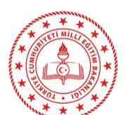

<!-- sayfa 1 -->

MİLLÎ EĞİTİM BAKANLIĞI YAYINLARI .......................................................................: 2024
DERS KİTAPLARI DİZİSİ ............................................................................................: 9603

Her hakkı saklıdır ve Millî Eğitim Bakanlığına aittir. Kitabın metin, soru ve şekilleri kısmen de olsa hiçbir surette alınıp yayımlanamaz.

# EDİTÖR
Prof. Dr. Çiğdem ARSLAN
Doç. Dr. Candaş UYGAN
Doç. Dr. Gamze KURT BİREL

# DİL UZMANI
Vedat EĞİLMEZ

# GÖRSEL TASARIMCI
Fatih GÜNDÜZ
Selçuk YAKIŞAN
Vildan ŞİMŞEK

# ÇOKLU ORTAM TASARIMCISI
Fatma KAHYAOĞLU
Gökhan KAHYAOĞLU
Hafize AÇAR KAŞTAN
Şerife KAÇMAZ

# PROGRAM GELİŞTİRME UZMANI
Doç.Dr. Adnan TAŞGIN

# ÖLÇME VE DEĞERLENDİRME UZMANI
Dr. Öğrt. Üyesi Mehtap AKTAŞ

# REHBERLİK UZMANI
Dursun DAYAPOĞLU

ISBN: 978-975-11-8013-1

Millî Eğitim Bakanlığı, Talim ve Terbiye Kurulu Başkanlığının 17.07.2024 tarih ve 110460159 sayılı yazısı ile eğitim aracı olarak kabul edilmiştir.

<!-- sayfa 2 -->

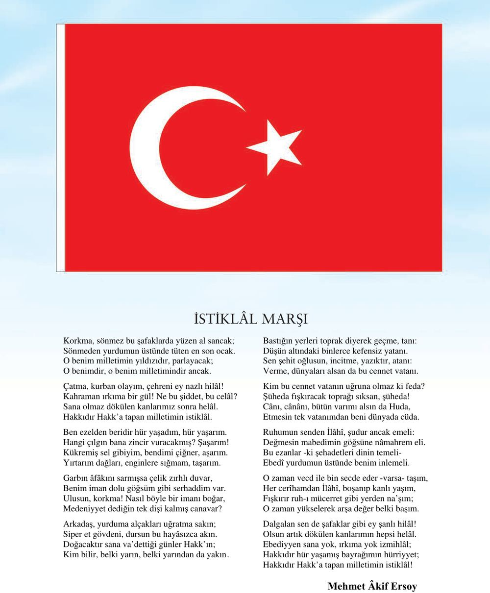

# İSTİKLÂL MARŞI

Korkma, sönmez bu şafaklarda yüzen al sancak;
Sönmeden yurdumun üstünde tüten en son ocak.
O benim milletimin yıldızıdır, parlayacak;
O benimdir, o benim milletimindir ancak.

Çatma, kurban olayım, çehreni ey nazlı hilâl!
Kahraman ırkıma bir gül! Ne bu şiddet, bu celâl?
Sana olmaz dökülen kanlarımız sonra helâl.
Hakkıdır Hakk'a tapan milletimin istiklâl.

Ben ezelden beridir hür yaşadım, hür yaşarım.
Hangi çılgın bana zincir vuracakmış? Şaşarım!
Kükremiş sel gibiyim, bendimi çiğner, aşarım.
Yırtarım dağları, enginlere sığmam, taşarım.

Garbın âfâkını sarmışsa çelik zırhlı duvar,
Benim iman dolu göğsüm gibi serhaddim var.
Ulusun, korkma! Nasıl böyle bir imanı boğar,
Medeniyyet dediğin tek dişi kalmış canavar?

Arkadaş, yurduma alçakları uğratma sakın;
Siper et gövdeni, dursun bu hayâsızca akın.
Doğacaktır sana va’dettiği günler Hakk’ın;
Kim bilir, belki yarın, belki yarından da yakın.

Bastığın yerleri toprak diyerek geçme, tanı:
Düşün altındaki binlerce kefensiz yatanı.
Sen şehit oğlusun, incitme, yazıktır, atanı:
Verme, dünyaları alsan da bu cennet vatanı.

Kim bu cennet vatanın uğruna olmaz ki feda?
Şüheda fışkıracak toprağı sıksan, şüheda!
Cânı, cânânı, bütün varımı alsın da Huda,
Etmesin tek vatanımdan beni dünyada cüda.

Ruhumun senden İlâhî, şudur ancak emeli:
Değmesin mabedimin göğsüne nâmahrem eli.
Bu ezanlar -ki şehadetleri dinin temeli-
Ebedî yurdumun üstünde benim inlemeli.

O zaman vecd ile bin secde eder -varsa- taşım,
Her cerîhamdan İlâhî, boşanıp kanlı yaşım,
Fışkırır ruh-ı mücerret gibi yerden na’şım;
O zaman yükselerek arşa değer belki başım.

Dalgalan sen de şafaklar gibi ey şanlı hilâl!
Olsun artık dökülen kanlarımın hepsi helâl.
Ebediyyen sana yok, ırkıma yok izmihlâl;
Hakkıdır hür yaşamış bayrağımın hürriyyet;
Hakkıdır Hakk'a tapan milletimin istiklâl!

Mehmet Âkif Ersoy

<!-- sayfa 3 -->

GENÇLİĞE HİTABE

Ey Türk gençliği! Birinci vazifen, Türk istiklâlini, Türk Cumhuriyetini, ilelebet muhafaza ve müdafaa etmektir.

Mevcudiyetinin ve istikbalinin yegâne temeli budur. Bu temel, senin en kıymetli hazinendir. İstikbalde dahi, seni bu hazineden mahrum etmek isteyecek dâhilî ve hâricî bedhahların olacaktır. Bir gün, istiklâl ve cumhuriyeti müdafaa mecburiyetine düşersen, vazifeye atılmak için, içinde bulunacağın vaziyetin imkân ve şeraitini düşünmeyeceksin! Bu imkân ve şerait, çok namüsait bir mahiyette tezahür edebilir. İstiklâl ve cumhuriyetine kastedecek düşmanlar, bütün dünyada emsali görülmemiş bir galibiyetin mümessili olabilirler. Cebren ve hile ile aziz vatanın bütün kaleleri zapt edilmiş, bütün tersanelerine girilmiş, bütün orduları dağıtılmış ve memleketin her köşesi bilfiil işgal edilmiş olabilir. Bütün bu şeraitten daha elîm ve daha vahim olmak üzere, memleketin dâhilinde iktidara sahip olanlar gaflet ve dalâlet ve hattâ hıyanet içinde bulunabilirler. Hattâ bu iktidar sahipleri şahsî menfaatlerini, müstevlîlerin siyasî emelleriyle tevhit edebilirler. Millet, fakr u zaruret içinde harap ve bîtap düşmüş olabilir.

Ey Türk istikbalinin evlâdı! İşte, bu ahval ve şerait içinde dahi vazifen, Türk istiklâl ve cumhuriyetini kurtarmaktır. Muhtaç olduğun kudret, damarlarındaki asil kanda mevcuttur.

Mustafa Kemal Atatürk

<!-- sayfa 4 -->


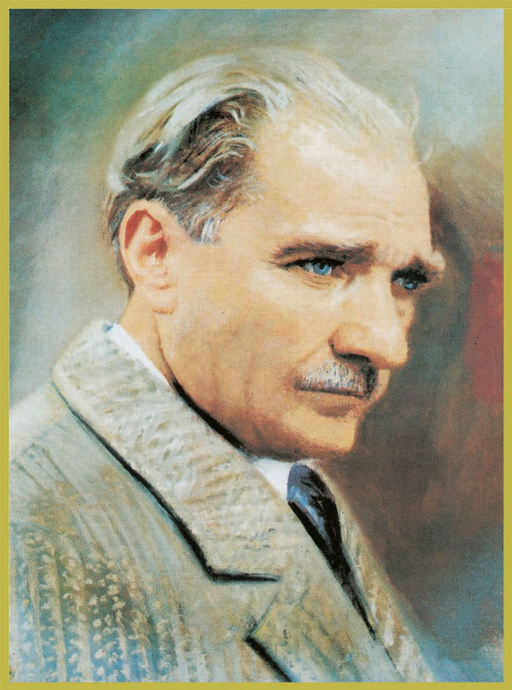
<!-- yer tutucu bulunamadı: sayfa sonuna eklendi -->

<!-- sayfa 5 -->

Verdiğiniz metin katmanı boş olduğu için (`<<< >>>` arası boş) dönüştürülecek bir içerik bulunmamaktadır. Lütfen metin katmanını içeren içeriği paylaşın, böylece talimatlarınıza uygun şekilde Markdown formatına çevirebilirim.

<!-- sayfa 6 -->

KİTABIMIZI TANIYALIM........................................................................................... 10

# 1.TEMA: GEOMETRİK ŞEKİLLER .......................................................................... 12

HAZIR MIYIZ?.......................................................................................................... 14
BAŞLAYALIM........................................................................................................... 15
TEMEL GEOMETRİK ŞEKİLLER VE ÖZELLİKLERİ ............................................... 17
       Nokta ................................................................................................................. 17
       Çember............................................................................................................. 26
       Dikme ................................................................................................................ 29
TEMEL GEOMETRİK ÇİZİMLERİN ÖZELLİKLERİ................................................. 32
       Performans Görevi ............................................................................................ 37
AÇILARI ÖLÇME..................................................................................................... 39
AÇI NASIL ÖLÇÜLÜR?............................................................................................ 41
DOĞRULARIN YOLCULUĞU.................................................................................. 45
       İki Doğrunun Kesişimi....................................................................................... 46
       Düzlemde Açı Oluşturmayan Doğrular .............................................................. 48
       İki Doğrunun Çakışması.................................................................................... 48
       Üç Doğrunun Paralelliği.................................................................................... 51
       Üç Doğrunun Bir Noktada Kesişimi ................................................................... 52
       Zihin Haritası Oluşturma................................................................................... 54
       Üç Doğrunun İkişer İkişer Kesişimi................................................................... 55
       İki Paralel Doğru ve Bir Kesen.......................................................................... 55
DOĞRULARDAN ÇOKGENLERE........................................................................... 57
ÇOKGENLERİN TEMEL ELEMANLARI.................................................................. 62
ÜÇGEN.................................................................................................................... 70
ÜÇGEN İNŞASI....................................................................................................... 77
ÖLÇME VE DEĞERLENDİRME SORULARI........................................................... 86

<!-- sayfa 7 -->

# 2.TEMA: SAYILAR VE NİCELİKLER (1):DOĞAL SAYILAR VE İŞLEMLER 92

HAZIR MIYIZ? .......................................................................................................... 94
BAŞLAYALIM ........................................................................................................... 95
DOĞAL SAYILAR VE İŞLEMLER ............................................................................ 97
    Çok Basamaklı Doğal Sayıları Okuma ve Yazma ............................................. 97
    İzleme Testi ....................................................................................................... 108
HAZIR MIYIZ? .......................................................................................................... 110
    Gerçek Yaşam Problemlerini Çözebilme ........................................................... 111
    Performans Görevi ............................................................................................ 124
ÖLÇME VE DEĞERLENDİRME SORULARI ........................................................... 135

# 3.TEMA: GEOMETRİK NİCELİKLER 138

HAZIR MIYIZ? .......................................................................................................... 140
BAŞLAYALIM ........................................................................................................... 141
DİKDÖRTGENİN ÇEVRE UZUNLUĞU ................................................................... 142
DİKDÖRTGENİN ALANI .......................................................................................... 145
DİKDÖRTGENDE ÇEVRE UZUNLUĞU VE ALAN .................................................. 150
    Performans Görevi ............................................................................................ 155
ÖLÇME VE DEĞERLENDİRME SORULARI ........................................................... 164

<!-- sayfa 8 -->

EK-1- ÖZ DEĞERLENDİRME FORMU................................................................... 167
SÖZLÜK................................................................................................................... 168
CEVAP ANAHTARI KAREKODU............................................................................. 168
KAYNAKÇA.............................................................................................................. 169
GÖRSEL VE GENEL AĞ KAYNAKÇASI KAREKODU............................................ 169
TÜRKİYE'NİN MÜLKİ İDARE BÖLÜMLERİ İLE KARA VE DENİZ 
KOMŞULARI HARİTASI........................................................................................... 170
TÜRK DÜNYASI HARİTASI..................................................................................... 171

<!-- sayfa 9 -->

# KİTABIMIZI TANIYALIM

Kitap genelinde kullanılan görseller ve açıklamaları aşağıda verilmiştir.

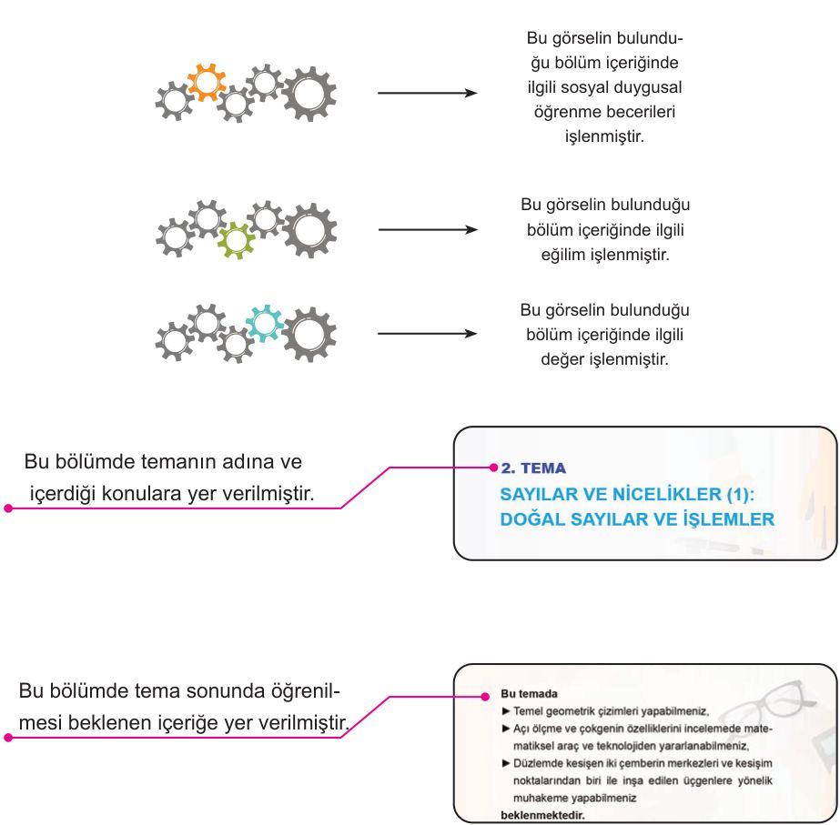 $\longrightarrow$ Bu görselin bulunduğu bölüm içeriğinde ilgili okuryazarlık becerisi işlenmiştir.

 $\longrightarrow$ Bu görselin bulunduğu bölüm içeriğinde ilgili sosyal duygusal öğrenme becerileri işlenmiştir.

 $\longrightarrow$ Bu görselin bulunduğu bölüm içeriğinde ilgili eğilim işlenmiştir.

 $\longrightarrow$ Bu görselin bulunduğu bölüm içeriğinde ilgili değer işlenmiştir.

Bu bölümde temanın adına ve içerdiği konulara yer verilmiştir. $\longrightarrow$ 
**2. TEMA**
**SAYILAR VE NİCELİKLER (1):**
**DOĞAL SAYILAR VE İŞLEMLER**

Bu bölümde tema sonunda öğrenilmesi beklenen içeriğe yer verilmiştir. $\longrightarrow$ 
**Bu temada**
* Temel geometrik çizimleri yapabilmeniz,
* Açı ölçme ve çokgenin özelliklerini inceleme matematiksel araç ve teknolojiden yararlanabilmeniz,
* Düzlemde kesişen iki çemberin merkezleri ve kesişim noktalarından biri ile inşa edilen üçgenlere yönelik muhakeme yapabilmeniz
**beklenmektedir.**
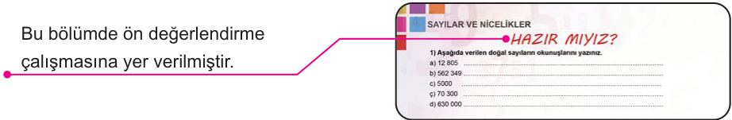

Bu bölümde ön değerlendirme çalışmasına yer verilmiştir. $\longrightarrow$ 
**SAYILAR VE NİCELİKLER**
**HAZIR MIYIZ?**
1) Aşağıda verilen doğal sayıların okunuşlarını yazınız.
a) $12\ 802$ <!-- KONTROL: Marker'da karşılığı yok, uydurma olabilir -->
b) $562\ 349$ <!-- KONTROL: Marker'da karşılığı yok, uydurma olabilir -->
c) $5000$ <!-- KONTROL: Marker'da karşılığı yok, uydurma olabilir -->
ç) $70\ 300$ <!-- KONTROL: Marker'da karşılığı yok, uydurma olabilir -->
d) $69\ 000$ <!-- KONTROL: Marker'da karşılığı yok, uydurma olabilir -->

<!-- sayfa 10 -->

# KİTABIMIZI TANIYALIM

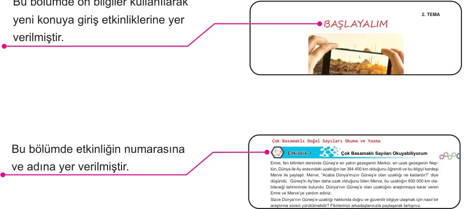

Bu bölümde ön bilgiler kullanılarak yeni konuya giriş etkinliklerine yer verilmiştir.

2. TEMA
BAŞLAYALIM

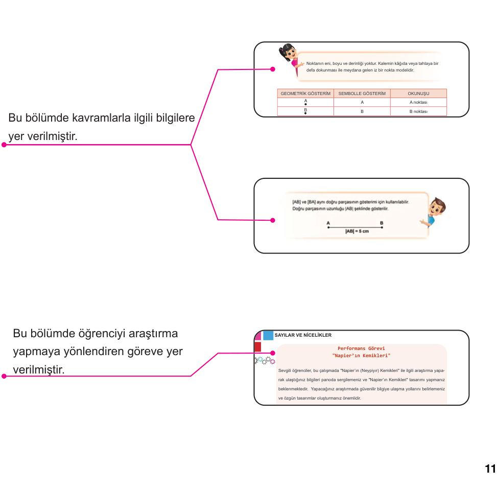

Bu bölümde etkinliğin numarasına ve adına yer verilmiştir.

Çok Basamaklı Doğal Sayıları Okuma ve Yazma
Etkinlik 1 Çok Basamaklı Sayıları Okuyabiliyorum

Emre, fen bilimleri dersinde Güneş’e en yakın gezegenin Merkür, en uzak gezegenin Neptün, Dünya ile Ay arasındaki uzaklığın ise $384\ 400\text{ km}$ olduğunu öğrendi ve bu bilgiyi kardeşi Merve ile paylaştı. Merve, “Acaba Dünya'mızın Güneş’e olan uzaklığı ne kadardır?” diye düşündü. Güneş'in Ay'dan daha uzak olduğunu bilen Merve, bu uzaklığın $600\ 000\text{ km}$ olabileceği tahmininde bulundu. Dünya’nın Güneş’e olan uzaklığını araştırmaya karar veren Emre ve Merve'ye yardım ediniz.

Sizce Dünya’nın Güneş’e uzaklığı hakkında doğru ve güvenilir bilgiye ulaşmak için nasıl bir araştırma süreci yürütülmelidir? Fikirlerinizi arkadaşlarınızla paylaşarak tartışınız.

Bu bölümde kavramlarla ilgili bilgilere yer verilmiştir.

Noktanın eni, boyu ve derinliği yoktur. Kalemin kâğıda veya tahtaya bir defa dokunması ile meydana gelen iz bir nokta modelidir.

| GEOMETRİK GÖSTERİM | SEMBOLLE GÖSTERİM | OKUNUŞU |
| :---: | :---: | :--- |
| $\bullet$ <br> A | A | A noktası |
| $\bullet$ <br> B | B | B noktası |

$[AB]$ ve $[BA]$ <!-- KONTROL: Marker'da karşılığı yok, uydurma olabilir --> aynı doğru parçasının gösterimi için kullanılabilir. Doğru parçasının uzunluğu $|AB|$ şeklinde gösterilir.

$A \text{ --- } B$
$|AB| = 5\text{ cm}$ <!-- KONTROL: Marker'da karşılığı yok, uydurma olabilir -->

Bu bölümde öğrenciyi araştırma yapmaya yönlendiren göreve yer verilmiştir.

SAYILAR VE NİCELİKLER
Performans Görevi
"Napier'in Kemikleri"

Sevgili öğrenciler, bu çalışmada "Napier'ın (Neypiyır) Kemikleri" ile ilgili araştırma yaparak ulaştığınız bilgileri panoda sergilemeniz ve "Napier'ın Kemikleri" tasarımı yapmanız beklenmektedir. Yapacağınız araştırmada güvenilir bilgiye ulaşma yollarını belirlemeniz ve özgün tasarımlar oluşturmanız önemlidir.

<!-- sayfa 11 -->

# 1. TEMA
# GEOMETRİK ŞEKİLLER

* **Temel Geometrik Çizimler ve İnşalar**
* **Açı Ölçme**
* **Çokgenler ve Çember**

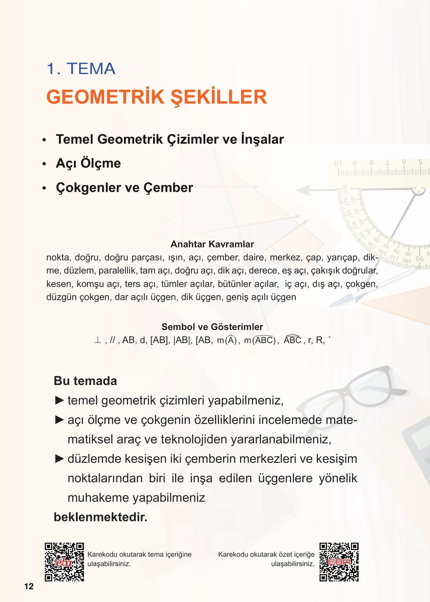

**Anahtar Kavramlar**
nokta, doğru, doğru parçası, ışın, açı, çember, daire, merkez, çap, yarıçap, dikme, düzlem, paralellik, tam açı, doğru açı, dik açı, derece, eş açı, çakışık doğrular, kesen, komşu açı, ters açı, tümler açılar, bütünler açılar, iç açı, dış açı, çokgen, düzgün çokgen, dar açılı üçgen, dik üçgen, geniş açılı üçgen

**Sembol ve Gösterimler**
$\perp$, $//$, $AB$, $d$, $[AB]$, $|AB|$, $[AB]$, $m(\widehat{A})$, $m(\widehat{ABC})$, $\widehat{ABC}$, $r$, $R$, $^\circ$

**Bu temada**

$\blacktriangleright$ temel geometrik çizimleri yapabilmeniz,

$\blacktriangleright$ açı ölçme ve çokgenin özelliklerini incelemede matematiksel araç ve teknolojiden yararlanabilmeniz,

$\blacktriangleright$ düzlemde kesişen iki çemberin merkezleri ve kesişim noktalarından biri ile inşa edilen üçgenlere yönelik muhakeme yapabilmeniz

**beklenmektedir.**

<!-- sayfa 12 -->

# GEOMETRİ

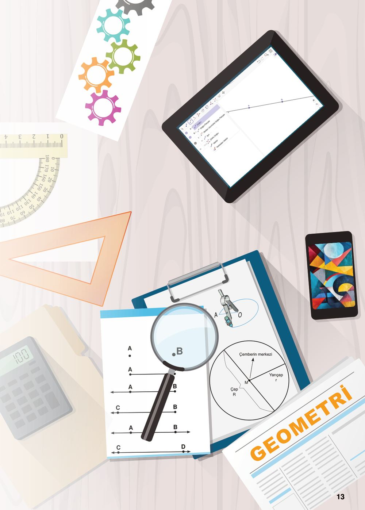

Çemberin merkezi
Yarıçap
$r$
Çap
$R$
$M$

<!-- sayfa 13 -->

# HAZIR MIYIZ?

1) Aşağıdaki şekillerin kenar uzunluklarını milimetre cinsinden cetvelle ölçünüz ve üzerine yazınız.


Daha önce açıların dar, dik ve geniş açı olarak sınıflandırıldığını görmüştünüz. Bunu yaparken de yüzeyi dikdörtgen şeklinde olan bir kitabın köşesini dik açı olarak referans almıştınız. Şimdi de yüzeyi dikdörtgen şeklinde olan bir kapının veya masanın köşesini örnek alarak aşağıda gösterilen açıları dar, dik ve geniş açı olarak sınıflandırınız.


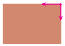


2) Aşağıda Türk mimarisinde önemli yere sahip bazı eserlerden görseller verilmiştir. Görsellerdeki geometrik şekilleri inceleyiniz. Hangi geometrik şekillerle karşılaştınız?

Sizce incelediğiniz eserlerin mimarları, bu şekilleri oluşturmak için hangi matematiksel araçları kullanmış olabilirler? Arkadaşlarınızla tartışınız.

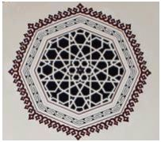
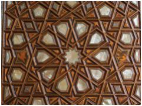
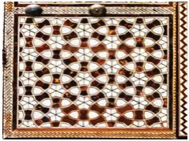

Süleymaniye Camii'nin
Sultanahmet Camii'nin
Topkapı Sarayı'nın iç

<!-- sayfa 14 -->


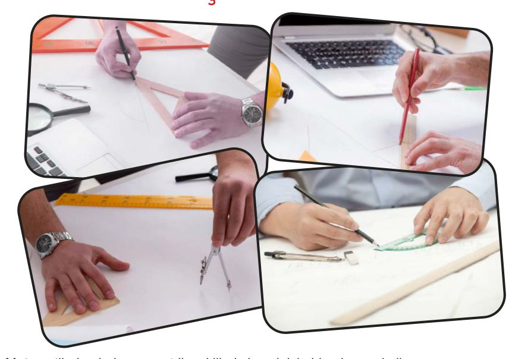
<!-- yer tutucu bulunamadı: sayfa sonuna eklendi -->

<!-- sayfa 15 -->

6) Aşağıdaki Türkiye'nin Mülki İdare Bölümleri ile Kara ve Deniz Komşuları Haritasını inceleyiniz. Haritadaki illerden hangilerini ziyaret etmek istersiniz.

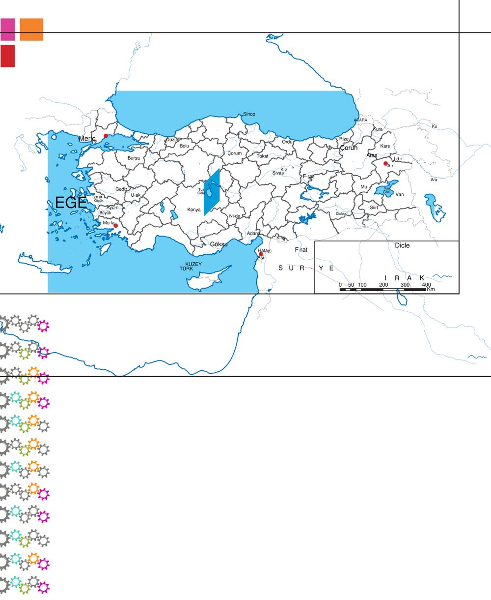

7) Uçakla Tekirdağ'dan Hatay'a ve Muğla'dan Ağrı'ya seyahat ettiğinizi düşününüz. Uçaklar her zaman düz bir rota izlemez fakat siz uçakların düz gittiğini varsayınız. Bu durumda hangi illerin üzerinden geçerdiniz?

[ ] [ ] [ ] [ ] [ ] [ ] [ ] [ ] [ ] [ ] [ ] [ ] [ ] [ ] [ ] [ ] [ ] [ ] [ ] [ ] [ ] [ ] [ ] [ ] [ ] [ ] [ ] [ ] [ ] [ ] [ ] [ ] [ ] [ ] [ ] [ ] [ ] [ ] [ ] [ ] [ ] [ ] [ ] [ ] [ ] [ ] [ ] [ ] [ ] [ ] [ ] [ ] [ ] [ ] [ ] [ ] [ ] [ ] [ ] [ ] [ ] [ ] [ ] [ ] [ ] [ ] [ ] [ ] [ ] [ ] [ ] [ ] [ ] [ ] [ ] [ ] [ ] [ ] [ ] [ ] [ ] [ ] [ ] [ ] [ ] [ ] [ ] [ ] [ ] [ ] [ ] [ ] [ ] [ ] [ ] [ ] [ ] [ ] [ ] [ ] [ ] [ ] [ ] [ ] [ ] [ ] [ ] [ ] [ ] [ ] [ ] [ ] [ ] [ ] [ ] [ ] [ ] [ ] [ ] [ ] [ ] [ ] [ ] [ ] [ ] [ ] [ ] [ ] [ ] [ ] [ ] [ ] [ ] [ ] [ ] [ ] [ ] [ ] [ ] [ ] [ ] [ ] [ ] [ ] [ ] [ ] [ ] [ ] [ ] [ ] [ ] [ ] [ ] [ ] [ ] [ ] [ ] [ ] [ ] [ ] [ ] [ ] [ ] [ ] [ ] [ ] [ ] [ ] [ ] [ ] [ ] [ ] [ ] [ ] [ ] [ ] [ ] [ ] [ ] [ ] [ ] [ ] [ ] [ ] [ ] [ ] [ ] [ ] [ ] [ ] [ ] [ ] [ ] [ ] [ ] [ ] [ ] [ ] [ ] [ ] [ ] [ ] [ ] [ ] [ ] [ ] [ ] [ ] [ ] [ ] [ ] [ ] [ ] [ ] [ ] [ ] [ ] [ ] [ ] [ ] [ ] [ ] [ ] [ ] [ ] [ ] [ ] [ ] [ ] [ ] [ ] [ ] [ ] [ ] [ ] [ ] [ ] [ ] [ ] [ ] [ ] [ ] [ ] [ ] [ ] [ ] [ ] [ ] [ ] [ ] [ ] [ ] [ ] [ ] [ ] [ ] [ ] [ ] [ ] [ ] [ ] [ ] [ ] [ ] [ ] [ ] [ ] [ ] [ ] [ ] [ ] [ ] [ ] [ ] [ ] [ ]

<!-- sayfa 16 -->

# TEMEL GEOMETRİK ŞEKİLLER VE ÖZELLİKLERİ

## Nokta

Bir kâğıda kaleminizin ucunu değdirip kaldırınız.
Oluşan iz ile günlük hayatınızda nerelerde karşılaştınız?

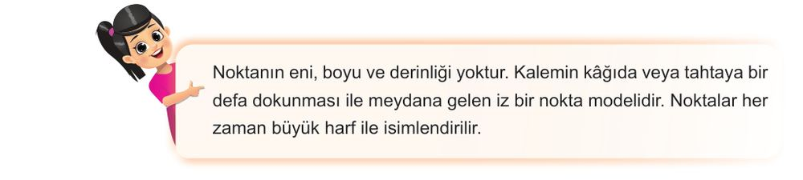

Noktanın eni, boyu ve derinliği yoktur. Kalemin kâğıda veya tahtaya bir defa dokunması ile meydana gelen iz bir nokta modelidir. Noktalar her zaman büyük harf ile isimlendirilir.

| GEOMETRİK GÖSTERİM | SEMBOLLE GÖSTERİM | OKUNUŞU |
| :---: | :---: | :---: |
| $\overset{\bullet}{A}$ <!-- KONTROL: Marker'da karşılığı yok, uydurma olabilir --> | $A$ | A noktası |
| $\overset{\bullet}{B}$ <!-- KONTROL: Marker'da karşılığı yok, uydurma olabilir --> | $B$ | B noktası |

### Etkinlik 1: İki Nokta Arasını Noktalarla Doldurma

Aşağıda iki nokta arasını düz bir şekilde noktalarla doldurmaya çalışan öğrencilerin diyaloğunu inceleyiniz.

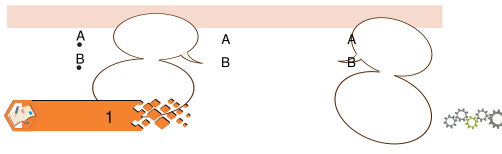

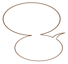
(Aralarda boşluk kalmamalı.)


(Meydana gelen şekli fark edebildin mi?)


(Aynı hizada yapmak çok zor.)

Verilen diyaloğa göre aşağıdaki soruları cevaplandırınız.

1) İki nokta arasını düz ve hiç boşluk kalmayacak biçimde noktalarla doldurursanız ortaya nasıl bir şekil çıkar? Düşüncelerinizi yazarak arkadaşlarınızla tartışınız.

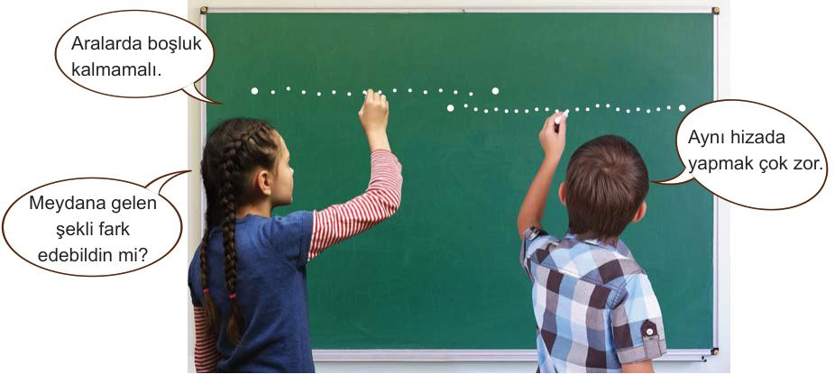


<!-- sayfa 17 -->

2) Aşağıdaki boş alanda iki nokta belirleyerek aralarını noktalarla düz bir şekilde doldurunuz.

3) Noktaları tek tek koymak yerine bunun için nasıl bir araç kullanabilirsiniz? Düşüncelerinizi yazarak arkadaşlarınızla tartışınız.


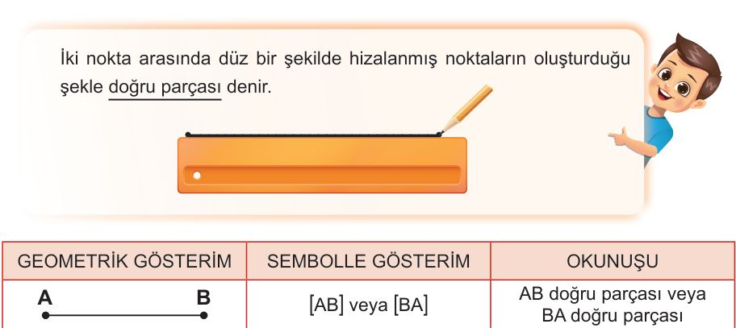
Uzunluğunu dikkate almadan düz bir çizgi çizmeniz gerektiğinde üzerinde birimlerin yer almadığı ölçüsüz cetveli kullanabilirsiniz. Bu araç çizgeç olarak da isimlendirilir. Günlük hayatta kalem, uç kutusu gibi nesnelerin düz kenarlarını da çizgeç yerine kullanabilirsiniz.

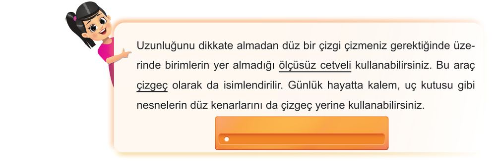
İki nokta arasında düz bir şekilde hizalanmış noktaların oluşturduğu şekle doğru parçası denir.


| GEOMETRİK GÖSTERİM | SEMBOLLE GÖSTERİM | OKUNUŞU |
| :---: | :---: | :---: |
| $\text{A} \text{---} \text{B}$ | $[AB]$ veya $[BA]$ | $AB$ doğru parçası veya $BA$ doğru parçası |

<!-- sayfa 18 -->

# Etkinlik 2 Doğru Parçasından Işına

Aşağıdaki alana bir doğru parçası çiziniz.
Daha sonra doğru parçasının bir ucundan itibaren çizgeç yardımıyla aynı hizada noktalar koymaya başlayarak noktaları devam ettiriniz.

Yaptığınız işlemin sonunda ortaya çıkan şekli arkadaşlarınızla karşılaştırarak düşüncelerinizi paylaşınız.


> Bir noktadan başlayarak aynı hizada sonsuza kadar giden noktaların oluşturduğu şekle ışın denir.

| GEOMETRİK GÖSTERİM | SEMBOLLE GÖSTERİM | OKUNUŞU |
| :---: | :---: | :---: |
| B $\longrightarrow$ C | $[BC$ | BC ışını |

# Etkinlik 3 Işından Doğruya

Aşağıdaki alana bir ışın çiziniz.
Daha sonra çizgeç yardımıyla ışının tersi yönde ve aynı hizada noktalar koymaya başlayarak noktaları devam ettiriniz.

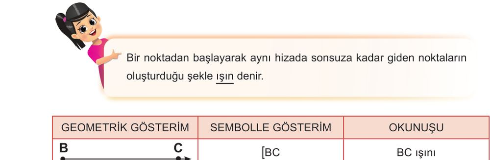

Yaptığınız işlemin sonunda ortaya çıkan şekli arkadaşlarınızla karşılaştırarak düşüncelerinizi paylaşınız.

<!-- sayfa 19 -->

İki ucu da sonsuza kadar giden düz bir şekilde hizalanmış noktaların oluşturduğu şekle doğru denir.

| GEOMETRİK GÖSTERİM | SEMBOLLE GÖSTERİM | OKUNUŞU |
| :---: | :---: | :---: |
| 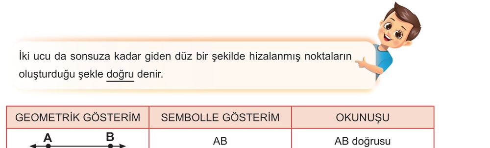 | $AB$ | $AB$ doğrusu |
|  | $d$ | $d$ doğrusu |

### Örnek 1
Aşağıdaki geometrik çizim, gösterim ve okunuşları doğru bir şekilde eşleştiriniz.

 (M ve N noktaları olan doğru parçası)
 (K ve L noktaları olan doğru parçası)
 (A ve B noktaları olan doğru)

(Eşleştirme seçenekleri)
- NM ışını $\leftrightarrow$ $[NM$
- KL ışını $\leftrightarrow$ $NM$
- AB doğrusu $\leftrightarrow$ $[KL]$
- NM doğru parçası $\leftrightarrow$ $[AB]$ <!-- KONTROL: Marker'da karşılığı yok, uydurma olabilir -->
- KL doğru parçası $\leftrightarrow$ $KL$
- AB doğru parçası $\leftrightarrow$ $AB$

<!-- sayfa 20 -->

# Örnek 2


Yukarıdaki şekilde doğru, doğru parçası ve ışınları belirleyiniz. Bunların sembolle gösterimlerini aşağıdaki ilgili alana yazınız.

| Doğru | Doğru Parçası | Işın |
| :---: | :---: | :---: |
| | | |
| | | |

# Örnek 3

Aşağıdaki noktaları harflerle isimlendirerek istenen şekilleri çiziniz ve sembolle gösteriniz.

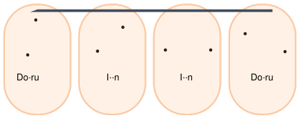

| Doğru Parçası | Işın | Işın | Doğru |
| :---: | :---: | :---: | :---: |
| Sembolle Gösterim | Sembolle Gösterim | Sembolle Gösterim | Sembolle Gösterim |
| ....................... | ....................... | ....................... | ....................... |

# Etkinlik 4: Uzunluğu Ölçülebilen Geometrik Çizimler

Doğru, doğru parçası ve ışından hangilerinin uzunlukları ölçülebilir? Düşüncelerinizi aşağıdaki alana yazınız.

| |
| :--- |
| |
| |
| |
| |
| |
| |
| |
| |
| |
| |
| |
| |
| |
| |
| |
| |
| |
| |
| |
| |
| |
| |
| |
| |
| |
| |
| |
| |
| |
| |
| |
| |
| |
| |
| |
| |
| |
| |
| |
| |
| |
| |
| |
| |
| |
| |
| |
| |
| |
| |
| |
| |
| |
| |
| |
| |
| |
| |
| |
| |
| |
| |
| |
| |
| |
| |
| |
| |
| |
| |
| |
| |
| |
| |
| |
| |
| |
| |
| |
| |
| |
| |
| |
| |
| |
| |
| |
| |
| |
| |
| |
| |
| |
| |
| |
| |
| |
| |
| |
| |
| |
| |
| |
| |
| |
| |
| |
| |
| |
| |
| |
| |
| |
| |
| |
| |
| |
| |
| |
| |
| |
| |
| |
| |
| |
| |
| |
| |
| |
| |
| |
| |
| |
| |
| |
| |
| |
| |
| |
| |
| |
| |
| |
| |
| |
| |
| |
| |
| |
| |
| |
| |
| |
| |
| |
| |
| |
| |
| |
| |
| |
| |
| |
| |
| |
| |
| |
| |
| |
| |
| |
| |
| |
| |

<!-- sayfa 21 -->

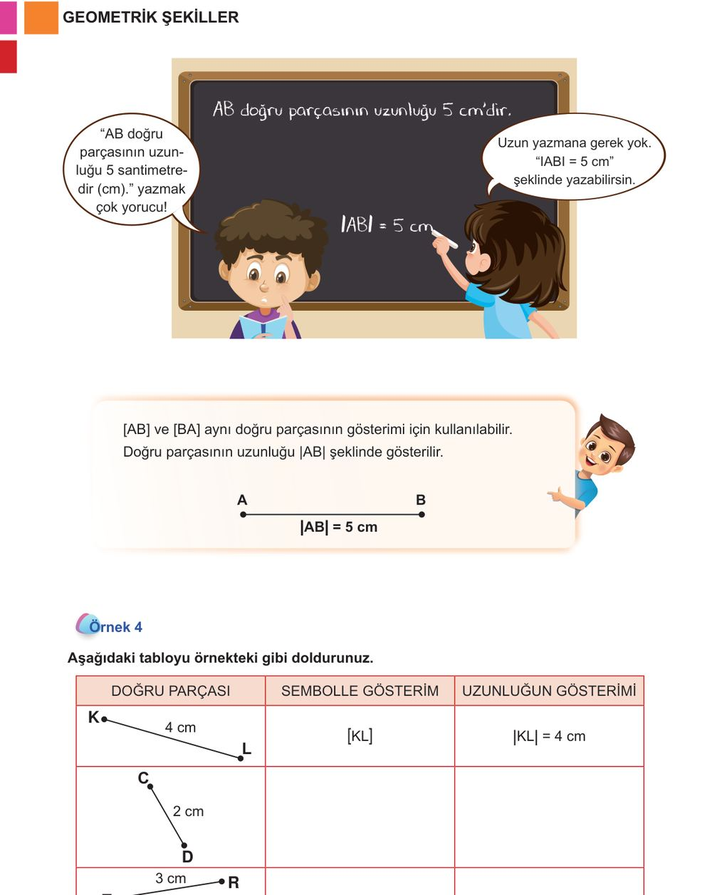

“$AB$ <!-- KONTROL: Marker'da karşılığı yok, uydurma olabilir --> doğru parçasının uzunluğu $5$ santimetredir (cm).” yazmak çok yorucu!

$AB$ <!-- KONTROL: Marker'da karşılığı yok, uydurma olabilir --> doğru parçasının uzunluğu $5\text{ cm}$'dir.

Uzun yazmana gerek yok. “$|AB| = 5\text{ cm}$ <!-- KONTROL: Marker'da karşılığı yok, uydurma olabilir -->” şeklinde yazabilirsin.

$|AB| = 5\text{ cm}$ <!-- KONTROL: Marker'da karşılığı yok, uydurma olabilir -->

---

$[AB]$ <!-- KONTROL: Marker'da karşılığı yok, uydurma olabilir --> ve $[BA]$ <!-- KONTROL: Marker'da karşılığı yok, uydurma olabilir --> aynı doğru parçasının gösterimi için kullanılabilir.
Doğru parçasının uzunluğu $|AB|$ <!-- KONTROL: Marker'da karşılığı yok, uydurma olabilir --> şeklinde gösterilir.


$A$ —————— $B$
$|AB| = 5\text{ cm}$ <!-- KONTROL: Marker'da karşılığı yok, uydurma olabilir -->

---

### Örnek 4

Aşağıdaki tabloyu örnekteki gibi doldurunuz.

| DOĞRU PARÇASI | SEMBOLLE GÖSTERİM | UZUNLUĞUN GÖSTERİMİ |
| :---: | :---: | :---: |
|  | $[KL]$ | $|KL| = 4\text{ cm}$ <!-- KONTROL: Marker'da karşılığı yok, uydurma olabilir --> |
|  | | |
|  | | |

<!-- sayfa 22 -->

# Örnek 5

Aşağıdaki her bir görselde birer doğru parçası modeli belirleyiniz. Belirlediğiniz doğru par-
çası modellerini isimlendirerek sembolle gösteriniz. Bu doğru parçalarının uzunluklarını mi-
limetre cinsinden cetvel ile ölçüp sonuçlarını doğru parçalarının altına yazınız.

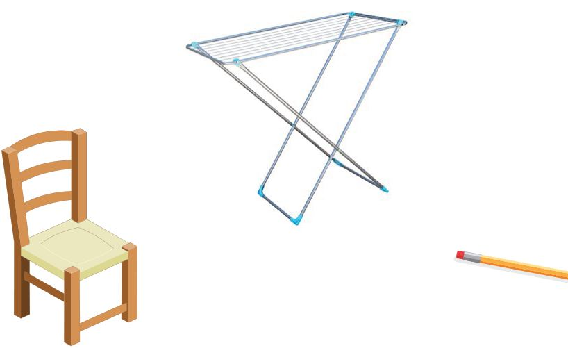

---

## Etkinlik 5 Açı Oluşturma

Aşağıdaki noktaları isimlendiriniz. Daha sonra ilk kutuda kırmızı noktadan, diğer kutularda 
da sizin seçtiğiniz herhangi bir noktadan diğer noktalara ayrı ayrı ışınlar çiziniz.

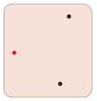
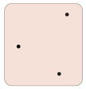
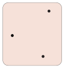

**Yaptığınız işlemin sonunda ortaya çıkan şekli arkadaşlarınızla karşılaştırarak düşün-
celerinizi paylaşınız.**


<!-- sayfa 23 -->

Bir ışının dönme miktarı olarak tanımlanan açı başlangıç noktaları aynı olan iki ışının oluşturduğu şekil olarak da tanımlanabilir.

Açıyı oluşturan ışınlara açının kolları, ışınların başlangıç noktasına da açının köşesi denir.

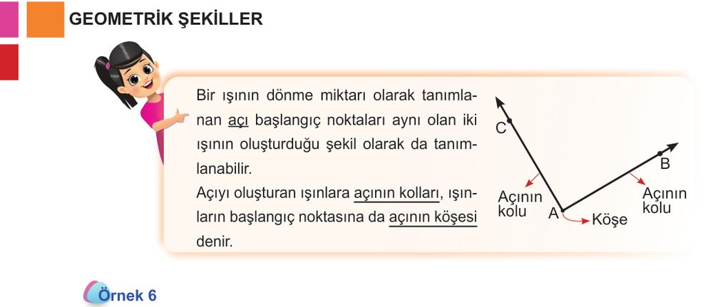

# Örnek 6

Aşağıdaki tabloyu örnekteki gibi doldurunuz.

| AÇI | SEMBOLLE GÖSTERİM | İSİMLENDİRME |
| :--- | :--- | :--- |
| a)  | $\widehat{BAC}, \widehat{CAB}, \widehat{A}$ <!-- KONTROL: Marker'da karşılığı yok, uydurma olabilir --> | BAC açısı, CAB açısı ya da A açısı |
| b)  | | |
| c)  | | |
| ç)  | | |

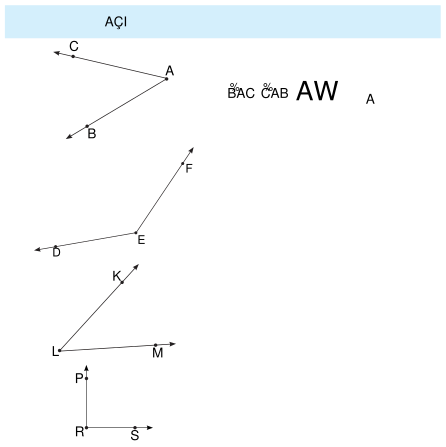
<!-- yer tutucu bulunamadı: sayfa sonuna eklendi -->

<!-- sayfa 24 -->

# Etkinlik 6 Geombala

Geombala iki kişiyle oynanan bir oyundur.

**Gerekli olan malzemeler:** kalem, makas ve torba.

**Malzemelerin hazırlanışı:**
* Eşit büyüklükte 20 adet kâğıt parçası kesilir (Makas kullanırken dikkatli olunuz.).
* Şekil 1'de verilen temel geometrik kavramlara ait çizimler veya gösterimler, bu kâğıt parçalarına yazılarak torbaya atılır.
* Şekil 2 ve Şekil 3'teki kartlar hazırlanır.

**Oynanışı:**
* Şekil 2 ve Şekil 3'teki kartlar oyunculara dağıtılır.
* Bir kişi (Oyunculardan biri de olabilir.) torbayı alır ve sırayla kâğıt çekmeye başlar.
* Torbadan çekilen kâğıt tüm oyunculara gösterilir.
* Kartında, gösterilen temel geometrik kavrama ait çizim veya gösterim bulunan oyuncu, kartındaki ilgili bölümün üstünü boş bir kâğıt parçası ile kapatır.
* Kartlardan birindeki tüm gösterimlerin üstü kâğıtla kaplandığında oyun biter ve bu kartın sahibi oyunu kazanır.

Şekil-1

| | | | | |
| :--- | :--- | :--- | :--- | :--- |
| AB doğru parçası | B noktası | CD doğrusu | KLM açısı | MN ışını |
| AB doğru parçasının uzunluğu | KL doğrusu | C noktası | CD ışını | MN doğru parçası |
| ABC açısı | AB doğrusu | CD doğru parçası | YZ doğru parçasının uzunluğu | Z noktası |
| AB ışını | YZ doğrusu | KL doğru parçası | MN doğrusu | KL ışını |


<!-- sayfa 25 -->

Şekil-2


Şekil-3
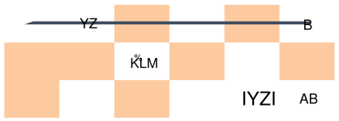

# Çember


## Etkinlik 7 Noktalardan Çembere

Canan öğretmen 5/B sınıfını pikniğe götürmüştür. Öğretmen, rastgele bir noktaya geçip şerit metreyi $3$ metre açarak öğrencilerine “Herkes bu şerit metreyi kullanarak benden $3$ metre uzaklıkta olacak şekilde yerleşsin ve el ele tutuşsun.” demiştir. Sizce öğretmen çocuklarla hangi geometrik şekli oluşturmaya çalışmıştır? Oluşan şekilde öğretmenin ve öğrencilerin bulunduğu yerler neyi temsil etmektedir? Düşüncelerinizi aşağıya yazınız ve arkadaşlarınızla tartışınız.


<!-- sayfa 26 -->

Canan öğretmenin öğrencileri ile oluşturmaya çalıştığı geometrik şekli aşağıdaki kutuya çizmeye çalışınız. Bunun için cetvel kullanarak verilen noktaya eşit uzaklıkta olabildiğince fazla sayıda nokta koyunuz. Koyduğunuz noktaların sayısı arttıkça şekil daha da belirginleşecektir.

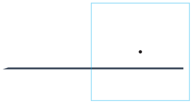

Noktaları tek tek işaretleyerek oluşturmak yerine araç yardımıyla bu şekli daha düzgün ve kolay bir biçimde çizebilir misiniz? Düşüncelerinizi yazınız. Daha sonra arkadaşlarınızla paylaşarak tartışınız.

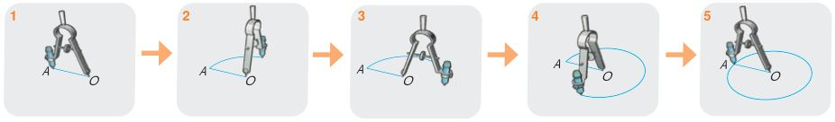

# Etkinlik 8 Pergel Kullanımı

Pergel kullanılırken önce pergelin kolları arasında rastgele bir açıklık oluşturulur. Daha sonra pergelin sivri ucu herhangi bir noktaya konur ve sabitlenir. Pergelin kalem takılan diğer ucu bu sivri uç etrafında döndürülür. Böylece çember oluşturulur.


Sizler de pergelin kolları arasındaki açıklığı değiştirerek aşağıdaki kareli zemine farklı çemberler çiziniz ve bunları arkadaşlarınızın çizimleriyle karşılaştırınız.
(Pergel kullanırken dikkatli olunuz.)


<!-- sayfa 27 -->

Düz bir yüzeyde merkez olarak belirlenen bir noktaya eşit uzaklıktaki noktaların oluşturduğu geometrik şekle çember denir. Merkez ile çember üzerindeki herhangi bir noktayı birleştiren doğru parçasına yarıçap denir ve “$r$” ile gösterilir. Çemberin iki noktasını merkezden geçecek şekilde birleştiren doğru parçasına çap denir ve “$R$” ile gösterilir.

Pergelle bir çember çizilirken pergelin sivri ucu çemberin merkezine yerleştirildiğinde kolların uçları arasındaki mesafe çemberin yarıçapının uzunluğuna eşittir.

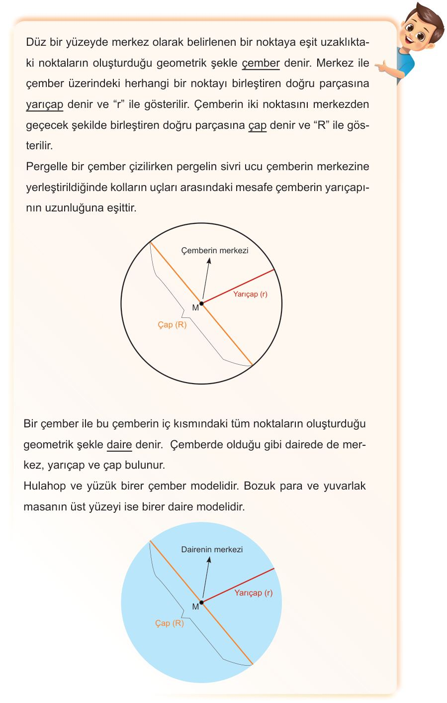

Bir çember ile bu çemberin iç kısmındaki tüm noktaların oluşturduğu geometrik şekle daire denir. Çemberde olduğu gibi dairede de merkez, yarıçap ve çap bulunur.

Hulahop ve yüzük birer çember modelidir. Bozuk para ve yuvarlak masanın üst yüzeyi ise birer daire modelidir.


<!-- sayfa 28 -->

Örnek 7

Pergel kullanarak yarıçap uzunlukları eşit olan çemberler çiziniz.

# Dikme

## Etkinlik 9 Ahşap Bloklar

Sizce ahşap bloklar zemine nasıl konumlandırılmıştır?
**Düşüncelerinizi arkadaşlarınızla paylaşarak tartışınız.**

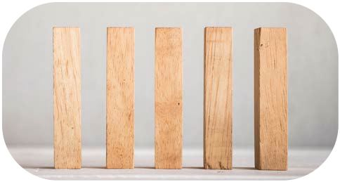

Örnek 8

Mühendis Zeynep Hanım, atık suları binanın çatısından zemine en kısa yoldan taşımak istiyor. **Sizce numaralandırılmış borulardan hangisi bu iş için en uygundur?**

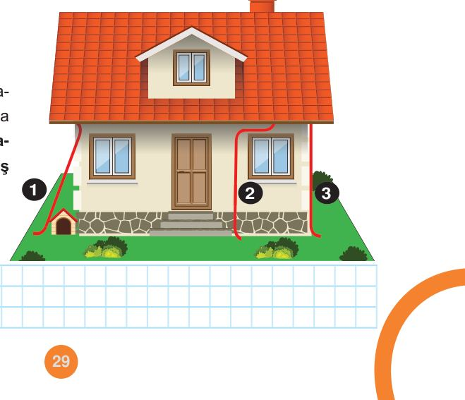

<!-- sayfa 29 -->

# Etkinlik 10 Doğruya Dikme Çizme

Alttaki alana bir doğru çiziniz ve doğrunun dışında bir nokta belirleyiniz. Belirlediğiniz noktayı doğru ile birleştiren farklı doğru parçaları çiziniz. Bu doğru parçalarının çizdiğiniz doğruya olan uzaklıkları için ne söyleyebilirsiniz?
**En kısa doğru parçası sizce nasıl çizilir?**


Bu doğru parçasını çizmek ve onun en kısa olduğundan emin olmak için nasıl bir araç kullanmanız gerekir?

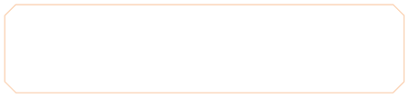

> Bir doğruya dışındaki bir noktadan dik çizilen doğru parçasına **dikme** denir. Diklik “$\perp$” sembolü ile gösterilir ve $[AB] \perp CD$ <!-- KONTROL: Marker'da karşılığı yok, uydurma olabilir --> yazılır. Bir doğruya dışındaki bir noktadan dikme çizebilmek için “gönye” kullanılabilir.
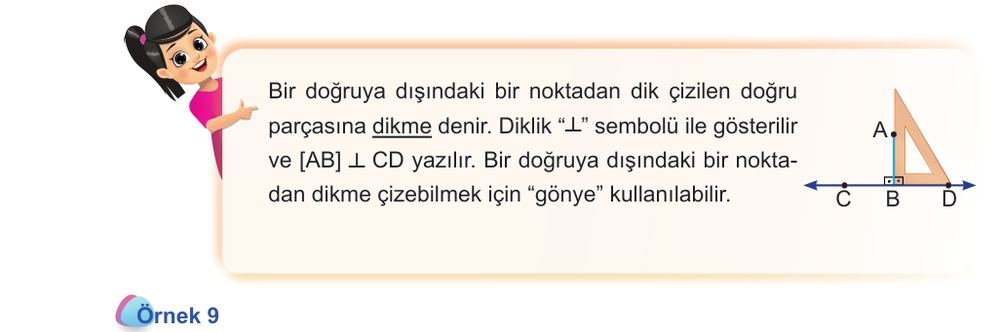

## Örnek 9

Aşağıda gönye kullanılarak doğrular çizilmiştir. Hangi numaralı doğruların birbirine dik olduğunu görsellerin altındaki noktalı yere yazınız.

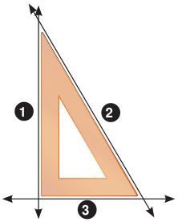
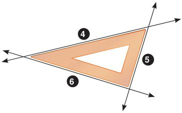

..... numaralı doğru ile ..... numaralı doğru

<!-- sayfa 30 -->

# Etkinlik 11: En Kısa Doğru Parçasını Çizme

Aşağıdaki noktalardan verilen doğrulara en kısa doğru parçalarını uygun araç ile çiziniz.
Yaptığınız çizimleri arkadaşlarınızla paylaşınız.

a)
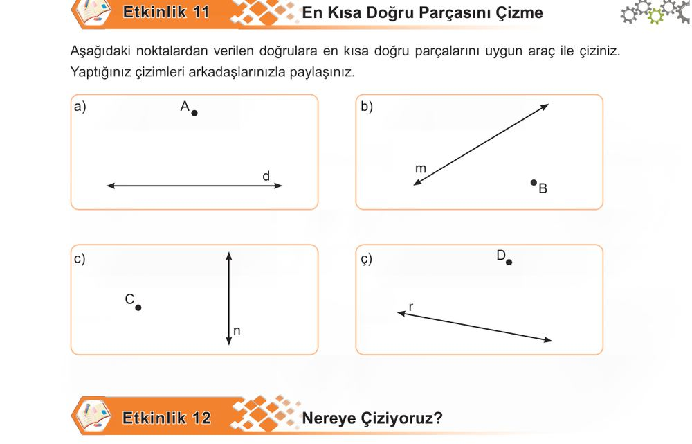

b)


c)


ç)


# Etkinlik 12: Nereye Çiziyoruz?

Nokta, doğru parçası, ışın, doğru ve açıyı araç ve teknoloji kullanarak çizmeyi öğrendiniz.
Bu çizimleri yaptığınız yüzeyleri yazınız.

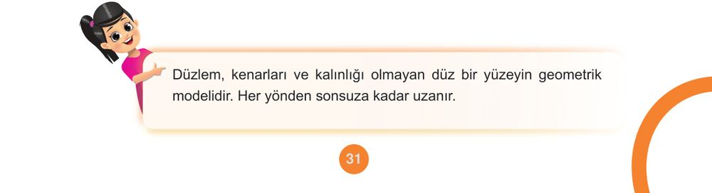

Bu çizimleri gerçekleştirdiğiniz yüzeylerin ortak özelliği nedir?


Düzlem, kenarları ve kalınlığı olmayan düz bir yüzeyin geometrik modelidir. Her yönden sonsuza kadar uzanır.

<!-- sayfa 31 -->

# TEMEL GEOMETRİK ÇİZİMLERİN ÖZELLİKLERİ

Merhaba arkadaşlar! Ben Anka. Size bir sanat akımından bahsetmek istiyorum. Geçtiğimiz ay bir sanal müzeyi ziyaret ettim. Kandinsky (Kandinski) ve Picasso (Pikasso)’nun resimleri ile karşılaştım. Geometrik şekillerden oluşan resimlere kübik resim deniyormuş. Ülkemizde de bu akımda eserler ortaya koyan sanatçılar varmış. Nurullah Berk, Cemal Tollu, Abidin Dino, Maide Arel bu ressamlardan bazılarıymış. Matematik derslerinden birinde geometrik çizimler yaparken aklıma bu resimler gelmişti. Sonra ben de bir kübik resim yapıp sizlerle paylaşmak istedim. Siz de benim gibi bu tarz eserleri merak ederseniz T.C. Kültür ve Turizm Bakanlığının sanal müze sayfasını ziyaret edebilirsiniz. (Genel ağdan alınmıştır.)

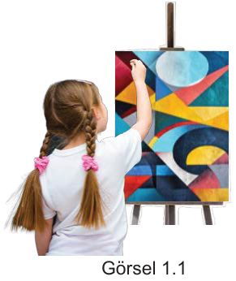
Görsel 1.1

Görsel 1.1'deki resimde, matematik derslerinde öğrendiğiniz geometrik çizimlerden hangilerini görüyorsunuz?

Çizim araçları kullanarak aşağıdaki alana kübik bir resim çiziniz. Hangi geometrik çizimleri kullandığınızı arkadaşlarınızla paylaşınız.

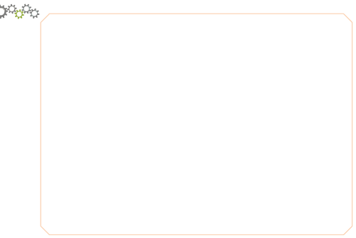

Resmi yaparken hangi geometrik şekilleri çizmek için hangi matematiksel araçları kullandınız?

<!-- sayfa 32 -->

# Etkinlik 1 Köprü ve Yol Yapımı

Nehrin iki yakasını birbirine bağlamak için doğru modeli şeklinde yol ve köprü yapılmak isteniyor.

a) A noktasından geçip nehrin karşı yakasına uzanan kaç farklı köprü yapılabilir? Çizerek gösteriniz. Arkadaşlarınızın çizdiği köprü modellerini inceleyiniz.

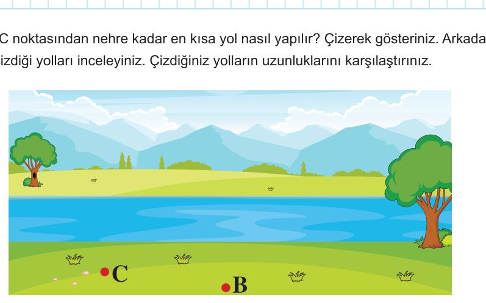

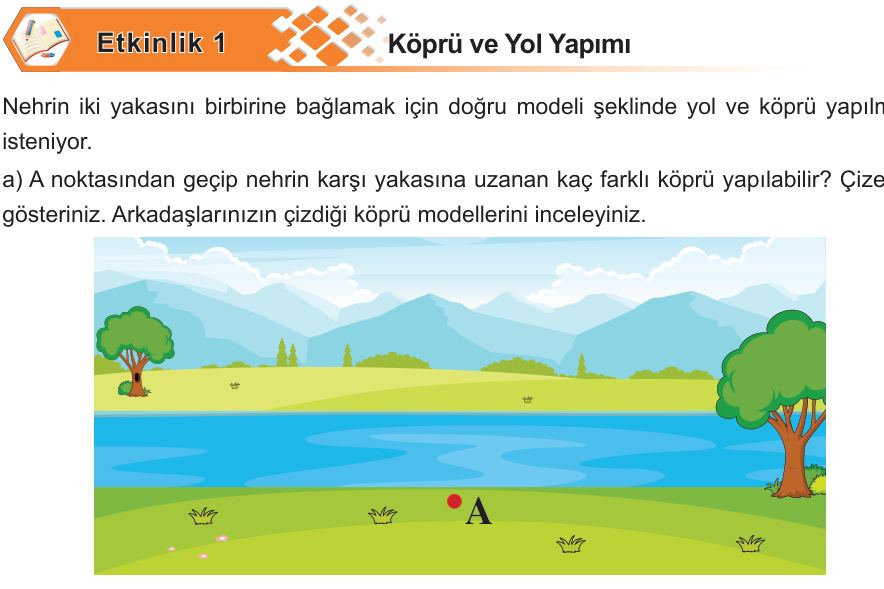

b) B ve C noktasından nehre kadar en kısa yol nasıl yapılır? Çizerek gösteriniz. Arkadaşlarınızın çizdiği yolları inceleyiniz. Çizdiğiniz yolların uzunluklarını karşılaştırınız.


<!-- sayfa 33 -->

c) Köprü, görseldeki D ve E noktalarından geçecek şekilde yapılmak istenseydi kaç farklı köprü modeli çizimi yapılabilirdi? Çizerek gösteriniz. Arkadaşlarınızın yaptığı çizimleri inceleyiniz.

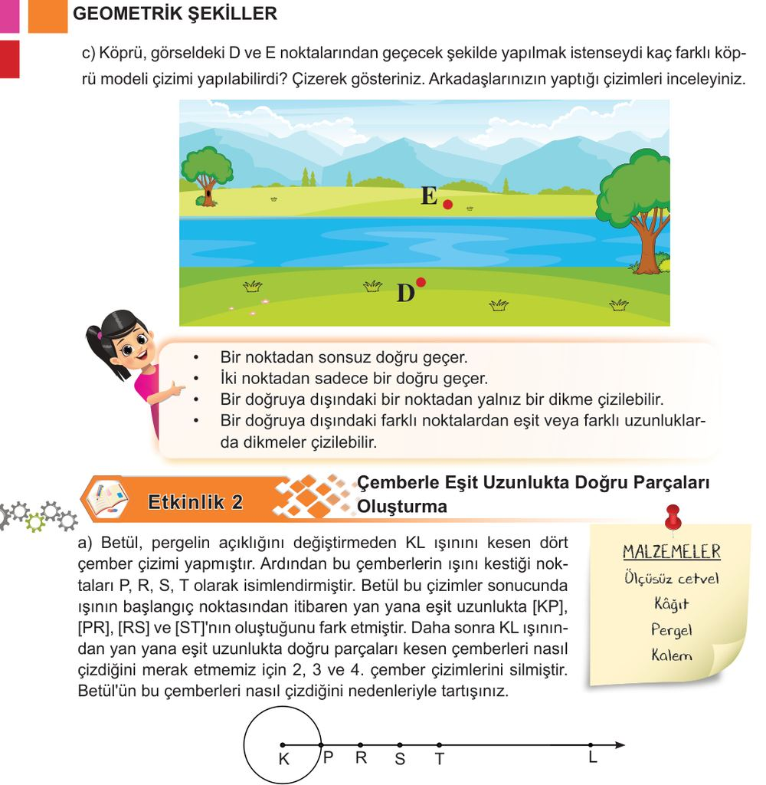

* Bir noktadan sonsuz doğru geçer.
* İki noktadan sadece bir doğru geçer.
* Bir doğruya dışındaki bir noktadan yalnız bir dikme çizilebilir.
* Bir doğruya dışındaki farklı noktalardan eşit veya farklı uzunluklarda dikmeler çizilebilir.

---

## Etkinlik 2: Çemberle Eşit Uzunlukta Doğru Parçaları Oluşturma

**MALZEMELER**
* Ölçüsüz cetvel
* Kâğıt
* Pergel
* Kalem

a) Betül, pergelin açıklığını değiştirmeden $KL$ ışınını kesen dört çember çizimi yapmıştır. Ardından bu çemberlerin ışını kestiği noktaları $P, R, S, T$ olarak isimlendirmiştir. Betül bu çizimler sonucunda ışının başlangıç noktasından itibaren yan yana eşit uzunlukta $[KP], [PR], [RS]$ ve $[ST]$'nin oluştuğunu fark etmiştir. Daha sonra $KL$ ışınından yan yana eşit uzunlukta doğru parçaları kesen çemberleri nasıl çizdiğini merak etmemiz için 2, 3 ve 4. çember çizimlerini silmiştir. Betül'ün bu çemberleri nasıl çizdiğini nedenleriyle tartışınız.


Aynı çizimi $A$ noktasını merkez alarak $AB$ ışını üzerinde yapınız ve çizdiğiniz ilk çemberin $AB$ ışını ile kesişim noktasını isimlendiriniz. İkinci çemberi çizerken pergelin sivri ucunu nereye yerleştirdiğinizi açıklayınız. Çizdiğiniz her yeni çemberin ışını kestiği noktaları isimlendiriniz. Çizdiğiniz çemberlerin neden $AB$ ışınının başlangıç noktasından itibaren yan yana eş doğru parçaları oluşturduğunu açıklayınız.


<!-- sayfa 34 -->

b) Zeynep pergel kullanarak $ABC$ açısının kollarını kesen bir çember çizmiştir. Ardından çemberin açının kollarını kestiği noktaları $K$ ve $L$ olarak isimlendirmiş ve açının kolları üzerinde eşit uzunlukta $[BK]$ ve $[BL]$'nin oluştuğunu fark etmiştir. Zeynep çemberi nasıl çizdiğini merak etmemiz için çember çizimini silmiştir. Zeynep'in bu çemberi nasıl çizdiğini nedenlerinizle birlikte tartışınız. Pergel kullanarak aşağıdaki $DEF$ açısının kollarından eşit uzunlukta doğru parçaları kesen bir çember çiziniz.

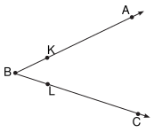
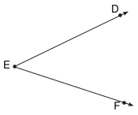

# Etkinlik 3: Bir Doğruya Eşit Uzaklıktaki Noktalar

**MALZEMELER**
Gönye, ölçüsüz cetvel

Gönye ile aşağıdaki doğruya $3\text{ cm}$ uzaklıkta olan birden fazla nokta belirleyiniz. Doğruya göre aynı taraftaki noktaları ölçüsüz cetvelle birleştiriniz. Oluşan doğrunun aşağıdaki doğruyla nasıl bir ilişkisi olduğunu arkadaşlarınızla tartışınız.


## Örnek 1

Yanda $AD$ doğrusuna eşit uzaklıktaki noktaların oluşturduğu $BC$ doğrusu çizilmiştir. Günlük hayattan $AD$ ve $BC$ doğrularının birbirlerine göre durumlarına benzeyen örnekler veriniz.


<!-- sayfa 35 -->

Bir doğruya eşit uzaklıkta ve aynı doğrultudaki tüm noktalar bir doğru oluşturur. $AB$ ve $KL$ doğruları arasındaki uzaklık değişmediği için bu doğrulara paralel doğrular denir. "//" paralellik sembolüdür. Sembolle $AB \parallel KL$ <!-- KONTROL: Marker'da karşılığı yok, uydurma olabilir --> şeklinde yazılır. "$AB$ doğrusu, $KL$ doğrusuna paraleldir." şeklinde okunur. Tren rayları ve elektrik telleri paralel doğrulara örnek olarak verilebilir.


## Örnek 2

Yandaki kitap görselinin sayfa kenarları üzerine çizili doğrulardan paralel olanları belirleyiniz. Belirlediğiniz paralel doğruları paralellik sembolü ile gösteriniz ve bu gösterimlerin okunuşlarını karşılarına yazınız.


| Sembolle Gösterimi | Okunuşu |
| :--- | :--- |
| | |
| | |
| | |

## Örnek 3

Aşağıda "nokta, doğru parçası, çember ve dikme" kullanılarak EREN ve ÇİĞDEM isimleri yazılmıştır.


<!-- sayfa 36 -->

Buna göre siz de aşağıdaki kareli zemine aynı geometrik şekilleri kullanarak adınızı yazınız.


# Performans Görevi
## Tasarım Yapıyorum

Bu çalışmada belirlediğiniz bir alanda (logo, kitap kapağı, halı veya kilim deseni, çini gibi) tasarım yapmanız ve tasarımınızı panoda sergilemeniz beklenmektedir. Yapacağınız tasarımda araç ve teknolojileri etkin kullanarak kişisel tasarım sürecinize uygun bir planlama yapmanız ve özgün bir tasarım ortaya çıkarmanız önemli olacaktır.

**Çalışma öncesinde şu noktalara dikkat etmelisiniz.**

* Tasarım süreçleri bireyin yaratıcılık yeteneği ile bağlantılı olarak estetik zevklerin ön planda olduğu bir süreçtir. Bunun için hayal gücünüzü kullanmalı ve çalışmak istediğiniz bir alanı seçmelisiniz.
* Tasarım süreci öncesinde ilgilendiğiniz alanda yapılmış örnek çalışmaları incelemelisiniz.
* Yapacağınız tasarımda kullanmayı planladığınız araç ve teknolojileri belirlemeli ve bu araçlarla alıştırmalar yapmalısınız.
* Hazırlayacağınız tasarımın Tablo 1'deki puanlama anahtarı ile değerlendirileceğine dikkat etmelisiniz.

<!-- sayfa 37 -->

**Çalışma sırasında şu noktalara dikkat etmelisiniz.**

* Tasarımınızda çember, doğru, doğru parçası ve ışın modellerini kullanmalısınız.
* Tasarımınızda araç ve teknolojileri uygun şekilde kullanmalısınız.
* Tasarımınızda düzgün ve estetik bir görünüme sahip olmak için akılda kalıcılık, renk uyumu, özgünlük gibi kriterleri göz önünde bulundurunuz.
* Tamamladığınız tasarımlarınızı arkadaşlarınızla beraber dikkatli bir şekilde panoya asınız.

**Çalışma sonrasında;**

* Ek - 1'de verilen öz değerlendirme formunu doldurunuz.

Tablo 1: Tasarım Yapıyorum Performans Görevi İçin Bütüncül Dereceli Puanlama Anahtarı

| Seviye | Gösterge |
| :--- | :--- |
| 5 (Çok İyi) | Öğrenci araç ve teknolojiyi kullanmış; çember, doğru, doğru parçası, ışın modellerinin hepsini kullanmış; özgün ve estetik bir tasarım oluşturmuş ve panoda sergilemiştir. |
| 4 (İyi) | Öğrenci araç ve teknolojiyi kullanmış; çember, doğru, doğru parçası, ışın modellerinin hepsini kullanmış; özgün ve estetik bir tasarım oluşturmuş fakat panoda sergilememiştir. |
| 3 (Orta) | Öğrenci araç ve teknolojiyi kullanmış; çember, doğru, doğru parçası, ışın modellerinin hepsini kullanmış fakat özgün ve estetik bir tasarım oluşturamamıştır. |
| 2 (Zayıf) | Öğrenci araç ve teknolojiyi kullanmış fakat çember, doğru, doğru parçası, ışın modellerinin yalnızca bazılarını kullanmıştır. |
| 1 (Çok Zayıf) | Öğrenci araç ve teknolojiyi kullanmadan tasarım yapmıştır. |
| 0 (Yetersiz) | Öğrenci hiç tasarım yapmamış veya tasarımı hiçbir kriteri karşılamamıştır. |


<!-- yer tutucu bulunamadı: sayfa sonuna eklendi -->

<!-- sayfa 38 -->

# AÇILARI ÖLÇME


Yukarıdaki görselde verilen dolabın kapağının ne kadar açık olduğunu nasıl ifade edersiniz? Benzer şekilde makasın, pergelin veya cımbızın kollarının ne kadar açık olduğu hakkında ne söyleyebilirsiniz? Bu aletlerin kolları arasındaki açıklığı tam olarak ölçebilir misiniz? Bu ölçme işlemini yapmak için hangi araçları kullanırsınız?

| | | | | | | | | | | | | | | |
|---|---|---|---|---|---|---|---|---|---|---|---|---|---|---|
| | | | | | | | | | | | | | | |
| | | | | | | | | | | | | | | |
| | | | | | | | | | | | | | | |
| | | | | | | | | | | | | | | |

Açıları ölçmek için daire şeklinde bir kâğıdı katlayarak kendi ölçme biriminizi oluşturabilirsiniz. Bunun için daire şeklinde bir kâğıt kesiniz ve bu kâğıdı aşağıdaki adımları takip ederek katlayınız.


1. Adım
2. Adım
3. Adım
4. Adım

Etrafınızda belirlediğiniz birkaç açıyı bu birimle ölçünüz ve sonuçları defterlerinize yazıp arkadaşlarınızın sonuçlarıyla karşılaştırınız. Arkadaşlarınızla ölçtüğünüz aynı açı için sonuçlarınız aynı çıktı mı? Sizce ortak bir açı ölçme birimine ihtiyaç yok mu?


<!-- sayfa 39 -->

Açının aynı zamanda bir ışının dönme miktarı olduğunu öğrenmiştiniz. Bir ışının bir tam dönüşü ile oluşan açıya tam açı, bir tam açının yarısına da doğru açı denir.


Daireyi daha fazla sayıda eş parçaya bölebilir miyiz?

100'e bölsek olur mu?

Olabilir, belki de 200'e bölmeliyiz.

Belki de başka bir sayıya bölmeliyiz.

Arkadaşlar, yaptığım araştırmalara göre eski bir uygarlık daireyi 360 eş dilime bölüyormuş.

Tam açı ve doğru açı, açıölçerler kullanılarak aşağıda gösterilmiştir. Sizce açı ölçme birimi bir tam açının 360 eş diliminden biri olabilir mi? Fikirlerinizi nedenleriyle açıklayınız.


Bir tam açı 360 eş açıya bölündüğünde oluşan her bir açının ölçüsüne 1 derece denir ve "$^\circ$" sembolü ile gösterilir. Açıları ölçmek için kullanılan araç, standart ölçü birimlerinden oluş-


<!-- yer tutucu bulunamadı: sayfa sonuna eklendi -->

<!-- sayfa 40 -->

# AÇI NASIL ÖLÇÜLÜR?

Açıölçerler kullanılarak bir açının ölçüsü belirlenirken açının köşesi açıölçerin merkezine yerleştirilir. Daha sonra açının kollarından biri $0^\circ$ <!-- KONTROL: Marker'da karşılığı yok, uydurma olabilir --> yi gösterecek şekilde ayarlanır. Bu durumda açının diğer kolunun açıölçerde gösterdiği değer, açının ölçüsüdür.


**SEMBOLLE GÖSTERİM**
$\widehat{ABC}, \widehat{CBA}, \widehat{B}$ <!-- KONTROL: Marker'da karşılığı yok, uydurma olabilir -->

**AÇININ ÖLÇÜSÜNÜN GÖSTERİMİ**
$m(\widehat{ABC}) = 45^\circ$ <!-- KONTROL: Marker'da karşılığı yok, uydurma olabilir -->
$m(\widehat{CBA}) = 45^\circ$ <!-- KONTROL: Marker'da karşılığı yok, uydurma olabilir -->
$m(\widehat{B}) = 45^\circ$ <!-- KONTROL: Marker'da karşılığı yok, uydurma olabilir -->

Açının kolları uzatılsa da ölçüsünde herhangi bir değişiklik olmaz.


**Örnek 1**
Aşağıdaki açıları isimlendirerek açıölçerle ölçünüz ve açı ölçülerini sembolle gösteriniz.


a)

b)

c)


ç)

d)

e)

Etrafınızda belirlediğiniz açıları kendi oluşturduğunuz açı ölçme birimleriyle ölçmüştünüz. Şimdi bu açıları açıölçerle ölçünüz ve elde ettiğiniz değerleri arkadaşlarınızın ölçümleriyle karşılaştırınız.


<!-- sayfa 41 -->

# Örnek 2

Aşağıdaki ölçüye uygun açıları verilen açıölçeri kullanarak oluşturunuz.

a) $20^\circ$ <!-- KONTROL: Marker'da karşılığı yok, uydurma olabilir -->


b) $110^\circ$ <!-- KONTROL: Marker'da karşılığı yok, uydurma olabilir -->


c) $135^\circ$ <!-- KONTROL: Marker'da karşılığı yok, uydurma olabilir -->


ç) $80^\circ$ <!-- KONTROL: Marker'da karşılığı yok, uydurma olabilir -->


d) $75^\circ$ <!-- KONTROL: Marker'da karşılığı yok, uydurma olabilir -->


e) $160^\circ$ <!-- KONTROL: Marker'da karşılığı yok, uydurma olabilir -->


<!-- sayfa 42 -->

# Örnek 3

Aşağıda ölçüsü verilen açıyı açıölçer kullanarak çiziniz.

a) $180^\circ$ <!-- KONTROL: Marker'da karşılığı yok, uydurma olabilir -->


b) $90^\circ$ <!-- KONTROL: Marker'da karşılığı yok, uydurma olabilir -->


c) $45^\circ$ <!-- KONTROL: Marker'da karşılığı yok, uydurma olabilir -->


ç) $60^\circ$ <!-- KONTROL: Marker'da karşılığı yok, uydurma olabilir -->

d) $360^\circ$ <!-- KONTROL: Marker'da karşılığı yok, uydurma olabilir -->

e) $150^\circ$ <!-- KONTROL: Marker'da karşılığı yok, uydurma olabilir -->

Dik açının ölçüsü $90^\circ$ <!-- KONTROL: Marker'da karşılığı yok, uydurma olabilir -->, doğru açının ölçüsü $180^\circ$ <!-- KONTROL: Marker'da karşılığı yok, uydurma olabilir --> ve tam açının ölçüsü $360^\circ$ <!-- KONTROL: Marker'da karşılığı yok, uydurma olabilir --> dir.

<!-- sayfa 43 -->

# Örnek 4

Aşağıdaki açıları açıölçerle ölçerek aynı ölçüye sahip yeni bir açı çiziniz.

a)


b)


c)


Ölçüleri birbirine eşit olan açılara **eş açılar** denir.


## Kontrol Listesi

| | Evet | Hayır |
| :--- | :---: | :---: |
| Derece kavramını tam açıyla ilişkilendirerek açıkladı. | | |
| Dik açının ölçüsünü belirledi. | | |
| Doğru açının ölçüsünü belirledi. | | |
| Tam açının ölçüsünü belirledi. | | |
| Dar açıların ölçülerinin hangi aralıkta olduğunu söyledi. | | |
| Geniş açıların ölçülerinin hangi aralıkta olduğunu söyledi. | | |
| Açıölçeri açı üzerinde doğru konumlandırdı. | | |
| Verilen bir açıyı ölçtü. | | |
| Ölçüsü verilen açıyı oluşturdu. | | |
| Verilen bir açıya eş bir açı oluşturdu. | | |


<!-- sayfa 44 -->

# DOĞRULARIN YOLCULUĞU

Elektrik telleri birbirlerine temas etmez.
Sizce bu tellerin birbirine göre durumu nasıl ifade edilebilir?


| | | | | | | | | | | | | | | |
|---|---|---|---|---|---|---|---|---|---|---|---|---|---|---|

Kaldırım taşlarının birleşme yerindeki çizgilerde hareket eden karıncalar, belli noktalarda karşılaşabilir.
Sizce karıncaların karşılaşmasının sebebi nasıl ifade edilebilir?


## Etkinlik 1: İki Doğrunun Yolculuğu

Asetat kâğıtlarının üzerine yandaki gibi birer doğru çizerek aşağıdaki adımları uygulayınız.


**MALZEMELER**
İki adet şeffaf asetat kâğıdı,
asetat kalemi,
cetvel,
açıölçer

a) İki asetat kâğıdını rastgele üst üste koyunuz. Doğrular arasında oluşan açıların çeşidini tahmin ediniz.

b) Asetat kâğıtlarını farklı şekillerde üst üste koyduğunuzda doğruların birbirine göre durumlarına bağlı olarak oluşabilecek farklı açılar hakkında arkadaşlarınızla tartışınız.

c) Oluşabilecek tüm farklı durumların çizimlerini aşağıdaki kutulara yapınız.

  

<!-- sayfa 45 -->

ç) Çizimlerini yaptığınız her bir durumda oluşan açıları ölçerek isimlendiriniz. Daha sonra tahminlerinizle karşılaştırarak aşağıdaki tabloyu doldurunuz.


d) Belirlediğiniz açıları tahminlerinizle karşılaştırarak ulaştığınız sonucu arkadaşlarınızla paylaşınız.


# İki Doğrunun Kesişimi


İki doğrunun bir noktada kesişmesi ile oluşan iki ayrı durum yanda verilmiştir. Buna göre aşağıdaki soruları cevaplandırınız.

a) İki ayrı durumdaki bu doğruların ortak noktasını belirleyiniz.


b) Belirlediğiniz ortak noktada oluşan açıları çeşitlerine göre aşağıdaki tabloya yazınız.


Düzlemde yalnız bir ortak noktası bulunan doğrulara kesişen doğrular denir.

İki doğrunun kesişiminde iki dar ve iki geniş açı veya dört dik açı meydana gelir.

İki doğrunun kesişiminde ölçüleri toplamı $180^\circ$ <!-- KONTROL: Marker'da karşılığı yok, uydurma olabilir --> olan açılar oluşur.


<!-- sayfa 46 -->


# Etkinlik 2
## Kâğıt Katlayarak Açı Belirleme

**MALZEMELER**
Bir adet A4 kâğıdı, kalem, cetvel, açıölçer

**Aşağıdaki adımları uygulayınız.**

**1. Adım:** Kısa kenarları çakışacak şekilde A4 kâğıdını ikiye katlayınız. Katladığınız kâğıdı açarak oluşan katlama izine cetvel yardımı ile bir doğru modeli çiziniz.


**2. Adım:** Uzun kenarları çakışacak şekilde A4 kâğıdını ikiye katlayınız. Katladığınız kâğıdı açarak oluşan katlama izine cetvel yardımı ile bir doğru modeli çiziniz.


**Bu doğru modellerini göz önünde bulundurarak aşağıdaki soruları cevaplandırınız.**

a) Köşesi $AB$ ve $CD$ doğrularının ortak noktası olan aşağıdaki açıların ölçülerini yazınız.

$m(\widehat{CEA}) =$

$m(\widehat{DEA}) =$

$m(\widehat{DEB}) =$

$m(\widehat{CEB}) =$

b) Belirlediğiniz açı ölçülerine göre $AB$ doğrusu ile $CD$ doğrusu arasında nasıl bir ilişki olduğunu açıklayınız.


İki doğrunun keşistiği noktada oluşan açıların ölçüsü $90^\circ$ <!-- KONTROL: Marker'da karşılığı yok, uydurma olabilir --> ise bu doğrulara **dik doğrular** denir.
Sembolle $AB \perp CD$ <!-- KONTROL: Marker'da karşılığı yok, uydurma olabilir --> yazılır. "$AB$ doğrusu, $CD$ doğrusuna diktir." diye okunur.

<!-- sayfa 47 -->

# Düzlemde Açı Oluşturmayan Doğrular

Yandaki kareli zeminde, iki doğrunun birbirine göre durumlarından biri verilmiştir. Bu durumları göz önünde bulundurarak aşağıdaki soruları cevaplandırınız.

a) $AB$ ve $CD$ doğrularının kesiştiği bir nokta var mıdır?

b) Bu doğrular ile bir açı oluşturulabilir mi?

c) Açı oluşturmayan doğruların birbirine göre durumları nasıl ifade edilebilir?


Paralel doğrular düzlemde kesişmeyen doğrulardır. Ortak noktası olmadığından paralel doğrular açı oluşturmaz.


## Örnek 1

Yanda birbirine bitişik dizilmiş özdeş kaldırım taşları modeli verilmiştir. Bu kaldırım taşları modeli üzerine çizilmiş $AB$, $CD$ ve $EF$ doğrularının birbirlerine göre durumlarını belirleyerek aşağıdaki noktalı yerlere yazınız.


a) $AB$ ile $EF$ doğrusu ................

b) $CD$ ile $EF$ doğrusu ................

# İki Doğrunun Çakışması

Yandaki şekilde iki doğrunun üst üste çizildiği bir durum verilmiştir. Bu doğruları oluşturan tüm noktalar ortak mıdır?


Tüm noktaları ortak olan doğrulara çakışık doğrular denir.

<!-- sayfa 48 -->

# Örnek 2


Yandaki kareli zemin üzerine doğrular çizilmiştir. Buna göre bu doğruların birbirlerine göre durumlarını belirleyiniz.

a) AN doğrusu ile BC doğrusu ...............
b) AN doğrusu ile ED doğrusu ...............
c) ED doğrusu ile LM doğrusu ...............
ç) BC doğrusu ile FH doğrusu ...............
d) GK doğrusu ile LM doğrusu ...............
e) FH doğrusu ile AN doğrusu ...............

# Etkinlik 3 Açı Çeşitleri


MALZEMELER
Kalem, açıölçer

Yukarıda bir makasın açık hâli üzerine doğrular çizilmiştir. **Doğruların kesiştiği noktadaki açıları açıölçer yardımıyla ölçerek aşağıdaki soruları cevaplandırınız.**

a) Doğruların kesiştiği noktadaki açılardan kaç tanesi dar, kaç tanesi geniş açıdır?


b) Belirlediğiniz açı çeşitlerinden ters yöne bakan açı çiftleri hangileridir?


c) Belirlediğiniz açı çeşitlerinden ters yöne bakan açıların ölçülerini karşılaştırarak ulaştığınız sonucu yazınız.


ç) Belirlediğiniz açılardan köşeleri ve birer kolları ortak olan açı çiftlerini yazınız.


<!-- sayfa 49 -->

En az iki doğrunun kesişmesi ile oluşan ve zıt yönlere bakan açılara ters açılar denir. Ters açıların ölçüleri birbirine eşittir.
Köşeleri ile birer kolları ortak olan ve ayrıca diğer kolları ortak kolun farklı tarafında bulunan açılara komşu açılar denir.


$AC$ ve $BD$ doğrularının kesişiminde $\widehat{AED}$ ile $\widehat{BEC}$ ve $\widehat{AEB}$ ile $\widehat{DEC}$ ters açılardır.
$AC$ ve $BD$ doğrularının kesişiminde $\widehat{AED}$ ile $\widehat{DEC}$, $\widehat{DEC}$ ile $\widehat{CEB}$, $\widehat{CEB}$ ile $\widehat{BEA}$, $\widehat{BEA}$ ile $\widehat{AED}$ açıları komşu açılardır.

### Örnek 3

Yandaki doğruların kesişimi ile oluşan açıları isimlendiriniz.
İsimlendirdiğiniz açıların ölçülerini açıölçer ile belirleyerek aşağıdaki soruları cevaplandırınız.

a) Ters açı çiftlerini belirleyerek bu açıları sembolle gösteriniz.
[ ]

b) Komşu açı çiftlerini belirleyerek bu açıları sembolle gösteriniz.
[ ]

## Etkinlik 4: Üç Doğrunun Yolculuğu

Üç doğrunun bir noktada kesişmesi ile oluşan üç ayrı durum aşağıda verilmiştir.


1. Durum
2. Durum
3. Durum

a) Doğruların arasında oluşan açıların çeşidini tahmin ediniz.
b) Oluşan açıları isimlendirip, ölçülerini açıölçer ile belirleyerek bu açıların sembolle gösterimlerini yazınız.
[ ]


<!-- yer tutucu bulunamadı: sayfa sonuna eklendi -->


<!-- yer tutucu bulunamadı: sayfa sonuna eklendi -->

<!-- sayfa 50 -->

c) Bu iki durumu inceleyerek aşağıdaki tabloyu doldurunuz.

| Durumlar | Açı Çeşidi | Oluşan dar açı sayısı | Oluşan dik açı sayısı | Oluşan geniş açı sayısı |
| :--- | :--- | :--- | :--- | :--- |
| 1. Durum | | | | |
| 2. Durum | | | | |
| 3. Durum | | | | |

ç) Bu iki durumda oluşan açı çeşitlerinin sayısına göre ulaştığınız çıkarımları ayrı ayrı yazınız.
[ ] [ ] [ ] [ ] [ ] [ ] [ ] [ ] [ ] [ ] [ ] [ ] [ ] [ ] [ ] [ ] [ ] [ ] [ ] [ ] [ ] [ ] [ ] [ ] [ ] [ ] [ ] [ ] [ ] [ ] [ ] [ ] [ ] [ ] [ ] [ ] [ ] [ ] [ ] [ ] [ ] [ ] [ ] [ ] [ ] [ ] [ ] [ ] [ ] [ ] [ ] [ ] [ ] [ ] [ ] [ ] [ ] [ ] [ ] [ ] [ ] [ ] [ ] [ ] [ ] [ ] [ ] [ ] [ ] [ ] [ ] [ ] [ ] [ ] [ ] [ ] [ ] [ ] [ ] [ ] [ ] [ ] [ ] [ ] [ ] [ ] [ ] [ ] [ ] [ ] [ ] [ ] [ ] [ ] [ ] [ ] [ ] [ ] [ ] [ ] [ ] [ ] [ ] [ ] [ ] [ ] [ ] [ ] [ ] [ ] [ ] [ ] [ ] [ ] [ ] [ ] [ ] [ ] [ ] [ ] [ ] [ ] [ ] [ ] [ ] [ ] [ ] [ ] [ ] [ ] [ ] [ ] [ ] [ ] [ ] [ ] [ ] [ ] [ ] [ ] [ ] [ ] [ ] [ ] [ ] [ ] [ ] [ ] [ ] [ ] [ ] [ ] [ ] [ ] [ ] [ ] [ ] [ ] [ ] [ ] [ ] [ ] [ ] [ ] [ ] [ ] [ ] [ ] [ ] [ ] [ ] [ ] [ ] [ ] [ ] [ ] [ ] [ ] [ ] [ ] [ ] [ ] [ ] [ ] [ ] [ ] [ ] [ ] [ ] [ ] [ ] [ ] [ ] [ ] [ ] [ ] [ ] [ ] [ ] [ ] [ ] [ ] [ ] [ ] [ ] [ ] [ ] [ ] [ ] [ ] [ ] [ ] [ ] [ ] [ ] [ ] [ ] [ ] [ ] [ ] [ ] [ ] [ ] [ ] [ ] [ ] [ ] [ ] [ ] [ ] [ ] [ ] [ ] [ ] [ ] [ ] [ ] [ ] [ ] [ ] [ ] [ ] [ ] [ ] [ ] [ ] [ ] [ ] [ ] [ ] [ ] [ ] [ ] [ ] [ ] [ ] [ ] [ ] [ ] [ ] [ ] [ ] [ ] [ ] [ ] [ ] [ ] [ ] [ ] [ ] [ ] [ ] [ ] [ ] [ ] [ ] [ ] [ ] [ ] [ ] [ ] [ ] [


<!-- yer tutucu bulunamadı: sayfa sonuna eklendi -->


<!-- yer tutucu bulunamadı: sayfa sonuna eklendi -->


<!-- yer tutucu bulunamadı: sayfa sonuna eklendi -->

<!-- sayfa 51 -->

# Üç Doğrunun Bir Noktada Kesişimi

Yanda üç ana yolun buluştuğu kavşak görseli verilmiştir. Bu yolların üzerine birer doğru modeli çizilmiştir. Sizce çizilen model üzerinde kavşak neyi temsil eder? Yorumlayınız.


(Boş cevap kutucukları)

## Örnek 4


Asaf, defterine $B$ noktasında kesişen $AC$, $DF$ ve $EH$ doğrularını yukarıdaki gibi çizmiştir. $m(\widehat{FBC}) = 32^\circ$ <!-- KONTROL: Marker'da karşılığı yok, uydurma olabilir --> olduğuna göre aşağıdaki soruları cevaplandırınız.

a) Ölçüleri toplamı $90^\circ$ <!-- KONTROL: Marker'da karşılığı yok, uydurma olabilir --> olan komşu açı çiftlerini yazınız.

(Boş cevap kutucukları)

b) Ölçüleri toplamı $180^\circ$ <!-- KONTROL: Marker'da karşılığı yok, uydurma olabilir --> olan komşu açı çiftlerini yazınız.

(Boş cevap kutucukları)

c) Komşu olmayıp ölçüleri toplamı $90^\circ$ <!-- KONTROL: Marker'da karşılığı yok, uydurma olabilir --> olan açı çiftlerini yazınız.

(Boş cevap kutucukları)

ç) Komşu olmayıp ölçüleri toplamı $180^\circ$ <!-- KONTROL: Marker'da karşılığı yok, uydurma olabilir --> olan açı çiftlerini yazınız.

(Boş cevap kutucukları)


> Ölçüleri toplamı $90^\circ$ <!-- KONTROL: Marker'da karşılığı yok, uydurma olabilir --> olan iki açıya **tümler açılar** denir.
>
> Ölçüleri toplamı $90^\circ$ <!-- KONTROL: Marker'da karşılığı yok, uydurma olabilir --> olan komşu açılara **komşu tümler açılar** denir.
>
> Ölçüleri toplamı $180^\circ$ <!-- KONTROL: Marker'da karşılığı yok, uydurma olabilir --> olan iki açıya **bütünler açılar** denir.
>
> Ölçüleri toplamı $180^\circ$ <!-- KONTROL: Marker'da karşılığı yok, uydurma olabilir --> olan komşu açılara **komşu bütünler açılar** denir.

<!-- sayfa 52 -->

# Örnek 5

Aşağıdaki açılar, komşu tümler açıdır. Verilenlerden yararlanarak istenen açının ölçüsünü bulunuz.

a)

$m(\widehat{PRS}) =$

b)

$m(\widehat{ABC}) =$

c)

$m(\widehat{MLN}) =$

# Örnek 6

Aşağıdaki açılar, komşu bütünler açıdır. Verilenlerden yararlanarak istenen açının ölçüsünü bulunuz.

a)

$m(\widehat{TYZ}) =$

b)

$m(\widehat{VUS}) =$

c)

$m(\widehat{PSO}) =$

# Örnek 7

Aşağıdaki açıların tümler ve bütünler açı ölçülerini bulunuz.

| Açı | Tümler Açı Ölçüsü | Bütünler Açı Ölçüsü |
| :--- | :--- | :--- |
| $38^\circ$ | | |
| $87^\circ$ | | |
| $69^\circ$ | | |
| $12^\circ$ | | |

<!-- sayfa 53 -->

# Zihin Haritası Oluşturma

1) Düzlemde iki veya üç doğrunun birbirine göre durumuna bağlı olarak oluşabilecek açıların özelliklerine dair bir zihin haritası çiziniz. Sayfanın altındaki karekodu okutarak zihin haritası örneğine ulaşabilirsiniz.

2) Düzlemde iki veya üç doğrunun birbirine göre durumlarını kendi oluşturduğunuz zihin haritasında göstererek oluşan açılarla ilişkilendiriniz.

3) Arkadaşınızla aşağıdaki formu kullanarak birbirinizi değerlendiriniz.

4) Eksik kaldığını düşündüğünüz, eklemek istediğiniz bir değerlendirme sorusu varsa ekleyiniz.

5) Yaptığınız yanlışların üzerinde düşünerek sebeplerini sınıfça tartışınız.

| AKRAN DEĞERLENDİRME FORMU | Evet | Kısmen | Hayır |
| :--- | :---: | :---: | :---: |
| Düzlemde iki doğrunun birbirine göre durumlarını çizer. | | | |
| Düzlemde iki doğrunun birbirine göre durumuna bağlı olarak oluşabilecek açıları belirler. | | | |
| Düzlemde üç doğrunun birbirine göre durumlarını çizer. | | | |
| Düzlemde üç doğrunun birbirine göre durumuna bağlı olarak oluşabilecek açıları belirler. | | | |
| Düzlemde iki veya üç doğrunun birbirine göre durumuna bağlı olarak oluşabilecek açıların çeşitlerini belirler. | | | |
| Dar, dik ve geniş açıları gösterir. | | | |
| Ters açıları gösterir. | | | |
| Tümler açıları gösterir. | | | |
| Bütünler açıları gösterir. | | | |

<!-- sayfa 54 -->

# Üç Doğrunun İkişer İkişer Kesişimi

Yansıtıcı yüzeye sahip reflektörler, kaza veya arıza sonrası diğer sürücüleri uyararak olası yeni kazaların engellenmesi amacıyla kullanılır. Araçlardaki trafik setlerinin içinde mutlaka bulunması gerekir. Yandaki görsel 1.3'te üçgen reflektörünün kenarları ile çakışık doğrular verilmiştir. Bu doğruların kesişim noktalarındaki açıları isimlendirerek aşağıdaki soruları cevaplandırınız.


Görsel 1.3

a) Bu üç doğrunun birbirlerine göre durumlarını nasıl ifade edersiniz?
[ ]

b) Oluşan ters, komşu ve komşu bütünler açıları isimlendirerek yazınız.
[ ]

c) Doğruların kesişim noktalarında oluşan açıların çeşidine göre sayılarını belirleyiniz.
[ ]

## İki Paralel Doğru ve Bir Kesen

Aşağıda demir yolu köprü görselleri verilmiştir.


Bu köprü görsellerinin üst kısmında bulunan çelik yapılar üzerine çizilmiş doğru modellerinin birbirlerine göre durumlarını nasıl ifade edersiniz? Doğruların kesişim noktalarında oluşan açıların çeşidine göre sayılarını belirleyiniz.


> İki doğruyu farklı birer noktada kesen üçüncü bir doğruya iki doğrunun keseni denir.
>
> Üç doğrunun ikişerli kesiştiği durumda altı dar ve altı geniş açı ya da dört dik, dört dar ve dört geniş açı oluşur.
>
> İki paralel doğruyu kesen bir doğrunun oluşturduğu durumda dört


<!-- sayfa 55 -->

# Etkinlik 5 İki Paralel Doğru ve Bir Kesen

Asetat kâğıdına cetvelle iki paralel ve onları kesen bir doğru çiziniz. Asetat kâğıdını kareli veya çizgili defterinizin üzerine koyarak da çiziminizi yapabilirsiniz.


Yandaki gibi açıları belirleyerek isimlendiriniz ve açıölçer ile açıların ölçülerini bulup üzerine yazınız. Dar açıları bir renge, geniş açıları başka bir renge boyayınız. Buna göre kaç tane dar, kaç tane geniş açı elde ettiğinizi yazınız.


Asetat kâğıdını verilen doğrultuya göre makasla kesiniz (Makas kullanırken dikkatli olunuz.).


Kestiğiniz parçalardan birini, diğer parçanın üzerine kesişim noktaları üst üste gelecek şekilde yerleştiriniz.
Üst üste gelen açıların eş olduğunu görebildiniz mi?

**Oluşan dar ve geniş açılardan eş, komşu ve ters açı çiftlerini yazınız.**

| Eş Açılar | Komşu Açılar | Ters Açılar |
| :--- | :--- | :--- |
| | | |

> **MALZEMELER**
> Şeffaf asetat kâğıdı, cetvel, çeşitli renklerde asetat kalemi

## Örnek 8

Yandaki görsel 1.4'te bir kitaplık modelinin dikey ve yatay kısımları üzerine doğrular çizilmiştir.
**Verilen doğruların kesişim noktalarındaki açıları isimlendirerek aşağıdaki soruları cevaplandırınız.**

a) Doğruların kesişim noktalarında dar ve geniş açılar oluşur mu?


b) Doğruların kesişim noktalarında oluşan açıların çeşidini belirleyiniz.

<!-- sayfa 56 -->

# DOĞRULARDAN ÇOKGENLERE

Geometrik desenli halılar, modern görünümlerinin yanı sıra yaşam alanlarına sanatsal bir dokunuş katar. Bu halılarda üçgen, kare ve dikdörtgen gibi farklı geometrik şekiller düzenli ve dengeli bir biçimde kullanılarak yaşam alanlarında estetik bir görünüm oluşturulabilir.


Görsel 1.5

Yukarıdaki görsel 1.5'te halı üzerindeki desenler kapalı şekillerdir. Siz de doğruları kullanarak kendi halı deseninizi tasarlayabilirsiniz.

## Örnek 1

Aşağıda son çizilen doğru, ilk çizilen doğru ile kesişecek biçimde doğruların çizimine adım adım yer verilerek iki farklı kapalı şekil oluşturulmuştur.


Oluşan kapalı şekilleri inceleyiniz. Doğru sayısı ile son adımda oluşan kapalı şeklin kenar sayısı arasında nasıl bir ilişki vardır?


<!-- sayfa 57 -->

En az üç doğrunun (ilk doğrunun son doğruyla kesişmesi koşuluy-la) ardışık kesişimi sonucu oluşturduğu kapalı şekle çokgen denir. Çokgenler, doğruların kesişmesi sonucu oluşan kenar sayısına göre isimlendirilir.


# Örnek 2

Aşağıdaki kareli zemine en fazla altı doğru kullanarak oluşturulabilecek çokgenleri çiziniz.


<!-- sayfa 58 -->

# Örnek 3

İbrahim, bilgisayar programı kullanarak halı deseni tasarlamaktadır. Yeni halı deseni tasarımı için aşağıdaki dikdörtgen bölge üzerine doğrular çizmiş ve her bir kapalı bölgeyi bir renge boyamıştır.

**Buna göre doğruların hepsini isimlendirerek numaralandırılmış çokgenlerin çeşitlerini ve hangi doğruların kesişimi ile oluştuğunu tabloya yazınız.**


| Çokgen Numarası | Çokgen Çeşidi | Çokgeni Oluşturan Doğrular |
| :--- | :--- | :--- |
| | | |
| | | |
| | | |
| | | |
| | | |
| | | |
| | | |


<!-- sayfa 59 -->

# Etkinlik 1 Çokgen Arama


* Şeffaf dosyanın beyaz kısmını makas kullanarak şeffaf kısmından ayırınız (Makas kullanırken dikkatli olunuz.). 
* Şeffaf dosyanın bir yüzüne çizgeç kullanarak farklı yönlerde doğru parçaları çizerek çokgenler oluşturunuz. 

 

* Siyah kartonu dosyanın içine yerleştiriniz ve dosyanızı arkadaşınızın hazırladığıyla değiştiriniz.


* Aşağıdaki gibi bir el feneri çizip bu feneri boyayınız ve kesiniz.

 

* Fenerinizi siyah karton ile doğrular çizilmiş ön yüzün arasına girecek şekilde dosyaya yerleştirip çokgen arayınız. Bulduğunuz çokgenleri farklı renklere boyayınız.   

**MALZEMELER**
Şeffaf dosya,
siyah karton, makas,
renkli kalemler, çizgeç

<!-- sayfa 60 -->

• Belirlediğiniz çokgenleri cetvel kullanarak aşağıdaki kutulara çiziniz.

 
 
 

• Arkadaşlarınızın oluşturduğu çokgenlerden hangilerini bulabildiniz? Kendi oluşturduğunuz çizimlerinizi arkadaşlarınızın çizimleriyle karşılaştırınız ve yorumlayınız.

<!-- sayfa 61 -->

# ÇOKGENLERİN TEMEL ELEMANLARI

Aşağıdaki çokgenin kenarlarına karşılık gelen doğru parçalarını sembolle gösteriniz.


Çokgenlerin doğruların kesişimi ile oluştuğunu göz önünde bulundurarak kenar ve açı özellikleri hakkında fikirlerinizi yazıp, arkadaşlarınızla paylaşarak tartışınız.

[Boş kareli alan]

> Çokgenleri oluşturan doğruların kesişim noktalarına **köşe** denir. Yukarıdaki dörtgenin köşeleri $A, B, C, D$ noktalarıdır. Bir çokgenin isimlendirilmesi o çokgeni oluşturan doğru sayısına bağlı olarak yapılır. Yukarıdaki çokgen dört doğrudan oluştuğu için dörtgen şeklinde isimlendirilir.
>
> Çokgenleri oluşturan doğru parçalarının her birine **kenar** denir. Yukarıdaki dörtgeni oluşturan $AB, BC, CD, DA$ doğru parçaları bu dörtgenin kenarlarıdır.

Aşağıdaki şekilde işaretlenmiş açıları sembolle gösteriniz.


[Boş kareli alan]


<!-- yer tutucu bulunamadı: sayfa sonuna eklendi -->

<!-- sayfa 62 -->


Kenarların çokgenin iç bölgesinde oluşturduğu açılara iç açı denir. Yandaki dörtgenin iç açıları $\widehat{DAB}$, $\widehat{ABC}$, $\widehat{BCD}$, $\widehat{CDA}$ <!-- KONTROL: Marker'da karşılığı yok, uydurma olabilir --> dır.
Bir çokgende kenar, köşe sayısı ve iç açı sayısı eşittir.
Yandaki dörtgenin dört kenarı, dört köşesi ve dört iç açısı vardır.


Çokgenlerde iç açının komşu bütünler açısına dış açı denir.
Yandaki dörtgenin dış açıları $\widehat{EAB}$, $\widehat{GBA}$ <!-- KONTROL: Marker'da karşılığı yok, uydurma olabilir -->, $\widehat{HCB}$, $\widehat{FDA}$ <!-- KONTROL: Marker'da karşılığı yok, uydurma olabilir --> dır.
Bir çokgende dış açıların sayısı iç açıların sayısına eşittir.

Çokgenlerde kenar, köşe, iç açı ve dış açı temel elemandır.

## Örnek 1

Aşağıdaki kareli zemine bir çokgen çiziniz. Çizdiğiniz çokgenin kenarlarını, köşelerini, iç açılarını ve dış açılarını belirleyerek sembolle gösteriniz.


<!-- sayfa 63 -->

Çokgenler adlandırılırken köşe noktalarının isimleri kullanılır. Herhangi bir köşesi seçilip köşe noktalarının isimleri ardışık okunur.


Örneğin yukarıdaki çokgen, B köşesinden başlandığında ardışık noktalar okunarak **BCDEFA altıgeni** diye isimlendirilebilir. D köşesinden başlandığında ise ardışık noktalar okunarak **DCBAFE altıgeni** diye de isimlendirilebilir.

Bir köşe seçerek bir isimlendirme de siz yapınız.
..................................................................................................................................

### Örnek 2
Aşağıdaki örnekte verildiği gibi çokgenlerin köşe noktalarını isimlendiriniz ve tabloyu örnekteki gibi doldurunuz.

| Çokgen | Kenarları | Kenar Sayısı | Köşeleri | Köşe Sayısı | İç Açıları | İç Açı Sayısı | İsimlendirilışı |
| :---: | :---: | :---: | :---: | :---: | :---: | :---: | :---: |
|  | $[AB]$<br>$[BC]$<br>$[CA]$ | $3$ | A Noktası<br>B Noktası<br>C Noktası | $3$ | $\widehat{A}$<br>$\widehat{B}$<br>$\widehat{C}$ | $3$ | ABC üçgeni |
| | | | | | | | |
| | | | | | | | |
| | | | | | | | |
| | | | | | | | |
| | | | | | | | |

<!-- sayfa 64 -->

# Örnek 3

Aşağıdaki çokgenlerin kenar uzunluklarını cetvelle, açılarını açıölçerle ölçünüz. Bulduğunuz sonuçları aşağıdaki noktalı yerlere yazınız.

a)


$|AB| = .......... \text{ mm}$ <!-- KONTROL: Marker'da karşılığı yok, uydurma olabilir -->
$|BC| = .......... \text{ mm}$ <!-- KONTROL: Marker'da karşılığı yok, uydurma olabilir -->
$|CD| = .......... \text{ mm}$ <!-- KONTROL: Marker'da karşılığı yok, uydurma olabilir -->
$|DE| = .......... \text{ mm}$ <!-- KONTROL: Marker'da karşılığı yok, uydurma olabilir -->
$|EA| = .......... \text{ mm}$ <!-- KONTROL: Marker'da karşılığı yok, uydurma olabilir -->

$m(\widehat{A}) = ..........$ <!-- KONTROL: Marker'da karşılığı yok, uydurma olabilir -->
$m(\widehat{B}) = ..........$ <!-- KONTROL: Marker'da karşılığı yok, uydurma olabilir -->
$m(\widehat{C}) = ..........$ <!-- KONTROL: Marker'da karşılığı yok, uydurma olabilir -->
$m(\widehat{D}) = ..........$ <!-- KONTROL: Marker'da karşılığı yok, uydurma olabilir -->
$m(\widehat{E}) = ..........$ <!-- KONTROL: Marker'da karşılığı yok, uydurma olabilir -->

b)


$|KL| = .......... \text{ mm}$ <!-- KONTROL: Marker'da karşılığı yok, uydurma olabilir -->
$|LM| = .......... \text{ mm}$ <!-- KONTROL: Marker'da karşılığı yok, uydurma olabilir -->
$|MN| = .......... \text{ mm}$ <!-- KONTROL: Marker'da karşılığı yok, uydurma olabilir -->
$|NO| = .......... \text{ mm}$ <!-- KONTROL: Marker'da karşılığı yok, uydurma olabilir -->
$|OK| = .......... \text{ mm}$ <!-- KONTROL: Marker'da karşılığı yok, uydurma olabilir -->

$m(\widehat{K}) = ..........$ <!-- KONTROL: Marker'da karşılığı yok, uydurma olabilir -->
$m(\widehat{L}) = ..........$ <!-- KONTROL: Marker'da karşılığı yok, uydurma olabilir -->
$m(\widehat{M}) = ..........$ <!-- KONTROL: Marker'da karşılığı yok, uydurma olabilir -->
$m(\widehat{N}) = ..........$ <!-- KONTROL: Marker'da karşılığı yok, uydurma olabilir -->
$m(\widehat{O}) = ..........$ <!-- KONTROL: Marker'da karşılığı yok, uydurma olabilir -->


> Bütün kenar uzunlukları ve iç açılarının ölçüleri eşit olan çokgene **düzgün çokgen** denir. Düzgün çokgenler de kenar sayısına göre isimlendirilir ve okunur.

Yukarıdaki $ABCDE$ beşgeninin kenar uzunlukları ve iç açılarının ölçüleri eşit olduğundan düzgün çokgendir. “$ABCDE$ düzgün beşgeni” şeklinde okunur.
Düzgün çokgenlerin dış açı ölçülerinin eşit olup olmadığını tartışınız.

# Örnek 4

Aşağıdaki eşkenar üçgenin iç açılarını ölçerek düzgün çokgen olup olmadığı hakkındaki düşüncelerinizi arkadaşlarınızla paylaşınız.


Kare ve dikdörtgen çizimi yaparak çizdiklerinizin düzgün çokgen olup olmadıklarını inceleyiniz.

<!-- sayfa 65 -->

# Etkinlik 2 Düzgün Çokgenlerle Süsleme

Aşağıda düzgün çokgenlerle oluşturulmuş bazı süsleme örnekleri verilmiştir.


Kadriye Hanım, mutfak dolaplarını düzgün çokgen şeklindeki yapışkanlı kâğıtlarla kaplamak istiyor. Yukarıdaki gibi birkaç örnek baktıktan sonra kâğıtların tasarımını çocuklarına yaptırmaya karar veriyor. Bu amaçla keserek ve yapıştırarak çalışabilmeleri için eşkenar üçgen, kare, düzgün beşgen, düzgün altıgen çizimlerini içeren çok sayıda çıktı alıyor. Kızı İlkay’dan tek çeşit düzgün çokgen, oğlu Eren’den ise iki veya daha çok çeşit düzgün çokgen kullanarak tasarım yapmasını istiyor.

Aşağıdaki kareli zeminlerde İlkay ve Eren'e fikir verecek tasarımlar oluşturunuz.

İlkay’ın tasarımı:


Eren’in tasarımı:


<!-- sayfa 66 -->

# Etkinlik 3: Daireden Üçgen ve Altıgen Yapalım

1) Pergelinizi istediğiniz kadar açarak kâğıt üzerine bir çember çiziniz ve çemberin merkez noktasını belirginleştiriniz.
2) Çizdiğiniz çember üzerinden kâğıdı keserek bir daire oluşturunuz.


3) Dairenizi, aşağıdaki görselleri sırayla takip ederek çevresi üzerindeki bir nokta, merkez noktaya değecek şekilde katlayınız.


4) Elde ettiğiniz üçgenin kenarlarını ve açılarını ölçünüz. Hangi üçgeni yaptığınızı bulabildiniz mi? Ölçme sonuçlarını arkadaşlarınızla tartışınız.

| | | | | | | | | | | | | | | | | | | | |
|---|---|---|---|---|---|---|---|---|---|---|---|---|---|---|---|---|---|---|---|

5) Yaptığınız üçgeni aşağıdaki görselleri sırayla takip ederek dikkatli bir şekilde katlayınız.


6) Elde ettiğiniz altıgenin kenarlarını ve açılarını ölçünüz. Ölçme sonuçlarını arkadaşlarınızla tartışınız.


<!-- yer tutucu bulunamadı: sayfa sonuna eklendi -->

<!-- sayfa 67 -->

# Bunları Bilelim


Türkiye Cumhuriyeti’nin kurucusu Başöğretmen Ulu Önder Mustafa Kemal Atatürk, yazdığı "Geometri" kitabında öğrencilerin geometri kavramlarını daha uzun süre akıllarında tutabilmeleri ve bunların adı geçtiğinde anlamını zihinlerinde daha kolay canlandırabilmeleri için geometrik kavramları Türkçeleştirmiştir.

Mustafa Kemal Atatürk'ün yazdığı "Geometri" kitabı incelendiğinde "üçgen", "dikey dörtgen" (dikdörtgen), "kare" ve "beşgen" gibi çokgenlerin tanımlandığı görülür.

Görsel 1.6

# Etkinlik 4 Köşegen

* Bir A4 kâğıdına cetvelle istediğiniz büyüklükte bir dörtgen çiziniz.
* Bu dörtgenin köşe noktalarını belirginleştirip isimlendiriniz.


* Kâğıdı, ardışık olmayan iki köşeden geçen kat çizgisi oluşacak şekilde katlayarak kat çizgilerinin üzerinden kalemle geçiniz.


Çizdiğiniz doğru parçalarını sembolle gösteriniz. Bu çalışmayı diğer çokgenlerle de yapınız. Elde ettiğiniz doğru parçalarının sayısı değişti mi? Sınıfça tartışınız.

<!-- sayfa 68 -->

Çokgenlerde ardışık olmayan iki köşeyi birleştiren doğru parçasına köşegen denir.

4. etkinlikte dörtgene ait kaç köşegen buldunuz? Köşegenleri sembolle gösteriniz.
Elde ettiğiniz sonuçları arkadaşlarınızın sonuçlarıyla karşılaştırınız.


A noktasıyla aynı kenarlarda olan noktalar E ve B noktalarıdır.
A noktasından bu noktalara köşegen çizilmez çünkü çizilen doğru parçaları kenar olur.
A noktasıyla aynı kenarda olmayan noktalar C ve D noktasıdır.
A noktasından bu noktalara doğru parçası çizilebilir. $[AD]$ ve $[AC]$ yandaki beşgenin köşegenlerinden bazılarıdır.
B, C, D ve E noktalarından çizilebilecek köşegenleri de cetvel yardımıyla siz çiziniz.

### Örnek 5
İsmi verilen çokgenleri ve onlara ait köşegenleri çizerek aşağıdaki tabloyu doldurunuz.

| | DEFGHI Altıgeni | PRSŞT Beşgeni | ABCD Dörtgeni | VYZ Üçgeni |
| :--- | :---: | :---: | :---: | :---: |
| Çokgenin Çizimi | | | | |
| Köşegenleri | | | | |

Köşegeni olmayan çokgen hangisidir? Bu çokgenin neden köşegeni olmadığını açıklayınız.


<!-- sayfa 69 -->

# Örnek 6

Aşağıdaki yedigen için sıralanan ifadelerden doğru olanların başına “D”, yanlış olanların başına “Y” yazınız. Doğru olan ifadelere alternatif doğru ifadeler yazınız. Yanlış olan ifadeleri düzeltiniz.


1. (.....) BCDEFHA yedigeni şeklinde isimlendirilir.
…………………………………………………….

2. (.....) Yedigenin köşegenlerinden biri [CG]'dır.
…………………………………………………….

3. (.....) Yedigenin iç açılarından biri $\widehat{ABC}$ dır.
…………………………………………………….

4. (.....) Yedigenin 10 tane iç açısı vardır.
…………………………………………………….

5. (.....) $\widehat{HGC}$ bu yedigenin bir iç açısıdır.
…………………………………………………….

6. (.....) Yedigenin 7 köşesi vardır.
…………………………………………………….

7. (.....) [FB] yedigenin köşegenlerinden biridir.
…………………………………………………….

8. (.....) [EF] yedigenin köşegenlerinden biridir.
…………………………………………………….

## ÜÇGEN

### Etkinlik 1
### Açılarına Göre Üçgenler

Aşağıda üçgenler verilmiştir.


**Buna göre aşağıdaki soruları cevaplayınız.**

a) Bu üçgenlerin iç açılarını açıölçerle ölçünüz. Açıların çeşidini yanına yazınız.

$m(\widehat{A}) = .........$ <!-- KONTROL: Marker'da karşılığı yok, uydurma olabilir --> ............................................................ $m(\widehat{D}) = .........$ <!-- KONTROL: Marker'da karşılığı yok, uydurma olabilir --> ............................................................
$m(\widehat{B}) = .........$ <!-- KONTROL: Marker'da karşılığı yok, uydurma olabilir --> ............................................................ $m(\widehat{E}) = .........$ <!-- KONTROL: Marker'da karşılığı yok, uydurma olabilir --> ............................................................


<!-- sayfa 70 -->

$m(\widehat{K}) = \dots\dots\dots\dots\dots\dots\dots\dots\dots\dots\dots\dots\dots\dots m(\widehat{P}) = \dots\dots\dots\dots\dots\dots\dots\dots\dots\dots\dots\dots\dots\dots$
$m(\widehat{L}) = \dots\dots\dots\dots\dots\dots\dots\dots\dots\dots\dots\dots\dots\dots m(\widehat{R}) = \dots\dots\dots\dots\dots\dots\dots\dots\dots\dots\dots\dots\dots\dots$
$m(\widehat{M}) = \dots\dots\dots\dots\dots\dots\dots\dots\dots\dots\dots\dots\dots\dots m(\widehat{S}) = \dots\dots\dots\dots\dots\dots\dots\dots\dots\dots\dots\dots\dots\dots$

b) Bu üçgenlerin iç açılarının çeşitlerini birbiriyle karşılaştırarak bunlardan ortak olanlarını belirleyiniz.


Bir iç açısının ölçüsü $90^\circ$ olan üçgene $\underline{\text{dik açılı üçgen}}$ <!-- KONTROL: Marker'da karşılığı yok, uydurma olabilir --> denir.
Tüm iç açılarının ölçüsü $90^\circ$ den küçük olan üçgene $\underline{\text{dar açılı üçgen}}$ <!-- KONTROL: Marker'da karşılığı yok, uydurma olabilir --> denir.
Bir iç açısının ölçüsü $90^\circ$ den büyük olan üçgene $\underline{\text{geniş açılı üçgen}}$ <!-- KONTROL: Marker'da karşılığı yok, uydurma olabilir --> denir.

# Örnek 1
**Aşağıdaki soruları sınıfça tartışınız.**

• İki dik açısı olan üçgen çizilebilir mi?


• İki geniş açısı olan üçgen çizilebilir mi?


• Bir üçgenin iç açılarından herhangi iki tanesi neden dik veya geniş açı olamaz?


<!-- sayfa 71 -->

# Etkinlik 2
## Tüm Üçgenlerin İç Açıları Ölçüleri Toplamı Aynı mı?

**MALZEMELER**
Beyaz kâğıt, kalem, cetvel ya da çizgeç, makas, yapıştırıcı

* Beyaz kâğıda istediğiniz büyüklükte bir üçgen ve üçgenin dışında kalan bölgeye de bir doğru parçası çiziniz.
* Üçgeninizin köşe noktalarını isimlendiriniz.


* Üçgeninizi boyayınız ve üçgeninizin iç açılarını gösteriniz.
* Üçgeninizin köşe noktalarına verdiğiniz harfleri üçgenin içinde iç açılara karşılık gelen yere yazınız.


* İç açıları üçgen içindeki harfleri de içine alacak ve üçgeni bozmayacak şekilde kesiniz (Makas kullanırken dikkatli olunuz.).
* Kestiğiniz açıları doğru parçasının üzerine yerleştiriniz.


* Üçgenin üç iç açısı bir araya geldiğinde oluşan açı kaç derecedir? Arkadaşlarınızın çalışmasını inceleyiniz.

<!-- sayfa 72 -->

Üçgenlerin iç açıları ölçüleri toplamı $180^\circ$ <!-- KONTROL: Marker'da karşılığı yok, uydurma olabilir --> dir.


**Örnek 2**

Aşağıda bir üçgenin iç açılarından ikisinin ölçüsü verilmiştir. Verilmeyen üçüncü açının ölçüsünü bularak noktalı yerlere yazınız.

a) $45^\circ, 45^\circ, \dots\dots$ <!-- KONTROL: Marker'da karşılığı yok, uydurma olabilir -->

b) $30^\circ, 70^\circ, \dots\dots$ <!-- KONTROL: Marker'da karşılığı yok, uydurma olabilir -->

c) $55^\circ, 12^\circ, \dots\dots$ <!-- KONTROL: Marker'da karşılığı yok, uydurma olabilir -->

ç) $120^\circ, 35^\circ, \dots\dots$ <!-- KONTROL: Marker'da karşılığı yok, uydurma olabilir -->

d) $90^\circ, 60^\circ, \dots\dots$ <!-- KONTROL: Marker'da karşılığı yok, uydurma olabilir -->

e) $15^\circ, 45^\circ, \dots\dots$ <!-- KONTROL: Marker'da karşılığı yok, uydurma olabilir -->

f) $130^\circ, 20^\circ, \dots\dots$ <!-- KONTROL: Marker'da karşılığı yok, uydurma olabilir -->

g) $100^\circ, 45^\circ, \dots\dots$ <!-- KONTROL: Marker'da karşılığı yok, uydurma olabilir -->

ğ) $70^\circ, 20^\circ, \dots\dots$ <!-- KONTROL: Marker'da karşılığı yok, uydurma olabilir -->

**Aşağıda verilen soruları sınıfça tartışınız.**


• Dik açılı eşkenar üçgen çizilebilir mi?

• Dik açılı ikizkenar üçgen çizilebilir mi?

• Geniş açılı eşkenar üçgen çizilebilir mi?

• Geniş açılı ikizkenar üçgen çizilebilir mi?

<!-- sayfa 73 -->

# Örnek 3

Aşağıda çeşitli üçgenlerin yer aldığı kutular ve onların altında sorular verilmiştir. Üçgenlerin kenar uzunluklarını ve iç açılarını ölçünüz. Kutulardaki numaraları kullanarak soruları cevaplayınız. Aynı kutuyu birden fazla sorunun cevabı olarak kullanabilirsiniz.


a) Kutulardan hangisinde veya hangilerinde eşkenar üçgen yer almaktadır?
[ ][ ][ ][ ][ ][ ]

b) Kutulardan hangisinde veya hangilerinde ikizkenar üçgen yer almaktadır?
[ ][ ][ ][ ][ ][ ]

c) Kutulardan hangisinde veya hangilerinde çeşitkenar üçgen yer almaktadır?
[ ][ ][ ][ ][ ][ ]

ç) Kutulardan hangisinde veya hangilerinde dik açılı üçgen yer almaktadır?
[ ][ ][ ][ ][ ][ ]

d) Kutulardan hangisinde veya hangilerinde dar açılı üçgen yer almaktadır?
[ ][ ][ ][ ][ ][ ]

e) Kutulardan hangisinde veya hangilerinde geniş açılı üçgen yer almaktadır?
[ ][ ][ ][ ][ ][ ]

f) Kutulardan hangisinde veya hangilerinde dar açılı çeşitkenar üçgen yer almaktadır?
[ ][ ][ ][ ][ ][ ]

g) Kutulardan hangisinde veya hangilerinde dik açılı çeşitkenar üçgen yer almaktadır?
[ ][ ][ ][ ][ ][ ]


<!-- sayfa 74 -->


İkizkenar üçgende eşit uzunluktaki kenarları gören iç açıların ölçüleri eşittir. Eşkenar üçgenin tüm iç açılarının ölçüleri $60^\circ$ dir.

**Örnek 4**
**Aşağıdaki şemayı uygun şekilde doldurunuz.**

Açılarına Göre Üçgenler
|
|---  --- Kenarlarına göre --- 
|                        |--- 
|                        |--- 
|
|---  --- Kenarlarına göre --- 
|                        |--- 
|                        |--- 
|
|---  --- Kenarlarına göre --- 
                         |--- 
                         |--- 
```

*Not: Talimat gereği sadece görseldeki metinler ve yapılandırılmış boş kutular (şema) aktarılmıştır. Şemadaki boş kutular için orijinal metinde bir değer bulunmadığından, yer tutucu olarak [[SEKIL:n]] kullanılmıştır.*

<!-- sayfa 75 -->

# BUNLARI YAPALIM

1) Çokgenler konusunda öğrendiğiniz bilgileri bir zihin haritasında özetleyiniz.

2) Bir çokgen çizip isimlendiriniz. Çizdiğiniz çokgenin üzerinde öğrendiğiniz kavramları gösteriniz.


3) Arkadaşınızla aşağıdaki formu kullanarak birbirinizi değerlendiriniz.

4) Yaptığınız yanlışların üzerinde düşünerek sebeplerini sınıfça tartışınız.


Aşağıda çokgenler ve temel özelliklerine yönelik bir akran değerlendirme formu verilmiştir. Akran değerlendirme formunu doldururken, arkadaşınızın çalışmasını objektif ve dikkatli bir şekilde inceleyerek verilen kriterlere uygun puanlama yapınız. Değerlendirmeleriniz, arkadaşınızın güçlü yönlerini ve gelişime açık alanlarını anlamasına yardımcı olacaktır.

| ÇOKGENLER VE TEMEL ÖZELLİKLERİNE YÖNELİK AKRAN DEĞERLENDİRME FORMU | Evet | Kısmen | Hayır |
| :--- | :---: | :---: | :---: |
| Çizilen çokgenin temel elemanları doğru belirlenmiş mi? | | | |
| Çizilen çokgen doğru şekilde isimlendirilmiş mi? | | | |
| Çizilen çokgene ait köşegenler doğru çizilmiş mi? Yoksa çokgene ait köşegen olmadığı belirtilmiş mi? | | | |
| Zihin haritasında düzgün çokgen doğru tanımlanmış mı? | | | |
| Zihin haritasında eşkenar üçgen ve karenin düzgün çokgen olduğu belirtilmiş mi? | | | |
| Zihin haritasında açılarına göre üçgenler doğru yazılmış mı? | | | |
| Zihin haritasında geniş açılı eşkenar üçgenin çizilemeyeceği ifade edilmiş mi? | | | |
| Zihin haritasında dik açılı eşkenar üçgenin çizilemeyeceği ifade edilmiş mi? | | | |

<!-- sayfa 76 -->

# ÜÇGEN İNŞASI


Olimpiyat Oyunları’nın bayrağı, beyaz zemin üzerine iç içe geçmiş farklı renkteki beş halkadan ibarettir. Dünyanın beş kıtasını dostluk ve sevgi duyguları içinde birbirine bağlamayı simgeleyen bu halkalardan üçü üstte, ikisi alttadır. Üstteki üç halka soldan sırasıyla mavi, siyah ve kırmızı; alttakiler ise yine aynı sırayla sarı ve yeşildir.

(Genel ağdan alınmıştır.)

Aşağıda çemberleri kullanarak açı oluşturmaya çalışan Ahmet'in sınıf arkadaşlarıyla yaptığı konuşma verilmiştir. Metni okuyunuz ve Ahmet'in yaptığı çizimleri inceleyiniz. Arkadaşlarından yapmalarını istediği çizimleri yapmaya çalışınız.

"Arkadaşlar Olimpiyat Oyunları'nın logosu ne kadar sade ve güzel değil mi? Aynı hulahoplar gibi. Geçtiğimiz beden eğitimi dersinde hulahoplarla bir etkinlik yapacaktık. Hepiniz kutudan birer tane aldınız. Ben de aldıktan sonra kutuda iki tane hulahop kaldı. Kalanlara son kez bakınca kesişen çemberler fikri geldi. Aklıma bu çemberlerin kesişim noktaları ve merkezlerini kullanırsam üçgenler oluşturabilirim gibi geldi. Ne dersiniz, iki noktada kesişen çemberlerin merkez ve kesişim noktalarından birini birleştirerek kenarlarına göre farklı üçgen çeşitleri oluşturabilir miyiz? Çemberler aynı ya da farklı yarıçaplara sahip olabilir ve farklı şekillerde kesişebilirler."


**Yalnızca pergel ve ölçüsüz cetvel kullanarak bir geometrik şekli oluşturmaya o geometrik şekli inşa etmek denir.**


<!-- sayfa 77 -->

# Etkinlik 1 Kesişen Çemberler


Daha önce kesişen doğrular çizmiştiniz. Şimdi aşağıdaki kutuların her birine iki noktada kesişen çember çiftlerinden birer tane çiziniz. Her kutudaki çember çifti farklı bir durumda olsun.


Çizdiğiniz kesişen çember çiftlerinin kesişim noktalarını ve merkezlerini belirleyiniz. Her bir çember çiftinin merkezlerini ve kesişim noktalarından birini birleştiren doğru parçalarını çizerek üçgenler oluşturunuz. Bu üçgenler kenarlarına göre üçgen çeşitlerinden hangileridir?

**Kesişen çemberleri nasıl çizdin?**

**Pergelimin açıklığını değiştirmeden çizmeyi tercih ettim. Bil bakalım hangi üçgen oluştu?**

<!-- sayfa 78 -->

Siz de pergelin açıklığını değiştirip değiştirmediğinizi ve hangi üçgenlerin oluştuğunu arkadaşlarınızla paylaşarak tartışınız.


Çember çiftini, sağdaki gibi pergel açıklığını değiştirmeden çizmeniz durumunda oluşturduğunuz üçgen, kenarlarına göre üçgen çeşitlerinden hangisi olur? Neden?


Çember çiftini, sağdaki gibi birbirlerinin merkezlerinden geçecek şekilde çizmeniz durumunda oluşturduğunuz üçgen kenarlarına göre üçgen çeşitlerinden hangisi olur? Neden?


Çember çiftini, sağdaki gibi pergel açıklığını değiştirerek çizmeniz durumunda oluşturduğunuz üçgen kenarlarına göre üçgen çeşitlerinden hangisi olur? Neden?


Çember çiftini, sağdaki gibi pergel açıklığını değiştirerek ve çemberlerden biri diğerinin merkezinden geçecek şekilde çizmeniz durumunda oluşturduğunuz üçgen kenarlarına göre üçgen çeşitlerinden hangisi olur? Neden?


<!-- sayfa 79 -->

Oluşturmak istediğiniz üçgenleri inşa edebildiniz mi? Peki; ikizkenar, eşkenar ya da çeşitkenar üçgenler oluştu mu? Oluştuğunu umuyorum çünkü az önce bir arkadaşımdan mesaj geldi. Çemberleri kullanarak ikizkenar, eşkenar ya da çeşitkenar üçgenleri inşa edememiş. Ona nasıl bir mesaj yazmalıyım? İkizkenar, eşkenar ya da çeşitkenar üçgen inşasında ona nasıl yardım edebilirim?


"Arkadaşlar ikizkenar, eşkenar veya çeşitkenar üçgenin nasıl yapılacağına dair yaptığım çizimleri arkadaşıma gönderdim. Yaptığım inşaları beraber kontrol edelim mi? Aşağıya hiçbir ölçme aracı kullanmadan, yalnızca çemberlerin yarıçap uzunluklarını göz önünde bulundurarak hangi üçgenin ikizkenar, hangi üçgenin eşkenar ve hangi üçgenin çeşitkenar olduğunu yazalım."


<!-- sayfa 80 -->

* Yarıçap uzunlukları aynı olan ve birbirinin merkezinden geçmeyecek biçimde iki noktada kesişen çember çiftinin merkezleri ve kesişim noktalarından biri birleştirildiğinde ortaya ikizkenar üçgen çıkar.
* Yarıçap uzunlukları aynı olan iki çember, birinin merkezi diğer çemberin üzerinde olacak şekilde kesiştiğinde; çemberlerin merkezleri ve kesişim noktalarından biri birleştirildiğinde ortaya eşkenar üçgen çıkar.

## Örnek 1

Aşağıdaki kareli zemin üzerinde merkezleri sırasıyla A, B, C ve D olan çemberler verilmiştir.


Sırasıyla A ile B, B ile C ve C ile D merkezli çember çiftlerinin merkez noktalarını ve bu çember çiftlerinin kesişim noktalarından birini köşe kabul eden üç farklı üçgen çiziniz.
**Buna göre çizdiğiniz üçgenlerin isimlerini ve kenarlarına göre çeşitlerini nedenleriyle yazınız.**


<!-- yer tutucu bulunamadı: sayfa sonuna eklendi -->

<!-- sayfa 81 -->

# Etkinlik 2 Öklid'in Geometri Çalışmaları

Sadece pergel ve ölçüsüz cetvel kullanarak belirli özelliklere sahip üçgenlerin nasıl çizilebileceği binlerce yıldır matematikçilerin üzerinde çalıştığı problemler arasındadır. Günümüzden yaklaşık 2300 yıl önce Mısır'ın İskenderiye kentinde yaşayan ve geometrinin kurucusu olarak bilinen Öklid de bu matematikçilerden biridir. Öklid'in geometrinin kurucusu olarak anılmasının nedeni geometrinin temel bilgilerini ve tanımlarını içeren “Elemanlar” isimli kitabı yazmış olmasıdır. Bu kitap; çember, eşkenar üçgen, ikizkenar üçgen ve çeşitkenar üçgen gibi temel geometrik şekillerin tanımları ile başlar. Ardından temel geometrik şekillerin çizimlerine ve özelliklerine yönelik beş kural açıklar. Bu kurallardan ilk üç tanesi aşağıdaki gibi özetlenebilir:


1. Bir noktadan başka bir noktaya doğru parçası çizilebilir.
2. Bir doğru parçası uç noktalarından istenildiği kadar uzatılabilir.
3. Bir nokta ve doğru parçası verildiğinde nokta merkez olacak biçimde ve doğru parçası da yarıçap olacak biçimde çember çizilebilir.

Bu kurallar, geometrik şekillerle ilgili temel çizim kuralları olarak düşünülebilir. İlk iki çizimi yapmak için ölçüsüz cetvel, üçüncü çizimi yapmak için de pergelin kullanıldığını biliyorsunuz. Bu kuralların ardından Öklid, verilen bir doğru parçası kenar olacak biçimde bir eşkenar üçgenin nasıl çizilebildiğini açıklamaktadır. (Genel ağdan alınmıştır.)

Öklid'in bu çizimi nasıl gerçekleştirdiğini araştırınız. Aşağıdaki alana ölçüsüz cetvel yardımıyla bir doğru parçası çiziniz. Ardından Öklid'in adımlarını uygulayarak pergel ve ölçüsüz cetvel yardımıyla bir kenarı bu doğru parçası olan bir eşkenar üçgen çiziniz.


<!-- yer tutucu bulunamadı: sayfa sonuna eklendi -->

<!-- sayfa 82 -->

# Örnek 2

Aşağıdaki ifadelerden doğru olanların karşısına D (Doğru), yanlış olanların karşısına Y (Yanlış) yazınız.

a) Eşkenar üçgen oluşturmak için mutlaka ölçülü cetvel gereklidir. .........................
b) İki noktada kesişen iki çember kullanarak eşkenar üçgen inşa edilebilir. ............
c) Eşkenar üçgen inşa etmek için çemberler birbirinin merkezinden geçmelidir. .......
ç) Çeşitkenar üçgen inşa etmek için kullanılan iki çemberin aynı yarıçaplı olması gerekir. ..........................................................................................................................
d) Çemberler kullanılarak üçgen dışında farklı çokgenler de inşa edilebilir. .............
e) Tek bir çemberin içinde ölçüsüz cetvel kullanarak ikizkenar üçgen inşa edilebilir. ..........................................................................................................................

# Örnek 3

Aşağıda her bir görevde istenen üçgenleri oluşturunuz ve oluşturduğunuz üçgenlerin kenarlarına göre türünü belirleyiniz.

| GÖREV 1 | GÖREV 2 | GÖREV 3 |
| :--- | :--- | :--- |
| A merkezli, $2\text{ br}$ yarıçaplı bir çember çiziniz. | C merkezli, $3\text{ br}$ yarıçaplı bir çember çiziniz. | E merkezli, $2\text{ br}$ yarıçaplı bir çember çiziniz. |
| B merkezli, $2\text{ br}$ yarıçaplı bir çember çiziniz. | D merkezli, $3\text{ br}$ yarıçaplı bir çember çiziniz. | F merkezli, $3\text{ br}$ yarıçaplı bir çember çiziniz. |
| Çemberlerin kesişim noktalarından biri ile A ve B noktalarını birleştiriniz. | Çemberlerin kesişim noktalarından biri ile C ve D noktalarını birleştiriniz. | Çemberlerin kesişim noktalarından biri ile E ve F noktalarını birleştiriniz. |
| A ve B noktalarını birleştiriniz. | C ve D noktalarını birleştiriniz. | E ve F noktalarını birleştiriniz. |
| Ortaya çıkan üçgenin kenarlarına göre türünü belirleyiniz. | Ortaya çıkan üçgenin kenarlarına göre türünü belirleyiniz. | Ortaya çıkan üçgenin kenarlarına göre türünü belirleyiniz. |


<!-- sayfa 83 -->


**Örnek 4**

Aşağıdaki kareli kâğıtta noktalar belirleyip bu noktalara göre çeşitkenar, ikizkenar ve eşkenar üçgen çizme adımları oluşturunuz ve bu adımlara göre tabloyu doldurunuz.

| GÖREV 1 | GÖREV 2 | GÖREV 3 |
| :--- | :--- | :--- |
| | | |
| | | |
| | | |
| | | |
| | | |


<!-- sayfa 84 -->

# Etkinlik 3 Logo Tasarlayalım

Aşağıdaki kareli zemine çemberleri kullanarak özgün bir logo tasarlayınız.


## ÖĞRENME GÜNLÜĞÜ

Tema boyunca öğrenme süreçleriniz ile ilgili günlük tutunuz. Tema boyunca tuttuğunuz günlüğü arkadaşlarınızla paylaşınız ve süreçteki eksikliklerinizi gözden geçiriniz.


<!-- sayfa 85 -->

# ÖLÇME VE DEĞERLENDİRME SORULARI


1 Matematik öğretmeni Ayşegül Hanım öğrencilerinin matematiksel araçları kullanabilme düzeylerini gözlemlemek için yukarıdaki çizimi sınıfa dağıtmıştır. Öğrencilerinden ikişerli gruplara ayrılmalarını ve çizimin aynısını açılarına da dikkat ederek çizmelerini istemiştir.

Öğrencilerin yanında bulunan araçlar aşağıda verilmiştir.

Mert: Çizgeç - Pergel - Gönye
Taylan: Pergel - Açıölçer
Öykü: Gönye - Çizgeç - Açıölçer
Beyza: Çizgeç - Gönye

**Buna göre hangi iki öğrenci grup olursa çizimi tamamlayamazlar?**

A) Mert ve Taylan
B) Taylan ve Beyza
C) Öykü ve Beyza
D) Mert ve Öykü

2 Günlük hayattan paralel ve dik doğruları gözlemleyebileceğiniz bir durum, nesne ya da şekle örnek veriniz. Verdiğiniz örnekte paralel ve dik doğruları belirleyiniz ve neden paralel ya da dik olduklarını açıklayınız.


<!-- sayfa 86 -->

3


Snowboard (sınovbord) yapan kayakçılar aşağıdaki kayak pistinde düz yollar izleyerek ve iz bırakarak A noktasından B noktasına, C noktasından D noktasına, E noktasından F noktasına ve G noktasından H noktasına kayacaklardır.


**Buna göre aşağıdaki soruları cevaplayınız.**

a) Bıraktığı izleri incelediğinizde hangi çokgenleri gözlemleyebiliyorsunuz?

[Izgara alanı]

b) En çok kaç kenarlı çokgeni belirlediniz?

[Izgara alanı]

c) Bu iz sayısıyla daha fazla kenara sahip bir çokgen elde edebilir miydiniz?

[Izgara alanı]

ç) Hiç düzgün çokgenle karşılaştınız mı?

[Izgara alanı]

<!-- sayfa 87 -->

4


Bir tam açıyı $360$ <!-- KONTROL: Marker'da karşılığı yok, uydurma olabilir --> eş parçaya bölerek her birine derece dendiğini ve doğru açının $180^\circ$ <!-- KONTROL: Marker'da karşılığı yok, uydurma olabilir -->, dik açının da $90^\circ$ <!-- KONTROL: Marker'da karşılığı yok, uydurma olabilir --> olduğunu öğrenmiştiniz. Ayrıca dik açıyı referans alarak açıları dar ve geniş açı olarak sınıflandırmıştınız. Şimdi bir tam açıyı $36$ <!-- KONTROL: Marker'da karşılığı yok, uydurma olabilir --> eş parçaya böldüğünüzü ve her birine “can” ismini vermiş olduğunuzu hayal edin.

**Mustafa öğretmenin söylediklerinden yola çıkarak aşağıdaki soruları cevaplayınız.**

a) Bu yeni durumda doğru açının ve tam açının ölçüsü kaç “can” olacaktır?


b) Yeni belirlediğiniz durumda aşağıdaki ölçüleri verilen açıların çeşitlerini altındaki noktalı yere yazınız.

| | |
| :--- | :--- |
| 5 can <br> ...........................................  | 12 can <br> ...........................................  |
| 9 can <br> ........................................... | 14 can <br> ........................................... |
| 7 can <br> ........................................... | 6 can <br> ........................................... |

<!-- sayfa 88 -->

5

| İfade | D / Y |
| :--- | :---: |
| Dikme çizmek için sadece gönye kullanılır. | |
| Bir noktadan yalnız bir doğru geçer. | |
| Çember çizmek için pergel kullanılır. | |
| Doğrunun uzunluğu ölçülebilir. | |

Yukarıdaki doğru yanlış tablosuna dört öğrenci aşağıdaki cevapları vermiştir.

| Yusuf | Nergis | Barış | Derya |
| :---: | :---: | :---: | :---: |
| D | D | Y | Y |
| D | Y | D | Y |
| Y | D | Y | D |
| Y | D | Y | Y |


I. En çok doğruyu Derya yapmıştır.
II. Barış, Nergis'ten daha çok doğru yapmıştır.
III. En az doğruyu Yusuf yapmıştır.

Buna göre yukarıdaki ifadelerden hangileri doğrudur?

A) Yalnız I
B) I ve II
C) I ve III
D) II ve III

6


Öğretmen, öğrencilerden tümler ya da bütünler açı oluşturan açılara sahip öğrencilerin eşleşmesini istemiştir.

Buna göre aşağıdaki soruları cevaplayınız.

a) Hangi öğrenci birden fazla kişiyle eşleşebilir?

A) Deniz
B) Ali
C) Ezgi
D) Özge

b) Hiç eşleşme yapamayan öğrenci hangisidir?

c) Hangi öğrenciler yalnızca bir eşleşme yapabilir?


<!-- yer tutucu bulunamadı: sayfa sonuna eklendi -->

<!-- sayfa 89 -->

7 Aşağıda doğrular kullanılarak oluşturulan çokgenlerle ilgili bilgiler verilmiştir.

I. $3$ doğru kullanılarak üçgen oluşturulabilir.
II. $4$ doğru kullanılarak hem üçgen hem beşgen oluşturulabilir.
III. $5$ doğru kullanılarak beşgen oluşturulabilir.

Buna göre verilen bilgilerden hangileri doğrudur?

A) Yalnız I
B) Yalnız III
C) I ve II
D) I ve III

8, 9, 10 ve 11. soruları aşağıdaki açıklamaya göre cevaplayınız.


Dijital matematik yazılımındaki açıölçer, programlama sürecindeki yanlış bir kodlamadan dolayı hatalı sonuç vermektedir. Ölçülen açı dar açı ise olması gereken açı değerinden $20^\circ$ fazlasını, ölçülen açı geniş açı ise olması gereken açı değerinden $20^\circ$ eksiğini vermektedir. Söz konusu dik açı ise de doğru sonucu göstermektedir.

8 $40^\circ$ lik bir açıyı ölçtüğünüzde yazılım hangi sonucu verecektir?

A) $20^\circ$
B) $40^\circ$
C) $60^\circ$
D) $80^\circ$

9 $105^\circ$ lik bir açıyı ölçtüğünüzde yazılım hangi sonucu verecektir?

A) $85^\circ$
B) $105^\circ$
C) $125^\circ$
D) $145^\circ$

10 $65^\circ$ lik bir açıyı ölçtüğünüzde yazılım hangi sonucu verecektir?

A) $65^\circ$
B) $85^\circ$
C) $105^\circ$
D) $125^\circ$

<!-- sayfa 90 -->

11 Yazılımdaki bu hatayı keşfeden Alper yazılım aracılığıyla bazı açıları ölçmüş ve yazılımdaki hata sebebiyle aşağıdaki değerleri elde etmiştir.

$30^\circ, 150^\circ, 90^\circ, 87^\circ, 135^\circ, 105^\circ, 63^\circ, 75^\circ, 100^\circ$

a) Alper, ölçülen açılardan hangisinin veya hangilerinin gerçek değerini bulabilir?


b) Bu hatalı yazılım bir açının değerini $10^\circ$ olarak ölçebilir mi?


12 Üç arkadaş arasında geçen dar açılı üçgenler ile ilgili diyalog aşağıda verilmiştir.

> Hakan: Bir üçgenin bir iç açısı dar açıysa o üçgen dar açılı üçgendir.

> Selvi: Hayır Hakan, bir açısının dar açı olduğunu bilmek yeterli değildir. Bir üçgene dar açılı üçgen demek için üç iç açı ölçüsünün de verilmesi gerekir.

> Anka: Evet Selvi haklısın. Bir iç açıyı bilmek yetmez fakat üç iç açı ölçüsünün de verilmesine gerek yoktur. Eğer iki iç açı ölçüsünü biliyorsak üçgenin iç açıları ölçüleri toplamı $180^\circ$ olduğu için üçüncü açıyı da biz bulabiliriz ve üçgenin dar açılı üçgen olup olmadığını anlayabiliriz.

a) Verilen diyaloğu inceleyiniz ve hangi çocuğun haklı olduğuna karar veriniz.


b) Benzer şekilde dik açılı üçgenler ve geniş açılı üçgenler ile ilgili birer diyalog da siz oluşturunuz.


13 İki çemberin birbirlerinin merkezlerinden geçmesi için merkezlerinin konumu ve yarıçap uzunlukları nasıl olmalıdır? Bir örnek üzerinden açıklayınız.


<!-- sayfa 91 -->

2. TEMA

# SAYILAR VE NİCELİKLER (1): DOĞAL SAYILAR VE İŞLEMLER

* **Çok Basamaklı Sayıları Okuma ve Yazma**
* **Basamak Değerlerini Çözümleme**
* **Doğal Sayılarla Dört İşlem İçeren Problem Çözme** 

**Anahtar Kavramlar**
basamak değeri, bölme, bölük, çarpma, çıkarma, doğal sayılar, toplama

**Bu temada**
* doğal sayılara ilişkin ön bilgilerinizi çok basamaklı sayılara genelleyebilmeniz,
* doğal sayılarla ilgili gerçek yaşam problemlerini çözebilmeniz,
* dört işlem becerilerinizi çok basamaklı işlemlere genişletebilmeniz **beklenmektedir.**

: $12\ 414 + \dots\dots\dots = 21\ 213$ <!-- KONTROL: Marker'da karşılığı yok, uydurma olabilir --> CEVAPLA

<!-- sayfa 92 -->

# SAYILAR


$$......... + 12\ 085 = 63\ 904$$
<!-- KONTROL: Marker'da karşılığı yok, uydurma olabilir -->

CEVAPLA

PROBLEM ÇÖZME BASAMAKLARI

$$35 \times 27 = 945$$
<!-- KONTROL: Marker'da karşılığı yok, uydurma olabilir -->

$$\begin{array}{r@{\quad}l}
945 & 27 \\
-\ 81 & 35 \\
\hline
135 & \\
-\ 135 & \\
\hline
000 & \\
\end{array}$$
<!-- KONTROL: Marker'da karşılığı yok, uydurma olabilir -->

$$\begin{array}{r}
3\ 0 \\
\times\ 1\ 0 \\
\hline
0\ 0 \\
+\ 3\ 0 \\
\hline
3\ 0\ 0 \\
\end{array}$$
<!-- KONTROL: Marker'da karşılığı yok, uydurma olabilir -->

SAYILAR

<!-- sayfa 93 -->

# HAZIR MIYIZ?

1) Aşağıdaki doğal sayıların okunuşlarını yazınız.
a) $12\ 805$ ..................................................................................................
b) $562\ 349$ ................................................................................................
c) $5000$ .....................................................................................................
ç) $70\ 300$ ..................................................................................................
d) $630\ 000$ ................................................................................................

2) Aşağıda okunuşu verilen doğal sayıları rakamla yazınız.
a) Yirmi sekiz bin iki yüz beş ........................................................................
b) Bin üç yüz ...............................................................................................
c) Yedi yüz on üç bin iki ..............................................................................
ç) Kırk bin beş yüz otuz iki ..........................................................................
d) Dokuz yüz bin ..........................................................................................

3) Aşağıdaki doğal sayıların bölük ve basamak adlarını yazınız.

a)


b)


c)


ç)


<!-- sayfa 94 -->

# BAŞLAYALIM


Türkiye İstatistik Kurumundan (TÜİK) alınan verilere göre 2023 yılının son ayında bazı ülkelerden İstanbul’u ziyarete gelen turist sayısı yandaki tabloda verilmiştir.

(Genel ağdan alınmıştır.)

**Tablo: Ülkeler ve Turist Sayıları**

| Ülkeler | Turist Sayısı |
| :--- | :--- |
| Almanya | $97\ 577$ |
| İngiltere | $49\ 961$ |
| İran | $88\ 056$ |
| Rusya | $148\ 016$ |
| Türkmenistan | $9496$ |

1) Almanya’dan gelen turistlerin sayısını basamak tablosuna yerleştiriniz. Bölük ve basamak adlarını belirleyiniz. Basamak değerlerini bulup sayının okunuşunu yazınız.


| Bölük Adları | | Binler Bölüğü | | Birler Bölüğü | | |
| :--- | :--- | :--- | :--- | :--- | :--- | :--- |
| **Sayı** | $9$ | $7$ | $5$ | $7$ | $7$ | |
| **Basamak Adları** | On binler basamağı | Binler basamağı | Yüzler basamağı | Onlar basamağı | Birler basamağı | |
| **Basamak Değeri** | $90\ 000$ | $7000$ | $500$ | $70$ | $7$ | |
| **Okunuşu** | Doksan yedi bin beş yüz yetmiş yedi | | | | | |

2) Tabloya göre en az turistin geldiği ülkeyi belirleyiniz ve turist sayısını aşağıdaki basamak tablosuna yerleştiriniz. Sayının bölük ve basamak adlarını belirleyerek, basamak değerlerini bulup sayının okunuşunu yazınız.


| Bölük Adları | | | | | | |
| :--- | :--- | :--- | :--- | :--- | :--- | :--- |
| **Sayı** | | | | | | |
| **Basamak Adları** | | | | | | |
| **Basamak Değeri** | | | | | | |
| **Okunuşu** | | | | | | |


<!-- sayfa 95 -->

3) Tabloya göre en fazla turistin geldiği ülkeyi belirleyiniz ve turist sayısını aşağıdaki basamak tablosuna yerleştiriniz. Sayının bölük ve basamak adlarını belirleyerek, basamak değerlerini bulup sayının okunuşunu yazınız.


| Bölük Adları | | | | |
| :--- | :--- | :--- | :--- | :--- |
| Sayı | | | | |
| Basamak Adları | | | | |
| Basamak Değeri | | | | |
| Okunuşu | | | | |

4) İran’dan gelen turistlerin sayısını basamak tablosuna yerleştiriniz. Bölük ve basamak adlarını belirleyiniz. Sayının basamak değerlerini bulup okunuşunu yazınız.


5) Aynı dönemde tabloda belirtilen ülkelerin dışındaki üç ülkeden İstanbul'u ziyaret eden turist sayılarının okunuşları aşağıdaki tabloda verilmiştir.
**Okunuşu verilen turist sayılarını rakamla yazınız.**


| Ülkeler | Turist Sayısı | Turist Sayısı (Rakamla) |
| :--- | :--- | :--- |
| ABD | Kırk dokuz bin dokuz yüz on bir | |
| Fransa | Kırk altı bin | |
| Kırgızistan | Sekiz bin kırk üç | |

<!-- sayfa 96 -->


<!-- yer tutucu bulunamadı: sayfa sonuna eklendi -->


<!-- yer tutucu bulunamadı: sayfa sonuna eklendi -->


<!-- yer tutucu bulunamadı: sayfa sonuna eklendi -->

<!-- sayfa 97 -->

Basamak tablosunda basamaklar arasındaki ilişkilere dikkat edecek olursak verilmeyen basamaklar “on milyonlar basamağı” ve “yüz milyonlar basamağı” olmalı.

Evet, doğru. Ayrıca bölük ismi ile bölüğün ilk basamağının ismi de aynı. O zaman verilmeyen bölüğün ismi “milyonlar bölüğü” olmalı.

O hâlde milyonlar bölüğünde $149$ sayısı olduğu için “yüz kırk dokuz milyon”, binler bölüğünde $597$ sayısı olduğu için “beş yüz doksan yedi bin” şeklinde okuyacağız. Birler bölüğündeki sayıyı okuduktan sonra bölüğün ismini söylememe gerek olmadığını biliyorum.

Yani Dünya’nın Güneş’e uzaklığını “yüz kırk dokuz milyon beş yüz doksan yedi bin sekiz yüz doksan” şeklinde okuruz.

Siz de Neptün gezegeninin Güneş’e uzaklığını aşağıdaki basamak tablosuna yerleştiriniz. Nasıl okunması gerektiği ile ilgili fikirlerinizi arkadaşlarınızla paylaşarak tartışınız.


| ... | MİLYONLAR BÖLÜĞÜ | BİNLER BÖLÜĞÜ | BİRLER BÖLÜĞÜ |
| :--- | :--- | :--- | :--- |
| ... | Yüz milyonlar basamağı | Yüz binler basamağı | Yüzler basamağı |
| ... | On milyonlar basamağı | On binler basamağı | Onlar basamağı |
| Milyarlar basamağı | Milyonlar basamağı | Binler basamağı | Birler basamağı |
| | | | |

Tabloya göre aşağıdaki soruları cevaplandırınız.

1) Sizce basamaklar arasında nasıl bir ilişki vardır? Belirlediğiniz ilişkiden yola çıkarak verilmeyen basamak isimlerini tabloya yazınız.

[Boş kareli alan]

2) Sizce bölük ismi ile bölüğün ilk basamağının ismi arasında nasıl bir ilişki vardır? Belirlediğiniz ilişkiden yola çıkarak verilmeyen bölüğün ismini tabloya yazınız.

[Boş kareli alan]

<!-- sayfa 98 -->


<!-- yer tutucu bulunamadı: sayfa sonuna eklendi -->


<!-- yer tutucu bulunamadı: sayfa sonuna eklendi -->

<!-- sayfa 99 -->


# Örnek 1

Aşağıdaki abaküs modellerinde gösterilen sayıları örnekteki gibi bulup sayının okunuşunu altındaki kutuya yazınız.


Otuz iki milyon dört yüz dört bin altı yüz yirmi iki

a)


b)


# Örnek 2

Aşağıda okunuşu verilen sayıları örnekteki gibi abaküs modelinde gösteriniz.


Sekiz milyon yüz yirmi üç bin altı yüz seksen dört

a)

Elli bir milyon iki yüz kırk beş bin üç yüz

b)

Yüz milyar dört yüz on milyon yetmiş üç bin bir

<!-- sayfa 100 -->

# Örnek 3

Aşağıdaki doğal sayıların bölüklerindeki sayıları örnekteki gibi yazınız.

| a) | b) |
| :--- | :--- |
| $5\ 908\ 001\ 783$ | $150\ 900\ 458\ 000$ |
| Birler bölüğü: $783$ | Milyonlar bölüğü: |
| Binler bölüğü: $1$ | Milyarlar bölüğü: |
| Milyonlar bölüğü: $908$ | Birler bölüğü: |
| Milyarlar bölüğü: $5$ | Binler bölüğü: |


| a) |
| :--- |
| $12\ 045\ 799$ |
| Birler bölüğü: |
| Binler bölüğü: |
| Milyonlar bölüğü: |
| Milyarlar bölüğü: |

# Örnek 4

Aşağıda bölükleri verilen sayıları örnekteki gibi yazınız.

| a) | b) |
| :--- | :--- |
| .......................... | .......................... |
| Birler bölüğü: $104$ | Binler bölüğü: $0$ |
| Binler bölüğü: $5$ | Birler bölüğü: $78$ |
| Milyonlar bölüğü: $63$ | Milyonlar bölüğü: $632$ |
| Milyarlar bölüğü: $12$ | |


# Örnek 5

Aşağıdaki doğal sayıların istenilen basamağındaki rakamı örnekteki gibi yazınız.

a) $105\ 478\ 600\ 258$ sayısının on milyarlar basamağındaki rakam: $0$
b) $45\ 007\ 846$ sayısının milyonlar basamağındaki rakam:
c) $5\ 951\ 876\ 000$ sayısının yüz milyonlar basamağındaki rakam:
ç) $78\ 950\ 500\ 877$ sayısının milyarlar basamağındaki rakam:

# Örnek 6

Aşağıdaki doğal sayılarda “$4$” rakamının bulunduğu basamağın ismini örnekteki gibi yazınız.

| a) | b) | c) |
| :--- | :--- | :--- |
| $914\ 828\ 001$ <!-- KONTROL: Marker'da karşılığı yok, uydurma olabilir --> | $45\ 000\ 879\ 145$ <!-- KONTROL: Marker'da karşılığı yok, uydurma olabilir --> | $47\ 035\ 400$ <!-- KONTROL: Marker'da karşılığı yok, uydurma olabilir --> |
| Milyonlar basamağı | | $904\ 487\ 000\ 123$ <!-- KONTROL: Marker'da karşılığı yok, uydurma olabilir --> |


<!-- sayfa 101 -->

# Etkinlik 3
## Doğal Sayılarda Basamak Değeri


1. Görev:
$7\ 806\ 015\ 239$ sayısının basamak değerleri toplamını bulunuz.


2. Görev:
$15\ 800\ 243$ sayısının basamak değerleri toplamını bulunuz.


3. Görev:
$610\ 478\ 923$ sayısının basamak değerleri toplamını bulunuz.

Kadir öğretmen, basamak değeri kavramına yönelik üç farklı görev hazırlamıştır. Öğrencilerinden görev kartlarındaki sayıların basamak değerleri toplamını bulmalarını istemiştir. Recep ve Suzan, 1. görevi yapmak için önce basamak tablosu üzerinde çalışmaya karar vermişlerdir.

### 1. Görev

| MİLYARLAR BÖLÜĞÜ | | | MİLYONLAR BÖLÜĞÜ | | | BİNLER BÖLÜĞÜ | | | BİRLER BÖLÜĞÜ | | |
| :--- | :--- | :--- | :--- | :--- | :--- | :--- | :--- | :--- | :--- | :--- | :--- |
| Yüz milyarlar basamağı | On milyarlar basamağı | Milyarlar basamağı | Yüz milyonlar basamağı | On milyonlar basamağı | Milyonlar basamağı | Yüz binler basamağı | On binler basamağı | Binler basamağı | Yüzler basamağı | Onlar basamağı | Birler basamağı |
| | | $7$ | $8$ | $0$ | $6$ | $0$ | $1$ | $5$ | $2$ | $3$ | $9$ |
| | | $7 \times 1\ 000\ 000\ 000 = 7\ 000\ 000\ 000$ <!-- KONTROL: Marker'da karşılığı yok, uydurma olabilir --> | $8 \times 100\ 000\ 000 = 800\ 000\ 000$ <!-- KONTROL: Marker'da karşılığı yok, uydurma olabilir --> | $0 \times 10\ 000\ 000 = 0$ <!-- KONTROL: Marker'da karşılığı yok, uydurma olabilir --> | $6 \times 1\ 000\ 000 = 6\ 000\ 000$ <!-- KONTROL: Marker'da karşılığı yok, uydurma olabilir --> | $0 \times 100\ 000 = 0$ <!-- KONTROL: Marker'da karşılığı yok, uydurma olabilir --> | $1 \times 10\ 000 = 10\ 000$ <!-- KONTROL: Marker'da karşılığı yok, uydurma olabilir --> | $5 \times 1\ 000 = 5\ 000$ <!-- KONTROL: Marker'da karşılığı yok, uydurma olabilir --> | $2 \times 100 = 200$ <!-- KONTROL: Marker'da karşılığı yok, uydurma olabilir --> | $3 \times 10 = 30$ <!-- KONTROL: Marker'da karşılığı yok, uydurma olabilir --> | $9 \times 1 = 9$ <!-- KONTROL: Marker'da karşılığı yok, uydurma olabilir --> |

1. görev kartındaki sayının basamak adlarını ve değerlerini belirleyen Recep ve Suzan, tüm sayıların basamak değerlerini hesap makinesi kullanarak topladılar ve aşağıdaki sonucu elde ettiler.

$$\begin{aligned}
& 9 + 30 + 200 + 5000 + 10\ 000 + 0 + \\
& 6\ 000\ 000 + 0 + 800\ 000\ 000 + \\
& 7\ 000\ 000\ 000 = \\
& 7\ 806\ 015\ 239
\end{aligned}$$
<!-- KONTROL: Marker'da karşılığı yok, uydurma olabilir -->

<!-- sayfa 102 -->

a) Recep ve Suzan’ın hesap makinesiyle yaptığı işlemin sonucu ile 1. görev kartındaki sayı arasında nasıl bir ilişki vardır?


2. Görev

| MİLYARLAR BÖLÜĞÜ | MİLYONLAR BÖLÜĞÜ | BİNLER BÖLÜĞÜ | BİRLER BÖLÜĞÜ |
| :--- | :--- | :--- | :--- |
| Yüz milyarlar basamağı | On milyarlar basamağı | Milyarlar basamağı | Yüz milyonlar basamağı | On milyonlar basamağı | Milyonlar basamağı | Yüz binler basamağı | On binler basamağı | Binler basamağı | Yüzler basamağı | Onlar basamağı | Birler basamağı |
| | | | | | | | | | | | |

Basamak Değerlerinin Toplamı =

3. Görev

b) 1. görevde belirlediğiniz ilişkinin 2 ve 3. görevde de geçerli olup olmadığını yazınız.


<!-- sayfa 103 -->

# Örnek 7

Aşağıdaki doğal sayılarda istenen rakamların basamak değerlerini örnekteki gibi bulunuz.

| | a) | b) | c) |
| :--- | :--- | :--- | :--- |
|  |  |  |  |
| $52\ 007\ 256\ 721$ <!-- KONTROL: Marker'da karşılığı yok, uydurma olabilir --> | $145\ 963\ 048$ <!-- KONTROL: Marker'da karşılığı yok, uydurma olabilir --> | $1\ 053\ 951\ 405$ <!-- KONTROL: Marker'da karşılığı yok, uydurma olabilir --> | $99\ 450\ 684$ <!-- KONTROL: Marker'da karşılığı yok, uydurma olabilir --> |
| $\downarrow$ | $\downarrow$ | $\downarrow$ | $\downarrow$ |
| $2\ 000\ 000\ 000$ <!-- KONTROL: Marker'da karşılığı yok, uydurma olabilir --> | | | |

## Etkinlik 4: Basamak Değerlerini Çözümleme

Elif öğretmen, öğrencilerine eski çağlarda yaşayan insanların kullandığı sayılarla ilgili araştırma ödevi vermiştir. Yusuf, yaptığı araştırmada Eski Mısırlıların sayıları oluştururken kullandığı bazı sembollerin ve bunlara karşılık gelen sayıların aşağıdaki gibi olduğunu görmüştür.

| Sembol | Sayı | Sembol | Sayı |
| :---: | :---: | :---: | :---: |
| $|$ | $\longrightarrow$ | $1$ | $10\ 000$ |
| $n$ | $\longrightarrow$ | $\text{\textsf{S}}$ <!-- KONTROL: Marker'da karşılığı yok, uydurma olabilir --> | $100\ 000$ |
| $\text{\textsf{P}}$ <!-- KONTROL: Marker'da karşılığı yok, uydurma olabilir --> | $\longrightarrow$ | $\text{\textsf{W}}$ <!-- KONTROL: Marker'da karşılığı yok, uydurma olabilir --> | $1\ 000\ 000$ |
| $\text{\textsf{I}}$ <!-- KONTROL: Marker'da karşılığı yok, uydurma olabilir --> | $\longrightarrow$ | | |
| | | | |
| | | | $100$ |
| | | | $1000$ |

Yusuf, arkadaşlarına örnek olarak $2\ 140\ 503$ sayısını sembolleri bir araya getirerek aşağıdaki gibi oluşturmuştur.


Yusuf, bir sayının rakamlarının basamak değerlerinin toplamı şeklinde yazılmasına çözümleme denildiğini söyleyerek $2$ tane milyonluk, $1$ tane yüz binlik, $4$ tane on binlik, $5$ tane yüzlük ve $3$ tane birlikten oluşan $2\ 140\ 503$ sayısını aşağıdaki gibi iki farklı şekilde çözümlemiştir.

$$2\ 140\ 503 = (2\ x\ 1\ 000\ 000) + (1\ x\ 100\ 000) + (4\ x\ 10\ 000) + (5\ x\ 100) + (3\ x\ 1)$$
<!-- KONTROL: Gemma farklı okudu: 2\ 140\ 503 = (2 \times 1\ 000\ 000) + (1 \times 100\ 000) + (4 \times 10\ 000) + (5 \times 100) + (3 \times 1) -->

veya

$$2\ 140\ 503 = 2\ 000\ 000 + 100\ 000 + 40\ 000 + 500 + 3$$

<!-- sayfa 104 -->


<!-- yer tutucu bulunamadı: sayfa sonuna eklendi -->

<!-- sayfa 105 -->

# Etkinlik 5 Doğal Sayıları Karşılaştırıyorum

Ülkemizde $2019$ yılından itibaren her yıl $11$ Kasım, "Millî Ağaçlandırma Günü" olarak kutlanmaktadır. Ülkemizin orman sahasını ve ağaç servetini çoğaltmak, çevre değerlerini korumak gibi pek çok amaçla tüm yurtta eş zamanlı olarak fidan dikme etkinliği düzenlenmektedir. Yıllara göre dikilen fidan sayısı yandaki tabloda gösterilmiştir:

**Tablo: Yıllara Göre Dikilen Fidan Sayısı**

| Yıl | Dikilen Fidan Sayısı (adet) |
| :--- | :--- |
| $2019$ | $13\ 791\ 435$ |
| $2020$ | $4\ 446\ 803$ |
| $2021$ | $5\ 200\ 000$ |
| $2022$ | $4\ 200\ 000$ |

(Genel ağdan alınmıştır.)

Tuğba ile Fatih, tablodaki bilgilerden yola çıkarak dikilen fidan sayısını sıralamak istemektedirler.

> **Tuğba:** $13\ 791\ 435$ sayısı, diğer sayılardan daha fazla basamağa sahip olduğundan diğer sayılardan büyüktür.

> **Fatih:** Yedi basamaklılar arasında en büyük sayı $5\ 200\ 000$'dir. Çünkü milyonlar basamağındaki rakam, diğer sayıların aynı basamağındaki rakamdan daha büyüktür.

> **Tuğba:** Geriye $4\ 446\ 803$ ile $4\ 200\ 000$ sayısı kaldı. Her iki sayının milyonlar basamağındaki rakam aynı olduğundan yüz binler basamağına bakarız. $4\ 446\ 803$ ile $4\ 200\ 000$ sayılarının yüz binler basamağındaki rakamdan hangisi büyük ise o sayı daha büyüktür.

> **Fatih:** O hâlde dikilen fidan sayısını şu şekilde sıralayabiliriz:
> $$13\ 791\ 435 > 5\ 200\ 000 > 4\ 446\ 803 > 4\ 200\ 000$$

Tuğba ve Fatih'in konuşmalarından yola çıkarak doğal sayıları karşılaştırmak için izlenmesi gereken yolu belirleyiniz. Belirlediğiniz bu yolu kullanarak aşağıdaki soruları cevaplandırınız.

a) $2019$ yılında dikilen fidan miktarını gösteren sayının birler ile binler bölüğü yer değiştirildiğinde elde edilecek sayıyı yazınız. Daha sonra $2019$ yılında dikilen fidan miktarını gösteren sayı ile bu sayıyı karşılaştırınız.

| | | | | | | | | | | | | | | | | | |
|---|---|---|---|---|---|---|---|---|---|---|---|---|---|---|---|---|---|

b) $2020$ yılında dikilen fidan miktarını gösteren sayının binler ile milyonlar basamağı yer değiştirildiğinde elde edilecek sayıyı yazınız. Daha sonra $2020$ yılında dikilen fidan miktarını gösteren sayı ile bu sayıyı karşılaştırınız.


<!-- yer tutucu bulunamadı: sayfa sonuna eklendi -->

<!-- sayfa 106 -->

# Örnek 10
Aşağıdaki doğal sayıları örnekteki gibi "$<$" veya "$>$" sembolünü kullanarak karşılaştırınız.

a) $78\ 005\ 456 > 77\ 500\ 654$
b) $1\ 450\ 000\ 000 \dots 1\ 400\ 000\ 000$ <!-- KONTROL: Marker'da karşılığı yok, uydurma olabilir -->
c) $25\ 150\ 000 \dots 2\ 500\ 000$ <!-- KONTROL: Marker'da karşılığı yok, uydurma olabilir -->
ç) $15\ 000\ 750\ 000 \dots 15\ 000\ 000\ 750$ <!-- KONTROL: Marker'da karşılığı yok, uydurma olabilir -->
d) $1\ 000\ 000 \dots 1\ 000\ 000\ 000$ <!-- KONTROL: Marker'da karşılığı yok, uydurma olabilir -->
e) $12\ 999\ 999 \dots 13\ 000\ 000$ <!-- KONTROL: Marker'da karşılığı yok, uydurma olabilir -->

# Örnek 11
Aşağıdaki doğal sayıları sembol kullanarak küçükten büyüğe doğru sıralayınız.

a) 
$1\ 205\ 789$ <!-- KONTROL: Marker'da karşılığı yok, uydurma olabilir -->
$10\ 758\ 456$ <!-- KONTROL: Marker'da karşılığı yok, uydurma olabilir -->
$1\ 204\ 999$ <!-- KONTROL: Marker'da karşılığı yok, uydurma olabilir -->
$\begin{array}{|c|c|c|c|c|c|c|c|c|c|c|c|c|c|c|c|c|c|c|c|c|c|c|c|c|c|c|c|c|c|c|c|c|c|c|c|c|c|c|c|c|c|c|c|c|c|c|c|c|c|c|c|c|c|c|c|c|c|c|c|c|c|c|c|c|c|c|c|c|c|c|c|c|c|c|c|c|c|c|c|c|c|c|c|c|c|c|c|c|c|c|c|c|c|c|c|c|c|c|c|c|c|c|c|c|c|c|c|c|c|c|c|c|c|c|c|c|c|c|c|c|c|c|c|c|c|c|c|c|c|c|c|c|c|c|c|c|c|c|c|c|c|c|c|c|c|c|c|c|c|c|c|c|c|c|c|c|c|c|c|c|c|c|c|c|c|c|c|c|c|c|c|c|c|c|c|c|c|c|c|c|c|c|c|c|c|c|c|c|c|c|c|c|c|c|c|c|c|c|c|c|c|c|c|c|c|c|c|c|c|c|c|c|c|c|c|c|c|c|c|c|c|c|c|c|c|c|c|c|c|c|c|c|c|c|c|c|c|c|c|c|c|c|c|c|c|c|c|c|c|c|c|c|c|c|c|c|c|c|c|c|c|c|c|c|c|c|c|c|c|c|c|c|c|c|c|c|c|c|c|c|c|c|c|c|c|c|c|c|c|c|c|c|c|c|c|c|c|c|c|c|c|c|c|c|c|c|c|c|c|c|c|c|c|c|c|c|c|c|c|c|c|c|c|c|c|c|c|c|c|c|c|c|c|c|c|c|c|c|c|c|c|c|c|c|c|c|c|c|c|c|c|c|c|c|c|c|c|c|c|c|c|c|c|c|c|c|c|c|c|c|c|c|c|c|c|c|c|c|c|c|c|c|c|c|c|c|c|c|c|c|c|c|c|c|c|c|c|c|c|c|c|c|c|c|c|c|c|c|c|c|c|c|c|c|c|c|c|c|c|c|c|c|c|c|c|c|c|c|c|c|c|c|c|c|c|c|c|c|c|c|c|c|c|c|c|c|c|c|c|c|c|c|c|c|c|c|c|c|c|c|c|c|c|c|c|c|c|c|c|c|c|c|c|c|c|c|c|c|c|c|c|c|c|c|c|c|c|c|c|c|c|c|c|c|


<!-- yer tutucu bulunamadı: sayfa sonuna eklendi -->

<!-- sayfa 107 -->

# İzleme Testi

1) Bir doğal sayı aşağıdaki abaküs modelinde gösterilmiştir.


**Buna göre aşağıdaki soruları cevaplayınız.**

a) Abaküs modelinde gösterilen sayının okunuşunu yazınız.


b) Abaküs modelinde gösterilen sayının “dört yüz yetmiş iki milyon beş yüz seksen dokuz bin sekiz yüz yetmiş iki” olması için bu abaküs modeline kaç boncuk daha eklenmelidir?


2) Aşağıdaki kartlarda yazan rakamlar birer defa kullanılarak sekiz basamaklı en büyük doğal sayı yazılıyor.


a) Yazılan doğal sayının binler bölüğünü oluşturan sayıların toplamını bulunuz.


b) Yazılan doğal sayının milyonlar basamağındaki sayının basamak değerini bulunuz.


<!-- sayfa 108 -->

3) On iki basamaklı “$\square$ $083\ 653\ 928$” doğal sayısının okunuşu “Dokuz yüz sekiz milyar seksen üç milyon altı yüz elli üç bin dokuz yüz yirmi sekiz” dir.
**Buna göre milyarlar bölüğüne yazılması gereken sayıyı bulunuz.**

[Boş kareli alan]

4) $0, 1, 2, 3, 4, 5, 6, 7, 8$ ve $9$ rakamları birer defa kullanılarak $9$ basamaklı doğal sayılar yazılıyor.
**Buna göre aşağıdaki soruları cevaplayınız.**
a) $\underline{\text{En büyük}}$ <!-- KONTROL: Marker'da karşılığı yok, uydurma olabilir --> tek doğal sayıyı bulunuz.

[Boş kareli alan]

b) $\underline{\text{En küçük}}$ <!-- KONTROL: Marker'da karşılığı yok, uydurma olabilir --> çift doğal sayıyı bulunuz.

[Boş kareli alan]

5) $1, 2, 3, 5, 6, 7$ ve $9$ rakamları birer kez kullanılarak $7$ basamaklı doğal sayılar yazılıyor.
**Buna göre aşağıdaki soruları cevaplayınız.**
a) $3\ 000\ 000$'dan büyük $\underline{\text{en küçük}}$ <!-- KONTROL: Marker'da karşılığı yok, uydurma olabilir --> doğal sayıyı bulunuz.

[Boş kareli alan]

b) $9\ 000\ 000$'dan küçük $\underline{\text{en büyük}}$ <!-- KONTROL: Marker'da karşılığı yok, uydurma olabilir --> doğal sayıyı bulunuz.

[Boş kareli alan]

6) $36\ 463\ 786\ 069$ doğal sayısındaki $6$ rakamlarının basamak değerlerini bulunuz.

[Boş kareli alan]


<!-- yer tutucu bulunamadı: sayfa sonuna eklendi -->

<!-- sayfa 109 -->

# HAZIR MIYIZ?

1) Aşağıdaki işlemleri zihinden yaparak işlem sonuçlarını yazınız.

a) $56 + 19 =$

b) $82 + 15 =$

c) $78 - 27 =$

ç) $57 - 14 =$ <!-- KONTROL: Marker'da karşılığı yok, uydurma olabilir -->

2) Aşağıdaki toplama ve çıkarma işlemlerinin sonucunu önce tahmin ediniz sonra gerçek sonucu bulunuz. Tahminî sonuçlarınızla gerçek sonuçlarınızı karşılaştırınız. Tahmin ederken izlediğiniz yolları arkadaşlarınızla paylaşınız.

a) $175 + 88 =$

b) $716 + 374 =$

c) $871 - 372 =$

ç) $7643 - 5312 =$ <!-- KONTROL: Marker'da karşılığı yok, uydurma olabilir -->

3) Aşağıdaki işlemleri zihinden yaparak işlem sonuçlarını yazınız.

a) $44 \times 10 =$ <!-- KONTROL: Marker'da karşılığı yok, uydurma olabilir -->

b) $40 \times 40 =$ <!-- KONTROL: Marker'da karşılığı yok, uydurma olabilir -->

c) $28 \times 100 =$ <!-- KONTROL: Marker'da karşılığı yok, uydurma olabilir -->

ç) $250 \div 10 =$ <!-- KONTROL: Marker'da karşılığı yok, uydurma olabilir -->

d) $800 \div 100 =$ <!-- KONTROL: Marker'da karşılığı yok, uydurma olabilir -->

e) $90 \div 30 =$

4) Aşağıdaki işlemlerin sonucunu önce tahmin ediniz sonra gerçek sonucu bulunuz. Tahmin ederken izlediğiniz yolları arkadaşlarınızla paylaşarak tahminî sonuçlarınızla gerçek sonuçlarınızı karşılaştırınız.

a) $475 \times 9 =$ <!-- KONTROL: Marker'da karşılığı yok, uydurma olabilir -->

b) $24 \times 55 =$ <!-- KONTROL: Marker'da karşılığı yok, uydurma olabilir -->

c) $486 \div 6 =$

ç) $384 \div 24 =$ <!-- KONTROL: Marker'da karşılığı yok, uydurma olabilir -->

5) Bir depodaki $1567$ litre suyun sulama için $234$ litre ve yangın söndürmek için $1089$ litresi kullanılmıştır.
**Buna göre depoda kaç litre su kalmıştır?**

6) Ece, $60$ gün boyunca günde $12$ sayfa okuyarak bir kitabı bitirmiştir.
**Ece, bu kitabı günde $40$ sayfa okusaydı kaç günde bitirirdi?**

<!-- sayfa 110 -->

# Gerçek Yaşam Problemlerini Çözebilme


*UNUTMAYALIM, KÂĞIT ÇÖP DEĞİLDİR!*


Kâğıt tasarrufu ve kâğıt geri dönüşümüne destek olmak amacıyla bir ortaokul “Atık Kâğıt Toplama Kampanyası” başlatmıştır. Okul bu kampanya ile ülke ekonomisine ve enerji kaynaklarına katkı sağlamayı amaçlamıştır.

Topladığı her $1000\text{ kg}$ kâğıtla $17$ adet yetişkin ağacı kesilmekten kurtarmıştır.

**Buna göre 1 yılda $7000\text{ kg}$ atık kâğıt toplayan bu ortaokul, kaç adet yetişkin ağacı kesilmekten kurtarmıştır?**

**Yukarıdaki problemi inceleyiniz. Sizce ülkemizdeki orman varlığının korunabilmesi için ne gibi çalışmalar yapılabilir? Fikirlerinizi arkadaşlarınızla paylaşarak tartışınız.**

| | | | | | | | | | | | | | | | | |
|---|---|---|---|---|---|---|---|---|---|---|---|---|---|---|---|---|
| | | | | | | | | | | | | | | | | |
| | | | | | | | | | | | | | | | | |
| | | | | | | | | | | | | | | | | |


## Problem 1

Bir bölgedeki beş dağdan dördünün yükseklikleri aşağıda verilmiştir:

1. Dağ: $1411\text{ m}$  2. Dağ: $2185\text{ m}$  3. Dağ: $1319\text{ m}$  4. Dağ: $1277\text{ m}$

Bu beş dağın yüksekliklerinin toplamı $7450\text{ m}$'yi geçmemektedir.

**Buna göre beşinci dağın yüksekliği en fazla kaç metre olabilir?**

Aşağıdaki adımları izleyerek problemi çözelim.

**1. Adım:** Problem incelendiğinde bir bölgedeki dört dağın yüksekliklerinin verildiği görülür. Bu beş dağın yüksekliklerinin toplamının en büyük değeri verilmiştir.

**2. Adım:** Bu beş dağın yükseklikleri, verilen durumu karşılamalıdır. 5. dağın yüksekliği ile diğer dağların yüksekliklerinin toplamı en fazla $7450\text{ m}$ olmalıdır.

<!-- sayfa 111 -->

**3. Adım:** Bu dağların yükseklikleri aşağıdaki gibi tablo ile gösterilerek 5. dağın yüksekliği daha kolay belirlenebilir.

Tablo: Dağlar ve Yükseklikleri
| Dağ | Yükseklik |
| :--- | :--- |
| 1. Dağ | $1411\text{ m}$ |
| 2. Dağ | $2185\text{ m}$ |
| 3. Dağ | $1319\text{ m}$ |
| 4. Dağ | $1277\text{ m}$ |
| 5. Dağ | ? |

Dağların toplam yüksekliği: $7450\text{ m}$

**4. Adım:** 5. dağın yüksekliğinin alabileceği değerleri belirlerken bu dağların yüksekliklerinin toplamının en fazla değeri dikkate alınmalıdır.

**5. Adım:** Beş dağın yüksekliklerinin toplamının en fazla $7450\text{ m}$ olması gerektiğinden 5. dağın yüksekliği diğer dağların yükseklikleri toplandığında $7450\text{ m}$'yi geçmemelidir.

**6. Adım:** Dört dağın yüksekliklerinin toplamı $1411 + 2185 + 1319 + 1277 = 6192\text{ m}$'dir. Bu beş dağın yüksekliklerinin toplamı $7450\text{ m}$'yi geçmeyeceğinden 5. dağın yüksekliği en fazla $7450 - 6192 = 1258\text{ m}$ <!-- KONTROL: Marker'da karşılığı yok, uydurma olabilir --> olmalıdır.

**7. Adım:** 5. dağın yüksekliğinin en fazla $1258\text{ m}$ olabileceğini bulduk. Kontrol ettiğimizde 5. dağın yüksekliği $1259\text{ m}$ olduğunda diğer dört dağın yüksekliği ile toplamı $7450\text{ m}$'yi geçer. O hâlde bulduğumuz değer doğrudur.

**8. Adım:** Problemin çözümünde beş dağın toplam yüksekliğinden dört dağın yüksekliklerini art arda çıkarmak yerine bu dört dağın toplam yüksekliği kullanılarak işlem yapıldı. Böylelikle daha kısa bir yoldan sonuca ulaşılmış oldu. Toplama ve çıkarma işlemlerinde zihinden işlemler yaparak da çözüme ulaşılabilir.

**9. Adım:** Bu tarz problemlerde benzer yollar izlenebilir. Dağ sayısı daha fazla olsa da dağların yüksekliklerinin toplamı kullanılarak sonuca ulaşılabilir.

**10. Adım:** Verilen dağların sayısını artırarak yüksekliklerinin aşağıdaki gibi olduğunu varsayalım.

$1277 \quad 1295 \quad 1319 \quad 1355 \quad 1411 \quad 2185$

Bu altı dağın yüksekliklerinin toplamının en fazla $10\,000\text{ m}$ olduğu durumda 7. dağın yük-

<!-- sayfa 112 -->

# Problem Çözme Adımları

1. Adım: Problemin içerdiği sayı ve işlemler belirlenir.
2. Adım: Problemde verilenler ile istenenlerin gerektirdiği işlemler arasındaki ilişki belirlenir.
3. Adım: Problemde verilenler matematiksel gösterimlere dönüştürülür.
4. Adım: Problem, matematiksel gösterimler kullanılarak açıklanır.
5. Adım: Problemin sonucuna ilişkin tahminde bulunulur ve işlemleri gerçekleştirmek için stratejiler geliştirilir.
6. Adım: Belirlenen strateji veya stratejiler çözüm için uygulanır.
7. Adım: Çözüm yolları kontrol edilir ve çözüme ulaştırmayan strateji değiştirilir.
8. Adım: Problemin çözümü için kullanılan veya geliştirilen stratejiler gözden geçirilerek kısa yollar değerlendirilir.
9. Adım: Kullanılan strateji veya stratejiler farklı problemlerin çözümlerine genellenir.
10. Adım: Genellemenin geçerliliği matematiksel örneklerle değerlendirilir.


## Problem 2


Ahmet, harcamalarını gelirine göre yapıp gereksiz yere para harcamamayı prensip hâline getirmiştir. $2024$ yılının ilk altı ayında $23\ 300$ TL para biriktirmiştir. Yıl sonunda biriktirdiği toplam para miktarı ise $38\ 800$ TL olmuştur.

**Ahmet, yıl boyunca her ay en az $2500$ TL para biriktirdiğine göre kasım ayında en fazla kaç TL para biriktirdiğini problem çözme adımlarını uygulayarak bulunuz.**

1. Adım:
2. Adım:
3. Adım:
4. Adım:
5. Adım:
6. Adım:
7. Adım:
8. Adım:
9. Adım:
10. Adım:

<!-- sayfa 113 -->

# Problem 3

Rüzgâr türbinleri, rüzgâr enerjisiyle elektrik üreten araçlardır. Birçok ülkede enerji maliyetlerini düşürmek ve fosil yakıtlara bağımlılığı azaltmak için kullanılmaktadır.


Aşağıdaki tabloda bir ilçeye kurulması planlanan üç farklı rüzgâr türbininin aylık elektrik ihtiyacını karşıladığı ev sayısı verilmiştir.

Tablo: Rüzgâr Türbinlerine Göre Elektrik İhtiyacı Karşılanan Ev Sayısı

| Rüzgâr Türbini No | Ev Sayısı |
| :---: | :---: |
| 1 | 1732 |
| 2 | 1583 |
| 3 | 875 |

**Her bir ev, eşit miktarda elektrik tükettiğine göre aşağıdaki soruları cevaplandırınız.**

a) Bu üç rüzgâr türbini toplam kaç evin elektrik ihtiyacını karşılar?


b) Ev sayısı 2620 olan bu ilçedeki tüm evlerin elektrik ihtiyacının karşılanması için hangi iki rüzgâr türbininin birlikte yerleştirilmesi yeterlidir?


<!-- sayfa 114 -->

# Problem 4


TEKNOFEST, Türkiye’de millî teknolojinin geliştirilmesi konusunda kritik role sahip birçok kuruluşun katkısıyla düzenlenen Türkiye’nin ilk ve tek havacılık, uzay ve teknoloji festivalidir. İlki 2018’de gerçekleştirilen TEKNOFEST Havacılık, Uzay ve Teknoloji Festivali’nde yüzbinlerce gencin hayallerini gerçekleştirmesi için çeşitli disiplin ve kategorilerde teknoloji yarışmaları düzenlenmektedir. Bu teknoloji yarışmalarına 2022 yılında $154\ 000$, 2023 yılında ise $330\ 000$'den fazla takım başvurmuştur.
(Genel ağdan alınmıştır.)

Düzenlendiği ilk dört yılda TEKNOFEST’e başvuran takım sayısı aşağıdaki tabloda verilmiştir.

Tablo: Yıllara Göre Teknofest'e Katılan Takım Sayıları

| Yıllar | Takım Sayısı |
| :--- | :--- |
| 2018 | 4333 |
| 2019 | 17 373 |
| 2020 | 20 197 |
| 2021 | 44 912 |

**Buna göre aşağıdaki soruları cevaplandırınız.**

a) 2018 ve 2019 yıllarında TEKNOFEST'e toplam kaç takım başvurmuştur?

[ ]

b) 2021 yılında TEKNOFEST'e başvuran takım sayısı, 2020 yılında başvuran takım sayısından kaç fazladır?

[ ]

c) Bu dört yılda TEKNOFEST'e toplam kaç takım başvurmuştur?

[ ]

ç) Tabloya göre TEKNOFEST'e katılan takım sayısının bir önceki yıla göre $\underline{\text{en fazla}}$ <!-- KONTROL: Marker'da karşılığı yok, uydurma olabilir --> arttığı yıl hangisidir?


<!-- sayfa 115 -->

# Problem 5

Ahmet ve Akif, kâğıt şeritlerini dokuz eş bölmeye ayırıp her bölmeye aşağıdaki gibi farklı bir sayı yazmıştır.


Daha sonra parçalardan birinde dört basamaklı ve diğerinde beş basamaklı bir sayı olacak şekilde kâğıt şeritlerini keserek iki parçaya ayırmışlardır.

**1) Ahmet'in oluşturduğu beş basamaklı sayı, Akif'in oluşturduğu beş basamaklı sayıdan büyük olduğuna göre aşağıdaki soruları cevaplandırınız.**

a) Ahmet'in oluşturduğu beş basamaklı sayı ile Akif'in oluşturduğu beş basamaklı sayı arasındaki fark kaçtır?

[Boş kareli alan]

b) Ahmet'in oluşturduğu dört basamaklı sayı ile Akif'in oluşturduğu dört basamaklı sayı arasındaki fark kaçtır?

[Boş kareli alan]

**2) Akif'in oluşturduğu beş basamaklı sayı ile Ahmet'in oluşturduğu beş basamaklı sayı arasındaki farkın en fazla olduğu duruma göre aşağıdaki soruları cevaplandırınız.**

a) Akif'in oluşturduğu beş basamaklı sayı, Ahmet'in oluşturduğu beş basamaklı sayıdan kaç fazladır?

[Boş kareli alan]

[Boş kareli alan]


<!-- yer tutucu bulunamadı: sayfa sonuna eklendi -->

<!-- sayfa 116 -->

# Problem 6

Nil Hanım, TL cinsinden fiyatları verilen farklı markalara ait aşağıdaki eşyaların her birinden bir tane satın alacaktır. 


**Ütü**
A marka: $9750\text{ TL}$
B marka: $11\ 250\text{ TL}$


**Robot Süpürge**
C marka: $15\ 499\text{ TL}$
D marka: $16\ 999\text{ TL}$


**Kahve Makinesi**
E marka: $5550\text{ TL}$ 
F marka: $4299\text{ TL}$  

**Buna göre aşağıdaki soruları cevaplayınız.**

a) Nil Hanım, alışverişini en uygun fiyata mal etmek isterse hangi ürünleri satın alması gerektiğini belirleyerek ödeyeceği tutarı hesaplayınız.
(Boş kareli alan)

b) Nil Hanım'ın $30\ 000\text{ TL}$ bütçesi vardır. Bütçesi A, D ve E marka eşyaların hepsini almak için yeterli midir? Önce tahminî ve gerçek sonucu bulunuz. Sonra bulduğunuz sonuçları karşılaştırınız.
(Boş kareli alan)

# Problem 7

Sağlıklı yaşam için düzenli egzersiz yapmanın önemini bilen Büşra Hanım, düzenli bir şekilde yürüyüş yapmaya karar vermiştir. Büşra Hanım'ın iki haftada attığı adım sayısı yandaki tabloda verilmiştir.

Tablo: Haftalara Göre Atılan Adım Sayısı
| Hafta | Adım Sayısı |
| :--- | :--- |
| 1. Hafta | $34\ 850$ |
| 2. Hafta | $45\ 920$ |
| 3. Hafta | ? |

1) Büşra Hanım'ın ikinci hafta attığı adım sayısının, ilk hafta attığı adım sayısından ne kadar fazla olduğunu önce tahmin ediniz. Daha sonra gerçek sonucu bularak tahmininizle karşılaştırınız. 
(Boş kareli alan)

2) Büşra Hanım'ın üçüncü hafta attığı toplam adım sayısının ikinci hafta attığı adım sayısından $6500$ az olduğu biliniyorsa üçüncü hafta attığı toplam adım sayısını önce tahmin ediniz. Daha sonra gerçek sonucu bularak tahmininizle karşılaştırınız.
(Boş kareli alan)

<!-- sayfa 117 -->

# Problem 8

Bilgisayarlarında bir işlem oyunu oynayan Recep ve Ramazan’ın karşılaştıkları iki sorunun görüntüsü aşağıda verilmiştir.


A bilgisayarındaki işlem, “$12\ 414$ sayısı ile hangi sayıyı toplarsak sonuç $21\ 213$ olur?” şeklinde bir probleme dönüştürülebilir. Bu problemin çözümü için iki farklı yol izlenebilir.

1. Yol: Toplamdan toplanan çıkarılabilir.

$$
\begin{array}{r@{\quad}l}
  2\ 1\ 2\ 1\ 3 \\
- 1\ 2\ 4\ 1\ 4 \\
\hline
  8\ 7\ 9\ 9
\end{array}
$$

2. Yol: Bilgisayar ekranında yan yana yazılan işlem alt alta yazılır. Verilmeyen toplananın yeri boş bırakılarak verilen sayıların aynı basamaktaki rakamları karşılaştırılarak boşluğa gelmesi gereken uygun sayı bulunabilir.

$$\begin{array}{r}
 12414 \\
 + 8799 \\
 \hline
 21213
 \end{array}$$
<!-- KONTROL: Gemma farklı okudu: \begin{array}{r@{\quad}l}
  1\ 2\ 4\ 1\ 4 \\
+ \phantom{0}8\ 7\ 9\ 9 \\
\hline
  2\ 1\ 2\ 1\ 3
\end{array} -->

A bilgisayarındaki işlemin çözüm yollarını inceleyerek B bilgisayarında verilmeyen sayıyı bulunuz.


<!-- sayfa 118 -->

# Problem 9

Suzan, yapmış olduğu çıkarma işleminde eksileni silerek kardeşi Nazlı'dan silmiş olduğu sayıyı bulmasını istemiştir. Nazlı ise yapmış olduğu çıkarma işleminde çıkanı silerek Suzan'dan sildiği sayıyı bulmasını istemiştir.

**Verilmeyen sayıları bulunuz.**


# Problem 10

Bir futbol takımının oynadığı ilk üç maçta stadyuma gelen toplam seyirci sayısı $99\,000$'dir.


Bu futbol takımının oynadığı ilk iki maçta stadyuma gelen seyirci sayıları $33\,004$ ve $35\,670$'tir.
**Buna göre futbol takımının üçüncü maçta stadyuma gelen seyirci sayısı kaçtır?**


<!-- sayfa 119 -->

# Problem 11


Vahdettin Bey, bahçesine fidanlar dikecektir. Dikmeyi düşündüğü fidanların türleri ve fiyatları aşağıdaki tabloda verilmiştir.

Tablo: Fidan Çeşitleri ve Fiyatları

| Fidanın Çeşidi | Bir Fidanın Fiyatı (TL) |
| :--- | :--- |
| Şeftali | $143$ |
| Üzüm | $95$ |
| Elma | $138$ |
| Armut | $73$ |

$6500\text{ TL}$ parası olan Vahdettin Bey, bu fidan çeşitlerinin her birinden en az $10$ adet satın alacaktır.

**Buna göre Vahdettin Bey'in en fazla kaç fidan dikebileceğini bulunuz.**

Aşağıdaki adımları izleyerek problemi çözelim.

**1. Adım:** Problemde Vahdettin Bey'in para miktarı, fidanların fiyatları ve her fidandan en az $10$ adet alacağı belirtilmiştir.

**2. Adım:** Her bir fidandan onar adet aldığında ödemesi gereken para miktarı belirlenmelidir. Daha sonra kalan parası ile alabileceği en fazla fidan sayısı bulunmalıdır.

**3. Adım:**
$10$ adet şeftali fidanının fiyatı $\longrightarrow 143 \times 10$ <!-- KONTROL: Marker'da karşılığı yok, uydurma olabilir -->
$10$ adet üzüm fidanı fiyatı $\longrightarrow 95 \times 10$ <!-- KONTROL: Marker'da karşılığı yok, uydurma olabilir -->
$10$ adet elma fidanı fiyatı $\longrightarrow 138 \times 10$ <!-- KONTROL: Marker'da karşılığı yok, uydurma olabilir -->
$10$ adet armut fidanı fiyatı $\longrightarrow 73 \times 10$ <!-- KONTROL: Marker'da karşılığı yok, uydurma olabilir -->

**4. Adım:** Her bir fidanın fiyatını $10$ ile çarparak harcanacak para miktarı bulunmalıdır. Daha sonra kalan para miktarı kullanılarak alınabilecek en fazla fidan sayısı belirlenmelidir.

**5. Adım:** Birer adet fidanın fiyatını onlar basamağına yuvarlayarak toplam ücreti tahmin edelim.

Tablo: Fidan Çeşitlerinin Tahminî Toplam Fiyatı

| Fidanın Çeşidi | Bir Fidanın Fiyatının Onlar Basamağına Yuvarlanmış Hâli (TL) | 10 Adet Fidanın Tahminî Fiyatı | Tahminî Toplam Fiyat |
| :--- | :--- | :--- | :--- |
| Şeftali | $140$ | $140 \times 10 = 1400\text{ TL}$ <!-- KONTROL: Marker'da karşılığı yok, uydurma olabilir --> | $1400 + 1000 + 1400 + 700 = 4500\text{ TL}$ |
| Üzüm | $100$ | $100 \times 10 = 1000\text{ TL}$ <!-- KONTROL: Marker'da karşılığı yok, uydurma olabilir --> | |
| Elma | $140$ | $140 \times 10 = 1400\text{ TL}$ <!-- KONTROL: Marker'da karşılığı yok, uydurma olabilir --> | |
| Armut | $70$ | $70 \times 10 = 700\text{ TL}$ <!-- KONTROL: Marker'da karşılığı yok, uydurma olabilir --> | |


<!-- sayfa 120 -->

Kalan para miktarı, $6500\text{ TL} - 4500\text{ TL} = 2000\text{ TL}$ olur. Alınabilecek fidan sayısının en fazla olacak şekilde tahmin edebilmemiz için en ucuz fidanın fiyatını onlar basamağına yuvarlayarak kalan para miktarını bu fiyata bölmeliyiz.

En ucuz fidanın fiyatı $73\text{ TL}$'dir. $73$'ün onlar basamağına yuvarlanmış hâli ise $70$'tir.

$$\begin{array}{r@{\quad}l}
\begin{array}{r}
2000 \\
-\underline{140} \\
0600 \\
-\underline{560} \\
040
\end{array} & 
\begin{array}{r}
70 \\
\underline{28}
\end{array}
&
\text{Kalan para miktarı ile en fazla } 28 \\
& \text{adet fidan daha alınabilir.} \\
& \text{Dolayısıyla tahminî olarak en fazla} \\
& 40 + 28 = 68 \text{ adet fidan alabilir.}
\end{array}$$
<!-- KONTROL: Marker'da karşılığı yok, uydurma olabilir -->

Siz, Vahdettin Bey'in alabileceği en fazla fidan sayısını tahmin etmek için nasıl bir yol izlersiniz? Belirlediğiniz yolu kullanma nedeninizi ve bu yolun sağladığı kolaylıkları arkadaşlarınızla paylaşarak tartışınız.

**6. Adım:** Bu fidanlardan onar adet almak için ödenmesi gereken tutarı belirleyelim.

Toplam Tutar $= 143 \times 10 + 95 \times 10 + 138 \times 10 + 73 \times 10$
$= 1430 + 950 + 1380 + 730$
$= 4490\text{ TL}$

Daha sonra kalan para miktarını belirleyelim.

$6500 - 4490 = 2010\text{ TL}$

Kalan para miktarını en ucuz fidanın fiyatına bölelim.

$$\begin{array}{r@{\quad}l}
\begin{array}{r}
2010 \\
-\underline{146} \\
0550 \\
-\underline{0511} \\
039
\end{array} & 
\begin{array}{r}
73 \\
\underline{27}
\end{array}
&
\text{Kalan parası ile en fazla } 27 \text{ adet armut fidanı daha alınabilir.} \\
& \text{Dolayısıyla Vahdettin Bey en fazla } 40 + 27 = 67 \text{ adet fidan alabilir.}
\end{array}$$
<!-- KONTROL: Marker'da karşılığı yok, uydurma olabilir -->

**7. Adım:**

Çözümümüzü kontrol edelim.

$27$ adet armut fidanına ödenen tutar $27 \times 73 = 1971\text{ TL}$ <!-- KONTROL: Marker'da karşılığı yok, uydurma olabilir --> olup kalan tutar $6500 - 1971 = 4529\text{ TL}$ <!-- KONTROL: Marker'da karşılığı yok, uydurma olabilir -->'dir.

$10$ adet şeftali fidanının fiyatı $1430\text{ TL}$ olup kalan para miktarı $4529 - 1430 = 3099\text{ TL}$ <!-- KONTROL: Marker'da karşılığı yok, uydurma olabilir -->'dir.

$10$ adet üzüm fidanı fiyatı $950\text{ TL}$ olup kalan para miktarı $3099 - 950 = 2149\text{ TL}$ <!-- KONTROL: Marker'da karşılığı yok, uydurma olabilir -->'dir.

$10$ adet elma fidanı fiyatı $1380\text{ TL}$ olup kalan para miktarı $2149 - 1380 = 769\text{ TL}$ <!-- KONTROL: Marker'da karşılığı yok, uydurma olabilir -->'dir.

$10$ adet armut fidanı fiyatı $730\text{ TL}$ olup kalan para miktarı $769 - 730 = 39\text{ TL}$ <!-- KONTROL: Marker'da karşılığı yok, uydurma olabilir -->'dir.

$39\text{ TL}$ ile başka bir fidan daha alamayacağından çözümümüz doğrudur.

**8. Adım:** Problemin çözümünde kalan para miktarı ile en fazla kaç fidan alınabileceğini belirlemek için tüm fidanların fiyatlarını kullanmak yerine en ucuz fidanın fiyatı kullanıldı. Böylelikle daha kısa bir yoldan sonuca ulaşılmış oldu.


**9. Adım:** En fazla ürün alınması istenen bu tarz problemlerde benzer yollar izlenebilir. Fiyatı

<!-- sayfa 121 -->

**10. Adım:**

| Ürünler | Kilogram Fiyatı (TL) | Bir manavdan alınacak meyvelerin fiyatlarının yanda verilen tablodaki gibi olduğunu varsayalım. En ucuz meyve kayısı olduğundan problemin çözümünde kayısının fiyatı kullanılmalıdır. |
| :--- | :--- | :--- |
| Kiraz | 52 | |
| Böğürtlen | 98 | |
| Erik | 49 | |
| Kayısı | 43 | |


**Problem 12**

Bir çorap fabrikası, çorapları çoklu alımlarda aşağıdaki fiyat tarifesine göre satmaktadır.

> 10 tane alındığında tanesi $32\text{ TL}$
> 100 tane alındığında tanesi $24\text{ TL}$
> 1000 tane alındığında tanesi $19\text{ TL}$

Ziya Bey 10 tane, tuhafiyeci Zeynep Hanım 100 tane, toptancı Ahmet Bey ise 1000 tane çorap almıştır.
**Bu üç kişinin ödemesi gereken toplam tutarı problem çözme adımlarını uygulayarak bulunuz.**

1. Adım:
2. Adım:
3. Adım:
4. Adım:
5. Adım:
6. Adım:
7. Adım:
8. Adım:
9. Adım:
10. Adım:

<!-- sayfa 122 -->

# Etkinlik 1 Kısa Yoldan Çarpma İşlemi


$32 \times 20 = 640$ <!-- KONTROL: Marker'da karşılığı yok, uydurma olabilir -->
$32 \times 300 = 960$ <!-- KONTROL: Marker'da karşılığı yok, uydurma olabilir -->
$32 \times 5000 = 160\,000$ <!-- KONTROL: Marker'da karşılığı yok, uydurma olabilir -->


$320 \times 20 = 6400$ <!-- KONTROL: Marker'da karşılığı yok, uydurma olabilir -->
$320 \times 300 = 96\,000$ <!-- KONTROL: Marker'da karşılığı yok, uydurma olabilir -->
$320 \times 5000 = 1\,600\,000$ <!-- KONTROL: Marker'da karşılığı yok, uydurma olabilir -->

Yukarıdaki çarpma işlemlerinde çarpılan sayılar ile işlem sonucunu inceleyerek aşağıdaki soruları cevaplayınız.

1) Yukarıdaki kısa yoldan çarpma işlemlerinde gözlemlediğiniz özellikleri açıklayarak yazınız.

[Boş kareli alan]

2) Aşağıdaki işlemlerin sonuçlarını kısa yoldan çarpma işleminin ulaştığınız özelliklerini kullanarak bulunuz.

a) $3 \times 20 =$
b) $3 \times 700 =$
c) $3 \times 9000 =$

ç) $56 \times 40 =$ <!-- KONTROL: Marker'da karşılığı yok, uydurma olabilir -->
d) $56 \times 200 =$ <!-- KONTROL: Marker'da karşılığı yok, uydurma olabilir -->
e) $56 \times 5000 =$ <!-- KONTROL: Marker'da karşılığı yok, uydurma olabilir -->

3) Kısa yoldan yapılan çarpma işlemlerine ait yöntemlerin işlem yapmayı nasıl kolaylaştırdığını ifade ediniz.

## Örnek 1
Aşağıdaki çarpma işlemlerini kısa yoldan yapınız.

a) $2000 \times 6 =$ <!-- KONTROL: Marker'da karşılığı yok, uydurma olabilir -->
b) $25 \times 30 =$ <!-- KONTROL: Marker'da karşılığı yok, uydurma olabilir -->
c) $60 \times 200 =$ <!-- KONTROL: Marker'da karşılığı yok, uydurma olabilir -->
ç) $500 \times 48 =$ <!-- KONTROL: Marker'da karşılığı yok, uydurma olabilir -->
d) $90 \times 500 =$
e) $102 \times 70 =$ <!-- KONTROL: Marker'da karşılığı yok, uydurma olabilir -->
f) $58 \times 3000 =$ <!-- KONTROL: Marker'da karşılığı yok, uydurma olabilir -->
g) $172 \times 300 =$ <!-- KONTROL: Marker'da karşılığı yok, uydurma olabilir -->


<!-- sayfa 123 -->

# Performans Görevi
# "Napier'ın Kemikleri"

Sevgili öğrenciler, bu çalışmada "Napier'ın (Neypiyır) Kemikleri" ile ilgili araştırma yaparak ulaştığınız bilgileri panoda sergilemeniz ve "Napier'ın Kemikleri" tasarımı yapmanız beklenmektedir. Yapacağınız araştırmada güvenilir bilgiye ulaşma yollarını belirlemeniz ve özgün tasarımlar oluşturmanız önemlidir.

## Çalışma öncesinde şu noktalara dikkat etmelisiniz.

* Napier'ın hayatı ve çalışmaları ile ilgili araştırma yapınız.
* "Napier'ın Kemikleri" ile ilgili görseller toplayınız.
* "Napier'ın Kemikleri" ile ilgili yapılan tasarımları inceleyiniz.
* Hazırlayacağınız panoda ve yapacağınız tasarımda kullanacağınız araç ve teknolojileri belirleyiniz.
* Hazırlayacağınız tasarımın verilen tablodaki puanlama anahtarı ile değerlendirileceğine dikkat etmelisiniz.

## Çalışma sırasında şu noktalara dikkat etmelisiniz.

* Araştırma sırasında ulaştığınız bilgileri sade, anlaşılır, dikkat çekici bir şekilde düzenlemeye özen gösteriniz.
* Düzenlediğiniz bilgileri panoya aktarırken görsellerden yararlanmayı unutmayınız.
* Tasarımınızı hazırlarken belirlediğiniz araç ve teknolojileri kullanınız.
* Tasarımınızın estetik bir görünüme sahip özgün bir tasarım olmasına dikkat ediniz.

## Çalışma sonrasında;

Ekte verilen öz değerlendirme formunu doldurunuz (EK1).


<!-- yer tutucu bulunamadı: sayfa sonuna eklendi -->

<!-- sayfa 124 -->

Tablo: Napier'ın Kemikleri Performans Görevi İçin Hazırlanan Bütüncül Dereceli Puanlama Anahtarı

| Puan | Gösterge |
| :--- | :--- |
| 5 (Çok İyi) | Özgün ve estetik bir tasarım oluşturmuştur. <br> Hazırladığı bilgileri sade, anlaşılır ve dikkat çekici bir şekilde görseller kullanarak panoda sergilemiştir. <br> Uygun araç ve teknoloji kullanmıştır. |
| 4 (İyi) | Hazırladığı tasarım özgün değildir. <br> Hazırladığı bilgileri sade, anlaşılır ve dikkat çekici bir şekilde görseller kullanarak panoda sergilemiştir. <br> Uygun araç ve teknoloji kullanmıştır. |
| 3 (Orta) | Hazırladığı tasarım özgün değildir. <br> Hazırladığı bilgileri sade ve anlaşılır bir şekilde panoda sergilemiştir. <br> Uygun araç ve teknoloji kullanmıştır. |
| 2 (Zayıf) | Hazırladığı tasarım özgün değildir. <br> Hazırladığı bilgiler sade ve anlaşılır değildir. <br> Uygun araç ve teknoloji kullanmıştır. |
| 1 (Çok Zayıf) | Hazırladığı tasarım özgün değildir. <br> Hazırladığı bilgiler sade ve anlaşılır değildir. <br> Uygun araç ve teknoloji kullanmamıştır. |
| 0 (Yetersiz) | Performans görevini yerine getirmemiştir. |


<!-- yer tutucu bulunamadı: sayfa sonuna eklendi -->

<!-- sayfa 125 -->

# Problem 13


Bir ayakkabı atölyesinde günde $98$ çift ayakkabı üretilmektedir.
**Buna göre bu atölyede bir yılda toplam kaç ayakkabı üretileceğini önce tahmin ediniz. Daha sonra gerçek sonucu bulup tahmininizle karşılaştırınız.** ($1$ yıl = $365$ gün)

# Problem 14

Bir ortaokulun öğrencileri okul bahçesini güzelleştirmek için ağaç dikme kampanyası düzenlemiştir. Bu kampanya kapsamında okulun bahçesine toplam $175$ adet çam ağacı, $30$ adet elma fidanı dikilecektir.


Fidan fiyatları aşağıdaki tabloda verilmiştir.

Tablo: Fidan Çeşitleri ve Fiyatları

| Fidanın Çeşidi | Bir Fidanın Fiyatı (TL) |
| :--- | :--- |
| Çam | $209$ |
| Elma | $315$ |

**Buna göre toplam kaç TL ödenmesi gerektiğini önce tahmin ediniz. Daha sonra gerçek sonuçla tahmininizi karşılaştırınız.**


<!-- sayfa 126 -->

# Problem 15

Bir zeytin bahçesinde toplam $150$ zeytin ağacı bulunmaktadır. Bu ağaçların $115$ tanesinin her birinden ortalama $40\text{ kg}$ zeytin toplanmıştır. Kalan ağaçların her birinden ise ortalama $35\text{ kg}$ zeytin toplanmıştır.

**Buna göre bu zeytin bahçesinden elde edilen toplam zeytin miktarı ortalama kaç kilogramdır?**


# Problem 16

Hüseyin Bey'in $2024$ yılı Şubat ayında damacana su siparişi verdiği ilk dört gün aşağıdaki takvim üzerinde işaretlenmiştir. Şubat ayının ilerleyen günlerinde de aynı aralıklarla sipariş vermeye devam etmiştir.


Bir damacana suyun fiyatı $80\text{ TL}$ iken $15$ Şubat'ta zamlanarak $85\text{ TL}$ olmuştur.

**Buna göre Hüseyin Bey, Şubat ayında sipariş verdiği sulara toplam kaç $\text{TL}$ ödeme yapmıştır?**


<!-- sayfa 127 -->

# Problem 17

Burak, $1120$ sayfalık bir kitabı her gün $35$ sayfa okuyarak bitirmiştir. Merve ise $945$ sayfalık bir kitabı her gün $27$ sayfa okuyarak bitirmiştir.
**Okuduğu kitabı ilk bitiren kişinin kaç günde bitirdiğini önce tahmin ediniz. Daha sonra gerçek sonucu bularak tahmininizle karşılaştırınız.**


# Problem 18


Bir yerleşim yerindeki kişilerin çiftliklerinde günlük sağdıkları süt miktarları aşağıdaki tabloda verilmiştir.

Tablo: Kişiler ve Sağdıkları Süt Miktarları

| Kişiler | Günlük Sağılan Süt Miktarı (L) |
| :--- | :--- |
| Ahmet | $30$ |
| Havva | $38$ |
| Mustafa | $32$ |
| Zeynep | $28$ |

Her gün üretilen süt, süt toplama merkezine satılmaktadır.

**a) Süt toplama merkezinin $1520$ litre süte ihtiyacı olduğuna göre bu miktarı en erken karşılayabilecek kişi kaç günde tamamlar?**

**b) Süt toplama merkezinin $5760$ litre süte ihtiyacı olduğunda tüm kişiler birlikte bu ihtiyacı kaç günde tamamlar?**

<!-- sayfa 128 -->

# Etkinlik 2 Kısa Yoldan Bölme İşlemi


$6000 \div 20 = 300$ <!-- KONTROL: Marker'da karşılığı yok, uydurma olabilir -->


$6000 \div 300 = 20$ <!-- KONTROL: Marker'da karşılığı yok, uydurma olabilir -->


$6000 \div 1500 = 4$ <!-- KONTROL: Marker'da karşılığı yok, uydurma olabilir -->

Tahir, hesap makinesi yardımıyla $6000$ sayısını $20$'ye, $300$'e ve $1500$'e bölmüştür.
**Yapılan bölme işlemlerini inceleyerek aşağıdaki soruları cevaplayınız.**

1) Yukarıdaki kısa yoldan bölme işlemlerinde gözlemlediğiniz özellikleri açıklayarak yazınız.

| | | | | | | | | | | | | | | | | | | | |
|---|---|---|---|---|---|---|---|---|---|---|---|---|---|---|---|---|---|---|---|
| | | | | | | | | | | | | | | | | | | | |
| | | | | | | | | | | | | | | | | | | | |
| | | | | | | | | | | | | | | | | | | | |
| | | | | | | | | | | | | | | | | | | | |

2) Aşağıdaki işlemlerin sonuçlarını kısa yoldan bölme işleminin ulaştığınız özelliklerini kullanarak bulunuz.

a) $48\,000 \div 20 =$ <!-- KONTROL: Marker'da karşılığı yok, uydurma olabilir -->

b) $48\,000 \div 300 =$ <!-- KONTROL: Marker'da karşılığı yok, uydurma olabilir -->

c) $42\,000 \div 6000 =$ <!-- KONTROL: Marker'da karşılığı yok, uydurma olabilir -->

ç) $84\,000 \div 30 =$ <!-- KONTROL: Marker'da karşılığı yok, uydurma olabilir -->

d) $84\,000 \div 400 =$ <!-- KONTROL: Marker'da karşılığı yok, uydurma olabilir -->

e) $84\,000 \div 7000 =$ <!-- KONTROL: Marker'da karşılığı yok, uydurma olabilir -->

3) Kısa yoldan yapılan bölme işlemlerine ait yöntemlerin işlem yapmayı nasıl kolaylaştırdığını ifade ediniz.

## Örnek 2
**Aşağıdaki bölme işlemlerini kısa yoldan yapınız.**

a) $4000 \div 20 =$

b) $7500 \div 30 =$

c) $80\,000 \div 4000 =$

ç) $4500 \div 150 =$ <!-- KONTROL: Marker'da karşılığı yok, uydurma olabilir -->

d) $55\,000 \div 1100 =$ <!-- KONTROL: Marker'da karşılığı yok, uydurma olabilir -->

e) $9000 \div 250 =$ <!-- KONTROL: Marker'da karşılığı yok, uydurma olabilir -->

f) $900 \div 90 =$ <!-- KONTROL: Marker'da karşılığı yok, uydurma olabilir -->

g) $6000 \div 30 =$ <!-- KONTROL: Marker'da karşılığı yok, uydurma olabilir -->

ğ) $350 \div 70 =$ <!-- KONTROL: Marker'da karşılığı yok, uydurma olabilir -->

<!-- sayfa 129 -->

# Etkinlik 3 Çarpma ve Bölme İşleminin Bileşenleri

Çetin öğretmenin farklı işlemler yazdığı iki tahta görseli aşağıda verilmiştir.

1) Tahta - 1'deki işlemleri inceleyiniz.


**Tahta - 1**

Bir çarpma işleminde çarpanlardan herhangi biri verilmediğinde bu çarpanı bulmaya yönelik neler söyleyebilirsiniz? Fikirlerinizi arkadaşlarınızla paylaşınız.


2) Tahta - 2'deki işlemleri inceleyiniz.


**Tahta - 2**

Bir bölme işleminde bölünen veya bölen verilmediğinde bunları bulmaya yönelik neler söyleyebilirsiniz? Fikirlerinizi arkadaşlarınızla paylaşınız.

<!-- sayfa 130 -->

# Örnek 3

Aşağıdaki çarpma işlemlerinde verilmeyen sayıları bulunuz.

a) $75 \times \dots\dots = 7500$ <!-- KONTROL: Marker'da karşılığı yok, uydurma olabilir -->
b) $\dots\dots \times 2 = 2000$ <!-- KONTROL: Marker'da karşılığı yok, uydurma olabilir -->
c) $150 \times \dots\dots = 1500$ <!-- KONTROL: Marker'da karşılığı yok, uydurma olabilir -->
ç) $\dots\dots \times 12 = 2700$ <!-- KONTROL: Marker'da karşılığı yok, uydurma olabilir -->
d) $14 \times \dots\dots = 784$ <!-- KONTROL: Marker'da karşılığı yok, uydurma olabilir -->
e) $\dots\dots \times 36 = 1296$ <!-- KONTROL: Marker'da karşılığı yok, uydurma olabilir -->

# Örnek 4

Aşağıdaki bölme işlemlerinde verilmeyen sayıları bulunuz.

a) $4000 \div \dots = 40$ <!-- KONTROL: Gemma farklı okudu: 4000 \div \dots\dots = 40 -->
b) $500 \div \dots = 50$ <!-- KONTROL: Gemma farklı okudu: 500 \div \dots\dots = 50 -->
c) $\dots\dots \div 1000 = 6$
ç) $\dots\dots \div 20 = 70$ <!-- KONTROL: Marker'da karşılığı yok, uydurma olabilir -->
d) $859 \div \dots\dots = 1$ <!-- KONTROL: Marker'da karşılığı yok, uydurma olabilir -->
e) $1250 \div \dots\dots = 10$ <!-- KONTROL: Marker'da karşılığı yok, uydurma olabilir -->
f) $\dots\dots \div 90 = 90$
g) $\dots\dots \div 750 = 1$
ğ) $2970 \div ...... = 90$ <!-- KONTROL: Gemma farklı okudu: 2970 \div \dots\dots = 90 -->

# Etkinlik 4 Taksit Sayısı

Meltem Hanım, $9875$ TL'ye televizyon satın almıştır. Satın aldığı televizyon için aylık en fazla $900$ TL ödeyebileceğini belirtmiştir. Borcunu en kısa sürede bitirecek şekilde bir ödeme planı oluşturulmuştur.


Meltem Hanım, aşağıdaki bölme işlemini yaparak $10$ ay taksit ödeyeceğini, satıcı ise $11$ ay ödeyeceğini iddia etmiştir.

$$\begin{array}{r|l}
9875 & 900 \\
\underline{9000} & 10 \\
875 &
\end{array}$$
<!-- KONTROL: Marker'da karşılığı yok, uydurma olabilir -->

Yukarıdaki bölme işlemini inceleyiniz. Kimin haklı olduğuna dair fikrinizi nedenleriyle yazınız. Bu fikirlerinizi arkadaşlarınızla paylaşarak tartışınız.


<!-- sayfa 131 -->

# Problem 19

250 öğrenciden oluşan bir grup, teleferikle Uludağ'a çıkmak istiyor.
**Her seferinde en fazla 11 kişi taşıyabilen teleferiğin bütün öğrencileri dağa çıkarabilmek için en az kaç kez sefer yapması gerekir?**


# Problem 20


Bir ekmek fırını bir saatte 80 ekmek üretmektedir.
**Buna göre bu ekmek fırını kaçıncı saatte 9640 ekmeği üretmiş olur?**


# Problem 21

Aşağıda biri farklı marka olan iki yazıcı verilmiştir. Bu yazıcıların mürekkepleri tam doluyken yapılabilecek baskı sayısı altlarında gösterilmiştir.


**1. Yazıcı**
1000 Baskı

**2. Yazıcı**
5000 Baskı

**Buna göre aşağıdaki soruları cevaplayınız.**

a) Günlük 40 baskı yapılırsa kaç gün sonra 1. yazıcının mürekkebi tamamen biter?


b) Günlük 27 baskı yapılırsa kaç gün sonra 2. yazıcının mürekkebi tamamen biter?


<!-- sayfa 132 -->

# Problem 22

Saat $18.00$'de ders çalışmaya başlayan İnci'nin ders çalışma programı aşağıdaki tabloda verilmiştir.

Tablo: Derslere Göre Çalışma Süreleri

| Dersin Adı | Türkçe | Matematik | Fen Bilimleri |
| :--- | :---: | :---: | :---: |
| Ders Çalışma Süresi | $50$ dakika | $50$ dakika | $40$ dakika |

**Her bir ders arasında on beşer dakika mola veren İnci, ders çalışmayı saat kaçta bitirmiştir?**

[Boş kareli alan]

# Problem 23

Eda ve Ece tiyatroya giderek "Küçük Prens" adlı oyunu izlemişlerdir.
Oyun iki bölümden oluşmakta ve ilk bölüm $12.35$'te başlayıp $13.28$'de, ikinci bölüm $13.40$'ta başlayıp $14.30$'da bitmiştir.
**Buna göre tiyatro oyununun süresi toplam kaç dakikadır?**

[Boş kareli alan]

# Problem 24

Can, kardeşini $20$ Mart $2024$ günü genel sağlık kontrolüne götürmüştür. Kardeşine ait bilgi formundaki yaş bölümünde $1$ yaş $4$ ay $18$ gün yazdığını görmüştür.
**Can'ın kardeşinin doğum tarihini gün, ay ve yıl olarak hesaplayınız.**


[Boş kareli alan]

<!-- sayfa 133 -->

# Problem 25

Farklı şekilde tasarlanmış dört bisikletin fiyatı aşağıda verilmiştir.


**Buna göre aşağıdaki soruları cevaplandırınız.**

a) $4000\text{ TL}$ para biriktirip tasarımını beğendiğiniz bisikleti aldığınızda kaç $\text{TL}$ para üstü alırsınız?


b) Tasarımını beğendiğiniz bisikletten kardeşinize de aldığınızda ödemeniz gereken toplam tutar kaç $\text{TL}$ olur?


c) Bir yıl sonunda tasarımını beğendiğiniz bisikleti alabilmek için ayda kaç $\text{TL}$ biriktirmeniz gerekir?


ç) Tasarımını beğendiğiniz bisikleti haftada $75\text{ TL}$ biriktirerek kaç ay sonra alabilirsiniz?
($1\text{ ay} = 4\text{ hafta}$ <!-- KONTROL: Marker'da karşılığı yok, uydurma olabilir -->)


<!-- yer tutucu bulunamadı: sayfa sonuna eklendi -->

<!-- sayfa 134 -->

# ÖLÇME VE DEĞERLENDİRME SORULARI

1. Tuncay, güvenilir şifre oluşturmak amacıyla bir program tasarlamıştır. Bu programda şifreyi oluşturmak için gerekli koşullar aşağıda verilmiştir:

> • Üç farklı rakam seçilmelidir.
> • Oluşturulacak şifre yedi basamaklı bir doğal sayı olmalıdır.
> • Şifrenin herhangi bir bölüğündeki basamaklarda bulunan sayılar büyükten küçüğe doğru yazılmalıdır.
> • Şifrenin herhangi bir bölüğündeki basamaklarda bulunan sayılar küçükten büyüğe doğru yazılmalıdır.

Tuncay, tasarladığı programa göre “0, 5 ve 8” rakamlarını kullanarak bir şifre oluşturmak istiyor. 

**Buna göre aşağıdaki soruları cevaplayınız.**

a) Tuncay’ın oluşturabileceği tüm şifreleri yazınız.


b) Tuncay’ın oluşturabileceği şifreler içerisinden en büyük ve en küçüğünü yazınız.


c) Aşağıdakilerden hangisi Tuncay’ın oluşturabileceği şifrelerden birinin okunuşudur?

A) Sekiz milyon elli sekiz bin elli sekiz
B) Beş milyon elli sekiz
C) Sekiz milyon elli sekiz bin sekiz yüz elli
D) Beş milyon beş yüz seksen bin sekiz yüz elli

2. İki kardeşten biri $12$ Temmuz $2005$, diğeri ise $18$ Kasım $1999$ tarihinde doğmuştur.
**Buna göre bu iki kardeşin doğum tarihleri arasında kaç yıl, kaç ay, kaç gün fark olduğunu bulunuz.**


<!-- sayfa 135 -->

3 Aşağıda üç farklı kargo şirketine ait fiyat tarifesi gösterilmiştir.

Tablo: Kargo Şirketlerine Ait Fiyat Tarifesi
| Kargo Şirketi | Adresten Alım Ücreti | 1 kg Fiyatı |
| :---: | :---: | :---: |
| A | $150\text{ TL}$ | $12\text{ TL}$ |
| B | $40\text{ TL}$ | $13\text{ TL}$ |
| C | - | $14\text{ TL}$ |

Ayşe Hanım $40\text{ kg}$, Bekir Bey $100\text{ kg}$ ve Ceren Hanım $150\text{ kg}$ kütleye sahip kolileri kargo ile adreslerinden alınacak şekilde göndermek istiyor.


**Buna göre aşağıdaki soruları cevaplayınız.**

a) Ceren Hanım, hangi kargo şirketi ile gönderirse $\underline{\text{daha fazla}}$ <!-- KONTROL: Marker'da karşılığı yok, uydurma olabilir --> ücret öder?


b) Bekir Bey, $\underline{\text{en az}}$ <!-- KONTROL: Marker'da karşılığı yok, uydurma olabilir --> ücreti ödemesi için hangi kargo şirketini tercih etmelidir?


c) Ayşe Hanım'ın B kargo şirketi ile gönderdiği bilinmektedir. Buna göre aşağıdakilerden hangisi doğrudur?

A) Diğer kargo şirketlerine göre daha fazla ücret ödemiştir.
B) A kargo şirketi ile gönderseydi $70\text{ TL}$ daha az ücret öderdi.
C) C kargo şirketi ile gönderseydi daha fazla ücret öderdi.
D) A kargo şirketine göre $70\text{ TL}$ daha az ücret ödemiştir.

<!-- sayfa 136 -->

4 Elektrikli bisikletler, diğer bisikletler gibi pedalların çevrilmesi ile kullanılabilir. Elektrikli bisikletlerin farkı, pedallar çevrilirken ihtiyaç hâlinde motordan destek alarak sürücüye yardımcı olmasıdır.


Elektrikli bisiklet kullanan Hamza Bey'in evi ile iş yeri arasındaki uzaklık $7\text{ km}$'dir. Elektrikli bisikletini sadece işe gidip gelirken kullanmaktadır. Bir yılda $150$ gün elektrikli bisikletini kullanan Hamza Bey'in bisikletine ait bilgiler aşağıda verilmiştir.

> Dolu batarya ile $56\text{ km}$ <!-- KONTROL: Marker'da karşılığı yok, uydurma olabilir --> yol gitmektedir.
> Şarj süresi $8\text{ saattir.}$
> Bataryanın tam dolum maliyeti $11\text{ TL}$ <!-- KONTROL: Marker'da karşılığı yok, uydurma olabilir -->'dir.

**Hamza Bey bisikletini iş yerinde ya da evde şarj edebildiğine göre aşağıdaki soruları cevaplayınız.**

a) Hamza Bey, başlangıçta şarjı tam dolu olan bisikletini kullandığı süre içerisinde kaç defa daha tam şarj etmiştir?


b) Hamza Bey, kullandığı süre içerisinde bisikletinin bataryasını kaç gün kaç saat şarj etmiştir?


c) Hamza Bey'in bisikleti kullandığı süre içerisinde batarya dolum maliyetinin değişmediği bilinmektedir. Buna göre bu süre içerisinde batarya dolumu için ödediği ücret aşağıdakilerden hangisidir?

A) $407\text{ TL}$ $\quad$ B) $418\text{ TL}$ $\quad$ C) $429\text{ TL}$ $\quad$ D) $440\text{ TL}$


<!-- sayfa 137 -->

# 3. TEMA
# GEOMETRİK NİCELİKLER

* Dikdörtgenin Çevre Uzunluğu
* Dikdörtgenin Alanı

**Anahtar Kavramlar**
alan, çevre, dikdörtgen

**Sembol ve Gösterimler**
$\text{cm}^2, \text{m}^2, \text{Ç(ABCD)}, \text{A(ABCD)}$ <!-- KONTROL: Marker'da karşılığı yok, uydurma olabilir -->


**Bu temada**
► dikdörtgenin çevre uzunluğunu, alanını yorumlamanız,
► dikdörtgenin çevre uzunluğu ve alanıyla ilgili problemleri çözmeniz
**beklenmektedir.**

<!-- sayfa 138 -->

# GEOMETRİ


Çevre = $20\text{ br}$ <!-- KONTROL: Marker'da karşılığı yok, uydurma olabilir -->

<!-- sayfa 139 -->

# HAZIR MIYIZ?

1) Uzunluk ölçü birimlerinden bazılarının ve onları birbirine dönüştürmeyi öğrenmiştiniz.
**Aşağıdaki boşlukları uygun ifadelerle doldurunuz.**

a) Temel uzunluk ölçü birimi \_\_\_\_\_\_\_\_’dir.
b) Kitabın üst yüzünün kenar uzunluklarını ölçmek için en uygun ölçü birimi \_\_\_\_\_\_\_\_’dir.
c) Sınıfın tabanının kenar uzunluklarını ölçmek için en uygun ölçü birimi \_\_\_\_\_\_\_\_’dir.
ç) İki ülke arasındaki mesafeyi ölçmek için en uygun ölçü birimi \_\_\_\_\_\_\_\_’dir.
d) $1\text{ m} = \_\_\_\_ \text{ cm} = \_\_\_\_ \text{ mm}$ <!-- KONTROL: Marker'da karşılığı yok, uydurma olabilir -->’dir.

2) Aşağıdaki bir el modelinin farklı duruşlarını inceleyiniz. Kendi elinizi düşünerek gösterilen uzunlukları tahmin etmeye çalışınız. Bu uzunlukları hangi uzunluk ölçü birimi ile tahmin etmek daha uygun olur? Tahminlerinizi arkadaşlarınızın tahminleriyle karşılaştırınız. **Cetvel yardımıyla elinizin aşağıdaki elin duruşlarına göre gerçek ölçümlerini yapınız. Tahmini sonuç ile gerçek sonucu karşılaştırınız.**


3) Kitabınızın, sıranızın veya belirlediğiniz başka bir nesnenin üst yüzünün belli bir kenar uzunluğunu tahmin ediniz ve ardından onları cetvelle ölçünüz. Tahminlerinizle gerçek sonuçları karşılaştırınız.


| | Tahmininiz | Gerçek Sonuç |
| :--- | :---: | :---: |
| Kitap | | |
| Sıra | | |
| ... | | |
| ... | | |

4) Kare şeklinde eş büyüklükte yeteri kadar kâğıt kesiniz. Bu kâğıtlarla üst üste gelmeyecek ve aralarında boşluk olmayacak şekilde defterinizin veya sıranızın bir yüzünü kaplayınız. Bu iş için kullandığınız kare şeklindeki kâğıt sayısını belirleyiniz.


<!-- yer tutucu bulunamadı: sayfa sonuna eklendi -->

<!-- sayfa 140 -->

# BAŞLAYALIM

1) Aşağıdaki geometri tahtasında verilen geometrik şekillerin çevre uzunluklarını cetvelle ölçünüz. Bu şekillerin kenar ve çevre uzunluklarını santimetre cinsinden bularak yazınız.


2) Arkadaşlarınızla aşağıdaki gibi iki farklı büyüklükte kare şeklinde kâğıtlar oluşturunuz.


**Oluşturduğunuz kâğıtları kullanarak aşağıdaki soruları cevaplayınız.**

a) Sıranızın ve defterinizin üst yüzünü, oluşturduğunuz büyük ve küçük kare şeklindeki kâğıtları ayrı ayrı kullanarak aralarında boşluk kalmayacak ve üst üste gelmeyecek şekilde kaç tanesi ile kaplayabileceğinizi tahmin ediniz ve tahmininizi aşağıdaki boşluğa yazınız.


b) Sıranızın ve defterinizin üst yüzünün alanını, oluşturduğunuz büyük ve küçük kare şeklindeki kâğıtları aralarında boşluk kalmayacak ve üst üste gelmeyecek şekilde kullanarak ölçünüz ve elde ettiğiniz sonucu aşağıdaki boşluğa yazınız.


c) Temel uzunluk ölçme birimlerinden yararlanarak sıranızın ve defterinizin üst yüzünün alanını ölçmek için bir alan ölçme yöntemi geliştirebilir misiniz? Fikirlerinizi arkadaşlarınızla paylaşarak tartışınız.

<!-- sayfa 141 -->

# DİKDÖRTGENİN ÇEVRE UZUNLUĞU

Bir fotoğrafı ya da resmi daha uzun süre muhafaza etmek ve sergilemek için çerçeve kullanırız. Farsçadan dilimize geçen “çerçeve” kelimesinin kökeni Farsçada “dört çubuk, dörtgen” anlamına gelen “çarçube” sözcüğüne dayanmaktadır. Bir resim sergisinde veya sanat müzesinde ilk dikkatimizi çeken şey çerçeveler değildir. Ancak çerçevenin tabloyla olan uyumu onun daha dikkat çekici ve estetik görünmesini sağlayabilir. Tabloyu ön plana çıkarabilir ya da tablonun daha sönük görünmesine sebep olabilir. Peki, sizce fotoğraf ya da resme uygun çerçeve nasıl yapılıyor olabilir?


## Etkinlik 1 Çevre Uzunluğu Aynı Olan Dikdörtgenler

Aşağıdaki dikdörtgenlerin kenar uzunluklarını belirleyiniz. Daha sonra çevre uzunluklarını bularak altlarındaki noktalı yerlere yazınız.


$\text{Ç}(ABCD) = \dots\dots\dots$ <!-- KONTROL: Marker'da karşılığı yok, uydurma olabilir --> $\quad$ $\text{Ç}(KLMN) = \dots\dots\dots$ <!-- KONTROL: Marker'da karşılığı yok, uydurma olabilir --> $\quad$ $\text{Ç}(PRST) = \dots\dots\dots$ <!-- KONTROL: Marker'da karşılığı yok, uydurma olabilir -->

Bulduğunuz çevre uzunlukları hakkında fikirlerinizi arkadaşlarınızla paylaşarak tartışınız.

**Bulduğunuz çevre uzunluğuna sahip ve kenar uzunlukları santimetre cinsinden doğal sayı olan farklı dikdörtgenleri aşağıdaki kareli zemine çiziniz.**


<!-- sayfa 142 -->

# Örnek 1

Kenar uzunlukları doğal sayı ve çevre uzunluğu $16\text{ cm}$ olan kaç dikdörtgen çizilebilir? Çizilebilecek dikdörtgenlerin kenar uzunluklarının neler olabileceğini sınıfça tartışınız ve belirlediğiniz dikdörtgenleri aşağıya çiziniz.


## Etkinlik 2 Kaç Farklı Kare Çizilebilir?

Aşağıdaki kareli zemine çevre uzunluğu $12\text{ cm}$ olan kare çiziniz.


Sizce çevre uzunluğu $12\text{ cm}$ olan farklı kareler çizilebilir mi? Fikirlerinizi arkadaşlarınızla paylaşarak tartışınız.


Aynı çevre uzunluğuna sahip olup kenar uzunlukları farklı dikdörtgenler çizilebilir. Bütün kenar uzunlukları eşit olan dikdörtgene kare denir. Kare özel bir dikdörtgendir. Ancak aynı çevre uzunluğuna sahip farklı kareler çizilemez.

<!-- sayfa 143 -->


# Örnek 2

Gözünüzü kapatıp aşağıdaki sayıların üzerinde arkadaşınız “Dur!” diyene kadar parmağınızı gezdiriniz. Çevre uzunluğu parmağınızın denk geldiği sayıya eşit ve kenar uzunlukları da doğal sayı olan bir dikdörtgen çiziniz. İşlem yapma sırası arkadaşınıza geçmeden önce yaptığınız çizimin doğru olup olmadığını kontrol ediniz. (Kareli zemindeki en küçük karenin bir kenar uzunluğu $1$ birimdir.)


**Çizemediğiniz çevre uzunluğu oldu mu? Neden çizemediniz? Sınıfça tartışınız.**


<!-- sayfa 144 -->

# DİKDÖRTGENİN ALANI


## Etkinlik 1: Yüzeyleri Geometrik Şekillerle Kaplama


Yeterli sayıda kare, daire ve düzgün beşgen şeklindeki not kâğıtlarını kullanarak aynı büyüklükte üç ayrı dikdörtgen biçimindeki defter sayfasının bir yüzü kaplanacaktır. Kaplanırken Şekil 1, Şekil 2 ve Şekil 3'teki gibi not kâğıtları yan yana veya alt alta aynı hizada yerleştirilecektir. Not kâğıtlarının defter sayfasının bir yüzünden dışarı taşmamasına ve üst üste gelmemesine dikkat ediniz.


Şekil 1
Şekil 2
Şekil 3

**Buna göre aşağıdaki soruları cevaplayınız.**

a) Defterlerin üst yüzünün boşluk kalmadan kaplanabilmesi için hangi not kâğıdı seçilmelidir?


b) Belirlediğiniz şeklin yüzey kaplamada nerelerde kullanıldığına dair çevrenizden örnekler veriniz.


c) Çevrenizde yüzeyleri kaplamak için kullanılan nesnelerin şekillerini belirleyiniz. Belirlediğiniz şekillerin seçilmesinin sebebini arkadaşlarınızla tartışınız.


<!-- sayfa 145 -->

# Örnek 1


Bir defter kapağı birim karelerden oluşan zemine yukarıdaki gibi yerleştirilmiştir.
**Buna göre aşağıdaki soruları cevaplandırınız.**

a) Defterin kapağının alanının kaç birim kare olduğunu kareleri sayarak bulunuz.


b) Bu defter kapağının alanını birim kareleri saymadan daha farklı bir yolla bulabilir misiniz?


c) Bu yöntemlerden hangisi ile sonuca daha kolay ulaştığınızı açıklayınız. Defter kapağında bulunan birim karelerin sayısı bu kapağın iki ardışık kenar uzunluğu ile ilişkisini açıklayınız.


Dikdörtgenin alanı, ardışık kenarları boyunca hiç boşluk kalmayacak ve birim kareler üst üste gelmeyecek şekilde yerleştirilen birim kare sayılarının çarpımıdır. Bu çarpım, dikdörtgenin birim kare cinsinden alanını verir.


$$\text{Dikdörtgenin Alanı} = (\text{Satırdaki birim kare sayısı}) \times (\text{Sütundaki birim kare sayısı})$$
<!-- KONTROL: Marker'da karşılığı yok, uydurma olabilir -->

<!-- sayfa 146 -->

# Örnek 2

Aşağıdaki kareli zeminde verilen dikdörtgenlerin alanlarını santimetrekare cinsinden bulunuz.


$A(ABCD) = .....$ <!-- KONTROL: Marker'da karşılığı yok, uydurma olabilir -->
$A(KLMN) = .....$ <!-- KONTROL: Marker'da karşılığı yok, uydurma olabilir -->
$A(PRST) = .....$ <!-- KONTROL: Marker'da karşılığı yok, uydurma olabilir -->

# Örnek 3

Aşağıdaki kareli zeminde verilen şekilde mavi boyalı bölgenin alanını santimetrekare cinsinden bulunuz.


Mavi bölgenin alanı = ..........

# Örnek 4

Aşağıda alanları ve birer kenar uzunluğu verilen dikdörtgenlerin verilmeyen kenar uzunluklarını bulunuz.


$D$  ..... metre  $C$
$A$  $\text{Alan} = 84 \text{ metrekare}$ <!-- KONTROL: Marker'da karşılığı yok, uydurma olabilir -->  $B$
$7 \text{ metre}$


$N$  $11 \text{ metre}$  $M$
$K$  $\text{Alan} = 121 \text{ metrekare}$ <!-- KONTROL: Marker'da karşılığı yok, uydurma olabilir -->  $L$
..... metre


$R$  ..... metre  $P$
$O$  $\text{Alan} = 104 \text{ metrekare}$ <!-- KONTROL: Marker'da karşılığı yok, uydurma olabilir -->  $\text{Ö}$ <!-- KONTROL: Marker'da karşılığı yok, uydurma olabilir -->
$13 \text{ metre}$ <!-- KONTROL: Marker'da karşılığı yok, uydurma olabilir -->

<!-- sayfa 147 -->


# Örnek 5

**Aşağıda sol taraftaki dikdörtgenler ile sağ taraftaki dikdörtgenlerden alanları eşit olanları eşleştiriniz.**

a)


b)


c)


1) (....)


2) (....)


3) (....)


4) (....)


<!-- sayfa 148 -->

# Etkinlik 2 Alan Kaplama Oyunu

Birim karelerle oluşturulmuş temel şekiller kullanılarak oynanan bir oyun verilmiştir.

### Temel Şekiller


Aşağıdaki temel şekiller kullanılarak bir dikdörtgen oluşturulmuştur.


Aşağıda sağ tarafta verilen dikdörtgenleri boşluk kalmadan sol taraftaki temel şekillerle doldurunuz. Verilen temel şekilleri istediğiniz yöne döndürebilirsiniz. Doldurduğunuz şekilleri arkadaşlarınızla paylaşınız. Bu şekillerin alanlarını karşılaştırınız.


<!-- sayfa 149 -->

# DİKDÖRTGENDE ÇEVRE UZUNLUĞU VE ALAN


Türkler duygu, düşünce ve yaşam biçimlerini ürettikleri halılara yansıtmışlardır. Konargöçer bir yaşam tarzı ve töresi olan Türkmen toplulukları, yaşadıkları yerlerde temiz bir zeminde oturmak ve ısınmak için eğirdikleri yünleri bitkilerin kökleriyle boyayarak yaptıkları iplerden halı ve kilim dokumuşlardır. Dokudukları bu halı ve kilimleri oturdukları yerlere sermiş, evlerinin duvarlarına asmışlardır.
(Genel ağdan alınmıştır.)

## Etkinlik 1 Aynı Alana Sahip Halılar

Mete, anne ve babası ile evlerinin salonu için dikdörtgen şeklinde halı almak için halı firmasıyla görüşmeye gitmiştir. Mete'nin babası $24$ metrekare halıya ihtiyaçlarının olduğunu söylemiştir. Firma yetkilisi ise bu bilginin yeterli olmayacağını, $24$ metrekare alana sahip birçok dikdörtgen şeklinde halı olabileceğini söylemiştir. Mete, "Alanı $24$ metrekare olan dikdörtgen şeklinde halı nasıl farklı olabilir?" diye düşünmüştür. Firma yetkilisi örnek olarak aşağıdaki halıları göstermiştir.


$12\text{ m}$ <!-- KONTROL: Marker'da karşılığı yok, uydurma olabilir -->
$2\text{ m}$


$6\text{ m}$
$4\text{ m}$


$8\text{ m}$
$3\text{ m}$

Mete bu örneklere bakarak hepsinin alanının $24$ metrekare olduğunu fakat kenar uzunluklarının ve çevre uzunluklarının farklı olduğunu görmüştür.

Doğru halıyı alabilmesi için halının alanı yerine çevre uzunluğunun bilinmesi yeterli olur muydu?

<!-- sayfa 150 -->

Mete'nin annesi çevre uzunluğu $20\text{ m}$ olan dikdörtgen şeklindeki bir halının ihtiyaçlarını karşılayacağını söylemiştir. Firma yetkilisi çevresi $20\text{ m}$ olan birçok halı olabileceğini söylemiş ve örnek olarak aşağıdaki halıları göstermiştir.


Mete bu örneklere bakarak hepsinin çevre uzunluğunun $20\text{ metre}$ olduğunu fakat kenar uzunluklarının ve alanlarının farklı olduğunu görmüştür.

**Mete'nin aradığı halıyı, alanının $24\text{ metrekare}$ ve çevre uzunluğunun da $20\text{ metre}$ olduğunu dikkate alarak aşağıda tasarlayınız.**


Mete, evlerinin oturma odası için alanı $18\text{ metrekare}$ ve çevre uzunluğu $18\text{ metre}$ olan dikdörtgen şeklinde bir halı almak istiyor. Alanı $18\text{ metrekare}$ ve çevre uzunluğu $18\text{ metre}$ olan halı modellerini dinamik matematik yazılımında ayrı ayrı çizerek Mete'nin almak istediği


<!-- yer tutucu bulunamadı: sayfa sonuna eklendi -->


<!-- yer tutucu bulunamadı: sayfa sonuna eklendi -->

<!-- sayfa 151 -->

# Etkinlik 2 Alanları Aynı Olan Dikdörtgenler


Aşağıda alan ölçüleri eşit olan dikdörtgenler verilmiştir.


Bu dikdörtgenlerin alan ölçülerini, kenar ve çevre uzunluklarını tabloya yazınız.

| Alan | İki Ardışık Kenarın Uzunlukları | Çevre Uzunluğu |
| :--- | :--- | :--- |
| | | |
| | | |
| | | |

Alan ölçüleri aynı olan dikdörtgenlerin çevre uzunluklarının farklı olmasının nedenleri hakkındaki fikirlerinizi yazınız. Daha sonra arkadaşlarınızla paylaşarak tartışınız.

<!-- sayfa 152 -->

# Etkinlik 3: Çevre Uzunlukları Aynı Olan Dikdörtgenler

Aşağıda çevre uzunlukları eşit olan dikdörtgenler verilmiştir.


Bu dikdörtgenlerin alan ölçülerini, kenar ve çevre uzunluklarını tabloya yazınız.


| Çevre Uzunluğu | İki Ardışık Kenarın Uzunlukları | Alan |
| :--- | :--- | :--- |
| | | |
| | | |
| | | |
| | | |


Çevre uzunlukları aynı olan dikdörtgenlerin alan ölçülerinin farklı olmasının nedenleri hakkındaki fikirlerinizi yazınız. Daha sonra arkadaşlarınızla paylaşarak tartışınız.

<!-- sayfa 153 -->

Aynı çevre uzunluğuna sahip dikdörtgenler farklı alan ölçülerine sahip olabilir.
Aynı alan ölçüsüne sahip dikdörtgenler farklı çevre uzunluğuna sahip olabilir.

# Etkinlik 4 Birim Karelerle Dikdörtgen Yapma

**MALZEMELER**
Bir adet A4 kâğıdı, kalem, cetvel, makas

Bir kâğıdı keserek kenar uzunluğu santimetre cinsinden doğal sayı olan $18$ adet eş kare oluşturunuz. Karenin kenar uzunluğuna sınıf arkadaşlarınızla karar veriniz. Kareleri, tamamı kullanılacak ve üst üste gelmeyecek şekilde birleştirerek farklı dikdörtgenler oluşturunuz (Makas kullanırken dikkatli olunuz.).

**Kaç farklı dikdörtgen elde ettiniz? Dikdörtgenlerin kenar ve çevre uzunluklarını belirleyerek tabloda gösteriniz.**

| İki Ardışık Kenarın Uzunlukları | Çevre Uzunluğu |
| :--- | :--- |
| | |
| | |
| | |
| | |

# Örnek 1

$40\text{ cm}$ uzunluğunda bir ip alınız ve bu ipin tamamını kullanarak kenar uzunlukları santimetre cinsinden doğal sayı olan farklı dikdörtgenler oluşturunuz.

**Kaç farklı dikdörtgen elde ettiniz? Elde ettiğiniz dikdörtgenlerin kenar uzunluklarını ve alanlarını yazınız.**


<!-- sayfa 154 -->

# Performans Görevi
# Piksel Boyama

Sevgili öğrenciler, bu çalışmada belirlediğiniz kareli bir alanda (dijital ortam veya kâğıt üzerinde) piksel sanatı ile aynı çevre uzunluğuna ya da aynı alana sahip farklı dikdörtgenler kullanarak bir görsel oluşturmanız ve oluşturduğunuz görsellerle sanal bir sergi düzenlemeniz beklenmektedir. Estetik bakış açısıyla özgün bir piksel tasarım çalışması ortaya çıkarmanız önemli olacaktır.

### Çalışma öncesinde şu noktalara dikkat etmelisiniz:
* Piksel sanatını araştırmalı ve örneklerini incelemelisiniz.
* Yapacağınız tasarımda hangi materyalleri kullanacağınıza karar vermelisiniz.
* Küçük basit görseller oluşturmak üzere deneme yapmalısınız.
* Tasarım süreçleri bireyin yaratıcılık yeteneği ile bağlantılı olarak estetik zevklerin ön planda olduğu bir süreçtir. Bunun için hayal gücünüzü kullanmalı ve ortaya çıkarmak istediğiniz görsele karar vermelisiniz.
* Hazırlayacağınız tasarımın verilen tablodaki puanlama anahtarı ile değerlendirileceğine dikkat etmelisiniz.

### Çalışma sırasında şu noktalara dikkat etmelisiniz:
* Tasarımınızda aynı çevre uzunluğuna ya da aynı alana sahip farklı dikdörtgenler kullanmalısınız.
* Tasarımınızda düzgün ve estetik bir görünüme sahip olmak için renk uyumu, özgünlük gibi kriterleri göz önünde bulundurunuz.
* Tamamladığınız tasarımlarınızla sanal bir sergi düzenleyiniz.

Tablo: Piksel Boyama Performans Görevi İçin Hazırlanan Bütüncül Dereceli Puanlama Anahtarı


| Kriterler | Dereceler | | | | |
| :--- | :---: | :---: | :---: | :---: | :---: |
| | 1 | 2 | 3 | 4 | 5 |
| Tasarımında aynı çevre uzunluğuna ya da aynı alana sahip farklı dikdörtgenleri kullanmıştır. | | | | | |
| Özgün bir tasarım oluşturmuştur. | | | | | |
| Estetik ve renk uyumu olan bir tasarım oluşturmuştur. | | | | | |


<!-- sayfa 155 -->

# Problem 1

Bilge Hanım, köyündeki kenar uzunlukları $12\text{ m}$ ve $18\text{ m}$ olan dikdörtgen şeklindeki arsasına tabanı dikdörtgen şeklinde bir ev yaptırmak istiyor.
**Taban alanı $36\text{ m}^2$ <!-- KONTROL: Marker'da karşılığı yok, uydurma olabilir --> olması istenen evin arsa içine yerleşebilmesi için kaç farklı tasarım yapılabileceğini bulunuz.**

Aşağıdaki adımları izleyerek problemi çözelim.


**1. Adım:**
Dikdörtgen şeklinde bir arsa var ve bu arsanın kenar uzunlukları $12\text{ m}$ ve $18\text{ m}$'dir.
Yapılacak ev de $36\text{ m}^2$ <!-- KONTROL: Marker'da karşılığı yok, uydurma olabilir --> olmalıdır.

**2. Adım:**
Arsanın alanı $12\text{ m} \times 18\text{ m} = 216\text{ m}^2$ <!-- KONTROL: Marker'da karşılığı yok, uydurma olabilir -->, evin de $36\text{ m}^2$ <!-- KONTROL: Marker'da karşılığı yok, uydurma olabilir --> alana sahip olacağı bilindiğine göre ev arsaya sığacaktır. Ardışık kenarlardan birinin uzunluğu $12$ metreden, diğerinin uzunluğu $18$ metreden fazla olmamalıdır.

**3. Adım:**
Evin tabanının olası kenar uzunlukları metre cinsinden doğal sayı olacak şekilde belirlenerek tabloda gösterilmiştir.

Tablo: Farklı Tasarımların Kenar Uzunlukları
| Alan: $36\text{ m}^2$ <!-- KONTROL: Marker'da karşılığı yok, uydurma olabilir --> | |
| :--- | :--- |
| $1\text{ m}$ | $36\text{ m}$ |
| $2\text{ m}$ | $18\text{ m}$ |
| $3\text{ m}$ | $12\text{ m}$ |
| $4\text{ m}$ | $9\text{ m}$ |
| $6\text{ m}$ | $6\text{ m}$ |

**4. Adım:**
Kenar uzunlukları $12\text{ m}$ ve $18\text{ m}$ olan dikdörtgen şeklindeki arsanın içine taban alanı $36\text{ m}^2$ <!-- KONTROL: Marker'da karşılığı yok, uydurma olabilir --> olan bir ev planlanacaktır.

**5. Adım:**
Tabloda arsaya sığacağı belirlenen ev tasarımlarını çizerek arsanın içindeki durumunu görmeye çalışınız.

**6. Adım:**
Kenarları $12\text{ m}$ ve $18\text{ m}$'yi temsil edecek şekilde dikdörtgenler çiziniz ve planladığınız evleri arsaya yerleştiriniz.


<!-- yer tutucu bulunamadı: sayfa sonuna eklendi -->

<!-- sayfa 156 -->


Yukarıda tasarımı verilen evler arsaya başarılı bir şekilde sığmıştır.

**7. Adım:**
Bulduğumuz kenar uzunluklarını, arsanın boyutları ile karşılaştırarak kontrol edelim. Arsanın kenarlarından daha uzun kenarlara sahip olan evleri listemizden çıkaralım. Böylece bu arsaya taban alanı $36\text{ m}^2$ <!-- KONTROL: Marker'da karşılığı yok, uydurma olabilir --> olan 6 farklı ev tasarımı yapılabilir.

**8. Adım:**
Bazı evler arsaya iki farklı şekilde sığdırılabildi. Evlerin arsa içindeki konumu da birçok seçenek oluşturdu. Yani evlerin arsanın bir kenarına bitişik ya da arsanın orta kısımlarına gelecek şekilde de yapılabilir olduğu görüldü.

**9. Adım:**
Bu problemin çözümüne başarılı bir şekilde ulaşıldığını gördünüz. Öyleyse buna benzer problemlerde dikdörtgenin olası kenar uzunluklarını listeleyerek belirlenen alan içerisine yerleştirebilirsiniz.

**10. Adım: Alternatif problem.**
Arsanın kenar uzunlukları $6$ ve $9\text{ m}$ ve istenen ev $24\text{ m}^2$ <!-- KONTROL: Marker'da karşılığı yok, uydurma olabilir --> olsaydı benzer bir yol izleyerek kenar uzunlukları $4$ ve $6\text{ m}$ ya da $3$ ve $8\text{ m}$ olan evler tasarlayabilirdiniz. Kenar uzunlukları $2$


<!-- sayfa 157 -->


# Problem Çözme Adımları

a) Dikdörtgenin çevre uzunluğu ve alanı ile ilgili problemlerde şekil, uzunluk ve alan ölçüleri gibi matematiksel bileşenler belirlenir.
b) Problemdeki matematiksel bileşenler arasındaki ilişki belirlenir.
c) Problemde verilenler matematiksel gösterimlere dönüştürülür.
ç) Problem, matematiksel gösterimler kullanılarak açıklanır.
d) Problemin sonucuna ilişkin tahminde bulunulur ve işlemleri gerçekleştirmek için stratejiler geliştirilir.
e) Belirlenen strateji veya stratejiler çözüm için uygulanır.
f) Çözüm yolları kontrol edilir ve çözüme ulaştırmayan strateji değiştirilir.
g) Problemin çözümü için kullanılan veya geliştirilen stratejiler gözden geçirilerek kısa yollar değerlendirilir.
ğ) Kullanılan strateji veya stratejiler farklı problemlerin çözümlerine genellenir.
h) Genellemenin geçerliliği matematiksel örneklerle değerlendirilir.


## Problem 2

Asya Hanım, taban kenar uzunlukları $400$ ve $500\text{ cm}$ olan dikdörtgen şeklindeki salonunun parkelerinin tamamını değiştirmek istemektedir. Aşağıdaki broşürde parke çeşitlerinin ölçüleri, fiyatları ve işçilik maliyetleri verilmiştir.


### PARKE FİYAT LİSTESİ

| | | |
| :--- | :--- | :--- |
| [[SEKIL:Gri Parke Resmi]] | **Gri Parke** | Eni: $20\text{ cm}$<br>Boyu: $20\text{ cm}$<br>1 adet fiyatı: $24\text{ TL}$<br>İşçilik: $3000\text{ TL}$ |
| [[SEKIL:Açık Kahverengi Parke Resmi]] | **Açık Kahverengi Parke** | Eni: $50\text{ cm}$<br>Boyu: $20\text{ cm}$<br>1 adet fiyatı: $50\text{ TL}$<br>İşçilik: $2800\text{ TL}$ |

<!-- sayfa 158 -->

**Asya Hanım'ın seçeceği her bir parke çeşidine göre ödeyeceği toplam ücreti bulup, en ekonomik olanını problem çözme adımlarını uygulayarak belirleyiniz.**

1. Adım:
2. Adım:
3. Adım:
4. Adım:
5. Adım:
6. Adım:
7. Adım:
8. Adım:
9. Adım:
10. Adım:


<!-- yer tutucu bulunamadı: sayfa sonuna eklendi -->

<!-- sayfa 159 -->

# Problem 3

Şehir ve bölge planlama okuyan Aras, kareli kâğıt üzerine bir şehir planlamaya karar vermiştir. Aras; tek katlı, depreme dayanıklı, enerji panelleriyle kendi elektriğini üreten, bisiklet yolu ve yeşilliği bol olan bir tasarımı planlamaktadır. Kâğıt üzerinde farklı bölgeleri farklı renklerle, farklı çizgi tipleriyle ya da kısaltmalarla göstermeye karar vererek aşağıdaki tabloyu hazırlamıştır.

| | KISALTMA | RENK |
| :--- | :---: | :---: |
| YOL | Y |  |
| BİSİKLET YOLU | BY |  |
| EVLER | E |  |
| PARK | P |  |
| AVM | A |  |
| OKUL | O |  |
| HUZUREVİ | HE |  |


<!-- yer tutucu bulunamadı: sayfa sonuna eklendi -->

<!-- sayfa 160 -->


Aras’ın çizdiği şehir planından bir bölüm yukarıda verilmiştir.
**Bu plana uygun olarak aşağıdaki soruları cevaplandırınız.**

a) Huzurevinin tabanının çevre uzunluğu kaç birimdir?


b) Parkların alanı toplam kaç birim karedir?


c) Bisiklet yolunun alanı kaç birim karedir?


ç) Evlerin ve okulun çatısı dikdörtgen biçimindeki güneş panelleri ile tamamen kaplanacaktır. Bir güneş panelinin kenar uzunlukları sırasıyla $2$ ve $3$ birimdir. Her bir güneş paneli $1000\text{ TL}$ olduğuna göre bu işlemin toplam maliyetini hesaplayınız.


<!-- sayfa 161 -->

# Problem 4

Türkiye Kadın Millî Voleybol Takımı’nın da katılmaya hak kazandığı 2024 Paris Olimpiyat Oyunları’nda saha kenarındaki reklam panolarının maliyet hesabını sizin yapmanız isteniyor.

Bu saha voleybol alanı ve serbest bölgeden oluşmaktadır. Reklam panoları uzun kenarı boyunca serbest bölgenin her kenarının üzerine aralarında boşluk kalmadan yerleştirilecektir. Aşağıda kırmızı çizgilerle sınırlandırılan voleybol alanı ve kalan kısmı serbest bölge olan voleybol sahasının modeli verilmiştir.


**a) Serbest bölgenin alanı kaç metrekaredir?**


**b) Bu voleybol sahasının etrafına uzun kenarı $3\text{ metre}$ olan reklam panoları yerleştirilecektir. Bir panonun maç süresince reklam göstermesinin $1\text{ dakikası } 750\text{ TL}$ <!-- KONTROL: Marker'da karşılığı yok, uydurma olabilir -->'dir.**

**Bir voleybol maçının ortalama süresi $2\text{ saat } 30\text{ dakika}$ <!-- KONTROL: Marker'da karşılığı yok, uydurma olabilir --> olduğuna göre $2\text{ maç boyunca tüm panoları kiralamak isteyen bir şirket kaç TL öder?**


<!-- sayfa 162 -->

# Problem 5

Alanı $30\text{ m}^2$ <!-- KONTROL: Marker'da karşılığı yok, uydurma olabilir -->, kenar uzunlukları metre cinsinden doğal sayı olan dikdörtgen şeklinde kaykay pisti yapılacaktır. Pistin çevresi çitlerle çevrilecektir. Çitlerin $1$ metresi $1125\text{ TL}$'dir.

**Buna göre aşağıdaki soruları cevaplayınız.**

a) Her bir birim karenin bir kenarının uzunluğu $1\text{ metre}$ olan aşağıdaki kareli zemine olabilecek tüm pist modellerini temsilî olarak çiziniz. Bu çizimleri dinamik matematik yazılımında da yapabilirsiniz. Çitlere ait maliyet tablosunu doldurunuz. En uygun maliyetli pisti belirleyiniz.

![Kareli zemin üzerinde 1 m x 1 m ölçülerinde birim kareler gösterilmiştir.]

| Kısa Kenar Uzunluğu | Uzun Kenar Uzunluğu | Çevre | Çit Maliyeti |
| :--- | :--- | :--- | :--- |
| | | | |
| | | | |
| | | | |

b) Dikdörtgenin kenar uzunlukları ile çit maliyeti arasında nasıl bir ilişki olduğunu açıklayınız.

![Boş kareli zemin]


<!-- yer tutucu bulunamadı: sayfa sonuna eklendi -->

<!-- sayfa 163 -->

# ÖLÇME VE DEĞERLENDİRME SORULARI

1 Aşağıda dikdörtgen şeklindeki A, B, C ve D halılarının kenar uzunlukları ve fiyatları verilmiştir.


Buna göre hangisinin metrekare fiyatı **en düşüktür**?

A) A $\quad$ B) B $\quad$ C) C $\quad$ D) D

2


Çağdaş, kenar uzunlukları doğal sayı olan dikdörtgen şeklindeki arsasının kenarlarını bir sıra çit ile çevirecektir.

**Arsanın alanı $32$ metrekare olduğuna göre bu iş için kullanılacak çitin uzunluğu aşağıdakilerden hangisi olabilir?**

<!-- sayfa 164 -->

# 3


Can ve mal güvenliği için yaya ve araç trafiğine kapatılması gereken hasar görmüş bölgenin etrafına çekilen renkli uyarı bandına güvenlik şeridi denir.

Bir yolun kenar uzunlukları metre cinsinden doğal sayı olan dikdörtgen biçimindeki bir kısmı hasar görmüştür. Bu hasar görmüş kısmın etrafına bir sıra güvenlik şeridi çekilmiştir. **Kullanılan güvenlik şeridinin uzunluğu $46$ metre olduğuna göre hasar görmüş kısmın alanı en fazla kaç metrekaredir?**

A) $126$ $\quad$ B) $130$ $\quad$ C) $132$ $\quad$ D) $144$

# 4 Aşağıdaki tabanı dikdörtgen şeklinde olan kapların içi boya doludur.


Bu boyaların her biriyle bulundukları kabın taban alanının $15$ katı kadar alan boyanabilmektedir.

**Buna göre aşağıdaki soruları cevaplayınız.**

a) $120$ metrekarelik bir duvarın tamamını tek renge boyamak isteyen Necati, kaç numaralı kapları seçebilir?


b) Necati, üç kaptaki boyayı kullanarak en fazla kaç metrekare alan boyayabilir?


c) Necati, $3.$ kaptaki boyanın tamamını kullanarak kenar uzunlukları metre cinsinden doğal sayı olan dikdörtgen biçiminde bir duvarı boyamıştır. Necati'nin boyadığı duvarın çevre uzunluğu en az kaç metredir?


<!-- sayfa 165 -->

5 Herhangi bir yerin kuş bakışı görüntüsünün kâğıt üzerine çizilmiş hâline kroki denir.
Aşağıda bir parkın krokisi çizilmiştir.


Bu parkın yeşil ile boyanmış kısmı bitki ekilecek alanı, kahverengi ile boyanmış kısmı toprak alanı, gri ile boyanmış kısmı asfaltlanacak alanı ve mavi ile boyanmış kısmı ise havuz yapılacak alanı göstermektedir.

**Krokiye göre aşağıdaki soruları cevaplayınız.**

a) Parkın krokisinde her biri farklı renge boyanmış kısımların alanlarını nasıl belirleyebileceğinizi açıklayınız.

[ ]

b) Parkın krokisinde $\underline{\text{en fazla}}$ <!-- KONTROL: Marker'da karşılığı yok, uydurma olabilir --> alana sahip olan kısım hangi renkle boyanmıştır?

[ ]

c) Parkın krokisinde $\underline{\text{en az}}$ <!-- KONTROL: Marker'da karşılığı yok, uydurma olabilir --> alana sahip olan kısım hangi renkle boyanmıştır?

[ ]

ç) Parkın krokisinde farklı renklere boyanmış alanları büyükten küçüğe doğru sıralayınız.

[ ]

<!-- sayfa 166 -->

# EKLER

## EK-1- ÖZ DEĞERLENDİRME FORMU

Etkinlik:                                                                    Tarih:
Öğrenci Adı Soyadı:
Numarası:
Sınıf:

1. Bu etkinlikte neler öğrendim?

2. Neyi iyi yaptım? Neden?

3. Hangi konuda zorlandım? Neden?

4. Hangi konuda kendimi daha çok geliştirmeliyim?

5. Bu çalışmadaki kuvvetli yönlerim nelerdi?

6. Daha sonraki çalışmalarda neleri farklı yapacağım?

<!-- sayfa 167 -->

# SÖZLÜK

**- A -**
**asetat:** Işığı geçiren ve gösterilmek istenen görüntüyü yansıtan madde.

**- B -**
**birimkare:** Alanının hesaplanmasında kullanılan uzunlukların birimi cm, m vb. birimlerle ifade edilmemiş bölgelerin alan ölçüsü.

**- E -**
**egzoz:** İçten yanmalı motorlarda yanan akaryakıtın gazının dışarı atılmasını sağlayan düzen.

**- G -**
**gönye:** Dik açıları ölçmeye ve çizmeye yarayan dik üçgen biçiminde araç.

**- H -**
**hulahop:** Genellikle sert plastikten büyük çember şeklinde yapılan, vücudun bel ve basen bölgesinde çevrilerek kullanılan çocuk oyuncağı ve spor aleti.

**- İ -**
**iletki:** Bir açıyı ölçmeye ve başka bir yerde aynı açıyı çizmeye yarayan, yarım çember biçimindeki araç; açıölçer.

**- K -**
**kavşak:** Yol vb. uzayıp giden şeylerin kesiştikleri veya birleştikleri yer.
**konargöçer:** Göçebe bir hayat süren, bir yere sürekli yerleşmeyen (oba vb.); göçerkonar.
**kübik:** Kübizm akımına uyularak yapılan.

**- M -**
**metrekare:** Kenarı $1$ metre olan bir karenin alanına eşit yüzey ölçüsü birimi.

**- P -**
**parke:** Konut, iş yeri vb. yerlerin tabanını döşemek için çeşitli boyutlarda, ince, uzunca tahta parçalarının veya yapay malzemenin belirli bir düzene göre yerleştirilmesiyle yapılan döşeme.
**pergel:** Yay veya çember çizmekte ve ölçmekte kullanılan araç; yayçizer.
**pist:** Gösteri yapmak, dans etmek vb. için düzenlenmiş, genellikle yuvarlak yer.

**- R -**
**referans:** Karşılaştırma için başlangıç kabul edilen nokta veya yer.

**- S -**
**santimetrekare:** Kenarı $1$ santimetre olan bir karenin alanına eşit yüzey ölçüsü birimi.
**sergi:** Halkın gezip görmesi, tanıması için uygun biçimde yerleştirilmiş ürünlerin, sanat eserlerinin tümü.

<!-- sayfa 168 -->

# KAYNAKÇA

Aktaş, M. (2013). *Aynı performans görevinin farklı sayıda puanlayıcılar tarafından üç farklı teknikle puanlanmasından elde edilen puanların güvenirliklerinin genellenebilirlik kuramına göre incelenmesi* (Yüksek lisans tezi). Yükseköğretim Kurulu Ulusal Tez Merkezi’nden edinilmiştir. (Tez No. 345254)

Aytekin, A., Sönmez-Çakır, F., Yücel, Y. B. ve Kulaözü, İ. (2018). Algoritmaların hayatımızdaki yeri ve önemi. *Avrasya Sosyal ve Ekonomi Araştırmaları Dergisi*, 5(7), 143-150.

Baki, A. (2023). *Matematik Tarihi ve Felsefesi*. Ankara: Pegem.

Doruk, B. K. (2023). Olasılıkla ilgili temel kavramlar ve öğretimi. Baltacı, S. ve Bütüner, S. Ö. (Ed.), *Etkinlik temelli olasılık ve istatistik öğretimi* (33-84) içinde. Ankara: Nobel.

Karakuş, F. (2023). İstatistiksel problem çözme süreci: araştırma sorusu oluşturma, veri toplama, düzenleme ve analiz etme. Baltacı, S. ve Bütüner, S. Ö. (Ed.), *Etkinlik temelli olasılık ve istatistik öğretimi* (143-167) içinde. Ankara: Nobel.

Kaya, A. (2014). *Dışavurumcu sanat terapinin üniversite öğrencilerinde akış durumu ve psikolojik iyi oluş üzerindeki etkisi* (Yüksek lisans tezi). Yükseköğretim Kurulu Ulusal Tez Merkezi’nden edinilmiştir. (Tez No. 483445)

Kaya-Göktepe, A. (2018). *Dinî içerikli müzik terapinin üniversite öğrencilerinde duygu durumu, kaygı ve algılanan stres düzeyi üzerindeki etkisi*. (Yüksek lisans tezi). Yükseköğretim Kurulu Ulusal Tez Merkezi’nden edinilmiştir. (Tez No. 508238)

Matınpour, M. ve Arslan-Selçuk, S. (2018). İslami geometrik desenlerin origamik potansiyelleri: Altıgenler üzerinde bir deneme. *Journal on Mathematic, Engineering and Natural Sciences (EJONS)*, 2(3), 88-101.

Şahin, M. C. ve Arslan-Namlı, N. (2017). Algoritma eğitiminin problem çözme becerisi üzerine etkisi. *Recep Tayyip Erdoğan Üniversitesi Sosyal Bilimler Dergisi*, 3(5), 135-153.

Van de Walle, J. A., Karp, K. S. ve Bay-Williams, J. M. (2012). *İlkokul Ve Ortaokul Matematiği: Gelişimsel Yaklaşımla Öğretim*. (S. Durmuş, Çev. Ed.). Ankara: Nobel.

Yerlikaya, T. ve Aslanyürek, C. (2019). RSA algoritmasının şifreleme hızını arttıran algoritmalar ve performansları. *Dicle Üniversitesi Mühendislik Fakültesi Mühendislik Dergisi*, 10(3), 853-862.

Bu kaynakça Apa-6 yazım kurallarına göre oluşturulmuştur.

Bu ders kitabının görsel ve genel ağ kaynakçası için karekodu okutunuz. 

<!-- sayfa 169 -->

50°D
45°D
40°D
35°D
30°D
25°D

45°
40°
35°
30°
25°

: TÜRKİYE'NİN MÜLKİ İDARE BÖLÜMLERİ İLE KARA VE DENİZ KOMŞULARI HARİTASI

**Lejant:**
* BAŞKENT: Ankara
* İL MERKEZİ
* GÖL
* AKARSU
* ÜLKE SINIRI
* ÖZERK BÖLGE SINIRI

**Ölçek:**
0 50 100 200 300 400 km

Harita Genel Müdürlüğü tarafından üretilmiştir.

**Harita İçeriği (Metinler):**

ROMANYA
Bükreş
UKRAYNA
RUSYA FEDERASYONU
HAZAR DENİZİ
GÜRCİSTAN
Tiflis
ERMENİSTAN
Erivan
AZERBAYCAN
NAHÇIVAN Ö.C. (AZERBAYCAN)
İRAN
Urumiye Gölü
Irak
Bağdat
SURİYE
Şam
LÜBNAN
Beyrut
KUZEY KIBRIS TÜRK CUMHURİYETİ
GÜNEY KIBRIS RUM YÖNETİMİ
Lefkoşa
AKDENİZ
FİLİSTİN
Tel Aviv
İSRAİL
Doğu Kudüs
Gazze Şeridi
Batı Şeria
MISIR
Nil N.
Süveyş K.
LİBYA

BULGARİSTAN
Sofya
YUNANİSTAN
Atina
EGE DENİZİ

KARADENİZ
Samsun
Sinop
Kastamonu
Zonguldak
Bartın
Karabük
Bolu
Düzce
Sakarya
Kocaeli
İstanbul
Tekirdağ
Kırklareli
Edirne

**İller Listesi (Haritadaki Dağınık Metinlerden Derlenen):**
Adana, Adıyaman, Afyonkarahisar, Ağrı, Amasya, Ankara, Antalya, Artvin, Aydın, Balıkesir, Bilecik, Bingöl, Bitlis, Bolu, Burdur, Bursa, Çanakkale, Çankırı, Çorum, Denizli, Diyarbakır, Edirne, Elâzığ, Erzincan, Erzurum, Eskişehir, Gaziantep, Giresun, Gümüşhane, Hakkâri, Hatay, Isparta, Mersin, İstanbul, İzmir, Kars, Kastamonu, Kayseri, Kırklareli, Kırşehir, Kocaeli, Konya, Kütahya, Malatya, Manisa, Kahramanmaraş, Mardin, Muğla, Muş, Nevşehir, Niğde, Ordu, Rize, Sakarya, Samsun, Siirt, Sinop, Sivas, Tekirdağ, Tokat, Trabzon, Tunceli, Şanlıurfa, Uşak, Van, Yozgat, Zonguldak, Aksaray, Bayburt, Karaman, Kırıkkale, Batman, Şırnak, Bartın, Ardahan, Iğdır, Yalova, Karabük, Kilis, Osmaniye, Düzce.

**Akarsular ve Göller:**
Meriç N., Kızılırmak N., Sakarya N., Gediz N., Büyük Menderes N., Küçük Menderes N., Bakırçay N., Yeşilırmak N., Çoruh N., Aras N., Kura N., Fırat N., Dicle N., Seyhan N., Ceyhan N., Asi N., Göksu N., Van Gölü, Tuz Gölü.

**Denizler:**
MARMARA DENİZİ, EGE DENİZİ, AKDENİZ, KARADENİZ, HAZAR DENİZİ.

<!-- sayfa 170 -->

: TÜRK DÜNYASI HARİTASI

180° 170°D 160°D 150°D 140°D 130°D 120°D 120°D 110°D 100°D 100°D 90°D 80°D 80°D 70°D 60°D 60°D 50°D 50°D 40°D 40°D 30°D 30°B 20°B 10°B 0° 10°B 20°B 30°B
50°K
40°K
30°K
20°K
10°K

**TÜRK DÜNYASI HARİTASI**

| | Bağımsız Türk Devletleri |
|---|---|
| | Türk Cumhuriyetleri, Türk Bölgeleri |
| | Türk Toplulukları |

km
0
250
500
1.000
1.500
2.000

**TÜRK CUMHURİYETLERİ, TÜRK BÖLGELERİ**
1 GAGAVUZ YERİ
2 KARAÇAY-ÇERKESYA
3 KABARDİN-BALKARYA C.
4 DAĞISTAN C.
5 ÇUVAŞİSTAN C.
6 TATARİSTAN C.
7 BAŞKURT C.
8 KARAKALPAKİSTAN C.
9 ALTAY C.
10 HAKASYA C.

**TÜRK TOPLULUKLARI**
**Avrupa'daki Türkler**
a Kosova Türkleri
b Yunanistan Türkleri
c Bulgaristan Türkleri
ç Romanya Türkleri
d Suriye Türkmenleri
e Irak Türkmenleri
f İran Türkleri
g Afganistan Türkmenleri
ğ Pakistan Türkmenleri
h Hindistan Türkmenleri
ı Çin H. C. Türkleri
i Moğolistan Türkleri
j Rusya Federasyonu Türkleri

**ÜLKE KISALTMALARI**
ARN ARNAVUTLUK
BH BOSNA - HERSEK
BEL BELÇİKA
BH BOSNA - HERSEK
HRV HIRVATİSTAN
İSV İSVİÇRE
KRD KARADAĞ
KMKD KUZEY MAKEDONYA
KKTC KUZEY KIBRIS TÜRK CUMHURİYETİ
KSV KOSOVA
LİH LİHtenştayn
SRB SIRBİSTAN
GKRY GÜNEY KIBRIS RUM YÖNETİMİ

---

**Harita Üzerindeki Yer İsimleri ve Coğrafi Unsurlar (Metin Katmanı Verileri):**

**Denizler ve Okyanuslar:**
Norveç Denizi, Barents Denizi, Kara Denizi, Akdeniz, Ege Denizi, Adriyatik Denizi, Tiren Denizi, Baltık Denizi, Kuzey Denizi, Manş Denizi, Umman Denizi, Kızıldeniz, Hint Denizi, Arap Denizi, Umman Denizi, Sarı Deniz, Doğu Çin Denizi, Güney Çin Denizi, Japon Denizi, Doğu Denizi, Ohotsk Denizi, Bering Denizi.

**Nehirler ve Göller:**
Nil N., Volga N., Ural N., Don N., Dicle N., Fırat N., İndus N., Ganj N., Amur N., Yenisey N., Ob N., Lena N., İrtiş N., Sırderya N., Issık G., Balkaş G., Aral G., Baykal G., Ladoga G., Onega G., Van G., Urumiye G., Hulun G., Tuz G., Tuna N.

**Ülkeler ve Bölgeler:**
İZLANDA, İRLANDA, BİRLEŞİK KRALLIK, FRANSA, İSPANYA, PORTEKİZ, İTALYA, ALMANYA, HOLLANDA, BELÇİKA, LÜKSEMBURG, İSVİÇRE, AVUSTURYA, MACARİSTAN, ROMANYA, BULGARİSTAN, YUNANİSTAN, TÜRKİYE, KIBRIS, SURİYE, IRAK, İRAN, AFGANİSTAN, PAKİSTAN, HİNDİSTAN, ÇİN HALK CUMHURİYETİ, SİNCAN UYGUR ÖZERK BÖLGESİ, MOĞOLİSTAN, KAZAKİSTAN, ÖZBEKİSTAN, KIRGIZİSTAN, TACİKİSTAN, TÜRKMENİSTAN, RUSYA FEDERASYONU, UKRAYNA, BELARUS, MOLDOVA, GÜRCİSTAN, AZERBAYCAN, KAZAKİSTAN, SAHA (YAKUT) C., TUVA C., KORE, JAPONYA, FİLİPİNLER, BANGLADEŞ, MISIR, SUDAN, LİBYA, TUNUS, CEZAYİR, SUUDİ ARABİSTAN, YEMEN, UMMAN, BİRLEŞİK ARAP EMİRLİKLERİ, KATAR, KUVEYT, ÜRDÜN.

**Şehirler:**
Oslo, Stokholm, Helsinki, Kopenhag, Berlin, Paris, Londra, Amsterdam, Brüksel, Varşova, Kiev, Moskova, Bakü, Tiflis, Ankara, İstanbul, Lefkoşa, Şam, Bağdat, Tahran, Kâbil, İslamabad, Yeni Delhi, Pekin, Ulanbator, Astana, Taşkent, Aşkabat, Duşanbe, Bişkek, Riyad, Muskat, Sana, Kahire, Trablus, Tunus, Cezayir, Madrid, Lizbon.
