# Matematik 5.Sınıf Ders Kitabı (2.Kitap)

<!-- sayfa 0 -->

Ortaokul ve İmam Hatip Ortaokulu

# Matematik

## 5. Sınıf

### DERS KİTABI

# 2. KİTAP

**Yazarlar**

Dr. Elif ALBAYRAK
Adem ESATOĞLU
Alim ALTUNKAYNAK
Büşra YÜKSAL SARAY
İbrahim KARASU
Lütfü TUNÇ
Mehmet KAVURMACI
Menekşe BULAT
Turgay KUMRU
Yusra Nur KORKMAZ

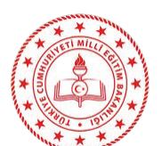

<!-- sayfa 1 -->

MİLLÎ EĞİTİM BAKANLIĞI YAYINLARI .......................................................................: 2024
DERS KİTAPLARI DİZİSİ ............................................................................................: 9603

Her hakkı saklıdır ve Millî Eğitim Bakanlığına aittir. Kitabın metin, soru ve şekilleri kısmen de olsa hiçbir surette alınıp yayımlanamaz.

### EDİTÖR
Prof. Dr. Çiğdem ARSLAN
Doç. Dr. Candaş UYGAN
Doç. Dr. Gamze KURT BİREL

### DİL UZMANI
Vedat EĞİLMEZ

### GÖRSEL TASARIMCI
Fatih GÜNDÜZ
Selçuk YAKIŞAN
Vildan ŞİMŞEK

### ÇOKLU ORTAM TASARIMCISI
Fatma KAHYAOĞLU
Gökhan KAHYAOĞLU
Hafize AÇAR KAŞTAN
Şerife KAÇMAZ

### PROGRAM GELİŞTİRME UZMANI
Doç.Dr. Adnan TAŞGIN

### ÖLÇME VE DEĞERLENDİRME UZMANI
Dr. Öğrt. Üyesi Mehtap AKTAŞ

### REHBERLİK UZMANI
Dursun DAYAPOĞLU

ISBN: 978-975-11-8013-1

Millî Eğitim Bakanlığı, Talim ve Terbiye Kurulu Başkanlığının 17.07.2024 tarih ve 110460159 sayılı yazısı ile eğitim aracı olarak kabul edilmiştir.

<!-- sayfa 2 -->

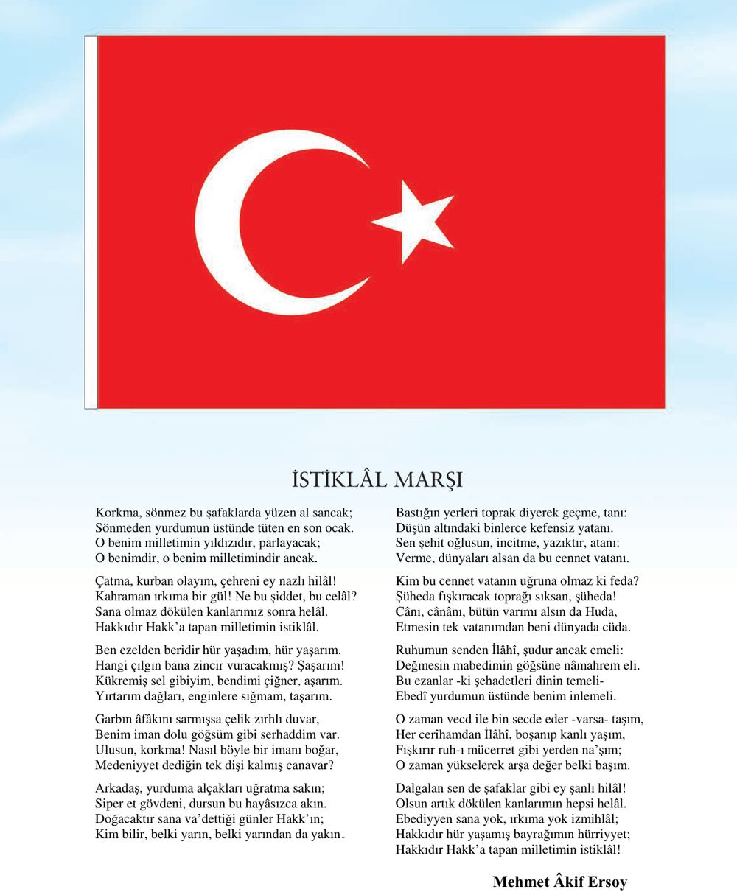

# İSTİKLÂL MARŞI

Korkma, sönmez bu şafaklarda yüzen al sancak;
Sönmeden yurdumun üstünde tüten en son ocak.
O benim milletimin yıldızıdır, parlayacak;
O benimdir, o benim milletimindir ancak.

Çatma, kurban olayım, çehreni ey nazlı hilâl!
Kahraman ırkıma bir gül! Ne bu şiddet, bu celâl?
Sana olmaz dökülen kanlarımız sonra helâl.
Hakkıdır Hakk'a tapan milletimin istiklâl.

Ben ezelden beridir hür yaşadım, hür yaşarım.
Hangi çılgın bana zincir vuracakmış? Şaşarım!
Kükremiş sel gibiyim, bendimi çiğner, aşarım.
Yırtarım dağları, enginlere sığmam, taşarım.

Garbın âfâkını sarmışsa çelik zırhlı duvar,
Benim iman dolu göğsüm gibi serhaddim var.
Ulusun, korkma! Nasıl böyle bir imanı boğar,
Medeniyyet dediğin tek dişi kalmış canavar?

Arkadaş, yurduma alçakları uğratma sakın;
Siper et gövdeni, dursun bu hayâsızca akın.
Doğacaktır sana va’dettiği günler Hakk’ın;
Kim bilir, belki yarın, belki yarından da yakın.

Bastığın yerleri toprak diyerek geçme, tanı:
Düşün altındaki binlerce kefensiz yatanı.
Sen şehit oğlusun, incitme, yazıktır, atanı:
Verme, dünyaları alsan da bu cennet vatanı.

Kim bu cennet vatanın uğruna olmaz ki feda?
Şüheda fışkıracak toprağı sıksan, şüheda!
Cânı, cânânı, bütün varımı alsın da Huda,
Etmesin tek vatanımdan beni dünyada cüda.

Ruhumun senden İlâhî, şudur ancak emeli:
Değmesin mabedimin göğsüne nâmahrem eli.
Bu ezanlar -ki şehadetleri dinin temeli-
Ebedî yurdumun üstünde benim inlemeli.

O zaman vecd ile bin secde eder -varsa- taşım,
Her cerîhamdan İlâhî, boşanıp kanlı yaşım,
Fışkırır ruh-ı mücerret gibi yerden na’şım;
O zaman yükselerek arşa değer belki başım.

Dalgalan sen de şafaklar gibi ey şanlı hilâl!
Olsun artık dökülen kanlarımın hepsi helâl.
Ebediyyen sana yok, ırkıma yok izmihlâl;
Hakkıdır hür yaşamış bayrağımın hürriyyet;
Hakkıdır Hakk'a tapan milletimin istiklâl!

Mehmet Âkif Ersoy

<!-- sayfa 3 -->

# GENÇLİĞE HİTABE

Ey Türk gençliği! Birinci vazifen, Türk istiklâlini, Türk Cumhuriyetini, ilelebet muhafaza ve müdafaa etmektir.

Mevcudiyetinin ve istikbalinin yegâne temeli budur. Bu temel, senin en kıymetli hazinendir. İstikbalde dahi, seni bu hazineden mahrum etmek isteyecek dâhilî ve hâricî bedhahların olacaktır. Bir gün, istiklâl ve cumhuriyeti müdafaa mecburiyetine düşersen, vazifeye atılmak için, içinde bulunacağın vaziyetin imkân ve şeraitini düşünmeyeceksin! Bu imkân ve şerait, çok namüsait bir mahiyette tezahür edebilir. İstiklâl ve cumhuriyetine kastedecek düşmanlar, bütün dünyada emsali görülmemiş bir galibiyetin mümessili olabilirler. Cebren ve hile ile aziz vatanın bütün kaleleri zapt edilmiş, bütün tersanelerine girilmiş, bütün orduları dağıtılmış ve memleketin her köşesi bilfiil işgal edilmiş olabilir. Bütün bu şeraitten daha elîm ve daha vahim olmak üzere, memleketin dâhilinde iktidara sahip olanlar gaflet ve dalâlet ve hattâ hıyanet içinde bulunabilirler. Hattâ bu iktidar sahipleri şahsî menfaatlerini, müstevlîlerin siyasî emelleriyle tevhit edebilirler. Millet, fakr u zaruret içinde harap ve bîtap düşmüş olabilir.

Ey Türk istikbalinin evlâdı! İşte, bu ahval ve şerait içinde dahi vazifen, Türk istiklâl ve cumhuriyetini kurtarmaktır. Muhtaç olduğun kudret, damarlarındaki asil kanda mevcuttur.

Mustafa Kemal Atatürk

<!-- sayfa 4 -->

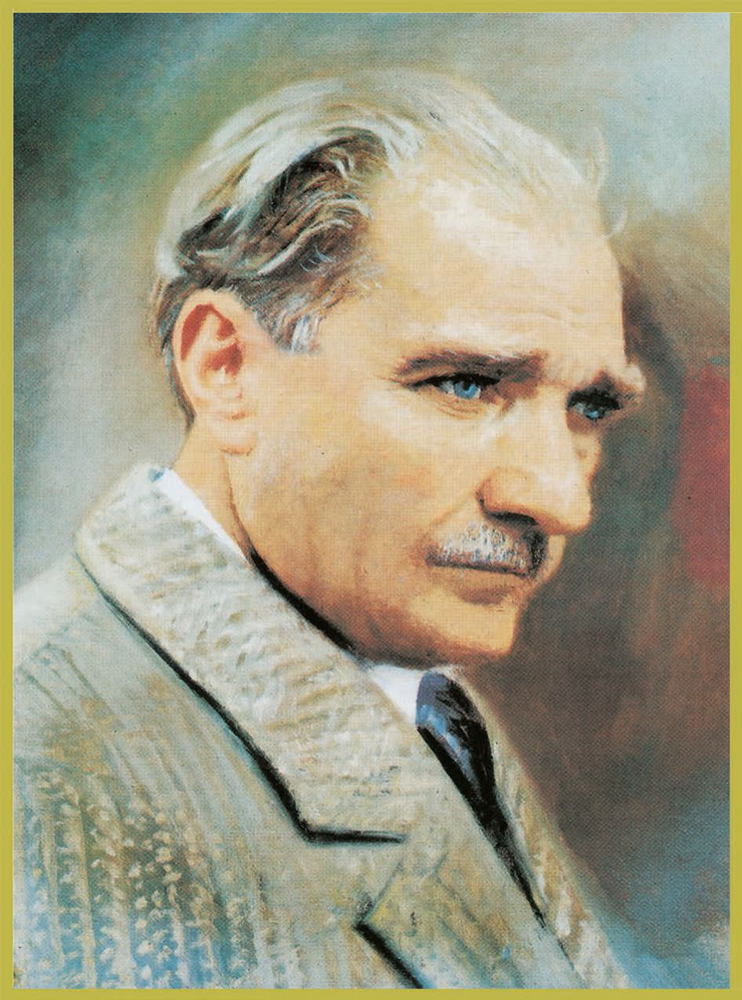
<!-- yer tutucu bulunamadı: sayfa sonuna eklendi -->

<!-- sayfa 5 -->

Verdiğiniz metin katmanı boş olduğu için (`<<< >>>` arası boş) dönüştürülecek bir içerik bulunmamaktadır. Lütfen metin katmanını içeren içeriği paylaşın, böylece talimatlarınıza uygun şekilde Markdown formatına çevirebilirim.

<!-- sayfa 6 -->

# İÇİNDEKİLER

KİTABIMIZI TANIYALIM ........................................................................................................... 10

## 4.TEMA: SAYILAR VE NİCELİKLER (2):KESİRLER ................................................... 12

HAZIR MIYIZ? .......................................................................................................................... 14
BAŞLAYALIM ........................................................................................................................... 15
KESİRLER ............................................................................................................................... 17
   Kesirleri Farklı Biçimlerde Temsil Etme ............................................................................. 17
   İzleme Testi ....................................................................................................................... 32
BAŞLAYALIM ........................................................................................................................... 34
   Kesirleri Karşılaştırma ....................................................................................................... 35
   İzleme Testi ....................................................................................................................... 49
   Performans Görevi ............................................................................................................ 51
ÖLÇME VE DEĞERLENDİRME SORULARI ........................................................................... 52

## 5.TEMA: İSTATİSTİKSEL ARAŞTIRMA SÜRECİ ........................................................ 56

HAZIR MIYIZ? .......................................................................................................................... 58
BAŞLAYALIM ........................................................................................................................... 59
İSTATİSTİKSEL ARAŞTIRMA SÜRECİ .................................................................................... 60
   İstatistik Nedir? .................................................................................................................. 61
   İstatistiksel Araştırma Adımları .......................................................................................... 62
   Araştırma Sorusuna Uygun Anket Sorusu Yazma ............................................................ 66
VERİ GÖRSELLEŞTİRME ARAÇLARI .................................................................................... 70
   Sütun Grafiği ..................................................................................................................... 70
   Daire Grafiği ...................................................................................................................... 72
   Performans Görevi ............................................................................................................ 78
   Performans Görevi ............................................................................................................ 82
İSTATİSTİK OKURYAZARLIĞI ................................................................................................. 94
VERİLERİN DEĞİŞEBİLİRLİĞİ ................................................................................................ 96
   Performans Görevi ............................................................................................................ 99

<!-- sayfa 7 -->

# 6.TEMA: İŞLEMLERLE CEBİRSEL DÜŞÜNME 114

HAZIR MIYIZ? .......................................................................................................... 116
BAŞLAYALIM ........................................................................................................... 117
EŞİTLİĞİN KORUNUMU VE İŞLEM ÖZELLİKLERİ ................................................ 118
İŞLEM ÖNCELİĞİ .................................................................................................... 131
       Performans Görevi ............................................................................................ 137
HAZIR MIYIZ? .......................................................................................................... 138
SAYI VE ŞEKİL ÖRÜNTÜLERİ ................................................................................ 139
       İzleme Testi ....................................................................................................... 147
HAZIR MIYIZ? .......................................................................................................... 149
BAŞLAYALIM ........................................................................................................... 149
ÖLÇME VE DEĞERLENDİRME SORULARI ........................................................... 160

# 7.TEMA: VERİDEN OLASILIĞA 164

HAZIR MIYIZ? .......................................................................................................... 166
BAŞLAYALIM ........................................................................................................... 166
OLAYLARIN OLASILIĞI ........................................................................................... 167
OLASILIK SPEKTRUMU .......................................................................................... 170
       İzleme Testi ....................................................................................................... 172
       Performans Görevi ............................................................................................ 176
ÖLÇME VE DEĞERLENDİRME SORULARI ........................................................... 179

<!-- sayfa 8 -->

EK-1- ÖZ DEĞERLENDİRME FORMU................................................................... 183
EK2:YAZILAN HİKÂYEYİ DEĞERLENDİRMEYE YÖNELİK ANALİTİK RUBRİK.184
SÖZLÜK................................................................................................................... 185
CEVAP ANAHTARI KAREKODU............................................................................. 186
KAYNAKÇA.............................................................................................................. 187
GÖRSEL VE GENEL AĞ KAYNAKÇASI KAREKODU............................................ 187
TÜRKİYE'NİN MÜLKİ İDARE BÖLÜMLERİ İLE KARA VE DENİZ 
KOMŞULARI HARİTASI........................................................................................... 188
TÜRK DÜNYASI HARİTASI..................................................................................... 189

<!-- sayfa 9 -->

# KİTABIMIZI TANIYALIM

Kitap genelinde kullanılan görseller ve açıklamaları aşağıda verilmiştir.

$\rightarrow$ Bu görselin bulunduğu bölüm içeriğinde ilgili okuryazarlık becerisi işlenmiştir. 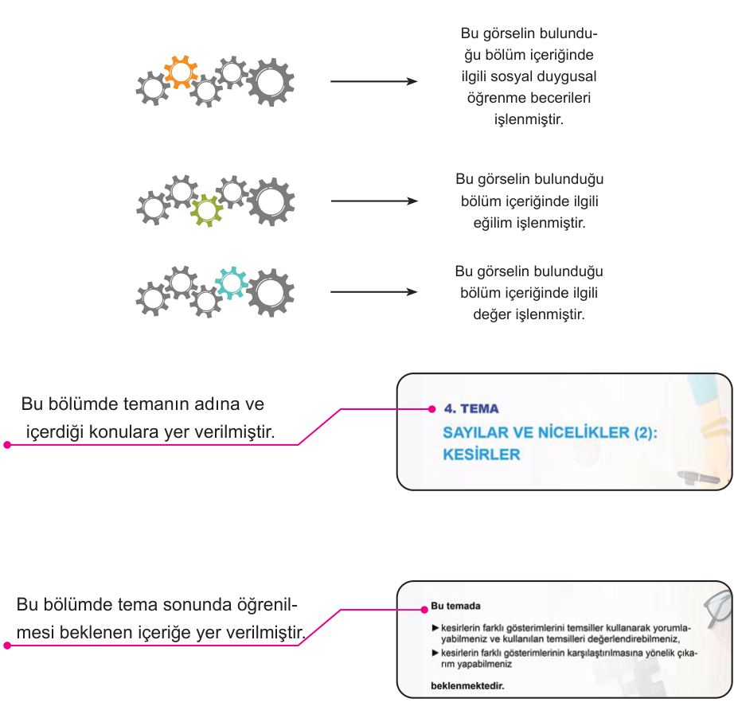

$\rightarrow$ Bu görselin bulunduğu bölüm içeriğinde ilgili sosyal duygusal öğrenme becerileri işlenmiştir.

$\rightarrow$ Bu görselin bulunduğu bölüm içeriğinde ilgili eğilim işlenmiştir.

$\rightarrow$ Bu görselin bulunduğu bölüm içeriğinde ilgili değer işlenmiştir.

Bu bölümde temanın adına ve içerdiği konulara yer verilmiştir.

**4. TEMA**
**SAYILAR VE NİCELİKLER (2): KESİRLER**

Bu bölümde tema sonunda öğrenilmesi beklenen içeriğe yer verilmiştir.

**Bu temada**
* kesirlerin farklı gösterimlerini temsiller kullanarak yorumlayabilmeniz ve kullanılan temsilleri değerlendirebilmeniz,
* kesirlerin farklı gösterimlerinin karşılaştırılmasına yönelik çıkarım yapabilmeniz
**beklenmektedir.**

Bu bölümde ön değerlendirme çalışmasına yer verilmiştir.

**HAZIR MIYIZ?**
1) Aşağıdaki soruları cevaplayınız.
a) $\frac{1}{4}$ <!-- KONTROL: Marker'da karşılığı yok, uydurma olabilir --> ile $\frac{1}{12}$ <!-- KONTROL: Marker'da karşılığı yok, uydurma olabilir --> birim kesirlerinden hangisinin daha büyük olduğunu tahmin ediniz.
b) $\frac{1}{4}$ <!-- KONTROL: Marker'da karşılığı yok, uydurma olabilir --> ve $\frac{1}{12}$ <!-- KONTROL: Marker'da karşılığı yok, uydurma olabilir --> kesirlerini aşağıdaki sayı doğrularında göstererek karşılaştırınız.

<!-- sayfa 10 -->

# KİTABIMIZI TANIYALIM

Bu bölümde ön bilgiler kullanılarak yeni konuya giriş etkinliklerine yer verilmiştir.
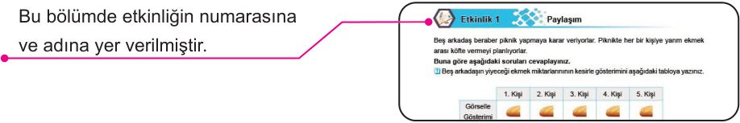

Bu bölümde etkinliğin numarasına ve adına yer verilmiştir.
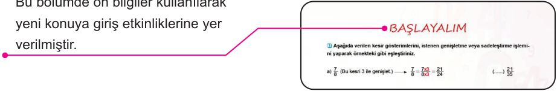

Bu bölümde kavramlarla ilgili bilgilere yer verilmiştir.

Bu bölümde öğrenciyi araştırma yapmaya yönlendiren göreve yer verilmiştir.
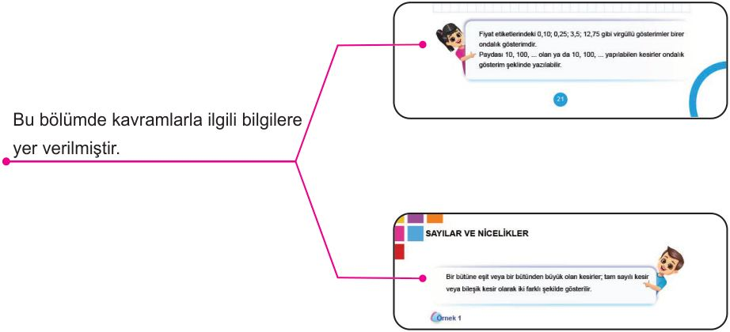
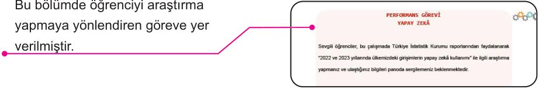

<!-- sayfa 11 -->

4. TEMA

# SAYILAR VE NİCELİKLER (2): KESİRLER

* Kesirlerin Farklı Gösterimleri
* Kesirlerin Karşılaştırılması

### Anahtar Kavramlar
bileşik kesir, birim kesir, denklik, ondalık gösterim, tam sayılı kesir, yüzde

### Sembol ve Gösterimler
$\%$

### Bu temada
► kesirlerin farklı gösterimlerini temsiller kullanarak yorumlayabilmeniz ve kullanılan temsilleri değerlendirebilmeniz,
► kesirlerin farklı gösterimlerinin karşılaştırılmasına yönelik çıkarım yapabilmeniz

**beklenmektedir.**

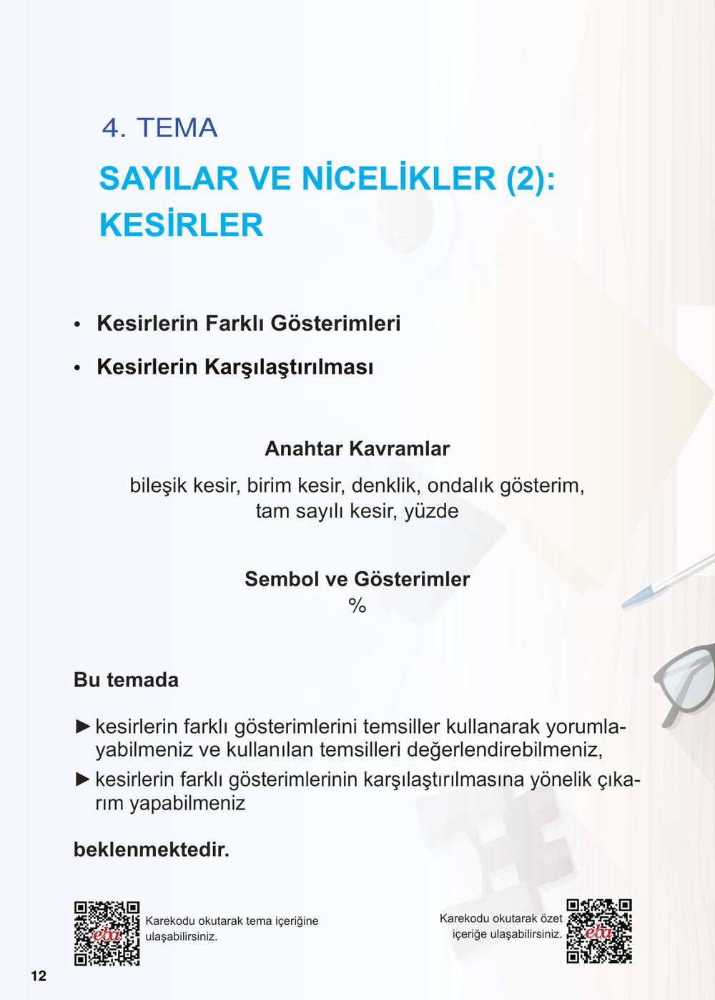
<!-- yer tutucu bulunamadı: sayfa sonuna eklendi -->

<!-- sayfa 12 -->

# KESİRLER

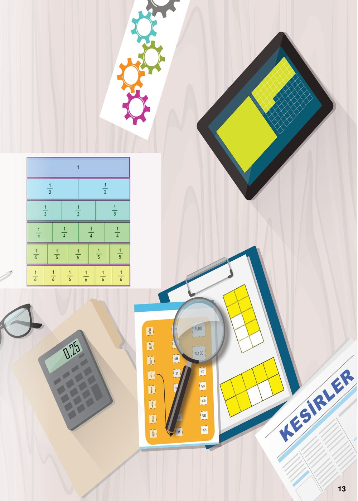

$0,17$ <!-- KONTROL: Marker'da karşılığı yok, uydurma olabilir -->
$0,4$ <!-- KONTROL: Marker'da karşılığı yok, uydurma olabilir -->
$0,86$ <!-- KONTROL: Marker'da karşılığı yok, uydurma olabilir -->
$2,7$ <!-- KONTROL: Marker'da karşılığı yok, uydurma olabilir -->
$0,75$ <!-- KONTROL: Marker'da karşılığı yok, uydurma olabilir -->
$1,1$ <!-- KONTROL: Marker'da karşılığı yok, uydurma olabilir -->
$0,1$ <!-- KONTROL: Marker'da karşılığı yok, uydurma olabilir -->
$0,5$ <!-- KONTROL: Marker'da karşılığı yok, uydurma olabilir -->

$\%17$ <!-- KONTROL: Marker'da karşılığı yok, uydurma olabilir -->
$\%86$ <!-- KONTROL: Marker'da karşılığı yok, uydurma olabilir -->
$\%10$ <!-- KONTROL: Marker'da karşılığı yok, uydurma olabilir -->
$\%50$ <!-- KONTROL: Marker'da karşılığı yok, uydurma olabilir -->
$\%75$ <!-- KONTROL: Marker'da karşılığı yok, uydurma olabilir -->

$\frac{17}{100}$ <!-- KONTROL: Marker'da karşılığı yok, uydurma olabilir -->
$\frac{86}{100}$ <!-- KONTROL: Marker'da karşılığı yok, uydurma olabilir -->
$\frac{1}{10}$ <!-- KONTROL: Marker'da karşılığı yok, uydurma olabilir -->
$\frac{5}{10}$ <!-- KONTROL: Marker'da karşılığı yok, uydurma olabilir -->
$\frac{75}{100}$ <!-- KONTROL: Marker'da karşılığı yok, uydurma olabilir -->

$\frac{1}{10}$ <!-- KONTROL: Marker'da karşılığı yok, uydurma olabilir -->
$\frac{4}{3}$ <!-- KONTROL: Marker'da karşılığı yok, uydurma olabilir -->
$\frac{2}{1}$ <!-- KONTROL: Marker'da karşılığı yok, uydurma olabilir -->
$\frac{10}{11}$ <!-- KONTROL: Marker'da karşılığı yok, uydurma olabilir -->
$\frac{5}{2}$ <!-- KONTROL: Marker'da karşılığı yok, uydurma olabilir -->
$\frac{27}{10}$ <!-- KONTROL: Marker'da karşılığı yok, uydurma olabilir -->

$\%130$ <!-- KONTROL: Marker'da karşılığı yok, uydurma olabilir -->
$\%80$ <!-- KONTROL: Marker'da karşılığı yok, uydurma olabilir -->

$0,25$ <!-- KONTROL: Marker'da karşılığı yok, uydurma olabilir -->

<!-- sayfa 13 -->

# HAZIR MIYIZ?

1) Aşağıdaki soruları cevaplayınız.
a) $\frac{1}{4}$ ile $\frac{1}{12}$ birim kesirlerinden hangisinin daha büyük olduğunu tahmin ediniz.
b) $\frac{1}{4}$ ve $\frac{1}{12}$ kesirlerini aşağıdaki sayı doğrularında göstererek karşılaştırınız.

c) Birim kesirlerin karşılaştırılması ile ilgili yapılan genellemeyi hatırladınız mı?

2) Aşağıdaki bütünleri, belirtilen sayıda eş parçaya ayırıp verilen soruları cevaplayınız.

4 Parça $\longrightarrow$ 

6 Parça $\longrightarrow$ 

a) Elde ettiğiniz parçaları iki bütünde de eşit büyüklüğü gösterecek şekilde tarayınız.

b) Taradığınız parçalara karşılık gelen kesir gösterimlerini yazınız.

c) Aynı büyüklüğü ifade eden bu kesir gösterimlerine ne ad verildiğini hatırladınız mı?

<!-- sayfa 14 -->

# BAŞLAYALIM

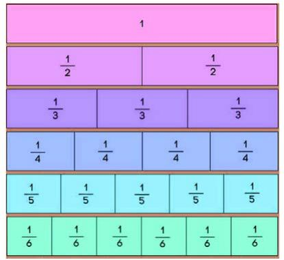

i Yanda gördüğünüz materyal, kesir takımı olarak isimlendirilmektedir. Kesirler, bu materyal kullanılarak modellendirilmektedir.

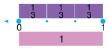

a) Yukarıdaki adımları inceleyiniz. 4. Adım'daki kesir takımlarını kullanarak oluşturulan iki modelin kesir gösterimini belirleyiniz.

[Boş kareli alan]

b) Belirlediğiniz kesir gösterimleri arasındaki ilişkiyi ifade ediniz.

[Boş kareli alan]

<!-- sayfa 15 -->

# KESİRLER

## Etkinlik 1 Denk Kesirler

Ahmet Öğretmen, denk kesirler elde etmek için sadeleştirme veya genişletme işlemlerinin nasıl uygulandığını aşağıdaki iki örnekle göstermiştir.

$$\frac{7}{8} \text{ (Bu kesri 3 ile genişlet.)} \longrightarrow \frac{7}{8} = \frac{7 \times 3}{8 \times 3} = \frac{21}{24}$$

$$\frac{20}{36} \text{ (Bu kesri 4 ile sadeleştir.)} \longrightarrow \frac{20}{36} = \frac{20 \div 4}{36 \div 4} = \frac{5}{9}$$

Ahmet Öğretmen'in genişletme ve sadeleştirme örneklerini inceleyerek aşağıdaki soruları cevaplayınız.

1. Genişletme işleminin nasıl yapıldığı ile ilgili fikirlerinizi arkadaşlarınızla tartışınız.
2. Sadeleştirme işleminin nasıl yapıldığı ile ilgili fikirlerinizi arkadaşlarınızla tartışınız.
3. Aşağıdaki kesir gösterimlerini istenen genişletme veya sadeleştirme işlemini yaparak örnekteki gibi eşleştiriniz.

a) $\frac{11}{15}$ (Bu kesri 5 ile genişlet.) $\quad \quad \quad \quad \quad \quad \quad \quad \quad (\dots\dots) \frac{21}{35}$

b) $\frac{6}{29}$ (Bu kesri 2 ile genişlet.) $\quad \quad \quad \quad \quad \quad \quad \quad \quad (\dots\dots) \frac{55}{75}$

c) $\frac{48}{84}$ (Bu kesri 6 ile sadeleştir.) $\quad \quad \quad \quad \quad \quad \quad \quad (\dots\dots) \frac{3}{4}$

ç) $\frac{24}{32}$ (Bu kesri 8 ile sadeleştir.) $\quad \quad \quad \quad \quad \quad \quad \quad (\dots\dots) \frac{2}{5}$

d) $\frac{3}{5}$ (Bu kesri 7 ile genişlet.) $\quad \quad \quad \quad \quad \quad \quad \quad \quad (\dots\dots) \frac{7}{8}$

e) $\frac{18}{45}$ (Bu kesri 9 ile sadeleştir.) $\quad \quad \quad \quad \quad \quad \quad \quad (\dots\dots) \frac{12}{58}$

f) $\frac{1}{6}$ (Bu kesri 11 ile genişlet.) $\quad \quad \quad \quad \quad \quad \quad \quad \quad (\dots\dots) \frac{8}{14}$

11

<!-- sayfa 16 -->

# Kesirleri Farklı Biçimlerde Temsil Etme

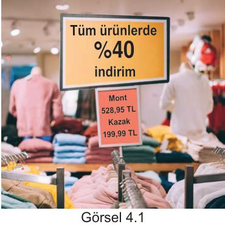

Mağazalarda kullanılan bilgilendirme tabelalarının bir benzeri görsel 4.1'de verilmiştir. İndirim tabelasında yazan sayının önündeki sembolü ve fiyat tabelasında yazan sayılardaki virgülleri fark ettiniz mi? Günlük hayatınızda tabelalardaki sembol ve virgüller ile başka nerelerde karşılaşıyorsunuz?

Görsel 4.1

## Etkinlik 2 Paylaşım

Beş arkadaş beraber piknik yapmaya karar veriyorlar. Piknikte her bir kişiye yarım ekmek arası köfte vermeyi planlıyorlar.

**Buna göre aşağıdaki soruları cevaplayınız.**

1. Beş arkadaşın yiyeceği ekmek miktarlarının kesirle gösterimini aşağıdaki tabloya yazınız.

| | 1. Kişi | 2. Kişi | 3. Kişi | 4. Kişi | 5. Kişi |
| :--- | :---: | :---: | :---: | :---: | :---: |
| Görselle Gösterimi |  |  |  |  |  |
| Kesirle Gösterimi | | | | | |

2. Piknikte kullanılacak toplam ekmek miktarının bileşik kesir ve tam sayılı kesir gösterimini yazınız. Bu gösterimleri aşağıdaki sayı doğrularında gösteriniz.

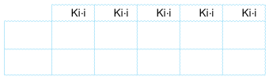

3. Yukarıdaki modellerden yararlanarak gösterimler arasında nasıl bir ilişki olduğunu ifade ediniz. Daha sonra fikirlerinizi arkadaşlarınızla paylaşarak tartışınız.

<!-- sayfa 17 -->

Bir bütüne eşit veya bir bütünden büyük olan kesirler; tam sayılı kesir veya bileşik kesir olarak iki farklı şekilde gösterilir.

## Örnek 1

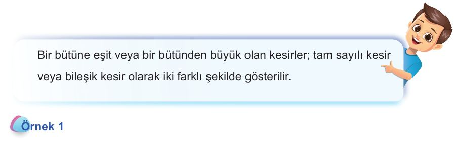

Aşağıdaki denk kesirleri örnekteki gibi eşleştiriniz.

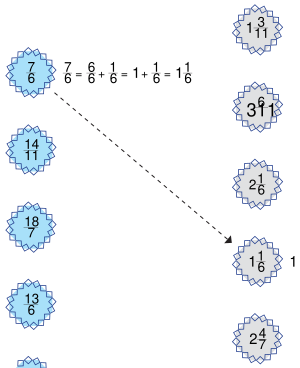
$$1\frac{1}{6} > 1\frac{1}{6} = 1 + \frac{1}{6} = \frac{6}{6} + \frac{1}{6} = \frac{7}{6}$$
<!-- KONTROL: Gemma farklı okudu: \frac{7}{6} = \frac{6}{6} + \frac{1}{6} = 1 + \frac{1}{6} = 1\frac{1}{6} -->
(Ok işaretiyle aşağıya bağlanıyor)

$$\frac{14}{11}$$
<!-- KONTROL: Marker'da karşılığı yok, uydurma olabilir -->

$$\frac{18}{7}$$
<!-- KONTROL: Marker'da karşılığı yok, uydurma olabilir -->

$$\frac{13}{6}$$
<!-- KONTROL: Marker'da karşılığı yok, uydurma olabilir -->

$$\frac{39}{11}$$
<!-- KONTROL: Marker'da karşılığı yok, uydurma olabilir -->

 (Sağ sütun başlangıcı)
$$1\frac{3}{11}$$
<!-- KONTROL: Marker'da karşılığı yok, uydurma olabilir -->

$$3\frac{6}{11}$$
<!-- KONTROL: Marker'da karşılığı yok, uydurma olabilir -->

$$2\frac{1}{6}$$
<!-- KONTROL: Marker'da karşılığı yok, uydurma olabilir -->

 (Örnek eşleşmesi)
$$1\frac{1}{6} = 1 + \frac{1}{6} = \frac{6}{6} + \frac{1}{6} = \frac{7}{6}$$

$$2\frac{4}{7}$$

$$1\frac{2}{11}$$
<!-- KONTROL: Marker'da karşılığı yok, uydurma olabilir -->

$$3\frac{4}{7}$$
<!-- KONTROL: Marker'da karşılığı yok, uydurma olabilir -->

$$\frac{25}{7}$$
<!-- KONTROL: Marker'da karşılığı yok, uydurma olabilir -->

<!-- sayfa 18 -->

# Etkinlik 3 Oyunlarla Öğreniyorum

Fatma ve Mehmet, çocukları Aras’ın hem teknolojiden uzak kalmaması hem de internetteki zararlı içeriklerden etkilenmemesi için eğitici içerikler araştırmaktadırlar. Buldukları eğitici içerikleri ise belirledikleri zaman aralıklarında Aras’ın kullanmasına izin vermektedirler.

Aras, ailesinin onayladığı üç farklı eğitici bilgisayar oyununu oynamaktadır. Oynadığı eğitici oyunlar hakkındaki bilgiler aşağıdaki tabloda verilmiştir.

Tablo: Eğitici Oyunların Bölüm ve Aşama Sayıları ile Tamamlanma Durumları

| Eğitici Oyunun Adı | Bölüm Sayısı | Her Bölümdeki Aşama Sayısı | Eğitici Oyunu Tamamlama Durumu |
| :--- | :---: | :---: | :--- |
| Matematiğin Sırları | 3 | 6 | 2 bölüm ve 5 aşama |
| Gezegenimizi Tanıyalım | 5 | 5 | 4 bölüm ve 1 aşama |
| Kodlama Yapıyorum | 7 | 3 | 6 bölüm ve 2 aşama |

Oynadığı eğitici oyunların her birinin aşamaları eşit sürede tamamlandığına göre her bir eğitici oyunun tamamlanma durumunu modelleyiniz. Modellerinizi bileşik ve tam sayılı kesir olarak ifade ediniz. Kullandığınız modeli arkadaşlarınızla paylaşınız. Kullanılan modelleri karşılaştırdığınızda hangi tür modelin daha kullanışlı olduğunu ifade ediniz.

<!-- sayfa 19 -->

Yanda bir alışveriş fişi örneği verilmiştir.

Alışveriş fişleri incelendiğinde, tutar bölümlerinde virgüllü ifadeler ve KDV (Katma Değer Vergisi) bölümünde ise $\%$ sembolleri görülür.

Katma Değer Vergisi, aldığınız herhangi bir üründen devlete peşin olarak ödediğiniz bir vergi türüdür. Her devletin vatandaşlarından aldığı çeşitli vergi türleri bulunmaktadır. Bu vergileri ödemek bir vatandaşlık görevidir.

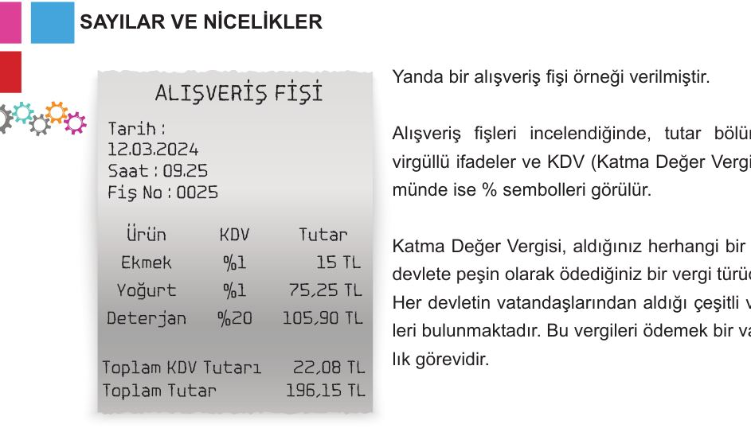
**ALIŞVERİŞ FİŞİ**

| Tarih : | 12.03.2024 |
| :--- | :--- |
| Saat : | 09.25 |
| Fiş No : | 0025 |

| Ürün | KDV | Tutar |
| :--- | :--- | :--- |
| Ekmek | $\%1$ | $15\text{ TL}$ |
| Yoğurt | $\%1$ | $75,25\text{ TL}$ |
| Deterjan | $\%20$ | $105,90\text{ TL}$ |

| Toplam KDV Tutarı | $22,08\text{ TL}$ |
| :--- | :--- |
| **Toplam Tutar** | **$196,15\text{ TL}$** |

---

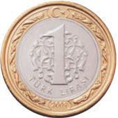
# Etkinlik 4 Madenî Paralar

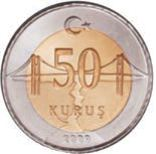
Aşağıdaki madenî paraları inceleyerek verilen soruları cevaplayınız.

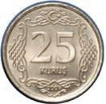
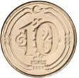
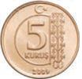
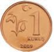
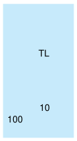
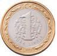
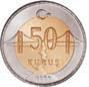

1 Aşağıdaki tabloda bazı madenî paraların Türk lirası cinsinden kesir gösterimleri verilmiştir. $1\text{ TL}$'yi bir bütün olarak kabul ederek örnekteki gibi tabloyu doldurunuz.
($1\text{ TL}$, $100\text{ kuruşa eşittir}$.)

| Paralar |  |  |  |  |  |  |
| :--- | :---: | :---: | :---: | :---: | :---: | :---: |
| Paraların TL cinsinden değerinin kesir gösterimleri | $1$ | $\frac{1}{2}$ <!-- KONTROL: Marker'da karşılığı yok, uydurma olabilir --> | | | | |
| Paraların değerinin paydası $10$ veya $100$ olacak şekilde kesir gösterimleri | $\frac{10}{10}$ <!-- KONTROL: Marker'da karşılığı yok, uydurma olabilir --> veya $\frac{100}{100}$ <!-- KONTROL: Marker'da karşılığı yok, uydurma olabilir --> | $\frac{5}{10}$ <!-- KONTROL: Marker'da karşılığı yok, uydurma olabilir --> veya $\frac{50}{100}$ <!-- KONTROL: Marker'da karşılığı yok, uydurma olabilir --> | | | | |

<!-- sayfa 20 -->

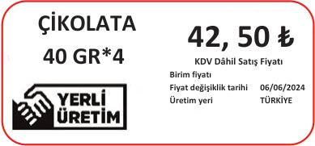 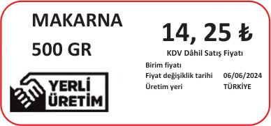

Etiketlerdeki ürünlerin fiyatları sırasıyla "on dört lira yirmi beş kuruş" ve "kırk iki lira elli kuruş" tur.
**Günlük hayatta karşılaştığımız farklı fiyat etiketlerini düşünerek aşağıdaki soruları cevaplayınız.**

50 kuruşun etiketlerdeki görünümünü yazınız.
.........

25 kuruşun etiketlerdeki görünümünü yazınız.
.........

10 kuruşun etiketlerdeki görünümünü yazınız.
.........

5 kuruşun etiketlerdeki görünümünü yazınız.
.........

1 kuruşun etiketlerdeki görünümünü yazınız.
.........

3 Paraların TL cinsinden değerinin kesir gösterimini ve market etiketlerindeki görünümlerini inceleyerek aralarındaki ilişkiyi ifade ediniz. Fikirlerinizi arkadaşlarınızla paylaşarak tartışınız.

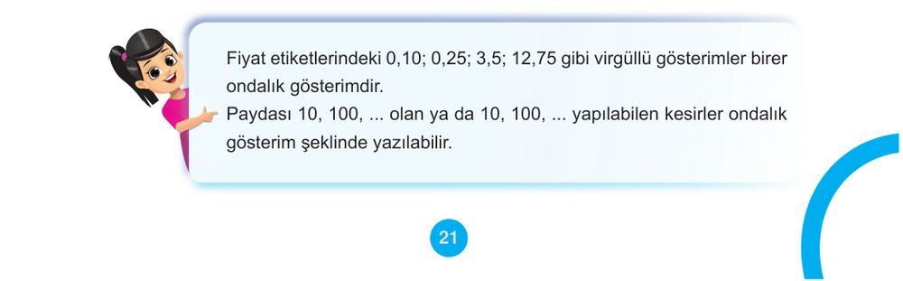
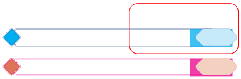

Fiyat etiketlerindeki $0,10$; $0,25$; $3,5$; $12,75$ gibi virgüllü gösterimler birer ondalık gösterimdir.
Paydası $10, 100, \dots$ <!-- KONTROL: Marker'da karşılığı yok, uydurma olabilir --> olan ya da $10, 100, \dots$ <!-- KONTROL: Marker'da karşılığı yok, uydurma olabilir --> yapılabilen kesirler ondalık gösterim şeklinde yazılabilir.

<!-- sayfa 21 -->

# Etkinlik 5 Modeller ile Farklı Gösterimler

1 Aşağıdaki modellemelerin kesir ve ondalık gösterimlerini belirleyiniz.

a)

Kesir Gösterimi:
Ondalık Gösterimi:
1. Model

b)

Kesir Gösterimi:
Ondalık Gösterimi:
2. Model

c)

Kesir Gösterimi:
Ondalık Gösterimi:
3. Model

ç)

Kesir Gösterimi:
Ondalık Gösterimi:
4. Model

2 Bu modellerin her biri için kesir gösterimlerinin okunuşlarını aşağıdaki tabloya yazınız.

| Model | Kesir Gösteriminin Okunuşu |
| :--- | :--- |
| 1. Model | |
| 2. Model | |
| 3. Model | |
| 4. Model | |

3 Ondalık gösterimler de kesir gösterimler gibi okunabilir mi?
Fikirlerinizi arkadaşlarınızla paylaşarak tartışınız.

<!-- sayfa 22 -->

Bir ondalık gösterim tam kısım ve ondalık kısımdan oluşmaktadır. Örneğin $0,7$ ondalık gösteriminde; $0$ tam kısımda, $7$ ise ondalık kısımda bulunmaktadır. $4,25$ ondalık gösteriminde; $4$ tam kısımda, $25$ ise ondalık kısımda bulunmaktadır.

$0,7$
Tam Kısım $\rightarrow$ Ondalık Kısım
$4,25$
Tam Kısım $\rightarrow$ Ondalık Kısım

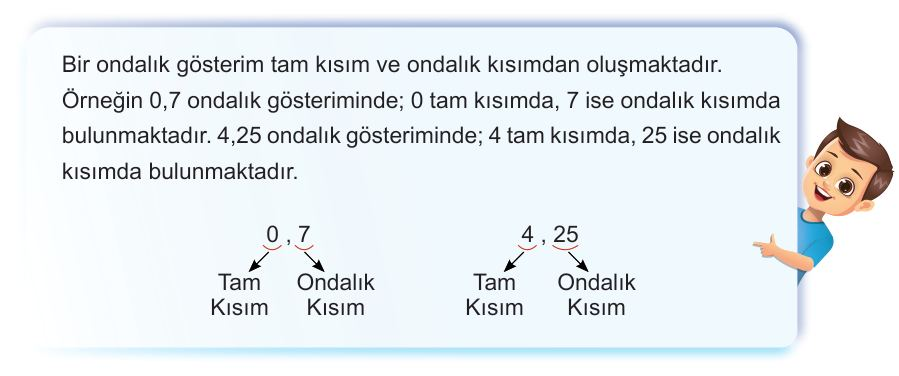

Ondalık gösterimlerin okunuşlarını, ondalık kısmın basamak sayısı belirler. Tam kısımdaki sayı okunduktan sonra ondalık kısım bir basamaklı ise onda, iki basamaklı ise yüzde ifadesi kullanılarak kesir kısmındaki sayı okunur.

$0,7$ ondalık gösteriminin okunuşu “sıfır tam onda yedi”dir.
$4,25$ ondalık gösteriminin okunuşu “dört tam yüzde yirmi beş”tir.

# Örnek 2

Dört arkadaşın yaptıkları alışveriş sonrası aldıkları para üstlerinin ondalık gösterimini ve kesir gösterimini belirleyerek bu gösterimlerin okunuşlarını örnekteki gibi yazınız.

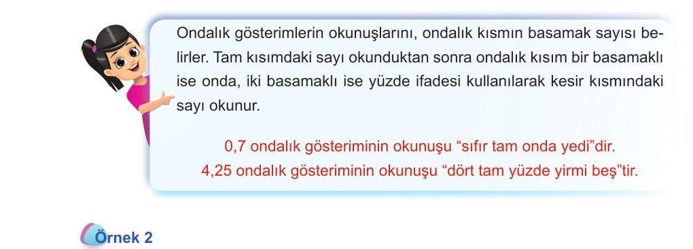

| Kişiler | Alınan Para Üstü | Ondalık Gösterimi | Kesir Gösterimi | Gösterimlerin Okunuşu |
| :--- | :--- | :--- | :--- | :--- |
| Cansu | [[GÖRÜNTÜ: 1 TL + 50 kuruş]] | $1,50$ veya $1,5$ | $1 \frac{50}{100}$ <!-- KONTROL: Marker'da karşılığı yok, uydurma olabilir --> veya $1 \frac{5}{10}$ <!-- KONTROL: Marker'da karşılığı yok, uydurma olabilir --> | Bir tam yüzde elli veya bir tam onda beş |
| Eylül | [[GÖRÜNTÜ: 50 kuruş + 50 kuruş + 25 kuruş]] | | | |
| Gülce | [[GÖRÜNTÜ: 1 TL + 1 TL + 10 kuruş + 5 kuruş]] | | | |
| Deniz | [[GÖRÜNTÜ: 50 kuruş + 25 kuruş + 10 kuruş]] | | | |

<!-- sayfa 23 -->

# Örnek 3

Verilen örnekleri inceleyerek aşağıdaki kesirleri ondalık gösterim şeklinde yazınız.

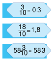
Paydası $10$ olan kesir gösterimler, ondalık gösterim olarak yazılırken virgülden sonra bir basamak olacak şekilde yazılır.

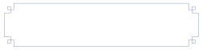
$$\frac{3}{10} = 0,3$$
$$\frac{18}{10} = 1,8$$
$$58 \frac{3}{10} = 58,3$$

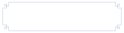
$$\frac{6}{100} = 0,06$$
$$\frac{254}{100} = 2,54$$
$$2 \frac{49}{100} = 2,49$$

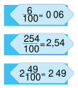
Paydası $100$ olan kesir gösterimler, ondalık gösterim olarak yazılırken virgülden sonra iki basamak olacak şekilde yazılır.

$\frac{7}{10} =$

$\frac{34}{10} =$

$\frac{77}{100} =$

$8 \frac{12}{100} =$

$12 \frac{3}{10} =$

$\frac{8}{100} =$

$1 \frac{4}{10} =$

$5 \frac{38}{100} =$

$\frac{242}{100} =$

$36 \frac{9}{100} =$

$\frac{88}{100} =$

$\frac{474}{10} =$

<!-- sayfa 24 -->

# Örnek 4

Verilen örneği inceleyerek istenen kesir gösterimlerini ve ondalık gösterimleri yazınız.

$\frac{1}{2} \rightarrow$  $\rightarrow$  $\rightarrow \frac{5}{10} \rightarrow 0,5$ <!-- KONTROL: Marker'da karşılığı yok, uydurma olabilir -->

$\frac{3}{5} \rightarrow$ <!-- KONTROL: Marker'da karşılığı yok, uydurma olabilir -->  $\rightarrow$  $\rightarrow \dots\dots \rightarrow \dots\dots$

$\frac{1}{4} \rightarrow$ <!-- KONTROL: Marker'da karşılığı yok, uydurma olabilir -->  $\rightarrow$  $\rightarrow \dots\dots \rightarrow \dots\dots$

$\frac{7}{20} \rightarrow$ <!-- KONTROL: Marker'da karşılığı yok, uydurma olabilir -->  $\rightarrow$  $\rightarrow \dots\dots \rightarrow \dots\dots$

$\frac{12}{25} \rightarrow$  $\rightarrow$  $\rightarrow \dots\dots \rightarrow \dots\dots$

<!-- sayfa 25 -->

# Etkinlik 6
## Birlikte Öğreniyoruz

Asaf bir kekin $\frac{1}{10}$'ini, Meryem ise $\frac{2}{10}$'sini yemiştir.

**Buna göre sınıfınızda gruplar oluşturup aşağıdaki soruları cevaplayınız.**
Grup olarak sorulara verdiğiniz cevapları diğer arkadaşlarınızla paylaşınız. Daha sonra diğer grupların sorularını saygı çerçevesinde dinleyerek cevaplayınız.

1. Asaf'ın ve Meryem'in yedikleri kek miktarını aşağıdaki model üzerinde boyayarak gösteriniz.

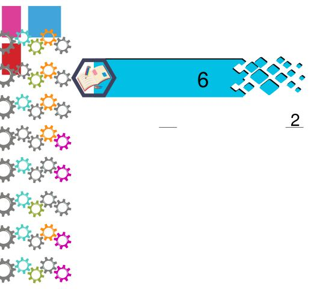

2. Asaf'ın yediği kek miktarının ondalık gösterimi nasıl yazılır ve okunur?

3. Meryem'in yediği kek miktarının ondalık gösterimi nasıl yazılır ve okunur?

4. Asaf, tüm kekin $\frac{2}{5}$ <!-- KONTROL: Marker'da karşılığı yok, uydurma olabilir -->'sini yemiş olsaydı yediği kek miktarının ondalık gösterimi nasıl yazılır ve okunurdu?

5. Meryem tüm kekin $\frac{1}{2}$'ini yemiş olsaydı yediği kek miktarının ondalık gösterimi nasıl yazılır ve okunurdu?

<!-- sayfa 26 -->

# Etkinlik 7 Bir Aracın Yakıt Tüketimi

Bir aracın üç haftalık yakıt tüketimi incelenmiştir. Bu araç birinci hafta $\frac{13}{20}$ depo yakıt, ikinci hafta $\frac{3}{4}$ depo yakıt ve üçüncü hafta $1 \frac{7}{50}$ depo yakıt tüketmiştir.
**Buna göre aşağıdaki soruları cevaplayınız.**

1. Bu aracın haftalara göre tükettiği yakıt miktarının ondalık gösterimini aşağıdaki yüzlük tabloları doldurarak yapınız.

**Birinci hafta tükettiği yakıt miktarı**

Her 20 karenin 13 tanesini boyayınız.

**İkinci hafta tükettiği yakıt miktarı**

Her 4 karenin 3 tanesini boyayınız.

**Üçüncü hafta tükettiği yakıt miktarı**

100'lük tablonun bir tanesinin tamamını, diğerinin ise her 50 karesinin 7 tanesini boyayınız.

2. Haftalara göre tüketilen yakıt miktarının ondalık gösterimini ve ondalık gösteriminin okunuşunu aşağıdaki tabloya yazınız.

| Haftalar | Tüketilen Yakıt Miktarının Ondalık Gösterimi | Tüketilen Yakıt Miktarının Ondalık Gösteriminin Okunuşu |
| :--- | :--- | :--- |
| 1. Hafta | | |
| 2. Hafta | | |

<!-- yer tutucu bulunamadı: sayfa sonuna eklendi -->

<!-- sayfa 27 -->

Paydası $100$ olan kesirler veya bu kesirlerin ondalık gösterimleri okunurken “yüzde” kelimesi kullanılır.
Afişlerde gördüğünüz “%” sembolü, “yüzde” kelimesinin karşılığı olarak kullanılır.
Örneğin
$\frac{13}{100}$ <!-- KONTROL: Marker'da karşılığı yok, uydurma olabilir --> kesrinin okunuşu “yüzde on üç”tür. Bu kesrin ondalık gösterimi olan $0,13$ <!-- KONTROL: Marker'da karşılığı yok, uydurma olabilir -->’ün okunuşu ise “sıfır tam yüzde on üç” tür.
Bu gösterimler “%” sembolü ile $\%13$ olarak ifade edilir.

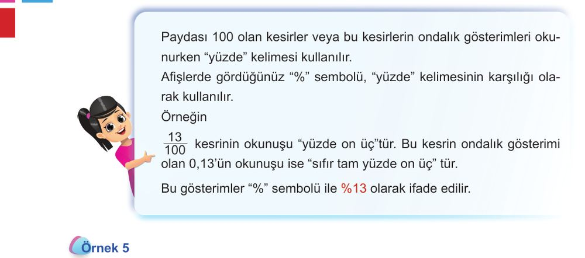

# Örnek 5

**Aşağıdaki gösterimlerden denk olanları örnekteki gibi eşleştirelim.**

a) $\frac{86}{100}$ $\quad$ $(\dots) \text{ } 0,17$ <!-- KONTROL: Marker'da karşılığı yok, uydurma olabilir --> $\quad$ $(\dots) \text{ } \%40$ <!-- KONTROL: Marker'da karşılığı yok, uydurma olabilir -->

b) $\frac{17}{100}$ $\quad$ $(\dots) \text{ } 0,4$ <!-- KONTROL: Marker'da karşılığı yok, uydurma olabilir --> $\quad$ $(\dots) \text{ } \%270$ <!-- KONTROL: Marker'da karşılığı yok, uydurma olabilir -->

c) $\frac{1}{10}$ $\quad$ $(\dots a \dots) \text{ } 0,86$ <!-- KONTROL: Marker'da karşılığı yok, uydurma olabilir --> $\quad$ $(\dots) \text{ } \%110$ <!-- KONTROL: Marker'da karşılığı yok, uydurma olabilir -->

ç) $\frac{1}{2}$ $\quad$ $(\dots) \text{ } 2,7$ <!-- KONTROL: Marker'da karşılığı yok, uydurma olabilir --> $\quad$ $(\dots) \text{ } \%17$ <!-- KONTROL: Marker'da karşılığı yok, uydurma olabilir -->

d) $\frac{2}{5}$ $\quad$ $(\dots) \text{ } 0,75$ <!-- KONTROL: Marker'da karşılığı yok, uydurma olabilir --> $\quad$ $(\dots a \dots) \text{ } \%86$ <!-- KONTROL: Marker'da karşılığı yok, uydurma olabilir -->

e) $\frac{3}{4}$ $\quad$ $(\dots) \text{ } 1,1$ <!-- KONTROL: Marker'da karşılığı yok, uydurma olabilir --> $\quad$ $(\dots) \text{ } \%10$ <!-- KONTROL: Marker'da karşılığı yok, uydurma olabilir -->

f) $1\frac{1}{10}$ $\quad$ $(\dots) \text{ } 0,1$ <!-- KONTROL: Marker'da karşılığı yok, uydurma olabilir -->

g) $2\frac{7}{10}$

<!-- sayfa 28 -->

# Örnek 6

Aşağıdaki modellemeyi ve modellemeyle ilişkili işlemleri inceleyiniz.

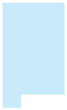
$\rightarrow$
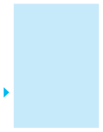

$$\frac{73}{100}$$
<!-- KONTROL: Marker'da karşılığı yok, uydurma olabilir -->
$$\frac{70}{100} = \frac{7}{10}$$
<!-- KONTROL: Marker'da karşılığı yok, uydurma olabilir -->
$$\frac{3}{100}$$
<!-- KONTROL: Marker'da karşılığı yok, uydurma olabilir -->

$$\frac{73}{100} = \frac{7}{10} + \frac{3}{100} = \%70 + \%3 = 0,73$$
<!-- KONTROL: Marker'da karşılığı yok, uydurma olabilir -->

**Buna göre aşağıdaki ifadelerde boş bırakılan yerlere yazılması gereken sayıları bulunuz.**

a) $\frac{62}{100} = \frac{\dots}{10} + \frac{2}{100} = \%60 + \%\dots = 0,\dots$ <!-- KONTROL: Gemma farklı okudu: \frac{62}{100} = \frac{...}{10} + \frac{2}{100} = \%60 + \%... = 0,... -->

b) $\frac{48}{100} = \frac{4}{10} + \frac{\dots}{100} = \% \dots + \% 8 = 0, \dots$ <!-- KONTROL: Gemma farklı okudu: \frac{48}{100} = \frac{4}{10} + \frac{...}{100} = \%... + \%8 = 0,... -->

c) $\frac{54}{100} = \frac{...}{10} + \frac{4}{100} = \%... + \%... = 0,...$

ç) $c) \frac{96}{100} = \frac{9}{10} + \frac{1}{100} = \% \dots + \% = 0, \dots$ <!-- KONTROL: Gemma farklı okudu: \frac{96}{100} = \frac{9}{10} + \frac{...}{100} = \%... + \%6 = 0,... -->

<!-- sayfa 29 -->

# Etkinlik 8 Uzama Miktarlarının Gösterimi

Üç kardeşten her biri saksıda yetiştirmek için farklı türde çiçekler almıştır. Çiçeklerin iki hafta sonunda boylarındaki uzama miktarları aşağıda verilmiştir.

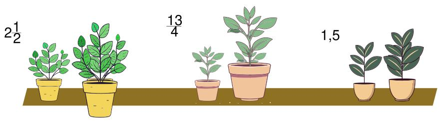

**Buna göre aşağıdaki soruları cevaplayınız.**

1. Çiçeklerin boylarındaki uzama miktarlarını sayı doğrusuyla gösteriniz.

Ebrar'ın Çiçeği $\longleftarrow \hspace{10cm} \longrightarrow$ <!-- KONTROL: Marker'da karşılığı yok, uydurma olabilir -->

Emir'in Çiçeği $\longleftarrow \hspace{10cm} \longrightarrow$ <!-- KONTROL: Marker'da karşılığı yok, uydurma olabilir -->

İpek'in Çiçeği $\longleftarrow \hspace{10cm} \longrightarrow$ <!-- KONTROL: Marker'da karşılığı yok, uydurma olabilir -->

2. Aşağıdaki tabloya çiçeklerin boylarındaki uzama miktarlarını kesir gösterimi ve ondalık gösterim ile yazınız.

| | Ebrar'ın Çiçeği | Emir'in Çiçeği | İpek'in Çiçeği |
| :--- | :---: | :---: | :---: |
| Kesir Gösterimi | | | |
| Ondalık Gösterim | | | |

3. Sizce çiçeklerin uzama miktarlarını hangi gösterim şekliyle ifade etmek daha kullanışlıdır? Fikrinizi arkadaşlarınızla paylaşarak tartışınız.

<!-- sayfa 30 -->

# Örnek 7

Gücünü petrol türü yakıtlardan değil de elektrikten sağlayan araçlara elektrikli araç denilmektedir. Elektrikli araçlar, hem çevre dostu olması hem de yakıt tasarrufu sağlaması nedeniyle tercih edilmektedir. Dünya genelinde birçok otomobil üreticisi elektrikli otomobil üretimi üzerine çalışmaktadır. Üretilen modele göre farklı kapasiteleri olan batarya türlerine sahip elektrikli otomobiller bulunmaktadır.

Aşağıda farklı otomobil markaları tarafından üretilmiş elektrikli otomobillerde kullanılan bataryalar verilmiştir.

1. A marka otomobilde kullanılan bataryanın doluluk miktarını; kesir gösterimi, ondalık gösterim ve yüzde gösterimi ile yazınız.

2. B marka otomobilde kullanılan bataryanın doluluk miktarını; kesir gösterimi, ondalık gösterim ve yüzde gösterimi ile yazınız.

3. C marka otomobilde kullanılan bataryanın doluluk miktarını; kesir gösterimi, ondalık gösterim ve yüzde gösterimi ile yazınız.

4. D marka otomobilde kullanılan bataryanın doluluk miktarını; kesir gösterimi, ondalık gösterim ve yüzde gösterimi ile yazınız.

<!-- sayfa 31 -->

# İzleme Testi

1) Aşağıda eş parçalara ayrılmış ve bazı parçaları boyanmış kesir modeli ile ilgili verilen soruları cevaplayınız.

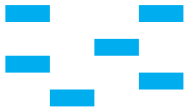

a) Boyalı bölgeye karşılık gelen kesrin ondalık gösterimini yazınız.

[Boş kareli alan]

b) Boyalı bölgeye karşılık gelen kesrin $\frac{1}{3}$ <!-- KONTROL: Marker'da karşılığı yok, uydurma olabilir -->'e denk olması için kaç parça daha boyanmalıdır?

[Boş kareli alan]

c) 6 parça daha boyanırsa boyalı bölgeye karşılık gelen kesrin yüzde ile gösterimini yazınız.

[Boş kareli alan]

<!-- sayfa 32 -->

2) Bedirhan, oyuncak arabasının ve kaleminin boyunun uzunluğunu $10\text{ cm}$'lik cetveli ile görseldeki gibi ölçmüştür.

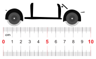

**Buna göre aşağıdaki soruları cevaplayınız.**

a) Oyuncak arabanın boyunun santimetre cinsinden uzunluğunun kesir ve ondalık gösterimini yazınız.

[ ]

b) Kalemin santimetre cinsinden uzunluğunun kesir ve ondalık gösterimini yazınız.

[ ]

3) Yanda $15$ adet portakal ve $10$ adet muz görseli verilmiştir.

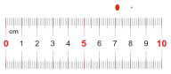

a) Merve $15$ adet portakalı $10$ arkadaşına eşit olarak paylaştıracaktır. Her bir arkadaşına düşen portakal miktarını tam sayılı kesir olarak yazınız.

[ ]

b) Merve $10$ adet muzu $20$ arkadaşına eşit olarak paylaştıracaktır. Her bir arkadaşına düşen muz sayısının ondalık gösterimini yazınız.

<!-- sayfa 33 -->

# BAŞLAYALIM

Tüm yüzeyleri eş olan üç akvaryum aşağıda verilmiştir. Bu akvaryumların her birinin iki yüzeyine eş kâğıt parçaları yapıştırılmıştır.

**Buna göre aşağıdaki soruları cevaplayınız.**

1)
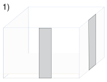
$\frac{1}{3}$ <!-- KONTROL: Marker'da karşılığı yok, uydurma olabilir --> ve $\frac{1}{7}$ <!-- KONTROL: Marker'da karşılığı yok, uydurma olabilir --> kesirlerinden hangisinin daha küçük olduğunu tahmin ediniz.

Daha sonra boş akvaryumun yüzeyine yapıştırılan iki kâğıt parçası üzerinde veya sayı doğrusunda bu kesirleri modelleyerek tahmininizin doğruluğunu kontrol ediniz (Kesirleri modellerken alt kısımdan başlayarak tarayınız.).

[[SEKIL:1_grid]]

2)
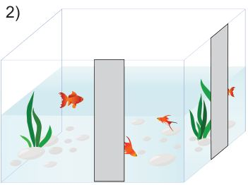
$\frac{2}{6}$ <!-- KONTROL: Marker'da karşılığı yok, uydurma olabilir --> ve $\frac{3}{4}$ <!-- KONTROL: Marker'da karşılığı yok, uydurma olabilir --> kesirlerinden hangisinin daha büyük olduğunu tahmin ediniz.

Daha sonra yarısına kadar su ile dolu olan akvaryumun yüzeyine yapıştırılan iki kâğıt parçası üzerinde veya sayı doğrusunda bu kesirleri modelleyerek tahmininizin doğruluğunu kontrol ediniz (Kesirleri modellerken alt kısımdan başlayarak tarayınız.).

[[SEKIL:2_grid]]

3)
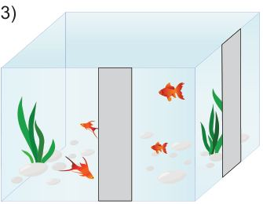
$\frac{7}{8}$ <!-- KONTROL: Marker'da karşılığı yok, uydurma olabilir --> ve $\frac{3}{5}$ <!-- KONTROL: Marker'da karşılığı yok, uydurma olabilir --> kesirlerinden hangisinin daha küçük olduğunu tahmin ediniz.

Daha sonra tamamı su ile dolu olan akvaryumun yüzeyine yapıştırılan iki kâğıt parçası üzerinde veya sayı doğrusunda bu kesirleri modelleyerek tahmininizin doğruluğunu kontrol ediniz (Kesirleri modellerken alt kısımdan başlayarak tarayınız.).

[[SEKIL:3_grid]]

<!-- sayfa 34 -->

# Kesirleri Karşılaştırma

## Etkinlik 1 Anket Çalışması

Sınıfınızdaki arkadaşlarınıza, "En çok sevdiğiniz spor dalı hangisidir?" şeklinde bir soru yönelterek bir anket çalışması yapınız.

1. Araştırma sonuçlarını aşağıdaki sıklık tablosunda gösteriniz.

| Spor Dalı | | | | | |
| :--- | :--- | :--- | :--- | :--- | :--- |
| Öğrenci Sayısı | | | | | |

2. Her bir spor dalını seven öğrenci sayısının sınıf mevcudunun kaçta kaçı olduğunu belirleyiniz.
__________________________________________________________________________________________
__________________________________________________________________________________________

3. Belirlediğiniz kesirleri karşılaştırarak sınıfınızda en çok sevilen spor dalını belirleyiniz.
__________________________________________________________________________________________
__________________________________________________________________________________________

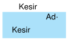
## Etkinlik 2 Kim Daha Fazla Pasta Yedi?

Ayşe Öğretmen, tüm öğrencilerinin doğum günlerini, belirlediği bir günde kutlamak istemiştir. Öğrencilerine ikram etmek için aynı büyüklükte dört adet pasta almıştır. Öğrencilerini dört gruba ayırarak her gruba birer tane pasta vermiştir.

Her gruptan bir öğrencinin yediği pasta miktarının tüm pastanın kaçta kaçı olduğunu veren kesir gösterimi aşağıdaki tabloda verilmiştir.

Tablo: Öğrencilerin Yediği Pasta Miktarlarının Tüm Pastaya Göre Kesir Gösterimi

| Öğrencinin Adı | Mahmut | Fatma | Öztürk | Rabia |
| :--- | :---: | :---: | :---: | :---: |
| Kesir Gösterimi | $\frac{3}{9}$ <!-- KONTROL: Marker'da karşılığı yok, uydurma olabilir --> | $\frac{7}{12}$ <!-- KONTROL: Marker'da karşılığı yok, uydurma olabilir --> | $\frac{5}{6}$ <!-- KONTROL: Marker'da karşılığı yok, uydurma olabilir --> | $\frac{4}{8}$ <!-- KONTROL: Marker'da karşılığı yok, uydurma olabilir --> |

Buna göre aşağıdaki soruları cevaplayınız.

1. Mahmut ve Rabia'nın yediği pasta miktarlarını ifade eden tablodaki kesirleri karşılaştırarak hangisinin daha fazla pasta yediğini tahmin ediniz. Tahmininizin gerekçesini açıklayınız.
__________________________________________________________________________________________
__________________________________________________________________________________________

2. Öztürk ve Fatma'nın yediği pasta miktarlarını karşılaştırarak hangisinin daha az pasta yediğini tahmin ediniz. Tahmininizin gerekçesini açıklayınız.
__________________________________________________________________________________________
__________________________________________________________________________________________

<!-- sayfa 35 -->

# Etkinlik 3 Filenin Sultanları

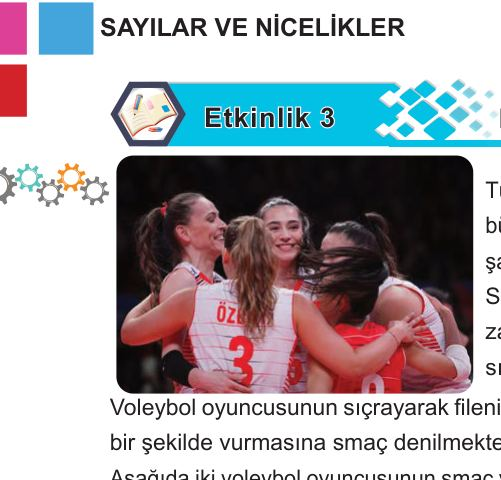

Türkiye A Millî Kadın Voleybol Takımı, 2023 yılında büyük başarılara imza atmıştır. Önce Milletler Ligi’nde şampiyon olmuş, ardından Avrupa şampiyonu olmuştur. Sonra 2024 Paris Olimpiyatlarına katılım hakkı kazanmıştır. 2023 yılı itibarıyla dünya sıralamasında 1. sıraya yerleşmiştir.

Voleybol oyuncusunun sıçrayarak filenin yukarısında bulunan topa, bir elinin avuç içiyle sert bir şekilde vurmasına smaç denilmektedir.

Aşağıda iki voleybol oyuncusunun smaç vurdukları anda topların yerden yükseklikleri verilmiştir.

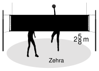

**Buna göre aşağıdaki soruları cevaplayınız.**

1. Topların yerden yüksekliklerini bileşik kesir biçiminde gösteriniz.

2. Hangi voleybolcunun smaç vurduğu topun yüksekliği daha fazladır? Fikirlerinizi yazarak arkadaşlarınızla paylaşınız.

3. Yüksekliklerin bileşik kesir gösterimlerinin pay ve paydalarını inceleyerek karşılaştırmadaki rollerini ifade ediniz. Gerekçelerinizin hangi durumlarda geçerli olduğunu yazarak arkadaşlarınızla paylaşınız.

4. Yüksekliklerin kesir gösterimlerini sayı doğrusunda göstererek fikirlerinizin doğruluğunu kontrol ediniz.

 $\longleftrightarrow$ 

<!-- sayfa 36 -->

Aynı büyüklükteki eş bütünler kullanılarak ifade edilen iki kesrin paydalarının eşit olması bu iki bütünün aynı büyüklükte parçalara ayrıldığını ifade eder.

Paydaları eşit olan iki kesirden payı büyük olan diğerinden büyüktür.

# Örnek 1

Ayla ile Ayça, beyaz ve bitter çikolatanın karışık olarak yerleştirildiği bir çikolatadan alıyorlar. Eş parçalardan oluşan bu çikolatanın görüntüsü aşağıda verilmiştir.

**Buna göre verilen soruları cevaplayınız.**

1. Bu üründeki beyaz ve bitter çikolata miktarlarını bütüne göre kesir olarak ifade ediniz ve karşılaştırınız.

2. Ayla ve Ayça çikolatayı ortasından ikiye bölerek aşağıdaki gibi paylaşmıştır.

 Ayla  Ayça

a) Ayla’nın çikolatasının beyaz ve bitter çikolata miktarlarını bütüne göre kesir olarak ifade ediniz ve karşılaştırınız.

b) Ayça’nın çikolatasının beyaz ve bitter çikolata miktarlarını bütüne göre kesir olarak ifade ediniz ve karşılaştırınız.

<!-- sayfa 37 -->

# Etkinlik 4 Adil mi? Adil Değil mi?

Saba, eşit büyüklükte birer adet çikolatalı ve çilekli pasta yapmıştır.

Çikolatalı pastayı $8$, çilekli pastayı ise $10$ eşit büyüklükte parçaya ayırmıştır.
**Buna göre aşağıdaki soruları cevaplayınız.**

1. Çilekli pastanın $3$ dilimini Neva, çikolatalı pastanın $3$ dilimini de Revna yemiştir. Neva ve Revna'nın yediği pasta miktarlarını kesir olarak ifade ediniz.

| | | | | | | | | | |
|---|---|---|---|---|---|---|---|---|---|
| | | | | | | | | | |

2. Saba'nın, Neva ve Revna'ya üçer dilim pasta vermesi adil bir paylaşım mıdır? Fikirlerinizi yazarak arkadaşlarınızla paylaşınız.

| | | | | | | | | | |
|---|---|---|---|---|---|---|---|---|---|
| | | | | | | | | | |
| | | | | | | | | | |
| | | | | | | | | | |

3. Yedikleri pasta miktarlarının kesir gösterimlerinin pay ve paydalarını inceleyerek karşılaştırmadaki rollerini gerekçeleriyle ifade ediniz. Gerekçelerinizin hangi durumlarda geçerli olduğunu yazarak arkadaşlarınızla paylaşınız.

4. Yedikleri pasta miktarlarının kesir gösterimlerini sayı doğrusunda göstererek fikirlerinizin doğruluğunu kontrol ediniz.

$\longleftarrow$ ————————————————————— $\longrightarrow$

<!-- sayfa 38 -->

Aynı büyüklükteki eş bütünler kullanılarak ifade edilen iki kesrin paylarının eşit olması, bu iki bütünden aynı sayıda parça alındığını ifade eder. Payları eşit olan iki kesirden paydası küçük olan diğerinden büyüktür.

**Örnek 2**

Haydar Bey'in çiftliğinde ülkemize ait dört farklı renkte büyükbaş hayvan bulunmaktadır. Çiftlikteki büyükbaş hayvanların rengi ve toplam sayısı aşağıdaki tabloda verilmiştir.

Tablo: Renklerine Göre Çiftlikteki Büyükbaş Hayvan Sayıları

| Renk | Boz | Kara | Doğu Anadolu Kırmızısı | Güney Anadolu Kırmızısı |
| :--- | :---: | :---: | :---: | :---: |
| Toplam Sayı | 16 | 18 | 22 | 11 |

Haydar Bey, büyükbaş hayvanların her bir renginden beş adet satmıştır.

**Buna göre aşağıdaki soruları cevaplayınız.**

1. Büyükbaş hayvanların rengine göre satış sayısının aynı renkteki toplam hayvan sayısına göre kesir gösterimini yazınız.

2. Satılan boz ve Güney Anadolu kırmızısı renkli büyükbaş hayvanlar için belirlediğiniz kesir gösterimlerini karşılaştırarak büyük olanı belirleyiniz.

3. Satılan kara ve Doğu Anadolu kırmızısı renkli büyükbaş hayvanlar için belirlediğiniz kesir gösterimlerini karşılaştırarak büyük olanı belirleyiniz.

4. Satılan her bir renkteki büyükbaş hayvan için belirlediğiniz kesir gösterimlerinden en büyük ve en küçük olanını yazınız.

<!-- sayfa 39 -->

# Etkinlik 5 İdeal Kilo

İdeal kilo, bir bireyin boy ve cinsiyetine ilişkin sahip olması gereken kilogram aralığı olarak tanımlanabilir. Sağlıklı yaşam için dengeli beslenerek ve düzenli egzersiz yaparak ideal kilo aralığında kalmak çok önemlidir.

Elif, Rana, Yusuf ve Selim; ideal kilo aralığında olup olmadıklarını belirlemek için tartılmışlardır.

Ondalık gösterimlerin kesirlerin farklı gösterimi olduğunu öğrendiniz. 
**O hâlde her bir ölçme sonucunun kesir gösterimini tabloya yazıp sembol kullanarak büyükten küçüğe doğru sıralayınız.**

| Kişiler | Ölçümün Ondalık Gösterimi | Ölçümün Kesir Gösterimi |
| :--- | :--- | :--- |
| Elif | $23,4\text{ kg}$ | |
| Rana | $23,40\text{ kg}$ | |
| Yusuf | $21,55\text{ kg}$ | |
| Selim | $21,6\text{ kg}$ | |

Büyükten küçüğe doğru sıralama:

<!-- sayfa 40 -->

Örnek 3

Aşağıdaki ondalık gösterimleri sayı doğrusu üzerinde göstererek karşılaştırınız.

a) 
$\longleftrightarrow \bullet \text{---} 3 \text{---} \bullet \text{---} 5 \text{---} \bullet \longrightarrow$ <!-- KONTROL: Marker'da karşılığı yok, uydurma olabilir -->  $3,4 \text{ ile } 4,1$ <!-- KONTROL: Marker'da karşılığı yok, uydurma olabilir -->

b) 
$\longleftrightarrow \bullet \text{---} 5 \text{---} \bullet \text{---} 6 \text{---} \bullet \longrightarrow$ <!-- KONTROL: Marker'da karşılığı yok, uydurma olabilir -->  $5,3 \text{ ile } 5,7$ <!-- KONTROL: Marker'da karşılığı yok, uydurma olabilir -->

c) 
$\longleftrightarrow \bullet \text{---} 1 \text{---} \bullet \text{---} 2 \text{---} \bullet \longrightarrow$ <!-- KONTROL: Marker'da karşılığı yok, uydurma olabilir -->  $1,2 \text{ ile } 1,40$ <!-- KONTROL: Marker'da karşılığı yok, uydurma olabilir -->

ç) 
$\longleftrightarrow \bullet \text{---} 0 \text{---} \bullet \text{---} 1 \text{---} \bullet \longrightarrow$ <!-- KONTROL: Marker'da karşılığı yok, uydurma olabilir -->  $0,7 \text{ ile } 0,70$ <!-- KONTROL: Marker'da karşılığı yok, uydurma olabilir -->

d) 
$\longleftrightarrow \bullet \text{---} 2,3 \text{---} \bullet \text{---} 2,5 \text{---} \bullet \longrightarrow$ <!-- KONTROL: Marker'da karşılığı yok, uydurma olabilir -->  $2,35 \text{ ile } 2,4$ <!-- KONTROL: Marker'da karşılığı yok, uydurma olabilir -->

e) 
$\longleftrightarrow \bullet \text{---} 5 \text{---} \bullet \text{---} 5,2 \text{---} \bullet \longrightarrow$ <!-- KONTROL: Marker'da karşılığı yok, uydurma olabilir -->  $5,03 \text{ ile } 5,1$ <!-- KONTROL: Marker'da karşılığı yok, uydurma olabilir -->

f) 
$\longleftrightarrow \bullet \text{---} 3 \text{---} \bullet \text{---} 5 \text{---} \bullet \longrightarrow$ <!-- KONTROL: Marker'da karşılığı yok, uydurma olabilir -->  $4 \text{ ile } 4,5$ <!-- KONTROL: Marker'da karşılığı yok, uydurma olabilir -->

<!-- sayfa 41 -->

# Etkinlik 6 Alışveriş Tercihi

Selin ve Tugay farklı iki markete gidip alacakları ürünlerin fiyatlarını karşılaştırarak bu ürünler hangi markette daha ucuz ise oradan alışveriş yapmaya karar vermiştir.

Tablo: Alışveriş Listesindeki Ürünlerin Marketlerdeki Fiyatları

| Ürün adı | A Marketteki Fiyatı | B Marketteki Fiyatı |
| :--- | :--- | :--- |
| Süt | $22,10\text{ TL}$ | $21,99\text{ TL}$ |
| Sıvı Yağ | $178,75\text{ TL}$ | $178,50\text{ TL}$ |
| Çay | $90,25\text{ TL}$ | $90,5\text{ TL}$ |
| Tereyağı | $239,50\text{ TL}$ | $239,5\text{ TL}$ |

1. Süt hangi markette daha ucuzdur?

2. Her iki markette de fiyatı aynı olan ürün var mı? Varsa hangisi ya da hangileridir?

3. Çay hangi markette daha pahalıdır?

4. Selin A marketinden, Tugay ise B marketinden birer adet sıvı yağ ve tereyağı almıştır. Hesap makinesi kullanarak alışveriş tutarlarını bulunuz. Daha sonra bu tutarları karşılaştırınız.

<!-- yer tutucu bulunamadı: sayfa sonuna eklendi -->

<!-- sayfa 42 -->

# Örnek 4

Aşağıdaki ondalık gösterimleri sembol kullanarak büyükten küçüğe sıralayınız.

a) $4,5$ <!-- KONTROL: Marker'da karşılığı yok, uydurma olabilir --> \quad $4,9$ <!-- KONTROL: Marker'da karşılığı yok, uydurma olabilir --> \quad $5,1$ <!-- KONTROL: Marker'da karşılığı yok, uydurma olabilir -->

b) $0,7$ <!-- KONTROL: Marker'da karşılığı yok, uydurma olabilir --> \quad $0,5$ \quad $0,58$ <!-- KONTROL: Marker'da karşılığı yok, uydurma olabilir -->

c) $1,38$ <!-- KONTROL: Marker'da karşılığı yok, uydurma olabilir --> \quad $1,25$ <!-- KONTROL: Marker'da karşılığı yok, uydurma olabilir --> \quad $1,8$ <!-- KONTROL: Marker'da karşılığı yok, uydurma olabilir -->

ç) $2,9$ <!-- KONTROL: Marker'da karşılığı yok, uydurma olabilir --> \quad $2,75$ <!-- KONTROL: Marker'da karşılığı yok, uydurma olabilir --> \quad $2,90$ <!-- KONTROL: Marker'da karşılığı yok, uydurma olabilir -->

d) $3$ \quad $3,5$ <!-- KONTROL: Marker'da karşılığı yok, uydurma olabilir --> \quad $3,25$ <!-- KONTROL: Marker'da karşılığı yok, uydurma olabilir -->

e) $7,3$ <!-- KONTROL: Marker'da karşılığı yok, uydurma olabilir --> \quad $7,0$ <!-- KONTROL: Marker'da karşılığı yok, uydurma olabilir --> \quad $7,29$ <!-- KONTROL: Marker'da karşılığı yok, uydurma olabilir -->

## Etkinlik 7 Uygun Fiyat

Umay, öncesinde inceleyerek beğendiği, özellikleri ve fiyatları aynı olan farklı markalara ait iki kalemden birini almak için kırtasiyeye gidiyor.

A marka kalemin fiyatına $\%40$, B marka kalemin fiyatına ise $\%30$ zam geldiğini öğreniyor.

1 Sizce Umay, daha uygun fiyatlı kalemi almak için hangi markayı tercih etmelidir? Karar verme sürecinizi açıklayarak arkadaşlarınızla paylaşınız.

2 Sizce Umay, kırtasiyeye gittiğinde A marka kalemin fiyatında $\%40$, B marka kalemin fiyatında ise $\%30$ indirim yapıldığını öğrenseydi daha uygun fiyatlı kalemi almak için hangi markayı tercih etmesi gerekirdi? Karar verme sürecinizi açıklayarak arkadaşlarınızla paylaşınız.

<!-- sayfa 43 -->

# Örnek 5

Recep'in bir aylık gelirinin harcama dağılımı farklı renkler kullanılarak aşağıdaki yüzlük tablo gösterilmiştir.

| | | | | | | | | | |
|---|---|---|---|---|---|---|---|---|---|
| Kira | Mutfak | Isınma | Faturalar | Giyim | Diğer | | | | |
| Kira | Mutfak | Isınma | Faturalar | Giyim | Diğer | | | | |
| Kira | Mutfak | Isınma | Faturalar | Giyim | Diğer | | | | |
| Kira | Mutfak | Isınma | Faturalar | Giyim | Diğer | | | | |
| Kira | Mutfak | Isınma | Faturalar | Giyim | Diğer | | | | |
| Kira | Ulaşım | Mutfak | Isınma | Faturalar | Giyim | | | | |
| Kira | Ulaşım | Mutfak | Isınma | Faturalar | Giyim | | | | |
| Kira | Ulaşım | Mutfak | Isınma | Faturalar | Giyim | | | | |
| Kira | Ulaşım | Mutfak | Isınma | Faturalar | Giyim | | | | |
| Kira | Ulaşım | Mutfak | Isınma | Faturalar | Giyim | | | | |

(Not: Görseldeki renklerin karşılıkları şöyledir:
- Turkuaz: Kira
- Kahverengi: Ulaşım
- Mor: Mutfak
- Koyu Mavi: Isınma
- Turuncu: Faturalar
- Sarı: Giyim
- Kırmızı: Eğitim
- Gri: Diğer)

**Buna göre aşağıdaki soruları cevaplayınız.**

1. Yüzlük tabloya göre her bir harcamanın aylık gelirin kaçta kaçı olduğunu $\%$ sembolü kullanarak gösteriniz.

2. Belirlediğiniz yüzde gösterimlerini sembol kullanarak büyükten küçüğe doğru sıralayınız.

<!-- sayfa 44 -->

# Örnek 6

Aşağıdaki kesirleri karşılaştırarak noktalı yerlere "$<$", "$>$" ve "$=$" sembollerinden uygun olanı yazınız.

 $\frac{8}{5} \dots\dots 2\frac{1}{6}$
 $3\frac{1}{5} \dots\dots \frac{15}{4}$
 $2\frac{1}{7} \dots\dots \frac{15}{7}$
 $\frac{7}{15} \dots\dots \frac{11}{15}$ <!-- KONTROL: Marker'da karşılığı yok, uydurma olabilir -->
 $\frac{13}{17} \dots\dots \frac{11}{17}$ <!-- KONTROL: Marker'da karşılığı yok, uydurma olabilir -->
 $\frac{5}{8} \dots\dots \frac{5}{12}$
 $\frac{14}{5} \dots\dots \frac{14}{9}$ <!-- KONTROL: Marker'da karşılığı yok, uydurma olabilir -->
 $\frac{18}{50} \dots\dots \%36$ <!-- KONTROL: Marker'da karşılığı yok, uydurma olabilir -->
 $\frac{11}{20} \dots\dots \%56$ <!-- KONTROL: Marker'da karşılığı yok, uydurma olabilir -->
 $%27 \dots \frac{3}{10}$ <!-- KONTROL: Gemma farklı okudu: \%27 \dots\dots \frac{3}{10} -->

 $1,3 \dots\dots \frac{7}{5}$
 $\frac{4}{5} \dots\dots 0,91$ <!-- KONTROL: Marker'da karşılığı yok, uydurma olabilir -->
 $\frac{4}{25} \dots\dots 0,12$ <!-- KONTROL: Marker'da karşılığı yok, uydurma olabilir -->
 $\%85 \dots\dots \%81$ <!-- KONTROL: Marker'da karşılığı yok, uydurma olabilir -->
 $\%19 \dots\dots \%21$ <!-- KONTROL: Marker'da karşılığı yok, uydurma olabilir -->
 $\%41 \dots\dots 0,4$ <!-- KONTROL: Marker'da karşılığı yok, uydurma olabilir -->
 $0,57 \dots\dots \%48$ <!-- KONTROL: Marker'da karşılığı yok, uydurma olabilir -->
 $0,75 \dots\dots 0,62$ <!-- KONTROL: Marker'da karşılığı yok, uydurma olabilir -->
 $0,8 \dots\dots 0,80$ <!-- KONTROL: Marker'da karşılığı yok, uydurma olabilir -->
 $1,4 \dots\dots 1,32$ <!-- KONTROL: Marker'da karşılığı yok, uydurma olabilir -->

<!-- yer tutucu bulunamadı: sayfa sonuna eklendi -->

<!-- sayfa 45 -->

# Örnek 7

2023 yılında trafik kazalarına neden olan kusurların $\%88,9$'unun sürücü, $\%9,0$'ının yaya, $\%1,1$'inin taşıt, $\%0,6$'sının yolcu, $\%0,3$'ünün yol kaynaklı olduğu tespit edilmiştir.
(Genel ağdan alınmıştır.)

**Bu verilere göre aşağıdaki tanılayıcı dallanmış ağaçta doğru olan ifadeleri takip ediniz. Kaçıncı çıkışa geldiniz? Geldiğiniz çıkışı arkadaşlarınızla karşılaştırınız.**

$\xrightarrow{\text{D}}$ <!-- KONTROL: Marker'da karşılığı yok, uydurma olabilir --> 
$\quad \xrightarrow{\text{D}}$ <!-- KONTROL: Marker'da karşılığı yok, uydurma olabilir --> Yolcudan kaynaklanan kazalar, yayadan kaynaklanan kazalardan daha fazladır. $\xrightarrow{\text{D}}$ <!-- KONTROL: Marker'da karşılığı yok, uydurma olabilir --> 1. Çıkış: Yaya geçidinde yayalara yol verilmelidir.
$\quad \quad \quad \quad \quad \quad \quad \quad \quad \quad \quad \quad \quad \quad \quad \quad \quad \quad \quad \quad \quad \quad \quad \quad \quad \quad \quad \quad \quad \quad \quad \quad \quad \quad \quad \quad \quad \quad \quad \quad \quad \quad \quad \quad \quad \quad \quad \quad \quad \quad \quad \quad \quad \quad \quad \quad \quad \quad \quad \quad \quad \quad \quad \quad \quad \quad \quad \quad \quad \quad \quad \quad \quad \quad \quad \quad \quad \quad \quad \quad \quad \quad \quad \quad \quad \quad \quad \quad \quad \quad \quad \quad \quad \quad \quad \quad \quad \quad \quad \quad \quad \quad \quad \quad \quad \quad \quad \quad \quad \quad \quad \quad \quad \quad \quad \quad \quad \quad \quad \quad \quad \quad \quad \quad \quad \quad \quad \quad \quad \quad \quad \quad \quad \quad \quad \quad \quad \quad \quad \quad \quad

<!-- sayfa 46 -->

# Etkinlik 8 Sağlıklı Beslenme

Hücre büyümesini ve gelişmesini sağlayan protein, vücut tarafından üretilmediği için proteinin dışarıdan alınması gereklidir. Protein: kasları güçlendirir, kansızlığı önler, vücut direncini yüksek tutar. Günlük olarak cildimizin, tırnaklarımızın, saçlarımızın ve kas dokularımızın yenilenmesine destek olur.

Aşağıda bazı meyvelerin 100 gramındaki ortalama protein miktarları verilmiştir.

(Genel ağdan alınmıştır.)

Verilen bilgilere göre İlkay ve Eda’nın konuşmasını değerlendiriniz.

> İlkay: En sevdiğim meyve portakal olmasına rağmen en çok protein değerine sahip meyve muzdur.

> Eda: Hayır, en çok protein değeri içeren meyveler muz ve kivi olup bu meyvelerin protein miktarları birbirine eşittir.

1. Sizce kim haklıdır? Nedenini açıklayınız.

2. Bu meyvelerin protein değerlerini aynı gösterimlerle kesirleri ifade ederek büyükten küçüğe doğru sıralayınız.

<!-- sayfa 47 -->

# Etkinlik 9 Okul Temsilcisi Seçimi

Bir okulda okul temsilciliği için altı öğrenci aday olmuştur. Tüm öğrencilerin oy kullandığı bu okulda adayların aldıkları oy miktarlarının tüm oyların kaçta kaçı olduğunu ifade eden yüzde veya ondalık gösterimleri aşağıdaki tabloda verilmiştir.

Tablo: Öğrencilerin Aldıkları Oy Miktarlarının Tüm Oylara Göre Yüzde veya Ondalık Gösterimleri

| Öğrencinin Adı | Aldığı Oy |
| :--- | :--- |
| Nil | $\%35$ |
| Can | $0,12$ |
| Nida | $\%20$ |
| Alp | $0,08$ |
| Gül | $\%5$ |
| Ali | $0,2$ |

**Tabloda verilen bilgilere göre aşağıdaki soruları yanıtlayınız.**

1. En az oyu hangi öğrencinin aldığını belirleyiniz.
   
   [Boş kareli alan]

2. Eşit sayıda oy alan öğrenciler var mıdır?

   [Boş kareli alan]

3. Öğrencilerin aldıkları oyları büyükten küçüğe doğru sıralayınız.

   [Boş kareli alan]

4. Hangi öğrencinin okul temsilcisi olarak seçildiğini belirleyiniz.

   [Boş kareli alan]

<!-- sayfa 48 -->

# İzleme Testi

1) Tayfun, yeni aldığı hikâye kitaplarını kapaklarının uzun kenar uzunluklarına göre büyükten küçüğe doğru rafa yerleştirmek istiyor.

Tablo: Tayfun’un Aldığı Hikâye Kitaplarının Uzun Kenar Uzunlukları

| Kitabın Adı | A | B | C | D |
| :--- | :---: | :---: | :---: | :---: |
| Kapağın uzun kenar uzunluğu | $\frac{89}{5}$ cm | $\frac{53}{4}$ cm | $17\frac{6}{7}$ cm | $13\frac{2}{3}$ cm |

**Tabloya göre Tayfun, aldığı kitapları hangi sırayla rafa yerleştirmelidir?**

2) Elif, bir günde $1,75$ litre su içerken Ebru $1\frac{2}{3}$ litre su içmiştir.

**Buna göre kimin daha fazla su içtiğini bulunuz.**

3) Bir koşu yarışında Volkan, yolun $\frac{4}{5}$'ünü koştuğunda Yasin yolun $\%75$'ini koşmuş oluyor. Murat'ın ise Volkan ile Yasin'in arasında olduğu biliniyor.

**Buna göre Murat yolun ne kadarını koşmuş olabilir?**

4) Bir tahıl ambarının $\%25$'ini buğday, $\frac{9}{20}$'unu arpa ve $0,3$'ünü de çeltik oluşturmaktadır.

**Buna göre bu ambarda bulunan tahılları, miktarı en az olandan en fazla olana doğru sıralayınız.**

<!-- sayfa 49 -->

**5)** Bir şirket, ürettiği enerjinin bir kısmını Güneş'ten elde etmektedir. Bu şirketin aylara göre ürettiği enerjinin yüzde kaçını Güneş'ten elde ettiği aşağıdaki tabloda gösterilmiştir.

| Aylar | Ocak | Şubat | Mart | Nisan |
| :--- | :---: | :---: | :---: | :---: |
| Güneş Enerjisinin Payı | $\%33,2$ | $\%33,19$ | $\%40,51$ | $\%40,6$ |

Tablo: Üretilen Enerjide Güneş Enerjisinin Payı

**Buna göre şirketin ürettiği enerjideki güneş enerjisi payının $\underline{\text{en çok}}$ <!-- KONTROL: Marker'da karşılığı yok, uydurma olabilir --> ve $\underline{\text{en az}}$ <!-- KONTROL: Marker'da karşılığı yok, uydurma olabilir --> olduğu aylar hangileridir?**

[Grid alanı]

**6)** Üç farklı markaya ait sütlerin $100$ gramının içerdiği yağ, karbonhidrat, protein miktarları aşağıda verilmiştir.

| A MARKA SÜT | B MARKA SÜT | C MARKA SÜT |
| :--- | :--- | :--- |
| Yağ (g) $3,6$ | Yağ (g) $3,53$ | Yağ (g) $3,06$ |
| Karbonhidrat (g) $4,7$ | Karbonhidrat (g) $4,70$ | Karbonhidrat (g) $4,65$ |
| Protein (g) $2,9$ | Protein (g) $2,95$ | Protein (g) $2,90$ |

**Buna göre aşağıdaki soruları cevaplayınız.**

a) $\underline{\text{En fazla}}$ <!-- KONTROL: Marker'da karşılığı yok, uydurma olabilir --> yağ içeren süt markası hangisidir?

[Grid alanı]

b) $\underline{\text{En az}}$ <!-- KONTROL: Marker'da karşılığı yok, uydurma olabilir --> karbonhidrat içeren süt markası hangisidir?

[Grid alanı]

c) İçerdiği protein miktarına göre bu sütleri büyükten küçüğe doğru sıralayınız.

[Grid alanı]

<!-- sayfa 50 -->

# Performans Görevi
# Yapay Zekâ

Sevgili öğrenciler, bu çalışmada Türkiye İstatistik Kurumu raporlarından faydalanarak “2023 ve 2024 yıllarında ülkemizdeki girişimlerin yapay zekâ kullanımı” ile ilgili araştırma yapmanız ve ulaştığınız bilgileri panoda sergilemeniz beklenmektedir.

## Çalışma öncesinde şu noktalara dikkat etmelisiniz.

* Yapay zekâ ile ilgili araştırma yapınız. Yapay zekânın çevresel sorunların çözümüne katkılarını da incelemeyi unutmayınız.
* 2023 ve 2024 yıllarında ülkemizdeki girişimlerin yapay zekâ kullanımı ile ilgili araştırma yapınız.
* Hazırlayacağınız pano, Yapay Zekâ Performans Görevi İçin Hazırlanan Bütüncül Dereceli Puanlama Anahtarı ile değerlendirileceğinden incelemeyi unutmayınız.

## Çalışma sırasında şu noktalara dikkat etmelisiniz.

* Araştırma sırasında ulaştığınız bilgileri sade, anlaşılır, dikkat çekici bir şekilde düzenlemeye özen gösteriniz.
* Elde ettiğiniz verilerdeki kesir, ondalık ve yüzde gösterimleri kullanarak karşılaştırmalar yapınız.
* Düzenlediğiniz bilgileri panoya aktarırken görsellerden yararlanmayı unutmayınız.

## Çalışma sonrasında

Ekte verilen öz değerlendirme formunu doldurunuz. (EK1)

<!-- sayfa 51 -->

Tablo: Yapay Zekâ Performans Görevi İçin Hazırlanan Bütüncül Dereceli Puanlama Anahtarı

| Seviye | Gösterge |
| :--- | :--- |
| 5 (Çok İyi) | Hazırladığı bilgileri sade, anlaşılır ve dikkat çekici bir şekilde görseller kullanarak panoda sergilemiştir. Elde ettiği verilerdeki farklı kesir gösterimlerini kullanarak yaptığı tüm karşılaştırmalar doğrudur. |
| 4 (İyi) | Hazırladığı bilgileri sade, anlaşılır ve dikkat çekici bir şekilde görseller kullanarak panoda sergilemiştir. Elde ettiği verilerdeki farklı kesir gösterimlerini kullanarak yaptığı bazı karşılaştırmalar doğrudur. |
| 3 (Orta) | Hazırladığı bilgileri sade ve anlaşılır bir şekilde panoda sergilemiştir. Elde ettiği verilerdeki farklı kesir gösterimlerini kullanarak yaptığı tüm karşılaştırmalar yanlıştır. |
| 2 (Zayıf) | Hazırladığı bilgiler sade ve anlaşılır olup panoda sergilenmemiştir. Elde ettiği verilerdeki farklı kesir gösterimlerini kullanarak yaptığı tüm karşılaştırmalar yanlıştır. |
| 1 (Çok Zayıf) | Hazırladığı bilgiler sade ve anlaşılır değildir. Elde ettiği verilerdeki farklı kesir gösterimlerini kullanarak yaptığı tüm karşılaştırmalar yanlıştır. |
| 0 (Yetersiz) | Performans görevini yerine getirmemiştir. |

# ÖLÇME VE DEĞERLENDİRME SORULARI

1) Ayşe, Ceren, Metin ve Caner pizza yemeye gitmiştir. Aynı boyuttaki pizzalardan Metin iki adet, diğer arkadaşları ise birer adet pizza sipariş etmişlerdir. En az Ayşe, en fazla Metin pizza yemiştir. Ceren'in yediği pizza miktarı ise Caner'in yediğinden daha fazladır.

**Verilen bilgilere göre Ayşe, Ceren, Metin ve Caner'in yediği pizza miktarları aşağıdakilerden hangisi olabilir?**

| | Ceren | Ayşe | Caner | Metin |
| :--- | :--- | :--- | :--- | :--- |
| A) | $0,16$ | $\frac{3}{4}$ <!-- KONTROL: Marker'da karşılığı yok, uydurma olabilir --> | $\frac{3}{8}$ <!-- KONTROL: Marker'da karşılığı yok, uydurma olabilir --> | $1,2$ |
| B) | $\frac{3}{5}$ <!-- KONTROL: Marker'da karşılığı yok, uydurma olabilir --> | $0,4$ | $0,72$ | $2\frac{1}{7}$ |
| C) | $0,7$ | $\frac{1}{6}$ <!-- KONTROL: Marker'da karşılığı yok, uydurma olabilir --> | $0,55$ | $1\frac{4}{7}$ <!-- KONTROL: Marker'da karşılığı yok, uydurma olabilir --> |
| D) | $2$ | $2$ | $0,35$ | $1,9$ |

<!-- sayfa 52 -->

2) Merve sağlıklı yaşam için her gün yürüyüş yapmaktadır. Yürüyüş yaptığı günlere ilişkin bilgiler aşağıda verilmiştir.

- Pazartesi günü en az mesafe yürüdüğü gündür.
- Çarşamba günü salı gününden daha çok yürümüştür.
- Çarşamba günü perşembe gününden daha az yürümüştür.
- En uzun yürüyüşünü Cuma günü yapmıştır.

Yürüyüş yaptığı mesafeler “$2,30$” ; “$2,4$”; “$2,34$” ; “$2,36$” ve “$2,41$” km olduğuna göre yürüyüş yaptığı günleri bu mesafelerle eşleştiriniz.

3) Aşağıda yüzlük kart verilmiştir.

Bu karttaki karelerin $0,6$'sı sarıya, ardından $\frac{12}{25}$ <!-- KONTROL: Marker'da karşılığı yok, uydurma olabilir -->'si kırmızıya boyandığında hem kırmızı hem de sarıya boyanan kareler turuncuya dönüşecektir.

**Buna göre aşağıdaki soruları cevaplayınız.**

a) Boyama işlemi bittiğinde **en fazla** kaç tane turuncu boyalı kare olur?

b) Boyama işlemi bittiğinde turuncu boyalı kare sayısı toplam kare sayısının **en az** yüzde kaçı olur?

<!-- sayfa 53 -->

4)

Eşit aralıklara bölünmüş yukarıdaki sayı doğrusunda üç farklı telefona ait bataryaların doluluk yüzdeleri 1. cihaz için A, 2. cihaz için B ve 3. cihaz için C harfi ile temsil edilmiştir.
Bu cihazların bataryalarının doluluk yüzdeleriyle ilgili olarak;

I. 1. cihazın bataryasının doluluk yüzdesi $\%40$'tır.
II. 2. cihazın bataryasının tamamen dolması için $\%80$'lik şarja ihtiyaç vardır.
III. 3. cihazın doluluk yüzdesi $\frac{1}{2}$ <!-- KONTROL: Marker'da karşılığı yok, uydurma olabilir -->'den büyüktür.

**Yukarıdaki ifadelerden hangisi ya da hangileri doğrudur?**

A) Yalnız I
B) I ve II
C) II ve III
D) I, II ve III

5) Seher; arkadaşları Emre, Meltem ve Hüseyin'i evine davet etmiştir. Seher'in annesi herkesin tabağına eşit miktarda çerez koymuştur. Çerezlerini yedikten sonra tabaklarında kalan çerez miktarlarına ilişkin bilgiler aşağıdaki tabloda verilmiştir.

Tablo: Kişilerin Tabaklarında Kalan Çerez Miktarları

| Kişiler | Tabakta Kalan Çerez Miktarı |
| :--- | :--- |
| Seher | Çerezin $\%30$'u |
| Emre | Çerezin $\frac{1}{4}$ <!-- KONTROL: Marker'da karşılığı yok, uydurma olabilir -->'i |
| Meltem | Çerezin $0,19$'u |
| Hüseyin | Çerezin $\frac{12}{40}$ <!-- KONTROL: Marker'da karşılığı yok, uydurma olabilir -->'si |

I. Emre ve Hüseyin aynı miktarda çerez yemiştir.
II. En fazla çerezi Meltem yemiştir.
III. Seher ve Hüseyin aynı miktarda çerez yemiştir.
IV. En az çerezi Emre yemiştir.

**Buna göre yukarıdaki ifadelerden hangisi ya da hangileri doğrudur?**

A) Yalnız I
B) II ve IV
C) II ve III
D) I, II, III ve IV

<!-- sayfa 54 -->

**6)** Cansu; Türkçe, matematik, İngilizce ve sosyal bilgiler dersi sınavında tüm soruları çözmüştür. Bu sınavlarda çözdüğü ve doğru cevapladığı soru sayılarından bazıları aşağıda verilmiştir.

| Ders | Toplam Soru Sayısı | Doğru Soru Sayısı |
| :--- | :---: | :---: |
| Türkçe | 25 | |
| Matematik | 20 | |
| İngilizce | | 4 |
| Sosyal Bilgiler | 20 | |

**Buna göre aşağıdaki soruları cevaplayınız.**

a) İngilizce sınavındaki soruların $\frac{1}{5}$ <!-- KONTROL: Marker'da karşılığı yok, uydurma olabilir -->'ini doğru yanıtladığına göre derslerin tümünden toplam kaç soru sorulmuştur?

 
 
 
 
 

b) Sosyal bilgiler sınavındaki soruların $\frac{1}{5}$ <!-- KONTROL: Marker'da karşılığı yok, uydurma olabilir -->'ini doğru yanıtlamış olup bu sınavı geçebilmesi için soruların en az $\%25$'ini doğru yanıtlaması gerekmektedir. Bu durumda Cansu sınavı geçebilmiş midir?

 
 
 
 
 

c) Türkçe ve matematik sınavının her ikisinde de 18 soru doğru yanıtlamıştır. Bu derslerin başarı yüzdelerini bulunuz.

 
 
 
 
 

<!-- sayfa 55 -->

# 5. TEMA
# İSTATİSTİKSEL ARAŞTIRMA SÜRECİ

* **Kategorik Veri Dağılımları**

**Anahtar Kavramlar**

dağılım, daire grafiği, değişebilirlik, kategorik veri, nokta grafiği, sıklık değeri, sütun grafiği

**Bu temada**

► kategorik veri ile çalışabilme ve veriye dayalı karar verebilmeniz,
► başkaları tarafından oluşturulan kategorik veriye dayalı istatistiksel özet, sonuç, yorum, görsel, çıkarım veya tahminler hakkında tartışabilmeniz beklenmektedir.

<!-- sayfa 56 -->

# İSTATİSTİK

Adana
Ankara
Denizli
Erzurum
İstanbul
Manisa
Şanlıurfa
$\rightarrow$ Şehirler

<!-- sayfa 57 -->

# HAZIR MIYIZ?

1) Ege, okulun geleneksel yıl sonu pikniğine farklı kek çeşitlerinden getirmeyi düşünmektedir. Getireceği keklerin de arkadaşları tarafından tercih edilen çeşitlerinden olmasını istemektedir. Bu amaçla arkadaşlarının hangi kek çeşitlerini sevdiklerine yönelik bir araştırma yapmaya karar vermiştir.

**Ege'nin araştırma sorusu sizce ne olmalıdır?**

NOT: Araştırma sorusunun bir kişiye değil, belirli bir gruba yönelik olması ve birden çok cevabının olması gerektiğini unutmayınız.

2) Aşağıdaki nokta grafiği, bir sınıftaki öğrencilerin sevdikleri dondurma çeşidini göstermektedir. Her bir nokta bir kişiyi temsil ettiğine göre aşağıdaki soruları cevaplayınız.

Grafik: Sevilen Dondurma Çeşitlerine Göre Kişi Sayıları

a) Vanilyalı dondurma seven kaç kişidir?

b) Çilekli dondurma seven kaç kişidir?

c) Antep fıstıklı dondurma seven kaç kişidir?

ç) En sevilen dondurma çeşidi hangisidir?

3) Aşağıdaki çetele tablosunda bir çiftlikte bulunan hayvanların sayısı verilmiştir.
**Bu verileri sıklık tablosunda gösteriniz.**

Tablo: Çiftlikteki Hayvan Türleri ve Sayısı

| Hayvan Türü | Hayvan Sayısı |
| :--- | :--- |
| At | III |
| Köpek | II |
| Koyun | $\cancel{||||}$ |
| İnek | $\cancel{||||}$ II |
| Horoz | II |
| Tavuk | $\cancel{||||}$ I |

<!-- sayfa 58 -->

# BAŞLAYALIM

Aşağıda Türkiye Cumhuriyeti Çevre, Şehircilik ve İklim Değişikliği Bakanlığının Aralık 2023’te yayımladığı çevre sorunları ile ilgili harita verilmiştir.

Harita: İllerde Hava Kirliliğine Neden Olan Ana Kaynaklar

(Genel ağdan alınmıştır.)

**Haritayı inceleyerek aşağıdaki soruları cevaplayınız.**

a) Yaşadığınız ildeki hava kirliliğinin en önemli (1. öncelikli) kaynağı nedir?

| | | | | | | | | | | | | | | | | | | | |
|---|---|---|---|---|---|---|---|---|---|---|---|---|---|---|---|---|---|---|---|
| | | | | | | | | | | | | | | | | | | | |
| | | | | | | | | | | | | | | | | | | | |
| | | | | | | | | | | | | | | | | | | | |

b) Haritaya göre illerdeki hava kirliliğine neden olan ana kaynaklar nelerdir?

c) Sizce haritadaki verileri elde edebilmek için nasıl bir araştırma sorusu oluşturulmuştur?

ç) Araştırma verileri nasıl toplanmış olabilir? Bu veriler nasıl görselleştirilebilir ve yorumlanabilir?

d) Çevre sorunları ile ilgili bir araştırma sorusu oluşturunuz.

e) Oluşturduğunuz soruların araştırma sorusu olup olmayacağını arkadaşlarınızla tartışınız.

<!-- sayfa 59 -->

# İSTATİSTİKSEL ARAŞTIRMA SÜRECİ

Ülkemizin nüfusu ne kadardır? Ülkemizdeki erkek, kadın, çocuk, yaşlı, evli, bekâr, çalışan veya işsiz sayısı kaçtır? Peki, bunları ve daha fazla sorunun cevabını nasıl öğrenebilirsiniz? Bu gibi sorular hakkında araştırma yapmak istediğinizde bu araştırma sürecini nasıl yürütebilirsiniz? Bu konuda size kim yardımcı olabilir? Ülkemizde bu ve buna benzer birçok araştırmayı yapan bir kurum var mıdır? Düşününüz.

Türkiye İstatistik Kurumunun (TÜİK) temel görevi; ülkenin ihtiyaç duyduğu alanlarda veri ve bilgiler derlemek, bu bilgilerden hareketle gerekli istatistikler üretmek, daha sonra da bunları yayımlayıp ilgili yerlere dağıtmaktır. TÜİK; bireylerden, hanelerden, iş yerlerinden araştırma ve sayım yoluyla veri toplar. Topladığı verileri analiz eder ve istatistiki bilgi hâline dönüştürür. Bu istatistiki bilgiler; kurum ve kişilerin karar alma aşamalarında ulaşabilecekleri hazır veriler sunar.

TÜİK, “Adrese Dayalı Nüfus Sistemi Sonuçları” isimli araştırmasını 2023 yılında paylaşmıştır. Bu araştırma sonucuna göre Türkiye'de yaşayan nüfus, 31 Aralık 2023 tarihi itibarıyla bir önceki yıla göre 92 bin 824 kişi artmıştır. Türkiye’nin nüfusu 85 milyon 372 bin 377 kişi olmuştur. Aşağıdaki tabloda ilgili yıla ait nüfus verisi görülmektedir.

Tablo: 2023 Yılına Ait Nüfus Verisinin Cinsiyete Göre Dağılımı

| Cinsiyet | Nüfus | Yaklaşık Yüzdesi (%) |
| :--- | :--- | :--- |
| Kadın | 42 638 306 | $\%50$ |
| Erkek | 42 734 071 | $\%50$ |
| **TOPLAM** | **85 372 377** | **$\%100$** |

<!-- sayfa 60 -->

> Ulaşabileceğimiz başka hazır veri kaynakları neler olabilir?

> Gazeteler, yıllıklar, farklı alanlarda rekorları anlatan kitaplar, haritalar ve devlet kurumlarının bazı yayınları da hazır veri kaynaklarına örnek olarak gösterilebilir.

> Öyleyse verileri sadece bireylere doğrudan sorular sorarak elde etmek zorunda değiliz. Çeşitli yazılı kaynaklar ve internet kaynaklarından da elde edebiliriz.

**Siz de bunlara benzer hazır veri kaynaklarına örnek verebilir misiniz?**

| | | | | | | | | | | | | | | | | | | | |
|---|---|---|---|---|---|---|---|---|---|---|---|---|---|---|---|---|---|---|---|
| | | | | | | | | | | | | | | | | | | | |
| | | | | | | | | | | | | | | | | | | | |
| | | | | | | | | | | | | | | | | | | | |
| | | | | | | | | | | | | | | | | | | | |
| | | | | | | | | | | | | | | | | | | | |

Karekodu okutarak tema ile ilgili e-içeriğe ulaşabilirsiniz.

# İstatistik Nedir?
İstatistik; belirli bir amaç doğrultusunda verilerin toplanması, sınıflandırılması, görselleştirilmesi ve tüm bunların yorumlanmasıyla ilgilenen bilim dalıdır.

İstatistik ile ilgilenen bilim insanları; genetik, biyoloji, tarım, tıp, ilaç yapımı, halk sağlığı, çevre bilimleri, ekonomi, finans, eğitim, psikoloji, sosyoloji, pazarlama, spor, mühendislik gibi alanlarda çeşitli araştırmalar yaparlar. Yapmış oldukları araştırmaların sonuçlarını pay

<!-- sayfa 61 -->

# İstatistiksel Araştırma Adımları

İstatistiksel araştırma süreci dört adımdan oluşur: araştırma sorusunu belirleme, veri toplama ve analize hazırlama, veri görselleştirme, özetleme ve yorumlama.

Bu sürecin birinci adımında öncelikle istatistiksel araştırma gerektiren durumlar fark edilir. Bu durumlar gözlemlendikten sonra uygun araştırma sorusu belirlenir. Araştırma sorusuna yönelik gözlem ve keşif yapılır. Araştırma sorusunda amacın net olması, değişkenlerin belirlenebilir olması, sorunun veri toplanarak cevaplanabilir olması gerekir.

> Bir sorunun araştırma sorusu olabilmesi için
> * amacın net olması,
> * değişkenlerin belirlenebilir olması,
> * sorunun veri toplanarak oluşturulabilmesi gerekir.

### Örnek 1

Cumhuriyet Ortaokulunun kütüphanesinde görevli öğrenci olan İpek; yıpranmış, eskimiş, yırtılmış ve kaybolmuş kitapları tespit etmiştir. Bunların yerine alınacak kitapların hangi türde olacağı konusunda da okuldaki öğrencilerin fikirlerini almak istemiştir.

İpek bu amaçla okulundaki tüm öğrencilere yönelik şu araştırma sorusunu oluşturmuştur:
“Okul kütüphanemize alınacak yeni kitaplar hangi türde olmalıdır?“

**1) İpek’in oluşturduğu bu araştırma sorusunu arkadaşlarınızla değerlendirerek aşağıdaki soruları cevaplayınız.**

a) Öncelikle burada istatiksel araştırma yapmayı gerektiren durum nedir?

<!-- sayfa 62 -->

b) Sizce İpek niçin bu araştırmayı yapmak istemiştir?
[Çizgili boşluk alanı]

2) İpek'in oluşturduğu araştırma sorusunu inceleyerek aşağıdaki soruları cevaplayınız.
a) Her bir kriter için yapmış olduğunuz değerlendirmede ulaştığınız sonucun gerekçesini tabloya yazınız.

Tablo: Araştırma Sorusunun Sağlaması Gereken Kriter ve Gerekçeleri

| Araştırma Sorusunun Sağlaması Gereken Kriterler | Gerekçesi |
| :--- | :--- |
| Araştırma sorusu; gözlem ve keşif yapılarak cevaplandırılabilir olmalıdır. | |
| Araştırma sorusunun amacı net olmalıdır. | |
| Araştırma sorusu veri toplanarak cevaplanabilir olmalıdır. | |
| Araştırma sorusunun tek bir cevabı olmamalıdır. | |
| Araştırma sorusu araştırmanın hedefindeki grubun ilgi ve seviyesine uygun olmalıdır. | |
| Araştırma sorusu bir kişiye yönelik olmamalıdır. | |
| Araştırma sorusuyla elde edilen verilerin değişebilirliği olmalıdır. | |

b) Tablodaki kriterlere uygun olmayan bir araştırma sorusu yazınız. Daha sonra araştırma sorunuzu arkadaşlarınızla paylaşınız.
[Çizgili boşluk alanı]

Örnek 2
Çevreyi koruma bilincini artırmak ve gelecek nesillere temiz bir çevre bırakmak çabasına yönelik çevre kirliliğinin kaynaklarını, nedenlerini ve sonuçlarını araştırmanız isteniyor.
Verilen bilgilere göre bir araştırma sorusu oluşturunuz. Oluşturduğunuz araştırma sorusunun sağlaması gereken kriterlere uygun olup olmadığını inceleyiniz.
[Çizgili boşluk alanı]

<!-- sayfa 63 -->

# Etkinlik 1 Araştırma Sorusu Oluşturma

Elektrik tüketimi, gıda alışverişi, günlük plan, su tüketimi gibi günlük yaşam durumlarını içeren enerji tasarrufu planları uygulamasına yönelik araştırma soruları tasarlayınız.
**Yukarıdaki her bir durum için tasarladığınız araştırma sorularını yazınız.**

Elektrik tüketimi ile ilgili araştırma sorum:

Gıda alışverişi ile ilgili araştırma sorum:

Günlük plan ile ilgili araştırma sorum:

Su tüketimi ile ilgili araştırma sorum:

Yazdıklarınızın araştırma sorusu kriterlerine uygun olup olmadığını arkadaşlarınızla kontrol ediniz.

## Örnek 3

TÜİK, 6-15 yaş grubundaki çocuklarla “Çocuklarda Bilişim Teknolojileri Kullanım Araştırması” yapmış, bunun sonuçlarını 24 Ekim 2024'te paylaşmıştır. Düzenli internet kullanan çocukların internet kullanım amaçları incelendiğinde en fazla yürüttükleri faaliyetler sırasıyla $\%83,9$ ile video izleme, $\%75$ ile ödev yapma, öğrenme veya çevrimiçi derslere katılma ve $\%72,7$ ile oyun oynama veya oyun indirme olmuştur. Çocukların internette en az yürüttüğü faaliyet ise $\%13,2$ ile e-posta gönderme veya alma olmuştur. (Genel ağdan alınmıştır.)

**a) Sizce bu paragrafta verilen araştırmanın ortaya çıkmasındaki istatistiksel araştırma gerektiren durum ne olabilir?**

**b) Bu araştırmaya veri toplamak amacıyla TÜİK'in çocuklara yönelttiği soru ne olabilir?**

<!-- sayfa 64 -->

# Örnek 4

Bir spor kulübüne kayıtlı 8 -17 yaş grubundaki çocukların yaptıkları sportif faaliyetler incelenmiştir. Sadece bir sportif faaliyet yaptığı bilinen bu çocukların kaçta kaçının hangi faaliyeti yaptığı aşağıdaki tabloda gösterilmiştir. 

Tablo: Çocukların Yaptığı Sportif Faaliyetler ve Kesir Gösterimleri

| Sportif Faaliyetler | Futbol | Bisiklet | Voleybol | Basketbol | Yürüyüş | Diğer |
| :--- | :---: | :---: | :---: | :---: | :---: | :---: |
| Kesir Gösterimi | $\frac{21}{100}$ <!-- KONTROL: Marker'da karşılığı yok, uydurma olabilir --> | $\frac{12}{100}$ <!-- KONTROL: Marker'da karşılığı yok, uydurma olabilir --> | $\frac{3}{100}$ <!-- KONTROL: Marker'da karşılığı yok, uydurma olabilir --> | $\frac{5}{100}$ <!-- KONTROL: Marker'da karşılığı yok, uydurma olabilir --> | $\frac{42}{100}$ <!-- KONTROL: Marker'da karşılığı yok, uydurma olabilir --> | $\frac{17}{100}$ <!-- KONTROL: Marker'da karşılığı yok, uydurma olabilir --> |

**Yukarıdaki tabloya göre aşağıdaki soruları cevaplayınız.**

a) Bu paragraftaki araştırmanın ortaya çıkmasındaki istatistiksel araştırma gerektiren durum ne olabilir?
__________________________________________________________________________________________
__________________________________________________________________________________________
__________________________________________________________________________________________

b) Siz olsaydınız bu araştırmaya veri toplamak amacıyla çocuklara hangi soruları sorardınız?
__________________________________________________________________________________________
__________________________________________________________________________________________
__________________________________________________________________________________________

## Etkinlik 2: Araştırma Sorusu Olur mu?

Aşağıdaki tabloda verilen soruların araştırma sorusu olup olmadığını ve buna dair gerekçelerinizi yazınız.

| Sorular | Araştırma Sorusu Olur mu? | Gerekçesi |
| :--- | :---: | :--- |
| Bumin'in en sevdiği meyve nedir? | | |
| Denizli'nin kaç tane ilçesi vardır? | | |
| 5/A sınıfının en sevdiği ders nedir? | | |
| Aylık elektrik tüketiminiz kaç kilovattır? | | |
| Türkiye'de üzüm en çok hangi ilde yetiştirilir? | | |
| Bugün kaç sayfa kitap okudunuz? | | |
| Atatürk Ortaokulundaki öğrencilerin en sevdiği spor dalı nedir? | | | 

<!-- sayfa 65 -->

» Kişisel bilgilerin gizliliğinin korunması gözetilerek araştırma süreci tasarlanmalıdır.
» Tanımadığınız, güvenmediğiniz kişilerin sorularına veya anketlerine cevap vermekten kaçınmalısınız.
» Kişisel bilgilerinizi kimseyle paylaşmamalısınız.
» Katılacağınız araştırmalarda araştırmayı yürüten kişinin sizin kişisel bilgilerinizin gizliliğini koruyacağından emin olmalısınız.

# Araştırma Sorusuna Uygun Anket Sorusu Yazma

Anket; bir konudaki tutum, düşünce ve eğilimlerini belirlemek için katılımcılara yöneltilen soru listesidir. Anketi oluşturan sorular; açık, anlaşılır ve amaca uygun olmalı ve katılımcıların özellikleri dikkate alınarak hazırlanmalıdır. Aşağıdaki araştırma sorusu ve bu sorulara uygun anket sorularını inceleyiniz.

| Araştırma Sorusu | Araştırma Sorusuna Uygun Anket Sorusu |
| :--- | :--- |
| 5/A sınıfında en sevilen meyve hangisidir? | En sevdiğiniz meyve nedir? |
| 5/B sınıfının en sevdiği bilgisayar oyunu nedir? | En sevdiğiniz bilgisayar oyunu nedir? |

**Örnek 5**

TÜİK, "İstatistiklerle Çocuk, 2023" isimli araştırmasının sonuçlarını 19 Nisan 2024'te paylaşmıştır. Bu sonuçlara göre 2023 yıl sonu itibarıyla Türkiye nüfusunun $\%26$'sını çocuk nüfus oluşturmuştur.

2023 yılında doğan bebeklere konulan en popüler erkek isimleri; Alparslan, Yusuf ve Göktuğ; en popüler kız isimleri ise Asel, Zeynep ve Defne olmuştur. Çocuk nüfus oranının en yüksek olduğu ilin Şanlıurfa, en düşük olduğu ilin Tunceli olduğu, çocuk nüfusun 2023 yılında yaklaşık $\%30$'unun 5-9 yaş aralığında olduğu görülmüştür. (Genel ağdan alınmıştır.)

**Yukarıdaki araştırma için yazılacak araştırma sorusu ve bu araştırma sorusuna uygun anket sorusu neler olabilir? Arkadaşlarınızla tartışınız.**

<!-- sayfa 66 -->

İstatistiksel araştırma sürecinin ikinci adımında araştırma sorusuna cevap verebilmek için verilerin nasıl toplanılacağı ve analize nasıl hazırlanacağı ile ilgili plan yapılır. Bu aşamada verilerin yorumlanmasını kolaylaştırmak için veriler gruplandırılabilir. Plan uygulanırken çeşitli çevrimiçi uygulamalar ve istatistik yazılımları kullanılabilir. Bu uygulamalar sayesinde daha sistematik ve hızlı bir şekilde veri toplanarak araştırma sonuçları değerlendirilebilir.

Veri toplama ve verileri analize hazırlama aşamasında gizlilik, güvenlik ve yasal düzenlemelere uyum önemlidir. Ayrıca toplanan veriler güvenli bir şekilde depolanmalı ve yasal gereksinimlere uygun olarak korunmalıdır. Toplanan verilerin doğruluğunu ve güncelliğini düzenli olarak kontrol etmek, gereksiz veri toplamaktan kaçınmak ve toplumun kurallarına saygılı olmak da önemlidir.

Örnek 6

Aşağıda "Sınıf arkadaşlarınızın okul dışı zamanlarda yaptıkları faaliyetler nelerdir?" araştırma sorusuna uygun anket soruları verilmiştir.

| Okul Dışı Faaliyetler | Verilen Cevaplar | |
| :--- | :---: | :---: |
| | **Evet** | **Hayır** |
| Bisiklete biner misin? | | |
| Sinemaya gider misin? | | |
| Oyun oynar mısın? | | |
| Kitap okur musun? | | |
| Bilgisayar / tablet ile vakit geçirir misin? | | |
| ........................................................... | | |

Bu anket sorularına siz de bir soru ekleyerek sınıf arkadaşlarınıza uygulayınız. Elde etti-

<!-- sayfa 67 -->

**Örnek 7**

"Sınıf arkadaşlarınızın en sevdiği meyve nedir?" araştırma sorusuna uygun anket soruları içeren form tasarlayarak arkadaşlarınıza uygulayınız. Elde ettiğiniz verileri uygun görselleştirme aracını kullanarak özetleyiniz.

(Boş kareli alan)

» Araştırma yaparken sorulan sorulara verilen cevaplar, sorunun yöneltildiği gruba göre yorumlanır.
» Bu yorumlama, araştırmaya ait veriler için anlamlıdır.
» Bir grup için yapılan yorumlar başka gruplar için aynı anlamı ifade etmeyebilir.

Aynı araştırma farklı gruplarla tekrarlandığında farklı sonuçlar elde edilebilir. Buna verinin değişebilirliği denir.

<!-- sayfa 68 -->

İstatistiksel araştırma sürecinin üçüncü adımı, verileri görselleştirme ve özetlemedir.

Bir araştırmada elde edilen kategorileri görselleştirmek için uygun veri görselleştirme araçları tercih edilir. Kategorik veriye uygun görselleştirme yapmak için nokta grafiği, sütun grafiği veya daire grafiğinden biri seçilebilir.

Toplanan verilerin nasıl düzenleneceğine ve temsil edileceğine karar vermek; istatistiksel araştırma sürecinin bir parçasıdır. Grafikler, verileri görsel olarak özetlemek ve yorumlamak için kullanılan araçlardır.

<!-- sayfa 69 -->

# VERİ GÖRSELLEŞTİRME ARAÇLARI

## Sütun Grafiği

### Örnek 1

Atatürk Ortaokulu öğrencileri, 29 Ekim Cumhuriyet Bayramı töreni için yandaki baskılı tişörtlerden almışlardır. Alınan tişörtlerin bedenleri; çok küçük, küçük, orta, büyük ve çok büyüktür. Her bir bedenden kaçar tane tişört alındığını gösteren sıklık tablosu aşağıda verilmiştir. Bu tablodaki verileri nokta grafiği ile görsel olarak özetlemek kullanışlı mıdır? Veri sayısının fazla olduğu araştırmalarda görsel özetleyici olarak nokta grafiği kullanmanın zorlukları olabilir mi? Tartışınız.

Tablo: Tişört Bedenlerine Göre Öğrenci Sayıları

| Tişört Bedeni | Öğrenci Sayısı |
| :--- | :--- |
| Çok Küçük | 37 |
| Küçük | 51 |
| Orta | 83 |
| Büyük | 55 |
| Çok Büyük | 41 |

Sıklık tablosundaki verileri göstermek için genişlikleri eşit olan sütunlar kullanılarak oluşturulan veri özetleme aracı aşağıda verilmiştir. Bu özetleme aracını inceleyiniz. Nokta grafiğinden daha kullanışlı olan yanlarını belirleyerek arkadaşlarınızla paylaşınız.

Grafik: Tişört Bedenlerine Göre Öğrenci Sayıları

Sütun grafiği yatay veya dikey hizalanmış sütunlardan oluşabilir. Grafik oluşturulurken aynı tür veriler yatay ve dikeyde grafiğe eşit aralıklarla yerleştirilmelidir.

<!-- sayfa 70 -->

Örnek 2
Bir kitapçının bir hafta içinde sattığı kitapların türlerine ait veriler grafikte gösterilmiştir.

Grafik: Kitapçıda Satılan Kitap Türleri ve Sayıları

Buna göre aşağıdaki soruları cevaplayınız.

a) Sizin tercihiniz grafikteki kitap türlerinden hangisi olurdu?
| | | | | | | | | | | | | | | | | | | | |

b) En çok satın alınan kitap türü nedir?
| | | | | | | | | | | | | | | | | | | | |

c) En az satın alınan kitap türü nedir?
| | | | | | | | | | | | | | | | | | | | |

ç) Çizgi romanlardan kaç tane satılmıştır?
| | | | | | | | | | | | | | | | | | | | |

d) Masal kitaplarından kaç tane satılmıştır?
| | | | | | | | | | | | | | | | | | | | |

e) Bu kitapçıda bir haftada kaç kitap satılmıştır?
| | | | | | | | | | | | | | | | | | | | |

<!-- sayfa 71 -->

# Daire Grafiği

## Etkinlik 1: Daire Grafiği Oluşturuyorum

Aşağıdaki adımları sırasıyla uygulayınız.

1. Adım: Görselde verilen eş çemberlerin içini kendi rengine boyayınız.

2. Adım: Renklerine göre eş çemberlerin tüm eş çemberlerin kaçta kaçı olduğunu kesir gösterimiyle aşağıdaki noktalı yerlere yazınız.

Mavi: .................
Kırmızı: .................
Yeşil: .................

3. Adım: Farklı renkte boyadığınız çemberlerin kesişim noktalarından geçecek şekilde büyük çemberin yarıçaplarını çiziniz.

4. Adım: Yarıçaplar arasındaki bölgeleri burada bulunan çemberlerle aynı renge boyayarak daire oluşturunuz.

Bu aşamalar sonucunda parça bütün arasında ilişki kurarak daire grafiği elde etmiş oluruz.

Bir araştırmada elde edilen verileri daire grafiğinde görsel olarak özetlemenin sağlayabileceği kolaylıkları arkadaşlarınızla tartışınız.

Parça ve bütün arasında ilişki kurmamızı sağlayan veri özetleme türlerinden birisi de daire grafiğidir.

<!-- yer tutucu bulunamadı: sayfa sonuna eklendi -->

<!-- sayfa 72 -->

**Örnek 3**

Erdem, apartmanlarındaki arkadaşlarının en çok sevdiği spor türünü merak etmiş, bununla ilgili bir araştırma yapmaya karar vermiştir. Araştırma sorusunu "Demir Apartmanı'nda yaşayan çocukların en sevdikleri spor türü nedir?" olarak belirlemiş ve bu araştırmada topladığı verileri aşağıdaki sıklık tablosunda göstermiştir.

Tablo: Sevilen Spor Türleri ve Kişi Sayıları

| Spor Türleri | Sayısı |
| :--- | :--- |
| Tenis | 3 |
| Basketbol | 1 |
| Voleybol | 4 |
| Futbol | 2 |

**Buna göre aşağıdaki soruları cevaplayınız.**

a) Her bir spor türü için farklı bir renk belirleyiniz. Sıklık tablosundaki verilere uygun ve aynı renkler yan yana olacak şekilde daire dilimlerini boyayarak daire grafiğini oluşturunuz.

b) Her bir spor dalını seven arkadaşlarının apartmandaki arkadaşlarının yüzde kaçı olduğunu ayrı ayrı belirleyiniz. Belirlediğiniz değerlerin doğru olup olmadığını arkadaşlarınızla tartışınız.

<!-- sayfa 73 -->

# Etkinlik 2 Yeşil Bir Dünya İçin

Her biriniz küçük adımlar atarak zararlı çevresel etkinizi azaltabilir ve doğayı koruyabilirsiniz. Yeşil bir dünya için neler yapılabileceğini araştırmak amacıyla Elif, bir araştırma sorusu hazırlamıştır. “Daha yeşil bir dünya için neler yapabiliriz?” anket sorusunu sınıf arkadaşlarına yönelten Elif, topladığı verileri aşağıdaki gibi not almıştır.

Bu verileri sıklık tablosunda gösteriniz ve seçtiğiniz bir grafik türü ile görselleştiriniz.

Enerji tasarrufu yapmak
Orman koruma projelerine katılmak
Su tüketimini azaltmak
Ağaç dikmek
Geri dönüşümü teşvik etmek
Enerji tasarrufu yapmak
Ağaç dikmek
Geri dönüşümü teşvik etmek
Ağaç dikmek
Tek kullanımlık plastikleri sınırlamak
Enerji tasarrufu yapmak
Sürdürülebilir ulaşım araçlarını tercih etmek
Su tüketimini azaltmak
Ağaç dikmek
Çevre bilincini artırmak
Enerji tasarrufu yapmak
Çevre bilincini artırmak
Ağaç dikmek
Su tüketimini azaltmak
Sürdürülebilir ulaşım araçlarını tercih etmek
Çevre bilincini artırmak
Su tüketimini azaltmak
Geri dönüşümü teşvik etmek
Çevre bilincini artırmak
Orman koruma projelerine katılmak
Ağaç dikmek
Su tüketimini azaltmak
Ağaç dikmek
Ağaç dikmek
Su tüketimini azaltmak
Ağaç dikmek
Geri dönüşümü teşvik etmek
Enerji tasarrufu yapmak

<!-- sayfa 74 -->

# Etkinlik 3 Yaşamımızdaki Genel Ağ

Günümüzde genel ağ, insanların yaşamında büyük bir yer almaktadır. Hızlı bir şekilde gelişen genel ağ teknolojisi, bireylere birtakım yenilikler ve kolaylıklar getirmektedir. Hemen hemen herkes genel ağa günlük erişim sağlamaktadır. Aşağıda genel ağ kullanımıyla alakalı bir araştırmaya ait sıklık tablosu verilmiştir.

**Bu sıklık tablosuna göre soruları yanıtlayınız.**

Tablo: Genel Ağa Girme Amaçlarına Göre Kişi Sayıları

| Genel Ağa Girme Amaçları | Kişi Sayısı |
| :--- | :---: |
| Bilgi edinmek | 8 |
| Video izlemek | 10 |
| Alışveriş yapmak | 6 |
| Sosyal medya | 4 |
| Oyun oynamak | 7 |
| Görüntülü konuşmak | 5 |

a) Araştırma sorusu ne olabilir?
(Boş kareli alan)

b) Bu veri grubunu aşağıdaki bölümde uygun görselleştirme aracını kullanarak özetleyiniz.
(Boş kareli alan)

c) Hangi veri görselleştirme aracını kullandınız? Neden?
(Boş kareli alan)

ç) Aşağıdaki bölümde veriyi başka bir görselleştirme aracını kullanarak özetleyiniz.
(Boş kareli alan)

<!-- sayfa 75 -->

İstatistiksel araştırma sürecinin dördüncü adımında, elde edilen araştırma sonuçlarına göre veriler yorumlanır.

Yapılan yorum, başlangıçta oluşturulan araştırma sorusu ile ilişkilendirilir. Yapılan yorumlar yalnızca bu araştırmaya ait veriler ve ilgili durum için anlamlıdır.

# Örnek 4

Bir üniversitenin bilgisayar mühendisliği bölümüne yeni kayıt yaptıran öğrencilerin nereli olduklarını öğrenmek amacıyla bir araştırma gerçekleştirilmiştir. Elde edilen veriler, üniversite öğrencilerinin nereli olduklarının anlaşılmasına ve bu bilgi üzerinden çeşitli analizler yapılmasına olanak tanıyacak niteliktedir.

Öğrencilerden toplanan bilgiler doğrultusunda veriler gruplandırılmış, öğrencilerin $9$'unun Erzurum, $5$'inin Adana, $6$'sının İstanbul, $3$'ünün Manisa, $1$'inin Denizli, $8$'inin Ankara ve $4$'ünün Şanlıurfa'dan geldiği belirlenmiştir. Elde edilen veriler nokta grafiği ve daire grafiği ile aşağıda gösterilmiştir (Nokta grafiğinde her bir nokta bir kişiye karşılık gelmektedir.).

Grafik: Memleketlerine Göre Öğrenci Sayıları

Grafik: Memleketlerine Göre Öğrenci Sayılarının Dağılımı

Araştırma sonunda oluşturulan bu grafikleri yorumlayınız.

<!-- sayfa 76 -->

# Etkinlik 4
## Orman Yangınları

Özellikle yaz aylarında hava sıcaklığının artması ve nemin düşmesine bağlı olarak orman yangınlarının sayısı artmaktadır. Orman yangınlarının olumsuz sonuçlarından bazılarına ekosistemin bozulması, biyoçeşitliliğin azalması, ormanda yaşayan canlıların yaşam alanlarının azalması, erozyon ve sel oluşması, hava kirliliğinin artması, iklim ve sıcaklık unsurlarının bozulması örnek olarak gösterilebilir. Bir ilçedeki orman yangınlarının nedenleriyle ilgili bir araştırma yapılmıştır. Araştırma sonucundan elde edilen veriler aşağıdaki sıklık tablosunda gösterilmiştir.

(Genel ağdan alınmıştır.)

Tablo: Nedenlerine Göre Orman Yangını Sayısı

| Yangın Nedenleri | Yangın Sayıları |
| :--- | :---: |
| Cam ve cam kırıkları | 8 |
| Ateşin sönmeden bırakılması | 15 |
| Kasıtlı yangın çıkarılması | 9 |
| Anız için ateş yakılması | 7 |
| Tarla genişletmek için ateş yakılması | 10 |
| İhmal ve dikkatsizlik | 12 |
| Çocukların ateşle oynaması | 4 |

a) Tablodaki verileri istediğiniz bir görselleştirme aracından yararlanarak özetleyiniz.

b) Araştırmadan elde edilen sonuçları yorumlayınız. Yorumunuza ait gerekçelerinizi açıklayınız.

<!-- sayfa 77 -->

# Performans Görevi
## Çevre Kirliliğini Araştırıyorum

Bu araştırmada belirlediğiniz bir çevre kirliliğinin (su, hava, toprak açısından) nedenlerini, sonuçlarını veya kaynaklarından herhangi birini araştırmanız ve elde ettiğiniz sonuçları sınıfta sergilemeniz isteniyor.

### Çalışma öncesinde şu noktalara dikkat etmelisiniz.
• Araştırma yapacağınız konu ile ilgili yapılmış örnek araştırmaları inceleyiniz.
• Yapacağınız çalışmada kullanacağınız dijital araçlar veya matematik yazılımı var ise bunları önceden belirleyiniz. Bu araçlarla önceden alıştırmalar yapınız.
• Hazırlayacağınız araştırmanın verilen tablodaki puanlama anahtarı ile değerlendirileceğine dikkat ediniz.

### Çalışma sırasında şu noktalara dikkat etmelisiniz.
• Araştırma sorunuzun net, açık ve amaca yönelik olduğuna,
• Çalışmanızda istatiksel araştırma süreçlerinin tüm adımlarını sırasıyla yerine getirdiğinize,
• Araştırmanızda kişisel bilgilerin gizliliğinin korunması durumunu gözeterek araştırma sürecini yürüttüğünüze,
• Araştırmanızda dijital araçları uygun bir şekilde kullandığınıza,
• Tamamladığınız araştırmanızı sınıf panosunda sergilediğinize.

### Çalışma sonrasında
• Ek-1'de verilen öz değerlendirme formunu doldurunuz.
• Elde ettiğiniz sonuçları, çıkarımları ve yorumları; afiş veya poster şeklinde hazırlayıp arkadaşlarınıza sununuz. Çevre kirliliğinin önlenmesine yönelik öneriler geliştirerek arka-

<!-- yer tutucu bulunamadı: sayfa sonuna eklendi -->

<!-- sayfa 78 -->

Tablo: Çevre Kirliliğini Araştırıyorum Performans Görevi İçin Puanlama Anahtarı

| Puan | Gösterge |
| :--- | :--- |
| 10 | İstatistiksel araştırma gerektiren durumu fark etmiştir. |
| 10 | Kategorik veriye dayanan betimleme veya karşılaştırma gerektirebilecek araştırma sorusu oluşturmuştur. |
| 10 | Veriye ulaşmak için araştırma planı yapmıştır. |
| 10 | Araştırma sorusuna uygun anket soruları hazırlamıştır. |
| 10 | Anketi kullanarak veri toplamış veya hazır veriye ulaşmıştır. |
| 10 | Veri görselleştirme aracını (sıklık tablosu, sütun grafiği, daire grafiği, nokta grafiği gibi) seçme gerekçelerini belirtmiştir. |
| 10 | Toplanan veriyi uygun görselleştirme aracı ile analiz etmiştir. |
| 10 | Araştırma sonuçlarını elde etmiştir. |
| 10 | Araştırmada ulaştığı sonuçlara yönelik gerekçeler sunarak yorumlamıştır. |
| 10 | Elde ettiği sonuçları, çıkarımları ve yorumları afiş veya poster şeklinde hazırlamış, arkadaşlarına sunmuştur. |

<!-- sayfa 79 -->

# Etkinlik 5
## İstatistiksel Araştırma Sürecini Bir Bütün Olarak Yeniden Tasarlama

Sınıfınızda 3-5 kişilik gruplar oluşturunuz. Grup arkadaşlarınızla sınıfınızda sevilen derslerle ilgili bir istatistiksel araştırma sürecini aşağıdaki adımları izleyerek tasarlayınız.

**1. Adım: Araştırma sorusu ve bu araştırma sorusuna yönelik uygun sayıda anket sorusu oluşturunuz.**

Araştırma sorusu:

Araştırma sorusuna uygun anket sorusu veya soruları:
| | | | | | | | | | | | | | | | | | | | |
|---|---|---|---|---|---|---|---|---|---|---|---|---|---|---|---|---|---|---|---|
| | | | | | | | | | | | | | | | | | | | |
| | | | | | | | | | | | | | | | | | | | |

**2. Adım: Oluşturduğunuz anket sorusunu sınıf arkadaşlarınıza yönelterek elde ettiğiniz verileri aşağıdaki alana yazınız.**

Toplanan veriler:
| | | | | | | | | | | | | | | | | | | | |
|---|---|---|---|---|---|---|---|---|---|---|---|---|---|---|---|---|---|---|---|
| | | | | | | | | | | | | | | | | | | | |
| | | | | | | | | | | | | | | | | | | | |
| | | | | | | | | | | | | | | | | | | | |
| | | | | | | | | | | | | | | | | | | | |
| | | | | | | | | | | | | | | | | | | | |
| | | | | | | | | | | | | | | | | | | | |
| | | | | | | | | | | | | | | | | | | | |
| | | | | | | | | | | | | | | | | | | | |
| | | | | | | | | | | | | | | | | | | | |
| | | | | | | | | | | | | | | | | | | | |
| | | | | | | | | | | | | | | | | | | | |
| | | | | | | | | | | | | | | | | | | | |

Veriyi gruplandırmak gerekir mi? Gerekliyse veri nasıl gruplandırılır?
| | | | | | | | | | | | | | | | | | | | |
|---|---|---|---|---|---|---|---|---|---|---|---|---|---|---|---|---|---|---|---|
| | | | | | | | | | | | | | | | | | | | |
| | | | | | | | | | | | | | | | | | | | |
| | | | | | | | | | | | | | | | | | | | |
| | | | | | | | | | | | | | | | | | | | |

<!-- yer tutucu bulunamadı: sayfa sonuna eklendi -->

<!-- sayfa 80 -->

3. Adım: Aşağıdaki alana analize hazırladığınız veriyi görselleştirme araçlarından uygun olanını kullanarak özetleyiniz. Seçtiğiniz veri görselleştirme aracını tercih etme gerekçeniz nedir?

4. Adım: Elde ettiğiniz araştırma sonuçlarını yorumlayınız. Araştırma süreci adımlarını değerlendiriniz ve uygun olmayan adımı yeniden düzenleyiniz. Yaptığınız araştırmanın sonucunu arkadaşlarınızla paylaşıp tartışınız.

<!-- sayfa 81 -->

# Performans Görevi
## Tasarruf Yapmak İçin Gerekli Tedbirleri Araştırıyorum

Kaynak (su veya elektrik) tüketimine yönelik alınabilecek tasarruf tedbirlerini araştırmanız ve bu araştırmanızın sonuçlarını arkadaşlarınıza sunmanız isteniyor. Araştırmanızı yaparken verileri sınıf arkadaşlarınızdan toplayabilirsiniz.

### Çalışma öncesinde şu noktalara dikkat etmelisiniz.
• Araştırma yapacağınız konu ile ilgili yapılmış örnek araştırmaları inceleyiniz.
• Yapacağınız çalışmada kullanacağınız dijital araçlar veya matematik yazılımı var ise bunları önceden belirleyiniz. Bu araçlarla önceden alıştırmalar yapınız.
• Hazırlayacağınız araştırmanın verilen tablodaki puanlama anahtarı ile değerlendirileceğine dikkat ediniz.

### Çalışma sırasında şu noktalara dikkat etmelisiniz.
• Araştırma sorunuzun net, açık ve amaca yönelik olduğuna,
• Çalışmanızda istatiksel araştırma süreçlerinin tüm adımlarını sırasıyla yerine getirdiğinize,
• Araştırmanızda kişisel bilgilerin gizliliğinin korunması durumunu gözeterek araştırma sürecini yürüttüğünüze,
• Araştırmanızda dijital araçları uygun bir şekilde kullandığınıza,
• Tamamladığınız araştırmanızı sınıf panosunda sergilediğinize.

### Çalışma sonrasında
• Ek-1'de verilen öz değerlendirme formunu doldurunuz.
• Elde ettiğiniz sonuçları, çıkarımları ve yorumları afiş veya poster şeklinde hazırlayıp arkadaşlarınıza sununuz.

<!-- yer tutucu bulunamadı: sayfa sonuna eklendi -->

<!-- sayfa 82 -->

Tablo: Tasarruf Yapmak İçin Gerekli Tedbirleri Araştırıyorum Performans Görevi İçin Puanlama Anahtarı

| Puan | Gösterge |
| :--- | :--- |
| 10 | İstatistiksel araştırma gerektiren durumu fark etmiştir. |
| 10 | Kategorik veriye dayanan betimleme veya karşılaştırma gerektirebilecek araştırma sorusu oluşturmuştur. |
| 10 | Veriye ulaşmak için araştırma planı yapmıştır. |
| 10 | Araştırma sorusuna uygun anket soruları hazırlamıştır. |
| 10 | Anketi kullanarak veri toplamış veya güvenilir kaynaklardan hazır veriye ulaşmıştır. |
| 10 | Veri görselleştirme aracını (sıklık tablosu, sütun grafiği, daire grafiği, nokta grafiği gibi) seçme gerekçelerini belirtmiştir. |
| 10 | Toplanan veriyi uygun görselleştirme aracı ile analiz etmiştir. |
| 10 | Araştırma sonuçlarını elde etmiştir. |
| 10 | Araştırmada ulaştığı sonuçlara yönelik gerekçeler sunarak yorumlar. |
| 10 | Elde ettiği sonuçları, çıkarımları ve yorumları afiş veya poster şeklinde hazırlamış; arkadaşlarına sunmuştur. |

<!-- sayfa 83 -->

# Etkinlik 6 Televizyon İzleme Sıklıkları

Bir okulda bulunan $5/A$ ve $8/A$ sınıfı öğrencilerine; "Haftalık televizyon izleme sıklığınız nedir?" şeklinde bir soru yöneltilmiştir. Öğrencilerden alınan bilgiler sıklık tablosunda gösterilmiştir.

Tablo: $5/A$ Sınıfındaki Öğrencilerinin Televizyon İzleme Sıklıkları

| Televizyon İzleme Süreleri | Öğrenci Sayısı |
| :--- | :---: |
| Nadiren ($7$ saatten az) | $7$ |
| Ara sıra ($7 - 14$ saat) | $13$ |
| Sıklıkla ($15 - 35$ saat) | $4$ |
| Her zaman ($35$ saatten fazla) | $1$ |

Tablo: $8/A$ Sınıfındaki Öğrencilerinin Televizyon İzleme Sıklıkları

| Televizyon İzleme Süreleri | Öğrenci Sayısı |
| :--- | :---: |
| Nadiren ($7$ saatten az) | $4$ |
| Ara sıra ($7 - 14$ saat) | $15$ |
| Sıklıkla ($15 - 35$ saat) | $6$ |
| Her zaman ($35$ saatten fazla) | $5$ |

Tabloya göre aşağıdaki soruları cevaplayınız.

a) $5$ ve $8.$ sınıf öğrencilerine ait verileri nokta grafiğinde gösteriniz.
[ ]

b) $5.$ <!-- KONTROL: Marker'da karşılığı yok, uydurma olabilir --> sınıf öğrencilerinden kaç kişi televizyonu sıklıkla veya her zaman izlemektedir?
[ ]

c) $8.$ sınıf öğrencilerinden kaç kişi televizyonu sıklıkla veya her zaman izlemektedir?
[ ]

ç) $5$ ve $8.$ sınıf öğrencilerinden elde ettiğiniz verilerin değişebilirliği hakkında nasıl yorum yaparsınız?
[ ]

d) Her iki sınıfta da veriler, nokta grafiğinde en çok nerede bulunmaktadır?
[ ]

e) $5.$ <!-- KONTROL: Marker'da karşılığı yok, uydurma olabilir --> sınıftaki nadir televizyon izleyen bir arkadaşının televizyon izleme süresi için "Her gün $10$ saat televizyon izlemektedir." diyen Tuba'nın yaptığı yorumu değerlendiriniz.
[ ]

<!-- sayfa 84 -->

# Etkinlik 7

**Nokta Grafiğini Dinamik Matematik Yazılımında Oluşturma**

Türkiye’nin 1924’ten günümüze kadar katıldığı olimpiyat oyunlarından aldığı 103 madalyanın (altın, gümüş, bronz) hangi spor dalından alındığına dair veriler kullanılarak dinamik matematik yazılımında oluşturulan nokta grafiği aşağıda gösterilmiştir.

**1. Adım:** Araştırmada elde edilen verileri matematik yazılımında bulunan “Table” (Teybıl) butonuna tıklayarak tabloya aktaralım.

**2. Adım:** Sol üstteki “Plot” (Pılot) butonuna tıklayarak yandaki gibi pencere açalım. Ardından fare ile değişkenlerden birini seçerek (örneğin spor dalı) Plot penceresine taşıyalım.

**3. Adım:** Son olarak “Stack” (Sıtak) butonuna tıklayarak dağılımı görebileceğimiz nokta grafiğini elde etmiş oluruz.

Karekodu okutarak etkinlikte kullanılacak veriye ulaşabilirsiniz.

<!-- sayfa 85 -->

# Örnek 5

İstanbul'daki Atatürk Ortaokulu öğrencilerine "Okula hangi araçla gidiyorsunuz?" şeklinde bir soru yöneltilmiştir. Öğrencilerden alınan bilgiler sıklık tablosunda gösterilmiştir.
**Bu verileri sütun grafiğinde gösteriniz.**

Tablo: Ulaşım Tercihlerine Göre Öğrenci Sayıları

| Ulaşım Tercihi | Öğrenci Sayısı |
| :--- | :--- |
| Okul Servisi | 250 |
| Metrobüs | 100 |
| Metro | 150 |
| Araba | 50 |
| Yaya | 300 |

# Örnek 6

Büşra, sınıfındaki arkadaşlarının gelecekte yapmak istedikleri meslekler ile ilgili bir araştırma yapmak istemektedir. Bu araştırma için "5/B sınıfı öğrencilerinin seçmeyi düşündüğü meslek nedir?" araştırma sorusunu oluşturmuştur. Soruya ilişkin veriler toplayıp topladığı verileri nokta grafiği ile görselleştirmiştir.

**Aşağıdaki soruları grafiğe göre cevaplayınız.**

a) En az tercih edilen meslek hangisidir?
[ ]

b) En çok tercih edilen meslek hangisidir?
[ ]

c) Bu sınıfta kaç kişi sanatçı olmak istemektedir?
[ ]

ç) Bu sınıfta kaç kişi pilot olmak istemektedir?
[ ]

d) Bu sınıfta kaç öğrenci vardır?
[ ]

<!-- sayfa 86 -->

# Etkinlik 8 Hangi Ayda Doğdunuz?

5/C sınıfındaki öğrencilerin hangi ayda doğdukları ile ilgili yapılan araştırmada öğrencilere “Hangi ayda doğdunuz?” sorusu yöneltilmiştir. Araştırmadan elde edilen veriler yandaki nokta grafiğinde özetlenmiştir.

**Grafik: Doğdukları Aya Göre Öğrenci Sayıları**

**Buna göre aşağıdaki soruları cevaplayınız.**

a) Şubat ayında kaç öğrenci doğmuştur?
[ ] [ ] [ ] [ ] [ ] [ ] [ ] [ ] [ ] [ ] [ ] [ ] [ ] [ ] [ ] [ ] [ ] [ ] [ ] [ ] [ ] [ ] [ ] [ ] [ ] [ ] [ ] [ ] [ ] [ ] [ ] [ ] [ ] [ ] [ ] [ ] [ ] [ ] [ ] [ ] [ ] [ ] [ ] [ ] [ ] [ ] [ ] [ ] [ ] [ ] [ ] [ ] [ ] [ ] [ ] [ ] [ ] [ ] [ ] [ ] [ ] [ ] [ ] [ ] [ ] [ ] [ ] [ ] [ ] [ ] [ ] [ ] [ ] [ ] [ ] [ ] [ ] [ ] [ ] [ ] [ ] [ ] [ ] [ ] [ ] [ ] [ ] [ ] [ ] [ ] [ ] [ ] [ ] [ ] [ ] [ ] [ ] [ ] [ ] [ ] [ ] [ ] [ ] [ ] [ ] [ ] [ ] [ ] [ ] [ ] [ ] [ ] [ ] [ ] [ ] [ ] [ ] [ ] [ ] [ ] [ ] [ ] [ ] [ ] [ ] [ ] [ ] [ ] [ ] [ ] [ ] [ ] [ ] [ ] [ ] [ ] [ ] [ ] [ ] [ ] [ ] [ ] [ ] [ ] [ ] [ ] [ ] [ ] [ ] [ ] [ ] [ ] [ ] [ ] [ ] [ ] [ ] [ ] [ ] [ ] [ ] [ ] [ ] [ ] [ ] [ ] [ ] [ ] [ ] [ ] [ ] [ ] [ ] [ ] [ ] [ ] [ ] [ ] [ ] [ ] [ ] [ ] [ ] [ ] [ ] [ ] [ ] [ ] [ ] [ ] [ ] [ ] [ ] [ ] [ ] [ ] [ ] [ ] [ ] [ ] [ ] [ ] [ ] [ ] [ ] [ ] [ ] [ ] [ ] [ ] [ ] [ ] [ ] [ ] [ ] [ ] [ ] [ ] [ ] [ ] [ ] [ ] [ ] [ ] [ ] [ ] [ ] [ ] [ ] [ ] [ ] [ ] [ ] [ ] [ ] [ ] [ ] [ ] [ ] [ ] [ ] [ ] [ ] [ ] [ ] [ ] [ ] [ ] [ ] [ ] [ ] [ ] [ ] [ ] [ ] [ ] [ ] [ ] [ ] [ ] [ ] [ ] [ ] [ ] [ ] [ ] [ ] [ ] [ ] [ ] [ ] [ ] [ ]

<!-- yer tutucu bulunamadı: sayfa sonuna eklendi -->

<!-- yer tutucu bulunamadı: sayfa sonuna eklendi -->

<!-- sayfa 87 -->

# Örnek 7

Yandaki daire grafiği bir ailenin aylık harcamalarının türlerine göre dağılımını göstermektedir.

**Buna grafiğe göre aşağıdaki soruları yanıtlayınız.**

a) Verilen grafik hangi araştırma sorusu sonucunda oluşturulmuş olabilir?
[ ]

b) Aylık $\underline{\text{en fazla}}$ <!-- KONTROL: Marker'da karşılığı yok, uydurma olabilir --> harcama hangi türe aittir?
[ ]

c) Aylık $\underline{\text{en fazla}}$ <!-- KONTROL: Marker'da karşılığı yok, uydurma olabilir --> ikinci harcama hangi türe aittir?
[ ]

ç) Aylık $\underline{\text{en az}}$ <!-- KONTROL: Marker'da karşılığı yok, uydurma olabilir --> harcama hangi türe aittir?
[ ]

d) Her bir harcama türünü kesir olarak ifade ediniz.
[ ]

Grafik: Aylık Harcamaların Türlere Göre Dağılımı

$\color{yellow}{\blacksquare}$ <!-- KONTROL: Marker'da karşılığı yok, uydurma olabilir --> Mutfak Harcamaları
$\color{blue}{\blacksquare}$ <!-- KONTROL: Marker'da karşılığı yok, uydurma olabilir --> Kira Harcaması
$\color{gray}{\blacksquare}$ <!-- KONTROL: Marker'da karşılığı yok, uydurma olabilir --> Faturalar
$\color{green}{\blacksquare}$ <!-- KONTROL: Marker'da karşılığı yok, uydurma olabilir --> Diğer Masraflar

# Örnek 8

Aşağıda bir kafedeki müşterilerin bir günde tercih ettikleri içeceklerin sayısı verilmiştir.

> Kahve: 35 adet, çay: 26 adet, su: 18 adet, soda: 12 adet, süt: 9 adet

**Buna göre aşağıdaki soruları cevaplayınız.**

a) Kafede tercih edilen içeceklerin yandaki daire grafiğinde hangi dilime karşılık gelebileceğini tahmin ederek isimlerini grafikte uygun yerlere yazınız.

Grafik: Kafede İçilen İçeceklerin Dağılımı

b) Kafede $\underline{\text{en çok}}$ <!-- KONTROL: Marker'da karşılığı yok, uydurma olabilir --> tercih edilen içecek hangisidir?
[ ]

c) Kafede $\underline{\text{en az}}$ <!-- KONTROL: Marker'da karşılığı yok, uydurma olabilir --> tercih edilen içecek hangisidir?
[ ]

ç) Bu kafede bir sonraki gün içilen içeceklerin dağılımını tahmin ederek yandaki daire grafiği üzerinde gösteriniz.

Grafik: Kafede Sonraki Gün İçilen İçeceklerin Dağılımı

<!-- sayfa 88 -->

# Örnek 9

Bir iş yerinde çalışan işçilere, "Kahvaltıda en sevdiğiniz yiyecek nedir?" şeklinde bir soru sorulmuştur. Bu sorudan elde edilen veriler, yandaki daire grafiği ile görselleştirilmiştir.
**Buna göre aşağıdaki soruları cevaplayınız.**

a) En az sevilen yiyecek nedir?
[ ]

b) En çok sevilen yiyecek nedir?
[ ]

# Örnek 10

2020 Tokyo Olimpiyatları'nda Türkiye'nin kazanmış olduğu madalya sayıları yandaki sütun grafiğinde verilmiştir.
**Buna göre aşağıdaki soruları cevaplayınız.**

a) En çok hangi madalyadan kazanılmıştır?
[ ]

b) Gümüş madalyadan kaç tane kazanılmıştır?
[ ]

c) Altın madalyadan kaç tane kazanılmıştır?
[ ]

ç) Verilen sütun grafiğini nokta ve daire grafiğine dönüştürünüz.
[ ]
[ ]

<!-- sayfa 89 -->

# Örnek 11

14 kişilik bir sınıftaki öğrencilerin en sevdikleri rengi belirlemek için bir araştırma yapılmıştır. Bu araştırmanın sonuçlarının dağılımı yandaki daire grafiğinde verilmiştir.

**Buna göre aşağıdaki soruları cevaplayınız.**

a) En çok sevilen renk hangisidir?
[ ]

b) En az sevilen renk hangisidir?
[ ]

c) Verilen grafiği nokta grafiğine dönüştürünüz.
[ ]

ç) Verilen grafiği sütun grafiğine dönüştürünüz.

<!-- sayfa 90 -->

# Etkinlik 10 Sırt Çantalarının Kütle Kategorileri

Kütlesi çok ağır ve özensiz şekilde sırt çantası taşımak bel, boyun ve omuz ağrıları ve duruş bozuklukları gibi bir çok probleme sebep olmaktadır. Bu nedenle sırt çantaları bilinçli bir şekilde hazırlanarak taşınmalıdır.

Aşağıdaki tablolarda bir okuldaki öğrencilere ait isim, cinsiyet, sınıf düzeyi ve sırt çantası kütle bilgilerinden oluşan hazır veri grubu verilmiştir. Sırt çantalarının kütleleri dört farklı kategoride gruplandırılarak $0\text{-}2\text{ kg}$ <!-- KONTROL: Marker'da karşılığı yok, uydurma olabilir --> hafif, $3\text{-}5\text{ kg}$ <!-- KONTROL: Marker'da karşılığı yok, uydurma olabilir --> orta hafif, $6\text{-}8\text{ kg}$ <!-- KONTROL: Marker'da karşılığı yok, uydurma olabilir --> kütlesi ağır, $9\text{ kg}$ ve daha fazla ise kütlesi çok ağır olarak isimlendirilmiştir.

Tablo: 5. Sınıf Öğrencilerinin Cinsiyete Göre Taşıdıkları Çantaların Kütlesi

| Öğrenci isimleri | Cinsiyet | Sınıf Düzeyi | Çantanın Kütlesi (kg) |
| :--- | :--- | :--- | :--- |
| AYŞE | kız | beşinci sınıf | 4 |
| DUDU | kız | beşinci sınıf | 9 |
| FATMA | kız | beşinci sınıf | 3 |
| BÜŞRA | kız | beşinci sınıf | 2 |
| RAZİYE | kız | beşinci sınıf | 6 |
| ADA | kız | beşinci sınıf | 7 |
| DENİZ | kız | beşinci sınıf | 6 |
| ALYA | kız | beşinci sınıf | 7 |
| GÜLCE | kız | beşinci sınıf | 3 |
| POYRAZ | erkek | beşinci sınıf | 2 |
| ALİ | erkek | beşinci sınıf | 5 |
| HASAN | erkek | beşinci sınıf | 4 |
| ARAS | erkek | beşinci sınıf | 3 |
| FURKAN | erkek | beşinci sınıf | 2 |
| AHMET | erkek | beşinci sınıf | 9 |
| KEMAL | erkek | beşinci sınıf | 10 |
| MUSTAFA | erkek | beşinci sınıf | 2 |

Tablo: 7. Sınıf Öğrencilerinin Cinsiyete Göre Taşıdıkları Çantaların Kütlesi

| Öğrenci isimleri | Cinsiyet | Sınıf Düzeyi | Çantanın Kütlesi (kg) |
| :--- | :--- | :--- | :--- |
| SENEM | kız | yedinci sınıf | 6 |
| ARZU | kız | yedinci sınıf | 8 |
| DİLEK | kız | yedinci sınıf | 4 |
| ARYA | kız | yedinci sınıf | 10 |
| MERVE | kız | yedinci sınıf | 3 |
| UMAY | kız | yedinci sınıf | 9 |
| KUMSAL | kız | yedinci sınıf | 7 |
| ASLAN | erkek | yedinci sınıf | 8 |
| MÜMİN | erkek | yedinci sınıf | 5 |
| ATA | erkek | yedinci sınıf | 9 |
| BERK | erkek | yedinci sınıf | 9 |
| EMİR | erkek | yedinci sınıf | 6 |
| HÜSNÜ | erkek | yedinci sınıf | 10 |
| ÇAĞLAR | erkek | yedinci sınıf | 10 |
| TOLGA | erkek | yedinci sınıf | 9 |
| VELİ | erkek | yedinci sınıf | 6 |
| CAN | erkek | yedinci sınıf | 8 |

Verilen tabloları inceleyerek aşağıdaki soruları cevaplayınız.

a) Verilere göre bu çalışmanın araştırma soruları neler olabilir?

<!-- sayfa 91 -->

b) 5. sınıf öğrencilerinin çanta kütlelerinin cinsiyete göre dağılımını gösteren sıklık tablosu ve sütun grafiği aşağıda verilmiştir.

Tablo: 5. Sınıf Öğrencilerinin Çanta Kütlelerinin Cinsiyete Göre Dağılımı

| Kategori (kg) | 0 - 2 (Hafif) | 3 - 5 (Orta Hafif) | 6 - 8 (Ağır) | 9 ve daha fazla (Çok Ağır) |
| :--- | :---: | :---: | :---: | :---: |
| Cinsiyet | | | | |
| Kız | 1 | 3 | 4 | 1 |
| Erkek | 3 | 3 | 0 | 2 |

Grafik: 5. Sınıf Öğrencilerinin Çanta Kütlelerinin Cinsiyete Göre Dağılımı

Verilen grafiği ve tabloyu inceleyerek 7. sınıf öğrencilerinin çanta kütlelerinin cinsiyete göre dağılımını gösteren sıklık tablosunu ve sütun grafiğini oluşturunuz.

[Boş kareli alan]

<!-- sayfa 92 -->

# Etkinlik 11
## Grafikleri Karşılaştırma

**Grafik: Ürün Çeşitlerine Göre Satış Sayısı**

**Grafik: Ürün Çeşitlerine Göre Elde Edilen Kazanç**
**Toplam Kazanç (TL)**

Bir kırtasiyede, son iki saat içinde satılan ürünler ve bu ürünlerin miktarları nokta grafiğinde gösterilmiştir. Bu ürünlere ait toplam kazançlar ise sütun grafiğinde gösterilmiştir.

**Yukarıdaki iki grafiğe göre aşağıdaki soruları cevaplayınız.**

a) En çok hangi ürün satılmıştır?
[ ][ ][ ][ ][ ][ ][ ][ ][ ][ ][ ][ ][ ][ ][ ][ ][ ][ ][ ][ ][ ][ ][ ][ ][ ][ ][ ][ ][ ][ ][ ]

b) En az hangi ürün satılmıştır?
[ ][ ][ ][ ][ ][ ][ ][ ][ ][ ][ ][ ][ ][ ][ ][ ][ ][ ][ ][ ][ ][ ][ ][ ][ ][ ][ ][ ][ ][ ][ ]

c) Satılan ürünlerin hangisinden elde edilen kazanç daha fazladır?
[ ][ ][ ][ ][ ][ ][ ][ ][ ][ ][ ][ ][ ][ ][ ][ ][ ][ ][ ][ ][ ][ ][ ][ ][ ][ ][ ][ ][ ][ ][ ]

ç) Satılan ürünlerin hangisinden elde edilen kazanç daha azdır?
[ ][ ][ ][ ][ ][ ][ ][ ][ ][ ][ ][ ][ ][ ][ ][ ][ ][ ][ ][ ][ ][ ][ ][ ][ ][ ][ ][ ][ ][ ][ ]

d) Satılan defter ve kalemlerin hangisinden elde edilen kazanç daha fazladır?
[ ][ ][ ][ ][ ][ ][ ][ ][ ][ ][ ][ ][ ][ ][ ][ ][ ][ ][ ][ ][ ][ ][ ][ ][ ][ ][ ][ ][ ][ ][ ]

e) Satılan ürünlerden elde edilen kazanç sabit kalmak şartıyla kalem ve defterlerin satış miktarlarının eşit olduğunu düşününüz. Bu durumda ürünlerden hangisinin daha çok kazanç getireceği hakkındaki düşünceniz ne olurdu? Neden?

<!-- sayfa 93 -->

# İSTATİSTİK OKURYAZARLIĞI

Bu bölümde kurum ve kuruluşlar tarafından çeşitli gazete, dergi veya genel ağ sitelerinde paylaşılan verilerin nasıl görselleştirildiğini inceleyeceksiniz. Daha sonra sosyal medya haberlerinde ve genel ağda paylaşılan yanıltıcı grafikleri göreceksiniz. Birer istatistik okuryazarı olarak bu görselleştirme araçlarının doğru yorumlanması ve anlaşılması için çalışmalar yapacaksınız.

**Örnek 1**

Aşağıda bir araştırma sonucuna ait grafikler verilmiştir.

Grafik: Ocak 2024 Sonu Vergi Gelirleri (Milyar TL)

(Genel ağdan alınmıştır.)

Grafik: Ocak 2024 Sonu Vergi Gelirlerinin Dağılımı (Yüzde %)

(Genel ağdan alınmıştır.)

Grafikleri inceleyerek hangi vergi türünden daha fazla ya da daha az vergi geliri elde edildiğini belirleyiniz. Bu belirlemeyi yaparken hangi grafikten faydalanmanın daha avantajlı olacağını açıklayınız.

<!-- sayfa 94 -->

**Örnek 2**

Aşağıda Türkiye Cumhuriyeti Çevre, Şehircilik ve İklim Değişikliği Bakanlığının Aralık 2023'te yayımladığı grafik verilmiştir.

**İSTATİSTİK GAZETESİ**
SAYI - 2 | SAYFA - 3

**Grafik 1: 2022 Yılında İllerin Birinci Öncelikli Sorunları**

| Hava Kirliliğinin 1. Öncelikli Sorun Olduğu İllerin Sayısı ve Yüzdesi (%) | Su Kirliliğinin 1. Öncelikli Sorun Olduğu İllerin Sayısı ve Yüzdesi (%) | Atıkların 1. Öncelikli Sorun Olduğu İllerin Sayısı ve Yüzdesi (%) | Gürültü Kirliliğinin 1. Öncelikli Sorun Olduğu İllerin Sayısı ve Yüzdesi (%) |
| :---: | :---: | :---: | :---: |
| 22 (%27) | 33 (%41) | 23 (%28) | 3 (%4) |

(Genel ağdan alınmıştır.)

Yukarıdaki grafiği inceleyerek verileri yorumlayınız.

**Örnek 3**

Aşağıda Türkiye Cumhuriyeti Çevre, Şehircilik ve İklim Değişikliği Bakanlığının 2019 yılında yayımladığı grafik verilmiştir.

**İSTATİSTİK GAZETESİ**
SAYI - 4 | SAYFA - 9

**Grafik: İl Sınırlarında Bulunan Yüzme Sularının Denizlere Göre Mavi Bayrak Durumu**

| | AKDENİZ | EGE DENİZİ | KARADENİZ | MARMARA DENİZİ | GÖLLER |
| :--- | :---: | :---: | :---: | :---: | :---: |
| **Mavi Bayrak Ödülü Olan Yüzme Su Bölge/ Plaj Sayısı** | 200 | 30 | 19 | 11 | 6 |
| **Mavi Bayrak Ödülü Olmayan Yüzme Su Bölge/ Plaj Sayısı** | 72 | 11 | 186 | 54 | |

*   ■ Mavi Bayrak Ödülü Olan Yüzme Su Bölge/ Plaj Sayısı
*   ■ Mavi Bayrak Ödülü Olmayan Yüzme Su Bölge/ Plaj Sayısı

Yukarıdaki grafikte Bakanlığımıza bağlı 28 İl Müdürlüğümüzce kendi illerindeki, toplamda 589 adet yüzme suyu bölgesi/plaj veya izleme noktası için mavi bayrak durumu işaretlenmiştir.

(Genel ağdan alınmıştır.)

<!-- sayfa 95 -->

# VERİLERİN DEĞİŞEBİLİRLİĞİ

Sizce kurum ve kuruluşlar neden her yıl daha önce elde ettiği verileri günceller?
Aşağıda TÜİK'in 19 Nisan 2024'te paylaştığı "İstatistiklerle Çocuk" araştırmasında bulunan 2018 ve 2023 yılına ait iki farklı grafik gösterilmiştir.

Grafik : Yaş Grubuna Göre Çocuk Nüfus Yüzdesi, 2018

Yaş Grupları
- 0 - 4 (Mavi)
- 5 - 9 (Sarı)
- 10 - 14 (Gri)
- 15 - 17 (Kırmızı)

Grafik : Yaş Grubuna Göre Çocuk Nüfus Yüzdesi, 2023

(Genel ağdan alınmıştır.)

**Verilen grafikleri karşılaştırarak aşağıdaki soruları cevaplayınız.**

a) 2018'de elde edilen verilerden hangilerinin 2023 yılında arttığını veya azaldığını belirleyiniz.

b) 2018 ve 2023 yıllarındaki verilerin neden değişmiş olabileceği hakkındaki düşüncelerinizi yazınız.

<!-- sayfa 96 -->

Örnek 1

Sağlık Bakanlığının paylaştığı 2022 yılına ait verileri gösteren gazete sayfası aşağıda verilmiştir.

# İSTATİSTİK GAZETESİ
**SAYI - 1** | **SAYFA - 3**

**Tablo 1 3. Ambulans Türlerine Göre Araç Sayısı, Sağlık Bakanlığı, 2022**

| Araç Türü | 2022 |
| :--- | :---: |
| Kar Paletli Ambulans | 235 |
| Yoğun Bakım & Obez Ambulans | 92 |
| 4 Sedyeli Ambulans | 62 |
| Motosiklet Ambulans | 59 |
| Yenidoğan Ambulans | 49 |
| Snow Track Ambulans | 21 |
| Helikopter Ambulans | 7 |
| Uçak Ambulans | 3 |
| Deniz Ambulans | 6 |

**Kaynak:** Acil Sağlık Hizmetleri Genel Müdürlüğü
**Not:** Helikopter ambulans, uçak ambulans ve deniz ambulans hariç diğer donanımlı ambulanslar acil yardım ambulansı sayısına dahildir.

(Genel ağdan alınmıştır.)

Bu tabloya bakarak hangi çıkarımlarda bulunursunuz? Siz de çeşitli bakanlıklarca yapılan araştırma sonuçlarını gösteren tablo ve grafik örneklerini bulup inceleyiniz. Bulduğunuz örnekleri arkadaşlarınızla paylaşarak tartışınız.

| | | | | | | | | | |
|---|---|---|---|---|---|---|---|---|---|
| | | | | | | | | | |
| | | | | | | | | | |
| | | | | | | | | | |
| | | | | | | | | | |
| | | | | | | | | | |
| | | | | | | | | | |
| | | | | | | | | | |
| | | | | | | | | | |
| | | | | | | | | | |

Eğer tablodaki verilerin yanlış olduğunu düşünüyorsanız arama motoruna belirtilen kaynağı yazıp verileri kontrol edebilirsiniz.
Kaynağından emin olmadığınız bilgileri ve araştırma sonuçlarını incelerken daha dikkatli olmalısınız.

<!-- sayfa 97 -->

# Etkinlik 1: Sınıfımdaki Kan Grupları

Bir sınıftaki öğrencilere ait kan grubu verileri aşağıdaki tabloda gösterilmiştir.

Tablo: Kan Gruplarına Göre Öğrenci Sayıları

| Kan Grupları | Öğrenci Sayısı |
| :--- | :--- |
| A | 12 |
| B | 8 |
| AB | 6 |
| 0 | 4 |

Öğrenciler üç grup oluşturarak her bir grup tablodaki verileri sütun grafiğine dönüştürmüş ve bu grafikler aşağıda verilmiştir.

**Grafikleri inceleyerek aşağıdaki soruları cevaplayınız.**

Grafik 1: Kan Gruplarına Göre Öğrenci Sayıları

Grafik 2: Kan Gruplarına Göre Öğrenci Sayıları

Grafik 3: Kan Gruplarına Göre Öğrenci Sayıları

a) Hangi grafik bu veri grubunu en uygun görselleştirmektedir? Nedenini açıklayınız.

b) Hangi grafik bu veri grubu hakkında hatalı yorumlar yapmamıza sebep olabilir? Nedenini açıklayınız.

<!-- sayfa 98 -->

# Performans Görevi
## Kan Grubun Ne?

Bu projede çevrenizde ulaşabildiğiniz kişilerin kan gruplarını öğrenmeniz ve öğrendiğiniz kan gruplarına ilişkin görselleştirme çalışmalarınızı, çıkarımlarınızı ve yorumlarınızı sınıfınızda sunmanız beklenmektedir. Hazırladığınız bu proje aşağıda sıralanan her bir adıma uygunluğu açısından öğretmeniniz tarafından çok zayıftan çok iyiye kadar derecelendirilerek puanlanacaktır. Projeniz bittikten sonra da dereceli puanlama anahtarını kullanarak çalışmanızı değerlendirmeniz beklenmektedir.

### YÖNERGE ADIMLARI ve PUANLARI

1) Araştırma sorunuzu belirleyiniz. (10 puan)
2) Çalışmanızın takvimini hazırlayınız. (10 puan)
3) Araştırmanızı uygulayacağınız kişileri belirleyerek bu kişilerden veri toplayınız. (10 puan)
4) Topladığınız verileri sıklık tablosuna kaydediniz. (10 puan)
5) Sıklık tablosundaki verileri nokta grafiği ve sütun grafiği ile gösteriniz. (15 puan)
6) Araştırmanıza ilişkin çıkarım ve yorumlarınızı yapınız. (15 puan)
7) Çalışmanızın her aşamasını dosyanıza ekleyiniz. (10 puan)
8) Çalışmanızı özetleyecek şekilde afiş veya poster çalışması hazırlayınız. (10 puan)
9) Hazırladığınız çalışmayı arkadaşlarınıza sununuz. (10 puan)
10) Ek-1'de verilen öz değerlendirme formunu doldurunuz.

Not: Değerlendirmenizin yapılacağı ölçme aracında istenen adımların gerçekleştirilip gerçekleştirilmediğini kontrol ediniz.

### DERECELİ PUANLAMA ANAHTARI

| Öğrenci Adı Soyadı: | | | | | |
| :--- | :---: | :---: | :---: | :---: | :---: |
| **Yönerge Adımları** | **Çok Zayıf (2)** | **Zayıf (4)** | **Orta (6)** | **İyi (8)** | **Çok İyi (10)** |
| 1 | | | | | |
| 2 | | | | | |
| 3 | | | | | |
| 4 | | | | | |
| 5 | | | | | |
| 6 | | | | | |
| 7 | | | | | |
| 8 | | | | | |
| 9 | | | | | |

<!-- yer tutucu bulunamadı: sayfa sonuna eklendi -->

<!-- sayfa 99 -->

# Etkinlik 2 Sınıf Başarılı mı? Başarılı Değil mi?

Zeynep Öğretmen, öğrencilerinin aldığı yazılı sınav puanlarını bir grafik ile görselleştirerek sınıfının başarılı olup olmadığını incelemek istiyor. Alınan puanları $(0\text{-}44)$ <!-- KONTROL: Marker'da karşılığı yok, uydurma olabilir --> başarısız, $(45\text{-}54)$ <!-- KONTROL: Marker'da karşılığı yok, uydurma olabilir --> geçer, $(55\text{-}69)$ <!-- KONTROL: Marker'da karşılığı yok, uydurma olabilir --> orta, $(70\text{-}84)$ <!-- KONTROL: Marker'da karşılığı yok, uydurma olabilir --> iyi ve $(85\text{-}100)$ <!-- KONTROL: Marker'da karşılığı yok, uydurma olabilir --> pekiyi şeklinde sınıflandırmıştır. Zeynep öğretmenin elde ettiği verilerle hazırlanan sıklık tablosu ve bu verilere göre oluşturduğu grafik aşağıda verilmiştir.

**Buna göre aşağıdaki soruları cevaplayınız.**

a) Tablodaki veriler grafikte doğru gösterilmiş midir?
__________________________________________________________________________
__________________________________________________________________________

b) Zeynep Öğretmen, sınıfının genel olarak başarılı olduğu yorumunu yapmıştır. Sizce bu çıkarım doğru mudur?
__________________________________________________________________________
__________________________________________________________________________

c) Bu yorumu hangi veriler kanıtlamaktadır?
__________________________________________________________________________
__________________________________________________________________________

ç) Bu grafiğe göre başka nasıl yorumlar yapılabilir?
__________________________________________________________________________
__________________________________________________________________________

<!-- sayfa 100 -->

# Etkinlik 3
## Oluşturulan İstatistiksel Araştırma Süreci Doğru mu?

Bir otelin otoparkında görevli olan Furkan Bey, otoparka en çok hangi ile ait plaka kodlu arabanın geldiğini merak etmiştir. Bununla ilgili istatistiksel bir araştırma süreci tasarlamıştır. Araştırma sorusu oluşturduktan sonra otoparka gelen arabaların plaka il kodlarını kaydetmiştir. Furkan Bey'in oluşturduğu adımlar aşağıda verilmiştir.

Bu adımların doğruluğunu kontrol ediniz. Yanlış adım varsa o adımı yeniden tasarlayınız.

### 1. Adım:
Araştırma sorusu: Otoparka en çok hangi ile ait plaka kodlu arabalar gelmektedir?
Araştırma sorusu bu araştırmaya uygun bir şekilde oluşturulmuş mudur? Açıklayınız.

[Boş kutucuklar]

### 2. Adım:
Verileri toplama: Furkan Bey, aşağıdaki gibi verileri bir kâğıda kaydetmiş ve sıklık tablosunda göstermiştir. Sıklık tablosunu inceleyiniz. Hata tespit ettiyseniz bu hatanın düzeltilmesi için yapılması gerekenleri açıklayınız.

| Plaka Kodları | Araç Sayısı |
| :--- | :--- |
| 20 (Denizli) | 14 |
| 25 (Erzurum) | 7 |
| 35 (İzmir) | 11 |
| 34 (İstanbul) | 11 |
| 63 (Şanlıurfa) | 7 |
| 06 (Ankara) | 7 |
| 33 (Mersin) | 4 |
| 58 (Sivas) | 9 |
| 07 (Antalya) | 8 |
| 16 (Bursa) | 8 |
| 26 (Eskişehir) | 5 |
| 65 (Van) | 3 |

[Veri listesi kutusu içinde:]
20, 20, 25, 25, 35, 35, 34, 34, 63, 06, 35, 33, 34, 34,
20, 58, 58, 06, 34, 06, 07, 07, 20, 20, 16, 34, 16, 16, 34, 35,
35, 35, 25, 25, 25, 25, 20, 20, 16, 34, 06, 26, 26, 65, 61, 26,
16, 20, 34, 35, 35, 06, 34, 16, 26, 33, 63, 63, 58, 20, 58, 07,
07, 57, 57, 65, 58, 58, 58, 06, 07, 63, 63, 20, 26, 34, 35, 58,
33, 16, 07, 07, 20, 07, 20, 25, 26, 16, 07, 06, 33, 35, 34, 35,
58, 20, 16, 26, 20, 63, 63, 65, 57, 61

<!-- sayfa 101 -->

**3. Adım:**

Veri Görselleştirme: Furkan Bey topladığı verileri sütun grafiğinde görselleştirmiştir.

: Grafik: Plaka Kodlarına Göre Otoparktaki Araç Sayısı

3. Adım hakkındaki düşüncenizi açıklayınız.

| | | | | | | | | | | | | | | |
|---|---|---|---|---|---|---|---|---|---|---|---|---|---|---|
| | | | | | | | | | | | | | | |
| | | | | | | | | | | | | | | |
| | | | | | | | | | | | | | | |
| | | | | | | | | | | | | | | |
| | | | | | | | | | | | | | | |
| | | | | | | | | | | | | | | |
| | | | | | | | | | | | | | | |
| | | | | | | | | | | | | | | |
| | | | | | | | | | | | | | | |
| | | | | | | | | | | | | | | |
| | | | | | | | | | | | | | | |

Eğer veriler hatalı görselleştirilmişse aşağıdaki boş alana doğrusunu yapınız.

| | | | | | | | | | | | | | | |
|---|---|---|---|---|---|---|---|---|---|---|---|---|---|---|
| | | | | | | | | | | | | | | |
| | | | | | | | | | | | | | | |
| | | | | | | | | | | | | | | |
| | | | | | | | | | | | | | | |
| | | | | | | | | | | | | | | |
| | | | | | | | | | | | | | | |
| | | | | | | | | | | | | | | |
| | | | | | | | | | | | | | | |
| | | | | | | | | | | | | | | |
| | | | | | | | | | | | | | | |
| | | | | | | | | | | | | | | |
| | | | | | | | | | | | | | | |

**4. Adım:**

Yorumlama: Furkan Bey, elde ettiği veriye dayanarak otele gelen müşterilerin çoğunluğunun Antalya ve Bursa'dan geldiği yorumunu yapmıştır. Bu yorumun gerekçesinin ne olabileceğini açıklayınız.

| | | | | | | | | | | | | | | |
|---|---|---|---|---|---|---|---|---|---|---|---|---|---|---|
| | | | | | | | | | | | | | | |
| | | | | | | | | | | | | | | |
| | | | | | | | | | | | | | | |
| | | | | | | | | |

<!-- sayfa 102 -->

# Etkinlik 4
## Ehliyet Sınavlarının Analizi Doğru Yapılmış mıdır?

Bir sürücü kursuna başvuru yapan adayların ehliyet sınıflarına göre dağılımı Grafik 1'de, kursa başvuran adayların sınav sonuçlarına göre dağılımı ise Grafik 2'de verilmiştir.

**Grafik 1: Ehliyet Sınıflarına Göre Aday Sayıları**

| Ehliyet Sınıfları | Aday Sayısı |
| :--- | :--- |
| A Sınıfı | 9 |
| B Sınıfı | 12 |
| C Sınıfı | 4 |
| D Sınıfı | 7 |
| F ve G Sınıfı | 3 |

**Grafik 2: Sınav Sonuçlarına Göre Aday Sayıları**

| Sınav Sonucu | Aday Sayısı |
| :--- | :--- |
| Geçti | 30 |
| Kaldı | 5 |

Sürücü kursunun müdüresi olan Esra Hanım, bu iki grafiği incelemiş ve aşağıdaki yorumları yapmıştır.

» “B sınıfı ehliyet için yapılan başvurular diğer tüm sınıflar için yapılan başvurulardan fazladır.”
» “Sürücü kursumuzda en az başvuru yapılan ehliyet sınıfı F ve G'dir.”
» “Adaylarımızın yarısından fazlası bu sınavdan geçmiştir.”
» “B sınıfı ehliyet için başvuru yapan adayların çoğu sınavdan geçmiştir.”
» “Sürücü kursumuzdaki adaylardan sınavda başarısız olanların ehliyet sınıfı F ve G'dir.”

**Buna göre aşağıdaki soruları cevaplayınız.**

a) Yapılan yorumların araştırma sonuçlarına uygun olup olmadığı hakkındaki fikrinizi açıklayınız.

[Boş kareli alan]

b) Siz de bu iki grafiği inceleyerek yorumlayınız.

<!-- sayfa 103 -->

# Etkinlik 5 Oyuncak Tasarlama

Deniz Bey, yapı oyuncakları üreten bir firmada tasarımcı olarak çalışmaktadır. Çalıştığı firma ailelerin oyuncak seçimleri ile ilgili bir araştırma yapmıştır. Bu araştırmanın sonuçlarını gösteren grafikler aşağıda verilmiştir.

**Grafik 1: Oyuncakları Özelliklerine Göre Tercih Eden Kişi Sayıları**

**Grafik 2: Oyuncakları Temalarına Göre Tercih Eden Kişi Sayıları**

Grafik 1'de ailelerin oyuncak seçerken nelere dikkat ettikleri görselleştirilmiştir.
Grafik 2'de ise en çok hangi temaya ait oyuncakların satın alındığı gösterilmiştir.

**Buna göre aşağıdaki soruları cevaplayınız.**

a) Deniz Bey, bu iki grafiği inceleyerek hangi yorumları yapabilir?

[................................................................................................................................................................................................................................................................................................................................................................................................................................................................................................................................................................................................................................................................................................................................................................................................................................................................................................

<!-- sayfa 104 -->

# Müşteri Memnuniyeti Anketlerini Değerlendirme

Etkinlik 6

Defne Hanım, bir mobilya firmasında yönetici olarak çalışmaktadır. Ürünlerin montaj aşaması ile ilgili bir anket çalışması yapılmış ve ankette şu soru sorulmuştur: “Satın aldığınız ürünün montajı hakkında memnuniyet düzeyinizi belirtiniz.” Bu soru hem 2022 yılında hem de 2023 yılında dolap kurulum montajı hizmeti alan müşterilere sorulmuştur. Defne Hanım, firmanın iki farklı yıla ait müşteri memnuniyeti anketini incelemiştir. Bu grafikleri karşılaştırmaya çalışmış fakat başarılı olamamıştır.

Grafik: Müşterilerin Memnuniyet Anketi Sonuçlarının Dağılımı (2022)

| | |
| :--- | :--- |
| $\text{\color{orange} \%37}$ <!-- KONTROL: Marker'da karşılığı yok, uydurma olabilir --> | $\text{\color{yellow} \%13}$ <!-- KONTROL: Marker'da karşılığı yok, uydurma olabilir --> |
| $\text{\color{green} \%11}$ <!-- KONTROL: Marker'da karşılığı yok, uydurma olabilir --> | $\text{\color{grey} \%21}$ <!-- KONTROL: Marker'da karşılığı yok, uydurma olabilir --> |
| $\text{\color{blue} \%18}$ <!-- KONTROL: Marker'da karşılığı yok, uydurma olabilir --> | |

$\text{\color{orange} Çok Memnunum}$ <!-- KONTROL: Marker'da karşılığı yok, uydurma olabilir -->
$\text{\color{blue} Memnunum}$ <!-- KONTROL: Marker'da karşılığı yok, uydurma olabilir -->
$\text{\color{grey} Kararsızım}$ <!-- KONTROL: Marker'da karşılığı yok, uydurma olabilir -->
$\text{\color{green} Memnun Değilim}$ <!-- KONTROL: Marker'da karşılığı yok, uydurma olabilir -->
$\text{\color{yellow} Kesinlikle Memnun Değilim}$ <!-- KONTROL: Marker'da karşılığı yok, uydurma olabilir -->

Grafik: Müşterilerin Memnuniyet Anketi Sonuçlarının Dağılımı (2023)

| | |
| :--- | :--- |
| $\text{\color{yellow} \%23}$ <!-- KONTROL: Marker'da karşılığı yok, uydurma olabilir --> | $\text{\color{orange} \%13}$ <!-- KONTROL: Marker'da karşılığı yok, uydurma olabilir --> |
| $\text{\color{blue} \%20}$ <!-- KONTROL: Marker'da karşılığı yok, uydurma olabilir --> | $\text{\color{grey} \%26}$ <!-- KONTROL: Marker'da karşılığı yok, uydurma olabilir --> |
| $\text{\color{green} \%18}$ <!-- KONTROL: Marker'da karşılığı yok, uydurma olabilir --> | |

**Yukarıdaki grafikleri inceleyerek soruları cevaplayınız.**

a) Defne Hanım'ın iki grafiğe göre anket sonuçlarını yorumlayamamasının nedeni nedir?

b) Bu iki grafiğin farklı olmasının sebepleri nelerdir?

c) Siz, bu iki grafiğe göre mobilya montaj aşaması için Defne Hanım'a neler tavsiye edersiniz?

<!-- sayfa 105 -->

# Etkinlik 7 Yapılan Yorumlar Doğru mudur?

Bir araştırmada, farklı yaş gruplarındaki insanların A ürününü tercih etme sıklığını gösteren sütun grafiği aşağıda verilmiştir.

**Grafik: Bireylerin A Ürününü Tercih Etme Sıklığı**

Leyla Hanım ve Kemal Bey bu grafiği inceleyerek yorumlamışlardır.

Leyla: “Genç yaş grubundaki insanların belirli bir ürünü diğer yaş gruplarından daha sık tercih ettiği söylenebilir. Öyle ise bu ürün yaşlı grubundaki bireylere tanıtılmamalıdır.” yorumunu yapmıştır.

Kemal: "Orta yaş grubundaki insanların A ürününü tercih etme sıklığı; genç gruptakilerin tercih etme sıklığına yakın görünmektedir. Bu durumda, orta yaş grubuna ürünümüzü daha iyi pazarlarsak sektördeki etkinliğimiz daha da artacaktır.” yorumunu yapmıştır.

**Buna göre aşağıdaki soruları cevaplayınız.**

a) Leyla'nın yaptığı yorum doğru mudur? Nedenleri ile birlikte açıklayınız.
__________________________________________________________________________
__________________________________________________________________________

b) Kemal'in yaptığı yorum doğru mudur? Nedenleri ile birlikte açıklayınız.
__________________________________________________________________________
__________________________________________________________________________

c) Siz bu grafiği nasıl yorumlarsınız?
__________________________________________________________________________
__________________________________________________________________________

<!-- sayfa 106 -->

# Etkinlik 8 Hatalı Verilen Grafikler

Yandaki televizyon ekranında bir ürüne ait müşteri memnuniyeti anketinin sonuçlarını yansıtan daire grafiği paylaşılmıştır. Verilen daire grafiğini inceleyerek hatalı olup olmadığını belirleyiniz. Hatalıysa nedenlerini açıklayarak arkadaşlarınızla tartışınız.

## Örnek 2

Ünlü bir telefon şirketi yeni çıkaracağı telefon modeline ait rengi belirlemek için anket yapmıştır. Bu anketin sonuçları aşağıdaki grafikte verilmiştir.

**Buna göre verilen soruları cevaplayınız.**

a) Yapılan anket sonucuna göre en fazla tercih edilen iki rengin hangisi olduğunu belirleyiniz.
[ ]

b) Bu iki rengi belirlerken karşılaştığınız zorluğu belirterek sebeplerini açıklayınız.
[ ]

<!-- sayfa 107 -->

# ÖLÇME VE DEĞERLENDİRME SORULARI

1) Salgın hastalıklar, toplum sağlığını tehdit eden ciddi durumlardır. Bu tür durumlarda duyarlı olmak, hem bireysel hem de toplumsal sağlığın korunmasında kritik bir rol oynar. Burak, sağlık araştırmaları yapmakta ve yaşadığı dönemde ortaya çıkan bir salgın hastalıkla ilgili araştırma yapmak istemektedir.

**Burak’ın yapacağı araştırmaya ait anket soruları aşağıdakilerden hangisi $\underline{\text{olamaz}}$ <!-- KONTROL: Marker'da karşılığı yok, uydurma olabilir -->?**

A) Bu salgın sizce neyden kaynaklı olabilir?
B) Bu salgın hastalık gündelik hayatınızı nasıl etkiledi?
C) Bu salgın hastalıkla nasıl mücadele edebiliriz?
D) Kaç tür salgın hastalık vardır?

2) Doğadaki atıkların geri dönüşümü, çevrenin korunması ve sürdürülebilir bir gelecek için bilinçli bir şekilde hareket etmemizi gerektirir.

Aşağıdaki grafikte bir sınıfta geri dönüşüm için toplanan atıkların türleri ve bunların sayısı verilmiştir.

**Buna göre aşağıdakilerden hangisi doğrudur?**

A) Plastikler, pillere göre $20$ tane az toplanmıştır.
B) Toplanan tenekeler pet şişelerden $44$ tane fazladır.
C) Toplanan kâğıt ve tenekelerin toplam sayısı, pil ve plastiklerin toplam sayısından $10$ tane fazladır.
D) Toplanan pet şişelerin sayısı, pil ve tenekelerin toplam sayısından $6$ tane fazladır.

<!-- sayfa 108 -->

3) İstatistiksel araştırmaların sonuçlarından objektif bir şekilde çıkarım yapabilmek oldukça önemlidir.
**Buna göre aşağıda verilen sonuçlara yönelik yorumlardan hangisi daha objektiftir?**

A) “Bir araştırmada belirli bir grubun belirli bir markayı tercih ettiği tespit edildi.”
Yorum: “Bu markayı seçmeyenler, modayı anlamayan kişilerdir; bu nedenle onların tercihleri önemsizdir.”

B) “Bir araştırmada belirli bir grup insanın belirli bir müzik türünü sevdiği tespit edildi.”
Yorum: “Bundan sonra yapılacak müzik çalışmalarının hepsi sevilen bu müzik türünde olmalıdır.”

C) “Bir araştırmada belirli bir grubun belirli bir sosyal aktiviteyi tercih ettiği tespit edildi.”
Yorum: “Bu gruptaki kişilerden farklı bir sosyal aktivite tercih eden olmamıştır.”

D) “Bir araştırmada belirli bir grup insanın belirli bir hobiyi benimsediği tespit edildi.”
Yorum: “İnsanlar farklı çevrelerde yetişir ve bu hobiyi benimsemeyen insanlara göre de aktiviteler düzenlenmelidir.”

4) Aşağıda TÜİK' in yapmış olduğu Hane Halkı Nihai Enerji Tüketim İstatistiklerine (2022) ait bir bölüm daire grafiğinde verilmiştir.

Grafik: Hane Halkı Nihai Enerji Tüketim Dağılımı

(Genel ağdan alınmıştır.)

**Buna göre aşağıdaki soruları cevaplayınız.**

a) Hanelerde enerji en fazla hangi amaçla kullanılmıştır?
__________________________________________________________________
__________________________________________________________________

b) Verilen grafiği inceleyerek grafikteki enerji tüketim amaçları ile evinizdeki enerji kullanım amaçlarını karşılaştırıp yorumlayınız.
__________________________________________________________________
__________________________________________________________________

<!-- sayfa 109 -->

Aşağıdaki grafiklerde Türkiye Cumhuriyeti Tarım ve Orman Bakanlığı Orman Genel Müdürlüğünün Türkiye orman varlığı 2020 ve 2022 verileri yer almaktadır.

Grafik: Orman Alanlarının Asli Ağaç Türlerine Göre Dağılımı - 2020

Grafik: Orman Alanlarının Asli Ağaç Türlerine Göre Dağılımı - 2022

(Genel ağdan alınmıştır.)

**Buna göre aşağıdaki 5 ve 6. soruları grafiklerden yararlanarak cevaplayınız.**

5) Aşağıdakilerden hangisi yanlıştır?
A) Türkiye'de en fazla alanda bulunan ağaçların türleri değişmemiştir.
B) Her iki grafikte de kayın ağacı kızılçam ağacına göre daha az alanda bulunmaktadır.
C) 2020 yılında ardıç dikili alan 2022 yılındaki ardıç dikili alandan azdır.
D) Ardıç ağacının bulunduğu alan diğer ağaç türlerine göre daha azdır.

6) Ahmet, verilen grafikleri inceleyerek aşağıdaki yorumları yapmıştır.
I. 2022 yılında meşe dikili alan, 2020 yılına göre artmıştır.
II. 2022 yılındaki kızılçam dikili alan, 2020 yılındaki kızılçam dikili alandan azdır.
III. 2020 yılındaki kayın dikili alan, 2022 yılındaki karaçam dikili alandan azdır.

Bu yorumlardan hangileri doğrudur?
A) Yalnız I
B) Yalnız II
C) I ve III
D) II ve III

<!-- sayfa 110 -->

**7)** Defne, sınıf arkadaşlarının okul dışında yaptıkları bazı etkinlikleri araştırarak sonuçlarını aşağıdaki sıklık tablosunda göstermiştir.

Tablo: Yapılan Etkinliklere Göre Kişi Sayıları

| Yapılan Etkinlikler | Kişi Sayısı |
| :--- | :---: |
| Kitap okumak | 6 |
| Kardeşle oyun oynamak | 4 |
| Bisiklete binmek | 3 |
| Futbol oynamak | 7 |
| Resim yapmak | 2 |
| Genel ağda oyun oynamak | 6 |
| Arkadaşlarla buluşmak | 3 |
| Alışveriş merkezine gitmek | 2 |

**Buna göre aşağıdaki soruları cevaplayınız.**

a) Defne’nin araştırma sorusu ne olabilir?

[Grid alanı]

b) Bu araştırma sonucunda elde edilen verileri uygun bir görselleştirme aracı ile özetleyiniz ve neden bu görselleştirme aracını seçtiğinizi açıklayınız.

[Grid alanı]

c) Elde edilen verileri, oluşturduğunuz görselleştirme aracını da dikkate alarak yorumlayınız.

[Grid alanı]

<!-- sayfa 111 -->

8) Bir sınıftaki öğrencilerin en sevdikleri yiyeceklerle ilgili yapılan bir araştırmanın sonuçları yandaki tabloda verilmiştir. **Buna göre aşağıdaki soruları cevaplandırınız.**

a) Araştırma sorusu ne olabilir?
[ ]

b) Sıklık tablosundaki verileri istediğiniz bir grafik türü ile görselleştiriniz.
[ ]

Tablo: En Sevilen Yiyecek Çeşitleri ve Kişi Sayıları
| Yiyecek Çeşitleri | Kişi Sayısı |
| :--- | :---: |
| Yaprak Sarma | 8 |
| Ispanaklı Börek | 6 |
| Pişi | 12 |
| İçli köfte | 4 |
| Tost | 10 |

9) Muhtar Mustafa Bey, köy halkının öğrenim durumları ile ilgili bir araştırma yaparak elde ettiği verileri yandaki grafikte özetlemiştir.
**Bu araştırma sonuçlarına göre aşağıdaki soruları cevaplayınız.**

Grafik: Öğrenim Durumlarına Göre Kişi Sayıları
| Kişi Sayısı | |
| :--- | :--- |
| 90 | |
| 80 | |
| 70 | |
| 60 | |
| 50 | |
| 40 | |
| 30 | |
| 20 | |
| 10 | |
| 0 | İlkokul Ortaokul Lise Üniversite Öğrenim Durumları |

b) Lise mezunu kaç kişi vardır?
[ ]

c) İlkokul mezunu olan kişi sayısı üniversite mezunu olan kişi sayısından kaç fazladır?
[ ]

ç) Ortaokul mezunu olan kişi sayısı lise mezunu olan kişi sayısından kaç azdır?
[ ]

d) Bu araştırma ile ilgili nasıl yorumlar yapılabilir?
[ ]

<!-- sayfa 112 -->

**10)** Yanda verilen nokta grafiği bir araştırma sonucunda elde edilen verilerle oluşturulmuştur (Her nokta bir adet içeceği temsil etmektedir.).
**Grafiği inceleyerek aşağıdaki soruları cevaplayınız.**

Grafik: ................................................

a) Bu araştırmaya ait araştırma sorusunu belirleyip grafiği isimlendiriniz.
__________________________________________________________________

b) Oluşturduğunuz araştırma sorusuna göre bu grafiği yorumlayınız.
__________________________________________________________________

c) Nokta grafiğindeki verileri sütun grafiği ile görselleştiriniz.
(Boş kareli alan)

**11)** Yandaki grafik, bir mağazanın elinde kalan ürünlerin beden ölçülerinin dağılımını göstermektedir.
**Buna göre aşağıdaki soruları cevaplayınız.**

Grafik: Beden Ölçülerinin Dağılımı

a) Bu mağazada **en çok** ürün hangi bedende vardır?
__________________________________________________________________

b) Bu mağazada **en az** ürün hangi bedende vardır?
__________________________________________________________________

c) Çok büyük bedene ait kalan ürün sayısının toplam ürünlerin kaçta kaçı olduğunu kesir olarak ifade ediniz.
__________________________________________________________________

<!-- sayfa 113 -->

6. TEMA
# İŞLEMLERLE CEBİRSEL DÜŞÜNME

* Eşitliğin Korunumu
* Değişme, Birleşme ve Dağılma Özelliği
* İşlem Önceliği
* Örüntüler
* Temel Aritmetik İşlemler ve Algoritma

**Anahtar Kavramlar**
algoritma, birleşme özelliği, dağılma özelliği, değişme özelliği, eşitlik, örüntüler, üslü ifade

**Bu temada**

► eşitliğin korunumuna ve işlem özelliklerine yönelik çıkarım yapabilmeniz,

► karşılaştığınız durumlarda işlem önceliğini yorumlayabilmeniz,

► verilen bir örüntünün istenen adımlarını oluşturabilmeniz,

► sözel ve sembolik temsiller aracılığıyla örüntünün kuralına ilişkin çıkarım yapabilmeniz,

► temel aritmetik işlemler içeren durumlardaki süreci algoritma dilini kullanarak yorumlayabilmeniz **beklenmektedir.**

<!-- sayfa 114 -->

| 3. Adım | 4. Adım |
| :---: | :---: |
|  | |

**CEBİRSEL DÜŞÜNME**

eşitsizlik doğru mudur?

$$14 \times 7 = 14 \times 7 = 98$$
<!-- KONTROL: Marker'da karşılığı yok, uydurma olabilir -->
$$28 \div 28 = 1$$
<!-- KONTROL: Marker'da karşılığı yok, uydurma olabilir -->

Doğrudur.
Çünkü 4 tane 7
28'e eşittir.

$43 + 25 = 25 + 43$ <!-- KONTROL: Marker'da karşılığı yok, uydurma olabilir -->

$21 + 9 = 9 + 21$ <!-- KONTROL: Marker'da karşılığı yok, uydurma olabilir -->

$3 \times 5 = 5 \times 3$ <!-- KONTROL: Marker'da karşılığı yok, uydurma olabilir -->

$36 \times 4 = 4 \times 36$ <!-- KONTROL: Marker'da karşılığı yok, uydurma olabilir -->

<!-- sayfa 115 -->

# HAZIR MIYIZ?

**1) Toplama ve çarpma işlemi ile ilgili verilen soruları cevaplayınız.**

A) Aşağıdaki işlemlerde verilmeyenleri bulunuz.

a) $\begin{array}{r} 742 \\ +\ 469 \\ \hline \dots\dots \end{array}$ <!-- KONTROL: Marker'da karşılığı yok, uydurma olabilir -->  
b) $\begin{array}{r} 256 \\ +\dots\dots \\ \hline 489 \end{array}$ <!-- KONTROL: Marker'da karşılığı yok, uydurma olabilir -->  
c) $\begin{array}{r} \dots\dots \\ +\ 521 \\ \hline 1348 \end{array}$ <!-- KONTROL: Marker'da karşılığı yok, uydurma olabilir -->  
ç) $\begin{array}{r} 125 \\ \times\ \ 6 \\ \hline \dots\dots \end{array}$ <!-- KONTROL: Marker'da karşılığı yok, uydurma olabilir -->  
d) $\begin{array}{r} 278 \\ \times\dots\dots \\ \hline 1112 \end{array}$ <!-- KONTROL: Marker'da karşılığı yok, uydurma olabilir -->  
e) $\begin{array}{r} \dots\dots \\ \times\ 52 \\ \hline 5772 \end{array}$ <!-- KONTROL: Marker'da karşılığı yok, uydurma olabilir -->

B) Yukarıdaki işlemlerde verilmeyeni bulduktan sonra bu işlemleri örnekteki gibi eşittir sembolü kullanarak yazınız.

Örnek: $852 + 344 = 1196$

a) $\dots\dots\dots\dots\dots\dots$  
b) $\dots\dots\dots\dots\dots\dots$  
c) $\dots\dots\dots\dots\dots\dots$  
ç) $\dots\dots\dots\dots\dots\dots$  
d) $\dots\dots\dots\dots\dots\dots$  
e) $\dots\dots\dots\dots\dots\dots$

**2) Bir toplama işleminde toplananlar ile toplam arasındaki ilişkiyi ifade ediniz.**

**3) Bir çarpma işleminde çarpanlar ile çarpım arasındaki ilişkiyi ifade ediniz.**

**4) Aşağıdaki soruları cevaplayınız.**

a) "Elif'in 12 kalemi vardır. Elif'in kalem sayısının 3 katının 5 fazlası kaça eşittir?" sorusuna uygun sayı cümlesi yazınız.

b) "Elif'in 12 kalemi vardır. Elif'in kalem sayısının 5 fazlasının 3 katı kaça eşittir?" sorusuna uygun sayı cümlesi yazınız.

c) Yukarıdaki iki soruyu inceleyerek sonuçlarının farklı olmasının nedenini ifade ediniz.

<!-- sayfa 116 -->

# BAŞLAYALIM

1) Aşağıdaki soruları cevaplayınız.

a) Toplamları $24$ olacak şekilde beş farklı doğal sayı çifti belirleyerek aşağıdaki tabloyu doldurunuz.

| 1. Toplanan | 2. Toplanan | Toplam |
| :--- | :--- | :--- |
| | | |
| | | |
| | | |
| | | |
| | | |

b) Yazdığınız sayı çiftlerindeki iki toplananın artış ve azalış miktarları arasındaki ilişkiyi belirleyerek ifade ediniz.

2)

$25 + 32$ <!-- KONTROL: Marker'da karşılığı yok, uydurma olabilir --> $\quad$ $15 + 38$ <!-- KONTROL: Marker'da karşılığı yok, uydurma olabilir -->
$11 + 48$ <!-- KONTROL: Marker'da karşılığı yok, uydurma olabilir --> $\quad$ $19 + 62$ <!-- KONTROL: Marker'da karşılığı yok, uydurma olabilir -->
$(12 + 15) + 21$ <!-- KONTROL: Marker'da karşılığı yok, uydurma olabilir --> $\quad$ $32 + 25$ <!-- KONTROL: Marker'da karşılığı yok, uydurma olabilir -->
$(26 + 38) + 52$ <!-- KONTROL: Marker'da karşılığı yok, uydurma olabilir --> $\quad$ $12 + (15 + 21)$ <!-- KONTROL: Marker'da karşılığı yok, uydurma olabilir -->
$62 + 19$ <!-- KONTROL: Marker'da karşılığı yok, uydurma olabilir --> $\quad$ $26 + (38 + 52)$ <!-- KONTROL: Marker'da karşılığı yok, uydurma olabilir -->
$\quad$ $\quad$ $\quad$ $48 + 11$ <!-- KONTROL: Marker'da karşılığı yok, uydurma olabilir -->

Aşağıdaki soruları cevaplayınız.

a) Verilen işlemlerden sonuçları eşit olanları örnekteki gibi eşleştiriniz.
b) Sonuçları eşit olan işlemleri eşittir sembolü kullanarak yazınız.

3)

$42 + 27$ <!-- KONTROL: Marker'da karşılığı yok, uydurma olabilir --> $\quad$ $34 + 53$ <!-- KONTROL: Marker'da karşılığı yok, uydurma olabilir -->
$73 + 18$ <!-- KONTROL: Marker'da karşılığı yok, uydurma olabilir --> $\quad$ $77 + 28$ <!-- KONTROL: Marker'da karşılığı yok, uydurma olabilir -->
$54 + 33$ <!-- KONTROL: Marker'da karşılığı yok, uydurma olabilir --> $\quad$ $22 + 47$ <!-- KONTROL: Marker'da karşılığı yok, uydurma olabilir -->
$\quad$ $\quad$ $\quad$ $13 + 78$ <!-- KONTROL: Marker'da karşılığı yok, uydurma olabilir -->

<!-- sayfa 117 -->

# EŞİTLİĞİN KORUNUMU VE İŞLEM ÖZELLİKLERİ

 Halat çekme oyunu, eski tarihlerden beri oynanan bir oyundur. Bu oyun, bir halat ve bu halatın karşıt uçlarını tutan iki takım ile oynanır. Takımlar, birbirlerini ortadaki çizgiye çekmeye çalışırlar. Rakibinin çizgiyi geçmesini başaran takım, oyunu kazanır. Halat çekme oyunu, çocukların piknik alanlarında veya şenliklerde zevkle oynadıkları bir oyundur.

## Etkinlik 1: Halat Çekme

Bir okulun düzenlediği spor şenliğinde halat çekme oyunu oynanacaktır. Oyunun adil olması için iki takımın toplam kütlelerinin eşit olması kuralı getirilmiştir. Bu eşitliğin kontrol edilebilmesi ve oyuncu değişikliklerinde bozulmaması için de her oyuncunun kütlesi oyundan önce tartılarak kıyafetine yapıştırılmıştır.

$5/A$ sınıfının takımındaki öğrencilerin kütleleri $42, 35, 32, 54$ ve $48\text{ kg}$'dır. $5/B$ sınıfının oluşturduğu takımdaki öğrencilerin kütleleri ise $56, 40, 30, 35$ ve $50\text{ kg}$'dır. İki takımın da sakatlık veya yorgunluk durumunda değişiklik yapabilmesi için üçer tane yedek oyuncusu vardır.

**Her iki takım da eşit şartlarda oyuna başladığına göre aşağıdaki soruları cevaplayınız.**

1) $5/A$ sınıfının takımında $35$ ve $48\text{ kg}$ kütleye sahip öğrenciler, ilk oyunda yoruldukları için ikinci oyuna katılmak istememişlerdir. Bu öğrencilerin yerine $38$ ve $45\text{ kg}$ kütleye sahip iki öğrenci oyuna dâhil olmuştur.

**Hesaplama yapmadan bu değişikliğin kurallara uygun olup olmadığını belirleyerek nedenini açıklayınız.**

[Boş kareli alan]

2) $5/B$ sınıfının takımında ise $56$ ve $30\text{ kg}$ kütleye sahip öğrenciler ilk oyunda yoruldukları için ikinci oyuna katılmak istememişlerdir.

**Bu öğrencilerin yerine oyuna dâhil olacak iki öğrencinin kütleleri kaçar kilogram olabilir? Cevabınızın nedenini açıklayınız.**

[Boş kareli alan]

<!-- sayfa 118 -->

# Etkinlik 2 | Kefeli Terazide Denge

Aşağıda kefeli teraziler ve bu terazilerde kullanılacak dört farklı kütle verilmiştir.
**Bu dört kütle birer kez kullanılacağına göre terazilerin dengelerinin bozulmaması için hangi kütlelerin hangi kefeye konulması gerektiğini belirleyiniz.**

a)

b)

c)

ç)

d)

e)

<!-- sayfa 119 -->

# Etkinlik 3 Dengenin Sağlanması

Aylin, terazinin her iki kefesine her birinden birer tane olan görseldeki kütlelerden koyarak teraziyi dengeye getirmek istiyor. 

**Buna göre aşağıdaki soruları cevaplayınız.**

1) Aylin’in terazinin sağ ve sol kefesine bu kütleleri kaç farklı şekilde yerleştirebileceğini belirleyiniz. Bu durumlara uygun sayı cümlelerini yazınız.

[Izgara alanı]

2) Aylin’in ikişer tane kütle kullanarak terazinin kefelerini dengelediği durumları belirleyiniz. Belirlediğiniz durumlarda her iki kefeye de $10\text{ kg}$'lık kütleler yerleştirilirse terazinin dengesi bozulur mu? Fikirlerinizi nedenleriyle yazınız.

[Izgara alanı]

3) Aylin, terazinin sol kefesine $4$, $5$ ve $8\text{ kg}$'lık kütleleri sağ kefesine ise $1$, $7$ ve $9\text{ kg}$'lık kütleleri yerleştiriyor. Aylin, her iki kefeden de bazı kütleleri alarak dengeyi korumak istiyor. Bu durumda sağ ve sol kefeden hangi kütleleri çıkarmalıdır?

[Izgara alanı]

<!-- sayfa 120 -->

# Etkinlik 4 Tahterevalli

Dengede olan aşağıdaki tahterevalliler üzerine, kütleleri sayı cümleleriyle ifade edilen kutular konmuştur.

| | | | | | |
| :--- | :--- | :--- | :--- | :--- | :--- |
| $6 + 4$ <!-- KONTROL: Marker'da karşılığı yok, uydurma olabilir --> | 1. durum | $8 + 2$ <!-- KONTROL: Marker'da karşılığı yok, uydurma olabilir --> | $\rightarrow$ | $(6 + 4) + 5$ <!-- KONTROL: Marker'da karşılığı yok, uydurma olabilir --> | 2. durum | $(8 + 2) + 5$ <!-- KONTROL: Marker'da karşılığı yok, uydurma olabilir --> |
|  | | | |  | | |
| | | | | | | |
| | | | | | | |
| | | | | | | |

| | | | | | |
| :--- | :--- | :--- | :--- | :--- | :--- |
| $12 - 5$ <!-- KONTROL: Marker'da karşılığı yok, uydurma olabilir --> | 1. durum | $8 - 1$ <!-- KONTROL: Marker'da karşılığı yok, uydurma olabilir --> | $\rightarrow$ | $(12 - 5) - 4$ <!-- KONTROL: Marker'da karşılığı yok, uydurma olabilir --> | 2. durum | $(8 - 1) - 4$ <!-- KONTROL: Marker'da karşılığı yok, uydurma olabilir --> |
|  | | | |  | | |
| | | | | | | |
| | | | | | | |
| | | | | | | |

| | | | | | |
| :--- | :--- | :--- | :--- | :--- | :--- |
| $7 + 8$ <!-- KONTROL: Marker'da karşılığı yok, uydurma olabilir --> | 1. durum | $10 + 5$ <!-- KONTROL: Marker'da karşılığı yok, uydurma olabilir --> | $\rightarrow$ | $(7 + 8) \times 2$ <!-- KONTROL: Marker'da karşılığı yok, uydurma olabilir --> | 2. durum | $(10 + 5) \times 2$ <!-- KONTROL: Marker'da karşılığı yok, uydurma olabilir --> |
|  | | | |  | | |
| | | | | | | |
| | | | | | | |
| | | | | | | |

| | | | | | |
| :--- | :--- | :--- | :--- | :--- | :--- |
| $9 - 3$ <!-- KONTROL: Marker'da karşılığı yok, uydurma olabilir --> | 1. durum | $11 - 5$ <!-- KONTROL: Marker'da karşılığı yok, uydurma olabilir --> | $\rightarrow$ | $(9 - 3) \div 3$ <!-- KONTROL: Marker'da karşılığı yok, uydurma olabilir --> | 2. durum | $(11 - 5) \div 3$ <!-- KONTROL: Marker'da karşılığı yok, uydurma olabilir --> |
|  | | | |  | | |
| | | | | | | |
| | | | | | | |
| | | | | | | |

**Buna göre aşağıdaki soruları cevaplayınız.**

1) "=" sembolünü kullanarak uygun sayı cümlelerini, verilen tahterevallilerin altındaki kutulara yazınız.

2) Aynı renkteki tahterevalliler için verilen 1 ve 2. durumlar ile ilgili sayı cümleleri arasında nasıl bir ilişki olduğunu arkadaşlarınızla tartışınız. Bu sayı cümleleri ile ilgili genellemenizi yazınız.

<!-- sayfa 121 -->

* Bir eşitliğin her iki tarafına aynı sayının eklenmesi veya her iki tarafından aynı sayının çıkarılması durumunda eşitlik korunur.
* Bir eşitliğin her iki tarafının $0$ (sıfır) hariç aynı sayıyla çarpılması veya aynı sayıya bölünmesi durumunda da eşitlik korunur.

# Etkinlik 5 İşlem Özellikleri

1)
$13+8 = 8+13$
$9x7 = 7x9$ <!-- KONTROL: Gemma farklı okudu: 9 \times 7 = 7 \times 9 -->
$25+35 = 35+25$
$11x6 = 6x11$ <!-- KONTROL: Gemma farklı okudu: 11 \times 6 = 6 \times 11 -->

Yukarıdaki eşitliklerde, işlem yapmadan sayılar arasındaki ilişkiyi inceleyiniz.
**Fikirlerinizi toplama veya çarpma işlemi kullanılan sayı cümleleri için ayrı ayrı ifade ediniz.**

2)
$(5+4)+6 = 5+(4+6)$
$(8x5)x7 = 8x(5x7)$ <!-- KONTROL: Gemma farklı okudu: (8 \times 5) \times 7 = 8 \times (5 \times 7) -->
$(14+8)+10 = 14+(8+10)$
$(12x5)x11 = 12x(5x11)$ <!-- KONTROL: Gemma farklı okudu: (12 \times 5) \times 11 = 12 \times (5 \times 11) -->

Yukarıdaki eşitliklerde, işlem yapmadan sayılar arasındaki ilişkiyi inceleyiniz.
**Fikirlerinizi toplama veya çarpma işlemi kullanılan sayı cümleleri için ayrı ayrı ifade ediniz.**

<!-- sayfa 122 -->

# Etkinlik 6
## Evden Okula

Metin'in evi ile okulu arasındaki yolları gösteren altı eş dikdörtgenden oluşan görsel aşağıda verilmiştir.

**Metin, sadece kuzey ve doğu yönlerine yürüdüğüne göre aşağıdaki soruları cevaplayınız.**

1) Metin'in evden çıkıp markete giderken kullanabileceği farklı yolları görsel üzerinde belirleyiniz.

a) Bu farklı yolların uzunluklarını bulmak için kullanılması gereken sayı cümlelerini yazınız.
[ ] [ ] [ ] [ ] [ ] [ ] [ ] [ ] [ ] [ ] [ ] [ ] [ ] [ ] [ ] [ ] [ ] [ ] [ ] [ ] [ ] [ ] [ ] [ ] [ ] [ ] [ ] [ ] [ ] [ ] [ ] [ ] [ ] [ ] [ ] [ ] [ ] [ ] [ ] [ ] [ ] [ ] [ ] [ ] [ ] [ ] [ ] [ ] [ ] [ ] [ ] [ ] [ ] [ ] [ ] [ ] [ ] [ ] [ ] [ ] [ ] [ ] [ ] [ ] [ ] [ ] [ ] [ ] [ ] [ ] [ ] [ ] [ ] [ ] [ ] [ ] [ ] [ ] [ ] [ ] [ ] [ ] [ ] [ ] [ ] [ ] [ ] [ ] [ ] [ ] [ ] [ ] [ ] [ ] [ ] [ ] [ ] [ ] [ ] [ ] [ ] [ ] [ ] [ ] [ ] [ ] [ ] [ ] [ ] [ ] [ ] [ ] [ ] [ ] [ ] [ ] [ ] [ ] [ ] [ ] [ ] [ ] [ ] [ ] [ ] [ ] [ ] [ ] [ ] [ ] [ ] [ ] [ ] [ ] [ ] [ ] [ ] [ ] [ ] [ ] [ ] [ ] [ ] [ ] [ ] [ ] [ ] [ ] [ ] [ ] [ ] [ ] [ ] [ ] [ ] [ ] [ ] [ ] [ ] [ ] [ ] [ ] [ ] [ ] [ ] [ ] [ ] [ ] [ ] [ ] [ ] [ ] [ ] [ ] [ ] [ ] [ ] [ ] [ ] [ ] [ ] [ ] [ ] [ ] [ ] [ ] [ ] [ ] [ ] [ ] [ ] [ ] [ ] [ ] [ ] [ ] [ ] [ ] [ ] [ ] [ ] [ ] [ ] [ ] [ ] [ ] [ ] [ ] [ ] [ ] [ ] [ ] [ ] [ ] [ ] [ ] [ ] [ ] [ ] [ ] [ ] [ ] [ ] [ ] [ ] [ ] [ ] [ ] [ ] [ ] [ ] [ ] [ ] [ ] [ ] [ ] [ ] [ ] [ ] [ ] [ ] [ ] [ ] [ ] [ ] [ ] [ ] [ ] [ ] [ ] [ ] [ ] [ ] [ ] [ ] [ ] [ ] [ ] [ ]

<!-- yer tutucu bulunamadı: sayfa sonuna eklendi -->

<!-- sayfa 123 -->

# Etkinlik 7 İşlemleri İnceleyelim

Selçuk Öğretmen, sınıf tahtasına işlemler yazarak öğrencilerinden bu işlemlerin sonuçlarını bulmalarını istemiştir.
**Buna göre aşağıdaki soruları cevaplayınız.**

1)

Selçuk Öğretmen'in yazdığı yandaki işlemlerden birinin sonucunu bulduktan sonra diğerinin sonucunu işlem yapmadan nasıl bulabilirsiniz? Fikirlerinizi yazınız. Daha sonra arkadaşlarınızla paylaşarak tartışınız.

2)

Selçuk Öğretmen'in yazdığı yandaki işlem çiftlerinde birinci işlemin sonucunun ikinci işlemde çarpan olarak yazılması gerekmektedir.
Bu işlem çiftlerinden birinin sonucunu bulduktan sonra diğerinin sonucunu işlem yapmadan nasıl bulabilirsiniz? Fikirlerinizi yazınız. Daha sonra arkadaşlarınızla paylaşarak tartışınız.

# Etkinlik 8 Pencere Sayısı

5 katlı bir okulun her katında 4 adet sınıf ve her sınıfta 3 adet pencere bulunmaktadır.
Özge, bu okuldaki tüm pencere sayısını bulmak için iki farklı sayı cümlesi oluşturuyor.

a) Bu okulun bir katındaki pencere sayısını bulmak için kullanılması gereken sayı cümlesini yazıyor. Daha sonra bu sayı cümlesini kullanarak tüm pencere sayısını bulmak için kullanılması gereken sayı...

<!-- sayfa 124 -->

b) Önce bu okulun toplam sınıf sayısını bulmak için kullanılması gereken sayı cümlesini yazıyor. Daha sonra bu sayı cümlesini kullanarak tüm pencere sayısını bulmak için kullanılması gereken sayı cümlesini oluşturuyor.

**Özge'nin oluşturduğu sayı cümlelerini yazarak karşılaştırınız. Karşılaştırmanız sonucunda ulaştığınız genellemeyi yazınız.**

Toplama ve çarpma işlemlerinde sayıların yeri değişse de işlemin sonucu değişmez. Buna $\text{değişme özelliği}$ <!-- KONTROL: Marker'da karşılığı yok, uydurma olabilir --> denir.

Toplama ve çarpma işlemlerinde sayıların parantez kullanılarak farklı şekillerde gruplandırılması sonucu değiştirmez. Buna da $\text{birleşme özelliği}$ <!-- KONTROL: Marker'da karşılığı yok, uydurma olabilir --> denir.

**Örnek 1**

**Aşağıdaki eşitliklerde sembollerin temsil ettiği doğal sayıları bulunuz.**

a) $12 + 8 = \blacktriangle + 12$ <!-- KONTROL: Marker'da karşılığı yok, uydurma olabilir -->  $\quad$ $\blacktriangle = \dots\dots\dots\dots\dots$

b) $26 + \triangle = 38 + 26$  $\quad$ $\triangle = \dots\dots\dots\dots\dots$

c) $14 \times 9 = 9 \times \blacksquare$ <!-- KONTROL: Marker'da karşılığı yok, uydurma olabilir -->  $\quad$ $\blacksquare = \dots\dots\dots\dots\dots$

ç) $\blacklozenge \times 32 = 32 \times 42$ <!-- KONTROL: Marker'da karşılığı yok, uydurma olabilir -->  $\quad$ $\blacklozenge = \dots\dots\dots\dots\dots$

d) $12 + (14 + 6) = (12 + \bullet) + 6$  $\quad$ $\bullet = \dots\dots\dots\dots\dots$

e) $(18 + \blacktriangledown) + 36 = 18 + (51 + 36)$ <!-- KONTROL: Marker'da karşılığı yok, uydurma olabilir -->  $\quad$ $\blacktriangledown = \dots\dots\dots\dots\dots$

f) $20 \times (15 \times 12) = (\diamondsuit \times 15) \times 12$ <!-- KONTROL: Marker'da karşılığı yok, uydurma olabilir -->  $\quad$ $\diamondsuit = \dots\dots\dots\dots\dots$

g) $(\text{◙} \times 34) \times 62 = 43 \times (34 \times 62)$ <!-- KONTROL: Marker'da karşılığı yok, uydurma olabilir --> $\quad$ $\text{◙} = \dots\dots\dots\dots\dots$

<!-- sayfa 125 -->

# Etkinlik 9 Farklı Çözüm Yolları

Sevil Öğretmen'in tahtaya yazdığı $49 \times 12$ <!-- KONTROL: Marker'da karşılığı yok, uydurma olabilir --> işleminin sonucunu bulmak için öğrencilerin kullandığı üç farklı çözüm yolu aşağıda verilmiştir.

### 1. Çözüm

$$\begin{array}{r@{\quad}l}
  49 \\
\times 12 \\
\hline
  98 \\
+ 490 \\
\hline
588
\end{array}$$
<!-- KONTROL: Marker'da karşılığı yok, uydurma olabilir -->

### 2. Çözüm

$12 = 10 + 2$ olduğundan $49$, $10$ ve $2$ ile ayrı ayrı çarpılır.

$49 \times 10 = 490$ <!-- KONTROL: Marker'da karşılığı yok, uydurma olabilir -->

$49 \times 2 = 98$ <!-- KONTROL: Marker'da karşılığı yok, uydurma olabilir -->

Daha sonra bu çarpımlar toplanır.

$490 + 98 = 588$

### 3. Çözüm

$49 = 50 - 1$ <!-- KONTROL: Marker'da karşılığı yok, uydurma olabilir --> olduğundan $12$, $50$ ve $1$ ile ayrı ayrı çarpılır.

$12 \times 50 = 600$ <!-- KONTROL: Marker'da karşılığı yok, uydurma olabilir -->

$12 \times 1 = 12$

Daha sonra bu çarpımların farkı bulunur.

$600 - 12 = 588$

**Buna göre aşağıdaki soruları cevaplayınız.**

1) Öğrencilerin kullandığı bu çözüm yollarını inceleyiniz. Bu üç çözüm yolundan hangisini kullanmayı tercih edersiniz? Nedenini açıklayınız.

[Boş kareli alan]

2) Sevil Öğretmen'in yazdığı işlemi, bu üç çözüm yolundan farklı bir şekilde çözebilir misiniz? Çözümünüzü yazınız.

[Boş kareli alan]

<!-- sayfa 126 -->

# Etkinlik 10 Mıknatıslarla Yapı Oluşturma

Necati, mıknatıslarla farklı büyüklüklerde yapılar oluşturuyor.
**Oluşturmuş olduğu yapılarla ilgili aşağıdaki soruları cevaplayınız.**

1) Necati'nin oluşturduğu yandaki yapıda kullanılan mıknatıs sayısını veren sayı cümlesini yazınız.

1. Yapı

2) Necati, ilk oluşturduğu yapıdan 4 tanesini üst üste gelecek şekilde yerleştirerek yandaki yapıyı oluşturuyor.
Bu yapıda kullandığı mıknatıs sayısını veren sayı cümlesini çarpma işleminin birleşme özelliğinden yararlanarak yazınız.

2. Yapı

3) Daha sonra oluşturduğu 1. Yapı'yı yandaki gibi farklı büyüklükte iki parçaya ayırıyor.
a) Bu parçaların ayrı ayrı mıknatıs sayılarını veren sayı cümlelerini yazınız.

3. Yapı

b) Bu sayı cümlelerini kullanarak toplam mıknatıs sayısını veren sayı cümlesini yazınız.

c) 1. Yapı'daki mıknatıs sayısını veren sayı cümlesi ile 3. Yapı'daki mıknatıs sayısını veren sayı cümlesi eşit midir? Bu sayı cümlelerinin eşit olup olmama durumuna yönelik genellemenizi yazınız.

<!-- sayfa 127 -->

4)  Nevzat, yandaki gibi bir yapı oluşturmak istiyor. Bu yapıyı oluştururken kullanacağı mıknatıs sayısını hesaplarken sonuçları birbirine eşit üç farklı işlem yapıyor. Bu işlemlere ait sayı cümleleri aşağıda verilmiştir.

$$30 \times (6 \times 8) = 30 \times (50 - 2) = 30 \times 50 - 30 \times 2$$

**Buna göre verilen soruları cevaplayınız.**

a) Nevzat'ın kullanacağı mıknatıs sayısını hesaplarken yazdığı sayı cümlelerinden hangisini kullanırsınız? Düşüncenizi açıklayınız.

b) Verilen sayı cümleleri dışında farklı bir çözüm yolu belirlemeye çalışınız. Belirlediğiniz çözüm yolunu açıklayınız.

* Toplama durumundaki iki doğal sayının bir doğal sayı ile çarpımında, çarpım durumundaki doğal sayı, toplanan sayılarla ayrı ayrı çarpılır. Daha sonra bu çarpımlar toplanır. Buna $\underline{\text{çarpma işleminin toplama işlemi üzerine dağılma özelliği}}$ <!-- KONTROL: Marker'da karşılığı yok, uydurma olabilir --> denir.

Örneğin $15 \times (25 + 12) = (15 \times 25) + (15 \times 12)$ dir.

* Çıkarma durumundaki iki doğal sayının bir doğal sayı ile çarpımında, çarpım durumundaki doğal sayı, eksilen ve çıkan sayılarla sırasıyla ayrı ayrı çarpılır. Daha sonra bu çarpımların farkı alınır. Buna $\underline{\text{çarpma işleminin çıkarma işlemi üzerine dağılma özelliği}}$ <!-- KONTROL: Marker'da karşılığı yok, uydurma olabilir --> denir. 

Örneğin $15 \times (25 - 12) = (15 \times 25) - (15 \times 12)$ dir.

<!-- sayfa 128 -->

# Örnek 2

Kareli zeminde verilen yandaki dikdörtgenin alanını veren sayı cümlesini mavi ve turuncu dikdörtgenlerin alanları toplamından yararlanarak yazınız.

---

# Örnek 3

Kareli zeminde verilen yandaki yeşil dikdörtgenin alanını veren sayı cümlesini dağılma özelliğinden yararlanarak yazınız.

---

# Örnek 4

Aşağıdaki eşitliklerde sembollerin temsil ettiği doğal sayıları bulunuz.

a) $5 \times (6 + 4) = (5 \times \triangle) + (5 \times 4)$ <!-- KONTROL: Gemma farklı okudu: 5 \times (6 + 4) = (5 \times \blacktriangle) + (5 \times 4) --> $\quad \blacktriangle = \dots\dots\dots\dots\dots\dots\dots\dots$

b) $7 \times (8 - 3) = (7 \times 8) - (7 \times \bullet)$ $\quad \bullet = \dots\dots\dots\dots\dots\dots\dots\dots$

c) $15 \times (-1) = (15 \times 20) - (15 \times 1)$ <!-- KONTROL: Gemma farklı okudu: 15 \times (\blacklozenge - 1) = (15 \times 20) - (15 \times 1) --> $\quad \blacklozenge = \dots\dots\dots\dots\dots\dots\dots\dots$

ç) $\blacksquare \times (11 + 4) = (8 \times 11) + (8 \times 4)$ <!-- KONTROL: Marker'da karşılığı yok, uydurma olabilir --> $\quad \blacksquare = \dots\dots\dots\dots\dots\dots\dots\dots$

d) $(20 \times 30) - (20 \times 15) = 20 \times (30 - \lozenge)$ <!-- KONTROL: Gemma farklı okudu: (20 \times 30) - (20 \times 15) = 20 \times (30 - \diamond) --> $\quad \diamond = \dots\dots\dots\dots\dots\dots\dots\dots$

e) $(12 \times \triangle) + (12 \times 6) = 12 \times (9 + 6)$ <!-- KONTROL: Marker'da karşılığı yok, uydurma olabilir --> $\quad \triangle = \dots\dots\dots\dots\dots\dots\dots\dots$

<!-- sayfa 129 -->

# Etkinlik 11 Bahçecilik

Fatih Bey, dikdörtgen şeklindeki bahçesini dikdörtgen şeklindeki dört bölgeye ayırmıştır. Daha sonra bu bölgelerde karpuz, elma, üzüm ve çilek yetiştirmeye başlamıştır.

Dikdörtgenlere ait bazı kenarların uzunlukları yukarıda verilmiştir.

**Buna göre aşağıdaki soruları cevaplayınız.**

1) Fatih Bey, karpuz ve üzüm yetiştirdiği bölgelerin toplam alanını bulmak istemektedir. Bu bölgelerin toplam alanını veren farklı sayı cümleleri yazarak bu sayı cümleleri arasındaki ilişkiyi ifade ediniz.

[Boş kareli alan]

2) Fatih Bey, üzüm ve çilek yetiştirdiği bölgelerin toplam alanını bulmak istemektedir. Bu bölgelerin toplam alanını veren farklı sayı cümleleri yazarak bu sayı cümleleri arasındaki ilişkiyi ifade ediniz.

[Boş kareli alan]

3) Fatih Bey, elma yetiştirdiği bölgenin alanını bulmak istemektedir. Bu bölgenin alanını veren farklı sayı cümleleri yazarak bu sayı cümleleri arasındaki ilişkiyi ifade ediniz.

[Boş kareli alan]

<!-- sayfa 130 -->

# İŞLEM ÖNCELİĞİ

## Etkinlik 1 Bir Sayının Karesi

Sezen, kare şeklindeki not kâğıtlarını panoya yapıştırarak yandaki şekli oluşturmuştur.
**Buna göre aşağıdaki soruları cevaplayınız.**
a) Panoda kaç tane not kâğıdı vardır?
[ ] [ ] [ ] [ ] [ ] [ ] [ ] [ ] [ ] [ ] [ ] [ ] [ ] [ ] [ ]

b) Panodaki not kâğıdı sayısını yatay ve dikey kenarlardaki not kâğıdı sayısından yararlanarak bulunuz.
[ ] [ ] [ ] [ ] [ ] [ ] [ ] [ ] [ ] [ ] [ ] [ ] [ ] [ ] [ ]

Bir doğal sayının karesi, o sayının kendisiyle bir kez çarpılmasıyla elde edilir.
Bir doğal sayının karesi, sayının sağ üstüne $2$ yazılarak gösterilir.
Örneğin $4 \times 4$ <!-- KONTROL: Marker'da karşılığı yok, uydurma olabilir --> işlemi $4^2$ <!-- KONTROL: Marker'da karşılığı yok, uydurma olabilir --> olarak yazılabilir ve "dördün karesi" şeklinde okunur.
Bu gösterim bir üslü ifade örneğidir.
$4^2$ <!-- KONTROL: Marker'da karşılığı yok, uydurma olabilir --> üslü ifadesinin değeri $4 \times 4 = 16$ <!-- KONTROL: Marker'da karşılığı yok, uydurma olabilir -->'dır.

**Aşağıda verilen şekillerdeki kare sayısını bulalım.**

2 adet
2 adet
**Kare sayısı**
$2 \times 2 = 4$ <!-- KONTROL: Marker'da karşılığı yok, uydurma olabilir -->

3 adet
3 adet
**Kare sayısı**
$3 \times 3 = 9$ <!-- KONTROL: Marker'da karşılığı yok, uydurma olabilir -->

4 adet
4 adet
**Kare sayısı**
$4 \times 4 = 16$ <!-- KONTROL: Marker'da karşılığı yok, uydurma olabilir -->

Kare sayılarını üslü ifade olarak gösterip okunuşunu yazalım.

| Kendisi ile çarpımı | | Üslü İfade | | Okunuşu |
| :--- | :---: | :--- | :---: | :--- |
| $2 \times 2$ <!-- KONTROL: Marker'da karşılığı yok, uydurma olabilir --> | $=$ | $2^2$ <!-- KONTROL: Marker'da karşılığı yok, uydurma olabilir --> | $\longrightarrow$ | İkinin karesi |
| $3 \times 3$ <!-- KONTROL: Marker'da karşılığı yok, uydurma olabilir --> | $=$ | $3^2$ <!-- KONTROL: Marker'da karşılığı yok, uydurma olabilir --> | $\longrightarrow$ | Üçün karesi |
| $4 \times 4$ <!-- KONTROL: Marker'da karşılığı yok, uydurma olabilir --> | $=$ | $4^2$ <!-- KONTROL: Marker'da karşılığı yok, uydurma olabilir --> | $\longrightarrow$ | Dördün karesi |

<!-- sayfa 131 -->

# Etkinlik 2: Bir Sayının Küpü

Umay, topları kullanarak yandaki yapıyı oluşturmuştur.

**Buna göre aşağıdaki soruları cevaplayınız.**

a) Bu yapıdaki top sayısını bulunuz.
[ ] [ ] [ ] [ ] [ ] [ ] [ ] [ ] [ ] [ ] [ ] [ ] [ ] [ ] [ ]

b) Bu yapının eni, boyu ve yüksekliği boyunca dizilen top sayısından yararlanarak yapıdaki toplam top sayısını bulunuz.
[ ] [ ] [ ] [ ] [ ] [ ] [ ] [ ] [ ] [ ] [ ] [ ] [ ] [ ] [ ]

---

Bir doğal sayının küpü, kendisiyle iki kez çarpılması sonucu elde edilen sayıdır.
Bir doğal sayının küpü, sayının sağ üstüne $3$ yazılarak gösterilir.
Örneğin $3 \times 3 \times 3$ <!-- KONTROL: Marker'da karşılığı yok, uydurma olabilir --> işlemi $3^3$ <!-- KONTROL: Marker'da karşılığı yok, uydurma olabilir --> olarak yazılabilir ve "üçün küpü" şeklinde okunur.
Bu gösterim bir üslü ifade örneğidir.
$3^3$ <!-- KONTROL: Marker'da karşılığı yok, uydurma olabilir --> üslü ifadesinin değeri $3 \times 3 \times 3 = 27$ <!-- KONTROL: Marker'da karşılığı yok, uydurma olabilir -->'dir.

**Aşağıdaki yapılarda bulunan top sayısını bulalım.**

Top sayısı
$2 \times 2 \times 2 = 8$ <!-- KONTROL: Marker'da karşılığı yok, uydurma olabilir -->

Top sayısı
$3 \times 3 \times 3 = 27$ <!-- KONTROL: Marker'da karşılığı yok, uydurma olabilir -->

Top sayılarını üslü ifade olarak gösterip okunuşunu yazalım.

| Kendisi ile tekrarlı çarpımı | Üslü İfade | Okunuşu |
| :--- | :--- | :--- |
| $2 \times 2 \times 2$ <!-- KONTROL: Marker'da karşılığı yok, uydurma olabilir --> | $= 2^3$ <!-- KONTROL: Marker'da karşılığı yok, uydurma olabilir --> | İkinin küpü |
| $3 \times 3 \times 3$ <!-- KONTROL: Marker'da karşılığı yok, uydurma olabilir --> | $= 3^3$ <!-- KONTROL: Marker'da karşılığı yok, uydurma olabilir --> | Üçün küpü |

<!-- sayfa 132 -->

# Örnek 1

Aşağıdaki tabloda boş bırakılan kısımları örneğe uygun şekilde doldurunuz.

| Kendisi İle Çarpımı | Üslü İfade Olarak Gösterimi | Okunuşu | Üslü İfadenin Değeri |
| :--- | :--- | :--- | :--- |
| $5 \times 5$ <!-- KONTROL: Marker'da karşılığı yok, uydurma olabilir --> | $5^2$ | Beşin karesi | $25$ |
| | $7^2$ | | |
| | | | $27$ |
| | | Onun küpü | |
| | $9^2$ <!-- KONTROL: Marker'da karşılığı yok, uydurma olabilir --> | | |
| $11 \times 11 \times 11$ <!-- KONTROL: Marker'da karşılığı yok, uydurma olabilir --> | | | |

Birden fazla işlem içeren ifadelerde aşağıdaki sıra takip edilir:

1) Parantez içerisindeki işlemler yapılır.

2) Üslü ifadelerin değeri hesaplanır.

3) Çarpma veya bölme işlemleri yapılır.

4) Toplama veya çıkarma işlemleri sırasıyla yapılır.

Çarpma işlemi ile bölme işlemi aynı önceliğe sahiptir.
Toplama işlemi ile çıkarma işlemi aynı önceliğe sahiptir.
Aynı önceliğe sahip işlemler art arda geldiğinde soldan sağa doğru sıra ile yapılır.

<!-- sayfa 133 -->

# Etkinlik 3: Problemin Çözümünü Birden Fazla İşlemle İfade Etme

Aşağıdaki problemlerin altlarına birden fazla işlem içeren sayı cümleleri yazılmıştır. **Sınıfınızda gruplar oluşturarak verilen problemlerin çözümü olan sayı cümlelerini işaretleyiniz. Fikirlerinizi diğer gruplarla paylaşarak tartışınız.**

a) Bir kümeste $5$ tavuk ve $13$ tavşan vardır. Buna göre bu kümeste bulunan hayvanların toplam ayak sayısı kaçtır?

$\square \quad 13 \times 4 + 5 \times 4$
$\square \quad 5 \times 2 + 13 \times 4$
$\square \quad 5 \times (13 - 2) \times 4$

b) Bir otelde $5$ tane $5$ kişilik, $4$ tane $4$ kişilik ve $7$ tane $2$ kişilik oda vardır. Buna göre odalar tam dolu iken bu otelde kaç kişi kalabilir?

$\square \quad 5^2 + 4^2 + 7 \times 2$
$\square \quad 5^2 + 4^2 + 7^2$
$\square \quad (5 + 4 + 2)^2 + 7$

c) $3\text{ TL}$'ye aldığı kalemi $6\text{ TL}$'ye satan bir kırtasiyeci, bu satıştan toplam $33\text{ TL}$ kâr etmiştir. Buna göre kaç adet kalem satmıştır?

$\square \quad (33 - 6) \div 3$
$\square \quad 33 \div (6 - 3)$
$\square \quad 33 \div (6 + 3)$

ç) Üç arkadaşın yaşları toplamı $37$'dir. $4$ yıl önce bu üç arkadaşın yaşları toplamı kaçtır?

$\square \quad 37 - 3 \times 4$
$\square \quad 37 \times (4 - 3)$
$\square \quad 4^3 - 37$

# Etkinlik 4: Birden Fazla İşlem İçeren İfadelere Problem Yazma

**Sınıfınızda gruplar oluşturarak aşağıdaki sayı cümlelerine uygun problemler yazınız. Yazdığınız problemleri diğer gruplarla paylaşarak tartışınız.**

a) $72 \div (5 + 4)$
(Boş kareli alan)

b) $10 \times (9 - 3)$
(Boş kareli alan)

c) $2 \times 3 + 4 \times 5$
(Boş kareli alan)

ç) $15 \div 3 - 12 \div 4$ <!-- KONTROL: Marker'da karşılığı yok, uydurma olabilir -->
(Boş kareli alan)

<!-- yer tutucu bulunamadı: sayfa sonuna eklendi -->

<!-- yer tutucu bulunamadı: sayfa sonuna eklendi -->

<!-- sayfa 134 -->

# Örnek 2

**Aşağıdaki işlemlerin sonucunu bulunuz.**

a) $64 \div 4 \times 8$ <!-- KONTROL: Marker'da karşılığı yok, uydurma olabilir -->
b) $5^2 + (12 \div 4)$
c) $4 + 5 \times 4 - 10$
ç) $(3^3 + 8) \times 2 - 32$
d) $5^2 - 28 \div 4 + 1^3$
e) $(23 - 14)^2 + (4 - 1)^3$
f) $3 \times (2^3 - 6) + 3^2 - 5$
g) $7 \times (4^2 - 2 \times 3 + 5) - 10^2$

# Örnek 3

48 tane ampulün 12 tanesi kırılmıştır. Sağlam ampullerin tamamı dörderli olarak paketlenmiştir. **Buna göre uygun sayı cümlesini yazarak toplam paket sayısını bulunuz.**

| | | | | | | | | | | | | | | | | | | | | | | | |
|---|---|---|---|---|---|---|---|---|---|---|---|---|---|---|---|---|---|---|---|---|---|---|---|
| | | | | | | | | | | | | | | | | | | | | | | | |
| | | | | | | | | | | | | | | | | | | | | | | | |
| | | | | | | | | | | | | | | | | | | | | | | | |

# Örnek 4

Bir kutudaki kalemler, 8 öğrencinin her birinde 4 siyah ve 3 kırmızı kalem olacak şekilde dağıtılmıştır. Kalemler dağıtıldıktan sonra kutuda 12 tane kalem kalmıştır.
**Buna göre uygun sayı cümlesini yazarak başlangıçta kutudaki kalem sayısını bulunuz.**

# Örnek 5

**Aşağıdaki sayı cümlelerinde işlemlerden birinin üzeri kartla kapatılmıştır.**
**Bu sayı cümlelerinin eşit olduğu değere göre görünmeyen işlemi belirleyerek kartın üzerine yazınız.**

a) $5^2 \quad \square \quad 5 \times 7 - 13 = 47$ <!-- KONTROL: Marker'da karşılığı yok, uydurma olabilir -->
b) $14 \times 5 \quad \square \quad 30 \div 6 + 7 = 72$ <!-- KONTROL: Marker'da karşılığı yok, uydurma olabilir -->
c) $3 \times 4^2 + 5 \quad \square \quad 7 - 39 \div 3 = 70$

ç) $(35 + 7) \quad \square \quad 3 - 2 \times 4 = 6$

<!-- sayfa 135 -->

# Örnek 6

Aşağıdaki ifadelerden doğru olanlara “D”, yanlış olanlara “Y” yazınız.

..... a) Bir sayı cümlesinde, aynı önceliğe sahip işlemlerden sağdaki işlem önce yapılır.

..... b) $8 \times 8 + 8 \div 8 + 8$ ifadesinde toplama işlemlerinden önce çarpma ve bölme işlemi yapılmalıdır.

..... c) Bir doğal sayının kendisi ile bir kez çarpımına o sayının karesi denir.

..... ç) Bir kolinin içinde 3 kutu ve her kutuda 3 adet çikolata vardır. Bu kolideki toplam çikolata sayısı $27$'ye eşittir.

..... d) $(25 - 7) \div 6 - 2$ ifadesinde işlem önceliği sırası; parantezli işlem, bölme işlemi ve çıkarma işlemi şeklindedir.

# Örnek 7

Aşağıda bir işlem karesi oyunu verilmiştir. Bu oyunun amacı, aynı satır veya sütundaki eşitliklerde boş karelerde yazması gereken işlem veya sayıyı bulmaktır.

| | 1. sütun | 2. sütun | 3. sütun | 4. sütun | |
| :--- | :---: | :---: | :---: | :---: | :---: |
| **1. satır** | $2^3$ | $+$ | $9$ | $-$ | $10$ | $\div$ | $2$ | $=$ | |
| | $+$ | | $x$ | | $-$ | | $+$ | | |
| **2. satır** | $4$ | | $7$ | | $6$ | $+$ | $10$ | $=$ | $32$ |
| | $x$ | | $-$ | | | | $+$ | | |
| **3. satır** | $1$ | $+$ | $15$ | $x$ | $3$ | $-$ | $20$ | $=$ | $26$ |
| | $+$ | | $+$ | | $+$ | | $x$ | | |
| **4. satır** | $20$ | $\div$ | $2^2$ <!-- KONTROL: Marker'da karşılığı yok, uydurma olabilir --> | $+$ | $11$ | $-$ | $3$ | $=$ | |
| | $=$ | | $=$ | | $=$ | | $=$ | | |
| | $32$ | | | | $19$ | | $72$ | | |

**Buna göre verilen soruları cevaplayınız.**

a) 1. satırdaki sayı cümlesinin sonucunu bulunuz.

<!-- sayfa 136 -->

b) 2. satırdaki sayı cümlesinde verilmeyen işlemi belirleyiniz.

c) 3. sütundaki sayı cümlesinde verilmeyen işlemi belirleyiniz.

ç) 4. satırdaki sayı cümlesinin sonucunu bulunuz.

d) 2. sütundaki sayı cümlesinin sonucunu bulunuz.

# Performans Görevi
## Matematik Hikâyeleri

Sevgili öğrenciler, bu çalışmada işlem önceliğine ilişkin belirleyeceğiniz matematiksel bir ifadeye uygun hikâye yazmanız beklenmektedir.

### Çalışma öncesinde şu noktalara dikkat etmelisiniz.
• Matematikle ilgili 3 hikâye bulunuz.
• Bulduğunuz hikâyeleri okurken olayların geçtiği yer, zaman, olay kahramanları ve anlatılış tarzına dikkat ederek okuyunuz.
• Okuduğunuz bir hikâyenin özetini yazınız.

### Çalışma sırasında şu noktalara dikkat etmelisiniz.
• Hikâyenizde işlem önceliğine ilişkin matematiksel bir ifade belirleyiniz.
• Hikâyenizde olayların geçtiği yer, zaman, olay kahramanları, anlatılış tarzına dikkat ediniz.
• Yazacağınız hikâye ekte verilen "Yazılan Hikâyeyi Değerlendirmeye Yönelik Analitik Rubrik" (EK2) ile değerlendirileceğinden incelemeyi unutmayınız.

<!-- sayfa 137 -->

<!-- yer tutucu bulunamadı: sayfa sonuna eklendi -->

<!-- yer tutucu bulunamadı: sayfa sonuna eklendi -->

<!-- yer tutucu bulunamadı: sayfa sonuna eklendi -->

<!-- yer tutucu bulunamadı: sayfa sonuna eklendi -->

<!-- sayfa 138 -->

# SAYI VE ŞEKİL ÖRÜNTÜLERİ

**Etkinlik 1**  **Para Biriktirme**

Ertuğrul ve onun kardeşi Hilal, istedikleri bisikleti alabilmek için bir kumbaraya her gün $15\text{ TL}$ atarak para biriktirmeye karar vermişlerdir. Ertuğrul, günlere göre kumbarasında biriken toplam para miktarını aşağıdaki tabloda göstermiştir.

**Buna göre**

**a) Tabloda boş bırakılan yerleri doldurunuz.**

Tablo: Günlere Göre Gün Sonunda Biriken Para Miktarı

| Günler | 1. Gün | 2. Gün | 3. Gün | 4. Gün | 5. Gün | 6. Gün |
| :--- | :---: | :---: | :---: | :---: | :---: | :---: |
| Gün Sonunda Biriken Para Miktarı | $15\text{ TL}$ | $30\text{ TL}$ | ..... | ..... | ..... | ..... |

**b) Hilal ve Ertuğrul'un konuşmalarını inceleyerek aşağıdaki soruları cevaplayınız.**

**Hilal:** Acaba $50$ gün sonra toplam ne kadar paramız olur?

**Ertuğrul:** Bunu hesaplamak için toplam para miktarını gösteren örüntüyü oluşturup örüntünün kuralını belirlemeliyiz.

**Hilal:** Toplam para miktarı $15, 30, 45, \dots$ <!-- KONTROL: Marker'da karşılığı yok, uydurma olabilir --> şeklinde on beşer artarak gidiyor. $50$. güne kadar on beşer sayarak gidebiliriz.

**Ertuğrul:** Doğru, fakat bu çok uzun sürer. Daha kısa sürede sonuca ulaşmak için başka yöntem bulmalıyız. Tabloda, gün sayısı ile gün sonunda biriken toplam para miktarını gösteren kısım arasında bir ilişki kurabilir miyiz?

**Hilal:** Evet. Mesela $1.$ gün sonunda $15\text{ TL}$ birikmiş, dolayısıyla gün sayısının $14$ fazlası kadar para biriktiğini söyleyebiliriz.

1) $2$-$3$ kişilik gruplar oluşturarak Hilal'in örüntünün kuralına yönelik varsayımının $2.$ gün için de doğru olup olmadığını kontrol ediniz.

[........................................................................................................................................]

2) Gün sayısı ile gün sonunda biriken para miktarı arasındaki ilişkiyi inceleyip örüntünün kuralı hakkında genellemede bulunarak arkadaşlarınızla paylaşınız.

3) Yaptığınız genellemeden yola çıkarak arkadaşlarınızla örüntünün kuralını belirleyiniz, $10.$ gün sonunda toplam ne kadar para biriktirilebileceğini bulunuz.

<!-- sayfa 139 -->

# Etkinlik 2 Örüntünün Kuralı

Matematik öğretmeni Ahmet Bey, öğrencilerinin örüntüler konusunda çalışmalar yapması için üç farklı görev kartı hazırlamıştır.

**Görev Kartı 1**
4 ile başlayan ve üçer üçer artan örüntüyü oluşturunuz ve örüntünün 41. adımındaki sayıyı bulunuz.

**Görev Kartı 2**
4 ile başlayan ve beşer beşer artan örüntüyü oluşturunuz ve örüntünün 41. adımındaki sayıyı bulunuz.

**Görev Kartı 3**
5 ile başlayan ve üçer üçer artan örüntüyü oluşturunuz ve örüntünün 41. adımındaki sayıyı bulunuz.

Her grup farklı görev üzerinde çalışacak şekilde bir etkinlik tasarlamıştır. Ömer ile Tuğba, 1. görev kartı üzerinde çalışırken aşağıdaki tabloyu oluşturarak örüntünün kuralını ve 41. adımdaki sayıyı belirlemişlerdir.

| Adım Sayısı | Terim (Adımdaki sayı) | 1. İlişki | 2. İlişki | 3. İlişki |
| :--- | :--- | :--- | :--- | :--- |
| 1. Adım | $4$ | Adım sayısının 3 fazlası | Adım sayısının 4 katı | Adım sayısının 3 katının 1 fazlası |
| 2. Adım | $7$ | $2 + 3 = 5$ olduğundan kural bu adımda geçerli değildir. | $2 \times 4 = 8$ <!-- KONTROL: Marker'da karşılığı yok, uydurma olabilir --> olduğundan kural bu adımda geçerli değildir. | $2 \times 3 + 1 = 7$ <!-- KONTROL: Marker'da karşılığı yok, uydurma olabilir --> olduğundan kural bu adımda geçerli. |
| 3. Adım | $10$ | | | $3 \times 3 + 1 = 10$ <!-- KONTROL: Marker'da karşılığı yok, uydurma olabilir --> olduğundan kural bu adımda geçerli. |
| $\vdots$ | $\vdots$ | | | $\vdots$ |
| 41. Adım | $?$ | | |  $41 \times 3 + 1 = 124$ <!-- KONTROL: Marker'da karşılığı yok, uydurma olabilir --> olduğundan 41. adımdaki sayı 124 olmalı |

<!-- sayfa 140 -->

**Buna göre aşağıdaki soruları cevaplayınız.**

1) Ömer ile Tuğba'nın kullandığı tabloyu inceleyip 2 ve 3. görev kartlarındaki örüntüler için verilen tabloları doldurunuz. Bu örüntülerin kurallarını belirleyerek 41. adımlarındaki sayıları bulunuz.

<u>Görev Kartı 2</u>

| Adım Sayısı | Terim (Adımdaki sayı) | 1. İlişki | 2. İlişki | 3. İlişki |
| :--- | :--- | :--- | :--- | :--- |
| 1. Adım | | | | |
| 2. Adım | | | | |
| 3. Adım | | | | |
| $\vdots$ | | | | |
| 41. Adım | | | | |

<u>Görev Kartı 3</u>

2) Örüntünün kuralını kullanarak istenilen adımdaki sayının hesaplanmasının kullanışlı olup olmadığını ifade ediniz.

[Boş kareli alan]

3) Görev kartlarındaki örüntülerde, artış miktarı veya başlangıçtaki sayı değiştiğinde adım sayısı ile terim arasındaki ilişkide ne gibi değişiklikler olduğunu ifade ediniz. Fikirlerinizin geçerliliğini destekleyen örnekler veriniz.

[Boş kareli alan]

<!-- sayfa 141 -->

# Etkinlik 3 Bayram Harçlığı

Münevver Hanım, torununa $700\text{ TL}$ bayram harçlığı vermiştir. Torunu Aslı, her gün bu paraya $20\text{ TL}$ eklemektedir. Günlere göre toplam para miktarı aşağıdaki tabloda gösterilmiştir.

| Günler | 1. Gün | 2. Gün | 3. Gün | 4. Gün | 5. Gün |
| :--- | :---: | :---: | :---: | :---: | :---: |
| **Gün Sonunda Kalan Para Miktarı** | $720\text{ TL}$ | $740\text{ TL}$ | $\dots\dots\text{ TL}$ <!-- KONTROL: Marker'da karşılığı yok, uydurma olabilir --> | $\dots\dots\text{ TL}$ <!-- KONTROL: Marker'da karşılığı yok, uydurma olabilir --> | $\dots\dots\text{ TL}$ <!-- KONTROL: Marker'da karşılığı yok, uydurma olabilir --> |

1) Tablodaki boşlukları doldurarak bu örüntünün kuralını belirleyiniz.
$\square\square\square\square\square\square\square\square\square\square\square\square\square\square\square\square\square\square\square\square\square\square\square\square\square\square\square\square\square\square\square\square\square\square\square\square\square\square\square\square\square\square\square\square\square\square\square\square\square\square\square\square\square\square\square\square\square\square\square\square\square\square\square\square\square\square\square\square\square\square\square\square\square\square\square\square\square\square\square\square\square\square\square\square\square\square\square\square\square\square\square\square\square\square\square\square\square\square\square\square\square\square\square\square\square\square\square\square\square\square\square\square\square\square\square\square\square\square\square\square\square\square\square\square\square\square\square\square\square\square

<!-- yer tutucu bulunamadı: sayfa sonuna eklendi -->

<!-- yer tutucu bulunamadı: sayfa sonuna eklendi -->

<!-- sayfa 142 -->

# Etkinlik 4 Örüntü Oluşturma

Matematik Öğretmeni Ebru Hanım, öğrencilerinden birer sayı örüntüsü oluşturmalarını istiyor. Öğrencilerin oluşturdukları sayı örüntüleri aşağıda verilmiştir.

| | |
| :--- | :--- |
| Ayşe | $5, 12, 19, 26, \dots$ <!-- KONTROL: Marker'da karşılığı yok, uydurma olabilir --> |
| Ali | $9, 13, 17, 21, \dots$ <!-- KONTROL: Marker'da karşılığı yok, uydurma olabilir --> |
| Taha | $1, 3, 6, 10, \dots$ <!-- KONTROL: Marker'da karşılığı yok, uydurma olabilir --> |
| Elif | $72, 82, 92, 102, \dots$ <!-- KONTROL: Marker'da karşılığı yok, uydurma olabilir --> |
| Dilara | $62, 74, 88, 104, \dots$ <!-- KONTROL: Marker'da karşılığı yok, uydurma olabilir --> |

Her bir öğrencinin yazdığı sayı örüntüsünün kuralı bulunabilir mi? Fikirlerinizi nedenleriyle yazıp arkadaşlarınızla paylaşarak tartışınız.

<!-- sayfa 143 -->

# Etkinlik 5 Şekil Örüntüleri

| 1. Adım | 2. Adım | 3. Adım | 4. Adım |
| :---: | :---: | :---: | :---: |
|  |  |  | |

Kübra öğretmen, öğrencilerine şekildeki gibi ilk üç adımı verilen örüntüyü göstermiş, örüntünün 4 ve 35. adımında kaç tane üçgen olacağını sormuştur. Kübra öğretmen gruplar hâlinde çalışabileceklerini söylemiş, bunun üzerine Osman ve Afra birlikte çalışmaya başlamıştır.

* 1. adımda 3 tane, 2. adımda 6 tane, 3. adımda 9 tane üçgen var. Üçgenler üçer üçer artarak gidiyor. Bu durumda 4. adımda 12 tane üçgen olmalıdır.
* 35. adımdaki üçgen sayısını adım adım ilerleyerek bulmak çok uzun sürer. Sayı örüntülerinde olduğu gibi adım sayısı ile o adımdaki üçgen sayısı arasında bir ilişki bulabilir miyiz?
* Her adımda adım sayısının üç katı kadar üçgen var. O hâlde bu örüntünün kuralını $3 \times (\text{adım sayısı})$ <!-- KONTROL: Marker'da karşılığı yok, uydurma olabilir --> olarak ifade edebiliriz.
* Bu kuralı kullanarak 35. adımda kaç tane üçgen olduğunu kolaylıkla bulabiliriz. Yani, $35 \times 3 = 105$ <!-- KONTROL: Marker'da karşılığı yok, uydurma olabilir --> tane üçgen olur.

**Osman ile Afra'nın konuşmalarından yola çıkarak aşağıdaki soruları cevaplayınız.**

1) Aşağıda rozetlerle oluşturulan şekil örüntüsünün ilk üç adımı verilmiştir. Bu şekil örüntüsünün kuralını belirleyiniz.

1. Adım 
2. Adım 
3. Adım 

| Örüntünün Kuralı |
| :--- |
| ............................................................ |

2) Rozetlerle oluşturulan bu şekil örüntüsünün 4 ve 58. adımda kaç tane rozet olması gerektiğini bulunuz.

3) Siz de bir şekil örüntüsü oluşturarak kuralını belirleyiniz.

<!-- sayfa 144 -->

# Örnek 2

Aşağıdaki şekil örüntüsünde; 1. adım 3, 2. adım 7 ve 3. adım 11 çubukla oluşturulmuştur.

1) Bu şekil örüntüsünün 4. adımını çizerek bu adımda kaç tane çubuk kullanıldığını belirleyiniz.

2) Verilen şekil örüntüsünün kuralını belirleyerek 25. adımında kullanılan çubuk sayısını bulunuz.

# Örnek 3

Hakan'ın kibrit çöplerini uç uca ekleyerek oluşturduğu şekil örüntüsü yanda verilmiştir.

**Hakan'ın oluşturduğu bu şekil örüntüsünü inceleyerek aşağıdaki soruları cevaplayınız.**

1) Tablodaki boşlukları doldurarak bu örüntünün kuralını belirleyiniz.

Tablo: Örüntünün Adımlarındaki Kibrit Sayısı

| Adım Sayısı | 1 | 2 | 3 | 4 | 5 |
| :--- | :---: | :---: | :---: | :---: | :---: |
| Kibrit Sayısı | 33 | 36 | 39 | ... | ... |

2) Şekil örüntüsünün 10. adımında kullanılan kibrit sayısını bulunuz.

3) Hakan, 100 adet kibrit çöpü kullanarak bu şekil örüntüsünün kaçıncı adımını oluşturabilir?

<!-- sayfa 145 -->

# Örnek 4

Aşağıdaki şekil örüntülerinin kurallarını ve istenen adımındaki şekil sayısını bulunuz.

a)

1. Adım 2. Adım 3. Adım 4. Adım ...

Örüntünün Kuralı
...........................

18. Adımdaki Kare Sayısı
...........................

b)

1. Adım 2. Adım 3. Adım

Örüntünün Kuralı
...........................

37. Adımdaki Daire Sayısı
...........................

c)

1. Adım 2. Adım 3. Adım 4. Adım

Örüntünün Kuralı
...........................

23. Adımdaki Küp Sayısı
...........................

ç)

1. Adım 2. Adım 3. Adım

Örüntünün Kuralı
...........................

8. Adımdaki Üçgen Sayısı
...........................

<!-- sayfa 146 -->

# İzleme Testi

1) Aşağıda bir işlemi yapmaya çalışan iki arkadaşın konuşması verilmiştir.

**Kemal:** $35 \times 7$ <!-- KONTROL: Marker'da karşılığı yok, uydurma olabilir --> işlemini hesap makinesi ve kalem-kâğıt kullanmadan yapabilir misin?

**Şeyma:** Elbette. İlk olarak $30$ ile $7$'yi çarparım. $210$ eder. Sonra $5$ ile $7$'yi çarparım $35$ eder. Son olarak $210$ ve $35$ sayısını toplayıp $245$ sonucuna ulaşırım. Peki ya sen?

**Kemal:** Ben de $35$ ile $10$'u çarparım. $350$ eder. Sonra $35$ ile $3$'ü çarparım $105$ eder. Son olarak $350$'den $105$'i çıkarıp $245$ sonucuna ulaşırım.

**a) Sizce Şeyma ve Kemal işlem özelliklerinden hangi özelliği kullanmış olabilirler?**
[ ]

**b) Şeyma ve Kemal'in zihinden yaptığı işlemleri, her bir ifadenin gerekçesini belirterek sayı cümlesiyle yazınız.**
[ ]

2) Aşağıdaki ifadelerden doğru olanlara “D”, yanlış olanlara “Y” yazınız.

..... Çarpma işleminin değişme özelliği vardır.
..... Toplama işleminin değişme özelliği yoktur.
..... Toplama işleminin birleşme özelliği vardır.
..... Toplama işleminin çarpma işlemi üzerine dağılma özelliği yoktur.

3) Aşağıdaki işlemleri yaparak doğru çıkışa ulaşınız.

$$12 + 3 \div 3 - 1^2$$
<!-- KONTROL: Marker'da karşılığı yok, uydurma olabilir -->

<!-- sayfa 147 -->

4) Aşağıda noktalarla oluşturulan şekil örüntüsünün kuralını belirleyiniz.

5) Ayşe, İngilizce öğrenmek için her gün düzenli sayıda kelime ezberlemeye başlamıştır. Ayşe'nin günlere göre ezberlediği toplam kelime sayısı aşağıdaki tabloda verilmiştir.

Tablo: Günlere Göre Ezberlenen Kelime Sayısı

| Günler | 1. Gün | 2. Gün | 3. Gün | 4. Gün | 5. Gün |
| :--- | :---: | :---: | :---: | :---: | :---: |
| Ezberlenen Kelime Sayısı | 5 | 8 | 11 | 14 | 17 |

Buna göre aşağıdaki soruları cevaplayınız.

a) Ayşe, 1 ay sonunda kaç kelime ezberlemiş olur? ($1 \text{ ay} = 30 \text{ gün}$ <!-- KONTROL: Marker'da karşılığı yok, uydurma olabilir -->)

b) Aşağıdaki sayılardan hangileri günlere göre ezberlediği kelime sayısı olabilir? Altını çiziniz.

28, 103, 56, 90, 29, 367, 302, 152

c) Kaçıncı gün 152 kelime ezberlemiş olur?

<!-- sayfa 148 -->

# HAZIR MIYIZ?

Aklınızdan bir sayı tutup aşağıdaki adımları takip ederek sonucu bulunuz. Bulduğunuz sonucu arkadaşlarınızın sonuçlarıyla karşılaştırınız.

# BAŞLAYALIM

İslam dünyasının en önemli matematikçilerinden biri olan Harezmi, 780-847 yılları arasında yaşamıştır. Bugün kullandığımız sayı sistemi, Harezmi’nin Hindistan’dan alarak uyarladığı sayı sistemidir. Matematik’te ilk kez $0$'ı kullanan Harezmi, matematiğin bir kolu olan “cebir” hakkında kitap yazmıştır.

Avrupalılar, matematik tarihinde Harezmi’nin usulüne "Hârizmiyyât, Harzemiyye; düzenli hesap tekniği" anlamına gelen “algoritma” demişlerdir.

Günlük yaşamımızda, algoritma mantığına göre işlerimizi planlamak, mevcut işlerimizin ne zaman başlayıp biteceği sorusuna daha rahat cevap vermemizi sağlamaktadır. Algoritmaların karşılaştığımız problemli seçimlerin üstesinden nasıl gelebileceğimiz gibi konularda sezgilerimizi geliştirdiği düşünülmektedir.

Harezmi'nin algoritmaya katkılarını araştıran Emre ve Müge bir resim çizme oyunu kurgulamıştır.

Emre, gözünü göz bandı ile kapatmış, Müge’nin söylediği yönergelere göre yukarıdaki Türk bayrağını çizmeye çalışmıştır. Benzer şekilde Emre’nin yönergeleriyle de Müge Türk bayrağını çizmeye çalışmıştır. Daha sonra hangi çizimin daha güzel olduğunu tartışmışlardır. Siz de bir arkadaşınız ile bu oyunu oynayınız.

Sizce bu oyunda çizimlerin daha iyi olması için yönergelerin nasıl söylenmesi ve adımların hangi sırada ilerlemesi gerekmektedir? Fikirlerinizi arkadaşlarınızla paylaşarak tartışınız.

<!-- sayfa 149 -->

# Etkinlik 1 Ayran Yapımı

Ayranı çok seven Ayşe, annesi evde yokken ayran yapıp içmek istiyor. Annesini telefonla arayarak ayran tarifini soruyor. Annesi önce sürahiye birer bardak yoğurt ve su koyduktan sonra onları çırpmasını daha sonra tuz ekleyip karıştırmasını söylemiştir. Annesinden ayran tarifini alan Ayşe şu şekilde not almıştır:

1. Adım: Başla.
2. Adım: Sürahiye 1 bardak yoğurt ekle.
3. Adım: Sürahiye 1 bardak su ekle.
4. Adım: Çırp.
5. Adım: Tuz ekle.
6. Adım: Karıştır.
7. Adım: Tuz yeterli mi?
8. Adım: Hayır ise 5. adıma git.
9. Adım: Evet ise 10. adıma git.
10. Adım: Bardağa doldur.
11. Adım: Bitir.

**İzlenen adımlar arasında nasıl bir ilişki vardır? Adımlar yer değiştirebilir mi? Fikirlerinizi arkadaşlarınızla paylaşarak tartışınız.**

<!-- sayfa 150 -->

Ayşe'nin ayran yaparken izlediği adımları akış şeması ile gösterelim. Öncelikle akış şemasında kullanacağımız geometrik şekillerin neler olduğunu tanıyalım.

 $\longrightarrow$ Algoritmaya başlarken ve bitirirken kullanılan şekildir.

 $\longrightarrow$ Dışarıdan veri girişi yapıldığını belirten şekildir.

 $\longrightarrow$ Evet-hayır, doğru-yanlış gibi karar gerektiren karşılaştırma işlemlerinde kullanılan şekildir. İçinde yazılı olan şartın sonucuna göre işlemler gerçekleştirilir.

 $\longrightarrow$ İşlem şeklidir. İçerisine hesaplanması istenilen ifadeler yazılır.

 $\longrightarrow$ Akışın hangi yönde olduğunu belirten oklardır.

 $\longrightarrow$ Çıktı olarak yansıtılacak bilgiler için kullanılan şekildir.

<!-- sayfa 151 -->

# Ayşe'nin Ayran Yaparken İzlediği Adımlara Ait Akış Şeması

Belli bir problemi çözmek veya belirli bir amaca ulaşmak için tasarlanan yola algoritma denir. Örneğin ayran yapmak için izlenen yola “Ayran Yapma Algoritması” denilebilir.

<!-- sayfa 152 -->

# Örnek 1

Ahmet, sağlıklı bir yaşam için ideal kiloya ulaşmak istemektedir. Bu amaçla dengeli beslenmeye karar vermiş ve düzenli olarak yürüyüş yapmaya başlamıştır. Ahmet'in bir haftada attığı adım sayısı aşağıdaki tabloda gösterilmiştir.

Tablo: Günlere Göre Atılan Adım Sayısı

| Günler | Pazartesi | Salı | Çarşamba | Perşembe | Cuma | Cumartesi | Pazar |
| :--- | :---: | :---: | :---: | :---: | :---: | :---: | :---: |
| **Adım Sayısı** | 8500 | 5600 | 9750 | 4900 | 7500 | 10 000 | 3600 |

Ahmet'in bir haftada toplam kaç adım attığını hesaplamak amacıyla oluşturulan algoritmanın eksik adımlarını tamamlayınız ve bu algoritmayı akış şemasına aktarınız. Daha sonra ise Ahmet'in bir haftada attığı toplam adım sayısını bu algoritmanın adımlarını kullanarak bulunuz.

1. Adım: Başla.
2. Adım: Birinci sayıyı gir. (sayı 1)
3. Adım: İkinci sayıyı gir. (sayı 2)
4. Adım: ........................................
5. Adım: ........................................
6. Adım: ........................................
7. Adım: ........................................
8. Adım: ........................................
9. Adım: Toplam = sayı 1 + sayı 2 + ... + sayı 7
10. Adım: Sonuç.
11. Adım: Bitir.

<!-- sayfa 153 -->

 Örnek 2

![Görsel: Duvar ören bir el]

Hasan, kenar uzunlukları $10\text{ m}$ ve $25\text{ m}$ olan dikdörtgen biçimindeki bahçesinin etrafına duvar örecektir. **Hasan'ın kaç metre uzunluğunda duvar örmesi gerektiğini hesaplamak için oluşturduğu algoritmayı akış şemasına aktarınız. Daha sonra kaç metre uzunluğunda duvar örmesi gerektiğini bu algoritmanın adımlarını kullanarak bulunuz.**

1. Adım: Başla.

2. Adım: Kısa kenarın uzunluğunu gir.

3. Adım: Uzun kenarın uzunluğunu gir.

4. Adım: $2 \times (\text{Kısa kenarın uzunluğu} + \text{Uzun kenarın uzunluğu})$ <!-- KONTROL: Marker'da karşılığı yok, uydurma olabilir -->

5. Adım: Sonucu yaz.

6. Adım: Bitir.

<!-- sayfa 154 -->

# Etkinlik 2 Market Alışverişi

A MARKA  B MARKA

Hilal, bir markette A marka kaşar peynirin $400$ gramının $140\text{ TL}$; B marka kaşar peynirin $700$ gramının $210\text{ TL}$ olduğunu görmüştür. Kaşar peynirlerin $1$ kilogramının kaç $\text{TL}$ olduğunu bulup fiyatlarını karşılaştırmak istemektedir.

Öncelikle A marka kaşar peynirin $100$ gramının fiyatını bulalım.

* A marka kaşar peynirin $400$ gramının fiyatı $140\text{ TL}$'dir. ($\text{fiyat}1$)
* $400$ gramdan $100$ gram elde etmek için $400$'ü, $4$'e bölmemiz gerekir. Dolayısıyla fiyatı da $4$'e bölmeliyiz. ($\text{fiyat}2$)
* $1$ kilogramın $1000$ grama eşit olduğunu biliyoruz. O hâlde $100$ gram peynirin fiyatını $10$ ile çarparak $1\text{ kg}$ peynirin fiyatını bulabiliriz. ($\text{fiyat}3$)

A marka kaşar peynirin $1$ kilogramının fiyatını bulmak için kullanacağımız algoritmayı oluşturalım.

1. Adım: Başla.
2. Adım: A marka peynirin $400$ gramının fiyatını gir ($\text{fiyat}1$)
3. Adım: $\text{fiyat}1$'i $4$'e böl. ($\text{fiyat}2 = \text{fiyat}1 \div 4$ <!-- KONTROL: Marker'da karşılığı yok, uydurma olabilir -->)
4. Adım: $\text{fiyat}2$'yi $10$ ile çarp. ($\text{fiyat}3 = \text{fiyat}2 \times 10$ <!-- KONTROL: Marker'da karşılığı yok, uydurma olabilir -->)
5. Adım: Sonuç: $\text{fiyat}3$
6. Adım: Bitir.

<!-- sayfa 155 -->

1) Etkinlik 2’deki algoritmayı inceleyerek A marka kaşar peynirin 1 kilogram fiyatını bulunuz.

2) Arkadaşlarınızla iş birliği yapıp B marka kaşar peynirin 1 kilogram fiyatını bulmak için kullanılacak algoritmayı oluşturunuz. Algoritmanın akış şemasını çiziniz. Daha sonra B marka kaşar peynirin 1 kilogram fiyatını bulunuz.

<!-- sayfa 156 -->

# Etkinlik 3 Bölme İşlemi

Aşağıda bölme işlemine ait algoritma akış şeması ve algoritmaya ait tablo gösterilmiştir. Bu akış şemasının adımlarını ve tabloyu inceleyiniz.

| Adım | Bölünen | Bölen | Tekrar Sayacı |
| :--- | :---: | :---: | :---: |
| Başlangıç Değeri | $12$ | $3$ | $0$ <!-- KONTROL: Marker'da karşılığı yok, uydurma olabilir --> |
| $1$ | $9$ | $3$ | $1$ |
| $2$ | $6$ | $3$ | $2$ |
| $3$ | $3$ | $3$ | $3$ |
| Sonuç | $0$ <!-- KONTROL: Marker'da karşılığı yok, uydurma olabilir --> | $3$ | $4$ |

(Tekrar Sayacı, algoritmada yapılan çıkarma işlemi sayısını gösterir.)

**Bölme işlemi ile tekrarlanan çıkarma işlemi arasında nasıl bir ilişki vardır? Belirlediğiniz ilişkiyi yazınız. Düşüncelerinizi arkadaşlarınızla paylaşarak tartışınız.**

<!-- sayfa 157 -->

# Etkinlik 4 Toplama İşlemi ile Çarpma İşleminin İlişkisi

$$5 + 5 + 5 + 5 + 5 + 5 + 5 + 5 + 5 + 5 + 5 + 5 + 5 + 5 + 5 + 5 + 5 + 5 + 5 = ?$$

19 adet 5 sayısını toplamak isteyen Gülşen, aşağıdaki algoritmayla sonuca ulaşmıştır.

1. Adım: Başla.
2. Adım: Kendisiyle tekrarlı toplanacak sayıyı gir. (Sayı1)
3. Adım: Sayı adedini gir. (Sayı2)
4. Adım: Sayı1 x Sayı2
5. Adım: Sonuç
6. Adım: Bitir.

**Buna göre aşağıdaki soruları cevaplayınız.**

1) Bu algoritmaya ait akış şeması çiziniz.

2) Gülşen, neden toplama işlemi yerine çarpma işlemi kullanmış olabilir?
Düşüncenizi arkadaşlarınızla paylaşarak tartışınız.

<!-- sayfa 158 -->

Örnek 3

Günümüzde teknolojik araçların etkili şekilde kullanılmasının nedeni insanların algoritma diline sahip olmalarıdır. Sosyal medya hesaplarının şifresini oluştururken; bir doğum günü, gezi, tatil planlaması yaparken; araç kullanırken bile farkında olmadan adım adım işlemler zinciri yaparak algoritmaları kullanırız. 

Sosyal medya hesaplarının şifrelerini karıştırmamak veya unutmamak için tümünde aynı şifre ya da doğum günü gibi tarihlerin kullanılması hesapların ele geçirilme riskini artırır. Şifreleme (kriptografi) algoritmasının kullanılması bu şifrelerin tahmin edilmesini daha zor bir hâle getirir. 

Mina, sosyal medya hesabının şifresini unutmamak ve hesabının ele geçirilmesini önlemek için aşağıdaki şifreleme algoritmasını oluşturmuştur.

1.Adım: Başla.
2.Adım: Doğum yılının $10$ ile bölümünden kalanı hesapla ve şifrenin birler basamağına yaz.
3. Adım: Doğum yılının $4$ ile bölümünden kalanı hesapla ve şifrenin onlar basamağına yaz.
4.Adım: Doğum yılının $3$ ile bölümünden kalanı hesapla ve şifrenin yüzler basamağına yaz.
5. Adım: Doğum yılının $2$ ile bölümünden kalanı hesapla ve şifrenin binler basamağına yaz.
6. Adım: Sonuç. (Şifre)
7. Adım: Bitir.

**Yukarıdaki şifreleme algoritmasının adımlarını kullanarak siz de bir şifre belirleyiniz.**

| | | | | | | | | | | | | | | | | | | | |
|---|---|---|---|---|---|---|---|---|---|---|---|---|---|---|---|---|---|---|---|
| | | | | | | | | | | | | | | | | | | | |
| | | | | | | | | | | | | | | | | | | | |
| | | | | | | | | | | | | | | | | | | | |
| | | | | | | | | | | | | | | | | | | | |
| | | | | | | | | | | | | | | | | | | | |
| | | | | | | | | | | | | | | | | | | | |
| | | | | | | | | | | | | | | | | | | | |
| | | | | | | | | | | | | | | | | | | | |
| | | | | | | | | | | | | | | | | | | | |

<!-- yer tutucu bulunamadı: sayfa sonuna eklendi -->

<!-- sayfa 159 -->

# ÖLÇME VE DEĞERLENDİRME SORULARI

1) Aşağıdaki kefeli terazinin sol kefesinde $42$ adet bilye, sağ kefesinde ise $10$ adet bilye bulunmaktadır.

Remzi, terazinin sol kefesinden önce $1$, sonra $3$, daha sonra $5$ adet bilye olacak şekilde her defasında bir öncekinden $2$ bilye fazla alarak terazinin sağ kefesine aktarıyor.
**Her bir bilyenin kütlesi eşit olduğuna göre aşağıdaki soruları cevaplayınız.**

a) Remzi, sağ kefeye kaçıncı kez bilye aktardığında terazinin dengesi sağlanmış olur?

A) $3$  
B) $4$  
C) $5$  
D) $6$

b) Remzi, başlangıçtan itibaren her defasında sağ kefeye $2$ adet bilye aktarsaydı, kaçıncı kez bilye aktardığında terazinin dengesini sağlamış olurdu?

A) $2$  
B) $4$  
C) $6$  
D) $8$

<!-- sayfa 160 -->

**2) Feyzi öğretmenin tasarladığı bulmacanın kuralları aşağıda verilmiştir.**

* Aynı satırda bulunan sayılar sırasıyla sağdan sola ve soldan sağa çarpılarak bulunan sonuç satırın sağındaki ve solundaki dairelerin içine yazılacaktır.
* Aynı sütunda bulunan sayılar ise sırasıyla yukarıdan aşağıya ve aşağıdan yukarıya çarpılarak bulunan sonuç sütunun yukarısındaki ve aşağısındaki dairelerin içine yazılacaktır.
* Aynı sayının yazılı olduğu daireler aynı renge boyanacaktır.

**Bulmaca 1'i Oğuz, Bulmaca 2'yi Aysu çözdüğüne göre aşağıdaki soruları cevaplayınız.**

a) Oğuz daireleri boyarken kaç farklı renk kullanmıştır?

A) 1  
B) 2  
C) 3  
D) 4

b) Aysu daireleri boyarken kaç farklı renk kullanmıştır?

A) 4  
B) 5  
C) 6  
D) 7

c) Oğuz aynı renkte en fazla kaç adet daireyi boyamıştır?

A) 3  
B) 4  
C) 5  
D) 6

ç) Aysu, daireleri boyarken en çok mavi rengi kullandığına göre mavi renkli olmayan daire sayısı kaçtır?

A) 5  
B) 6  
C) 7  
D) 8

d) Feyzi öğretmenin tasarladığı bulmaca çözülürken yapılan işlemlerde çarpma işleminin hangi özelliklerini kullandığınızı yazınız.

<!-- sayfa 161 -->

3) Kareli zeminin farklı bölümlerinde bulunan mavi, kırmızı ve mor daireler aşağıdaki görselde verilmiştir.

**Buna göre aşağıdaki soruları cevaplayınız.**

a) Mavi daire sayısını veren matematik cümlesini dağılma özelliğinden yararlanarak yazınız.

[Boş kareli alan]

b) Kırmızı ve mavi daire sayıları toplamını veren matematik cümlesini dağılma özelliğinden yararlanarak yazınız.

[Boş kareli alan]

c) Tüm dairelerin sayıları toplamını veren matematik cümlesini dağılma özelliğinden yararlanarak yazınız.

[Boş kareli alan]

<!-- sayfa 162 -->

4) Ferhat, aşağıdaki sayıları kullanarak kartlarla oluşturduğu işlemin sonucunu bulmak istiyor.

$+$

$\times$

$-$

Her mavi karta bu sayılardan bir tanesi geleceğine göre aşağıdaki soruları cevaplayınız.

a) Ferhat'ın elde edebileceği en büyük sonuç kaçtır?

b) Ferhat'ın elde edebileceği en küçük sonuç kaçtır?

5) Feyza, farklı renkli kartonlardan kesilmiş üçgen, kare ve daireleri birleştirerek aşağıdaki örüntüyü oluşturmuştur.

Feyza üçgen, kare ve dairelerden her birini eşit sürede birleştirerek bu şekil örüntüsünün 1. adımını 4 dakikada oluşturmuştur.

Buna göre aşağıdaki soruları cevaplayınız.

a) Feyza'nın bu şekil örüntüsünün 7. adımını oluşturmak için kaç dakikaya ihtiyacı vardır?

b) Örüntünün 40. adımındaki üçgen, kare ve daire sayısı toplam kaçtır?

<!-- sayfa 163 -->

# 7. TEMA

# VERİDEN OLASILIĞA

* **Öznel Olasılık**

**Anahtar Kavramlar**

olay, az olasılıklı, çok olasılıklı, olasılık spektrumu

**Bu temada**

► bir olayın olasılık değerinin $0$ ile $1$ arasında ($0$ ve $1$ dâhil) olduğunu yorumlayabilmeniz,

► olayların olasılıklarını az veya çok olasılıklı şeklinde ortaya koyabilmeniz

**beklenmektedir.**

<!-- sayfa 164 -->

# OLASILIK

: DENİZLİ 16° Bugün 10°C %5 Per 15°C %0 Cum 11°C %50 Cmt 12°C %55 Paz 18°C %0 Pzt 10°C Yağmur Yağma Olasılığı

| | | | | | | |
| :--- | :--- | :--- | :--- | :--- | :--- | :--- |
| Bugün | Per | Cum | Cmt | Paz | Pzt | |
| 10°C | 15°C | 11°C | 12°C | 18°C | 10°C | |
| %5 | %0 | %50 | %55 | %0 | %5 | |

---

| k Olası | Kesin |
| :--- | :--- |
| | 1 Kesir |
| | 1 Ondalık Gösterim |
| | %100 Yüzde |

---

K)

A B C D

L)

A B C

M)

A B C D

N)

A B C

---

kesin
mümkün
olabilir
asla

# OLASILIK

<!-- sayfa 165 -->

# HAZIR MIYIZ?

Aşağıdaki olaylardan kesin ya da imkânsız olan olayları belirleyerek altlarına yazınız.

a) Karıncaların bizimle konuşması
__________________________________________________________________

b) Paralel doğruların kesişmesi
__________________________________________________________________

c) Yarın sabah güneşin doğudan doğması
__________________________________________________________________

ç) Oynanacak voleybol maçında takımlardan birinin galip gelmesi
__________________________________________________________________

# BAŞLAYALIM

1) Aşağıda verilen olayların olma olasılığı hakkında düşüncelerinizi yazıp arkadaşlarınızla tartışınız.

a) Yarın yağmur yağma olasılığı: ......................

b) Ay'a giden bir astronotun uzay yürüyüşü yapma olasılığı: ......................

c) Havada uçan bir kedi görme olasılığı: ......................

2) Aşağıdaki kutudan çıkmış sözcükleri hiç duymuş muydunuz? Bu sözcüklerden en az birini kullanabileceğiniz cümleler kurunuz.

asla
mümkün
büyük ihtimalle
olası değil
muhtemelen
belki
olabilir
şans
kesinlikle
imkânsız
kesin
mümkün değil

<!-- sayfa 166 -->

# OLAYLARIN OLASILIĞI

Etkinlik 1
## Mümkün mü? Mümkün Değil mi?

Belirsiz durumlar, günlük hayatımızdan tutun da birçok bilim ve sanat alanında karşımıza çıkmaktadır. Örneğin pikniğe gideceğimiz gün yağmurun yağıp yağmayacağı, bir oyuncunun basketbol maçında 3 sayılık atış yapıp yapamayacağı, doğacak bebeğin sarışın mı esmer mi olacağı, sınava hazırlanan bir ortaokul öğrencisinin 400 ve üzeri puan alıp alamayacağı gibi konular birer belirsiz durumdur. Bu durumların sonuçlarını kesin bir şekilde tahmin etmekte zorlanırız. Bu tür belirsiz durumlarla ilgili karar verebilmek için genellikle sezgilerimizi, kişisel deneyimlerimizi ve matematiği kullanırız. Matematiğin bu tür belirsiz durumlarla ilgilenen alanı olasılıktır.

Gentile Bellini'nin
"Fatih Sultan Mehmed" Tablosu

**Aşağıdaki soruları cevaplayınız.**

1) Bilgisayarın klavyesine rastgele basarsak anlamlı bir kelime oluşturabilir miyiz? Örneğin klavyenin tuşlarına rastgele basarak "Dede Korkut Hikâyeleri"nden birini yazabilir misiniz? Ya da tuval üzerine rastgele fırça dokunuşlarıyla yukarıda verilen Gentile Bellini (Centile Bellini) tarafından çizilen "Fatih Sultan Mehmed" resmini yapabilir misiniz? Arkadaşlarınızla tartışınız.

[Boş kareli alan]

2) Sizin günlük hayatta karşılaştığınız belirsiz durumlar nelerdir?

<!-- sayfa 167 -->

# Örnek 1

Aşağıdaki çarklar çevrildiğinde okun gösterdiği rengin mavi olma olasılığını, kesir veya yüzde olarak tahmin ediniz. Tahminlerinizi çarkların altındaki boşluklara yazınız.

A
............

B
............

C
............

Ç
............

D
............

## Etkinlik 2: Yüzde ile Gösterelim

Aşağıdaki cümlelerde dile getirilen olayların olasılıklarına ilişkin tahminlerinizi $\%$ sembolü ile ifade ediniz. Gerekçelerinizi sınıf arkadaşlarınızla paylaşınız. Kesin ve imkânsız olayların yüzde değerlerinin hangi doğal sayılara karşılık geldiğini ve diğer olayların olasılık değerlerinin $0$ ile $1$ arasında olup olmadığını arkadaşlarınızla tartışınız.

Filenin Sultanlarının, akşam oynayacakları voleybol maçını kazanması
......

Sınıfa bir uzaylı gelmesi
......

Yarın kar yağması
......

Uçan bir fil görülmesi
......

Yarın güneşin doğması
......

Bugün yağmur yağması
......

Bu sabah belediye otobüsünün tam vaktinde hareket etmesi
......

Sınıfa bir kedi girmesi
......

<!-- sayfa 168 -->

# Örnek 2

**Aşağıdaki olayların olma olasılıklarını tahmin edip kesir ya da yüzde gösterimi ile yazınız.**

1. Bu ayki harçlıklarımı biriktirerek tablet alabilmem.

   Yüzde gösterimi olarak tahmininiz: .......

2. Ödevlerimi eksiksiz bitirebilmem.

3. Oruç'un havaya atacağı madenî paranın tura gelmesi.

   Kesir gösterimi olarak tahmininiz: .......

4. Gülce'nin doğum gününün 30 Şubat olması.

5. Okula gitmek için bineceğimiz okul servisine geç kalınması.

6. Matematik sınavından yüksek not almanız.

7. Annemin bana bugün yeni bir oyuncak alması.

* Gerçekleşme olasılığı $0$ olan olaylara $\underline{\text{imkânsız}}$ <!-- KONTROL: Marker'da karşılığı yok, uydurma olabilir --> olay denir. İmkân-sız olayın olasılığı $\%0$ ile de gösterilebilir.
* Gerçekleşme olasılığı $1$ olan olaylara $\underline{\text{kesin}}$ <!-- KONTROL: Marker'da karşılığı yok, uydurma olabilir --> olay denir. Kesin olayın olasılığı $\%100$ ile de gösterilebilir.
* Bir olayın olasılığı $0$'a ne kadar yakınsa bu olayın meydana gelme olasılığı o kadar azdır.
* Bir olayın olasılığı $1$'e ne kadar yakınsa bu olayın meydana gelme olasılığı o kadar fazladır.
* Bir olayın olasılığı $0$ ile $1$ arasındadır ($0$ ve $1$ dâhil).
* Bir olayın olasılığı $\frac{1}{2}$ <!-- KONTROL: Marker'da karşılığı yok, uydurma olabilir -->, $\%50$ veya $0,5$ ise bu olayın gerçekleşme olasılığı ile gerçekleşmeme olasılığı birbirine eşittir.

<!-- sayfa 169 -->

# OLASILIK SPEKTRUMU

Bir olayın meydana gelme ihtimali olasılık spektrumunda gösterilebilir. Bu spektrum $0$'dan $1$'e veya $\%0$'dan $\%100$'e doğru oluşturulabilir. Aşağıda olasılık değerlerinin spektrum üzerinde gösterimine bir örnek verilmiştir.

**İmkânsız** $\quad$ **Az Olası** $\quad$ **Eşit** $\quad$ **Çok Olası** $\quad$ **Kesin**

$0 \quad \quad \quad \quad \quad \quad \quad \frac{1}{2} \quad \quad \quad \quad \quad \quad \quad 1$ <!-- KONTROL: Marker'da karşılığı yok, uydurma olabilir -->

$0 \quad \quad \quad \quad \quad \quad \quad 0,5 \quad \quad \quad \quad \quad \quad \quad 1$ <!-- KONTROL: Marker'da karşılığı yok, uydurma olabilir -->

$\%0 \quad \quad \quad \quad \quad \quad \%50 \quad \quad \quad \quad \quad \quad \%100$ <!-- KONTROL: Marker'da karşılığı yok, uydurma olabilir -->

$\quad \quad \quad \quad \quad \quad \text{Kesir}$ $\quad \quad \quad \quad \quad \quad \text{Ondalık Gösterim}$ <!-- KONTROL: Marker'da karşılığı yok, uydurma olabilir --> $\quad \quad \quad \quad \quad \quad \text{Yüzde}$

## Örnek 3

Aşağıdaki olayların olasılık spektrumundaki yerlerini tahmin ederek örnekteki gibi işaretleyiniz.

1 Bir demir parçasının suda yüzme olasılığı

$0 \quad \quad \quad \quad \quad \quad \quad \frac{1}{2} \quad \quad \quad \quad \quad \quad \quad 1$ <!-- KONTROL: Marker'da karşılığı yok, uydurma olabilir -->
$\text{İmkânsız} \quad \quad \quad \quad \quad \quad \quad \quad \quad \quad \quad \quad \quad \text{Kesin}$ <!-- KONTROL: Marker'da karşılığı yok, uydurma olabilir -->

2 Hava ile doldurulmuş balonun suya batma olasılığı

3 Ağustos ayında Antalya'ya kar yağma olasılığı

$0 \quad \quad \quad \quad \quad \quad \quad \frac{1}{2} \quad \quad \quad \quad \quad \quad \quad 1$ <!-- KONTROL: Marker'da karşılığı yok, uydurma olabilir -->
$\text{İmkânsız} \quad \quad \quad \quad \quad \quad \quad \quad \quad \quad \quad \quad \quad

<!-- sayfa 170 -->

Zeynep, “Kırmızı takımın şampiyon olma olasılığını aşağıdaki spektrumda işaretleyebilir misin? Bana göre şampiyon olması imkânsızdır.”

“Tabi, işaretlerim Çınar. Bence kırmızı takımın şampiyon olması çok olası. Peki Çınar, sen kırmızı takımın şampiyon olma olasılığını spektrumda işaretleyebilir misin?"

$0$ $\quad$ $\frac{1}{2}$ <!-- KONTROL: Marker'da karşılığı yok, uydurma olabilir --> $\quad$ $1$
İmkânsız $\quad$ Kesin

Bir olayın olma olasılığı hakkındaki tahminleriniz farklı olabilir. Çünkü kişiler olayların olasılığını yorumlarken kendi düşünce ve deneyimlerini göz önünde bulundurur.

## İzleme Testi

1) Aşağıdaki olaylardan kesin olanlara “K”, imkânsız olanlara “İ” harflerini yanlarındaki noktalı yerlere yazınız.

a) (…….) Bir aslanın miyav demesi

b) (…….) Aynı miktarda sarı ile kırmızı boyanın karıştığında turuncu boya olması

c) (…….) Yer çekimi olan bir ortamda yukarı atılan cismin aşağı düşmesi

ç) (…….) Bir cismin aynı anda iki farklı yerde olması

d) (…….) Bir farenin konuşması

<!-- sayfa 171 -->

**2) Aşağıdaki olayların olasılıklarını tahmin edip kesir olarak ifade ediniz.**

a) Güneşli bir günde yağmur yağması

b) Havaya atılan sayı küpünün üst yüzüne rakam gelmesi

c) Sadece kırmızı kazakları olan birinin dolabından pembe kazak alıp giymesi

ç) Sabah kahvaltısında vişne reçelinin olması

d) Gelecekte insanların Mars’a yerleşmesi

 **Etkinlik 3**  **Renkli Toplar**

Esra öğretmen sınıfındaki öğrencilere bir soru yöneltir. “Bir torbanın içinde özdeş 3 kırmızı 1 mavi top vardır. Torbadan rastgele çekilecek topun kırmızı olması olasılığına yönelik tahmininizi gerekçenizle söyler misiniz?”
Aşağıda bu soruya Ahmet, Betül, Furkan ve Sude'nin verdiği cevapları inceleyiniz.

> Ahmet: Bu olayın olasılığı azdır. Çünkü mavi en sevdiğim renktir.

> Betül: Çekilen topun kırmızı olması çok olasılıklıdır. Çünkü kırmızı benim en sevdiğim renktir.

> Furkan: Çekilen topun kırmızı olma olasılığı çoktur. Çünkü kırmızı topun torbadaki sayısı fazladır.

> Sude: Bu olay imkansızdır. Çünkü mavi top sayısı olan "1" sayısı benim şanslı sayımdır.

**Sizin bu soruya cevabınız ne olurdu? Cevabınızı arkadaşlarınızla paylaşarak tartışınız.**

<!-- sayfa 172 -->

# Örnek 4

Aşağıda olasılık spektrumu verilmiştir. Spektrum üzerindeki ondalık gösterimler harflerle eşleştirilmiştir.

**Günlük yaşamdan bu harflere karşılık gelecek olasılık ifade eden cümleler yazınız.**

Örneğin “G” harfi için “Salı gününden sonra çarşambanın gelmesi.” şeklinde bir örnek cümle yazabilirsiniz.

| | A | B | | C | | | D | | | E | | | F | G |
|---|---|---|---|---|---|---|---|---|---|---|---|---|---|---|
| | | | | | | | | | | | | | | |
| 0 | 0,1 | 0,2 | 0,3 | 0,4 | 0,5 | 0,6 | 0,7 | 0,8 | 0,9 | 1 |

**A** __________________________________________________________________________

**B** __________________________________________________________________________

**C** __________________________________________________________________________

**D** __________________________________________________________________________

**E** __________________________________________________________________________

**F** __________________________________________________________________________

**G** __________________________________________________________________________

<!-- yer tutucu bulunamadı: sayfa sonuna eklendi -->

<!-- yer tutucu bulunamadı: sayfa sonuna eklendi -->

<!-- sayfa 173 -->

# Etkinlik 4: Misketleri Boyuyorum

Kavanozlarda bulunan özdeş misketlerin tamamını yanlarında verilen cümlelerdeki olasılık ifadelerine uygun renklere boyayınız.

* Kavanozdan rastgele çekilen bir misketin mavi olma olasılığı kırmızı olma olasığından azdır.

Kavanozdan rastgele çekilen bir misketin mavi olma olasılığını ve kırmızı olma olasılığını ayrı ayrı tahmin ederek aşağıdaki olasılık spektrumunda işaretleyiniz. Arkadaşlarınızla farklı oluşturulan spektrumlar hakkında tartışınız.

* Kavanozdan rastgele çekilen bir misketin sarı olma olasılığı pembe olma olasılığına eşittir.

Kavanozdan rastgele çekilen bir misketin sarı olma olasılığını ve pembe olma olasılığını ayrı ayrı tahmin ederek aşağıdaki olasılık spektrumunda işaretleyiniz.

# Etkinlik 5: Sarı Top Çekme Olasılığı

Aşağıdaki kutuda bulunan renkleri dışında özdeş 3 kırmızı, 1 sarı top torbaya atılıyor.
Bu torbadan rastgele top çekme deneyi ile ilgili aşağıdaki soruları cevaplayınız.

1. Çekilen topun sarı olması olasılığını kesir, yüzde ya da ondalık gösterim olarak tahmin ediniz. Tahmininizi ve gerekçelerini arkadaşlarınızla paylaşarak tartışınız.

2. Sarı topun çekilme olasılığına yönelik tahmininizi olasılık spektrumunda işaretleyiniz.

<!-- sayfa 174 -->

# Etkinlik 6 Bu Oyun Adil mi?

Yandaki 4 yüzü mavi, 2 yüzü kırmızı olan renk küpüyle havaya küp atma oyunu oynanacaktır. Oyunu oynayacak iki kişiden biri mavi diğeri kırmızı rengi seçecektir. Atıldığında küpün üst yüzünde görünen renk mavi ise maviyi seçen oyuncu, kırmızı ise kırmızıyı seçen oyuncu 1 puan alacak diğer oyuncu puan alamayacaktır. Atışlar sonunda en fazla puan alan oyunu kazanacaktır.

**Buna göre aşağıdaki soruları cevaplayınız.**

1. Sizce oyunu kimin kazanma olasılığı daha fazladır? Neden?

[ ]

2. Bu oyun sizce adil midir? Neden?

[ ]

**Oyunu bir arkadaşınızla oynayınız ve aşağıdaki tabloya puanlarınızı kaydediniz.**

Tablo: Oyuncular ve Puanları

| | Puanlar | | | | | | | | | |
| :--- | :---: | :---: | :---: | :---: | :---: | :---: | :---: | :---: | :---: | :---: |
| | 1. Atış | 2. Atış | 3. Atış | 4. Atış | 5. Atış | 6. Atış | 7. Atış | 8. Atış | 9. Atış | 10. Atış |
| Sizin Adınız ................. | | | | | | | | | | |
| Arkadaşınızın Adı ................. | | | | | | | | | | |

3. Oyunu kim kazandı? Oyun sonuçlarınızı arkadaşlarınızla paylaşarak karşılaştırınız.

[ ]

4. Oynadıktan sonra oyunun adil olması durumu ile ilgili olarak düşüncelerinizde değişiklik oldu mu? Olduysa sebebini yazınız.

[ ]

<!-- sayfa 175 -->

# Performans Görevi
## Adil Oyun Tasarlama

Sevgili öğrenciler, bu görevde sizden bir oyun tasarlamanız isteniyor. Oyunun kurallarını ve nasıl oynanması gerektiğini siz belirleyeceksiniz. Tasarladığınız oyunun iki farklı versiyonu olmalı: Adil olan ve adil olmayan. Tasarladığınız oyunun neden adil olup olmadığını gerekçelerinizle açıklayınız. Bu oyunu sınıfta bir veya birkaç arkadaşınızla oynayınız.

### Çalışma öncesinde şu noktalara dikkat etmelisiniz.

* Oyunu tasarlamadan önce adil, adil olmak ve hakkaniyetli olma gibi kavramların ne anlama geldiğini araştırınız.
* Yapacağınız çalışmada kullanacağınız dijital araçlar veya matematik yazılımı var ise bunları önceden belirleyiniz. Bu araçlarla önceden alıştırmalar yapınız.
* Hazırlayacağınız çalışmanın verilen tablodaki puanlama anahtarı ile değerlendirileceğine dikkat ediniz.

### Çalışma sırasında şu noktalara dikkat etmelisiniz.

* Oyununuzda kesici, kırıcı veya zarar verecek herhangi bir malzeme olmamasına,
* Çalışmanızda oyununuzun farklı versiyonlarına ait sonuçları, uygun veri görselleştirme araçlarından (nokta grafiği, sütun grafiği, sıklık tablosu, çetele tablosu gibi) birini kullanarak yapmaya,
* Araştırmanızda dijital araçları uygun bir şekilde kullanmaya,
* Tamamladığınız araştırmanızı sınıf panosunda sergilemeye.

### Çalışma sonrasında

* Verilen öz değerlendirme formunu doldurunuz.
* Elde ettiğiniz sonuçları, çıkarımları ve yorumları afiş veya poster şeklinde hazırlayıp arkadaşlarınıza sununuz.

<!-- yer tutucu bulunamadı: sayfa sonuna eklendi -->

<!-- sayfa 176 -->

Tablo: Adil Oyun Performans Görevi İçin Puanlama Anahtarı

| Puan | Gösterge |
| :--- | :--- |
| 10 | Uygun malzemelerle bir oyun tasarlanmıştır. |
| 10 | Adil olan bir oyun tasarlanmıştır. |
| 10 | Oyunun kurallarını gösteren bir yönerge hazırlamıştır. |
| 10 | Tasarlanan bu oyunun adil olmayan bir oyuna nasıl dönüştürebileceğini açıklamıştır. |
| 10 | Tasarlanan bu oyunun adil olmayan bir oyuna dönüştürüldüğünde olabilecekler hakkında açıklamalar yapmıştır. |
| 10 | Oyunun adil ve adil olmayan haline göre oyuncuların oyunu oynaması sırasındaki, elde ettiği puanları veya dereceleri veri görselleştirme araçları ile göstermiştir. |
| 5 | Veri görselleştirme aracını (sıklık tablosu, sütun grafiği, daire grafiği, nokta grafiği gibi) seçme gerekçesini belirtmiştir. |
| 10 | Toplanan veriyi uygun görselleştirme aracı ile analiz etmiştir. |
| 5 | Ulaştığı sonuçlara yönelik gerekçeler sunmuştur. |
| 10 | Elde ettiği sonuçları, çıkarımları ve yorumları afiş veya poster şeklinde hazırlamış, arkadaşlarına sunmuştur. |
| 10 | Öz değerlendirme formunu doldurmuştur. |

<!-- sayfa 177 -->

<!-- yer tutucu bulunamadı: sayfa sonuna eklendi -->

<!-- sayfa 178 -->

# ÖLÇME VE DEĞERLENDİRME SORULARI

1) Yandaki dart tahtasına ok atma oyununda atılan bir okun isabet ettiği bölge ile ilgili aşağıdakilerden hangisi doğrudur?

A) Kırmızı bölgeye isabet etmesi kesin olaydır.

B) Beyaz bölgeye isabet etmesi imkansız olaydır.

C) Okun herhangi bir bölgeye isabet etme olasılığı $0$ ile $1$ arasındadır. ($0$ ve $1$ dahil.)

D) Okun en içteki kırmızı bölgeye isabet etmesi olasılığı $\%100$'dür.

2) Tasarlanan bir bilgisayar oyununda bir torbanın içine aşağıdaki isimlerde ve sayıda toplar konmuştur.

 Joker top: Gümüş renkte ve $4$ tane  Standart top: Mor renkte ve $10$ tane
 Bonus top: Yeşil renkte ve $3$ tane  Şanslı top: Kırmızı renkte ve $2$ tane

Bilgisayar oyunundaki "Rastgele Bir Top Seç" butonuna tıklandığında gelebilecek topların durumu ile ilgili aşağıdakilerden hangisi **yanlıştır**?

A) Standart top olma olasılığı diğer topların olma olasılığına göre daha fazladır.

B) Şanslı top olma olasılığı bonus top olma olasılığından daha azdır.

C) Şanslı top olma olasılığı diğer topların olma olasılıklarına göre daha fazladır. 

D) Mavi renkli olması imkânsızdır.

<!-- sayfa 179 -->

**3) Aşağıdaki kahverengi ve beyaz yumurtalar bir kutu içine yerleştiriliyor.**
**Bu kutulardan rastgele aldığınız bir yumurtanın beyaz olma olasılığını olasılık spekt-**
**rumunda işaretleyiniz.**

a)

$0$ İmkânsız $\text{-------------------|-------------------}$ $1$ Kesin

b)

$0$ İmkânsız $\text{-------------------|-------------------}$ $1$ Kesin

c)

$0$ İmkânsız $\text{-------------------|-------------------}$ $1$ Kesin

ç)

$0$ İmkânsız $\text{-------------------|-------------------}$ $1$ Kesin

d)

$0$ İmkânsız $\text{-------------------|-------------------}$ $1$ Kesin

e)

$0$ İmkânsız $\text{-------------------|-------------------}$ $1$ Kesin

<!-- sayfa 180 -->

4) Yandaki harf küpünün 3 yüzünde A, 2 yüzünde B ve 1 yüzünde C harfi bulunmaktadır.
**Buna göre aşağıdaki soruları cevaplayınız.**

a) Harf küpü havaya atıldığında küpün üst yüzüne hangi harfin gelme olasılığı daha fazladır? Açıklayınız.
__________________________________________________________________________________________

b) Havaya atılan harf küpünün üst yüzüne B harfinin gelme olasılığı hakkındaki düşüncelerinizi söyleyiniz.
__________________________________________________________________________________________

c) Havaya atılan harf küpünün üst yüzüne C harfinin gelme olasılığı hakkındaki düşüncelerinizi söyleyiniz.
__________________________________________________________________________________________

5) Murat ve Burak kendi aralarında belirledikleri bir kitaptan bir hafta boyunca “En çok sayfa kim okuyacak?” yarışması yapmaya karar verirler. Yarışmayı kazanan için de bir ödül çarkı tasarlarlar. Kazanan kişi çarkı çevirecek ve çark durduğunda okun ucunun gösterdiği yerde yazan ödülü alacaktır.
**Buna göre aşağıdaki soruları cevaplayınız.**

a) Çark durduğunda okun ucunun pamuk şekeri yazan yerin üzerinde olma olasılığı hakkındaki düşünceniz nedir?
__________________________________________________________________________________________

b) Okun ucunun dondurma yazan yerin üzerinde olma olasılığı hakkındaki düşünceniz nedir?
__________________________________________________________________________________________

c) Kazanan kişinin dondurma ve patlamış mısırdan hangisini alma olasılığı daha yüksektir?
__________________________________________________________________________________________

<!-- sayfa 181 -->

6) Bir dalın üzerinde bulunan kuşlar aşağıda verilmiştir.

**Bu daldan havalanan bir kuşla ilgili verilen soruları cevaplayınız.**

a) Havalanan kuşun hangi renk olma olasılığı $\underline{\text{daha fazladır}}$ <!-- KONTROL: Marker'da karşılığı yok, uydurma olabilir -->?

[Grid alanı]

b) Havalanan kuşun hangi renk olma olasılığı $\underline{\text{daha azdır}}$ <!-- KONTROL: Marker'da karşılığı yok, uydurma olabilir -->?

[Grid alanı]

c) Havalanan kuşun sarı olma olasılığı hakkındaki düşüncenizi açıklayarak aşağıda verilen olasılık spektrumunda işaretleyiniz.

[Grid alanı]

|---|---|---|
0 | | | 1
İmkânsız | | Kesin

<!-- sayfa 182 -->

# EKLER

## EK-1- ÖZ DEĞERLENDİRME FORMU

Etkinlik:  
Tarih:  
Öğrenci Adı Soyadı:  
Numarası:  
Sınıf:  

1. Bu etkinlikte neler öğrendim?

2. Neyi iyi yaptım? Neden?

3. Hangi konuda zorlandım? Neden?

4. Hangi konuda kendimi daha çok geliştirmeliyim?

5. Bu çalışmadaki kuvvetli yönlerim nelerdi?

6. Daha sonraki çalışmalarda neleri farklı yapacağım?

<!-- sayfa 183 -->

| (Puan) | İYİ (2 Puan) | ORTA (1 Puan) | KÖTÜ (0 Puan) |
| :--- | :--- | :--- | :--- |
| Tamlama, deyim gibi kalıplar yerinde ve doğru kullanılmıştır. | Tamlama, deyim gibi kalıplar kullanılmıştır ancak bazılarının kullanımı yanlıştır. | Tamlama, deyim gibi kalıplar yerinde ve doğru kullanılmamıştır. |
| Kelimeler doğru yazılmıştır. | Bazı kelimeler yanlış yazılmıştır. | Kelimelerin birçoğu yanlış yazılmıştır. |
| Kelimeler yerinde kullanılmıştır. | Bazı kelimeler yerinde kullanılamamıştır. | Kelimelerin birçoğunu yerinde kullanılamamıştır. |
| Noktalama işaretlerinin kullanımı yerinde ve doğrudur. | Noktalama işaretleri kullanılmıştır fakat doğru ve yerinde değildir. | Noktalama işaretleri yerinde ve doğru kullanılmamıştır. |
| Hikâyede işlem önceliğine yönelik matematiksel ifadeler bulunmaktadır. | Hikâyede işlem önceliğine yönelik matematiksel ifadeler kısmen bulunmaktadır. | Hikâyede işlem önceliğine yönelik matematiksel ifadeler bulunmamaktadır. |
| Cümle kuruluşları tamamen doğrudur. | Cümle kuruluşları yeterince doğru değildir. | Cümle kuruluşları doğru değildir. |
| Hikâyeye başlık verilmiştir ve içerikle uyumludur. | Hikâyeye başlık verilmiştir fakat içerikle yeterince uyumlu değildir. | Hikâyeye hiç başlık verilmemiştir ya da verilen başlık içerikle hiç uyumlu değildir. |
| Kullanılan dil akıcıdır. | Kullanılan dil yeterince akıcı değildir. | Kullanılan dil akıcı değildir. |
| Hikâyenin konusu açık ve anlaşılırdır. | Hikâyenin konusu kısmen açık ve anlaşılırdır. | Hikâyenin konusu açık ve anlaşılır değildir. |
| Cümleler arasındaki geçişler uygundur. | Cümleler arasındaki geçişler yeterince uygun değildir. | Cümleler arasındaki geçişler uygun değildir. |
| Verilen örnekler yerinde ve yeterlidir. | Verilen örnekler kısmen yerinde ve yeterlidir. | Verilen örnekler yerinde ve yeterli değildir. |
| Yapılan betimlemeler yerinde ve uygundur. | Yapılan betimlemeler yeterince uygun değildir. | Betimleme yapılmamıştır ya da yapılan betimlemeler yerinde ve uygun değildir. |
| Hikâye kullanılan materyale dayalı yazılmıştır. | Hikâye kısmen kullanılan materyale dayalı yazılmıştır. | Hikâye kullanılan materyale dayalı yazılmamıştır. |
| Hikâyenin ana fikri açık ve anlaşılırdır. | Hikâyenin ana fikri vardır ancak yeterince açık ve anlaşılır değildir. | Hikâyenin bir ana fikri yoktur ya da anlaşılmamaktadır. |
| Hikâyenin serim, düğüm ve çözüm bölümleri yerinde ve uygundur. | Hikâyenin serim, düğüm ve çözüm bölümleri vardır ancak yeterince uygun değildir. | Hikâyenin serim, düğüm ve çözüm bölümleri yoktur ya da hiç uygun değildir. |
| Serim, düğüm ve çözüm bölümleri kendi içinde tutarlıdır. | Serim, düğüm ve çözüm bölümleri kendi içinde yeterince tutarlı değildir. | Serim, düğüm ve çözüm bölümleri yoktur veya kendi içinde tutarlı değildir. |
| Hikâyede anlam bakımından bir bütünlük sağlanmıştır. | Hikâyede anlam bakımından yeterince bütünlük sağlanamamıştır. | Hikâyede anlam bakımından bütünlük sağlanamamıştır. |
| Hikâyenin kahramanları belirgindir. | Hikâyenin kahramanlarında kısmen belirsizlik vardır. | Hikâyenin kahramanları belirsizdir. |
| Hikâyenin geçtiği yer ve mekân belirgindir. | Hikâyenin geçtiği yer ve mekân yeterince belirgin değildir. | Hikâyenin geçtiği yer ve mekân belirgin değildir. |
| Hikâyenin geçtiği zaman ve mevsim belirgindir. | Hikâyenin geçtiği zaman ve mevsim yeterince belirgin değildir. | Hikâyenin geçtiği zaman ve mevsim belirgin değildir. |
| Hikâyede geçen olayların zaman sıralamasına dikkat edilmiştir. | Hikâyede geçen olayların zaman bakımından sıralamasında belirsizlik vardır. | Hikâyede geçen olayların zaman sıralamasına dikkat edilmemiştir. |
| Hikâyede zaman, kişi, olay örgüsü kurulmuştur. | Hikâyede zaman, kişi, olay örgüsü kurulmuştur fakat tutarlı ve açık değildir. | Hikâyede zaman, kişi, olay örgüsü yoktur veya tamamen tutarsızdır. |
| Hikâyede işlem önceliğine yönelik matematiksel ifadeler uygundur. | Hikâyede işlem önceliğine yönelik matematiksel ifadeler kısmen uygundur. | Hikâyede işlem önceliğine yönelik matematiksel ifadeler uygun değildir. |

<!-- sayfa 184 -->

# SÖZLÜK

**- A -**

**Aktivite:** İnsanın çevresiyle arasındaki ilişkileri düzenleyen her türlü eylemi.

**Anket:** Bir konuyla ilgili bilgilerin özgün yazılı sorular yoluyla kişilerden elde edilmesi esasına dayalı bir veri toplama biçimi.

**Atık:** Hastane, ev, fabrika vb. yerlerde kullanılmış, artık işlenemez veya çevre için zarar oluşturan her türlü madde.

**- C -**

**Cebir:** Sayıların yerini tutan harfler veya semboller yardımıyla nicelikler arasında genel bağlantılar kuran matematik kolu.

**- E -**

**Erozyon:** Yer kabuğunu oluşturan kayaçların, başta akarsular olmak üzere türlü dış etmenlerle yıpratılıp yerinden koparılarak eritilmeleri veya bir yerden başka bir yere taşınması olayı; aşınma, aşınım.

**- G -**

**Genelleme:** Bir işlemin sonucu olan genel kavram, yargı, bilim yasası veya kuram.

**Gerekçe:** Bir şeyi gerekli duruma getiren, yapılmasına sebep olan şey, gerektirici sebep.

**- K -**

**Kapasite:** Bir şeyi içine alma, sığdırma sınırı, kapsama gücü.

**Kefe:** Terazi gözlerinden her biri.

**Kodlama:** Bilgisayara veya elektronik devre ve mekanik sistemlerden oluşan düzeneklere bir işlemi yaptırmak için yazılan komutlar dizisinin bütünü veya bir kısmı.

**- M -**

**Model:** Bir matematiksel kavram veya ilişkiyi göstermek için kullanılan somut nesneler ve şekiller.

**Montaj:** Bir makine, cihaz veya mobilyanın parçalarını yerli yerine takma; monte.

**- O -**

**Obez:** Çok şişman, aşırı kilolu.

<!-- sayfa 185 -->

- P -
**Performans:** Herhangi bir eseri, oyunu, işi vb.ni ortaya koyarken gösterilen başarı.

**Poster:** Duvara asılan büyük boy resim.

- S -
**Simülasyon:** Sanayi, bilim ve eğitimde gerçek olayları, işlemleri deney koşulları altında oluşturarak bu olayları inceleme ve araştırmaya yönelik çözümleme tekniği.

- T -
**Tahterevalli:** İki ucuna birer kişi oturup karşılıklı olarak havada yükselip inerek eğlenmeyi sağlayan, ortasından bir yere dayalı tahta veya metal araç.

- V -
**Varsayım:** Deneylerle henüz yeter derecede doğrulanmamış ancak doğrulanacağı umulan düşünce.

**Vergi:** Kamu hizmetlerine harcanmak üzere hükûmetin veya yerel yönetimlerin yasalara göre herkesten doğrudan doğruya veya bazı malların fiyatlarının üstüne koyarak dolaylı yoldan topladığı para.

 Bu ders kitabının cevap anahtarı için karekodu okutunuz.

<!-- sayfa 186 -->

# KAYNAKÇA

Aktaş, M. (2013). Aynı performans görevinin farklı sayıda puanlayıcılar tarafından üç farklı teknikle puanlanmasından elde edilen puanların güvenirliklerinin genellenebilirlik kuramına göre incelenmesi (Yüksek lisans tezi). Yükseköğretim Kurulu Ulusal Tez Merkezi’nden edinilmiştir. (Tez No. 345254)

Aytekin, A., Sönmez-Çakır, F., Yücel, Y. B. ve Kulaözü, İ. (2018). Algoritmaların hayatımızdaki yeri ve önemi. *Avrasya Sosyal ve Ekonomi Araştırmaları Dergisi*, 5(7), 143-150.

Baki, A. (2023). *Matematik Tarihi ve Felsefesi*. Ankara: Pegem.

Doruk, B. K. (2023). Olasılıkla ilgili temel kavramlar ve öğretimi. Baltacı, S. ve Bütüner, S. Ö. (Ed.), *Etkinlik temelli olasılık ve istatistik öğretimi* (33-84) içinde. Ankara: Nobel.

Karakuş, F. ( 2023). İstatistiksel problem çözme süreci: araştırma sorusu oluşturma, veri toplama, düzenleme ve analiz etme. Baltacı, S. ve Bütüner, S. Ö. (Ed.), *Etkinlik temelli olasılık ve istatistik öğretimi* (143-167) içinde. Ankara: Nobel.

Kaya, A. (2014). Dışavurumcu sanat terapinin üniversite öğrencilerinde akış durumu ve psikolojik iyi oluş üzerindeki etkisi (Yüksek lisans tezi). Yükseköğretim Kurulu Ulusal Tez Merkezi’nden edinilmiştir. (Tez No. 483445)

Kaya- Göktepe, A. (2018). Dinî içerikli müzik terapinin üniversite öğrencilerinde duygu durumu, kaygı ve algılanan stres düzeyi üzerindeki etkisi. (Yüksek lisans tezi). Yükseköğretim Kurulu Ulusal Tez Merkezi’nden edinilmiştir. (Tez No. 508238)

Matınpour, M. ve Arslan-Selçuk, S. (2018). İslami geometrik desenlerin origamik potansiyelleri: Altıgenler üzerinde bir deneme. *Journal on Mathematic, Engineering and Natural Sciences (EJONS)*, 2(3), 88-101.

Şahin, M. C. ve Arslan-Namlı, N. (2017). Algoritma eğitiminin problem çözme becerisi üzerine etkisi. *Recep Tayyip Erdoğan Üniversitesi Sosyal Bilimler Dergisi*, 3(5), 135-153.

Van de Walle, J. A., Karp, K. S. ve Bay-Williams, J. M. (2012). *İlkokul Ve Ortaokul Matematiği: Gelişimsel Yaklaşımla Öğretim*. (S. Durmuş, Çev. Ed.). Ankara: Nobel.

Yerlikaya, T. ve Aslanyürek, C. (2019). RSA algoritmasının şifreleme hızını arttıran algoritmalar ve performansları. *Dicle Üniversitesi Mühendislik Fakültesi Mühendislik Dergisi*, 10(3), 853-862.

Bu kaynakça Apa-6 yazım kurallarına göre oluşturulmuştur.

Bu ders kitabının görsel ve genel ağ kaynakçası için karekodu okutunuz. 

<!-- sayfa 187 -->

50°D
45°D
40°D
35°D
30°D
25°D

40°K
35°K

: TÜRKİYE'NİN MÜLKİ İDARE BÖLÜMLERİ İLE KARA VE DENİZ KOMŞULARI HARİTASI

**Lejant:**
* BAŞKENT (Ankara)
* İL MERKEZİ
* GÖL
* AKARSU
* ÜLKE SINIRI
* ÖZERK BÖLGE SINIRI

**Ölçek:**
0 50 100 200 300 400 km

Harita Genel Müdürlüğü tarafından üretilmiştir.

---

**Harita İçeriği (Metin Katmanı Verileri):**

**İller ve Yerleşim Yerleri:**
Adana, Adıyaman, Afyonkarahisar, Ağrı, Amasya, Ankara, Antalya, Artvin, Aydın, Balıkesir, Bilecik, Bingöl, Bitlis, Bolu, Burdur, Bursa, Çanakkale, Çankırı, Çorum, Denizli, Diyarbakır, Edirne, Elâzığ, Erzincan, Erzurum, Eskişehir, Gaziantep, Giresun, Gümüşhane, Hakkâri, Hatay, Isparta, Mersin, İstanbul, İzmir, Kars, Kastamonu, Kayseri, Kırklareli, Kırşehir, Kocaeli, Konya, Kütahya, Malatya, Manisa, Kahramanmaraş, Mardin, Muğla, Muş, Nevşehir, Niğde, Ordu, Rize, Sakarya, Samsun, Siirt, Sinop, Sivas, Tekirdağ, Tokat, Trabzon, Tunceli, Şanlıurfa, Uşak, Van, Yozgat, Zonguldak, Aksaray, Bayburt, Karaman, Kırıkkale, Batman, Şırnak, Bartın, Ardahan, Iğdır, Yalova, Karabük, Kilis, Osmaniye, Düzce.

**Komşu Ülkeler ve Bölgeler:**
ROMANYA, BULGARİSTAN, YUNANİSTAN, GÜNEY KIBRIS RUM YÖNETİMİ, SURİYE, IRAK, İRAN, AZERBAYCAN, ERMENİSTAN, GÜRCİSTAN, UKRAYNA, RUSYA FEDERASYONU.

**Denizler ve Göller:**
KARADENİZ, EGE DENİZİ, AKDENİZ, MARMARA DENİZİ, HAZAR DENİZİ.
Van Gölü, Tuz Gölü, Urumiye Gölü.

**Nehirler ve Akarsular:**
Kızılırmak N., Sakarya N., Gediz N., Büyük Menderes N., Küçük Menderes N., Bakırçay N., Çoruh N., Aras N., Kura N., Fırat N., Dicle N., Asi N., Nil N., Meriç N., Tuna N.

**Diğer Coğrafi Unsurlar:**
Gökçeada, Bozcaada, Süveyş K., Gazze Şeridi, Batı Şeria, Doğu Kudüs, Tel Aviv, Beyrut, Şam, Lefkoşa, Tiflis, Erivan, Bağdat, Atina, Sofya, Bükreş.

<!-- sayfa 188 -->

# TÜRK DÜNYASI HARİTASI

**Lejant:**
* **Bağımsız Türk Devletleri** (Turuncu)
* **Türk Cumhuriyetleri, Türk Bölgeleri** (Sarı)
* **Türk Toplulukları** (Açık Sarı/Bej)

**Ölçek:**
0 250 500 1.000 1.500 2.000 km

---

### TÜRK CUMHURİYETLERİ, TÜRK BÖLGELERİ
1. GAGAVUZ YERİ
2. KARAÇAY-ÇERKESYA
3. KABARDİN-BALKARYA C.
4. DAĞISTAN C.
5. ÇUVAŞİSTAN C.
6. TATARİSTAN C.
7. BAŞKURT C.
8. KARAKALPAKİSTAN C.
9. ALTAY C.
10. HAKASYA C.

---

### TÜRK TOPLULUKLARI
**Avrupa'daki Türkler**
a. Kosova Türkleri
b. Yunanistan Türkleri
c. Bulgaristan Türkleri
ç. Romanya Türkleri
d. Suriye Türkmenleri
e. Irak Türkmenleri
f. İran Türkleri
g. Afganistan Türkmenleri
ğ. Pakistan Türkmenleri
h. Hindistan Türkmenleri
i. Çin H. C. Türkleri
j. Moğolistan Türkleri
k. Rusya Federasyonu Türkleri

---

### ÜLKE KISALTMALARI
ARN: ARNAVUTLUK
BH: BOSNA - HERSEK
HRV: HRVATİSTAN
İSV: İSVİÇRE
KRD: KARADAĞ
KMKD: KUZEY MAKEDONYA
KKTC: KUZEY KIBRIS TÜRK CUMHURİYETİ
KSV: KOSOVA
LİH: LİHTENŞTAYN
SRB: SIRBİSTAN
GKRY: GÜNEY KIBRIS RUM YÖNETİMİ
BEL: BELÇİKA

---

**Harita üzerindeki bazı yer isimleri ve koordinatlar (Metin katmanından alınan örnekler):**

**Denizler ve Okyanuslar:**
* Norveç Denizi
* Barents Denizi
* Akdeniz
* Karadeniz
* Hazar Denizi
* Umman Denizi
* Kızıldeniz
* Güney Çin Denizi
* Ohotsk Denizi
* Bering Denizi

**Ülkeler ve Bölgeler:**
* RUSYA FEDERASYONU
* KAZAKİSTAN
* ÖZBEKİSTAN
* TÜRKMENİSTAN
* KIRGIZİSTAN
* AFGANİSTAN
* PAKİSTAN
* HİNDİSTAN
* ÇİN HALK CUMHURİYETİ
* SİNCAN UYGUR ÖZERK BÖLGESİ
* M O Ğ O L İ S T A N
* TÜRKİYE
* İRAN
* IRAK
* SURİYE
* SAHA (YAKUT) C.
* TUVA C.

**Şehirler:**
* Moskova, Ankara, İstanbul, Bakü, Taşkent, Astana, Bişkek, Aşkabat, Duşanbe, Tahran, Bağdat, Şam, Kahire, Pekin, Yeni Delhi, İslamabad, Londra, Paris, Berlin, Roma...

**Koordinat Sistemi:**
* Boylam: $180^\circ$ <!-- KONTROL: Marker'da karşılığı yok, uydurma olabilir -->, $170^\circ\text{D}$ <!-- KONTROL: Marker'da karşılığı yok, uydurma olabilir -->, ..., $0^\circ$ <!-- KONTROL: Marker'da karşılığı yok, uydurma olabilir -->, ..., $120^\circ\text{D}$ <!-- KONTROL: Marker'da karşılığı yok, uydurma olabilir -->
* Enlem: $50^\circ$ <!-- KONTROL: Marker'da karşılığı yok, uydurma olabilir -->, $40^\circ$ <!-- KONTROL: Marker'da karşılığı yok, uydurma olabilir -->, ..., $20^\circ$ <!-- KONTROL: Marker'da karşılığı yok, uydurma olabilir -->, $10^\circ$ <!-- KONTROL: Marker'da karşılığı yok, uydurma olabilir -->, $0^\circ$ <!-- KONTROL: Marker'da karşılığı yok, uydurma olabilir -->, ..., $30^\circ\text{B}$ <!-- KONTROL: Marker'da karşılığı yok, uydurma olabilir -->
