# Müzik 1.Sınıf Ders Kitabı

<!-- sayfa 0 -->

# İLKOKUL
# MÜZİK
# 1. SINIF
# DERS KİTABI

**YAZARLAR**

**Dr. Remziye Ezgi GÖKSEL**
**Hicran TEMUR**
**Mustafa Kemal SÜMBÜLLÜ**
**Onur GÜVEN**

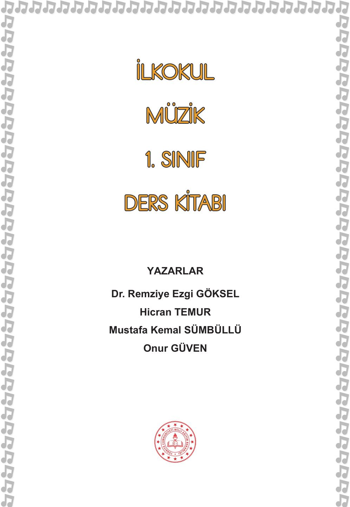

<!-- sayfa 1 -->

DERS KİTAPLARI DİZİSİ ..............................................................................................2294
Her hakkı saklıdır ve Millî Eğitim Bakanlığına aittir. Kitabın metin, soru ve şekilleri kısmen de olsa hiçbir surette alınıp yayımlanamaz.

EDİTÖR
Prof. Dr. Süleyman TARMAN

DİL UZMANI
Vedat EĞİLMEZ

GÖRSEL TASARIMCI
Ahmet AKTAŞ
Fatih GÜNDÜZ
Nevzat ŞİMŞEK

ÇOKLU ORTAM TASARIMCISI
Erhan GÜL
Onur TÜLÜ

PROGRAM GELİŞTİRME UZMANI
Dr. Şahika ÜNLÜ

ÖLÇME VE DEĞERLENDİRME UZMANI
Emrah GÖREN

REHBERLİK UZMANI
Dursun DAYAPOĞLU

ISBN 978-975-11-9093-2

Millî Eğitim Bakanlığı, Talim ve Terbiye Kurulu Başkanlığının 21.08.2025 gün ve 138684130

<!-- sayfa 2 -->

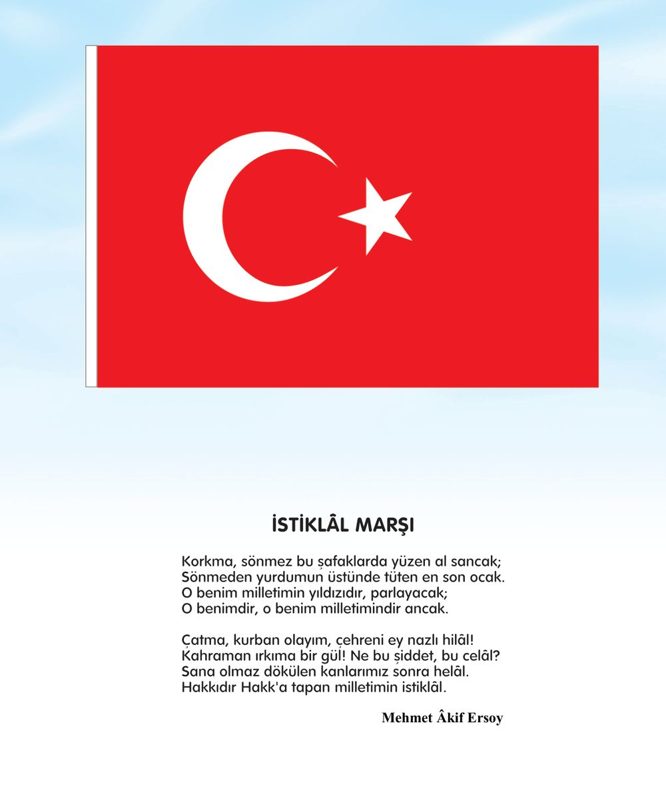

# İSTİKLÂL MARŞI

Korkma, sönmez bu şafaklarda yüzen al sancak;
Sönmeden yurdumun üstünde tüten en son ocak.
O benim milletimin yıldızıdır, parlayacak;
O benimdir, o benim milletimindir ancak.

Çatma, kurban olayım, cehren ey nazlı hilâl!
Kahraman ırkıma bir gül! Ne bu şiddet, bu celâl?
Sana olmaz dökülen kanlarımız sonra helâl.
Hakkıdır Hakk'a tapan milletimin istiklâl.

**Mehmet Âkif Ersoy**

<!-- sayfa 3 -->

ANDIMIZ

Türküm, doğruyum, çalışkanım.

İlkem küçüklerimi korumak, büyüklerimi saymak; yurdumu, milletimi özümden çok sevmektir.
Ülküm yükselmek, ileri gitmektir.

Ey Büyük Atatürk!

Açtığın yolda, gösterdiğin hedefe durmadan yürüyeceğime ant içerim.

Varlığım Türk varlığına armağan olsun.

Ne mutlu Türküm diyene!

<!-- sayfa 4 -->

MUSTAFA KEMAL ATATÜRK

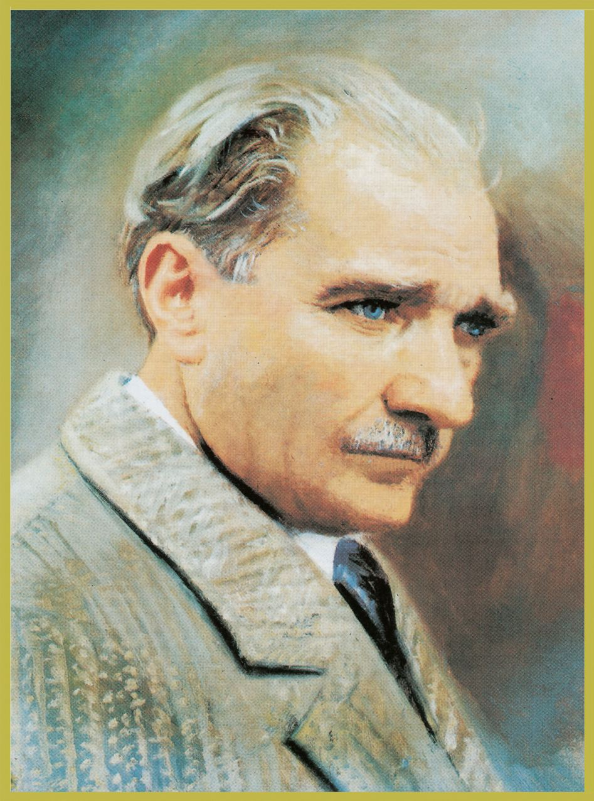
<!-- yer tutucu bulunamadı: sayfa sonuna eklendi -->

<!-- sayfa 5 -->

Verdiğiniz mesajda PDF metin katmanı boş görünüyor (`<<< >>>` arası boş). Lütfen dönüştürülmesini istediğiniz metni veya görseli paylaşın, böylece kurallara uygun şekilde Markdown formatına çevirebilirim.

<!-- sayfa 6 -->

# İÇİNDEKİLER

Kitabımızı Tanıyalım ........................................................................ 10

## 1. TEMA: MÜZİK DİLİ

Düşünelim Bulalım ......................................................................... 16
İstiklâl Marşının Ögeleri .................................................................. 17
Oynayalım - Öğrenelim ................................................................... 18
Türk Bayrağı ................................................................................... 19
Değerlendirme Zamanı 1 ................................................................ 21
Düşünelim Bulalım ......................................................................... 22
Dinleyelim - Boyayalım ................................................................... 24
Oynayalım - Eğlenelim ................................................................... 25
Değerlendirme Zamanı 2 ................................................................ 26
Düşünelim Bulalım ......................................................................... 28
Oynayalım - Eğlenelim ................................................................... 29
Değerlendirme Zamanı 3 ................................................................ 30
Düşünelim Bulalım ......................................................................... 31
Birlikte Söyleyelim Leylek Leylek Havada ........................................ 32
Birlikte Söyleyelim Dandini Dandini Dastana .................................... 34
Birlikte Söyleyelim Elim Elim Epelek .................................................. 36
Değerlendirme Zamanı 4 ................................................................ 38
Düşünelim Bulalım ......................................................................... 39
Birlikte Kutlayalım: Cumhuriyet ....................................................... 40
Özlemle Anıyoruz: Atatürk’ü Severim ............................................... 42
Birlikte Kutlayalım: Öğretmenim ...................................................... 44
Değerlendirme Zamanı 5 ................................................................ 46

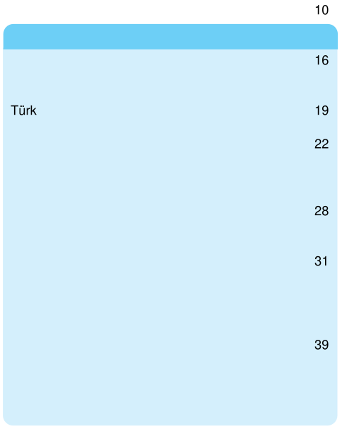
<!-- yer tutucu bulunamadı: sayfa sonuna eklendi -->

<!-- sayfa 7 -->

Düşünelim Bulalım......................................................... 47
Ortak Repertuvarı Söyleyelim: Çalışkan Olmalıyız............ 48
Ortak Repertuvarı Söyleyelim: Küçük Çalgıcılar................ 50
Değerlendirme Zamanı 6 ................................................. 52
Düşünelim Bulalım......................................................... 53
Beden Perküsyonu: Leylek Leylek Havada ........................ 54
Beden Perküsyonu: Küçük Çalgıcılar................................ 56
Değerlendirme Zamanı 7 ................................................. 58
1. Tema Değerlendirme Soruları ....................................... 60

## 2. TEMA: MÜZİK KÜLTÜRÜ

Düşünelim Bulalım......................................................... 64
Müzik Dinleme Kuralları .................................................. 65
Şarkı Söyleme Kuralları ................................................... 66
Oynayalım - Eğlenelim................................................... 67
Değerlendirme Zamanı 1 ................................................. 68
Düşünelim Bulalım......................................................... 69
Ritim Veren Vurmalı Çalgıları Tanıyalım ............................ 70
Kültürel Mirastan Örnekler ............................................... 71
Oynayalım-Eğlenelim..................................................... 72
Oynayalım-Eğlenelim..................................................... 73
Değerlendirme Zamanı 2 ................................................. 74
Düşünelim Bulalım......................................................... 75
Birlikte Söyleyelim: Kışa Veda.......................................... 76
Birlikte Söyleyelim: Şeftali Ağaçları .................................. 78

<!-- sayfa 8 -->

Birlikte Söyleyelim: Okul Türküsü ................................................... 80
Birlikte Söyleyelim: Kâtibim .......................................................... 82
Değerlendirme Zamanı 3 .............................................................. 84
Düşünelim Bulalım ....................................................................... 85
Ulusal Egemenlik ve Çocuk Bayramı: Yirmi Üç Nisan ....... 86
Atatürk’ü Anma Ve Gençlik Ve Spor Bayramı:
Samsun’da Doğan Güneş .......................................................... 88
Değerlendirme Zamanı 4 ............................................................. 90
Düşünelim Bulalım ....................................................................... 91
Ortak Repertuvarı Söyleyelim: Atabarı ........................................ 92
Ortak Repertuvarı Söyleyelim: 23 Nisan ..................................... 94
Ortak Repertuvarı Söyleyelim: Orman ........................................ 96
Değerlendirme Zamanı 5 ............................................................. 98
Düşünelim Bulalım ....................................................................... 99
Beden Perküsyonu: Şeftali Ağaçları ............................................ 100
Beden Perküsyonu: Orman ........................................................ 102
Değerlendirme Zamanı 6 ............................................................ 104
2. Tema Değerlendirme Soruları ................................................ 105

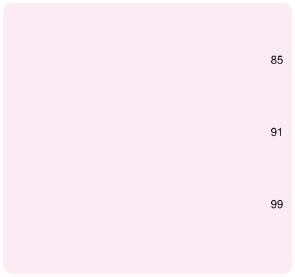

Sözlük .......................................................................................... 107
Kaynakça ..................................................................................... 108
Görsel ve Genel Ağ Kaynakçası Karekodu ............................... 108
Türkiye’nin Mülki İdare Bölümleri ile Kara ve
Deniz Komşuları Haritası ........................................................... 109
Türk Dünyası Haritası .................................................................. 110

<!-- sayfa 9 -->

# KİTABIMIZI TANIYALIM

## Tema Kapağı

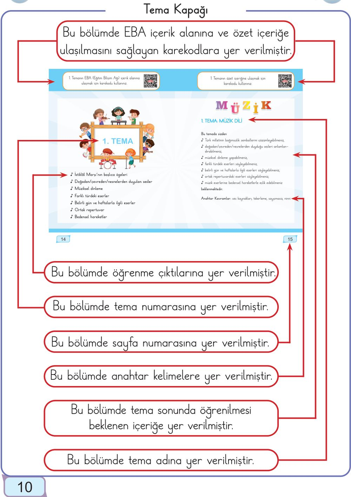

Bu bölümde EBA içerik alanına ve özet içeriğe ulaşılmasını sağlayan karekodlara yer verilmiştir.

1. Temanın EBA (Eğitim Bilişim Ağı) içerik alanına ulaşmak için karekodu kullanınız.
1. Temanın özet içeriğine ulaşmak için karekodu kullanınız.

# M Ü Z İ K

### 1. TEMA: MÜZİK DİLİ

**1. TEMA**

♪ İstiklâl Marşı’nın başlıca ögeleri
♪ Doğadan/çevreden/nesnelerden duyulan sesler
♪ Müziksel dinleme
♪ Farklı türdeki eserler
♪ Belirli gün ve haftalarla ilgili eserler
♪ Ortak repertuvar
♪ Bedensel hareketler

14

Bu temada sizden
* Türk milletinin bağımsızlık sembollerini çözümleyebilmeniz,
* doğadan/çevreden/nesnelerden duyduğu sesleri anlamlandırabilmeniz,
* müziksel dinleme yapabilmeniz,
* farklı türdeki eserleri söyleyebilmeniz,
* belirli gün ve haftalarla ilgili eserleri söyleyebilmeniz,
* ortak repertuvardaki eserleri söyleyebilmeniz,
* müzik eserlerine bedensel hareketlerle eşlik edebilmeniz beklenmektedir.

Anahtar Kavramlar: ses kaynakları, tekerleme, sayışmaca, ninni

15

Bu bölümde öğrenme çıktılarına yer verilmiştir.
Bu bölümde tema numarasına yer verilmiştir.
Bu bölümde sayfa numarasına yer verilmiştir.
Bu bölümde anahtar kelimelere yer verilmiştir.
Bu bölümde tema sonunda öğrenilmesi beklenen içeriğe yer verilmiştir.
Bu bölümde tema adına yer verilmiştir.

<!-- sayfa 10 -->

# KİTABIMIZI TANIYALIM

## Düşünelim Bulalım Sayfaları

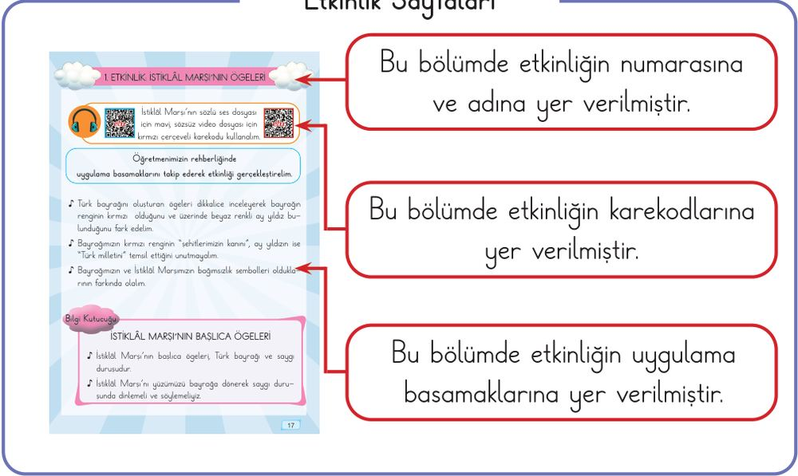

> Bu bölümde ön değerlendirme çalışmasına yer verilmiştir.

## Etkinlik Sayfaları

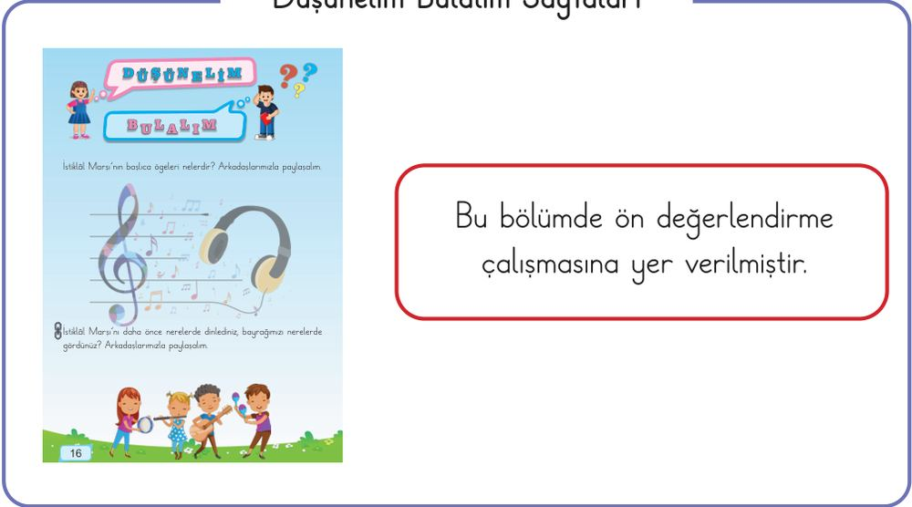

> Bu bölümde etkinliğin numarasına ve adına yer verilmiştir.

> Bu bölümde etkinliğin karekodlarına yer verilmiştir.

> Bu bölümde etkinliğin uygulama basamaklarına yer verilmiştir.

<!-- sayfa 11 -->

# KİTABIMIZI TANIYALIM

## Değerlendirme Zamanı Sayfaları

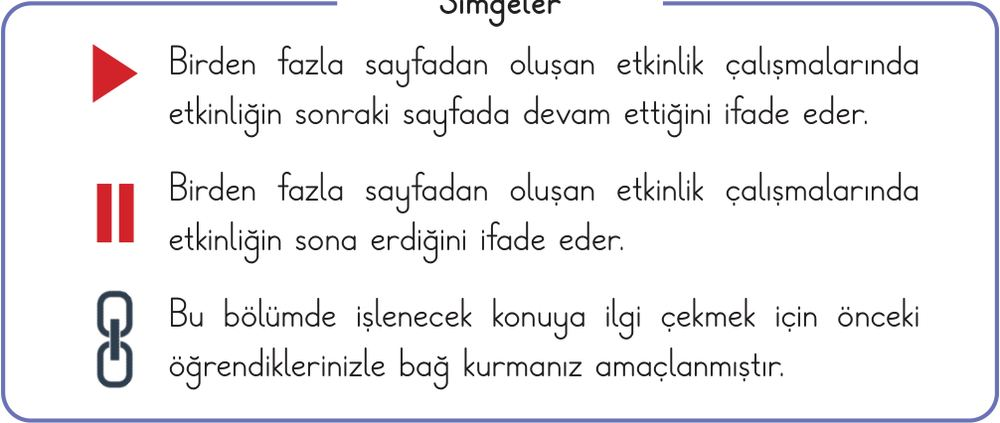

> Bu bölümde, değerlendirme çalışmasına yer verilmiştir.

---

## Simgeler

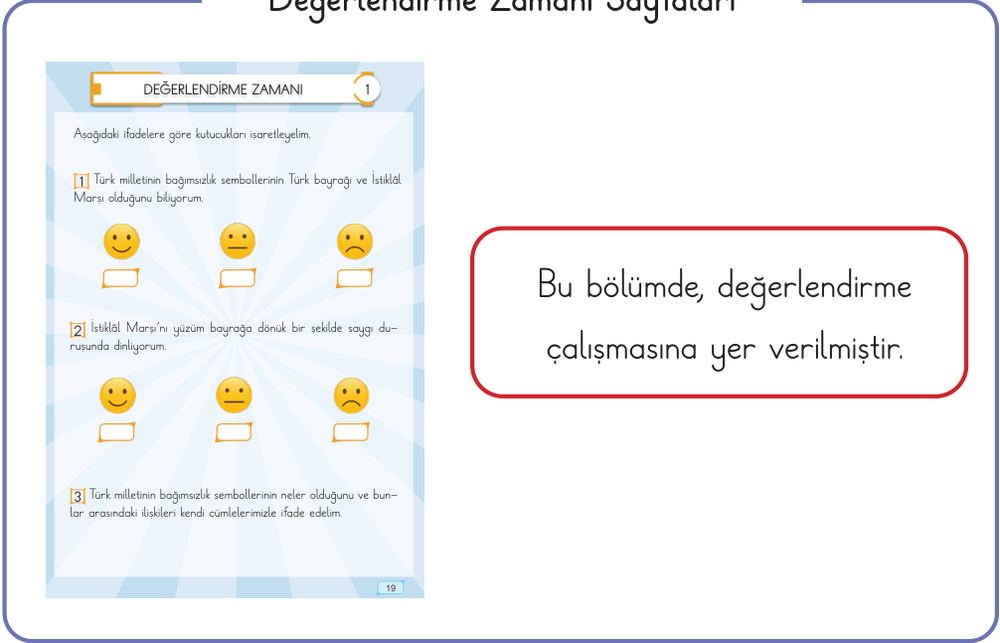
Birden fazla sayfadan oluşan etkinlik çalışmalarında etkinliğin sonraki sayfada devam ettiğini ifade eder.

Birden fazla sayfadan oluşan etkinlik çalışmalarında etkinliğin sona erdiğini ifade eder.

Bu bölümde işlenecek konuya ilgi çekmek için önceki öğrendiklerinizle bağ kurmanız amaçlanmıştır.

<!-- sayfa 12 -->

# KİTABIMIZI TANIYALIM

## Karekod Bölümleri

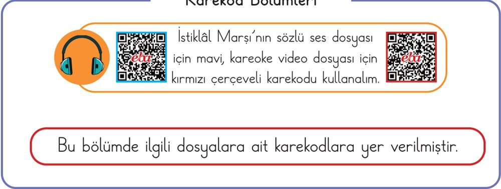

Bu bölümde ilgili dosyalara ait karekodlara yer verilmiştir.

## Bilgi Kutucuğu

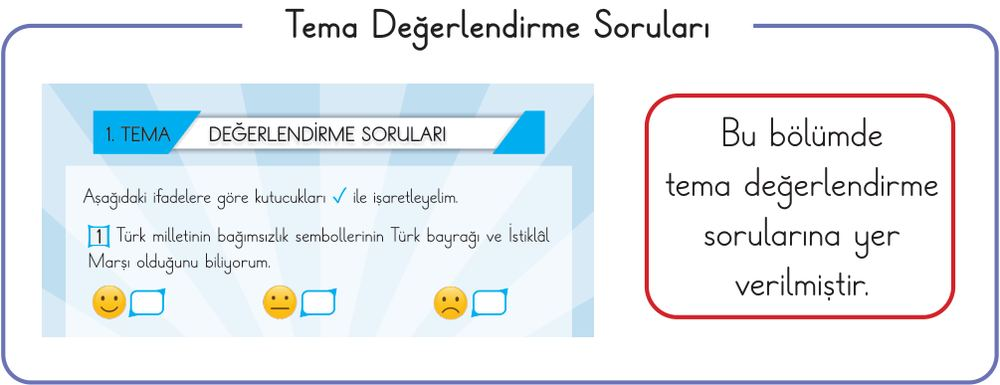

Bilgi Kutucuğu Müzik = Ritim + Ezgi

Bu bölümde kavramlarla ilgili bilgilere yer verilmiştir.

## Tema Değerlendirme Soruları

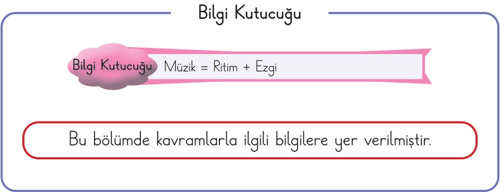

Bu bölümde tema değerlendirme sorularına yer verilmiştir.

1. TEMA DEĞERLENDİRME SORULARI

Aşağıdaki ifadelere göre kutucukları $\checkmark$ ile işaretleyelim.

[1] Türk milletinin bağımsızlık sembollerinin Türk bayrağı ve İstiklâl Marşı olduğunu biliyorum.

<!-- sayfa 13 -->

1. Temanın EBA (Eğitim Bilişim Ağı) içerik alanına ulaşmak için karekodu kullanınız. 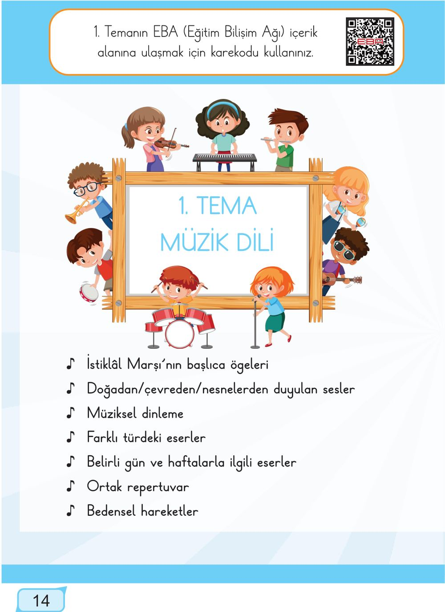

# 1. TEMA
## MÜZİK DİLİ

♪ İstiklâl Marşı’nın başlıca ögeleri
♪ Doğadan/çevreden/nesnelerden duyulan sesler
♪ Müziksel dinleme
♪ Farklı türdeki eserler
♪ Belirli gün ve haftalarla ilgili eserler
♪ Ortak repertuvar
♪ Bedensel hareketler

<!-- sayfa 14 -->

1. Temanın özet içeriğine ulaşmak için karekodu kullanınız. 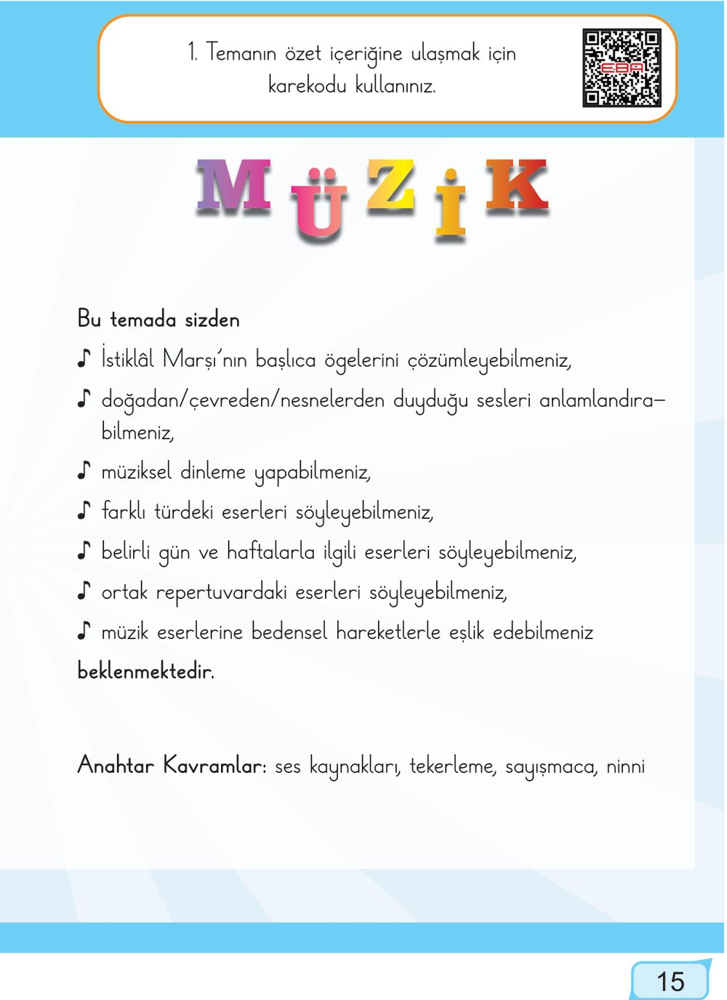

# M Ü Z İ K

Bu temada sizden

♪ İstiklâl Marşı’nın başlıca ögelerini çözümleyebilmeniz,

♪ doğadan/çevreden/nesnelerden duyduğu sesleri anlamlandıra- bilmeniz,

♪ müziksel dinleme yapabilmeniz,

♪ farklı türdeki eserleri söyleyebilmeniz,

♪ belirli gün ve haftalarla ilgili eserleri söyleyebilmeniz,

♪ ortak repertuvardaki eserleri söyleyebilmeniz,

♪ müzik eserlerine bedensel hareketlerle eşlik edebilmeniz beklenmektedir.

*Anahtar Kavramlar:* ses kaynakları, tekerleme, sayışmaca, ninni

<!-- sayfa 15 -->

# D Ü Ş Ü N E L İ M
# B U L A L I M

İstiklâl Marşı’nın başlıca ögeleri nelerdir? Arkadaşlarımızla paylaşalım.

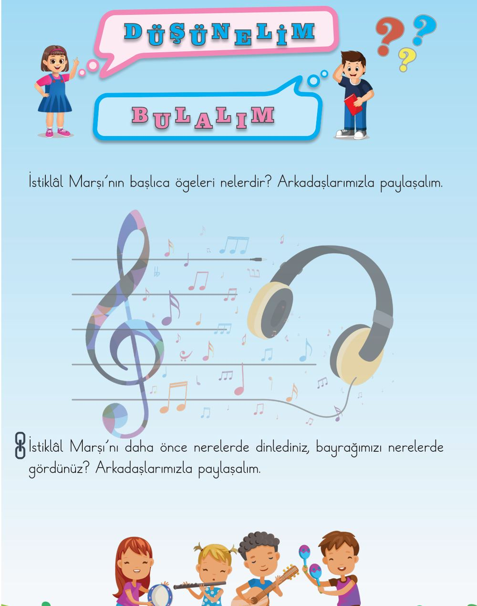: "İstiklâl Marşı’nın başlıca ögeleri nelerdir? Arkadaşlarımızla paylaşalım." metninin altında nota sembolleri ve kulaklık görseli bulunmaktadır.

İstiklâl Marşı’nı daha önce nerelerde dinlediniz, bayrağımızı nerelerde gördünüz? Arkadaşlarımızla paylaşalım.

<!-- sayfa 16 -->

# 1. ETKİNLİK: İSTİKLÂL MARŞI’NIN ÖGELERİ

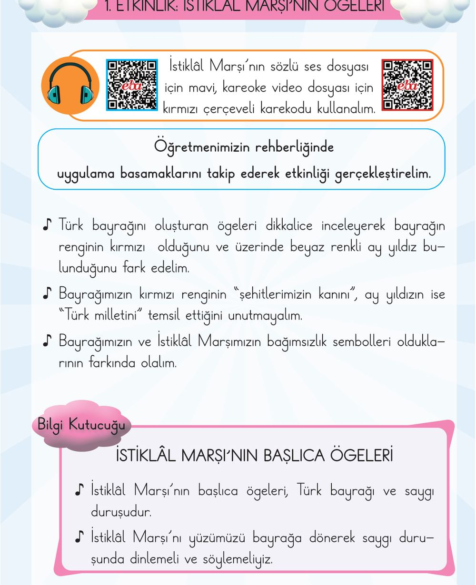 İstiklâl Marşı’nın sözlü ses dosyası için mavi, kareoke video dosyası için kırmızı çerçeveli karekodu kullanalım.

> Öğretmenimizin rehberliğinde uygulama basamaklarını takip ederek etkinliği gerçekleştirelim.

♪ Türk bayrağını oluşturan ögeleri dikkalice inceleyerek bayrağın renginin kırmızı olduğunu ve üzerinde beyaz renkli ay yıldız bulunduğunu fark edelim.

♪ Bayrağımızın kırmızı renginin “şehitlerimizin kanını”, ay yıldızın ise “Türk milletini” temsil ettiğini unutmayalım.

♪ Bayrağımızın ve İstiklâl Marşımızın bağımsızlık sembolleri olduklarının farkında olalım.

Bilgi Kutucuğu
## İSTİKLÂL MARŞI’NIN BAŞLICA ÖGELERİ

♪ İstiklâl Marşı’nın başlıca ögeleri, Türk bayrağı ve saygı duruşudur.

♪ İstiklâl Marşı’nı yüzümüzü bayrağa dönerek saygı duruşunda dinlemeli ve söylemeliyiz.

<!-- sayfa 17 -->

2. ETKİNLİK: OYNAYALIM – ÖĞRENELİM

> Öğretmenimizin rehberliğinde uygulama basamaklarını takip ederek etkinliği gerçekleştirelim.

♪ Sayfa 19’daki Türk bayrağı görselini noktalı yerlerden keselim.
♪ Sınıfımızda her bir arkadaşımıza bir “şehir” ismi verelim.
♪ Ülkemizi temsilen sınıfımıza da “Türkiye” ismi verelim.
♪ Öğretmenimiz bir şehir ismi söylediğinde ilgili arkadaşımızdan “bu- rada” demesini isteyelim.
♪ Öğretmenimiz “Türkiye” dediğinde de hep birlikte ayağa kalkıp “bayrağımızı” havada tutarak “burada” diyelim.

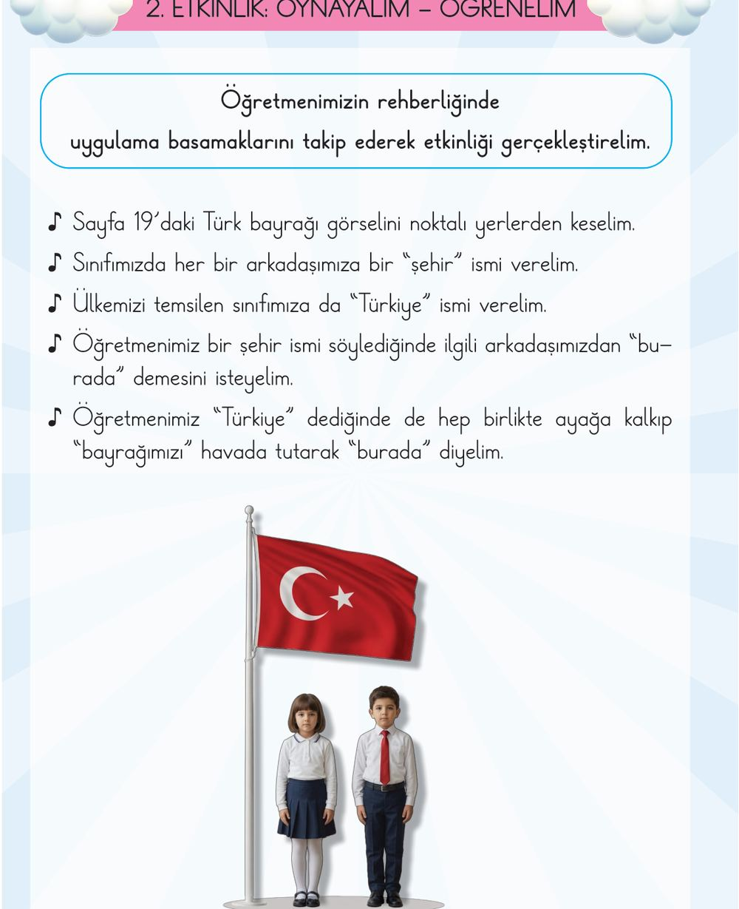

<!-- sayfa 18 -->

TÜRK BAYRAĞI

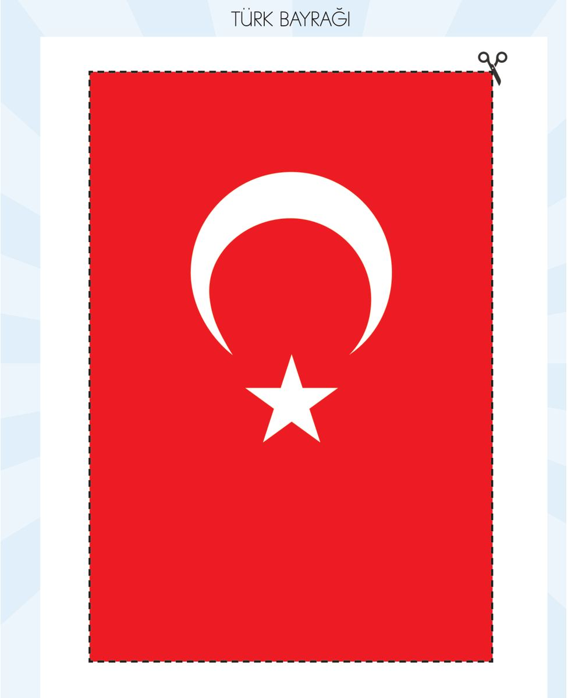

<!-- sayfa 19 -->

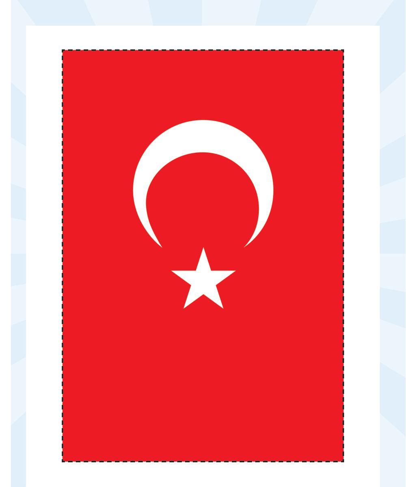
<!-- yer tutucu bulunamadı: sayfa sonuna eklendi -->

<!-- sayfa 20 -->

# DEĞERLENDİRME ZAMANI 1

Aşağıdaki ifadelere göre kutucukları $\checkmark$ ile işaretleyelim.

1 Türk milletinin bağımsızlık sembollerinin Türk bayrağı ve İstiklâl Marşı olduğunu biliyorum.

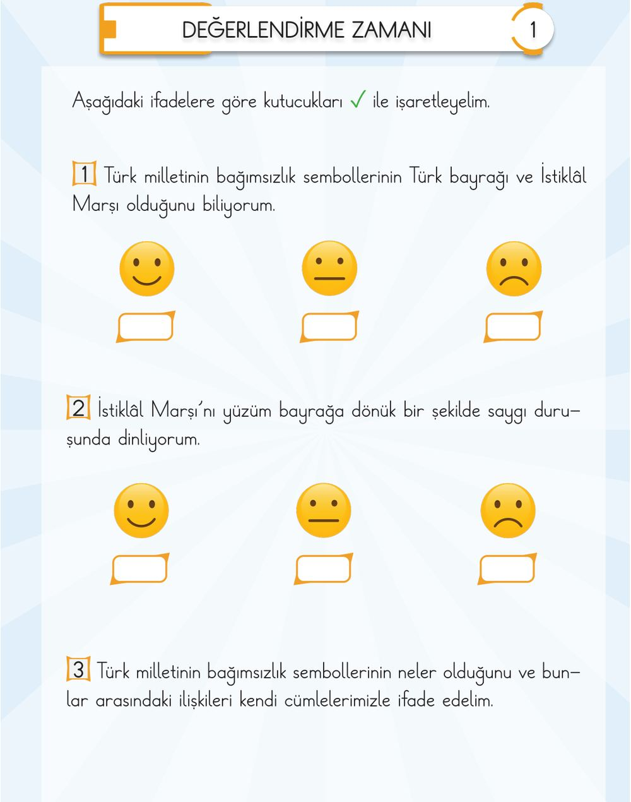

2 İstiklâl Marşı’nı yüzüm bayrağa dönük bir şekilde saygı duruşunda dinliyorum.

3 Türk milletinin bağımsızlık sembollerinin neler olduğunu ve bunlar arasındaki ilişkileri kendi cümlelerimizle ifade edelim.

<!-- sayfa 21 -->

# D Ü Ş Ü N E L İ M
# B U L A L I M

Aşağıdaki görsellerde yer alan doğa, çevre ve nesnelerden duyduğumuz farklı sesleri arkadaşlarımızla paylaşalım.

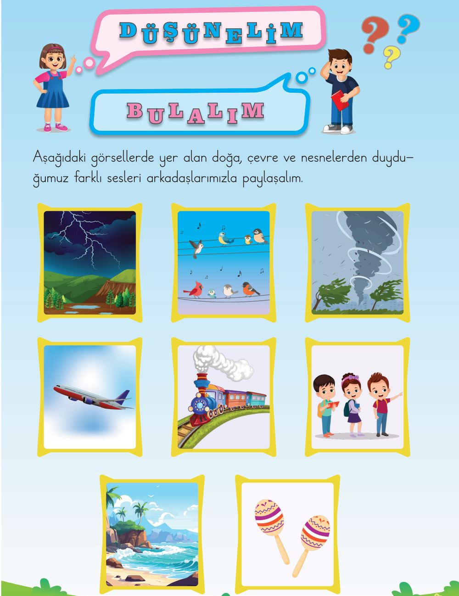

<!-- sayfa 22 -->

# D Ü Ş Ü N E L İ M
# B U L A L I M

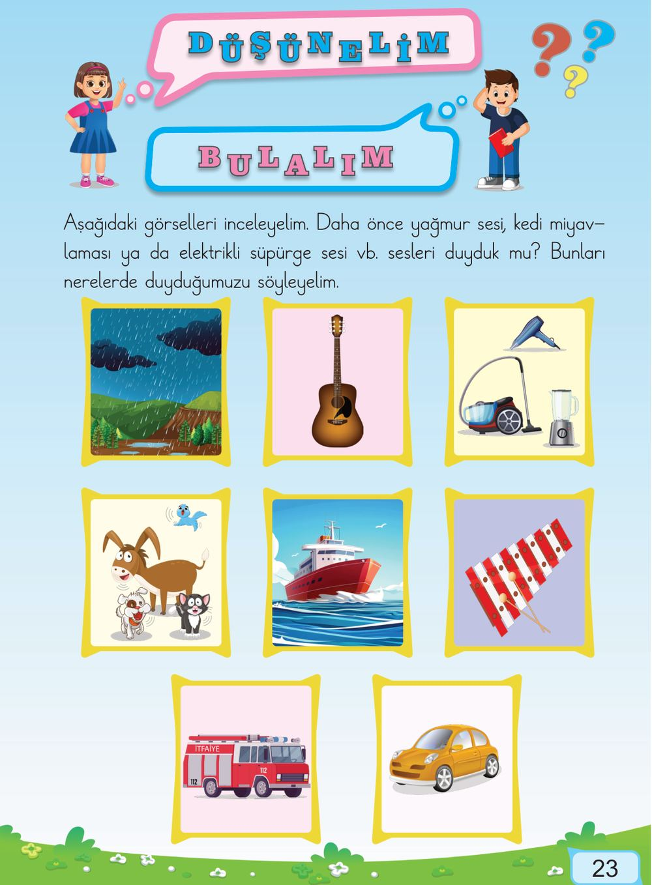

Aşağıdaki görselleri inceleyelim. Daha önce yağmur sesi, kedi miyav-
laması ya da elektrikli süpürge sesi vb. sesleri duyduk mu? Bunları 
nerelerde duyduğumuzu söyleyelim.

<!-- sayfa 23 -->

# 3. ETKİNLİK: DİNLEYELİM – BOYAYALIM

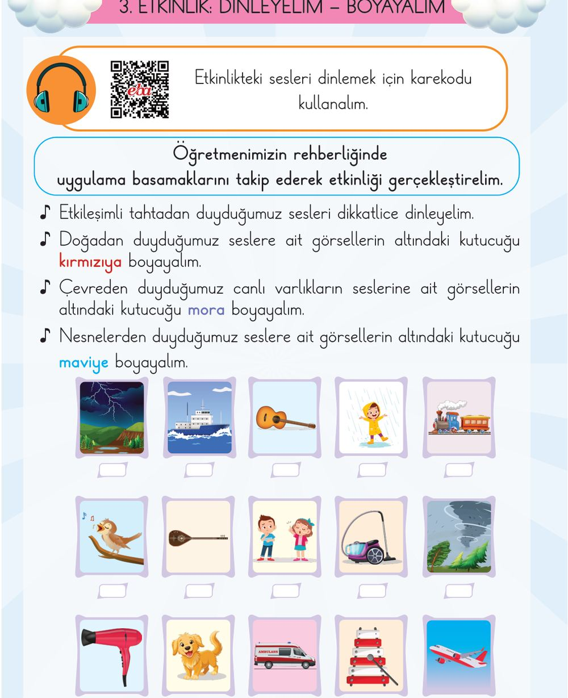 Etkinlikteki sesleri dinlemek için karekodu kullanalım.

Öğretmenimizin rehberliğinde uygulama basamaklarını takip ederek etkinliği gerçekleştirelim.

♪ Etkileşimli tahtadan duyduğumuz sesleri dikkatlice dinleyelim.
♪ Doğadan duyduğumuz seslere ait görsellerin altındaki kutucuğu kırmızıya boyayalım.
♪ Çevreden duyduğumuz canlı varlıkların seslerine ait görsellerin altındaki kutucuğu mora boyayalım.
♪ Nesnelerden duyduğumuz seslere ait görsellerin altındaki kutucuğu maviye boyayalım.

(Görseldeki resimler ve altlarındaki boş kutucuklar)

<!-- sayfa 24 -->

# 4. ETKİNLİK: OYNAYALIM – EĞLENELİM

> Öğretmenimizin rehberliğinde uygulama basamaklarını takip ederek etkinliği gerçekleştirelim.

♪ Öğretmenimizin rehberliğinde arkadaşlarımızla iki grup oluşturalım ve oyunu başlatacak grubu belirleyelim.

♪ Oyunu başlatacak gruptan belirlediğimiz ilk arkadaşımızdan doğa, çevre ya da nesnelerden bir sesi taklit etmesini isteyelim.

♪ İkinci gruptan bu sesin hangi ses olduğunu bulmalarını isteyelim.

♪ Doğru ses bulunduktan sonra ikinci grupla oyuna devam edelim.

♪ Oyunun sonunda doğa, çevre ve nesnelerden duyduğumuz seslerin özellik, benzerlik ve farklılıklarını arkadaşlarımızla paylaşalım.

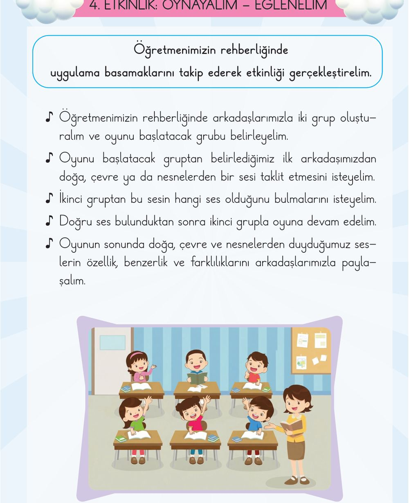

<!-- sayfa 25 -->

# DEĞERLENDİRME ZAMANI 2

1. Doğa, çevre ve nesnelerden duyduğumuz seslerin özelliklerini söyleyelim.

2. Doğa, çevre ve nesnelerden duyduğumuz seslerin benzerliklerini söyleyelim.

3. Doğa, çevre ve nesnelerden duyduğumuz seslerin farklılıklarını söyleyelim.

4. Aşağıdaki görselleri inceleyelim. Doğadan duyduğumuz seslere ait görsellerin altındaki kutucuğu $\checkmark$ ile işaretleyelim.

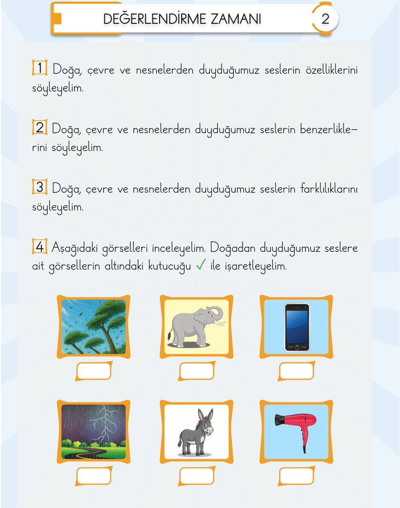

<!-- sayfa 26 -->

# DEĞERLENDİRME ZAMANI 2

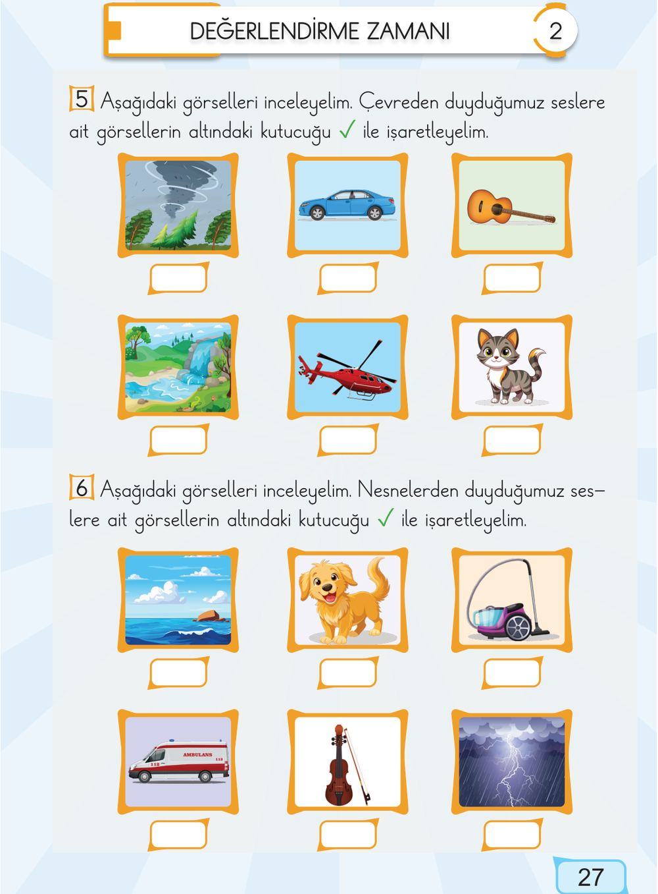

5 Aşağıdaki görselleri inceleyelim. Çevreden duyduğumuz seslere ait görsellerin altındaki kutucuğu $\checkmark$ ile işaretleyelim.

6 Aşağıdaki görselleri inceleyelim. Nesnelerden duyduğumuz seslere ait görsellerin altındaki kutucuğu $\checkmark$ ile işaretleyelim.

<!-- sayfa 27 -->

# D Ü Ş Ü N E L İ M
# B U L A L I M

♪ Daha önce hangi şarkıları dinlediniz?
♪ Dinlediğimiz bir şarkıyı söyleyerek arkadaşlarımızla paylaşalım.
♪ Öğretmenimizin belirlediği sırayla söylediğimiz şarkıya parmak şıklatarak ya da alkış yaparak ritim tutalım.

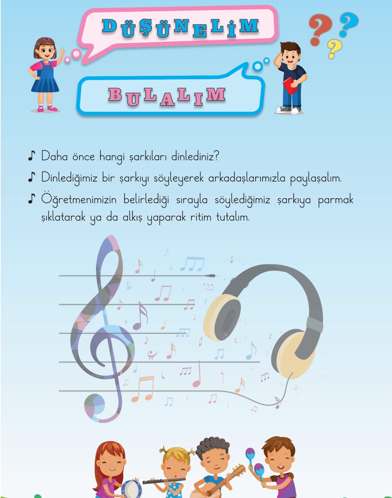

<!-- sayfa 28 -->

# 5. ETKİNLİK: OYNAYALIM – EĞLENELİM

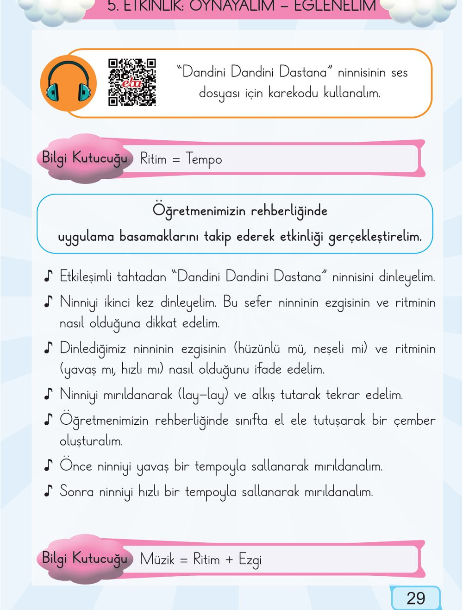 “Dandini Dandini Dastana” ninnisinin ses dosyası için karekodu kullanalım.

**Bilgi Kutucuğu** Ritim = Tempo

Öğretmenimizin rehberliğinde uygulama basamaklarını takip ederek etkinliği gerçekleştirelim.

♪ Etkileşimli tahtadan “Dandini Dandini Dastana” ninnisini dinleyelim.
♪ Ninniyi ikinci kez dinleyelim. Bu sefer ninninin ezgisinin ve ritminin nasıl olduğuna dikkat edelim.
♪ Dinlediğimiz ninninin ezgisinin (hüzünlü mü, neşeli mi) ve ritminin (yavaş mı, hızlı mı) nasıl olduğunu ifade edelim.
♪ Ninniyi mırıldanarak (lay-lay) ve alkış tutarak tekrar edelim.
♪ Öğretmenimizin rehberliğinde sınıfta el ele tutuşarak bir çember oluşturalım.
♪ Önce ninniyi yavaş bir tempoyla sallanarak mırıldanalım.
♪ Sonra ninniyi hızlı bir tempoyla sallanarak mırıldanalım.

**Bilgi Kutucuğu** Müzik = Ritim + Ezgi

<!-- sayfa 29 -->

# DEĞERLENDİRME ZAMANI 3

1 Etkinlikte dinlediğimiz “Dandini Dandini Dastana” isimli ninninin müziğinde en çok nelere dikkat ettiğimizi söyleyelim.

2 Etkinlikte dinlediğimiz “Dandini Dandini Dastana” ninnisinde müziğin ritmine uygun olan görselin altındaki kutucuğu $\checkmark$ ile işaretleyelim.

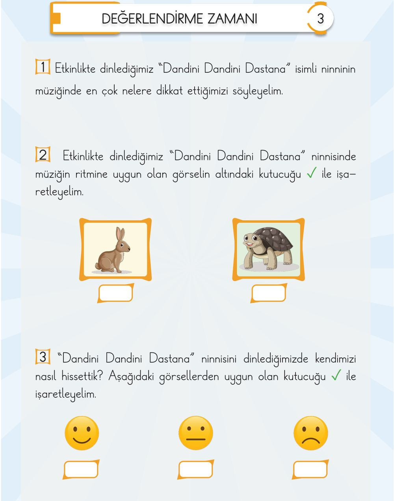

3 “Dandini Dandini Dastana” ninnisini dinlediğimizde kendimizi nasıl hissettik? Aşağıdaki görsellerden uygun olan kutucuğu $\checkmark$ ile işaretleyelim.

<!-- sayfa 30 -->

# D Ü Ş Ü N E L İ M
# B U L A L I M

Bildiğimiz tekerleme, sayışmaca ve ninniler nelerdir? Arkadaşlarımızla paylaşalım.

Oyunlarda en çok kullandığımız sayışmacalar nelerdir? Arkadaşlarımızla paylaşalım.

## Bilgi Kutucuğu

### ŞARKI SÖYLERKEN NASIL DURMALIYIZ?

Şarkı söylerken omurga sağlığı bakımından vücudumuzun dik ve dengeli bir şekilde durması gerekir. Bunun için

♪ otururken dik oturmalıyız.

♪ ayakta dururken de ayaklarımızı omuz hizasında açmalıyız.

♪ ağırlığımızı her iki ayağımıza eşit bir şekilde dağıtmalıyız ve dik durmalıyız.

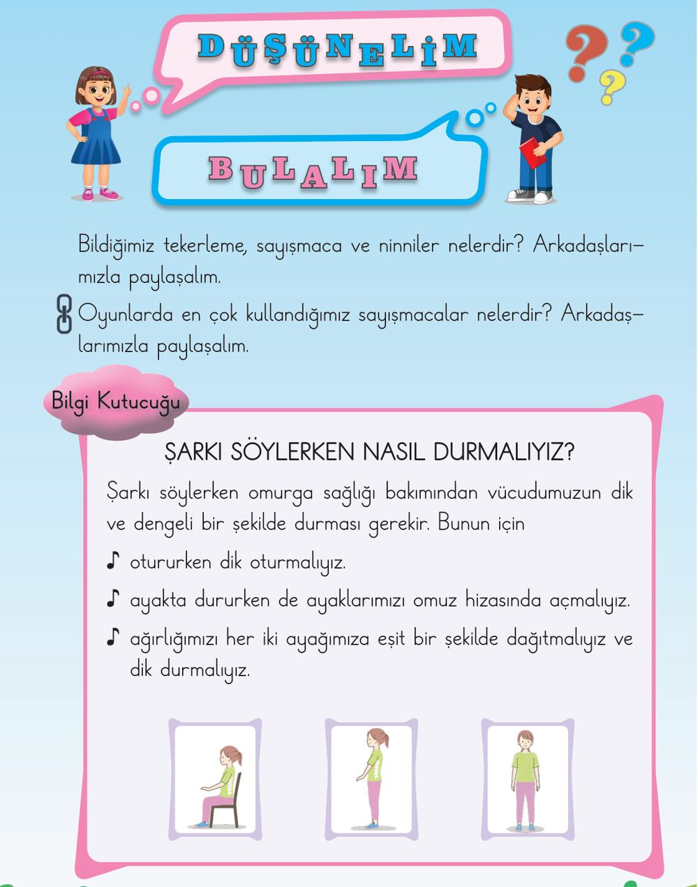

<!-- sayfa 31 -->

# 6. ETKİNLİK: BİRLİKTE SÖYLEYELİM

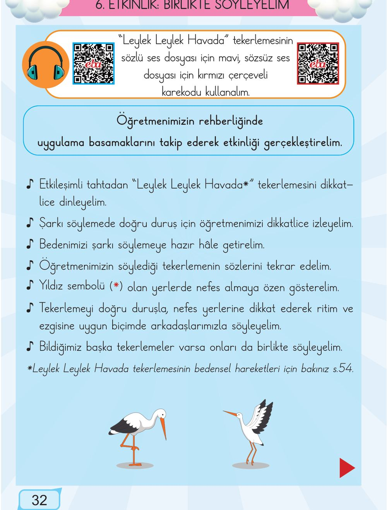 “Leylek Leylek Havada” tekerlemesinin sözlü ses dosyası için mavi, sözsüz ses dosyası için kırmızı çerçeveli karekodu kullanalım.

## Öğretmenimizin rehberliğinde uygulama basamaklarını takip ederek etkinliği gerçekleştirelim.

♪ Etkileşimli tahtadan “Leylek Leylek Havada*” tekerlemesini dikkatlice dinleyelim.

♪ Şarkı söylemede doğru duruş için öğretmenimizi dikkatlice izleyelim.

♪ Bedenimizi şarkı söylemeye hazır hâle getirelim.

♪ Öğretmenimizin söylediği tekerlemenin sözlerini tekrar edelim.

♪ Yıldız sembolü (*) olan yerlerde nefes almaya özen gösterelim.

♪ Tekerlemeyi doğru duruşla, nefes yerlerine dikkat ederek ritim ve ezgisine uygun biçimde arkadaşlarımızla söyleyelim.

♪ Bildiğimiz başka tekerlemeler varsa onları da birlikte söyleyelim.

*Leylek Leylek Havada tekerlemesinin bedensel hareketleri için bakınız s.54.

<!-- sayfa 32 -->

6. ETKİNLİK: BİRLİKTE SÖYLEYELİM

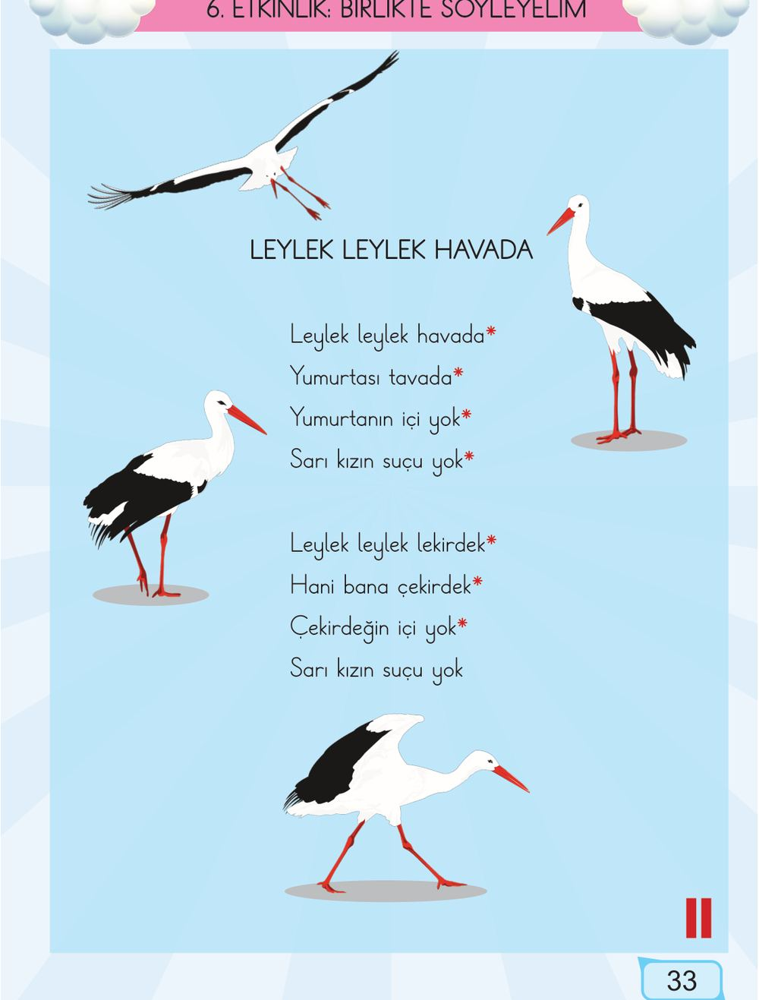

LEYLEK LEYLEK HAVADA

Leylek leylek havada*
Yumurtası tavada*
Yumurtanın içi yok*
Sarı kızın suçu yok*

Leylek leylek lekirdek*
Hani bana çekirdek*
Çekirdeğin içi yok*
Sarı kızın suçu yok

<!-- sayfa 33 -->

# 7. ETKİNLİK: BİRLİKTE SÖYLEYELİM

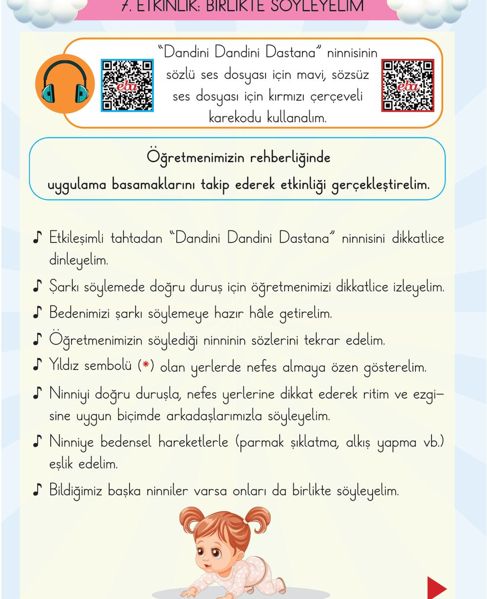: “Dandini Dandini Dastana” ninnisinin sözlü ses dosyası için mavi, sözsüz ses dosyası için kırmızı çerçeveli karekodu kullanalım.

## Öğretmenimizin rehberliğinde uygulama basamaklarını takip ederek etkinliği gerçekleştirelim.

♪ Etkileşimli tahtadan “Dandini Dandini Dastana” ninnisini dikkatlice dinleyelim.

♪ Şarkı söylemede doğru duruş için öğretmenimizi dikkatlice izleyelim.

♪ Bedenimizi şarkı söylemeye hazır hâle getirelim.

♪ Öğretmenimizin söylediği ninninin sözlerini tekrar edelim.

♪ Yıldız sembolü (*) olan yerlerde nefes almaya özen gösterelim.

♪ Ninniyi doğru duruşla, nefes yerlerine dikkat ederek ritim ve ezgi-sine uygun biçimde arkadaşlarımızla söyleyelim.

♪ Ninniye bedensel hareketlerle (parmak şıklatma, alkış yapma vb.) eşlik edelim.

♪ Bildiğimiz başka ninniler varsa onları da birlikte söyleyelim.

<!-- sayfa 34 -->

# 7. ETKİNLİK: BİRLİKTE SÖYLEYELİM

## DANDİNİ DANDİNİ DASTANA

Dandini dandini dastana*
Danalar girmiş bostana*
Kov bostancı danayı*
Yemesin lahanayı*

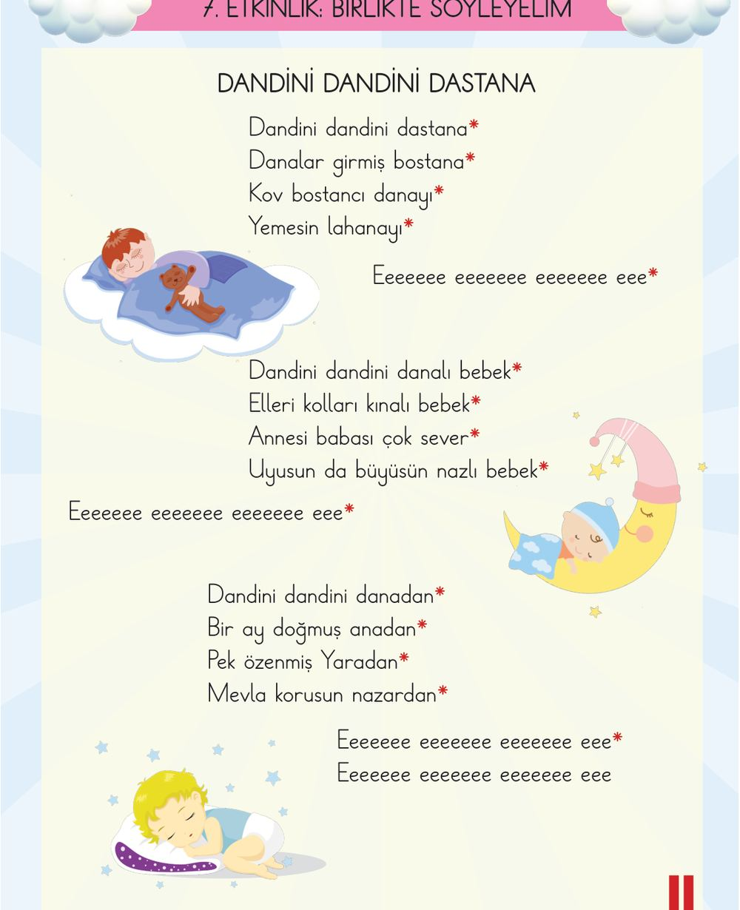 Eeeeeee eeeeeee eeeeeee eee*

Dandini dandini danalı bebek*
Elleri kolları kınalı bebek*
Annesi babası çok sever*
Uyusun da büyüsün nazlı bebek*

Eeeeeee eeeeeee eeeeeee eee*

Dandini dandini danadan*
Bir ay doğmuş anadan*
Pek özenmiş Yaradan*
Mevla korusun nazardan*

Eeeeeee eeeeeee eeeeeee eee*
Eeeeeee eeeeeee eeeeeee eee

<!-- sayfa 35 -->

# 8. ETKİNLİK: BİRLİKTE SÖYLEYELİM

“Elim Elim Epelek” sayışmacasının sözlü ses dosyası için mavi, sözsüz ses dosyası için kırmızı çerçeveli karekodu kullanalım.

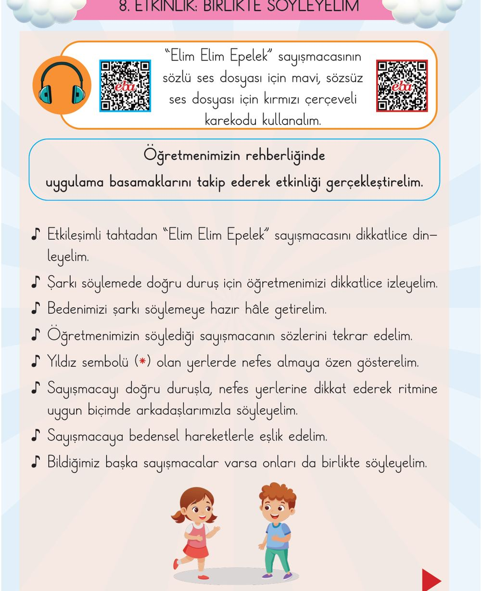

## Öğretmenimizin rehberliğinde uygulama basamaklarını takip ederek etkinliği gerçekleştirelim.

♪ Etkileşimli tahtadan “Elim Elim Epelek” sayışmacasını dikkatlice dinleyelim.

♪ Şarkı söylemede doğru duruş için öğretmenimizi dikkatlice izleyelim.

♪ Bedenimizi şarkı söylemeye hazır hâle getirelim.

♪ Öğretmenimizin söylediği sayışmacanın sözlerini tekrar edelim.

♪ Yıldız sembolü (*) olan yerlerde nefes almaya özen gösterelim.

♪ Sayışmacayı doğru duruşla, nefes yerlerine dikkat ederek ritmine uygun biçimde arkadaşlarımızla söyleyelim.

♪ Sayışmacaya bedensel hareketlerle eşlik edelim.

♪ Bildiğimiz başka sayışmacalar varsa onları da birlikte söyleyelim.

<!-- sayfa 36 -->

8. ETKİNLİK: BİRLİKTE SÖYLEYELİM

# ELİM ELİM EPELEK

Elim elim epelek*
Elden çıkan topalak*
Topalağın yarısı*
Bit pirenin karısı*
Adem* budem* sil bunu, süpür bunu, çıkar bunu*

Bindim deve boynuna*
Sürdüm Halep yoluna*
Halep yolu bit pazar*
İçinde ayı gezer*
Adem* budem* sil bunu, süpür bunu, çıkar bunu*

Ayı beni korkuttu*
Kulağımı sarkıttı*
Sil bunu, süpür bunu*
Çek bunu, çıkar bunu*
Adem* budem* sil bunu, süpür bunu, çıkar bunu

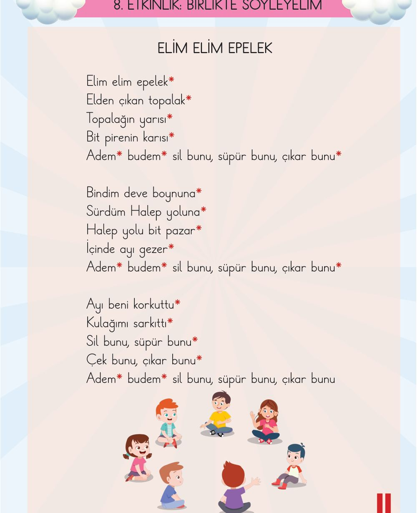

<!-- sayfa 37 -->

# DEĞERLENDİRME ZAMANI 4

Aşağıdaki ifadelere göre kutucukları $\checkmark$ ile işaretleyelim.

1 Bedenimi şarkı söylemeye hazır hâle getirdim.

$\text{😊}$
$\square$
$\text{😐}$
$\square$
$\text{☹️}$
$\square$

2 Şarkıyı söylerken doğru yerlerde nefes aldım.

$\text{😊}$
$\square$
$\text{😐}$
$\square$
$\text{☹️}$
$\square$

3 Şarkıyı ritmine uygun söyledim.

$\text{😊}$
$\square$
$\text{😐}$
$\square$
$\text{☹️}$
$\square$

4 Şarkıyı ezgisine uygun söyledim.

$\text{😊}$
$\square$
$\text{😐}$
$\square$
$\text{☹️}$
$\square$

<!-- sayfa 38 -->

# D Ü Ş Ü N E L İ M
# B U L A L I M

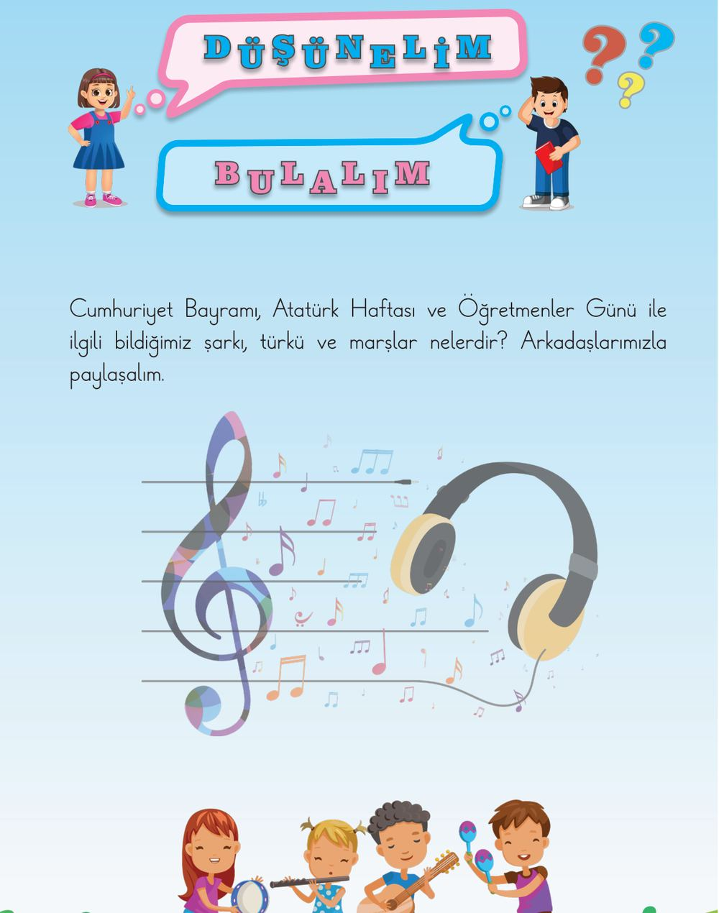

Cumhuriyet Bayramı, Atatürk Haftası ve Öğretmenler Günü ile ilgili bildiğimiz şarkı, türkü ve marşlar nelerdir? Arkadaşlarımızla paylaşalım.

<!-- sayfa 39 -->

# 9. ETKİNLİK: BİRLİKTE KUTLAYALIM

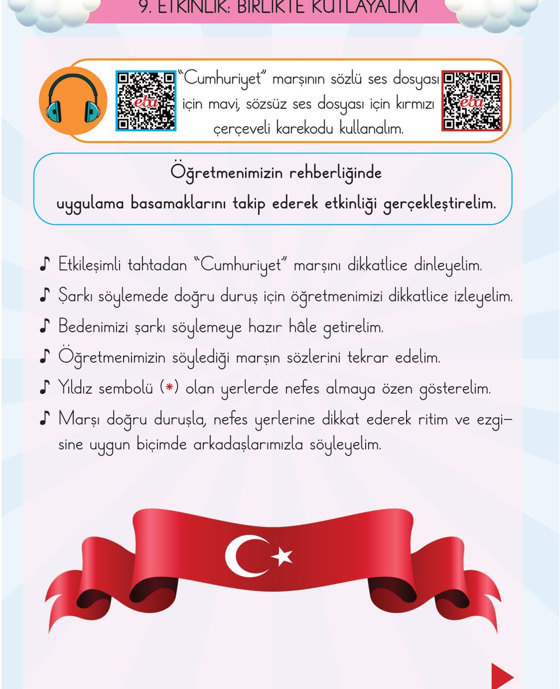 “Cumhuriyet” marşının sözlü ses dosyası için mavi, sözsüz ses dosyası için kırmızı çerçeveli karekodu kullanalım.

> Öğretmenimizin rehberliğinde uygulama basamaklarını takip ederek etkinliği gerçekleştirelim.

♪ Etkileşimli tahtadan “Cumhuriyet” marşını dikkatlice dinleyelim.
♪ Şarkı söylemede doğru duruş için öğretmenimizi dikkatlice izleyelim.
♪ Bedenimizi şarkı söylemeye hazır hâle getirelim.
♪ Öğretmenimizin söylediği marşın sözlerini tekrar edelim.
♪ Yıldız sembolü (*) olan yerlerde nefes almaya özen gösterelim.
♪ Marşı doğru duruşla, nefes yerlerine dikkat ederek ritim ve ezgi- sine uygun biçimde arkadaşlarımızla söyleyelim.

<!-- sayfa 40 -->

9. ETKİNLİK: BİRLİKTE KUTLAYALIM

# CUMHURİYET
Söz-Müzik: Sefai Acay (1946–2016)

Cumhuriyet hürriyet demek*
Cumhuriyet özgürce yaşamak*
Cumhuriyet hürriyet demek*
Cumhuriyet özgürce yaşamak*

Uygarlığa, çağdaşlığa*
Durmadan yılmadan koşmak demek*
Uygarlığa, çağdaşlığa*
Durmadan yılmadan koşmak demek*

Cumhuriyet mutluluk demek*
Cumhuriyet kol kola yürümek*
Cumhuriyet mutluluk demek*
Cumhuriyet kol kola yürümek*

Uygarlığa, çağdaşlığa*
Durmadan yılmadan koşmak demek*
Uygarlığa, çağdaşlığa*
Durmadan yılmadan koşmak demek

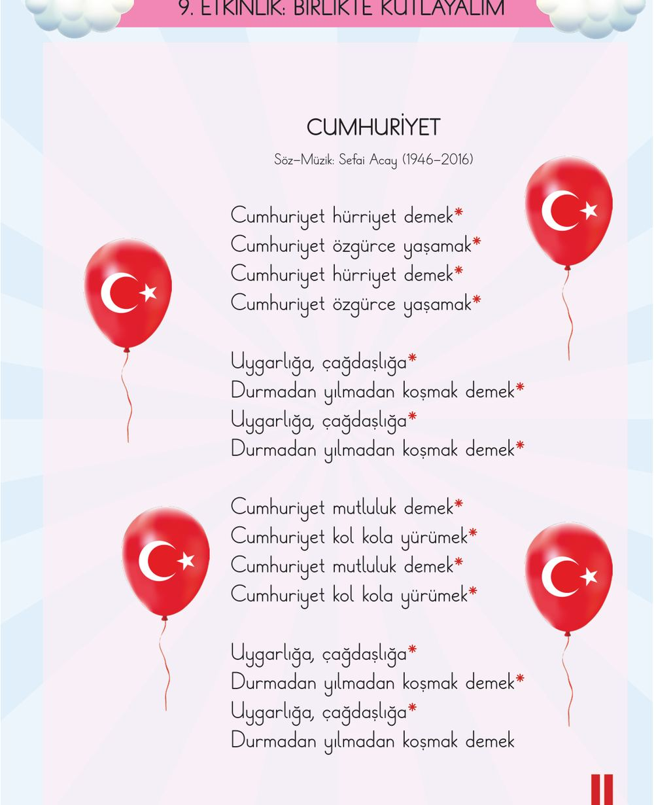
<!-- yer tutucu bulunamadı: sayfa sonuna eklendi -->

<!-- sayfa 41 -->

# 10. ETKİNLİK: ÖZLEMLE ANIYORUZ

“Atatürk’ü Severim” şarkısının sözlü ses dosyası için mavi, sözsüz ses dosyası için kırmızı çerçeveli karekodu kullanalım.

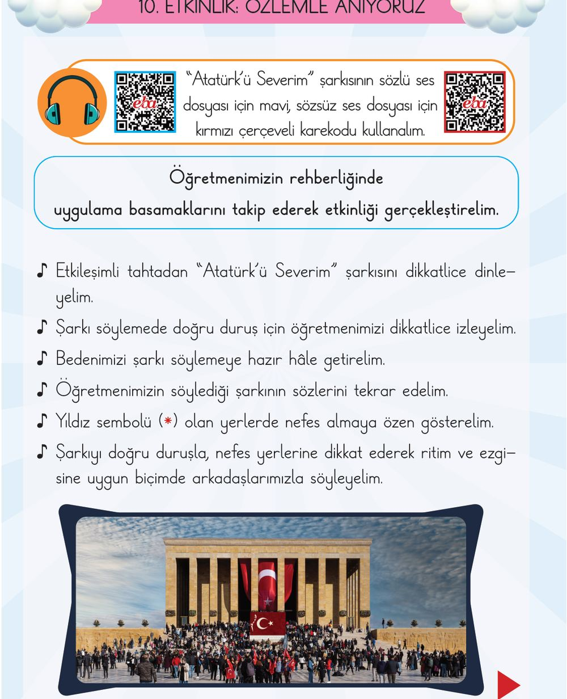

> Öğretmenimizin rehberliğinde uygulama basamaklarını takip ederek etkinliği gerçekleştirelim.

♪ Etkileşimli tahtadan “Atatürk’ü Severim” şarkısını dikkatlice dinleyelim.

♪ Şarkı söylemede doğru duruş için öğretmenimizi dikkatlice izleyelim.

♪ Bedenimizi şarkı söylemeye hazır hâle getirelim.

♪ Öğretmenimizin söylediği şarkının sözlerini tekrar edelim.

♪ Yıldız sembolü (*) olan yerlerde nefes almaya özen gösterelim.

♪ Şarkıyı doğru duruşla, nefes yerlerine dikkat ederek ritim ve ezgisine uygun biçimde arkadaşlarımızla söyleyelim.

<!-- sayfa 42 -->

10. ETKİNLİK: ÖZLEMLE ANIYORUZ

1881-193∞
*Daima izindeyiz.*

ATATÜRK’Ü SEVERİM
Mahir Dinçer (1939–1992)

Atatürk’ü severim*
Atatürk’ü severim*
Sevgi dolu yüreğim*
Atatürk’ü severim*

Atatürk’ü severiz*
Atatürk’ü severiz*
Annem, babam, hepimiz*
Atatürk’ü severiz

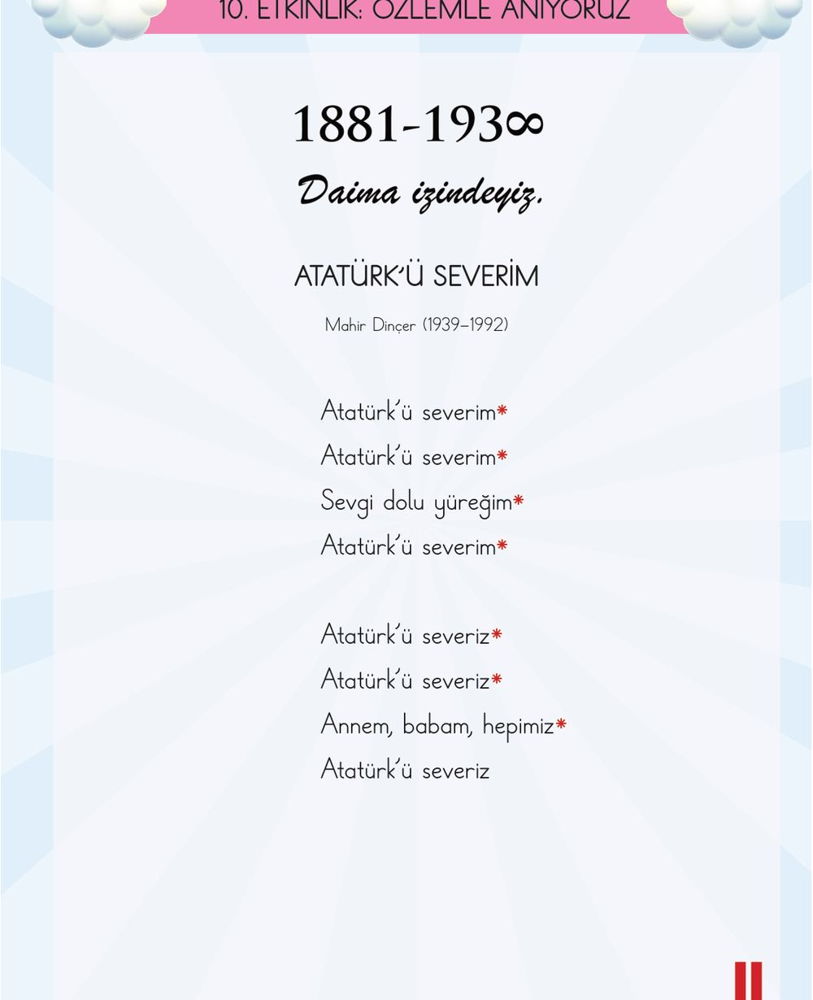
<!-- yer tutucu bulunamadı: sayfa sonuna eklendi -->

<!-- sayfa 43 -->

# 11. ETKİNLİK: BİRLİKTE KUTLAYALIM

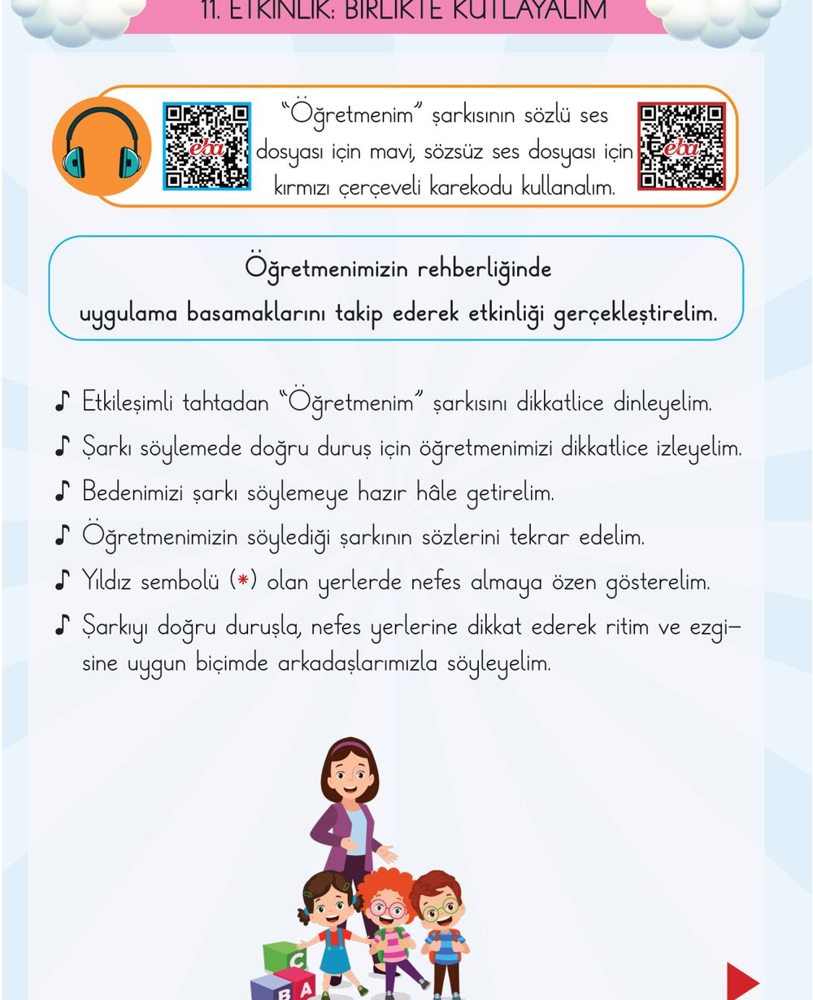 “Öğretmenim” şarkısının sözlü ses dosyası için mavi, sözsüz ses dosyası için kırmızı çerçeveli karekodu kullanalım.

## Öğretmenimizin rehberliğinde uygulama basamaklarını takip ederek etkinliği gerçekleştirelim.

♪ Etkileşimli tahtadan “Öğretmenim” şarkısını dikkatlice dinleyelim.

♪ Şarkı söylemede doğru duruş için öğretmenimizi dikkatlice izleyelim.

♪ Bedenimizi şarkı söylemeye hazır hâle getirelim.

♪ Öğretmenimizin söylediği şarkının sözlerini tekrar edelim.

♪ Yıldız sembolü (*) olan yerlerde nefes almaya özen gösterelim.

♪ Şarkıyı doğru duruşla, nefes yerlerine dikkat ederek ritim ve ezgi- sine uygun biçimde arkadaşlarımızla söyleyelim.

<!-- sayfa 44 -->

11. ETKİNLİK: BİRLİKTE KUTLAYALIM

# ÖĞRETMENİM
Söz: Rakım Çalapala
Müzik: Erdoğan Okyay (1933–2017)

Öğretmenim* canım benim canım benim*
Seni ben pek çok pek çok severim*
Sen bir ana* sen bir baba*
Her şey oldun artık bana

Okut* öğret ve nihayet*
Yurda yarar bir insan et

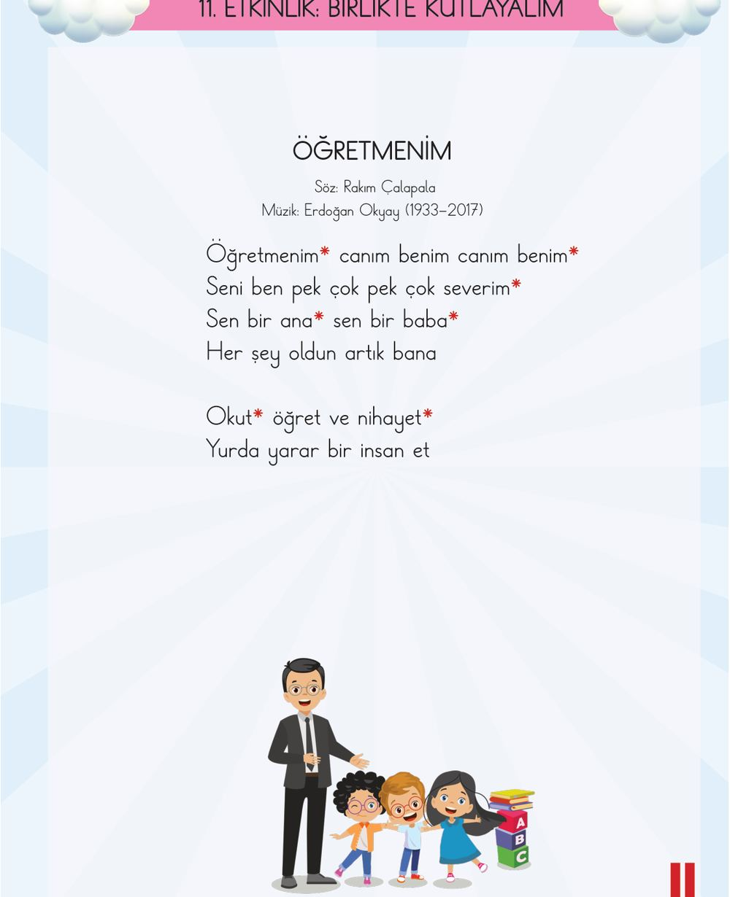

<!-- sayfa 45 -->

# DEĞERLENDİRME ZAMANI 5

Aşağıdaki ifadelere göre kutucukları $\checkmark$ ile işaretleyelim.

1 Bedenimi şarkı söylemeye hazır hâle getirdim.

2 Şarkıyı söylerken doğru yerlerde nefes aldım.

3 Şarkıyı ritmine uygun söyledim.

4 Şarkıyı ezgisine uygun söyledim.

<!-- sayfa 46 -->

# D Ü Ş Ü N E L İ M
# B U L A L I M

♪ Hepimizin bildiği ortak şarkılar nelerdir?
♪ Bunları birlikte belirleyelim.

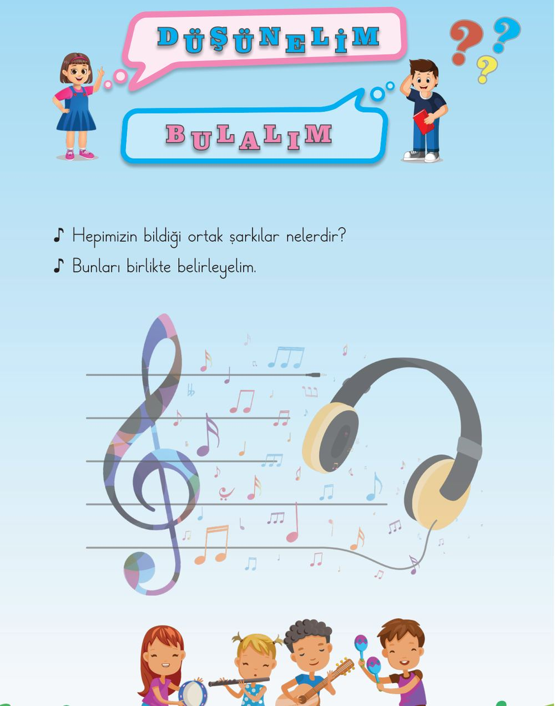

<!-- sayfa 47 -->

# SÖYLEYELİM

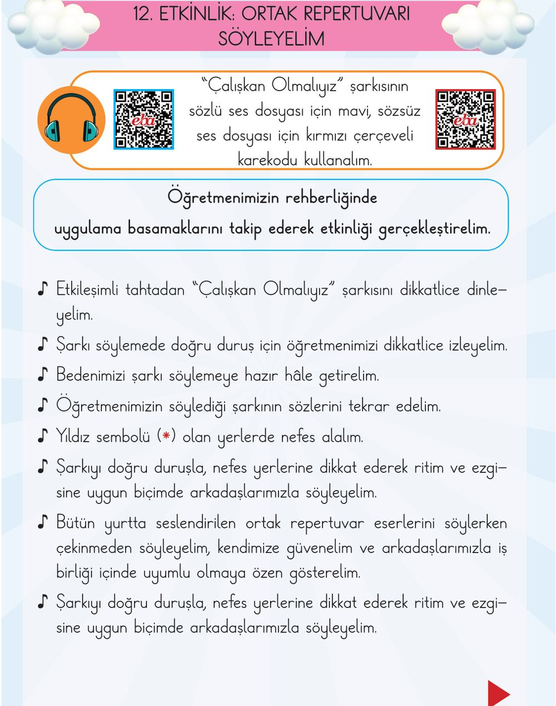 “Çalışkan Olmalıyız” şarkısının sözlü ses dosyası için mavi, sözsüz ses dosyası için kırmızı çerçeveli karekodu kullanalım.

> Öğretmenimizin rehberliğinde uygulama basamaklarını takip ederek etkinliği gerçekleştirelim.

♪ Etkileşimli tahtadan “Çalışkan Olmalıyız” şarkısını dikkatlice dinleyelim.

♪ Şarkı söylemede doğru duruş için öğretmenimizi dikkatlice izleyelim.

♪ Bedenimizi şarkı söylemeye hazır hâle getirelim.

♪ Öğretmenimizin söylediği şarkının sözlerini tekrar edelim.

♪ Yıldız sembolü (*) olan yerlerde nefes alalım.

♪ Şarkıyı doğru duruşla, nefes yerlerine dikkat ederek ritim ve ezgisine uygun biçimde arkadaşlarımızla söyleyelim.

♪ Bütün yurtta seslendirilen ortak repertuvar eserlerini söylerken çekinmeden söyleyelim, kendimize güvenelim ve arkadaşlarımızla iş birliği içinde uyumlu olmaya özen gösterelim.

<!-- sayfa 48 -->

# SÖYLEYELİM

## ÇALIŞKAN OLMALIYIZ
Söz-Müzik: Sefai Acay (1946–2016)

Çok çalışkan olmalıyız*
Çok çalışkan olmalıyız*
Bu ulus için* bu vatan için*
Çok çalışkan olmalıyız*

Tembel tembel durmamalı*
Günler hiç boş kalmamalı*
Bu ulus için* bu vatan için*
Çok çalışkan olmalıyız*

Her iş zordur bilmeliyiz*
Güçlükleri yenmeliyiz*
Bu ulus için* bu vatan için*
Çok çalışkan olmalıyız

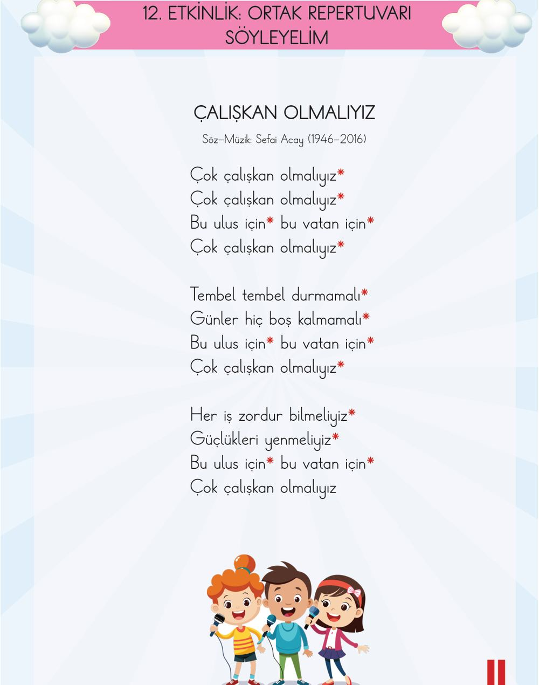

<!-- sayfa 49 -->

# SÖYLEYELİM

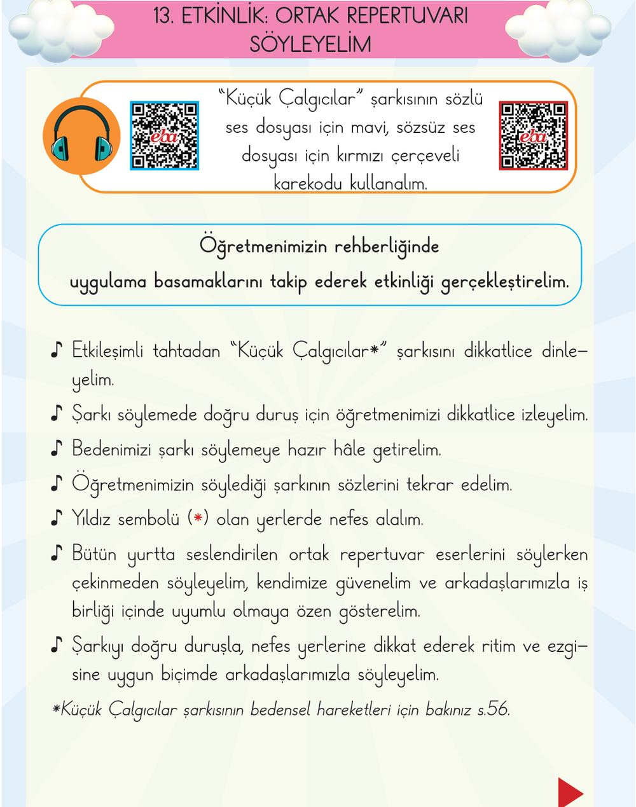: “Küçük Çalgıcılar” şarkısının sözlü ses dosyası için mavi, sözsüz ses dosyası için kırmızı çerçeveli karekodu kullanalım.

Öğretmenimizin rehberliğinde uygulama basamaklarını takip ederek etkinliği gerçekleştirelim.

♪ Etkileşimli tahtadan “Küçük Çalgıcılar*” şarkısını dikkatlice dinleyelim.

♪ Şarkı söylemede doğru duruş için öğretmenimizi dikkatlice izleyelim.

♪ Bedenimizi şarkı söylemeye hazır hâle getirelim.

♪ Öğretmenimizin söylediği şarkının sözlerini tekrar edelim.

♪ Yıldız sembolü (*) olan yerlerde nefes alalım.

♪ Bütün yurtta seslendirilen ortak repertuvar eserlerini söylerken çekinmeden söyleyelim, kendimize güvenelim ve arkadaşlarımızla iş birliği içinde uyumlu olmaya özen gösterelim.

♪ Şarkıyı doğru duruşla, nefes yerlerine dikkat ederek ritim ve ezgi-sine uygun biçimde arkadaşlarımızla söyleyelim.

*Küçük Çalgıcılar şarkısının bedensel hareketleri için bakınız s.56.

<!-- sayfa 50 -->

# SÖYLEYELİM

## KÜÇÜK ÇALGICILAR
Uyarlama

Biz köylerden gelen şen çalgıcılarız hey*
Biz köylerden gelen şen çalgıcılarız*
Şarkı söyler, oyun oynarız hey*
Flüt, keman, davul çalarız*

Zım terelelli zım terelelli
Zım terelelli zım zım*
Zım terelelli zım terelelli
Zım terelelli zım

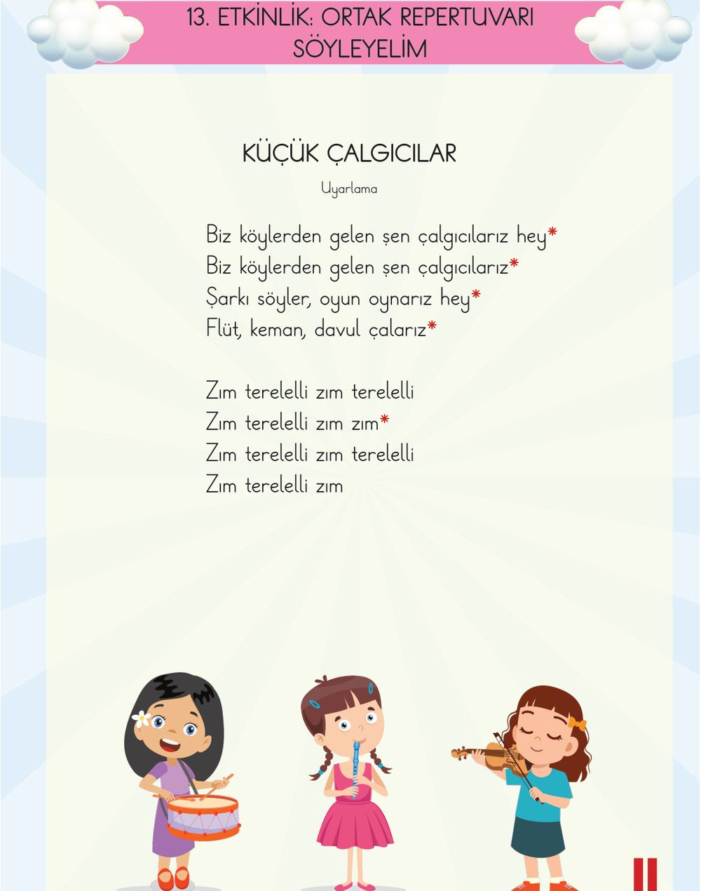

<!-- sayfa 51 -->

# DEĞERLENDİRME ZAMANI 6

Aşağıdaki ifadelere göre kutucukları $\checkmark$ ile işaretleyelim.

1 Bedenimi şarkı söylemeye hazır hâle getirdim.
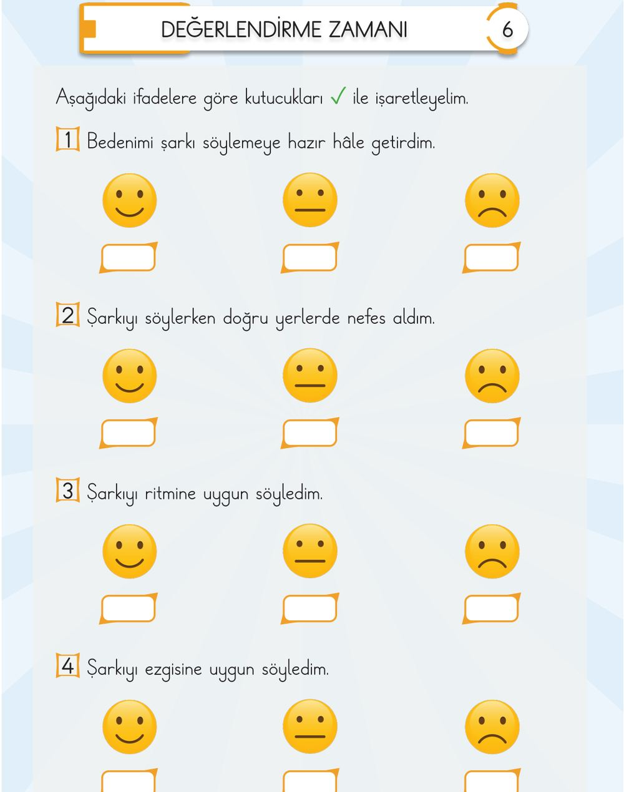
$\text{😊}$
$\square$
$\text{😐}$
$\square$
$\text{☹️}$
$\square$

2 Şarkıyı söylerken doğru yerlerde nefes aldım.

$\text{😊}$
$\square$
$\text{😐}$
$\square$
$\text{☹️}$
$\square$

3 Şarkıyı ritmine uygun söyledim.

$\text{😊}$
$\square$
$\text{😐}$
$\square$
$\text{☹️}$
$\square$

4 Şarkıyı ezgisine uygun söyledim.

$\text{😊}$
$\square$
$\text{😐}$
$\square$
$\text{☹️}$
$\square$

<!-- sayfa 52 -->

# D Ü Ş Ü N E L İ M
# B U L A L I M

♪ Şarkı söylerken ya da müzik dinlerken bedensel hareketlerle eşlik ettiniz mi?

♪ Şarkılara bedensel hareketlerle (parmak şıklatma, alkış yapma vb.) nasıl eşlik ettiğimizi gösterelim.

<!-- sayfa 53 -->

# 14. ETKİNLİK: BEDEN PERKÜSYONU

 “Leylek Leylek Havada” tekerlemesinin bedensel hareketlerini gösteren örnek video için karekodu kullanalım.

## Öğretmenimizin rehberliğinde uygulama basamaklarını takip ederek etkinliği gerçekleştirelim.

♪ Tekerlemenin bedensel hareketlerini gösteren örnek videoyu etkileşimli tahtadan izleyelim.

♪ Öğretmenimizin eşliğinde tekerlemeyi söyleyerek kendi belirlediğimiz bedensel hareketlerle tekerlemeye eşlik edelim.

♪ Yıldız sembolü (*) olan yerlerde nefes almaya özen gösterelim.

♪ Hareketleri pekiştirmek için birkaç kez tekrar edelim.

♪ Hareketleri arkadaşlarımızla sergileyim.

<!-- sayfa 54 -->

14. ETKİNLİK: BEDEN PERKÜSYONU

LEYLEK LEYLEK HAVADA

Leylek leylek havada*
Yumurtası tavada*
Yumurtanın içi yok*
Sarı kızın suçu yok*

Leylek leylek lekirdek*
Hani bana çekirdek*
Çekirdeğin içi yok*
Sarı kızın suçu yok

<!-- sayfa 55 -->

# 15. ETKİNLİK: BEDEN PERKÜSYONU

![Kulaklık simgesi ve QR kod] “Küçük Çalgıcılar” şarkısının bedensel hareketlerini gösteren örnek video için karekodu kullanalım.

> Öğretmenimizin rehberliğinde uygulama basamaklarını takip ederek etkinliği gerçekleştirelim.

♪ Şarkının bedensel hareketlerini gösteren örnek videoyu etkileşimli tahtadan izleyelim.

♪ Öğretmenimizin eşliğinde şarkıyı söyleyerek kendi belirlediğimiz bedensel hareketlerle şarkıya eşlik edelim.

♪ Yıldız sembolü (*) olan yerlerde nefes almaya özen gösterelim.

♪ Hareketleri pekiştirmek için birkaç kez tekrar edelim.

♪ Hareketleri arkadaşlarımızla sergileyim.

<!-- sayfa 56 -->

# 15. ETKİNLİK: BEDEN PERKÜSYONU

## KÜÇÜK ÇALGICILAR
Uyarlama

Biz köylerden gelen şen çalgıcılarız hey*
Biz köylerden gelen şen çalgıcılarız*
Şarkı söyler, oyun oynarız hey*
Flüt, keman, davul çalarız*

Zım terelelli zım terelelli
Zım terelelli zım zım*
Zım terelelli zım terelelli
Zım terelelli zım

<!-- sayfa 57 -->

# DEĞERLENDİRME ZAMANI

Aşağıdaki ifadelere göre kutucukları $\checkmark$ ile işaretleyelim.

1  Eserin ritmik yapısına uygun hareketler belirledim.

😊
[ ]

😐
[ ]

☹️
[ ]

2  Eserin anlamına uygun hareketler belirledim.

😊
[ ]

😐
[ ]

☹️
[ ]

3  Eserin ritmik yapısına uygun hareketler sergiledim.

😊
[ ]

😐
[ ]

☹️
[ ]

4  Eserin anlamına uygun hareketler sergiledim.

😊
[ ]

😐
[ ]

☹️
[ ]

<!-- sayfa 58 -->

# DEĞERLENDİRME ZAMANI

Aşağıdaki ifadelere göre kutucukları $\checkmark$ ile işaretleyelim.

5 Bedensel hareket yaparken parmaklarımı şıklattım.

6 Bedensel hareket yaparken alkış yaptım.

7 Bedensel hareket yaparken elimle dizime vurdum.

8 Bedensel hareket yaparken ayaklarımı yere vurdum.

<!-- sayfa 59 -->

# 1. TEMA DEĞERLENDİRME SORULARI

Aşağıdaki ifadelere göre kutucukları $\checkmark$ ile işaretleyelim.

1. Türk milletinin bağımsızlık sembollerinin Türk bayrağı ve İstiklâl Marşı olduğunu biliyorum.
 🙂 $\square$  😐 $\square$  ☹️ $\square$

2. Doğadan, çevreden ve nesnelerden duyduğum seslerin özelliklerini ayırt edebiliyorum.
 🙂 $\square$  😐 $\square$  ☹️ $\square$

3. Dinlediğim ezginin hüzünlü mü neşeli mi olduğunu fark edebiliyorum.
 🙂 $\square$  😐 $\square$  ☹️ $\square$

4. Ninnileri ezgisine dikkat ederek söyleyebiliyorum.
 🙂 $\square$  😐 $\square$  ☹️ $\square$

<!-- sayfa 60 -->

# 1. TEMA DEĞERLENDİRME SORULARI

5 Belirli gün ve haftalarla ilgili şarkılar ve marşları anlamına uygun şekilde seslendirebiliyorum.
😊 💬  😐 💬  ☹️ 💬

6 Ortak repertuvardaki eserleri söylerken bedenimi şarkı söylemeye hazır hale getirebiliyorum.
😊 💬  😐 💬  ☹️ 💬

7 Eserlere bedensel hareketlerle eşlik edebiliyorum.
😊 💬  😐 💬  ☹️ 💬

Ek değerlendirme soruları için karekodu kullanınız. 

<!-- sayfa 61 -->

2. Temanın EBA içerik alanına ulaşmak için karekodu kullanınız. 

2. TEMA
MÜZİK KÜLTÜRÜ

♪ Müzik dinleme/söyleme kuralları
♪ Ritim veren vurmalı çalgılar
♪ Farklı türdeki eserler
♪ Belirli gün ve haftalarla ilgili eserler
♪ Ortak repertuvar
♪ Bedensel hareketler

<!-- sayfa 62 -->

2. temanın özet içeriğine ulaşmak için karekodu kullanınız. 

# M Ü Z İ K

Bu temada sizden

♪ müzik dinleme/söyleme kurallarını çözümleyebilmeniz,
♪ ritim veren vurmalı çalgıları tanıyabilmeniz,
♪ farklı türdeki eserleri söyleyebilmeniz,
♪ belirli gün ve haftalarla ilgili eserleri söyleyebilmeniz,
♪ ortak repertuvardaki eserleri söyleyebilmeniz,
♪ müzik eserlerine bedensel hareketlerle eşlik edebilmeniz
beklenmektedir.

<!-- sayfa 63 -->

# D Ü Ş Ü N E L İ M
# B U L A L I M

♪ Müzik dinlerken nelere dikkat etmeliyiz? Arkadaşlarımızla paylaşalım.

♪ Şarkı söylerken nelere dikkat etmeliyiz? Arkadaşlarımızla paylaşalım.

♫ Evde yüksek sesle müzik dinlediğimizde ya da şarkı söylediğimizde olumlu ve olumsuz neler hissederiz? Arkadaşlarımızla paylaşalım.

<!-- sayfa 64 -->

# 1. ETKİNLİK: MÜZİK DİNLEME KURALLARI

Öğretmenimizin rehberliğinde uygulama basamaklarını takip ederek etkinliği gerçekleştirelim.

♪ Yukarıdaki görselleri inceleyelim.
♪ Her bir görsele göre nasıl müzik dinlememiz gerektiğini düşünelim.
♪ Düşüncelerimizi arkadaşlarımızla paylaşalım.

## Bilgi Kutucuğu
### MÜZİK DİNLEME KURALLARI

♪ İşitme sağlığımız için çok yüksek sesle müzik dinlemeyelim.
♪ Telefon, televizyon, radyo gibi cihazlardan müzik dinlerken başkalarını rahatsız edecek şekilde cihazın sesini açmayalım.
♪ Toplu taşıma araçlarında müzik dinlerken kulaklık kullanmaya özen gösterelim.
♪ Konser salonlarında ve törenlerde müzik dinlerken sessiz olalım.
♪ Evde müzik dinlerken komşularımızı ve çevremizi rahatsız etmemeye özen gösterelim.

<!-- sayfa 65 -->

# 2. ETKİNLİK: ŞARKI SÖYLEME KURALLARI

> Öğretmenimizin rehberliğinde uygulama basamaklarını takip ederek etkinliği gerçekleştirelim.

♪ Yukarıdaki görselleri inceleyelim.
♪ Her bir görsele göre nasıl şarkı söylememiz gerektiğini düşünelim.
♪ Düşüncelerimizi arkadaşlarımızla paylaşalım.

### Bilgi Kutucuğu
## ŞARKI SÖYLEME KURALLARI

♪ Ses sağlığımız için bağırarak şarkı söylemeyelim.
♪ Ayakta ya da oturarak şarkı söylerken omurga sağlığımız için dik duralım.
♪ Şarkı söylerken nefesimizi doğru bir şekilde kullanmaya özen gösterelim.
♪ Evde şarkı söylerken komşularımızı ve çevremizi rahatsız etmemeye özen gösterelim.
♪ Toplu hâlde şarkı söylerken arkadaşlarımızla uyum içerisinde olalım.

<!-- sayfa 66 -->

# 3. ETKİNLİK: OYNAYALIM – EĞLENELİM

> Öğretmenimizin rehberliğinde uygulama basamaklarını takip ederek etkinliği gerçekleştirelim.

♪ Öğretmenimizin rehberliğinde iki gruba ayrılalım.

♪ Bir gruba “dinleyiciler”, diğer gruba “şarkı söyleyenler” ismini verelim.

♪ Şarkı söyleyenler grubundan bir şarkıyı, şarkı söyleme kurallarına göre söylemelerini isteyelim.

♪ “Dinleyiciler” grubundan da daha önce öğrendiğimiz dinleme kurallarına “uymadan” şarkı söyleyenler grubunu dinlemelerini isteyelim.

♪ “Şarkı söyleyenler” grubundan dinleyiciler grubunun yaptığı hataları bulmalarını isteyelim.

♪ Grupları değiştirerek oyunu sürdürelim.

<!-- sayfa 67 -->

# DEĞERLENDİRME ZAMANI 1

Aşağıdaki ifadelere göre kutucukları $\checkmark$ ile işaretleyelim.

1  Müzik dinleme kurallarını biliyorum.
😊 [ ]  😐 [ ]  ☹️ [ ]

2  Şarkı söyleme kurallarını biliyorum.
😊 [ ]  😐 [ ]  ☹️ [ ]

3  Müzik dinleme kurallarını uyguluyorum.
😊 [ ]  😐 [ ]  ☹️ [ ]

4  Şarkı söyleme kurallarını uyguluyorum.
😊 [ ]  😐 [ ]  ☹️ [ ]

<!-- sayfa 68 -->

# D Ü Ş Ü N E L İ M
# B U L A L I M

Vurmalı çalgılar nelerdir?

Vurmalı çalgılardan hangilerini gördünüz, dinlediniz ya da çaldınız? Arkadaşlarımızla paylaşalım.

<!-- sayfa 69 -->

# ÇALGILARI TANIYALIM

 Ritim veren vurmalı çalgıları tanıtan videoyu izlemek için karekodu kullanalım.

Öğretmenimizin rehberliğinde uygulama basamaklarını takip ederek etkinliği gerçekleştirelim.

♪ Aşağıdaki ritim veren vurmalı çalgıları inceleyelim.
♪ Ritim veren vurmalı çalgıları tanıtan videoyu izleyelim.
♪ Ritim veren vurmalı çalgıların özellik, benzerlik ve farklılıklarını kendi cümlelerimizle ifade edelim.
♪ Sınıfımızda bulunan ritim veren vurmalı çalgıları çalalım.

| Darbuka | Tumba | Bateri | Kastanyet |
| :---: | :---: | :---: | :---: |
|  |  |  |  |
| Darbuka | Tumba | Bateri | Kastanyet |

| Bongo | Tef | Marakas | Davul |
| :---: | :---: | :---: | :---: |
|  |  |  |  |
| Bongo | Tef | Marakas | Davul |

<!-- sayfa 70 -->

# ÖRNEKLER

♪ Ritim veren vurmalı çalgılarla ilgili “ülkemiz kültürel mirasından” öğretmenimizin seçtiği saygınlık kazanmış örnek eserler ve icracılarını etkileşimli tahtadan izleyelim.

♪ Ritim veren vurmalı çalgılarla ilgili “dünya kültürel mirasından” öğretmenimizin seçtiği saygınlık kazanmış örnek eserler ve icracılarını etkileşimli tahtadan izleyelim.

♪ Ülkemiz ve dünya kültürel mirası ile ilgili izlediğimiz videolardan ilgimizi çeken örnekleri arkadaşlarımızla paylaşalım.

<!-- sayfa 71 -->

# 6. ETKİNLİK: OYNAYALIM-EĞLENELİM

 “Çalgının Sesini Bulalım” oyununu oynamak için karekodu kullanalım.

Öğretmenimizin rehberliğinde uygulama basamaklarını takip ederek etkinliği gerçekleştirelim.

♪ Etkileşimli tahtadan “Çalgının Sesini Bulalım” oyununu açalım.
♪ Oyundaki yönergeleri takip edelim.

<!-- sayfa 72 -->

# 7. ETKİNLİK: OYNAYALIM-EĞLENELİM

Aşağıda verilen görsellerdeki çalgıların isimlerini altlarındaki kutucuğa yazalım.

.............................

.............................

.............................

.............................

.............................

.............................

<!-- sayfa 73 -->

# DEĞERLENDİRME ZAMANI 2

1 Aşağıdaki çalgılardan ritim veren vurmalı çalgıları $\checkmark$ ile işaretleyelim.

2 Ritim veren vurmalı çalgıların özellikleri nelerdir? Söyleyelim.

3 Ritim veren vurmalı çalgıların benzerlikleri nelerdir? Söyleyelim.

4 Ritim veren vurmalı çalgıların farklılıkları nelerdir? Söyleyelim.

<!-- sayfa 74 -->

# D Ü Ş Ü N E L İ M
# B U L A L I M

Bildiğimiz farklı türdeki eserler nelerdir? Arkadaşlarımızla paylaşalım.

Evimizde en çok hangi müzik türlerini dinliyoruz. Arkadaşlarımızla paylaşalım.

<!-- sayfa 75 -->

# 8. ETKİNLİK: BİRLİKTE SÖYLEYELİM

 “Kışa Veda” şarkısının sözlü ses dosyası için mavi, sözsüz ses dosyası için kırmızı çerçeveli karekodu kullanalım.

## Öğretmenimizin rehberliğinde uygulama basamaklarını takip ederek etkinliği gerçekleştirelim.

♪ Etkileşimli tahtadan “Kışa Veda” şarkısını dikkatlice dinleyelim.
♪ Şarkı söylemede doğru duruş için öğretmenimizi dikkatlice izleyelim.
♪ Bedenimizi şarkı söylemeye hazır hâle getirelim.
♪ Öğretmenimizin söylediği şarkının sözlerini tekrar edelim.
♪ Yıldız sembolü (*) olan yerlerde nefes almaya özen gösterelim.
♪ Şarkının nefes yerlerine dikkat edelim.
♪ Şarkıyı doğru duruşla, nefes yerlerine dikkat ederek ritim ve ezgi- sine uygun biçimde arkadaşlarımızla söyleyelim.

<!-- sayfa 76 -->

# 8. ETKİNLİK: BİRLİKTE SÖYLEYELİM

KIŞA VEDA

Söz: Halil Bedii Yönetken
Müzik: Alman Şarkısı Uyarlama

Ey kış sana*
Artık veda*
Sen git güle güle*
Görüşelim yine*
Ey kış sana*
Artık veda*

Artık ne kar*
Ne kayak var*
Ne kartopu oyunu*
Ne de kardan adam*
Ey kış sana*
Artık veda

<!-- sayfa 77 -->

# 9. ETKİNLİK: BİRLİKTE SÖYLEYELİM

> “Şeftali Ağaçları” türküsünün sözlü ses dosyası için mavi, sözsüz ses dosyası için kırmızı çerçeveli karekodu kullanalım.
> 

## Öğretmenimizin rehberliğinde uygulama basamaklarını takip ederek etkinliği gerçekleştirelim.

♪ Etkileşimli tahtadan “Şeftali Ağaçları*” türküsünü dikkatlice dinleyelim.

♪ Şarkı söylemede doğru duruş için öğretmenimizi dikkatlice izleyelim.

♪ Bedenimizi şarkı söylemeye hazır hâle getirelim.

♪ Öğretmenimizin söylediği türkünün sözlerini tekrar edelim.

♪ Yıldız sembolü (*) olan yerlerde nefes almaya özen gösterelim.

♪ Türküyü doğru duruşla, nefes yerlerine dikkat ederek ritim ve ezgisine uygun biçimde arkadaşlarımızla söyleyelim.

*Şeftali Ağaçları türküsünün bedensel hareketleri için bakınız s.100.

<!-- sayfa 78 -->

9. ETKİNLİK: BİRLİKTE SÖYLEYELİM

# ŞEFTALİ AĞAÇLARI
*Yöresi: Sinop*

Şeftali ağaçları*
Türlü çiçek başları*
Yaktı yandırdı beni*
Yarin hilal kaşları*

Tin tin tinimini hanım*
Seni seviyor canım*

Bahçelerde kereviz*
Biz kereviz yemeyiz*
Bize Sinoplu derler*
Biz güzeli severiz*

Tin tin tinimini hanım*
Seni seviyor canım

<!-- sayfa 79 -->

# 10. ETKİNLİK: BİRLİKTE SÖYLEYELİM

“Okul Türküsü”nün sözlü ses dosyası için mavi, sözsüz ses dosyası için kırmızı çerçeveli karekodu kullanalım.

> Öğretmenimizin rehberliğinde uygulama basamaklarını takip ederek etkinliği gerçekleştirelim.

♪ Etkileşimli tahtadan “Okul Türküsü”nü dikkatlice dinleyelim.
♪ Şarkı söylemede doğru duruş için öğretmenimizi dikkatlice izleyelim.
♪ Bedenimizi şarkı söylemeye hazır hâle getirelim.
♪ Öğretmenimizin söylediği şarkının sözlerini tekrar edelim.
♪ Yıldız sembolü (*) olan yerlerde nefes almaya özen gösterelim.
♪ Şarkıyı doğru duruşla, nefes yerlerine dikkat ederek ritim ve ezgi-sine uygun biçimde arkadaşlarımızla söyleyelim.

<!-- sayfa 80 -->

10. ETKİNLİK: BİRLİKTE SÖYLEYELİM

# OKUL TÜRKÜSÜ
Söz-Müzik: Cenan Akın (1932–2006)

Lara lara la.....
Lara lara la.....

Çok severiz okulu okulu*
Bilgi ve sevgi dolu dopdolu*
Aldı beni bağrına*
Aydınlatır yolumu yolumu*

Sevinç dolu yüreğim yüreğim*
Gitmez boşa emeğim emeğim*
Yurduma insanlığa*
Faydalı olmak dileğim dileğim*

Günler günlere eklensin*
Öğrenenler güçlensin*
Sevgili Türkiye’mde*
Mutluluk çiçeklensin

<!-- sayfa 81 -->

# 11. ETKİNLİK: BİRLİKTE SÖYLEYELİM

🎧 [QR KOD] “Kâtibim” şarkısının sözlü ses dosyası için mavi, sözsüz ses dosyası için kırmızı çerçeveli karekodu kullanalım. [QR KOD]

> Öğretmenimizin rehberliğinde uygulama basamaklarını takip ederek etkinliği gerçekleştirelim.

♪ Etkileşimli tahtadan “Kâtibim” şarkısını dikkatlice dinleyelim.
♪ Şarkı söylemede doğru duruş için öğretmenimizi dikkatlice izleyelim.
♪ Bedenimizi şarkı söylemeye hazır hâle getirelim.
♪ Öğretmenimizin söylediği şarkının sözlerini tekrar edelim.
♪ Yıldız sembolü (*) olan yerlerde nefes almaya özen gösterelim.
♪ Şarkıyı doğru duruşla, nefes yerlerine dikkat ederek ritim ve ezgi-sine uygun biçimde arkadaşlarımızla söyleyelim.

<!-- sayfa 82 -->

11. ETKİNLİK: BİRLİKTE SÖYLEYELİM

# KÂTİBİM
İstanbul Türküsü

Üsküdar’a gider iken aldı da bir yağmur*
Kâtibimin setresi uzun, eteği çamur*
Kâtip uykudan uyanmış gözleri mahmur*
Kâtip benim ben kâtibin, el ne karışır*
Kâtibime kolalı da gömlek ne güzel yaraşır*

Üsküdar’a gider iken bir mendil buldum*
Mendilimin içine lokum doldurdum*
Kâtibimi arar iken yanımda buldum*
Kâtip benim ben kâtibin, el ne karışır*
Kâtibime kolalı da gömlek ne güzel yaraşır

<!-- sayfa 83 -->

# DEĞERLENDİRME ZAMANI 3

Aşağıdaki ifadelere göre kutucukları $\checkmark$ ile işaretleyelim.

1 Bedenimi şarkı söylemeye hazır hâle getirdim.

2 Şarkıyı söylerken doğru yerlerde nefes aldım.

3 Şarkıyı ritmine uygun söyledim.

4 Şarkıyı ezgisine uygun söyledim.

<!-- sayfa 84 -->

# D Ü Ş Ü N E L İ M
# B U L A L I M

“Ulusal Egemenlik ve Çocuk Bayramı” ve “19 Mayıs Atatürk’ü Anma ve Gençlik ve Spor Bayramı” ile ilgili bildiğimiz şarkılar ve marşlar nelerdir? Arkadaşlarımızla paylaşalım.

<!-- sayfa 85 -->

# VE ÇOCUK BAYRAMI

 “Yirmi Üç Nisan” şarkısının sözlü ses dosyası için mavi, sözsüz ses dosyası için kırmızı çerçeveli karekodu kullanalım.

## Öğretmenimizin rehberliğinde uygulama basamaklarını takip ederek etkinliği gerçekleştirelim.

♪ Etkileşimli tahtadan “Yirmi Üç Nisan” şarkısını dikkatlice dinleyelim.
♪ Şarkı söylemede doğru duruş için öğretmenimizi dikkatlice izleyelim.
♪ Bedenimizi şarkı söylemeye hazır hâle getirelim.
♪ Öğretmenimizin söylediği şarkının sözlerini tekrar edelim.
♪ Yıldız sembolü (*) olan yerlerde nefes almaya özen gösterelim.
♪ Şarkıyı doğru duruşla, nefes yerlerine dikkat ederek ritim ve ezgi-sine uygun biçimde arkadaşlarımızla söyleyelim.

<!-- sayfa 86 -->

VE ÇOCUK BAYRAMI

# YİRMİ ÜÇ NİSAN

Söz-Müzik: Halil Bedii Yönetken (1899–1968)

Yirmi Üç Nisan kutlu olsun*
Sevinin küçükler*
Övünün büyükler*
Yirmi Üç Nisan kutlu olsun*

Çok büyük bayram bu bayram*
Herkese kutlu olsun*
Çok ulu bayram bu bayram*
Herkese mutlu olsun

23 NİSAN 1920
ULUSAL EGEMENLİK VE
ÇOCUK BAYRAMI

<!-- sayfa 87 -->

# GENÇLİK VE SPOR BAYRAMI

“Samsun’dan Doğan Güneş” marşının sözlü ses dosyası için mavi, sözsüz ses dosyası için kırmızı çerçeveli karekodu kullanalım.

Öğretmenimizin rehberliğinde uygulama basamaklarını takip ederek etkinliği gerçekleştirelim.

♪ Etkileşimli tahtadan “Samsun’dan Doğan Güneş” marşını dikkatlice dinleyelim.
♪ Şarkı söylemede doğru duruş için öğretmenimizi dikkatlice izleyelim.
♪ Bedenimizi şarkı söylemeye hazır hâle getirelim.
♪ Öğretmenimizin söylediği şarkının sözlerini tekrar edelim.
♪ Yıldız sembolü (*) olan yerlerde nefes almaya özen gösterelim.
♪ Marşı doğru duruşla, nefes yerlerine dikkat ederek ritim ve ezgi-sine uygun biçimde arkadaşlarımızla söyleyelim.

<!-- sayfa 88 -->

# GENÇLİK VE SPOR BAYRAMI

## SAMSUN’DAN DOĞAN GÜNEŞ
Söz–Müzik: Sefai Acay (1946–2016)

Samsun’dan güneş gibi*
Doğdun sen Atatürk*
Yurdumdan düşmanı*
Kovdun sen Atatürk*

Özgürlük, barış için*
Koştun sen Atatürk*
Aydınlık yurt için*
Coştun sen Atatürk

<!-- sayfa 89 -->

# DEĞERLENDİRME ZAMANI 4

Aşağıdaki ifadelere göre kutucukları $\checkmark$ ile işaretleyelim.

1 Bedenimi şarkı söylemeye hazır hâle getirdim.

$\text{😊}$
$\square$
$\text{😐}$
$\square$
$\text{☹️}$
$\square$

2 Şarkıyı söylerken doğru yerlerde nefes aldım.

$\text{😊}$
$\square$
$\text{😐}$
$\square$
$\text{☹️}$
$\square$

3 Şarkıyı ritmine uygun söyledim.

$\text{😊}$
$\square$
$\text{😐}$
$\square$
$\text{☹️}$
$\square$

4 Şarkıyı ezgisine uygun söyledim.

$\text{😊}$
$\square$
$\text{😐}$
$\square$
$\text{☹️}$
$\square$

<!-- sayfa 90 -->

# D Ü Ş Ü N E L İ M
# B U L A L I M

♪ Hepimizin bildiği ortak şarkılar nelerdir?
♪ Bunları birlikte bulalım.

<!-- sayfa 91 -->

# SÖYLEYELİM

“Atabarı” türküsünün sözlü ses dosyası için mavi, sözsüz ses dosyası için kırmızı çerçeveli karekodu kullanalım.

> Öğretmenimizin rehberliğinde uygulama basamaklarını takip ederek etkinliği gerçekleştirelim.

♪ Etkileşimli tahtadan “Atabarı” türküsünü dikkatlice dinleyelim.
♪ Şarkı söylemede doğru duruş için öğretmenimizi dikkatlice izleyelim.
♪ Bedenimizi şarkı söylemeye hazır hâle getirelim.
♪ Öğretmenimizin söylediği türkünün sözlerini tekrar edelim.
♪ Yıldız sembolü (*) olan yerlerde nefes alalım.
♪ Bütün yurtta seslendirilen ortak repertuvar eserlerini söylerken çekinmeden söyleyelim, kendimize güvenelim ve arkadaşlarımızla iş birliği içinde uyumlu olmaya özen gösterelim.
♪ Türküyü doğru duruşla, nefes yerlerine dikkat ederek ritim ve ezgisine uygun biçimde arkadaşlarımızla söyleyelim.

<!-- sayfa 92 -->

# SÖYLEYELİM

## ATABARI
Yöresi: Artvin

Bahçası var, barı var*
Ayvası var, narı var*
Atamızdan yadigar
Bizde Atabarı var*

Uzun uzun kamışlar*
Ucunu budamışlar*
Benim ela gözlümü
Gurbete yollamışlar*

Ben bir uzun kamışım*
Yoluna dikilmişim*
İster al ister alma
Alnına yazılmışım

<!-- sayfa 93 -->

# SÖYLEYELİM

 “23 Nisan” marşının sözlü ses dosyası için mavi, sözsüz ses dosyası için kırmızı çerçeveli karekodu kullanalım.

> Öğretmenimizin rehberliğinde uygulama basamaklarını takip ederek etkinliği gerçekleştirelim.

♪ Etkileşimli tahtadan “23 Nisan” isimli marşı dikkatlice dinleyelim.
♪ Şarkı söylemede doğru duruş için öğretmenimizi dikkatlice izleyelim.
♪ Bedenimizi şarkı söylemeye hazır hâle getirelim.
♪ Öğretmenimizin söylediği marşın sözlerini tekrar edelim.
♪ Yıldız sembolü (*) olan yerlerde nefes almaya özen gösterelim.
♪ Marşı doğru duruşla, nefes yerlerine dikkat ederek ritmine ve ezgisine uygun biçimde arkadaşlarımızla söyleyelim.
♪ Marşı bedensel hareketlerle eşlik ederek söyleyelim.

<!-- sayfa 94 -->

# SÖYLEYELİM

## 23 NİSAN
Söz-Müzik: Saip Egüz (1920–1981)

Sanki her tarafta var bir düğün*
Çünkü en şerefli en mutlu gün*
Bugün 23 Nisan*
Hep neşeyle doluyor insan*

Bugün Atatürk’ten bir armağan*
Yoksa tutsak olurduk sen inan*
Bugün 23 Nisan*
Hep neşeyle doluyor insan

<!-- sayfa 95 -->

# 16. ETKİNLİK: ORTAK REPERTUARI SÖYLEYELİM

 “Orman” şarkısının sözlü ses dosyası için mavi, sözsüz ses dosyası için kırmızı çerçeveli karekodu kullanalım.

> Öğretmenimizin rehberliğinde uygulama basamaklarını takip ederek etkinliği gerçekleştirelim.

♪ Etkileşimli tahtadan “Orman” şarkısını dikkatlice dinleyelim.
♪ Şarkı söylemede doğru duruş için öğretmenimizi dikkatlice izleyelim.
♪ Bedenimizi şarkı söylemeye hazır hâle getirelim.
♪ Öğretmenimizin söylediği şarkının sözlerini tekrar edelim.
♪ Yıldız sembolü (*) olan yerlerde nefes alalım.
♪ Bütün yurtta seslendirilen ortak repertuvar eserlerini söylerken çekinmeden söyleyelim, kendimize güvenelim ve arkadaşlarımızla iş birliği içinde uyumlu olmaya özen gösterelim.
♪ Marşı doğru duruşla, nefes yerlerine dikkat ederek ritim ve ezgi-sine uygun biçimde arkadaşlarımızla söyleyelim.

*Orman şarkısının bedensel hareketleri için bakınız s.102.

<!-- sayfa 96 -->

# SÖYLEYELİM

## ORMAN

Söz: İbrahim Bekir Tez
Müzik: Erdoğan Okyay (1933–2017)

Kestane, gürgen, palamut*
Altı yaprak, üstü bulut*
Gel sen burda derdi unut*
Orman ne güzel* ne güzel*

Dallar kol kola görünür*
Yaprak yaprağa sürünür*
Kışın karlara bürünür*
Orman ne güzel* ne güzel

<!-- sayfa 97 -->

# DEĞERLENDİRME ZAMANI 5

Aşağıdaki ifadelere göre kutucukları $\checkmark$ ile işaretleyelim.

1 Bedenimi şarkı söylemeye hazır hâle getirdim.

2 Şarkıyı söylerken doğru yerlerde nefes aldım.

3 Şarkıyı ritmine uygun söyledim.

4 Şarkıyı ezgisine uygun söyledim.

<!-- sayfa 98 -->

# D Ü Ş Ü N E L İ M
# B U L A L I M

Şarkı söylerken ya da müzik dinlerken şarkıya bedensel hareket-
lerle eşlik ediyor musunuz?

🔗 Şarkılara bedensel hareketlerle nasıl eşlik ettiğimizi gösterelim.

<!-- sayfa 99 -->

# 17. ETKİNLİK: BEDEN PERKÜSYONU

 “Şeftali Ağaçları” türküsünün bedensel hareketlerini gösteren örnek video için karekodu kullanalım.

## Öğretmenimizin rehberliğinde uygulama basamaklarını takip ederek etkinliği gerçekleştirelim.

♪ Türkünün bedensel hareketlerini gösteren örnek videoyu etkileşimli tahtadan izleyelim.

♪ Öğretmenimizin eşliğinde türküyü söyleyerek kendi belirlediğimiz bedensel hareketlerle türküye eşlik edelim.

♪ Yıldız sembolü (*) olan yerlerde nefes almaya özen gösterelim.

♪ Hareketleri pekiştirmek için birkaç kez tekrar edelim.

♪ Hareketleri arkadaşlarımızla sergileyim.

<!-- sayfa 100 -->

# 17. ETKİNLİK: BEDEN PERKÜSYONU

# ŞEFTALİ AĞAÇLARI
Yöresi: Sinop

Şeftali ağaçları*
Türlü çiçek başları*
Yaktı yandırdı beni*
Yarin hilal kaşları*

Tin tin tinimini hanım*
Seni seviyor canım*

Bahçelerde kereviz*
Biz kereviz yemeyiz*
Bize Sinoplu derler*
Biz güzeli severiz*

Tin tin tinimini hanım*
Seni seviyor canım

<!-- yer tutucu bulunamadı: sayfa sonuna eklendi -->

<!-- sayfa 101 -->

# 18. ETKİNLİK: BEDEN PERKÜSYONU

 “Orman” şarkısının bedensel hareketlerini gösteren örnek video için karekodu kullanalım.

## Öğretmenimizin rehberliğinde uygulama basamaklarını takip ederek etkinliği gerçekleştirelim.

♪ Şarkının bedensel hareketlerini gösteren örnek videoyu etkileşimli tahtadan izleyelim.

♪ Öğretmenimizin eşliğinde şarkıyı söyleyerek kendi belirlediğimiz bedensel hareketlerle şarkıya eşlik edelim.

♪ Yıldız sembolü (*) olan yerlerde nefes almaya özen gösterelim.

♪ Hareketleri pekiştirmek için birkaç kez tekrar edelim.

♪ Hareketleri arkadaşlarımızla sergileyim.

<!-- sayfa 102 -->

# 18. ETKİNLİK: BEDEN PERKÜSYONU

# ORMAN

Söz: İbrahim Bekir Tez
Müzik: Erdoğan Okyay (1933–2017)

Kestane, gürgen, palamut*
Altı yaprak, üstü bulut*
Gel sen burda derdi unut*
Orman ne güzel* ne güzel*

Dallar kol kola görünür*
Yaprak yaprağa sürünür*
Kışın karlara bürünür*
Orman ne güzel* ne güzel

<!-- sayfa 103 -->

# DEĞERLENDİRME ZAMANI 6

Aşağıdaki ifadelere göre kutucukları $\checkmark$ ile işaretleyelim.

1  Eserin ritmik yapısına uygun hareketler belirledim.

😊
[ ]

😐
[ ]

☹️
[ ]

2  Eserin anlamına uygun hareketler belirledim.

😊
[ ]

😐
[ ]

☹️
[ ]

3  Eserin ritmik yapısına uygun hareketler sergiledim.

😊
[ ]

😐
[ ]

☹️
[ ]

4  Eserin anlamına uygun hareketler sergiledim.

😊
[ ]

😐
[ ]

☹️
[ ]

<!-- sayfa 104 -->

# 2. TEMA DEĞERLENDİRME SORULARI

Aşağıdaki ifadelere göre kutucukları $\checkmark$ ile işaretleyelim.

1 Müzik dinleme kurallarını biliyorum.
😊 $\square$ 😐 $\square$ ☹️ $\square$

2 Ritim veren vurmalı çalgıların özelliklerini biliyorum.
😊 $\square$ 😐 $\square$ ☹️ $\square$

3 Ritim veren vurmalı çalgıların benzerliklerini biliyorum.
😊 $\square$ 😐 $\square$ ☹️ $\square$

4 Şarkıları ezgisine dikkat ederek söyleyebiliyorum.
😊 $\square$ 😐 $\square$ ☹️ $\square$

<!-- yer tutucu bulunamadı: sayfa sonuna eklendi -->

<!-- sayfa 105 -->

# 2. TEMA DEĞERLENDİRME SORULARI

5 Belirli gün ve haftalarla ilgili şarkılar ve marşları anlamına uygun şekilde seslendirebiliyorum.
😊 ☐ 😐 ☐ ☹️ ☐

6 Ortak repertuvardaki eserleri söylerken bedenimi şarkı söylemeye hazır hale getirebiliyorum.
😊 ☐ 😐 ☐ ☹️ ☐

7 Eserlere bedensel hareketlerle eşlik edebiliyorum.
😊 ☐ 😐 ☐ ☹️ ☐

Ek değerlendirme soruları için karekodu kullanınız. 

<!-- sayfa 106 -->

# SÖZLÜK

**A**
**armağan:** Birini sevindirmek için anı olarak verilen şey; hediye.

**B**
**bostan:** Sebze bahçesi.
**bostancı:** Bostan işleriyle uğraşan kimse.

**C-Ç**
**çağdaşlık:** Modernlik.

**D**
**dana:** İneğin yavrusu.
**dert:** Üzüntü, hastalık.

**E-F**
**emek:** Yorucu, özenli çalışma; alın teri.
**ela:** Açık kestane rengi.

**G-Ğ**
**gürgen:** Kerestesi değerli bir ağaç türü.

**H-I-İ-J**
**hilal:** Ayın ilk günlerinde aldığı yay biçimi.

**K-L**
**kereviz:** Maydanozgillerden kokulu bir bitki.
**kâtip:** Sekreter.

**M**
**Mevla:** Allah.
**mahmur:** Dalgın, baygın bakışlı.

**N**
**nihayet:** Son.
**ninni:** Bebeklerin uyuması için söylenen türkü.

**O-Ö-P**
**palamut:** Yurdumuzda yetişen meşe türünden fındığa benzeyen bir ağaç.

**R-S-Ş**
**sayışmaca:** Çocuk tekerlemesi.
**setre:** Düz yakalı, önü ilikli bir ceket türü.

**T**
**tekerleme:** Birbiriyle uyumlu hazır söz kalıbı.
**tutsak:** Savaşta ele geçen düşman; esir.

**U-Ü**
**uygarlık:** Uygar olma durumu; medeniyet.

**V-Y-Z**
**Yaradan:** Allah.
**yadigar:** Hatıra.

<!-- yer tutucu bulunamadı: sayfa sonuna eklendi -->

<!-- sayfa 107 -->

# KAYNAKÇA

Acay, S. (1983). Mavi Bilye Çocuklar İçin Şarkılar. Ezgi Yayıncılık. Ankara. s. 14, 22.

Dinçer, M. (1983). Cıvıl Cıvıl Okul Öncesi ve İlk Sınıflar İçin Şarkılar. Maya Matbaacılık. Ankara. s. 23.

Egüz, S. (1981). Çocuklarımıza Yeni Şarkılar. Ayyıldız Matbaası. Ankara. s. 56.

Toraganlı, H. (1950). Çocuklarımıza Yeni Şarkılar. Çankaya Basımevi. Ankara. s. 16

Millî Eğitim Bakanlığı , (2025). Türkiye Yüzyılı Maarif Modeli Müzik Dersi Öğretim Programı (1, 2, 3, 4, 5, 6, 7 ve 8. Sınıflar). Ankara.

Millî Eğitim Bakanlığı , (2024). Türkiye Yüzyılı Maarif Modeli Ortak Metin. Ankara.

Sun, M., ve Seyrek, H. (2002). Okul Öncesi Eğitiminde Müzik. Müzik Eserleri Yayınları. s. 220, 264.

Sun, M. (2006). Çocuklar ve Gençler için Şarkı Demeti. Sun Yayınevi. s. 6.

Sun, M. (2018). 80 Yılın En güzel Okul Şarkıları. Sun Yayınevi. s. 54.

TRT Müzik Dairesi Başkanlığı. TRT Türk Halk Müziği Repertuvarı. Ankara.

TRT Müzik Dairesi Başkanlığı. TRT Türk Sanat Müziği Repertuvarı. Ankara.

Yönetken, H.B. (1950). 50 Okul Şarkısı. Zeren Basımevi. Ankara. s. 32.

Yönetken, H.B. (1953). 25 Çocuk Şarkısı. Milli Eğitim Basımevi. İstanbul. s. 17

Bu kaynakça Apa 7 yazım kurallarına göre oluşturulmuştur.

<!-- sayfa 108 -->

45°D 40°D 35°D 30°D 25°D
45°D 40°D 35°D 30°D 25°D

TÜRKİYE'NİN MÜLKİ İDARE BÖLÜMLERİ İLE KARA VE DENİZ KOMŞULARI HARİTASI

BAŞKENT • Ankara
• İL MERKEZİ
• ÜLKE SINIRI
• ÖZERK BÖLGE SINIRI
• GÖL
• AKARSU

0 50 100 200 300 400 km

Harita Genel Müdürlüğü tarafından üretilmiştir.

<!-- sayfa 109 -->

: TÜRK DÜNYASI HARİTASI

**TÜRK DÜNYASI HARİTASI**

| | | | | | | | | | | | | | | | | | | | |
|---|---|---|---|---|---|---|---|---|---|---|---|---|---|---|---|---|---|---|---|
| 180° | 170°D | 160°D | 150°D | 140°D | 130°D | 120°D | 120°D | 110°D | 100°D | 100°D | 90°D | 80°D | 80°D | 70°D | 60°D | 60°D | 50°D | 50°D | 40°D | 40°D | 30°D | 30°D | 20°D | 10°D | 0° | 10°B | 20°B | 30°B |

**TÜRK CUMHURİYETLERİ / TÜRK BÖLGELERİ**
1 GAGAVUZ YERİ
2 KARAÇAY-ÇERKESYA
3 KABARDİN-BALKARYA C.
4 DAĞISTAN C.
5 ÇUVAŞİSTAN C.
6 TATARİSTAN C.
7 BAŞKURT C.
8 KARAKALPAKİSTAN C.
9 ALTAY C.
10 HAKASYA C.

**TÜRK TOPLULUKLARI**
a Avrupa'daki Türkler
b Kosova Türkleri
c Yunanistan Türkleri
ç Bulgaristan Türkleri
d Romanya Türkleri
e Suriye Türkmenleri
f Irak Türkmenleri
g İran Türkleri
ğ Afganistan Türkmenleri
h Pakistan Türkmenleri
ı Hindistan Türkmenleri
i Çin H. C. Türkleri
j Moğolistan Türkleri
k Rusya Federasyonu Türkler

**ÜLKE KISALTMALARI**
ARN ARNAVUTLUK
BEL BELÇİKA
BH BOSNA - HERSEK
GKRY GÜNEY KIBRIS RUM YÖNETİMİ
HRV HIRVATİSTAN
İSV İSVİÇRE
KRD KARADAĞ
KSV KOSOVA
KKTC KUZEY KIBRIS TÜRK CUMHURİYETİ
KMKD KUZEY MAKEDONYA
LİH LİH-TENŞTAYN
SRB SIRBİSTAN

**LEJAND**
* Bağımsız Türk Devletleri (Turuncu)
* Türk Cumhuriyetleri, Türk Bölgeleri (Kırmızı/Pembe)
* Türk Toplulukları (Sarı)

**ÖLÇEK**
0 250 500 1.000 1.500 2.000 km
