# Müzik 2.Sınıf Ders Kitabı

<!-- sayfa 0 -->

# İLKOKUL
# MÜZİK
# 2. SINIF
# DERS KİTABI

**YAZARLAR**

Hicran TEMUR
Mustafa Kemal SÜMBÜLLÜ
Onur GÜVEN

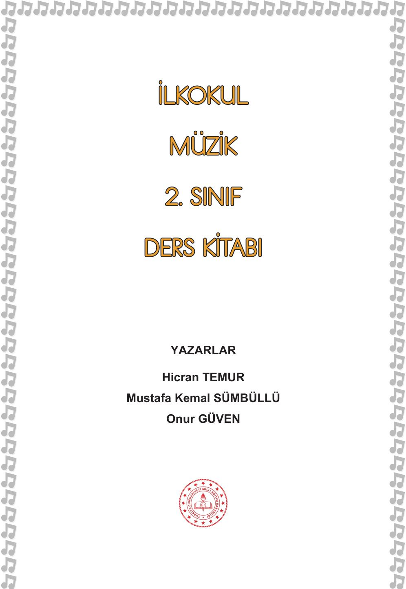

<!-- sayfa 1 -->

Ders Kitapları Dizisi No.................................................................................................2536
Her hakkı saklıdır ve Millî Eğitim Bakanlığına aittir. Kitabın metin, soru ve şekilleri kısmen de olsa hiçbir surette alınıp yayımlanamaz.

EDİTÖR
Prof. Dr. Süleyman TARMAN

DİL UZMANI
Vedat EĞİLMEZ

GÖRSEL TASARIMCI
Ahmet AKTAŞ
Fatih GÜNDÜZ
Nevzat ŞİMŞEK

ÇOKLU ORTAM TASARIMCISI
Erhan GÜL
Murat GENÇ

PROGRAM GELİŞTİRME UZMANI
Dr. Şahika ÜNLÜ

ÖLÇME VE DEĞERLENDİRME UZMANI
Emrah GÖREN

REHBERLİK UZMANI
Dursun DAYAPOĞLU

ISBN 978-975-11-9854-9

Millî Eğitim Bakanlığı, Talim ve Terbiye Kurulu Başkanlığının 30.06.2026 tarih ve 163364067 sayılı yazısı ile eğitim aracı olarak kabul edilmiştir.

<!-- sayfa 2 -->

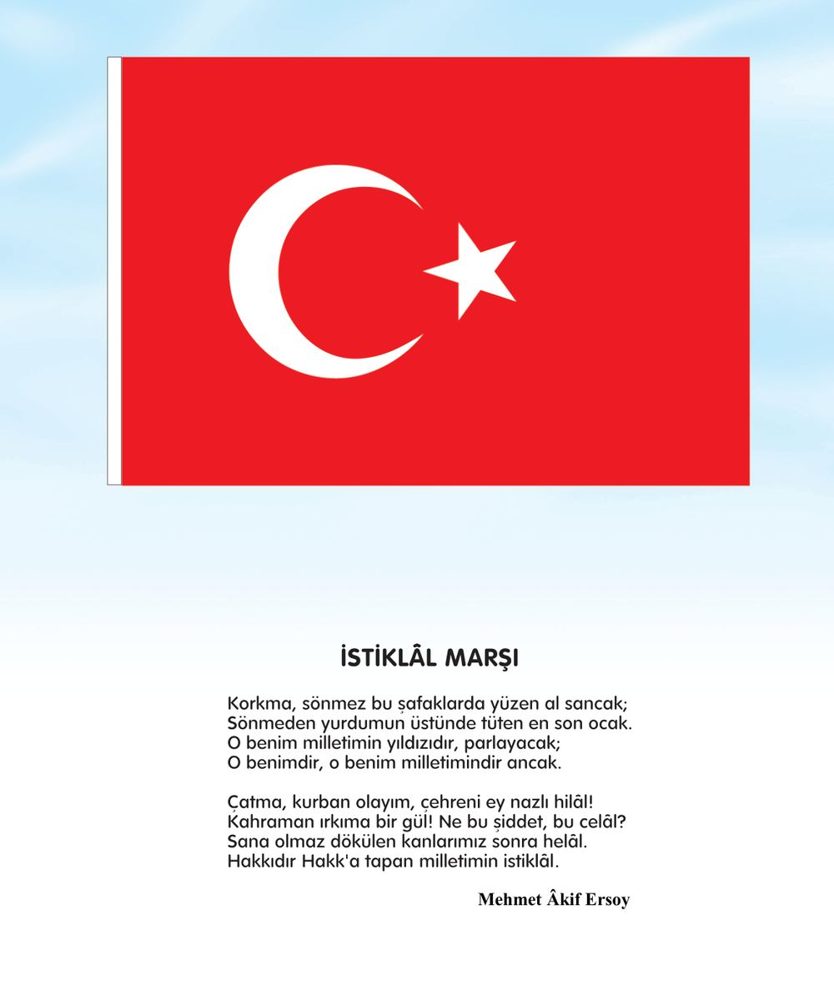

# İSTİKLÂL MARŞI

Korkma, sönmez bu şafaklarda yüzen al sancak;
Sönmeden yurdumun üstünde tüten en son ocak.
O benim milletimin yıldızıdır, parlayacak;
O benimdir, o benim milletimindir ancak.

Çatma, kurban olayım, cehren ey nazlı hilâl!
Kahraman ırkıma bir gül! Ne bu şiddet, bu celâl?
Sana olmaz dökülen kanlarımız sonra helâl.
Hakkıdır Hakk'a tapan milletimin istiklâl.

**Mehmet Âkif Ersoy**

<!-- sayfa 3 -->

ANDIMIZ

Türküm, doğruyum, çalışkanım.

İlkem küçüklerimi korumak, büyüklerimi saymak; yurdumu, milletimi özümden çok sevmektir.
Ülküm yükselmek, ileri gitmektir.

Ey Büyük Atatürk!

Açtığın yolda, gösterdiğin hedefe durmadan yürüyeceğime ant içerim.

Varlığım Türk varlığına armağan olsun.

Ne mutlu Türküm diyene!

<!-- sayfa 4 -->

# MUSTAFA KEMAL ATATÜRK

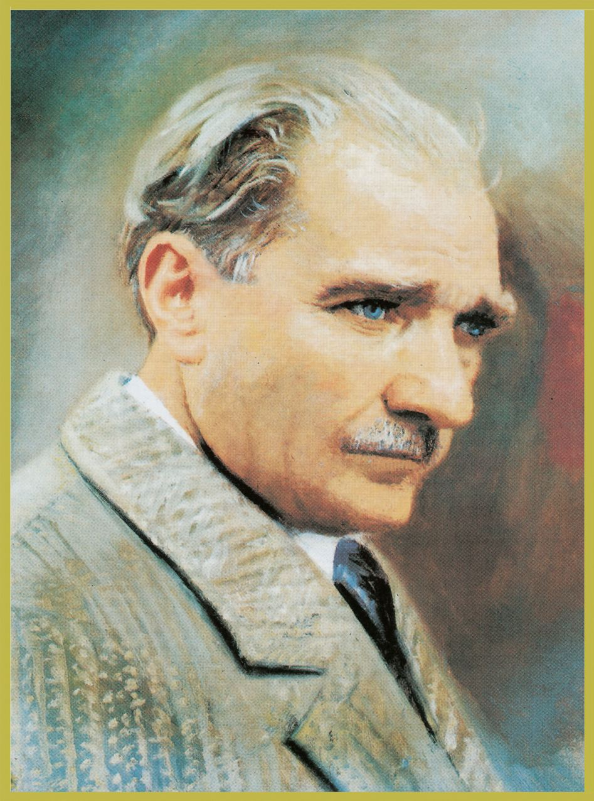
<!-- yer tutucu bulunamadı: sayfa sonuna eklendi -->

<!-- sayfa 5 -->

Verdiğiniz metin katmanı boş olduğu için (`<<< >>>` arası boş) dönüştürülecek herhangi bir içerik bulunmamaktadır. Lütfen metin katmanını içeren içeriği paylaşın, böylece talimatlarınıza uygun şekilde Markdown formatına çevirebilirim.

<!-- sayfa 6 -->

# İÇİNDEKİLER

KİTABIMIZI TANIYALIM............................................................................................10

## 1. TEMA: MÜZİK DİLİ

DÜŞÜNELİM BULALIM.............................................................................................16
ETKİNLİK 1: İSTİKLÂL MARŞI’NI HECELEYELİM.................................................17
DEĞERLENDİRME ZAMANI 1 ..................................................................................19
ETKİNLİK 2: DİNLEYELİM SÖYLEYELİM - İNCELİK-KALINLIK ...........................21
DÜŞÜNELİM BULALIM.............................................................................................20
ETKİNLİK 3: OYNAYALIM EĞLENELİM - SES AVCILARI......................................22
DEĞERLENDİRME ZAMANI 2..................................................................................23
DÜŞÜNELİM BULALIM.............................................................................................25
ETKİNLİK 4: BİRLİKTE SÖYLEYELİM - AĞACI KISKANIRIM...............................26
ETKİNLİK 5: BİRLİKTE SÖYLEYELİM - YAĞMUR YAĞIYOR.................................28
ETKİNLİK 6: BİRLİKTE SÖYLEYELİM - MADIMAK ................................................30
ETKİNLİK 7: BİRLİKTE SÖYLEYELİM - DALDA ÇIKMIŞ BİR ELMA .....................32
DEĞERLENDİRME ZAMANI 3 ..................................................................................34
DÜŞÜNELİM BULALIM.............................................................................................35
ETKİNLİK 8: BİRLİKTE GURURLA KUTLAYALIM - CUMHURİYET MARŞI ........36
ETKİNLİK 9: ÖZLEMLE ANIYORUZ - CANIM ATATÜRK ........................................38
ETKİNLİK 10: BİRLİKTE KUTLAYALIM - ÖĞRETMENİM .......................................40
DEĞERLENDİRME ZAMANI 4 ..................................................................................42
DÜŞÜNELİM BULALIM.............................................................................................43
ETKİNLİK 11: ORTAK REPERTUVARI SÖYLEYELİM - MAÇKA YOLLARI ...........44
ETKİNLİK 12: ORTAK REPERTUVARI SÖYLEYELİM - AYVA ÇİÇEK AÇMIŞ .......46
ETKİNLİK 13: ORTAK REPERTUVARI SÖYLEYELİM - BAHÇEVAN .....................48

<!-- yer tutucu bulunamadı: sayfa sonuna eklendi -->

<!-- sayfa 7 -->

DEĞERLENDİRME ZAMANI 5 ...................................................................................50
DÜŞÜNELİM BULALIM .............................................................................................51
ETKİNLİK 14: BEDEN PERKÜSYONU - YAĞMUR YAĞIYOR ...............................52
ETKİNLİK 15: BEDEN PERKÜSYONU - MAÇKA YOLLARI ..................................54
DEĞERLENDİRME ZAMANI 6 ..................................................................................56
1. TEMA DEĞERLENDİRME SORULARI .................................................................57

# 2. TEMA: MÜZİK KÜLTÜRÜ

DÜŞÜNELİM BULALIM .............................................................................................60
ETKİNLİK 1: İSTİKLÂL MARŞI’NIN ÖGELERİ ........................................................61
DEĞERLENDİRME ZAMANI 1 ..................................................................................62
DÜŞÜNELİM BULALIM .............................................................................................63
ETKİNLİK 2: EZGİ VEREN VURMALI ÇALGILARI TANIYALIM .............................64
ETKİNLİK 3: KÜLTÜREL MİRASTAN ÖRNEKLER .................................................65
ETKİNLİK 4: OYNAYALIM EĞLENELİM ..................................................................66
ETKİNLİK 5: OYNAYALIM EĞLENELİM ..................................................................67
DEĞERLENDİRME ZAMANI 2 ..................................................................................68
DÜŞÜNELİM BULALIM .............................................................................................69
ETKİNLİK 6: BİRLİKTE SÖYLEYELİM - MERDİVEN ..............................................70
ETKİNLİK 7: BİRLİKTE SÖYLEYELİM - ALİ BABA’NIN ÇİFTLİĞİ .........................72
ETKİNLİK 8: BİRLİKTE SÖYLEYELİM - LEBLEBİ KOYDUM TASA ......................74
ETKİNLİK 9: BİRLİKTE SÖYLEYELİM - AY DOĞAR AYİSTAN’DAN ......................76
DEĞERLENDİRME ZAMANI 3 ..................................................................................78
DÜŞÜNELİM BULALIM .............................................................................................79
ETKİNLİK 10: SAYGIYLA VE RAHMETLE ANIYORUZ - ŞEHİTLER ÖLMEZ ........80
ETKİNLİK 11: BİRLİKTE GURURLA KUTLAYALIM - BAYRAM TÜRKÜSÜ ...........82

<!-- sayfa 8 -->

ETKİNLİK 12: BİRLİKTE GURURLA KUTLAYALIM - GENÇLİK .............................84
DEĞERLENDİRME ZAMANI 4 ..................................................................................86
DÜŞÜNELİM BULALIM .............................................................................................87
ETKİNLİK 13: ORTAK REPERTUVARI SÖYLEYELİM - ANNEM ANNEM ..............88
ETKİNLİK 14: ORTAK REPERTUVARI SÖYLEYELİM
SARI ÇİZMELİ MEHMET AĞA ..................................................................................90
DEĞERLENDİRME ZAMANI 5 ..................................................................................92
DÜŞÜNELİM BULALIM .............................................................................................93
ETKİNLİK 15: BEDEN PERKÜSYONU - MERDİVEN ..............................................94
ETKİNLİK 16: BEDEN PERKÜSYONU - ALİ BABA’NIN ÇİFTLİĞİ .........................96
DEĞERLENDİRME ZAMANI 6 ..................................................................................98
2. TEMA DEĞERLENDİRME SORULARI .................................................................99

KAYNAKÇA ............................................................................................................ 100
CEVAP ANAHTARI ................................................................................................. 100
GÖRSEL KAYNAKÇA VE GENEL AĞ KAYNAKÇASI .......................................... 100
TÜRKİYE’NİN MÜLKİ İDARE BÖLÜMLERİ İLE 
KARA VE DENİZ KOMŞULARI HARİTASI ............................................................ 101
TÜRK DÜNYASI HARİTASI .................................................................................... 102

<!-- sayfa 9 -->

# KİTABIMIZI TANIYALIM

Tema Kapağı

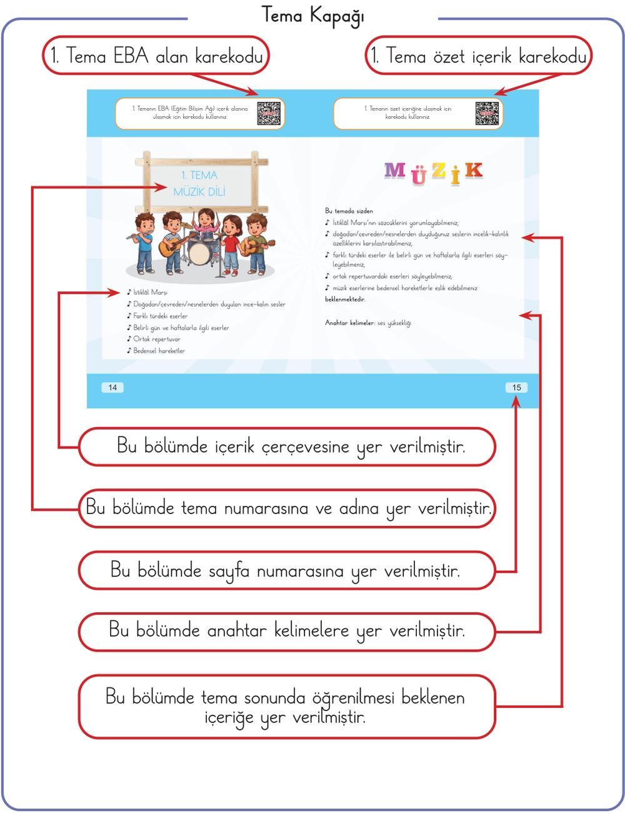

1. Tema EBA alan karekodu
1. Tema özet içerik karekodu

1. Temanın EBA (Eğitim Bilişim Ağı) içerik alanına ulaşmak için karekodu kullanınız.
1. Temanın özet içeriğine ulaşmak için karekodu kullanınız.

1. TEMA
MÜZİK DİLİ

M Ü Z İ K

Bu temada sizden
♪ İstiklâl Marşı’nın sözcüklerini yorumlayabilmeniz,
♪ doğadan/çevreden/nesnelerden duyduğunuz seslerin incelik-kalınlık özelliklerini karşılaştırabilmeniz,
♪ farklı türdeki eserler ile belirli gün ve haftalarla ilgili eserleri söyleyebilmeniz,
♪ ortak repertuvardaki eserleri söyleyebilmeniz,
♪ müzik eserlerine bedensel hareketlerle eşlik edebilmeniz beklenmektedir.

Anahtar kelimeler: ses yüksekliği

♪ İstiklâl Marşı
♪ Doğadan/çevreden/nesnelerden duyulan ince-kalın sesler
♪ Farklı türdeki eserler
♪ Belirli gün ve haftalarla ilgili eserler
♪ Ortak repertuvar
♪ Bedensel hareketler

14
15

Bu bölümde içerik çerçevesine yer verilmiştir.
Bu bölümde tema numarasına ve adına yer verilmiştir.
Bu bölümde sayfa numarasına yer verilmiştir.
Bu bölümde anahtar kelimelere yer verilmiştir.
Bu bölümde tema sonunda öğrenilmesi beklenen içeriğe yer verilmiştir.

<!-- sayfa 10 -->

# KİTABIMIZI TANIYALIM

## Düşünelim Bulalım Sayfaları

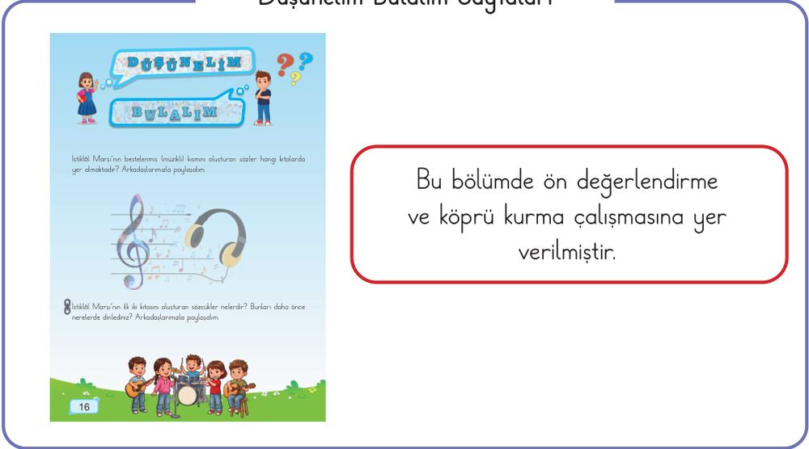

Bu bölümde ön değerlendirme ve köprü kurma çalışmasına yer verilmiştir.

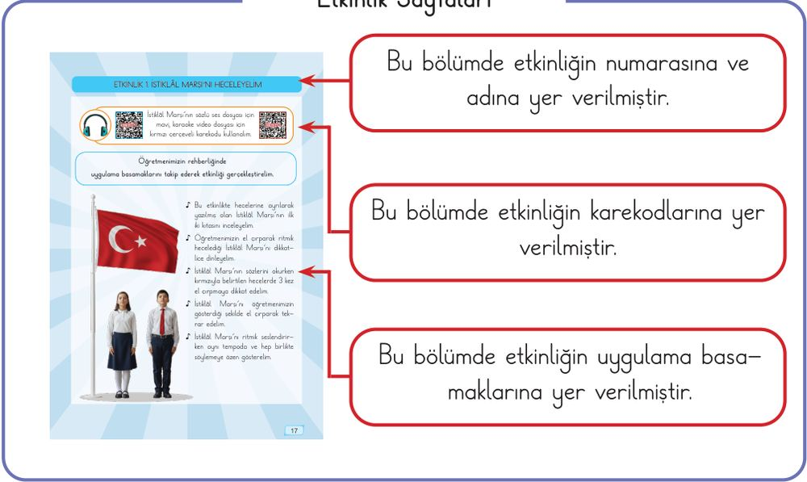

D Ü Ş Ü N E L İ M
B U L A L I M

İstiklâl Marşı’nın bestelenmiş (müzikli) kısmını oluşturan sözler hangi kıtalarda yer almaktadır? Arkadaşlarımızla paylaşalım.

İstiklâl Marşı’nın ilk iki kıtasını oluşturan sözcükler nelerdir? Bunları daha önce nerelerde dinlediniz? Arkadaşlarımızla paylaşalım.

16

---

## Etkinlik Sayfaları

Bu bölümde etkinliğin numarasına ve adına yer verilmiştir.

Bu bölümde etkinliğin karekodlarına yer verilmiştir.

ETKİNLİK 1: İSTİKLÂL MARŞI’NI HECELEYELİM

İstiklâl Marşı’nın sözlü ses dosyası için mavi, karaoke video dosyası için kırmızı çerçeveli karekodu kullanalım.

Öğretmenimizin rehberliğinde uygulama basamaklarını takip ederek etkinliği gerçekleştirelim.

♪ Bu etkinlikte hecelerine ayrılarak yazıma alan İstiklâl Marşı’nın ilk iki kıtasını inceleyelim.
♪ Öğretmenimizin el çırparak ritmik hecelediği İstiklâl Marşı’nı dikkatlice dinleyelim.
♪ İstiklâl Marşı’nın sözlerini okurken kırmızıyla belirtilen hecelerde 3 kez el çırpmaya dikkat edelim.
♪ İstiklâl Marşı’nı öğretmenimizin gösterdiği şekilde el çırparak tekrar edelim.
♪ İstiklâl Marşı’nı ritmik seslendirirken aynı tempoda ve hep birlikte söylemeye özen gösterelim.

Bu bölümde etkinliğin uygulama basamaklarına yer verilmiştir.

17

<!-- sayfa 11 -->

# KİTABIMIZI TANIYALIM

## Değerlendirme Sayfaları

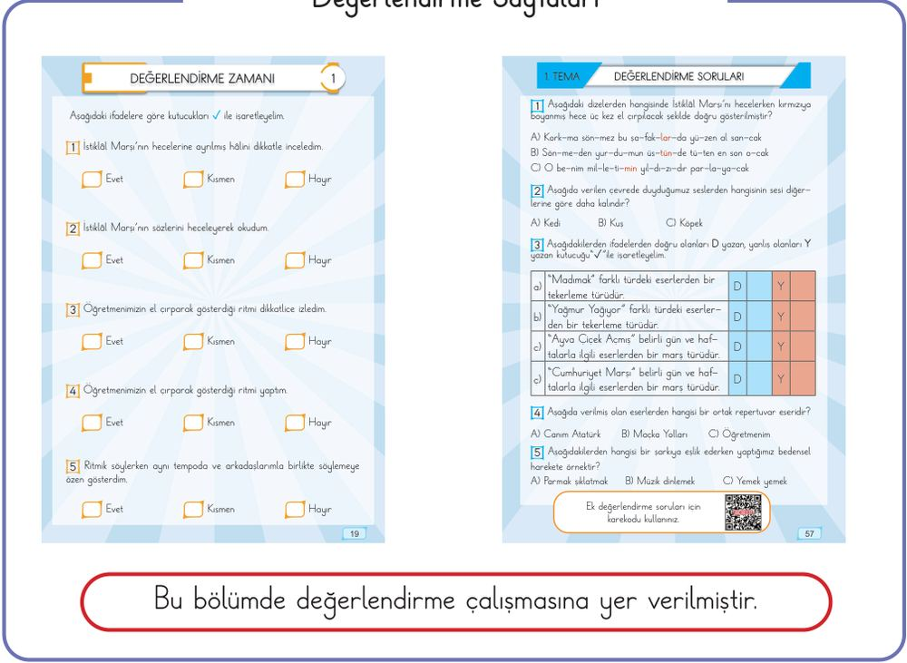

### DEĞERLENDİRME ZAMANI 1

Aşağıdaki ifadelere göre kutucukları $\checkmark$ ile işaretleyelim.

1. İstiklâl Marşı’nın hecelerine ayrılmış hâlini dikkatle inceledim.
   - [ ] Evet
   - [ ] Kısmen
   - [ ] Hayır

2. İstiklâl Marşı’nın sözlerini heceleyerek okudum.
   - [ ] Evet
   - [ ] Kısmen
   - [ ] Hayır

3. Öğretmenimizin el çırparak gösterdiği ritmi dikkatlice izledim.
   - [ ] Evet
   - [ ] Kısmen
   - [ ] Hayır

4. Öğretmenimizin el çırparak gösterdiği ritmi yaptım.
   - [ ] Evet
   - [ ] Kısmen
   - [ ] Hayır

5. Ritmik söylerken aynı tempoda ve arkadaşlarımla birlikte söylemeye özen gösterdim.
   - [ ] Evet
   - [ ] Kısmen
   - [ ] Hayır

19

---

### 1. TEMA DEĞERLENDİRME SORULARI

1. Aşağıdaki dizelerden hangisinde İstiklâl Marşı’nı hecelerken kırmızıya boyanmış hece üç kez el çırpılacak şekilde doğru gösterilmiştir?
   A) Kork-ma sön-mez bu şa-fak-lar-da yü-zen al san-cak
   B) Sön-me-den yur-du-mun üs-tün-de tü-ten en son o-cak
   C) O be-nim mil-le-ti-min yıl-dı-zı-dır par-la-ya-cak

2. Aşağıda verilen çevrede duyduğumuz seslerden hangisinin sesi diğerlerine göre daha kalındır?
   A) Kedi
   B) Kuş
   C) Köpek

3. Aşağıdaki ifadelerden doğru olanları D, yanlış olanları Y yazan kutucuğu "$\checkmark$" ile işaretleyelim.

| İfade | D | Y |
| :--- | :---: | :---: |
| a) "Madımak" farklı türdeki eserlerden bir tekerleme türüdür. | [ ] | [ ] |
| b) "Yağmur Yağıyor" farklı türdeki eserlerden bir tekerleme türüdür. | [ ] | [ ] |
| c) "Ayva Çiçek Açmış" belirli gün ve haftalarla ilgili eserlerden bir marş türüdür. | [ ] | [ ] |
| ç) "Cumhuriyet Marşı" belirli gün ve haftalarla ilgili eserlerden bir marş türüdür. | [ ] | [ ] |

4. Aşağıda verilen eserlerden hangisi bir ortak repertuvar eseridir?
   A) Canım Atatürk
   B) Maçka Yolları
   C) Öğretmenim

5. Aşağıdakilerden hangisi bir şarkıya eşlik ederken yaptığımız bedensel harekete örnektir?
   A) Parmak şıklatmak
   B) Müzik dinlemek
   C) Yemek yemek

Ek değerlendirme soruları için karekodu kullanınız.

57

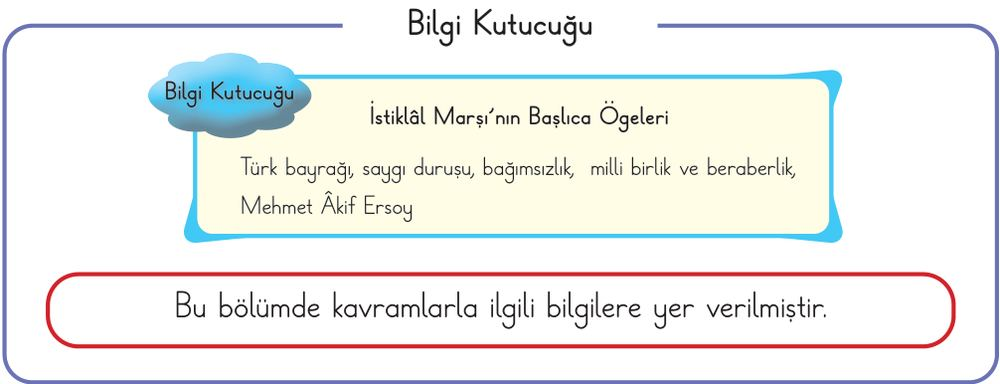

## Bilgi Kutucuğu

### Bilgi Kutucuğu
**İstiklâl Marşı’nın Başlıca Ögeleri**

Türk bayrağı, saygı duruşu, bağımsızlık, milli birlik ve beraberlik,
Mehmet Âkif Ersoy

<!-- sayfa 12 -->

# KİTABIMIZI TANIYALIM

## Karekod Bölümleri

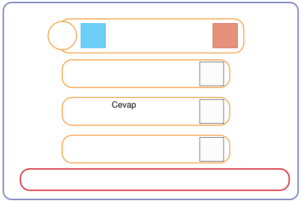
İstiklâl Marşı’nın sözlü ses dosyası için mavi, karaoke video dosyası için kırmızı çerçeveli karekodu kullanalım.

Ek değerlendirme soruları için karekodu kullanınız.

Cevap anahtarına ulaşmak için karekodu kullanınız.

Görsel kaynakça ve genel ağ kaynakçasına ulaşmak için karekodu kullanınız.

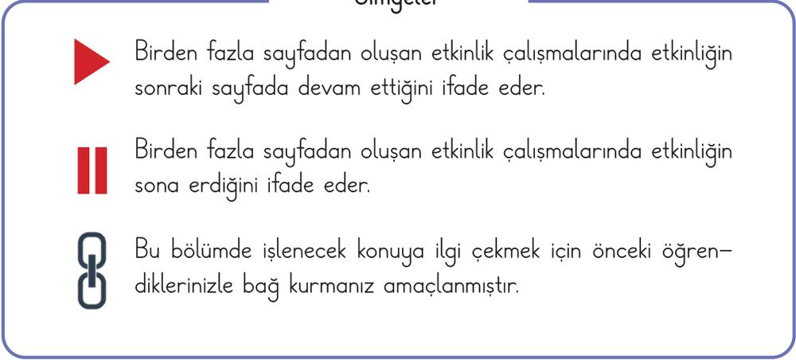
Bu bölümde ilgili dosyalara ait karekodlara yer verilmiştir.

## Simgeler

▶ Birden fazla sayfadan oluşan etkinlik çalışmalarında etkinliğin sonraki sayfada devam ettiğini ifade eder.

⏸ Birden fazla sayfadan oluşan etkinlik çalışmalarında etkinliğin sona erdiğini ifade eder.

🔗 Bu bölümde işlenecek konuya ilgi çekmek için önceki öğrendiklerinizle bağ kurmanız amaçlanmıştır.

<!-- sayfa 13 -->

1. Temanın EBA (Eğitim Bilişim Ağı) içerik alanına ulaşmak için karekodu kullanınız.

# 1. TEMA
## MÜZİK DİLİ

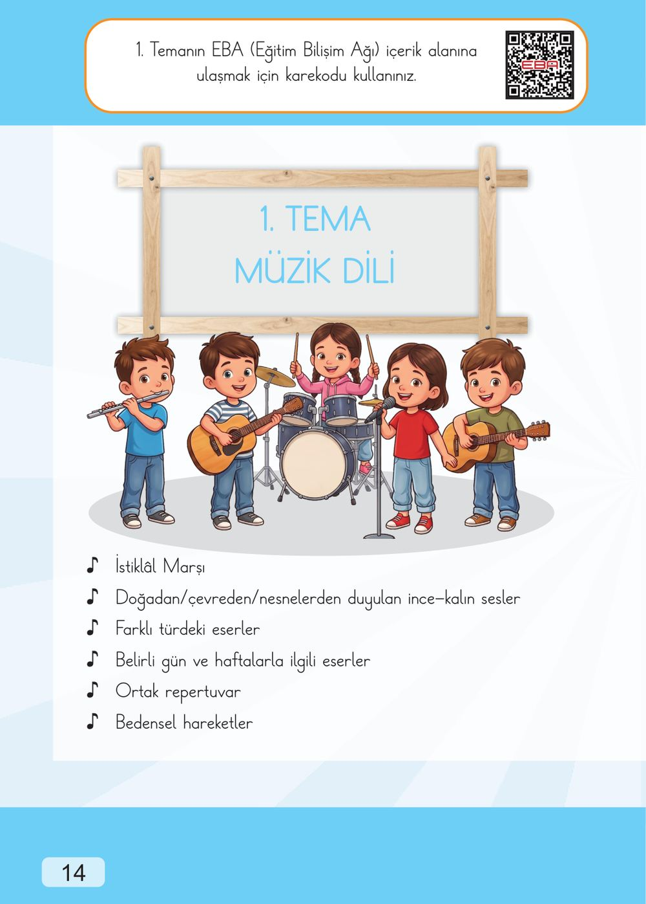: Müzik aletleri çalan çocukların olduğu bir illüstrasyon.

♪ İstiklâl Marşı
♪ Doğadan/çevreden/nesnelerden duyulan ince-kalın sesler
♪ Farklı türdeki eserler
♪ Belirli gün ve haftalarla ilgili eserler
♪ Ortak repertuvar
♪ Bedensel hareketler

<!-- sayfa 14 -->

1. Temanın özet içeriğine ulaşmak için karekodu kullanınız. 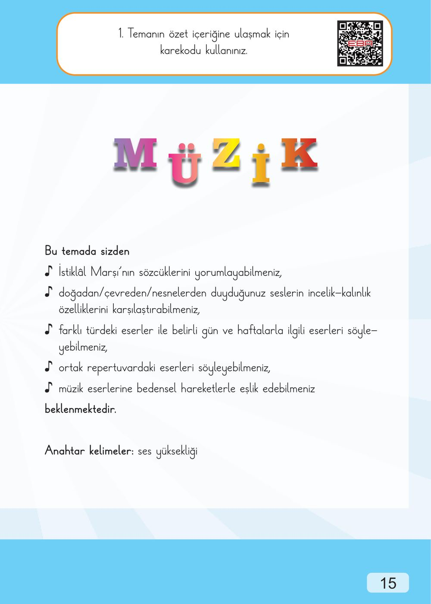

# M Ü Z İ K

Bu temada sizden

♪ İstiklâl Marşı’nın sözcüklerini yorumlayabilmeniz,

♪ doğadan/çevreden/nesnelerden duyduğunuz seslerin incelik–kalınlık özelliklerini karşılaştırabilmeniz,

♪ farklı türdeki eserler ile belirli gün ve haftalarla ilgili eserleri söyleyebilmeniz,

♪ ortak repertuvardaki eserleri söyleyebilmeniz,

♪ müzik eserlerine bedensel hareketlerle eşlik edebilmeniz

beklenmektedir.

Anahtar kelimeler: ses yüksekliği

<!-- sayfa 15 -->

# D Ü Ş Ü N E L İ M
# B U L A L I M

İstiklâl Marşı’nın bestelenmiş (müzikli) kısmını oluşturan sözler hangi kıtalarda yer almaktadır? Arkadaşlarımızla paylaşalım.

: İstiklal Marşı'nın bestelenmiş kısmını soran metnin altında nota sehpası, müzik notaları ve kulaklık görseli bulunmaktadır.

İstiklâl Marşı’nın ilk iki kıtasını oluşturan sözcükler nelerdir? Arkadaşlarımızla paylaşalım.

: Sayfanın en altında bir müzik grubu çizen çocuklar bulunmaktadır.

<!-- sayfa 16 -->

# ETKİNLİK 1: İSTİKLAL MARŞI’NI HECELEYELİM

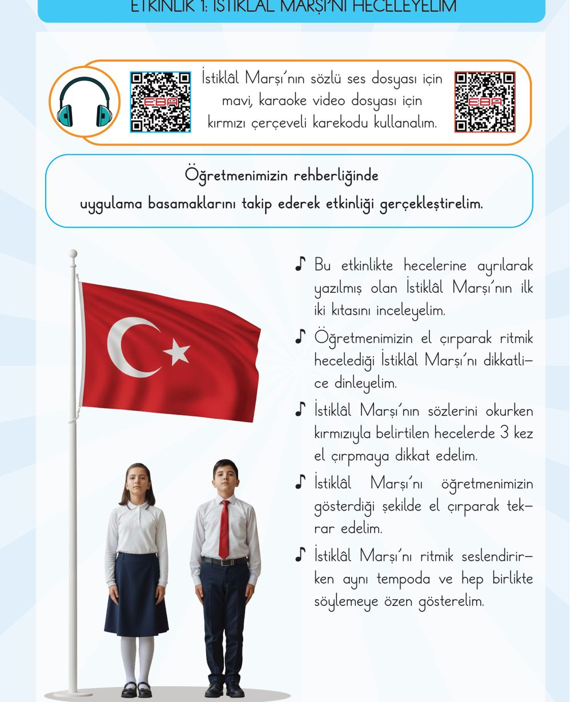

İstiklâl Marşı’nın sözlü ses dosyası için mavi, karaoke video dosyası için kırmızı çerçeveli karekodu kullanalım.

> Öğretmenimizin rehberliğinde uygulama basamaklarını takip ederek etkinliği gerçekleştirelim.

♪ Bu etkinlikte hecelerine ayrılarak yazılmış olan İstiklâl Marşı’nın ilk iki kıtasını inceleyelim.

♪ Öğretmenimizin el çırparak ritmik hecelediği İstiklâl Marşı’nı dikkatlice dinleyelim.

♪ İstiklâl Marşı’nın sözlerini okurken kırmızıyla belirtilen hecelerde 3 kez el çırpmaya dikkat edelim.

♪ İstiklâl Marşı’nı öğretmenimizin gösterdiği şekilde el çırparak tekrar edelim.

♪ İstiklâl Marşı’nı ritmik seslendirirken aynı tempoda ve hep birlikte söylemeye özen gösterelim.

<!-- sayfa 17 -->

ETKİNLİK 1: İSTİKLAL MARŞI'NI HECELEYELİM

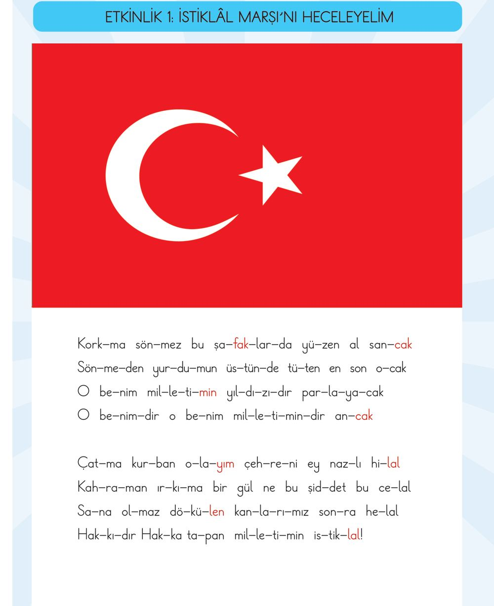

Kork-ma sön-mez bu şa-fak-lar-da yü-zen al san-cak
Sön-me-den yur-du-mun üs-tün-de tü-ten en son o-cak
○ be-nim mil-le-ti-min yıl-dı-zı-dır par-la-ya-cak
○ be-nim-dir o be-nim mil-le-ti-min-dir an-cak

Çat-ma kur-ban o-la-yım çeh-re-ni ey naz-lı hi-lal
Kah-ra-man ır-kı-ma bir gül ne bu şid-det bu ce-lal
Sa-na ol-maz dö-kü-len kan-la-rı-mız son-ra he-lal
Hak-kı-dır Hak-ka ta-pan mil-le-ti-min is-tik-lal!

<!-- sayfa 18 -->

# DEĞERLENDİRME ZAMANI 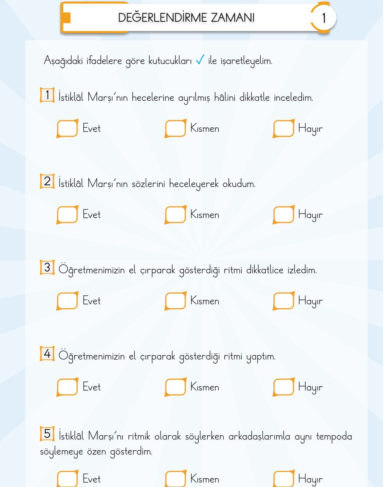

Aşağıdaki ifadelere göre kutucukları ✓ ile işaretleyelim.

1 İstiklâl Marşı’nın hecelerine ayrılmış hâlini dikkatle inceledim.
☐ Evet ☐ Kısmen ☐ Hayır

2 İstiklâl Marşı’nın sözlerini heceleyerek okudum.
☐ Evet ☐ Kısmen ☐ Hayır

3 Öğretmenimizin el çırparak gösterdiği ritmi dikkatlice izledim.
☐ Evet ☐ Kısmen ☐ Hayır

4 Öğretmenimizin el çırparak gösterdiği ritmi yaptım.
☐ Evet ☐ Kısmen ☐ Hayır

5 İstiklâl Marşı’nı ritmik olarak söylerken arkadaşlarımla aynı tempoda söylemeye özen gösterdim.
☐ Evet ☐ Kısmen ☐ Hayır

<!-- sayfa 19 -->

# D Ü Ş Ü N E L İ M
# B U L A L I M

Aşağıdaki görsellerle verilen varlıklara ait sesleri incelik-kalınlık özellikleri bakımdan inceleyelim.

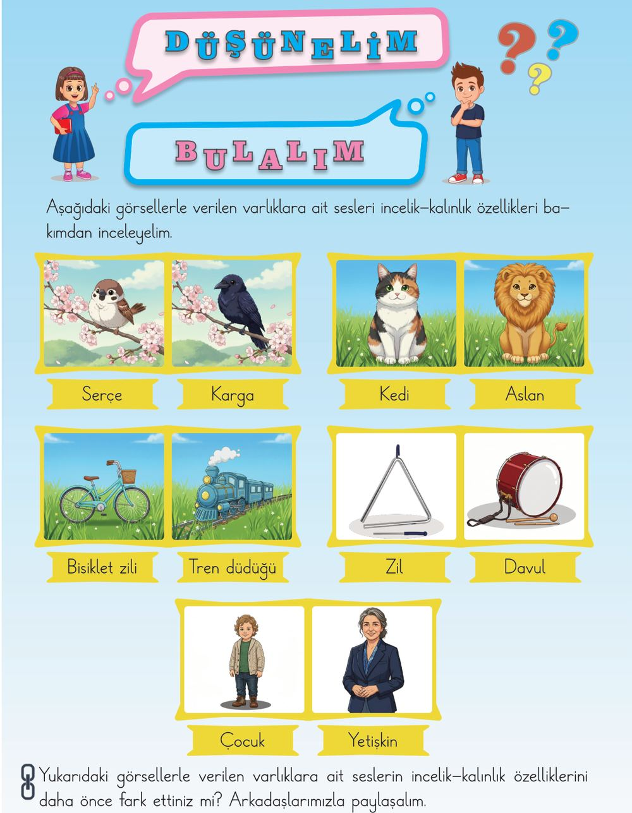
| Serçe | Karga |
| :---: | :---: |

| Kedi | Aslan |
| :---: | :---: |

| Bisiklet zili | Tren düdüğü |
| :---: | :---: |

| Zil | Davul |
| :---: | :---: |

| Çocuk | Yetişkin |
| :---: | :---: |

Yukarıdaki görsellerle verilen varlıklara ait seslerin incelik-kalınlık özelliklerini daha önce fark ettiniz mi? Arkadaşlarımızla paylaşalım.

<!-- sayfa 20 -->

# ETKİNLİK 2: DİNLEYELİM SÖYLEYELİM – İNCELİK–KALINLIK

> Öğretmenimizin rehberliğinde uygulama basamaklarını takip ederek etkinliği gerçekleştirelim.

♪ Öğretmenimizin dijital araçlar aracılığıyla seçtiği doğada, çevrede ve nesnelerden duyulan sesleri incelik ve kalınlıklarına dikkat ederek dinleyelim.
♪ Dinlediğimiz seslerin incelik ve kalınlık özellikleri nelerdir? Kendi cümlelerimizle ifade edelim.
♪ Doğada duyduğumuz yağmur ve gök gürültüsü seslerini incelik ve kalınlık özellikleri bakımından kendi cümlelerimizle ifade edelim.
♪ Çevrede duyduğumuz kedi miyavlaması ve köpek havlaması seslerini incelik ve kalınlık özellikleri bakımından kendi cümlelerimizle ifade edelim.
♪ Nesnelerden duyduğumuz bisiklet zili ve tren düdüğü seslerini incelik ve kalınlık özellikleri bakımından kendi cümlelerimizle ifade edelim.

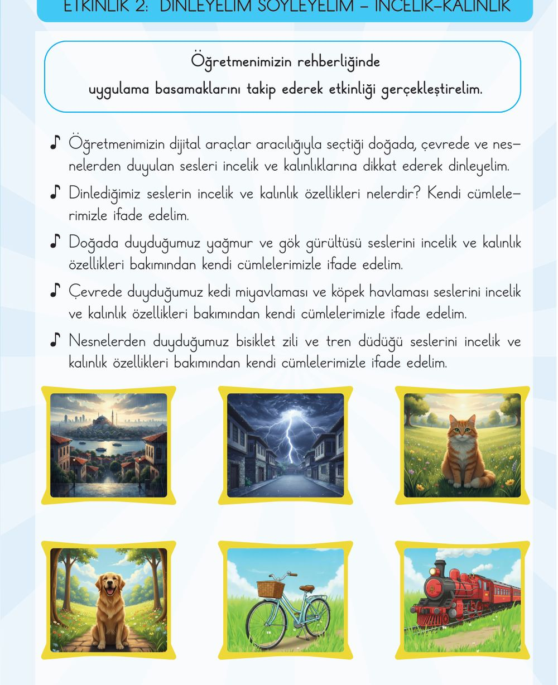

<!-- sayfa 21 -->

# ETKİNLİK 3: OYNAYALIM EĞLENELİM – SES AVCILARI

> Öğretmenimizin rehberliğinde uygulama basamaklarını takip ederek etkinliği gerçekleştirelim.

♪ Arkadaşlarımızla **İnce Ses Avcıları** ve **Kalın Ses Avcıları** isimli iki grup oluşturalım.

♪ Oyunu başlatacak gruptan belirlediğimiz ilk arkadaşımızdan doğada, çevrede ya da nesnelerden duyulan bir sesi taklit etmesini isteyelim.

♪ Duyulan sesin incelik ve kalınlığına göre ikinci gruptan bu sesin tam tersi bir sesi taklit etmelerini isteyelim.

♪ Gruplardaki herkes bir taklit yapıncaya kadar oyunu sürdürelim.

♪ Oyunun sonunda doğada, çevrede ve nesnelerden duyduğumuz seslerin özelliklerini, benzerliklerini ve farklılıklarını arkadaşlarımızla paylaşalım.

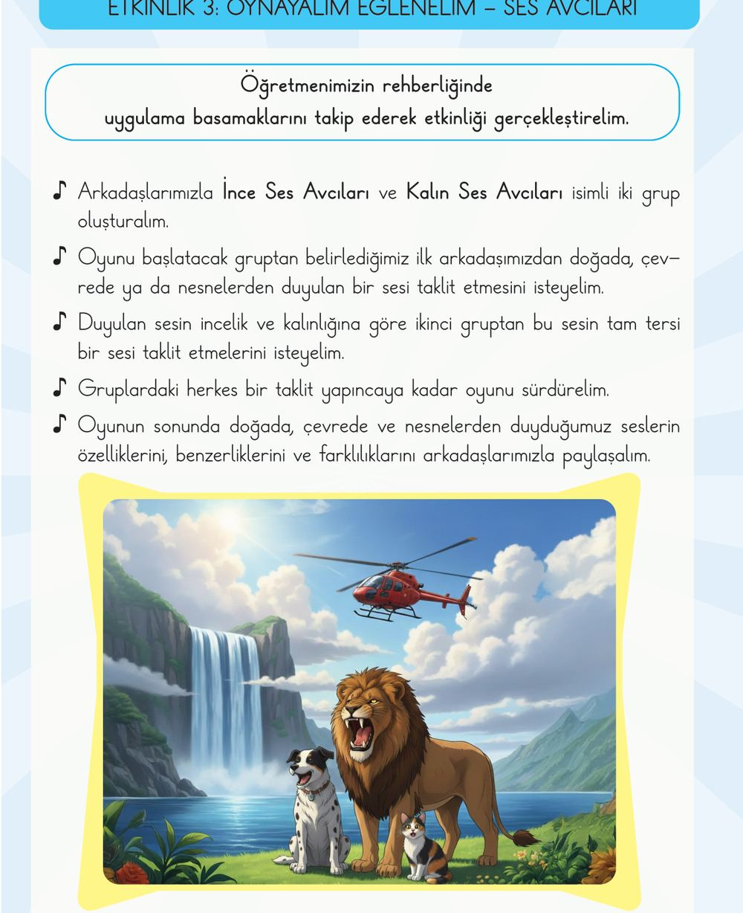

<!-- sayfa 22 -->

# DEĞERLENDİRME ZAMANI 2

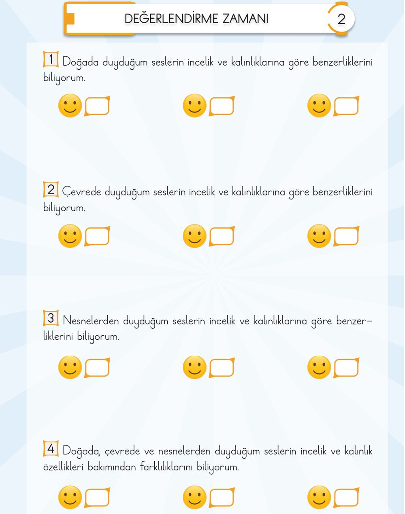 1 Doğada duyduğum seslerin incelik ve kalınlıklarına göre benzerliklerini biliyorum.
😊 ⬜ 😊 ⬜ 😊 ⬜

 2 Çevrede duyduğum seslerin incelik ve kalınlıklarına göre benzerliklerini biliyorum.
😊 ⬜ 😊 ⬜ 😊 ⬜

 3 Nesnelerden duyduğum seslerin incelik ve kalınlıklarına göre benzerliklerini biliyorum.
😊 ⬜ 😊 ⬜ 😊 ⬜

 4 Doğada, çevrede ve nesnelerden duyduğum seslerin incelik ve kalınlık özellikleri bakımından farklılıklarını biliyorum.
😊 ⬜ 😊 ⬜ 😊 ⬜

<!-- sayfa 23 -->

# DEĞERLENDİRME ZAMANI 2

5 Aşağıdaki görselleri inceleyelim. Bu görselleri karşılaştırarak sesi ince duyulanların yanına **ince**, sesi kalın duyulanların yanına **kalın** yazalım.

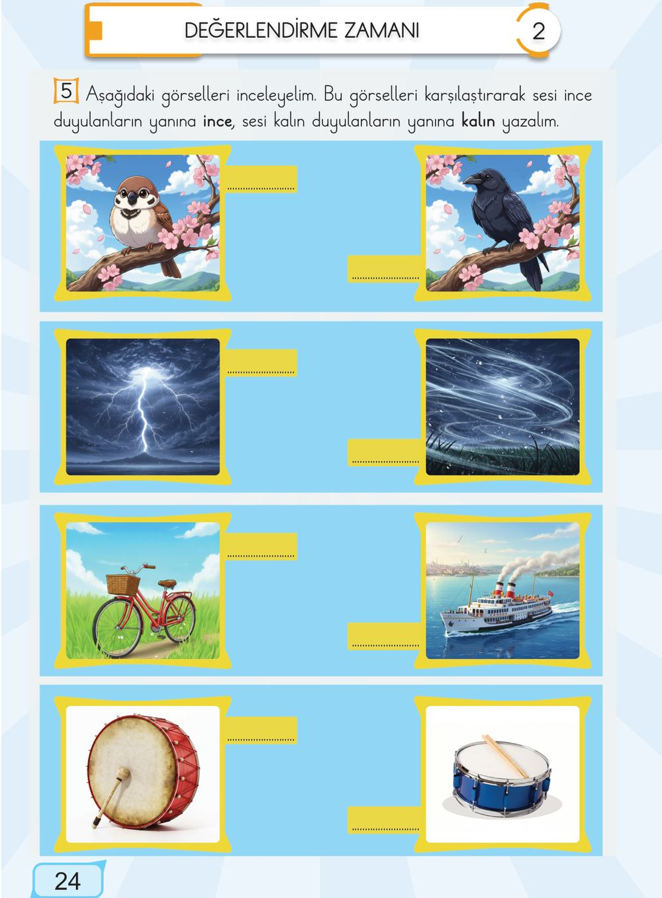
..........................
..........................

..........................
..........................

..........................
..........................

..........................
..........................

..........................
..........................

..........................
..........................

..........................
..........................

..........................
..........................

<!-- sayfa 24 -->

# D Ü Ş Ü N E L İ M
# B U L A L I M

Bildiğimiz şarkı, türkü, marş vb. farklı türlerdeki eserler nelerdir? Arkadaşlarımızla paylaşalım.

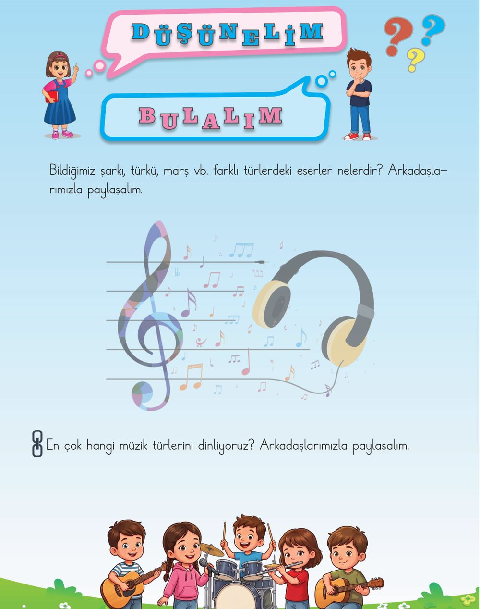

En çok hangi müzik türlerini dinliyoruz? Arkadaşlarımızla paylaşalım.

<!-- sayfa 25 -->

# ETKİNLİK 4: BİRLİKTE SÖYLEYELİM – AĞACI KISKANIRIM

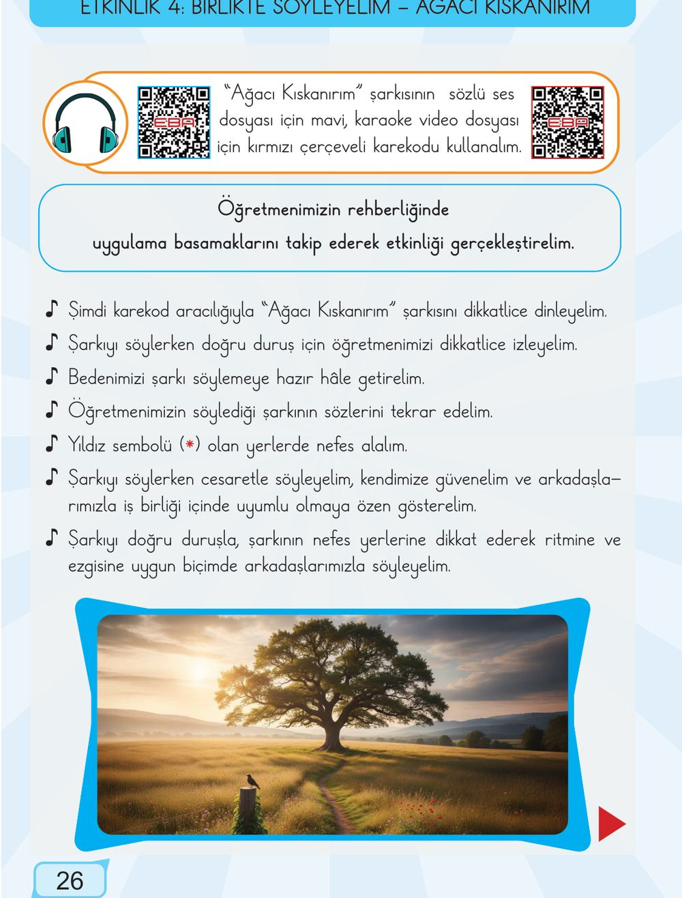 “Ağacı Kıskanırım” şarkısının sözlü ses dosyası için mavi, karaoke video dosyası için kırmızı çerçeveli karekodu kullanalım.

> Öğretmenimizin rehberliğinde uygulama basamaklarını takip ederek etkinliği gerçekleştirelim.

♪ Şimdi karekod aracılığıyla “Ağacı Kıskanırım” şarkısını dikkatlice dinleyelim.
♪ Şarkıyı söylerken doğru duruş için öğretmenimizi dikkatlice izleyelim.
♪ Bedenimizi şarkı söylemeye hazır hâle getirelim.
♪ Öğretmenimizin söylediği şarkının sözlerini tekrar edelim.
♪ Yıldız sembolü (*) olan yerlerde nefes alalım.
♪ Şarkıyı söylerken cesaretle söyleyelim, kendimize güvenelim ve arkadaşlarımızla iş birliği içinde uyumlu olmaya özen gösterelim.
♪ Şarkıyı doğru duruşla, şarkının nefes yerlerine dikkat ederek ritmine ve ezgisine uygun biçimde arkadaşlarımızla söyleyelim.

<!-- sayfa 26 -->

ETKİNLİK 4: BİRLİKTE SÖYLEYELİM – AĞACI KISKANIRIM

# AĞACI KISKANIRIM
Söz: Cahit Sıtkı Tarancı
Müzik: Cenan Akın (1932–2006)

Ağacı kıskanırım
Yemiş yüklü dalı var*
Bahar olsun güz olsun
Ne güzel masalı var*

İmrenirim arıya*
Petek petek balı var*
Konduğu çiçeklerin*
Pembesi var alı var

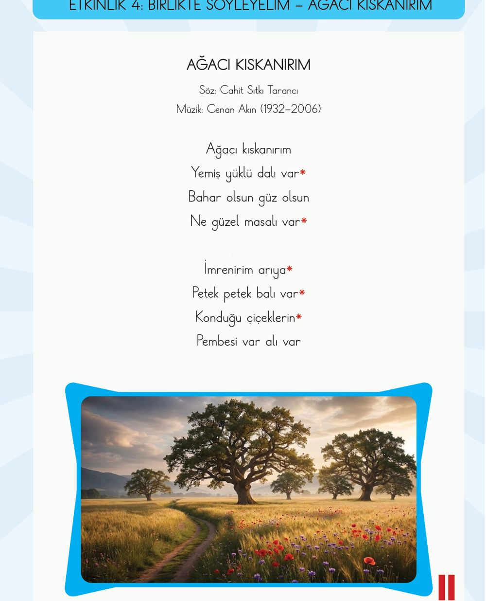

<!-- sayfa 27 -->

# ETKİNLİK 5: BİRLİKTE SÖYLEYELİM – YAĞMUR YAĞIYOR*

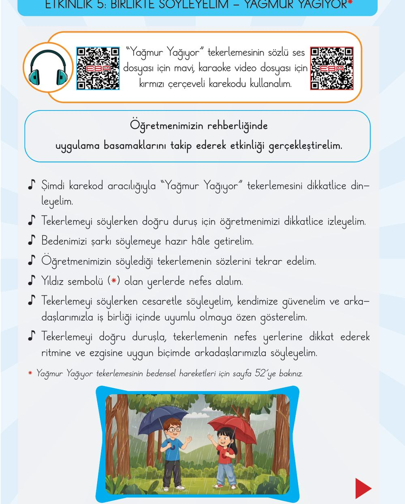

“Yağmur Yağıyor” tekerlemesinin sözlü ses dosyası için mavi, karaoke video dosyası için kırmızı çerçeveli karekodu kullanalım.

> Öğretmenimizin rehberliğinde uygulama basamaklarını takip ederek etkinliği gerçekleştirelim.

♪ Şimdi karekod aracılığıyla “Yağmur Yağıyor” tekerlemesini dikkatlice dinleyelim.

♪ Tekerlemeyi söylerken doğru duruş için öğretmenimizi dikkatlice izleyelim.

♪ Bedenimizi şarkı söylemeye hazır hâle getirelim.

♪ Öğretmenimizin söylediği tekerlemenin sözlerini tekrar edelim.

♪ Yıldız sembolü (*) olan yerlerde nefes alalım.

♪ Tekerlemeyi söylerken cesaretle söyleyelim, kendimize güvenelim ve arkadaşlarımızla iş birliği içinde uyumlu olmaya özen gösterelim.

♪ Tekerlemeyi doğru duruşla, tekerlemenin nefes yerlerine dikkat ederek ritmine ve ezgisine uygun biçimde arkadaşlarımızla söyleyelim.

* Yağmur Yağıyor tekerlemesinin bedensel hareketleri için sayfa 52’ye bakınız.

<!-- sayfa 28 -->

ETKİNLİK 5: BİRLİKTE SÖYLEYELİM – YAĞMUR YAĞIYOR

# YAĞMUR YAĞIYOR

Tekerleme

Yağmur yağıyor*
Seller akıyor*
Komşu kızı*
Camdan bakıyor*

Şimşek çakıyor*
Gök gürlüyor*
Komşu kızı*
Korkup kaçıyor*

Dere taşıyor*
Irmak coşuyor*
Komşu kızı*
Şaşıp kalıyor

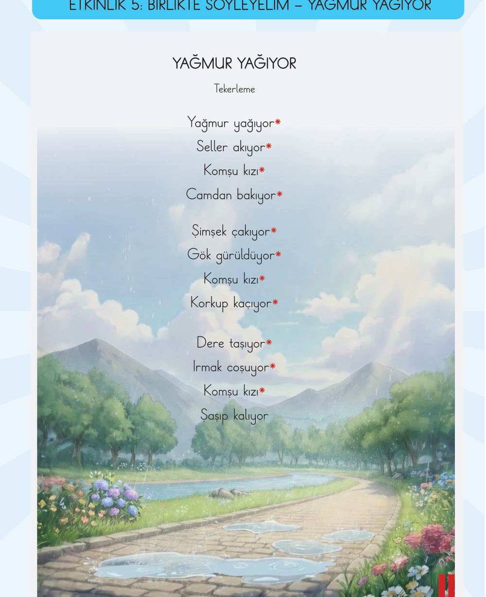

<!-- sayfa 29 -->

# ETKİNLİK 6: BİRLİKTE SÖYLEYELİM – MADIMAK

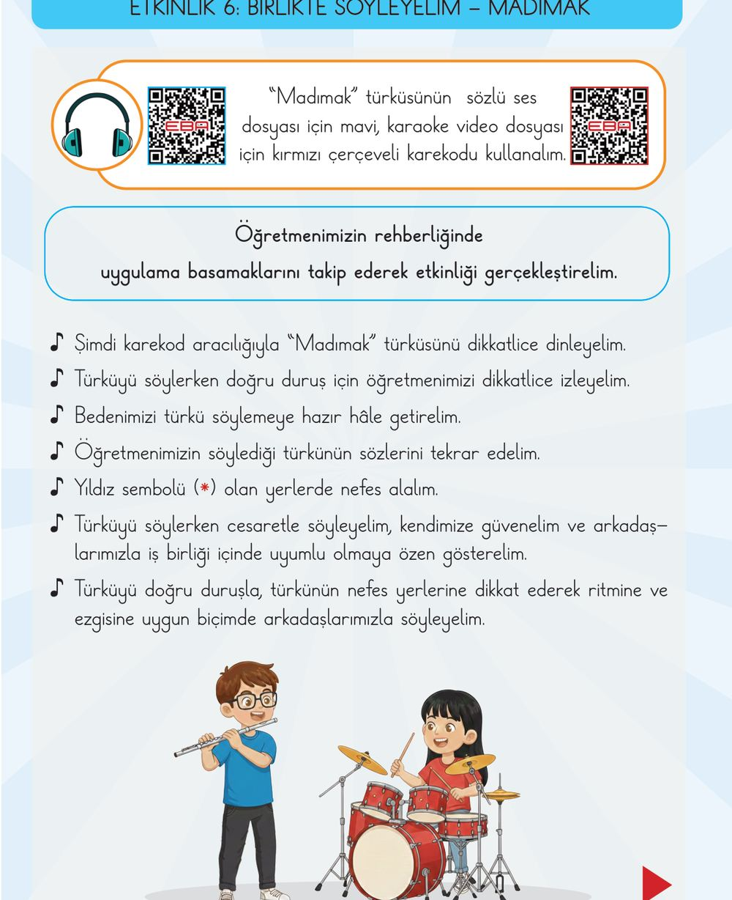

“Madımak” türküsünün sözlü ses dosyası için mavi, karaoke video dosyası için kırmızı çerçeveli karekodu kullanalım.

> Öğretmenimizin rehberliğinde uygulama basamaklarını takip ederek etkinliği gerçekleştirelim.

♪ Şimdi karekod aracılığıyla “Madımak” türküsünü dikkatlice dinleyelim.
♪ Türküyü söylerken doğru duruş için öğretmenimizi dikkatlice izleyelim.
♪ Bedenimizi türkü söylemeye hazır hâle getirelim.
♪ Öğretmenimizin söylediği türkünün sözlerini tekrar edelim.
♪ Yıldız sembolü (*) olan yerlerde nefes alalım.
♪ Türküyü söylerken cesaretle söyleyelim, kendimize güvenelim ve arkadaşlarımızla iş birliği içinde uyumlu olmaya özen gösterelim.
♪ Türküyü doğru duruşla, türkünün nefes yerlerine dikkat ederek ritmine ve ezgisine uygun biçimde arkadaşlarımızla söyleyelim.

<!-- sayfa 30 -->

ETKİNLİK 6: BİRLİKTE SÖYLEYELİM – MADIMAK

MADIMAK
Yöresi: Sivas

Madımak* oylum oylum
Geliyor* civan da boylum
Civan boylum gelirse*
Şen olur* benim de gönlüm

Oy madımak* teke tüke sakalı
Oy madımak* evelik yemlik
Oy madımak* guşguşu yemlik oy Madımak*

Madımak* bişer oldu
Tencerem* taşar oldu
Günde yediğim şamarlar*
Bir iken* beşer oldu

Oy madımak* teke tüke sakalı
Oy madımak* evelik yemlik
Oy madımak* guşguşu yemlik oy Madımak

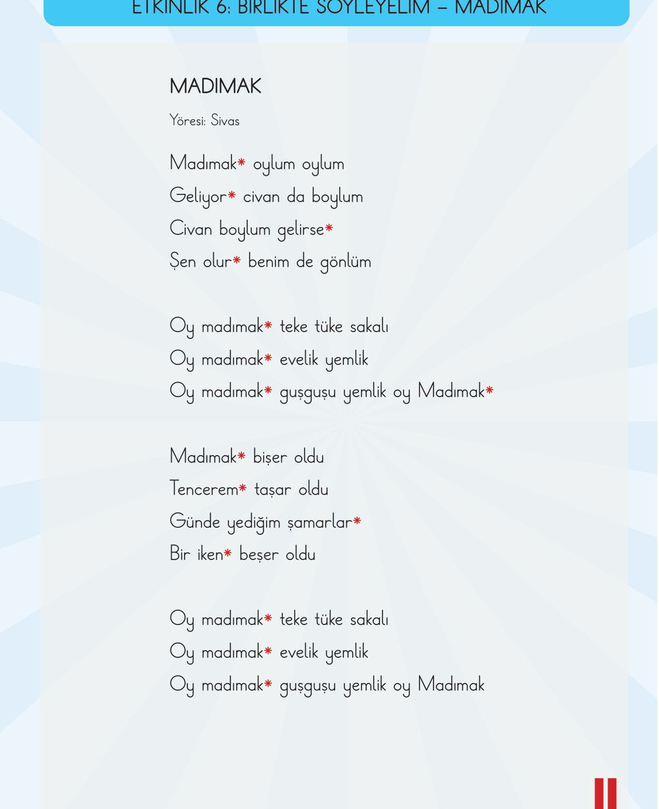
<!-- yer tutucu bulunamadı: sayfa sonuna eklendi -->

<!-- sayfa 31 -->

# ETKİNLİK 7: BİRLİKTE SÖYLEYELİM – DALDA ÇIKMIŞ BİR ELMA

“Dalda Çıkmış Bir Elma” şarkısının sözlü ses dosyası için mavi, karaoke video dosyası için kırmızı çerçeveli karekodu kullanalım.

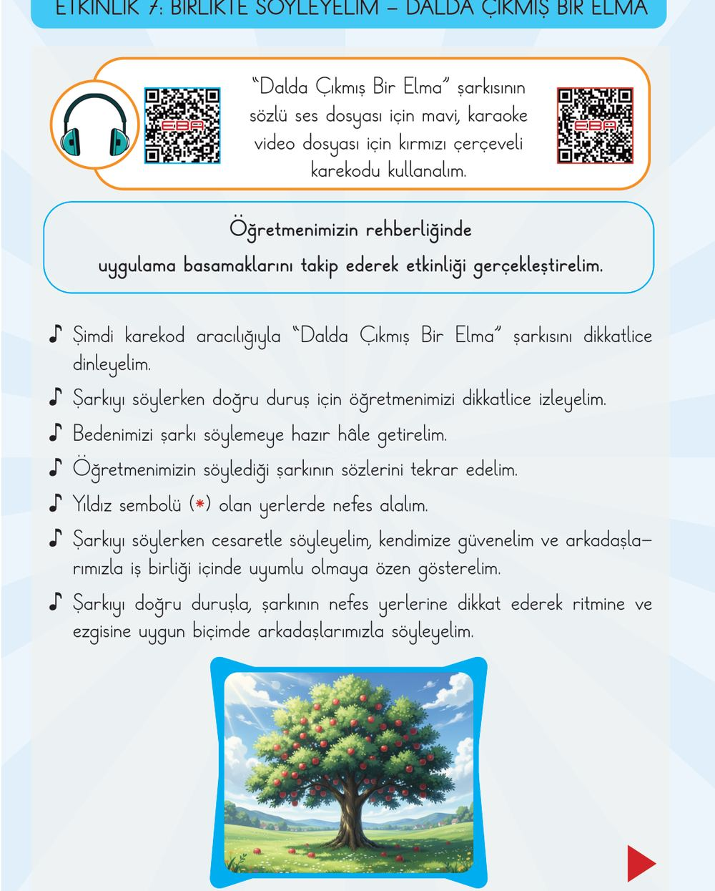

> Öğretmenimizin rehberliğinde uygulama basamaklarını takip ederek etkinliği gerçekleştirelim.

♪ Şimdi karekod aracılığıyla “Dalda Çıkmış Bir Elma” şarkısını dikkatlice dinleyelim.
♪ Şarkıyı söylerken doğru duruş için öğretmenimizi dikkatlice izleyelim.
♪ Bedenimizi şarkı söylemeye hazır hâle getirelim.
♪ Öğretmenimizin söylediği şarkının sözlerini tekrar edelim.
♪ Yıldız sembolü (*) olan yerlerde nefes alalım.
♪ Şarkıyı söylerken cesaretle söyleyelim, kendimize güvenelim ve arkadaşlarımızla iş birliği içinde uyumlu olmaya özen gösterelim.
♪ Şarkıyı doğru duruşla, şarkının nefes yerlerine dikkat ederek ritmine ve ezgisine uygun biçimde arkadaşlarımızla söyleyelim.

<!-- sayfa 32 -->

ETKİNLİK 7: BİRLİKTE SÖYLEYELİM – DALDA ÇIKMIŞ BİR ELMA

# DALDA ÇIKMIŞ BİR ELMA
Anonim

Dalda çıkmış bir elma*
Elmalı yar* cilveli yar*
Aramızdan geçti de bir yar*
Karabiberim top şekerim*
Senin kaderin benim tecellim*

Darılmaca yok yok* barışmaca çok*
Seni seven yok yok* beni seven çok*
Uzaklara gitme sana küserim*
Yakınlara gelir isen alır giderim*

Dalda çıkmış bir kiraz*
Kirazlı yar* Şirazlı yar*
Aramızdan geçti de bir yar*
Karabiberim top şekerim*
Senin kaderin benim tecellim*

Darılmaca yok yok* barışmaca çok*
Seni seven yok yok* beni seven çok*
Uzaklara gitme sana küserim*
Yakınlara gelir isen alır giderim

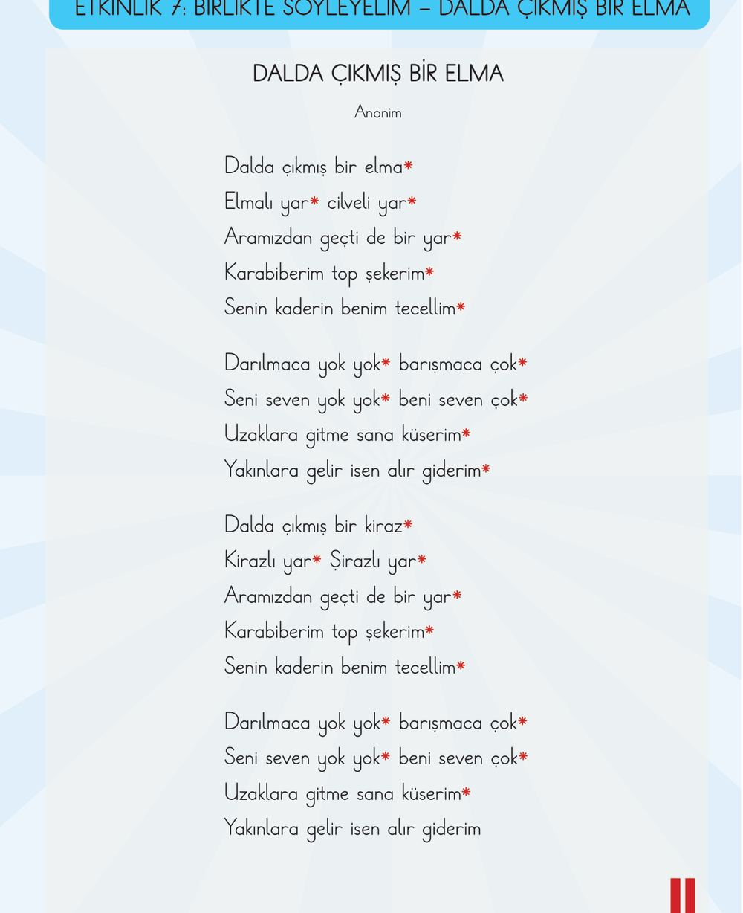

<!-- sayfa 33 -->

# DEĞERLENDİRME ZAMANI 3

Aşağıdaki ifadelere göre kutucukları $\checkmark$ ile işaretleyelim.

1  Şarkıyı ritmine uygun söyledim.
$\square$ Evet $\quad$ $\square$ Kısmen $\quad$ $\square$ Hayır

2  Şarkıyı ezgisine uygun söyledim.
$\square$ Evet $\quad$ $\square$ Kısmen $\quad$ $\square$ Hayır

3  Bedenimi şarkı söylemeye hazır hâle getirdim.
$\square$ Evet $\quad$ $\square$ Kısmen $\quad$ $\square$ Hayır

4  Şarkıyı söylerken doğru yerlerde nefes aldım.
$\square$ Evet $\quad$ $\square$ Kısmen $\quad$ $\square$ Hayır

<!-- sayfa 34 -->

# D Ü Ş Ü N E L İ M
# B U L A L I M

Cumhuriyet Bayramı, Atatürk Haftası ve Öğretmenler Günü ile ilgili bildiğimiz şarkı, türkü ve marşlar nelerdir? Arkadaşlarımızla paylaşalım.

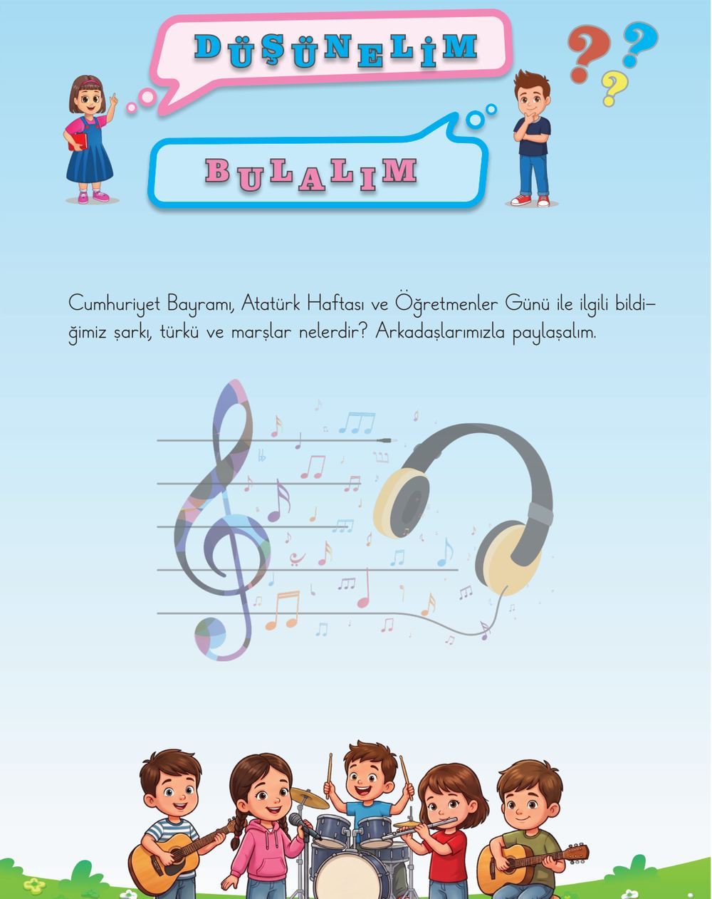

<!-- sayfa 35 -->

# ETKİNLİK 8: BİRLİKTE GURURLA KUTLAYALIM – CUMHURİYET MARŞI

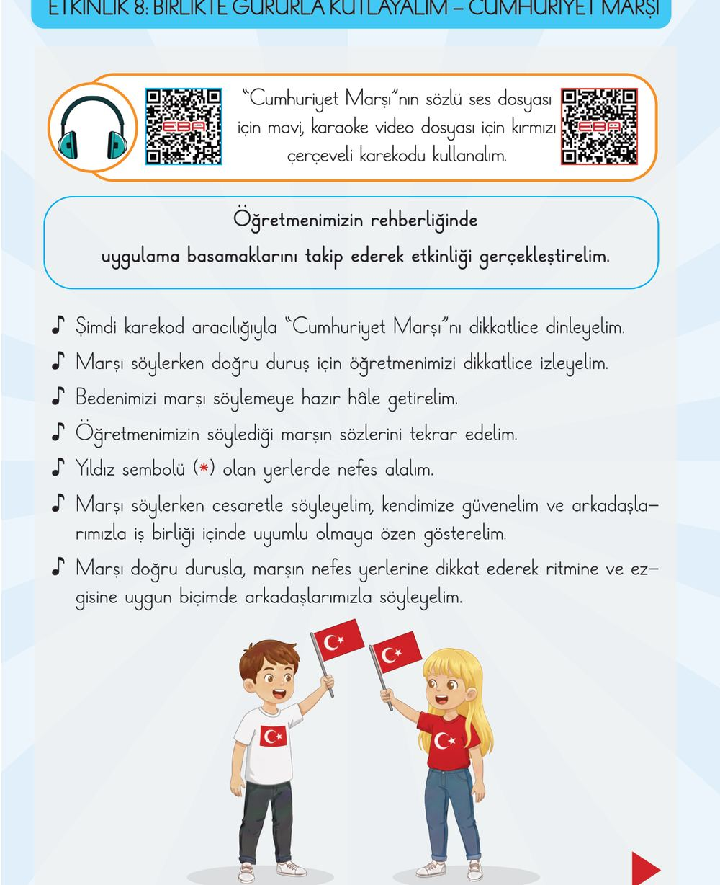

“Cumhuriyet Marşı”nın sözlü ses dosyası için mavi, karaoke video dosyası için kırmızı çerçeveli karekodu kullanalım.

> Öğretmenimizin rehberliğinde uygulama basamaklarını takip ederek etkinliği gerçekleştirelim.

♪ Şimdi karekod aracılığıyla “Cumhuriyet Marşı”nı dikkatlice dinleyelim.
♪ Marşı söylerken doğru duruş için öğretmenimizi dikkatlice izleyelim.
♪ Bedenimizi marşı söylemeye hazır hâle getirelim.
♪ Öğretmenimizin söylediği marşın sözlerini tekrar edelim.
♪ Yıldız sembolü (*) olan yerlerde nefes alalım.
♪ Marşı söylerken cesaretle söyleyelim, kendimize güvenelim ve arkadaşlarımızla iş birliği içinde uyumlu olmaya özen gösterelim.
♪ Marşı doğru duruşla, marşın nefes yerlerine dikkat ederek ritmine ve ezgisine uygun biçimde arkadaşlarımızla söyleyelim.

<!-- sayfa 36 -->

ETKİNLİK 8: BİRLİKTE GURURLA KUTLAYALIM – CUMHURİYET MARŞI

# CUMHURİYET MARŞI
Söz-Müzik: Hasan Toraganlı (1916 – 1993)

Yol vermeyen yüce dağlar*
Yalçın kayalar aştık*
Hiç sapmadan doğru yoldan*
Bu günlere ulaştık*

Cumhuriyet* Atatürk’ten*
Kutsal armağan bize*
Her an yeni bir hız aldık*
Kavuştuk ülkümüze

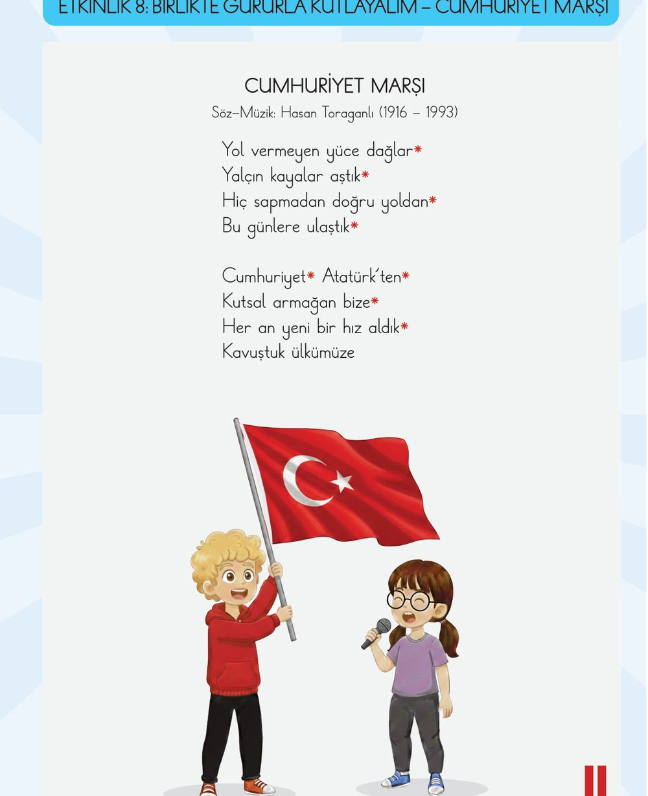

<!-- sayfa 37 -->

# ETKİNLİK 9: ÖZLEMLE ANIYORUZ – CANIM ATATÜRK

“Canım Atatürk” şarkısının sözlü ses dosyası için mavi, karaoke video dosyası için kırmızı çerçeveli karekodu kullanalım.

> Öğretmenimizin rehberliğinde uygulama basamaklarını takip ederek etkinliği gerçekleştirelim.

♪ Şimdi karekod aracılığıyla “Canım Atatürk” şarkısını dikkatlice dinleyelim.
♪ Şarkıyı söylerken doğru duruş için öğretmenimizi dikkatlice izleyelim.
♪ Bedenimizi şarkı söylemeye hazır hâle getirelim.
♪ Öğretmenimizin söylediği şarkının sözlerini tekrar edelim.
♪ Yıldız sembolü (*) olan yerlerde nefes alalım.
♪ Şarkıyı söylerken cesaretle söyleyelim, kendimize güvenelim ve arkadaşlarımızla iş birliği içinde uyumlu olmaya özen gösterelim.
♪ Şarkıyı doğru duruşla, şarkının nefes yerlerine dikkat ederek ritmine ve ezgisine uygun biçimde arkadaşlarımızla söyleyelim.

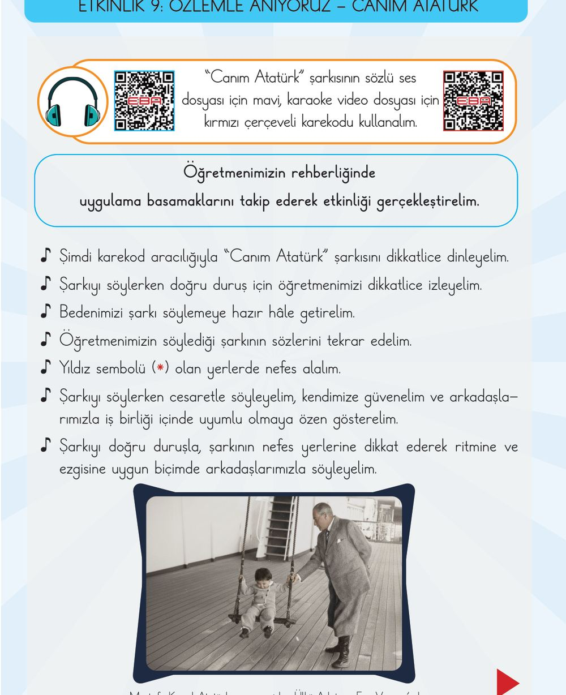

<!-- sayfa 38 -->

ETKİNLİK 9: ÖZLEMLE ANIYORUZ – CANIM ATATÜRK

# CANIM ATATÜRK
Söz–Müzik: Komisyon

Atatürk’üm bir ışık gibi*
Yolumuzu aydınlatır*
Kalbimizde sonsuz sevgisiyle*
Yurdumuzu aydınlatır*

Atatürk canım Atatürk*
Atatürk canım Atatürk*
Cumhuriyetin armağan
Sonsuza dek yaşatacağız

*Bu eserin söz ve müziği komisyon tarafından yazılmıştır.*

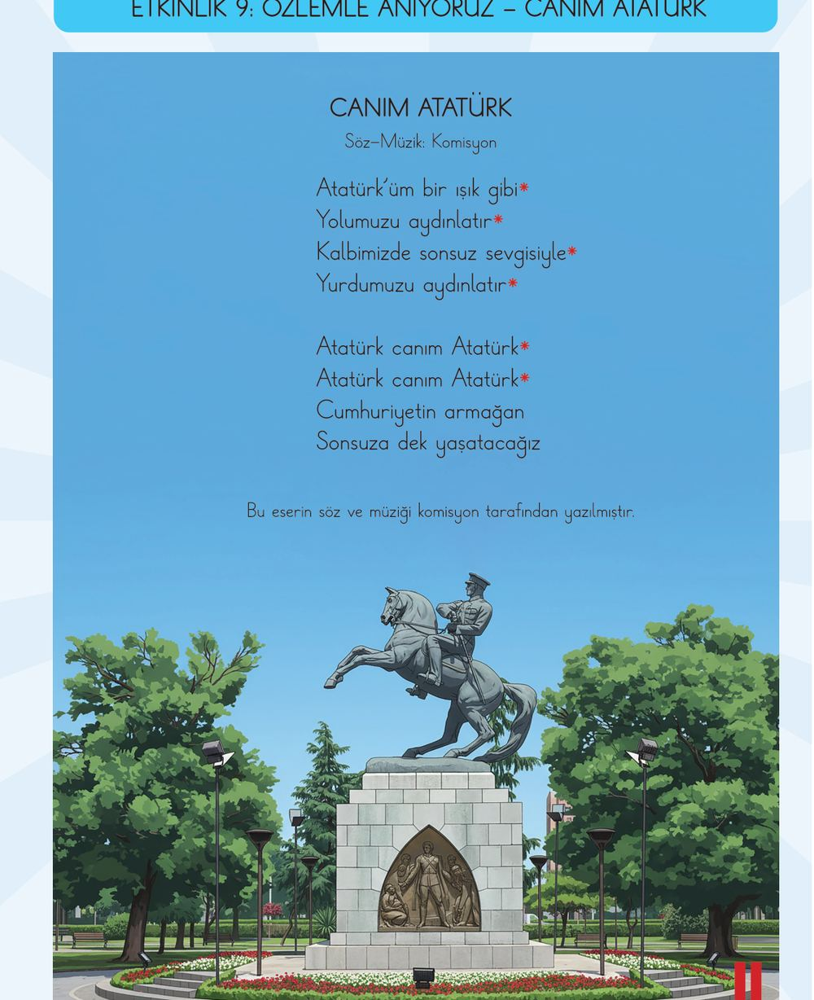

<!-- sayfa 39 -->

# ETKİNLİK 10: BİRLİKTE KUTLAYALIM – ÖĞRETMENİM

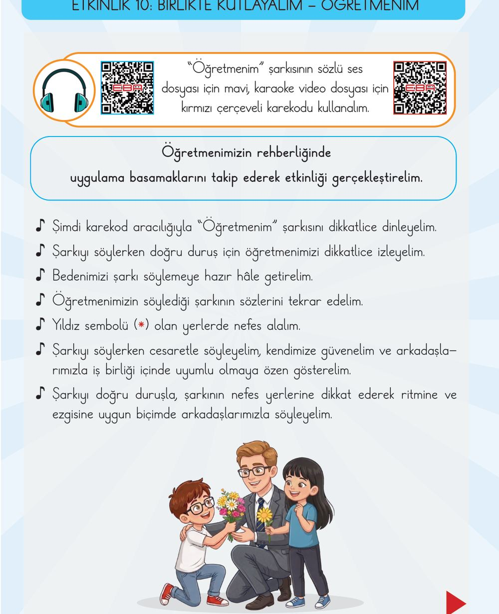

“Öğretmenim” şarkısının sözlü ses dosyası için mavi, karaoke video dosyası için kırmızı çerçeveli karekodu kullanalım.

> Öğretmenimizin rehberliğinde uygulama basamaklarını takip ederek etkinliği gerçekleştirelim.

♪ Şimdi karekod aracılığıyla “Öğretmenim” şarkısını dikkatlice dinleyelim.
♪ Şarkıyı söylerken doğru duruş için öğretmenimizi dikkatlice izleyelim.
♪ Bedenimizi şarkı söylemeye hazır hâle getirelim.
♪ Öğretmenimizin söylediği şarkının sözlerini tekrar edelim.
♪ Yıldız sembolü (*) olan yerlerde nefes alalım.
♪ Şarkıyı söylerken cesaretle söyleyelim, kendimize güvenelim ve arkadaşlarımızla iş birliği içinde uyumlu olmaya özen gösterelim.
♪ Şarkıyı doğru duruşla, şarkının nefes yerlerine dikkat ederek ritmine ve ezgisine uygun biçimde arkadaşlarımızla söyleyelim.

<!-- sayfa 40 -->

ETKİNLİK 10: BİRLİKTE KUTLAYALIM – ÖĞRETMENİM

# ÖĞRETMENİM
Söz–Müzik: Komisyon

Her sabah uyanırım*
Koşar gelirim sana*
Yüzünü gördüğümde*
Işık dolar dünyama*

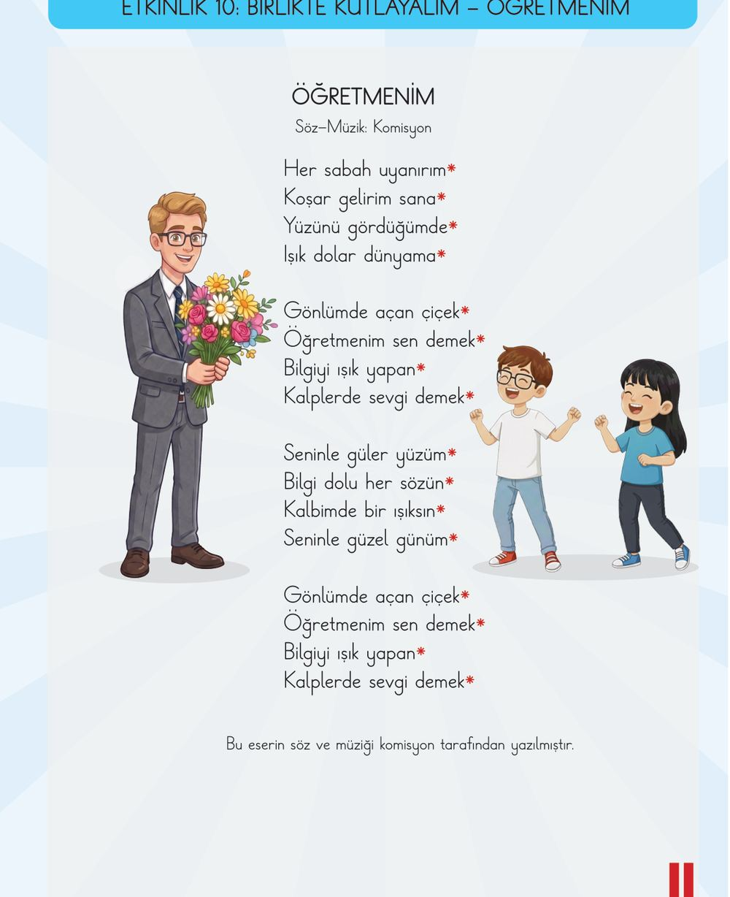

Gönlümde açan çiçek*
Öğretmenim sen demek*
Bilgiyi ışık yapan*
Kalplerde sevgi demek*

Seninle güler yüzüm*
Bilgi dolu her sözün*
Kalbimde bir ışıksın*
Seninle güzel günüm*

Bu eserin söz ve müziği komisyon tarafından yazılmıştır.

<!-- sayfa 41 -->

# DEĞERLENDİRME ZAMANI 4

Aşağıdaki ifadelere göre kutucukları $\checkmark$ ile işaretleyelim.

1 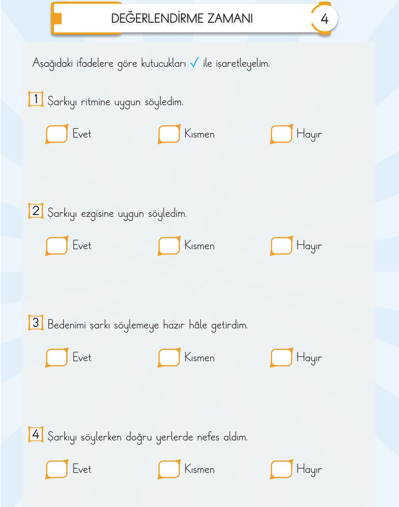 Şarkıyı ritmine uygun söyledim.
$\square$ Evet $\quad$ $\square$ Kısmen $\quad$ $\square$ Hayır

2  Şarkıyı ezgisine uygun söyledim.
$\square$ Evet $\quad$ $\square$ Kısmen $\quad$ $\square$ Hayır

3  Bedenimi şarkı söylemeye hazır hâle getirdim.
$\square$ Evet $\quad$ $\square$ Kısmen $\quad$ $\square$ Hayır

4  Şarkıyı söylerken doğru yerlerde nefes aldım.
$\square$ Evet $\quad$ $\square$ Kısmen $\quad$ $\square$ Hayır

<!-- sayfa 42 -->

# D Ü Ş Ü N E L İ M
# B U L A L I M

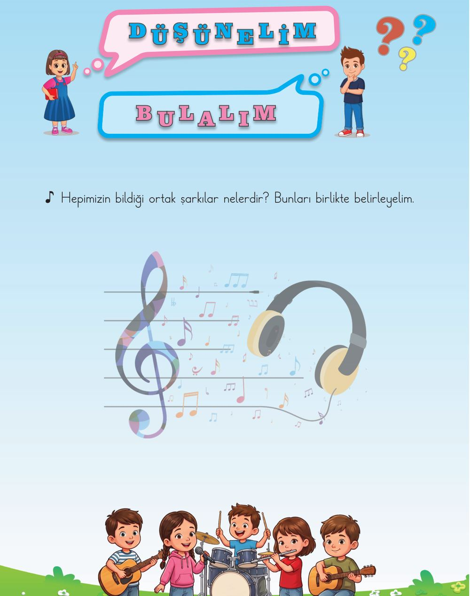

♪ Hepimizin bildiği ortak şarkılar nelerdir? Bunları birlikte belirleyelim.

<!-- sayfa 43 -->

# ETKİNLİK 11: ORTAK REPERTUVARI SÖYLEYELİM – MAÇKA YOLLARI*

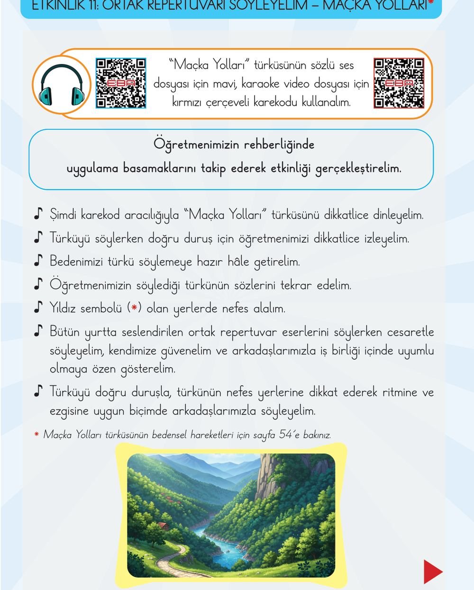

“Maçka Yolları” türküsünün sözlü ses dosyası için mavi, karaoke video dosyası için kırmızı çerçeveli karekodu kullanalım.

> Öğretmenimizin rehberliğinde uygulama basamaklarını takip ederek etkinliği gerçekleştirelim.

♪ Şimdi karekod aracılığıyla “Maçka Yolları” türküsünü dikkatlice dinleyelim.
♪ Türküyü söylerken doğru duruş için öğretmenimizi dikkatlice izleyelim.
♪ Bedenimizi türkü söylemeye hazır hâle getirelim.
♪ Öğretmenimizin söylediği türkünün sözlerini tekrar edelim.
♪ Yıldız sembolü (*) olan yerlerde nefes alalım.
♪ Bütün yurtta seslendirilen ortak repertuvar eserlerini söylerken cesaretle söyleyelim, kendimize güvenelim ve arkadaşlarımızla iş birliği içinde uyumlu olmaya özen gösterelim.
♪ Türküyü doğru duruşla, türkünün nefes yerlerine dikkat ederek ritmine ve ezgisine uygun biçimde arkadaşlarımızla söyleyelim.

* Maçka Yolları türküsünün bedensel hareketleri için sayfa 54’e bakınız.

<!-- sayfa 44 -->

ETKİNLİK 11: ORTAK REPERTUVARI SÖYLEYELİM – MAÇKA YOLLARI

# MAÇKA YOLLARI
Yöresi: Trabzon

Of oooooooooof*                                Of oooooooooof*
Maçka yolları taşli                            Sis dağının başlari
Geliyi sari saçli *                            Duman değil kar idi*
Ne oldi sana yarim                             Sevduğum senin ilen
Böyle gözlerun yaşli*                          Ne günlerum var idi*

Of oooooooooof*                                Of oooooooooof*
Dereler akar akar                              Yukari gel yukari
Garuşur denizlere*                             Irmağın gözindeyim*
Gurban olayim yavrum                          Eller ne derse desun
O sevdali gözlere*                             Ben yine sözümdeyim

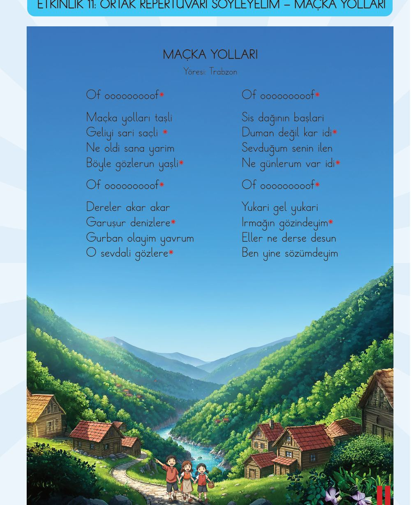

<!-- sayfa 45 -->

# ETKİNLİK 12: ORTAK REPERTUVARI SÖYLEYELİM – AYVA ÇİÇEK AÇMIŞ

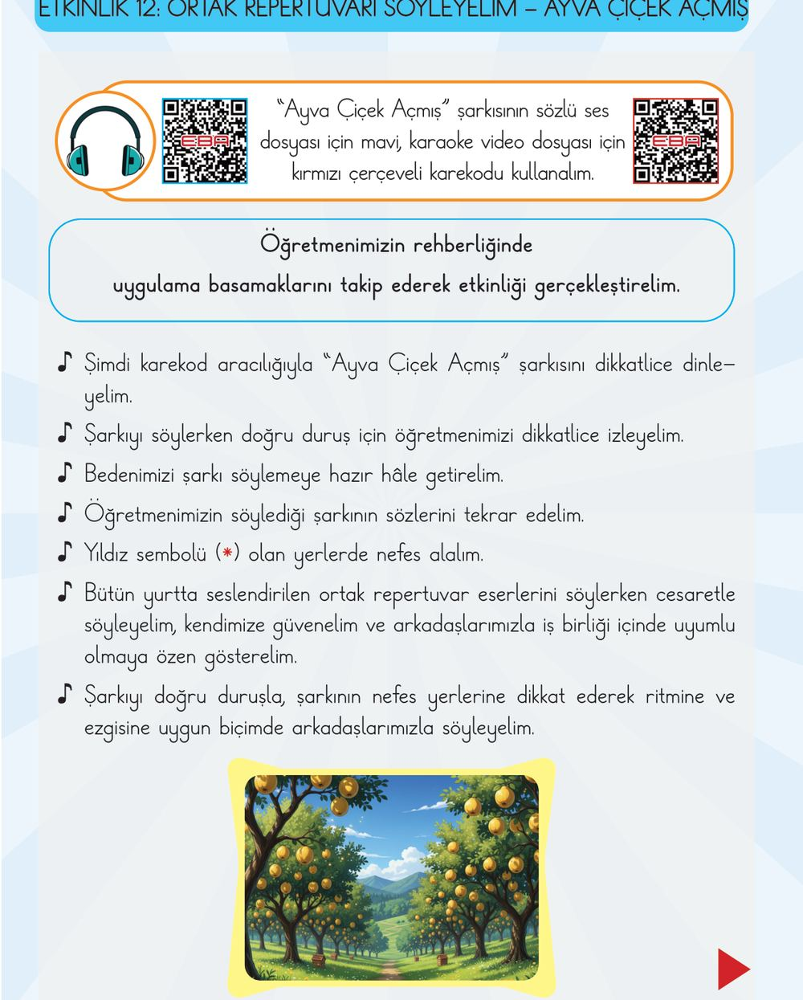

“Ayva Çiçek Açmış” şarkısının sözlü ses dosyası için mavi, karaoke video dosyası için kırmızı çerçeveli karekodu kullanalım.

> Öğretmenimizin rehberliğinde uygulama basamaklarını takip ederek etkinliği gerçekleştirelim.

♪ Şimdi karekod aracılığıyla “Ayva Çiçek Açmış” şarkısını dikkatlice dinleyelim.

♪ Şarkıyı söylerken doğru duruş için öğretmenimizi dikkatlice izleyelim.

♪ Bedenimizi şarkı söylemeye hazır hâle getirelim.

♪ Öğretmenimizin söylediği şarkının sözlerini tekrar edelim.

♪ Yıldız sembolü (*) olan yerlerde nefes alalım.

♪ Bütün yurtta seslendirilen ortak repertuvar eserlerini söylerken cesaretle söyleyelim, kendimize güvenelim ve arkadaşlarımızla iş birliği içinde uyumlu olmaya özen gösterelim.

♪ Şarkıyı doğru duruşla, şarkının nefes yerlerine dikkat ederek ritmine ve ezgisine uygun biçimde arkadaşlarımızla söyleyelim.

<!-- sayfa 46 -->

# ETKİNLİK 12: ORTAK REPERTUVARI SÖYLEYELİM – AYVA ÇİÇEK AÇMIŞ

## AYVA ÇİÇEK AÇMIŞ

Ayva çiçek açmış* yaz mı gelecek
Gönül bu sevdadan vaz mı geçecek*
Bana ettiklerin az mı gelecek*

Yandım Allah yandım yandırma beni*
Derin uykulardan kaldırma beni*
Seviyorum diye kandırma beni*

Ayaş yollarında* kervanın mı var
Beni öldürmeye fermanın mı var*
Ağlamaya sızlamaya dermanın mı var*

Ayaş yollarını* aştım da geldim
Boyunu boyuma ölçtüm de geldim*
Güzeller içinden seçtim de geldim*

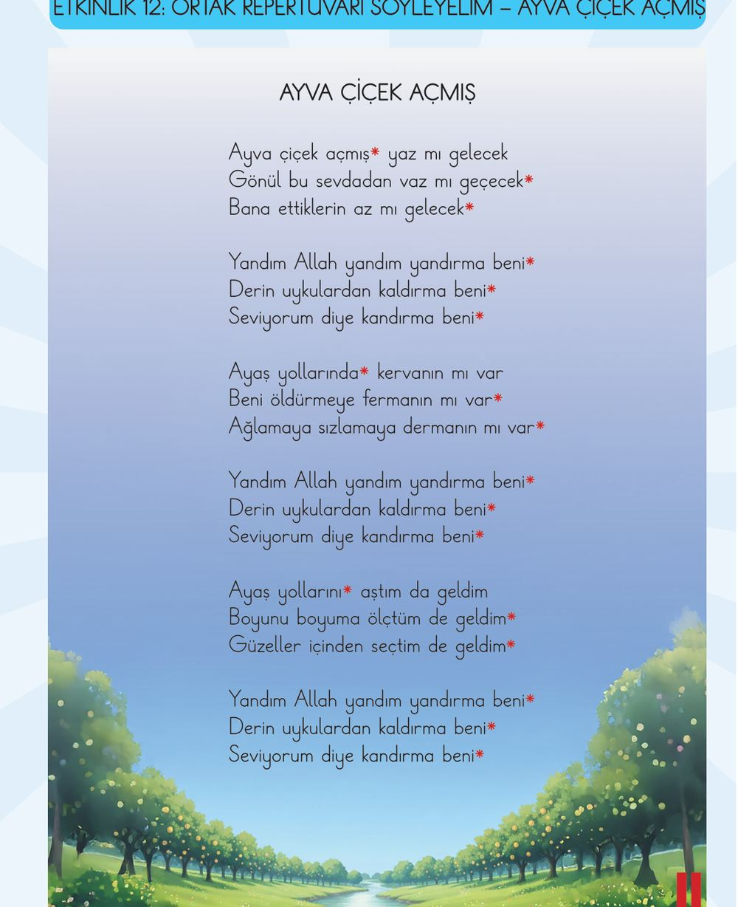
<!-- yer tutucu bulunamadı: sayfa sonuna eklendi -->

<!-- sayfa 47 -->

# ETKİNLİK 13: ORTAK REPERTUARI SÖYLEYELİM – BAHÇEVAN

“Bahçevan” şarkısının sözlü ses dosyası için mavi, karaoke video dosyası için kırmızı çerçeveli karekodu kullanalım.

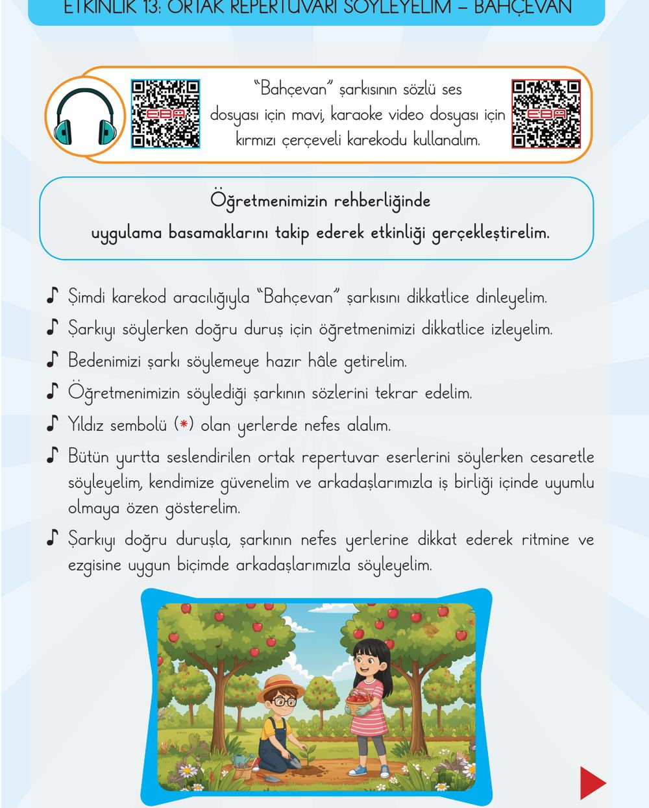

> Öğretmenimizin rehberliğinde uygulama basamaklarını takip ederek etkinliği gerçekleştirelim.

♪ Şimdi karekod aracılığıyla “Bahçevan” şarkısını dikkatlice dinleyelim.
♪ Şarkıyı söylerken doğru duruş için öğretmenimizi dikkatlice izleyelim.
♪ Bedenimizi şarkı söylemeye hazır hâle getirelim.
♪ Öğretmenimizin söylediği şarkının sözlerini tekrar edelim.
♪ Yıldız sembolü (*) olan yerlerde nefes alalım.
♪ Bütün yurtta seslendirilen ortak repertuvar eserlerini söylerken cesaretle söyleyelim, kendimize güvenelim ve arkadaşlarımızla iş birliği içinde uyumlu olmaya özen gösterelim.
♪ Şarkıyı doğru duruşla, şarkının nefes yerlerine dikkat ederek ritmine ve ezgisine uygun biçimde arkadaşlarımızla söyleyelim.

<!-- sayfa 48 -->

ETKİNLİK 13: ORTAK REPERTUARI SÖYLEYELİM – BAHÇEVAN

# BAHÇEVAN
Söz–Müzik: Zeki Müren (1931–1996)

Elmayı alan bilir oy oy*
Şeftaliyi satan bilir oy oy*
Güzel kızın sevmesini oy oy*
Kimsesiz yatan bilir oy oy*

Bahçevan geldi* bahçevan geldi*
Deh deh dül dül deh deh dül dül
Sen düldülsün ben bülbül*

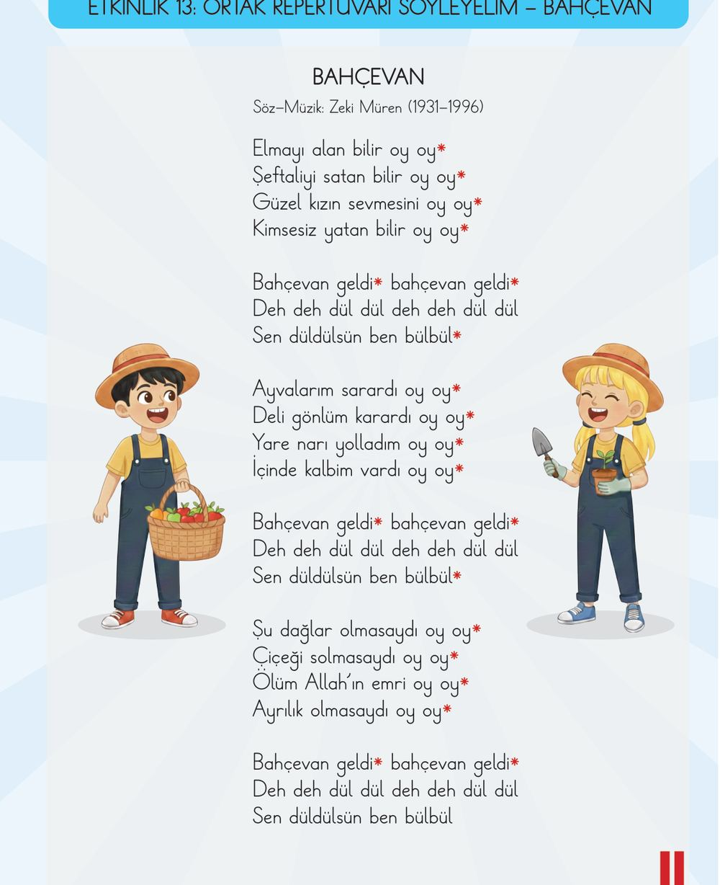

Ayvalarım sarardı oy oy*
Deli gönlüm karardı oy oy*
Yare narı yolladım oy oy*
İçinde kalbim vardı oy oy*

Şu dağlar olmasaydı oy oy*
Çiçeği solmasaydı oy oy*
Ölüm Allah’ın emri oy oy*
Ayrılık olmasaydı oy oy*

Bahçevan geldi* bahçevan geldi*
Deh deh dül dül deh deh dül dül
Sen düldülsün ben bülbül

<!-- sayfa 49 -->

# DEĞERLENDİRME ZAMANI 5

Aşağıdaki ifadelere göre kutucukları $\checkmark$ ile işaretleyelim.

1  Şarkıyı ritmine uygun söyledim.
$\square$ Evet $\quad$ $\square$ Kısmen $\quad$ $\square$ Hayır

2  Şarkıyı ezgisine uygun söyledim.
$\square$ Evet $\quad$ $\square$ Kısmen $\quad$ $\square$ Hayır

3  Bedenimi şarkı söylemeye hazır hâle getirdim.
$\square$ Evet $\quad$ $\square$ Kısmen $\quad$ $\square$ Hayır

4  Şarkıyı söylerken doğru yerlerde nefes aldım.
$\square$ Evet $\quad$ $\square$ Kısmen $\quad$ $\square$ Hayır

<!-- sayfa 50 -->

# D Ü Ş Ü N E L İ M

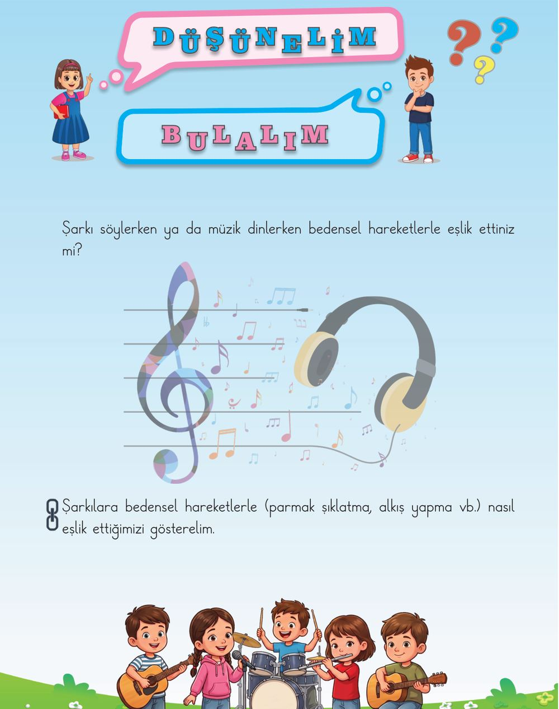

# B U L A L I M

Şarkı söylerken ya da müzik dinlerken bedensel hareketlerle eşlik ettiniz mi?

Şarkılara bedensel hareketlerle (parmak şıklatma, alkış yapma vb.) nasıl eşlik ettiğimizi gösterelim.

<!-- sayfa 51 -->

# ETKİNLİK 14: BEDEN PERKÜSYONU – YAĞMUR YAĞIYOR

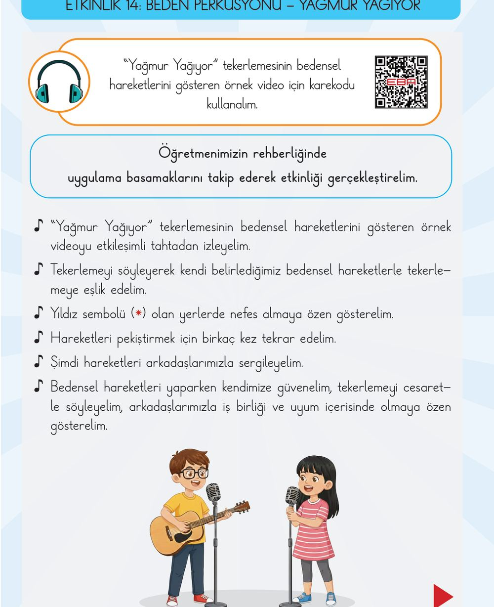

“Yağmur Yağıyor” tekerlemesinin bedensel hareketlerini gösteren örnek video için karekodu kullanalım.

> Öğretmenimizin rehberliğinde uygulama basamaklarını takip ederek etkinliği gerçekleştirelim.

♪ “Yağmur Yağıyor” tekerlemesinin bedensel hareketlerini gösteren örnek videoyu etkileşimli tahtadan izleyelim.

♪ Tekerlemeyi söyleyerek kendi belirlediğimiz bedensel hareketlerle tekerlemeye eşlik edelim.

♪ Yıldız sembolü (*) olan yerlerde nefes almaya özen gösterelim.

♪ Hareketleri pekiştirmek için birkaç kez tekrar edelim.

♪ Şimdi hareketleri arkadaşlarımızla sergileyelim.

♪ Bedensel hareketleri yaparken kendimize güvenelim, tekerlemeyi cesaretle söyleyelim, arkadaşlarımızla iş birliği ve uyum içerisinde olmaya özen gösterelim.

<!-- sayfa 52 -->

ETKİNLİK 14: BEDEN PERKÜSYONU – YAĞMUR YAĞIYOR

# YAĞMUR YAĞIYOR

Tekerleme

Yağmur yağıyor*
Seller akıyor*
Komşu kızı*
Camdan bakıyor*

Şimşek çakıyor*
Gök gürüldüyor*
Komşu kızı*
Korkup kaçıyor*

Dere taşıyor*
Irmak coşuyor*
Komşu kızı*
Şaşır kalıyor

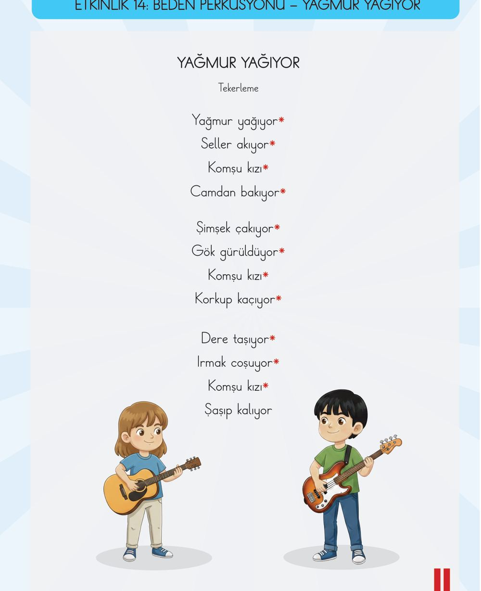

<!-- sayfa 53 -->

# ETKİNLİK 15: BEDEN PERKÜSYONU – MAÇKA YOLLARI

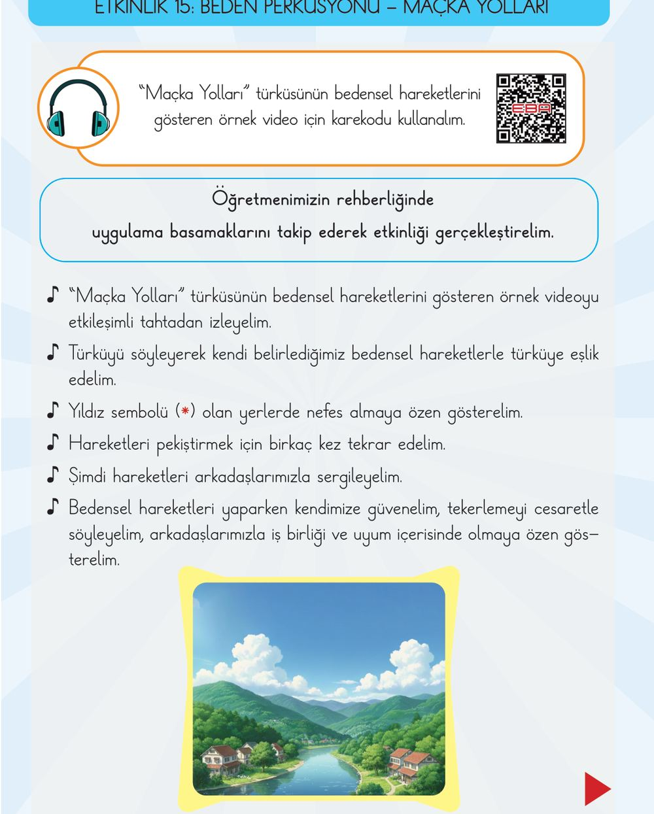 “Maçka Yolları” türküsünün bedensel hareketlerini gösteren örnek video için karekodu kullanalım.

## Öğretmenimizin rehberliğinde uygulama basamaklarını takip ederek etkinliği gerçekleştirelim.

♪ “Maçka Yolları” türküsünün bedensel hareketlerini gösteren örnek videoyu etkileşimli tahtadan izleyelim.

♪ Türküyü söyleyerek kendi belirlediğimiz bedensel hareketlerle türküye eşlik edelim.

♪ Yıldız sembolü (*) olan yerlerde nefes almaya özen gösterelim.

♪ Hareketleri pekiştirmek için birkaç kez tekrar edelim.

♪ Şimdi hareketleri arkadaşlarımızla sergileyelim.

♪ Bedensel hareketleri yaparken kendimize güvenelim, tekerlemeyi cesaretle söyleyelim, arkadaşlarımızla iş birliği ve uyum içerisinde olmaya özen gösterelim.

<!-- sayfa 54 -->

ETKİNLİK 15: BEDEN PERKÜSYONU – MAÇKA YOLLARI

# MAÇKA YOLLARI
Yöresi: Trabzon

Of oooooooooof*                                Of oooooooooof*
Maçka yolları taşli                            Sis dağının başlari
Geliyi sari saçlı *                            Duman değil kar idi*
Ne oldu sana yarim                             Sevduğum senin ilen
Böyle gözlerun yaşli*                          Ne günlerum var idi*

Of oooooooooof*                                Of oooooooooof*
Dereler akar akar                              Yukari gel yukari
Garuşur denizlere*                             Irmağın gözindeyim*
Gurban olayim yavrum                          Eller ne desun
O sevdali gözlere*                             Ben yine sözümdeyim

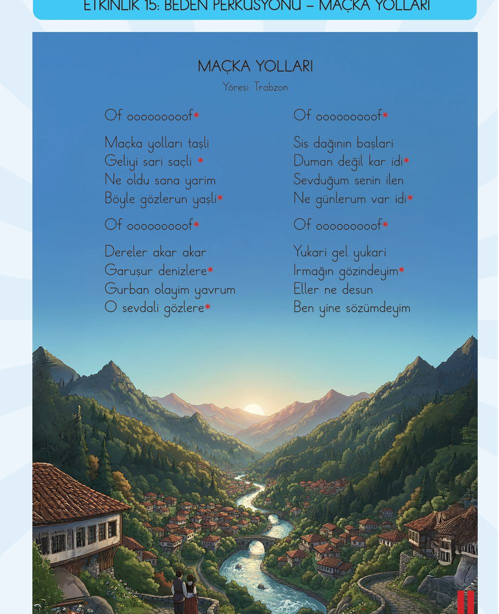

<!-- sayfa 55 -->

# DEĞERLENDİRME ZAMANI 6

Aşağıdaki ifadelere göre kutucukları $\checkmark$ ile işaretleyelim.

1 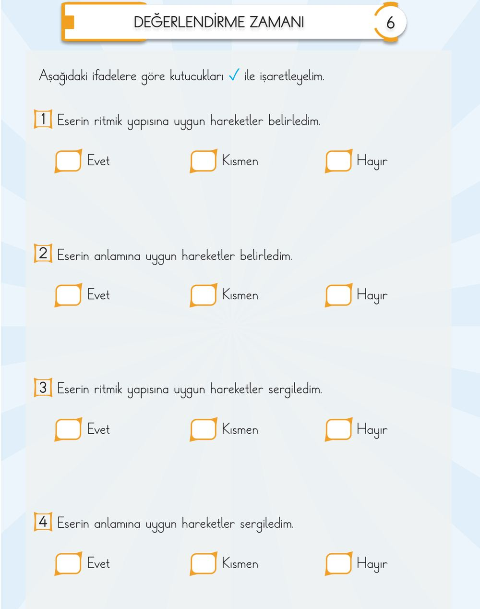 Eserin ritmik yapısına uygun hareketler belirledim.
$\square$ Evet $\square$ Kısmen $\square$ Hayır

2  Eserin anlamına uygun hareketler belirledim.
$\square$ Evet $\square$ Kısmen $\square$ Hayır

3  Eserin ritmik yapısına uygun hareketler sergiledim.
$\square$ Evet $\square$ Kısmen $\square$ Hayır

4  Eserin anlamına uygun hareketler sergiledim.
$\square$ Evet $\square$ Kısmen $\square$ Hayır

<!-- sayfa 56 -->

# 1. TEMA DEĞERLENDİRME SORULARI

 1 Aşağıdaki dizelerden hangisinde İstiklâl Marşı’nı hecelerken kırmızıya boyanmış hece üç kez el çırpılacak şekilde doğru gösterilmiştir?

A) Kork-ma sön-mez bu şa-fak-lar-da yü-zen al san-cak
B) Sön-me-den yur-du-mun üs-tün-de tü-ten en son o-cak
C) O be-nim mil-le-ti-min yıl-dı-zı-dır par-la-ya-cak

 2 Aşağıda verilen çevrede duyduğumuz seslerden hangisinin sesi diğerlerine göre daha kalındır?

A) Kedi  B) Kuş  C) Köpek

 3 Aşağıdaki ifadelerden doğru olanlar için D yazan, yanlış olanlar için Y yazan kutucuğu “✓” ile işaretleyelim.

| | | | |
| :--- | :--- | :---: | :---: |
| a) | “Madımak” farklı türdeki eserlerden bir tekerleme türüdür. | D | Y |
| b) | “Yağmur Yağıyor” farklı türdeki eserlerden bir tekerleme türüdür. | D | Y |
| c) | “Ayva Çiçek Açmış” belirli gün ve haftalarla ilgili eserlerden bir marş türüdür. | D | Y |
| ç) | “Cumhuriyet Marşı” belirli gün ve haftalarla ilgili eserlerden bir marş türüdür. | D | Y |

 4 Aşağıda verilmiş olan eserlerden hangisi bir ortak repertuvar eseridir?

A) Canım Atatürk  B) Maçka Yolları  C) Öğretmenim

 5 Aşağıdakilerden hangisi bir şarkıya eşlik ederken yaptığımız bedensel harekete örnektir?

A) Parmak şıklatmak  B) Müzik dinlemek  C) Yemek yemek

<!-- sayfa 57 -->

2. Temanın EBA içerik alanına ulaşmak için karekodu kullanınız. 

# 2. TEMA
# MÜZİK KÜLTÜRÜ

♪ İstiklâl Marşı
♪ Ezgi veren vurmalı çalgılar
♪ Farklı türdeki eserler
♪ Belirli gün ve haftalarla ilgili eserler
♪ Ortak repertuvar
♪ Bedensel hareketler

<!-- sayfa 58 -->

2. Temanın özet içeriğine ulaşmak için karekodu kullanınız. 

# M Ü Z İ K

Bu temada sizden

♪ İstiklâl Marşı’nın başlıca ögelerini çözümleyebilmeniz,
♪ ezgi veren vurmalı çalgıları tanıyabilmeniz,
♪ farklı türdeki eserler ile belirli gün ve haftalarla ilgili eserleri söyleyebilmeniz,
♪ ortak repertuvardaki eserleri söyleyebilmeniz,
♪ müzik eserlerine bedensel hareketlerle eşlik edebilmeniz

beklenmektedir.

<!-- sayfa 59 -->

# D Ü Ş Ü N E L İ M
# B U L A L I M

İstiklâl Marşı’nın başlıca ögeleri nelerdir?

İstiklâl Marşı’nın başlıca ögelerinden bildiklerimizi arkadaşlarımızla paylaşalım.

<!-- sayfa 60 -->

# ETKİNLİK 1: İSTİKLÂL MARŞI’NIN ÖGELERİ

> **Bilgi Kutucuğu**
> ### İstiklâl Marşı’nın Başlıca Ögeleri
> Türk bayrağı, saygı duruşu, bağımsızlık, millî birlik ve beraberlik, Mehmet Âkif Ersoy

Mehmet Âkif Ersoy ve İstiklâl Marşı’yla ilgili aşağıdaki okuma parçasını okuyunuz.

## OKUMA PARÇASI

Mehmet Âkif Ersoy (1873–1936) İstiklâl Marşı’nı yazan şairimizdir. O, vatanını çok seven milli ve manevi değerlere bağlı bir insandı. Şair olmasının yanı sıra öğretmen, veteriner hekim ve siyasetçiydi. İstiklâl Marşı, Türk milletinin millî birlik, beraberlik ve bağımsızlığının en önemli sembolüdür. Bu marş Türk milletinin cesaretini ve vatan sevgisini anlatır. İstiklâl Marşı bize birlik olmayı, umutlu olmayı ve ülkemizi sevmeyi hatırlatır.

<!-- sayfa 61 -->

# DEĞERLENDİRME ZAMANI

Aşağıdaki ifadelere göre kutucukları ✓ ile işaretleyelim.

1. İstiklâl Marşı’nın şairinin kim olduğunu biliyorum.
   ☐ Evet ☐ Kısmen ☐ Hayır

2. İstiklâl Marşı’nın Türk milletinin millî birlik, beraberlik ve bağımsızlığının en önemli sembolü olduğunu biliyorum.
   ☐ Evet ☐ Kısmen ☐ Hayır

3. İstiklâl Marşı’nın Türk milletinin vatan sevgisini anlattığını biliyorum.
   ☐ Evet ☐ Kısmen ☐ Hayır

4. İstiklâl Marşı’nın Türk milletinin cesaretini anlattığını biliyorum.
   ☐ Evet ☐ Kısmen ☐ Hayır

5. İstiklâl Marşı’nın bize birlik olmayı hatırlattığını biliyorum.
   ☐ Evet ☐ Kısmen ☐ Hayır

6. İstiklâl Marşı’nın bize ülkemizi sevmeyi hatırlattığını biliyorum.
   ☐ Evet ☐ Kısmen ☐ Hayır

<!-- yer tutucu bulunamadı: sayfa sonuna eklendi -->

<!-- sayfa 62 -->

# D Ü Ş Ü N E L İ M
# B U L A L I M

Ezgi veren vurmalı çalgılar nelerdir?

Sizce ezgi veren vurmalı çalgıların özellikleri nelerdir? Bu çalgılardan hangilerini gördünüz, dinlediniz ya da çaldınız? Arkadaşlarımızla paylaşalım.

<!-- sayfa 63 -->

# ETKİNLİK 2: EZGİ VEREN VURMALI ÇALGILARI TANIYALIM

Ezgi veren vurmalı çalgıları tanıtan video için karekodu kullanalım.

## Öğretmenimizin rehberliğinde uygulama basamaklarını takip ederek etkinliği gerçekleştirelim.

♪ Aşağıda verilen görsellerdeki ezgi veren vurmalı çalgıları inceleyelim.
♪ Ezgi veren vurmalı çalgıları tanıtan videoyu izleyelim.
♪ Ezgi veren vurmalı çalgıların özelliklerini, benzerlik ve farklılıklarını kendi cümlelerimizle ifade edelim.
♪ Varsa sınıfımızda bulunan ezgi veren vurmalı çalgıları çalalım.

| El zili | Glokensipil | Marimba | Melodik borular |
| :---: | :---: | :---: | :---: |
|  |  |  |  |

| Metalofon | Vibrafon | Timpani | Ksilofon |
| :---: | :---: | :---: | :---: |
|  |  |  |  |

<!-- sayfa 64 -->

# ETKİNLİK 3: KÜLTÜREL MİRASTAN ÖRNEKLER

> Öğretmenimizin rehberliğinde uygulama basamaklarını takip ederek etkinliği gerçekleştirelim.

♪ Ezgi veren vurmalı çalgılarla ilgili “ülkemiz kültürel mirasından” öğretmenimizin seçtiği saygınlık kazanmış örnek eserler ve icracılarını etkileşimli tahtadan izleyelim.

♪ Ezgi veren vurmalı çalgılarla ilgili “dünya kültürel mirasından” öğretmenimizin seçtiği saygınlık kazanmış örnek eserler ve icracılarını etkileşimli tahtadan izleyelim.

♪ Ülkemiz ve dünya kültürel mirası ile ilgili izlediğimiz videolardan ilgimizi çeken örnekleri arkadaşlarımızla paylaşalım.

<!-- sayfa 65 -->

# ETKİNLİK 4: OYNAYALIM EĞLENELİM

“Çalgının Sesini Bulalım” oyunu için karekodu kullanalım.

> Öğretmenimizin rehberliğinde uygulama basamaklarını takip ederek etkinliği gerçekleştirelim.

♪ Etkileşimli tahtadan “Çalgının Sesini Bulalım” oyununu açalım.
♪ Oyundaki yönergeleri takip edelim.

<!-- sayfa 66 -->

# ETKİNLİK 5: OYNAYALIM EĞLENELİM

Aşağıda verilen vurmalı çalgı görsellerinin altındaki kutucukları ezgi verenle-
rinkini kırmızıya, sadece ritim verenlerinkini maviye boyayalım.

<!-- sayfa 67 -->

# DEĞERLENDİRME ZAMANI 2

 1 Aşağıdaki çalgılardan ezgi veren vurmalı çalgıları $\checkmark$ ile işaretleyelim.

(Görseldeki enstrümanlar: Djembe, Trampet, Ksilofon, Bagetler, Marimba, Glockenspiel)

2 Ezgi veren vurmalı çalgıların **özellikleri** nelerdir? Söyleyelim.

3 Ezgi veren vurmalı çalgıların **benzerlikleri** nelerdir? Söyleyelim.

4 Ezgi veren vurmalı çalgıların **farklılıkları** nelerdir? Söyleyelim.

5 Ezgi veren vurmalı çalgılar ile ritim veren vurmalı çalgılar arasındaki ilişkiyi kendi cümlelerimizle ifade edelim.

<!-- sayfa 68 -->

# D Ü Ş Ü N E L İ M
# B U L A L I M

Sevdiğimiz şarkı, türkü, marş vb. farklı türlerdeki eserler nelerdir? Arkadaşlarımızla paylaşalım.

🔗 En çok hangi müzik türlerini seviyoruz? Arkadaşlarımızla paylaşalım.

<!-- sayfa 69 -->

# ETKİNLİK 6: BİRLİKTE SÖYLEYELİM – MERDİVEN*

“Merdiven” şarkısının sözlü ses dosyası için mavi, karaoke video dosyası için kırmızı çerçeveli karekodu kullanalım.

## Öğretmenimizin rehberliğinde uygulama basamaklarını takip ederek etkinliği gerçekleştirelim.

♪ Şimdi karekod aracılığıyla “Merdiven” şarkısını dikkatlice dinleyelim.
♪ Şarkıyı söylerken doğru duruş için öğretmenimizi dikkatlice izleyelim.
♪ Bedenimizi şarkı söylemeye hazır hâle getirelim.
♪ Öğretmenimizin söylediği şarkının sözlerini tekrar edelim.
♪ Yıldız sembolü (*) olan yerlerde nefes alalım.
♪ Şarkıyı söylerken cesaretle söyleyelim, kendimize güvenelim ve arkadaşlarımızla iş birliği içinde uyumlu olmaya özen gösterelim.
♪ Şarkıyı doğru duruşla, şarkının nefes yerlerine dikkat ederek ritmine ve ezgisine uygun biçimde arkadaşlarımızla söyleyelim.

* Merdiven şarkısının bedensel hareketleri için sayfa 94’e bakınız.

<!-- sayfa 70 -->

ETKİNLİK 6: BİRLİKTE SÖYLEYELİM – MERDİVEN

# MERDİVEN
Söz-Müzik: Erdoğan Okyay (1933–2017)

Yukarıya çıkalım*
Aşağıya inelim*
Azıcık dinlenip*
Bir daha deneyelim*

Yukarısı la olsun*
Aşağısı re olsun*
Şimdi de seslerin*
Hepsine bir ad konsun*

Re mi fa sol la la la*
La sol fa mi re re re*
La la sol mi fa sol*
La sol fa mi re re re

<!-- sayfa 71 -->

# ETKİNLİK 7: BİRLİKTE SÖYLEYELİM – ALİ BABA’NIN ÇİFTLİĞİ*

 “Ali Baba’nın Çiftliği” şarkısının sözlü ses dosyası için mavi, karaoke video dosyası için kırmızı çerçeveli karekodu kullanalım.

> Öğretmenimizin rehberliğinde uygulama basamaklarını takip ederek etkinliği gerçekleştirelim.

♪ Şimdi karekod aracılığıyla “Ali Baba’nın Çiftliği” şarkısını dikkatlice dinleyelim.

♪ Şarkıyı söylerken doğru duruş için öğretmenimizi dikkatlice izleyelim.

♪ Bedenimizi şarkı söylemeye hazır hâle getirelim.

♪ Öğretmenimizin söylediği şarkının sözlerini tekrar edelim.

♪ Yıldız sembolü (*) olan yerlerde nefes alalım.

♪ Şarkıyı söylerken cesaretle söyleyelim, kendimize güvenelim ve arkadaşlarımızla iş birliği içinde uyumlu olmaya özen gösterelim.

♪ Şarkıyı doğru duruşla, şarkının nefes yerlerine dikkat ederek ritmine ve ezgisine uygun biçimde arkadaşlarımızla söyleyelim.

* Ali Baba’nın Çiftliği şarkısının bedensel hareketleri için sayfa 96’ya bakınız.

<!-- sayfa 72 -->

ETKİNLİK 7: BİRLİKTE SÖYLEYELİM – ALİ BABA’NIN ÇİFTLİĞİ

# ALİ BABA’NIN ÇİFTLİĞİ
Söz–Müzik: Erdoğan Çaplı (1926–1977)

Ali Baba’nın bir çiftliği var*
Çiftliğinde kuzuları var*
Mee mee* diye bağırır*
Çiftliğinde Ali Baba’nın*

Ali Baba’nın bir çiftliği var*
Çiftliğinde inekleri var*
Möö möö* diye bağırır*
Çiftliğinde Ali Baba’nın*

 Ali Baba’nın bir çiftliği var*
Çiftliğinde arıları var*
Vız vız* diye uçuşur*
Çiftliğinde Ali Baba’nın*

Ali Baba’nın bir çiftliği var*
Çiftliğinde köpekleri var*
Hav hav* diye bağırır*
Çiftliğinde Ali Baba’nın

<!-- sayfa 73 -->

# ETKİNLİK 8: BİRLİKTE SÖYLEYELİM – LEBLEBİ KOYDUM TASA

“Leblebi Koydum Tasa” türküsünün sözlü ses dosyası için mavi, karaoke video dosyası için kırmızı çerçeveli karekodu kullanalım.

> Öğretmenimizin rehberliğinde uygulama basamaklarını takip ederek etkinliği gerçekleştirelim.

♪ Şimdi karekod aracılığıyla “Leblebi Koydum Tasa” türküsünü dikkatlice dinleyelim.
♪ Türküyü söylerken doğru duruş için öğretmenimizi dikkatlice izleyelim.
♪ Bedenimizi türkü söylemeye hazır hâle getirelim.
♪ Öğretmenimizin söylediği türkünün sözlerini tekrar edelim.
♪ Yıldız sembolü (*) olan yerlerde nefes alalım.
♪ Türküyü söylerken cesaretle söyleyelim, kendimize güvenelim ve arkadaşlarımızla iş birliği içinde uyumlu olmaya özen gösterelim.
♪ Türküyü doğru duruşla, türkünün nefes yerlerine dikkat ederek ritmine ve ezgisine uygun biçimde arkadaşlarımızla söyleyelim.

<!-- sayfa 74 -->

ETKİNLİK 8: BİRLİKTE SÖYLEYELİM – LEBLEBİ KOYDUM TASA

# LEBLEBİ KOYDUM TASA
Yöresi: Çankırı

Leblebi koydum tasa kız annem*
Doldurdum basa basa kız annem de*
Benim yarim çok güzel kız annem*
Azıcık boydan kısa kız annem de*

Hop ninnayı ninnayı kız annem de*
Gel oynayı oynayı kız annem*

Alayı aldık düze kız annem*
Görüşelim yüz yüze kız annem de*
Arada sevda varmış kız annem*
Sözü verdik biz bize kız annem de*

Hop ninnayı ninnayı kız annem de*
Gel oynayı oynayı kız annem

Kaynak: TRT Müzik Dairesi

<!-- sayfa 75 -->

# ETKİNLİK 9: BİRLİKTE SÖYLEYELİM – AY DOĞAR AYİSTAN’DAN

“Ay Doğar Ayistan’dan” türküsünün sözlü ses dosyası için mavi, karaoke video dosyası için kırmızı çerçeveli karekodu kullanalım.

> Öğretmenimizin rehberliğinde uygulama basamaklarını takip ederek etkinliği gerçekleştirelim.

♪ Şimdi karekod aracılığıyla “Ay Doğar Ayistan’dan” türküsünü dikkatlice dinleyelim.

♪ Türküyü söylerken doğru duruş için öğretmenimizi dikkatlice izleyelim.

♪ Bedenimizi türkü söylemeye hazır hâle getirelim.

♪ Öğretmenimizin söylediği türkünün sözlerini tekrar edelim.

♪ Yıldız sembolü (*) olan yerlerde nefes alalım.

♪ Türküyü söylerken cesaretle söyleyelim, kendimize güvenelim ve arkadaşlarımızla iş birliği içinde uyumlu olmaya özen gösterelim.

♪ Türküyü doğru duruşla, türkünün nefes yerlerine dikkat ederek ritmine ve ezgisine uygun biçimde arkadaşlarımızla söyleyelim.

<!-- sayfa 76 -->

ETKİNLİK 9: BİRLİKTE SÖYLEYELİM – AY DOĞAR AYİSTAN’DAN

# AY DOĞAR AYİSTAN’DAN
Yöresi: Bayburt

Ay doğar Ayistan’dan taralilli lilli lilli*
Gün doğar Günistan’dan taralilli lilli lilli*
Benim bir sevdiğim var taralilli lilli lilli*
Otuz iki bostandan tara taralilli lilli lilli*

Ay doğar aya gider taralilli lilli lilli*
Gün doğar güne gider taralilli lilli lilli*
Benim bir sevdiğim var taralilli lilli lilli*
Her gün bir yana gider taralilli lilli lilli*

Ay doğar ayazlanır taralilli lilli lilli*
Gün doğar beyazlanır taralilli lilli lilli*
Benim bir sevdiğim var taralilli lilli lilli*
Acep kime nazlanır taralilli lilli lilli

<!-- sayfa 77 -->

# DEĞERLENDİRME ZAMANI 3

Aşağıdaki ifadelere göre kutucukları $\checkmark$ ile işaretleyelim.

1  Şarkıyı ritmine uygun söyledim.
$\square$ Evet $\quad$ $\square$ Kısmen $\quad$ $\square$ Hayır

2  Şarkıyı ezgisine uygun söyledim.
$\square$ Evet $\quad$ $\square$ Kısmen $\quad$ $\square$ Hayır

3  Bedenimi şarkı söylemeye hazır hâle getirdim.
$\square$ Evet $\quad$ $\square$ Kısmen $\quad$ $\square$ Hayır

4  Şarkıyı söylerken doğru yerlerde nefes aldım.
$\square$ Evet $\quad$ $\square$ Kısmen $\quad$ $\square$ Hayır

<!-- sayfa 78 -->

# D Ü Ş Ü N E L İ M
# B U L A L I M

Şehitler Günü, 23 Nisan Ulusal Egemenlik ve Çocuk Bayramı, 19 Mayıs Atatürk’ü Anma ve Gençlik ve Spor Bayramı ile ilgili bildiğimiz şarkılarla marşlar nelerdir? Arkadaşlarımızla paylaşalım.

<!-- sayfa 79 -->

ETKİNLİK 10: SAYGIYLA VE RAHMETLE ANIYORUZ – ŞEHİTLER ÖLMEZ

“Şehitler Ölmez” marşının sözlü ses dosyası için mavi, karaoke video dosyası için kırmızı çerçeveli karekodu kullanalım.

Öğretmenimizin rehberliğinde uygulama basamaklarını takip ederek etkinliği gerçekleştirelim.

♪ Şimdi karekod aracılığıyla “Şehitler Ölmez” marşını dikkatlice dinleyelim.
♪ Marşı söylerken doğru duruş için öğretmenimizi dikkatlice izleyelim.
♪ Bedenimizi marşı söylemeye hazır hâle getirelim.
♪ Öğretmenimizin söylediği marşın sözlerini tekrar edelim.
♪ Yıldız sembolü (*) olan yerlerde nefes alalım.
♪ Marşı söylerken cesaretle söyleyelim, kendimize güvenelim ve arkadaşlarımızla iş birliği içinde uyumlu olmaya özen gösterelim.
♪ Marşı doğru duruşla, marşın nefes yerlerine dikkat ederek ritmine ve ezgisine uygun biçimde arkadaşlarımızla söyleyelim.

<!-- sayfa 80 -->

ETKİNLİK 10: SAYGIYLA VE RAHMETLE ANIYORUZ – ŞEHİTLER ÖLMEZ

# ŞEHİTLER ÖLMEZ
Söz-Müzik: Komisyon

Çanakkale’de durur*                                Gelibolu Bigalı*
Vatan için vurulur*                                 Kilitbahir Behramlı*
Destanlara sığmayan*                                Yiğitlerim can verip*
Şehitlik onurundur*                                 Yurdumuzu kurtardı*

Şehitler ölmez *                                    Şehitler ölmez*
Bu vatan bölünmez*                                  Bu vatan bölünmez*
Yurdu kurtaranların*                                Yurdu kurtaranların*
Hakkı ödenmez*                                      Hakkı ödenmez

Bu eserin söz ve müziği komisyon tarafından yazılmıştır.

<!-- sayfa 81 -->

# ETKİNLİK 11: BİRLİKTE GURURLA KUTLAYALIM – BAYRAM TÜRKÜSÜ

“Bayram Türküsü”nün sözlü ses dosyası için mavi, karaoke video dosyası için kırmızı çerçeveli karekodu kullanalım.

> Öğretmenimizin rehberliğinde uygulama basamaklarını takip ederek etkinliği gerçekleştirelim.

♪ Şimdi karekod aracılığıyla “Bayram Türküsü”nü dikkatlice dinleyelim.
♪ Şarkıyı söylerken doğru duruş için öğretmenimizi dikkatlice izleyelim.
♪ Bedenimizi şarkı söylemeye hazır hâle getirelim.
♪ Öğretmenimizin söylediği şarkının sözlerini tekrar edelim.
♪ Yıldız sembolü (*) olan yerlerde nefes alalım.
♪ Şarkıyı söylerken cesaretle söyleyelim, kendimize güvenelim ve arkadaşlarımızla iş birliği içinde uyumlu olmaya özen gösterelim.
♪ Şarkıyı doğru duruşla, şarkının nefes yerlerine dikkat ederek ritmine ve ezgisine uygun biçimde arkadaşlarımızla söyleyelim.

<!-- sayfa 82 -->

ETKİNLİK 11: BİRLİKTE GURURLA KUTLAYALIM – BAYRAM TÜRKÜSÜ

# BAYRAM TÜRKÜSÜ
Söz-Müzik: Erdoğan Okyay (1933–2017)

Lay lari lay lay lariliri lay lay*
Lay lari lay lay lariliri lay*

Bugün bayram çocuklar*
Bayramlara geliş var*
Annem gülsün babam gülsün*
Güleçlikte yarış var*

Bugün bayram çocuklar*
Meydanlara doluş var*
Davul vursun zurna çalsın*
Coşkunlukta yarış var*

Bugün bayram çocuklar*
Kırgınlık yok barış var*
Köylüm bilsin kentlim bilsin*
Mutlulukta yarış var

<!-- sayfa 83 -->

ETKİNLİK 12: BİRLİKTE GURURLA KUTLAYALIM – GENÇLİK

“Gençlik” şarkısının sözlü ses dosyası için mavi, karaoke video dosyası için kırmızı çerçeveli karekodu kullanalım.

Öğretmenimizin rehberliğinde uygulama basamaklarını takip ederek etkinliği gerçekleştirelim.

♪ Şimdi karekod aracılığıyla “Gençlik” şarkısını dikkatlice dinleyelim.
♪ Şarkıyı söylerken doğru duruş için öğretmenimizi dikkatlice izleyelim.
♪ Bedenimizi şarkı söylemeye hazır hâle getirelim.
♪ Öğretmenimizin söylediği şarkının sözlerini tekrar edelim.
♪ Yıldız sembolü (*) olan yerlerde nefes alalım.
♪ Şarkıyı söylerken cesaretle söyleyelim, kendimize güvenelim ve arkadaşlarımızla iş birliği içinde uyumlu olmaya özen gösterelim.
♪ Şarkıyı doğru duruşla, şarkının nefes yerlerine dikkat ederek ritmine ve ezgisine uygun biçimde arkadaşlarımızla söyleyelim.

<!-- sayfa 84 -->

ETKİNLİK 12: BİRLİKTE GURURLA KUTLAYALIM – GENÇLİK

# GENÇLİK
Uyarlama

Hiç bir şey var mı bu dünyamızda*
Neşeli şarkılar* tınlayan çalgılar*
Neşeyle oynayan
Gençler kadar

<!-- sayfa 85 -->

# DEĞERLENDİRME ZAMANI 4

Aşağıdaki ifadelere göre kutucukları $\checkmark$ ile işaretleyelim.

1  Şarkıyı ritmine uygun söyledim.

$\square$ Evet $\quad$ $\square$ Kısmen $\quad$ $\square$ Hayır

2  Şarkıyı ezgisine uygun söyledim.

3  Bedenimi şarkı söylemeye hazır hâle getirdim.

4  Şarkıyı söylerken doğru yerlerde nefes aldım.

<!-- sayfa 86 -->

# D Ü Ş Ü N E L İ M
# B U L A L I M

Hepimizin bildiği ortak şarkılar nelerdir? Bunları birlikte belirleyelim.

<!-- sayfa 87 -->

# ETKİNLİK 13: ORTAK REPERTUARI SÖYLEYELİM – ANNEM ANNEM

“Annem Annem” şarkısının sözlü ses dosyası için mavi, karaoke video dosyası için kırmızı çerçeveli karekodu kullanalım.

> Öğretmenimizin rehberliğinde uygulama basamaklarını takip ederek etkinliği gerçekleştirelim.

♪ Şimdi karekod aracılığıyla “Annem Annem” şarkısını dikkatlice dinleyelim.
♪ Şarkıyı söylerken doğru duruş için öğretmenimizi dikkatlice izleyelim.
♪ Bedenimizi şarkı söylemeye hazır hâle getirelim.
♪ Öğretmenimizin söylediği şarkının sözlerini tekrar edelim.
♪ Yıldız sembolü (*) olan yerlerde nefes alalım.
♪ Bütün yurtta seslendirilen ortak repertuvar eserlerini söylerken cesaretle söyleyelim, kendimize güvenelim ve arkadaşlarımızla iş birliği içinde uyumlu olmaya özen gösterelim.
♪ Şarkıyı doğru duruşla, şarkının nefes yerlerine dikkat ederek ritmine ve ezgisine uygun biçimde arkadaşlarımızla söyleyelim.

<!-- sayfa 88 -->

ETKİNLİK 13: ORTAK REPERTUVARI SÖYLEYELİM – ANNEM ANNEM

# ANNEM ANNEM
Söz: Ahmet Muhtar Ataman (1896–1962)
Müzik: Uyarlama

Küçücükken başucumda*
Bana ninni söylerdin*
Sabahları uyanınca*
Beni okşar severdin*

Benim annem güzel annem*
Beni al kollarına*
Kucağında uyut beni*
Ninniler söyle bana*

Bugün hala kulağımda*
Çınlıyor tatlı sesin*
Benim annem kalbimin sen*
En güzel yerindesin*

Benim annem güzel annem*
Beni al kollarına*
Kucağında uyut beni*
Ninniler söyle bana

<!-- sayfa 89 -->

# ETKİNLİK 14: ORTAK REPERTUVARI SÖYLEYELİM – SARI ÇİZMELİ MEHMET AĞA

> Öğretmenimizin rehberliğinde uygulama basamaklarını takip ederek etkinliği gerçekleştirelim.

♪ Öğretmenimizin dijital araçlardan açtığı “Sarı Çizmeli Mehmet Ağa” isimli şarkıyı dikkatlice dinleyelim.

♪ Şarkıyı söylerken doğru duruş için öğretmenimizi dikkatlice izleyelim.

♪ Bedenimizi şarkı söylemeye hazır hâle getirelim.

♪ Öğretmenimizin söylediği şarkının sözlerini tekrar edelim.

♪ Yıldız sembolü (*) olan yerlerde nefes alalım.

♪ Bütün yurtta seslendirilen ortak repertuvar eserlerini söylerken cesaretle söyleyelim, kendimize güvenelim ve arkadaşlarımızla iş birliği içinde uyumlu olmaya özen gösterelim.

♪ Şarkıyı doğru duruşla, şarkının nefes yerlerine dikkat ederek ritmine ve ezgisine uygun biçimde arkadaşlarımızla söyleyelim.

<!-- sayfa 90 -->

ETKİNLİK 14: ORTAK REPERTUVARI SÖYLEYELİM – SARI ÇİZMELİ MEHMET AĞA

# SARI ÇİZMELİ MEHMET AĞA
Söz–Müzik: Barış MANÇO (1943–1999)

Yaz dostum*
Güzel sevmeyene adam denir mi*
Yaz dostum*
Selam almayana yiğit denir mi*

Yaz dostum*
Altı üstü beş metrelik bez için*
Yaz dostum*
Boşa geçmiş ömre yaşam denir mi*

Yaz tahtaya bir daha*
Tut defteri kitabı*
Sarı çizmeli Mehmet Ağa*
Bir gün öder hesabı*

Yaz dostum*
Yoksul görsen besle kaymak bal ile*
Yaz dostum*
Garipleri giydir ipek şal ile*

Yaz dostum*
Öksüz görsen sar kanadın kolunu*
Yaz dostum*
Kimse göçmez bu dünyadan mal ile*

<!-- sayfa 91 -->

# DEĞERLENDİRME ZAMANI 5

Aşağıdaki ifadelere göre kutucukları $\checkmark$ ile işaretleyelim.

1  Şarkıyı ritmine uygun söyledim.

$\square$ Evet $\quad$ $\square$ Kısmen $\quad$ $\square$ Hayır

2  Şarkıyı ezgisine uygun söyledim.

3  Bedenimi şarkı söylemeye hazır hâle getirdim.

4  Şarkıyı söylerken doğru yerlerde nefes aldım.

<!-- sayfa 92 -->

# D Ü Ş Ü N E L İ M
# B U L A L I M

Söylerken ya da dinlerken bir şarkıya bedensel hareketlerle eşlik edebiliyor musunuz?

 Şarkılara bedensel hareketlerle nasıl eşlik ettiğimizi gösterelim.

<!-- sayfa 93 -->

# ETKİNLİK 15: BEDEN PERKÜSYONU – MERDİVEN

> “Merdiven” şarkısının bedensel hareketlerini gösteren örnek video için karekodu kullanalım.
> 

Öğretmenimizin rehberliğinde uygulama basamaklarını takip ederek etkinliği gerçekleştirelim.

♪ “Merdiven” şarkısının bedensel hareketlerini gösteren örnek videoyu etkileşimli tahtadan izleyelim.

♪ Şarkıyı söyleyerek kendi belirlediğimiz bedensel hareketlerle şarkıya eşlik edelim.

♪ Yıldız sembolü (*) olan yerlerde nefes almaya özen gösterelim.

♪ Hareketleri pekiştirmek için birkaç kez tekrar edelim.

♪ Şimdi hareketleri arkadaşlarımızla sergileyelim.

♪ Bedensel hareketleri yaparken kendimize güvenelim, şarkıyı cesaretle söyleyelim, arkadaşlarımızla iş birliği ve uyum içerisinde olmaya özen gösterelim.

<!-- sayfa 94 -->

ETKİNLİK 15: BEDEN PERKÜSYONU – MERDİVEN

# MERDİVEN
Söz-Müzik: Erdoğan Okyay (1933–2017)

Yukarıya çıkalım*
Aşağıya inelim*
Azıcık dinlenip*
Bir daha deneyelim*

Yukarısı la olsun*
Aşağısı re olsun*
Şimdi de seslerin*
Hepsine bir ad konsun*

Re mi fa sol la la la*
La sol fa mi re re re*
La la sol mi fa sol*
La sol fa mi re re re

<!-- sayfa 95 -->

ETKİNLİK 16: BEDEN PERKÜSYONU – ALİ BABA’NIN ÇİFTLİĞİ

“Ali Baba’nın Çiftliği” şarkısının bedensel hareketlerini gösteren örnek video için karekodu kullanalım.

Öğretmenimizin rehberliğinde uygulama basamaklarını takip ederek etkinliği gerçekleştirelim.

♪ “Ali Baba’nın Çiftliği” şarkısının bedensel hareketlerini gösteren örnek videoyu etkileşimli tahtadan izleyelim.
♪ Şarkıyı söyleyerek kendi belirlediğimiz bedensel hareketlerle şarkıya eşlik edelim.
♪ Yıldız sembolü (*) olan yerlerde nefes almaya özen gösterelim.
♪ Hareketleri pekiştirmek için birkaç kez tekrar edelim.
♪ Şimdi hareketleri arkadaşlarımızla sergileyelim.
♪ Bedensel hareketleri yaparken kendimize güvenelim, şarkıyı cesaretle söyleyelim, arkadaşlarımızla iş birliği ve uyum içerisinde olmaya özen gösterelim.

<!-- sayfa 96 -->

ETKİNLİK 16: BEDEN PERKÜSYONU – ALİ BABA’NIN ÇİFTLİĞİ

# ALİ BABA’NIN ÇİFTLİĞİ
Söz–Müzik: Erdoğan Çaplı (1926–1977)

Ali Baba’nın bir çiftliği var*
Çiftliğinde kuzuları var*
Mee mee* diye bağırır*
Çiftliğinde Ali Baba’nın*

Ali Baba’nın bir çiftliği var*
Çiftliğinde inekleri var*
Möö möö* diye bağırır*
Çiftliğinde Ali Baba’nın*

Ali Baba’nın bir çiftliği var*
Çiftliğinde arıları var*
Vız vız* diye uçuşur*
Çiftliğinde Ali Baba’nın*

Ali Baba’nın bir çiftliği var*
Çiftliğinde köpekleri var*
Hav hav* diye bağırır*
Çiftliğinde Ali Baba’nın

<!-- sayfa 97 -->

# DEĞERLENDİRME ZAMANI 6

Aşağıdaki ifadelere göre kutucukları $\checkmark$ ile işaretleyelim.

1  Eserin ritmik yapısına uygun hareketler belirledim.
$\square$ Evet $\square$ Kısmen $\square$ Hayır

2  Eserin anlamına uygun hareketler belirledim.
$\square$ Evet $\square$ Kısmen $\square$ Hayır

3  Eserin ritmik yapısına uygun hareketler sergiledim.
$\square$ Evet $\square$ Kısmen $\square$ Hayır

4  Eserin anlamına uygun hareketler sergiledim.
$\square$ Evet $\square$ Kısmen $\square$ Hayır

<!-- sayfa 98 -->

# DEĞERLENDİRME SORULARI
## 2. TEMA

 1 İstiklâl Marşı’nın şairi kimdir?
A) Mehmet Âkif Ersoy
B) Âşık Veysel Şatıroğlu
C) Osman Zeki Üngör

 2 Aşağıdakilerden hangisi ezgi veren vurmalı çalgılardan biridir?
A) Davul B) Ksilofon C) Trampet

 3 Aşağıdaki ifadelerden doğru olanlar için D yazan, yanlış olanlar için Y yazan kutucuğu “✓” ile işaretleyelim.

| | | D | Y |
| :--- | :--- | :---: | :---: |
| a) | “Merdiven” farklı türdeki eserlerden bir marş türüdür. | | |
| b) | “Annem Annem” farklı türdeki eserlerden bir şarkı türüdür. | | |
| c) | “Gençlik” belirli gün ve haftalarla ilgili eserlerden bir şarkı türüdür. | | |
| ç) | “Ali Baba’nın Çiftliği” belirli gün ve haftalarla ilgili eserlerden bir türkü türüdür. | | |

 4 Aşağıda verilmiş olan eserlerden hangisi bir ortak repertuvar eseridir?
A) Merdiven B) Annem Annem C) Şehitler Ölmez

 5 Aşağıdakilerden hangisi bedensel harekete örnektir?
A) Bağırmak B) Ağlamak C) Alkış yapmak

<!-- sayfa 99 -->

# KAYNAKÇA

Aydoğan, S. (2023). Hayat Şarkılarla Güzel, Arkadaş Yayınevi, Ankara. s.171, 209 ,271

Aydoğan, S. (1992). Hayat Kaynağımız, Müzik Ortaokul 1–2–3, Arkadaş Yayınevi, Ankara, s.51.

Bilgin, S. (2023). Piyano Eşlikli Türk Marşları, Müzik Eğitimi Yayınları, Ankara, s.13

Millî Eğitim Bakanlığı [MEB], (2025). Müzik Dersi Öğretim Programı (1, 2, 3, 4, 5, 6, 7 ve 8. Sı-
nıflar). Millî Eğitim Bakanlığı, Talim ve Terbiye Kurulu Başkanlığı, Ankara.

Bu kaynakça Apa 7 yazım kurallarına göre oluşturulmuştur.

Cevap anahtarına
ulaşmak için karekodu kullanınız. 

Görsel kaynakça ve genel ağ kaynakçasına
ulaşmak için karekodu kullanınız. 

<!-- sayfa 100 -->

25°D 30°D 35°D 40°D 45°D
45°D 40°D 35°D 30°D 25°D

ROMANYA
Bükreş
Tuna N.
UKRAYNA
RUSYA FEDERASYONU
HAZAR DENİZİ
GÜRCİSTAN
Tiflis
ERMENİSTAN
Erivan
AZERBAYCAN
NAHÇIVAN Ö.C. (AZERBAYCAN)
İRAN
IRAK
Bağdat
SÜRİYE
Şam
LÜBNAN
Beyrut
KUZEY KIBRIS TÜRK CUMHURİYETİ
Lefkoşa
GÜNEY KIBRIS RUM YÖNETİMİ
Erenköy
AKDENİZ
FİLİSTİN
Tel Aviv
Doğu Kudüs
Batı Şeria
İSRAİL
Gazze Şeridi
MİSİR
Nil N.
Süveyş K.
İBİYA
FİLİSTİN

BULGARİSTAN
Sofya
YUNANİSTAN
Atina
EGE DENİZİ
MARMARA DENİZİ
Gökçeada
Bozcaada

KARADENİZ
Sinop
Kastamonu
Bartın
Zonguldak
Karabük
Bolu
Düzce
Sakarya
Kocaeli
İstanbul
Tekirdağ
Kırklareli
Edirne

[Harita üzerinde şehir isimleri ve su yolları yer almaktadır]

: Türkiye'nin mülki idare bölümleri, nehirler, göller ve komşu ülkeleri gösteren harita.

**TÜRKİYE'NİN MÜLKİ İDARE BÖLÜMLERİ İLE KARA VE DENİZ KOMŞULARI HARİTASI**

| Sembol | Açıklama |
| :--- | :--- |
| ● | BAŞKENT |
| • | İL MERKEZİ |
| 🔵 | GÖL |
| ~ | AKARSU |
| — | ÜLKE SINIRI |
| -.- | ÖZERK BÖLGE SINIRI |

Elâzığ
Ankara

0 50 100 200 300 400 km

Harita Genel Müdürlüğü tarafından üretilmiştir.

<!-- sayfa 101 -->

: TÜRK DÜNYASI HARİTASI

180° 170°D 160°D 150°D 140°D 130°D 120°D 120°D 110°D 100°D 100°D 90°D 80°D 80°D 70°D 60°D 60°D 50°D 50°D 40°D 40°D 30°B 30°B 20°B 10°B 0° 10°B 20°B

Baykal G.
Aral G.
Ladoga G.
Balkaş G.
Onega G.
Van G.
Urumiye G.
Hulun G.
Tuz G.
Tuna N.
Amur N.
Peçora N.
Po N.
Ganj N.
Nil N.
İrtiş N.
Dicle N.
Sen N.
Obi N.
Nil N.
Obi N.
Sırderya N.
İrtiş N.
Volga N.
Ural N.
Yenisey N.
Don N.
Şam
Oslo
Kiev
Bakü
Paris
Sofya
Varşova
Bişkek
Astana
Ankara
Tiflis
Londra
Bağdat
UKRAYNA
Aşkabat
Duşanbe
Taşkent
Moskova
Stokholm
Amsterdam
M O Ğ O L İ S T A N
AFGANİSTAN
ÖZBEKİSTAN
K A Z A K İ S T A N
Yeni Delhi
TACİKİSTAN
FİNLANDİYA
Kopenhag
Helsinki
Ulanbator
F i l
D
B a r e n t s
D e n i z i
N o r v e ç
D e n i z i
Güney Çin Denizi
Ohotsk Denizi
A k d e n i z
B e r i n g D e n
Doğu Çin
Denizi
K u z e y
D e n i z i
Japon Denizi
Doğu Denizi
Sarı Deniz
K a r a
D e n i z i
Kız ıldeniz
Sulu Denizi
B a l t ı k D e n i z i
Tiren Denizi
Adriyatik Denizi
Azak Denizi
Ege Denizi
K a r a D e n i z i
Umman Denizi
NORVEÇ
İSVEÇ
DANİMARKA
Ç İ N H A L K C U M H U R İ Y E T İ
SİNCAN UYGUR ÖZERK BÖLGESİ
KIRGIZİSTAN
JAMMU VE KEŞMİR (İhtilaflı Bölge) (B M K ontrol Hattı) Tarafsız Bölge
İ R A N
IRAK
SURİYE
T Ü R K İ Y E
Hazar Denizi
GÜRCİSTAN
GKRY
KKTC
AZERBAYCAN
TÜRKMENİSTAN
MOLDOVA
MACARİSTAN
POLONYA
AVUSTURYA
ALMANYA
LİH
İSV
HRV
ROMANYA
BULGARİSTAN
BH
SRB
KSV
KRD
ARN
KMKD
Yemen Denizi
Manş Denizi
BİRLEŞİK KRALLIK
HOLLANDA
BEL
F R A N S A
YUNANİSTAN
P A K İ S T A N
H İ N D İ S T A N
İndus N.
Fırat N.
CEZAYİR
TUNUS
LİBYA
MISIR
SUDAN
YEMEN
UMMAN
SUUDİ ARABİSTAN
BİRLEŞİK ARAP EMİRLİKLERİ
KATAR
KUVEYT
ÜRDÜN
BANGLADEŞ
İTALYA
İSPANYA
PORTEKİZ
Trablus
Tunus
Cezayir
Madrid
Lizbon
Kahire
Amman
Kuveyt
Doha
Riyad
Abu Dabi
Muskat
Sana
Hartum
Dakka
BELARUS
Minsk
İRLANDA
Dublin
İZLANDA
FAS
NİJER
ÇAD
R U S Y A F E D E R A S Y O N U
Bahrülgazel N.
İndigirka N.
Lena N.
Sarı N.
Sarıkamış G.
Bükreş
Kişinev
Ribinsk
Brj. G.
Usa N.
Severnaya Dvina N.
Lefkoşa
KIRIM Ö.C.
TUVA C.
S A H A ( Y A K U T ) C .
FİLİSTİN
Issık G.
Meriç N.
Hotan N.
Cebelitarık B.
Hürmüz B.

# TÜRK DÜNYASI HARİTASI

**Bağımsız Türk Devletleri**
**Türk Cumhuriyetleri, Türk Bölgeleri**
**Türk Toplulukları**

km
0 250 500 1.000 1.500 2.000

### TÜRK CUMHURİYETLERİ
1 GAGAVUZ YERİ
2 KARAÇAY-ÇERKESYA
3 KABARDİN-BALKARYA C.
4 DAĞISTAN C.
5 ÇUVAŞİSTAN C.
6 TATARİSTAN C.
7 BAŞKURT C.
8 KARAKALPAKİSTAN C.
9 ALTAY C.
10 HAKASYA C.

### TÜRK BÖLGELERİ
a
b
c
ç
d
e
f
g
h
ı
i

### TÜRK TOPLULUKLARI
**Avrupa'daki Türkler**
a Kosova Türkleri
b Yunanistan Türkleri
c Bulgaristan Türkleri
ç Romanya Türkleri
d Suriye Türkmenleri
e Irak Türkmenleri
f İran Türkleri
g Afganistan Türkmenleri
h Pakistan Türkmenleri
ı Hindistan Türkmenleri
i Çin H. C. Türkleri
j Moğolistan Türkleri
k Rusya Federasyonu Türkler

### ÜLKE KISALTMALARI
ARN ARNAVUTLUK
BEL BELÇİKA
BH BOSNA - HERSEK
GKRY GÜNEY KIBRIS RUM YÖNETİMİ
HRV HIRVATİSTAN
İSV İSVİÇRE
KRD KARADAĞ
KMKD KUZEY MAKEDONYA
KKTC KUZEY KIBRIS TÜRK CUMHURİYETİ
KSV KOSOVA
LİH LİHtenştayn
SRB SIRBİSTAN
