# Müzik 5.Sınıf Ders Kitabı

<!-- sayfa 0 -->

ORTAOKUL VE İMAM HATİP ORTAOKULU

# Müzik

## 5. SINIF

### DERS KİTABI

**YAZARLAR**

Dr. Remziye Ezgi GÖKSEL

Hicran TEMUR

Mustafa Kemal SÜMBÜLLÜ

Onur GÜVEN

<!-- sayfa 1 -->

MİLLÎ EĞİTİM BAKANLIĞI YAYINLARI ....................................................................: 10 351 
DERS KİTAPLARI DİZİSİ .........................................................................................: 2295

Her hakkı saklıdır ve Millî Eğitim Bakanlığına aittir. Kitabın metin, soru ve şekilleri kısmen de olsa hiçbir surette alınıp yayımlanamaz.

# EDİTÖR
Prof. Dr. Süleyman TARMAN

## DİL UZMANI
Vedat EĞİLMEZ

## GÖRSEL TASARIMCI
Ahmet AKTAŞ
Fatih GÜNDÜZ
Nevzat ŞİMŞEK

## ÇOKLU ORTAM TASARIMCISI
Erhan GÜL
Onur TÜLÜ

## PROGRAM GELİŞTİRME UZMANI
Dr. Şahika ÜNLÜ

## ÖLÇME VE DEĞERLENDİRME UZMANI
Emrah GÖREN

## REHBERLİK UZMANI
Dursun DAYAPOĞLU

ISBN: 978-975-11-9094-9

Millî Eğitim Bakanlığı, Talim ve Terbiye Kurulu Başkanlığının 21.08.2025 tarih ve 138684130 sayılı yazısı ile eğitim aracı olarak kabul edilmiştir. Kurulca bu kitabın kabul edilmiş olması ders kitabından yayınevi ve yazarın/yazarların sorumluluğunu kaldırmaz.

<!-- sayfa 2 -->

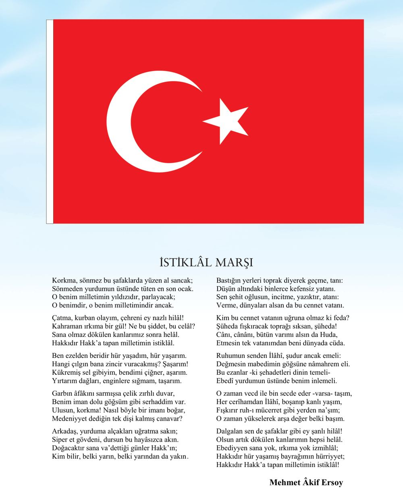

# İSTİKLÂL MARŞI

Korkma, sönmez bu şafaklarda yüzen al sancak;
Sönmeden yurdumun üstünde tüten en son ocak.
O benim milletimin yıldızıdır, parlayacak;
O benimdir, o benim milletimindir ancak.

Çatma, kurban olayım, çehreni ey nazlı hilâl!
Kahraman ırkıma bir gül! Ne bu şiddet, bu celâl?
Sana olmaz dökülen kanlarımız sonra helâl.
Hakkıdır Hakk'a tapan milletimin istiklâl.

Ben ezelden beridir hür yaşadım, hür yaşarım.
Hangi çılgın bana zincir vuracakmış? Şaşarım!
Kükremiş sel gibiyim, bendimi çiğner, aşarım.
Yırtarım dağları, enginlere sığmam, taşarım.

Garbın âfâkını sarmışsa çelik zırhlı duvar,
Benim iman dolu göğsüm gibi serhaddim var.
Ulusun, korkma! Nasıl böyle bir imanı boğar,
Medeniyet dediğin tek dişi kalmış canavar?

Arkadaş, yurduma alçakları uğratma sakın;
Siper et gövdeni, dursun bu hayâsızca akın.
Doğacaktır sana va'dettiği günler Hakk'ın;
Kim bilir, belki yarın, belki yarından da yakın.

Bastığın yerleri toprak diyerek geçme, tanı:
Düşün altındaki binlerce kefensiz yatanı.
Sen şehit oğlusun, incitme, yazıktır, atanı:
Verme, dünyaları alsan da bu cennet vatanı.

Kim bu cennet vatanın uğruna olmaz ki feda?
Şüheda fışkıracak toprağı sıksan, şüheda!
Cânı, cânânı, bütün varımı alsın da Huda,
Etmesin tek vatanımdan beni dünyada cüda.

Ruhumun senden İlâhî, şudur ancak emeli:
Değmesin mabedimin göğsüne nâmahrem eli.
Bu ezanlar -ki şehadetleri dinin temeli-
Ebedî yurdumun üstünde benim inlemeli.

O zaman vecd ile bin secde eder -varsa- taşım,
Her cerîhamdan İlâhî, boşanıp kanlı yaşım,
Fışkırır ruh-ı mücerret gibi yerden na'şım;
O zaman yükselerek arşa değer belki başım.

Dalgalan sen de şafaklar gibi ey şanlı hilâl!
Olsun artık dökülen kanlarımın hepsi helâl.
Ebediyyen sana yok, ırkıma yok izmihlâl;
Hakkıdır hür yaşamış bayrağımın hürriyet;
Hakkıdır Hakk'a tapan milletimin istiklâl!

Mehmet Âkif Ersoy

<!-- sayfa 3 -->

GENÇLİĞE HİTABE

Ey Türk gençliği! Birinci vazifen, Türk istiklâlini, Türk Cumhuriyetini, ilelebet muhafaza ve müdafaa etmektir.

Mevcudiyetinin ve istikbalinin yegâne temeli budur. Bu temel, senin en kıymetli hazinendir. İstikbalde dahi, seni bu hazineden mahrum etmek isteyecek dâhilî ve hâricî bedhahların olacaktır. Bir gün, istiklâl ve cumhuriyeti müdafaa mecburiyetine düşersen, vazifeye atılmak için, içinde bulunacağın vaziyetin imkân ve şeraitini düşünmeyeceksin! Bu imkân ve şerait, çok namüsait bir mahiyette tezahür edebilir. İstiklâl ve cumhuriyetine kastedecek düşmanlar, bütün dünyada emsali görülmemiş bir galibiyetin mümessili olabilirler. Cebren ve hile ile aziz vatanın bütün kaleleri zapt edilmiş, bütün tersanelerine girilmiş, bütün orduları dağıtılmış ve memleketin her köşesi bilfiil işgal edilmiş olabilir. Bütün bu şeraitten daha elîm ve daha vahim olmak üzere, memleketin dâhilinde iktidara sahip olanlar gaflet ve dalâlet ve hattâ hıyanet içinde bulunabilirler. Hattâ bu iktidar sahipleri şahsî menfaatlerini, müstevlîlerin siyasî emelleriyle tevhit edebilirler. Millet, fakr u zaruret içinde harap ve bîtap düşmüş olabilir.

Ey Türk istikbalinin evlâdı! İşte, bu ahval ve şerait içinde dahi vazifen, Türk istiklâl ve cumhuriyetini kurtarmaktır. Muhtaç olduğun kudret, damarlarındaki asil kanda mevcuttur.

Mustafa Kemal Atatürk

<!-- sayfa 4 -->

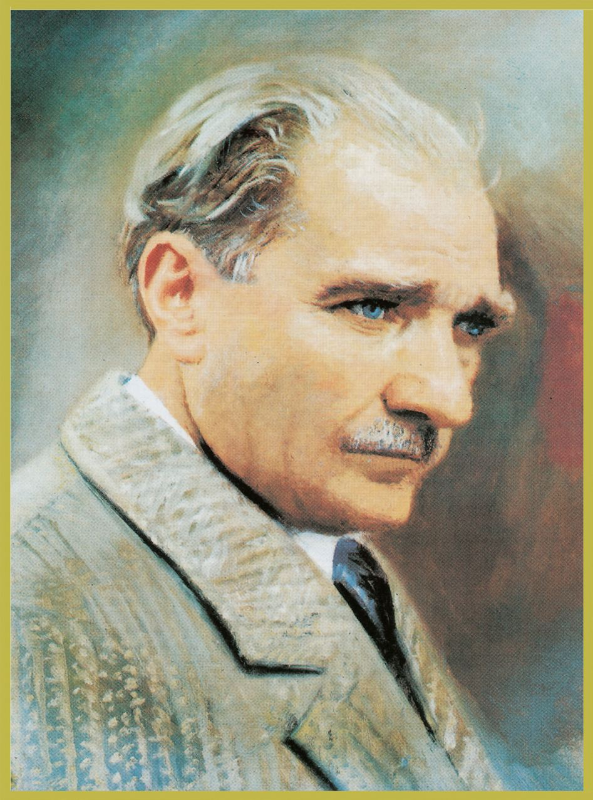
<!-- yer tutucu bulunamadı: sayfa sonuna eklendi -->

<!-- sayfa 5 -->

Verdiğiniz metin katmanı boş olduğu için (`<<< >>>` arası boş) dönüştürülecek bir içerik bulunmamaktadır. Lütfen metin katmanını içeren içeriği paylaşın, böylece kurallara uygun şekilde Markdown formatına çevirebilirim.

<!-- sayfa 6 -->

Kitabımızı Tanıyalım .................................................................................................... 8

# 1. Tema - Müzik Dili 10

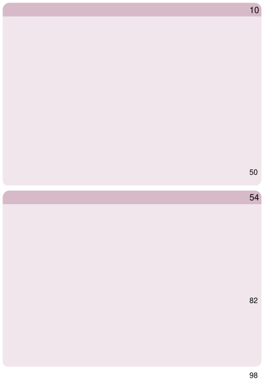

İstiklâl Marşı’nı Söyleyelim ........................................................................................... 13
Birlikte Söyleyelim - Ilgaz .............................................................................................. 16
Birlikte Söyleyelim - Nar Tanesi ..................................................................................... 18
Birlikte Söyleyelim - Horozumu Kaçırdılar ...................................................................... 20
Ortak Repertuvar - Aman Avcı Vurma Beni ..................................................................... 22
Ortak Repertuvar - Bayrağım .......................................................................................... 24
Ortak Repertuvar - Kuş Sesleri ....................................................................................... 26
Cumhuriyet Bayramı - Cumhuriyet Marşı ........................................................................ 29
Atatürk’ü Anıyoruz - Ey Yüce Atam ................................................................................ 31
Öğretmenler Günü - Sen Varsın Öğretmenim .................................................................. 33
Beden Perküsyonu - Horozumu Kaçırdılar ...................................................................... 38
Beden Perküsyonu - Ilgaz ............................................................................................... 39
Beden Perküsyonu - Nar Tanesi ...................................................................................... 40
Başlıca Müzik Sembolleri Nelerdir? ................................................................................ 42
El Dizeğini Tanıyalım ..................................................................................................... 44
Notaların Adını Yazalım .................................................................................................. 45
Hız Terimlerini Eşleştirelim ............................................................................................ 45
Güzel Sanatları Tanıyalım ............................................................................................... 47
Kültürel Mirastan Örnekler ............................................................................................. 48
Araştıralım Bulalım ........................................................................................................ 50
1. Tema Ölçme ve Değerlendirme Soruları ..................................................................... 52

# 2. Tema - Müzik Kültürü 54

Atatürk’ün Güzel Sanatlarla İlgili Söylev ve Demeçleri ................................................... 56
Birlikte Söyleyelim - Halay ............................................................................................. 58
Birlikte Söyleyelim - Bir Dalda İki Kiraz .......................................................................... 60
Birlikte Söyleyelim - Bu Gala Daşlı Gala ........................................................................ 62
Nefesli Çalgıları Tanıyalım ............................................................................................ 65
Kültürel Mirastan Örnekler ............................................................................................. 67
Klavyeli (Tuşlu) Çalgıları Tanıyalım ............................................................................... 70
Kültürel Mirastan Örnekler ............................................................................................. 71
Şehitler Günü - Çanakkale İçinde .................................................................................... 74
Ulusal Egemenlik ve Çocuk Bayramı - 23 Nisan .............................................................. 76
19 Mayıs Atatürk’ü Anma ve Gençlik ve Spor Bayramı - Vatan ....................................... 78
Popüler Müzik Türleri ..................................................................................................... 81
Araştıralım Bulalım ........................................................................................................ 82
Kültürel Mirastan Örnekler ............................................................................................. 83
Ortak Repertuvar - Urfa’nın Etrafı .................................................................................. 86
Ortak Repertuvar - Çayeli’nden Öteye ............................................................................ 88
Ortak Repertuvar - Gülnihal ............................................................................................ 90
Ortak Repertuvar - Mor Menekşe ................................................................................... 91
Beden Perküsyonu - Gülnihal ......................................................................................... 94
Beden Perküsyonu - 23 Nisan ......................................................................................... 95
2. Tema Ölçme ve Değerlendirme Soruları ..................................................................... 97

Sözlük ............................................................................................................................ 98
Kaynakça ....................................................................................................................... 99
Genel Ağ ve Görsel Kaynakça ve Cevap Anahtarı Karekodu ........................................... 99

<!-- sayfa 7 -->

# KİTABIMIZI TANIYALIM

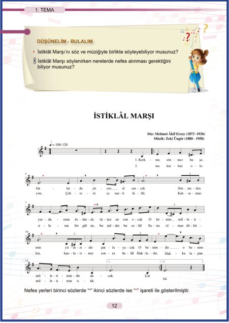
Bu bölümde;

sembolü ile işlenecek
konuya ilgi çekmek için
önceki öğrendiklerinizle
bağ kurmanız,

“ ●” sembolü ile ön bil-
gilerinizi hatırlamanız
amaçlanmıştır.

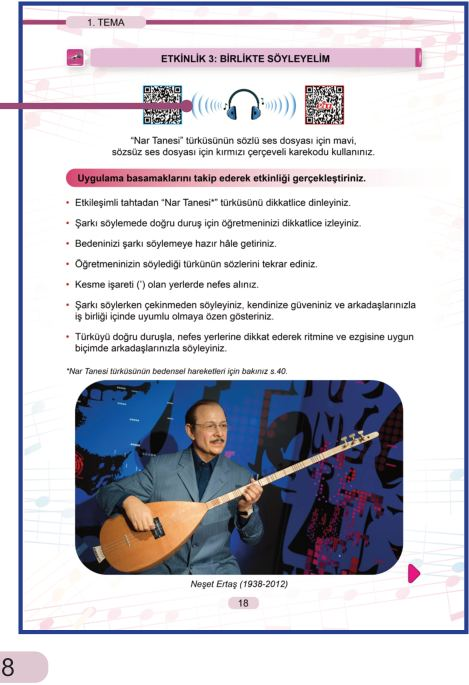
Bu görseli gördüğünüz
yerlerde ses dosyası,
video ve etkileşimli içe-
riklere ulaşabileceğiniz
karekodlar bulunmak-
tadır.

---

**1. TEMA**

**DÜŞÜNELİM - BULALIM**
* İstiklâl Marşı'nı söz ve müzik ile birlikte söyleyebiliyor musunuz?
* İstiklâl Marşı söylerken nerelerde nefes alınması gerektiğini biliyor musunuz?

**İSTİKLÂL MARŞI**

Söz: Mehmet Âkil Ersoy (1873-1936)
Müzik: Zeki Üngör (1880-1938)

 (Not: Bu kısım nota sayfasıdır)

Nefes yerleri birinci sözlerde "**" ikinci sözlerde "*" işareti ile gösterilmiştir.

12

---

**1. TEMA**

**ETKİNLİK 3: BİRLİKTE SÖYLEYELİM**

* 'Nar Tanesi' türküsünün sözü ses dosyası için mavi, sözsüz ses dosyası için kırmızı çerçeveli karekod kullanınız.

**Uygulama basamaklarını takip ederek etkinliği gerçekleştiriniz.**

* Etkinliği tahminden "Nar Tanesi" türküsünü dikkatle dinleyiniz.
* Şarkı söylemede doğru duruş öğrencinizi dikkatle izleyiniz.
* Bedeninizi şarkı söylemeye hazır hale getiriniz.
* Öğretmeninizin söylediği türkünün sözlerini tekrar ediniz.
* Kesme işareti (`) olan yerlerde nefes alınız.
* Şarkı söylerken çehimden söyleyiniz, kendinize güveniniz ve arkadaşlarınızla iş birliği uyumlu olmaya özen gösteriniz.
* Türküyü doğru duruşla, nefes yerlerine dikkat ederek ritmine ve ezgisine uygun biçimde arkadaşlarınızla söyleyiniz.

*"Nar Tanesi türküsünün bedensel hareketleri için bakınız s.40."

Neşet Ertaş (1938-2012)

<!-- sayfa 8 -->

# KİTABIMIZI TANIYALIM

MÜZİK DİLİ

DEĞERLENDİRME ZAMANI

ÖZ DEĞERLENDİRME FORMU

Bu form kendinizi değerlendirmeniz amacıyla hazırlanmıştır. Sizi en doğru yansıtan seçeneği "✔" ile işaretleyiniz.

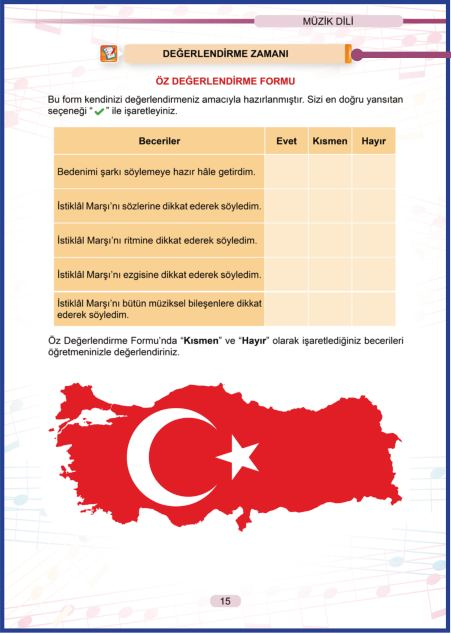

| Beceriler | Evet | Kısmen | Hayır |
| :--- | :---: | :---: | :---: |
| Bedenimi şarkı söylemeye hazır hale getirdim. | | | |
| İstiklâl Marşı'nı sözlerine dikkat ederek söyledim. | | | |
| İstiklâl Marşı'nı ritmine dikkat ederek söyledim. | | | |
| İstiklâl Marşı'nı ezgisine dikkat ederek söyledim. | | | |
| İstiklâl Marşı'nı bütün müziksel bileşenlere dikkat ederek söyledim. | | | |

Öz Değerlendirme Formu'nda "Kısmen" ve "Hayır" olarak işaretlediğiniz becerileri öğretmeninizle değerlendiriniz.

15

---

1. TEMA

DÜŞÜNELİM - BULALIM

- Aşağıda verilen bilgi kutusundaki müzik sembollerinden hangilerini tanıyorsunuz? Arkadaşlarınızla paylaşınız.
- Daha önce sol anahtarını nerelerde gördünüz? Arkadaşlarınızla paylaşınız.

"BAŞLICA MÜZİK SEMBOLLERİ NELERDİR?"

Nasıl ki kültürümüzü gelecek kuşaklara aktarmak için yazı ve yazının araçları olan harfleri kullanıyorsak müzik eserlerini kalıcı hale getirmek ve gelecek kuşaklara doğru biçimde aktarmak için de müzik yazısı ve yazının araçları olan müzik sembollerini kullanırız. Müzik sembolünün bütün dünyada aynıdır ve müzik dünyadaki tek ortak dildir.

Şimdi müzik sembollerinden; düz sol anahtarı, ölçü sayısı, ölçü çizgisi, bitiş çizgisi, 2/4'lük ölçü sayısı, dörtlük nota, sekizlik nota ve sus değerleri, re-la arasındakı sesler ve hız terimlerinden anında (yavaş) - moderato (orta hız) - allegro (hızlı) kavramlarını tanıyalım.

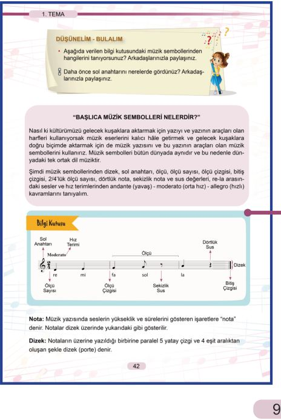

Bilgi Kutusu

| Sol Anahtarı | Hiz Terimleri | | Dörtlük Sus |
| :--- | :--- | :--- | :--- |
| Moderato | | | |
| re | mi | fa | sol | la | | Dizek |
| Ölçü Sayısı | | Ölçü Çizgisi | | | |
| Sekizlik Sus | | Bitiş Çizgisi | | | |

Nota: Müzik yazılarında seslerin ve sürelerin gösteren işaretlere "nota" denir. Notalar düz çizik üzerinde yukarıdaki gibi gösterilir.

Dizek: Notaların üzerine yazıldığı birbirine paralel 5 yatay çizgi ve 4 eşit aralıktan oluşan şekle dizek (porte) denir.

<!-- sayfa 9 -->

# 1. TEMA
# MÜZİK DİLİ

İstiklâl Marşı
Farklı türdeki eserler
Belirli gün ve haftalarla ilgili eserler
Ortak repertuvar
Bedensel hareketler
Temel müzik sembolleri

<u>Anahtar Kavramlar</u>

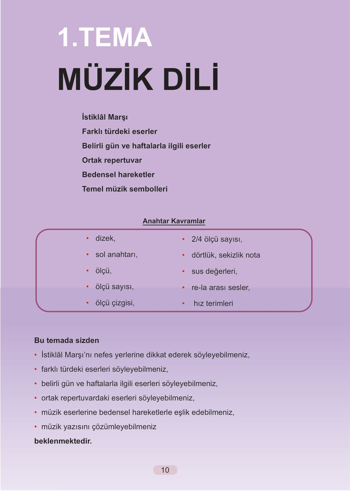
* dizek,
* sol anahtarı,
* ölçü,
* ölçü sayısı,
* ölçü çizgisi,
* $2/4$ ölçü sayısı,
* dörtlük, sekizlik nota
* sus değerleri,
* re-la arası sesler,
* hız terimleri

**Bu temada sizden**

* İstiklâl Marşı’nı nefes yerlerine dikkat ederek söyleyebilmeniz,
* farklı türdeki eserleri söyleyebilmeniz,
* belirli gün ve haftalarla ilgili eserleri söyleyebilmeniz,
* ortak repertuvardaki eserleri söyleyebilmeniz,
* müzik eserlerine bedensel hareketlerle eşlik edebilmeniz,
* müzik yazısını çözümleyebilmeniz

**beklenmektedir.**

<!-- sayfa 10 -->

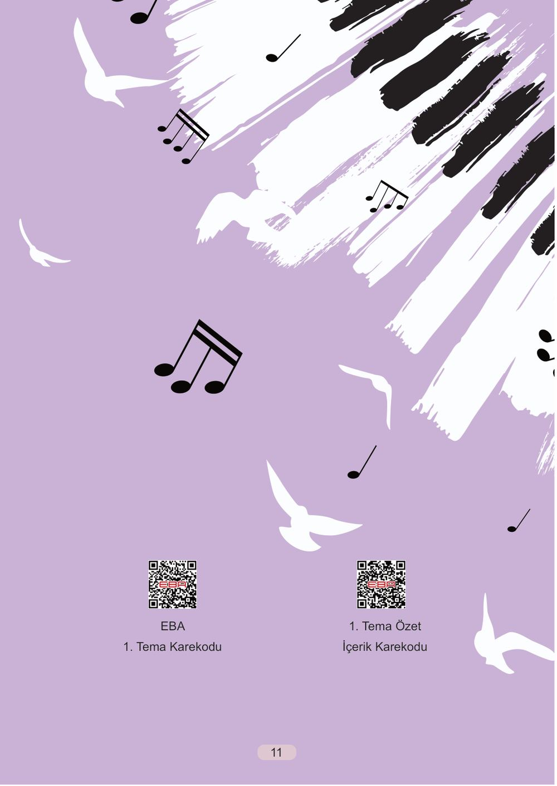

EBA
1. Tema Karekodu

1. Tema Özet
İçerik Karekodu

<!-- sayfa 11 -->

# DÜŞÜNELİM - BULALIM

* İstiklâl Marşı'nı söz ve müziğiyle birlikte söyleyebiliyor musunuz?
* İstiklâl Marşı söylenirken nerelerde nefes alınması gerektiğini biliyor musunuz?

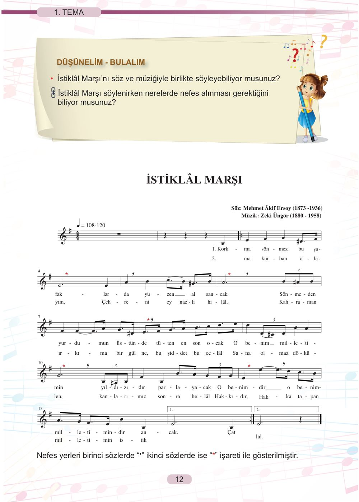

# İSTİKLÂL MARŞI

Söz: Mehmet Âkif Ersoy (1873 - 1936)
Müzik: Zeki Üngör (1880 - 1958)

$\bullet = 108\text{-}120$ <!-- KONTROL: Marker'da karşılığı yok, uydurma olabilir -->

1. Kork - ma - sön - mez - bu - şa - fak - lar - da - yü - zen - al - san - cak - Sön - me - den
2. ma - kur - ban - o - la - ma - ma - kur - ban - o - la - ma - ma - kur - ban - o - la - ma - ma - kur - ban - o - la - ma - ma - kur - ban - o - la - ma - ma - kur - ban - o - la - ma - ma - kur - ban - o - la - ma - ma - kur - ban - o - la - ma - ma - kur - ban - o - la - ma - ma - kur - ban - o - la - ma - ma - kur - ban - o - la - ma - ma - kur - ban - o - la - ma - ma - kur - ban - o - la - ma - ma - kur - ban - o - la - ma - ma - kur - ban - o - la - ma - ma - kur - ban - o - la - ma - ma - kur - ban - o - la - ma - ma - kur - ban - o - la - ma - ma - kur - ban - o - la - ma - ma - kur - ban - o - la - ma - ma - kur - ban - o - la - ma - ma - kur - ban - o - la - ma - ma - kur - ban - o - la - ma - ma - kur - ban - o - la - ma - ma - kur - ban - o - la - ma - ma - kur - ban - o - la - ma - ma - kur - ban - o - la - ma - ma - kur - ban - o - la - ma - ma - kur - ban - o - la - ma - ma - kur - ban - o - la - ma - ma - kur - ban - o - la - ma - ma - kur - ban - o - la - ma - ma - kur - ban - o - la - ma - ma - kur - ban - o - la - ma - ma - kur - ban - o - la - ma -

<!-- sayfa 12 -->

# ETKİNLİK 1: İSTİKLÂL MARŞI’NI SÖYLEYELİM

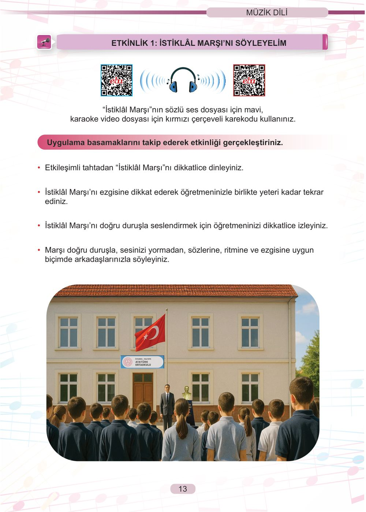

“İstiklâl Marşı”nın sözlü ses dosyası için mavi, karaoke video dosyası için kırmızı çerçeveli karekodu kullanınız.

**Uygulama basamaklarını takip ederek etkinliği gerçekleştiriniz.**

* Etkileşimli tahtadan “İstiklâl Marşı”nı dikkatlice dinleyiniz.
* İstiklâl Marşı’nı ezgisine dikkat ederek öğretmeninizle birlikte yeteri kadar tekrar ediniz.
* İstiklâl Marşı’nı doğru duruşla seslendirmek için öğretmeninizi dikkatlice izleyiniz.
* Marşı doğru duruşla, sesinizi yormadan, sözlerine, ritmine ve ezgisine uygun biçimde arkadaşlarınızla söyleyiniz.

<!-- sayfa 13 -->

İstiklâl Marşı’nın doğuşu ile ilgili okuma parçasını okuyunuz.

# İSTİKLÂL MARŞI’NIN DOĞUŞU

Yeni Türkiye Cumhuriyeti’nin de bir millî marşı olmalıdır. Daha İstiklal Savaşı sıralarında, cumhuriyet ilan edilmeden önce Batı Cephesi Komutanlığından böyle bir istek gelir. Durum, sonradan maarif vekili olan Dr. Rıza Nur’a havale edilir. Türk millî marşı olarak “İstiklâl Marşı” adı ile yaptırılacak marşın hazırlıklarına böylece başlanır. Beste ve güftenin her biri için 500 liralık ödül kararlaştırılarak genelge ve mektuplarla bütün yurda duyurulur. Önce şiir sonra da beste yarışmasının yapılması planlanmıştır. Şiir yarışmasına yurdun dört bir yanından tam 724 şiir gönderilir. Değerlendirme komisyonu bunlardan yedi tanesini seçerek bastırır ve meclis üyelerine dağıtır. Gazi Mustafa Kemal Paşa başkanlığındaki TBMM’nin, 12 Mart 1921 tarihli oturumunda, Mehmet Akif’in (Ersoy) şiiri defalarca okutturularak ve alkışlar arasında Millî Marş olarak bestelenmek üzere kabul edilir.

(Tarman, 2025).

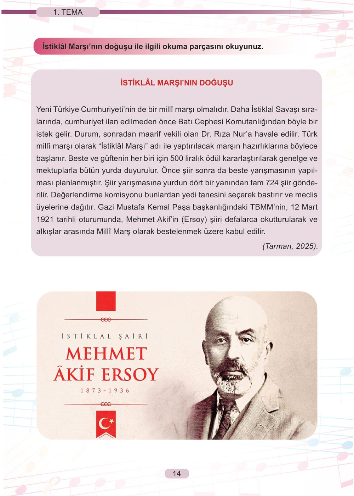
İSTİKLAL ŞAİRİ
MEHMET
ÂKİF ERSOY
1873 - 1936

<!-- sayfa 14 -->

DEĞERLENDİRME ZAMANI

# ÖZ DEĞERLENDİRME FORMU

Bu form kendinizi değerlendirmeniz amacıyla hazırlanmıştır. Sizi en doğru yansıtan seçeneği “ $\checkmark$ ” ile işaretleyiniz.

| Beceriler | Evet | Kısmen | Hayır |
| :--- | :---: | :---: | :---: |
| Bedenimi şarkı söylemeye hazır hâle getirdim. | | | |
| İstiklâl Marşı’nı sözlerine dikkat ederek söyledim. | | | |
| İstiklâl Marşı’nı ritmine dikkat ederek söyledim. | | | |
| İstiklâl Marşı’nı ezgisine dikkat ederek söyledim. | | | |
| İstiklâl Marşı’nı bütün müziksel bileşenlere dikkat ederek söyledim. | | | |

Öz Değerlendirme Formu’nda **“Kısmen”** ve **“Hayır”** olarak işaretlediğiniz becerileri öğretmeninizle değerlendiriniz.

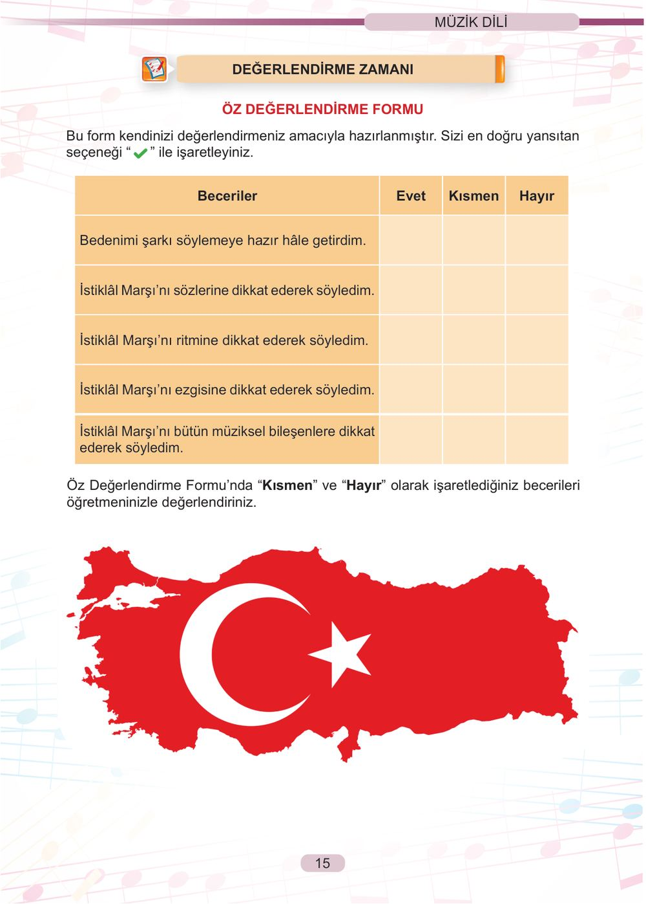

<!-- sayfa 15 -->

# DÜŞÜNELİM - BULALIM

* Daha önce şarkı, türkü, marş vb. türlerden hangilerini söylediniz? Arkadaşlarınızla paylaşınız.
* Daha önceden bildiğiniz farklı türlerdeki şarkılar nelerdir? Arkadaşlarınızla paylaşınız.

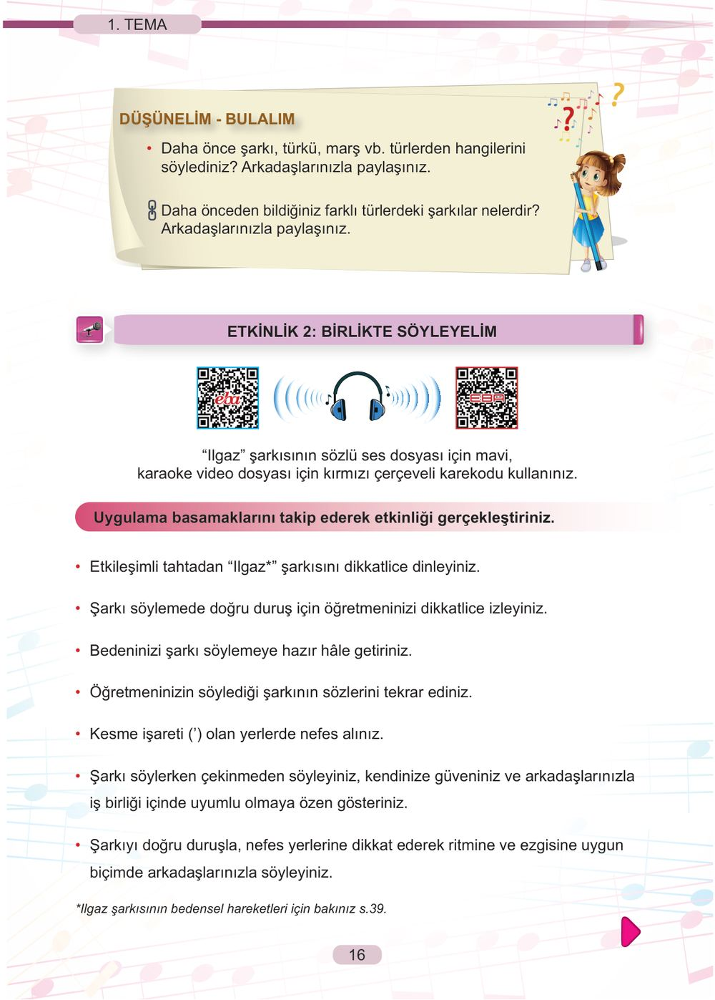

## ETKİNLİK 2: BİRLİKTE SÖYLEYELİM

“Ilgaz” şarkısının sözlü ses dosyası için mavi, karaoke video dosyası için kırmızı çerçeveli karekodu kullanınız.

**Uygulama basamaklarını takip ederek etkinliği gerçekleştiriniz.**

* Etkileşimli tahtadan “Ilgaz*” şarkısını dikkatlice dinleyiniz.
* Şarkı söylemede doğru duruş için öğretmeninizi dikkatlice izleyiniz.
* Bedeninizi şarkı söylemeye hazır hâle getiriniz.
* Öğretmeninizin söylediği şarkının sözlerini tekrar ediniz.
* Kesme işareti (') olan yerlerde nefes alınız.
* Şarkı söylerken çekinmeden söyleyiniz, kendinize güveniniz ve arkadaşlarınızla iş birliği içinde uyumlu olmaya özen gösteriniz.
* Şarkıyı doğru duruşla, nefes yerlerine dikkat ederek ritmine ve ezgisine uygun biçimde arkadaşlarınızla söyleyiniz.

*Ilgaz şarkısının bedensel hareketleri için bakınız s.39.

<!-- sayfa 16 -->

# ILGAZ*
A. Samim Bilgen
(1910-2005)

Il - gaz A - na - do - lu - nun sen yü - ce bir da - ğı - sın —
Il - gaz A - na - do - lu - nun sen yü - ce bir da - ğı - sın —
ba - har - la yer yü - zün - de gü - zel - le - rin ba - ğı - sın —
ba - har - la yer yü - zün - de gü - zel - le - rin ba - ğı - sın —

*Eserin ses dosyası öğrencilerin ses sınırı göz önüne alınarak farklı bir tonda kaydedilmiştir.

2) Yalçın kayalıkların,
Göklere yükseliyor,
Senin dumanlı başın,
Bulutları deliyor.

3) Yükseklerden akıyor,
Ne güzel berrak sular,
Eteklerinde otlar,
Sürülerle kuzular.

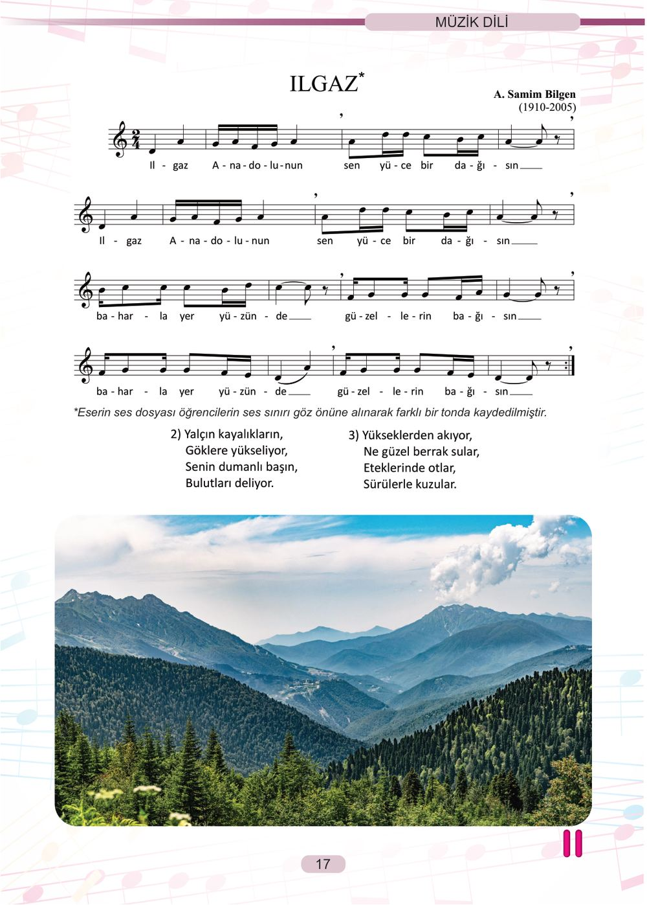

<!-- sayfa 17 -->

# ETKİNLİK 3: BİRLİKTE SÖYLEYELİM

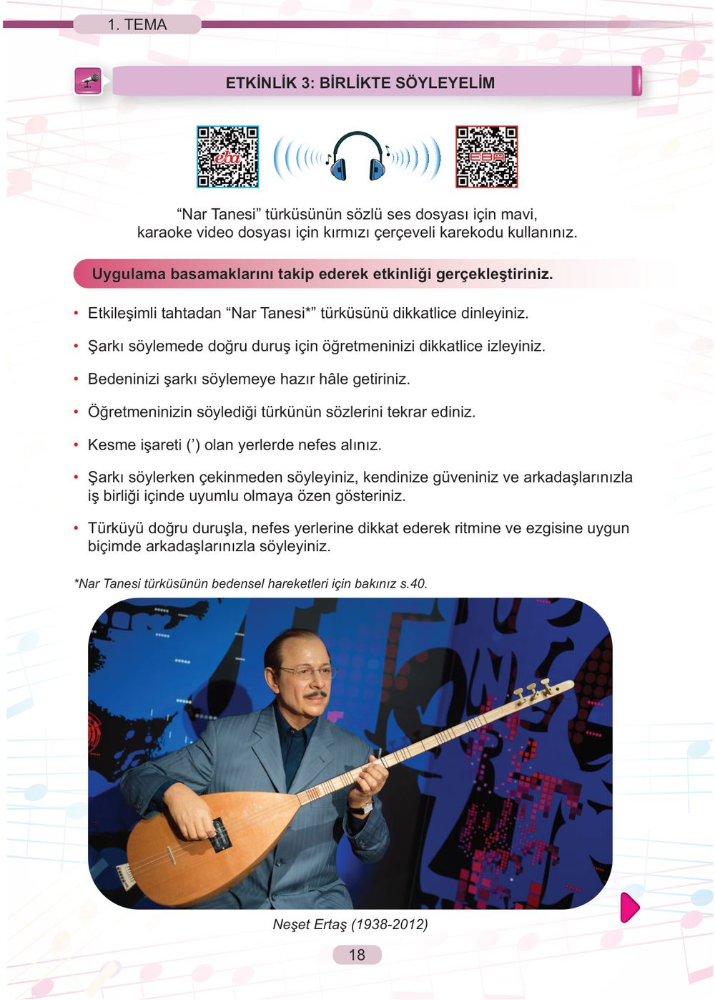

“Nar Tanesi” türküsünün sözlü ses dosyası için mavi, karaoke video dosyası için kırmızı çerçeveli karekodu kullanınız.

### Uygulama basamaklarını takip ederek etkinliği gerçekleştiriniz.

• Etkileşimli tahtadan “Nar Tanesi*” türküsünü dikkatlice dinleyiniz.

• Şarkı söylemede doğru duruş için öğretmeninizi dikkatlice izleyiniz.

• Bedeninizi şarkı söylemeye hazır hâle getiriniz.

• Öğretmeninizin söylediği türkünün sözlerini tekrar ediniz.

• Kesme işareti (') olan yerlerde nefes alınız.

• Şarkı söylerken çekinmeden söyleyiniz, kendinize güveniniz ve arkadaşlarınızla iş birliği içinde uyumlu olmaya özen gösteriniz.

• Türküyü doğru duruşla, nefes yerlerine dikkat ederek ritmine ve ezgisine uygun biçimde arkadaşlarınızla söyleyiniz.

*Nar Tanesi türküsünün bedensel hareketleri için bakınız s.40.

<!-- sayfa 18 -->

# NAR TANESİ

Söz-Müzik: Neşet Ertaş
(1938-2012)

$\text{♩} = 97$ <!-- KONTROL: Marker'da karşılığı yok, uydurma olabilir -->

Sev - da ol ma - say - dı da - gö - nü - le - dol - ma - say - dı —
O yar zül - fü - nü ta - rar - da - gö - nül - den - gi - ni a - rar —
Sev - da ö - mür çü - rü - dür has bah - çe - nin gü - lü - dür —

sev - da ol ma - say - dı da - gö - nü - le - dol - ma - say - dı —
o yar zül - fü - nü ta - rar - da - gö - nül - den - gi - ni a - rar —
sev - da ö - mür çü - rü - dür has bah - çe - nin gü - lü - dür —

dün - ya ne - ye ya - rar - dı da gü - ze - li ol - ma - say - dı
bu dün - ya - da sev - me - yen - ler ah - ret - te - ne - ye ya - rar
sev - me - ye - ni ney - le - yim - de se - ve - nim sev - gi - li - dir

Nar da - ne - si da - ne - si - de se - vi - yom mer - da - ne - si

gü - zel - le - rin i - çin de - de sev - di - ğim bir da - ne - si

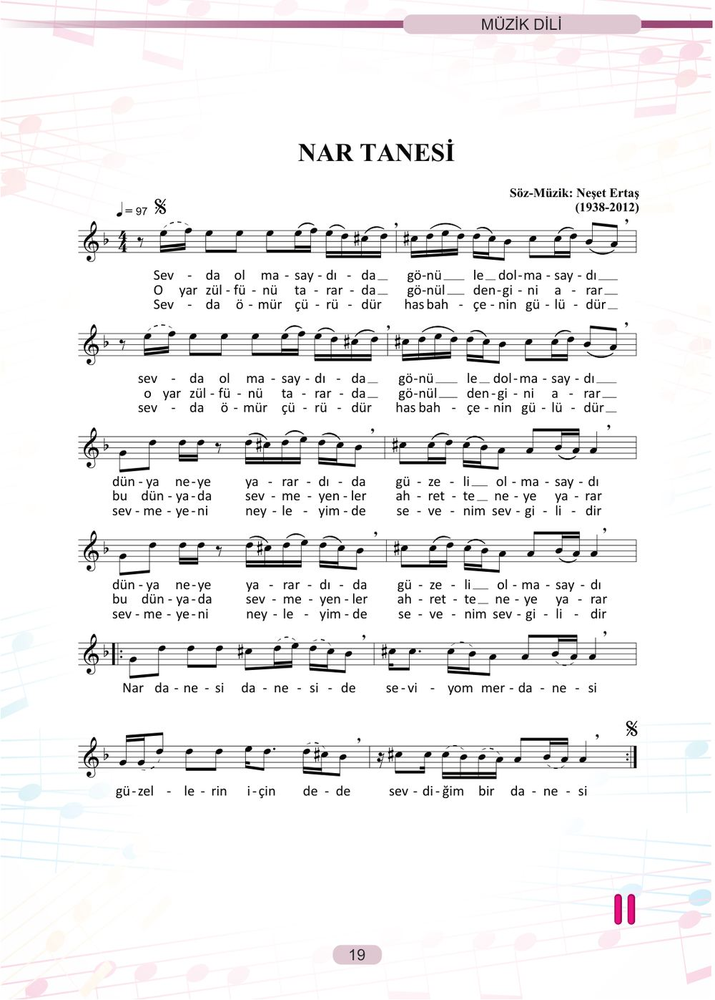
<!-- yer tutucu bulunamadı: sayfa sonuna eklendi -->

<!-- sayfa 19 -->

# ETKİNLİK 4: BİRLİKTE SÖYLEYELİM

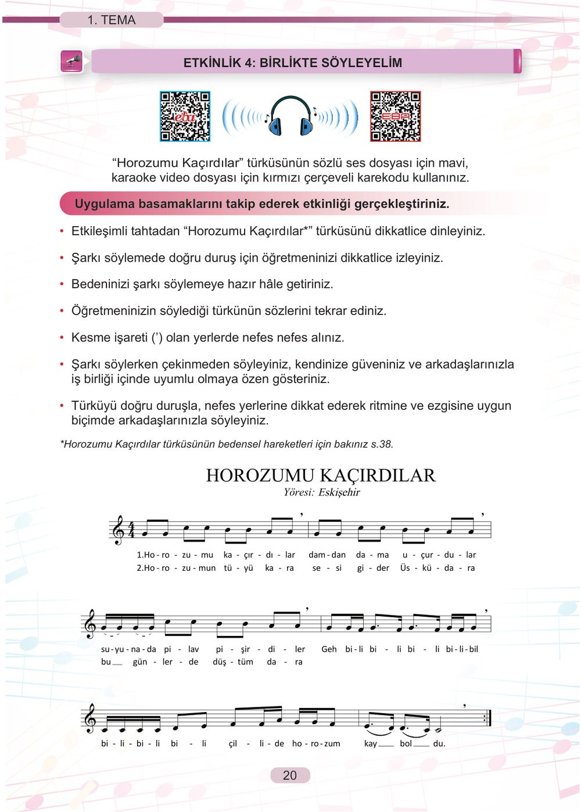

“Horozumu Kaçırdılar” türküsünün sözlü ses dosyası için mavi, karaoke video dosyası için kırmızı çerçeveli karekodu kullanınız.

**Uygulama basamaklarını takip ederek etkinliği gerçekleştiriniz.**

* Etkileşimli tahtadan “Horozumu Kaçırdılar*” türküsünü dikkatlice dinleyiniz.
* Şarkı söylemede doğru duruş için öğretmeninizi dikkatlice izleyiniz.
* Bedeninizi şarkı söylemeye hazır hâle getiriniz.
* Öğretmeninizin söylediği türkünün sözlerini tekrar ediniz.
* Kesme işareti (') olan yerlerde nefes nefes alınız.
* Şarkı söylerken çekinmeden söyleyiniz, kendinize güveniniz ve arkadaşlarınızla iş birliği içinde uyumlu olmaya özen gösteriniz.
* Türküyü doğru duruşla, nefes yerlerine dikkat ederek ritmine ve ezgisine uygun biçimde arkadaşlarınızla söyleyiniz.

*Horozumu Kaçırdılar türküsünün bedensel hareketleri için bakınız s.38.

# HOROZUMU KAÇIRDILAR
*Yöresi: Eskişehir*

(Notalar ve şarkı sözleri içeren müzik sayfası görüntüsü)

<!-- sayfa 20 -->

# DEĞERLENDİRME ZAMANI

## ÖZ DEĞERLENDİRME FORMU

Bu form kendinizi değerlendirmeniz amacıyla hazırlanmıştır. Sizi en doğru yansıtan seçeneği “ $\checkmark$ ” ile işaretleyiniz.

| Beceriler | Evet | Kısmen | Hayır |
| :--- | :---: | :---: | :---: |
| Bedenimi şarkı söylemeye hazır hâle getirdim. | | | |
| Eserleri nefes yerlerine dikkat ederek söyledim. | | | |
| Eserleri ritmine dikkat ederek söyledim. | | | |
| Eserleri ezgisine dikkat ederek söyledim. | | | |
| Eserleri bütün müziksel bileşenlere dikkat ederek söyledim. | | | |

Öz Değerlendirme Formu’nda **“Kısmen”** ve **“Hayır”** olarak işaretlediğiniz becerileri öğretmeninizle değerlendiriniz.

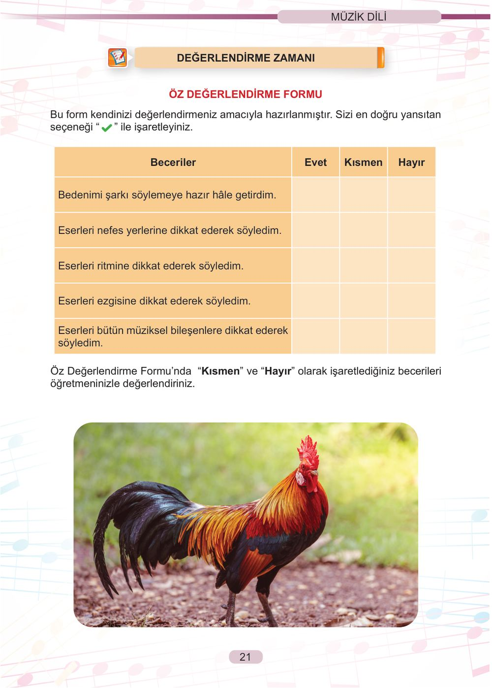

<!-- sayfa 21 -->

# DÜŞÜNELİM - BULALIM
Bildiğiniz ortak şarkılar nelerdir? Bunları birlikte belirleyiniz.

## ETKİNLİK 5: ORTAK REPERTUVAR

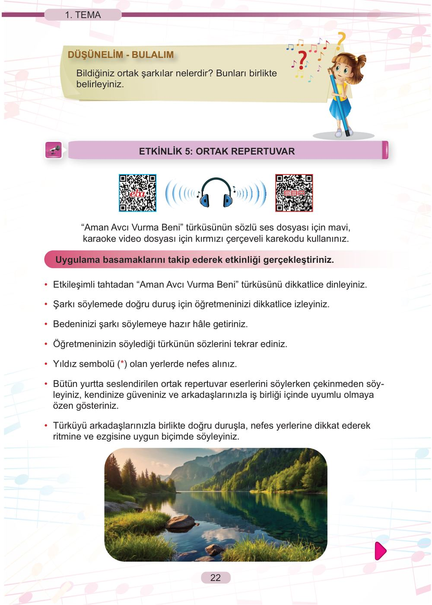

“Aman Avcı Vurma Beni” türküsünün sözlü ses dosyası için mavi, karaoke video dosyası için kırmızı çerçeveli karekodu kullanınız.

### Uygulama basamaklarını takip ederek etkinliği gerçekleştiriniz.

* Etkileşimli tahtadan “Aman Avcı Vurma Beni” türküsünü dikkatlice dinleyiniz.
* Şarkı söylemede doğru duruş için öğretmeninizi dikkatlice izleyiniz.
* Bedeninizi şarkı söylemeye hazır hâle getiriniz.
* Öğretmeninizin söylediği türkünün sözlerini tekrar ediniz.
* Yıldız sembolü (*) olan yerlerde nefes alınız.
* Bütün yurtta seslendirilen ortak repertuvar eserlerini söylerken çekinmeden söyleyiniz, kendinize güveniniz ve arkadaşlarınızla iş birliği içinde uyumlu olmaya özen gösteriniz.
* Türküyü arkadaşlarınızla birlikte doğru duruşla, nefes yerlerine dikkat ederek ritmine ve ezgisine uygun biçimde söyleyiniz.

<!-- sayfa 22 -->

# AMAN AVCI VURMA BENİ
*Yöresi: Kars*

Aman avcı vurma beni *
Ben bu dağın (ay balam) maralıyam *
Hem maralı, hem yaralı *
Avcı vurmuş (ay balam) yaralıyam *

Şu dağlarda ceylân gezer *
Tırnakların (ay balam) taşlar ezer *
Ben o yâre neylemişem *
O yâr benden (ay balam) kenar gezer *

Bir taş attım çaya düştü *
Çaydan bir çift (ay balam) sona uçtu *
Benim gönlüm sana düştü *
Senin gönlün (ay balam) kime düştü

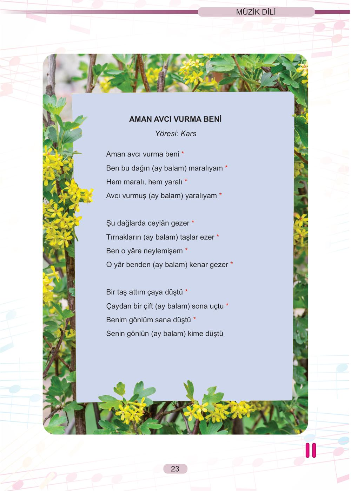
<!-- yer tutucu bulunamadı: sayfa sonuna eklendi -->

<!-- sayfa 23 -->

# ETKİNLİK 6: ORTAK REPERTUVAR

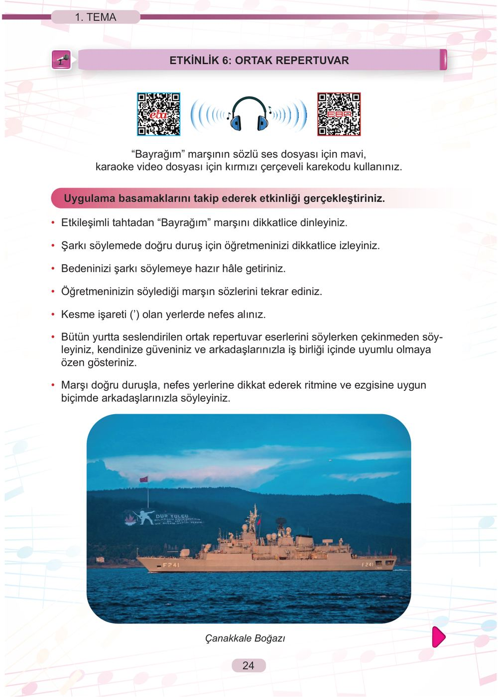

“Bayrağım” marşının sözlü ses dosyası için mavi, karaoke video dosyası için kırmızı çerçeveli karekodu kullanınız.

**Uygulama basamaklarını takip ederek etkinliği gerçekleştiriniz.**

* Etkileşimli tahtadan “Bayrağım” marşını dikkatlice dinleyiniz.
* Şarkı söylemede doğru duruş için öğretmeninizi dikkatlice izleyiniz.
* Bedeninizi şarkı söylemeye hazır hâle getiriniz.
* Öğretmeninizin söylediği marşın sözlerini tekrar ediniz.
* Kesme işareti (') olan yerlerde nefes alınız.
* Bütün yurtta seslendirilen ortak repertuvar eserlerini söylerken çekinmeden söyleyiniz, kendinize güveniniz ve arkadaşlarınızla iş birliği içinde uyumlu olmaya özen gösteriniz.
* Marşı doğru duruşla, nefes yerlerine dikkat ederek ritmine ve ezgisine uygun biçimde arkadaşlarınızla söyleyiniz.

<!-- sayfa 24 -->

# BAYRAĞIM

Söz-Müzik: Ziya Aydıntan (1904 - 1980)

$\text{♩} = 100$ <!-- KONTROL: Marker'da karşılığı yok, uydurma olabilir -->

Bay-ra-ğım bay-ra-ğım o al-ren-gin sol-ma-sın Se-ma-sı-nı yur-du-mun baş-ka bir renk al-ma-sın Bay-ra-ğım par-la-sın Ay-yıl-dı-zın her za-man Sen gü-ler-sen neş-e-le-nir hür ya-şar bu va-tan Sen gü-tan

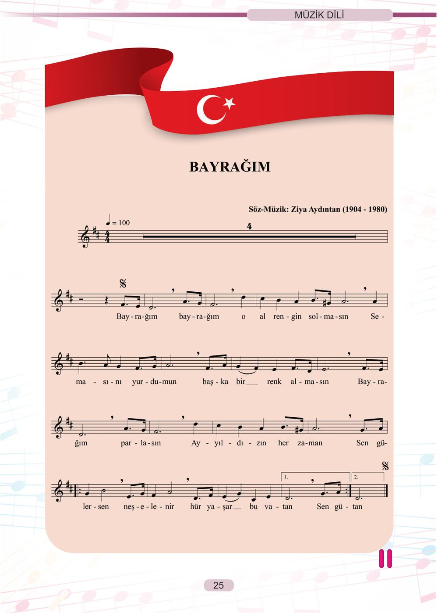
<!-- yer tutucu bulunamadı: sayfa sonuna eklendi -->

<!-- sayfa 25 -->

# ETKİNLİK 7: ORTAK REPERTUVAR

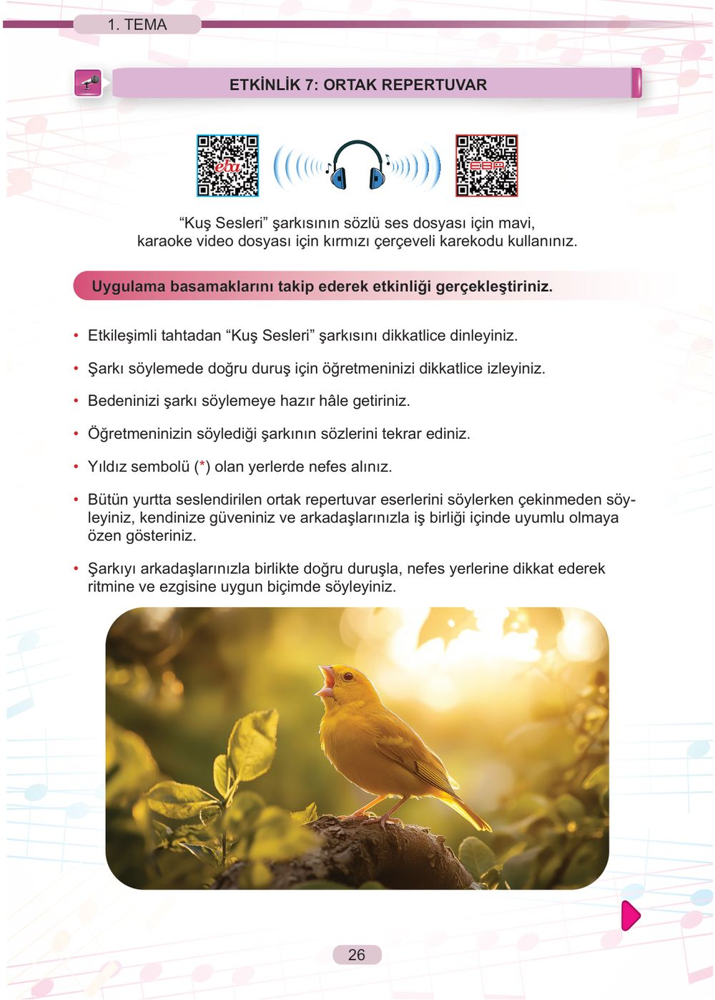

“Kuş Sesleri” şarkısının sözlü ses dosyası için mavi, karaoke video dosyası için kırmızı çerçeveli karekodu kullanınız.

## Uygulama basamaklarını takip ederek etkinliği gerçekleştiriniz.

* Etkileşimli tahtadan “Kuş Sesleri” şarkısını dikkatlice dinleyiniz.
* Şarkı söylemede doğru duruş için öğretmeninizi dikkatlice izleyiniz.
* Bedeninizi şarkı söylemeye hazır hâle getiriniz.
* Öğretmeninizin söylediği şarkının sözlerini tekrar ediniz.
* Yıldız sembolü (*) olan yerlerde nefes alınız.
* Bütün yurtta seslendirilen ortak repertuvar eserlerini söylerken çekinmeden söyleyiniz, kendinize güveniniz ve arkadaşlarınızla iş birliği içinde uyumlu olmaya özen gösteriniz.
* Şarkıyı arkadaşlarınızla birlikte doğru duruşla, nefes yerlerine dikkat ederek ritmine ve ezgisine uygun biçimde söyleyiniz.

<!-- sayfa 26 -->

# KUŞ SESLERİ

*Beste: Enderuni Selaeddin Bey*

Kuş sesleri*
Ovalara yayılır*
İnsan buna*
Hayran olur bayılır*

Bal yapanlar
Çiçeklere konarlar*
Kuzucuklar
Çayır çimen ararlar*

Yeşillenmiş ağaçlarda yapraklar*
Amber gibi mis kokuyor topraklar

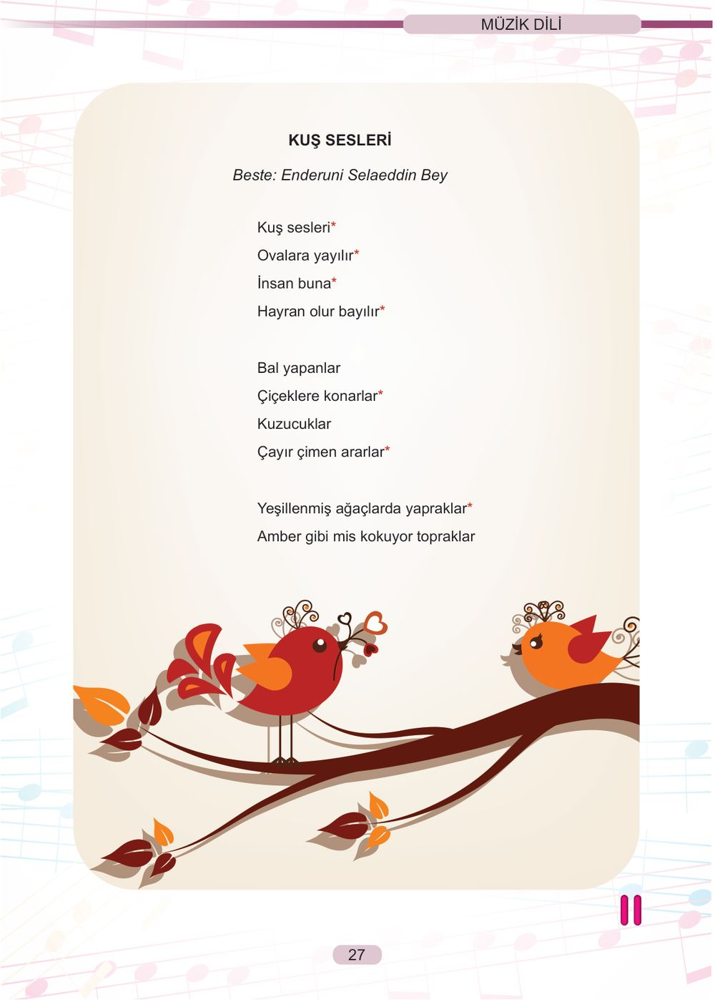

<!-- sayfa 27 -->

# DEĞERLENDİRME ZAMANI

## ÖZ DEĞERLENDİRME FORMU

Bu form kendinizi değerlendirmeniz amacıyla hazırlanmıştır. Sizi en doğru yansıtan seçeneği “ $\checkmark$ ” ile işaretleyiniz.

| Beceriler | Evet | Kısmen | Hayır |
| :--- | :---: | :---: | :---: |
| Bedenimi şarkı söylemeye hazır hâle getirdim. | | | |
| Eserleri nefes yerlerine dikkat ederek söyledim. | | | |
| Eserleri ritmine dikkat ederek söyledim. | | | |
| Eserleri ezgisine dikkat ederek söyledim. | | | |
| Eserleri bütün müziksel bileşenlere dikkat ederek söyledim. | | | |

Öz Değerlendirme Formu’nda **“Kısmen”** ve **“Hayır”** olarak işaretlediğiniz becerileri öğretmeninizle değerlendiriniz.

# ORTAK REPERTUVAR

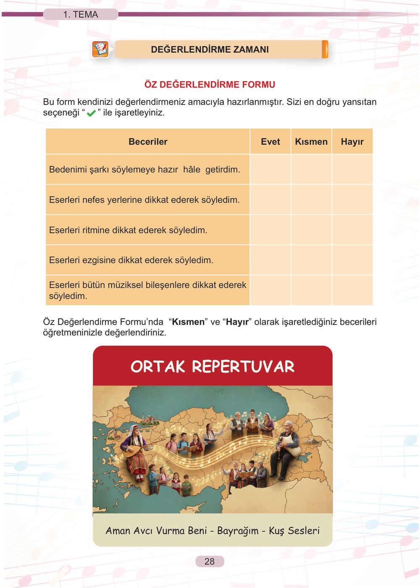

Aman Avcı Vurma Beni - Bayrağım - Kuş Sesleri

<!-- sayfa 28 -->

# DÜŞÜNELİM - BULALIM

Cumhuriyet Bayramı, Atatürk Haftası ve Öğretmenler Günü ile ilgili bildiğiniz şarkı, türkü ve marşları arkadaşlarınızla paylaşınız.

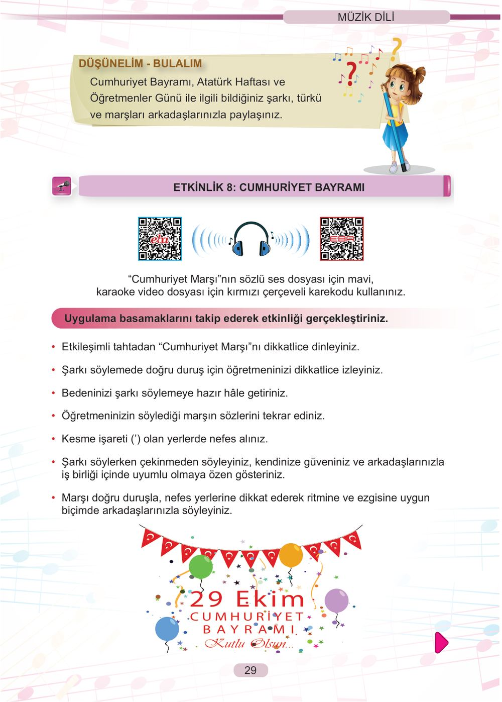

## ETKİNLİK 8: CUMHURİYET BAYRAMI

“Cumhuriyet Marşı”nın sözlü ses dosyası için mavi, karaoke video dosyası için kırmızı çerçeveli karekodu kullanınız.

### Uygulama basamaklarını takip ederek etkinliği gerçekleştiriniz.

* Etkileşimli tahtadan “Cumhuriyet Marşı”nı dikkatlice dinleyiniz.
* Şarkı söylemede doğru duruş için öğretmeninizi dikkatlice izleyiniz.
* Bedeninizi şarkı söylemeye hazır hâle getiriniz.
* Öğretmeninizin söylediği marşın sözlerini tekrar ediniz.
* Kesme işareti (') olan yerlerde nefes alınız.
* Şarkı söylerken çekinmeden söyleyiniz, kendinize güveniniz ve arkadaşlarınızla iş birliği içinde uyumlu olmaya özen gösteriniz.
* Marşı doğru duruşla, nefes yerlerine dikkat ederek ritmine ve ezgisine uygun biçimde arkadaşlarınızla söyleyiniz.

<!-- sayfa 29 -->

# CUMHURİYET MARŞI

Söz ve Müzik: Hasan Toraganlı (1916 - 1993)

$\text{♩} = 112\text{-}120$ <!-- KONTROL: Marker'da karşılığı yok, uydurma olabilir -->

Yol ver - me - yen yü - ce dağ -
lar Yal - çın ka - ya - lar aş - tık ,
Hiç sap - ma - dan doğ - ru yol - dan
bu - gün - le - re u - laş - tık ,
Cum - hu - ri - yet A - ta - türk - ten kut -
sal ar - ma - ğan bi - ze ,
Her - an ye - ni bir hız al - dık
ka - vuş - tuk ül - kü - mü - ze ,

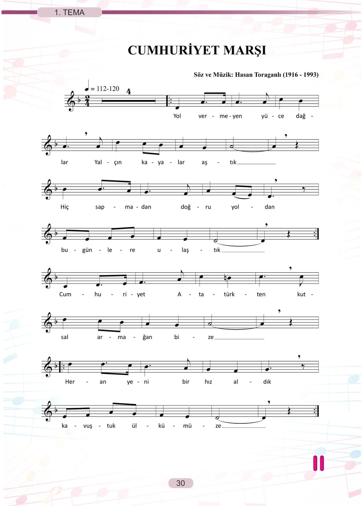
<!-- yer tutucu bulunamadı: sayfa sonuna eklendi -->

<!-- sayfa 30 -->

# ETKİNLİK 9: ATATÜRK'Ü ANIYORUZ

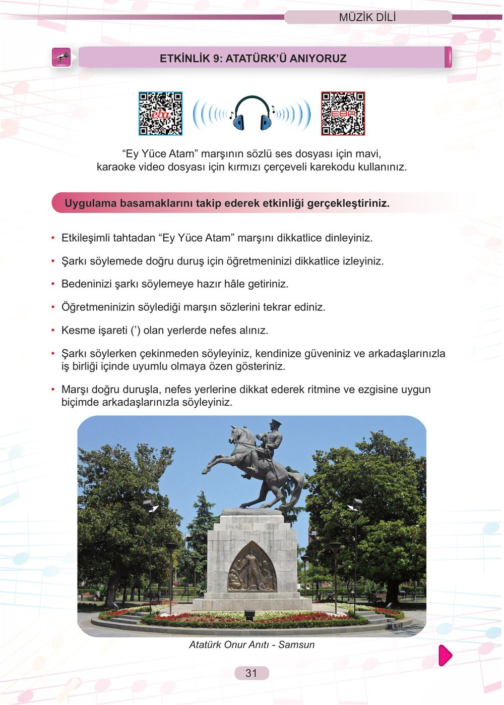

“Ey Yüce Atam” marşının sözlü ses dosyası için mavi, karaoke video dosyası için kırmızı çerçeveli karekodu kullanınız.

## Uygulama basamaklarını takip ederek etkinliği gerçekleştiriniz.

* Etkileşimli tahtadan “Ey Yüce Atam” marşını dikkatlice dinleyiniz.
* Şarkı söylemede doğru duruş için öğretmeninizi dikkatlice izleyiniz.
* Bedeninizi şarkı söylemeye hazır hâle getiriniz.
* Öğretmeninizin söylediği marşın sözlerini tekrar ediniz.
* Kesme işareti (') olan yerlerde nefes alınız.
* Şarkı söylerken çekinmeden söyleyiniz, kendinize güveniniz ve arkadaşlarınızla iş birliği içinde uyumlu olmaya özen gösteriniz.
* Marşı doğru duruşla, nefes yerlerine dikkat ederek ritmine ve ezgisine uygun biçimde arkadaşlarınızla söyleyiniz.

Atatürk Onur Anıtı - Samsun

<!-- sayfa 31 -->

# EY YÜCE ATAM

Söz-Müzik: Sefai Acay (1946 - 2016)

Marş
4

Pı-nar - dan hep a - kan sen - sin çi-çek çi-çek ko - kan sen - sin
bay - ra-ğım - dan ba - kan sen - sin sev - gi sa-na ey yü-ce A-tam
bay - ra-ğım - dan ba - kan sen - sin say - gı sa-na ey yü-ce A-tam
On Ka-sım - lar gel - di-ğin - de hü-zün var - dır bel - le-ğim - de
On Ka-sım - lar gel - di-ğin - de hü-zün var - dır bel - le-ğim - de
tüm u - lu - su-mun yü-re-ğin - de çar - pı - yor - sun ey-yü-ce A-tam
tüm u - lu - su-mun yü-re-ğin - de çar - pı - yor - sun ey-yü-ce A-tam

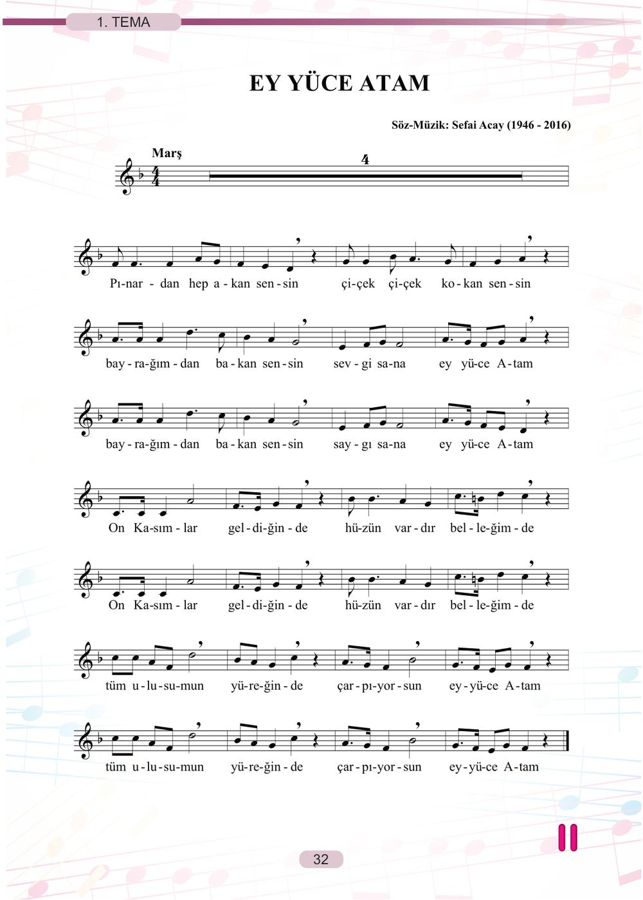
<!-- yer tutucu bulunamadı: sayfa sonuna eklendi -->

<!-- sayfa 32 -->

# ETKİNLİK 10: ÖĞRETMENLER GÜNÜ

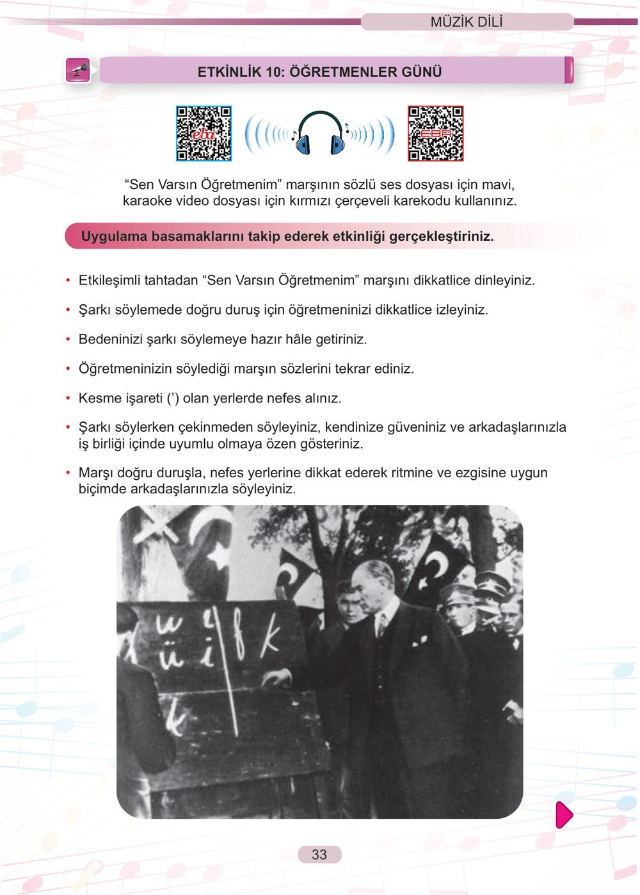

“Sen Varsın Öğretmenim” marşının sözlü ses dosyası için mavi, karaoke video dosyası için kırmızı çerçeveli karekodu kullanınız.

**Uygulama basamaklarını takip ederek etkinliği gerçekleştiriniz.**

* Etkileşimli tahtadan “Sen Varsın Öğretmenim” marşını dikkatlice dinleyiniz.
* Şarkı söylemede doğru duruş için öğretmeninizi dikkatlice izleyiniz.
* Bedeninizi şarkı söylemeye hazır hâle getiriniz.
* Öğretmeninizin söylediği marşın sözlerini tekrar ediniz.
* Kesme işareti (') olan yerlerde nefes alınız.
* Şarkı söylerken çekinmeden söyleyiniz, kendinize güveniniz ve arkadaşlarınızla iş birliği içinde uyumlu olmaya özen gösteriniz.
* Marşı doğru duruşla, nefes yerlerine dikkat ederek ritmine ve ezgisine uygun biçimde arkadaşlarınızla söyleyiniz.

<!-- sayfa 33 -->

# SEN VARSIN ÖĞRETMENİM

**Söz-Müzik: Yücel Elmas (1942 - 2019)**

A-şım - da ek - me - ğim - de i - şim - de mes - le - ğim -
de kent - le - rim - de yur - du - mun her ye - rin -

de di - lim - de ka - le - mim - de sen var - sın hep öğ - ret - me -
de dağ - lar - da e - sen yel - de sen var - sın hep öğ - ret - me -

nim di - lim - de ka - le - mim - de sen var - sın hep öğ - ret - me -
nim dağ - lar - da e - sen yel - de sen var - sın hep öğ - ret - me -

nim Pı - rıl pı - rıl bir kalp de - sen bil - gi hü -

ner sa - nat de - sen can - de - sen ca - nım de - sen her yer -

de sen öğ - ret - me - nim can - de - sen ca - nım de - sen her yer -

de sen öğ - ret - me - nim 1. Kö - yüm 2. nim -

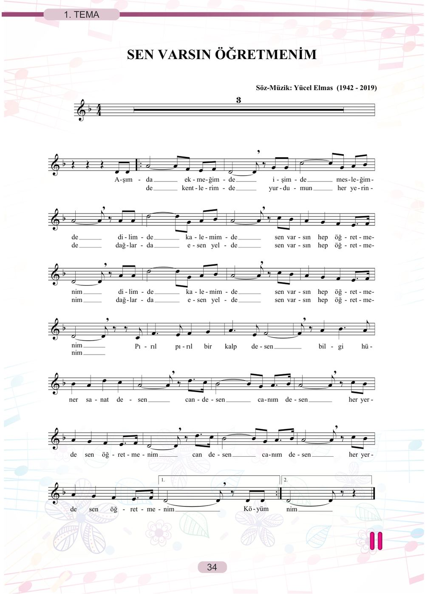
<!-- yer tutucu bulunamadı: sayfa sonuna eklendi -->

<!-- sayfa 34 -->

# Atatürk’ün İzmir Erkek Öğretmen Okulu Ziyaretinden 
(14.10.1925)

"Milletleri kurtaranlar yalnız ve ancak öğretmenlerdir. Öğretmenden, eğiticiden mahrum bir millet, henüz bir millet adını alma yeteneğini kazanamamıştır."

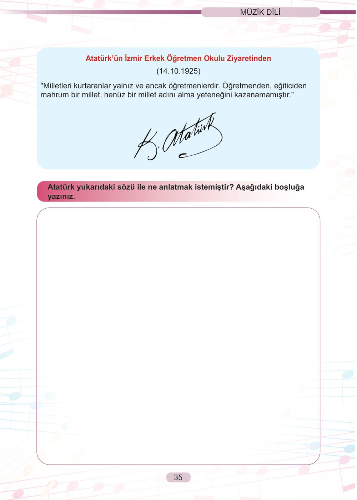

**Atatürk yukarıdaki sözü ile ne anlatmak istemiştir? Aşağıdaki boşluğa yazınız.**

<!-- sayfa 35 -->

# DEĞERLENDİRME ZAMANI

## ÖZ DEĞERLENDİRME FORMU

Bu form kendinizi değerlendirmeniz amacıyla hazırlanmıştır. Sizi en doğru yansıtan seçeneği “ $\checkmark$ ” ile işaretleyiniz.

| Beceriler | Evet | Kısmen | Hayır |
| :--- | :---: | :---: | :---: |
| Bedenimi şarkı söylemeye hazır hâle getirdim. | | | |
| Eserleri nefes yerlerine dikkat ederek söyledim. | | | |
| Eserleri ritmine dikkat ederek söyledim. | | | |
| Eserleri ezgisine dikkat ederek söyledim. | | | |
| Eserleri bütün müziksel bileşenlere dikkat ederek söyledim. | | | |

Öz Değerlendirme Formu’nda **“Kısmen”** ve **“Hayır”** olarak işaretlediğiniz becerileri öğretmeninizle değerlendiriniz.

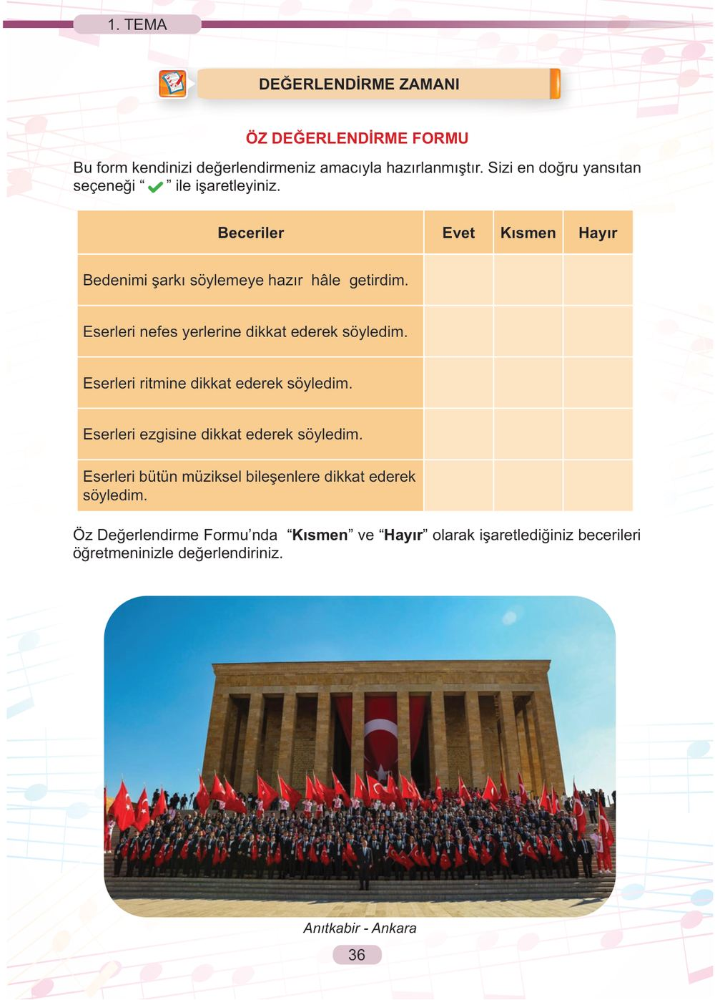

<!-- sayfa 36 -->

# DÜŞÜNELİM - BULALIM

* Şarkı söylerken ya da müzik dinlerken bedensel hareketlerle eşlik ettiniz mi?
* Şarkılara bedensel hareketlerle eşlik edebilmek için aşağıdaki görsellerden yararlanınız.

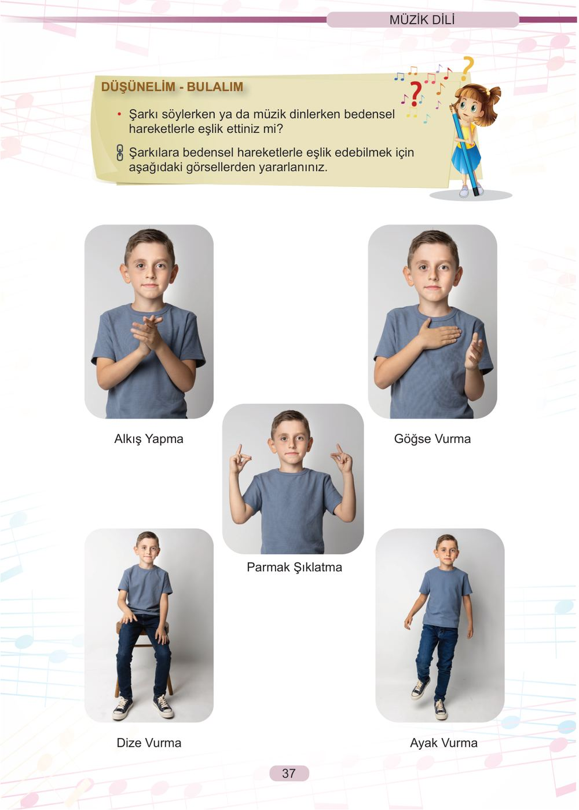

Alkış Yapma

Göğse Vurma

Parmak Şıklatma

<!-- sayfa 37 -->

# ETKİNLİK 11: BEDEN PERKÜSYONU

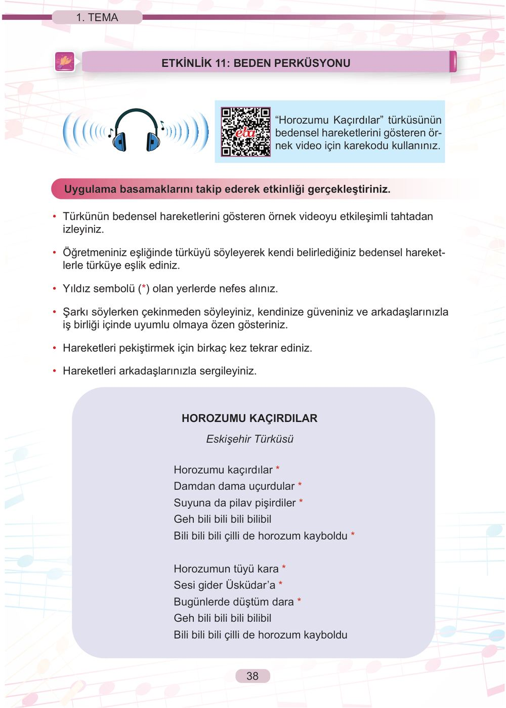: “Horozumu Kaçırdılar” türküsünün bedensel hareketlerini gösteren örnek video için karekodu kullanınız.

**Uygulama basamaklarını takip ederek etkinliği gerçekleştiriniz.**

* Türkünün bedensel hareketlerini gösteren örnek videoyu etkileşimli tahtadan izleyiniz.
* Öğretmeniniz eşliğinde türküyü söyleyerek kendi belirlediğiniz bedensel hareketlerle türküye eşlik ediniz.
* Yıldız sembolü (*) olan yerlerde nefes alınız.
* Şarkı söylerken çekinmeden söyleyiniz, kendinize güveniniz ve arkadaşlarınızla iş birliği içinde uyumlu olmaya özen gösteriniz.
* Hareketleri pekiştirmek için birkaç kez tekrar ediniz.
* Hareketleri arkadaşlarınızla sergileyiniz.

***

### HOROZUMU KAÇIRDILAR
*Eskişehir Türküsü*

Horozumu kaçırdılar *
Damdan dama uçurdular *
Suyuna da pilav pişirdiler *
Geh bili bili bili bilibil
Bili bili bili çilli de horozum kayboldu *

Horozumun tüyü kara *
Sesi gider Üsküdar’a *
Bugünlerde düştüm dara *
Geh bili bili bili bilibil
Bili bili bili çilli de horozum kayboldu

<!-- sayfa 38 -->

# ETKİNLİK 12: BEDEN PERKÜSYONU

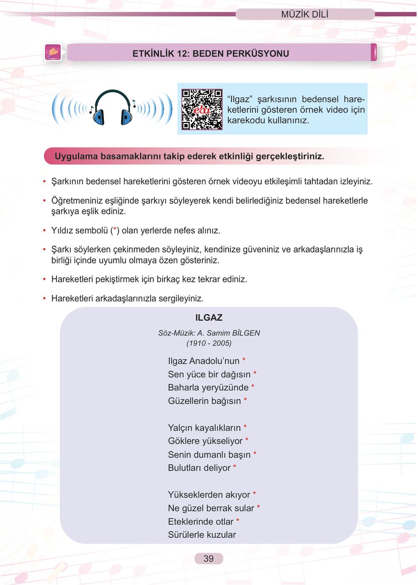 “Ilgaz” şarkısının bedensel hareketlerini gösteren örnek video için karekodu kullanınız.

## Uygulama basamaklarını takip ederek etkinliği gerçekleştiriniz.

* Şarkının bedensel hareketlerini gösteren örnek videoyu etkileşimli tahtadan izleyiniz.
* Öğretmeniniz eşliğinde şarkıyı söyleyerek kendi belirlediğiniz bedensel hareketlerle şarkıya eşlik ediniz.
* Yıldız sembolü (*) olan yerlerde nefes alınız.
* Şarkı söylerken çekinmeden söyleyiniz, kendinize güveniniz ve arkadaşlarınızla iş birliği içinde uyumlu olmaya özen gösteriniz.
* Hareketleri pekiştirmek için birkaç kez tekrar ediniz.
* Hareketleri arkadaşlarınızla sergileyiniz.

### ILGAZ
*Söz-Müzik: A. Samim BİLGEN (1910 - 2005)*

Ilgaz Anadolu’nun *
Sen yüce bir dağısın *
Baharla yeryüzünde *
Güzellerin bağısın *

Yalçın kayalıkların *
Göklere yükseliyor *

Senin dumanlı başın *
Bulutları deliyor *

Yükseklerden akıyor *
Ne güzel berrak sular *
Eteklerinde otlar *
Sürülerle kuzular

<!-- sayfa 39 -->

# ETKİNLİK 13: BEDEN PERKÜSYONU

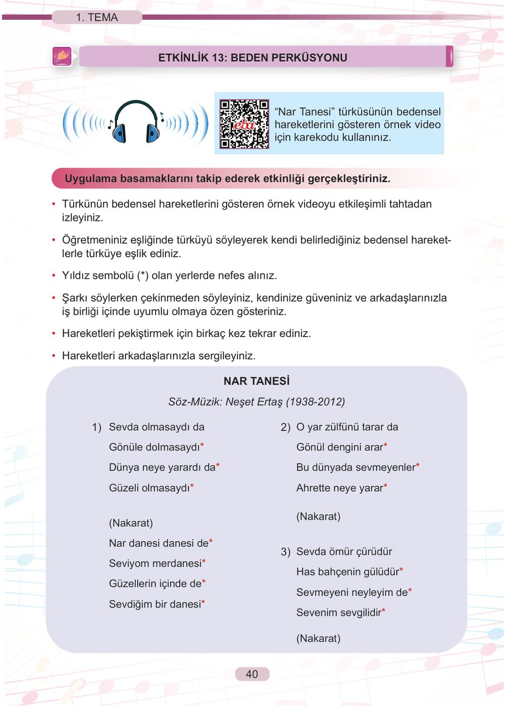 “Nar Tanesi” türküsünün bedensel hareketlerini gösteren örnek video için karekodu kullanınız.

**Uygulama basamaklarını takip ederek etkinliği gerçekleştiriniz.**

* Türkünün bedensel hareketlerini gösteren örnek videoyu etkileşimli tahtadan izleyiniz.
* Öğretmeniniz eşliğinde türküyü söyleyerek kendi belirlediğiniz bedensel hareketlerle türküye eşlik ediniz.
* Yıldız sembolü (*) olan yerlerde nefes alınız.
* Şarkı söylerken çekinmeden söyleyiniz, kendinize güveniniz ve arkadaşlarınızla iş birliği içinde uyumlu olmaya özen gösteriniz.
* Hareketleri pekiştirmek için birkaç kez tekrar ediniz.
* Hareketleri arkadaşlarınızla sergileyiniz.

## NAR TANESİ
*Söz-Müzik: Neşet Ertaş (1938-2012)*

1) Sevda olmasaydı da
Gönüle dolmasaydı*
Dünya neye yarardı da*
Güzeli olmasaydı*

(Nakarat)
Nar danesi danesi de*
Seviyom merdanesi*
Güzellerin içinde de*
Sevdiğim bir danesi*

2) O yar zülfünü tarar da
Gönül dengini arar*
Bu dünyada sevmeyenler*
Ahrette neye yarar*

(Nakarat)

3) Sevda ömür çürüdür
Has bahçenin gülüdür*
Sevmeyeni neyleyim de*
Sevenim sevgilidir*

(Nakarat)

<!-- sayfa 40 -->

# DEĞERLENDİRME ZAMANI

## ÖZ DEĞERLENDİRME FORMU

Bu form kendinizi değerlendirmeniz amacıyla hazırlanmıştır. Sizi en doğru yansıtan seçeneği “ $\checkmark$ ” ile işaretleyiniz.

| Beceriler | Evet | Kısmen | Hayır |
| :--- | :---: | :---: | :---: |
| Ritmik yapıya uygun hareketler belirledim. | | | |
| Eserin anlamına uygun hareketler belirledim. | | | |
| Ritmik yapıya uygun hareketler sergiledim. | | | |
| Eserin anlamına uygun hareketler sergiledim. | | | |

Öz Değerlendirme Formu’nda **“Kısmen”** ve **“Hayır”** olarak işaretlediğiniz becerileri öğretmeninizle değerlendiriniz.

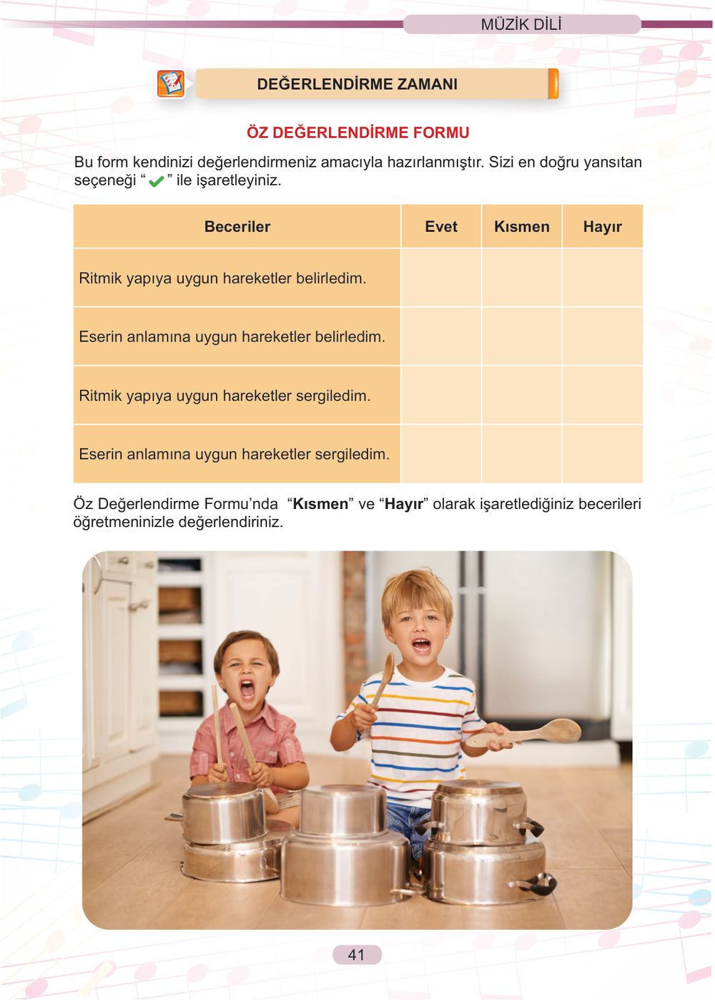

<!-- sayfa 41 -->

# DÜŞÜNELİM - BULALIM

* Aşağıda verilen bilgi kutusundaki müzik sembollerinden hangilerini tanıyorsunuz? Arkadaşlarınızla paylaşınız.
* Daha önce sol anahtarını nerelerde gördünüz? Arkadaşlarınızla paylaşınız.

# “BAŞLICA MÜZİK SEMBOLLERİ NELERDİR?”

Nasıl ki kültürümüzü gelecek kuşaklara aktarmak için yazıyı ve yazının araçları olan harfleri kullanıyorsak müzik eserlerini kalıcı hâle getirmek ve gelecek kuşaklara doğru biçimde aktarmak için de müzik yazısını ve bu yazının araçları olan müzik sembollerini kullanırız. Müzik sembolleri bütün dünyada aynıdır ve bu nedenle dünyadaki tek ortak dil müziktir.

Şimdi müzik sembollerinden dizek, sol anahtarı, ölçü, ölçü sayısı, ölçü çizgisi, bitiş çizgisi, $2/4$'lük ölçü sayısı, dörtlük nota, sekizlik nota ve sus değerleri, re-la arasındaki sesler ve hız terimlerinden andante (yavaş) - moderato (orta hız) - allegro (hızlı) kavramlarını tanıyalım.

> ### Bilgi Kutusu
> 
> 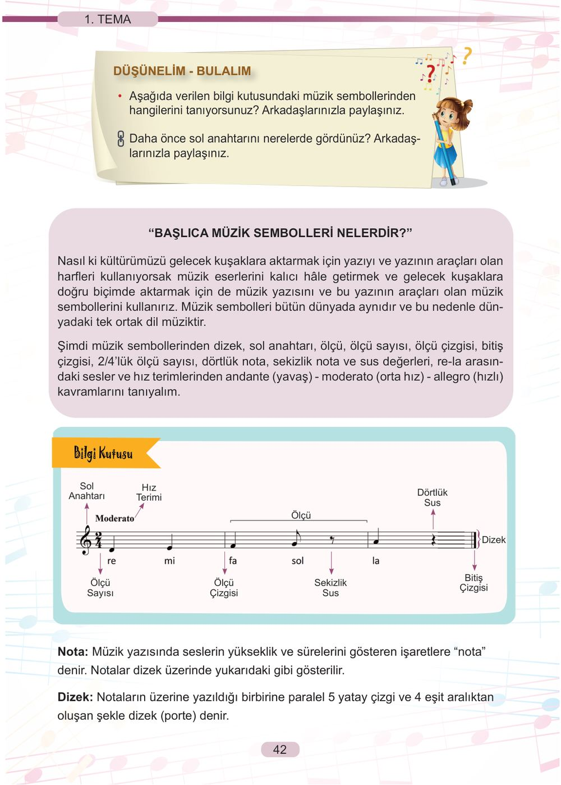

**Nota:** Müzik yazısında seslerin yükseklik ve sürelerini gösteren işaretlere “nota” denir. Notalar dizek üzerinde yukarıdaki gibi gösterilir.

**Dizek:** Notaların üzerine yazıldığı birbirine paralel 5 yatay çizgi ve 4 eşit aralıktan oluşan şekle dizek (porte) denir.

<!-- sayfa 42 -->

**Sol anahtarı:** Sol anahtarı dizeğin en başında yer alır ve ikinci çizgiden başlar. Sol anahtarı başladığı çizgiye kendi adını verir. Bu nedenle 2. çizgideki nota sol notasıdır.

**Ölçü sayısı:** Dizeğin başında ve anahtardan hemen sonra yer alan rakamlardır. Bir ölçüde kaç vuruş olması gerektiğini belirler. Örneğin $2/4$'lük ölçü sayısıyla başlayan bir eserde her ölçüde iki vuruş olmalıdır.

**Ölçü çizgisi:** Ölçüleri birbirinden ayıran dik çizgilerdir.

**Ölçü:** İki ölçü çizgisi arasındaki her bir bölüme ölçü denir. Bir ölçüdeki vuruş sayısı ölçü sayısından fazla olamaz.

**Bitiş çizgisi:** Eserin bittiğini belirten bir ince ve bir kalın çizgiden oluşan çizgidir.

**Hız terimi:** Eserin hızını belirler. İlk dizeğe ve ölçü sayısının hemen üzerine yazılır. Birçok hız terimi vardır. İtalyanca olan bu terimlerden en sık kullanılanlar şunlardır: andante (yavaş hızda) - moderato (orta hızda) - allegro (hızlı).

### Re - La Arasındaki Dörtlük (1 Vuruş) Notalar ve Sus İşaretleri

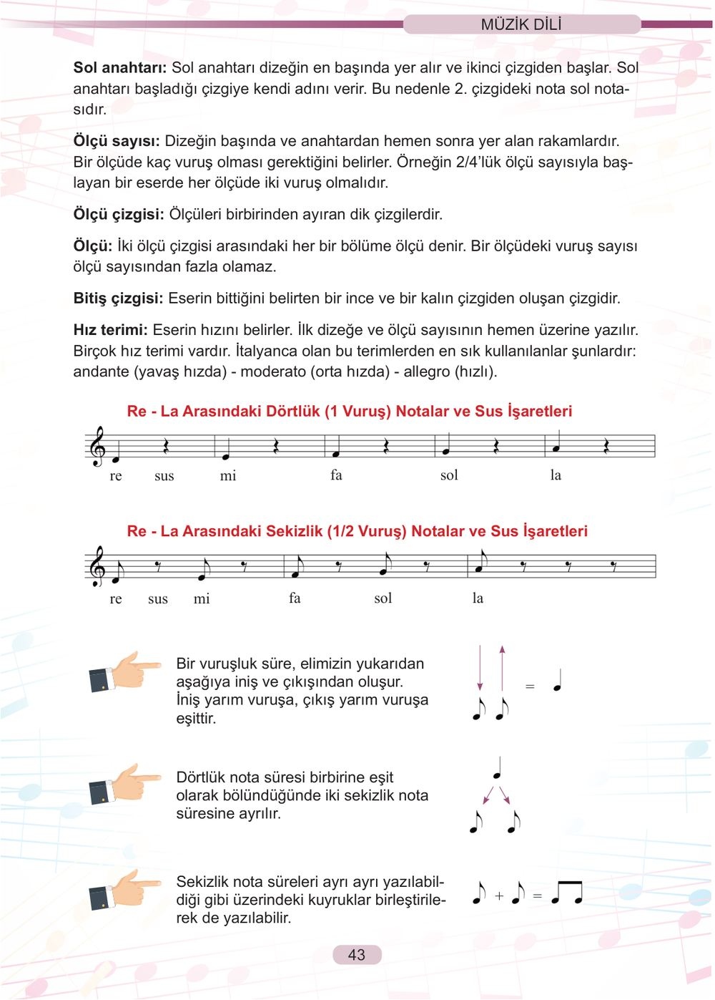

### Re - La Arasındaki Sekizlik (1/2 Vuruş) Notalar ve Sus İşaretleri

 Bir vuruşluk süre, elimizin yukarıdan aşağıya iniş ve çıkışından oluşur. İniş yarım vuruşa, çıkış yarım vuruşa eşittir.

 Dörtlük nota süresi birbirine eşit olarak bölündüğünde iki sekizlik nota süresine ayrılır.

 Sekizlik nota süreleri ayrı ayrı yazılabildiği gibi üzerindeki kuyruklar birleştirilebilir.
$\text{\textmusicalnote} + \text{\textmusicalnote} = \text{\textmusicalnote}$

<!-- sayfa 43 -->

# ETKİNLİK 14: EL DİZEĞİNİ TANIYALIM

* Elinizi görseldeki gibi aşağıdaki boşluğa yerleştiriniz. 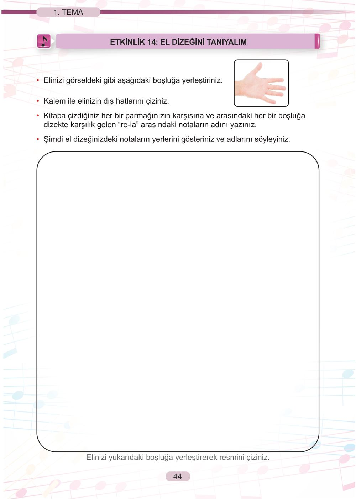
* Kalem ile elinizin dış hatlarını çiziniz.
* Kitaba çizdiğiniz her bir parmağınızın karşısına ve arasındaki her bir boşluğa dizekte karşılık gelen “re-la” arasındaki notaların adını yazınız.
* Şimdi el dizeğinizdeki notaların yerlerini gösteriniz ve adlarını söyleyiniz.

<!-- sayfa 44 -->

# ETKİNLİK 15: NOTALARIN ADINI YAZALIM

• Aşağıdaki notaları inceleyiniz ve dizeklerin altlarındaki noktalı yerlere notaların adını yazınız.

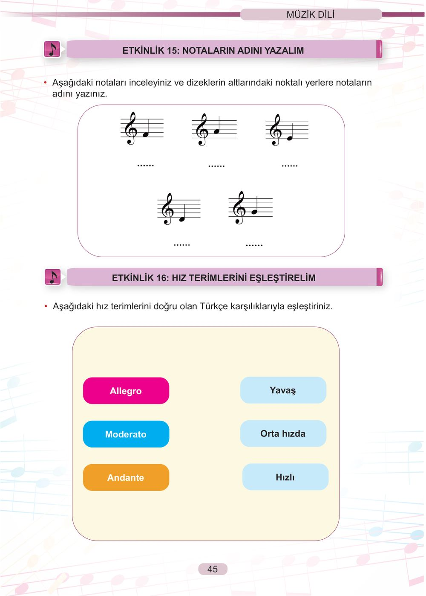

# ETKİNLİK 16: HIZ TERİMLERİNİ EŞLEŞTİRELİM

• Aşağıdaki hız terimlerini doğru olan Türkçe karşılıklarıyla eşleştiriniz.

| | |
| :--- | :--- |
| Allegro | Yavaş |
| Moderato | Orta hızda |
| Andante | Hızlı |

<!-- sayfa 45 -->

# DEĞERLENDİRME ZAMANI

1) **Bir ölçüde kaç vuruş olması gerektiğini aşağıdakilerden hangisi belirler?**
   A) Ölçü &nbsp;&nbsp;&nbsp;&nbsp;&nbsp;&nbsp;&nbsp;&nbsp;&nbsp;&nbsp;&nbsp;&nbsp;&nbsp;&nbsp;&nbsp;&nbsp;&nbsp;&nbsp;&nbsp;&nbsp; B) Dizek &nbsp;&nbsp;&nbsp;&nbsp;&nbsp;&nbsp;&nbsp;&nbsp;&nbsp;&nbsp;&nbsp;&nbsp;&nbsp;&nbsp;&nbsp;&nbsp;&nbsp;&nbsp;&nbsp;&nbsp; C) Sol anahtarı &nbsp;&nbsp;&nbsp;&nbsp;&nbsp;&nbsp;&nbsp;&nbsp;&nbsp;&nbsp;&nbsp;&nbsp;&nbsp;&nbsp;&nbsp;&nbsp;&nbsp;&nbsp;&nbsp;&nbsp; D) Ölçü sayısı

2) **Birbirine paralel 5 yatay çizgi ve 4 eşit aralıktan oluşan ve üzerine nota yazılan şekle ne denir?**
   A) Dizek &nbsp;&nbsp;&nbsp;&nbsp;&nbsp;&nbsp;&nbsp;&nbsp;&nbsp;&nbsp;&nbsp;&nbsp;&nbsp;&nbsp;&nbsp;&nbsp;&nbsp;&nbsp;&nbsp;&nbsp; B) Ölçü &nbsp;&nbsp;&nbsp;&nbsp;&nbsp;&nbsp;&nbsp;&nbsp;&nbsp;&nbsp;&nbsp;&nbsp;&nbsp;&nbsp;&nbsp;&nbsp;&nbsp;&nbsp;&nbsp;&nbsp;&nbsp;&nbsp; C) Ölçü sayısı &nbsp;&nbsp;&nbsp;&nbsp;&nbsp;&nbsp;&nbsp;&nbsp;&nbsp;&nbsp;&nbsp;&nbsp;&nbsp;&nbsp;&nbsp;&nbsp;&nbsp;&nbsp;&nbsp;&nbsp; D) Allegro

3) **Dizeğin en başında yer alan ve ikinci çizgiden başlayan müzik sembolüne ne ad verilir?**
   A) Ölçü çizgisi &nbsp;&nbsp;&nbsp;&nbsp;&nbsp;&nbsp;&nbsp;&nbsp;&nbsp;&nbsp;&nbsp;&nbsp;&nbsp;&nbsp;&nbsp;&nbsp; B) Sol anahtarı &nbsp;&nbsp;&nbsp;&nbsp;&nbsp;&nbsp;&nbsp;&nbsp;&nbsp;&nbsp;&nbsp;&nbsp;&nbsp;&nbsp;&nbsp;&nbsp;&nbsp;&nbsp; C) Ölçü sayısı &nbsp;&nbsp;&nbsp;&nbsp;&nbsp;&nbsp;&nbsp;&nbsp;&nbsp;&nbsp;&nbsp;&nbsp;&nbsp;&nbsp;&nbsp;&nbsp;&nbsp;&nbsp;&nbsp;&nbsp; D) Andante

4) **Ölçüleri birbirinden ayıran dik çizgilere ne ad verilir?**
   A) Dizek &nbsp;&nbsp;&nbsp;&nbsp;&nbsp;&nbsp;&nbsp;&nbsp;&nbsp;&nbsp;&nbsp;&nbsp;&nbsp;&nbsp;&nbsp;&nbsp;&nbsp;&nbsp;&nbsp;&nbsp;&nbsp;&nbsp; B) Ölçü &nbsp;&nbsp;&nbsp;&nbsp;&nbsp;&nbsp;&nbsp;&nbsp;&nbsp;&nbsp;&nbsp;&nbsp;&nbsp;&nbsp;&nbsp;&nbsp;&nbsp;&nbsp;&nbsp;&nbsp;&nbsp;&nbsp;&nbsp;&nbsp; C) Ölçü sayısı &nbsp;&nbsp;&nbsp;&nbsp;&nbsp;&nbsp;&nbsp;&nbsp;&nbsp;&nbsp;&nbsp;&nbsp;&nbsp;&nbsp

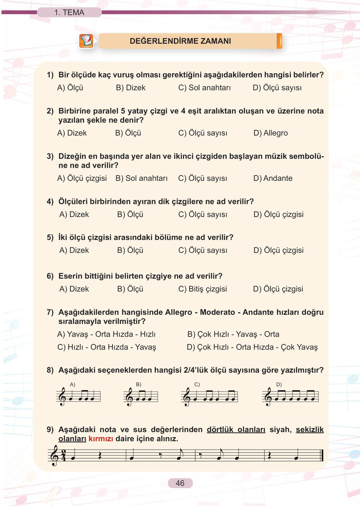
<!-- yer tutucu bulunamadı: sayfa sonuna eklendi -->

<!-- sayfa 46 -->

# DÜŞÜNELİM - BULALIM

* “Güzel sanatlar” kavramı sizde neyi çağrıştırmaktadır?
* Daha önce hangi sanat etkinliklerine katıldınız?
* Bu kavramların ve etkinliklerin neler olduğunu arkadaşlarınızla paylaşınız.

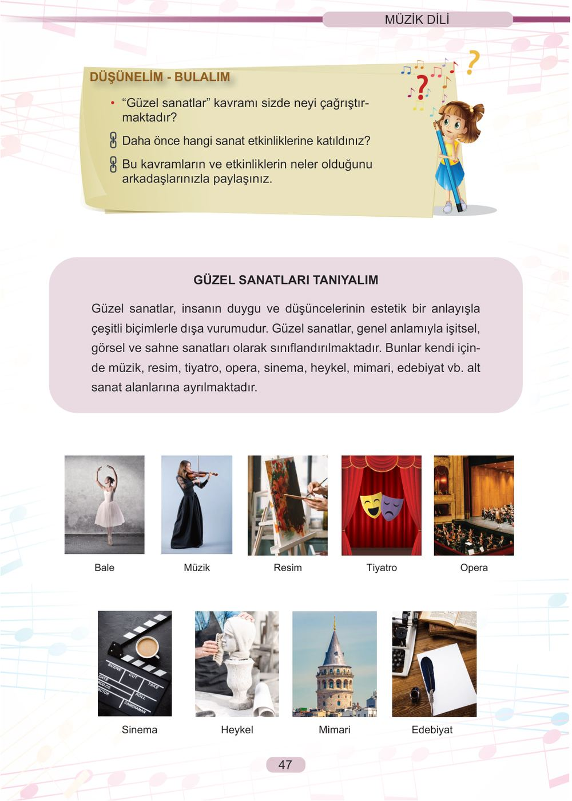: "Güzel sanatlar" kavramı sizde neyi çağrıştırmaktadır? sorusunun yanında çizgi film karakteri olan bir kız çocuğu resmi bulunmaktadır.

# GÜZEL SANATLARI TANIYALIM

Güzel sanatlar, insanın duygu ve düşüncelerinin estetik bir anlayışla çeşitli biçimlerle dışa vurumudur. Güzel sanatlar, genel anlamıyla işitsel, görsel ve sahne sanatları olarak sınıflandırılmaktadır. Bunlar kendi içinde müzik, resim, tiyatro, opera, sinema, heykel, mimari, edebiyat vb. alt sanat alanlarına ayrılmaktadır.

: Bale yapan bir kadın resmi.
Bale

: Keman çalan bir kadın resmi.
Müzik

: Resim yapan bir el ve tuval resmi.
Resim

: Tiyatro maskeleri ve perde resmi.
Tiyatro

: Opera sahnesi resmi.
Opera

: Film klaketi ve kahve fincanı resmi.
Sinema

: Heykel yapan bir sanatçı resmi.
Heykel

: Galata Kulesi resmi.
Mimari

: Kitap, daktilo ve kağıt resmi.
Edebiyat

<!-- sayfa 47 -->

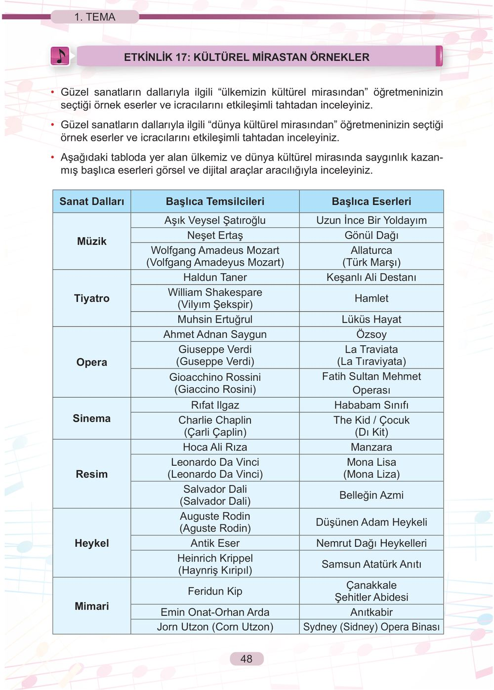
# ETKİNLİK 17: KÜLTÜREL MİRASTAN ÖRNEKLER

* Güzel sanatların dallarıyla ilgili “ülkemizin kültürel mirasından” öğretmeninizin seçtiği örnek eserler ve icracılarını etkileşimli tahtadan inceleyiniz.
* Güzel sanatların dallarıyla ilgili “dünya kültürel mirasından” öğretmeninizin seçtiği örnek eserler ve icracılarını etkileşimli tahtadan inceleyiniz.
* Aşağıdaki tabloda yer alan ülkemiz ve dünya kültürel mirasında saygınlık kazanmış başlıca eserleri görsel ve dijital araçlar aracılığıyla inceleyiniz.

| Sanat Dalları | Başlıca Temsilcileri | Başlıca Eserleri |
| :--- | :--- | :--- |
| **Müzik** | Aşık Veysel Şatıroğlu | Uzun İnce Bir Yoldayım |
| | Neşet Ertaş | Gönül Dağı |
| | Wolfgang Amadeus Mozart (Volfgang Amadeyus Mozart) | Allaturca (Türk Marşı) |
| **Tiyatro** | Haldun Taner | Keşanlı Ali Destanı |
| | William Shakespare (Vilyım Şekspir) | Hamlet |
| | Muhsin Ertuğrul | Lüküs Hayat |
| **Opera** | Ahmet Adnan Saygun | Özsoy |
| | Giuseppe Verdi (Guseppe Verdi) | La Traviata (La Tıraviyata) |
| | Gioacchino Rossini (Giaccino Rosini) | Fatih Sultan Mehmet Operası |
| **Sinema** | Rıfat Ilgaz | Hababam Sınıfı |
| | Charlie Chaplin (Çarli Çaplin) | The Kid / Çocuk (Dı Kit) |
| **Resim** | Hoca Ali Rıza | Manzara |
| | Leonardo Da Vinci (Leonardo Da Vinci) | Mona Lisa (Mona Liza) |
| | Salvador Dali (Salvador Dali) | Belleğin Azmi |
| **Heykel** | Auguste Rodin (Aguste Rodin) | Düşünen Adam Heykeli |
| | Antik Eser | Nemrut Dağı Heykelleri |
| | Heinrich Krippel (Haynriş Kıripıl) | Samsun Atatürk Anıtı |
| **Mimari** | Feridun Kip | Çanakkale Şehitler Abidesi |
| | Emin Onat-Orhan Arda | Anıtkabir |
| | Jorn Utzon (Corn Utzon) | Sydney (Sidney) Opera Binası |

<!-- sayfa 48 -->

# ÜLKEMİZ VE DÜNYA KÜLTÜREL MİRASINDA SAYGINLIK KAZANMIŞ BAŞLICA SANATÇILAR VE SANAT ESERLERİ

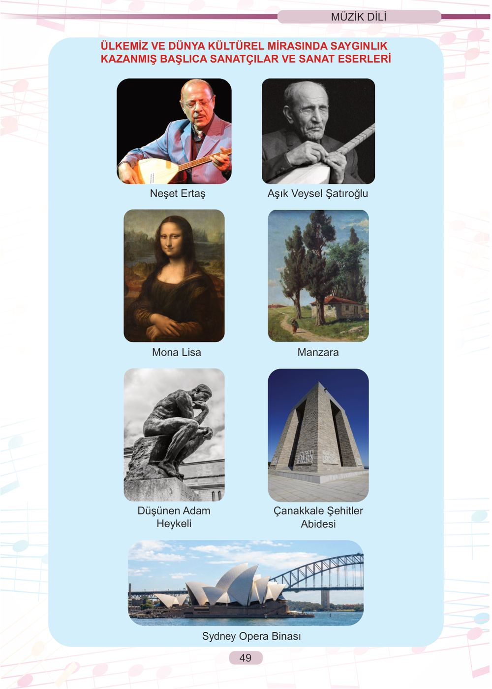
Neşet Ertaş

Aşık Veysel Şatıroğlu

Mona Lisa

Manzara

Düşünen Adam Heykeli

Çanakkale Şehitler Abidesi

<!-- sayfa 49 -->

# ETKİNLİK 18: ARAŞTIRALIM - BULALIM

* Güzel sanatların her bir sanat dalını araştırmak üzere öğretmeninizin rehberliğinde gruplar oluşturunuz.
* Grubunuzla bir sanat dalını belirleyerek seçmiş olduğunuz sanat dalını araştırınız.
* Seçtiğiniz sanat dalını temsil eden başlıca eserlerden örnekler belirleyiniz.
* Elde ettiğiniz bilgileri sınıfta sunmak üzere poster, pano, pankart, dijital vb. şeklinde hazırlayınız.
* Hazırladığınız sunumu gruplar hâlinde sınıfta paylaşınız.

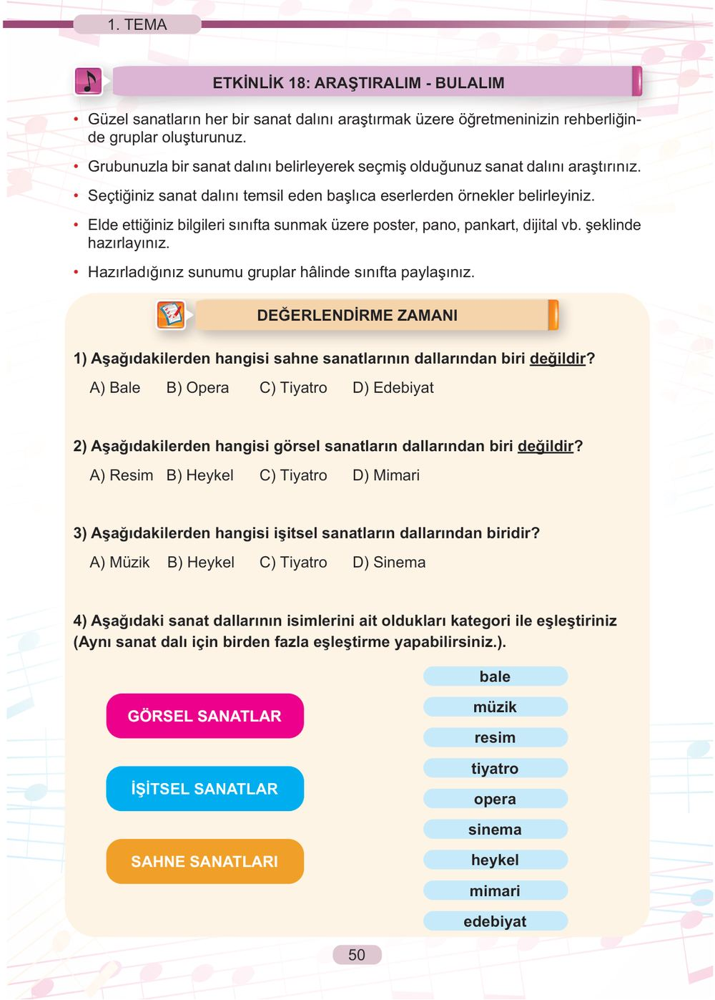
## DEĞERLENDİRME ZAMANI

**1) Aşağıdakilerden hangisi sahne sanatlarının dallarından biri $\underline{\text{değildir?}}$ <!-- KONTROL: Marker'da karşılığı yok, uydurma olabilir -->**

A) Bale  B) Opera  C) Tiyatro  D) Edebiyat

**2) Aşağıdakilerden hangisi görsel sanatların dallarından biri $\underline{\text{değildir?}}$ <!-- KONTROL: Marker'da karşılığı yok, uydurma olabilir -->**

A) Resim  B) Heykel  C) Tiyatro  D) Mimari

**3) Aşağıdakilerden hangisi işitsel sanatların dallarından biridir?**

A) Müzik  B) Heykel  C) Tiyatro  D) Sinema

**4) Aşağıdaki sanat dallarının isimlerini ait oldukları kategori ile eşleştiriniz (Aynı sanat dalı için birden fazla eşleştirme yapabilirsiniz.).**

| | | |
| :--- | :--- | :--- |
| **GÖRSEL SANATLAR** | bale | |
| | müzik | |
| **İŞİTSEL SANATLAR** | resim | |
| | tiyatro | |
| **SAHNE SANATLARI** | opera | |
| | sinema | |
| | heykel | |
| | mimari | |

<!-- sayfa 50 -->

**5 - 8. soruları aşağıdaki metne göre cevaplayınız.**

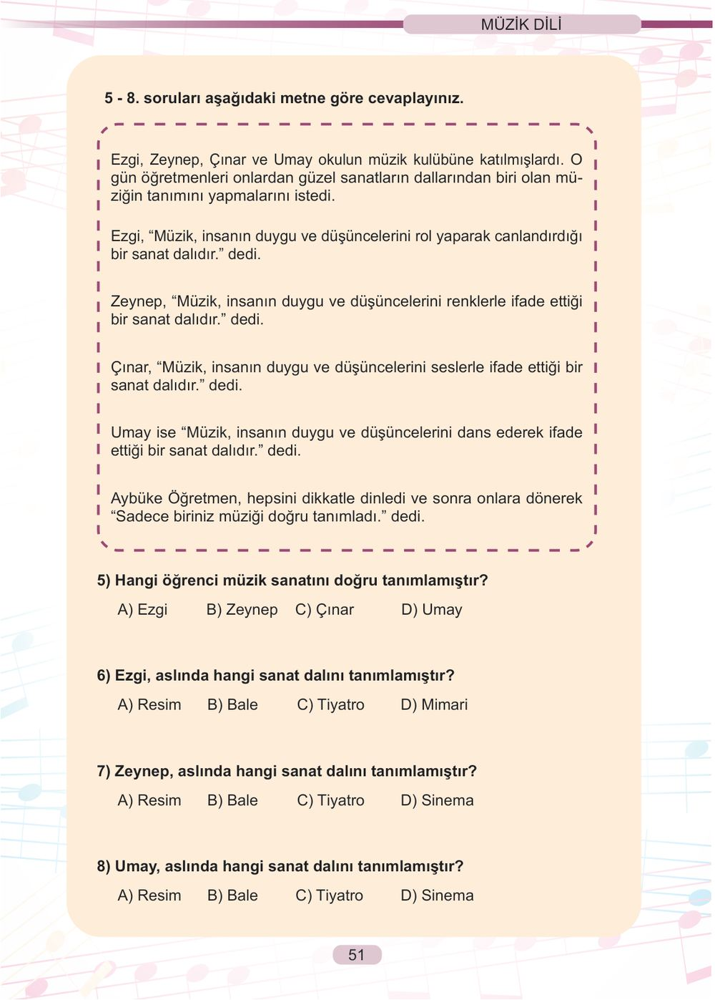
> Ezgi, Zeynep, Çınar ve Umay okulun müzik kulübüne katılmışlardı. O gün öğretmenleri onlardan güzel sanatların dallarından biri olan müziğin tanımını yapmalarını istedi.
>
> Ezgi, “Müzik, insanın duygu ve düşüncelerini rol yaparak canlandırdığı bir sanat dalıdır.” dedi.
>
> Zeynep, “Müzik, insanın duygu ve düşüncelerini renklerle ifade ettiği bir sanat dalıdır.” dedi.
>
> Çınar, “Müzik, insanın duygu ve düşüncelerini seslerle ifade ettiği bir sanat dalıdır.” dedi.
>
> Umay ise “Müzik, insanın duygu ve düşüncelerini dans ederek ifade ettiği bir sanat dalıdır.” dedi.
>
> Aybüke Öğretmen, hepsini dikkatle dinledi ve sonra onlara dönerek “Sadece biriniz müziği doğru tanımladı.” dedi.

**5) Hangi öğrenci müzik sanatını doğru tanımlamıştır?**

A) Ezgi &nbsp;&nbsp;&nbsp;&nbsp;&nbsp;&nbsp; B) Zeynep &nbsp;&nbsp;&nbsp;&nbsp;&nbsp;&nbsp; C) Çınar &nbsp;&nbsp;&nbsp;&nbsp;&nbsp;&nbsp; D) Umay

**6) Ezgi, aslında hangi sanat dalını tanımlamıştır?**

A) Resim &nbsp;&nbsp;&nbsp;&nbsp;&nbsp;&nbsp; B) Bale &nbsp;&nbsp;&nbsp;&nbsp;&nbsp;&nbsp; C) Tiyatro &nbsp;&nbsp;&nbsp;&nbsp;&nbsp;&nbsp; D) Mimari

**7) Zeynep, aslında hangi sanat dalını tanımlamıştır?**

A) Resim &nbsp;&nbsp;&nbsp;&nbsp;&nbsp;&nbsp; B) Bale &nbsp;&nbsp;&nbsp;&nbsp;&nbsp;&nbsp; C) Tiyatro &nbsp;&nbsp;&nbsp;&nbsp;&nbsp;&nbsp; D) Sinema

**8) Umay, aslında hangi sanat dalını tanımlamıştır?**

<!-- sayfa 51 -->

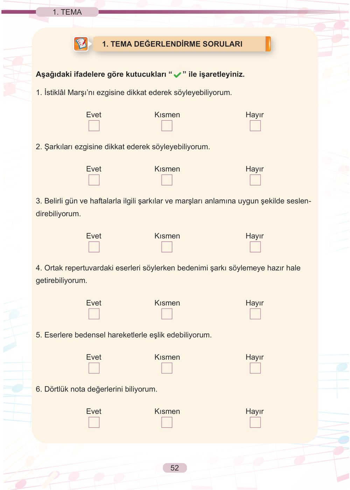 1. TEMA DEĞERLENDİRME SORULARI

Aşağıdaki ifadelere göre kutucukları “✔” ile işaretleyiniz.

1. İstiklâl Marşı’nı ezgisine dikkat ederek söyleyebiliyorum.

| Evet | Kısmen | Hayır |
| :---: | :---: | :---: |
| ☐ | ☐ | ☐ |

2. Şarkıları ezgisine dikkat ederek söyleyebiliyorum.

3. Belirli gün ve haftalarla ilgili şarkılar ve marşları anlamına uygun şekilde seslendirebiliyorum.

4. Ortak repertuvardaki eserleri söylerken bedenimi şarkı söylemeye hazır hale getirebiliyorum.

5. Eserlere bedensel hareketlerle eşlik edebiliyorum.

6. Dörtlük nota değerlerini biliyorum.

<!-- sayfa 52 -->

7. Hız terimlerini ayırt edebiliyorum.

Evet ☐      Kısmen ☐      Hayır ☐

8. İşitsel sanat dallarını biliyorum.

Evet ☐      Kısmen ☐      Hayır ☐

1. Tema Ek Değerlendirme Soruları Karekodu

<!-- sayfa 53 -->

# 2.TEMA
# MÜZİK KÜLTÜRÜ

Atatürk’ün güzel sanatlara verdiği önem
Farklı türdeki eserler
Nefesli çalgılar
Klavyeli (Tuşlu) çalgılar
Belirli gün ve haftalarla ilgili eserler
Popüler müzik türleri
Ortak repertuvar
Bedensel hareketler

<u>Anahtar Kavramlar</u>

> * Atatürk ve güzel sanatlar

**Bu temada;**
* Atatürk’ün güzel sanatlara verdiği önemi özetleyebilmeniz,
* nefesli ve klavyeli (tuşlu) çalgıları tanıyabilmeniz,
* popüler müzik türlerini karşılaştırabilmeniz,
* farklı türlerdeki eserleri söyleyebilmeniz,
* belirli gün ve haftalarla ilgili eserleri söyleyebilmeniz,
* ortak repertuvardaki eserleri söyleyebilmeniz,
* müzik eserlerine bedensel hareketlerle eşlik edebilmeniz

<!-- yer tutucu bulunamadı: sayfa sonuna eklendi -->

<!-- sayfa 54 -->

EBA
2. Tema Karekodu

2. Tema Özet
İçerik Karekodu

<!-- sayfa 55 -->

# DÜŞÜNELİM - BULALIM

* Sizce Atatürk güzel sanatlara neden önem vermiştir?
* Atatürk'ün güzel sanatlarla ilgili söylevlerinden hangilerini biliyorsunuz? Arkadaşlarınızla paylaşınız.

: Bir kız çocuğu elinde büyüteçle soru işaretlerinin olduğu bir sahne üzerinde duruyor.

# ARAŞTIRALIM - BULALIM

* Atatürk'ün güzel sanatlarla ilgili söylev ve demeçlerini araştırmak için öğretmeninizin rehberliğinde gruplar oluşturunuz.
* Grubunuzla Atatürk'ün güzel sanatlarla ilgili söylev ve demeçlerini basılı ve dijital kaynaklardan araştırınız.
* Araştırma sonunda elde ettiğiniz bilgileri sınıfta sunmak üzere poster, pankart, dijital sunum şeklinde hazırlayınız.
* Hazırladığınız sunumu gruplar hâlinde sınıfta paylaşınız.

**Atatürk ve güzel sanatları konu alan okuma parçasını okuyunuz.**

## ATATÜRK'ÜN GÜZEL SANATLARLA İLGİLİ SÖYLEV VE DEMEÇLERİ
### 19 Temmuz 1936, Florya Köşkü

Büyük insanlık varlığının ifadesine yarayacak kural, kültür dediğimiz kelimenin üzerinde, dikkatli bir incelemeyle ulaşılan kavramlarla anlamını bulur. Bu arada bütün modern dillerde kullanılmakta olduğu içindir ki bizde de "Güzel Sanatlar" denilen bir şey meydana konmuştur. Bu kelimeyi Türkler zannediyorum ki pek haklı olarak 1-Müzik, 2-Resim, 3-Heykeltıraş, 4-Edebiyat, 5-Mimari, 6-Dans ve jimnastikten birleşik saymışlardır.

Bu branş, insan topluluğunun yüksek niteliğini göstermede çok büyük bir öneme sahiptir. Bu yüksek değer, yüksek incelik, beceri, ince anlayış ve işte bunların hepsini yapabilmek sanatçılığın birleşmiş ifadesidir. Bu konu üzerinde bizim de, çocuklarımızın da esaslı olarak durmamız gereklidir. Güzel sanatlarda başarı, bütün devrimlerin başarılı olduğunun en kesin kanıtıdır. Bunda başarılı olamayan milletlere ne yazıktır.

<!-- sayfa 56 -->

Onlar bütün başarılarına karşın uygarlık alanında yüksek insanlık sıfatıyla tanınmaktan her zaman yoksun kalacaklardır. İşte bunun içindir ki biz; elimize aldığımız büyük Türk milletinin başarısı için çalışmakla memnunuz. Ne yazıktır ki biz kendimiz de bu işte geriyiz. Çocuklarımız, gençlerimiz, babalarında gördükleri eksiklikleri, dünyaya bakarak gidermeye çalışmaktadırlar, çalışmalıdırlar.”

(Atatürk Araştırma Merkezi, 2026).

# DEĞERLENDİRME ZAMANI

Aşağıdaki soruları yanıtlayınız.

**1) Atatürk’ün güzel sanatlarla ilgili söylevlerinden birini yazınız.**
………………………………………………………………………………………………
………………………………………………………………………………………………
………………………………………………………………………………………………
……………………………………………………………………………………………….............................

**2) Atatürk’ün güzel sanatlara verdiği önemi kendi cümlelerinizle yazınız.**
………………………………………………………………………………………………
………………………………………………………………………………………………
………………………………………………………………………………………………
……………………………………………………………………………………………….............................

**3) Atatürk “Güzel sanatlarda başarı, bütün devrimlerin başarılı olduğunun en kesin kanıtıdır.” sözü ile ne ifade etmek istemiştir?**
………………………………………………………………………………………………
………………………………………………………………………………………………
………………………………………………………………………………………………
……………………………………………………………………………………………….............................

<!-- sayfa 57 -->

# DÜŞÜNELİM - BULALIM

Daha önceden bildiğiniz şarkılar nelerdir?
Arkadaşlarınızla paylaşınız.

## ETKİNLİK 1: BİRLİKTE SÖYLEYELİM

“Halay” şarkısının sözlü ses dosyası için mavi, karaoke video dosyası için kırmızı çerçeveli karekodu kullanınız.

**Uygulama basamaklarını takip ederek etkinliği gerçekleştiriniz.**

* Etkileşimli tahtadan “Halay” şarkısını dikkatlice dinleyiniz.
* Şarkı söylemede doğru duruş için öğretmeninizi dikkatlice izleyiniz.
* Bedeninizi şarkı söylemeye hazır hâle getiriniz.
* Öğretmeninizin söylediği şarkının sözlerini tekrar ediniz.
* Kesme işareti (') olan yerlerde nefes alınız.
* Şarkı söylerken çekinmeden söyleyiniz, kendinize güveniniz ve arkadaşlarınızla iş birliği içinde uyumlu olmaya özen gösteriniz.
* Şarkıyı doğru duruşla, nefes yerlerine dikkat ederek ritmine ve ezgisine uygun biçimde arkadaşlarınızla söyleyiniz.

<!-- sayfa 58 -->

# HALAY

**Söz-Müzik: Saip Egüz**
**(1920-1981)**

Allegretto ($\text{\♩} = 116$ <!-- KONTROL: Marker'da karşılığı yok, uydurma olabilir -->)

*mf* Gel ya - ni - ma gir ko - lu - ma ,
Dön bir sa - ğa bir de so - la
Koy be - li - ne sağ e - li - ni ,

gel ya - ni - ma gir ko - lu - ma
dön bir sa - ğa bir de so - la
koy be - li - ne sol e - li - ni ,

gel ya - ni - ma gir ko - lu - ma
dön bir sa - ğa bir de so - la
koy be - li - ne sağ e - li - ni ,

gel - ya - nı - ma hey hey
dön - bir sa - ğa hey hey
koy - be - li - ne hey hey ,

Ver e - li - ni al men - di - li

çek ha - la - yı hey
1.
hey
2.
hey hey!

<!-- yer tutucu bulunamadı: sayfa sonuna eklendi -->

<!-- sayfa 59 -->

# ETKİNLİK 2: BİRLİKTE SÖYLEYELİM

“Bir Dalda İki Kiraz” türküsünün sözlü ses dosyası için mavi, karaoke video dosyası için kırmızı çerçeveli karekodu kullanınız.

**Uygulama basamaklarını takip ederek etkinliği gerçekleştiriniz.**

* Etkileşimli tahtadan “Bir Dalda İki Kiraz” türküsünü dikkatlice dinleyiniz.
* Şarkı söylemede doğru duruş için öğretmeninizi dikkatlice izleyiniz.
* Bedeninizi şarkı söylemeye hazır hâle getiriniz.
* Öğretmeninizin söylediği türkünün sözlerini tekrar ediniz.
* Kesme işareti (') olan yerlerde nefes alınız.
* Şarkı söylerken çekinmeden söyleyiniz, kendinize güveniniz ve arkadaşlarınızla iş birliği içinde uyumlu olmaya özen gösteriniz.
* Türküyü doğru duruşla, nefes yerlerine dikkat ederek ritmine ve ezgisine uygun biçimde arkadaşlarınızla söyleyiniz.

<!-- sayfa 60 -->

# BİR DALDA İKİ KİRAZ
## İstanbul Türküsü
Anonim

<!-- sayfa 61 -->

# ETKİNLİK 3: BİRLİKTE SÖYLEYELİM

“Bu Gala Daşlı Gala” türküsünün sözlü ses dosyası için mavi, karaoke video dosyası için kırmızı çerçeveli karekodu kullanınız.

## Uygulama basamaklarını takip ederek etkinliği gerçekleştiriniz.

• Etkileşimli tahtadan “Bu Gala Daşlı Gala” türküsünü dikkatlice dinleyiniz.
• Şarkı söylemede doğru duruş için öğretmeninizi dikkatlice izleyiniz.
• Bedeninizi şarkı söylemeye hazır hâle getiriniz.
• Öğretmeninizin söylediği türkünün sözlerini tekrar ediniz.
• Kesme işareti (') olan yerlerde nefes alınız.
• Şarkı söylerken çekinmeden söyleyiniz, kendinize güveniniz ve arkadaşlarınızla iş birliği içinde uyumlu olmaya özen gösteriniz.
• Türküyü doğru duruşla, nefes yerlerine dikkat ederek ritmine ve ezgisine uygun biçimde arkadaşlarınızla söyleyiniz.

<!-- sayfa 62 -->

# BU GALA DAŞLI GALA
*Azeri Türkü*

Anonim

$\text{♩} = 100$ <!-- KONTROL: Marker'da karşılığı yok, uydurma olabilir -->  $\text{\%}$

Dağ - la - ra çen - dü - şen - de
Bu - lak - ba - şı - buz - o - lar

bül - bü - le - gam - dü - şen - de
üs - tü - do - lu - gız - o - lar

ru - hum - be - den - den - oy - nar
e - ğil - des - ma - lın - gö - tür

ya - dı - ma - sen - dü - şen - de
men - gö - tür - sem - söz - o - lar

Bu - ga - la - daş - lı - ga - la

cın - gıl - lı - daş - lı - ga - la

gor - ka - ram - yar - gel - mi - ye

göz - le - rim - yaş - lı - ga - la

$\text{\%}$

<!-- yer tutucu bulunamadı: sayfa sonuna eklendi -->

<!-- sayfa 63 -->

# DEĞERLENDİRME ZAMANI

## ÖZ DEĞERLENDİRME FORMU

Bu form kendinizi değerlendirmeniz amacıyla hazırlanmıştır. Sizi en doğru yansıtan seçeneği “ $\checkmark$ ” ile işaretleyiniz.

| Beceriler | Evet | Kısmen | Hayır |
| :--- | :---: | :---: | :---: |
| Bedenimi şarkı söylemeye hazır hâle getirdim. | | | |
| Eserleri nefes yerlerine dikkat ederek söyledim. | | | |
| Eserleri ritmine dikkat ederek söyledim. | | | |
| Eserleri ezgisine dikkat ederek söyledim. | | | |
| Eserleri bütün müziksel bileşenlere dikkat ederek söyledim. | | | |

Öz Değerlendirme Formu’nda “**Kısmen**” ve “**Hayır**” olarak işaretlediğiniz becerileri öğretmeninizle değerlendiriniz.

<!-- sayfa 64 -->

# DÜŞÜNELİM - BULALIM

* Nefesli çalgılar nelerdir?
* Nefesli çalgılardan hangilerini gördünüz, dinlediniz ya da çaldınız? Arkadaşlarınızla paylaşınız.

## ETKİNLİK 4: NEFESLİ ÇALGILARI TANIYALIM

### Ağaç Nefesli Çalgılar

| | | |
| :---: | :---: | :---: |
|  |  |  |
| Zurna | Ney | Kaval |
|  |  |  |
| Tulum | Sipsi | Flüt |
|  |  |  |
| Klarnet | Obua | Baset Kornu |

<!-- sayfa 65 -->

# Bakır Nefesli Çalgılar

Ağaç nefesli çalgıları tanıtan video için karekodu kullanınız.

Bakır nefesli çalgıları tanıtan video için karekodu kullanınız.

### Uygulama basamaklarını takip ederek etkinliği gerçekleştiriniz.

* Ağaç ve bakır nefesli çalgıların görsellerini inceleyiniz.
* Ağaç nefesli çalgıları tanıtan videoyu izleyiniz.
* Bakır nefesli çalgıları tanıtan videoyu izleyiniz.
* Nefesli çalgılardan çalmak istediğiniz birini arkadaşlarınızla paylaşınız.

<!-- sayfa 66 -->

# Bilgi Kutusu

* **Blok flüt:** Her ne kadar ağaç nefesli çalgılar ailesinden olsa da günümüzde daha çok plastik malzemeden üretilmektedir.
* **Saksafon:** Bu çalgı aslında ağaç nefesli çalgılar ailesindendir. Ancak günümüzde metalden üretildiği için yukarıda bakır nefesli çalgılar arasında yer verilmiştir.
* **Tulum:** Bu yerel çalgı aslında ağaç ya da bakır nefesli çalgılar ailesinden değildir, deriden yapılmıştır. Çalgıya üflenen kısım ile klavye kısmı ağaç olduğu için ağaç nefesli çalgılar arasında yer verilmiştir.

## ETKİNLİK 5: KÜLTÜREL MİRASTAN ÖRNEKLER

**Uygulama basamaklarını takip ederek etkinliği gerçekleştiriniz.**

* Nefesli çalgılarla ilgili “ülkemizin kültürel mirasından” öğretmeninizin seçtiği saygınlık kazanmış örnek eserler ve icracılarını etkileşimli tahtadan izleyiniz.
* Nefesli çalgılarla ilgili “dünya kültürel mirasından” öğretmeninizin seçtiği saygınlık kazanmış örnek eserler ve icracılarını etkileşimli tahtadan izleyiniz.
* Ülkemiz ve dünya kültürel mirası ile ilgili izlediğiniz örneklerden ilginizi çekenleri arkadaşlarınızla paylaşınız.

## ETKİNLİK 6: OYNAYALIM - EĞLENELİM

 “Çalgının Sesini Bulalım” oyunu için karekodu kullanınız.

* Etkileşimli tahtadan “Çalgının Sesini Bulalım” oyununu açınız.

<!-- sayfa 67 -->

# ETKİNLİK 7: OYNAYALIM - EĞLENELİM

Uygulama basamaklarını takip ederek etkinliği gerçekleştiriniz.

* Aşağıda verilen görsellerdeki çalgıların isimlerini bulmacada soldan sağa ya da yukarıdan aşağıya doğru yazınız.

(Bulmaca görseli)

<!-- sayfa 68 -->

# DEĞERLENDİRME ZAMANI

1) Aşağıdaki çalgılardan bakır nefesli olanları işaretleyiniz.

2) Aşağıdaki çalgılardan ağaç nefesli olanları işaretleyiniz.

3) Nefesli çalgıların özellikleri nelerdir? Yazınız.
………………………………………………………………………………………………
………………………………………………………………………………………………

4) Nefesli çalgıların benzerlikleri nelerdir? Yazınız.
………………………………………………………………………………………………
………………………………………………………………………………………………

5) Nefesli çalgıların farklılıkları nelerdir? Yazınız.
………………………………………………………………………………………………
………………………………………………………………………………………………

6) Nefesli çalgılardan en çok hangisini çalmak isterdiniz? Nedenini kendi cümlelerinizle ifade ediniz.
………………………………………………………………………………………………
………………………………………………………………………………………………

<!-- sayfa 69 -->

# DÜŞÜNELİM - BULALIM

* Klavyeli (tuşlu) çalgılar nelerdir?
* Klavyeli çalgılardan hangilerini gördünüz, dinlediniz ya da çaldınız? Arkadaşlarınızla paylaşınız.

## ETKİNLİK 8: KLAVYELİ (TUŞLU) ÇALGILARI TANIYALIM

**Uygulama basamaklarını takip ederek etkinliği gerçekleştiriniz.**

* Aşağıda görselleri verilen klavyeli çalgıları inceleyiniz.
* Klavyeli çalgıları tanıtan videoyu izleyiniz.
* Klavyeli çalgılardan çalmak istediğiniz birini arkadaşlarınızla paylaşınız.

Piyano
Org
Akordeon
Melodika

Klavyeli çalgıları tanıtan video için karekodu kullanınız.

<!-- sayfa 70 -->

> Bilgi Kutusu
> **Melodika:** Bu çalgı, klavyeli çalgılar arasında sayılmakla birlikte üflenerek ve klavye kullanılarak çalınmaktadır.

# ETKİNLİK 9: KÜLTÜREL MİRASTAN ÖRNEKLER

**Uygulama basamaklarını takip ederek etkinliği gerçekleştiriniz.**

* Klavyeli (tuşlu) çalgılarla ilgili “ülkemiz kültürel mirasından” öğretmeninizin seçtiği saygınlık kazanmış örnek eserler ve icracılarını etkileşimli tahtadan izleyiniz.
* Klavyeli (tuşlu) çalgılarla ilgili “dünya kültürel mirasından” öğretmeninizin seçtiği saygınlık kazanmış örnek eserler ve icracılarını etkileşimli tahtadan izleyiniz.
* Ülkemiz ve dünya kültürel mirası ile ilgili izlediğiniz örneklerden ilginizi çekenleri arkadaşlarınızla paylaşınız.

# ETKİNLİK 10: OYNAYALIM - EĞLENELİM

 “Çalgının Sesini Bulalım” oyunu için karekodu kullanınız.

* Etkileşimli tahtadan “Çalgının Sesini Bulalım” oyununu açınız.
* Oyundaki yönergeleri takip ediniz.

<!-- sayfa 71 -->

# DEĞERLENDİRME ZAMANI

1) Aşağıdaki çalgılardan klavyeli olanları işaretleyiniz.

2) Klavyeli çalgıların özellikleri nelerdir? Yazınız.
………………………………………………………………………………………………
………………………………………………………………………………………………
……………………………………………………………………………………………… 
……………………………………………………………………………………………… 

3) Klavyeli çalgıların benzerlikleri nelerdir? Yazınız.
………………………………………………………………………………………………
………………………………………………………………………………………………
……………………………………………………………………………………………… 
………………………………………………………………………………………………  

4) Klavyeli çalgıların farklılıkları nelerdir? Yazınız.
………………………………………………………………………………………………
………………………………………………………………………………………………
……………………………………………………………………………………………… 
……………………………………………………………………………………………… 

5) Klavyeli çalgılardan en çok hangisini çalmak isterdiniz? Nedenini kendi cümlelerinizle ifade ediniz.

<!-- sayfa 72 -->

# ÇEŞİTLİ ÇALGILAR VE ÇALINIŞ BİÇİMLERİ

Tulum
Flüt
Trombon
Korno
Klarnet
Zurna
Melodika
Org

<!-- sayfa 73 -->

# DÜŞÜNELİM - BULALIM

Şehitler Günü, 23 Nisan Ulusal Egemenlik ve Çocuk Bayramı, 19 Mayıs Atatürk’ü Anma ve Gençlik ve Spor Bayramı ile ilgili bildiğiniz şarkılar ve marşlar nelerdir? Arkadaşlarınızla paylaşınız.

## ETKİNLİK 11: ŞEHİTLER GÜNÜ

“Çanakkale İçinde” türküsünün sözlü ses dosyası için mavi, karaoke video dosyası için kırmızı çerçeveli karekodu kullanınız.

**Uygulama basamaklarını takip ederek etkinliği gerçekleştiriniz.**

* Etkileşimli tahtadan “Çanakkale İçinde” türküsünü dikkatlice dinleyiniz.
* Şarkı söylemede doğru duruş için öğretmeninizi dikkatlice izleyiniz.
* Bedeninizi şarkı söylemeye hazır hâle getiriniz.
* Öğretmeninizin söylediği türkünün sözlerini tekrar ediniz.
* Kesme işareti (') olan yerlerde nefes alınız.
* Şarkı söylerken çekinmeden söyleyiniz, kendinize güveniniz ve arkadaşlarınızla iş birliği içinde uyumlu olmaya özen gösteriniz.
* Türküyü doğru duruşla, nefes yerlerine dikkat ederek ritmine ve ezgisine uygun biçimde arkadaşlarınızla söyleyiniz.

<!-- sayfa 74 -->

# ÇANAKKALE İÇİNDE
*Kastamonu Türküsü*

Anonim

Ağır $\mathbb{C}$ <!-- KONTROL: Marker'da karşılığı yok, uydurma olabilir -->

*mf* 1. Çan - ak - ka - le i - çin - de
2. Çan - ak - ka - le i - çin - de

ay - na - lı - çar - şı.
bir - u - zun - sel - vi.

A - na ben gi - di - yom
Ki - mi - miz ni - şan - lı

düş - ma - na - kar - şı of
ki - mi - miz ev - li of

genç - li - ğim ey - vah.
genç - li - ğim ey - vah.

3. Çanakkale içinde vurdular beni
Ölmeden mezara koydular beni
Of gençliğim eyvah.

4. Çanakkale içinde bir dolu testi
Analar babalar umudu kesti
Of gençliğim eyvah.

<!-- yer tutucu bulunamadı: sayfa sonuna eklendi -->

<!-- sayfa 75 -->

# ETKİNLİK 12: ULUSAL EGEMENLİK VE ÇOCUK BAYRAMI

“23 Nisan” marşının sözlü ses dosyası için mavi, karaoke video dosyası için kırmızı çerçeveli karekodu kullanınız.

**Uygulama basamaklarını takip ederek etkinliği gerçekleştiriniz.**

* Etkileşimli tahtadan “23 Nisan*” marşını dikkatlice dinleyiniz.
* Şarkı söylemede doğru duruş için öğretmeninizi dikkatlice izleyiniz.
* Bedeninizi şarkı söylemeye hazır hâle getiriniz.
* Öğretmeninizin söylediği marşın sözlerini tekrar ediniz.
* Kesme işareti (') olan yerlerde nefes alınız.
* Şarkı söylerken çekinmeden söyleyiniz, kendinize güveniniz ve arkadaşlarınızla iş birliği içinde uyumlu olmaya özen gösteriniz.
* Marşı doğru duruşla, nefes yerlerine dikkat ederek ritmine ve ezgisine uygun biçimde arkadaşlarınızla söyleyiniz.

*23 Nisan marşının bedensel hareketleri için bakınız s.95.

<!-- sayfa 76 -->

# 23 NİSAN

**Söz-Müzik: İstemihan Taviloğlu (1945 - 2006)**

$\text{\& Marş}$

El e - le ve - re - lim
El e - le ve - rin - ce

tral - lal - lal - lal - la Gü - ne - şe e - re - lim tral - lal - lal - lal - la
tral - lal - lal - lal - la Gü - ne - şe e - rin - ce tral - lal - lal - lal - la

1.
Şar - kı - lar söy - le - ye - lim hay - di ço - cuk - lar
Şar - kı - lar söy - le - yin - ce iş - te ço - cuk - lar

2.
le - ye - lim hay - di ço - cuk - lar
le - yin - ce iş - te ço - cuk - lar

Yıl - dız - lar u - yan - sın gü - lü - şü - müz den
Yıl - dız - lar u - yan - dı gü - lü - şü - müz den

Çi - çek - ler bo - yan - sın - lar se - vin - ci - miz - den
Çi - çek - ler bo - yan - dı - lar se - vin - ci - miz - den

Ren - ga - renk bay - ram - ol - sun yir - mi - üç - ni - san
Ren - ga - renk bay - ram - ol - du yir - mi - üç - ni - san

$\text{\&}$

<!-- yer tutucu bulunamadı: sayfa sonuna eklendi -->

<!-- sayfa 77 -->

# ETKİNLİK 13: 19 MAYIS ATATÜRK'Ü ANMA VE GENÇLİK VE SPOR BAYRAMI

“Vatan” marşının sözlü ses dosyası için mavi, karaoke video dosyası için kırmızı çerçeveli karekodu kullanınız.

## Uygulama basamaklarını takip ederek etkinliği gerçekleştiriniz.

* Etkileşimli tahtadan “Vatan” marşını dikkatlice dinleyiniz.
* Şarkı söylemede doğru duruş için öğretmeninizi dikkatlice izleyiniz.
* Bedeninizi şarkı söylemeye hazır hâle getiriniz.
* Öğretmeninizin söylediği marşın sözlerini tekrar ediniz.
* Kesme işareti (') olan yerlerde nefes alınız.
* Şarkı söylerken çekinmeden söyleyiniz, kendinize güveniniz ve arkadaşlarınızla iş birliği içinde uyumlu olmaya özen gösteriniz.
* Marşı doğru duruşla, nefes yerlerine dikkat ederek ritmine ve ezgisine uygun biçimde arkadaşlarınızla söyleyiniz.

<!-- sayfa 78 -->

# VATAN

Söz-Müzik: Saip Egüz
(1920 - 1981)

Ey güzel vatan ey güzel vatan
Ner de böyle yurt sanki bir cihan
tam güvenle gençliğe inan
ner de böyle yem yeşil vatan
uğruna fedâ her zaman bu can
hep sana olsun armağan

Bandırma Vapuru Müzesi - Samsun

<!-- sayfa 79 -->

# DEĞERLENDİRME ZAMANI

## ÖZ DEĞERLENDİRME FORMU

Bu form kendinizi değerlendirmeniz amacıyla hazırlanmıştır. Sizi en doğru yansıtan seçeneği “ ✔ ” ile işaretleyiniz.

| Beceriler | Evet | Kısmen | Hayır |
| :--- | :---: | :---: | :---: |
| Bedenimi şarkı söylemeye hazır hâle getirdim. | | | |
| Marşları nefes yerlerine dikkat ederek söyledim. | | | |
| Marşları ritmine dikkat ederek söyledim. | | | |
| Marşları ezgisine dikkat ederek söyledim. | | | |
| Marşları bütün müziksel bileşenlere dikkat ederek söyledim. | | | |

Öz Değerlendirme Formu’nda **“Kısmen”** ve **“Hayır”** olarak işaretlediğiniz becerileri öğretmeninizle değerlendiriniz.

T.C. Kültür ve Turizm Bakanlığı Devlet Çoksesli Çocuk Korosu

<!-- sayfa 80 -->

# DÜŞÜNELİM - BULALIM

* Bildiğiniz Popüler müzik türleri nelerdir?
* Popüler müzik türlerinden hangilerini dinliyorsunuz?
* Popüler müzik türleri icracılarından bildiğiniz isimler nelerdir? Arkadaşlarınızla paylaşınız.

## POPÜLER MÜZİK TÜRLERİ

Pop müzik, 1950'lerde Amerika Birleşik Devletleri ve İngiltere'de ortaya çıkan bir müzik türüdür. "Popüler müzik" terimi, tüm popüler müzik türlerini kapsarken "pop müzik" daha özel bir türdür. Pop müzik; basit melodiler, ritmik yapı ve kişisel duygulara odaklanan şarkı sözleriyle tanınır.

Türkiye'de pop müzik, 1960'larda yabancı şarkılara Türkçe sözler yazılarak oluşturulan düzenlemelerle başladı. Fecri Ebcioğlu'nun yazdığı "Bak Bir Varmış Bir Yokmuş" adlı şarkı, Türk pop müziğinin ilk örneği olarak kabul edilir. 1970'lerde Anadolu pop akımı, halk ezgilerinin Batı müziğiyle harmanlanmasıyla popüler hâle geldi.

Pop müzik hem dünyada hem de Türkiye'de geniş bir dinleyici kitlesine sahiptir ve kültürel çeşitliliği yansıtan bir müzik türü olarak önemini korumaktadır.

Dijital platformların yükselişiyle birlikte pop müzik daha geniş kitlelere ulaşarak farklı kültürler arasındaki etkileşimi güçlendirmekte ve genç nesillerin müzik anlayışını şekillendirmeye devam etmektedir.

<!-- sayfa 81 -->

# ETKİNLİK 14: ARAŞTIRALIM - BULALIM

**Uygulama basamaklarını takip ederek etkinliği gerçekleştiriniz.**

* Tabloda verilen başlıca popüler müzik türlerini inceleyiniz.
* Öğretmeninizin yönlendirmesiyle çeşitli güvenilir kaynaklardan araştırma yapınız.
* Her bir müzik türüne uygun birkaç sanatçı ya da grup adını karşısındaki boşluğa yazınız.

| POPÜLER MÜZİK TÜRÜ | SANATÇI/GRUP ADI |
| :--- | :--- |
| Anadolu Rock (rak) | ................................................................ ................................................................ |
| Arabesk | ................................................................ ................................................................ |
| Türkçe Sözlü Pop | ................................................................ ................................................................ |
| Yabancı Sözlü Pop | ................................................................ ................................................................ |
| Caz | ................................................................ ................................................................ |
| Hip Hop (hipap) ve Rap (rep) | ................................................................ ................................................................ |
| Rock | ................................................................ ................................................................ |
| Metal | ................................................................ ................................................................ |

<!-- sayfa 82 -->

# ETKİNLİK 15: KÜLTÜREL MİRASTAN ÖRNEKLER

**Uygulama basamaklarını takip ederek etkinliği gerçekleştiriniz.**

* Popüler müzik türleri ile ilgili “ülkemiz kültürel mirasından” öğretmeninizin seçtiği saygınlık kazanmış örnek eserler ve icracılarını etkileşimli tahtadan izleyiniz.
* Popüler müzik türleri ile ilgili “dünya kültürel mirasından” öğretmeninizin seçtiği saygınlık kazanmış örnek eserler ve icracılarını etkileşimli tahtadan izleyiniz.
* Ülkemiz ve dünya kültürel mirası ile ilgili izlediğiniz videolardan ilginizi çeken örnekleri arkadaşlarınızla paylaşınız.

# ETKİNLİK 16: POPÜLER MÜZİK TÜRLERİ VE DUYGULARIMIZ

* Etkileşimli tahtadan ülkemizdeki ve dünyadaki popüler müzik türlerinden öğretmeninizin seçtiği Anadolu rock, Türkçe sözlü pop, arabesk, caz vb. müzikle ilgili örnek eserler ve icracılarını dinleyiniz.
* Dinlediğiniz müziklerin hangi türe ait olduğunu bulmaya çalışınız.
* Dinlediğiniz popüler müzik türlerinin sizde uyandırdığı hisleri arkadaşlarınızla paylaşınız.

# ETKİNLİK 17: OYNAYALIM - EĞLENELİM

 “Popüler Müzik Türünü Bulalım” oyunu için karekodu kullanınız.

* Etkileşimli tahtadan “Popüler Müzik Türünü Bulalım” oyununu açınız.
* Oyundaki yönergeleri takip ediniz.

<!-- sayfa 83 -->

# ETKİNLİK 18: OYNAYALIM - EĞLENELİM

* Aşağıda popüler müzik türleri ile ilgili verilen kelimelerin harfleri ile oluşturulmuş bir harf tablosu verilmiştir. Harf tablosuna soldan sağa ve yukarıdan aşağıya doğru yerleştirilen kelimeleri sarı renkle belirtilen örnekteki gibi bulup işaretleyiniz.

| Y | A | A | N | A | D | O | L | U | R | O | C | K | B | B |
|---|---|---|---|---|---|---|---|---|---|---|---|---|---|---|
| A | B | D | E | C | F | T | Y | N | M | O | A | T | D | Ç |
| B | M | A | N | A | R | O | C | K | İ | E | A | Ü | F | D |
| A | L | C | M | N | A | S | Y | N | O | N | O | R | E | J |
| N | O | V | E | D | A | A | R | J | K | L | L | K | B | Y |
| C | R | H | T | C | Z | P | E | R | T | H | B | Ç | B | T |
| I | T | İ | E | U | C | B | Z | V | A | Z | Z | E | A | P |
| S | H | P | K | İ | T | N | A | R | A | B | E | S | K | Ü |
| Ö | N | H | O | Ö | R | A | B | Z | A | D | S | Ö | Ü | Ç |
| Z | B | O | L | T | L | U | M | Y | İ | N | Ş | Z | R | C |
| L | V | P | O | Y | L | A | E | S | A | A | S | L | G | Z |
| Ü | D | O | P | U | C | L | T | M | K | S | Ç | Ü | U | S |
| P | S | L | Ğ | E | A | B | A | S | R | A | P | P | L | D |
| O | L | D | Ü | R | Z | Ç | L | V | R | N | M | O | K | G |
| P | L | Ş | Y | U | R | T | E | F | B | U | Ü | P | S | H |

  
TÜRKÇE SÖZLÜ POP &nbsp;&nbsp;&nbsp;&nbsp; METAL

  
ANADOLU ROCK &nbsp;&nbsp;&nbsp;&nbsp; ARABESK

  
YABANCI SÖZLÜ POP &nbsp;&nbsp;&nbsp;&nbsp; HİP HOP

  
CAZ &nbsp;&nbsp;&nbsp;&nbsp; ROCK

  
RAP

<!-- yer tutucu bulunamadı: sayfa sonuna eklendi -->

<!-- sayfa 84 -->

# DEĞERLENDİRME ZAMANI

Aşağıdaki soruları yanıtlayınız.

1) Popüler müzik türlerinin özellikleri nelerdir?Yazınız.
………………………………………………………………………………………………
………………………………………………………………………………………………
……………………………………………………………………………………………… 
……………………………………………………………………………………………… 
………………………………………………………………………………………………  

2) Popüler müzik türlerinin benzerlikleri nelerdir? Yazınız.
………………………………………………………………………………………………
………………………………………………………………………………………………
………………………………………………………………………………………………
……………………………………………………………………………………………… 
………………………………………………………………………………………………  

3) Popüler müzik türlerinin farklılıkları nelerdir? Yazınız.
………………………………………………………………………………………………
………………………………………………………………………………………………
………………………………………………………………………………………………
……………………………………………………………………………………………… 
………………………………………………………………………………………………  

4) Popüler müzik türlerinden en çok hangilerini dinliyorsunuz? Nedenini kendi cümlelerinizle sözlü olarak ifade ediniz.

5) Dinlediğiniz popüler müzik türlerine ait şarkılardan kendinize bir liste oluşturarak arkadaşlarınızla paylaşınız.

<!-- sayfa 85 -->

# DÜŞÜNELİM - BULALIM

* Daha önceden bildiğiniz ortak şarkılar nelerdir? Bunları birlikte belirleyiniz.

## ETKİNLİK 19: ORTAK REPERTUVAR

“Urfa’nın Etrafı” türküsünün sözlü ses dosyası için mavi, karaoke video dosyası için kırmızı çerçeveli karekodu kullanınız.

**Uygulama basamaklarını takip ederek etkinliği gerçekleştiriniz.**

* Etkileşimli tahtadan “Urfa’nın Etrafı” türküsünü dikkatlice dinleyiniz.
* Şarkı söylemede doğru duruş için öğretmeninizi dikkatlice izleyiniz.
* Bedeninizi şarkı söylemeye hazır hâle getiriniz.
* Öğretmeninizin söylediği türkünün sözlerini tekrar ediniz.
* Yıldız sembolü (*) olan yerlerde nefes alınız.
* Bütün yurtta seslendirilen ortak repertuvar eserlerini söylerken çekinmeden söyleyiniz, kendinize güveniniz ve arkadaşlarınızla iş birliği içinde uyumlu olmaya özen gösteriniz.
* Türküyü doğru duruşla, nefes yerlerine dikkat ederek ritmine ve ezgisine uygun biçimde arkadaşlarınızla söyleyiniz.

<!-- sayfa 86 -->

# URFA'NIN ETRAFI
*Urfa Türküsü*

Urfa'nın etrafı* dumanlı dağlar aman aman*
Ciğerim yanıyor yar yar* gözlerim ağlar*
Benim zalım derdim* cihanı dağlar aman aman*
Gezme ceylan bu dağlarda* seni avlarlar*
Anandan babandan yardan* ayrı koyarlar*

Urfa dağlarında* gezer bir ceylan aman aman*
Yavrusunu gayıbetmiş* ağlıyor yaman*
Yârimin derdine* bulmadım derman aman aman*
Gezme ceylan bu dağlarda* seni avlarlar*
Anandan babandan yardan* ayrı koyarlar

*Sıra Gecesi - Şanlıurfa*

<!-- sayfa 87 -->

# ETKİNLİK 20: ORTAK REPERTUVAR

“Çayeli’nden Öteye” türküsünün sözlü ses dosyası için mavi, karaoke video dosyası için kırmızı çerçeveli karekodu kullanınız.

### Uygulama basamaklarını takip ederek etkinliği gerçekleştiriniz.

* Etkileşimli tahtadan “Çayeli’nden Öteye” türküsünü dikkatlice dinleyiniz.
* Şarkı söylemede doğru duruş için öğretmeninizi dikkatlice izleyiniz.
* Bedeninizi şarkı söylemeye hazır hâle getiriniz.
* Öğretmeninizin söylediği türkünün sözlerini tekrar ediniz.
* Yıldız sembolü (*) olan yerlerde nefes alınız.
* Bütün yurtta seslendirilen ortak repertuvar eserlerini söylerken çekinmeden söyleyiniz, kendinize güveniniz ve arkadaşlarınızla iş birliği içinde uyumlu olmaya özen gösteriniz.
* Türküyü doğru duruşla, nefes yerlerine dikkat ederek ritmine ve ezgisine uygun biçimde arkadaşlarınızla söyleyiniz.

<!-- sayfa 88 -->

# ÇAYELİ’ NDEN ÖTEYE
*Yöresi: Rize*

Çayeli’nden öteye
Gidelum yali yali*
Gidelum yali yali
Gidelum yali*

Sırtındaki sepetun
Ben olayım hamali*
Ben olayım hamali
Ben olayım ha*

Sepetumun ipleri
Keseyi omuzumi*
Keseyi omuzumi
Keseyi omuz*

Aç beyaz peştemali
Bir göreyim yuzuni*
Bir göreyim yuzuni
Bir göreyim yuz*

Karlı dereden beri
Yeşil çay bahçeleri*
Yeşil çay bahçeleri
Yeşil çay bahçe*

Çay filizi toplayi
Peştamalli kızlari*
Peştamalli kızlari
Peştamalli kız

<!-- yer tutucu bulunamadı: sayfa sonuna eklendi -->

<!-- sayfa 89 -->

# ETKİNLİK 21: ORTAK REPERTUVAR

“Gülnihal” şarkısının sözlü ses dosyası için mavi, karaoke video dosyası için kırmızı çerçeveli karekodu kullanınız.

## Uygulama basamaklarını takip ederek etkinliği gerçekleştiriniz.

* Etkileşimli tahtadan “Gülnihal*” şarkısını dikkatlice dinleyiniz.
* Şarkı söylemede doğru duruş için öğretmeninizi dikkatlice izleyiniz.
* Bedeninizi şarkı söylemeye hazır hâle getiriniz.
* Öğretmeninizin söylediği şarkının sözlerini tekrar ediniz.
* Yıldız sembolü (*) olan yerlerde nefes alınız.
* Bütün yurtta seslendirilen ortak repertuvar eserlerini söylerken çekinmeden söyleyiniz, kendinize güveniniz ve arkadaşlarınızla iş birliği içinde uyumlu olmaya özen gösteriniz.
* Şarkıyı doğru duruşla, nefes yerlerine dikkat ederek ritmine ve ezgisine uygun biçimde arkadaşlarınızla söyleyiniz.

*Gülnihal şarkısının bedensel hareketleri için bakınız s.94.

### GÜLNİHAL

*Beste: İsmail DEDE (Hammamızade)*
*(1778-1846)*

Yine bir gül-nihâl* aldı bu gönlümü*
Sîm-ten gonca-fem * bî-bedel ol güzel *
Âteşin rûhleri* yaktı bu gönlümü *
Pür-eda pür-cefâ* pek küçük pek güzel*

Görmedim kimsede* böyle bir dil-rübâ*
Böyle kaş böyle göz* böyle el, böyle yüz*
Âşıkın bağrını* üzmeye göz süzer *
El aman pek yaman* her zaman ol güzel

<!-- sayfa 90 -->

# ETKİNLİK 22: ORTAK REPERTUVAR

**Uygulama basamaklarını takip ederek etkinliği gerçekleştiriniz.**

* Dijital araçlar aracılığıyla “Mor Menekşe” şarkısını dikkatlice dinleyiniz.
* Şarkı söylemede doğru duruş için öğretmeninizi dikkatlice izleyiniz.
* Bedeninizi şarkı söylemeye hazır hâle getiriniz.
* Öğretmeninizin söylediği şarkının sözlerini tekrar ediniz.
* Yıldız sembolü (*) olan yerlerde nefes alınız.
* Bütün yurtta seslendirilen ortak repertuvar eserlerini söylerken çekinmeden söyleyiniz, kendinize güveniniz ve arkadaşlarınızla iş birliği içinde uyumlu olmaya özen gösteriniz.
* Şarkıyı doğru duruşla, nefes yerlerine dikkat ederek ritmine ve ezgisine uygun biçimde arkadaşlarınızla söyleyiniz.

 

### MOR MENEKŞE

*Söz-Müzik:Kayahan (1949-2015)*

Akşam oldu* penceremde*
Yorgun rüzgar esiyor geçiyor
Renkler suskun*
Bir mahsun* mor menekşe*
Ağlıyor mu ne*

Gölgelerin kollarında*
Hatıralar halka halka*
Ben ona tutsak*
Nerde nerde* en son çizgi nerde*
Nerde nerde* çarem nerde

<!-- sayfa 91 -->

# DEĞERLENDİRME ZAMANI

## ÖZ DEĞERLENDİRME FORMU

Bu form kendinizi değerlendirmeniz amacıyla hazırlanmıştır. Sizi en doğru yansıtan seçeneği “ $\checkmark$ ” ile işaretleyiniz.

| Beceriler | Evet | Kısmen | Hayır |
| :--- | :---: | :---: | :---: |
| Bedenimi şarkı söylemeye hazır hâle getirdim. | | | |
| Eserleri nefes yerlerine dikkat ederek söyledim. | | | |
| Eserleri ritmine dikkat ederek söyledim. | | | |
| Eserleri ezgisine dikkat ederek söyledim. | | | |
| Eserleri bütün müziksel bileşenlere dikkat ederek söyledim. | | | |

Öz Değerlendirme Formu'nda **"Kısmen"** ve **"Hayır"** olarak işaretlediğiniz becerileri öğretmeninizle değerlendiriniz.

# ORTAK REPERTUVAR

Urfa'nın Etrafı - Çayeli'nden Öteye
Gülnihal - Mor Menekşe

<!-- sayfa 92 -->

# DÜŞÜNELİM - BULALIM

* Şarkı söylerken ya da müzik dinlerken bedensel hareketlerle eşlik eder misiniz?
* Şarkılara bedensel hareketlerle eşlik edebilmek için aşağıdaki görsellerden yararlanınız.

Alkış Yapma

Göğse Vurma

Parmak Şıklatma

Dize Vurma

Ayak Vurma

<!-- sayfa 93 -->

# ETKİNLİK 23: BEDEN PERKÜSYONU

 “Gülnihal” şarkısının bedensel hareketlerini gösteren örnek video için karekodu kullanınız.

**Uygulama basamaklarını takip ederek etkinliği gerçekleştiriniz.**

* Şarkının bedensel hareketlerini gösteren örnek videoyu etkileşimli tahtadan izleyiniz.
* Öğretmeniniz eşliğinde şarkıyı söyleyerek kendi belirlediğiniz bedensel hareketlerle şarkıya eşlik ediniz.
* Yıldız sembolü (*) olan yerlerde nefes alınız.
* Şarkı söylerken çekinmeden söyleyiniz, kendinize güveniniz ve arkadaşlarınızla iş birliği içinde uyumlu olmaya özen gösteriniz.
* Hareketleri pekiştirmek için birkaç kez tekrar ediniz.
* Hareketleri arkadaşlarınızla sergileyiniz.

### GÜLNİHAL
*Beste: İsmail DEDE (Hammamızade)*
*(1778-1846)*

Yine bir gül-nihâl* aldı bu gönlümü*
Sîm-ten gonca-fem* bî-bedel ol güzel*
Âteşin rûhleri* yaktı bu gönlümü*
Pür-eda pür-cefâ* pek küçük pek güzel*

Görmedim kimsede* böyle bir dil-rübâ*
Böyle kaş böyle göz* böyle el böyle yüz*
Âşıkın bağrını* üzmeye göz süzer*
El aman pek yaman* her zaman ol güzel

<!-- sayfa 94 -->

# ETKİNLİK 24: BEDEN PERKÜSYONU

 “23 Nisan” marşının bedensel hareketlerini gösteren örnek video için karekodu kullanınız.

## Uygulama basamaklarını takip ederek etkinliği gerçekleştiriniz.

* Marşın bedensel hareketlerini gösteren örnek videoyu etkileşimli tahtadan izleyiniz.
* Öğretmeniniz eşliğinde marşı söyleyerek kendi belirlediğiniz bedensel hareketlerle marşa eşlik ediniz.
* Yıldız sembolü (*) olan yerlerde nefes alınız.
* Şarkı söylerken çekinmeden söyleyiniz, kendinize güveniniz ve arkadaşlarınızla iş birliği içinde uyumlu olmaya özen gösteriniz.
* Hareketleri pekiştirmek için birkaç kez tekrar ediniz.
* Hareketleri arkadaşlarınızla sergileyiniz.

### 23 NİSAN
*Söz-Müzik: İstemihan Taviloğlu (1945-2006)*

1) El ele verelim tral lal lal lal la*
Güneşe erelim tral lal lal lal la*
Şarkılar söyleyelim*
Haydi çocuklar*

2) Yıldızlar uyansın gülüşümüzden*
Çiçekler boyansınlar sevincimizden*
Rengarenk bayram olsun*
Yirmi Üç Nisan*

3) El ele verince tral lal lal lal la*
Güneşe erince tral lal lal lal la*
Şarkılar söyleyince*
İşte çocuklar*

4) Yıldızlar uyandı gülüşümüzden*
Çiçekler boyandılar sevincimizden*
Rengarenk bayram oldu*
Yirmi Üç Nisan

<!-- sayfa 95 -->

# DEĞERLENDİRME ZAMANI

## ÖZ DEĞERLENDİRME FORMU

Bu form kendinizi değerlendirmeniz amacıyla hazırlanmıştır. Sizi en doğru yansıtan seçeneği “✔” ile işaretleyiniz.

| Beceriler | Evet | Kısmen | Hayır |
| :--- | :---: | :---: | :---: |
| Ritmik yapıya uygun hareketler belirledim. | | | |
| Eserin anlamına uygun hareketler belirledim. | | | |
| Ritmik yapıya uygun hareketler sergiledim. | | | |
| Eserin anlamına uygun hareketler sergiledim. | | | |

Öz Değerlendirme Formu’nda **“Kısmen”** ve **“Hayır”** olarak işaretlediğiniz becerileri öğretmeninizle değerlendiriniz.

<!-- sayfa 96 -->

# 2. TEMA DEĞERLENDİRME SORULARI

**Aşağıdaki ifadelere göre kutucukları $\checkmark$ ile işaretleyiniz.**

1. Atatürk’ün güzel sanatlarla ilgili söylevlerinden en az birini biliyorum.
   Evet $\square$  Kısmen $\square$  Hayır $\square$

2. Şarkıları ezgisine dikkat ederek söyleyebiliyorum.
   Evet $\square$  Kısmen $\square$  Hayır $\square$

3. Ağaç nefesli çalgılar ailesini tanıyorum.
   Evet $\square$  Kısmen $\square$  Hayır $\square$

4. Klavyeli (tuşu) çalgılar ailesini tanıyorum.
   Evet $\square$  Kısmen $\square$  Hayır $\square$

5. Belirli gün ve haftalarla ilgili şarkılar ve marşları anlamına uygun şekilde seslendirebiliyorum.
   Evet $\square$  Kısmen $\square$  Hayır $\square$

6. Popüler müzik türlerinden kendime ait bir oynatma listesi oluşturabiliyorum.
   Evet $\square$  Kısmen $\square$  Hayır $\square$

7. Ortak repertuvardaki eserleri söylerken bedenimi şarkı söylemeye hazır hale getirebiliyorum.
   Evet $\square$  Kısmen $\square$  Hayır $\square$

8. Eserlere bedensel hareketlerle eşlik edebiliyorum.
   Evet $\square$  Kısmen $\square$  Hayır $\square$

2. Tema Ek Değerlendirme

<!-- sayfa 97 -->

# SÖZLÜK

**A-B-C-Ç-D-E-F**

**ahiret:** Dinî inanışa göre, insanın öldükten sonra dirilip sonsuza dek kalacağı ve Tanrı'ya hesap vereceği yer; öbür dünya, öteki dünya.
**al:** Kırmızı.
**amber:** Güzel kokulu bir madde.
**aş:** Yemek.
**bala:** Yavru, çocuk.
**bellek:** Akıl, hafıza, zihin.
**beniz:** Yüz rengi.
**bet:** Yüz.
**cihan:** Dünya, evren.
**demeç:** Bir konuda yapılan açıklama.
**derya:** Bir şeyin bol olduğu yer; deniz.

**G-Ğ-H-I-İ-J-K-L**

**gam:** Kaygı.
**güfte:** Şarkı sözü.
**hüner:** Beceriklilik, ustalık.

**M-N-O-Ö**

**maarif vekili:** Milli eğitim bakanı.
**mahrum:** Yoksun.
**mahzun:** Üzgün.
**maral:** Dişi geyik.
**merdane:** Erkeğe yakışan, mertçe.

**P-R-S-Ş-T-U**

**peştamal:** Kadınların başlarına ve omuzlarına örttükleri dokuma.
**selvi:** Uzun boylu bir ağaç türü.
**söylev:** Bir topluluğa düşünceler, duygular aşılamak amacıyla söylenen, uzunca, coşkulu ve güzel söz; nutuk.

**Ü-V-Y-Z**

**ülkü:** Amaç.
**yalçın:** Dik, sarp olan.
**zülüf:** Şakaklardan sarkan saç lülesi.

<!-- yer tutucu bulunamadı: sayfa sonuna eklendi -->

<!-- sayfa 98 -->

# KAYNAKÇA

Acay, S. (19839. Mavi Bilye: Çocuklar İçin Şarkılar. Ezgi Yayıncılık. Ankara. s. 12.

Atatürk Araştırma Merkezi (2026) Güzel Sanatların Tanımı.
https://atam.gov.tr/guzel-sanatlar/, Erişim tarihi: 26.02.2026

Aydıntan, Z., Egüz, S. (1976). Türkü ve Şarkılarla Yeni Müzik Eğitimi: Ortaokul 1-2-3. Helvacıoğlu Kitabevi. İstanbul. s. 51, 83, 84.

Bilgen, A.S. Eski Okul ve Gençlik Müzikallerinden Anılar (1930-1935) Şan ve Piyano İçin. Eser Matbaacılık. İstanbul. s. 5.

Egüz, S. (2015). Çocuklarımıza Yeni Şarkılar. 2.Baskı. Başkent Müzik Evi. s. 10, 16.

Kayahan A. (1989). https://kayahan.info/release/benim-sarkilarim-2/, Erişim tarihi: 15.04.2025.

Millî Eğitim Bakanlığı , (2025). Türkiye Yüzyılı Maarif Modeli Müzik Dersi Öğretim Programı (1, 2, 3, 4, 5, 6, 7 ve 8. Sınıflar). Ankara.

Millî Eğitim Bakanlığı , (2024). Türkiye Yüzyılı Maarif Modeli Ortak Metin. Ankara.

Tarman, S. (2025). Doğumunun 130. Yılında Atatürk ve Müzik. Müzik Eğitimi Yayınları. s.36.

Toraganlı, H. (1976). Çocuklar, Kuşlar, Ağaçlar: Ezgilerde Müzik 1. Çaba Matbaası. Ankara. s. 64.

TRT Çocuk Şarkıları Kitabı. TRT Müzik Dairesi Başkanlığı Yayınları. İstanbul. s. 87.

TRT Çocuk Şarkıları Repertuar Kitabı 1. TRT Müzik Dairesi Başkanlığı Yayınları. Ankara. s. 45.

Bu kaynakça Apa-7 yazım kurallarına göre oluşturulmuştur.

Bu ders kitabının cevap anahtarı için karekodu okutunuz. $\longrightarrow$ 

Bu ders kitabının genel ağ ve görsel kaynakçası için karekodu okutunuz $\longrightarrow$ 

<!-- sayfa 99 -->

50°D 45°D 40°D 35°D 30°D 25°D
25°D 30°D 35°D 40°D 45°D 50°D

ROMANYA
UKRAYNA
RUSYA FEDERASYONU
HAZAR DENİZİ
GÜRCİSTAN
ERMENİSTAN
AZERBAYCAN
NAHÇIVAN Ö.C. (AZERBAYCAN)
İRAN
IRAK
SURİYE
LÜBNAN
KUZEY KIBRIS TÜRK CUMHURİYETİ
GÜNEY KIBRIS RUM YÖNETİMİ
BULGARİSTAN
YUNANİSTAN
EGE DENİZİ
KARADENİZ
AKDENİZ
MISIR
LİBYA
FİLİSTİN
İSRAİL

Adana
Adıyaman
Afyonkarahisar
Ağrı
Amasya
Ankara
Antalya
Artvin
Aydın
Balıkesir
Bilecik
Bingöl
Bitlis
Bolu
Burdur
Bursa
Çanakkale
Çankırı
Çorum
Denizli
Diyarbakır
Edirne
Elâzığ
Erzincan
Erzurum
Eskişehir
Gaziantep
Giresun
Gümüşhane
Hakkâri
Hatay
Isparta
Mersin
İstanbul
İzmir
Kars
Kastamonu
Kayseri
Kırklareli
Kırşehir
Kocaeli
Konya
Kütahya
Malatya
Manisa
Kahramanmaraş
Mardin
Muğla
Muş
Nevşehir
Niğde
Ordu
Rize
Sakarya
Samsun
Siirt
Sinop
Sivas
Tekirdağ
Tokat
Trabzon
Tunceli
Şanlıurfa
Uşak
Van
Yozgat
Zonguldak
Aksaray
Bayburt
Karaman
Kırıkkale
Batman
Şırnak
Bartın
Ardahan
Iğdır
Yalova
Karabük
Kilis
Osmaniye
Düzce

Kızılırmak N.
Kura N.
Aras N.
Fırat N.
Meriç N.
Dicle N.
Asi N.
Tuna N.
Nil N.
Süveyş K.
Ceyhan N.
Seyhan N.
Göksu N.
Büyük Menderes N.
Bakırçay N.
Küçük Menderes N.
Gediz N.
Sakarya N.

Van Gölü
Tuz Gölü
Urumiye Gölü

Sofya
Bükreş
Tiflis
Erivan
Lefkoşa
Atina
Beyrut
Şam
Bağdat
Tel Aviv
Kudüs
Gazze Şeridi
Batı Şeria
Doğu Kudüs

Gökçeada
Bozcaada
MARMARA DENİZİ

TÜRKİYE'NİN MÜLKİ İDARE BÖLÜMLERİ İLE KARA VE DENİZ KOMŞULARI HARİTASI

BAŞKENT
• Ankara
İL MERKEZİ
• Elâzığ
GÖL
• Van Gölü
• Tuz Gölü
• Urumiye Gölü
AKARSU
• Kızılırmak N.
• Kura N.
• Aras N.
• Fırat N.
• Meriç N.
• Dicle N.
• Asi N.
• Tuna N.
• Nil N.
• Süveyş K.
• Ceyhan N.
• Seyhan N.
• Göksu N.
• Büyük Menderes N.
• Bakırçay N.
• Küçük Menderes N.
• Gediz N.
• Sakarya N.
ÜLKE SINIRI
ÖZERK BÖLGE SINIRI

Harita Genel Müdürlüğü tarafından üretilmiştir.
0 50 100 200 300 400 km

40° 35° 30° 25°

<!-- sayfa 100 -->

<!-- yer tutucu bulunamadı: sayfa sonuna eklendi -->
