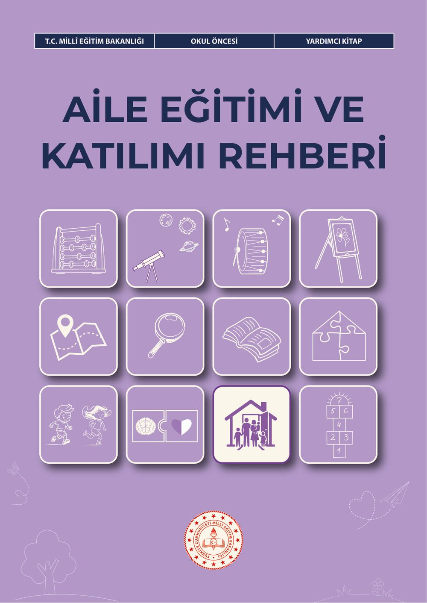
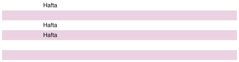
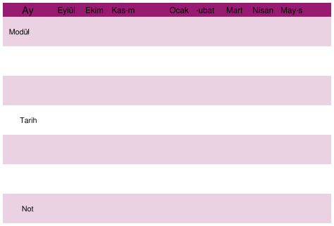
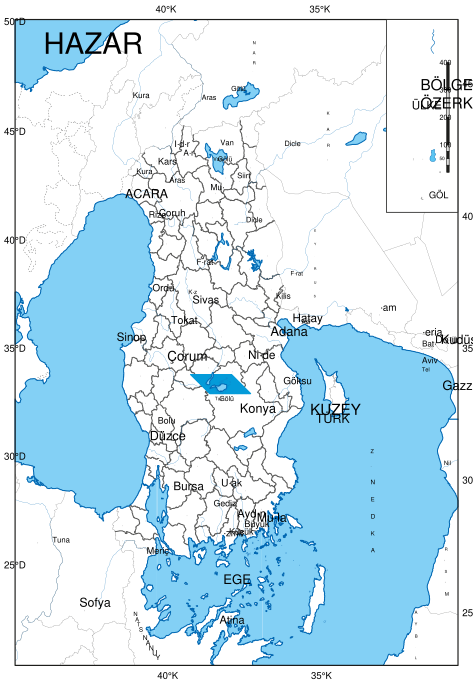
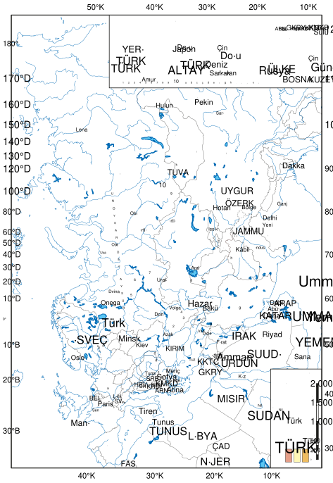

# Okul Öncesi Aile Eğitimi Ve Katılımı Rehberi Yardımcı Kitap

<!-- sayfa 0 -->

T.C. MİLLÎ EĞİTİM BAKANLIĞI
OKUL ÖNCESİ
YARDIMCI KİTAP

# AİLE EĞİTİMİ VE KATILIMI REHBERİ

<!-- sayfa 1 -->

# Aile Eğitimi ve Katılımı Rehberi

## Yazarlar
BÜŞRA NUR DURAN YILMAZ
DİLAY YURTTAŞ
HALİDE BENGÜ GÖNCÜ
HÜLYA KARA

<!-- sayfa 2 -->

Verdiğiniz metin katmanı boş olduğu için (`<<< >>>` arası boş) dönüştürülecek bir içerik bulunmamaktadır. Lütfen metin katmanını içeren içeriği paylaşın, böylece talimatlarınıza uygun şekilde Markdown formatına çevirebilirim.

<!-- sayfa 3 -->

Millî Eğitim Bakanlığı Yayınları No ........................................................................................................... 11241
Yardımcı ve Kaynak Kitaplar Dizisi No .................................................................................................... 4048

Her hakkı saklıdır ve Millî Eğitim Bakanlığına aittir. Kitabın metin, soru ve şekilleri kısmen de olsa hiçbir surette alınıp yayımlanamaz.

**Editör**
Prof. Dr. Kazım BİBER
Doç.Dr.Ezgi AKŞİN YAVUZ
Doç.Dr.Hilal İlknur TUNÇELİ
Doç. Dr. Mehmet Nur TUĞLUK

**Dil Uzmanı**
Özlem ALDEMİR

**Görsel Tasarımcı**
Metin BİLAL

**Çoklu Ortam Tasarımcısı**
Betül SÜREK
Didem EROL
İlkay CAN
Kübra KARAKUŞ

**Program Geliştirme Uzmanı**
Dr. Emine SELMANOĞLU

**Ölçme ve Değerlendirme Uzmanı**
Merve ERELİ

**Rehberlik Uzmanı**
Emine SAYAN

ISBN
978-625-8867-35-0

Millî Eğitim Bakanlığı Talim ve Terbiye Kurulu Başkanlığının 16 102026 tarih ve 172475677 sayılı yazısı ile yardımcı

<!-- sayfa 4 -->

# İSTİKLÂL MARŞI

Korkma, sönmez bu şafaklarda yüzen al sancak;
Sönmeden yurdumun üstünde tüten en son ocak.
O benim milletimin yıldızıdır, parlayacak;
O benimdir, o benim milletimindir ancak.

Çatma, kurban olayım, çehreni ey nazlı hilâl!
Kahraman ırkıma bir gül! Ne bu şiddet, bu celâl?
Sana olmaz dökülen kanlarımız sonra helâl.
Hakkıdır Hakk'a tapan milletimin istiklâl.

Mehmet Âkif Ersoy

<!-- sayfa 5 -->

ANDIMIZ

Türküm, doğruyum, çalışkanım.

İlkem küçüklerimi korumak, büyüklerimi saymak; yurdumu, milletimi özümden çok sevmektir.
Ülküm yükselmek, ileri gitmektir.

Ey Büyük Atatürk!

Açtığın yolda, gösterdiğin hedefe durmadan yürüyeceğime ant içerim.

Varlığım Türk varlığına armağan olsun.

Ne mutlu Türküm diyene!

<!-- sayfa 6 -->

MUSTAFA KEMAL ATATÜRK

<!-- yer tutucu bulunamadı: sayfa sonuna eklendi -->

<!-- sayfa 7 -->

Verdiğiniz metin katmanı boş olduğu için (`<<< >>>` arası boş) dönüştürülecek bir içerik bulunmamaktadır. Lütfen metin katmanını içeren içeriği paylaşın, böylece talimatlarınıza uygun şekilde Markdown formatına çevirebilirim.

<!-- sayfa 8 -->

# İÇİNDEKİLER

| | |
| :--- | :---: |
| **AİLE EĞİTİMİ VE KATILIMI REHBERİ** | **8** |
| GİRİŞ | 9 |
| **AİLE EĞİTİMİ SÜRECİNİN PLANLANMASI VE YÜRÜTÜLMESİ** | **13** |
| **AİLE EĞİTİMİNDE KULLANILABİLECEK YÖNTEM VE TEKNİKLER** | **17** |
| **AİLENİN OKULA İLK DAVETİ, İLK BULUŞMA, İHTİYAÇ BELİRLEME VE KATILIM TERCİHLERİNİN ALINMASI** | **22** |
| **AİLE VE TOPLUM KATILIMI** | **24** |
| TOPLUM KATILIMI | 44 |
| **AİLE EĞİTİMİ MODÜLLERİNE İLİŞKİN YAPI VE UYGULAMA ÇERÇEVESİ** | **49** |
| **AİLE EĞİTİMİ MODÜLLERİ** | **54** |
| &nbsp;&nbsp;&nbsp;&nbsp;1. Modül: Okula Mutlu Başlangıç | 54 |
| &nbsp;&nbsp;&nbsp;&nbsp;2. Modül: Akran Nezaketi | 58 |
| &nbsp;&nbsp;&nbsp;&nbsp;3. Modül: Çocukla Güçlü İletişim | 62 |
| &nbsp;&nbsp;&nbsp;&nbsp;4. Modül: Duyguları Anlama ve Destekleme | 66 |
| &nbsp;&nbsp;&nbsp;&nbsp;5. Modül: Duygusal Farkındalık ve Destekleyici Ebeveynlik | 70 |
| &nbsp;&nbsp;&nbsp;&nbsp;6. Modül: Oyunla Etkileşim ve Birlikte Zaman | 74 |
| &nbsp;&nbsp;&nbsp;&nbsp;7. Modül: Günlük Yaşamda Sorumluluk Kazandırma | 78 |
| &nbsp;&nbsp;&nbsp;&nbsp;8. Modül: Yeterli ve Dengeli Beslenme Alışkanlığı | 84 |
| &nbsp;&nbsp;&nbsp;&nbsp;9. Modül: Evde Öğrenmeyi Destekleme | 88 |
| &nbsp;&nbsp;&nbsp;&nbsp;10. Modül: Dijital Denge ve Ekran Kullanımı | 94 |
| &nbsp;&nbsp;&nbsp;&nbsp;11. Modül: Akran Zorbalığını Fark Etme ve Önleme | 100 |
| &nbsp;&nbsp;&nbsp;&nbsp;12. Modül: Aile–Okul İş Birliği | 106 |
| 1. EK: Aile Eğitimi İhtiyaç Belirleme Formu | 113 |
| 2. EK: Aile Eğitimi Yıllık Plan Çizelgesi | 116 |
| 3. EK: Aile Eğitimi Oturum Planı | 117 |
| 4. EK: Aile Eğitimi Oturumu Veli Değerlendirme Formu | 119 |
| 5. EK: Aile Katılımı Takip Çizelgesi | 120 |
| 6. EK: Aile Katılımı Tercih Formu | 121 |
| 7. EK: Çocuk ve Aile Tanıma Formu | 124 |
| 8. EK: Veli Toplantısı Davetiye Örneği | 128 |
| 9. EK: Ev Ziyareti Formu | 129 |
| 10. EK: Beceri Edinim Raporu Örneği | 131 |
| 11. EK: Haber Mektubu Örneği | 133 |
| 12. EK: Yazışma Örneği | 134 |
| 13. EK: Konferans Davetiye Örneği | 135 |
| 14. EK: Proje Mektubu Örneği | 136 |
| 15. EK: Bülten Örneği | 137 |
| 16. EK: Portfolyo Paylaşım Günü Davetiye Örneği | 137 |
| 17. EK: Modül Şablonu | 138 |
| KAYNAKÇA | 139 |
| GÖRSEL VE GENEL AĞ KAYNAKÇASI | 139 |

<!-- sayfa 9 -->

# AİLE EĞİTİMİ VE KATILIMI REHBERİ

Değerli Eğitimciler,

Erken çocukluk dönemi; çocuğun gelişim, öğrenme ve kişilik oluşumu açısından kritik bir dönemdir. Bu dönemde çocuk, yalnızca kendisine sunulan bilgileri alan pasif bir birey değil çevresiyle etkileşim içinde öğrenen, çevresini deneyimleyen, anlamlandıran ve gelişimini aktif biçimde sürdüren bir özne olarak karşımıza çıkar. Çocuğun bu doğal gelişim sürecinin desteklenebilmesi, onun bireysel özelliklerine saygı duyulması, gelişimsel gereksinimlerinin fark edilmesi ve bu gereksinimlere uygun nitelikli öğrenme ortamlarının oluşturulması ile mümkündür.

Çocuklar çevrelerinden bağımsız düşünülemez ve içinde bulundukları ilişkiler ağı ile şekillenirler. Bu ilişkiler ağının merkezinde de aile yer alır. Aile ortamında kurulan güven ilişkisi çocuğun dünyayı algılayış biçimini, tüm gelişimini ve öğrenmeye yönelik tutumlarını doğrudan etkiler. Okul öncesi eğitim sürecine geçişle bu etkileşim ağı genişler; okul, öğretmen ve toplum çocuğun gelişim sürecine aktif olarak dâhil olur. Bu nedenle çocuğun gelişimini desteklemek yalnızca okulda yürütülen çalışmalarla sınırlı kalmamalı; ev ve okul arasında kurulan güçlü, tutarlı ve sürdürülebilir bir iş birliği ile anlamlı hâle getirilmelidir.

Türkiye Yüzyılı Maarif Modeli Okul Öncesi Eğitim Programı, eğitimi yalnızca okul içi etkinliklerle sınırlı görmeyen; çocuğun aile, çevre ve günlük yaşam deneyimlerini de öğrenme sürecinin ayrılmaz bir parçası olarak ele alan bütüncül bir anlayışa dayanmaktadır. Bu anlayış doğrultusunda aile eğitimi ve aile katılımı çalışmaları, çocuğun okulda kazandığı bilgi, beceri, eğilim ve değerlerin yaşamla bütünleşmesini sağlayan temel bir eğitim alanı olarak değerlendirilmektedir. Ailelerin sürece bilinçli ve etkin katılımı, öğrenmenin kalıcılığını artırırken çocuk için tutarlı ve destekleyici bir gelişim ortamı oluşturur.

Çocuklar doğaları gereği her şeyi merak eden, araştıran, sorgulayan, düşünen ve üreten yapıdadırlar. Bu yapının potansiyelini en üst düzeyde kullanılabilmesi için de çocuğun çevresinde ailesi başta olmak üzere tüm yetişkinlerin bilinçli, duyarlı ve iş birliğine açık bir yaklaşım benimsemesi gerekmektedir. Bu noktada aile, okul ve toplumun birlikte hareket etmesi; çocuğun gelişimsel ihtiyaçlarının karşılanması ve yüksek yararının gözetilmesi açısından büyük önem taşımaktadır. Rehberde de ifade edildiği gibi aile eğitimi süreci yalnızca bilgi aktarımı değil öğretmen ile aile arasında kurulan planlı, amaçlı ve değerlendirilebilir bir iş birliği sürecidir .

Elinizde bulunan Aile Eğitimi ve Katılımı Rehberi, okul öncesi eğitim kurumlarında görev yapan öğretmenlerin aile eğitimi ve katılımı çalışmalarını planlı, sistematik, kapsayıcı ve uygulamaya dönük biçimde yürütebilmelerine destek olmak amacıyla hazırlanmıştır. Rehber, aile eğitimi ve aile katılımı sürecini planlama, uygulama, izleme ve değerlendirme boyutlarıyla ele almakta; öğretmene yalnızca kuramsal bir çerçeve sunmakla kalmayıp aynı zamanda sahada doğrudan kullanılabilecek somut uygulama örnekleri ve araçlar da sağlamaktadır. Bu yönüyle rehber, aile eğitimi ve katılımı çalışmalarını eğitim öğretim sürecinin doğal ve vazgeçilmez bir parçası hâline getirmeyi hedeflemektedir.

Bu rehberin çocukların gelişim yolculuğunda aileleri güçlendiren, öğretmenlerin mesleki uygulamalarını destekleyen ve okul–aile iş birliğini daha nitelikli bir düzeye taşıyan bir kaynak olması temennisiyle...

<!-- sayfa 10 -->

# GİRİŞ

Erken çocukluk dönemi çocuğun gelişiminin en hızlı ve en belirleyici olduğu dönemlerden biridir. Bu dönemde sunulan eğitim hizmetlerinin niteliği, yalnızca okulda gerçekleştirilen öğrenme yaşantılarına değil aynı zamanda aile ortamında sağlanan destekleyici yaşantılara da bağlıdır. Çocuğun gelişimsel gereksinimlerinin bütüncül biçimde karşılanabilmesi okul ile aile arasında tutarlı, planlı ve sürdürülebilir bir iş birliğinin kurulmasını gerekli kılmaktadır.

Türkiye Yüzyılı Maarif Modeli, eğitimi yalnızca okul içi etkinliklerle sınırlı görmeyen çocuğun aile, çevre ve günlük yaşam deneyimlerini de öğrenme sürecinin bir parçası olarak ele alan bütüncül bir yaklaşım sunmaktadır. Bu yaklaşım doğrultusunda okul öncesi eğitim sürecinde aile katılımı ve aile eğitimi, çocuğun öğrenme deneyimlerinin sürekliliğini sağlayan temel bileşenler arasında yer almaktadır. Çocuğun okulda kazandığı bilgi, beceri, eğilim ve değerlerin ev ortamında desteklenmesi öğrenmenin kalıcılığını, işlevselliğini ve günlük yaşama aktarılmasını güçlendirmektedir.

Bu çerçevede aile eğitimi, yalnızca ailelere bilgi aktarmayı amaçlayan bir çalışma alanı değil öğretmenin ailelerle iş birliği içinde yürüttüğü planlı, amaçlı ve değerlendirilebilir bir eğitim sürecidir. Aile eğitimi çalışmaları aracılığıyla öğretmen ailelerin çocuk gelişimi, öğrenme süreçleri, iletişim, olumlu ebeveynlik, sınır koyma, oyun, duygusal gelişim ve günlük yaşam gibi konularda farkındalık ve becerilerini geliştirmelerine rehberlik eder. Böylece aileler, çocuklarının gelişim süreçlerini daha bilinçli biçimde desteklerken öğretmen de okul ve aile iş birliğini planlı bir yapıya kavuşturur.

Çocuklar; saygı, sorumluluk, yardımlaşma, dürüstlük ve empati gibi temel değerleri aile ortamında gözlemleyerek, deneyimleyerek ve model alarak kazanırlar. Bu nedenle aile katılımı etkinlikleri değerlerin yalnızca sözel olarak aktarılmasına dayanmamalı, çocukların bu değerleri günlük yaşam içinde içselleştirmelerine ve davranışa dönüştürmelerine olanak sağlayacak yaşantılar sunmalıdır.

Bu rehber, okul öncesi eğitim kurumlarında görev yapan öğretmenlerin aile eğitimi çalışmalarını planlamaları, uygulamaları, izlemeleri ve değerlendirmeleri amacıyla hazırlanmıştır. Rehberde aile eğitimi süreci öğretmenin uygulayıcı rolü esas alınarak yapılandırılmış; içerikte amaçlar, temel ilkeler, uygulama basamakları, modüller, örnek etkinlikler ve izleme-değerlendirme araçlarına yer verilmiştir. Bu yönüyle rehber, öğretmene yalnızca kuramsal bir çerçeve sunmayı değil aynı zamanda eğitim öğretim yılı boyunca sahada kullanabileceği somut bir uygulama kılavuzu sağlamayı hedeflemektedir.

Rehberin temel yaklaşımı aile eğitimi çalışmalarının gelişigüzel ve tek seferlik bilgilendirmeler şeklinde değil ihtiyaç analiziyle başlayan, yıllık planla yapılandırılan, etkileşimli uygulamalarla sürdürülen ve değerlendirme araçlarıyla izlenen bir süreç olarak ele alınmasıdır. Böylece aile eğitimi çalışmalarıyla öğretmen mesleki planlamanın doğal bir parçası hâline gelmekte; çocukların gelişimini destekleyen okul-aile bütünlüğü daha da güçlü biçimde kurulabilmektedir.

## Rehberin Amacı

Bu rehberin temel amacı, okul öncesi öğretmenlerinin aile eğitimi çalışmalarını planlı, sistematik, kapsayıcı ve uygulamaya dönük biçimde yürütebilmelerine destek olmaktır. Bu genel amaç doğrultusunda rehberin öğretmenlere aşağıdaki konularda yol göstermesi hedeflenmektedir:

* aile eğitimi çalışmalarını çocukların gelişim özellikleri ve aile gereksinimleri doğrultusunda planlamak,
* okul ile aile iş birliğini güçlendirecek eğitim süreçleri oluşturmak,
* ailelerin çocuk gelişimi ve ebeveynlik süreçlerine ilişkin bilgi ve farkındalıklarını artırmaya yönelik içerikler sunmak,
* ailelerin çocukların öğrenme, iletişim, davranış düzenleme ve duygusal gelişim süreçlerini destekleyebilmelerine rehberlik etmek,
* aile eğitimi çalışmalarını uygulama, izleme ve değerlendirme araçlarıyla daha işlevsel hâle getirmek,
* öğretmenin ailelerle etkili, güvene dayalı ve sürdürülebilir iletişim kurmasını desteklemektir.

<!-- sayfa 11 -->

planlanacağı, nasıl yürütüleceği ve nasıl değerlendirileceği konusunda da yol gösteren bir uygulama çerçevesi sunmaktadır.

## Rehberin Kapsamı

Bu rehber okul öncesi eğitim kurumlarında görev yapan öğretmenlerin eğitim öğretim yılı boyunca yürütecekleri aile eğitimi çalışmalarını kapsamaktadır. Rehberde aile eğitimi süreci amaç, ilke, planlama, uygulama, izleme ve değerlendirme boyutlarıyla ele alınmıştır. Ayrıca öğretmenlerin kullanabileceği modül örnekleri, oturum yapıları, ev temelli etkinlik önerileri ve form örnekleri de rehber kapsamında sunulmuştur.

Rehberin amacı, ailelerle yürütülecek tüm çalışmaları tek tip bir yapıya indirgemekten ziyade öğretmene kendi sınıfının, çocuk grubunun ve aile profilinin özelliklerine göre uyarlayabileceği esnek bir uygulama zemini sağlamaktır. Bu nedenle rehberde yer alan içerikler farklı sosyoekonomik, kültürel ve gelişimsel özelliklere sahip aile gruplarına göre uyarlanabilecek biçimde düşünülmelidir.

## Rehberin Kullanımı

Bu rehber, öğretmen tarafından eğitim öğretim yılı başında yapılacak ihtiyaç analizi sonuçları doğrultusunda kullanılmalıdır. Öğretmen; rehberde yer alan modülleri sınıfının ve aile grubunun gereksinimlerine göre seçebilir, sıralayabilir, uyarlayabilir ve yıllık aile eğitimi planına yerleştirebilir. Uygulama sürecinde rehber; öğretmene içerik planlama, oturum yürütme, aile katılımını artırma, ev temelli destek etkinlikleri oluşturma ve süreci değerlendirme konularında yol gösterici olarak kullanılmalıdır.

## Rehberin Dayanakları

Türkiye Yüzyılı Maarif Modeli Aile Eğitimi ve Katılımı Rehberi’nin hazırlanmasında modelin bütüncül eğitim anlayışı, okul öncesi eğitimin temel ilkeleri ve erken çocukluk döneminde okul ile aile iş birliğini esas alan çağdaş eğitim yaklaşımları temel alınmıştır.

Erken çocukluk döneminde çocuğun gelişimi yalnızca okulda sunulan yaşantılarla değil ev ortamında sürdürülen etkileşimler, ebeveyn tutumları, günlük rutinler ve aile içi iletişim örüntüleri ile de şekillenmektedir. Bu nedenle aile eğitimi çalışmaları, öğretmenin görev alanı dışında kalan bir destek hizmeti değil çocuğun gelişimini destekleyen eğitim sürecinin tamamlayıcı bir boyutu olarak değerlendirilmelidir. Öğretmen, aile eğitimi uygulamaları yoluyla ailelerin çocuk gelişimine ilişkin farkındalıklarını desteklerken aynı zamanda okulda hedeflenen kazanımların ev yaşantılarıyla tutarlılık içinde sürdürülmesine katkı sağlar.

Türkiye Yüzyılı Maarif Modeli’nde çocuğun öğrenme süreci bilgi, beceri, eğilim ve değer boyutlarıyla birlikte ele alınmaktadır. Bu anlayış doğrultusunda aile eğitimi çalışmaları da yalnızca bilgilendirme temelli değil ailelerin çocukla iletişim kurma, öğrenmeyi destekleme, sınır koyma, duygusal gelişimi destekleme, oyun yoluyla öğrenmeye katkı sağlama ve günlük yaşam becerilerini güçlendirme gibi uygulamaya dönük yeterliklerini destekleyen bir yapı içinde planlanmalıdır. Bu rehber öğretmenin ailelerle yürüteceği eğitim çalışmalarını bu bütüncül çerçeve içerisinde yapılandırmasına yardımcı olmayı amaçlamaktadır.

Rehber aynı zamanda okul öncesi eğitimde kapsayıcılık, bireysel farklılıklara duyarlılık, kültürel çeşitliliğe saygı, erişilebilirlik ve sürdürülebilir okul ve aile iletişimi ilkelerini esas almaktadır. Her ailenin yaşam koşulları, çocuk yetiştirme deneyimi, iletişim biçimi ve destek ihtiyacı farklı olabileceğinden öğretmenin aile eğitimi çalışmalarını tek tip bir içerik olarak değil ihtiyaçlara göre uyarlanabilen esnek bir uygulama alanı olarak ele alması önemlidir. Bu nedenle rehber, öğretmene hazır ve değişmez bir uygulama listesi sunmaktan ziyade farklı aile profillerine göre uyarlanabilecek yapılandırılmış bir yol haritası sunmaktadır.

## Rehberin Temel İlkeleri

Bu rehber doğrultusunda yürütülecek aile eğitimi çalışmalarında öğretmenin aşağıdaki temel ilkeleri dikkate alması beklenmektedir.

**1. Çocuk Merkezlilik**

Aile eğitimi çalışmaları doğrudan çocukların gelişimsel gereksinimlerini destekleme amacı taşımalıdır

<!-- sayfa 12 -->

gelişimsel özelliklerini, sınıf içi ihtiyaçlarını ve desteklenmesi gereken yönleri dikkate almalıdır. Böylece aile eğitimi süreci soyut ebeveynlik önerileri sunan genel bir yapıdan çıkıp çocuk odaklı bir eğitim desteğine dönüşür.

**2. Planlılık ve Süreç Odaklılık**
Aile eğitimi çalışmaları tek seferlik seminerler ya da dönemsel bilgilendirmeler biçiminde değil ihtiyaç analiziyle başlayan, yıllık plana yerleştirilen, düzenli uygulamalarla sürdürülen ve değerlendirme ile tamamlanan bir süreç olarak ele alınmalıdır. Öğretmen, aile eğitimini eğitim öğretim sürecinin doğal bir parçası olarak planlamalı; oturumları belirlenmiş amaçlar doğrultusunda yürütmelidir.

**3. Uygulanabilirlik**
Rehberde yer alan içeriklerin ailelerin günlük yaşamında karşılık bulabilmesi için öğretmen, uygulama örneklerini yaşamla ilişkilendirmeli ve ailelerin ev ortamında sürdürebileceği gerçekçi öneriler geliştirmelidir. Aşırı idealize edilmiş ya da ailelerin yaşam koşullarına uymayan yönlendirmeler yerine uygulanabilir ve izlenebilir içerikler tercih edilmelidir.

**4. Katılımcılık ve Etkileşim**
Aile eğitimi süreci öğretmenin yalnızca bilgi aktardığı tek yönlü bir yapı olarak kurgulanmamalıdır. Öğretmen ailelerin görüşlerini, deneyimlerini, sorularını ve ihtiyaçlarını sürece dâhil etmeli; oturumları etkileşimli yöntemlerle yürütmelidir. Tartışma, örnek olay, küçük grup paylaşımı, deneyim aktarımı ve ev uygulamaları gibi yöntemler ailelerin sürece aktif katılımını destekler.

**5. İhtiyaca Uygunluk**
Her sınıfın ve her aile grubunun ihtiyaçları farklıdır. Bu nedenle öğretmen, rehberde yer alan modülleri bire bir ve değişmeden uygulamak yerine sınıfının, okul çevresinin ve aile profillerinin özelliklerine göre uyarlamalıdır. İçerik seçimi ailelerden alınan geri bildirimler, çocuk gözlemleri ve öğretmenin değerlendirmeleri doğrultusunda yapılmalıdır.

**6. Kapsayıcılık ve Erişilebilirlik**
Öğretmen aile eğitimi çalışmalarını planlarken tüm ailelerin katılımına olanak sağlayacak esnek çözümler geliştirmelidir. Çalışma saatleri, ailelerin eğitim düzeyi, dili kullanma becerisi, dijital erişim imkânları, özel gereksinimli çocukların varlığı ve farklı aile yapıları dikkate alınmalıdır. Kullanılan dil açık, yargılayıcı olmayan ve anlaşılır olmalıdır.

**7. Güvene Dayalı İletişim**
Aile eğitimi çalışmalarının etkili olabilmesi için öğretmen ile aile arasında güvene dayalı bir iletişim ortamının kurulması gerekir. Öğretmen, aileleri değerlendiren ya da yetersizliklerini öne çıkaran bir tutum yerine destekleyici, saygılı ve iş birliğine açık bir iletişim yaklaşımı benimsemelidir. Aile eğitimi süreci, ailelere neyi yanlış yaptıklarını gösteren değil onları çocuklarının gelişimini destekleme konusunda güçlendiren bir yapıya sahip olmalıdır.

**8. Gizlilik ve Etik Duyarlılık**
Aile eğitimi sürecinde paylaşılan kişisel bilgiler, aile içi yaşantılar ve çocuklara ilişkin bireysel durumlar etik ilkelere uygun biçimde ele alınmalıdır. Öğretmen oturumlarda ailelerin özel yaşamlarını açığa çıkaracak baskılayıcı uygulamalardan kaçınmalı; gönüllülük, mahremiyet ve mesleki etik ilkelerine uygun hareket etmelidir.

**9. İzleme ve Değerlendirme**
Aile eğitimi çalışmalarının etkililiği yalnızca oturumun tamamlanmış olmasıyla değil aile katılımı, geri bildirimler, ev uygulamaları ve çocuk üzerindeki dolaylı yansımalarla değerlendirilmelidir. Öğretmen süreç sonunda katılım durumu, aile görüşleri ve uygulama çıktıları doğrultusunda değerlendirme yapmalı; sonraki planlamalarını bu verilere dayalı olarak geliştirmelidir.

**10. Okul ve Ev Sürekliliği**
Aile eğitimi çalışmalarının temel amaçlarından biri okulda desteklenen gelişim alanlarının ev yaşantısında da

<!-- sayfa 13 -->

karşılık bulmasını sağlamaktır. Bu nedenle öğretmen, aile eğitimini sınıf içi öğrenmelerden kopuk bir etkinlik olarak değil çocukların günlük yaşamını, ev ortamını ve okul deneyimini birbirine bağlayan bir süreklilik alanı olarak ele almalıdır.

## Öğretmen İçin Rehberin İşlevi

Bu rehber, öğretmenin aile eğitimi sürecini yalnızca içerik sunumu olarak değil bir eğitim planlama ve uygulama alanı olarak görmesini desteklemek amacıyla hazırlanmıştır. Rehberin öğretmen açısından temel işlevi; aile eğitimi çalışmalarını sistematik biçimde planlamak, uygulama sürecini yapılandırmak, aile katılımını artırmak, süreci kayıt altına almak ve değerlendirme sonuçlarına göre yeniden düzenlemektir.

Rehber, öğretmene şu alanlarda destek sunar:

* Aile gereksinimlerini belirler.
* Eğitim öğretim yılına yayılmış aile eğitimi planı oluşturur.
* Uygun modül ve içerik seçme ve oluşturma konusunda rehberlik eder.
* Oturumların yapılandırılmış biçimde yürütülmesini destekler.
* Ailelere evde sürdürülebilir uygulamalar önerir.
* Katılımı ve etkiyi izler.
* Süreci değerlendirir ve geliştirir.

Bu yönüyle rehber, öğretmenin ailelerle yürüttüğü çalışmaları daha görünür, planlı, sürdürülebilir ve profesyonel bir yapıya kavuşturan bir uygulama aracıdır.

## Aile Eğitimi ve Önemi

Aile eğitimi, erken çocukluk döneminde çocuğun gelişim ve öğrenme sürecinin ev ortamında da desteklenmesini sağlayan temel eğitim bileşenlerinden biridir. Bu dönemde çocuğun kazandığı bilgi, beceri, tutum ve değerlerin kalıcı hâle gelmesi okulda sunulan öğrenme yaşantıları ile aile ortamındaki günlük deneyimlerin birbirini tamamlamasına bağlıdır.

Türkiye Yüzyılı Maarif Modeli’nin bütüncül eğitim anlayışı açısından aile, çocuğun gelişimini destekleyen en temel paydaşlardan biridir. Çocuğun sosyal-duygusal gelişimi, iletişim becerileri, sorumluluk alma davranışları, öz bakım becerileri, değerleri içselleştirmesi ve öğrenmeye yönelik olumlu tutum geliştirmesi aile ortamında sürdürülen yaşantılarla yakından ilişkilidir. Bu nedenle aile eğitimi çalışmaları ailelerin çocuklarını daha bilinçli, duyarlı, tutarlı ve gelişimsel olarak uygun biçimde desteklemelerine katkı sağlar.

## Aile Eğitiminin Amaçları

Aile eğitimi çalışmalarının temel amacı ailelerin çocuklarının gelişim ve öğrenme süreçlerini daha bilinçli, duyarlı ve tutarlı biçimde desteklemelerine rehberlik etmektir. Bu genel amaç doğrultusunda aile eğitimi çalışmaları şu amaçlara hizmet eder:

* çocuğun yüksek yararını temel alan, güvene dayalı, düzenli ve sürdürülebilir bir okul-aile-toplum iş birliği oluşturmak ve güçlendirmek,
* çocuğun okulda kazandığı bilgi, beceri, tutum ve değerlerin ev ortamında desteklenmesini sağlamak,
* ailelerin erken çocukluk döneminin gelişimsel özellikleri hakkında farkındalık kazanmalarına katkı sunmak,
* ailelerin çocuklarıyla etkili iletişim kurmalarını, olumlu ebeveynlik becerilerini geliştirmelerini, çocuklarının duygularını anlamalarını, çocuklarına uygun sınırlar koymalarını desteklemek,
* çocuğun oyun, öğrenme, öz bakım, sorumluluk alma ve sosyal-duygusal gelişim süreçlerinde aile desteğini güçlendirmek,
* ev ortamında çocuğun gelişimini destekleyen nitelikli, güvenli ve zengin öğrenme yaşantıları oluşturulmasına rehberlik etmek,
* farklı aile yapılarını, sosyoekonomik koşulları ve kültürel özellikleri dikkate alarak kapsayıcı bir aile eğitimi

<!-- sayfa 14 -->

Bu amaçlar doğrultusunda aile eğitimi çalışmaları, öğretmenin yalnızca bilgi sunduğu tek yönlü etkinlikler olarak değil ailelerin deneyimlerini, ihtiyaçlarını ve günlük yaşam koşullarını dikkate alan etkileşimli bir süreç olarak yürütülmelidir.

# AİLE EĞİTİMİ SÜRECİNİN PLANLANMASI VE YÜRÜTÜLMESİ

Aile eğitimi çalışmaları, okul öncesi eğitim sürecinde yalnızca destekleyici bir unsur olarak değil çocuğun gelişimini okul ve ev arasında bütünlük içinde destekleyen temel bir uygulama alanı olarak ele alınmalıdır. Bu nedenle öğretmenin aile eğitimi sürecini rastlantısal bilgilendirmeler biçiminde değil planlı ve amaçlı bir eğitim çalışması olarak ele alması gerekir. Etkili bir aile eğitimi süreci; ihtiyaçların belirlenmesi, amaçların netleştirilmesi, uygun içeriklerin seçilmesi, uygulamanın yapılandırılması, katılımın desteklenmesi ve sürecin değerlendirilmesi aşamalarından oluşur.

Bu bölümde aile eğitimi çalışmalarının öğretmen tarafından nasıl planlanacağı, hangi ilkelere göre yürütüleceği ve uygulama sürecinin nasıl yapılandırılacağı açıklanmaktadır.

## Aile Eğitimi Sürecinin Planlanması

Aile eğitimi çalışmalarının etkili olabilmesi için öğretmenin öncelikle süreci bir yıllık eğitim planının doğal bir parçası olarak ele alması gerekir. Aile eğitimi, yalnızca ihtiyaç ortaya çıktığında yapılan bir bilgilendirme toplantısı olarak değil öğretim yılı boyunca sistemli biçimde yürütülen bir destek süreci olarak planlanmalıdır.

Planlama sürecinde öğretmen
* çocuk grubunun gelişimsel özelliklerini,
* sınıfta gözlenen ortak ihtiyaçları,
* ailelerin bilgi ve destek gereksinimlerini,
* okulun bulunduğu çevresel ve sosyokültürel koşulları,
* kurumun yıllık eğitim akışını birlikte değerlendirmelidir.

Bu doğrultuda hazırlanan aile eğitimi planı, öğretmenin eğitim sürecini daha amaçlı yürütmesini sağlarken aileler açısından ise süreklilik ve güven duygusu oluşturur.

## İhtiyaç Analizi

Aile eğitimi sürecinin ilk basamağı ihtiyaç analizidir. Öğretmen, ailelerle hangi konularda çalışacağına yalnızca genel varsayımlara dayanarak değil elde ettiği veriler doğrultusunda karar vermelidir. Her sınıfın aile profili, çocukların gelişimsel ihtiyaçları ve ev ortamına ilişkin destek alanları farklılık gösterebilir.

İhtiyaç analizi sürecinde öğretmen aşağıdaki kaynaklardan yararlanabilir
* eğitim yılı başında uygulanan aile ihtiyaç belirleme formları,
* bireysel veli görüşmeleri,
* çocuk gözlemleri,
* sınıf içi davranış ve gelişim göstergeleri,
* ailelerden gelen sorular ve tekrar eden ihtiyaç alanları,
* önceki uygulama deneyimleri öğretmenin değerlendirmesine katkı sağlayabilir.

Bu süreçte öğretmenin amacı aileleri değerlendirmek ya da sınıflandırmak değil aile eğitiminde önceliklendirilecek konuları belirlemektir. Örneğin öğretmen, ailelerin büyük bölümünün çocukla iletişim, sınır koyma, ekran kullanımı, oyun, uyku düzeni, duygusal gelişim ya da okul uyumu konularında desteğe ihtiyaç duyduğunu belirleyebilir. Bu durumda yıllık plan, bu ihtiyaç alanlarını karşılayacak biçimde düzenlenmelidir. Bu süreçte ailelerin öncelikli destek alanlarını, katılım koşullarını ve aile eğitimi sürecinden beklentilerini sistemli biçimde belirlemek amacıyla 1. EK Aile Eğitimi İhtiyaç Belirleme Formu kullanılabilir.

### Amaçların Belirlenmesi

İhtiyaç analizi tamamlandıktan sonra öğretmen aile eğitimi çalışmalarının amaçlarını belirlemelidir Amaçlar

<!-- sayfa 15 -->

Amaç belirlerken öğretmen şu sorulara yanıt aramalıdır:
* Bu eğitim çalışması sonunda ailelerin hangi konuda farkındalık geliştirmesi beklenmektedir?
* Ailelerin hangi bilgi ya da becerileri desteklenecektir?
* Bu içeriğin çocukların gelişimine olası katkısı nedir?
* Oturum sonunda ailelerin günlük yaşamda uygulayabileceği somut kazanımlar neler olacaktır?

Örneğin “aileleri bilinçlendirmek” genel ve zayıf bir amaçtır. Buna karşılık “ailelerin çocukla olumlu iletişim kurmada kullanılabilecek temel stratejileri fark etmelerini ve günlük yaşamda uygulayabilmelerini desteklemek” daha açık ve işlevsel bir amaçtır.

## İçerik ve Modül Seçimi

Öğretmen, ihtiyaç analizi sonuçlarına göre rehberde yer alan modüllerden uygun olanları seçmeli ve bunları yıllık akış içine yerleştirmelidir. Modül seçimi yapılırken yalnızca popüler ebeveynlik konularına değil sınıfın ve aile grubunun gerçek ihtiyaçlarına öncelik verilmelidir.

İçerik seçimi yapılırken şu ölçütler
* çocukların yaş ve gelişim düzeyi,
* sınıfta gözlenen ortak ihtiyaçlar,
* ailelerin en sık dile getirdiği konular,
* Yıl içindeki geçiş dönemleri ve kritik süreçler dikkate alınmalıdır.

Örneğin eğitim yılının başında okul uyumu, iletişim ve rutinler; yılın ilerleyen dönemlerinde duygu düzenleme, oyun, sınır koyma ve öğrenme desteği gibi modüller öne çıkarılabilir. Bu nedenle modüller yalnızca içerik başlıkları olarak değil yıl içine yayılmış bir gelişim desteği olarak planlanmalıdır.

## Yıllık ve Dönemlik Planlama

Aile eğitimi çalışmaları için yıllık ya da dönemlik bir plan hazırlanması, öğretmenin süreci sistemli biçimde yürütmesini kolaylaştırır. Bu plan içinde her oturumun tarihi, konusu, amacı, yöntemi, süresi, materyalleri ve değerlendirme biçimi yer almalıdır.

Plan hazırlanırken öğretmen
* Her ay ya da belirli aralıklarla bir tema belirleyebilir.
* Bazı oturumları yüz yüze, bazılarını çevrim içi ya da ev temelli destek çalışması olarak düzenleyebilir.
* Okulun takvimine, özel günlere ve yoğunluk dönemlerine göre zamanlama yapabilir.

Aile eğitimi planı hazırlanırken aşırı yoğun ve ailelerin katılımını zorlaştıracak bir yapıdan kaçınılmalıdır. Az sayıda ama nitelikli, sürdürülebilir ve ihtiyaç odaklı oturumlar daha işlevsel sonuç verir. Bu nedenle önemli olan çok sayıda etkinlik yapmak değil düzenli ve etkili bir süreç oluşturmaktır. Öğretmen, eğitim öğretim yılı boyunca uygulanacak aile eğitimi çalışmalarını ay, modül, hedeflenen kazanım, uygulama türü, tarih, sorumlu kişi ve değerlendirme aracı bakımından düzenlemek için 2. EK Aile Eğitimi Yıllık Plan Çizelgesi’nden yararlanabilir.

## Uygulama Biçiminin Belirlenmesi

Öğretmen aile eğitimi çalışmalarını tek bir yöntemle yürütmek zorunda değildir. İçeriğin niteliğine, ailelerin koşullarına ve okulun imkânlarına göre farklı uygulama biçimleri kullanılabilir. Bunlar arasında
* grup oturumları,
* küçük grup çalışmaları,
* bireysel görüşmeler,
* atölye uygulamaları,
* örnek olay tartışmaları,
* ev temelli etkinlik yönlendirmeleri,

<!-- sayfa 16 -->

Uygulama biçiminin belirlenmesinde önemli olan seçilen yöntemin oturumun amacına uygun olmasıdır. Örneğin bilgi aktarımı gereken bir konuda kısa sunum ve tartışma yeterli olabilirken iletişim, oyun ya da sınır koyma gibi konularda örnek durumlar, rol canlandırmalar ve uygulama örnekleri daha etkili olabilir.

## Oturumların Yapılandırılması

Aile eğitimi oturumlarının verimli geçebilmesi için öğretmenin her oturumu belirli bir yapı içinde planlaması önerilir. Her aile eğitimi oturumu amaç, yöntem, materyal, uygulama süreci, ev uygulaması ve değerlendirme boyutlarıyla önceden yapılandırılmalı; bu amaçla 3. EK Aile Eğitimi Oturum Planı’ndan yararlanılmalıdır.

Bir aile eğitimi oturumu genel olarak aşağıdaki aşamalardan oluşabilir.

1. **Uygulama Öncesi Hazırlık**
Öğretmen oturum öncesinde modülün amacını, içeriğini ve süresini, kullanılacak materyalleri, yöntemleri ve teknikleri netleştirir. Aile grubunun özelliklerini önceki oturumdan gelen geri bildirimleri ve ele alınacak konunun hassasiyet düzeyini göz önünde bulundurur. Konuya ve aile grubunun özelliklerine uygun bir dil kullanır ve örnekler seçer. Gerek gördüğünde önceki oturumun kısa bir hatırlatmasını da bu aşamada planlar.

2. **Açılış ve Dikkat Toplama**
Oturumun başında konu kısa, sade ve anlaşılır biçimde ailelere sunulur. Ailelerin ilgisini toplamak ve onları sürece dâhil etmek amacıyla kısa bir soru, günlük yaşamdan bir örnek, küçük bir ısınma etkinliği ya da düşündürücü bir durumla giriş yapılabilir. Bu bölüm ailelerin konuya kendi yaşantıları üzerinden bağ kurmasını kolaylaştırır.

3. **Sürecin Yapılandırılması ve İçeriğin Sunulması**
Oturumun temel konusu öğretmen tarafından açık, uygulamaya dönük ve anlaşılır biçimde ele alınır. Bu bölümde kavramsal açıklamalar uzun teorik anlatımlara dönüştürülmeden günlük yaşam örnekleri, kısa açıklamalar ve somut önerilerle desteklenir. İçeriğin aileler için erişilebilir, sade ve kullanılabilir olması önemlidir.

4. **Etkileşim ve Katılım**
Oturumun bu aşamasında ailelerin görüşlerini paylaşabilecekleri, kendi deneyimlerini ilişkilendirebilecekleri ve soru sorabilecekleri bir ortam oluşturulur. Örnek durum incelemeleri, kısa grup paylaşımları, soru-cevap ya da küçük uygulamalar yoluyla aile katılımı desteklenir. Böylece oturum yalnızca bilgi aktaran bir yapı olmaktan çıkar, karşılıklı öğrenmeyi destekleyen bir sürece dönüşür.

5. **Günlük Yaşama Aktarma**
Aile eğitimi oturumlarının en önemli boyutlarından biri ele alınan konuların ev yaşamına taşınabilmesidir. Bu nedenle öğretmen oturum sonunda ailelere günlük yaşamda uygulanabilecek anlaşılır, somut ve sürdürülebilir öneriler sunar. Modüllerde yer alan “Ailemle Dolu Dolu Zaman” bölümü, ailelerin oturumda ele alınan konuyu ev ortamında çocuklarıyla uygulayabilmeleri için hazırlanmış kısa ve günlük yaşama uygun etkinlik önerilerinden oluşmaktadır. Bu bölüm, aile eğitiminin yalnızca toplantı sırasında kalmamasını, ev yaşantısına taşınmasını ve okul-ev sürekliliğinin güçlenmesini amaçlamaktadır.

6. **Kapanış ve Değerlendirme**
Oturum sonunda ele alınan temel mesajlar kısa biçimde özetlenir. Ailelerden bir ya da iki kısa değerlendirme sorusu ile geri bildirim alınabilir. Öğretmen de kendi gözlemine dayalı kısa bir değerlendirme yaparak oturumun katılım düzeyini, işlevselliğini ve sonraki çalışmalara yansıyacak noktaları not edebilir. Gerektiğinde bir sonraki oturum hakkında kısa bilgi verilebilir. Gerekli durumlarda ailelerden yapılandırılmış geri bildirim almak için 4. EK Aile Eğitimi Oturumu Veli Değerlendirme Formu uygulanabilir.

## Öğretmenin Uygulama Sırasındaki Rolü

Aile eğitimi sürecinde öğretmenin rolü yalnızca bilgi aktarıcı olmakla sınırlı değildir. Öğretmen aynı zamanda kolaylaştırıcı, rehberlik edici, ilişki kurucu ve süreç yöneticisi bir roldedir. Bu nedenle oturumlarda kullanılan dil,

<!-- sayfa 17 -->

Öğretmen uygulama sırasında şu hususlara dikkat etmelidir:
* Yargılayıcı olmayan, samimi bir dil kullanmalıdır.
* Aileleri suçlayıcı ya da eksiklik odaklı ifadelerden kaçınmalıdır.
* Ailelerin deneyimlerine saygı göstermelidir.
* Farklı aile yapılarını ve yaşam koşullarını dikkate almalıdır.
* Konuyu teorik düzeyde bırakmadan günlük yaşamla ilişkilendirmelidir.
* Ailelerin sürece katılımını desteklemelidir.

Aile eğitimi sürecinin etkili olabilmesi için öğretmenin “uzman kişi” konumunda kalması yeterli değildir. Öğretmen ailelerle iş birliği kuran ve onları güçlendiren yol gösterici ve destekleyici bir yaklaşım benimsemesi gereklidir.

### Katılımın Desteklenmesi

Aile eğitimi çalışmalarının niteliği kadar ailelerin bu çalışmalara erişimi ve katılımı da önemlidir. Katılım düşüklüğü çoğu zaman ilgisizlikten değil zaman yetersizliği, çalışma koşulları, çekingenlik, önceki olumsuz deneyimler ya da iletişim eksikliği gibi nedenlerden kaynaklanabilir. Bu nedenle öğretmen katılımı yalnızca duyuru yapmakla değil bilinçli bir planlama ile desteklemelidir.

Katılımı artırmak için öğretmen
* Oturum saatlerini ailelerin erişebileceği biçimde planlamalıdır.
* Duyuruları açık ve zamanında yapmalıdır.
* İçeriklerin aileler için anlamlı ve günlük yaşamla ilişkili olmasına dikkat etmelidir.
* Gerektiğinde esnek ve alternatif katılım yolları sunmalıdır.
* Ailelerin görüşlerinin önemsendiğini hissettirmelidir.

Katılımı artırmanın en etkili yollarından biri aile eğitimini okulun resmî bir zorunluluğu gibi değil ailelerin günlük yaşamına gerçek katkı sunan bir destek süreci, ortaklık olarak yapılandırmaktır. Ailelerin yıl boyunca aile eğitimi ve aile katılımı çalışmalarına hangi düzeyde ve hangi yollarla katıldığını izlemek amacıyla 5. EK Aile Katılımı Takip Çizelgesi kullanılabilir.

### Sürecin İzlenmesi ve Değerlendirilmesi

Aile eğitimi sürecinin tamamlanması yalnızca oturumun yapılmış olması anlamına gelmez. Öğretmenin sürecin nasıl ilerlediğini izlemesi ve sonuçlarını değerlendirmesi gerekir. Bu değerlendirme aile eğitim çalışmalarının niteliğini geliştirmek açısından zorunludur.

İzleme ve değerlendirme sürecinde öğretmen şu sorulara yanıt arayabilir:
* Planlanan oturumlar uygulanabildi mi?
* Aile katılımı beklenen düzeyde gerçekleşti mi?
* Aileler hangi içerikleri daha yararlı buldu?
* Hangi konular daha fazla destek gerektiriyor?
* Ev uygulamalarına ilişkin geri bildirimler neler oldu?
* Bir sonraki planlamada hangi değişikliklere ihtiyaç var?

Bu amaçla katılım çizelgeleri, oturum değerlendirme formları, kısa geri bildirim soruları, öğretmen gözlem notları ve bireysel görüşmelerden yararlanılabilir. Değerlendirme sonuçları sonraki modüllerin içeriğini ve uygulama biçimini geliştirmede kullanılmalıdır.

Aile eğitimi sürecinin başarılı biçimde yürütülebilmesi, öğretmenin bu süreci planlı, esnek, ihtiyaç odaklı ve değerlendirilebilir bir yapı içinde ele almasına bağlıdır. Etkili bir planlama, aile eğitimi çalışmalarını okuldan bağımsız ek etkinlikler olmaktan çıkarır ve onları çocuğun gelişimini destekleyen bütüncül eğitim sürecinin işlevsel bir parçası hâline getirir. Bu nedenle öğretmen aile eğitimi uygulamalarını yalnızca içerik sunma

<!-- sayfa 18 -->

bir eğitim alanı olarak değerlendirmelidir. Bu süreçte oturum sonunda ailelerin görüşlerini, memnuniyet düzeylerini ve içeriklerin günlük yaşama aktarılabilirliğini değerlendirmek için EK 4. Aile Eğitimi Oturumu Veli Değerlendirme Formu kullanılabilir. Katılımın sürekliliğini, ailelerin etkinliklere erişimini ve uygulama sürecine dâhil olma düzeylerini izlemek için ise EK 5. Aile Katılımı Takip Çizelgesi’nden yararlanılabilir.

# AİLE EĞİTİMİNDE KULLANILABİLECEK YÖNTEM VE TEKNİKLER

Aile eğitiminde yöntem ve teknikler, ailelerin bilgi edinmesinin yanı sıra çocuklarını daha iyi tanımasını, onlarla daha nitelikli etkileşim kurmasını, günlük yaşam içinde uygulanabilir beceriler geliştirmesini ve aile içi ilişkileri güçlendirmesini sağlayacak biçimde planlanmalıdır. Bu nedenle aile eğitiminde tercih edilecek yöntemler; aileyi pasif dinleyici konumuna yerleştiren değil sürece katan, düşündüren, uygulatan, geri bildirim sunan ve ev ortamına aktarımı destekleyen bir nitelik taşımalıdır. Rehberde de vurgulandığı üzere aile eğitimi, ailelerin ihtiyaçlarını merkeze alan, aktif katılımı önemseyen, bilgi-beceri-tutum gelişimini destekleyen ve farklı yöntemlerle zenginleştirilmiş bir öğrenme süreci olarak ele alınmalıdır.

Türkiye Yüzyılı Maarif Modeli yaklaşımı açısından aile eğitiminde yöntem seçimi; çocuğun yüksek yararını gözeten, aileyi eğitim sürecinin doğal ve güçlü bir paydaşı olarak kabul eden, iş birliğini, sorumluluk paylaşımını, kapsayıcılığı, rehberliği ve günlük yaşamla bağlantıyı esas alan bir anlayışa dayanmalıdır. Bu çerçevede aile eğitiminde kullanılan yöntemler; ailelerin çocuklarının gelişim sinyallerini fark etmelerine, duyarlı ve tutarlı tepkiler vermelerine, oyun, iletişim ve günlük rutinler yoluyla öğrenmeyi desteklemelerine yardımcı olmalıdır.

## Anlatım ve Etkileşimli Bilgilendirme

Anlatım yöntemi aile eğitiminde temel kavramları, amaçları ve ana mesajları kısa sürede paylaşmak için kullanılabilecek temel yöntemlerden biridir. Ancak aile eğitiminde anlatımın uzun ve tek yönlü bir sunuma dönüşmesi ailelerin dikkatinin dağılmasına ve katılımın azalmasına yol açabilir. Bu nedenle anlatım yöntemi rehberde belirtildiği gibi kısa tutulmalı, yalnızca giriş niteliğinde kullanılmalı ve görsel, örnek, soru ve kısa uygulamalarla desteklenmelidir.

Bu yöntemin daha etkili kullanılabilmesi için anlatımın “etkileşimli bilgilendirme” biçiminde yapılandırılması önemlidir. Böyle bir uygulamada öğretmen, örneğin “çocukla etkili iletişim”, “duygu düzenleme”, “oyunun gelişimdeki rolü” ya da “sınır koymada tutarlılık” gibi bir konuda kısa ve açık bir çerçeve sunar. Daha sonra ailelerin kendi deneyimlerini, gözlemlerini ve sorularını sürece dâhil eder. Aile-okul iletişiminin düzenli, açık ve anlamlı biçimde kurulmasının çocukların gelişimini evde destekleme kapasitesiyle ilişkili olduğu belirtilmektedir. Bu nedenle anlatımın sade, anlaşılır, yargılamayan ve aile yaşamıyla doğrudan ilişki kuran bir biçimde sunulması önem taşır.

## Soru-Cevap ve Yansıtıcı Diyalog

Soru-cevap yöntemi ailelerin eğitim sürecine etkin biçimde katılımını sağlayan temel yöntemlerden biridir. Rehberde de açık uçlu soruların ailelerin düşüncelerini ortaya çıkarmaya ve gizli kalmış görüşlerin görünür olmasına yardımcı olduğu vurgulanmaktadır. Bu nedenle aile eğitiminde “evet-hayır” yanıtı gerektiren kapalı uçlu sorular yerine; “Sizce bu durumda çocuğunuz ne hissediyor olabilir?”, “Bu davranışın altında ne olabilir?”, “Bu durumda başka nasıl yaklaşabilirsiniz?” gibi düşünmeyi destekleyen sorulara yer verilmelidir.

Bu yöntem aile eğitiminde yalnızca bilgi yoklamaya değil ebeveyn farkındalığını artırmaya hizmet eden bir diyalog biçimine dönüşmelidir. Yansıtıcı diyalog yaklaşımı ailelerin kendi tutumlarını, tepkilerini ve etkileşim biçimlerini fark etmelerini destekler. Özellikle küçük çocuklarla kurulan karşılıklı ve duyarlı etkileşimin çocukların zihinsel gelişimi, dil gelişimi ve sosyal becerileri açısından temel olduğu; yetişkinin çocuğun işaretlerini fark edip uygun yanıt vermesinin gelişimi desteklediği belirtilmektedir. Bu nedenle aile eğitiminde soru-cevap tekniği çocuk davranışını yalnızca kontrol etmeye değil anlamaya ve ilişkiyi güçlendirmeye yönelmelidir.

## Tartışma ve Deneyim Paylaşımı

Tartışma yöntemi ailelerin aynı konuya farklı açılardan bakabilmesini, ortak sorun alanlarını görmesini ve

<!-- sayfa 19 -->

sınır koyma, ekran kullanımı, oyun, kardeş ilişkileri, okula uyum, duygusal gelişim ve davranış yönetimi gibi başlıklarda etkili biçimde kullanılabilir. 

Tartışma yönteminin daha güçlü bir biçimi yapılandırılmış deneyim paylaşımıdır. Ailelerin güvenli ve saygılı bir ortamda yaşadıkları güçlükleri anlatmaları, benzer deneyimler üzerinden birbirlerini desteklemeleri ve çözüm yollarını birlikte üretmeleri yalnızlık duygusunu azaltır ve ailelerin kendilerini daha yeterli hissetmelerine katkı sağlar. Ebeveyn desteğinin çok boyutlu olması, yalnızca bilgi sunmakla sınırlı kalmaması ve sosyal destek hissini de güçlendirmesi gerektiği vurgulanmaktadır. Bu nedenle tartışma oturumlarında öğretmenin kolaylaştırıcı rol üstlenmesi yargılamadan, etiketlemeden ve aileleri karşılaştırmadan süreci yönetmesi gerekir. 

### Örnek Olay İncelemesi

Örnek olay yöntemi, aile eğitiminde gerçek yaşam durumlarının anlaşılmasını ve alternatif yaklaşımların değerlendirilmesini kolaylaştıran etkili bir yöntemdir. Rehberde de örnek olayın ebeveynlere sunularak onların duygu ve düşüncelerini ifade etmelerine, ardından çözüm önerileri üretmelerine imkân tanıdığı ifade edilmektedir. Bu yönüyle örnek olay yöntemi ailelerin kendi yaşantılarını dolaylı biçimde değerlendirmelerine yardımcı olur. 

Aile eğitiminde kullanılacak örnek olaylar gündelik yaşamdan, ailelerin sık karşılaştığı durumlardan seçilmelidir. Örneğin markette ağlayan bir çocuk, sabah hazırlanmak istemeyen bir çocuk, oyuncak paylaşımında zorlanan iki kardeş, sürekli ekrana yönelen bir çocuk ya da öfkelendiğinde vurma davranışı gösteren bir çocuk üzerinden örnek olay çalışmaları yapılabilir. Çocuğun gelişimini destekleyen ebeveyn müdahalelerinde yapılandırılmış, beceri temelli ve günlük yaşama aktarılabilir içerikler önemlidir.

### Problem Çözme Temelli Çalışmalar

Problem çözme yöntemi, aile eğitiminde yalnızca bilgi edinmeyi değil gerçek yaşam sorunlarına uygulanabilir çözümler geliştirmeyi hedefleyen temel yöntemlerden biridir. Rehberde bu yöntem, karşılaşılan bir problem durumuna ilişkin görüşlerin alınması ve bu görüşler doğrultusunda çözüm yollarının geliştirilmesi olarak tanımlanmaktadır. Bu yöntem ailelerin zorlayıcı durumları tanımlamalarına, nedenleri düşünmelerine, alternatifleri değerlendirmelerine ve uygulanabilir adımlar belirlemelerine yardımcı olur. 

Aile eğitiminde problem çözme çalışmaları özellikle yoğun ekran kullanımı, uyku düzeni, yemek seçiciliği, kardeş çatışması, öfke nöbetleri, kurallara uyum, sorumluluk kazandırma ve okul geçişleri gibi başlıklarda etkili biçimde kullanılabilir. Burada önemli olan öğretmenin tek taraflı çözüm sunması değil ailelerin kendi koşullarına uygun seçenekleri değerlendirerek özgün yollar geliştirmesini sağlamaktır. Ailelere küçük, uygulanabilir ve izlenebilir adımlar önermek sürecin daha sürdürülebilir olmasını sağlar. 

### Gösterip Yaptırma ve Model Olma

Gösterip yaptırma yöntemi aile eğitiminde bilgi ile uygulama arasındaki bağı kuran en güçlü yöntemlerden biridir. Rehberde bu yöntemde öğretmenin ailelere bir durumda nasıl davranmaları gerektiği konusunda model olduğu; ardından ailelerin bu beceriyi öğretmen eşliğinde ve daha sonra bağımsız biçimde uyguladığı belirtilmektedir. Bu yönüyle yöntem teorik bilgiyi günlük davranışa dönüştürme açısından son derece işlevseldir. 

Bu yöntem özellikle çocukla konuşma biçimi, duygu adlandırma, alternatif sunma, göz teması kurma, etkin dinleme, oyun başlatma, sırayla oynama, olumlu sınır koyma ve sakinleştirme stratejileri gibi becerilerde kullanılabilir. Öğretmen önce uygun davranışı kısa ve anlaşılır biçimde gösterir, sonra ailelerin denemesine fırsat verir, ardından geri bildirim sunar. Bu nedenle beceri modelleme, aile eğitiminin en işlevsel uygulama araçlarından biri olarak değerlendirilmelidir. 

### Rol Oynama ve Canlandırma

Rol oynama tekniği ailelerin zorlayıcı etkileşim durumlarını güvenli bir öğrenme ortamında prova etmelerine imkân verir. Bu teknik, özellikle “çocuklar zorlayıcı davranışlar gösterdiğinde”, “sınır ihlali olduğunda”, “öfke kontrol edilemez hâle geldiğinde”, “okula gitmek istemediğinde” veya “oyun bitiminde zorlandığında” nasıl

<!-- sayfa 20 -->

Rol oynama yalnızca “ne söyleneceğini” öğretmez; ses tonu, beden dili, sabır, bekleme süresi, göz teması ve çocuğun duygusunu kabul etme gibi ayrıntıların da fark edilmesini sağlar. Özellikle küçük çocuklarla iletişimde duyarlı, karşılıklı ve güven verici etkileşimin gelişim üzerindeki etkisi dikkate alındığında rol oynama, ailelerin iletişim becerisini görünür ve geliştirilebilir hâle getirir.

## Gözlem ve Yapılandırılmış Geri Bildirim

Aile eğitiminde yalnızca içerik sunmak değil ailelerin uygulamalarını izlemek ve onlara destekleyici geri bildirim vermek de önemlidir. Gözlem ve yapılandırılmış geri bildirim yöntemi, ailelerin çocuklarıyla etkileşimlerini daha bilinçli biçimde değerlendirmelerine yardımcı olur. Bu yöntem sınıf içindeki bir ortak etkinlikte, aile katılımı çalışmasında, evde yapılan bir uygulamanın sözlü paylaşımında ya da kısa bir süreç gözlemi üzerinden gerçekleştirilebilir.

Bu süreçte öğretmenin yaklaşımı son derece önemlidir. Geri bildirim, aileyi yetersiz göstermek için değil güçlü yönlerini görünür kılmak ve gelişim alanlarını somutlaştırmak için verilmelidir. Destekleyici ve güçlendirici ebeveyn desteğinin ebeveynlerin çocuklarına sundukları bakım kalitesini ve çocukların gelişimini olumlu etkilediği vurgulanmaktadır. Bu nedenle geri bildirim; açık, saygılı, somut, yargılamayan ve küçük gelişim adımlarını destekleyen bir yapıda olmalıdır.

## Video ile Geri Bildirim

Aile eğitiminde kullanılabilecek etkili tekniklerden biri de video ile geri bildirimdir. Bu teknikte aile-çocuk etkileşimine ilişkin kısa bir kesit kaydedilir. Daha sonra aile ile izlenerek durumun güçlü yönleri ve geliştirilebilecek noktaları üzerinde konuşulur. Bu teknik, özellikle çocuğun verdiği sinyalleri fark etme, bekleme, yanıt verme, oyunu sürdürme, çocuğun girişimlerini destekleme ve iletişimi zenginleştirme gibi konularda yararlı olabilir.

Uygulamadaki temel ilke görüntüleri eleştiri amacıyla değil farkındalık geliştirmek amacıyla kullanmaktır. Gizlilik, gönüllülük, etik sınırlar ve verilerin korunması mutlaka gözetilmelidir. Dijital araçların ebeveyn desteğinde etkili biçimde kullanılabilmesi için güven ilişkisini ve insan etkileşimini destekleyen bir çerçeve içinde yer alması gerektiği vurgulanmaktadır. Bu nedenle video ile geri bildirim ölçülü, amaçlı ve rehberlik odaklı biçimde kullanıldığında güçlü bir öğrenme aracı hâline gelir.

## Ebeveyn Koçluğu ve Bireyselleştirilmiş Rehberlik

Aile eğitiminde her ailenin gereksinimlerinin, hazır oluş düzeylerinin ve aile dinamiklerinin farklı olabileceği dikkate alınmalıdır. Bu nedenle ailelerin ihtiyaçları merkeze alınmalı ve her ailenin kendine özgü olduğu kabul edilmelidir. Bu anlayış doğrultusunda ebeveyn koçluğu ailelere tek tip öneri sunmak yerine onların mevcut güçlü yönlerini fark etmelerine, gerçekçi hedefler belirlemelerine ve küçük adımlarla ilerlemelerine destek olan etkili bir yöntemdir.

Yöntemde öğretmen ya da uygulayıcı aileyle bir hedef belirler, mevcut durumu konuşur, uygulanabilir bir adım planlar, bir sonraki buluşmada süreci gözden geçirir ve yeni hedefler üzerinde çalışır. Örneğin “çocuk konuşurken sözünü kesmeden dinleme”, “günde 30 dakika ortak oyun zamanı oluşturma”, “öfkeli anda bağırmadan sınır koyma” ya da “duygu adlandırma alışkanlığı geliştirme” gibi küçük ama etkili hedefler seçilebilir. Çocuğun gelişiminde duyarlı bakım verme, karşılıklı etkileşim ve destekleyici yetişkin davranışlarının belirleyici olduğu göz önünde bulundurulduğunda koçluk yaklaşımı aileleri güçlendiren ve sürdürülebilir değişimi destekleyen bir araç olarak işlev görür.

## Oyun Temelli Uygulamalar

Erken çocukluk döneminde aile eğitiminde en etkili yöntemlerden biri oyun temelli uygulamalardır. Çünkü oyun küçük çocuklar için yalnızca eğlenme aracı değil öğrenme, ilişki kurma, duyguları ifade etme, dili kullanma, problem çözme ve sosyal becerileri geliştirme alanıdır. Çocukların öğrenme ve gelişimlerinin desteklenmesinde konuşma, şarkı söyleme, birlikte oyun oynama ve karşılıklı etkileşim gibi yaşantıların belirleyici olduğu açıkça belirtilmektedir.

<!-- sayfa 21 -->

beceriler kazandırmak için kullanılabilir. Böylece aileler oyunun gelişimsel değerini daha iyi fark eder ve çocuğun öğrenmesini ev ortamında desteklemeye başlar. Bu yöntem Türkiye Yüzyılı Maarif Modeli’nin çocuk merkezli, yaşantı temelli, doğal öğrenme ortamlarını önemseyen yaklaşımıyla da uyumludur.

### Küçük Grup Çalışmaları ve Akran Öğrenmesi

Küçük grup çalışmaları ailelerin daha rahat konuşmasını, deneyimlerini daha derinlikli paylaşmasını ve birbirlerinden öğrenmesini kolaylaştırır. Özellikle benzer yaş grubundaki çocukların aileleriyle yapılan küçük grup oturumları ortak sorun alanlarının görünür olmasına yardımcı olur. Bu yöntem yeni başlayan aileler, okula uyum sürecindeki aileler, sınır koyma konusunda zorlanan aileler ya da dijital medya kullanımına ilişkin destek arayan aileler için işlevsel olabilir.

Akran öğrenmesini destekleyen bu yapı ailelerin birbirlerini güçlendirmesine de katkı sağlar. Aile desteği sosyal destek, erişilebilir hizmetler ve rehberlik boyutlarını da içermelidir. Bu nedenle küçük grup çalışmaları aile eğitiminde topluluk duygusunu güçlendiren, paylaşımı artıran ve kapsayıcılığı destekleyen bir yöntem olarak değerlendirilebilir.

### Ev Temelli Uygulama Görevleri

Aile eğitiminde öğrenmenin kalıcı olabilmesi için oturumlarda ele alınan konuların ev yaşamına taşınması gerekir. Bu nedenle ailelere evde deneyebilecekleri küçük, açık ve uygulanabilir görevler verilmesi önemlidir. Bu görevler karmaşık değil günlük yaşamın doğal akışı içinde uygulanabilir nitelikte olmalıdır. Örneğin “Bu hafta çocuğunuzun bir duygusunu her gün adlandırınız.”, “Günde 30 dakika telefonsuz birlikte oyun oynayınız.”, “Emir cümlesi yerine açıklayıcı cümle kullanmayı deneyiniz.” ya da “Yatmadan önce kısa bir sohbet rutini oluşturunuz.” gibi görevler verilebilir.

Bu yöntem aile eğitimini yalnızca toplantı anına sıkıştırmaz, evde sürdürülen bir gelişim sürecine dönüştürür. Ailelerin çocuk gelişimini evde desteklemelerine yönelik somut önerilerin aile katılımını ve çocukların öğrenme deneyimlerini güçlendirdiği belirtilmektedir. Bu nedenle ev uygulaması görevleri aile eğitiminde sürekliliği sağlayan temel tekniklerden biri olarak kullanılmalıdır.

### Ev Ziyareti ve Doğal Ortamda Rehberlik

Ev ziyareti, aileyi kendi doğal yaşam ortamı içinde tanımaya ve aileye bulunduğu bağlam içinde destek sunmaya imkân veren güçlü bir yöntemdir. Rehberde ev merkezli yaklaşımın uygulanabildiği belirtilmekte; aile, okul ve toplum iş birliğinin çocuk yararı açısından önemli olduğu vurgulanmaktadır. Ev ziyareti bu bağın daha derinlikli biçimde kurulmasına katkı sağlar.

Bu yöntemde amaç aileyi denetlemek değil aileyi anlamak, ailenin güçlü yönlerini görmek, ihtiyaçlarını daha doğru belirlemek ve rehberliği gündelik yaşama yakınlaştırmaktır. Ev ortamında yapılan gözlem ve rehberlik çocuğun rutinlerini, aile içi etkileşimini, oyun alanlarını, iletişim biçimlerini ve destek ihtiyaçlarını daha gerçekçi biçimde görmeye yardımcı olur. Ebeveyn desteğinin çok kanallı ve erişilebilir biçimde sunulmasının ailelerin destek alma sürecini kolaylaştırdığı vurgulanmaktadır. Bu nedenle ev ziyareti gönüllülük, gizlilik, saygı ve güçlendirici yaklaşım ilkeleriyle yürütülmelidir.

### Dijital ve Harmanlanmış Uygulamalar

Aile eğitiminde dijital araçlar yüz yüze süreci destekleyen tamamlayıcı araçlar olarak kullanılabilir. Rehberde de dijital ve medya okuryazarlığına yer verilmekte, değişen koşullara bağlı olarak uzaktan aile eğitimi yaklaşımının kullanılabildiği belirtilmektedir. Bu durum aile eğitiminde esnek ve erişilebilir yöntemlerin önemini göstermektedir.

Dijital ve harmanlanmış uygulamalar kapsamında kısa bilgilendirme videoları, ses kayıtları, çevrim içi mini buluşmalar, mesaj yoluyla hatırlatmalar, dijital broşürler, kısa ev uygulama yönergeleri ve takip mesajları kullanılabilir. Ancak dijital araçlar yüz yüze ilişkinin yerine geçmemeli; onu desteklemelidir. Aile desteğinde en etkili yaklaşımların erişilebilir hizmetleri insani temas ve rehberlikle birleştiren modeller olduğu

<!-- sayfa 22 -->

# Mikro Öğrenme ve Kısa Destek İçerikleri

Ailelerin zaman, dikkat ve günlük yaşam koşulları birbirinden farklıdır. Bu nedenle aile eğitiminde bazen uzun içerikler yerine kısa, odaklı ve tek beceriye yoğunlaşan destek içeriklerinin kullanılması daha etkili olabilir. Mikro öğrenme yaklaşımında tek bir konu çok kısa bir içerikle sunulur, ardından küçük bir ev uygulaması önerilir. Örneğin “çocuğu dinlerken göz teması kurma”, “duyguyu adlandırma”, “bekleme süresi tanıma”, “oyunda çocuğun liderliğini izleme” gibi tek becerilere odaklanılabilir.

Bu yöntem özellikle yoğun çalışan aileler, katılım süresi sınırlı olan ebeveynler ya da belirli bir konuda hızlı destek gereksinimi duyan aileler için işlevseldir. Küçük ama düzenli desteklerin ailelerin uygulama gücünü artırabildiği, ebeveyn desteğinde erişilebilirliğin ve sürekliliğin önemli olduğu vurgulanmaktadır. Bu nedenle mikro içerikler, aile eğitimini daha ulaşılabilir ve sürdürülebilir hâle getiren destekleyici bir teknik olarak değerlendirilebilir.

## Öz Değerlendirme ve Hedef Belirleme

Aile eğitiminde ailelerin yalnızca dinlemesi değil kendi ebeveynlik uygulamalarını fark etmesi ve değerlendirmesi de önemlidir. Bu nedenle öz değerlendirme formları, kısa kontrol listeleri, haftalık izleme çizelgeleri ve hedef belirleme çalışmaları etkili teknikler arasında yer alır. Ailelerden “Bu hafta çocuğumu daha çok dinleyebildim mi?”, “Ne zaman daha sakin kaldım?”, “Hangi durumda zorlandım?”, “Hangi yöntem işe yaradı?” gibi sorular üzerinden kendilerini değerlendirmeleri istenebilir.

Bu teknik, ailelerin kendi gelişimlerini izlemelerine, güçlü yönlerini fark etmelerine ve küçük ilerlemeleri görünür kılmalarına yardımcı olur. Rehberde de değerlendirme sürecine ailelerin aktif katılımının önemsendiği belirtilmektedir. Bu nedenle öz değerlendirme aile eğitiminde sorumluluk geliştiren, farkındalığı artıran ve süreci daha etkili kılan önemli bir tekniktir.

## Aile Eğitiminde Kullanılabilecek Destekleyici Teknikler

Aile eğitimlerinin gerçekleştirilmesinde yukarıda açıklanan yöntemlerin uygulanmasında aşağıdaki tekniklerden yararlanılabilir.

* açık uçlu soru sorma,
* beyin fırtınası,
* duygu kartları kullanma,
* durum kartları kullanma,
* kısa vaka çözümleme,
* rol oynama,
* eşli uygulama,
* model olma,
* oyun kurma,
* ev uygulaması planı hazırlama,
* izleme çizelgesi kullanma,
* hedef belirleme,
* aile öz değerlendirme formu kullanma,
* küçük grup paylaşımı,
* kısa video ya da sesli örnek çözümleme,
* günlük rutin planı hazırlama ve öğretmenden geri bildirim alma.

Bu teknikler tek başına değil oturumun amacı, hedef kitlenin özellikleri, konu başlığı ve uygulama bağlamı dikkate alınarak birlikte ve dengeli biçimde kullanılmalıdır.

Aile eğitiminde yöntem ve teknikler, aileye yalnızca bilgi aktaran araçlar olarak değil aileyi güçlendiren, çocukla ilişkiyi iyileştiren, ev–okul sürekliliğini kuran ve öğrenmeyi günlük yaşama taşıyan uygulama araçları olarak ele

<!-- sayfa 23 -->

soru sorma, örnek olay inceleme, beceri modelleme, oyun temelli uygulama, geri bildirim, evde deneme, izleme ve gerektiğinde dijital destek gibi birbirini tamamlayan yöntemlerin birlikte kullanıldığı bütüncül bir yapıdır. Böyle bir yapı, hem mevcut rehberin temel yaklaşımıyla uyumludur hem de ailelerin gerçek yaşam koşullarına, çocukların gelişim ihtiyaçlarına ve Türkiye Yüzyılı Maarif Modeli’nin aileyi güçlendiren eğitim anlayışına karşılık vermektedir.

# AİLENİN OKULA İLK DAVETİ, İLK BULUŞMA, İHTİYAÇ BELİRLEME VE KATILIM TERCİHLERİNİN ALINMASI

Okul öncesi eğitim sürecinde eğitim öğretim yılının başlangıcında ailelerle gerçekleştirilen ilk buluşma yalnızca tanışma amacı taşıyan rutin bir toplantı niteliğinde değildir. Bu süreç çocuk, aile ve okul arasında kurulacak sürdürülebilir iş birliğinin temellerinin atıldığı önemli bir aşamadır. Güven, karşılıklı anlayış, etkili iletişim ve ortak sorumluluk bilinci bu ilk etkileşimle birlikte gelişmeye başlamakta ve eğitim sürecinin niteliğini doğrudan etkileyen temel unsurlar arasında yer almaktadır.

Çocuk okula ilk kez adım atarken yalnızca yeni bir mekânla değil yeni ilişkiler, yeni beklentiler ve yeni bir sosyal çevreyle de karşılaşır. Bu geçiş sürecinde çocuğu en iyi tanıyan kişi ailesidir. Dolayısıyla güçlü bir başlangıç yapılabilmesi için yalnızca çocuğun değil ailenin de bu sürece hazırlanması gerekir. İlk davet ve buluşma, aile eğitimi çalışmalarının öncesinde tüm sürecin zeminini hazırlayan temel bir aşama olarak planlanmalıdır.

## İlk Davetin Niteliği

İlk davet okulun aileye verdiği ilk kurumsal mesajdır. Bu nedenle davetin içeriği ve dili büyük önem taşır. Yalnızca toplantı tarihini ve saatini bildiren resmî bir çağrı aileyi kendisini pasif bir dinleyici olarak konumlandırmaya iter. Oysa iyi planlanmış bir davet aileye eğitim sürecinde değerli bir ortak olduğunu gösterir.

Davet metni açık, anlaşılır ve kapsayıcı bir dilde hazırlanmalı; toplantının neden yapıldığını, aileden neler beklendiğini ve bu buluşmanın çocuk açısından neden önemli olduğunu kısaca açıklamalıdır. Davet yazılı davetiye, telefon, kısa mesaj veya okulun kullandığı dijital iletişim kanalları aracılığıyla yapılabilir. Önemli olan iletişim aracından çok o davetin taşıdığı yaklaşımın niteliğidir.

Davetin zamanlaması da belirleyicidir. Okul açılmadan önce yapılan bir davet aileye zihinsel olarak hazırlanma fırsatı tanır. Özellikle çocuğunu ilk kez okula gönderecek aileler için bu, kaygıyı azaltan ve güveni pekiştiren önemli bir adımdır.

## İlk Buluşmada Amaç Ne Olmalı?

İlk buluşmanın amacı yalnızca tanışmak değildir, asıl değeri aile ile okul arasında karşılıklı anlayış ve iş birliği zemini oluşturmasında yatar. Bu buluşmada beş temel amacın gözetilmesi önerilir. Bu amaçlar:

1. İlk buluşmada güven ilişkisi kurmak önemlidir. Aile çocuğunu emanet ettiği ortamı ve buradaki kişileri tanımak ister. Öğretmen de aileyle sıcak ve iş birliğine açık bir ilişki kurmak ister. Bu ilişkinin sağlıklı başlaması yılın geri kalanını doğrudan etkiler.
2. Çocuğu aileden dinlemek önemlidir. Ailenin çocuğa ilişkin gözlemleri, öğretmenin onu daha kısa sürede ve daha doğru biçimde tanımasını sağlar. Çocuğun ilgi alanları, oyun tercihleri, iletişim biçimi, duygusal tepkileri, günlük alışkanlıkları, sağlıkla ilgili özel durumlar ve ayrılma sürecindeki özellikleri hakkında bilgi alınabilir. Bu süreçte çocuk ve aile tanıma formu 7. EK kullanılabilir ancak formun ötesinde ailenin sözlü paylaşımları da en az form kadar kıymetlidir.
3. Ailenin ihtiyaçlarını belirlemek önemlidir. Aile eğitimi çalışmalarının gerçek gereksinimlere dayanması ancak bu başlangıçtaki doğru ihtiyaç belirlemeyle mümkündür. Her aile farklı alanlarda destek arayabilir. İletişim, davranış düzenleme, okula uyum, oyun ya da dijital medya kullanımı bunların başında gelebilir.
4. Katılım biçimlerini birlikte planlamak önemlidir. Her aile aynı şekilde katılım gösteremez. Zamanı, imkânı ve tercihleri birbirinden farklı olan ailelerin sürece nasıl dâhil olabileceği bu buluşmada birlikte konuşulmalıdır.
5. Son olarak okulun yaklaşımını aktarmak da önemlidir. Ailenin okulun yalnızca bakım sunan değil

<!-- sayfa 24 -->

# Buluşma Nasıl Yürütülmeli?

Toplantı ailelerin okul girişinde karşılanmasıyla başlamalı, kısa ve sıcak bir sohbetin ardından toplantı alanına geçilmelidir. Okulun ve sınıfın tanıtılması, günlük akışın ve temel rutinlerin paylaşılması süreci başlatabilir. Buluşma uzun bir sunuma dönüşmemelidir.

Toplantıda aileye söz hakkı tanınmalı, çocukları hakkındaki gözlemlerini, beklentilerini ve kaygılarını rahatça paylaşabilecekleri bir alan açılmalıdır. Aileyi tanıma süreci burada kritik bir rol oynar. Ailenin iletişim biçimi, okulla ilişki kurmaya dair beklentileri, çocuğa yaklaşımında öncelik verdiği noktalar ve katılım konusundaki tercihleri, sonraki tüm süreci şekillendirecektir. Amaç aileyi değerlendirmek değil onu anlayarak daha sağlıklı bir iş birliği kurmaktır.

İlk buluşma böyle yürütüldüğünde yalnızca bir başlangıç toplantısı olmaktan çıkar; güvene dayalı, katılımcı ve çocuk odaklı bir eğitim ortaklığının gerçek başlangıç noktasına dönüşür.

## İhtiyaç Belirleme Süreci

İlk buluşmanın temel yapı taşlarından biri ihtiyaç belirlemedir. Aile eğitimi çalışmalarının gerçekten işlevsel ve ailelerin yaşamına temas eden bir içeriğe sahip olabilmesi için ihtiyaçların baştan belirlenmesi gerekir. Rehberde yer alan 1. EK Aile Eğitimi İhtiyaç Belirleme Formu, bu süreci planlı yürütmek için kullanılabilecek temel araçlardan biridir.

İhtiyaç belirleme yalnızca form doldurma işlemi değildir. Formlar ailelerden ortak ve sistematik veri toplamak açısından yararlıdır fakat asıl ihtiyaçlar çoğu zaman ailelerin sözlü ifadelerinde, sordukları sorularda, dile getirdikleri kaygılarda ve paylaştıkları deneyimlerde görünür hâle gelir. Bu nedenle ilk toplantıda ihtiyaç belirleme hem yazılı araçlarla hem de yapılandırılmış sohbet ve paylaşım bölümleriyle desteklenmelidir.

Ailelerden iletişim, davranış yönetimi, sınır koyma, oyun, duygu gelişimi, kardeş ilişkileri, okul sürecine destek olma, dijital medya kullanımı, günlük rutinler, sağlıklı alışkanlıklar ve çocuğun gelişim alanları konusunda hangi başlıklarda daha fazla bilgi ya da desteğe ihtiyaç duydukları öğrenilebilir. Böylece rehberde yer alacak modüller ailenin gerçek ihtiyaçlarından beslenen bir yapıya kavuşur.

İhtiyaç belirleme sürecinin önemli bir boyutu da ailelerin güçlü yönlerini fark etmektir. Çünkü aile eğitimi yalnızca eksiklikleri gidermeye yönelik bir süreç değildir. Aynı zamanda ailede var olan olumlu etkileşimleri, koruyucu unsurları, güçlü iletişim alışkanlıklarını ve destekleyici ebeveynlik davranışlarını görünür kılmak da önemlidir. Böyle bir yaklaşım aileyi savunmaya geçirmez, aksine güçlendirilmiş hissetmesini sağlar.

## Katılım Tercihlerinin Alınması

İlk buluşmanın bir diğer önemli boyutu aile katılım tercihlerinin alınmasıdır. Rehberde yer alan 6. EK Aile Katılım Tercih Formu, ailelerin hangi yollarla sürece katılabileceklerini belirlemek açısından işlevsel bir araçtır.

Aile katılımı, okul öncesi eğitimde eğitim sürecinin önemli bir bileşenidir ancak bu katılımın tüm aileler için aynı biçimde gerçekleşmesi beklenmemelidir. Her ailenin yaşam düzeni, iş yoğunluğu, bakım sorumlulukları, zaman olanakları, ulaşım imkânı ve iletişim biçimi farklıdır. Bu nedenle ilk toplantıda ailelere tek bir katılım modeli sunmak yerine farklı katılım yolları üzerinde durulmalı ve ailelerin kendilerine uygun tercihleri belirtmeleri desteklenmelidir.

Bazı aileler yüz yüze toplantılara düzenli katılım sağlayabilir. Bazıları evde uygulanabilecek çalışmalara destek olmayı tercih edebilir. Bazıları sınıf içi etkinliklerde zaman zaman yer alırken bazıları materyal desteği, kısa katkılar ya da dijital iletişim yoluyla daha aktif olabilir. Bazı aileler bireysel görüşmeleri daha rahat bulurken bazıları grup buluşmalarında daha rahat hissedebilir. Bu nedenle katılım tercihi almak aileyi sınırlamak için değil aileye uygun yolları görünür kılmak için önemlidir.

Bu tercihler başlangıçta alındığında okul yıl boyunca daha gerçekçi ve kapsayıcı planlamalar yapabilir. Aynı zamanda aile de sürece nasıl katkı sunabileceğini düşünmeye başlar. Bu durum aileyi pasif bir izleyici olmaktan çıkarır ve ortak sorumluluk duygusunu güçlendirir. Katılım tercihlerinin alınması aileyi baskı altına alan değil aileye seçenek sunan bir anlayışla yürütülmelidir.

<!-- sayfa 25 -->

# İlk Buluşmanın Sonraki Modüllerle İlişkisi

İlk buluşma rehberin giriş kapısıdır ancak daha sonra hazırlanacak okula uyum modülü değildir. Bu kapıdan geçmeden aile eğitimi modüllerine başlamak, çoğu zaman ailenin gerçek gereksinimlerini yeterince dikkate almadan ilerlemek anlamına gelebilir. Okula uyum modülü belirli bir tema etrafında aileye yönelik yapılandırılmış bir içerik olacaktır. Buna karşılık ilk buluşma; o modüllerin hangi ihtiyaçlara göre şekilleneceğini belirleyen, aileyi tanıtan, aileyle ilişki kuran ve sürecin genel çerçevesini oluşturan ön hazırlık aşamasıdır. İyi planlanmış bir davet, nitelikli bir ilk buluşma, doğru bir ihtiyaç belirleme ve gerçekçi katılım tercihleri sonraki tüm modüllerin niteliğini artırır. Böylece okula uyum, iletişim, duygu gelişimi, oyun, sınır koyma ve diğer başlıklar daha sağlam bir zemin üzerinde yürütülebilir.

Okul öncesi eğitimde ailenin okula ilk daveti, ilk buluşması, ihtiyaç belirleme süreci ve katılım tercihlerinin alınması eğitim sürecinin en kritik başlangıç aşamalarından biridir. Bu nedenle ilk buluşma sıradan bir toplantı olarak değil sonraki tüm aile eğitimi çalışmalarının temelini oluşturan, aileyi sürece hazırlayan ve eğitim ortaklığını başlatan anlamlı bir başlangıç zemini olarak görülmelidir. Aile bu süreçte dışarıdan destek vermesi beklenen biri değil çocuğun gelişim yolculuğunda okulla yürüyen, katkısı kıymetli olan ve sesi duyulan bir paydaş olarak konumlandırılmalıdır. Böyle bir yaklaşım hem rehberin bütünlüğünü güçlendirir hem de ileride yer alacak modüllerin daha ihtiyaç temelli ve daha işlevsel biçimde yapılandırılmasına sağlam bir temel sunar.

# AİLE VE TOPLUM KATILIMI

Çocuklar kendilerine has özellikleriyle var olur ve çevresiyle etkileşim kurup yaşamı deneyimleyerek kendilerini inşa ederler. Çocukların özgün ve eşsiz özellikleriyle çıktıkları gelişim yolculuklarında ilk çevreleri aileleridir. Ailelerin sevgisi, sunduğu güven ortamı ve çevresel koşullar henüz anne rahminden itibaren çocuğun istendiği, sevildiği, korunduğu, değerli hissettiği bir ortamda olduğunu sezinlemesini sağlar. Çocuk dünyaya geldiği andan itibaren çekirdek ailesinden başlamak üzere geniş ailesine, komşularına ve yaşadığı şehre, topluma, kültüre doğru giderek genişleyen yapıda var olur. Bu ortamların ilk ve en değerlisi olan ailesinden başlamak üzere özellikle erken yıllarda iyileştirici, geliştirici gücü olan okullarda öğretmenleriyle, arkadaşlarıyla etkileşimleri gelişimine önemli katkılar sağlamaktadır. Merkezinde çocuğun yer aldığı gelişim süreci aile, okul, öğretmenler, akranlar, komşular, toplum ve kültürün birbirini tamamlayan katkılarıyla desteklenmeli; bütüncül bir anlayış çerçevesinde süreklilik içerisinde yürütülmelidir.

## Aile Katılımı

Çocukların gelişimini bütüncül ve etkili biçimde desteklemek ve Okul Öncesi Eğitim Programı’nın eğitim hedeflerine ulaşmasına katkı sağlamak için ailelerin eğitim sürecine katılımını desteklemek önemlidir. Çocuğun okula kaydı itibarıyla aile ve okul arasında ilk bağ kurulmaktadır. Bu bağı geliştirmek ve çeşitlendirmek etkili bir iletişim kurarak olumlu bir birliktelik iklimi oluşturacaktır. Okula başlayan her çocuk bireysel özelliklerinin yanı sıra ailesinin özellikleriyle birlikte sınıfına gelir. Sınıfında öğretmeninin ve arkadaşlarının özellikleriyle harmanlanarak gelişir. Çocuk, ailesinden ve içinde yetiştiği kültürel çevreden bağımsız olarak değerlendirilemez. Bu nedenle çocuğun okula başlamasıyla önceki yaşantılarına ilişkin bilgilerin edinilmesi, aile yapısının ve özelliklerinin tanınması, aynı zamanda okulun eğitim anlayışı ile uygulamalarını aileye tanıtması önem taşımaktadır. Karşılıklı tanıma ve etkili iletişime dayanan bu süreç, aile ve okul arasında kurulacak güçlü ve sürdürülebilir iş birliğinin temelini oluşturmaktadır.

Aile katılımı çalışmaları okul, sınıf ve aileler arasında bağların kurulmasını sağlayan önemli araçlardandır. Programda aile katılımı çalışmalarına yer verilmesi çocuğa okulda sunulan eğitim ortamının evde de devamlılığını sağlamakta; ailenin çocuğunu gelişimsel özellikleri açısından tanımasına ve ebeveynlik becerilerini geliştirmesine olanak sunmaktadır.

Aile katılım çalışmalarıyla okul ve aile birbirini daha yakından tanıma fırsatı bulmaktadır. Okul ve aile arasında kurulan olumlu iletişim ve iş birliği, çocukların bireysel olarak gelişimleri esas olmak üzere sınıf dinamiklerine ve okul işleyişinde iyileştirmelere yansıyan olumlu bir okul iklimi oluşturmaktadır. Aile katılımı çalışmalarında il...

<!-- sayfa 26 -->

# Aile Katılımının Amaçları ve İlkeleri

Erken çocukluk eğitiminde okullarda ailelere yönelik, ailelerle yapılan tüm çalışmaların genel adı olarak ifade edilen aile katılımının temel amacı eğitimde bütünlüğü ve sürekliliği sağlayarak çocuğun, ailenin ve okulun refahını arttırmaktır. Bu genel amaç kapsamında yer alan alt amaçlar detaylandırılarak aşağıda sunulmaktadır.

* Ailelerin çocuklarını gelişimsel özellikleriyle tanımalarını sağlamak ve çocukların bireysel farklılıkları konusunda ailelerin farkındalıklarını artırmaktır.
* Aileleri çocuk gelişimi ve eğitimi konusunda bilinçlendirmek, ailelerin çocuğun gelişimine ve eğitimine etkili rehberlik etmesini sağlamaktır.
* Çocuğun evdeki öğrenme ortamının niteliğini artırmak ve zenginleştirmek, okulda kazandığı bilgi ve becerilerinin ev ortamında da desteklenmesini sağlamaktır.
* Ebeveynlere olumlu ve doğru anne-baba tutumları kazandırarak ebeveynlik becerilerini geliştirmektir.
* Ev ve okul arasında etkili iletişim ve iş birliğini güçlendirmektir.
* Eğitim sürecine tutarlılık ve süreklilik kazandırmaktır.
* Çocukların olumlu davranışlarını desteklemek ve olumsuz / zorlu davranışlarını dönüştürmeye ve çocukların öz düzenleme becerileri kazanmasına yönelik ailelere rehberlik etmektir.
* Tüm çocuklar için fırsat eşitliğini sağlamak ve çevresel farklılıklardan kaynaklanan eşitsizlikleri azaltmaktır.
* Kapsayıcı eğitim anlayışı doğrultusunda tüm çocukların okula uyumunu ve olumlu okul yaşantıları edinmesini desteklemektir.
* Öğretmenlerin ailelerle iş birliği içinde çalışarak çocuğu daha iyi tanımasını sağlamak ve eğitim sürecini bu doğrultuda planlayarak her bir çocuğun potansiyeline ulaşması için imkân sunmaktır.
* Evde aile bağlarını güçlendirerek aile bütünlüğünün desteklenmesine katkı sağlamaktır.

## Aile Katılımının Yararları

Aile katılımının yararları çocuklar, aileler, öğretmenler ve okul açısından ele alınarak ifade edilmiştir.

### Çocuk Açısından Yararları

* Eğitim sürecinde ev ve okul arasında tutarlılık ve süreklilik sağlanır.
* Bilişsel, fiziksel, sosyal, duygusal gelişim ve dil gelişimi alanları bütüncül olarak desteklenir.
* Okula karşı olumlu tutum içinde olması desteklenir ve okula uyumu artar.
* Akademik başarı ve öğrenme motivasyonu artar.
* Etkinliklere ve öğrenme yaşantılarına aktif katılımı güçlenir.
* Özgüveni, olumlu benlik algısı ve öz düzenleme becerileri gelişir.
* Değerli, korunmuş, güvende, sevildiğini ve saygı duyulduğunu hisseder.
* Etkili iletişim kurma, kendini ifade becerileri gelişir.
* Edindiği beceri ve değerleri yaşamının her alanında uygulamaya geçirerek gerçek yaşantılara dönüştürmesi sağlanır.
* Ev ve okul ortamlarından kaynaklanan farklılıkların azalmasıyla fırsat eşitliği desteklenir.

### Aile Açısından Yararları

* Okul öncesi eğitim, program, okul uygulamaları ve eğitim politikaları hakkında bilgi sahibi olur.
* Çocuk gelişimi ve eğitimi konusunda bilgi ve farkındalık kazanır.
* Çocuğunu daha iyi tanır, çocuğun ihtiyaçlarına karşı daha bilinçli ve duyarlı hâle gelir.
* Ebeveynlik becerilerine ve rollerine yönelik güven geliştirir.
* Çocuğunun gelişimini destekleme konusunda aktif rol alır.
* Evde öğrenme ortamını zenginleştirir ve çocuğuyla nitelikli zaman geçirir.

<!-- sayfa 27 -->

# Öğretmen Açısından Yararları
* Çocukları ve ailelerini daha yakından tanıma fırsatı bulur.
* Eğitim programını daha etkili planlama ve uygulama imkânı elde eder.
* Programın amaçlarına daha kolay ulaşır.
* Ebeveynlerle etkili iletişim ve iş birliği geliştirir.
* Ebeveynlerin bilgi, beceri ve deneyimlerinden yararlanır.
* Mesleki yeterlik hissi, öz güveni ve mesleki doyumu artar.

# Okul Açısından Yararları
* Okul ile aile iş birliği güçlenir.
* Okulun eğitim hedeflerine ulaşma düzeyi, verimliliği ve eğitim kalitesi artar.
* Olumlu ve destekleyici bir okul iklimi oluşur.
* Ailelerle etkili ve sürdürülebilir iletişim sağlanır.
* Çocuk yetiştirmede eğitimci ve aile arasında sorumluluk paylaşımı gelişir.
* Toplumsal birliktelik sağlanır.
* Toplumun okula yönelik olumlu bakış açısının gelişmesine katkı sağlar.

## Aile Katılımı Çalışmaları
Okul öncesi eğitimde aile katılımı çalışmaları, okul ile aile arasında etkili iletişim ve iş birliği kurulmasını sağlayan önemli araçları kapsayan bir süreçtir. Aile ve öğretmenin birlikte hareket etmesi çocuğun gelişimini bütüncül olarak destekleyen nitelikli bir eğitim ortamı oluşturur. Bu nedenle aile katılımı okul öncesi eğitim programının temel ve vazgeçilmez bir parçası olarak görülmelidir.

Aile katılımı çalışmaları; ailelerle iletişim kurmaya yönelik etkinlikler, aile eğitimleri, sınıf içi ve sınıf dışı etkinliklere katılım, ev ziyaretleri ve bireysel görüşmeler gibi farklı uygulamalarla yürütülebilmektedir. Aile katılımı çalışmaları mevcut program kapsamında aile ile okulun iletişim kurma yöntemleri bakımından yüz yüze, uzaktan ve kurum temelli olarak sınıflandırılmıştır.

Aile katılımı çalışmalarının etkili olabilmesi için ailelerin ihtiyaçları ve içinde bulundukları çevresel koşullar dikkate alınarak planlanması önemlidir. Bu süreçte yalnızca anne-babanın değil çocuğun bakımından sorumlu tüm bireylerin sürece dâhil edilmesi gerekmektedir. Aile katılımı çalışmalarının planlanması ve yürütülmesinde öğretmenler önemli bir role sahiptir. Öğretmenler, ailelerle düzenli iletişim kurarak çocukların gelişimlerini izleme, bilgi paylaşımında bulunma ve karşılaşılan sorunlara birlikte çözüm üretme fırsatı oluşturur. Aynı zamanda ailelerin özelliklerini tanıyarak onların ihtiyaçlarına uygun çalışmalar planlar. Bu çalışmalar, ailelerin çocuklarının eğitimine aktif olarak katılmalarını desteklerken çocuk gelişimi ve eğitim süreçleri hakkında bilgi edinmelerine de yardımcı olur. Ailelerin sürece katılması evde sunulan öğrenme ortamının zenginleşmesini sağlar ve çocukların öğrenmelerini destekleyen deneyimlerin artmasına katkı sunar. Böylece çocukların ilgi ve ihtiyaçlarına uygun öğrenme süreçleri hem evde hem okulda desteklenmiş olur.

Aile katılımı çalışmaları planlanırken okulun ve ailelerin mevcut durumu göz önünde bulundurulmalıdır. Aileler sınıfta gerçekleştirilen etkinliklere gözlemci olarak katılabilir, materyallerin hazırlanmasına ve onarılmasına katkıda bulunabilir, sosyal etkinliklerde, alan gezilerinde ve açık hava etkinliklerinde öğretmene yardımcı olabilir. Ayrıca yeteneklerine uygun bir etkinlikte öğretmenle görev alabilir. Bunun yanı sıra hikâye anlatma, geleneksel oyun oynama, okulda birlikte açık hava sineması düzenleme, bir eğitim materyali hazırlama gibi etkinlikleri çocuklarla gerçekleştirme, sınıfta öğretmen tarafından planlanan bir etkinlikte görev alma yahut sınıfta yapılan etkinliğe katılım sağlamak da mümkün olabilir.

Türkiye Yüzyılı Maarif Modeli Okul Öncesi Eğitim Programı aylık ve günlük planlarda ifade edilen aile katılımı çalışmaları sınıflarda en sık kullanılan çalışmalar arasında yer almaktadır. Sınıfta gerçekleşen etkinliklerin devamlılığını sağlamak amacıyla ailelerin çocuklarıyla evde gerçekleştirebilecekleri uygulamalar arasında

<!-- sayfa 28 -->

* Gezgin Kitap / Oyuncak Çantası: Her hafta bir çocuğun gezgin kitabı / oyuncak çantasını eve götürdüğü ve ailesiyle etkinlikler yaptığı uygulamadır.
* Hafta Sonu Günlükleri: Çocukların aileleriyle hafta sonunu nasıl geçirdiklerine dair bir deneyimi fotoğraflayarak / resimlendirerek / sözlü vb. ifade yollarıyla sunmasıdır.
* Haftanın Çocuğu Benim: Bu uygulama kapsamında her hafta bir çocuk haftanın çocuğu seçilir, çocuk kendisini / ailesini tanıtır ve ilgi duyduğu bir konu hakkında yaptığı araştırmayı arkadaşlarıyla paylaşır.
* Anne-Çocuk ve Baba-Çocuk Katılımlı Çalışmalar: Çocukların ailece yapılan çalışmaların yanı sıra anne-çocuk ve baba-çocuk ikilisi olarak gerçekleştirebilecekleri çalışmalar yapması ve anı defterine kaydetmesidir.
* Büyükanne-Büyükbaba Günü: İmkânı olan ailelerin, aile büyüklerinin okula davet edilerek çocuklarla paylaşımda bulunmasıdır.
* Evdeki Fiziksel Ortamın Düzenlenmesi: Ev ortamında çocuğun varsa odası yoksa da çocuğun yoğun şekilde kullandığı alanın fiziksel düzeninin (özbakım alanları, kitaplık, oyuncakların düzenlenmesi vb.) ailenin talep etmesi / ihtiyaç duyması hâlinde çocuğa uygun, eğitsel ve erişilebilirliğini arttırmak için pratik öneriler sunulmasıdır.

Aile katılımı çalışmaları, erken çocukluk eğitiminin kalitesini artıran, çocuğun gelişimini destekleyen ve aileleri eğitim sürecinin aktif bir parçası hâline getiren önemli bir unsurdur. Bu nedenle aile katılımı çalışmalarının planlı, kapsayıcı ve süreklilik gösteren bir anlayışla yürütülmesi gerekmektedir.

Burada izlenecek yolu belirlemede sene başında ailelerin doldurması istenilen 6. EK “Aile Katılım Tercih Formu”ndaki yanıtları göz önünde bulundurmak işlevsel ve etkili planlamalar yapmayı kolaylaştıracaktır.

## Yüz Yüze Gerçekleştirilen Görüşmeler

### a) Tanışma Toplantısı

Erken çocukluk döneminde okula başlamak hem çocuklar hem de aileleri için önemli bir dönüm noktasıdır. Bu bağlamda tanışma toplantısına ilişkin detaylar “Aile Eğitimi” bölümünde ele alınmıştır. Tanışma toplantılarında dikkat edilmesi gereken önemli husus ailelerin değerli ve iletişime açık hissettiği, öğretmenin yetkinliğine ve okulun eğitim anlayışına güvendiği bağların kurulduğu ortaklıklar olmasıdır.

### b) Geliş Gidiş Zamanı

Aileler her zaman doğrudan eğitim sürecinin içinde yer alamasa da öğretmenlerle iletişim kurabilecekleri pek çok doğal fırsat vardır. Bunların en başında da çocukların okula geliş ve okuldan ayrılış anları gelir. Günün bu kısa ama değerli zaman dilimleri aslında aile-okul iletişiminin temelini oluşturan küçük temas noktalarıdır.

Geliş gidiş zamanları öğretmenler için oldukça yoğundur ve uzun sohbetler yapmak çoğu zaman mümkün olmaz. Ancak birkaç cümlelik samimi bir iletişim bile oldukça anlamlıdır. Öğretmen, o gün yapılacak etkinliklere kısaca değinebilir ya da bir önceki gün çocuğun sınıf içindeki durumu hakkında küçük paylaşımlarda bulunabilir. Benzer şekilde aileler de çocuklarının evdeki ruh hâli, yaşadıkları önemli bir durum ya da dikkat çeken bir değişim hakkında öğretmeni bilgilendirebilir.

Bu kısa karşılaşmalar sadece bilgi alışverişi değil aynı zamanda karşılıklı güvenin ve iş birliğinin de güçlenmesine katkı sağlar. Önemli bir konu söz konusu değilse bu kısa paylaşımlar yeterli olur. Daha detaylı görüşmelerin ise ayrı zamanlarda planlanması hem iletişimin kalitesini artırır hem de günlük akışı aksatmaz.

### Dikkat Edilmesi Gerekenler

* Aileler çocuklarını okula getirirken güler yüzle karşılanmalı; okuldan ayrılırken de aynı özenle uğurlanmalıdır.
* Bu kısa zaman dilimlerinde kurulan iletişimin samimi, açık ve güven verici olmasına dikkat edilmelidir.
* Günlük program, sınıfta yaşanan önemli gelişmeler ya da dikkat çeken durumlar hakkında kısa ve anlaşılır bilgiler paylaşılabilir.
* Öğretmenler, ailelere çocukların gün içindeki olumlu davranışlarından ve yaşadıkları keyifli anlardan söz

<!-- sayfa 29 -->

• Ailelerin çocuklarının evdeki duygu durumu veya yaşadığı önemli olaylar hakkında öğretmeni bilgilendirmesi teşvik edilmelidir.
• Yoğunluk nedeniyle iletişimin yüzeysel kalmaması için göz teması kurmak, ismiyle hitap etmek gibi küçük ama etkili davranışlara dikkat edilmelidir.
• Geliş–gidiş zamanlarında yapılan paylaşımların planlı bireysel görüşmelerin yerine geçmediği unutulmamalıdır.

### c) Ebeveyn / Veli toplantıları
Ebeveyn / veli toplantıları, okulda yürütülen eğitim programının ve kurumun genel yaklaşımının ailelerle paylaşılması açısından önemli bir yere sahiptir. Bu toplantılar yalnızca bilgilendirme amacı taşımakla kalmaz aynı zamanda öğretmenlerle ailelerin birbirlerini daha yakından tanımalarına, karşılıklı anlayış geliştirmelerine ve iş birliği içinde hareket etmelerine de zemin hazırlar. Eğitim sürecinin sağlıklı ilerleyebilmesi için ailelerin görüş ve önerilerinin dikkate alınması toplantıların daha etkili ve katılımcı bir yapıya kavuşmasını sağlar.

Toplantı öncesinde ailelerin bilgilendirilmesi büyük önem taşır. Bu nedenle toplantı tarihi, saati, yeri ve ele alınacak konuların yer aldığı yazılı bir duyuru önceden paylaşılmalıdır. Böylece aileler toplantının amacını ve içeriğini önceden bilerek sürece daha hazırlıklı katılabilir, aileler üzerindeki olası kaygıları azaltılabilir. Toplantı sürecinde okulun ve öğretmenin hedefleri, çocukların gelişim özellikleri, karşılaşılabilecek güçlükler ve çözüm yolları ele alınabilir. Ev-okul iş birliği, ebeveyn tutumları ve çocukların eğitimine yönelik ortak karar alma süreçleri de toplantıda değerlendirilebilir.

Aileler açısından bu toplantılar çocuklarının gelişimi hakkında bilgi edinme, yaşanan sorunları paylaşma, evde nasıl destek olabileceklerini öğrenme ve öğretmenle sağlıklı bir iletişim kurma fırsatı sunar. Aynı zamanda diğer ailelerle etkileşim kurmak, deneyim paylaşmak ve farklı bakış açılarını görmek açısından da ortam oluşturur. Toplantıların verimli olabilmesi için tüm aileleri ilgilendiren genel konulara odaklanılması, herhangi bir çocuk ya da aileye ilişkin özel durumların grup ortamında ele alınmaması gerekir. Bu tür konular için bireysel görüşmeler planlanmalıdır. Yıl içerisinde en az iki kez, mümkünse dönem başı ve sonunda tüm velilerin katılımıyla düzenlenen toplantılar, aile-okul iş birliğini güçlendiren önemli bir araçtır.

**Dikkat Edilmesi Gerekenler**
• Toplantılar eğitim öğretim yılı içerisinde en az iki kez (dönem başı ve sonunda) planlanmalıdır. İhtiyaç durumuna göre sayısı artırılabilir.
• Toplantı gün ve saatinin belirlenmesinde ailelerin uygunlukları dikkate alınmalıdır.
• Ailelere toplantı öncesinde yazılı davet gönderilmeli ve toplantıdan birkaç gün önce hatırlatma yapılmalıdır (8. EK Ebeveyn / Veli Toplantısı Davetiye Örneği).
• Davet yazısında toplantının yeri, saati, amacı ve gündem maddeleri açık bir şekilde belirtilmelidir.
• Toplantılarda okulun eğitim anlayışı, programı, öğretmenin hedefleri ve ailelerden beklentiler net bir şekilde paylaşılmalıdır.
• Çocukların gelişimi, sınıfın genel durumu ve okulda yapılan çalışmalar hakkında bilgilendirme yapılabilir.
• Ailelerin görüş, öneri ve eleştirilerini ifade edebilecekleri bir ortam oluşturulmalıdır.
• Tüm aileleri ilgilendiren konular ele alınmalıdır. Bireysel durumlar için birebir görüşmeler planlanmalıdır.
• Samimi, saygılı ve güvene dayalı bir iletişim dili benimsenmelidir.

### ç) Bireysel Görüşmeler
Bireysel görüşmeler, çocukların gelişim sürecini daha yakından takip edebilmek ve eğitim yaşantılarını bütüncül bir şekilde değerlendirebilmek açısından oldukça önemlidir. Bu görüşmeler sayesinde öğretmenler, çocukların sınıf içindeki akademik ve sosyal durumları hakkında ailelere detaylı bilgi sunabilir; aynı zamanda ailelerden de çocuğun ev ortamındaki yaşantısına dair değerli bilgiler edinebilir.

Her çocuğun gelişimi kendine özgü olduğu için bireysel görüşmeler, çocuğa özel değerlendirmeler yapma ve ihtiyaçlara uygun destek planları oluşturma fırsatı sunar. Bu süreçte öğretmen ve aile arasında kurulan açık ve

<!-- sayfa 30 -->

Ailelerin çocuklarıyla ilgili duygu ve düşüncelerini rahatlıkla ifade edebilecekleri bir ortam oluşturulması görüşmelerin verimliliğini artırır. Böylece hem okulda hem evde çocuklara sunulan destek daha tutarlı ve etkili hâle gelir.

**Dikkat Edilmesi Gerekenler**
* Her çocuk için belirli aralıklarla planlı bireysel görüşmeler yapılmalıdır.
* Görüşmeler öncesinde öğretmen, çocuğun gelişimine dair gözlemlerini ve notlarını gözden geçirmelidir.
* Ailelere görüşme tarih ve saatleri önceden bildirilmeli, ailelerin uygunluklarına dikkat edilmelidir.
* Görüşmeler için sakin, dikkat dağıtıcı unsurlardan uzak ve mahremiyeti sağlayan bir ortam tercih edilmelidir.
* Görüşmeler sadece sorun odaklı değil çocuğun güçlü yönlerini de kapsayacak şekilde dengeli yürütülmelidir.
* Ailelerin çocuklarıyla ilgili gözlemleri, evde yaşadıkları durumlar ve duygusal süreçleri dikkatle dinlenmelidir.
* Öğretmen, görüşme sırasında anlaşılır ve yargılayıcı olmayan bir dil kullanmalıdır.
* Gerekli durumlarda çocuk için destekleyici öneriler ve evde uygulanabilecek etkinlikler paylaşılmalıdır.
* Alınan kararlar ve öneriler mümkünse kısa notlar hâlinde kayıt altına alınmalıdır.
* Süreç içerisinde gelişmeler takip edilmeli ve ihtiyaç duyulduğunda yeni görüşmeler planlanmalıdır.

### d) Eğitim Sürecine Davet

Eğitim sürecine davet, ailelerin çocuklarının sınıf ortamına aktif olarak katılım gösterdiği, çocukların okul yaşantılarını yakından deneyimleme fırsatı bulduğu özel çalışmalardır. Bu uygulamalar sayesinde aileler, çocuklarının gün içinde neler yaptığını yalnızca dinlemekle kalmaz, aynı zamanda bu sürecin bir parçası olur. Öğretmenin rehberliğinde yapılan planlama doğrultusunda her aile için uygun bir zaman dilimi belirlenir ve haftanın belirli günlerinde aileler sınıfa davet edilir. Amaç ailelerin kendi ilgi ve becerileri doğrultusunda çocuklarla bir etkinlik gerçekleştirmesi ve bu deneyimi tüm sınıfla paylaşmasıdır.

Bu tür etkinlikler okul-aile bağının güçlenmesini destekler. Aynı zamanda öğretmenlere de aileleri daha yakından tanıma ve aile-çocuk etkileşimini gözlemleme fırsatı sunar. Aileler için ise çocuklarının eğitim ortamını yerinde görme, arkadaşlık ilişkilerine tanıklık etme ve okul sürecine aktif katılım sağlama açısından oldukça değerli bir deneyimdir.

**Dikkat Edilmesi Gerekenler**
* Etkinlikler öğretmenin planlaması doğrultusunda eğitim programına uygun şekilde organize edilmelidir.
* Her aile için uygun gün ve saat belirlenmeli, tüm ailelerin sürece katılımı sağlanacak bir takvim oluşturulmalıdır.
* Çocuklar hangi gün hangi ailenin geleceği konusunda önceden bilgilendirilmelidir. Bu, çocukların sürece daha istekli katılmasını sağlar.
* Aileler kendi ilgi ve yeteneklerine uygun etkinlikler planlayarak çocuklarla paylaşımda bulunmalıdır.
* Tüm çocukların ailelerinin katılım gösterebileceği kapsayıcı bir planlama yapılmasına özen gösterilmelidir.
* Aile sınıfa geldiğinde çocuk tarafından karşılanmalı ve arkadaşlarına tanıtılmalıdır.
* Etkinlik sürecinde çocuk, ailesine eşlik ederek sürece aktif katılım göstermelidir.

**Aileler etkinlik kapsamında**
* Kitap okuyabilir, hikâye ve masal anlatabilir.
* Şiir okuyarak küçük canlandırmalar yapabilir.
* Doğa etkinlikleri (tohum ekme, bitki dikme vb.) gerçekleştirebilir.
* Şarkı söyleyebilir, müzik aleti çalabilir, dans edebilir.

<!-- sayfa 31 -->

• Basit el işi çalışmaları (kukla, bez çanta vb.) tasarlayabilir.
• Uygun koşullarda basit yiyecek hazırlama etkinlikleri yapabilir.
• Geleneksel oyunlar ya da kendi çocukluk oyunlarını çocuklara öğretebilir.

### e) Ev Ziyaretleri

Ev ziyaretleri okul öncesi eğitimde aile katılımını güçlendiren en anlamlı uygulamalardan biridir. Bu ziyaretler sayesinde öğretmen, çocuğun yalnızca okul ortamındaki değil evdeki yaşantısını da daha yakından tanıma fırsatı bulur. Aynı şekilde aileler de öğretmeni kendi ortamlarında ağırlayarak daha rahat bir iletişim kurabilir, düşüncelerini ve yaşadıkları deneyimleri daha açık bir şekilde paylaşabilirler. Böylece çocuk, aile ve öğretmen arasında kurulan bağ daha güçlü ve samimi bir hâle gelir.

Ev ortamında yapılan gözlemler; çocuğun günlük yaşam alışkanlıkları, aile içindeki ilişkileri, sorumlulukları ve davranış örüntüleri hakkında önemli ipuçları sunar. Bu bilgiler çocuğun gelişimini desteklemek için daha gerçekçi ve etkili eğitim planları oluşturulmasına katkı sağlar. Özellikle okula uyum sürecinde yapılan ev ziyaretleri çocuğun kendini güvende hissetmesini kolaylaştırır ve okul ile ev arasında bir köprü kurar.

Ev ziyaretleri aynı zamanda ailelerin kendilerini daha değerli hissetmelerine ve eğitim sürecine daha aktif katılmalarına olanak tanır. Öğretmen, aileyi daha yakından tanırken aile de çocuğunun eğitim sürecine nasıl destek olabileceği konusunda farkındalık kazanır.

#### Ev Ziyaretlerinin Amaçları

• Çocuğun yaşadığı ortamı ve aile yapısını yakından tanımak
• Aile-çocuk ilişkilerini doğal ortamında gözlemlemek
• Çocuğun gelişim düzeyi, ilgi ve ihtiyaçları hakkında bilgi edinmek
• Ailenin çocuğa yaklaşımını ve ebeveyn tutumlarını anlamak
• Okul–aile iş birliğini güçlendirmek
• Ailelerin eğitim sürecine aktif katılımını desteklemek
• Çocuğun okula uyum sürecini kolaylaştırmak
• Ailelere ev ortamında çocuklarını nasıl destekleyebilecekleri konusunda rehberlik etmek

#### Ev Ziyaretlerinde Neler Gözlemlenebilir?

• Evdeki genel sosyal ve duygusal ortam
• Aile bireylerinin çocukla etkileşimi
• Çocuğun ev içindeki davranışları ve sorumlulukları
• Kardeş ilişkileri
• Evdeki kurallar ve bu kuralların uygulanma biçimi
• Çocuğun oyun, öğrenme ve dinlenme alanları
• Çocuğun kullandığı materyallerin gelişimine uygunluğu
• Beslenme, temizlik ve sağlık alışkanlıkları
• Çocuğun okul sorumluluklarını evde sürdürme durumu

#### Dikkat Edilmesi Gerekenler

• Ev ziyaretleri önceden planlanmalı ve aile ile uygun zaman belirlenmelidir.
• Ziyaretin amacı aileye açık bir şekilde ifade edilmelidir.
• Ziyaret sırasında samimi, yargılayıcı olmayan ve destekleyici bir iletişim dili kullanılmalıdır.
• Ailelerin mahremiyetine saygı gösterilmeli, gözlemler dikkatli ve hassas bir şekilde yapılmalıdır.
• Ziyaret süresi çok uzun tutulmamalı, aileyi zorlamayacak şekilde planlanmalıdır.
• Gözlemler mümkünse not alınmalı ve notlar daha sonra sistemli bir şekilde değerlendirilmelidir.
• Çocuğun güçlü yönleri vurgulanmalı, gelişim alanlarına yönelik öneriler yapıcı bir dille paylaşılmalıdır.

<!-- sayfa 32 -->

# Ev Ziyaretlerinde Yapılabilecek Etkinlik Örnekleri
* Birlikte kitap okuma ve hikâye canlandırma
* Basit sanat etkinlikleri (resim yapma, boyama, kesme-yapıştırma vb.)
* Oyun hamuru hazırlama ve birlikte oyun kurma
* Aile ile oyun oynama (masa oyunları, geleneksel oyunlar vb.)
* Çocuğun odasını düzenleme ve öğrenme alanı oluşturma
* Günlük yaşam becerilerine yönelik küçük uygulamalar

## Ev Ziyareti Sonrası Değerlendirme
Ev ziyareti sonrasında öğretmen, elde ettiği gözlemleri sistemli bir şekilde kayıt altına almalıdır (9. EK Ev Ziyareti Gözlem Formu). Çocuğun gelişimini destekleyecek öneriler belirlenmeli ve aile ile paylaşılmalıdır. Yapılan ziyaretin amacı doğrultusunda ne kadar etkili olduğu değerlendirilmeli, gerekirse yeni ziyaretler planlanmalıdır. Bu süreç çocuğun gelişimini çok yönlü destekleyen, aile ve okul arasında güçlü bir iş birliği oluşturan önemli bir adımdır.

### f) Görsel ve İşitsel Kayıtlar
Erken çocukluk eğitiminde gün içinde gerçekleşen etkinlikler çoğu zaman öğretmen ve çocuklar için doğal bir akışın parçasıdır. Ancak bu anlar aileler açısından oldukça kıymetli ve anlamlıdır. Bu nedenle eğitim ortamında fotoğraf makinesi, ses kayıt cihazı ya da mümkünse video kaydı yapmaya uygun araçların bulunması çocukların öğrenme süreçlerini görünür kılmak açısından önemli bir fırsat sunar.

Öğretmenler çocukların öğrendikleri bir şarkıyı, söyledikleri bir tekerlemeyi, oynadıkları bir oyunu ya da kendi oluşturdukları bir hikâyeyi kayıt altına alarak ailelerle paylaşabilirler. Bu paylaşımlar sayesinde aileler, çocuklarının okulda geçirdiği zamanı daha somut bir şekilde görebilir; onların gelişimine ve deneyimlerine daha yakından tanıklık edebilir. Aynı zamanda bu kayıtlar, çocukların kendi çalışmalarını izleyerek farkındalık kazanmalarına ve kendilerini ifade etme becerilerini geliştirmelerine de katkı sağlar. Bu süreçte elde edilen kayıtların yalnızca çocukların gelişimsel ve eğitsel süreçlerini destekleme amacıyla sınırlı tutulması, etik ilkeler doğrultusunda amacı dışında kullanılmaması, izinsiz paylaşılmaması ve bu yönde talepte bulunulmaması büyük önem taşımaktadır.

Kayıtlar yalnızca ailelerle paylaşılmakla kalmayıp bireysel görüşmelerde birlikte izlenerek çocukların gelişimi üzerine daha derinlemesine değerlendirmeler yapılmasına da olanak tanır. Ayrıca çocuklar okul dışında aileleriyle gerçekleştirdikleri etkinlikleri kayıt altına alarak sınıfta arkadaşlarıyla paylaşabilir, bu da onların özgüven gelişimini destekler ve sosyal etkileşimlerini zenginleştirir.

**Dikkat Edilmesi Gerekenler**
* Görsel ve işitsel kayıtlar alınmadan önce mutlaka ailelerden izin alınmalıdır.
* Kayıtların paylaşımında çocukların mahremiyetine özen gösterilmeli, özel anların izinsiz paylaşımından kaçınılmalıdır.
* Toplu ortamlarda izletilecek kayıtların tüm çocukları kapsayan ve uygun içerikte olmasına dikkat edilmelidir.
* Kayıtlar çocukların okulda yaptıkları etkinlikleri ve öğrenme süreçlerini yansıtacak şekilde seçilmelidir.
* Çocukların kendi deneyimlerini sınıfta paylaşmaları teşvik edilerek ifade becerileri desteklenmelidir.
* Öğretmenler kayıtları çocukların gelişimini izleme ve değerlendirme sürecinde bir araç olarak kullanabilir.
* Paylaşılan içeriklerin sınıftaki çocukların sosyokültürel özelliklerine uygun ve kapsayıcı olmasına dikkat edilmelidir.

### g) Beceri Edinim Raporu Sunumu
Beceri Edinim Raporu (10. EK) çocuğun okul öncesi eğitim sürecinde farklı öğrenme alanlarına yönelik edindiği

<!-- sayfa 33 -->

eyleme dönüştürebildiğini ve öğrenme sürecine nasıl katıldığını göstermeyi amaçlar. Türkiye Yüzyılı Maarif Modeli doğrultusunda okul öncesi eğitim süreci beceri temelli olarak yapılandırılmıştır. Bu nedenle raporlar hazırlanırken çocuğun alan becerileri, kavramsal becerileri, sosyal-duygusal öğrenme becerileri ve okuryazarlık becerileri bağlamında gösterdiği gelişim dikkate alınmalıdır.

Beceri Edinim Raporu, çocuğun öğrenme çıktılarına ulaşma sürecindeki performansını, güçlü yönlerini ve desteklenmesi gereken alanları görünür kılar. Aynı zamanda ailelere rehberlik ederek okul ile aile iş birliğini güçlendirir ve çocuğun öğrenme sürecinin daha etkili planlanmasına katkı sağlar.

**Dikkat Edilmesi Gerekenler**

* Raporlar, çocuğun farklı öğrenme alanlarına ait becerileri ve bu becerilere ilişkin öğrenme çıktıları temel alınarak hazırlanmalıdır.
* Değerlendirmede yalnızca sonuç odaklı değil çocuğun öğrenme ve beceri edinim süreci esas alınmalıdır.
* Çocuğun bireysel farklılıkları, ilgi alanları, öğrenme hızı ve hazırbulunuşluk düzeyi göz önünde bulundurulmalıdır.
* Öğrenme çıktılarına ilişkin gözlemler, anekdot kayıtları, gözlem formları ve ürünler gibi farklı veri kaynaklarıyla desteklenmelidir.
* Raporlarda karşılaştırmaya dayalı ifadelerden kaçınılmalı, her çocuk kendi gelişim süreci içinde değerlendirilmelidir.
* Öncelikle çocuğun güçlü yönleri ve edindiği beceriler ardından geliştirilmesi gereken beceriler ifade edilmelidir.
* İfadeler açık, anlaşılır, yapıcı ve aileyi destekleyici nitelikte olmalıdır.
* Öğrenme çıktılarının günlük yaşamla ilişkisi kurulmalı, çocuğun becerileri gerçek yaşam bağlamında nasıl kullandığı belirtilmelidir.
* Ailelere, çocuğun becerilerini desteklemek için evde yapılabilecek önerilere yer verilmelidir.
* Raporlar belirli aralıklarla hazırlanmalı ve ailelerle düzenli olarak paylaşılmalıdır.

**h) Ebeveynlik Deneyimi Paylaşım Çemberi**

Gönüllü ebeveynlerin bir araya gelerek günlük yaşamda karşılaştıkları güçlükleri, bu güçlüklerle baş etme yollarını ve olumlu deneyimlerini paylaştıkları destekleyici bir ortamdır. Öğretmen liderliğinde gerçekleştirilen buluşmalarda ebeveynler, birçok ailenin benzer güçlükler yaşadığını ve benzer deneyimleri paylaşan başka ailelerin de bulunduğunu fark ederler. Farklı bakış açıları kazanırlar ve birbirlerinden öğrenirler. Bu durum zamanla aileler arasında sosyal bağların güçlenmesine ve okul ile aile iş birliğinin daha sıcak ve sürdürülebilir olmasına yardımcı olur.

Bu uygulamada öğretmenin rolü, bilgi aktaran bir uzman olmaktan ziyade süreci kolaylaştıran bir rehber olmaktır. Öğretmen, ebeveynlerin kendilerini rahatça ifade edebilecekleri güvenli bir ortam (okulda, öğretmen ve aileler tarafından belirlenen uygun bir alanda vb.) oluşturur; paylaşımı teşvik eder ve konuşmaların amacından sapmadan ilerlemesini sağlar. Böylece aileler, kendi deneyimlerinden yola çıkarak çözüm yolları üretme fırsatı bulur ve birbirlerinin deneyimlerini daha iyi anlamaya başlarlar.

* Uygulama öncesinde ailelere kısa bir bilgilendirme yapılarak amaç, içerik ve sürece dair beklentiler açık bir şekilde ifade edilmelidir.
* Katılmak isteyen aileler belirlenmeli ve uygulama sürecine ilişkin ilkeler ile kurallar hakkında bilgilendirilerek ailelerin yazılı onayları alınmalıdır.
* Katılımı artırmak için gün ve saat planlaması ailelerin uygunlukları dikkate alınarak yapılmalıdır.
* Fiziksel ortam, herkesin birbirini görebileceği şekilde çember düzeninde hazırlanmalı; ortamda samimi ve rahat bir atmosfer oluşturulmalıdır.

<!-- sayfa 34 -->

* Oturum, kısa bir tanışma veya ısınma etkinliği ile başlatılarak katılımcıların sürece dâhil olması kolaylaştırılmalıdır.
* Paylaşımı başlatmak için açık uçlu, yargı içermeyen sorular kullanılmalıdır (“Günlük rutinde en çok zorlandığınız durumlar neler?”vb.).
* Öğretmen, süreç boyunca moderatör rolünde kalarak tüm katılımcıların söz almasına fırsat vermeli; konuşma süresinin dengeli kullanılmasını sağlamalıdır.
* Ebeveynlerin deneyimlerinin birbirleriyle karşılaştırılmamasına ve birbirlerine yargılayıcı bir dil kullanılmamasına özen gösterilmelidir.
* Olumlu deneyimler ve etkili baş etme örnekleri özellikle görünür kılınarak ailelerin öz yeterlik duygusu desteklenmelidir.
* Öğretmen, etkinlik sonunda kısa bir değerlendirme yaparak ailelerin süreçte kazandıkları üzerine konuşmalı ve bir sonraki buluşmanın konusunu ailelerin istekleri doğrultusunda belirlemelidir.

## Uzaktan Gerçekleştirilen Görüşmeler

### A) Telefon Görüşmesi

Ailelerle etkili iletişim kurmanın en pratik yollarından biri telefon görüşmeleridir. Özellikle yüz yüze görüşme imkânının olmadığı durumlarda öğretmen ile aile arasında köprü görevi görür. Bu görüşmeler yalnızca bir sorun olduğunda değil çocuğun gelişimi, günlük yaşantısı ve olumlu davranışları hakkında bilgi paylaşmak amacıyla da yapılmalıdır. Böylece iletişim sadece problem odaklı olmaktan çıkar, daha dengeli ve güvene dayalı bir yapıya kavuşur.

Telefon görüşmeleri, çocuğun eğitim sürecini aileyle paylaşmanın yanı sıra ailelerin de çocuklarıyla ilgili gözlemlerini aktarmalarına fırsat tanır. Ancak bu görüşmelerin kısa, planlı ve amaca yönelik olması önemlidir. Öğretmenin önceden konuşacağı konuları belirlemesi görüşmenin daha verimli geçmesini sağlar. Aynı zamanda aileye söz hakkı tanınması ve onların da kendilerini rahatça ifade edebilecekleri bir iletişim ortamı oluşturulması gerekir.

Bu süreçte dikkat edilmesi gereken en önemli noktalardan biri de iletişim dilidir. Telefon görüşmelerinde beden dili ve yüz ifadeleri olmadığı için kullanılan dilin açık, anlaşılır ve hassas olması gerekir. Özellikle duygu içeren konular aktarılırken özenli bir dil tercih edilmelidir. Gerektiğinde daha detaylı konular için yüz yüze görüşmeler planlanmalıdır.

#### Dikkat Edilmesi Gerekenler

* Görüşme öncesinde konuşulacak konular planlanmalı ve konuların amaçları netleştirilmelidir.
* Aile aranırken uygun olup olmadığı sorulmalı, uygun değilse daha sonra iletişim kurulmalıdır.
* Telefon görüşmelerinde yalnızca sorunlar değil çocuğun olumlu yönleri de paylaşılmalıdır.
* Görüşmeler kısa tutulmalı, uzun ve detaylı konular için yüz yüze görüşmeler tercih edilmelidir.
* Aileye konuşma fırsatı verilmeli, aile ile öğretmen arasında etkili iletişim kurulmalıdır.
* Paylaşılan bilgiler açık, anlaşılır ve kaygı oluşturmayacak bir şekilde ifade edilmelidir.
* Görüşme sırasında sakin ve dikkat dağıtıcı unsurlardan uzak bir ortam tercih edilmelidir.
* Aile ile paylaşılan bilgiler gizli tutulmalı ve etik ilkelere uygun hareket edilmelidir.
* Gerekli durumlarda görüşme notları alınarak bu notların takibi sağlanabilir.
* Ailelerin öğretmene ulaşabileceği uygun zaman dilimleri belirlenmeli ve bu zaman dilimleri ailelerle paylaşılmalıdır.

Telefon görüşmeleri doğru ve bilinçli biçimde gerçekleştirildiğinde okul-aile iletişimini güçlendirebilir, aile ile öğretmen arasındaki güven duygusunu artırabilir ve çocuğun gelişimini destekleyebilir.

### B) Haber Mektubu

<!-- sayfa 35 -->

becerileri geliştirdiğini daha yakından takip edebilir. Aynı zamanda evde çocuklarıyla birlikte yapabilecekleri destekleyici etkinlikler hakkında fikir edinirler. Bu yönüyle haber mektupları, okul ile ev arasında sürekliliği olan güçlü bir iletişim bağı kurar.

Hazırlanan içerikler, çocukların öğrenme süreçlerini görünür kılarken ailelerin de bu sürecin bir parçası olmasına katkı sağlar. Haftalık ya da belirli aralıklarla hazırlanan bu mektuplar; etkinlikler, öğrenme çıktıları, gözlemler ve öneriler gibi başlıkları içerebilir. Ayrıca ailelerin anlayabileceği açık ve sade bir dil kullanılması, iletişimin daha etkili olmasını sağlar.

**Dikkat Edilmesi Gerekenler**

* Mektuplarda çocukların gelişim alanları, yapılan etkinlikler ve programdaki değişiklikler hakkında bilgilere yer verilmelidir.
* Kullanılan dil açık, sade ve ailelerin kolayca anlayabileceği şekilde olmalıdır.
* Evde yapılabilecek etkinlik önerileri sunularak aile katılımı desteklenmelidir.
* Mektuplar düzenli aralıklarla (günlük, haftalık ya da aylık) hazırlanmalı ve paylaşılmalıdır.
* İçeriğin daha dikkat çekici olması için fotoğraf, görsel ya da grafiklerden yararlanılabilir.
* Mektuplar yalnızca bilgilendirme değil aynı zamanda rehberlik edici nitelikte olmalıdır.
* Ailelerden geri bildirim alınmalı ve sürece aktif katılımları teşvik edilmelidir.
* Gerekli durumlarda ailelerden materyal desteği veya katkı talep edilebilir.
* Mektupların ailelere ulaşıp ulaşmadığı takip edilmelidir.
* Dijital platformlar aracılığıyla da paylaşım yapılabilir.

### C) Dijital İletişim Kanalları / İnternet Temelli Uygulamalar

Teknolojinin hayatımızın her alanına daha fazla entegre olmasıyla okul-aile iletişimi de dijital ortamlara taşınmıştır. Zaman ve mekân sınırlamalarını büyük ölçüde ortadan kaldıran dijital iletişim araçları öğretmenlerle aileler arasında hızlı, pratik ve sürekli bir iletişim kurulmasına olanak sağlar. E-posta, okul web siteleri, anlık mesajlaşma uygulamaları ve sosyal medya araçları bu iletişim sürecinde en sık kullanılan araçlar arasında yer alır.

Dijital iletişim araçları sayesinde aileler çocuklarının okulda yaptığı etkinliklerden, günlük eğitim akışından, planlanan çalışmalardan ve önemli duyurulardan anında haberdar olabilir. Aynı zamanda öğretmenler de ailelere rehberlik sunabilir, evde yapılabilecek etkinlik önerileri paylaşabilir. Bu sürecin sağlıklı ilerleyebilmesi için dijital iletişimin bilinçli, iletişim planlı ve belirli sınırlar çerçevesinde yürütülmesi gerekir.

* İnternet temelli uygulamalar kullanılmadan önce aileler bilgilendirilmeli ve mümkünse ortak bir toplantı ile süreç tanıtılmalıdır.
* Kullanılacak uygulamanın amacı, kapsamı ve nasıl kullanılacağı ailelere açık bir şekilde anlatılmalıdır.
* Fotoğraf ve video paylaşımları yapılmadan önce ailelerden gerekli izinler alınmalıdır.
* Paylaşımlar, çocukların mahremiyetini koruyacak şekilde dikkatle seçilmelidir.
* Anlık mesajlaşma grupları bilgi paylaşımı ve duyuru amacıyla kullanılmalı, bu grupların sohbet ortamına dönüşmemesine özen gösterilmelidir.
* Paylaşımlar belirli saat aralıkları içinde yapılmalı, paylaşımlarda ailelerle iletişimde belirlenen kurallara uyulmalıdır.
* Yazılı iletişimde yanlış anlaşılmaları önlemek için açık, net ve özenli bir dil kullanılmalıdır.
* Dijital içerikler haber mektupları, etkinlik paylaşımları, duyurular ve hatırlatmalar şeklinde düzenli olarak ailelere iletilebilir.
* Her ailenin teknolojiye erişim imkânları farklı olabileceği için gerektiğinde alternatif iletişim yolları da

<!-- sayfa 36 -->

Dijital iletişim araçları doğru kullanıldığında ailelerin eğitim sürecine daha aktif katılımını destekler, aile ve öğretmen arasındaki iletişimi güçlendirir ve çocukların okulda yaşadığı öğrenme deneyimlerinin aileler tarafından daha yakından takip edilmesini sağlar.

### ç) Yazışmalar / İletişim Defterleri

Okul ile aile arasında sürdürülen iletişimin önemli bir boyutunu yazışmalar (12. EK) oluşturur. Yazılı iletişim öğretmenin çocukla ilgili gözlemlerini, okulda yapılan etkinlikleri ve önemli gelişmeleri ailelerle paylaşmasına olanak tanır, ailelerin de çocuklarıyla ilgili düşüncelerini ve yaşadıkları deneyimleri öğretmene aktarmasını sağlar. Bu yönüyle yazışmalar çift yönlü ve sürekliliği olan bir iletişim köprüsü kurar.

Yazılı paylaşımlar çoğu zaman kısa notlar, bilgilendirme yazıları ya da iletişim defterleri aracılığıyla gerçekleştirilir. Bu yazılar sayesinde aileler çocuklarının okul yaşantısı hakkında düzenli bilgi alabilir, öğretmenler de ailelerden gelen geri bildirimlerle çocuğu daha bütüncül bir şekilde tanıyabilir. Özellikle çocuğun gelişim sürecine dair önemli gözlemler, olumlu ilerlemeler ya da dikkat edilmesi gereken durumlar yazılı olarak paylaşıldığında hem kayıt altına alınmış olur hem de iletişim daha sistemli ilerler.

**Dikkat Edilmesi Gerekenler**

* Yazışmalarda açık, anlaşılır ve sade bir dil kullanılmalıdır.
* Paylaşımlar genellikle olumlu ve yapıcı içeriklere odaklanmalıdır.
* Yazışmalarda öğretmen ve velinin adı soyadı ile tarih bilgisi mutlaka yer almalıdır.
* Çocukla ilgili önemli gelişmeler, gözlemler ve dikkat edilmesi gereken durumlar kısa ve net bir şekilde ifade edilmelidir.
* Gizlilik ilkesine dikkat edilmeli, yazışmalar üçüncü kişilerle paylaşılmamalıdır.
* Yazışmalar not kâğıtlarıyla yapılabileceği gibi iletişim defteri aracılığıyla da sürdürülebilir.
* Yapılan yazışmalar belirli bir süre saklanarak kayıt altına alınmalıdır.
* Gelişim düzeyine uygun olmayan davranışlar gözlemlendiğinde yazışma yerine yüz yüze görüşme tercih edilmelidir.
* Yazışmalar gerektiğinde dijital ortamlar üzerinden de iletilebilir.

## Kurumsal Görüşmeler

### a) Konferanslar

Konferanslar ailelere çocuk gelişimi, eğitim süreçleri ve ebeveynlik yaklaşımları hakkında bilgi sunmak ve karşılıklı paylaşım ortamı oluşturmak amacıyla düzenlenen önemli etkinliklerdir. Bu buluşmalar sayesinde aileler çocuk yetiştirirken karşılaştıkları durumlara dair yeni bakış açıları kazanır; bilimsel bilgiye dayalı önerilerle desteklenir ve kendilerini daha donanımlı hissederler.

Konferans konularının belirlenmesinde ailelerin ilgi ve ihtiyaçları ön planda tutulmalıdır. Çocukların yaş özellikleri, gelişim dönemleri ve bu süreçte karşılaşılabilecek güçlükler dikkate alınarak içerikler oluşturulmalıdır. Gerekli durumlarda alanında uzman kişiler davet edilerek ailelerin doğru ve güncel bilgiye ulaşması sağlanabilir. Bu tür etkinlikler, ailelerin okul ile daha güçlü bir bağ kurmasına, kendilerini sürecin aktif bir parçası olarak hissetmelerine de katkı sağlar.

* Konferanslar önceden planlanmalı ve belirli bir program çerçevesinde düzenlenmelidir.
* Konu seçiminde ailelerin ihtiyaç duyduğu, günlük yaşamda karşılığı olan başlıklara öncelik verilmelidir.
* Konferansın içeriği; okul yönetimi, öğretmenler ve gerekirse uzmanlarla belirlenmelidir.
* Etkinliğin tarihi, saati, konusu ve konuşmacısı hakkında ailelere önceden bilgi verilmelidir (13. EK).
* Konferanslar öğretmen, yöneticiler veya alanında uzman kişiler tarafından gerçekleştirilebilir.
* Konferans başlığı, içeriği yansıtacak şekilde açık ve anlaşılır olmalıdır.

<!-- sayfa 37 -->

• Davet edilen uzmana aile grubunun özellikleri ve beklentileri hakkında önceden bilgi verilmelidir.
• Ailelerin ilgisini çekecek davetiyeler hazırlanmalı ve etkinlikten önce ailelere ulaştırılmalıdır.
• Duyurular pano, haber mektupları ve dijital iletişim araçları üzerinden yapılabilir.
• Konferans ortamının ısı, ışık ve ses düzeni uygun hâle getirilmelidir.
• Uzun sürecek etkinliklerde kısa molalar planlanabilir ve katılımcılara ikramlarda bulunulabilir.

Konferanslar, doğru planlandığında yalnızca bilgi aktaran değil aynı zamanda aileleri güçlendiren, okul ile aile iş birliğini derinleştiren ve çocukların gelişimine dolaylı olarak önemli katkılar sağlayan etkili bir eğitim aracıdır.

**b) Grup / Eğitim Toplantıları**

Grup ya da eğitim toplantıları, ailelerin çocuk gelişimi ve eğitimi konusunda bilinçlenmelerini destekleyen, aynı zamanda aileler arasında deneyim paylaşımını mümkün kılan önemli çalışmalardır. Bu toplantılar sayesinde aileler yalnızca bilgi edinmekle kalmaz, benzer süreçlerden geçen diğer ailelerle bir araya gelerek farklı bakış açıları kazanır, kendilerini daha güçlü hissederler.

Bu tür toplantılar öğretmen rehberliğinde planlanır ve genellikle belirli bir konu etrafında şekillenir. Amaç ailelerin ihtiyaç duydukları konularda bilgi edinmelerini sağlamak, çocukların gelişimini destekleyecek yaklaşımlar hakkında farkındalık oluşturmaktır. Aynı zamanda ailelerin sürece aktif katılımını teşvik eden etkileşimli bir öğrenme ortamı sunar.

**Dikkat Edilmesi Gerekenler**

**Toplantı Öncesinde**

• Ailelerin ihtiyaçlarını belirlemek amacıyla “İhtiyaç Belirleme Formları” kullanılmalı ve toplantı konuları belirlenen ihtiyaçlar doğrultusunda seçilmelidir.
• Toplantı konusu ailelerin ilgisini çekecek ve günlük yaşamla ilişkilendirilebilecek şekilde belirlenmelidir.
• Toplantı tarihi ve saati ailelerin katılımını kolaylaştıracak şekilde planlanmalıdır.
• Ailelere toplantının amacı, içeriği ve süreci hakkında önceden bilgi verilmelidir.
• Ortam düzeni, katılımcıların birbirini görebileceği ve etkileşim kurabileceği şekilde hazırlanmalıdır (U düzeni vb.).

**Toplantı Sırasında**

• Katılımcılar sıcak ve samimi bir şekilde karşılanmalı, güven ortamı oluşturulmalıdır.
• Ailelerin görüşlerini rahatça ifade edebileceği bir iletişim ortamı sağlanmalıdır.
• Farklı görüşlere saygı duyulmalı, katılımcılara yönelik yargılayıcı bir dil kullanılmamalıdır.
• Tartışmaların konudan uzaklaşmamasına dikkat edilmeli, süreç dengeli yönetilmelidir.
• Tüm aileleri ilgilendiren konular ele alınmalı, bireysel durumlar grup içinde detaylandırılmamalıdır.
• Katılımcıların aktif olduğu soru-cevap ve paylaşım içeren etkileşimli yöntemler kullanılmalıdır.

**Toplantı Sonrasında**

• Toplantının genel değerlendirmesi yapılmalı, ailelerin görüş ve önerileri alınmalıdır.
• Bir sonraki toplantının konusu ve zamanı hakkında ailelere bilgi verilebilir.
• Gerekli durumlarda ailelere toplantıda ele alınan konuyu destekleyici materyaller ve ek bilgiler sunulabilir.

Grup / eğitim toplantıları doğru planlandığında ailelerin deneyimlerini paylaşmalarına, belirli konularda bilgi ve becerilerini geliştirmelerine, katılımlarını artırmalarına ve okul ile aile iş birliğini güçlendirmelerine katkı sağlayan etkili bir uygulama alanıdır.

**c) Proje Mektubu**

Proje mektupları (**14. EK**), sınıfta yürütülen proje çalışmalarını ailelerle paylaşmak, onları sürece dâhil etmek ve çocukların öğrenme deneyimlerini ev ortamına taşımak amacıyla hazırlanan önemli iletişim araçlarıdır. Bu

<!-- sayfa 38 -->

Proje süreci genellikle çocukların ilgi ve merakları doğrultusunda şekillendiği için ailelerin de bu sürece katılımı çocukların proje konusu hakkındaki öğrenmelerinin derinleşmesini destekler. Aileler çocuklarıyla araştırmalar yapabilir, deneyimlerini paylaşabilir, projeye farklı bakış açıları kazandırabilir ve projeye materyal temin edebilir. Bu durum çocukların hem öğrenme motivasyonunu artırır hem de okul ile aile iş birliğini güçlendirir.

**Dikkat Edilmesi Gerekenler**

* Proje mektuplarında projenin konusu, amacı ve süreci açık ve anlaşılır bir şekilde ifade edilmelidir.
* Ailelere projeye nasıl katkı sağlayabileceklerine ilişkin somut ve uygulanabilir öneriler sunulmalıdır.
* Kullanılan dil sade, anlaşılır ve yönlendirici olmalıdır.
* Ailelerin sürece aktif katılımını teşvik edecek bir üslup benimsenmelidir.
* Proje sürecinde ihtiyaç duyulabilecek materyaller hakkında ailelere önceden bilgi verilmelidir.
* Ailelerden gelen katkılar ve geri bildirimler alınarak proje sürecinde gerekli düzenlemeler yapılmalıdır.
* Mektuplar belirli aralıklarla güncellenerek proje sürecindeki gelişmeler ailelerle paylaşılmalıdır.
* Çocukların yaptığı çalışmalar ve deneyimler ailelere mümkün olduğunca somut örneklerle anlatılmalıdır.
* Proje sürecinin yalnızca sonuca değil öğrenme ve deneyim sürecine de odaklandığı vurgulanmalıdır.

**ç) Bültenler**

Bültenler (15. EK), aileleri çocuklarının eğitim süreci hakkında düzenli olarak bilgilendirmek ve okul ile ev arasındaki iletişimi güçlendirmek amacıyla hazırlanan önemli araçlardır. Haftalık, iki haftalık ya da aylık olarak hazırlanabilen bu içerikler sayesinde aileler çocuklarının sınıfta gerçekleştirdiği etkinlikleri, öğrendiği kavramları ve yaşadığı deneyimleri daha yakından takip edebilir. Bültenlerde yalnızca yapılan çalışmaların paylaşılması değil aynı zamanda ailelere rehberlik edecek içeriklere de yer verilmesi önemlidir. Çocukların öğrendiği şarkılar, oynadığı oyunlar, katıldığı etkinlikler, yaptığı geziler ve sınıf içi yaşantıları gibi bilgiler sunulabilir, çocuklara evde yapabilecekleri etkinlik önerileri de verilebilir. Böylece öğrenme süreci okul dışına taşınır ve okul ile evdeki öğrenme yaşantıları bütünlük kazanır.

Bültenler yazılı olarak hazırlanabileceği gibi dijital ortamlar aracılığıyla da ailelere ulaştırılabilir. Bu süreçte önemli olan bilginin düzenli, anlaşılır ve erişilebilir bir şekilde paylaşılmasıdır. Öğretmenler ya da kurumsal olarak okullarca hazırlanacak bültenler okula özgü içerikleri barındırması nedeniyle önemlidir.

* Bültenlerin hazırlanma sıklığı belirlenmeli ve belirlenen sıklığa düzenli olarak uyulmalıdır (haftalık, iki haftalık, aylık vb.).
* İçerikler açık, sade ve anlaşılır bir dil kullanılarak yazılmalıdır.
* Bültenlerde çocukların yaptığı etkinlikler ve sınıf içi yaşantıları yer almalıdır.
* Evde yapılabilecek etkinlik önerilerine yer verilerek ailelerin çocuğun öğrenme ve gelişim sürecine katılımı desteklenmelidir.
* Görseller, fotoğraflar ve grafikler kullanılarak içerik daha ilgi çekici hâle getirilebilir.
* Bültenler tüm ailelere ulaştırılmalı, bültenlerin ulaşıp ulaşmadığı takip edilmelidir.
* Bültenler basılı olarak dağıtılabileceği gibi panoda sergilenebilir, iletişim defteri veya dijital platformlar aracılığıyla da paylaşılabilir.
* Eğitim öğretim yılı başında bültenlerin hangi yöntemle iletileceği konusunda ailelerin görüşleri alınmalıdır.
* İçerik hazırlanırken tüm ailelerin sosyokültürel özellikleri dikkate alınmalıdır.

**d) Duyuru / Haberleşme Panosu**

Duyuru panoları okul ile aileler arasında hızlı ve etkili iletişim kurmayı sağlayan görsel araçlardır. Ailelerin çocuklarını okula getirirken ya da okuldan alırken kolaylıkla görebileceği alanlara yerleştirilen bu panolar, günlük bilgilendirmelerin pratik bir şekilde paylaşılmasına olanak tanır. Bu yönüyle pano hem bilgilendirici hem

<!-- sayfa 39 -->

Panolarda sınıfta yapılan etkinliklere ait fotoğraflar, geziler, önemli duyurular, yemek listeleri ve okulda yaşanan gelişmelerine dair kısa notlar yer alabilir. Aynı zamanda ailelerin iletişim kurabileceği telefon numaraları, etkinlik davetleri ve çocuk gelişimine yönelik bilgilendirici içerikler de panoda paylaşılabilir. Bu içerikler sayesinde aileler çocuklarının okul yaşantısını daha yakından takip etme fırsatı bulur.

Duyuru panoları yalnızca bilgi aktarmak için değil aynı zamanda ailelerin dikkatini çekmek ve onları sürece dâhil etmek için de etkili bir araçtır. Bu nedenle hem içerik hem de görsel düzen açısından özenle hazırlanmalı ve düzenli olarak güncellenmelidir.

**Dikkat Edilmesi Gerekenler**

* Panodaki bilgiler kısa, açık ve kolay okunabilir şekilde hazırlanmalıdır.
* Büyük punto, renkli başlıklar ve farklı materyaller kullanılarak dikkat çekici bir tasarım oluşturulmalıdır.
* Panodaki bilgiler düzenli aralıklarla gözden geçirilmeli ve güncelliğini yitiren bilgiler kaldırılmalıdır.
* Panoda ailelere gönderilen haber mektuplarının örneklerine de yer verilebilir.
* Önemli tarihler, etkinlikler ve etkinliklerin son teslim günleri hatırlatıcı notlarla belirtilmelidir.
* Aile katılımı etkinliklerine katılan ve katkı sağlayan ailelere teşekkür notları panoda paylaşılabilir.
* Panoda yer alan bilgilerin tüm ailelerin sosyokültürel yapısına uygun olmasına dikkat edilmelidir.

Duyuru panoları doğru kullanıldığında ailelerin okulla bağını güçlendiren, bilgiye erişimini kolaylaştıran ve okul-aile iletişimini sürdüren etkili bir araçtır.

### e) Eğitim Panosu

Eğitim panosu, aileleri çocuk gelişimi ve eğitimiyle ilgili konularda bilgilendirmek amacıyla hazırlanan dikkat çekici ve yönlendirici bir iletişim aracıdır. Eğitim panosunda yer alacak içerikler eğitim öğretim yılı başında yapılan ihtiyaç belirleme çalışmaları doğrultusunda ailelerin en çok merak ettiği veya ihtiyaç duyduğu konular arasından seçilir. Bu panolar sayesinde aileler çocuklarının gelişimini destekleyecek temel bilgilerle kısa sürede ve pratik bir şekilde buluşabilir.

Eğitim panosunda ele alınacak konular yıl içerisinde planlı bir şekilde belirlenmeli ve belirli aralıklarla güncellenmelidir. Böylece pano sürekli dikkat çeken ve takip edilen bir bilgi kaynağı hâline gelir. İçeriğin hem bilgilendirici hem de ilgi uyandırıcı olması ailelerin panoyu okuma ve takip etme isteğini artırır.

* Pano ailelerin kolayca görebileceği ve dikkatini çekecek bir alanda konumlandırılmalıdır.
* Başlıklar ilgi çekici, büyük puntolarla ve anlaşılır şekilde yazılmalıdır.
* Konuya uygun kısa açıklamalar konuyu destekleyici görsellerle kullanılmalıdır.
* Uzun metinlerden kaçınılmalı, kısa ve öz ifadeler tercih edilmelidir.
* Pano içerikleri, ailelerin ihtiyaç ve ilgilerine göre belirli aralıklarla değiştirilmelidir.
* “Erken çocukluk eğitiminin önemi”, “Çocuğumla kaliteli zaman nasıl geçiririm?”, “Evde öğrenmeyi nasıl desteklerim?” gibi başlıklara yer verilebilir.
* Panonun içeriği afiş, broşür veya bilgilendirici materyallerle zenginleştirilebilir.
* İçerik hazırlanırken tüm ailelerin sosyokültürel özellikleri dikkate alınmalıdır.

Eğitim panosu, doğru içerik ve düzenleme ile ailelerin bilinçlenmesine katkı sağlayan, okul-aile iletişimini güçlendiren etkili bir rehber niteliği taşır.

### f) Kitapçık

Kitapçıklar, okul ile aile arasında bilgi paylaşımını güçlendiren ve aileleri eğitim sürecine daha bilinçli şekilde dâhil eden önemli araçlardır. Okulun genel yapısından eğitim programına, çocuk gelişimine ilişkin temel bilgilerden aile katılım çalışmalarına kadar pek çok konuyu içerebilen bu materyaller, özellikle çocuğun okula başladığı dönemde aileler için yol gösterici bir kaynak niteliği taşır.

<!-- sayfa 40 -->

öğretmenler ve çocuklar tarafından birlikte hazırlanan kitapçıklar, çocukların öğrenme sürecine aktif katılımını destekler ve ortaya çıkan ürünler ailelerle paylaşılarak öğrenme görünür hâle getirilir.
Kitapçıklar içeriklerine göre farklı türlerde hazırlanabilir ve hem bilgilendirici hem de rehberlik edici bir işlev üstlenir.
Okul yönetimi ve öğretmenler tarafından hazırlanan çocuk gelişimi ve eğitimi rehber kitapçıkları ile gezi ve etkinlik kitapçıkları ailelere sunulabilir. Öğretmen ve çocukların birlikte hazırladığı yemek tarifleri kitapçıkları ve çocuğa özgü bireysel gelişim kitapçıkları da aile katılımını ve çocukların öğrenme sürecini desteklemek amacıyla kullanılabilir.

**Dikkat Edilmesi Gerekenler**
* Kitapçıkların içeriği ailelerin ihtiyaçlarına ve çocukların gelişim özelliklerine uygun olarak hazırlanmalıdır.
* Kitapçıklarda günlük yaşamda uygulanabilir, pratik bilgiler ve önerilere yer verilmelidir.
* İçerik açık, sade ve anlaşılır bir dil kullanılarak yazılmalıdır.
* Kitapçıklar görsellerle desteklenerek daha ilgi çekici hâle getirilmelidir.
* Metinler çok uzun tutulmamalı, kolay okunabilir şekilde düzenlenmelidir.
* İçerik hazırlanırken ailelerin sosyokültürel özellikleri dikkate alınmalıdır.
* Çocukların da sürece katılımı sağlanarak kitapçıkların hazırlanmasına katkıda bulunmaları desteklenebilir.

**g) Broşür**
Broşürler, belirli bir konu hakkında kısa, öz ve dikkat çekici bilgiler sunmak amacıyla hazırlanan pratik bilgilendirme materyalleridir. Okul ile aile arasında hızlı ve etkili iletişim kurulmasına katkı sağlar. Özellikle çocuk gelişimi, beslenme, sağlık, iletişim ve davranış yönetimi gibi konularda rehberlik edici içerikler sunmak için tercih edilir.

**Dikkat Edilmesi Gerekenler**
* Broşürler ailelerin ihtiyaçları ve çocukların gelişim özellikleri doğrultusunda belirlenen konulara yönelik hazırlanmalıdır.
* Kısa, net ve anlaşılır bilgiler içermelidir.
* İlgi çekici başlık ve görsellerle desteklenmelidir.
* Okunabilirliği artırmak için sade bir dil kullanılmalıdır.
* Gereksiz bilgi yoğunluğundan kaçınılmalıdır.

**h) Afiş**
Afişler, belirli bir mesajı kısa ve etkili bir şekilde iletmek amacıyla hazırlanan görsel ağırlıklı materyallerdir. Broşürler aileleri çocukların gelişimi ve eğitimi konusunda bilgilendirmek, önemli konulara dikkat çekmek ve farkındalık oluşturmak amacıyla kullanılır.

**Dikkat Edilmesi Gerekenler**
* Afişler açık ve anlaşılır bir ana mesaj içermelidir.
* Mesajı destekleyen dikkat çekici görseller kullanılmalıdır.
* Kolay görülebilecek alanlara asılmalıdır.
* Erken çocukluk dönemine uygun, sade ve anlaşılır bir tasarım tercih edilmelidir.

Bu materyaller, doğru ve amaçlı kullanıldığında ailelerin bilinçlenmesine katkı sağlayan, okul-aile iletişimini güçlendiren ve çocukların gelişimini destekleyen güçlü araçlar olarak öne çıkar.

**ı) Ebeveyn Okul Paylaşım Merkezi**
Ailelerin okul yaşamına somut katkı sunduğu paylaşım ve iş birliğini güçlendiren işlevsel bir uygulamadır. Okul içinde belirlenen uygun bir alanda şeffaf kutular ve açık raf sistemleri kullanılarak oluşturulan bu merkez;

<!-- sayfa 41 -->

Bu merkez sayesinde aileler, çocuklarının eğitim sürecine yalnızca duygusal değil aynı zamanda fiziksel olarak da katkı sağlar. Paylaşım kültürünü destekleyen bu uygulama çocukların yaratıcılıklarını geliştirecek zengin materyallerle buluşmalarını sağlarken ailelerin de okula aidiyet duygusunu güçlendirir. Sürekliliği olan bu sistem gönüllülük esasına dayalı olarak ilerler ve okul ile aile iş birliğini somutlaştırır.

**Paylaşılabilecek materyallere örnekler**
* Kumaş parçaları, düğmeler, ipler, kurdeleler
* Şişe kapakları, kutular, ambalaj materyalleri
* Çalışmayan ancak bütünlüğünü koruyan elektronik cihazlar (telefon, radyo vb.)
* El feneri, mutfak gereçleri (tencere, tava vb.)
* Sanat ve tasarım çalışmalarında kullanılabilecek farklı artık materyaller

**Uygulama Süreci**
* Okul içinde kolay erişilebilir bir alan “Paylaşım Merkezi” olarak düzenlenmelidir.
* Alan şeffaf kutular, etiketli bölmeler ve açık raf sistemleri ile düzenli hâle getirilmelidir.
* Ailelere okul tanıtımı sırasında paylaşım merkezi hakkında bilgi verilmeli ve merkezin amacı açıklanmalıdır.
* Ailelerin getirebileceği materyaller açık ve anlaşılır şekilde örneklerle tanıtılmalıdır.

**Dikkat Edilmesi Gerekenler**
* Okula getirilen materyaller öğretmen ya da okul yönetimi tarafından kontrol edilerek uygunluk açısından değerlendirilmelidir.
* Kullanıma uygun olmayan materyaller için ailelere açıklayıcı geri bildirim verilmelidir.
* Materyaller düzenli bir şekilde sınıflandırılmalı ve güvenli kullanım için uygun alanlarda depolanmalıdır.
* Ailelerin katkıları kayıt altına alınarak süreç görünür hâle getirilmelidir.
* Paylaşılan materyallerin çocuklar tarafından nasıl kullanıldığı (oyun, etkinlik vb.) fotoğraflanarak ailelerle paylaşılmalıdır.
* Bu paylaşımlar ailelerin katkılarının somut sonuçlarını görmesini sağlayarak okula aidiyet duygusunu güçlendirir.
* Paylaşım merkezinin sürdürülebilirliği için tüm paydaşların (öğretmen, yönetici, personel ve aileler) katkısı teşvik edilmelidir.
* Süreç gönüllülük esasına dayanmalı, aileler üzerinde zorunluluk hissi oluşturulmamalıdır.
* Ailelere belirli aralıklarla hatırlatmalar yapılarak merkezin aktif kullanımı desteklenmelidir.

Bu süreç, ailelerin okulla kurduğu bağı güçlendirirken, çocukların da paylaşma ve üretme kültürünü deneyimleyerek öğrenmelerine katkı sağlar.

**i) Dilek Kutusu**
Dilek Kutusu, ailelerin okul yönetimi ve öğretmenlerle duygu, düşünce, öneri ve beklentilerini paylaşmalarına olanak tanıyan etkili bir iletişim aracıdır. Bu uygulama sayesinde aileler sözlü olarak ifade etmekte zorlandıkları konuları yazılı olarak iletebilir, hem olumlu geri bildirimlerini hem de geliştirilmesini istedikleri noktaları rahatlıkla paylaşabilirler.

Okul içerisinde herkesin kolaylıkla görebileceği ve erişebileceği bir alana yerleştirilen bu kutu ailelerin sürece aktif katılımını desteklerken, okulun da kendini geliştirmesine katkı sağlar. Düzenli olarak incelenen geri bildirimler eğitim sürecinin daha nitelikli hâle getirilmesine yardımcı olur. Aynı zamanda ailelere görüşlerinin dikkate alındığı ve önemsendiği hissini verir.

**Dikkat Edilmesi Gerekenler**
* Dilek Kutusu, ailelerin kolay erişebileceği uygun bir alana yerleştirilmelidir.
* Aileler kutunun amacı ve kullanım şekli hakkında bilgilendirilmelidir.

<!-- sayfa 42 -->

* Ailelerin öneri, beklenti ve eleştirilerini rahatça ifade edebilmeleri için uygun ve güvenli bir iletişim ortamı oluşturulmalıdır.
* Kutuda biriken geri bildirimler düzenli aralıklarla öğretmenler ve okul yönetimi tarafından incelenmelidir.
* Gelen öneri ve talepler dikkate alınmalı, okulun koşulları ve olanakları doğrultusunda uygun bulunanlar uygulamaya geçirilmelidir.
* Ailelere ilettikleri öneri ve taleplerin nasıl değerlendirildiği ve alınan kararlar hakkında bilgi verilmelidir.
* Toplantılarda geri bildirimlerde ortak olarak ortaya çıkan konular kişisel bilgiler paylaşılmadan ele alınabilir.
* Paylaşımlarda yer alan kişisel bilgilerin gizliliği korunmalı ve etik ilkelere uygun hareket edilmelidir.

Dilek Kutusu, okul ile aile arasında açık, güvene dayalı ve sürdürülebilir bir iletişim kurulmasına katkı sağlayan, katılımı artıran ve eğitim sürecini güçlendiren önemli bir uygulamadır.

### j) Oyun Kavanozu

Oyun Kavanozu, ailelerin çocuklarıyla kaliteli zaman geçirmelerini desteklemek amacıyla oluşturulan pratik ve eğlenceli bir uygulamadır. Bazı ebeveynler için çocuklarla oyun kurmak zaman zaman zorlayıcı olabilir. Bu nedenle ailelere kolay uygulanabilir oyun önerileri sunmak hem süreci kolaylaştırır hem de ebeveyn-çocuk etkileşimini güçlendirir.

Öğretmenler tarafından hazırlanan kısa ve anlaşılır oyun önerileri küçük kâğıtlara yazılarak bir kavanoz ya da kutu içerisine yerleştirilir. Okulun girişinde ya da ailelerin kolay ulaşabileceği bir alanda bulunan bu kavanozdan ebeveynler diledikleri zaman bir oyun seçerek çocuklarıyla oynayabilir. Böylece aileler çocuklarıyla geçirdikleri zamanı daha keyifli ve nitelikli hâle getirme konusunda desteklenmiş olur.

* “Etrafına bak ve benim gözlerim ... görüyor.” oyunu oynanır. Çevrede gözlemlenen bir nesne veya durum, ipuçları verilerek tarif edilir ve diğer çocuklardan tarif edilen nesne veya durumu tahmin etmeleri istenir.
* “Aklımdan geçen bir ...” oyunu oynanır. Bir nesne, canlı veya kavram seçilir ve diğer çocukların en fazla üç soru sorarak seçileni tahmin etmeleri istenir.
* “Ben ... yaşımda olduğumda ... olacak / yapacağım.” cümlesiyle gelecek hayallerini paylaşırlar. Çocuklar aynı yaş dönemine ilişkin hayallerini paylaşarak sohbet eder.
* Belirli bir süre boyunca rol değiştirme oyunu oynanır. Çocuk ebeveyni, ebeveyn ise çocuğu canlandırır.
* Parmak kuklası oluşturularak kukla aracılığıyla sohbet edilir.
* Seçilen bir hayvan konuşmadan yalnızca beden hareketleriyle canlandırılır ve tahmin edilir.
* Ayna oyunu oynanır. Bir kişi diğerinin hareketlerini ve yüz ifadelerini taklit eder.
* Çocuk elleriyle yüzünü kapatır ve bir duygu seçer. Ellerini açtığında seçtiği duyguya uygun yüz ifadesi yapar. Karşısındaki çocuk, yüz ifadesine bakarak gösterilen duyguyu tahmin eder.
* Bir kavram söylenir ve karşıdaki kişi bu kavramın zıttını ifade eder. Oyun sırayla farklı kavramlarla sürdürülür.
* Kahramanları ebeveyn ve çocuğun kendisi olan ortak bir hikâye oluşturulur.
* Bilmeceler sorulur ve cevapları birlikte bulunmaya çalışılır.
* Komik kelimeler türetme oyunu oynanır. Dilde bulunmayan eğlenceli ve hayal gücüne dayalı yeni kelimeler oluşturulur.

**Dikkat Edilmesi Gerekenler**

* Oyun önerileri öğretmenler tarafından hazırlanarak küçük not kâğıtlarına yazılmalıdır.
* Notlar bir kavanoz ya da kutu içinde ailelerin kolay ulaşabileceği bir alana yerleştirilmelidir.
* Aileler, istedikleri zaman kavanozdan bir oyun seçerek çocuklarıyla oynamaya teşvik edilmelidir.
* Oyun önerileri hazırlanırken ilham almak için MEB (Millî Eğitim Bakanlığı) kaynaklarından (365 Gün Oyun,

<!-- sayfa 43 -->

• Mümkün olduğunca materyal gerektirmeyen ya da az materyalle oynanabilen oyunlar tercih edilmelidir.
• Oyunlar en az iki kişiyle oynanabilecek şekilde tasarlanmalıdır.
• Kavanoz içeriği belirli aralıklarla güncellenmeli ve yeni oyunlar eklenmelidir.
• Çocuklar ve ebeveynler, kendi oyun fikirlerini yazıp kavanoza eklemeleri için teşvik edilmelidir.

Oyun Kavanozu, ailelerin çocuklarıyla daha fazla ve daha nitelikli zaman geçirmelerini sağlayan, eğlenceyi ve öğrenmeyi bir araya getiren, aynı zamanda aile katılımını destekleyen etkili ve sürdürülebilir bir uygulamadır.

### k) Okulunuzdan Mesaj Var

Ebeveynlik, sevgi ve emek kadar zaman zaman zorlayıcı duyguları da içinde barındıran bir yolculuktur. Böyle anlarda anne babaların ihtiyaç duyduğu şey çoğu zaman uzun açıklamalar değil onları anlayan, destekleyen ve güçlendiren küçük ama anlamlı mesajlardır. “Okulunuzdan Mesaj Var” uygulaması, ailelere bu duygusal desteği sunmayı amaçlayan, sıcak ve motive edici bir çalışmadır.

Bu uygulama kapsamında öğretmenler tarafından hazırlanan kısa, olumlu ve destekleyici cümleler küçük kâğıtlara yazılarak ailelerin kolayca ulaşabileceği bir alanda paylaşılır. Bu alan bir ağaç maketi (mesaj yaprakları), duvara monte edilen askılar, kurdelelerle sarkan notlar ya da bir kavanoz / kutu şeklinde düzenlenebilir.

**Dikkat Edilmesi Gerekenler**

• Öğretmenler tarafından hazırlanan kısa ve motive edici mesajlar küçük not kâğıtlarına yazılmalıdır.
• Notlar okul ya da sınıf girişinde ailelerin kolayca ulaşabileceği bir alana yerleştirilmelidir.
• Alan okulun fiziksel koşullarına uygun olarak yaratıcı biçimlerde düzenlenebilir (ağaç, pano, askı, kavanoz vb.).
• Aileler diledikleri zaman bu notlardan alarak okumaya teşvik edilmelidir.
• Mesajlar kısa, anlaşılır ve olumlu ifadeler içermelidir.
• Yargılayıcı, yönlendirici ya da baskılayıcı ifadelerden kaçınılmalıdır.
• Notlar düzenli aralıklarla yenilenmeli ve çeşitlendirilmelidir.
• Ailelerin notlara kolay erişimi sağlanmalı ve notların görünürlükleri artırılmalıdır.
• Söz konusu notlarda yer alabilecek örnek ifadeler:
  - “Hemen doğru cevabı bulamasam bile denemeye devam ettiğimi fark ettiğinde kendime daha çok güveniyorum.”
  - “Bazen hemen başaramıyorum ama bana inandığını hissettiğimde yeniden denemek istiyorum.”
  - “Küçük ilerlemelerimi fark edip benimle sevindiğinde öğrenmek daha eğlenceli oluyor.”
  - “Sorularımı sabırla dinlediğinde merak etmeye devam ediyorum.”
  - “Birlikte kitap okuduğumuzda, konuştuğumuzda ve oyun oynadığımızda aslında birlikte öğreniyoruz.”
  - “Bana ayırdığın zaman bana verdiğin en güzel hediyelerden biri oluyor.”
  - “Her gün biraz daha büyüyor, öğreniyor ve senin desteğinle güçleniyorum.”
  - “Bana ‘Yapabilirsin.’ dediğinde, başarabileceğime inanıp yeniden denemek istiyorum.”
  - “Birlikte geçirdiğimiz her öğrenme anısı geleceğim için güzel bir iz bırakıyor.”

Okulunuzdan Mesaj Var, ailelerin duygusal olarak desteklendiğini hissettiği bir uygulamadır. Bu sayede okul yalnızca çocuklar için değil aileler için de güçlendirici bir ortam hâline gelir.

### l) Özel Günlerde Okula Davet

Özel günlerde okula davet, ailelerin çocuklarının okul yaşantısına daha yakından katılmalarını sağlayan etkili aile katılım uygulamalarından biridir. Bu çalışmalar sayesinde aileler okulda yürütülen etkinlikleri yerinde görme, çocuklarıyla keyifli zaman geçirme ve okul ortamını daha yakından tanıma fırsatı bulurlar. Aynı zamanda çocuklar da aileleriyle okulda bulunmanın mutluluğunu yaşar ve kendilerini değerli hissederler.

<!-- sayfa 44 -->

programı doğrultusunda farklı etkinliklerle de düzenlenebilir. Amaç, özel günleri yalnızca kutlama olarak değil aile katılımını ve okul ile aile iş birliğini güçlendiren anlamlı öğrenme deneyimlerine dönüştürmektir.

**Dikkat Edilmesi Gerekenler**
* Özel günlere yönelik etkinlikler, eğitim programı ve çocukların gelişim özellikleri dikkate alınarak planlanmalıdır.
* Aileler etkinliklerden en az iki hafta önce bilgilendirilmeli ve davet edilmelidir.
* Davetiyelerde etkinliğin amacı, tarihi, saati belirtilmelidir ve ailelerden beklenen katkılar açıkça ifade edilmelidir.
* Etkinliklere mümkün olduğunca her çocuğun ailesinden bir bireyin katılımı desteklenmelidir.
* Anne ya da baba katılamıyorsa çocuğun yakın çevresinden başka bir aile üyesinin katılımı teşvik edilebilir.
* Etkinlikler; çocuk-aile oyun zamanı, birlikte keşif, kahvaltı, atölye çalışması veya paylaşım etkinliği şeklinde düzenlenebilir.
* Çocukların aileleriyle aktif rol alabilecekleri uygulamalara yer verilmelidir.
* Özel günlerin yalnızca doğum günü gibi bireysel kutlamalara dönüşmemesine dikkat edilmelidir.
* Ortam, ailelerin birbirini tanımasına ve rahat hissetmesine imkân verecek şekilde düzenlenmelidir.

**m) Portfolyo**
Portfolyo, çocukların öğrenme sürecini, gelişimlerini ve ortaya koydukları ürünleri sistemli bir şekilde bir araya getiren önemli bir değerlendirme aracıdır. Bu dosyalar yalnızca çocukların yaptığı çalışmaların bir arşivi değil aynı zamanda onların nasıl öğrendiğini, nasıl geliştiğini ve zaman içindeki değişimini ortaya koyan anlamlı bir süreç kaydıdır.

Portfolyo çalışmaları çocukların bireysel farklılıklarını görünür kılar. Her çocuğun kendi hızında ilerlediğini ve kendine özgü bir öğrenme yolculuğu olduğunu somut örneklerle gösterir. Bu yönüyle hem öğretmenler hem de aileler için çocuğu daha iyi tanıma fırsatı sunar. Aynı zamanda çocukların kendi çalışmalarını incelemeleri, seçim yapmaları ve kendilerini değerlendirmeleri; öz düzenleme, sorumluluk alma ve karar verme becerilerini destekler.

**Dikkat Edilmesi Gerekenler**
* Portfolyo süreci önceden planlanmalı, portfolyoya hangi çalışmaların ekleneceği ve nasıl değerlendirileceği belirlenmelidir.
* Her çocuk için bireysel portfolyo oluşturulmalıdır.
* Dosyada yalnızca “en iyi” ürünler değil çocuğun gelişimsel sürecini gösteren farklı aşamalardaki çalışmalar da yer almalıdır.
* Çocuğun sürece aktif katılımı sağlanmalı, kendi çalışmalarını seçmesine fırsat verilmelidir.
* Portfolyolar; sanat etkinlikleri, proje çalışmaları, gözlem notları, fotoğraflar, öğretmen değerlendirmeleri gibi farklı materyaller içermelidir.
* Çocuğun duygu ve düşüncelerini ifade edebileceği bölümlere yer verilmelidir.
* Portfolyolar düzenli aralıklarla güncellenmelidir.
* Portfolyolar değerlendirilirken çocuğun gelişimi kendi önceki çalışmalarıyla karşılaştırılmalı, çocuklar birbirleriyle karşılaştırılmamalıdır.

**Portfolyoların Saklanması**
* Portfolyoların dayanıklı ve düzenli bir şekilde saklanmasına dikkat edilmelidir.
* Çalışmaların zarar görmemesi için uygun dosyalama yöntemleri kullanılmalıdır.
* Gerektiğinde kutu, klasör veya dijital ortamlar tercih edilebilir.
* Portfolyoların çocuklar ve aileler tarafından kolay erişilebilir olması sağlanmalıdır.

<!-- sayfa 45 -->

# Portfolyo Sürecine Katılım
* Aileler portfolyo süreci hakkında bilgilendirilmeli ve sürece dâhil edilmelidir.
* Evde yapılan çalışmalar da portfolyoya eklenebilir.
* Ailelerin çocuklarıyla seçtikleri çalışmalar paylaşılabilir.
* Öğretmen, belirli aralıklarla ailelerle bir araya gelerek portfolyo değerlendirmesi yapabilir.

## Değerlendirme ve Paylaşım
Portfolyoların hazırlanması kadar, paylaşılması ve değerlendirilmesi de önemlidir. Dönem sonunda düzenlenen portfolyo paylaşım günleri (16. EK) çocukların kendi öğrenme süreçlerini anlatmalarına fırsat tanır. Bu süreç çocukların özgüvenini artırırken ailelerin de çocuklarının gelişimini doğrudan gözlemlemesini sağlar.

### n) Yıl Sonu Sergisi
Yıl sonu sergisi, çocukların bir eğitim yılı boyunca ortaya koydukları ürünlerin, yaptıkları çalışmaların ve katıldıkları projelerin ailelerle paylaşıldığı anlamlı bir etkinliktir. Bu sergiler, çocukların emeklerinin görünür hâle gelmesini sağlarken ailelerin de çocuklarının gelişim sürecine tanıklık etmelerine fırsat sunar.

Sergi süreci, çocukların kendilerini ifade etmeleri, yaptıkları çalışmalardan gurur duymaları ve özgüven kazanmaları açısından oldukça değerlidir. Aynı zamanda aileler için çocuklarının öğrenme yolculuğunu somut örnekler üzerinden gözlemleme imkânı sağlar. Bu yönüyle yıl sonu sergileri okul-aile iş birliğini güçlendiren etkinlikler arasında yer alır.

#### Dikkat Edilmesi Gerekenler
* Yıl sonu sergisi için ailelere önceden davetiye hazırlanmalı ve bilgilendirme yapılmalıdır.
* Sergide her çocuğun çalışmalarına eşit şekilde yer verilmesine özen gösterilmelidir.
* Çocukların ürünleri öğretmen müdahalesi olmadan özgün hâlleriyle sergilenmelidir.
* Sergi alanı düzenli ve çocukların çalışmalarını ön plana çıkaracak şekilde hazırlanmalıdır.
* Çocukların sergi sürecine aktif katılımı desteklenmelidir (ürünlerini tanıtma, anlatma vb.).

# TOPLUM KATILIMI
Toplum katılımı, erken çocukluk eğitiminde okul, aile ve çevre arasındaki etkileşimi güçlendiren önemli bir yaklaşımdır. Çocukların yalnızca sınıf içinde değil yaşadıkları çevreyle etkileşim kurarak öğrenmeleri; gelişimini daha anlamlı ve kalıcı hâle getirir. Bu nedenle eğitim sürecinde aile ve toplumun aktif rol alması çocukların çok yönlü gelişimini bütüncül olarak destekleyen temel unsurlardan biridir. Türkiye Yüzyılı Maarif Modeli’nde toplum katılımı çocuğun yaşadığı çevreyle bağ kurmasını, bilgi, beceri, eğilim ve değerlerini geliştirmesini destekleyen bir süreç olarak ele alınmaktadır. Bu süreç yardımlaşma, sorumluluk, duyarlılık, aidiyet ve vatandaşlık bilinci gibi değerlerin günlük yaşam içinde deneyimlenmesine de katkı sağlar. Bu yönüyle toplum katılımı yalnızca okul dışı gezi ve ziyaretlerden ibaret değildir. Okulun çevresiyle iş birliği kurmasını, yerel imkânları eğitsel amaçlarla kullanmasını ve çocuğun yaşadığı çevreyi doğrudan deneyimleyerek öğrenmesini sağlayan planlı bir yaklaşımı da kapsar.

## Toplum Katılımının Önemi ve Tanımı
Toplum katılımı aileler, öğretmenler, yerel kurumlar ve toplumun diğer paydaşları arasında kurulan iş birliği ile çocukların gelişimini bütüncül desteklemeyi amaçlayan bir iş birliği sürecidir. Bu süreç, çocukların yaşadıkları çevreyi tanımalarına, farklı deneyimler kazanmalarına ve toplumsal yaşamın bir parçası olduklarını hissetmelerine olanak sağlar. Erken çocukluk döneminde çocuk için öğrenme yalnızca sınıf içinde gerçekleşmez; mahallede, parkta, pazarda, kütüphanede, sağlık kuruluşlarında, kültürel alanlarda ve sosyal yaşamın doğal akışı içinde de sürer. Bu nedenle toplum katılımı, çocuğun yakın çevresini eğitim sürecinin bir parçası hâline getiren önemli bir öğrenme alanı olarak değerlendirilmelidir.

Aile, okul ve toplumun birlikte hareket ettiği bir eğitim anlayışı çocukların bilişsel, sosyal, duygusal ve fiziksel

<!-- sayfa 46 -->

bu becerilerin yaşamdaki karşılığını görerek, deneyimler kazanır ve edinimleri kalıcı hâle gelir. Toplum katılımı çocukların yalnızca izleyen değil soran, deneyimleyen, katılan ve ilişki kuran özne olarak yer aldıkları uygulamalardır. Bu yönüyle toplum katılımı, çocukların yalnızca akademik değil yaşam becerileri açısından da donanımlı bireyler olarak yetişmelerine katkı sağlayan önemli bir eğitim bileşenidir.

Toplum bakımından ise okulun bulunduğu mahalleden başlamak üzere ilçede / ilde bulunan tüm kurum ve kuruluşların, bireylerin, okulda yapılan çalışmalardan haberdar olması işbirlikleri kurmasını sağlar. Sürekli eğitim anlayışı doğrultusunda toplum, okullarla kurduğu etkileşim sayesinde eğitim alanındaki güncel gelişmeleri takip eder ve çocukların yetişme sürecine katkı sağlar. Okullar da toplumla iş birliği yaparak çocukların gerçek yaşam deneyimleriyle öğrenmelerini destekler ve öğrenme toplulukları olarak sürekli gelişir. Böylece toplum katılımı eğitimin niteliğinin artırılmasına katkı sağlar.

## Toplum Katılımının Amacı ve İlkeleri

Toplum katılımının etkili bir şekilde yürütülebilmesi için amaçların açıkça belirlenmesi ve bu amaçlara uygun planlamaların yapılması büyük önem taşır. Bu doğrultuda toplum katılımı etkinlikleri çocukların gelişimini destekleyecek, aileleri sürece dâhil edecek ve okul–toplum iş birliğini güçlendirecek şekilde yapılandırılmalıdır.

### Toplum Katılımının Amaçları

* Aileyi toplumun sunduğu olanaklar hakkında bilgilendirerek bu imkânlardan çocuk gelişimini destekleyecek şekilde yararlanmalarını sağlamak
* Kurumlar arası iş birliğini artırarak farklı uygulama ve deneyimlerin paylaşılmasına ve bunlar hakkında bilgi edinilmesine fırsat oluşturmak.
* Yapılan çalışmalar ve işbirlikleri aracılığıyla kurumun etkililiğini artırmak ve sürekli gelişen, iyileşen olumlu kurum kültürü oluşturmak
* Çocukların gelişimini desteklemek amacıyla ihtiyaç duyulan alanlarda ailelere rehberlik etmek
* Aile ve toplum iş birliği ile çocukların gelişiminde bütüncül ve çok yönlü anlayışla öğrenmenin sürekliliğini sağlamak
* Tüm çocukların eğitimden faydalanmasına ve ihtiyaç duyduğu desteği almasına yönelik olarak fırsat eşitliği sunarak güçlü ve kapsayıcı toplum yapısına katkı sunmak
* Planlanan etkinlikler aracılığıyla çocuk, aile ve toplum refahını artırmak

Erken çocukluk eğitiminde kaliteyi artırmak ve sürdürülebilir bir eğitim anlayışı oluşturmak için toplum katılımı önemli bir yere sahiptir. Bu süreçte okul, yalnızca çocuklara yönelik değil aynı zamanda ailelere ve topluma rehberlik eden bir yapı olarak ele alınmalıdır. Eğitim kurumları, çocukların akademik ve sosyal gelişimlerini desteklerken ailelerin de bu sürece aktif katılımını sağlamalıdır. Aynı zamanda erken dönemlerden itibaren çocukların bireysel gelişimlerini desteklemek ve topluma uyum sağlayabilen bireyler yetiştirmek için aile ve toplum iş birliği büyük önem taşır. Çocuk yaşadığı toplumun işleyişini anlarken toplum da okullarda yapılan çalışmalardan, çocukların ilgi ve ihtiyaçlarından haberdar olur. Mevcut çalışmaların sürdürülmesine katkı sunarken yeni fikirlerle de okulun ve çocuğun gelişimine olumlu katkılar sağlar. Böylece toplumsal anlamda bireyden genele giden iletişim ağında okullar ve toplumdaki tüm kurumlar aracı rol oynayarak bağlar kurulmasında kolaylaştırıcı olurlar. Bu bağlamda eğitim kurumları, toplumla etkileşim içinde olarak çocukların çok yönlü gelişimini destekleyen ortamlar oluşturmalıdır.

### Toplum Katılımı İlkeleri

* Toplum katılımı etkinliklerinin düzenlenmesinde sağlık ve güvenlik unsurlarının sağlanması ve tüm gerekli izinlerin alınması önceliklidir.
* Öğretmenler toplum katılımı çalışmalarını planlarken öncelikle yakın çevre olanaklarını tanımalı ve bu kaynaklardan nasıl yararlanabileceğine yönelik planlama yapmalıdır.
* Türk Millî Eğitiminin Genel Amaçları, Okul Öncesi Eğitimin Amaçları ve Temel İlkeleri ile okul politikasına uygun olarak, toplumun kültürel ve toplumsal değerleri ile uyumlu etkinlikler planlanmalıdır.

<!-- sayfa 47 -->

* Planlanan etkinlikler çocukların gelişim özelliklerine, edindirilmek istenilen becerilere uygun şekilde hazırlanmalıdır.
* Okul, bulunduğu yerleşim birimi (köy, ilçe ve il) çevresindeki yerel yönetimler, sivil toplum kuruluşları ve diğer paydaşlarla iş birliği içinde hareket etmelidir.

Toplum katılımı, planlı ve bilinçli bir şekilde yürütüldüğünde çocukların gelişimini destekleyen, becerini kazanımını kolaylaştıran ve kalıcılığını artıran ailelerin sürece katılımını destekleyen ve okulun toplumsal rolünü güçlendiren önemli bir eğitim yaklaşımıdır.

## Toplum Katılımının Yararları

Toplum katılımı; çocuk, aile, öğretmen, okul ve toplum açısından çok yönlü katkılar sağlayan önemli bir süreçtir. Bu katkılar, eğitimin niteliğini artırırken aynı zamanda tüm paydaşlar arasında güçlü ve sürdürülebilir bir iş birliği ortamı oluşturarak sürdürülebilir kalkınmaya hizmet etmektedir.

### Çocuk Açısından

* Tüm gelişim alanlarının bütüncül olarak desteklenmesi
* Eğitimde devamlılık ve fırsat eşitliği sağlanması
* Akademik becerilerin gelişmesi
* Toplumdaki kurum, kuruluş ve bireylerle etkili iletişim kurma becerisi kazanma
* Toplumsal aidiyet duygusunun gelişmesi
* Toplumsal değerleri tanıma ve içselleştirme
* Olumlu benlik algısı geliştirme
* Yaşam becerileri kazanarak hayata hazırlanma
* Gönüllülük bilincinin gelişmesi

### Aile Açısından

* Okul ile bağların güçlenmesi ve iş birliği içinde hareket edilmesi
* Çocuğun gelişimi ve eğitimi konusunda destek alma
* Etkili iletişim becerilerinin gelişmesi
* Demokratik katılım sürecine dâhil olma
* Etkin vatandaşlık bilincinin gelişmesi
* Ebeveynlik becerileri konusunda farkındalık kazanma
* Toplum içindeki rolünü ve katkısını fark etme
* Gönüllülük bilinci geliştirme

### Öğretmen Açısından

* Toplum hakkında bilgi edinme ve iş birliği fırsatları oluşturma
* Toplumla etkili iletişim kurma becerisi geliştirme
* Kaliteli ve zengin öğrenme ortamları oluşturma
* Eğitim programlarını daha etkili planlama ve uygulama
* Mesleki ve kişisel gelişimi destekleme
* Çocukların gelişimini desteklemede daha geniş kaynaklara ulaşma
* Gönüllülük ve sosyal sorumluluk bilincini geliştirme

### Okul Açısından

* Belirlenen hedeflere daha etkin ve hızlı ulaşma
* Eğitim programlarını geliştirme ve zenginleştirme

<!-- sayfa 48 -->

* Kurumsal etkililiği ve verimliliği artırma
* Fırsat eşitliğini destekleyen uygulamalar geliştirme
* Sorunlara daha hızlı, ekonomik ve sürdürülebilir çözümler üretme

### Toplum Açısından
* Okul ve aile ihtiyaçlarına yönelik destek sağlama
* Toplum oluşturan bireyler, kurumlar ve yerel yönetimler arasında iş birliğini güçlendirme
* Eğitim yoluyla toplumsal farkındalığı artırma
* Erken çocukluk eğitiminin önemine yönelik bilinç oluşturma
* Toplumsal dayanışma ve kalkınmayı destekleme

### Çocuk Hakları Kültürü Açısından
* Çocukların görüşlerini ifade etme ve karar süreçlerine katılma hakkının desteklenmesi
* Çocukların yaşadıkları çevre (okulu, mahallesi, ilçesi ve ili) hakkında görüşlerini sunması, bu fikirlerin yasal olarak uygun yollarla uygun makamlara iletilmesi (dilekçe yazma ve görüşmeler gerçekleştirme vb.) ve kurumsal iş birlikleri kurularak toplumun aktif, katılımcı bireyi olmayı erken yaşta deneyimlemesi
* Çocukların birey olarak değerli olduğu anlayışının güçlendirilmesi
* Eşitlik, adalet ve saygı temelli bir eğitim ortamının oluşturulması
* Çocukların hak, sorumluluk ve özgürlük dengesi konusunda farkındalık kazanması
* Farklılıklara saygı, kapsayıcılık ve ayrımcılık karşıtı tutumların geliştirilmesi
* Çocukların güvenli, destekleyici ve hak temelli ortamlarda büyümelerinin desteklenmesi

Toplum katılımı, tüm paydaşların birlikte hareket ettiği bir yapı oluşturarak çocukların gelişimini desteklerken aynı zamanda çocuk haklarına duyarlı, bilinçli ve güçlü bir toplum yapısının oluşmasına katkı sağlar.

## Toplum Katılımı Çalışmaları
Okul ve toplum iş birliği kapsamında gerçekleştirilen çalışmalar, çocukların öğrenme deneyimlerini zenginleştiren ve onları gerçek yaşamla buluşturan önemli uygulamalardır. Bu etkinlikler aracılığıyla çocuklar; içinde yaşadıkları çevreyi tanıma, toplumsal yaşamı anlama ve farklı deneyimler kazanma fırsatı bulurlar. Aynı zamanda aileler, öğretmenler ve toplumun diğer paydaşları arasında güçlü bir etkileşim ve iş birliği ortamı oluşur. Toplum katılımı yalnızca çocukların toplumla buluştuğu alanlar olarak düşünülmemeli, okulun bulunduğu mahalledeki esnafın, kurumların da o okulda neler olup bittiğinden haberdar olduğu, birbirini desteklediği dinamik bağlar olarak değerlendirilmelidir. Bu özelliğiyle toplum katılımı okuldan topluma ve toplumdan okula doğru karşılıklı geçirgenliğinin olduğu, kapsayıcı, etkileşimli dinamik bir yapıya sahip katılım kültürünün bir parçasıdır.

Program kapsamında planlanacak çalışmalarda çocukların gelişim özellikleri, çocuklara edindirilmek istenilen beceriler, çevresel imkânlar ve iş birliği yapılabilecek kurum ve kuruluşlar dikkate alınmalıdır. Çalışmalar, okulun toplumla iş birliği yaptığı ve toplumun eğitim sürecine katıldığı farklı ortam ve etkinliklerle çeşitlendirilebilir.

## Okulda Yapılabilecek Toplum Katılımı Etkinlikleri
* Aile katılımı çalışmaları kapsamında ailelerin sınıf içi ve okul içi etkinliklere davet edilmesi
* Okullar arası ilişkiler geliştirerek, “kardeş okul” uygulamalarının yapılması ve yaşanılan bölgede okulların birbirlerini destekleyen iş birlikleri ile çeşitli ortaklıkların kurulması
* Yerel yönetimler, sivil toplum kuruluşları, üniversitelerle iş birliği yapılarak çevre düzenleme, ağaçlandırma ve bakım çalışmaları yapılması
* Yerel yönetimlerle geziler, şenlikler ve kültürel etkinlikler düzenlenmesi
* Farklı meslek gruplarından bireylerin okula davet edilerek çocuklarla deneyimlerini paylaşması

<!-- sayfa 49 -->

• Ailelerle kültürel etkinlikler (şiir dinletisi, hikâye anlatımı, geleneksel oyunlar vb.) düzenlenmesi
• Çocukların hazırladığı çalışmaların (sergiler, dinletiler, proje çalışmaları vb.) ailelerle ve toplumla paylaşılması
• Çevre, sağlık ve toplumsal konulara yönelik (afetlere hazırlık, şehir planlama ve çocuk dostu kentler anlayışı) farkındalık etkinlikleri düzenlenmesi
• Sürdürülebilir kalkınma anlayışı dâhilinde ekonomik sürdürülebilirliği destekleyecek bakış açısıyla çeşitli materyalleri dönüştürerek yeniden kullanma, paylaşma, üretim ve ihtiyaç kadar tüketime yönelik etkinliklerin yapılması
• Sürdürülebilir kalkınma anlayışı dâhilinde çevresel sürdürülebilirlik bakış açısıyla okul alanı içinde ve çevresinde doğa farkındalığı, doğa sevgisi, hayvan bakımı ve çevre bilinci geliştirme gibi alanlara yönelik çalışmalar yapılması
• Sürdürülebilir kalkınma anlayışı dâhilinde toplumsal sürdürülebilirliğe katkı sağlamak üzere yaşanılan bölgede çocukların belirlediği toplumsal sorunları çözmek üzere okul içinde tanıtım, fikir geliştirme çalışmalarıyla proje etkinliklerinin gerçekleştirilmesi

## Okul Dışında Yapılabilecek Toplum Katılımı Etkinlikleri

• Geri dönüşüm ve çevre bilinci kazandırmaya yönelik saha çalışmaları yapılması
• Kütüphane, müze, hayvan bakım merkezi, sanat galerileri, sergiler, il kültür müdürlüğü, il tarım ve orman müdürlüğü, tarımsal kalkınma kooperatifleri, itfaiye, fabrika, belediye gibi kurumlara ziyaretler düzenlenerek buralarda gerçekleştirilen çalışmalara dair çocuklarda farkındalık oluşturulması
• Yaşanılan çevrede bulunan kültür ögelerinin (tarihî alanlar, sanat eserleri vb.) çocuklara tanıtılması üzere çeşitli alanlarda gerçekleştirilecek çalışmalarla kültürel farkındalık oluşturulması
• Kütüphane, müze, hastane gibi kurumlarda çocuk dostu alanların düzenlenmesi yoluyla çocuklara yönelik beceri edinimini destekleyen çocuğun bütüncül gelişimine katkı sunan düzenlemelerin yapılması
• Yaşanılan çevrede sürdürülen sosyal sorumluluk projelerine çocukların aktif katılımının sağlanması (yardım kampanyaları, bağış çalışmaları vb.)
• Şehrin coğrafi özelliklerini çocukların yaşayarak anlamasını sağlayan atölye çalışmaları, doğa ve sanat temelli uygulamalarla çocukların farklı deneyimler kazanmasının sağlanması
• Yerel esnaf, üreticiler ve meslek grupları (fırın, terzi, marangoz, bakkal vb.) ile etkileşim kurulması, üretimden tüketime gerçekleşen döngünün yerinde görülerek ve meslek erbaplarınca anlatılarak deneyimler edinilmesi
• Çocukların ilgi duydukları alanlarda faaliyet gösteren kurumlara (hayvan barınakları, semt pazarları, açık hava okuma etkinlikleri vb.) ziyaretler gerçekleştirilerek destek çalışmaları yapılması ve çocukların sorumluluk aldığı sürdürülebilir iş birliklerinin kurulması
• Huzurevi ziyareti ile yaşlılar ve çocukların bir araya gelerek oyunlar oynaması, büyüklerin küçüklere masallar, hikâyeler anlatması
• Çocukların toplumda söz sahibi olduğu, çocuk hakları, çocuk dostu kentler gibi uygulamalarla ilişkili olarak farkındalık çalışmalarının yapılması (yürüyüşler, keşif uygulamaları), çocukların fikir ve görüşlerinin yetkililere sunulacağı ziyaret, kampanya ve etkinliklerin düzenlenmesi
• Çocukların okulda geliştirdikleri oyunlar ve oyun materyallerinin belirli zamanlarda şehir parklarına taşınarak tüm çocuklara yönelik “açık oyun günleri” düzenlenmesi
• Üniversitelerin uygun laboratuvar ve araştırma merkezleri ile iletişim kurarak çocukların katılabileceği araştırma, deneme faaliyetleri planlanarak hayata geçirilmesi
• Sürdürülebilir kalkınma anlayışı dâhilinde ekonomik sürdürülebilirliğe katkı sağlamak üzere üretim basamaklarına katkı sunma imkânı veren (bitki yetiştiriciliği, oyuncak yapımı atölyeleri vb.) çalışmalara

<!-- sayfa 50 -->

* Toplumda ihtiyaç kadar tüketim anlayışını benimseyen, dönüştürme, yeniden kullanma, paylaşmayı teşvik eden uygulamalara (geri dönüşüm merkezlerince yapılan çalışmalar, belediyeler ya da valiliklerin kurduğu kıyafet, ev eşyası, oyuncak paylaşım merkezleri çalışmaları vb.) katılım gösterme
* Sürdürülebilir kalkınma anlayışı dâhilinde çevresel sürdürülebilirliğe katkı sağlamak üzere çevre farkındalığı, ekolojik farkındalık oluşturacak doğa etkinlikleri, çevre temizliği ve ağaçlandırma çalışmaları gibi faaliyetlerin yapılması
* Sürdürülebilir kalkınma anlayışı doğrultusunda toplumsal sürdürülebilirliğe katkı sağlamak amacıyla ailelerle sosyal dayanışma ve yardımlaşma faaliyetleri yürütülmesi, toplum yararına projeler geliştirilmesi ve okul merkezli yerel çalışmaların il düzeyinde yaygınlaştırılması
* Çocuklara uygun açık hava etkinlikleri, festival ve şenliklerin düzenlenmesi amacıyla il genelinde ilgili kurum ve kuruluşlarla iş birliği yapılması, etkinliklerin planlanması ve bunlara katılım sağlanması

Toplum katılımı etkinlikleri, çocukların yalnızca bilgi edinmelerini değil aynı zamanda toplumsal değerleri içselleştirmelerini, sorumluluk almalarını ve çevreleriyle güçlü bağlar kurarak toplumun aktif ve katılımcı ferdi olduğunu hissetmelerini sağlar. Çocuklar, kendilerini toplumun aktif bir parçası olarak değerli hissederek yaşam becerilerini geliştirir ve geleceklerini güvenle inşa ederler. Türkiye Yüzyılı Maarif Modeli doğrultusunda toplum katılımı; eğitimde çocuğu merkeze alan, aileyi güçlendiren, toplumsal kaynakları eğitime dâhil eden ve öğrenmeyi günlük yaşamla bütünleştiren bir anlayışla ele alınmalıdır. Bu nedenle toplum katılımı çalışmaları, aile rehberinde yalnızca ek bir etkinlik önerisi olarak değil çocuğun bütüncül gelişimini destekleyen temel bir yaklaşım olarak yer almalıdır.

# AİLE EĞİTİMİ MODÜLLERİNE İLİŞKİN YAPI VE UYGULAMA ÇERÇEVESİ

Aile eğitimi çalışmaları, etkili biçimde planlanabilmesi ve uygulanabilmesi için modüler bir yapı içinde ele alınmalıdır. Modüler yapı, aile eğitimi sürecinin gelişigüzel konu seçimleriyle değil belirli amaçlara, ihtiyaç alanlarına ve uygulama basamaklarına dayalı biçimde yürütülmesini mümkün kılar. Bu yaklaşım, öğretmenin aile eğitimi çalışmalarını daha sistemli planlamasına, uygulama sürecini daha kontrollü yönetmesine ve değerlendirme sonuçlarını sonraki çalışmalara yansıtmasına yardımcı olur.

Modül, aile eğitimi sürecinde belirli bir tema ya da ihtiyaç alanı etrafında yapılandırılmış; amacı, içeriği, uygulama biçimi ve değerlendirme boyutu netleştirilmiş eğitim birimidir. Her modül, ailelerin belirli bir konuda bilgi, farkındalık ve uygulama becerilerini desteklemeyi amaçlar. Bu yönüyle modüller aile eğitimi sürecini yalnızca konu başlıkları hâlinde sıralayan bir anlayıştan çıkarır; öğretmen için planlanabilir, uygulanabilir ve izlenebilir bir yapıya dönüştürür.

Bu rehberde modüler yapı tercih edilmesinin temel nedeni aile eğitimi çalışmalarının her okulda, her sınıfta ve her aile grubunda aynı biçimde yürütülemeyeceği gerçeğidir. Ailelerin gereksinimleri, çocukların gelişimsel özellikleri, öğretmenin gözlemleri, okulun çevresel koşulları ve eğitim yılı içindeki öncelikler birbirinden farklı olabilir. Bu nedenle aile eğitimi çalışmalarında yapılandırılmış ancak esnek bir sisteme ihtiyaç vardır. Modüler yapı tam da bu ihtiyaca yanıt vermektedir.

## Modüler Yapının Öğretmen Açısından İşlevi

Modüler yapı, öğretmenin aile eğitimi sürecini daha işlevsel biçimde yürütmesine katkı sağlar. Bu yapı sayesinde öğretmen

* Aile gereksinimlerine göre öncelikli konuları belirleyebilir,
* Eğitim öğretim yılı boyunca ebeveynlere sunacağı içerikleri belirli bir sıraya koyabilir,
* Her oturumun amacını daha açık tanımlayabilir,
* Uygulama sürecini dağınıklıktan kurtararak düzenleyebilir,
* Farklı aile gruplarına göre içerikleri uyarlayabilir,
* Süreci izleme ve değerlendirme açısından daha düzenli kayıt tutabilir.

<!-- sayfa 51 -->

# Öğretmen Kendi Modülünü Oluşturabilir mi?

Bu rehberde yer alan modüller, okul öncesi dönemde aile eğitimi çalışmalarında sık karşılaşılan ve öncelikli görülen ihtiyaç alanları dikkate alınarak hazırlanmıştır. Ancak rehberde sunulan modüller tek ve değişmez bir liste olarak düşünülmemelidir. Öğretmen, kendi sınıfının özellikleri, aile grubunun gereksinimleri, okulun öncelikleri ve yıl içinde ortaya çıkan ihtiyaçlar doğrultusunda yeni modüller geliştirebilir ya da mevcut modülleri uyarlayabilir. Bu nedenle rehberin modül yapısı, öğretmene hazır içerik sunmanın yanı sıra kendi modülünü geliştirebileceği bir planlama çerçevesi de sunacak şekilde düzenlenmiştir. Önemli olan modülün başlığı değil o modülün açık bir amaca dayanması, gerçek bir ihtiyaca karşılık vermesi ve uygulanabilir biçimde yapılandırılmasıdır.

Örneğin öğretmen, rehberde yer alan temel modüllere ek olarak 

* ekran kullanımı ve dijital farkındalık,
* özel gereksinimli çocukların aileleriyle iş birliği,
* akran ilişkileri,
* evde kitap okuma kültürü,
* afet ve acil durum farkındalığı gibi alanlarda da modül geliştirebilir.

## Öğretmenin Modül Oluştururken Dikkate Alması Gereken Temel Unsurlar

Öğretmenin geliştireceği her modülde ailelerin kolay anlayabileceği, öğretmenin ise doğrudan uygulayabileceği açık ve düzenli bir yapı bulunması önerilir. Bu doğrultuda modüller hazırlanırken aşağıdaki temel unsurlar dikkate alınmalıdır.

**1. Modülün Adı**
Modülün adı açık, anlaşılır ve aileye yakın bir dille ifade edilmelidir. Başlık, hem öğretmenin planlama sürecini kolaylaştırmalı hem de ailelerin oturumun konusunu ilk bakışta anlayabilmesine yardımcı olmalıdır.

**2. Modülün Tanımı**
Modülde ele alınacak konunun genel çerçevesi kısa ve sade biçimde açıklanmalıdır. Bu bölümde modülün hangi ihtiyaca karşılık verdiği ve ailelere hangi konuda rehberlik etmeyi amaçladığı belirtilmelidir.

**3. Modülün Amaçları**
Modül sonunda ailelerin hangi bilgi, farkındalık, tutum ya da becerilerinin desteklenmesinin hedeflendiği açıkça ifade edilmelidir. Amaçlar ulaşılabilir, anlaşılır ve uygulamaya dönük olmalıdır.

**4. Uygulama Süresi ve Zamanı**
Modülün kaç oturumda uygulanacağı, her oturumun yaklaşık süresi ve eğitim öğretim yılı içinde ne zaman uygulanacağı önceden planlanmalıdır.

**5. Yöntem ve Teknikler**
Modülün amacına uygun olarak anlatım, soru-cevap, örnek olay incelemesi, grup paylaşımı, rol canlandırma, oyunlaştırma, ev uygulaması ya da deneyim paylaşımı gibi yöntem ve teknikler seçilmelidir. Seçilen tekniklerin aile katılımını desteklemesi önemlidir.

**6. Materyaller**
Sunum içeriği, görseller, örnek durum kartları, çalışma kâğıtları, kısa bilgi notları ve ev uygulama formları gibi destekleyici materyaller önceden hazırlanmalıdır. Materyallerin sade, anlaşılır ve oturumun amacıyla doğrudan ilişkili olmasına dikkat edilmelidir.

**7. Uygulama Süreci**
Modülün nasıl yürütüleceği adım adım planlanmalıdır. Uygulama öncesi hazırlık, dikkat çekme / ısınma çalışması, içeriğin sunulması, etkileşimli çalışmalar, günlük yaşama aktarma ve kapanış aşamalarının birbiriyle uyumlu olması gerekir

<!-- sayfa 52 -->

**8. Günlük Yaşama Aktarma**
Modülde ele alınan konunun ev ortamında uygulanabilmesi için ailelere küçük, somut ve sürdürülebilir öneriler sunulmalıdır. Ailelerin oturum sonrasında deneyebilecekleri uygulamalar modülün işlevselliğini artırır.

**9. Değerlendirme**
Modül sonunda ailelerden kısa geri bildirim alınması ve öğretmenin sürece ilişkin kısa bir değerlendirme yapması önerilir. Değerlendirme; oturumun anlaşılabilirliği, katılım düzeyi ve günlük yaşama aktarılabilirliği hakkında bilgi verir. Öğretmen, geliştirdiği ya da uyarladığı modülleri oturum düzeyinde somutlaştırırken 3. EK “Aile Eğitimi Oturum Planı”ndan yararlanabilir.

### Modül Geliştirme İçin Önerilen Basit Çerçeve
Öğretmenin kendi modülünü oluştururken aşağıdaki basit yapıdan yararlanması önerilir (17. EK).

* Modül Adı
* Modülün Tanımı
* Modülün Amaçları
* Hedef Aile Grubu
* Uygulama Süresi
* Uygulama Zamanı
* Yöntem / Teknik
* Materyaller
* Uygulama Süreci
* Evde Destek Çalışması
* Değerlendirme

Bu çerçeve, öğretmenin ihtiyaç ortaya çıktığında hızlı ama düzenli biçimde yeni modül geliştirmesine yardımcı olur.

### Bu Rehberde Yer Verilen Modüller ve Seçilme Gerekçeleri
Bu rehberde yer verilen modüller, okul öncesi dönemde öğretmenlerin ailelerle yürüttüğü eğitim çalışmalarında en sık ihtiyaç duyulan alanlar dikkate alınarak belirlenmiştir. Modüllerin seçimi ve yapılandırılmasında üç temel ölçüt esas alınmıştır: çocuk gelişimini doğrudan destekleme potansiyeli, ailelerin günlük yaşamda sık karşılaştığı ebeveynlik ihtiyaçlarına karşılık verme düzeyi ve öğretmenin okul-ev sürekliliğini güçlendirebileceği uygulama alanları oluşturması. Böylece rehberde yer alan her modülün hem ailelerin çocuklarını daha bilinçli ve güven verici biçimde desteklemelerine katkı sunması hem de öğretmenlerin aile eğitimi sürecini planlı, işlevsel ve gelişim odaklı biçimde yürütebilmelerine yardımcı olması amaçlanmıştır.

Bu doğrultuda rehberde aşağıdaki modüllere yer verilmiştir.

**1. Okula Mutlu Başlangıç Modülü**
Okula başlama süreci, çocuk kadar aile için de yeni, heyecan verici ve zaman zaman kaygı uyandırıcı bir geçiş dönemidir. Çocuğun yeni bir ortama, yeni ilişkilere, günlük akışa ve okul düzenine uyum sağlamasında ailenin yaklaşımı belirleyici bir rol oynamaktadır. Ailelerin bu dönemi doğru anlaması, çocuğa güven veren bir tutumla eşlik etmesi ve okul ile iş birliği içinde hareket etmesi uyum sürecini kolaylaştırmaktadır. Bu modül, ailelere okula başlangıç sürecinde nasıl destek olunacağı, evden ayrılık ve bağımsızlaşma sürecinin nasıl yönetileceği ile çocuğun okula aidiyet geliştirmesi için nasıl yol gösterilebileceğine dair rehberlik etmek amacıyla hazırlanmıştır.

**2. Akran Nezaketi Modülü**
Okul öncesi dönem, çocukların akran ilişkilerini kurmaya, paylaşma, sıra bekleme, yardım etme, nazik söz kullanma, özür dileme, teşekkür etme, arkadaşını oyuna davet etme ve farklılıklara saygı gösterme gibi sosyal becerileri geliştirmeye başladıkları önemli bir dönemdir Bu süreçte ailelerin çocuklarına yalnızca “İyi

<!-- sayfa 53 -->

davranışlara model olmaları gerekmektedir. Akran nezaketi, çocuğun arkadaşlarıyla incitmeden, dışlamadan ve saygılı biçimde ilişki kurmasını destekler. Akran kabulü ve kapsayıcı arkadaşlık becerileri ise çocuğun sınıf grubuna aidiyet duymasına katkı sağlar. Bu modül, ailelerin çocuklarında olumlu arkadaşlık ilişkilerini desteklemelerine, nazik iletişim cümleleri kazandırmalarına, farklı özelliklere sahip çocuklara karşı kabul edici tutum geliştirmelerine ve ev ortamında kapsayıcı arkadaşlık davranışlarına model olmalarına rehberlik etmek amacıyla hazırlanmıştır.

### 3. Çocukla Güçlü İletişim Modülü

Okul öncesi dönemde çocukla kurulan iletişim, onun kendini ifade etme biçimini, duygu ve düşüncelerini paylaşma isteğini, yetişkinle kurduğu güven ilişkisini ve davranışlarını düzenleme becerisini doğrudan etkilemektedir. Günlük yaşamda aileler çoğu zaman yönlendirme, uyarma ve düzeltme odaklı bir iletişim biçimine başvurabilmekte; dinleme, anlama ve karşılıklı etkileşim boyutu geri planda kalabilmektedir. Etkili iletişim, çocuğun anlaşılmış hissetmesini, aile içi ilişkinin güçlenmesini ve ev ortamında daha olumlu iletişim diliyle kurulan bir etkileşim iklimi oluşmasını destekler. Bu modül ailelerin çocukla açık, saygılı, açıklayıcı ve gelişimi destekleyici bir iletişim kurabilmelerine katkı sağlamak amacıyla rehbere dâhil edilmiştir.

### 4. Duyguları Farkındalık ve Destekleyici Eğitim Modülü

Erken çocukluk dönemi, çocukların duygularını tanıma, adlandırma, ifade etme ve düzenleme becerilerinin temellerinin atıldığı kritik bir gelişim evresidir. Bu dönemde çocuklar yoğun duygular yaşayabilmekte ve bu duyguları anlamlandırmak, yönetebilmek için yetişkin desteğine ihtiyaç duyabilmektedir. Ailenin çocuğun duygularına yaklaşım biçimi onun kendini güvende hissetmesini, stresle baş etmesini ve sosyal ilişkilerini yönetmesini önemli ölçüde etkilemektedir. Bu modül, ailelerin çocukların duygusal ihtiyaçlarını fark etmelerine, duyguları bastırmak yerine anlamaya yönelmelerine ve duygusal gelişimi destekleyen bir ev ortamı oluşturmalarına yardımcı olmak amacıyla hazırlanmıştır.

### 5. Sevgiyle Sınır Koyma Modülü

Çocukların kendilerini güvende hissetmeleri, hangi davranışların kabul edilebilir olduğunu öğrenmeleri ve davranışlarını düzenleyebilmeleri için açık, anlaşılır ve tutarlı sınırlara ihtiyaçları vardır. Sınır koyma süreci aileler için zaman zaman zorlayıcı olabilir; sınırları netleştirememe, çocuğun her isteğine izin verme ve sert tepkiler sınırların uygulanmasında sorunlara yol açabilir. Olumlu disiplin anlayışıyla sınır koyma, cezaya dayalı bir yaklaşım değil çocuğu anlayan, davranışı yönlendiren, kararlı ve açıklayıcı bir ebeveynlik yaklaşımı gerektirir. Bu modül, ailelerin çocuklarına sevgi ve güven ilişkisini koruyarak sınır koyabilmeleri, tutarlı ebeveynlik tutumları geliştirebilmeleri, ev içi yaşamı daha düzenli ve öngörülebilir hâle getirebilmeleri amacıyla oluşturulmuştur.

### 6. Oyunla Etkileşim ve Birlikte Zaman Modülü

Oyun, okul öncesi dönemde çocuğun öğrenmesinin, düşünmesinin, kendini ifade etmesinin ve sosyal bağ kurmasının en doğal yollarından biridir. Aileler bazen oyun zamanını yalnızca eğlenme ya da vakit geçirme etkinliği olarak düşünebilmekte; oyun yoluyla kurulan güçlü bağlar, gelişen ilişkiler, öğrenme ve iletişim boyutunu gözden kaçırabilmektedir. Çocukla kurulan nitelikli oyun etkileşimi, sevgiyle kurulan duygusal yakınlıktan dil gelişimine, dikkat becerilerinden problem çözmeye kadar birçok gelişim alanını desteklemektedir. Bu modül, ailelerin çocuklarıyla oyun yoluyla daha güçlü bağ kurmalarını, birlikte geçirilen zamanı daha anlamlı hâle getirmelerini ve oyunu gelişimi destekleyen doğal bir araç olarak kullanabilmelerini desteklemek amacıyla rehbere eklenmiştir.

### 7. Günlük Yaşamda Sorumluluk Kazandırma Modülü

Okul öncesi dönemde çocukların öz bakım, düzen kurma, eşyalarını toplama, basit görevleri yerine getirme ve günlük yaşamın doğal akışı içinde sorumluluk alma becerileri gelişmeye başlar. Bu beceriler, çocuğun bağımsızlık kazanması, öz güven geliştirmesi ve yaşamın içinde aktif rol alması açısından önemlidir. Aileler çoğu zaman işleri daha hızlı yapmak amacıyla çocuğun yerine hareket edebilmekte ve çocuğun sorumluluk alma fırsatlarını sınırlayabilmektedir. Bu modül ailelerin çocukların yaş ve gelişim düzeyine uygun günlük yaşam...

<!-- sayfa 54 -->

**8. Yeterli ve Dengeli Beslenme Alışkanlığı Modülü**

Sağlıklı beslenme, okul öncesi dönemde çocuğun büyümesi, gelişmesi, enerji düzeyi, dikkat süresi ve genel iyilik hâli açısından temel öneme sahiptir. Bu dönemde kazanılan beslenme alışkanlıkları ileriki yaşlara taşınabilmekte ve çocukların ilerleyen yaşlarda beslenme tercihlerini etkileyebilmektedir. Aileler yemek seçme, öğün düzeni oluşturma, yeni besinlere alışma ya da yemek saatlerinde çatışma yaşama gibi konularda güçlük yaşayabilmektedir. Bu modül, ailelerin çocuklarda sağlıklı beslenme alışkanlığı geliştirmelerine, çocukların olumlu yeme deneyimlerini desteklemelerine ve yemek zamanlarını baskı ve çatışmadan uzak, düzenli ve destekleyici bir yapıya kavuşturmalarına yardımcı olmak amacıyla hazırlanmıştır.

**9. Evde Öğrenmeyi Destekleme Modülü**

Çocuğun öğrenmesi yalnızca okulda gerçekleşen bir süreç değildir; evde kurulan etkileşimler, konuşmalar, rutinler, materyaller ve günlük yaşam deneyimleri de öğrenmeyi önemli ölçüde desteklemektedir. Aileler bazen evde öğrenme desteğini yalnızca akademik hazırlık ya da etkinlik yaptırma olarak düşünebilmektedir. Çocuğun ihtiyacı ailesiyle akademik çalışmalar yapmak değil birlikte sohbet etmek, hayaller kurmak, mutfakta bir işi birlikte yapmak, yolda yürürken gördükleri hakkında sohbet etmek, merak ettiklerini araştırmak, evin düzenlenmesine, temizlenmesine yardım ederek yaşam alanına dair sorumluluk almak, pazar-market alışverişi yapmak, anne babasının çocukluğuna dair hikâyelerini dinlemek gibi duygunun, deneyimin paylaşıldığı Çocuklar çoğu zaman içten sohbetler sırasında merak ettikleri konularda sorular sorarak ve günlük yaşamın doğal akışı içinde çevrelerini deneyimleyerek öğrenirler. Bu modül, ailelerin ev ortamında doğal, erişilebilir ve gelişimsel olarak uygun öğrenme fırsatları oluşturmalarına, çocuğun merakını ve katılımını desteklemelerine yardımcı olmak amacıyla hazırlanmıştır.

**10. Dijital Denge ve Ekran Kullanımı Modülü**

Dijital araçlar günümüzde aile yaşamının önemli bir parçası hâline gelmiş, ekran kullanımı çocukların günlük yaşamında erken yaşlardan itibaren yer almaya başlamıştır. Okul öncesi dönemde ekran süresi, içerik seçimi ve kullanım biçimi çocuğun gelişimi açısından dikkatle ele alınması gereken konular arasındadır. Aileler ekranı zaman zaman oyalama, sakinleştirme ya da günlük akışı kolaylaştırma aracı olarak kullanabilmektedir. Bu modül, ailelerin dijital araçlara tümden yasaklayıcı ya da sınırsız serbestlik tanıyan bir yaklaşım yerine; bilinçli, dengeli, seçici ve etkileşim temelli bir kullanım anlayışı geliştirmelerine destek olmak amacıyla oluşturulmuştur.

**11. Akran Zorbalığını Fark Etme ve Önleme Modülü**

Okul öncesi dönemde çocuklar sosyal becerileri öğrenme sürecinde oldukları için akranlar arasında zaman zaman anlaşmazlık, oyuncak paylaşamama, sıra beklemekte zorlanma ya da oyunun kurallarında çatışma yaşanabilir. Aynı çocuğun sürekli dışlanması, oyuna alınmaması, alay edilmesi, eşyalarının alınması, itilmesi, tehdit edilmesi ya da korkutulması gibi tekrar eden ve çocuğu duygusal olarak etkileyen davranışlar dikkatle izlenmelidir. Bu modül, ailelerin her akran çatışmasını zorbalık olarak değerlendirmeden; incitici, dışlayıcı ve tekrar eden davranışları fark etmelerine yardımcı olmak amacıyla hazırlanmıştır. Modülde ailelerin çocukları “zorba” ya da “mağdur” olarak etiketlemeden davranışa odaklanmaları; çocuklarına “Dur, bunu istemiyorum.”, “Ben de oyuna katılmak istiyorum.”, “Yardım istiyorum.” gibi güvenli tepki cümleleri öğretmeleri ve okul ile iş birliği içinde çocukların güvenli akran ilişkilerini desteklemeleri hedeflenmektedir.

**12. Aile–Okul İş Birliği Modülü**

Okul öncesi eğitimde çocuğun gelişiminin etkili biçimde desteklenebilmesi aile ile okul arasında kurulan güvene, iletişime ve iş birliğine bağlıdır. Çocuğun okulda yaşadığı deneyimlerin evde desteklenmesi, evde gözlenen ihtiyaçların okul ortamında dikkate alınması ve gelişimin ortak bir anlayışla izlenmesi eğitim sürecini güçlendirmektedir. Aileler zaman zaman okulla nasıl iletişim kuracakları sürece hangi yollarla katılabilecekleri ve çocuklarının gelişimini öğretmenle nasıl takip edecekleri konusunda desteğe ihtiyaç duyabilmektedir. Bu modül, aile ile okul arasında süreklilik, karşılıklı anlayış ve ortak sorumluluk temelinde bir iş birliği kültürü geliştirmek amacıyla rehbere dâhil edilmiştir.

<!-- sayfa 55 -->

# Modüllerin Kullanımına İlişkin Açıklamalar

Bu rehberde yer alan modüller, zorunlu ve değişmez bir sırayla uygulanmak üzere hazırlanmış değildir. Öğretmen, eğitim öğretim yılı başında yapacağı ihtiyaç analizi, çocuk gözlemleri, aile görüşmeleri ve okulun öncelikleri doğrultusunda içinde bulunduğu kültürün özellikleri ve toplumun ihtiyaçlarını gözeterek modüllerin sırasını değiştirebilir, bazı modülleri birleştirebilir ya da belirli modülleri daha ayrıntılı biçimde ele alabilir.

Modüllerin kullanımında temel ölçüt, ailelerin gerçek ihtiyaçları ile çocukların gelişimsel gereksinimleri arasındaki ilişkiyi doğru kurmaktır. Bu nedenle öğretmen, modülleri hazır ve kapalı bir program olarak değil kendi sınıfına, aile grubuna ve okul çevresine göre uyarlanabilecek esnek bir uygulama çerçevesi olarak değerlendirmelidir.

Öğretmen, yıl içinde ortaya çıkan yeni ihtiyaçlar doğrultusunda rehberde yer almayan konularda yeni modüller de oluşturabilir. Önemli olan her modülün açık bir amaca dayanması, ailelerin günlük yaşamında karşılık bulması, uygulanabilir etkinlikler içermesi ve değerlendirme süreciyle desteklenmesidir.

## AİLE EĞİTİMİ MODÜLLERİ

Bu bölümde okul öncesi eğitim kurumlarında öğretmenlerin aile eğitimi çalışmalarında kullanabilecekleri örnek modüllere yer verilmiştir. Her modül; modül tanımı, amaçlar, Maarif Programı ile ilişkisi, yöntem ve teknikler, uygulama süreci, aileyle ev uygulamaları ve değerlendirme bölümlerinden oluşacak şekilde yapılandırılmıştır. Öğretmenler bu modülleri sınıfın, aile grubunun ve okulun ihtiyaçlarına göre uyarlayarak kullanabilir.

| 1. MODÜL | OKULA MUTLU BAŞLANGIÇ |
| :--- | :--- |

| | |
| :--- | :--- |
|    **MODÜLÜN TANIMI** | Bu modül, çocuğun okula başlama ve okula uyum sürecinde ailelerin nasıl destekleyici bir tutum geliştirebileceğine odaklanır. Çocuğun yeni bir ortama, öğretmene, akranlarına ve günlük okul akışına uyum sağlamasında ailenin yaklaşımı belirleyici olduğundan bu modül ailelere güven verici, sakin, tutarlı ve iş birliğine açık bir başlangıç süreci oluşturmada rehberlik etmek amacıyla hazırlanmıştır. |
|    **MODÜLÜN AMAÇLARI** | Bu modül sonunda ailelerin okul öncesi dönemde okula başlangıç sürecinin çocuk açısından anlamını fark etmeleri, çocukların uyum sürecinde görülebilecek duygusal tepkileri tanımaları, çocuğa güven veren yaklaşımları ayırt etmeleri ve evde okula uyumu destekleyecek en az bir uygulamayı planlayabilmeleri amaçlanmaktadır. |

| 👁 UYGULAMA SÜRESİ | 📅 TARİH / SÜRE | ⚙️ YÖNTEM / TEKNİK | 📦 MATERYALLER |
| :--- | :--- | :--- | :--- |
| 1 oturum   60–75 dakika | Tarih: ...........................   Süre: 60–75 dakika | anlatım, soru-cevap, grup paylaşımı, örnek olay incelemesi, buz kıran tekniği | sunum notu veya afiş, örnek durum kartları, kalem kâğıt, kısa değerlendirme formu, ev uygulama notu |

|    **UYGULAMA ZAMANI** | Eğitim öğretim yılının başlangıcında özellikle okul açılmadan hemen önce ya da okulun ilk haftalarında uygulanması önerilir. |
| :--- | :--- |

<!-- sayfa 56 -->

| | |
| :--- | :--- |
|  **UYGULAMA ÖNCESİ** | Bu modül, rehberin ilk oturumu olarak uygulanacağı için önceki bir oturumun hatırlatması yapılmaz. Öğretmen, ailelere modülün amacını kısaca açıklar ve bu oturumda çocukların okula başlama ve okula uyum sürecinde ailelerin nasıl destekleyici bir rol üstlenebileceklerinin ele alınacağını belirtir. Ailelere her çocuğun okula uyum sürecinin farklı ilerleyebileceği ve bu süreçte sakin, tutarlı, güven verici ve okulla iş birliğine açık bir tutum sergilemelerinin önemli olduğu ifade edilir. Öğretmen girişte şu sorulardan yararlanabilir: “Çocuğunuzun okula başlamasıyla ilgili sizi en çok düşündüren konu nedir?”, “Çocuğunuzun okulun ilk günlerinde nasıl hissedebileceğini düşünüyorsunuz?”, “Aile olarak bu sürece nasıl hazırlanıyorsunuz?” |
|  **ISINMA** | “İlk gün ne hisseder?” öğretmen bir kavanoz ya da kutunun içine çeşitli resimler koyar. Ailelerden bu kavanozun içinden bir resim seçmelerini ve bu resimdeki durumu anlatmalarını ister. |
|  **SÜREÇ** | Öğretmen okula uyumun yalnızca çocuğun değil ailenin de geçiş süreci olduğunu vurgular. Sonrasında ailelerle sabah okula hazırlanma, sınıfa bırakma anı, okuldan dönüşte çocukla konuşma ve ilk günlerde rutin oluşturma konuları ele alınır. |
|  **AİLEMLE DOLU DOLU ZAMAN** | Ailelerden bu hafta evde çocukla okula hazırlık amacıyla kısa ve güven verici bir rutin oluşturmaları istenir. |
|  **DEĞERLENDİRME** | 1. Bugün size en anlamlı gelen düşünce ne oldu? 2. Okula uyum sürecinde bu hafta evde denemek istediğiniz ilk adım nedir? |
|  **ÖĞRETMEN DEĞERLENDİRMESİ** | Katılımcılar etkinliğe aktif katılım gösterdi mi? Aileler en çok hangi konuda destek ihtiyacı dile getirdi? Bu etkinlikte sizi en mutlu eden şey neydi? |

**UYGULAMA**

Öğretmen, ısınma etkinliğinde ailelerin seçtikleri resimler üzerinden paylaştıkları duygu ve düşünceleri kısaca özetleyerek sürece başlar. Ailelerin ifadelerinde geçen “heyecan”, “kaygı”, “merak”, “ayrılmakta zorlanma”, “güven arama” gibi duygulara dikkat çeker. Ardından okula başlamanın yalnızca çocuğun yeni bir ortama girmesi değil aynı zamanda ailenin de yeni bir düzene, yeni bir ilişki biçimine ve okul ile iş birliğine uyum sağladığı bir geçiş süreci olduğunu açıklar.

Bu aşamada öğretmen sunum notu veya afişi kullanır. Afişte ya da sunum notunda aşağıdaki temel mesajlara yer verilebilir.

“Okula uyum bir süreçtir. Her çocuğun uyum hızı farklıdır. Çocuğun duygusunu kabul etmek, okula uyumu kolaylaştırır. Aile ve öğretmen tutarlı olduğunda çocuk kendini daha güvende hisseder.”vb.

Öğretmen bu mesajları ailelere sade bir dille açıklar. Okulun ilk günlerinde bazı çocukların heyecanlı, istekli ve meraklı olabileceğini; bazı çocukların ise çekingenlik, ağlama, ebeveynden ayrılmayı istememe, sık sık soru sorma, sessiz kalma ya da okula gitmek istememe gibi tepkiler gösterebileceğini belirtir. Bu tepkilerin her zaman olumsuzluk ya da uyumsuzluk anlamına gelmediğini, çoğu zaman çocuğun yeni durumu anlamaya ve güven oluşturmaya çalıştığını vurgular.

Öğretmen ailelere şu açıklamayı yapabilir:“Çocuklar okula başladıklarında yeni bir sınıf, yeni arkadaşlar, yeni bir öğretmen ve yeni bir günlük akışla karşılaşırlar. Bu nedenle ilk günlerde farklı duygusal tepkiler göstermeleri doğaldır. Bazı çocuklar hemen sınıfa girmek isterken bazıları kapıda beklemek, ebeveynine sarılmak ya da biraz daha zamana ihtiyaç duymak isteyebilir. Bu süreçte önemli olan çocuğun duygusunu yok saymadan ona güven veren, sakin ve tutarlı bir yetişkin desteği sunabilmektir.”

Öğretmen örnek durum kartlarını kullanır. Her kartta okula uyum sürecinde karşılaşılabilecek kısa bir durum yer

<!-- sayfa 57 -->

“Çocuk sınıf kapısında annesinin ya da babasının elini bırakmak istemiyor.”
“Çocuk sabah evden çıkarken ‘Bugün okula gitmek istemiyorum.’ diyor.”
“Çocuk okul yolunda sürekli ‘Beni ne zaman alacaksın?’ diye soruyor.”
“Çocuk sınıfa girerken ağlıyor ancak birkaç dakika sonra oyuna katılıyor.”
Her karttan sonra öğretmen ailelere aşağıdaki soruları yöneltir.
“Bu durumda çocuk ne hissediyor olabilir?”
“Aile bu durumda nasıl davranırsa çocuk kendini daha güvende hisseder?”
“Bu durumda aile hangi ifadelerden kaçınmalıdır?”
“Bu durum karşısında öğretmen ve aile nasıl iş birliği yapabilir?”
Ailelerden gelen yanıtlar dinlenir. Öğretmen aileleri yargılamadan, doğru-yanlış vurgusunu yapmadan açıklamalarını sürdürür. Gerektiğinde yanıtları aşağıdaki gibi toparlayabilir.
“Burada çocuğun temel ihtiyacı, terk edilmediğini ve gün sonunda ailesiyle yeniden buluşacağını bilmektir.”,
“Çocuğun ağlaması her zaman okulda mutsuz olduğu anlamına gelmeyebilir. Bazen ayrılma anı zorlayıcıdır ancak çocuk sınıfa girdikten sonra öğretmeni ve arkadaşlarıyla rahatlayabilir.”,
“Bu nedenle ailelerin vedalaşma anında kararlı, kısa, sevgi dolu ve güven veren bir tutum sergilemesi önemlidir.”.
Öğretmen ailelerle vedalaşma sürecini ele alır. Bu bölümde yeniden sunum notu veya afiş kullanılır. Afişte “Güven Veren Vedalaşma” başlığı altında üç temel ilke gösterilir:
1. Kısa olmalı.
2. Net olmalı.
3. Sevgi ve güven içermeli.
Öğretmen çocuğa haber vermeden gizlice ayrılmanın güven duygusunu zedeleyebileceğini, vedalaşmayı çok uzatmanın ise ayrılmayı daha zor hâle getirebileceğini açıklar. Ailenin çocuğun duygusunu kabul etmesi ancak okula geliş kararında tutarlı olması gerektiğini belirtir.
Bu aşamada öğretmen ailelere kullanabilecekleri örnek cümleleri paylaşır.
“Seni öğretmenin karşılayacak, ben okul bitince seni almaya geleceğim.”
“Biraz özleyebilirsin, bu çok normal. Gün sonunda yine birlikte olacağız.”
Öğretmen ailelerin kaçınması gereken bazı cümleleri de açıklar. Bu bölümde amaç aileleri suçlamak değil kullanılan dilin çocuk üzerindeki etkisini fark ettirmektir. Öğretmen aşağıdaki örnekleri verebilir.
“Ağlarsan seni almam.”
“Bak herkes gidiyor, sen hâlâ ağlıyorsun.”
Öğretmen bu ifadelerin çocuğun duygusunu küçümseyebileceğini, suçluluk hissettirebileceğini ya da kararsızlığı artırabileceğini açıklar. Bunun yerine çocuğun duygusunu kabul eden ama süreci sürdüren ifadelerin kullanılmasının daha uygun olduğunu belirtir.
Ailelerden kendi çocukları için kısa bir “sabah okula hazırlık rutini” oluşturmalarını ister. Öğretmen sunum notunda veya tahtada aşağıdaki başlıkları gösterir.
• Akşamdan çantayı hazırlama
• Ertesi gün giyilecek kıyafeti birlikte seçme
• Uyku ve uyanma saatini düzenleme
• Okula giderken kısa ve olumlu konuşma yapma
• Kapıda kullanılacak vedalaşma cümlesini önceden belirleme
Ailelerden kendi yaşam koşullarına uygun üç ya da dört adımlık küçük bir rutin yazmaları istenir. Örneğin

<!-- sayfa 58 -->

“Sabah kahvaltıdan sonra okula gideceğimizi kısa ve sakin biçimde hatırlatacağız.”

“Okul kapısında aynı vedalaşma cümlesini kullanacağız.”

“Okul dönüşünde çocuğumuzu konuşmaya zorlamadan dinleme zamanı oluşturacağız.”

Öğretmen, rutinlerin çocuğu baskı altına almak için değil çocuğun ne olacağını önceden bilmesini sağlayarak güven duygusunu artırmak için kullanılacağını açıklar.

Öğretmen sınıfa bırakma anını ele alır. Bu aşamada örnek durum kartlarından biri seçilir ve kısa bir canlandırma yapılır. Gönüllü iki aile üyesinden biri ebeveyn, diğeri çocuk rolünü üstlenebilir; öğretmen de öğretmen rolünde kalabilir. Önce uzun, kararsız ve kaygılı bir vedalaşma örneği canlandırılır. Ardından kısa, net ve güven veren bir vedalaşma örneği gösterilir.

Birinci örnekte ebeveynin sürekli geri dönmesi, “Ağlama, ne olur ağlama, tamam biraz daha kalayım.” gibi kararsız ifadeler kullanması gösterilebilir. İkinci örnekte ise ebeveynin çocuğun duygusunu kabul ederek kısa ve güven veren bir ifade kullanması sağlanır.

“Seni anlıyorum, ayrılmak zor gelebilir. Şimdi öğretmeninle sınıfa girme vakti. Ben okul bitince seni almaya geleceğim.”

Canlandırmanın ardından öğretmen ailelere aşağıdaki sorular yöneltilir.

“İki vedalaşma biçimi arasında nasıl bir fark gördünüz?”

“Sizce çocuk hangi durumda daha çok güven hisseder?”

“Vedalaşmayı uzatmak çocuğu rahatlatır mı, yoksa ayrılığı daha da zorlaştırabilir mi?”

Ailelerin görüşleri alınır ve öğretmen temel mesajı özetler: Vedalaşma sevgi içermeli ancak kararlı ve kısa olmalıdır.

Öğretmen okuldan dönüşte çocukla iletişim konusuna geçer. Çocuğun okuldan gelir gelmez uzun uzun anlatmaya zorlanmaması gerektiğini açıklar. Bazı çocukların hemen konuşmak isteyebileceğini, bazı çocukların ise dinlenmeye, oyun oynamaya ya da sessiz kalmaya ihtiyaç duyabileceğini belirtir. Ailelerin çocuğa sorgulayıcı değil merak eden ve dinleyen bir dille yaklaşmasının daha destekleyici olduğunu vurgular.

Öğretmen ailelere şu örnek cümleleri sunar:

“Bugün okulda seni mutlu eden bir şey oldu mu?”

“Anlatmak istemiyorsan sorun değil hazır olduğunda seni dinlerim.”

“Bugün öğretmeninle ya da arkadaşlarınla yaptığın bir şeyi benimle paylaşmak ister misin?”

Öğretmen sürekli kontrol ve kaygı içeren soruların çocuğun okul algısını olumsuz etkileyebileceğini belirtir. Örneğin “Ağladın mı?”, “Kim seni üzdü?”, “Yemek yedin mi?”, “Bensiz ne yaptın?”, “Beni özledin mi?” gibi soruların her gün tekrar edilmesinin çocuğun dikkatini okulun olumlu yaşantılarından çok kaygı verici noktalara yöneltebileceğini açıklar.

Bu bölümden sonra öğretmen ailelerden kısa bir kişisel plan oluşturmalarını ister. Aileler şu cümleleri tamamlar:

“Çocuğum okula başlarken en çok ... konusunda zorlanabilir.”

“Bu durumda ona şu cümleyle güven verebilirim: ...”

“Bu hafta evde uygulayacağımız hazırlık rutini: ...”

“Okul dönüşünde çocuğumu dinlemek için ayıracağım zaman: ...”

Gönüllü aileler yazdıkları planı paylaşır. Öğretmen paylaşımları kısa biçimde değerlendirir ve ailelerin ortak kaygılarının doğal olduğunu vurgular.

Sürecin sonunda öğretmen oturumda ele alınan temel noktaları toparlar. Okula uyum sürecinde ailenin görevinin çocuğun tüm zorlanmalarını ortadan kaldırmak değil çocuğun bu yeni süreci güvenli ve destekleyici bir ortamda deneyimlemesine yardımcı olmak olduğunu belirtir. Her çocuğun uyum sürecinin farklı ilerleyebileceğini, bazı

<!-- sayfa 59 -->

okulun yaklaşımıyla tutarlı hâle getirmesinin önemini vurgular.
Son olarak öğretmen ev uygulama notunu ailelere dağıtır. Bu notta ailelerin hafta boyunca evde uygulayabileceği küçük adımlar yer alır

* Çocukla birlikte okul çantasını hazırlama.
* Ertesi gün için kıyafet seçme.
* Okul hakkında kısa ve olumlu konuşmalar yapma.
* Kapıda kullanılacak vedalaşma cümlesini önceden belirleme.
* Okul dönüşünde 10 dakikalık sakin bir dinleme zamanı oluşturma.
* Çocuğu konuşmaya zorlamadan, hazır olduğunda dinleme.

Öğretmen, ev uygulamasının bir ödev gibi değil aile ile çocuk arasında güvenli bir geçiş rutini oluşturmak amacıyla kullanılacağını belirtir.
Oturumun sonunda ailelere kısa değerlendirme formu verilir. Formda şu iki soru yer alır:
“Bugün sizi en çok düşündüren veya etkileyen an ne oldu?”
“Okula uyum sürecinde bu hafta evde denemek istediğiniz ilk adım nedir?”

Öğretmen formları toplar ve ailelerin yanıtlarını bir sonraki aile eğitimi planlamasında dikkate almak üzere not eder. Böylece oturum yalnızca bilgilendirme ile sınırlı kalmaz; ailelerin ihtiyaçlarını görünür kılan, öğretmen-aile iş birliğini güçlendiren ve okula uyum sürecini ev ortamıyla destekleyen uygulanabilir bir çalışmaya dönüşür.

# 2. MODÜL
# AKRAN NEZAKETİ

| MODÜLÜN TANIMI | Bu modül, ailelerin okul öncesi dönemde çocukların akran ilişkilerini, nezaket davranışlarını, farklılıklara saygı göstermelerini ve kapsayıcı arkadaşlık becerilerini desteklemelerine rehberlik etmek amacıyla hazırlanmıştır. Modül, ailelerin çocuklarına günlük yaşam içinde nazik iletişim kurma, arkadaşlık ilişkilerinde kabul edici olma, empati gösterme ve kapsayıcı davranışlar sergileme konusunda nasıl destek olabileceklerine odaklanır. |
| :--- | :--- |
| **MODÜLÜN AMAÇLARI** | Bu modül sonunda ailelerin okul öncesi dönemde akran ilişkilerinin çocuğun sosyal-duygusal gelişimindeki önemini fark etmeleri; akran nezaketi ve akran kabulü kavramlarını tanımaları; çocuklarda paylaşma, sıra bekleme, yardım etme, nazik söz kullanma ve oyuna dâhil etme davranışlarını destekleyebilmeleri; farklı gelişimsel, kültürel ya da bireysel özelliklere sahip çocuklara karşı kabul edici bir tutum geliştirmeleri ve evde olumlu arkadaşlık davranışlarına model olabilmeleri amaçlanmaktadır. |

| UYGULAMA SÜRESİ | TARİH / SÜRE | YÖNTEM / TEKNİK | MATERYALLER |
| :--- | :--- | :--- | :--- |
| 1 oturum 60 dakika | Tarih: ........................... Süre: 60–dakika | soru-cevap, grup paylaşımı, örnek olay incelemesi, rol oynama, buz kıran tekniği | nazik sözler kartları, örnek durum kartları, duygu kartları, kalem kâğıt, kısa bilgilendirme notu, ev uygulama notu, kısa değerlendirme formu |

Çocukların sınıf içindeki arkadaşlık ilişkilerinin oluşmaya başladığı eğitim öğretim yılının ilk döneminde uygulanması önerilir. Yıl içinde dışlama, oyuna almama,

2. MODÜL
AKRAN NEZAKETİ

<!-- sayfa 60 -->

|  | Ailelere bir önceki oturum olan “Okula Mutlu Başlangıç” modülü kısaca hatırlatılır ve ailelerden bu süreçte çocuklarının okula uyumuna ilişkin gözlemleri alınır. Öğretmen, çocuğun okula uyumunun yalnızca öğretmene, sınıfa ve günlük okul akışına alışmasıyla sınırlı olmadığını aynı zamanda kendini sınıf grubunun bir parçası olarak hissetmesi, arkadaşlarıyla güvenli ilişkiler kurması ve oyuna kabul edilmesiyle de yakından ilişkili olduğunu vurgular. Bu nedenle akran nezaketi, akran kabulü ve kapsayıcı arkadaşlık davranışlarının okula aidiyet duygusunu güçlendiren önemli unsurlar olduğu açıklanır. Öğretmen girişte şu sorulardan yararlanabilir: “Okula uyum sürecinde çocuğunuzun arkadaşlık ilişkilerine dair neler gözlemlediniz?”, “Çocuğunuz bir arkadaşını oyuna aldığında ya da kendisi oyuna alınmadığında sizce ne hisseder?”, “Evde çocuğunuzun nazik ve paylaşımcı davranışlarını nasıl destekliyorsunuz?” |
| :--- | :--- |
|    ISINMA | “Nazik Sözler Çemberi” etkinliği uygulanır. Öğretmen ailelere nazik sözler kartları dağıtır. Her aileden kartlardan birini seçmesi ve çocukların arkadaşlık ilişkilerinde bu cümleyi hangi durumda kullanabileceğini paylaşması istenir. |
|    SÜREÇ | Öğretmen örnek durum kartlarından birini ailelerle paylaşır ve kartlarda yer alan durumlar üzerine konuşur. Oturumun sonunda ailelere kısa bilgilendirme notu verilerek akran nezaketi, akran kabulü ve kapsayıcı arkadaşlık davranışlarına ilişkin temel mesajlar özetlenir. |
|    AİLEMLE DOLU DOLU ZAMAN | Ailelere ev uygulama notu olarak “Nazik Sözler ve Arkadaşlık Cümleleri” oyununun kısa yönergesi verilir. Ailelerden bu hafta evde çocuklarıyla bu oyunu oynamaları istenir. Aile üyeleri sırayla günlük yaşamda kullanılabilecek arkadaşlık cümleleri söyler. Ailelerden hafta boyunca çocuğun bir arkadaşına ya da aile üyesine söylediği nazik bir sözü fark etmeleri bu davranışını olumlu biçimde pekiştirmeleri istenir. |
|    DEĞERLENDİRME | Oturum sonunda ailelerden kısa değerlendirme formu aracılığıyla iki soruya yanıt vermeleri istenir:   1. Bugünkü oturumda çocuğunuzun arkadaşlık ilişkilerine dair en önemli farkındalığınız ne oldu?   2. Evde çocuğunuzun akran nezaketini desteklemek için hangi cümleyi ya da davranışı kullanmayı düşünüyorsunuz? |
|    ÖĞRETMEN DEĞERLENDİRMESİ | Katılımcılar etkinliğe aktif katılım gösterdi mi? Aileler akran nezaketi, akran kabulü ve kapsayıcı arkadaşlık kavramlarını anlayabildi mi? Aileler çocukları etiketlemeden davranışa odaklanabildi mi? Bu etkinlikte sizi en mutlu eden şey neydi? |

**UYGULAMA**

Öğretmen, ısınma etkinliğinde ailelerin seçtiği nazik söz kartları üzerinden yapılan paylaşımları kısaca özetleyerek sürece başlar ve nazik sözlerin hangi durumlarda kullanılabileceğine ilişkin açıklama yapar. Öğretmen, çocukların arkadaşlık ilişkilerinde nazik davranmayı yalnızca sözel uyarılarla değil ailede, okulda ve günlük yaşamda duydukları cümleleri model alarak öğrendiklerini vurgular.

Öğretmen ailelere şu açıklamayı yapabilir: “Okul öncesi dönemde çocuklar arkadaşlık kurmayı, paylaşmayı, sıra beklemeyi, oyuna katılmayı,başkasının duygusunu fark etmeyi ve birlikte oynamayı öğrenme sürecindedir. Bu nedenle zaman zaman ‘Sen oynama.’, ‘Bu benim oyuncağım.’, ‘Ben sadece onunla oynarım.’ ya da ‘Bunu vermem.’ gibi ifadeler kullanabilirler. Bu ifadeler çocuğun kötü niyetli olduğunu göstermez. Çoğu zaman çocuk sosyal becerileri henüz öğrenmektedir. Bizim görevimiz çocuğu etiketlemek değil ona daha nazik ve kapsayıcı davranış yollarını göstermektir.”

Öğretmen kısa bilgilendirme notunu kullanarak üç temel kavramı ailelere açıklar: akran nezaketi, akran kabulü

<!-- sayfa 61 -->

“Akran nezaketi, çocuğun arkadaşına karşı incitmeyen, saygılı ve nazik bir dil kullanmasıdır. Örneğin ‘Ben de alabilir miyim?’, ‘Sırayla oynayalım.’, ‘Teşekkür ederim.’, ‘Yardım ister misin?’ gibi cümleler çocuk akran nezaketini destekler.”,

“Akran kabulü çocuğun arkadaşını oyuna, etkinliğe ya da grup yaşantısına dâhil edebilmesidir. Örneğin ‘Sen de bizimle oynayabilirsin.’ ya da ‘Gel, birlikte yapalım.’ demek akran kabulünü gösterir.”,

“Kapsayıcı arkadaşlık ise çocuğun yalnızca en yakın arkadaşıyla değil farklı özelliklere, farklı ilgi alanlarına ya da farklı gelişim hızına sahip çocuklarla da olumlu ilişki kurabilmesidir. Bu, çocuğun sınıfta herkesin değerli olduğunu fark etmesini destekler”

Açıklamanın ardından öğretmen örnek durum kartlarını kullanır. Kartlardan biri ailelere okunur ya da gösterilir.

“Bir çocuk sınıfta bloklarla oynayan iki arkadaşının yanına gelir ve ‘Ben de oynayabilir miyim?’ der. Çocuklardan biri ‘Hayır, sen oynama.’ der. Diğeri ise ‘Bir tane blok da sen al, birlikte kule yapalım.’ der.”

Öğretmen bu örnek olaydan sonra ailelere duygu kartlarını gösterir. Duygu kartlarında mutlu, üzgün, kızgın, şaşkın, yalnız, heyecanlı, kırılmış gibi duygu ifadeleri yer alabilir. Ailelerden oyuna alınmayan çocuğun ne hissedebileceğini gösteren bir duygu kartı seçmeleri istenir. Her aile ya da gönüllü birkaç aile seçtiği duygu kartını açıklar.

Öğretmen ailelere aşağıdaki soruları yöneltir.

“Oyuna alınmayan çocuk hangi duyguları yaşamış olabilir?”

“Oyuna dâhil eden çocuk hangi olumlu davranışı göstermiştir?”

Ailelerin yanıtları alındıktan sonra öğretmen, çocuklara yalnızca “Böyle yapma.” , “Paylaşmalısın.” demenin yeterli olmayabileceğini açıklar. Bunun yerine çocuğa kullanabileceği somut cümlelerin öğretilmesi gerektiğini belirtir. Bu aşamada öğretmen nazik sözler kartlarını yeniden kullanır ve kartlardaki cümleleri örnek durumla eşleştirir.

Öğretmen aşağıdaki örnekleri verebilir.

“Sen de bizimle oynayabilirsin.”, “Sırayla oynayalım.”, “Ben bitirince sana verebilirim.”, “Arkadaşımı da oyuna çağıralım.”, “Yardım ister misin?”,“Üzgün olduğunu fark ettim.”

Öğretmen ikinci bir örnek durum kartı seçer ve aşağıdaki örnek durumu okur.

“İki çocuk aynı arabayla oynamak istiyor. Biri arabayı elinden çekiyor, diğeri ağlamaya başlıyor.”

Bu durum üzerinden öğretmen ailelere şu soruları sorar:

“Aile ya da öğretmen bu durumda çocuklara hangi cümleyi model alabilir?”

“Çocuğun paylaşma ve sıra bekleme becerisi nasıl desteklenebilir?”

Ailelerden gelen yanıtlar doğrultusunda öğretmen, paylaşmanın okul öncesi dönemde kendiliğinden ve hemen gelişmeyebileceğini çocukların sıra bekleme, isteme, verme, reddetme ve yeniden deneme gibi sosyal davranışları zamanla öğrendiğini açıklar. Bu nedenle ailelerin evde çocuklarıyla oyun oynarken “Şimdi sıra sende, sonra sıra bende.”, “Oyuncağı istemek için nasıl söyleyebiliriz?”, “Arkadaşın bitirince sen alabilirsin.” gibi cümleleri kullanmalarının önemli olduğunu belirtir.

Bu bölümde ailelerden çocuklarına öğretmek istedikleri üç arkadaşlık cümlesini yazmaları istenir. Öğretmen tahtaya ya da sunum alanına şu başlıkları yazabilir

* Oyuna katılmak için kullanılabilecek cümle örneği yazınız.
* Paylaşmak ya da sıra beklemek için kullanılabilecek cümle örneği yazınız.
* Çocuğunuzun arkadaşını oyuna dâhil etmek için kullanılabilecek cümle örneğini yazınız.

Gönüllü ailelerden yazdıkları cümleleri paylaşmaları istenir.

Öğretmen, rol oynama çalışmasına geçer. Bu etkinlikte amaç ailelerin çocuklara öğretilebilecek nazik ve kapsayıcı cümleleri uygulamalı olarak görmelerini sağlamaktır Öğretmen üç kısa durum belirler

<!-- sayfa 62 -->

• İki çocuk aynı oyuncağı istiyor.
• Bir çocuk başka bir arkadaşını oyuna almak istemiyor.

Öğretmen her durumu sırayla okur. Gönüllü ailelerden kısa bir canlandırma yapmaları istenir. İlk canlandırmada çocukların zorlandığı durum gösterilir. Ardından öğretmen “Bu durumda çocuğa hangi nazik cümleyi öğretebiliriz?” diye sorar. Ailelerden gelen önerilerle canlandırma yeniden yapılır.

Rol oynama tamamlandıktan sonra öğretmen ailelere bu tür uygulamaların çocuklara yalnızca neyin yanlış olduğunu değil neyi nasıl yapabileceklerini de öğrettiğini açıklar. Çocukların “Nazik ol.” uyarısını her zaman davranışa dönüştüremeyebileceğini fakat “Arkadaşına sen de bizimle oynayabilirsin, diyebilirsin.” gibi somut cümlelerin daha öğretici olduğunu belirtir.

Öğretmen duygu kartlarını kullanarak empati becerisini ele alır. Bir duygu kartı seçerek ailelere gösterir. Örneğin üzgün yüz kartı üzerinden “Bir çocuk oyuna alınmadığında mutsuz hissedebilir. Çocuğumuzun arkadaşının bu duygusunu fark etmesi için ona nasıl rehberlik edebiliriz?” diye soru yöneltir.

Ailelerin yanıtları alındıktan sonra öğretmen aşağıdaki tür cümleleri örnek verir.

“Arkadaşın üzülmüş olabilir, ne yapabiliriz?”, “Arkadaşının beklediğini fark ettin mi?”, “Sence şimdi ona nasıl yardımcı olabiliriz?”

Öğretmen, çocuklarda empati becerisinin yalnızca sözel yönlendirmelerle değil yetişkinin çocuğun duygularını fark etmesine yardımcı olması, bu duyguları adlandırması ve birlikte çözüm yolları geliştirmesiyle desteklendiğini vurgular. Ailelerin evde kardeşler, kuzenler, komşu çocukları ya da oyun arkadaşları arasında yaşanan küçük anlaşmazlıklarda benzer bir yaklaşım benimseyebilecekleri açıklanır.

Öğretmen aşağıdaki karşılaştırmalı örnekleri verebilir.

“Paylaşmayı bilmiyorsun.” yerine “Oyuncağı paylaşmakta zorlandığını görüyorum. Birlikte nasıl sırayla oynayabileceğimizi deneyelim.”, “Böyle davranma!” yerine “Oyuncağı istemek için arkadaşına nasıl söyleyebilirsin?”

Açıklamaların ardından ailelerden kendi günlük yaşamlarında sık kullandıkları bir uyarı cümlesini düşünmeleri istenir. Daha sonra bu cümleyi daha destekleyici ve davranış odaklı bir ifadeye dönüştürmeleri istenir. Gönüllü aileler yazdıkları dönüşümleri paylaşır.

Son aşamada öğretmen ailelere kısa bilgilendirme notunu dağıtır. Bu notta akran nezaketi, akran kabulü ve kapsayıcı arkadaşlık davranışlarını desteklemek için ailelerin evde dikkat edebileceği temel noktalar yer alır. Öğretmen ev uygulama notunu ailelere verir. Bu notta “Nazik Sözler ve Arkadaşlık Cümleleri Oyunu”nun kısa yönergesi yer alır. Öğretmen ailelere bu hafta evde çocuklarıyla bu oyunu oynamalarını önerir. Aile üyeleri sırayla günlük yaşamda kullanılabilecek arkadaşlık cümleleri söyler. Örneğin

“Benimle oynar mısın?”, “Sana yardım edebilirim.”, “Sırayla oynayalım.”.

Öğretmen, ailelerden hafta boyunca çocuklarının kullandığı nazik bir sözü ya da olumlu arkadaşlık davranışını fark etmelerini ve bunu açık biçimde pekiştirmelerini ister. Örneğin

“Arkadaşını oyuna çağırman çok nazikti.”,

“Sıranı beklemen çok güzel bir davranıştı.”.

Oturumun sonunda öğretmen ailelere kısa değerlendirme formunu dağıtır. Formda aşağıdaki iki soru yer alır.

“Bugünkü oturumda çocuğunuzun arkadaşlık ilişkilerine dair en önemli farkındalığınız ne oldu?”

“Evde çocuğunuzun akran nezaketini desteklemek için hangi cümleyi ya da davranışı kullanmayı düşünüyorsunuz?”

Öğretmen, değerlendirme formlarını toplar ve ailelerden gelen yanıtları bir sonraki planlama için not eder. Böylece oturum yalnızca arkadaşlık ilişkileri hakkında bilgilendirme yapılan bir çalışma olarak kalmaz; ailelerin evde uygulayabilecekleri somut cümleler, davranış örnekleri ve destekleyici iletişim yolları geliştirdikleri

<!-- sayfa 63 -->

# 3. MODÜL | ÇOCUKLA GÜÇLÜ İLETİŞİM

| | |
| :--- | :--- |
|    **MODÜLÜN TANIMI** | Bu modül, ailelerin okul öncesi dönemde çocuklarıyla güvene, sevgiye, anlayışa ve karşılıklı saygıya dayalı güçlü bir iletişim kurmalarını desteklemek amacıyla hazırlanmıştır. Modül, ailelerin çocuklarıyla konuşurken etkin dinleme, göz teması kurma, olumlu dil kullanma, çocuğun duygularını kabul etme, açıklayıcı ve destekleyici ifadeler kullanma gibi iletişim becerilerini günlük yaşam içinde nasıl uygulayabileceklerine odaklanır. |
|    **MODÜLÜN AMAÇLARI** | Bu modül sonunda ailelerin çocukla etkili iletişimin gelişim açısından önemini fark etmeleri; iletişimde sık yapılan bazı hataları ayırt edebilmeleri; aktif dinleme, açık uçlu soru sorma ve duyguyu fark ederek karşılık verme gibi temel iletişim yollarını tanımaları ve evde uygulayabilecekleri en az bir olumlu iletişim adımı belirleyebilmeleri amaçlanmaktadır. |

|  UYGULAMA SÜRESİ |  TARİH / SÜRE |  YÖNTEM / TEKNİK |  MATERYALLER |
| :--- | :--- | :--- | :--- |
| 1 oturum   60–75 dakika | Tarih: ............................   Süre: 60–75 dakika | anlatım, soru-cevap, grup paylaşımı, örnek olay incelemesi, durum analizi, rol oynama | sunum notu veya kısa afiş kartları, olumlu ve olumsuz iletişim örnek kartları, rol oynama senaryoları, kalem kâğıt, kısa değerlendirme formu, ev uygulama notu |

   **UYGULAMA ZAMANI**
Eğitim öğretim yılının ilk döneminde özellikle okula uyum ve akran ilişkileriyle ilgili ilk çalışmalar tamamlandıktan sonra uygulanması önerilir. Bu modül ailelerle iletişim temelli çalışmaların başlangıcı olarak değerlendirilebilir.

   **UYGULAMA ÖNCESİ**
Bir önceki oturum olan ”Akran Nezaketi”, “Kabul ve Kapsayıcı Arkadaşlık” modülü kısaca hatırlatılır ve ailelerden çocuklarının arkadaşlık ilişkileriyle ilgili gözlemleri alınır. Öğretmen, çocukların akranlarıyla sağlıklı ilişki kurabilmeleri için evde yetişkinlerle kurdukları iletişimin önemli bir temel oluşturduğunu vurgular. Ailelere çocukla kurulan dinleyici, anlayıcı ve güven veren iletişimin hem aile içi ilişkiyi hem de çocuğun sosyal ilişkilerini desteklediği açıklanır. Öğretmen girişte şu sorulardan yararlanabilir: “Çocuğunuz sizinle en çok ne zaman konuşmak ister?”, “Sizi en çok zorlayan konuşma anları hangileridir?”, “Çocuğunuz bir şey anlatırken en çok hangi noktada zorlanıyorsunuz?”

   **ISINMA**
“Bu Cümle Konuşmayı Destekler mi?” etkinliği uygulanır. Öğretmen ailelere olumlu ve olumsuz iletişim örnek kartları dağıtır ya da kartlardaki ifadeleri sırayla okur. Kartlarda şu tür ifadeler yer alabilir: “Abartıyorsun.”, “Bana anlatmak ister misin?”, “Ağlayacak ne var?”, “Seni üzen bir şey olmuş galiba.” Ailelerden bu cümlelerin çocuğu konuşmaya açıp açmayacağını değerlendirmeleri istenir. Öğretmen, ailelerin yanıtlarını tahtaya ya da büyük bir kâğıda iki başlık altında not eder: Konuşmayı Açan Cümleler ve Konuşmayı Kapatan Cümleler. Böylece oturuma iletişim dili odağında giriş yapılır.

<!-- sayfa 64 -->

| | |
| :--- | :--- |
|  **SÜREÇ** | Öğretmen, çocukla etkili iletişimin yalnızca konuşmak değil dinlemek, anlamaya çalışmak ve çocuğun duygusuna alan açmak olduğunu vurgular. Bu bölümde sunum notu veya kısa afiş kartları kullanılarak destekleyici iletişimin temel ilkeleri açıklanır. Öncelikle iletişimde sık görülen güçlükler ele alınır: çocuğun sözünü kesmek, hemen öğüt vermek, duyguyu küçümsemek, yalnızca komut dili kullanmak ve anlatılanı tam dinlemeden sonuca gitmek. Ardından aktif dinleme, göz teması kurma, açık uçlu sorular sorma, duyguyu fark etme, kısa ve anlaşılır konuşma, çözümden önce anlamaya çalışma gibi destekleyici iletişim yolları açıklanır. Öğretmen, olumlu ve olumsuz iletişim örnek kartları üzerinden ailelerle kısa karşılaştırmalar yapar. Aileler evde kullanmak istedikleri bir olumlu iletişim cümlesini not eder. |
|  **AİLEMLE DOLU DOLU ZAMAN** | Ailelere ev uygulama notu olarak “10 Dakikalık Dinleme Zamanı” önerisi verilir. Ailelerden bu hafta çocuklarıyla iletişimde üç küçük adımı denemeleri istenir: çocuk konuşurken sözünü kesmeden dinlemek, gün içinde en az bir açık uçlu soru sormak ve çocuğun yaşadığı bir duyguyu fark ederek bu duyguyu kısa bir cümleyle yansıtmak. |
|  **DEĞERLENDİRME** | Oturum sonunda ailelerden kısa değerlendirme formu aracılığıyla iki soruya yanıt vermeleri istenir: 1. Bugün sizin için en dikkat çekici nokta ne oldu? 2. Evde ilk denemek istediğiniz iletişim adımı hangisi? |
|  **ÖĞRETMEN DEĞERLENDİRMESİ** | Katılımcılar etkinliğe aktif katılım gösterdi mi? Aileler konuşmayı açan ve konuşmayı kapatan iletişim ifadelerini ayırt edebildi mi? Aileler en çok hangi iletişim durumlarında zorlandıklarını ifade etti? Aileler evde kullanabilecekleri somut bir olumlu iletişim cümlesi belirleyebildi mi? Bu etkinlikte sizi en mutlu eden şey neydi? |

**UYGULAMA**

Öğretmen, ısınma etkinliğinde ailelerin “Konuşmayı Açan Cümleler” ve “Konuşmayı Kapatan Cümleler” başlıkları altında yaptıkları değerlendirmeleri kısaca özetleyerek sürece başlar. Ailelerin kartlar üzerinden fark ettikleri ifadeler hatırlatılır. Öğretmen, çocukla güçlü iletişimin yalnızca çok konuşmak ya da çocuğa sürekli açıklama yapmak olmadığını çocuğu gerçekten dinlemek, duygusunu fark etmek, kendini ifade etmesine alan açmak ve ilişkiyi güçlendiren bir dil kullanmak olduğunu vurgular.

Bu aşamada öğretmen sunum notu veya kısa afiş kartlarını kullanır. Afişlerde aşağıdaki temel mesajlar yer alabilir.
*“Çocuk dinlendiğini hissettiğinde kendini daha güvenli ifade eder.”*
*“Duyguyu kabul etmek, davranışı onaylamak anlamına gelmez.”*
*“Önce anlamaya çalışmak, sonra çözüm aramak iletişimi güçlendirir.”*
*“Kısa, açık ve yargılamayan cümleler çocukla iletişimi destekler.”*
*“Çocuklar iletişim dilini yetişkinleri izleyerek öğrenir.”*

Öğretmen bu mesajları ailelere sade ve günlük yaşamla ilişkili bir dille açıklar. Ardından çocukların okul öncesi dönemde duygularını, isteklerini ve ihtiyaçlarını her zaman yetişkinler gibi açık ve düzenli biçimde ifade edemeyebileceklerini belirtir. Bazı çocukların ağlayarak, susarak, bağırarak, inat ederek ya da beden diliyle kendini anlatmaya çalışabileceğini açıklar. Bu nedenle ailelerin yalnızca çocuğun söylediği söze değil davranışın arkasındaki duyguya ve ihtiyaca da dikkat etmesi gerektiğini vurgular.

Öğretmen ailelere aşağıdaki açıklamayı yapabilir.

“Çocukla güçlü iletişim kurmak, her zaman çocuğun istediğini yapmak anlamına gelmez. Güçlü iletişim, çocuğun duygusunu fark etmek, onu dinlemek, ne yaşadığını anlamaya çalışmak ve gerekli sınırı sakin bir dille koyabilmektir. Bir çocuk üzgün, öfkeli ya da kırgın olduğunda önce anlaşılmak ister. Anlaşıldığını hissettiğinde yetişkinin rehberliğini kabul etmesi daha kolay olur.”

<!-- sayfa 65 -->

Bu girişten sonra öğretmen olumlu ve olumsuz iletişim örnek kartlarını kullanır. Kartlardan biri okunur ve ailelere bu ifadenin çocuğun konuşmasını açıp açmayacağı sorulur. Örneğin öğretmen şu iki ifadeyi karşılaştırır: “Abartıyorsun, bunda ağlayacak ne var?” ve “Seni üzen bir şey olmuş galiba, anlatmak ister misin?”.

Öğretmen ailelere aşağıdaki soruları yöneltir.

“Birinci cümleyi duyan çocuk ne hissedebilir?”

“İkinci cümle çocuğa nasıl bir mesaj verir?”

“Sizce hangi ifade çocuğun konuşmasını kolaylaştırır?”

“Bu iki cümle arasındaki temel fark nedir?”

Ailelerin yanıtları alındıktan sonra öğretmen, ilk cümlenin çocuğun duygusunu küçümseyebileceğini ve konuşmayı kapatabileceğini; ikinci cümlenin ise çocuğun duygusunu fark ettiğini ve konuşmaya alan açtığını belirtir. Burada öğretmen ailelere şu temel ilkeyi açıklar: Çocuğun duygusunu kabul etmek, davranışını her zaman onaylamak anlamına gelmez. Örneğin çocuk kızgın olabilir ancak çocuğun vurmasına izin verilmez. Çocuk üzgün olabilir ancak eşyaları fırlatması kabul edilmez. Önemli olan önce duyguyu görmek ardından davranışla ilgili uygun sınırı belirlemektir.

Öğretmen, iletişimde sık yapılan bazı hataları ele alır. Bu bölümde sunum notu veya afiş kartları yeniden kullanılır. Öğretmen ailelere aşağıdaki başlıkları gösterir.

• Çocuğun sözünü kesmek.
• Çocuğun dinlemeden öğüt vermek.
• Çocuğun yaşadığı duyguyu küçümsemek.

Öğretmen başlıkları kısa bir örnekle açıklar. Örneğin

Çocuk “Bugün arkadaşım benimle oynamadı.” dediğinde “Boş ver, başka arkadaş bul.” demenin çocuğun duygusunu kapatabileceğini; bunun yerine “Oynamayınca üzülmüş olabilirsin. Ne oldu, anlatmak ister misin?” demenin çocuğun kendini ifade etmesine yardımcı olacağını belirtir.

Çocuk “Ben yapamıyorum.” dediğinde “Yaparsın, abartma.” demek yerine “Zorlandığını görüyorum. İstersen birlikte deneyebiliriz.” ifadesinin daha destekleyici olduğunu açıklar.

Bu bölümden sonra öğretmen destekleyici iletişimin temel yollarını açıklar. Afiş kartlarında ya da sunum notunda aşağıdaki başlıklar yer alır.

• Aktif dinleme
• Göz teması kurma
• Açık uçlu soru sorma
• Duyguyu fark etme ve adlandırma.
• Kısa ve anlaşılır konuşma
• Çözümden önce anlamaya çalışma
• Olumlu ve yönlendirici dil kullanma

Öğretmen bu başlıkları ailelerin günlük yaşamda uygulayabileceği örneklerle açıklar. Aktif dinlemenin çocuğun sözünü kesmeden, başka işle ilgilenmeden ve beden diliyle onu dinlediğini göstererek gerçekleştiğini belirtir. Göz teması kurmanın çocuğa “Seni önemsiyorum.” mesajını verdiğini ifade eder. Açık uçlu soruların ise çocuğun daha fazla anlatmasına yardımcı olduğunu açıklar.

Öğretmen şu örnekleri verebilir: “Neden ağlıyorsun?” yerine “Seni üzen bir şey olmuş gibi görünüyor, anlatmak ister misin?”, “Kim yaptı?” yerine “O sırada ne oldu?”, “Kavga mı ettiniz?” yerine “Arkadaşınla aranızda nasıl bir şey yaşandı?”, “Bunu niye yaptın?” yerine “Bunu yaparken ne hissettin?”.

Öğretmen, ailelerin açık uçlu soru ile sorgulayıcı soru arasındaki farkı fark etmelerini sağlar. Açık uçlu soruların çocuğu anlatmaya davet ettiğini sorgulayıcı ve suçlayıcı soruların ise çocuğun savunmaya geçmesine neden

<!-- sayfa 66 -->

Öğretmen olumlu ve olumsuz iletişim örnek kartlarını ailelere küçük gruplar hâlinde dağıtır. Her grup kendisine verilen kartlardaki ifadeleri “Konuşmayı Başlatan İfadeler” ve ”Konuşmayı kapatan ifadeler” olmak üzere iki başlık altında sınıflandırır. 

Örnek kartlarda aşağıdaki ifadeler yer alabilir. 

“Bana anlatmak ister misin?” 
“Ağlayacak ne var?”
“Zorlandığını görüyorum.”
“Birlikte çözüm bulabiliriz.”

Gruplar, kartları sınıflandırdıktan sonra öğretmen her gruptan bir örnek paylaşmasını ister. Paylaşımların ardından öğretmen konuşmayı açan ifadelerin ortak özelliklerini ailelerle belirler. Bu ifadelerin genellikle yargılamayan, duyguyu fark eden, çocuğa alan açan ve çözüm için acele etmeyen cümleler olduğu vurgulanır.

Sonraki aşamada öğretmen rol oynama senaryolarını kullanır. Bu çalışmanın amacı ailelerin destekleyici iletişim cümlelerini uygulamalı olarak deneyimlemelerini sağlamaktır. Öğretmen gönüllü ailelerle kısa canlandırmalar yapar. Her senaryoda önce konuşmayı kapatan bir yetişkin tepkisi, ardından konuşmayı açan bir yetişkin tepkisi gösterilir.

Birinci senaryo: Çocuk okuldan üzgün dönüyor.
Çocuk rolündeki kişi: “Bugün kimse benimle oynamadı.”
Konuşmayı kapatan tepki: “Boş ver, yarın oynarsın. Bunda üzülecek ne var?”
Konuşmayı açan tepki: “Bugün yalnız kalmış gibi hissetmiş olabilirsin. Ne olduğunu bana anlatmak ister misin?”

Öğretmen ailelere aşağıdaki soruları sorar. 

“İlk tepki çocuğun konuşmasını nasıl etkileyebilir?”
“İkinci tepki çocuğa hangi mesajı verir?”,
“Bu durumda çocuk kendini daha çok hangi cümlede anlaşılmış hisseder?”

İkinci senaryo: Çocuk bir şey anlatırken aile aceleyle cevap veriyor.
Çocuk rolündeki kişi: “Bugün öğretmenim bana…”
Konuşmayı kapatan tepki: “Tamam, sonra anlatırsın, şimdi işim var.”
Konuşmayı açan tepki: “Şu anda yemeği hazırlamam gerekiyor. Seni dinlemek istiyorum. Beş dakika sonra oturup bana anlatmanı isterim.”

Öğretmen, her zaman çocuğu hemen dinlemenin mümkün olmayabileceğini ancak çocuğa onu ne zaman dinleyeceğini açıkça söylemenin çocuğun kendisini değerli hissetmesine yardımcı olduğunu belirtir.

Rol oynama çalışmasından sonra ailelerden kendi günlük yaşamlarında çocuklarıyla iletişimde sık yaşadıkları bir durumu düşünmeleri istenir. Ardından aşağıdaki cümleleri yazarak ailelerin tamamlarını ister.

“Çocuğumla iletişimde en çok zorlandığım an: …”
“Bu durumda genellikle kullandığım cümle: …”
“Bunun yerine kullanabileceğim konuşmayı açan cümle: …”
“Bu hafta denemek istediğim olumlu iletişim adımı: …”

Gönüllü aileler yazdıklarını paylaşır. Öğretmen paylaşımları yargılamadan dinler ve ailelerin benzer güçlükler yaşayabileceğini vurgular. Bu bölümde öğretmen etkili iletişimin kusursuz ebeveynlik olmadığını özellikle belirtir. Önemli olanın her zaman doğru cümleyi kurmak değil çocuğu anlamaya çalışmak, gerektiğinde durup yeniden denemek ve ilişkiyi onarmak olduğunu açıklar.

<!-- sayfa 67 -->

ifadeye verilebilecek destekleyici bir yanıt üretmelerini ister. Bu çalışma soru-cevap biçiminde yürütülür.
Örnek çocuk ifadeleri: “Ben bunu yapamıyorum.” ve “Kardeşim hep benim eşyalarımı alıyor.” 
Ailelerden gelen yanıtlardan sonra öğretmen örnek destekleyici cümleler sunar: “Zorlandığını görüyorum. 
İstersen birlikte küçük bir parçadan başlayalım.” ve “Eşyalarının izinsiz alınması seni kızdırmış. Bunu 
nasıl söyleyebileceğini birlikte düşünelim.”
Öğretmen, duyguyu yansıtmanın çocuğun duygusunu büyütmek anlamına gelmediğini aksine çocuğun ne 
yaşadığını fark etmesine ve sakinleşmesine yardımcı olduğunu açıklar. Ailelere çocukların çoğu zaman 
çözümden önce anlaşılmaya ihtiyaç duyduklarını vurgular.
Öğretmen, ailelerle “kısa, açık ve olumlu dil” üzerinde durur. Okul öncesi dönemde uzun açıklamaların çocuğun 
dikkatini dağıtabileceği bu nedenle kısa, net ve olumlu ifadelerin daha etkili olduğu belirtilir. Öğretmen komut 
cümlelerinin olumlu yönergelere nasıl dönüştürülebileceğini gösterir. Örneğin “Koşma!” yerine “Yavaş yürümeni 
istiyorum.”, “Bağırma!” yerine “Daha sakin bir sesle konuşabilirsin.”
Öğretmen, bu ifadelerin çocuğa ne yapmaması gerektiğini değil ne yapabileceğini gösterdiğini açıklar. Ailelerin 
evde bu tür olumlu yönergeleri kullanmalarının iletişimi daha sakin ve anlaşılır hâle getireceğini belirtir. 
Öğretmen ailelere ev uygulama notunu dağıtır. Bu notta “10 Dakikalık Dinleme Zamanı” uygulamasının yönergesi 
yer alır. Öğretmen ailelere bu hafta çocuklarıyla her gün ya da haftada birkaç gün 10 dakikalık kısa bir dinleme 
zamanı oluşturmalarını önerir. Bu süre içinde ailelerin çocuğa öğüt vermeden, sorgulamadan, düzeltmeden ve 
başka işle ilgilenmeden yalnızca dinlemeye odaklanmaları istenir. 
Ev uygulama notunda aşağıdaki üç küçük adım yer alır.
•	Çocuk konuşurken sözünü kesmeden dinle.
•	Gün içinde en az bir açık uçlu soru sor.
•	Çocuğun bir duygusunu fark edip kısa bir cümleyle yansıt.
Öğretmen bu uygulamanın bir ödev gibi değil aile ile çocuk arasında güvenli ve özel bir iletişim zamanı olarak 
düşünülmesi gerektiğini belirtir. 
Oturumun sonunda öğretmen ailelere kısa değerlendirme formunu dağıtır. Formda aşağıdaki iki soru yer alır.
“Bugün sizin için en dikkat çekici nokta ne oldu?”
“Evde ilk denemek istediğiniz iletişim adımı hangisi?”
Öğretmen formları toplar ve ailelerin yanıtlarını sonraki oturumları planlarken dikkate almak üzere not eder. 
Böylece oturum yalnızca iletişim hakkında bilgi verilen bir çalışma olarak kalmaz; ailelerin çocuklarıyla günlük 
yaşamda kullanabilecekleri somut cümleler, dinleme becerileri ve olumlu iletişim adımları geliştirdikleri 
uygulanabilir bir aile eğitimi sürecine dönüşür.

# 4. MODÜL DUYGULARI ANLAMA VE DESTEKLEME

| 4. MODÜL | DUYGULARI ANLAMA VE DESTEKLEME |
| :--- | :--- |

| MODÜLÜN TANIMI | Bu modül, ailelerin çocukların yaşadığı duyguları fark etmelerine, anlamlandırmalarına ve bu duygular karşısında destekleyici bir yaklaşım geliştirmelerine odaklanır. Modül, ailelerin çocukların duygularını bastırmak veya yok saymak yerine kabul etmelerini ve adlandırmalarını amaçlamaktadır. Aynı zamanda ailelerin çocukların bu duyguları düzenlemelerine yardımcı olmalarını desteklemektedir. |
| :--- | :--- |
|  | Bu modül sonunda ailelerin; erken çocukluk döneminde duygusal gelişimin önemini fark etmeleri, çocukların yaşadığı temel duyguları tanıyabilmeleri, duyguyu küçümseyen tepkiler ile destekleyici tepkiler arasındaki farkı ayırt edebilmeleri, çocuğun duygusunu |

<!-- sayfa 68 -->

| UYGULAMA SÜRESİ | TARİH / SÜRE | YÖNTEM / TEKNİK | MATERYALLER |
| :--- | :--- | :--- | :--- |
| 1 oturum 60–75 dakika | Tarih: ............................ Süre: 60–75 dakika | soru-cevap, grup paylaşımı, örnek olay incelemesi, tartışma | duygu kartları, yüz ifadeleri görselleri, örnek durum kartları, kalem kâğıt, kısa değerlendirme formu, ev uygulama notu |

| UYGULAMA ZAMANI |
| :--- |
| Eğitim öğretim yılının ilk yarısında özellikle ”Çocukla Güçlü İletişim” modülünden sonra uygulanması önerilir. |

| UYGULAMA ÖNCESİ |
| :--- |
| Bir önceki oturum olan Çocukla Güçlü İletişim Modülü kısaca hatırlatılır ailelerin bu oturumdan edindikleri deneyimler değerlendirilir. Öğretmen, etkili iletişimin yalnızca çocuğu dinlemekle sınırlı olmadığını; çocuğun yaşadığı duyguyu fark etmek, adlandırmak ve güvenli biçimde ifade etmesine alan açmakla da ilişkili olduğunu vurgular. Ailelere bugünkü oturumda çocukların duygularını anlamaya ve desteklemeye yönelik somut yolların ele alınacağı açıklanır. Öğretmen girişte şu sorulardan yararlanabilir: “Çocuğunuz en çok hangi duyguyu yaşadığında zorlanıyor gibi görünüyor?”, “Sizi en çok zorlayan duygu hangisi?”, “Çocuğunuz üzgün ya da öfkeli olduğunda ilk tepkiniz genellikle ne oluyor?” |

| ISINMA |
| :--- |
| “Bu Çocuk Ne Hissediyor?” etkinliği uygulanır. Öğretmen ailelere yüz ifadeleri görselleri ya da duygu kartları gösterir. Ailelerden karttaki çocuğun ne hissediyor olabileceğini ve bu duygunun hangi durumdan kaynaklanmış olabileceğini söylemeleri istenir. |

| SÜREÇ |
| :--- |
| Öğretmen, çocukların duygularını tanıma, adlandırma ve düzenleme becerilerinin zaman içinde geliştiğini, bu süreçte yetişkin desteğinin belirleyici olduğunu vurgular. Ardından çocukların neden yoğun duygular yaşayabildiği, duyguyu küçümseyen ifadelerin çocuk üzerindeki etkisi ve duyguyu destekleyen yetişkin yaklaşımının nasıl kurulacağı ele alınır. Bu bölümde öğretmen örnek durum kartları kullanarak ailelerle kısa değerlendirmeler yapar. Aileler evde kullanmak istedikleri bir duygu destekleme cümlesini kalem kâğıt kullanarak not eder. |

| AİLEMLE DOLU DOLU ZAMAN |
| :--- |
| Ailelere ev uygulama notu olarak “Günlük Duygu Konuşması” önerisi verilir. Ailelerden bu hafta her gün çocuklarıyla kısa bir duygu konuşması yapmaları istenir. Evde küçük bir duygu köşesi ya da duygu panosu oluşturulması da teşvik edilebilir. |

| DEĞERLENDİRME |
| :--- |
| Oturum sonunda ailelerden kısa değerlendirme formu aracılığıyla iki soruya yanıt vermeleri istenir: 1. Bugün sizin için en dikkat çekici nokta ne oldu? 2. Çocuğunuzla duygu konuşmasında ilk olarak hangi adımı denemek istersiniz? |

| ÖĞRETMEN DEĞERLENDİRMESİ |
| :--- |
| Katılımcılar etkinliğe aktif katılım gösterdi mi? Aileler temel duyguları tanıma ve adlandırma konusunda katılım sağladı mı? Aileler duyguyu küçümseyen tepkiler ile destekleyici tepkiler arasındaki farkı ayırt edebildi mi? Aileler en çok hangi duygular karşısında zorlandıklarını ifade etti? Bu etkinlikte sizi en mutlu eden şey neydi? |

# UYGULAMA
Öğretmen, ısınma etkinliğinde kullanılan yüz ifadeleri görselleri ve duygu kartları üzerinden ailelerin yaptığı paylaşımları kısaca özetleyerek sürece başlar. Ailelerin kartlarda gördükleri mutlu, üzgün, öfkeli, korkmuş, şaşkın ya da hayal kırıklığı yaşamış çocuk ifadelerine ilişkin yorumları hatırlatılır Öğretmen çocukların

<!-- sayfa 69 -->

Bu aşamada öğretmen ailelere aşağıdaki açıklamayı yapabilir. 

“Okul öncesi dönemde çocuklar duygularını yetişkinler gibi düzenli ve açık biçimde ifade edemeyebilir. Bazen ‘Üzgünüm!’ demek yerine ağlayabilir, bazen ‘Korktum!’ demek yerine annesine ya da babasına sarılabilir, bazen de ‘Kızdım!’ demek yerine bağırabilir. Bu nedenle çocuğun davranışının arkasındaki duyguyu fark etmek ona yardımcı olmanın ilk adımıdır.”

Öğretmen, çocukların duygusal gelişiminin zaman içinde ilerleyen bir süreç olduğunu açıklar. Çocukların sevinç, öfke, korku, üzüntü, kıskançlık, hayal kırıklığı ve şaşkınlık gibi duyguları yoğun yaşayabileceğini, bu duyguları bastırmak yerine tanımaya, adlandırmaya ve uygun biçimde ifade etmeye ihtiyaç duyduklarını belirtir. Öğretmen, ailelere duyguların “iyi” ya da “kötü” diye ayrılmaması gerektiğini, her duygunun çocuğun yaşadığı bir ihtiyacı, zorlanmayı ya da beklentiyi gösterebileceğini açıklar.

Öğretmen duygu kartlarını kullanarak kısa bir farkındalık çalışması yapar. Duygu kartlarını ailelere gösterir ve aşağıdaki soruları yöneltir. 

“Bu duygu çocuğun günlük yaşamında hangi durumlarda ortaya çıkabilir?”
“Çocuğunuz bu duyguyu yaşadığında bunu nasıl belli ediyor?”
“Bu duygu karşısında aile olarak ilk tepkiniz genellikle ne oluyor?”
“Çocuğun bu duyguyu güvenli biçimde ifade etmesi için yetişkin ne yapabilir?”

Ailelerden gelen yanıtlar gönüllülük esasına göre alınır. Öğretmen paylaşımları yargılamadan dinler ve ailelerin farklı duygular karşısında farklı düzeylerde zorlanabileceğini belirtir. 

Öğretmen, örnek durum kartlarını kullanarak duyguyu fark etme ve destekleyici tepki verme çalışmasına geçer.
İlk kart ailelere okunur

“Çocuk oyuncağını paylaşmak istemediği için ağlıyor.”

Öğretmen önce ailelerden bu durumda çocuğun ne hissediyor olabileceğini duygu kartları arasından seçmelerini ister. Aileler üzgün, kızgın, endişeli ya da hayal kırıklığına uğramış gibi farklı duygu kartları seçebilir. Öğretmen aynı durumda farklı çocukların farklı duygular yaşayabileceğini vurgular. Ardından ailelere şu soruları sorar:

“Bu çocuk ne hissediyor olabilir?” 
“Bu duygu çocuğun hangi ihtiyacını gösteriyor olabilir?”
“Bu durumda çocuğa doğrudan ‘Ağlama.’ demek neye yol açabilir?”
“Çocuğun duygusunu kabul eden ama davranışına rehberlik eden bir cümle nasıl kurulabilir?”

Ailelerden gelen yanıtların ardından öğretmen aşağıdaki örnek cümleleri paylaşır. 

“Üzüldüğünü görüyorum. Biraz sakinleşince sırayla oynamayı deneyebiliriz.”
“Oyuncağı vermek istemeyebilirsin ama arkadaşına vurmana izin veremem.”

Öğretmen, çocuğun duygusunu kabul etmenin her davranışına izin vermek anlamına gelmediğini özellikle vurgular. Çocuğun kızgın, üzgün ya da korkmuş olması kabul edilebilir ancak vurma, itme, zarar verme ya da eşyaları fırlatma gibi davranışlara sınır koymak gerekir.

Ardından ikinci örnek durum kartı kullanılır

“Çocuk gece karanlıktan korktuğunu söylüyor.”

Öğretmen, bu durumda ailelerin sıkça “Korkacak bir şey yok.”, “Sen artık büyüdün.”, “Bunda korkulacak ne var?” gibi ifadeler kullanabileceğini ancak bu ifadelerin çocuğun korkusunu ortadan kaldırmak yerine kendisini anlaşılmamış hissetmesine neden olabileceğini açıklar. Bu bölümde öğretmen ailelerle duyguyu küçümseyen ve duyguyu destekleyen ifadeleri karşılaştırır.

Öğretmen aşağıdaki karşılaştırmaları yapabilir.

<!-- sayfa 70 -->

Bu karşılaştırmalardan sonra öğretmen ailelere şu temel mesajı verir: Duyguyu küçümseyen cümleler çocuğun duygusunu yok etmez çoğu zaman çocuğun duygusunu saklamasına ya da daha yoğun yaşamasına neden olabilir. Duyguyu adlandıran ve kabul eden cümleler ise çocuğun kendini daha güvende hissetmesine yardımcı olur.

Ailelerden evde çocuklarıyla sık yaşadıkları bir duygu durumunu düşünmeleri istenir. Ardından şu cümleleri tamamlamaları istenir:

“Çocuğum en çok … duygusunu yaşadığında zorlanıyor.”
“Ben bu durumda genellikle … diye tepki veriyorum.”
“Bunun yerine kullanabileceğim destekleyici cümle: …”
“Bu hafta denemek istediğim duygu destekleme adımı: …”

Aileler cümleleri tamamladıktan sonra gönüllü olanlardan paylaşımlar alınır. Öğretmen, ailelerin paylaşımlarını yargılamadan dinler ve birçok ailenin özellikle öfke, ağlama, korku, kıskançlık ya da inatlaşma gibi durumlarda zorlanmasının doğal olduğunu vurgular. Öğretmen bu etkinliğin amacının aileleri eleştirmek değil ailelerin çocukların duygularını anlamalarını kolaylaştırmak olduğunu yeniden belirtir.

Öğretmen, duyguyu desteklemenin üç adımını açıklar. Bu aşamada öğretmen isterse yüz ifadeleri görsellerini ya da duygu kartlarını tekrar kullanarak anlatımı somutlaştırabilir.

**Birinci adım: Duyguyu fark et.**
Öğretmen çocuğun yüz ifadesine, bedenine, ses tonuna ve davranışına dikkat etmenin önemini açıklar. Örneğin çocuğun sessizleşmesi, bir köşeye çekilmesi, ağlaması, bağırması ya da sarılmak istemesi farklı duyguların işareti olabilir.

**İkinci adım: Duyguyu adlandır.**
Öğretmen, çocuğa “Üzgün görünüyorsun.”, “Kızmış olabilirsin.”, “Bu seni korkutmuş gibi.”, cümlelerle duygu adlandırmanın çocuğun kendi iç dünyasını anlamasına yardımcı olduğunu belirtir.

**Üçüncü adım: Güvenli ifade ve çözüm için rehberlik et.**
Öğretmen duygu kabul edildikten sonra çocuğa uygun davranış yolunun gösterilmesi gerektiğini açıklar. Örneğin “Üzgün olduğunda bana sarılabilir ya da anlatabilirsin.” gibi cümlelerin kullanılabileceğini belirtir.

Öğretmen, duyguların günlük yaşamda konuşulmasını ele alır. Çocukla yalnızca kriz anlarında değil sakin zamanlarda da duygular hakkında konuşmanın önemli olduğunu açıklar. Bunun için ailelere gün sonunda kısa duygu soruları sorabileceklerini belirtir: “Bugün seni zorlayan bir şey oldu mu?”, “Bugün seni şaşırtan bir şey yaşadın mı?”, “Bugün bir arkadaşın nasıl hissetmiş olabilir?” vb.

Öğretmen, bu soruların sorgulama amacıyla değil çocuğun duygularını fark etmesine ve ifade etmesine yardımcı olmak amacıyla sorulması gerektiğini belirtir.

Ailelere ev uygulama notu tanıtılır. Notta “Günlük Duygu Konuşması” uygulamasının kısa yönergesi yer alır. Öğretmen, ailelerden bu hafta çocuklarıyla her gün kısa bir duygu konuşması yapmalarını ister. Ayrıca imkânı olan ailelerin evde küçük bir duygu köşesi ya da duygu panosu oluşturabileceklerini açıklar. Bu panoda duygu yüzleri, çocuğun çizimleri ya da “Bugün kendimi böyle hissediyorum.” kartları yer alabilir.

Öğretmen, duygu köşesinin çocuğun duygularını ifade etmesine yardımcı olabilecek basit ve eğlenceli bir araç olduğunu belirtir. Bunun için özel materyallere gerek olmadığını; bir kâğıda çizilen yüz ifadeleri, renkli kalemler ya da küçük resimlerle de duygu panosu hazırlanabileceğini söyler.

Son olarak ailelere kısa değerlendirme formu dağıtılır. Formda aşağıdaki iki soru yer alır.

“Bugün sizin için en dikkat çekici nokta ne oldu?”
“Çocuğunuzla duygu konuşmasında ilk olarak hangi adımı denemek istersiniz?”

Öğretmen formları toplar ve ailelerden gelen yanıtları sonraki oturumları planlarken dikkate almak üzere not eder Böylece oturum yalnızca çocukların duyguları hakkında bilgi verilen bir çalışma olarak kalmaz ailelerin

<!-- sayfa 71 -->

# 5. MODÜL
# DUYGUSAL FARKINDALIK VE DESTEKLEYİCİ EBEVEYNLİK

| | |
| :--- | :--- |
|  **MODÜLÜN TANIMI** | Bu modül ailelerin çocuklarına açık, anlaşılır, tutarlı ve şefkatli biçimde sınır koyabilmelerine odaklanır. Bu nedenle modül, ailelerin sınır koymayı cezalandırma ya da baskı kurma biçiminden çıkarıp çocuğa rehberlik eden, güven veren ve ilişkiyi koruyan bir yaklaşım olarak ele almalarını desteklemek amacıyla hazırlanmıştır. |
|  **MODÜLÜN AMAÇLARI** | Bu modül sonunda ailelerin sınır koymanın çocuk gelişimindeki önemini fark etmeleri, ceza ile sınır koyma arasındaki farkı ayırt edebilmeleri, açık ve uygulanabilir kural ifadeleri oluşturabilmeleri, tutarlı ebeveyn tutumlarının çocuk üzerindeki etkisini kavrayabilmeleri ve evde uygulayabilecekleri en az bir olumlu sınır koyma adımı belirleyebilmeleri amaçlanmaktadır. |

|  **UYGULAMA SÜRESİ** | ** TARİH / SÜRE** | ** YÖNTEM / TEKNİK** | ** MATERYALLER** |
| :--- | :--- | :--- | :--- |
| 1 oturum 75-90 dakika | Tarih: ............................ Süre: 75-90 dakika | soru-cevap, grup paylaşımı, örnek olay incelemesi, küçük grup çalışması, durum analizi | sunu veya afiş kâğıdı, kalem, not kâğıdı, durum kartları, etkili sınır koyma cümleleri örnek kartları, kısa değerlendirme formu, ev uygulama notu |

| | |
| :--- | :--- |
|  **UYGULAMA ZAMANI** | Eğitim öğretim yılının ilk yarısında özellikle “Çocukla Güçlü İletişim” ve “Duyguları Anlama” modülü ve “Destekleme” modüllerinden sonra uygulanması önerilir. |
|  **UYGULAMA ÖNCESİ** | Bir önceki oturum olan “Duyguları Anlama ve Destekleme” modülü velilere kısaca hatırlatılır ve değerlendirilir. Öğretmen girişte şu sorulardan yararlanabilir: “Evde en çok zorlandığınız davranış hangisi?”, “En çok hangi durumda ‘hayır’ demek zor oluyor?”, “Aynı konuda evde herkes benzer şekilde davranabiliyor mu?”. |
|  **ISINMA** | “Bu Tepki Sınır mı, Ceza mı?” etkinliği uygulanır. Öğretmen ailelere durum kartları ya da kısa ifade kartları sunar. Kartlarda şu tür ifadeler yer alabilir: “Bir daha seni parka götürmem.”, “Şimdi oyuncakları topluyoruz.”, “Bugün tablet süren bitti, şimdi kapatıyoruz.”. Ailelerden bu ifadeleri değerlendirmeleri istenir. |
|  **SÜREÇ** | Öğretmen, sınır koymanın çocuğa karşı olmak değil çocuğa rehberlik etmek anlamına geldiğini vurgular. Bu bölümde sunu veya afiş kâğıdı kullanır. Daha sonra öğretmen etkili sınır koyma cümleleri örnek kartları üzerinden ailelerle karşılaştırma yapar. Öğretmen ayrıca seçenek sunma, önceden hatırlatma ve doğal sonuçlardan yararlanma gibi yapıcı yolları örneklerle açıklar. Ailelerden evde sık yaşadıkları bir sınır koyma durumunu düşünmeleri ve bu durum için kullanabilecekleri kısa, açık ve şefkatli bir sınır cümlesini not kâğıdına yazmalarını ister. |
|  **AİLEMLE DOLU DOLU** | Ailelere ev uygulama notu olarak “Bir Davranış, Bir Sınır Cümlesi” çalışması verilir. Ailelerden bu hafta evde en çok zorlandıkları tek bir davranışı seçmeleri istenir. Bu davranış için kısa ve net bir sınır cümlesi belirlemeleri, ailece benzer tutum... |

<!-- sayfa 72 -->

| DEĞERLENDİRME | Oturum sonunda ailelerden kısa değerlendirme formu aracılığıyla iki soruya yanıt vermeleri istenir.   1. Bugün sizin için en dikkat çekici nokta ne oldu?   2. Bu hafta evde hangi konuda daha tutarlı bir sınır koymayı denemek istersiniz? |
| :--- | :--- |
| ÖĞRETMEN DEĞERLENDİRMESİ | Katılımcılar etkinliğe aktif katılım gösterdi mi? Aileler ceza, tehdit ve açıklayıcı sınır ifadeleri arasındaki farkı ayırt edebildi mi? Aileler en çok hangi davranış alanlarında zorlandıklarını ifade etti? Aileler evde kullanabilecekleri kısa ve net bir sınır cümlesi oluşturabildi mi? |

# UYGULAMA

Öğretmen, ısınma etkinliğinde ailelerin “Sınır Koyan İfadeler” ve “Ceza / Tehdit İçeren İfadeler” başlıkları altında yaptıkları değerlendirmeleri kısaca özetleyerek sürece başlar. Ailelerin kartlar üzerinden fark ettikleri ifadeler hatırlatılır. Öğretmen, sınır koymanın çocuğa karşı olmak, onu cezalandırmak ya da baskı kurmak anlamına gelmediğini çocuğun kendini güvende hissedebilmesi için açık, anlaşılır ve tutarlı bir rehberlik alanı oluşturmak anlamına geldiğini vurgular.

Öğretmen sunu veya afiş kâğıdını kullanır. Afişte ya da sunuda şu temel mesajlara yer verilebilir: “Sınır, çocuğa güvenli alan oluşturur. Sınır koymak cezalandırmak değildir. Sınır kısa, açık, tutarlı ve uygulanabilir olmalıdır. Çocuğun duygusu kabul edilir, uygun olmayan davranışa sınır konur. Tutarlılık çocuğun ne bekleyeceğini bilmesini sağlar.”

Öğretmen ailelere aşağıdaki açıklamayı yapabilir.

“Çocuklar sınırlarla karşılaştıklarında bazen ağlayabilir, itiraz edebilir, öfkelenebilir ya da ısrar edebilir. Bu durum sınırın yanlış olduğu anlamına gelmez. Çocuk, istediği şeyin hemen gerçekleşmemesiyle baş etmeyi öğrenmektedir. Ailenin görevi bu duyguyu yok saymak değil çocuğun duygusunu kabul ederek davranışa güvenli ve tutarlı bir çerçeve koymaktır.”

Öğretmen, sınır koymanın temel özelliklerini açıklar. Bu bölümde sunu veya afiş kâğıdı üzerinde beş temel konu başlığı gösterilir: kısa, açık, tutarlı, uygulanabilir ve gelişim düzeyine uygun.

Öğretmen her başlığı örneklerle açıklar. Sınırın kısa olması gerektiğini belirtirken uzun nasihatlerin okul öncesi dönem çocuğu için çoğu zaman etkili olmadığını söyler. Örneğin “Sana kaç kere söyledim, oyuncaklarını toplamazsan ev dağılır, sonra hiçbir şeyini bulamazsın.” gibi uzun açıklamalar yerine “Oyunumuz bitti, şimdi oyuncaklar kutuya koyuyoruz.” gibi kısa ve net ifadelerin daha anlaşılır olduğunu açıklar.

Sınırın açık olması gerektiğini anlatırken belirsiz ifadelerin çocuğu zorlayabileceğini belirtir. Örneğin “Uslu dur.” yerine “Yemek yerken sandalyede oturmanı istiyorum.” ifadesinin daha açık olduğunu söyler. “Düzgün davran.” yerine “Oyuncağı arkadaşının elinden çekmeden isteyebilirsin.” ifadesinin çocuğa ne yapması gerektiğini daha net gösterdiğini vurgular.

Tutarlılık başlığında öğretmen, aynı davranışa bazen izin verilip bazen aşırı tepki gösterilmesinin çocuğun kafasını karıştırabileceğini açıklar. Aile içinde mümkün olduğunca benzer bir yaklaşım geliştirilmesi gerektiğini belirtir. Bu noktada aileleri suçlamadan tutarlılığın her zaman kolay olmadığını ancak küçük ve gerçekçi adımlarla geliştirilebileceğini ifade eder.

Uygulanabilirlik başlığında öğretmen, konulan sınırın gerçekten sürdürülebilir olması gerektiğini açıklar. “Bir daha asla tablet yok.” gibi uygulanması zor ve ani tepkiler yerine “Bugün tablet süren bitti, şimdi tableti kapatıyoruz.” gibi uygulanabilir sınır cümlelerinin daha etkili olduğunu belirtir.

Gelişim düzeyine uygunluk başlığında ise okul öncesi dönem çocuklarının uzun süre beklemekte, duygularını düzenlemekte ve kuralları her zaman hatırlamakta zorlanabileceklerini açıklar. Bu nedenle sınırların çocuğun yaşına, gelişim düzeyine ve içinde bulunduğu duruma uygun biçimde belirlenmesi gerektiğini vurgular.

<!-- sayfa 73 -->

değerlendirilir. Öğretmen önce uygun olmayan ifadeyi, ardından destekleyici sınır cümlesini okur: “Sen zaten hiç söz dinlemiyorsun.” yerine “Oyunumuz bitti, şimdi oyuncakları kutuya koyuyoruz.”, “Bir daha asla tablet yok.” yerine “Tablet süren bitti, şimdi tableti kapatıyoruz.”

Her örnekten sonra öğretmen ailelere şu soruları yöneltir: “İlk cümleyi duyan çocuk ne hissedebilir? İkinci cümle çocuğa ne yapması gerektiğini daha açık gösteriyor mu? Bu cümlede sınır var mı? Bu sınır çocuğun duygusunu yok sayıyor mu, yoksa davranışa mı odaklanıyor?

Ailelerin yanıtları alındıktan sonra öğretmen, etkili sınır koyma cümlelerinin çocuğun kişiliğini hedef almadığını; davranışı tanımladığını ve ne yapılacağını açık biçimde gösterdiğini vurgular.

Sonraki aşamada öğretmen durum kartlarını kullanarak örnek olay incelemesine geçer.

“Çocuk tablet süresi bittiği hâlde tableti bırakmak istemiyor ve ağlıyor.”

Öğretmen ailelere şu soruları sorar: Bu durumda çocuk ne hissediyor olabilir? Aile doğrudan bağırırsa ya da tableti elinden sertçe alırsa süreç nasıl ilerleyebilir? Bu durumda hem çocuğun duygusunu kabul eden hem de sınırı koruyan bir cümle nasıl kurulabilir?

Ailelerden gelen yanıtlar dinlendikten sonra öğretmen aşağıdaki örnek cümleyi paylaşır.

“Tableti bırakmak istemiyorsun, bunu anlıyorum. Süren bitti. Şimdi tableti kapatıyoruz. İstersen kapatma tuşuna sen basabilirsin.”

Öğretmen burada duyguyu kabul etme, sınırı net söyleme ve çocuğa küçük bir seçenek sunma adımlarına dikkat çeker. Çocuğa sınırsız seçenek verilmediğini ancak sınır içinde küçük bir katılım fırsatı sunulduğunu açıklar.

Öğretmen, sınır koymanın her zaman sert bir ses tonu gerektirmediğini; kararlı, sakin ve anlaşılır bir dilin yeterli olduğunu açıklar.

Öğretmen, seçenek sunma tekniğini açıklar. Seçenek sunmanın çocuğa tüm kararı bırakmak anlamına gelmediğini, yetişkinin belirlediği sınır içinde çocuğa küçük bir tercih alanı vermek olduğunu belirtir. Bu açıklama sunu veya afiş kâğıdı üzerinde gösterilebilir.

Öğretmen şu örnekleri verir: Pijamanı giyeceksin. Kırmızı pijamanı mı, mavi pijamanı mı giymek istersin? Oyuncakları toplayacağız. Önce arabaları mı, blokları mı toplamak istersin?

Öğretmen seçeneklerin sınırsız olmaması gerektiğini açıklar. “Ne yapmak istiyorsun?” gibi çok geniş sorular yerine çocuğun yaşına uygun iki seçenek sunmanın daha işlevsel olduğunu belirtir.

Öğretmen, önceden hatırlatma tekniğini ele alır. Okul öncesi dönem çocuklarının geçişlerde zorlanabileceğini; bu nedenle oyundan yemeğe, tabletten uykuya, parktan eve geçişte önceden haber vermenin önemli olduğunu açıklar.

Öğretmen şu örnekleri paylaşır: “Beş dakika sonra parktan çıkacağız. Son iki kaydırak, sonra eve gidiyoruz. Tablet için son beş dakikan kaldı. Birazdan oyuncakları toplayıp yemek masasına geçeceğiz.”

Öğretmen, önceden hatırlatmanın sınırı ortadan kaldırmadığını; çocuğun geçişe hazırlanmasını kolaylaştırdığını vurgular.

Öğretmen doğal ve mantıklı sonuçlar konusunu açıklar. Ceza ile doğal sonuç arasındaki fark üzerinde durulur. Ceza çoğu zaman çocuğu utandıran, korkutan ya da ilişkiyi zedeleyen bir tepki olabilir. Doğal ya da mantıklı sonuç ise davranışla bağlantılı, açıklanabilir ve öğretici bir sonuçtur.

Öğretmen şu örnekleri verir: “Boyalar kapatılmazsa kuruyabilir. Boyalarımızı kullanmaya devam etmek için onların kapaklarını kapatıyoruz.”, “Oyuncaklar toplanmazsa yerde kalır ve kırılabilir. Oyun bitince oyuncakları kutuya koyuyoruz.” Bu bölümde öğretmen, sonuçların çocuğu cezalandırmak için değil davranışın sorumluluğunu fark ettirmek için kullanılması gerektiğini açıklar.

Öğretmen ailelere not kâğıdı ve kalem dağıtır. Ailelerden evde en sık zorlandıkları bir sınır koyma durumunu seçmeleri istenir. Öğretmen afişe şu başlıkları yazar

• Zorlandığım Davranış

<!-- sayfa 74 -->

* Bunun Yerine Kullanabileceğim Kısa ve Net Sınır Cümlesi
* Gerekirse Sunabileceğim İki Küçük Seçenek
* Bu Hafta Tutarlı Biçimde Deneyeceğim Adım

Aileler kendi planlarını yazar. Gönüllü ailelerden birkaçının planını paylaşması istenir. Öğretmen paylaşımları destekleyici biçimde değerlendirir ve her ailenin bir davranıştın başlamasının daha gerçekçi olduğunu belirtir. Aynı anda çok sayıda kuralı değiştirmeye çalışmanın hem aileyi hem de çocuğu zorlayabileceğini açıklar.

Sonraki bölümde grup çalışması yapılır. Öğretmen aileleri küçük gruplara ayırır ve her gruba bir durum kartı verir. Gruplardan bu durum için aşağıda verilen üç aşamalı bir sınır koyma cümlesi oluşturmaları istenir.

1. Çocuğun duygusunu fark et.
2. Çocuğa sınırı kısa ve net söyle.
3. Çocuğa gerekirse seçenek ya da yönlendirme sun.

Örneğin durum kartı şöyle olabilir: “Çocuk uyku saatinde yatağa gitmek istemiyor.”

Gruplar çalışmalarını paylaştıktan sonra öğretmen, cümlelerin kısa, açık, sakin ve uygulanabilir olup olmadığını ailelerle değerlendirir.

Öğretmen, sınır koyarken ses tonu ve beden dilinin önemine değinir. Aynı cümlenin öfkeli, alaycı ya da tehdit edici bir tonla söylendiğinde farklı; sakin, kararlı ve saygılı bir tonla söylendiğinde farklı etki oluşturabileceğini belirtir. Öğretmen gerekirse aynı sınır cümlesini iki farklı ses tonuyla örnekler: “Tablet süren bitti, şimdi tableti kapatıyoruz.”

“Tablet süren bitti, şimdi kapatıyoruz.”

Aynı cümleyi önce öfkeli ve yüksek sesle, ardından sakin ve kararlı bir tonla söyler. Ailelere hangi söyleyiş biçiminin çocuğa daha güven verici geldiğini sorar. Ardından sınır koymada sakinliğin ve kararlılığın birlikte olması gerektiğini vurgular.

Öğretmen oturumda ele alınan temel noktaları özetler. Sınır koymanın sevgiyle çelişmediğini; aksine sevgi dolu, tutarlı ve güvenli bir aile ortamının önemli bir parçası olduğunu açıklar. Çocuğun her isteğinin yerine getirilmesinin sevgi göstergesi olmadığını; çocuğun gelişim düzeyine uygun sınırlarla karşılaşmasının beklemeyi, sorumluluk almayı ve davranışlarını düzenlemeyi öğrenmesine katkı sağladığını belirtir.

Son olarak öğretmen ailelere ev uygulama notunu dağıtır. Bu notta “Bir Davranış, Bir Sınır Cümlesi” çalışmasının yönergesi yer alır. Öğretmen ailelerden bu hafta evde en çok zorlandıkları tek bir davranışı seçmelerini ister. Bu davranış için kısa, açık ve şefkatli bir sınır cümlesi belirlemeleri; mümkünse ailedeki diğer yetişkinlerle de bu cümle üzerinde anlaşmaları ve bir hafta boyunca aynı yaklaşımı sürdürmeleri önerilir.

* Ev uygulama notunda aşağıdaki plan yer alabilir.
* Bu hafta çocuğumuzda desteklemek istediğimiz davranış: ........................................
* Kullanacağımız sınır cümlesi: .....................................................................................
* Davranıştan önce söyleyeceğimiz hatırlatma cümlesi: ...............................................
* Çocuğumuza sunabileceğimiz iki seçenek: ................................................................
* Hafta sonunda fark ettiğimiz değişiklik: .....................................................................

Öğretmen, bu uygulamanın bir ceza planı olmadığını; çocuğa güvenli, öngörülebilir ve tutarlı bir rehberlik sunmak için kullanılacağını açıklar.

Oturumun sonunda ailelere kısa değerlendirme formu dağıtılır. Formda şu iki soru yer alır: “Bugün sizin için en dikkat çekici nokta ne oldu?” ve “Bu hafta evde hangi konuda daha tutarlı bir sınır koymayı denemek istersiniz?”

Öğretmen formları toplar ve ailelerin en çok zorlandığı davranış alanlarını sonraki çalışmalar için not eder. Böylece oturum yalnızca sınır koyma hakkında bilgi verilen bir çalışma olarak kalmaz; ailelerin evde uygulayabilecekleri kısa, açık, tutarlı ve sevgi temelli sınır cümleleri geliştirdikleri uygulanabilir bir aile eğitimi sürecine dönüşür.

<!-- sayfa 75 -->

# 6. MODÜL | OYUNLA ETKİLEŞİM VE BİRLİKTE ZAMAN

|  | Bu modül ailelerin oyun yoluyla çocukların gelişimini desteklemelerine ve çocuklarıyla aile-çocuk ilişkisini güçlendiren nitelikli zaman geçirmelerine odaklanır. Modül, ailelerin oyunu yalnızca vakit geçirme etkinliği olarak değil çocuğun gelişimini destekleyen ve aile-çocuk bağını güçlendiren doğal bir öğrenme fırsatı olarak görmelerini desteklemek amacıyla hazırlanmıştır. |
| :--- | :--- |
| **MODÜLÜN TANIMI** | |

|  | Bu modül sonunda ailelerin oyunun erken çocukluk dönemindeki önemini fark etmeleri, çocukla geçirilen nitelikli zamanın temel özelliklerini tanımaları, ev ortamındaki basit materyallerle oyun kurabilmeleri, oyun sırasında yöneten değil eşlik eden yetişkin tutumunu ayırt edebilmeleri ve günlük yaşam içinde uygulanabilir en az bir oyun rutini planlayabilmeleri amaçlanmaktadır. |
| :--- | :--- |
| **MODÜLÜN AMAÇLARI** | |

| UYGULAMA SÜRESİ | TARİH / SÜRE | YÖNTEM / TEKNİK | MATERYALLER |
| :--- | :--- | :--- | :--- |
| 1 oturum 75-90 dakika | Tarih: ........................... Süre: 75-90 dakika | Etkileşimli anlatım, soru-cevap, grup paylaşımı, örnek olay incelemesi, küçük grup çalışması, uygulamalı materyal çalışması, ev temelli uygulama | Kâğıt, kalem, karton kutu, mandal, plastik kap, kaşık, kapak, ip, bez parçası gibi evde bulunabilecek basit materyaller, oyun örneği kartları, çalışma kâğıdı, ev uygulama planı formu |

|  | **UYGULAMA ZAMANI** |
| :--- | :--- |
| | Eğitim öğretim yılı içinde özellikle “Çocukla Güçlü İletişim, Duyguları Anlama ve Destekleme” ile “Sevgiyle Sınır Koyma” modüllerinden sonra uygulanması önerilir. |

|  | **UYGULAMA ÖNCESİ** |
| :--- | :--- |
| | Bir önceki oturum olan ”Sevgiyle Sınır Koyma” modülü kısaca hatırlatılır ve değerlendirilir. Ailelere bugünkü oturumda çocukla geçirilen oyun zamanının yalnızca eğlence değil ilişkiyi güçlendiren, öğrenmeyi destekleyen ve çocuğun kendini ifade etmesine fırsat sunan önemli bir alan olarak ele alınacağı açıklanır. Öğretmen girişte şu sorulardan yararlanabilir: “Çocuğunuzla en sık ne oynuyorsunuz?”, “Çocuğunuzla geçirdiğiniz zamanın ne kadarında onunla etkileşim içinde oluyorsunuz?” “Çocukken en sevdiğiniz oyun neydi?” |

|  | **ISINMA** |
| :--- | :--- |
| | “Bu Bir Oyun mu?” etkinliği uygulanır. Öğretmen ailelere bazı günlük etkinlikleri söyler: kapak eşleştirme, çamaşır ayırma, karton kutudan ev yapma, mutfakta ritim tutma, birlikte hikâye tamamlama, mandallarla renk eşleştirme vb. Ailelerden bu etkinliklerin oyun olup olamayacağını ve çocuğa hangi becerileri kazandırabileceğini söylemeleri istenir. Öğretmen ailelerin yanıtlarını kâğıt ya da afiş üzerine “Günlük Yaşamdan Oyun Fırsatları” başlığıyla not eder. Böylece oturuma oyunun günlük yaşamla ilişkisi üzerinden giriş yapılır. |

<!-- sayfa 76 -->

| | |
| :--- | :--- |
|  **SÜREÇ** | Bu bölümde oyun örneği kartları kullanılarak farklı oyun türleri ailelerle incelenir. Öğretmen karton kutu, mandal, plastik kap, kaşık, kapak, ip ve bez parçası gibi materyaller masaya yerleştirir. Ailelerden küçük gruplar hâlinde materyallerden birini seçmeleri ve çocukla oynanabilecek basit bir oyun fikri üretmelerini ister. Öğretmen ayrıca oyunda yetişkinin sürekli yöneten, düzelten ya da öğreten kişi olmak zorunda olmadığını; bazen çocuğun oyununa ilgiyle eşlik etmenin en güçlü destek olduğunu vurgular. Aileler, evde denemek istedikleri bir oyun fikrini çalışma kâğıdına yazar. |
|  **AİLEMLE DOLU DOLU ZAMAN** | Ailelere ev uygulama planı formu verilir. Ailelerden bu hafta çocuklarıyla her gün kısa bir oyun zamanı oluşturmaları istenir. Bu sürenin uzun olması değil dikkat ve etkileşim içermesi önemlidir. Evde bulunan basit materyallerle bir oyun kurmaları, çocuklarının oyununa eşlik etmeleri ve oyun sonunda “Bugün en çok ne hoşuna gitti?”, “Bu oyunda başka ne yapabiliriz?”, “Oyunu sen değiştirmek istesen nasıl değiştirirdin?” gibi kısa paylaşım soruları sormaları önerilir. Ailelerden seçtikleri oyunu, kullandıkları materyali ve çocuklarının oyuna verdiği tepkiyi ev uygulama planı formuna kısa not etmeleri istenir. |
|  **DEĞERLENDİRME** | Oturum sonunda ailelerden kısa değerlendirme amacıyla iki soruya yanıt vermeleri istenir 1. Bugün sizin için en dikkat çekici nokta ne oldu? 2. Bu hafta evde denemek istediğiniz ilk oyun fikri nedir? |
|  **ÖĞRETMEN DEĞERLENDİRMESİ** | Katılımcılar etkinliğe aktif katılım gösterdi mi? Aileler oyunu yalnızca vakit geçirme etkinliği olarak değil gelişimi destekleyen bir etkileşim alanı olarak değerlendirebildi mi? Aileler basit materyallerle oyun fikri üretebildi mi? Aileler oyunda yöneten değil eşlik eden yetişkin tutumunu fark edebildi mi? |

# UYGULAMA

Öğretmen, ısınma etkinliğinde ailelerin “Bu Bir Oyun mu?” sorusu üzerinden verdikleri yanıtları kısaca özetleyerek sürece başlar. Isınma sırasında oluşturulan “Günlük Yaşamdan Oyun Fırsatları” afişi ailelerin görebileceği bir yerde bırakılır ve süreç boyunca bu afişe zaman zaman geri dönülür.

Öğretmen ailelere şu açıklamayla giriş yapabilir:

*“Okul öncesi dönemde oyun, çocuğun yalnızca eğlendiği bir etkinlik değildir. Çocuk oyun yoluyla düşünür, dener, konuşur, problem çözer, duygularını ifade eder, sıra beklemeyi öğrenir, paylaşmayı deneyimler ve yetişkinle güvenli bir ilişki kurar. Bu nedenle oyun çocuğun doğal öğrenme yoludur. Aile için ise oyun, çocuğu daha yakından tanımanın ve onunla güçlü bir bağ kurmanın en sıcak yollarından biridir.”*

Öğretmen, nitelikli zamanın uzun süreler ayırmak anlamına gelmediğini açıklar. Önemli olanın çocuğun yanında fiziksel olarak bulunmak değil yetişkinin dikkatini, ilgisini ve etkileşimini çocuğa yöneltmek olduğunu belirtir.

Öğretmen oyun örneği kartlarını kullanır. Kartlarda farklı oyun örnekleri yer alır. Örneğin “Karton kutudan ev yapma”, “Mutfak eşyalarıyla ritim oluşturma”, “Mandal ile renk eşleştirme”, “Kapakları boyutlarına göre sıralama”, “Bez parçasıyla kukla yapma”, “Bir hikâyeyi birlikte tamamlama”, “Plastik kaplarla kule kurma” vb.

Öğretmen her kartı ailelere gösterir ve şu soruları yöneltir: “Bu oyun çocuğun hangi becerisini destekleyebilir? Bu oyunda çocuk konuşma, düşünme, hareket etme ya da paylaşma açısından ne öğrenebilir? Bu oyunu evde nasıl daha basit hâle getirebiliriz? Bu oyunda yetişkin çocuğu yönetmeden nasıl eşlik edebilir?” vb.

Ailelerden gelen yanıtlar alınır. Öğretmen, oyunların yalnızca bir beceri alanını değil çoğu zaman birden fazla gelişim alanını aynı anda desteklediğini açıklar. Örneğin mandallarla renk eşleştirmenin hem küçük kas becerilerini hem dikkatini hem de renk kavramını destekleyebileceğini; mutfak orkestrası oyununun ritim

<!-- sayfa 77 -->

duygusunu, dinlemeyi, sıra beklemeyi ve birlikte hareket etmeyi geliştirebileceğini belirtir.

Sonraki aşamada öğretmen, masanın üzerine kâğıt, kalem, karton kutu, mandal, plastik kap, kaşık, kapak, ip ve bez parçası gibi basit materyalleri yerleştirir. Ailelerden materyalleri incelemeleri istenir. Öğretmen, bu materyallerin pahalı oyuncakların yerine geçmek zorunda olmadığını ancak çocuğun hayal gücünü, üretkenliğini ve problem çözme becerisini destekleyebilecek açık uçlu oyun malzemeleri olduğunu açıklar.

Aileler küçük gruplara ayrılır. Her grup masadan bir ya da birkaç materyal seçer. Öğretmen gruplara aşağıdaki yönergeyi verir.

“Seçtiğiniz materyalle okul öncesi dönemdeki bir çocukla oynanabilecek basit bir oyun fikri oluşturun. Oyunun nasıl oynanacağını, çocuğun hangi becerilerini destekleyebileceğini ve yetişkinin bu oyunda nasıl eşlik edeceğini düşünün.”

Bu çalışma için ailelere çalışma kâğıdı dağıtılır. Çalışma kâğıdında şu başlıklar yer alabilir

* Seçilen Materyal
* Oyunun Adı
* Oyunun Oynanışı
* Çocuğun Bu Oyunda Deneyimledikleri
* Yetişkinin Oyuna Eşlik Etme Biçimi

Aileler küçük gruplar hâlinde oyun fikirlerini oluşturur. Öğretmen gruplar arasında dolaşarak destekleyici sorular sorar: “Bu oyunda çocuğun karar verebileceği bir alan var mı? Yetişkin oyunu tamamen yönetmeden nasıl katılabilir? Bu oyunu daha küçük ya da daha büyük yaş grubuna nasıl uyarlayabiliriz? Bu oyunda konuşmayı artırmak için hangi sorular sorulabilir?” vb.

Gruplar çalışmalarını tamamladıktan sonra sırayla oyun fikirlerini paylaşır. Öğretmen her paylaşımın ardından oyunun hangi gelişim alanlarını desteklediğini ailelerle değerlendirir.

Daha sonra öğretmen, “oyunda yöneten değil eşlik eden yetişkin” tutumunu ele alır. Öğretmen, bazı yetişkinlerin oyun sırasında çocuğa sürekli ne yapacağını söyleyebildiğini, oyunu düzeltebildiğini, sonucu kontrol etmeye çalışabildiğini ya da oyunu öğretici bir göreve dönüştürebildiğini açıklar.

Bu bölümde öğretmen iki kısa örnek verir. İlk örnekte yetişkin oyunu yöneten bir tutumdadır:

“Hayır, kutuyu öyle koyma. Bu ev olmadı, böyle yapman lazım. Önce bunu yap, sonra şunu yap. Yanlış yaptın, tekrar dene.”

İkinci örnekte yetişkin oyuna eşlik eden bir tutumdadır:

“Bu kutu neye dönüşebilir? Sen burayı kapı yaptın galiba. Ben de bu eve bir pencere ekleyebilir miyim? Bu oyunda bana hangi görevi verirsin?” vb.

Öğretmen ailelere iki yaklaşım arasındaki farkı sorar

“Birinci yaklaşımda çocuk ne hissedebilir? İkinci yaklaşım çocuğun oyununu nasıl etkileyebilir? Hangi yaklaşım çocuğun hayal gücünü ve kendini ifade etmesini daha çok destekler?” vb.

Ailelerin yanıtları alındıktan sonra öğretmen, oyun sırasında yetişkinin her zaman öğretmen gibi davranmak zorunda olmadığını; bazen çocuğun oyununa saygıyla katılmanın, onun kurduğu dünyayı merak etmenin ve oyunu birlikte sürdürmenin en güçlü destek olduğunu vurgular.

Sonraki aşamada öğretmen, oyun örneği kartlarından birini seçerek ailelerle örnek olay incelemesi yapar. Örneğin kartta şu durum yer alabilir.

“Çok karanlık kutuyu uzay gemisi yapmak istiyor. Aile ise kutudan ev yapmanın daha doğru olacağını düşünüyor ve çocuğu yönlendirmeye çalışıyor.”

Öğretmen ailelere şu soruları sorar

<!-- sayfa 78 -->

“Çocuğun hayal gücüne alan açan bir yetişkin cümlesi nasıl olabilir?”
Ailelerin yanıtlarından sonra öğretmen aşağıdaki örnek cümleleri paylaşır. 
“Uzay gemisi yapmak istiyorsun, çok ilginç. Bu gemi nereye gidecek? Ben de yolcu olabilir miyim? Bu 
kutunun hangi bölümü kapı olsun? Uzay gemisinin düğmeleri için kapakları kullanabilir miyiz?”
Bu bölümde öğretmen, açık uçlu soruların oyunu zenginleştirdiğini ancak çocuğun oyununu ele geçirmemesi 
gerektiğini açıklar. 
Öğretmen, ailelere kalem ve çalışma kâğıdı vererek bireysel planlama çalışmasına geçer. Her aileden evde 
çocuğuyla oynayabileceği kısa bir oyun fikri belirlemesi istenir. Çalışma kâğıdında şu başlıklar yer alır:
•	Çocuğumla Evde Deneyeceğim Oyun
•	Kullanacağımız Materyaller
•	Oyuna Ayıracağımız Zaman
•	Oyuna Nasıl Eşlik Edeceğim?
•	Oyundan Sonra Çocuğuma Sorabileceğim Paylaşım Sorusu
Aileler kendi planlarını oluşturur. 
Öğretmen örnek bir plan paylaşabilir.
•	Oyun: Kapaklarla eşleştirme ve kule yapma.
•	Materyal: Şişe kapakları ve plastik kaplar.
•	Zaman: Akşam yemeğinden sonra 10 dakika.
•	Yetişkin Tutumu: Çocuğun kurduğu oyuna eşlik edeceğim, yönerge vermek yerine sorular soracağım.
•	Paylaşım Sorusu: Bu oyunda en çok ne hoşuna gitti?
Öğretmen, ailelere oyun sonunda çocuğa sorulabilecek kısa paylaşım sorularını tanıtır. Bu sorular ev uygulama 
planında da yer alabilir: Bu oyunda başka ne yapabiliriz? Oyunu sen değiştirmek istesen nasıl değiştirirdin? 
Bu oyunda bana hangi görevi vermek istersin? vb.
Öğretmen, bu soruların çocuğu sınamak için değil çocuğun düşünmesini, anlatmasını ve oyunu yeniden 
kurmasını desteklemek için sorulması gerektiğini açıklar.
Sürecin devamında öğretmen ailelere oyunun günlük rutinlerle nasıl bütünleştirilebileceğini anlatır. Oyun 
için her zaman ayrı bir etkinlik saati oluşturmanın gerekmediğini, günlük yaşamın doğal akışı içinde de oyun 
fırsatları yakalanabileceğini belirtir. 
Bu bölümde ısınma etkinliğinde hazırlanan “Günlük Yaşamdan Oyun Fırsatları” afişine geri dönülür. Öğretmen 
ailelerden afişe yeni oyun fikirleri eklemelerini ister. Aileler kendi ev yaşantılarına uygun oyun fırsatlarını 
paylaşır. Öğretmen bunları afişe ekler. 
Örneğin “​Çorapları eşleştirme oyunu, kaşıklarla ritim tutma, karton kutudan araba yapma, mandal sayma oyunu, 
kapaklarla renk yolu oluşturma, bez parçasından kukla yapma ve birlikte hikâye uydurma etkinlikleri.”
Son aşamada öğretmen oturumda ele alınan temel noktaları özetler. Oyunun çocuğun öğrenmesi, kendini 
ifade etmesi ve aileyle bağ kurması için doğal bir yol olduğunu belirtir. Nitelikli zamanın süreden çok dikkat, 
ilgi ve etkileşimle ilgili olduğunu açıklar. Evde bulunan basit materyallerin çocuğun hayal gücünü ve gelişimini 
destekleyen oyunlara dönüşebileceğini vurgular.
Öğretmen ailelere ev uygulama planı formunu dağıtır. Bu formda ailelerin hafta boyunca çocuklarıyla kısa oyun 
zamanları oluşturmaları istenir. Ailelerden seçtikleri oyunu, kullandıkları materyali, oyuna ayırdıkları zamanı ve 
çocuğun oyuna verdiği tepkiyi kısa not etmeleri beklenir.
Ev uygulama planı formunda şu başlıklar yer alabilir:
•	Bu Hafta Deneyeceğimiz Oyun: ......................................................

<!-- sayfa 79 -->

* Kullanacağımız Materyaller: ..........................................................
* Oyuna Ayıracağımız Zaman: ..........................................................
* Oyuna Nasıl Eşlik Edeceğim?: ........................................................
* Çocuğumun Oyuna Tepkisi: ...........................................................
* Oyundan Sonra Sorduğum Paylaşım Sorusu: ..................................

Öğretmen, bu uygulamanın ailelere ek bir görev yüklemek için değil çocukla kısa, keyifli ve gelişim destekleyici bir etkileşim alanı oluşturmak için hazırlandığını belirtir.

Oturumun sonunda ailelerden kısa değerlendirme amacıyla şu iki soruya yanıt vermeleri istenir.

“Bugün sizin için en dikkat çekici nokta ne oldu?”
“Bu hafta evde denemek istediğiniz ilk oyun fikri nedir?”

Öğretmen ailelerin yanıtlarını toplar ya da sözlü olarak birkaç gönüllü paylaşım alır. Gelen yanıtları sonraki aile eğitimi çalışmalarını planlarken dikkate almak üzere not eder. Böylece oturum yalnızca oyunun önemini anlatan bir bilgilendirme çalışması olarak kalmaz; ailelerin ev ortamında uygulanabilir oyun fikirleri geliştirdikleri, çocuklarıyla nitelikli zaman planladıkları ve oyunda eşlik eden yetişkin tutumunu fark ettikleri uygulamalı bir aile eğitimi sürecine dönüşür.

# 7. MODÜL | GÜNLÜK YAŞAMDA SORUMLULUK KAZANDIRMA

|  | Bu modül, ailelerin çocukların yaş ve gelişim düzeyine uygun günlük yaşam becerileri kazanmalarını ve küçük sorumluluklar üstlenmelerini desteklemelerine odaklanır. Modül, ailelerin çocuk adına her işi üstlenmek yerine çocuğa yapabileceği alanlar açmalarını ve bağımsızlık duygusunu güçlendirmelerini desteklemek amacıyla hazırlanmıştır. |
| :--- | :--- |
| **MODÜLÜN TANIMI** | |

|  | Bu modül sonunda ailelerin; günlük yaşam becerileri ve sorumluluk gelişiminin önemini fark etmeleri, çocukların yaşlarına uygun olarak neleri yapabileceklerini ayırt edebilmeleri, çocuğun yerine yapma eğiliminin gelişim üzerindeki etkisini anlamaları, çocuklarıyla küçük ve sürdürülebilir sorumluluklar planlayabilmeleri ve çocuklarına evde uygulayabilecekleri en az bir sorumluluk kazandırma adımı belirleyebilmeleri amaçlanmaktadır. |
| :--- | :--- |
| **MODÜLÜN AMAÇLARI** | |

| UYGULAMA SÜRESİ | TARİH / SÜRE | YÖNTEM / TEKNİK | MATERYALLER |
| :--- | :--- | :--- | :--- |
| 1 oturum 60-75 dakika | Tarih: ............................ Süre: 60-75 dakika | anlatım, soru-cevap, grup paylaşımı, örnek olay incelemesi, tartışma | sunum notu veya afiş, yaşa uygun görev örnekleri kartları, günlük yaşam rutini örnekleri, kalem kâğıt, kısa değerlendirme formu, ev uygulama notu |

|  | Eğitim öğretim yılı içinde özellikle “Oyunla Etkileşim ve Birlikte Zaman” modülünden sonra aile rutini, öz bakım ve ev içi düzenle ilgili çalışmalarla bağlantılı olarak uygulanması önerilir. |
| :--- | :--- |
| **UYGULAMA ZAMANI** | |

<!-- sayfa 80 -->

| | |
| :--- | :--- |
|    **UYGULAMA ÖNCESİ** | Bir önceki oturum olan “Oyunla Etkileşim ve Birlikte Zaman” modülü kısaca hatırlatılır ve değerlendirilir. Ailelere bu oturumda çocukların yaş ve gelişim düzeylerine uygun görevlerin nasıl üstlenebileceklerinin ve ailelerin bu süreci nasıl destekleyebileceklerinin ele alınacağı açıklanır. Öğretmen girişte şu sorulardan yararlanabilir: “Çocuğunuz evde en çok hangi işi kendi yapmak istiyor?”, “Siz en çok hangi durumda onun yerine yapıyorsunuz?”, “Ev içinde çocuğunuza verdiğiniz küçük sorumluluklar var mı?” vb. |
|    **ISINMA** | “Çocuğum Bunu Yapabilir mi?” etkinliği uygulanır. Öğretmen ailelere yaşa uygun görev örnekleri kartları sunar. Kartlarda oyuncak toplama, çorap eşleştirme, kaşığını yerine koyma, çantasını hazırlamaya yardım etme, masaya peçete koyma, kirli çamaşırı sepete atma gibi günlük yaşam örnekleri yer alır. Ailelerden bu görevlerin okul öncesi dönemde çocuk için uygun olup olmadığını değerlendirmeleri istenir. Öğretmen ailelerin görüşlerini afiş ya da sunum notu üzerinde “Yapabilir”, “Destekle Yapabilir”, “Henüz Zorlanabilir” başlıkları altında sınıflandırır. |
|    **SÜREÇ** | Günlük yaşam rutinleri üzerinden sorumluluk örnekleri ailelerle değerlendirilir ve çocukların yaşına uygun görev kartları incelenir. Örnek olaylar aracılığıyla çocuğun yerine işi yapmanın olası etkileri, görevlerin küçük adımlara bölünmesi ve destekleyici dil kullanımı ele alınır. Küçük grup çalışmalarıyla günlük yaşamda uygulanabilecek sorumluluk örnekleri paylaşılır, rutinlerin ve çabayı destekleyen geri bildirimlerin sorumluluk kazandırmadaki önemi üzerinde durulur. Oturum sonunda temel mesajlar özetlenir. |
|    **AİLEMLE DOLU DOLU ZAMAN** | Ailelere ev uygulama notu olarak “Bir Hafta, Bir Küçük Sorumluluk” çalışması verilir. Ailelerden bu hafta çocuklarına yaşına uygun tek bir sorumluluk vermeleri istenir. Ailelerden bu görevi sabırla düzenli biçimde ve çocuğun çabasını fark ederek sürdürmeleri önerilir. |
|    **DEĞERLENDİRME** | Oturum sonunda ailelerden kısa değerlendirme formu aracılığıyla iki soruya yanıt vermeleri istenir   1. Bugün sizin için en dikkat çekici nokta ne oldu?   2. Bu hafta çocuğunuza hangi küçük sorumluluğu vermeyi denemek istersiniz? |
|    **ÖĞRETMEN DEĞERLENDİRMESİ** | Katılımcılar etkinliğe aktif katılım gösterdi mi? Aileler yaşa uygun görevleri ayırt edebildi mi? Aileler en çok hangi sorumluluk alanlarında zorlandıklarını ifade etti? Aileler çocuklarına verebilecekleri küçük ve sürdürülebilir bir sorumluluk belirleyebildi mi? |

# UYGULAMA

Öğretmen, ısınma etkinliğinde ailelerin “Çocuğum Bunu Yapabilir mi?” çalışması sırasında yaptıkları değerlendirmeleri kısaca özetleyerek sürece başlar. Ailelerin oyuncak toplama, çorap eşleştirme, kaşığını yerine koyma, çantasını hazırlamaya yardım etme, masaya peçete koyma ve kirli çamaşırı sepete atma gibi görevleri “Yapabilir”, “Destekle Yapabilir” ve “Henüz Zorlanabilir” başlıkları altında nasıl sınıflandırdıkları incelenir. Öğretmen, bu çalışmanın amacının çocuklardan yetişkin becerisi beklemek değil onların yaş ve gelişim düzeylerine uygun küçük sorumluluk alanlarını fark etmek olduğunu açıklar.

Bu aşamada öğretmen sunum notu veya afişi kullanır. Afişte şu temel mesajlara yer verilebilir:

“Çocuk sorumluluğu küçük adımlarla öğrenir.”

“Sorumluluk vermek çocuğa iş yüklemek değildir.”

“Çocuk yaparak, deneyerek ve tekrar ederek öğrenir.”

“Önemli olan mükemmel yapması değil sürece katılmasıdır”

<!-- sayfa 81 -->

Öğretmen ailelere şu açıklamayı yapabilir: 

“Çocuklar günlük yaşam becerilerini yetişkinlerin sürekli onlar adına yapmasıyla değil kendilerine uygun 
alanlar açıldığında, deneme fırsatı bulduklarında ve çabaları fark edildiğinde geliştirirler. Bir çocuğun 
kaşığını yerine koyması, çoraplarını eşleştirmesi ya da oyuncaklarını kutuya atması küçük görünebilir. Bu 
küçük görevler çocuğa ‘Ben evin bir parçasıyım, katkı sunabilirim, yapabilirim.’ duygusu kazandırır.”

Öğretmen, günlük yaşam rutini örneklerini kullanarak sorumlulukların çocuğun gün içindeki doğal akışına nasıl 
yerleştirilebileceğini açıklar. Bu bölümde öğretmen ailelere, sorumluluk kazandırmanın ayrı bir ders ya da özel 
bir etkinlik gibi düşünülmemesi gerektiğini; sabah hazırlanma, yemek, oyun sonrası toparlanma, banyo, uykuya 
geçiş ve okul çantasını hazırlama gibi günlük rutinlerin doğal öğrenme fırsatları sunduğunu belirtir.

Öğretmen afişe ya da sunum notuna şu başlıkları yazabilir:

* Sabah Rutini
* Yemek Rutini
* Oyun Sonrası Düzen
* Okula Hazırlık
* Uykuya Hazırlık
* Kişisel Bakım

Her başlık altında ailelerle küçük görev örnekleri oluşturulur. Örneğin sabah rutininde çocuk pijamasını çıkarıp 
sepete atabilir, kıyafet seçiminde iki seçenek arasından tercih yapabilir. Yemek rutininde peçeteleri masaya 
koyabilir, kendi kaşığını yerine bırakabilir. Oyun sonrası düzende oyuncaklarını kutuya koyabilir. Okula hazırlıkta 
çantasına suluk ya da mendil koymaya yardım edebilir. Uykuya hazırlıkta pijamasını seçebilir, kitabını yatağının 
yanına koyabilir. Kişisel bakımda diş fırçasını hazırlayabilir ya da el yıkama sırasını takip edebilir.

Öğretmen, yaşa uygun görev örnekleri kartlarını tekrar kullanır. Kartlardan bazıları ailelere gösterilir ve birlikte 
değerlendirilir. Öğretmen her kart için şu soruları yöneltir:

“Bu görev okul öncesi dönemde çocuk için uygun mu?”

“Çocuk bu görevi tek başına mı, destekle mi yapabilir?”

“Bu görevi verirken aile nasıl bir dil kullanabilir?” 

“Bu görev çocuğun hangi becerisini destekler?”

Örneğin “oyuncak toplama” kartı ele alındığında öğretmen, “Oyuncaklarını topla.” demek yerine görevin daha 
küçük ve anlaşılır adımlara bölünebileceğini açıklar:

“Arabaları bu kutuya koyalım.”

“Sen blokları topla, ben kitapları düzenleyeyim.”

“Önce yerdeki oyuncakları kutuya koyuyoruz, sonra yeni oyuna geçiyoruz.”

Öğretmen burada okul öncesi dönem çocuklarının genel ve geniş yönergelerde zorlanabileceğini; daha kısa, 
somut ve adım adım verilen yönergelerin sorumluluk davranışını kolaylaştırdığını belirtir.

Öğretmen, çocuğun yerine sürekli yetişkinin yapmasının olası etkilerini ailelerle tartışır. Bu bölümde amaç 
aileleri suçlamak değildir. Öğretmen, birçok ailenin zaman darlığı, çocuğun zorlanmasını istememe, daha hızlı yapma 
isteği ya da ortalığın dağılmasından rahatsız olma gibi nedenlerle çocuğun yerine bazı işleri üstlenebileceğini 
açıklar. 

Öğretmen ailelere şu soruları yöneltir:

“Çocuğunuzun yerine en sık hangi işi siz yapıyorsunuz?”

“Bunu yapmanızın nedeni çoğunlukla zaman kazanmak mı, çocuğun zorlanmasını istememek mi, yoksa

<!-- sayfa 82 -->

daha düzenli olmasını istemek mi?”
“Çocuğa küçük bir deneme alanı açıldığında ne değişebilir?”
Ailelerin yanıtları gönüllülük esasına göre alınır. Öğretmen paylaşımları yargılamadan dinler ve şu açıklamayı yapar:
“Bazen çocuğun yerine yapmak kısa vadede işleri hızlandırabilir. Çocuk sürekli yerine yapılan işleri zamanla kendi sorumluluk alanı olarak görmeyebilir. Bu nedenle her şeyi bir anda çocuğa bırakmak yerine küçük ve sürdürülebilir sorumluluklarla başlamak daha gerçekçidir.”
Sonraki aşamada öğretmen örnek olay incelemesi yapar. Öğretmen bir günlük yaşam durumu okur:
“Çocuk oyuncaklarını toplamadan başka bir oyuna geçmek istiyor. Aile aceleyle oyuncakları kendisi topluyor ve ‘Zaten sen toplamıyorsun.’ diyor.”
Öğretmen ailelere şu soruları sorar:
“Bu durumda çocuk ne öğrenmiş olabilir?”
“Aile bu işi tamamen kendisi yapmak yerine nasıl destekleyici bir yol izleyebilir?”
“Çocuğa sorumluluk verirken hangi cümle daha uygun olur?”
Ailelerin yanıtlarından sonra öğretmen şu örnek cümleleri paylaşır
“Yeni oyuna geçmeden önce bu oyuncakları kutuya koyuyoruz.”
“Sen arabaları topla, ben bloklara yardım edeyim.”
“Önce üç oyuncağı kutuya koyalım, sonra diğer oyuna geçebiliriz.”
“Toplamak zor gelmiş olabilir. Birlikte başlayalım.”
Bu bölümde öğretmen görevin çocuğun yapabileceği küçük parçalara bölünmesinin önemini açıklar. Özellikle küçük çocuklarda “odanı topla” gibi geniş bir yönergenin zorlayıcı olabileceğini; bunun yerine “Kitapları rafa koy.”, “Arabaları kutuya koy.”, “Küpleri sepete atalım.” gibi somut yönergelerin daha uygun olduğunu belirtir.
“Bazı beceriler için çocuğa zaman tanımak gerekir. Eğer sabah çok acele ediliyorsa çocuk deneme fırsatı bulamaz. Bu nedenle bazı sorumlulukları günün daha sakin zamanlarında çalışmak daha uygun olabilir. Örneğin ayakkabı giyme becerisi sabah kapıda değil akşam evde oyun şeklinde denenebilir.”
Sonraki bölümde öğretmen görev verirken kullanılabilecek destekleyici dili açıklar. Bu aşamada sunum notu veya afiş üzerinde iki başlık oluşturulur: “Engelleyici İfadeler” ve “Destekleyici İfadeler”.
Öğretmen şu karşılaştırmaları yapabilir:
“Sen yapamazsın, ben yapayım.” yerine “Denemek ister misin? Zorlanırsan yardım ederim.”, “Ne kadar yavaşsın.” yerine “Kendi başına yapmaya çalışıyorsun, bunu fark ettim.”.
Öğretmen, destekleyici dilin çocuğa hem güven verdiğini hem de çabayı fark ettirdiğini açıklar. Çocuğun yaptığı iş mükemmel olmasa bile çabasının görülmesi gerektiğini belirtir. Örneğin peçeteleri masaya düzgün yerleştiremese bile “Peçeteleri masaya koymaya yardım ettin.” şeklinde davranışın fark edilmesi çocuğun katılımını güçlendirir.
Öğretmen, ailelere kalem kâğıt dağıtır. Her aileden evde çocuğuna verebileceği yaşına uygun tek bir küçük sorumluluğu belirlemesi istenir. Öğretmen afişe şu başlıkları yazar:
• Çocuğumun Yapabileceği Küçük Sorumluluk
• Bu Sorumluluğu Hangi Zamanda Vereceğim?
• Görevi Nasıl Açıklayacağım?
• Çocuğum Zorlanırsa Nasıl Destekleyeceğim?
• Çabasını Hangi Cümleyle Fark Edeceğim?

<!-- sayfa 83 -->

koşullarına uygun ve sürdürülebilir bir sorumluluk seçmesinin önemli olduğunu vurgular. Aynı anda çok fazla görev vermenin çocuğu ve aileyi zorlayabileceğini belirtir.

Sonraki aşamada öğretmen küçük grup paylaşımı yaptırabilir. Aileler üç veya dört kişilik gruplara ayrılır. Her grup, okul öncesi dönemde çocukların üstlenebileceği küçük sorumlulukları listelemeye çalışır. Gruplara şu alanlar verilebilir:

* Kendi eşyalarıyla ilgili sorumluluklar
* Sofra ve yemekle ilgili sorumluluklar
* Oyun ve düzenle ilgili sorumluluklar
* Okula hazırlıkla ilgili sorumluluklar
* Öz bakım rutinleriyle ilgili sorumluluklar

Gruplar örnekler oluşturur. Daha sonra her grup birkaç örnek paylaşır. Öğretmen bu örnekleri afişe yazar.
Örneği:

**Kendi eşyalarıyla ilgili:** Ayakkabısını yerine koyma, montunu askıya asmaya yardım etme, çantasını belirlenen yere bırakma vb.

**Sofra ve yemekle ilgili:** Masaya peçete koyma, kendi tabağını mutfağa götürme, kaşığını yerine bırakma vb.

**Oyun ve düzenle ilgili:** Oyuncakları kutuya koyma, kitapları rafa yerleştirme, oyun alanını birlikte düzenleme vb.

**Okula hazırlıkla ilgili:** Suluğunu çantaya koyma, yedek kıyafet poşetini kontrol etmeye yardım etme vb.

**Öz bakım rutinleriyle ilgili:** Diş fırçasını hazırlama, pijamasını seçme, kirli çamaşırını sepete atma vb.

Öğretmen, sorumluluk kazandırmada rutinlerin önemini açıklar. Çocukların tekrar eden düzen içinde ne yapacaklarını daha kolay öğrendiklerini belirtir. Örneğin her akşam oyuncakların aynı kutuya konması, her sabah çantanın aynı yerde hazırlanması, yemek sonrası tabağın aynı yere bırakılması çocuğun davranışı alışkanlığa dönüştürmesini kolaylaştırır.

Öğretmen şu açıklamayı yapabilir:

*“Çocuklar sorumluluğu tek bir uyarıyla değil tekrar eden rutinlerle öğrenir. Aynı görevin aynı zamanda ve benzer bir dille hatırlatılması çocuğun ne beklendiğini anlamasını kolaylaştırır.”*

Bu bölümde öğretmen, ailelere küçük bir rutin örnekleri sunar. Örneğin

*“Akşam rutini: Oyuncakları kutuya koyma, pijamayı seçme, kirli kıyafeti sepete atma, kitap seçme.”* vb.

Öğretmen bu rutinlerin çocuğun yaşına ve ailenin koşullarına göre sadeleştirilebileceğini açıklar. Amaç uzun görev listeleri oluşturmak değil çocuğun düzenli biçimde katılabileceği küçük sorumluluklar belirlemektir.

Sonraki aşamada öğretmen ailelerle “mükemmel yapma beklentisi” konusunu konuşur.

Öğretmen ailelere şu mesajı verir

*“Çocuk sorumluluk alırken asıl amaç işin kusursuz yapılması değildir. Amaç çocuğun sürece katılması, denemesi, çaba göstermesi ve zamanla beceri kazanmasıdır. Oyuncakları yanlış kutuya koyabilir, peçeteleri eğri yerleştirebilir, çorabı ters eşleştirebilir. Bu durumların öğrenme sürecinin doğal parçası. Eğer çocuk her denediğinde düzeltilir, eleştirilir ya da yaptığı iş yeniden yetişkin tarafından yapılırsa, bir süre sonra denemek istemeyebilir.”*

Bu açıklamadan sonra öğretmen çabayı fark eden cümleler üzerinde durur:

* Kendi başına denedin.
* Bu işi tamamlamak için uğraştın.
* Peçeteleri masaya koyarak yardım ettin.
* Oyuncakları kutuya koymayı hatırladın.

<!-- sayfa 84 -->

Öğretmen bu cümlelerin çocuğun özgüvenini ve sorumluluk alma isteğini desteklediğini belirtir.

Öğretmen, oturumda ele alınan temel noktaları özetler. Günlük yaşamda sorumluluk kazandırmanın çocuklara ağır görevler yüklemek anlamına gelmediğini çocuğun yaşına ve gelişim düzeyine uygun küçük katkılar sunmasına fırsat vermek olduğunu vurgular. Ailelerin çocuğun yerine yapmak yerine ona deneme alanı açmasının bağımsızlık ve “yapabilirim” duygusunu güçlendirdiğini belirtir.

Son olarak öğretmen ailelere ev uygulama notunu dağıtır. Bu notta “Bir Hafta, Bir Küçük Sorumluluk” çalışmasının yönergesi yer alır. Öğretmen ailelerden bu hafta çocuklarına yaşına uygun tek bir küçük sorumluluk vermelerini ister. Bu sorumluluğun çocuğun yapabileceği, kısa sürede tamamlayabileceği ve aile rutini içinde sürdürülebileceği bir görev olması gerektiğini açıklar.

Ev uygulama notunda şu plan yer alabilir:

• Bu hafta seçeceğimiz küçük sorumluluk: ........................................................
• Bu sorumluluğu hangi zamanda uygulayacağız?: ............................................
• Çocuğuma görevi nasıl açıklayacağım?: .......................................................
• Çocuğum zorlanırsa nasıl destek olacağım?: ................................................
• Çabasını hangi cümleyle fark edeceğim?: .....................................................
• Hafta sonunda gözlemim: .............................................................................

Öğretmen, bu uygulamanın bir performans değerlendirmesi olmadığını; çocuğun günlük yaşama katılımını, bağımsızlık duygusunu ve sorumluluk bilincini destekleyen küçük bir aile uygulaması olduğunu belirtir.

Oturumun sonunda ailelere kısa değerlendirme formu dağıtılır. Formda şu iki soru yer alır:

“Bugün sizin için en dikkat çekici nokta ne oldu?”

“Bu hafta çocuğunuza hangi küçük sorumluluğu vermeyi denemek istersiniz?”

Öğretmen formları toplar ve ailelerin en çok zorlandıkları sorumluluk alanlarını sonraki aile eğitimi çalışmalarında dikkate almak üzere not eder. Böylece oturum yalnızca sorumluluk kazandırma hakkında bilgi verilen bir çalışma olarak kalmaz; ailelerin çocukları için yaşa uygun, gerçekçi, sürdürülebilir ve günlük yaşamla bağlantılı sorumluluk adımları planladıkları uygulanabilir bir aile eğitimi sürecine dönüşür.

<!-- sayfa 85 -->

# 8. MODÜL
# YETERLİ VE DENGELİ BESLENME ALIŞKANLIĞI

| MODÜLÜN TANIMI | Bu modül, ailelerin çocuklarda yeterli ve dengeli beslenme alışkanlığı geliştirmelerine ve yemek zamanlarını daha düzenli, destekleyici ve olumlu bir yaşantıya dönüştürmelerine odaklanır. Modül, ailelerin çocukların besin çeşitliliğini artırmalarını ve duyusal gelişimlerini desteklemelerini amaçlamaktadır. Ayrıca yeme davranışlarının baskı, çatışma veya zorlama yerine güven veren ve olumlu alışkanlıkları destekleyen bir yaklaşımla ele alınmasını hedeflemektedir. |
| :--- | :--- |
|    **MODÜLÜN TANIMI** | |
|    **MODÜLÜN AMAÇLARI** | 8. modül sonunda ailelerin okul öncesi dönemde yeterli ve dengeli beslenmenin önemini fark etmeleri, olumlu yeme alışkanlıklarının yanı sıra sık sık ya da nadiren yenmesi gereken besinler şeklinde planlama yapabilmeleri, yemek saatlerinde sık yaşanan güçlükleri tanımaları, baskı ve zorlamadan uzak alternatifler sunarak yemek seçimine odaklanan destekleyici yaklaşımları ayırt edebilmeleri ve evde uygulayabilecekleri en az bir sürdürülebilir beslenme adımı belirleyebilmeleri amaçlanmaktadır. |

|    **UYGULAMA SÜRESİ** |    **TARİH / SÜRE** |    **YÖNTEM / TEKNİK** |    **MATERYALLER** |
| :--- | :--- | :--- | :--- |
| 1 oturum   60-75 dakika | Tarih: ............................   Süre: 60-75 dakika | soru-cevap, grup paylaşımı, örnek olay incelemesi, tartışma, demonstrasyon | Sunum notu veya afiş, örnek yemek rutini kartları, her zaman / ara sıra / nadiren yenilecek besin örnekleri, kalem kâğıt, kısa değerlendirme formu, ev uygulama notu |

|    **UYGULAMA ZAMANI** | Modülün eğitim öğretim yılı içinde özellikle günlük yaşam becerileri ve sorumluluk kazandırmaya yönelik çalışmalarla ve beslenme rutiniyle bağlantılı etkinliklerle uygulanması önerilir. |
| :--- | :--- |

|    **UYGULAMA ÖNCESİ** | Bir önceki oturum olan “Günlük Yaşamda Sorumluluk Kazandırma” modülü kısaca hatırlatılır ve değerlendirilir. Ailelere bu oturumda yemek zamanlarının yalnızca besin tüketimi değil aynı zamanda düzen, iletişim, öz bakım ve olumlu alışkanlık geliştirme süreci olarak ele alınacağı açıklanır. Öğretmen girişte şu sorulardan yararlanabilir:   “Çocuğunuzun en sevdiği öğün hangisidir?”, “Çocuğunuzun yemek saatlerinde sizi en çok zorlayan durum nedir?”, “Çocuğunuz yeni bir yiyecekle karşılaştığında genellikle nasıl tepki verir?” “Çocuğunuzla mutfakta yapmayı en çok sevdiğiniz şey nedir? “Yemek saatlerinizi nasıl tanımlarsınız ?” |
| :--- | :--- |

|    **ISINMA** | “Bu Alışkanlık Destek mi, Tümsek mi?” etkinliği uygulanır. Öğretmen ailelere her zaman yenebilecek ya da nadiren yenebilecek besin örnekleri içeren kısa kartlar sunar. Kartlarda şu tür ifadeler yer alabilir: “kremalı pasta”, “salata”, “yoğurt”, “çorba” vb. Daha sonra beslenme alışkanlıklarına yönelik cümlelerin yer aldığı kartlarla grup çalışmaları yapar: “Çocuğunuz tabağındaki yemeği bitirmediğinde ısrar eder misiniz?”, “Yeni bir yiyeceği çocuğunuza küçük miktarda sunar mısınız?”, “Çocuğunuz yemek yerken ekran açar mısınız?”,   “Ailece aynı masada yemek yer misiniz?”, “Çocuğunuzun yemek yemesi için ödül vermeyi teklif eder misiniz?”, “Çocuğunuzun sofraya küçük bir katkı sunmasına izin verir misiniz?”, “Çocuğunuz ne sıklıkta paketli veya hazır gıda tüketir?”,   “Dışarıda yemek yiyeceğiniz zaman ilk tercihiniz ne olur?” Ailelerden bu alışkanlıkların hangisinin beslenmeyi desteklediğini hangisinin zorlaştırdığını değerlendirmeleri... |
| :--- | :--- |

<!-- sayfa 86 -->

| | |
| :--- | :--- |
|  SÜREÇ | Öğretmen, beslenmenin yalnızca ne yediğiyle değil nasıl, ne zaman ve hangi duygusal ortamda yenildiğiyle de ilişkili olduğunu vurgular. Bu bölümde sunum notu veya afiş kullanarak okul öncesi dönemde beslenme alışkanlığını etkileyen temel unsurlar açıklar. Okul öncesi dönemde sık görülen güçlükleri ele alır. Öğretmen, örnek yemek rutini kartları üzerinden ailelerle kısa değerlendirmeler yapar. Ayrıca çocuğun yeme davranışına ilişkin baskıcı dil yerine teşvik edici ve sakin bir yaklaşımın önemini örneklerle açıklar. Ailelerden evde denemek istedikleri tek bir olumlu beslenme adımını not etmeleri istenir. |
|  AİLEMLE DOLU DOLU ZAMAN | Ailelere ev uygulama notu olarak “Bir Hafta, Bir Olumlu Beslenme Adımı” çalışması verilir. Ailelerden bu hafta evde tek bir olumlu beslenme adımı belirlemeleri istenir. Ailelerden seçtikleri bu adımı hafta boyunca düzenli biçimde denemeleri ve çocuklarının tepkisini gözlemlemeleri önerilir. |
|  DEĞERLENDİRME | Oturum sonunda ailelerden kısa değerlendirme formu aracılığıyla iki soruya yanıt vermeleri istenir. 1. Bugün sizin için en dikkat çekici nokta ne oldu? 2. Bu hafta evde beslenme konusunda ilk olarak hangi küçük adımı denemek istersiniz? |
|  ÖĞRETMEN DEĞERLENDİRMESİ | Katılımcılar etkinliğe aktif katılım gösterdi mi? Aileler sağlıklı beslenmenin yalnızca besin seçimi değil yemek ortamı ve günlük rutinle de ilişkili olduğunu fark edebildi mi? Aileler en çok hangi beslenme güçlüklerini dile getirdi? Aileler evde uygulayabilecekleri küçük ve gerçekçi bir beslenme adımı belirleyebildi mi? |

# UYGULAMA

Öğretmen, ısınma etkinliğinde ailelerin “Destekleyen Alışkanlıklar” ve “Zorlaştıran Alışkanlıklar” başlıkları altında yaptıkları değerlendirmeleri kısaca özetleyerek sürece başlar. Ailelerin “ailece aynı masada oturmak”, “yeni yiyeceği küçük miktarda sunmak”, “çocuğun sofraya küçük bir katkı sunmasına izin vermek” gibi destekleyici alışkanlıkları; “tabağı bitirmesi için ısrar etmek”, “yemek sırasında ekran açmak”, “yemek yemesi için ödül sözü vermek” gibi beslenme sürecini zorlaştırabilecek alışkanlıkları nasıl değerlendirdiklerini yeniden incelenir.

Bu aşamada öğretmen sunum notu veya afişi kullanır. Afişte şu temel mesajlara yer verilebilir:

* “Beslenme yalnızca ne yenildiğiyle değil nasıl yenildiğiyle de ilgilidir.”
* “Yemek zamanı baskı ve çatışma alanı değil düzenli ve güvenli bir günlük yaşam rutinidir.”
* “Çocuklar yeni besinlere zamanla ve küçük adımlarla alışır.”
* “Çocuklar, yemek sırasında yetişkinlerin davranışlarını gözlemleyerek beslenme alışkanlıkları geliştirir.”
* “Ekransız, sakin ve düzenli yemek ortamı olumlu yeme davranışlarını destekler.”

Öğretmen ailelere şu açıklamayı yapabilir:

“Okul öncesi dönemde çocukların beslenme alışkanlıkları bir anda oluşmaz. Bazı çocuklar yeni yiyeceklere hemen ilgi gösterebilirken bazı çocuklar koklamak, dokunmak, küçük bir parça tatmak ya da birkaç kez yiyeceği görmeye ihtiyaç duyabilir. Bu nedenle yemek zamanlarını baskı yapmadan, ödül-ceza alanına dönüştürmeden; düzenli, sakin ve destekleyici bir ortamda sürdürmek önemlidir.”

Öğretmen, beslenme alışkanlığını etkileyen temel unsurları açıklar. Bu bölümde sunum notu veya afiş üzerinde şu başlıklar gösterilir.

* Öğün Düzeni
* Ailece Yemek Ortamı
* Ekran Kullanımı
* Yeni Besinlere Alışma

<!-- sayfa 87 -->

Öğretmen her başlığı günlük yaşamdan örneklerle açıklar. Öğün düzeninin çocuğun gün içindeki beklentilerini ve açlık-tokluk farkındalığını desteklediğini belirtir. Ailece yemek ortamının çocuğa sofra davranışlarını gözlemleme, iletişim kurma ve yetişkinleri model alma fırsatı sunduğunu ifade eder. Ekran karşısında yemek yemenin çocuğun yediği besini, doyma hissini ve yemekle kurduğu ilişkiyi fark etmesini zorlaştırabileceğini açıklar. Yeni besinlere alışmanın zaman gerektirebileceğini, bu süreçte küçük miktarlar, tekrar eden sunumlar ve sakin bir dilin önemli olduğunu vurgular.

Bu açıklamanın ardından öğretmen örnek yemek rutini kartlarını kullanır. Örneğin 
“Aile, çocuğun tabağını bitirmesi için ısrar ediyor.”

Öğretmen ailelere şu soruları yöneltir: 
“Çocuğun tabağını bitirmesi için ısrar edildiğinde çocuk ne hissedebilir?”
“Bu durum yemek saatini nasıl bir ilişki alanına dönüştürebilir?” 
“Çocuğun açlık ve tokluk sinyallerini fark etmesi nasıl desteklenebilir?”

Ailelerin görüşleri alındıktan sonra öğretmen çocukların iştahının günden güne değişebileceğini belirtir. Çocuğun hastalık, yorgunluk, hareket düzeyi, duygu durumu ya da yeni besinlerle karşılaşma gibi nedenlerle bazı günler daha az, bazı günler daha fazla yiyebileceğini açıklar. Öğretmen, çocuğun tabağını zorla bitirmesini sağlamaya çalışmak yerine düzenli öğün sunmanın, besin çeşitliliği sağlamanın ve sakin yemek ortamı oluşturmanın daha destekleyici olduğunu vurgular.

Öğretmen ailelerle kısa bir grup paylaşımı yapar. Ailelere şu sorular yöneltilir: 
“Evde en kolay sürdürebildiğiniz sağlıklı beslenme alışkanlığı nedir?”
“En çok zorlandığınız durum hangisidir?”
“Paketli gıda ya da hazır gıda tüketimi en çok hangi zamanlarda artıyor?” 
“Dışarıda yemek yenileceği zaman çocuğunuzun seçimlerini nasıl destekliyorsunuz?”

Ailelerin yanıtları gönüllülük esasına göre alınır. Öğretmen paylaşımları yargılamadan dinler. Bu bölümde ailelerin yaşam koşullarının, çalışma düzenlerinin, ekonomik imkânlarının ve çocuğun bireysel özelliklerinin farklı olabileceğini vurgular. Amaç herkesin aynı beslenme düzenini kurması değil her ailenin kendi koşullarına uygun, küçük ve sürdürülebilir bir adım belirlemesidir.

Sonraki aşamada öğretmen yemek saatlerinde sık yaşanan güçlükleri ele alır. Sunum notu veya afiş üzerinde şu başlıklar gösterilebilir:
* Seçici Yeme
* Yeni Tatlara Direnç
* Öğün Düzeni Oluşturmada Zorlanma
* Yemek Sırasında Ekran Kullanımı
* Yemek Sırasında Pazarlık ve Ödül-Ceza Kullanımı
* Yemek Saatinde Çatışma

Öğretmen her başlığı kısa örneklerle açıklar. Seçici yemenin bazı çocuklarda gelişimsel süreçle ilişkili olabileceğini, yeni yiyeceklerin birkaç kez sunulmasına rağmen hemen kabul edilmeyebileceğini belirtir. Yemek saatinde pazarlık yapılmasının örneğin “Yemeğini bitirirsen çikolata veririm.” gibi ifadelerin çocuğun ana öğünle ve ödülle ilişkisini karmaşık hâle getirebileceğini açıklar. Bunun yerine çocuğa sakin biçimde seçenek sunmanın, küçük miktarlarda deneme fırsatı vermenin ve yemek ortamını güvenli tutmanın daha uygun olduğunu belirtir.

Öğretmen şu karşılaştırmalı örnekleri paylaşabilir: 
“Bunu bitirmezsen tatlı yok.” yerine “Tabağında farklı yiyecekler var. İstersen önce hangisinden başlayacağına sen karar verebilirsin.”, “Bir kaşık daha yemezsen kalkamazsın.” yerine “Doyup doymadığını fark etmeye çalış. İstersen biraz daha bekleyebilirsin.”

<!-- sayfa 88 -->

ilişkiyi etkileyebileceğini açıklar. Baskıcı, tehdit edici ya da karşılaştırıcı dil yerine; sakin, açıklayıcı ve teşvik edici bir dilin kullanılmasının önemli olduğunu vurgular.

Öğretmen demonstrasyon aşamasına geçer. Masaya örnek birkaç kart ya da sembolik materyal yerleştirilir. Öğretmen bir yemek rutini canlandırır. Örneğin “yemek öncesi hazırlık”, “sofraya küçük katkı”, “ekranı kapatma” ve “yeni besini tanıtma” adımlarını gösterir.

Öğretmen şöyle bir örnek uygulama yapabilir:

*“Yemek saatine geçiyoruz. Önce ekranı kapatıyoruz. Sen peçeteleri masaya koyabilirsin. Bugün sofrada daha önce az tattığın bir sebze de var. İstersen önce küçük bir parça deneyebilirsin. Yemek sırasında hepimiz masada birlikte oturacağız.”*

Demonstrasyondan sonra ailelere şu sorular sorulur:

*“Bu rutinde çocuğa hangi küçük sorumluluk verildi?”*

*“Yeni besin nasıl tanıtıldı?”*

*“Ekran kapatma nasıl ifade edildi?”*

*“Bu yaklaşımda baskı ya da tehdit var mı?”*

Ailelerin yanıtları alınır ve öğretmen yemek zamanlarının aynı zamanda günlük yaşam becerilerini ve sorumluluk gelişimini de desteklediğini belirtir. Çocuğun sofraya peçete koyması, kaşığını götürmesi, su bardağını yerleştirmesi gibi küçük katkıların yemek saatine katılımını artırabileceğini açıklar.

Sonraki aşamada öğretmen her aileden evde yemek saatlerinde en çok zorlandıkları bir durumu düşünmeleri istenir. Ardından şu başlıklar doğrultusunda küçük bir plan yapmaları istenir:

* evde en çok zorlandığımız yemek durumu,
* bu durumda genellikle verdiğimiz tepki,
* bunun yerine kullanabileceğimiz destekleyici cümle,
* bu hafta deneyeceğimiz küçük beslenme adımı,
* çocuğumu sofraya nasıl dâhil edebilirim?

Öğretmen örnek bir plan paylaşabilir:

“Zorlandığımız durum: Yemek sırasında ekran istemesi.”

“Yeni cümlemiz: Yemek zamanı ekranı kapatıyoruz. Yemekten sonra birlikte kısa bir oyun oynayabiliriz.”

“Küçük adım: Bu hafta akşam yemeklerinden en az üçünde ekranı kapalı tutacağız.”

“Sofraya katılım: Çocuğum peçeteleri masaya koyacak.”

Gönüllü ailelerden planlarını paylaşmaları istenir. Öğretmen paylaşımları destekleyici biçimde değerlendirir ve her ailenin tek bir küçük adımla başlamasının daha sürdürülebilir olduğunu belirtir.

Öğretmen olumlu yemek rutini oluşturmanın basamaklarını açıklar. Bu bölümde örnek yemek rutini kartları yeniden kullanılabilir. Öğretmen şu basamakları ailelerle paylaşır:

* yemekten önce kısa bir hazırlık yapmak,
* ekranı kapatmak,
* çocuğa sofraya küçük bir katkı verme fırsatı sunmak,
* besinleri sakin biçimde sunmak,
* yeni yiyecekleri küçük miktarlarda tanıtmak,
* yemek sırasında baskı ve karşılaştırmadan kaçınmak,
* yemekten sonra kısa ve olumlu bir kapanış yaparak öğünü tamamlamaktır.

Öğretmen, bu basamakların her ailede aynı biçimde uygulanmak zorunda olmadığını; ailelerin kendi yaşam

<!-- sayfa 89 -->

Sürecin sonunda öğretmen oturumda ele alınan temel noktaları özetler. Yeterli ve dengeli beslenmenin yalnızca sağlıklı besinleri seçmekle sınırlı olmadığını; aynı zamanda düzenli öğün, olumlu sofra ortamı, ekran kullanımının azaltılması, yeni besinlere sabırla yaklaşma ve çocukla kurulan dilin niteliğiyle ilişkili olduğunu vurgular.

Son olarak öğretmen ailelere ev uygulama notunu dağıtır. Bu notta “Bir Hafta, Bir Olumlu Beslenme Adımı” çalışmasının yönergesi yer alır. Öğretmen ailelerden bu hafta evde tek bir olumlu beslenme adımı seçmelerini ister. Bu adımın küçük, gerçekçi ve sürdürülebilir olması gerektiğini açıklar.

Ev uygulama notunda şu plan yer alabilir:
* Bu hafta deneyeceğimiz olumlu beslenme adımı: ............................................................
* Bu adımı hangi öğünde uygulayacağız?: .....................................................................
* Çocuğum sofraya nasıl katkı sunacak?: ......................................................................
* Yeni deneyeceğimiz ya da tekrar sunacağımız besin: ...................................................
* Yemek sırasında kullanacağımız destekleyici cümle: ...................................................
* Hafta sonunda gözlemimiz: ........................................................................................

Öğretmen, bu uygulamanın çocuğun ne kadar yediğini ölçmek için değil aile içinde daha düzenli, sakin ve olumlu bir beslenme rutini oluşturmak için kullanılacağını belirtir.

Oturumun sonunda ailelere kısa değerlendirme formu dağıtılır. Formda şu iki soru yer alır:
“Bugün sizin için en dikkat çekici nokta ne oldu?”
“Bu hafta evde beslenme konusunda ilk olarak hangi küçük adımı denemek istersiniz?”

Öğretmen formları toplar ve ailelerin en çok zorlandıkları beslenme alanlarını sonraki aile eğitimi çalışmalarında dikkate almak üzere not eder. Böylece oturum yalnızca sağlıklı beslenme hakkında bilgi verilen bir çalışma olarak kalmaz; ailelerin yemek zamanlarını daha sakin, düzenli, destekleyici ve sürdürülebilir bir günlük yaşam rutinine dönüştürmeleri için somut adımlar planladıkları uygulanabilir bir aile eğitimi sürecine dönüşür.

# 9. MODÜL | EVDE ÖĞRENMEYİ DESTEKLEME

| MODÜLÜN TANIMI | Bu modül, ailelerin ev ortamını çocuk için doğal, destekleyici ve gelişimsel açıdan zengin bir öğrenme alanına dönüştürebilmelerine odaklanır. Okul öncesi dönemde öğrenme yalnızca okulda değil evde kurulan etkileşimler, konuşmalar, rutinler, materyaller ve günlük yaşam deneyimleri içinde de gerçekleşir. Bu nedenle modül, ailelerin evde öğrenmeyi yalnızca akademik hazırlık olarak değil merak etme, keşfetme, konuşma, deneme ve günlük yaşama katılım yoluyla gelişen bir süreç olarak görmelerini desteklemek amacıyla hazırlanmıştır. |
| :--- | :--- |
|    **MODÜLÜN AMAÇLARI** | Bu modül sonunda aileleri; ev ortamının öğrenme üzerindeki etkisini fark etmeleri, günlük yaşam içinde oluşan doğal öğrenme fırsatlarını tanıyabilmeleri, evde çocukların merakını ve katılımını destekleyen küçük düzenlemeler planlayabilmeleri amaçlanmaktadır. |

| 🕒 UYGULAMA SÜRESİ | 📅 TARİH / SÜRE | 💡 YÖNTEM / TEKNİK | 📦 MATERYALLER |
| :--- | :--- | :--- | :--- |
| 1 oturum   60-75 dakika | Tarih: ....................................   Süre: 60-75 dakika | soru-cevap, grup paylaşımı, örnek olay incelemesi, tartışma | sunum notu veya afiş, evde öğrenme örnekleri kartları, günlük yaşamdan öğrenme fırsatları listesi, kalem kâğıt, kısa |

<!-- sayfa 90 -->

|  | Eğitim öğretim yılı içinde özellikle “Oyunla Etkileşim ve Birlikte Zaman”, “Günlük Yaşamda Sorumluluk Kazandırma” ve “Sağlıklı Beslenme Alışkanlığı” modüllerinden sonra uygulanması önerilir. |
| :--- | :--- |
|  | Bir önceki oturum olan “Sağlıklı Beslenme Alışkanlığı” modülü kısaca hatırlatılır ve değerlendirilir. Sağlıklı beslenme, oyun, sorumluluk ve günlük rutinlerin çocuğun öğrenmesini destekleyen doğal yaşam alanları olduğunu vurgular. Ailelere bu oturumda evde öğrenmenin yalnızca akademik hazırlık ya da masa başı etkinliklerle sınırlı olmadığının çocuğun merakını, konuşmasını, gözlem yapmasını, soru sormasını ve günlük yaşama katılımını destekleyen doğal fırsatlar üzerinden ele alınacağının açıklaması yapılır. |
|  | “Bu Bir Öğrenme Fırsatı mı?” etkinliği uygulanır. Öğretmen ailelere evde öğrenme örnekleri kartları sunar. Ailelerden bu durumların öğrenme fırsatı olup olmadığını ve çocuğa neler kazandırabileceğini değerlendirmeleri istenir. Öğretmen ailelerin yanıtlarını afiş veya sunum notu üzerinde “Doğal Öğrenme Fırsatları” başlığı altında toplar. |
|  | Bu bölümde günlük yaşamdan öğrenme fırsatları listesi kullanılarak evde öğrenmeyi destekleyen temel noktalar ailelerle ele alınır. Öğretmen, akademik baskı oluşturmadan dil gelişimi, dikkat, problem çözme ve gözlem becerilerini destekleyebilecek doğal örnekler paylaşır. Etkinlikler üzerinden ailelerle uygulama fikirleri geliştirilir. Ailelerden evde denemek istedikleri bir doğal öğrenme fırsatını not etmeleri istenir. |
|  | Ailelere ev uygulama notu olarak “Her Gün Bir Öğrenme Anı” çalışması verilir. Ailelerden bu hafta evde her gün kısa bir öğrenme anı oluşturmaları istenir. Bu birlikte kitap bakmak, yemek hazırlarken sayma yapmak, evdeki nesneleri renk ya da boyuta göre ayırmak, çocuğun sorduğu bir sorunun cevabını birlikte araştırmak, camdan hava durumunu gözlemlemek ya da gün içinde yaşanan bir olayı birlikte konuşmak gibi basit uygulamalar olabilir. Ailelerden seçtikleri öğrenme anını çocuğun ilgisine göre sürdürmeleri, çocuğa açık uçlu sorular sormaları ve onun cevaplarını sabırla dinlemeleri önerilir. |
|  | Oturum sonunda ailelerden kısa değerlendirme formu aracılığıyla iki soruya yanıt vermeleri istenir   1. Bugün sizin için en dikkat çekici nokta ne oldu?   2. Bu hafta evde hangi doğal öğrenme fırsatını kullanmayı denemek istersiniz? |
|  | Katılımcılar etkinliğe aktif katılım gösterdi mi? Aileler öğrenmenin yalnızca masa başı etkinliklerden ibaret olmadığını fark edebildi mi? Aileler günlük yaşam içinde doğal öğrenme fırsatları belirleyebildi mi? Aileler evde uygulayabilecekleri küçük ve gerçekçi bir öğrenme adımı seçebildi mi? |

# UYGULAMA

Öğretmen, ısınma etkinliğinde ailelerin “Bu Bir Öğrenme Fırsatı mı?” çalışması sırasında verdikleri yanıtları kısaca özetleyerek sürece başlar. Birlikte meyve saymak, markette listeye bakmak, kitap incelemek, mutfakta ölçü kullanmak, çorapları eşleştirmek, camdan hava durumunu gözlemlemek ve sofrada tabak saymak gibi günlük yaşam örneklerinin çocuklar için doğal öğrenme fırsatları oluşturabileceğini vurgular. Isınma sırasında oluşturulan “Doğal Öğrenme Fırsatları” afişi ailelerin görebileceği bir yerde bırakılır ve oturum boyunca bu afiş zaman zaman yeniden incelenir.

<!-- sayfa 91 -->

Öğretmen ailelere şu açıklamayla giriş yapabilir:

“Okul öncesi dönemde öğrenme yalnızca masa başında yapılan etkinliklerle, çalışma kâğıtlarıyla ya da akademik hazırlık çalışmalarıyla sınırlı değildir. Çocuk evde konuşurken, soru sorarken, oyun oynarken, mutfakta bir işe katılırken, nesneleri karşılaştırırken, kitap incelerken, doğayı gözlemleyerek ve günlük yaşama katılırken de öğrenir. Bu nedenle ev ortamı, çocuğun merakını ve gelişimini destekleyen çok güçlü bir öğrenme alanıdır.”

Bu açıklamadan sonra öğretmen sunum notu veya afişi kullanır. Afişte şu temel mesajlara yer verilebilir

“Ev çocuğun doğal öğrenme ortamıdır.”, “Öğrenme yalnızca masa başında gerçekleşmez.”, “Merak öğrenmenin başlangıç noktasıdır.”, “Günlük rutinler öğrenme fırsatına dönüştürülebilir.”, “Çocuğun soruları ciddiye alındığında düşünme becerisi desteklenir.”, “Önemli olan çok etkinlik yaptırmak değil çocuğun ilgisini fark edip ona eşlik etmektir.”

Öğretmen günlük yaşamdan öğrenme fırsatları listesini kullanır. Bu liste ailelere gösterilir ya da afiş üzerine yazılır. Listede şu başlıklar yer alabilir:

* Mutfakta Öğrenme
* Sofrada Öğrenme
* Oyun Sırasında Öğrenme
* Kitap ve Görsellerle Öğrenme
* Doğa ve Çevreyi Gözlemleyerek Öğrenme
* Market ve Alışveriş Sırasında Öğrenme
* Ev Düzeni ve Sorumluluklarla Öğrenme
* Günlük Sohbetlerle Öğrenme

Bu bölümde öğretmen şu açıklamayı yapabilir:

“Bir çocuk sofraya tabak koyarken yalnızca aileye yardım etmiş olmaz; aynı zamanda sayar, eşleştirir, sıra takip eder, sorumluluk alır ve aile içinde katkı sunduğunu hisseder. Birlikte kitap okurken yalnızca resimlere bakmış olmaz; kelime dağarcığı gelişir, olayları tahmin eder, duygu ifadelerini fark eder ve anlatma becerisi desteklenir.”

Öğretmen evde öğrenme örnekleri kartlarını kullanır. İlk kart ailelere gösterilir:

“Çocuk mutfakta meyveleri inceliyor. Aile çocukla meyveleri renklerine ve büyüklüklerine göre ayırıyor.”

Öğretmen ailelere şu soruları yöneltir:

“Bu durumda çocuk hangi becerileri kullanıyor olabilir?”

“Bu etkinlikte çocuğa hangi sorular sorulabilir?”

Ailelerden gelen yanıtlar dinlenir. Öğretmen bu örneğin renk, boyut, karşılaştırma, sınıflama ve dikkat becerilerini destekleyebileceğini açıklar. Sonra ikinci evde öğrenme örneği kartı kullanılır.

“Çocuk markette ailesiyle alışveriş yapıyor. Aile listedeki ürünleri çocukla kontrol ediyor.”

Öğretmen ailelere şu soruları sorar:

“Market alışverişi çocuğun öğrenmesini nasıl destekleyebilir?”

“Çocuk burada hangi kavramlarla karşılaşır?”

Ailelerin yanıtları alındıktan sonra öğretmen, market alışverişinin sayı, renk, miktar, kategori, sıra bekleme, liste takibi, karar verme ve sorumluluk alma gibi birçok beceriyi destekleyebileceğini belirtir. Çocuğa “Elmayı bulabilir misin?”, “Listede sırada ne var?”, “İki tane limon alalım mı?”, “Sence bu ürün buzdolabında mı saklanır?”

<!-- sayfa 92 -->

“Çocuk camdan dışarı bakıyor ve yağmur yağdığını söylüyor.”

Öğretmen ailelere şu soruları yöneltir:

“Bu doğal gözlem nasıl bir öğrenme fırsatına dönüştürülebilir?”

“Çocuğun merakı nasıl desteklenebilir?”

“Bu durumda aile hangi konuşmaları başlatabilir?”

Öğretmen, çocuğun gözlemlerini ciddiye almanın ve onunla konuşmanın düşünme becerilerini geliştirdiğini açıklar. Ailelerin çocuğun her sorusuna hemen doğru ve uzun cevaplar vermek zorunda olmadığını; bazen “Bunu birlikte araştıralım.”, “Sen ne düşünüyorsun?”, “Bunu nasıl öğrenebiliriz?” gibi ifadelerin daha geliştirici olduğunu vurgular.

Sonraki aşamada öğretmen, evde öğrenmeyi destekleyen temel noktaları ailelerle ele alır. Bu bölümde sunum notu veya afiş üzerinde şu başlıklar gösterilir:

• çocuğun merakını ciddiye almak,
• soru sormasına alan açmak,
• açık uçlu sorular kullanmak,
• kitap ve görsellerle karşılaşmasını desteklemek,
• günlük yaşamı konuşma ve düşünme fırsatına dönüştürmek,
• evde basit ve erişilebilir materyaller kullanmak,
• çocuğun cevabını sabırla dinlemektir.

Öğretmen her başlığı örneklerle açıklar. Çocuğun “Bu neden böyle?”, “Bu ne işe yarıyor?”, “Yağmur nereden geliyor?” gibi sorularının öğrenme açısından önemli olduğunu belirtir. Bu sorulara “Çok soru soruyorsun.”, “Boş ver.”, “Sonra anlatırım.” gibi kapatıcı ifadelerle yanıt vermek yerine çocuğun merakını sürdürmeye yardımcı olacak cümleler kullanılmasını önerir.

Öğretmen şu örnekleri verebilir: “Bunu merak etmen çok güzel.”, “Sence neden böyle olmuş olabilir?”, “Bunu birlikte deneyerek görebiliriz.”, “Önce senin fikrini duymak isterim.”, “Bunu kitabımızdan ya da bir görselden birlikte inceleyebiliriz.”, “Ben de merak ettim, birlikte araştıralım.” vb.

Öğretmen, öğrenmeyi akademik baskıya dönüştürmeme konusunu ele alır. Ailelere, okul öncesi dönemde evde öğrenmenin çocuğu sürekli çalışma kâğıdı doldurmaya yöneltmek, harf ve sayı öğretimini zorlamak ya da çocuğu performans göstermeye zorlamak olmadığını açıklar. Bunun yerine çocuğun merakını, dilini, dikkatini, gözlemini, problem çözmesini ve günlük yaşama katılımını destekleyen doğal fırsatların daha uygun olduğunu belirtir.

Bu bölümde öğretmen evde öğrenme örnekleri kartlarından birkaçını ailelere dağıtır. Ailelerden karttaki günlük yaşam durumunu akademik baskı oluşturmadan nasıl öğrenme fırsatına dönüştürebileceklerini düşünmeleri istenir. Örneğin bir kartta “Çocuk oyuncak arabalarını diziyor.” yazabilir. Aileler bu durumda arabaları sayma, renklerine göre ayırma, karşılaştırma, hikâye kurma ya da yol yapma gibi doğal öğrenme yolları önerebilir.

Sonraki aşamada öğretmen küçük grup çalışması yaptırır. Aileler üç ya da dört kişilik gruplara ayrılır. Her gruba günlük yaşamdan öğrenme fırsatları listesinden bir başlık verilir. Örneğin mutfakta öğrenme, kitapla öğrenme, doğa gözlemiyle öğrenme, ev düzeniyle öğrenme, sofrada öğrenme vb.

Gruplardan kendilerine verilen başlıkla ilgili üç basit öğrenme fikri üretmeleri istenir. Ailelere kalem kâğıt dağıtılır. Her grup fikirlerini yazar.

Mutfakta öğrenme
• meyveleri renklerine göre ayırma,
• hamuru yoğururken yumuşak-sert kavramlarını konuşma,
• bardaklara az ve çok su koyarak karşılaştırma yapma gibi fikirler yazabilir.

<!-- sayfa 93 -->

• herkese bir peçete koyma,
• bugün sofradaki yiyeceklerin renklerini söyleme gibi fikirler yazabilir.

Kitapla öğrenme grubu
• resimlerden hikâyeyi tahmin etme,
• karakterlerin duygularını konuşma,
• kitaptaki nesneleri bulma oyunu oynama gibi fikirler yazabilir.

Gruplar çalışmalarını paylaştıktan sonra öğretmen fikirleri “Doğal Öğrenme Fırsatları” afişine ekler. Böylece oturum sonunda ailelerin kullanabileceği ortak bir fikir havuzu oluşur.

Öğretmen, evde öğrenme ortamının küçük düzenlemelerle nasıl desteklenebileceğini açıklar. Bu bölümde ailelere evde özel bir sınıf ortamı kurmaya gerek olmadığını ancak çocuğun erişebileceği kitaplar, kâğıt-kalem, basit materyaller, sınıflama yapılabilecek nesneler, doğadan toplanan güvenli materyaller ya da merak köşesi gibi küçük alanların öğrenmeyi destekleyebileceğini belirtir.

Öğretmen
• çocuğun ulaşabileceği küçük bir kitap sepeti oluşturmak,
• kâğıt, boya kalemi ve artık materyaller için küçük bir kutu hazırlamak,
• doğadan toplanan taş, yaprak ya da kozalakları inceleme köşesi yapmak,
• çocuğun çizimlerini ya da keşiflerini görünür bir yere asmak,
• gün içinde sorduğu ilginç soruları küçük bir not kâğıdına yazıp sonra birlikte konuşmak gibi örnekleri paylaşabilir.

Öğretmen, bu düzenlemelerin büyük maliyet gerektirmediğini; önemli olanın çocuğun merakını ve katılımını destekleyen erişilebilir alanlar oluşturmak olduğunu açıklar.

Sonraki bölümde öğretmen, açık uçlu soruların evde öğrenmedeki önemini ele alır. Ailelere, “Bu ne renk?”, “Kaç tane var?” gibi soruların zaman zaman kullanılabileceğini ancak çocuğun düşünmesini daha çok destekleyen açık uçlu soruların da önemli olduğunu belirtir.

Öğretmen şu örnek açık uçlu soruları paylaşır:
“Sence sonra ne olabilir?”
“Bunu başka nasıl yapabiliriz?”
“Bu iki nesne birbirine nasıl benziyor?”
“Bu iki nesnenin birbirinden farklı hangi özellikleri var?”
“Bunu neden böyle düşünüyorsun?”
“Başka bir yol denesek ne olur?”
“Bu konuda sen ne merak ediyorsun?”
“Bu hikâyeye sen bir son yazsaydın nasıl biterdi?”

Öğretmen ailelere kalem kâğıt dağıtır ve bireysel planlama çalışmasına geçer. Ailelerden evde bu hafta kullanabilecekleri bir doğal öğrenme fırsatını belirlemeleri istenir. Öğretmen afişe şu başlıkları yazar:
• Çocuğumun İlgisi
• Evde Kullanabileceğim Doğal Öğrenme Fırsatı
• Kullanacağım Materyal ya da Rutin
• Sorabileceğim Açık Uçlu Soru
• Bu Uygulamayı Ne Zaman Deneyeceğim?

<!-- sayfa 94 -->

küçük bir adım seçmesinin yeterli olduğunu belirtir.
Sürecin devamında öğretmen şu açıklamayı yapabilir:
“Çocuğa bir şey öğretmeye çalışırken onunla kurduğumuz ilişki çok önemlidir. Çocuk hata yaptığında hemen düzeltmek, cevabını beğenmemek ya da sürekli doğru yanıt beklemek yerine onun düşünmesini, denemesini ve anlatmasını desteklemek öğrenmeye daha çok katkı sağlar.”
Bu bölümde öğretmen şu destekleyici cümleleri paylaşır:
“Fikrini merak ediyorum.”
“Başka nasıl yapabiliriz?”
“Birlikte yeniden deneyebiliriz.”
“Bunu fark etmen çok güzel.”
“Sen nasıl yapmak istersin?”
Öğretmen, günlük yaşamdan öğrenme fırsatlarını kısa bir tartışmayla pekiştirir. Ailelere şu soru yöneltilir:
“Evde öğrenmeyi desteklemek için bu hafta en kolay hangi küçük adımı atabilirsiniz?”
Ailelerden birkaç gönüllü yanıt alınır. Öğretmen yanıtları afişe ekler. Böylece aileler büyük hazırlıklar yapmadan da çocuklarının öğrenmesini destekleyebileceklerini fark eder.
Sürecin sonunda öğretmen oturumda ele alınan temel noktaları özetler. Evde öğrenmeyi desteklemenin çocuğa sürekli etkinlik yaptırmak ya da akademik öğretim yapmak anlamına gelmediğini; sohbet, oyun, kitap, gözlem, günlük rutinler ve çocuğun merakını takip eden küçük etkileşimlerle öğrenmenin doğal biçimde desteklenebileceğini vurgular.
Son olarak öğretmen ailelere ev uygulama notunu dağıtır. Bu notta “Her Gün Bir Öğrenme Anı” çalışmasının yönergesi yer alır. Öğretmen ailelerden bu hafta evde her gün kısa bir öğrenme anı oluşturmalarını ister. Bu öğrenme anının uzun ya da planlı bir etkinlik olması gerekmediğini, çocuğun ilgisini fark ederek günlük yaşamın içinden seçilebileceğini açıklar.
Ev uygulama notunda şu plan yer alabilir:
• Bu hafta kullanacağımız doğal öğrenme fırsatı: ........................................................
• Bu fırsat hangi günlük rutin içinde olacak?: ............................................................
• Kullanacağımız materyal ya da ortam: .....................................................................
• Çocuğuma soracağım açık uçlu soru: .......................................................................
• Çocuğumun ilgisi ya da tepkisi: ..............................................................................
• Benim gözlemim: ....................................................................................................
Oturumun sonunda ailelere kısa değerlendirme formu dağıtılır. Formda şu iki soru yer alır:
“Bugün sizin için en dikkat çekici nokta ne oldu?”
“Bu hafta evde hangi doğal öğrenme fırsatını kullanmayı denemek istersiniz?”
Öğretmen formları toplar ve ailelerin seçtikleri öğrenme fırsatlarını sonraki aile eğitimi çalışmalarında dikkate almak üzere not eder. Böylece oturum yalnızca evde öğrenme hakkında bilgi verilen bir çalışma olarak kalmaz; ailelerin günlük yaşamın doğal akışı içinde çocuklarının merakını, dil gelişimini, düşünme becerilerini ve öğrenmeye katılımını destekleyebilecekleri somut adımlar planladıkları uygulanabilir bir aile eğitimi sürecine dönüşür.

<!-- sayfa 95 -->

# 10. MODÜL
# DİJİTAL DENGE VE EKRAN KULLANIMI

| MODÜLÜN TANIMI | Bu modül, ailelerin okul öncesi dönemde ekran kullanımını bilinçli, dengeli ve etkileşim odaklı biçimde değerlendirmelerine odaklanır. |
| :--- | :--- |
| **MODÜLÜN AMAÇLARI** | 10. modül sonunda ailelerin okul öncesi dönemde ekran kullanımının çocuk gelişimiyle ilişkisini fark etmeleri, ekran süresi ve içerik seçiminin önemini kavramaları, günlük yaşamda ekran kullanımına bağlı sık karşılaşılan güçlükleri tanımaları, ekran kullanımını düzenlemeye yönelik destekleyici yolları ayırt edebilmeleri ve evde uygulayabilecekleri en az bir dijital denge adımı belirleyebilmeleri amaçlanmaktadır. |

| UYGULAMA SÜRESİ | TARİH / SÜRE | YÖNTEM / TEKNİK | MATERYALLER |
| :--- | :--- | :--- | :--- |
| 1 oturum 60-75 dakika | Tarih: ............................ Süre: 60-75 dakika | soru-cevap, grup paylaşımı, örnek olay incelemesi, tartışma | sunum notu veya afiş, ekran kullanımı örnek durum kartları, günlük rutin örnekleri, kalem kâğıt, kısa değerlendirme formu, ev uygulama notu |

**UYGULAMA ZAMANI**
Eğitim öğretim yılı içinde özellikle aile rutini, oyun, iletişim ve evde öğrenmeyi destekleme modülleriyle bağlantılı olarak uygulanması önerilir.

**UYGULAMA ÖNCESİ**
Bir önceki oturum olan “Evde Öğrenmeyi Destekleme” modülü kısaca hatırlatılır ve değerlendirilir. Öğretmen ev ortamında öğrenmenin oyun, sohbet, kitap, günlük rutinler ve birlikte geçirilen nitelikli zamanla desteklendiğini; ekran kullanımının ise bu alanların yerini almayacak biçimde dengelenmesi gerektiğini vurgular. Ailelere bu oturumda ekran kullanımının süre, içerik, zamanlama ve yetişkin eşliği açısından nasıl daha bilinçli yönetilebileceğinin ele alınacağı açıklanır.

**ISINMA**
“Bu Kullanım Amaca Uygun mu?” etkinliği uygulanır. Öğretmen ailelere ekran kullanımı örnek durum kartları sunar. Ailelerden bu kullanım biçimlerinin hangilerinin daha destekleyici, hangilerinin daha zorlayıcı olabileceğini değerlendirmeleri istenir. Öğretmen ailelerin yanıtlarını afiş veya sunum notu üzerinde “Destekleyici Kullanım” ve “Zorlayıcı Kullanım” başlıkları altında toplar.

**SÜREÇ**
Bu bölümde sunum notu veya afiş kullanılarak ekran kullanımını etkileyen temel başlıklar açıklanır. Ardından ailelerle sık karşılaşılan durumlar ele alınır. Öğretmen, günlük rutin örnekleri üzerinden ailelerle birlikte ekran kullanımının hangi zamanlarda daha zorlayıcı hâle geldiğini değerlendirir. Ailelere ekran karşısında geçirilen zamanın yerine oyun, sohbet, kitap bakma, hareket ve birlikte üretim gibi etkinliklerin nasıl güçlendirilebileceği konusunda örnekler sunar. Ailelerden evde denemek istedikleri tek bir dijital denge adımını not etmeleri ister.

**AİLEMLE DOLU DOLU**
Ailelere ev uygulama notu olarak “Bir Hafta, Bir Dijital Denge Adımı” çalışması verilir. Ailelerden bu hafta evde tek bir dijital denge adımı belirlemeleri istenir. Ailelerden seçtikleri adımı hafta boyunca tutarlı biçimde denemeleri ve çocuğun tepkisini...

<!-- yer tutucu bulunamadı: sayfa sonuna eklendi -->

<!-- sayfa 96 -->

| DEĞERLENDİRME | Oturum sonunda ailelerden kısa değerlendirme formu aracılığıyla iki soruya yanıt vermeleri istenir   1. Bugün sizin için en dikkat çekici nokta ne oldu?   2. Bu hafta evde ekran kullanımıyla ilgili hangi küçük adımı denemek istersiniz? |
| :--- | :--- |
| **ÖĞRETMEN DEĞERLENDİRMESİ** | Katılımcılar etkinliğe aktif katılım gösterdi mi? Aileler ekran kullanımında süre, içerik, zamanlama ve yetişkin eşliğinin önemini fark edebildi mi? Aileler en çok hangi ekran kullanımı durumlarında zorlandıklarını ifade etti? Aileler evde uygulayabilecekleri küçük ve gerçekçi bir dijital denge adımı belirleyebildi mi? |

# UYGULAMA

Öğretmen, ısınma etkinliğinde ailelerin “Destekleyici Kullanım” ve “Zorlayıcı Kullanım” başlıkları altında yaptıkları değerlendirmeleri kısaca özetleyerek sürece başlar. Yemek yerken ekran açılması, uyumadan hemen önce çizgi film izlenmesi, çocuğun sıkıldıkça telefona yönlendirilmesi, ekran süresi bitmeden önce haber verilmesi ve birlikte izleyip üzerine konuşulması gibi örnekler hatırlatılır. Öğretmen, ekran kullanımının tek başına iyi ya da kötü olarak değerlendirilmemesi gerektiğini; önemli olanın ekranın ne kadar süreyle, hangi içerikle, hangi zamanda ve hangi yetişkin tutumuyla kullanıldığı olduğunu açıklar.

Bu aşamada öğretmen sunum notu veya afişi kullanır. Afişte şu temel mesajlara yer verilebilir:

“Dijital denge ekranı tamamen yasaklamak değildir.”

“Ekran süresi kadar içerik, zamanlama ve yetişkin eşliği de önemlidir.”

“Ekran, oyun, uyku, hareket, sohbet ve aile etkileşiminin yerini almamalıdır.”

“Çocuklar ekran kullanımını da yetişkinleri izleyerek öğrenir.”

“Rutin, önceden haber verme ve alternatif sunma ekran geçişlerini kolaylaştırır.”

Öğretmen bu mesajları ailelere sade ve yargılayıcı olmayan bir dille açıklar. Günümüzde dijital araçların aile yaşamının doğal bir parçası hâline geldiğini; bu nedenle hedefin teknolojiyi tamamen yok saymak ya da aileleri suçlamak olmadığını belirtir. Asıl amacın çocuğun gelişimini, uyku düzenini, oyun zamanını, hareketini, sosyal etkileşimini ve aile içi iletişimini koruyacak dengeli bir kullanım oluşturmak olduğunu vurgular.

Öğretmen ailelere şu açıklamayı yapabilir:

“Okul öncesi dönemde çocuklar ekran karşısındaki içeriklerden, görüntülerden, seslerden ve hızlı geçişlerden kolay etkilenebilirler. Bu nedenle ekran kullanımını yalnızca ‘Kaç dakika izledi?’ sorusuyla değil ‘Ne izledi?’, ‘Ne zaman izledi?’, ‘Tek başına mı izledi?’, ‘İzledikten sonra neler yaptı?’ ve ‘Ekran, çocuğun oyun ve iletişim zamanının yerini alıyor mu?’ sorularıyla düşünmek gerekir.”

Öğretmen, ekran kullanımını etkileyen temel başlıkları açıklar. Bu bölümde sunum notu veya afiş üzerinde şu başlıklar gösterilir:

* Süre
* İçerik
* Zamanlama
* Yetişkin Eşliği
* Ekran Dışı Alternatifler
* Aile Rutini

Öğretmen her başlığı günlük yaşam örnekleriyle açıklar. Ekranda geçirilen sürenin önemli olduğunu ancak tek başına yeterli olmadığını belirtir. Kısa süreli ama yaşa uygun olmayan bir içeriğin de çocuk üzerinde olumsuz etki bırakabileceğini; buna karşılık kısa, yaşa uygun ve yetişkin eşliğinde izlenen bir içeriğin üzerine konuşulduğunda...

<!-- sayfa 97 -->

İçerik başlığında öğretmen, çocuğun yaşına uygun, şiddet içermeyen, aşırı hızlı ve yoğun uyaranlarla dolu olmayan, çocuğun anlayabileceği içeriklerin tercih edilmesi gerektiğini belirtir. Zamanlama başlığında özellikle yemek sırasında, uyku öncesinde, sabah hazırlığında ve çocuk yoğun duygular yaşadığında ekran kullanımının daha dikkatli ele alınması gerektiğini açıklar. Yetişkin eşliği başlığında ise ailelerin mümkün olduğunda çocukla birlikte izleyip içerik hakkında kısa konuşmalar yapmasının, çocuğun gördüklerini anlamlandırmasına yardımcı olabileceğini belirtir.

Öğretmen ekran kullanımı örnek durum kartlarını kullanır. İlk kart ailelere gösterilir:

“Çocuk yemek sırasında tablet izleyerek yemek yiyor.”

Öğretmen ailelere şu soruları yöneltir:

“Bu durumda çocuk yediği yemeği, doyduğunu ya da ailesiyle kurduğu iletişimi ne kadar fark ediyor olabilir?”

“Yemek sırasında ekran açılması kısa vadede aileye nasıl kolaylık sağlayabilir?”

“Uzun vadede bu alışkanlık yemek düzenini nasıl etkileyebilir?”

“Bu durumda aile küçük ve gerçekçi hangi adımı atabilir?”

Ailelerin yanıtları dinlendikten sonra öğretmen yemek sırasında ekran kullanımının bazı aileler için kısa vadede kolaylaştırıcı bir çözüm gibi görünebileceğini ancak zamanla çocuğun ekran olmadan yemek yemekte zorlanmasına, sofra sohbetlerinin azalmasına ve açlık-tokluk sinyallerini fark etmesinin güçleşmesine yol açabileceğini açıklar. Öğretmen, bu alışkanlığın bir anda tamamen değiştirilemeyeceğini ancak küçük adımlarla başlanabileceğini vurgular.

İkinci ekran kullanımı örnek durum kartı okunur:

“Çocuk uyumadan hemen önce uzun süre çizgi film izliyor ve ekran kapandığında uykuya geçmekte zorlanıyor.”

Öğretmen ailelere şu soruları sorar:

“Uyku öncesi ekran kullanımı çocuğun sakinleşmesini nasıl etkileyebilir?”

“Ekran kapandıktan sonra çocuğun uykuya geçmekte zorlanması neyle ilişkili olabilir?”

“Uyku öncesi ekran yerine hangi sakinleştirici rutinler kullanılabilir?”

Ailelerin yanıtları alındıktan sonra öğretmen, uyku öncesi dönemin çocuğun sakinleşmeye ve bedensel olarak gevşemeye ihtiyaç duyduğu bir zaman olduğunu açıklar. Ekranın hızlı görüntü, ses ve uyarıcı içerikleri nedeniyle bazı çocuklarda uykuya geçişi zorlaştırabileceğini belirtir. Bu nedenle uyku öncesinde ekran yerine daha sakin rutinlerin tercih edilebileceğini söyler.

Öğretmen şu önerileri paylaşabilir: kitap okuma zamanı oluşturmak, günün en güzel anını konuşmak, pijamayı giyme, diş fırçalama ve kitap seçme sırası oluşturmak, loş ışıkta sakin bir sohbet yapmak vb.

Üçüncü ekran kullanımı örnek durum kartı kullanılır:

“Çocuk ekran süresi bitince ağlıyor, öfkeleniyor ve bırakmak istemiyor.”

“Çocuk ekranı bırakırken neden zorlanıyor olabilir?”

“Ekranı aniden kapatmak çocuğun tepkisini nasıl etkileyebilir?”

“Ekran süresi bitmeden önce haber vermek neden işe yarayabilir?”

“Bu durumda aile hem sınırı koruyup hem de çocuğun duygusunu nasıl kabul edebilir?”

Ailelerden gelen yanıtların ardından öğretmen, ekranın çocuklar için güçlü ve dikkat çekici bir uyarıcı olduğunu; bu nedenle ekranı bırakmanın geçiş becerisi gerektirdiğini açıklar. Çocuğun ağlaması ya da itiraz etmesi sınırın yanlış olduğu anlamına gelmez. Bu durumda önemli olan ekran süresi bitmeden önce haber vermek, sınırı sakin

<!-- sayfa 98 -->

Öğretmen, ekran sınırının tartışmaya açılmaması gerektiğini ancak çocuğun zorlanmasının da küçümsenmemesi gerektiğini belirtir. 

Öğretmen günlük rutin örneklerini kullanarak ekran kullanımının hangi zamanlarda daha zorlayıcı hâle geldiğini ailelerle değerlendirir. Afiş üzerine şu zamanlar yazılabilir:

* Sabah hazırlığı
* Yemek saati
* Uyku öncesi
* Yolculuk
* Bekleme anları
* Aile yorgun olduğunda
* Çocuk sıkıldığında

Öğretmen ailelere şu soruları yöneltir: 

“Evinizde ekran en çok hangi zamanlarda devreye giriyor?” 

“Bu zamanlarda ekran gerçekten ihtiyaç mı, alışkanlık mı yoksa geçişi kolaylaştıran bir araç mı?” 

“Bu anlardan birinde küçük bir değişiklik yapmak mümkün olabilir mi?”

Ailelerin yanıtları gönüllülük esasına göre alınır. Öğretmen, ailelerin günlük yaşam koşullarının farklı olabileceğini; bu nedenle tüm ekran alışkanlıklarını bir anda değiştirmeye çalışmak yerine, en çok zorlanılan tek bir zaman diliminden başlamanın daha gerçekçi olduğunu vurgular. 

Sonraki aşamada öğretmen, ekran kullanımını düzenlemede kullanılabilecek destekleyici yolları açıklar. Bu bölümde sunum notu veya afiş üzerinde şu başlıklar gösterilir:

* Rutin Oluşturma
* Önceden Haber Verme
* Birlikte Karar Alma
* Uygun İçerik Seçme
* Ekran Dışı Alternatif Sunma
* Yetişkin Modeli Olma

Öğretmen her başlığı örneklerle açıklar. Rutin oluşturmanın çocuğun ne zaman ekran kullanabileceğini ve ne zaman kapatması gerektiğini bilmesine yardımcı olduğunu belirtir. 

Öğretmen, çocukla karar almanın sınırsız seçim hakkı vermek anlamına gelmediğini açıklar. Yetişkinin çocuğun gelişimini koruyan sınırı belirlediğini, çocuğa ise bu sınır içinde küçük tercihler sunulabileceğini belirtir. 

Öğretmen ekran dışı alternatifler konusunu ailelerle ele alır. Bu aşamada ailelere kalem kâğıt dağıtılır. Ailelerden ekranın en sık kullanıldığı bir zamanı düşünmeleri ve o zaman için uygulanabilecek ekran dışı iki alternatif yazmaları istenir. Öğretmen afişe şu başlıkları yazar:

* Ekranı En Sık Kullandığımız Zaman
* Bu Zamanda Çocuğumun İhtiyacı Ne Olabilir?
* Ekran Yerine Deneyebileceğimiz Birinci Alternatif
* Ekran Yerine Deneyebileceğimiz İkinci Alternatif

Aileler kendi planlarını yazar. Gönüllü ailelerden planlarını paylaşmaları istenir. Öğretmen paylaşımları destekleyici biçimde değerlendirir ve alternatiflerin çocuğun yaşına, ilgisine ve ailenin koşullarına uygun olması gerektiğini belirtir.

Sonraki bölümde öğretmen yetişkin modelinin önemine değinir. Çocukların yalnızca kendilerine konulan ekran kurallarından değil yetişkinlerin ekranla kurduğu ilişkiden de etkilendiğini açıklar. Ailenin sürekli telefonla

<!-- sayfa 99 -->

Öğretmen ailelere şu soruları sorabilir:

“Çocuğunuz sizi en çok hangi zamanlarda telefonla görüyor olabilir?”

“Aile içinde ekransız zamanlar oluşturmak mümkün mü?”

“Çocuğunuzla kısa süreli de olsa telefonu kenara bırakabileceğiniz bir zaman var mı?”

Bu bölümden sonra öğretmen örnek olay incelemesi yapar. Bir durum kartı okunur:

“Çocuk sıkıldığı her anda telefondan video izlemek istiyor. Aile de çocuğun sakinleşmesi için telefonu veriyor.”

Öğretmen ailelere şu soruları yöneltir:

“Bu durumda ekran hangi ihtiyacın yerine kullanılıyor olabilir?”

“Çocuk sıkıldığında başka ne yapmayı öğrenebilir?”

“Aile çocuğa sıkılma anında nasıl destek olabilir?”

Ailelerden gelen yanıtlar alındıktan sonra öğretmen sıkılmanın her zaman olumsuz bir durum olmadığını açıklar. Çocukların bazen sıkıldıklarında hayal kurmayı, oyun başlatmayı, çevreyi gözlemlemeyi ya da yetişkinle etkileşim kurmayı öğrenebileceklerini belirtir. Ekranın her sıkılma anında devreye girmesi durumunda çocuğun kendi kendine oyun başlatma fırsatının azalabileceğini söyler.

Öğretmen şu cümleleri örnek verir:

“Sıkıldığını fark ettim. Şimdi birlikte üç seçenek düşünelim.”

“İstersen bloklarla oynayabilirsin, kitaplarını inceleyebilirsin ya da bana mutfakta yardım edebilirsin.”

“Şu anda ekran zamanı değil. Sana bir oyun başlatmanda yardım edebilirim.”

Öğretmen ailelerle dijital denge planı oluşturma aşamasına geçer. Ailelere kalem kâğıt verilir. Öğretmen afişe şu başlıkları yazar:

• Evde En Çok Zorlandığımız Ekran Durumu
• Bu Durumda Çocuğumun İhtiyacı
• Bu Hafta Deneyeceğimiz Dijital Denge Adımı
• Ekran Süresi Bitmeden Önce Kullanacağımız Hatırlatma Cümlesi
• Ekran Yerine Sunacağımız Alternatif

Aileler kendi planlarını oluşturur. Ailelerden gönüllü olanlar planlarını paylaşır. Öğretmen, her ailenin kendi koşullarına uygun tek bir küçük adımla başlamasının yeterli olduğunu belirtir. Birden fazla ekran alışkanlığını aynı anda değiştirmeye çalışmanın zorlayıcı olabileceğini açıklar.

Sonraki aşamada öğretmen ekran kullanımında içerik seçimi üzerinde durur. Ailelere çocukların izlediği içeriklerin yaşına, gelişim düzeyine ve duygusal kapasitesine uygun olması gerektiğini açıklar. Ailelerin mümkün olduğunda içeriği önceden kontrol etmeleri, çocukla izlemeleri ve izlenen içerik hakkında kısa konuşmalar yapmaları önerilir.

Öğretmen şu soruları örnek olarak verir:

“Bu karakter ne hissetti?”

“Bu olayda başka ne yapılabilirdi?”

“Sence bu davranış doğru muydu?”

“Bu videodan sonra sen ne düşünüyorsun?”

“Bunu gerçek yaşamda nasıl yapardık?”

<!-- sayfa 100 -->

Son olarak öğretmen ailelere ev uygulama notunu dağıtır. Bu notta “Bir Hafta, Bir Dijital Denge Adımı” çalışmasının yönergesi yer alır. Öğretmen ailelerden bu hafta evde tek bir dijital denge adımı seçmelerini ister. Bu adımın küçük, uygulanabilir ve sürdürülebilir olması gerektiğini açıklar.

Ev uygulama notunda şu plan yer alabilir:

* Bu hafta deneyeceğimiz dijital denge adımı: ..................................................................................
* Bu adımı hangi zamanda uygulayacağız?: .....................................................................................
* Ekran süresi bitmeden önce kullanacağımız hatırlatma cümlesi: ......................................................
* Ekran yerine sunacağımız alternatif: .............................................................................................
* Çocuğumun tepkisi: .......................................................................................................................
* Hafta sonunda gözlemimiz: ............................................................................................................

Oturumun sonunda ailelere kısa değerlendirme formu dağıtılır. Formda şu iki soru yer alır:

*“Bugün sizin için en dikkat çekici nokta ne oldu?”*

*“Bu hafta evde ekran kullanımıyla ilgili hangi küçük adımı denemek istersiniz?”*

Öğretmen formları toplar ve ailelerin en çok zorlandıkları ekran kullanımı durumlarını sonraki aile eğitimi çalışmalarında dikkate almak üzere not eder.

<!-- sayfa 101 -->

# 11. MODÜL
# AKRAN ZORBALIĞINI FARK ETME VE ÖNLEME

| MODÜLÜN TANIMI |
| :--- |
|  Bu modül, okul öncesi dönemde çocuklar arasında görülebilen incitici, dışlayıcı, tekrarlayıcı ya da güç dengesizliği içeren akran davranışlarının aileler tarafından fark edilmesine ve önlenmesine odaklanır. Bu modül, ailelerin çocukları etiketlemeden davranışa odaklanmalarına, çocuklarına güvenli tepki verme yolları öğretmelerine ve okul ile iş birliği içinde güvenli akran ilişkilerini desteklemelerine rehberlik etmek amacıyla hazırlanmıştır. |

| MODÜLÜN AMAÇLARI |
| :--- |
| Bu modül sonunda ailelerin okul öncesi dönemde akranlar arasında görülebilen incitici ve dışlayıcı davranışları fark etmeleri, akran çatışması ile zorbalık riski taşıyan davranışları ayırt edebilmeleri, çocukları “zorba” ya da “mağdur” olarak etiketlemeden davranışa odaklanan bir yaklaşım geliştirmeleri, çocuklarına “hayır” diyebilme, sınır koyma, yardım isteme ve güvenilir yetişkine başvurma becerilerini kazandırmaları, çocukları inciten ya da incitilen taraf olarak desteklerken okul ile iş birliği içinde hareket etmeleri amaçlanmaktadır. |

| UYGULAMA SÜRESİ | TARİH / SÜRE | YÖNTEM / TEKNİK | MATERYALLER |
| :--- | :--- | :--- | :--- |
| 1 oturum 60-75 dakika | Tarih: ........................... Süre: 60-75 dakika | soru-cevap, örnek olay incelemesi, grup paylaşımı, problem çözme, rol oynama | örnek olay kartları, duygu kartları, güvenli tepki cümleleri kartları, kalem kâğıt, kısa aile bilgilendirme notu, ev uygulama notu, kısa değerlendirme formu |

| UYGULAMA ZAMANI |
| :--- |
| Eğitim öğretim yılının orta döneminde çocukların akran ilişkileri belirginleşmeye başladıktan sonra uygulanması önerilir. Sınıfta dışlama, gruplaşma, alay etme, oyuna almama, fiziksel incitme ya da ailelerden gelen akran ilişkisi şikâyetleri gözlendiğinde ayrıca ele alınabilir. |

| UYGULAMA ÖNCESİ |
| :--- |
| Bir önceki oturum olan “Dijital Denge ve Ekran Kullanımı” modülü kısaca hatırlatılır ve değerlendirilir. Öğretmen, çocukların dijital ortamda ya da yüz yüze ilişkilerde güvenli, saygılı ve sınırları koruyan iletişim biçimlerine ihtiyaç duyduklarını vurgular. Ardından bu oturumda çocuklar arasında görülebilen incitici, dışlayıcı ve tekrar eden akran davranışlarının nasıl fark edileceği ve ailelerin çocuklarını nasıl destekleyebileceği açıklanır. |

| ISINMA |
| :--- |
| “Bu Çatışma mı, İncitici Davranış mı?” etkinliği uygulanır. Öğretmen ailelere örnek olay kartları dağıtır ya da kartlardaki kısa durumları sırayla okur. Kartlarda şu tür ifadeler yer alabilir: “İki çocuk aynı oyuncağı istiyor.”, “Bir çocuk sürekli aynı arkadaşına ‘Sen oynayamazsın.’ diyor.”, “Bir çocuk yanlışlıkla arkadaşına çarpıyor.”, “Bir çocuk arkadaşının resmine her gün gülüyor.” Ailelerden bu durumları “akran çatışması”, “incitici davranış” ya da “zorbalık riski taşıyan durum” olarak değerlendirmeleri istenir. Öğretmen, ailelerin görüşlerini tahtaya ya da büyük bir kâğıda üç başlık altında not eder. Ardından bu ayrımın çocukları etiketlemek için değil doğru desteği belirlemek... |

<!-- sayfa 102 -->

| | |
| :--- | :--- |
|  **SÜREÇ** | Öğretmen, okul öncesi dönemde çocuklar arasında zaman zaman anlaşmazlıklar yaşanmasının doğal olduğunu açıklar. Ardından zorbalık riski taşıyan davranışların daha dikkatle ele alınması gerektiği vurgulanır. Ailelerle örnek olay kartı üzerinden inceleme yapılır. Bu örnek olaydan sonra ailelerden incitilen çocuğun ne hissedebileceğini duygu kartları arasından seçmeleri istenir. Öğretmen daha sonra ailelere çocuklarının böyle durumlarda kullanabileceği kısa ve güvenli tepki cümlelerini tanıtır. Bunun için güvenli tepki cümleleri kartları kullanılır. Öğretmen farklı durumlar verir. Ailelerden çocuklarına öğretebilecekleri güvenli cümleleri seçmeleri ve bu cümleleri sakin bir ses tonuyla nasıl söyleyebileceklerini denemeleri istenir. Aileler çocuklarına öğretmek istedikleri bir güvenli tepki cümlesini kalem kâğıt kullanarak not eder. Son olarak öğretmen ailelerin kaçınması gereken tepkileri açıklar. Oturumun sonunda ailelere kısa aile bilgilendirme notu verilerek akran çatışması, incitici davranış ve zorbalık riski taşıyan durumlara ilişkin temel mesajlar özetlenir. |
|  **AİLEMLE DOLU DOLU ZAMAN** | Ailelere ev uygulama notu olarak “Güvenli Cümleler Oyunu”nun kısa yönergesi verilir. Ailelerden bu hafta evde çocuklarıyla bu oyunu oynamaları istenir. Aile, çocuğun karşılaşabileceği farklı durumları söyler. Çocuktan bu durumlarda kullanabileceği uygun ve güvenli bir cümle seçmesi istenir. Aile, çocuğun cümleyi sakin bir ses tonu ve güvenli beden diliyle söylemesini destekler. Amaç çocuğun saldırganlaşmadan kendini ifade etmesini, gerektiğinde yardım istemesini ve sınır koyma becerisini geliştirmesini sağlamaktır. |
|  **DEĞERLENDİRME** | Oturum sonunda ailelerden kısa değerlendirme formu aracılığıyla iki soruya yanıt vermeleri istenir 1. Bugünkü oturumda akran zorbalığına ilişkin en önemli farkındalığınız ne oldu? 2. Çocuğunuz akranlarıyla zorlandığında ona öğretebileceğiniz bir güvenli cümle nedir? |
|  **ÖĞRETMEN DEĞERLENDİRMESİ** | Katılımcılar etkinliğe aktif katılım gösterdi mi? Aileler akran çatışması ile zorbalık riski taşıyan davranışları ayırt edebildi mi? Aileler çocukları etiketlemeden davranışa odaklanabildi mi? Aileler güvenli tepki cümlelerini çocuklarına nasıl öğretebileceklerini kavrayabildi mi? Aileler okul ile iş birliği kurmanın önemini fark edebildi mi? |

**UYGULAMA**

Öğretmen, ısınma etkinliğinde ailelerin “akran çatışması”, “incitici davranış” ve “zorbalık riski taşıyan durum” başlıkları altında yaptıkları değerlendirmeleri kısaca özetleyerek sürece başlar. 

Bu aşamada öğretmen ailelere şu açıklamayı yapabilir: 

“Okul öncesi dönemde çocuklar sosyal becerileri öğrenme sürecindedir. Bu nedenle her anlaşmazlık, her tartışma ya da her paylaşma güçlüğü zorbalık olarak değerlendirilmemelidir. Ancak bazı davranışlar tekrar ediyorsa, aynı çocuk sürekli hedef alınıyorsa, çocuk kendini savunmakta zorlanıyorsa ya da duygusal olarak inciniyorsa bu durum daha dikkatli izlenmelidir. Burada amacımız çocukları ‘zorba’ ya da ‘mağdur’ diye etiketlemek değil davranışı fark etmek, çocuğu desteklemek ve okul ile aile olarak güvenli bir çözüm yolu oluşturmaktır.” 

Öğretmen kısa aile bilgilendirme notu ya da büyük bir afiş kullanarak üç temel kavramı açıklar.

Akran çatışması, çocuklar arasında zaman zaman yaşanan, genellikle eşit güçte ortaya çıkan ve çoğunlukla oyuncak paylaşma, sıra bekleme, oyunun kurallarında anlaşamama ya da isteklerin çakışmasıyla oluşan anlaşmazlıklardır.

İncitici akran davranışı, bir çocuğun başka bir çocuğu fiziksel, sözel ya da sosyal olarak incitmesidir. İtme,

<!-- sayfa 103 -->

Zorbalık riski taşıyan durum ise davranışın tekrar etmesi, aynı çocuğun hedef alınması, güç dengesizliği bulunması ve çocuğun kendini korumakta zorlanması durumunda ortaya çıkar.

Öğretmen örnek olay kartlarını kullanır. İlk kart ailelere okunur:

“Bir çocuk her gün aynı arkadaşına ‘Sen bizimle oynayamazsın.’ diyor. Diğer çocuk oyun alanına yaklaşınca oyuncakları saklıyor ve arkadaşlarını da onunla oynamamaya çağırıyor.”

Öğretmen bu örnek olaydan sonra ailelerden, incitilen çocuğun ne hissedebileceğini duygu kartları arasından seçmelerini ister. Aileler üzgün, yalnız, korkmuş, utanmış, kızgın ya da çaresiz gibi duygu kartları seçebilir.

Daha sonra ailelere şu sorular yöneltilir:

“Bu durumda hangi davranışlar inciticidir?”

“Bu durum tek seferlik bir anlaşmazlık mıdır yoksa tekrar eden bir dışlama davranışı mıdır?”

“Bu çocuk kendini nasıl hissedebilir?”

“Bu durumda aile doğrudan diğer çocuğu suçlamak yerine nasıl bir yol izlemelidir?”

“Öğretmenle nasıl iş birliği kurulabilir?”

Ailelerin yanıtları alındıktan sonra öğretmen, bu olayda davranışın tekrar ettiği, aynı çocuğun hedef alındığı ve oyundan uzak tutulduğu için dikkatle ele alınması gereken bir durum olduğunu açıklar. Bu tür durumlarda ailenin çocuğu sakin biçimde dinlemesi, olayı anlamaya çalışması, çocuğun duygusunu kabul etmesi ve öğretmenle iletişim kurması gerektiğini belirtir.

Öğretmen ikinci örnek olay kartını kullanır:

“İki çocuk aynı kamyonla oynamak istiyor. Biri kamyonu çekiyor, diğeri ağlıyor. Bir süre sonra öğretmenin yardımıyla sırayla oynamayı kabul ediyorlar.”

Öğretmen ailelere şu soruları sorar:

“Bu durum zorbalık mıdır, yoksa akran çatışması mıdır?”

“Burada çocuklar hangi beceriyi öğrenmeye ihtiyaç duyuyor?”

“Aileler böyle durumlarda çocuklarına hangi cümleleri öğretebilir?”

Ailelerin yanıtlarından sonra öğretmen, bu örneğin çoğunlukla akran çatışmasına daha yakın olduğunu açıklar. Bu tür durumlarda çocuklara sıra bekleme, isteme, paylaşma, yardım isteme ve duygusunu ifade etme becerileri öğretilmelidir.

Öğretmen şu cümleleri örnek verir:

“Ben de oynamak istiyorum.”

“Sırayla oynayabilir miyiz?”

“Ben bitirince sana verebilirim.”

“Öğretmenim, yardım eder misiniz?”

“Canım sıkıldı çünkü ben de oynamak istiyorum.”

Öğretmen ikinci örnek olay kartı kullanır:

“Bir çocuk arkadaşının yaptığı resme her gün gülüyor ve ‘Sen hiç güzel yapamıyorsun.’ diyor.”

Öğretmen ailelere şu soruları yöneltir:

“Bu davranış çocuğu nasıl etkileyebilir?”

“Bu davranış tekrar ettiğinde neye dönüşebilir?”

“Çocuğa böyle bir durumda hangi güvenli tepki cümlesi öğretilebilir?”

Ailelerin görüşleri alındıktan sonra öğretmen, alay etmenin çocuğun özgüvenini, sınıfa katılımını ve kendini ifade

<!-- sayfa 104 -->

Bu aşamada öğretmen güvenli tepki cümleleri kartlarını kullanır. Kartlarda şu ifadeler yer alabilir:

“Bana böyle söylemeni istemiyorum.”

“Canım acıdı.”

“Bu söz beni üzdü.”

“Ben de oyuna katılmak istiyorum.”

“Yardım istiyorum.”

“Bunu öğretmenime söyleyeceğim.”

“Bana zarar vermeni istemiyorum.”

Öğretmen bu cümlelerin saldırganlık içermeyen, kısa, net ve güvenli ifadeler olduğunu açıklar. Çocuğun her durumda tek başına çözüm üretmesinin beklenmemesi gerektiğini; özellikle tekrar eden, incitici ya da korkutucu durumlarda güvenilir bir yetişkinden yardım istemesinin önemli olduğunu belirtir.

Öğretmen ailelerle güvenli tepki cümleleri üzerine kısa bir çalışma yapar. Ailelerden bir durum seçmeleri ve bu durumda çocuğa öğretilebilecek uygun cümleyi belirlemeleri istenir. Öğretmen durumları tek tek okur:

“Bir çocuk oyuna alınmıyor.”

“Bir çocuk arkadaşının oyuncağını izinsiz alıyor.”

“Bir çocuk başka bir çocuğa kötü bir söz söylüyor.”

“Bir çocuk arkadaşını itiyor.”

“Bir çocuk sürekli aynı arkadaşına gülüyor.”

Her durumdan sonra aileler uygun güvenli tepki cümlesini seçer. Öğretmen gerekli yerlerde yönlendirme yapar. Öğretmen, çocukların bu cümleleri öğrenebilmesi için ailelerin evde tekrar etmesinin, sakin ses tonu ve güvenli beden diliyle model olmasının önemli olduğunu açıklar.

Sonraki aşamada öğretmen rol oynama çalışmasına geçer. Bu çalışmanın amacı ailelerin çocuklarına öğretebilecekleri güvenli tepki cümlelerini uygulamalı olarak görmelerini sağlamaktır. Öğretmen gönüllü ailelerden kısa canlandırmalar yapmalarını ister. Her canlandırmada bir zorlayıcı durum ve buna verilecek güvenli tepki ele alınır.

**Birinci senaryo:**

“Bir çocuk oyuna katılmak istiyor ama diğer çocuk ‘Sen oynayamazsın.’ diyor.”

**Güvenli tepki cümlesi:**

“Öğretmenim, yardım eder misiniz?”

**İkinci senaryo:**

“Oyuncağımı izinsiz almanı istemiyorum.”

“Lütfen, bana geri ver.”

“Yardım istiyorum.”

**Üçüncü senaryo:**

“Bir çocuk arkadaşına kötü bir söz söylüyor.”

<!-- sayfa 105 -->

Güvenli tepki cümlesi:
“Bu söz beni üzdü.”
“Bana böyle söylemeni istemiyorum.”
“Bunu öğretmenime söyleyeceğim.”

Öğretmen her canlandırmadan sonra ailelere şu soruları yöneltir:
“Bu cümle saldırganlık içeriyor mu?”
“Çocuk hangi durumda mutlaka yetişkinden yardım istemelidir?”

Ailelerin yanıtları alındıktan sonra öğretmen, güvenli tepki cümlelerinin çocuğun kendini korumasını desteklediğini ancak çocuğu yalnız bırakmak anlamına gelmediğini belirtir. Çocuk tekrar eden biçimde inciniyorsa, korkuyorsa, okula gitmek istemiyorsa ya da sürekli aynı çocuk tarafından hedef alınıyorsa yetişkinlerin devreye girmesi gerektiğini vurgular.

Öğretmen ailelere kalem kâğıt dağıtır. Ailelerden çocuklarına öğretmek istedikleri bir güvenli tepki cümlesini yazmaları istenir. Öğretmen afişe şu başlıkları yazar:
• Çocuğuma Öğretmek İstediğim Güvenli Cümle
• Bu Cümleyi Hangi Durumda Kullanabilir?
• Bu Cümleyi Evde Nasıl Çalışabiliriz?
• Çocuğum Yardım İstemesi Gerektiğini Nasıl Anlayabilir?

Aileler kendi cümlelerini yazar. Gönüllü ailelerden birkaçının paylaşım yapması istenir. Sonraki bölümde öğretmen, çocukların zorlayıcı akran durumlarında ailelerin nasıl tepki verebileceğini açıklar. Bu bölümde kısa aile bilgilendirme notu kullanılır. Öğretmen, çocuğun bir akranından incindiğini anlattığında ailenin öncelikle sakin kalmasının önemli olduğunu belirtir. Ailenin çok kaygılı, öfkeli ya da suçlayıcı tepki vermesinin çocuğun kaygısını artırabileceğini açıklar.

Öğretmen ailelere şu destekleyici tepki basamaklarını sunar:
• Çocuğu sakin biçimde dinle.
• Duygusunu kabul et.
• Olayı anlamaya çalış.
• Çocuğu suçlama ya da utandırma.
• Güvenli tepki cümlesi öğret.
• Gerekirse öğretmenle iş birliği kur.

Öğretmen şu örnek cümleleri paylaşabilir:
“Bunu yaşadığın için üzülmüş olabilirsin.”
“Bana anlattığın için teşekkür ederim.”
“Ne olduğunu birlikte anlamaya çalışalım.”
“Böyle bir durumda ‘Dur, bunu istemiyorum.’ diyebilirsin.”
“Tekrar olursa öğretmeninden yardım isteyebilirsin.”
“Ben de öğretmeninle konuşup seni nasıl destekleyebileceğimizi öğreneceğim.”

Öğretmen ailelerin kaçınması gereken tepkileri açıklar. Bu bölümde amaç aileleri suçlamak değil bazı ifadelerin çocuk üzerinde oluşturabileceği etkiyi fark ettirmektir.

Öğretmen şu ifadelerden kaçınılması gerektiğini belirtir:
“Sen de ona vur.”
“Boş ver, büyüyünce geçer.”

<!-- sayfa 106 -->

“O çocuk zaten sorunlu.”
“Bir daha onunla oynama, bitsin.”
“Neden öğretmenine söylemedin?”
“Sen de kesin bir şey yapmışsındır.”

Sonraki aşamada öğretmen, inciten davranış gösteren çocuğun ailesi açısından da destekleyici bir yaklaşımın önemini açıklar. Çünkü bazı aileler çocuklarının başka bir çocuğu incittiğini öğrendiğinde savunmaya geçebilir, çok sert cezalandırabilir ya da durumu tamamen yok sayabilir. Öğretmen, burada da çocuğu etiketlemeden davranışa odaklanmak gerektiğini belirtir.

Öğretmen şu açıklamayı yapabilir:

“Bir çocuk başka bir çocuğu inciten davranış gösterdiğinde onu ‘zorba’, ‘kötü’, ‘saldırgan’ diye etiketlemek doğru değildir. Ancak davranışın görülmesi, durdurulması ve çocuğa yerine koyabileceği olumlu davranışın öğretilmesi gerekir.”

Öğretmen ailelere şu örnek cümleleri sunar:

“Arkadaşına vurduğunu duydum. Kızgın olabilirsin ama vurmak yok.”
“Arkadaşının resmine güldüğünde o üzülmüş olabilir.”
“Birini incittiğimizde bunu onarmamız gerekir. Onarmak için ne yapabiliriz?”
“Bir dahaki sefere ne söyleyebilirsin?”

Öğretmen, inciten davranış gösteren çocuğa da sosyal beceri öğretilmesi gerektiğini vurgular. Çocuk yalnızca cezalandırılırsa ne yapmaması gerektiğini öğrenebilir ancak ne yapabileceğini öğrenmeyebilir. Bu nedenle alternatif cümleler, empati kurma, özür dileme, zarar verilen ilişkiyi onarma ve öğretmenle iş birliği önemlidir.

Öğretmen okul ile aile iş birliği konusunu ele alır. Kısa aile bilgilendirme notunda yer alan “Okul ile İş Birliği” bölümü ailelere açıklanır. Öğretmen, ailelerin çocuklarının yaşadığı her küçük anlaşmazlığı büyütmemesi gerektiğini ancak tekrar eden, çocuğu duygusal olarak etkileyen ya da güvenlik riski taşıyan durumlarda öğretmenle mutlaka iletişim kurmaları gerektiğini belirtir.

Öğretmen ailelere okul ile iletişimde şu noktalara dikkat etmelerini önerir:

* Olayı sakin biçimde anlatmak,
* Çocuğun söylediği ifadeleri olduğu gibi paylaşmak,
* Suçlayıcı ve hedef gösterici dilden kaçınmak,
* “Bu durumu birlikte nasıl izleyebiliriz?” sorusuyla iş birliği kurmak,
* Çocuğun okulda ve evde nasıl destekleneceğini birlikte belirlemektir.

Öğretmen şu örnek iletişim cümlesini paylaşabilir:

“Çocuğum son günlerde oyuna alınmadığını söylüyor ve bu durum onu üzüyor. Bu durumu sınıf içinde birlikte gözlemleyebilir miyiz? Onu nasıl destekleyebileceğimiz konusunda sizinle iş birliği yapmak isterim.”

Bu ifade üzerinden öğretmen, okul-aile iletişiminde suçlayıcı değil çözüm odaklı bir dilin önemini vurgular.

Sonraki aşamada öğretmen ailelerle kısa bir problem çözme çalışması yapar. Aileler küçük gruplara ayrılır. Her gruba bir örnek olay kartı verilir. Gruplardan şu sorulara yanıt oluşturmaları istenir:

* Bu durumda çocuk ne hissediyor olabilir?
* Bu davranış çatışma mı, incitici davranış mı, zorbalık riski taşıyan durum mu?
* Aile çocuğa hangi güvenli cümleyi öğretebilir?
* Aile öğretmenle nasıl iş birliği kurabilir?

Gruplar çalışmalarını tamamladıktan sonra yanıtlarını paylaşır. Öğretmen paylaşımları özetler ve davranışı anlamanın çocuğu etiketlemeden desteklemenin ve gerektiğinde öğretmenle iş birliği kurmanın önemini

<!-- sayfa 107 -->

Son olarak öğretmen ailelere ev uygulama notunu dağıtır. Bu notta “Güvenli Cümleler Oyunu” nun yönergesi yer alır. Öğretmen ailelerden bu hafta evde çocuklarıyla kısa canlandırmalar yapmalarını ister. Aile çocuğa farklı durumlar söyler:

“Biri oyuncağını izinsiz aldı.”

“Bir arkadaşın sana kötü bir söz söyledi.”

“Oyuna katılmak istiyorsun ama seni almıyorlar.”

“Biri seni itti.”

“Biri resmine güldü.”

Çocuktan bu durumlarda kullanabileceği güvenli bir cümle seçmesi istenir. Öğretmen ailelere bu çalışmanın çocuğu kavga etmeye yönlendirmek için değil saldırganlaşmadan kendini ifade etmesini, gerektiğinde yardım istemesini ve sınır koyma becerisini geliştirmesini desteklemek için yapılacağını açıklar. Ailelerden çocuğun bu cümleleri sakin ses tonu, dik ama sert olmayan beden duruşu ve güvenli göz temasıyla söylemesini desteklemeleri istenir. Çocuğun kendini tehlikede hissettiği, korktuğu ya da durumun tekrar ettiği zamanlarda mutlaka yetişkinden yardım istemesi gerektiği de vurgulanır.

Oturumun sonunda ailelere kısa değerlendirme formu dağıtılır. Formda şu iki soru yer alır:

“Bugünkü oturumda akran zorbalığına ilişkin en önemli farkındalığınız ne oldu?”

“Çocuğunuz akranlarıyla zorlandığında ona öğretebileceğiniz bir güvenli cümle nedir?”

Öğretmen formları toplar ve ailelerin en çok zorlandıkları akran ilişkisi durumlarını sonraki aile eğitimi çalışmalarında dikkate almak üzere not eder.

# 12. MODÜL
# AİLE-OKUL İŞ BİRLİĞİ

| MODÜLÜN TANIMI | Bu modül, aile ile okul arasında güvene, iletişime ve ortak sorumluluğa dayalı bir iş birliği kültürü geliştirmeye odaklanır. Modül, ailelerin öğretmenle iletişim kurma, çocuğun gelişimini birlikte izleme ve okul sürecine yapıcı biçimde katılma konusunda farkındalık kazanmalarını desteklemek amacıyla hazırlanmıştır. |
| :--- | :--- |
| **MODÜLÜN AMAÇLARI** | Bu modül sonunda ailelerin aile-okul iş birliğinin çocuk gelişimi açısından önemini fark etmeleri, öğretmenle etkili iletişimin temel özelliklerini tanımaları ve okul sürecine katılımın yalnızca toplantılara katılmaktan ibaret olmadığını kavramaları amaçlanmaktadır. Ailelerin çocuklarının gelişimini okul ile destekleyebilecek yolları belirlemeleri ve aile-okul iş birliğini güçlendirmek için en az bir adım planlamaları beklenmektedir. |

| UYGULAMA SÜRESİ | TARİH / SÜRE | YÖNTEM / TEKNİK | MATERYALLER |
| :--- | :--- | :--- | :--- |
| 1 oturum 60-75 dakika | Tarih: ............................ Süre: 60-75 dakika | soru-cevap, grup paylaşımı, örnek olay incelemesi | sunum notu veya afiş, aile–okul iletişimi örnek kartları, katılım örnekleri listesi, kalem kâğıt, kısa değerlendirme formu, uygulama notu |

<!-- yer tutucu bulunamadı: sayfa sonuna eklendi -->

<!-- sayfa 108 -->

**UYGULAMA ZAMANI**
Modülün eğitim öğretim yılının başında aile katılımı çalışmalarını planlamak, yıl sonunda ise okul ile aile iş birliğini değerlendirmek amacıyla uygulanması önerilir.

**UYGULAMA ÖNCESİ**
Bir önceki oturum olan ”Akran Zorbalığını Fark Etme ve Önleme Modülü” kısaca hatırlatılır ve değerlendirilir. Öğretmen, çocukların sosyal ilişkilerinde karşılaşabilecekleri güçlüklerin fark edilmesi, izlenmesi ve desteklenmesinde okul–aile iş birliğinin önemli olduğunu vurgular. Ailelere bu oturumda okul ile aile arasında güvene, düzenli iletişime ve ortak sorumluluğa dayalı bir iş birliği kültürünün nasıl güçlendirilebileceğinin ele alınacağı açıklanır.

**ISINMA**
“Aile Katılımı ve İş Birliği Nedir?” etkinliği uygulanır. Öğretmen ailelere aile–okul iletişimi örnek kartları sunar. Ailelerden bu kartların aile katılımı ve iş birliği kapsamında değerlendirilip değerlendirilemeyeceğini söylemeleri istenir. Öğretmen ailelerin yanıtlarını afiş veya sunum notu üzerinde “Okulda Katılım”, “Evde Destek”, “İletişim ve Gözlem Paylaşımı” başlıkları altında toplar.

**SÜREÇ**
Öğretmen, aile–okul iş birliğinin çocuğun gelişimi için ortak bir destek alanı oluşturduğunu vurgular. Bu bölümde sunum notu veya afiş kullanılarak aile–okul iş birliğinin temel boyutları açıklanır. Ardından katılım örnekleri listesi üzerinden ailelerle farklı katılım yolları ele alınır. Öğretmen ailelerle örnek durumları değerlendirir. Bu örnekler üzerinden okul ile aile arasında suçlayıcı olmayan, çocuk yararını merkeze alan ve çözüm odaklı iletişimin önemi vurgulanır. Ailelerden okul ile iş birliğini güçlendirmek için atabilecekleri bir küçük adımı not etmeleri istenir.

**AİLEMLE DOLU DOLU ZAMAN**
Ailelere uygulama notu olarak “Okulla İş Birliği İçin Bir Küçük Adım” çalışması verilir. Ailelerden bu hafta okul ile iş birliğini güçlendirecek tek bir adım belirlemeleri istenir. Örneğin öğretmene çocukla ilgili kısa bir gözlem paylaşmak, okulda işlenen bir konuyu evde konuşmak, çocuğun gününü anlatması için zaman ayırmak, öğretmenden gelen bir öneriyi evde uygulamak ya da bir aile katılımı çalışmasına küçük bir katkı sunmak gibi uygulamalar seçilebilir. Ailelerden bu adımı hafta içinde denemeleri ve sonraki görüşmede deneyimlerini paylaşmaları önerilir.

**DEĞERLENDİRME**
Oturum sonunda ailelerden kısa değerlendirme formu aracılığıyla iki soruya yanıt vermeleri istenir.
1. Bugün sizin için en dikkat çekici nokta ne oldu?
2. Bu hafta okul ile iş birliğini güçlendirmek için hangi küçük adımı atmak istersiniz?

**ÖĞRETMEN DEĞERLENDİRMESİ**
Katılımcılar etkinliğe aktif katılım gösterdi mi? Aileler okul ile aile iş birliğinin farklı biçimlerde gerçekleşebileceğini fark edebildi mi? Aileler iş birliği konusunda en çok hangi alanda desteğe ihtiyaç duyduklarını ifade etti? Aileler uygulanabilir bir iş birliği adımı belirleyebildi mi? Bu etkinlikte sizi en mutlu eden şey neydi?

**UYGULAMA**
Öğretmen, ısınma etkinliğinde ailelerin “Okulda Katılım”, “Evde Destek” ve “İletişim ve Gözlem Paylaşımı” başlıkları altında yaptıkları değerlendirmeleri kısaca özetleyerek sürece başlar. Öğretmene kısa geri bildirim vermek, evde yapılan bir gözlemi paylaşmak, toplantıya katılmak, çocuğun okulda öğrendiği bir konuyu evde konuşmak, sınıf etkinliği için küçük bir katkı sunmak gibi örneklerin aile–okul iş birliği kapsamında değerlendirilebileceğini vurgular.

<!-- sayfa 109 -->

Bu aşamada öğretmen sunum notu veya afişi kullanır. Afişte şu temel mesajlara yer verilebilir.

“Çocuğun gelişimi okul ve aile ile desteklendiğinde güçlenir.”

“Aile katılımı yalnızca okula gelmek değildir.”

“Evde yapılan küçük destekler de iş birliğinin parçasıdır.”

“Düzenli ve açık iletişim çocuğun gelişimini izlemeyi kolaylaştırır.”

“İş birliği, suçlama değil ortak çözüm arama sürecidir.”

Öğretmen bu mesajları ailelere sade ve kapsayıcı bir dille açıklar. Her ailenin okula aynı düzeyde ya da aynı biçimde katılamayabileceğini; çalışma saatleri, aile yapısı, ulaşım, zaman ve yaşam koşulları nedeniyle katılım biçimlerinin farklılaşabileceğini belirtir. Bu nedenle aile–okul iş birliğinin yalnızca toplantılara katılmak ya da okulda fiziksel olarak bulunmakla sınırlı olmadığını vurgular.

Öğretmen, aile–okul iş birliğinin temel boyutlarını açıklar. Bu bölümde sunum notu veya afiş üzerinde şu başlıklar gösterilir:

• Güven
• Düzenli iletişim
• Karşılıklı bilgi paylaşımı
• Çocuğun gelişimini birlikte izleme
• Ev–okul sürekliliği
• Ortak sorumluluk

Öğretmen her başlığı günlük yaşamdan örneklerle açıklar. Güvenin aile ve öğretmenin birbirini suçlamadan dinlemesiyle geliştiğini belirtir. Düzenli iletişimin yalnızca sorun olduğunda değil çocuğun gelişimiyle ilgili olumlu gözlemler paylaşılırken de kurulması gerektiğini açıklar. Karşılıklı bilgi paylaşımının çocuğu daha bütüncül tanımayı sağladığını ifade eder. Çocuğun gelişimini birlikte izlemenin hem okulda hem evde görülen davranışları anlamayı kolaylaştırdığını vurgular. Ev–okul sürekliliğinin ise okulda desteklenen becerilerin ev ortamında da güçlenmesine katkı sağladığını belirtir.

Öğretmen katılım örnekleri listesini kullanır. Liste ailelere gösterilir ya da afişe yazılır. Öğretmen, katılım yollarını üç ana başlık altında ele alır:

1. **Okulda Katılım:** toplantıya katılmak, sınıf etkinliğine destek olmak, aile katılımı etkinliğine katılmak ve okulun düzenlediği çalışmalara katkı sunmak.

2. **Evde Destek:** okulda öğrenilen bir şarkıyı evde tekrar etmek, kitap okuma rutini oluşturmak, çocuğun okulda öğrendiği bir beceriyi günlük yaşamda desteklemek ve öğretmenin önerdiği küçük uygulamayı denemek.

3. **İletişim ve Gözlem Paylaşımı:** çocuğun evdeki gelişimsel gözlemlerini öğretmenle paylaşmak, çocuğun zorlandığı durumları uygun bir dille bildirmek, öğretmenden gelen geri bildirimleri dikkate almak ve çocuğun gelişimini birlikte izlemek.

Öğretmen bu başlıkları açıkladıktan sonra ailelere şu soruyu yöneltir:

“Bu katılım yollarından hangileri sizin için daha uygulanabilir görünüyor?”

Ailelerin yanıtları gönüllülük esasına göre alınır. Öğretmen her ailenin kendi koşullarına uygun bir katılım biçimi belirleyebileceğini vurgular.

Öğretmen aile–okul iletişimi örnek kartlarını kullanır. İlk kart ailelere okunur.

“Çocuk okulda paylaşmakta zorlanıyor. Aile de evde kardeşiyle oyuncak paylaşırken benzer bir güçlük gözlemliyor.”

Öğretmen ailelere aşağıdaki soruları yöneltir:

“B
d
d
k l
il bi bi i
h
i bil il
i
bili ?”

<!-- sayfa 110 -->

“Öğretmen ve aile birlikte nasıl ortak bir destek dili geliştirebilir?”

“Evde ve okulda benzer bir yaklaşım kullanmak çocuğa nasıl katkı sağlar?”

Ailelerden gelen yanıtlar dinlenir. Öğretmen, bu tür durumlarda ailelerin öğretmeni suçlamadan, öğretmenin de aileyi yargılamadan bilgi paylaşmasının önemli olduğunu açıklar.

Daha sonra ikinci aile–okul iletişimi örnek kartı okunur.

“Öğretmen evde kısa bir kitap okuma rutini öneriyor.”

Öğretmen ailelere aşağıdaki soruları sorar:

“Bu öneri aile için nasıl uygulanabilir hâle getirilebilir?”

“Her gün uzun süre kitap okumak mümkün değilse küçük bir adım ne olabilir?”

“Aile bu uygulamayla ilgili öğretmene nasıl geri bildirim verebilir?”

Ailelerin yanıtlarından sonra öğretmen, okuldan gelen önerilerin aile yaşamına uygun biçimde küçük adımlara dönüştürülebileceğini açıklar. Örneğin her gün uzun süre kitap okumak yerine haftada üç gün 10 dakikalık kitap okuma zamanı oluşturmak daha sürdürülebilir olabilir.

Öğretmen üçüncü aile–okul iletişimi örnek kartını kullanır.

“Aile, çocuğun sabah ayrılmakta zorlandığını öğretmenle paylaşıyor.”

Öğretmen ailelere şu soruları yöneltir:

“Bu durumda aile öğretmene nasıl bir bilgi verebilir?”

“Öğretmen bu bilgiyi bilirse çocuğu nasıl destekleyebilir?”

“Aile ve öğretmen ortak bir vedalaşma rutini oluşturabilir mi?”

Ailelerin görüşleri alındıktan sonra öğretmen, bazı durumlarda çocuğun evde ya da okul kapısında gösterdiği tepkilerin birlikte değerlendirilmesinin önemli olduğunu açıklar. Aile şu şekilde iletişim kurabilir.

“Son günlerde sabah ayrılırken zorlanıyor. Evden çıkmadan önce biraz kaygılı oluyor. Okulda sınıfa girdikten sonra nasıl olduğunu merak ediyoruz. Vedalaşma konusunda ortak bir yol belirleyebilir miyiz?”

Öğretmen, bu ifadenin hem çocuğun durumunu görünür kıldığını hem de öğretmenle ortak çözüm aradığını belirtir. Öğretmen, okul–aile iletişiminde kullanılan dilin önemini açıklar. Sunum notu veya afiş üzerinde “İş birliğini zorlaştıran ifadeler” ve “İş birliğini güçlendiren ifadeler” olmak üzere iki başlık oluşturur.

Öğretmen şu karşılaştırmaları yapabilir.

“Çocuğum okulda hep sorun yaşıyor, neden ilgilenmiyorsunuz?” yerine “Çocuğumun son günlerde zorlandığını fark ediyorum. Bunu birlikte nasıl izleyebiliriz?”

“Evde hiç böyle yapmaz, okulda ne oluyor?” yerine “Evde farklı, okulda farklı davranıyor olabilir. Sınıftaki gözlemlerinizi paylaşabilir misiniz?”

“Benim çocuğum asla böyle yapmaz.” yerine “Bu davranışı anlamak ve nasıl destekleyebileceğimizi öğrenmek isterim.”

“Bana haber verilmediği için rahatsız oldum.” yerine “Bu tür durumlarda nasıl daha düzenli iletişim kurabiliriz?”

Öğretmen örnek olay incelemesi yapar. Ailelere aşağıdaki durum okunur.

“Çocuk son günlerde sınıfta etkinliklere katılmak istemiyor. Evde de okula gitme konusunda isteksiz görünüyor. Aile kaygılanıyor ve öğretmenle konuşmak istiyor.”

Öğretmen ailelere aşağıdaki soruları yöneltir.

<!-- sayfa 111 -->

“Hangi bilgileri paylaşması yararlı olur?”
“Öğretmenden hangi bilgileri isteyebilir?”
“Çocuğu merkeze alan çözüm odaklı bir görüşme nasıl yapılabilir?”

Öğretmen ailelerin yanıtları alındıktan sonra ailelerin öğretmenle görüşmeden önce gözlemlerini kısa ve somut biçimde not etmelerinin yararlı olabileceğini açıklar. Örneğin “Hangi günlerde zorlandı?”, “Evde ne söyledi?”, “Uyku, yemek, oyun düzeninde bir değişiklik oldu mu?”, “Okula gelince ne hissediyor gibi görünüyor?” gibi bilgiler paylaşılabilir. Öğretmen, iletişimde yorum ve suçlamadan çok gözleme dayalı ifadelerin kullanılmasının iş birliğini kolaylaştıracağını belirtir.

Öğretmen ailelere kalem kâğıt dağıtır. Öğretmen ailelerden öğretmenle paylaşabilecekleri bir gözlem cümlesi yazmalarını ister. Afişe aşağıdaki başlıklar yazılabilir.

* Çocuğumla ilgili paylaşmak istediğim gözlem
* Bu gözlem ne zamandır devam ediyor?
* Öğretmenle birlikte hangi konuda iş birliği yapmak isterim?

Aileler kendi örneklerini yazar. Gönüllü ailelerden birkaçının paylaşım yapması istenir. Daha sonra öğretmen aile katılımının farklı biçimlerini ele alır. Bu bölümde katılım örnekleri listesi yeniden kullanılır. Öğretmen, ailelerin okula katılımının yalnızca fiziksel olarak okulda bulunmak olmadığını; çocuğun gelişimini destekleyen her bilinçli katkının değerli olduğunu açıklar.

Öğretmen aşağıdaki

* öğretmenin önerdiği bir ev uygulamasını denemek,
* okuldan gelen bilgilendirme notunu okuyup uygulamak,
* çocuğun gelişimiyle ilgili kısa bir gözlemi öğretmenle paylaşmak,
* aile katılımı etkinliğine materyal, fikir veya zaman açısından küçük bir katkı sunmak,
* okulda desteklenen bir beceriyi evde de aynı yaklaşımla desteklemek gibi örnekler verir.

Sonraki aşamada öğretmen ailelerle kısa bir grup paylaşımı yapar. Ailelere şu sorular yöneltilir:

“Öğretmenden hangi konularda geri bildirim almak istersiniz?”
“Siz öğretmene en çok hangi konularda bilgi vermek istersiniz?”

Ailelerden gelen yanıtlar gönüllülük esasına göre alınır.

Öğretmen, okul ile aile iş birliğinde çocuğun gelişimini birlikte izlemenin önemini şu şekilde açıklayabilir:

şu şekilde açıklayabilir:

“Çocuğun gelişimini birlikte izlemek, yalnızca bir sorun olduğunda görüşmek anlamına gelmez. Çocuğun güçlü yönlerini, ilgi alanlarını, zorlandığı durumları ve ilerleme gösterdiği alanları birlikte fark etmek de iş birliğinin önemli bir parçasıdır.”.

Bu bölümde öğretmen ailelere şu örnek gözlem alanlarını sunabilir. Aileler

* çocuğun arkadaşlarıyla ilişkisini gözlemleyebilir,
* duygularını ifade etme biçimini gözlemleyebilir,
* sınıf etkinliklerine katılımını gözlemleyebilir,
* öz bakım becerilerini gözlemleyebilir,
* sorumluluk alma davranışlarını gözlemleyebilir,
* okula geliş ve ayrılma sürecini gözlemleyebilir,
* evdeki oyun ve öğrenme ilgilerini gözlemleyebilir.

Ailelerden bu alanlardan hangisiyle ilgili öğretmenle daha fazla iletişim kurmak istediklerini düşünmeleri istenir

<!-- sayfa 112 -->

Afişe şu başlıklar yazılır:
* Bu Hafta Okul ile İş Birliğini Güçlendirmek İçin Atacağım Küçük Adım
* Bu Adımı Ne Zaman Uygulayacağım?
* Öğretmenle Paylaşmak İstediğim Kısa Gözlem
* Evde Destekleyeceğim Okul Bağlantılı Beceri

Aileler kendi planlarını oluşturur. Daha sonra öğretmen, okul ile aile iş birliğinde sürekliliğin önemini açıklar. İş birliğinin yalnızca sorun anlarında kurulmasının yeterli olmadığını; düzenli, kısa ve yapıcı iletişimlerin güveni artırdığını belirtir. Öğretmen, ailelerin öğretmenle iletişim kurarken kurumun belirlediği uygun iletişim kanallarını ve zamanlarını dikkate almaları gerektiğini de hatırlatır. Böylece iletişimin hem düzenli hem de sağlıklı biçimde sürdürülebileceğini açıklar. Öğretmen, özellikle olumlu geri bildirimlerin de iş birliğini güçlendirdiğini belirtir. Son olarak öğretmen ailelere uygulama notunu dağıtır. Bu notta “Okulla İş Birliği İçin Bir Küçük Adım” çalışmasının yönergesi yer alır. Öğretmen ailelerden bu hafta okul ile iş birliğini güçlendirecek tek bir adım belirlemelerini ister.

Uygulama notunda şu plan yer alabilir:
* Bu hafta okul ile iş birliği için atacağım küçük adım: ............................................................
* Bu adımı ne zaman uygulayacağım?: ........................................................................................
* Öğretmenle paylaşacağım kısa gözlem: ...................................................................................
* Evde destekleyeceğim okul bağlantılı beceri: ..........................................................................
* Bu adımın çocuğuma katkısı: .....................................................................................................
* Hafta sonunda gözlemim: ...........................................................................................................

Öğretmen, bu uygulamanın aileleri zorlamak ya da okula daha fazla yükümlülükle bağlamak için değil çocukların okul ve ev yaşantıları arasında daha güçlü bir bağ kurmak için hazırlandığını açıklar.

Oturumun sonunda ailelere kısa değerlendirme formu dağıtılır. Formda aşağıdaki iki soru yer alır:

“Bugün sizin için en dikkat çekici nokta ne oldu?”

“Bu hafta okul ile iş birliğini güçlendirmek için hangi küçük adımı atmak istersiniz?”

Öğretmen formları toplar ve ailelerin iş birliği konusunda en çok ihtiyaç duydukları alanları sonraki aile eğitimi çalışmalarında dikkate almak üzere not eder.

**Bölüm Sonu Değerlendirme ve Uygulama Notu**

Bu bölümde yer alan aile eğitimi modülleri, okul öncesi eğitim kurumlarında öğretmenlerin ailelerle yürütecekleri çalışmalara örnek bir uygulama çerçevesi sunmak amacıyla hazırlanmıştır. Modüller, ailelerin çocuk gelişimini destekleme, okul–ev sürekliliğini güçlendirme ve günlük yaşamda uygulanabilir küçük adımlar geliştirme süreçlerine katkı sağlamayı hedeflemektedir.

Öğretmenler, modülleri sınıfın özellikleri, ailelerin ihtiyaçları, çocukların gelişimsel gereksinimleri ve okulun koşulları doğrultusunda esnek biçimde kullanabilir. Modüllerin tamamının aynı sırayla uygulanması zorunlu değildir; ihtiyaç duyulan modüller seçilebilir, bazı modüller birleştirilebilir ya da yıl içinde ortaya çıkan yeni gereksinimlere göre uyarlanabilir.

Her modül sonunda ailelerden alınan geri bildirimler ve öğretmenin yaptığı değerlendirmeler, sonraki aile eğitimi çalışmalarının planlanmasında dikkate alınmalıdır. Böylece aile eğitimi süreci tek seferlik bilgilendirme toplantılarından ibaret kalmaz; izlenen, geliştirilen ve okul–aile iş birliğini güçlendiren süreklilik gösteren bir destek yapısına dönüşür.

<!-- sayfa 113 -->

# EKLER

1. EK: Aile Eğitimi İhtiyaç Belirleme Formu
2. EK: Aile Eğitimi Yıllık Plan Çizelgesi
3. EK: Aile Eğitimi Oturum Planı
4.EK: Aile Eğitimi Oturumu Veli Değerlendirme Formu
5. EK: Aile Katılımı Takip Çizelgesi
6. EK: Aile Katılım Tercih Formu
7. EK: Çocuk ve Aile Tanıma Formu
8. EK: Ebeveyn / Veli Toplantısı Davetiye Örneği
9. EK: Ev Ziyareti Gözlem Formu
10. EK: Beceri Edinim Raporu Sunumu
11. EK: Haber Mektubu Örneği
12. EK: Yazışma Örneği
13. EK: Konferans Davetiye Örneği
14. EK: Proje Mektubu Örneği
15. EK: Bülten Örneği
16. EK: Portfolyo Paylaşım Günü Davetiye Örneği
17. EK: Modül Şablonu

<!-- sayfa 114 -->

# 1. EK: Aile Eğitimi İhtiyaç Belirleme Formu

**Anne / Baba / Veli Adı Soyadı:** ............................................................  
**Çocuğun Adı Soyadı:** .......................................................................  
**Sınıfı:** ........................................  
**Tarih:** ....... / ....... / 20......

**Değerli Velimiz,**

Okul öncesi eğitim sürecinde çocuğun bütüncül gelişiminin en üst düzeyde desteklenebilmesi için okul ve aile arasında güçlü bir iş birliğinin oluşturulması son derece önemlidir. Türkiye Yüzyılı Maarif Modeli’nin odak noktası olan erdem, beceri, değer ediniminin çocuktaki etki gücünü arttırmak ve sürdürülebilir bir eğitim sağlamak amacıyla aile katılımı, okul-aile-toplum katılımı ve iş birliği için siz değerli ailelerimizin ihtiyaçlarını belirlemek amacıyla bu form hazırlanmıştır.

Aşağıda yer alan başlıkları inceleyerek eğitim almak istediğiniz konuları işaretleyiniz. Sizin için öncelikli olan konulara **1, 2, 3** şeklinde öncelik sırası verebilirsiniz.

## A. Eğitim Almak İstediğiniz Konular

| Öncelik Sırası | Aile Eğitimi Konuları |
| :--- | :--- |
| | Okula Merhaba: Güvenli ve Mutlu Başlangıç |
| | Okul öncesi eğitimin amacı, önemi ve ailenin rolü |
| | Çocukla etkili iletişim ve olumlu ebeveynlik dili |
| | Küçük Kalplerde Büyük Duygular: Duygularını Tanıma ve Yönetme Rehberi |
| | Sınır koyma, tutarlılık ve olumlu disiplin yaklaşımları |
| | Ailede güvenli bağlanma, sevgi ve aidiyet duygusunu güçlendirme |
| | Ben Yapabilirim: Çocuklarda Öz güven, Öz Bakım ve Sorumluluk Bilinci |
| | Oyun yoluyla öğrenme ve evde nitelikli zaman geçirme |
| | Dünya Eve Sığar: Merakı Besleyen ve İlham Veren Ev Ortamı |
| | Erdemin İlk Adımları: Değerlerle Büyüyen Çocuklar |
| | Ailede kitap okuma kültürü, dil gelişimi ve erken okuryazarlık |
| | Dijital Çağda Ailelerin Yol Haritası: Ekran Dengesi ve Güvenli Teknoloji Rehberi |
| | Sağlıklı beslenme, uyku, temizlik ve temel alışkanlıkların kazandırılması |
| | Oyun Arkadaşlığından Hayat Başarısına: Sosyal Beceri ve Problem Çözme Gücü |
| | Davranış problemlerini anlama ve çözüm yolları |
| | Doğa, çevre farkındalığı ve sürdürülebilir yaşam alışkanlıkları |
| | Aile-okul iş birliği ve çocuğun gelişimini birlikte izleme |
| | İlkokula hazırlık sürecinde aileye düşen sorumluluklar |
| | Farklı gelişim özellikleri olan çocukların desteklenmesi |

<!-- sayfa 115 -->

# B. Aile Eğitimi Etkinlikleri İçin Tercih Ettiğiniz Uygulama Biçimi

| İşaretleyiniz | Uygulama Biçimi |
| :--- | :--- |
| | Yüz yüze aile eğitimi toplantısı |
| | Çevrim içi aile eğitimi |
| | Küçük grup veli çalışması |
| | Bireysel veli görüşmesi |
| | Atölye çalışması / uygulamalı etkinlik |
| | Evde uygulanacak kısa aile görevleri |
| | Bilgilendirici broşür / kısa rehber paylaşımı |
| | Video,EBA (Eğitim Bilişim Ağı)içeriği veya dijital materyal desteği |
| | Okul-aile birlikte etkinlik günü  |

# C. Aile Eğitimi İçin Uygun Gördüğünüz Sıklık

| İşaretleyiniz | Sıklık |
| :--- | :--- |
| | Ayda bir |
| | Dönemde iki kez |
| | İhtiyaç duyuldukça |
| | Kısa bilgilendirmeler şeklinde düzenli olarak |

# Ç. Aile Eğitimi İçin Size Uygun Zaman

| İşaretleyiniz | Zaman |
| :--- | :--- |
| | Hafta içi sabah |
| | Hafta içi öğleden sonra |
| | Hafta içi akşam |
| | Hafta sonu sabah |
| | Hafta sonu öğleden sonra |
| | Çevrim içi olduğu takdirde akşam saatleri |
| | Diğer: ................................................................................................  |

<!-- sayfa 116 -->

**D. Aile Eğitimlerinden Beklentileriniz**
Aile eğitimi çalışmalarında özellikle ele alınmasını istediğiniz konu, sorun ya da önerileriniz varsa lütfen yazınız.
.............................................................................................................................................
.............................................................................................................................................
.............................................................................................................................................

**E. Öğretmenin Bilgilendirmesini İstediğiniz Özel Bir Durum Var mı?**
Çocuğunuzun gelişimi, uyum süreci, alışkanlıkları, davranışları veya aile düzeninizle ilgili öğretmenin bilmesini istediğiniz bir konu varsa kısaca belirtebilirsiniz.
.............................................................................................................................................
.............................................................................................................................................
.............................................................................................................................................

<!-- sayfa 117 -->

# 2. EK: Aile Eğitimi Yıllık Plan Çizelgesi
Yıllık aile eğitimi uygulamalarını modül, tarih ve değerlendirme araçlarıyla planlamak için kullanılır.

| | |
| :--- | :--- |
| **Okulun adı** | ................................................................................................. |
| **Öğretmenin adı soyadı** | ................................................................................................. |
| **Sınıf / şube** | ................................................................................................. |
| **Eğitim öğretim yılı** | ................................................................................................. |

**Plan tablosu** — Her ay için uygun modül, hedeflenen kazanım, uygulama türü ve değerlendirme aracı belirtilir.

| Ay | Eylül | Ekim | Kasım | Aralık | Ocak | Şubat | Mart | Nisan | Mayıs | Haziran |
| :--- | :--- | :--- | :--- | :--- | :--- | :--- | :--- | :--- | :--- | :--- |
| Modül / konu | | | | | | | | | | |
| Hedeflenen kazanım | | | | | | | | | | |
| Uygulama türü | | | | | | | | | | |
| Tarih | | | | | | | | | | |
| Sorumlu | | | | | | | | | | |
| Değerlendirme aracı | | | | | | | | | | |
| Not | | | | | | | | | | |

<!-- yer tutucu bulunamadı: sayfa sonuna eklendi -->

<!-- sayfa 118 -->

# 3. EK: Aile Eğitimi Oturum Planı

Her bir oturumun amaç, kazanım, yöntem, uygulama ve izleme basamaklarını yapılandırmak için kullanılır.

| | |
| :--- | :--- |
| **Okulun adı** | ............................................................................................... |
| **Modül no / modül adı** | ............................................................................................... |
| **Süre** | ............................................................................................... |
| **Öğretmenin adı soyadı** | ............................................................................................... |
| **Oturum tarihi** | ............................................................................................... |
| **Katılımcı grubu** | ............................................................................................... |

## 1. Oturumun genel amacı

.............................................................................................................................................
.............................................................................................................................................
.............................................................................................................................................

## 2. İlişkili gelişim alanı / beceri / değer

**Gelişim alanı:** .......................................................................................................................

**Beceri:** .................................................................................................................................

**Değer:** ..................................................................................................................................

## 3. Oturum kazanımları

1. ..........................................................................................................................................
2. .........................................................................................................................................
3. ..........................................................................................................................................

<!-- sayfa 119 -->

**4. Kullanılacak yöntem ve teknikler**
☐ Anlatım                ☐ Soru-cevap                ☐ Tartışma                ☐ Örnek olay                ☐ Rol oynama
☐ Uygulamalı çalışma                ☐ Grup paylaşımı                ☐ Diğer: ............................................

**5. Kullanılacak materyaller**
.............................................................................................................................................
.............................................................................................................................................

**6. Uygulama süreci**
**a. Giriş / ısınma:** ...................................................................................................................
**b. Bilgilendirme bölümü:** ......................................................................................................
**c. Etkileşimli uygulama / etkinlik:** ........................................................................................
**d. Paylaşım / tartışma:** .........................................................................................................
**e. Kapanış / ana mesajlar:** ....................................................................................................

**7. Ev uygulaması**
.............................................................................................................................................
.............................................................................................................................................

**8. Değerlendirme yöntemi**
☐ Sözlü geri bildirim                               ☐ Kısa değerlendirme formu                               ☐ Gözlem 
☐ Ev uygulaması dönüşü                           ☐ Diğer: ............................................

**9. Öğretmen gözlem ve izleme notları**
.............................................................................................................................................
.............................................................................................................................................

**10. Sonraki oturuma aktarılacak noktalar**
.............................................................................................................................................

<!-- sayfa 120 -->

# 4. EK: Aile Eğitimi Oturumu Veli Değerlendirme Formu
Oturum sonunda veli görüşlerini, memnuniyeti ve uygulanabilirlik düzeyini belirlemek amacıyla kullanılır.

| Ad-soyad | ......................................................................................................... |
| :--- | :--- |
| **Tarih** | .... / .... / ........ |
| **Modül / oturum adı** | ......................................................................................................... |

| Değerlendirme ifadesi | Katılmıyorum | Kararsızım | Katılıyorum |
| :--- | :---: | :---: | :---: |
| Oturumun içeriği anlaşılırdı. | ☐ | ☐ | ☐ |
| Ele alınan konu aile yaşamım için yararlıydı. | ☐ | ☐ | ☐ |
| Verilen örnekler günlük yaşamla ilişkilendirilebilirdi. | ☐ | ☐ | ☐ |
| Uygulamalar katılımımı destekledi. | ☐ | ☐ | ☐ |
| Oturum çocuğumla ilişkimi destekleyici nitelikteydi. | ☐ | ☐ | ☐ |
| Ev uygulaması önerileri uygulanabilir düzeydeydi. | ☐ | ☐ | ☐ |
| Benzer içerikte yeni oturumlara katılmak isterim. | ☐ | ☐ | ☐ |

1. Bu oturumda sizin için en yararlı bölüm neydi?
.............................................................................................................................................

2. Evde uygulamayı düşündüğünüz iki davranış / uygulama
1. ......................................................................................................................................
2. .....................................................................................................................................

3. Bu konuda daha fazla destek almak istediğiniz yön nedir?
.............................................................................................................................................

4. Oturuma ilişkin önerileriniz
.............................................................................................................................................

<!-- yer tutucu bulunamadı: sayfa sonuna eklendi -->

<!-- sayfa 121 -->

# 5. EK: Aile Katılımı Takip Çizelgesi
Velilerin katılım türünü, ev uygulaması dönüşünü ve öğretmen izlem notlarını kayıt altına almak amacıyla kullanılır.

| | |
| :--- | :--- |
| **Okulun adı** | ................................................................................................. |
| **Öğretmenin adı soyadı** | ................................................................................................. |
| **Sınıf / şube** | ................................................................................................. |
| **Eğitim öğretim yılı** | ................................................................................................. |

| No | Veli Adı Soyadı | Çocuk Adı Soyadı | Tarih | Etkinlik / Oturum Adı | Katılım Türü | Katılım Düzeyi | Ev Uygulaması Dönüşü | Geri Bildirim | Öğretmen Notu |
| :--- | :--- | :--- | :--- | :--- | :--- | :--- | :--- | :--- | :--- |
| 1 | | | | | | | | | |
| 2 | | | | | | | | | |
| 3 | | | | | | | | | |
| 4 | | | | | | | | | |
| 5 | | | | | | | | | |
| 6 | | | | | | | | | |
| 7 | | | | | | | | | |
| 8 | | | | | | | | | |

**Katılım türü örnekleri:** toplantı, atölye, bireysel görüşme, sınıf etkinliği, ev etkinliği, çevrim içi katılım
**Katılım düzeyi:** tam katıldı, kısmen katıldı, katılmadı
**Ev uygulaması dönüşü:** var, kısmen var, yok

<!-- sayfa 122 -->

# 6. EK: Aile Katılımı Tercih Formu

**Anne / Baba / Veli Adı Soyadı:** ............................................................  
**Çocuğun Adı Soyadı:** .......................................................................  
**Sınıfı:** ........................................  
**Tarih:** ....... / ....... / 20......

**Değerli Velimiz,**  
Çocuğun gelişimi yalnızca okulda gerçekleşen etkinliklerle sınırlı değildir. Aile, okul ve toplumun iş birliği içinde hareket etmesi; çocuğun öğrendiği bilgi, beceri ve değerleri günlük yaşamına aktarmasını kolaylaştırır. Bu form, okulda yürütülecek aile katılımı çalışmalarında hangi alanlarda destek olmak istediğinizi belirlemek amacıyla hazırlanmıştır.

Aşağıdaki seçeneklerden size uygun olanları işaretleyiniz. Dilerseniz katkı sağlayabileceğiniz başka alanları da ekleyebilirsiniz.

## A. Sınıf İçi Etkinliklere Katılım

| İşaretleyiniz | Katılım Alanı |
| :--- | :--- |
| | Hikâye, masal veya kitap okuma etkinliğine katılabilirim. |
| | Oyun etkinliklerinde çocuklara eşlik edebilirim. |
| | Sanat etkinliklerinde çocuklarla çalışabilirim. |
| | Müzik, ritim veya şarkı etkinliklerinde destek olabilirim. |
| | Drama, canlandırma veya tiyatro etkinliklerine katılabilirim. |
| | Fen, doğa ve deney etkinliklerinde destek olabilirim. |
| | Matematik, dikkat, eşleştirme veya problem çözme oyunlarında destek olabilirim. |
| | Hareket, spor veya geleneksel çocuk oyunları etkinliklerine katılabilirim. |
| | Türk kültürü, gelenekler ve değerler temalı etkinliklerde aktif katılım sağlayabilirim. |

## B. Ailede Değer ve Beceri Gelişimini Destekleme

| İşaretleyiniz | Destek Alanı |
| :--- | :--- |
| | Evde sorumluluk, paylaşma ve yardımlaşma davranışlarını destekleyebilirim. |
| | Aile sohbetleri, çocukla ekransız olarak hep birlikte oyunlar oynamak, ev işlerini birlikte yapmak vb. gibi aile bütünlüğünü korumaya yönelik ortamlar / durumlar / kurallar oluşturarak aile bireylerinin uymasını sağlayabilirim. |
| | Çocuğumla kitap okuma ve sohbet zamanları oluşturabilirim. |
| | Çocuğumun kendi işlerini yapmasına ve ev işlerinde sorumluluk almasına fırsat vererek, çocuğumu teşvik ederek beceri gelişimini destekleyebilirim. |
| | Evde ekran kullanımını düzenleme konusunda iş birliği yapabilirim. |
| | Çocuğumun duygu ifade etme ve sakinleşme becerilerini destekleyebilirim. |
| | Evde sağlıklı beslenme, uyku ve öz bakım alışkanlıklarını destekleyebilirim. |
| | Okulda öğrenilen değerleri ev ortamında değerlerle ilgili oyunlar oynayarak ve davranışlarımla model olarak çocuğumun değer edinimine destek olabilirim. |

<!-- sayfa 123 -->

### C. Meslek, İlgi ve Yetenek Paylaşımı

| İşaretleyiniz | Katkı Alanı |
| :--- | :--- |
| | Mesleğimi çocuklara tanıtabilirim. |
| | El becerisi, sanat, müzik, spor veya benzeri bir ilgi alanımı paylaşabilirim. |
| | Yemek yapma, bahçe işleri, tamir, dikiş, tasarım gibi günlük yaşam becerilerini tanıtabilirim. |
| | Kültürel miras, yöresel oyunlar, geleneksel sanatlar veya yerel yaşamla ilgili paylaşım yapabilirim. |
| | Çocuklara uygun koleksiyon, araç-gereç veya doğal materyal tanıtımı yapabilirim. |
| | Uzmanlık alanıma uygun kısa bir veli paylaşımı yapabilirim. |

### Ç. Okul Dışı Öğrenme ve Toplum Katılımı

| İşaretleyiniz | Katılım Alanı |
| :--- | :--- |
| | Gezi ve gözlem etkinliklerinde öğretmene destek olabilirim. |
| | Müze, kütüphane, doğa alanı, pazar yeri, meslek alanı gibi okul dışı öğrenme ortamları için öneride bulunabilirim. |
| | Çevre temizliği, geri dönüşüm veya doğa farkındalığı çalışmalarına destek olabilirim. |
| | Okul-aile-toplum katılım ve iş birliği kapsamında yerel kurumlarla iletişim kurulmasına yardımcı olabilirim. |
| | Sosyal sorumluluk ve yardımlaşma temalı etkinliklere destek olabilirim. |
| | Aile katılımlı doğa, sanat veya oyun günü etkinliklerine katılabilirim. |
| | Okulun rehberliğinde çocukların gelişimine katkı sağlayacak farklı kurum ve kuruluşlarla iş birliğiyle etkinlikler yaparak toplum katılımına destek olabilirim. |

### D. Materyal, Ortam ve Hazırlık Desteği

| İşaretleyiniz | Destek Alanı |
| :--- | :--- |
| | Etkinlikler için artık materyal, doğal materyal veya geri dönüşüm malzemesi sağlayabilirim. |
| | Sınıf içi öğrenme merkezleri için materyal hazırlamaya destek olabilirim. |
| | Etkinlik öncesi veya sonrası düzenleme çalışmalarına yardımcı olabilirim. |
| | Okulda düzenlenecek sergi, şenlik, atölye veya özel gün hazırlıklarına katkı sağlayabilirim. |
| | Okulda yapılacak farklı organizasyonlarda görev alabilirim. |

### E. Katılım Tercihim

| İşaretleyiniz | Katılım Biçimi |
| :--- | :--- |
| | Okula gelerek etkinliklere katılabilirim. |
| | Evde çocuğumla uygulama yaparak sürece destek olabilirim. |
| | Çevrim içi toplantı veya etkinliklere katılabilirim. |
| | Belirli zamanlarda materyal veya hazırlık desteği verebilirim. |
| | Sadece bilgilendirme ve takip sürecine katılabilirim. |

<!-- sayfa 124 -->

# G. Katılım İçin Uygun Olduğunuz Zaman

| İşaretleyiniz | Zaman |
| :--- | :--- |
| | Hafta içi sabah |
| | Hafta içi öğleden sonra |
| | Önceden haber verilirse uygun zaman ayırabilirim. |

## H. Katkı Sağlayabileceğiniz Diğer Alanlar
Belirtmek istediğiniz farklı bir beceri, meslek, materyal, kurumla iş birliği, kültürel paylaşım veya başka bir öneriniz varsa aşağıya yazınız.

.............................................................................................................................................
.............................................................................................................................................
.............................................................................................................................................
.............................................................................................................................................
.............................................................................................................................................

## I. Gönüllülük ve Bilgilendirme Onayı
Bu formda belirttiğim tercihlerin okul öncesi eğitim sürecinde aile katılımı ve aile eğitimi çalışmalarını planlamak amacıyla kullanılmasını kabul ediyorum.

**Veli Adı Soyadı:** ............................................

**İmza:** ............................................................

**Tarih:** ....... / ....... / 20......

<!-- sayfa 125 -->

# 7. EK: Çocuk ve Aile Tanıma Formu

## ÇOCUK VE AİLEYİ TANIMA FORMU

**Değerli Aile,**

Çocuğunuzun okul öncesi eğitimi alması konusunda gösterdiğiniz duyarlılık için sizi kutluyoruz. Okul öncesi eğitiminin çocuğunuzun çok yönlü gelişimine önemli katkıları olacaktır. Siz kıymetli ailesi gibi bizler de çocuğunuzun en iyi koşullarda büyümesine, gelişmesine ve öğrenmesine rehber olmak ve tanıklık etmek istiyoruz.

Bu süreçte çocuğunuzun yüksek yararını gözeterek öğrenme serüveninde birlikte yol alabilmek için çocuğunuzla ilgili gözlemlerinizi, paylaşmak istediklerinizi ve beklentilerinizi öğrenmek için heyecan ve merak içindeyiz. Çocuğunuzun gelişim sürecini bütüncül bir yaklaşımla destekleyebilmek için evladınızı ve sizi daha yakından tanımak bizim için çok kıymetlidir. Bu form aracılığıyla paylaşacağınız bilgiler ve vereceğiniz samimi yanıtlarla çocuğunuzu ve bir ebeveyn olarak sizleri daha yakından tanıma fırsatı bulabileceğimizi düşünüyoruz.

Bu formda yer alan bilgiler yalnızca çocuğun gelişimini desteklemek amacıyla kullanılacak olup etik ilkeler doğrultusunda gizlilikle korunacaktır.

### 1. ÇOCUĞA AİT TEMEL BİLGİLER

Adı Soyadı:...................................................

Doğum Tarihi / Yaşı:......................................

Daha önce okul / kurum deneyimi: ☐ Evet ☐ Hayır

Varsa önceki okul deneyimi hakkında kısa bilgi:....................................................................................................
..........................................................................................................................................................................

Daha önce okul deneyimi olmadı ise bugüne kadar bakımı ve eğitiminden kim / kimler sorumluydu?
..........................................................................................................................................................................

Çocuğunuzu okula gönderme nedeninizi açıklayınız.
..........................................................................................................................................................................

Okuldan beklentilerinizi açıklayınız.
..........................................................................................................................................................................

### 2. GELİŞİMSEL SÜREÇ (GENEL GÖZLEMLER)

Çocuğunuz kaç aylıkken yürüdü?
..........................................................................................................................................................................

Çocuğunuz ilk sözcüğünü kaç aylıkken söyledi?
..........................................................................................................................................................................

Dışkı kontrolünü ne zaman kazandı?
..........................................................................................................................................................................

İdrar kontrolünü ne zaman kazandı?

<!-- sayfa 126 -->

Sizden kısa süreli (birkaç saat) ayrı kalmaya ne zaman başladı?
..........................................................................................................................................................................

Çocuğunuzun herhangi bir alerji durumu var mı? (Besin, ilaç, bitki, hayvan vb.)
..........................................................................................................................................................................

Çocuğunuzun sürekli bir hastalığı var mı?
..........................................................................................................................................................................

Çocuğunuzun düzenli kullanmak durumunda olduğu bir ilaç var mı?
..........................................................................................................................................................................

Çocuğunuza dair mutlaka bilmemizi düşündüğünüz özel bir durum varsa ve paylaşmak isterseniz lütfen belirtiniz.
..........................................................................................................................................................................

Ailenize dair mutlaka bilmemizi düşündüğünüz özel bir durum varsa ve paylaşmak isterseniz lütfen belirtiniz.
..........................................................................................................................................................................

# 3. GÜNLÜK YAŞAM ALIŞKANLIKLARI

## Uyku
- [ ] Kendiliğinden uyur.
- [ ] Destekle uyur.
- [ ] Gündüz uyur.
- [ ] Uyurken parmak emer.
- [ ] Sallanarak uyur.
- [ ] Uyurken altını ıslatır.
- [ ] Diğer..............

## Beslenme
- [ ] Kendi kendine yer.
- [ ] Yemek seçer (Seçtiği yemeği belirtiniz ................)
- [ ] Yardımla yemek yer.
- [ ] Aşırı yemek yer.
- [ ] Çok az yer.
- [ ] Diğer: ....................

## Tuvalet
- [ ] Bir yetişkin desteği olmadan kendi tuvaletini yapar.
- [ ] Tuvalet sonrası temizliğini yardımsız yapar.
- [ ] Gece / gündüz altını ıslatır / kakasını altına yapar.
- [ ] Diğer: ....................

## Ekran kullanımı

<!-- sayfa 127 -->

# 4. DUYGUSAL VE SOSYAL ÖZELLİKLER

Çocuğunuzu en iyi anlatan özellikleri nelerdir?
..........................................................................................................................................................................

Çocuğunuzun güçlü olduğunu düşündüğünüz yönleri nelerdir?
..........................................................................................................................................................................

Çocuğunuzun gelişime / desteğe açık olduğunu düşündüğünüz yönleri nelerdir?
..........................................................................................................................................................................

Çocuğunuzu neler mutlu eder?
..........................................................................................................................................................................

Çocuğunuzu neler üzer?
..........................................................................................................................................................................

Çocuğunuzu neler kızdırır?
..........................................................................................................................................................................

Çocuğunuzu neler korkutur?
..........................................................................................................................................................................

**Aşağıdaki durumlarda genellikle nasıl tepkiler verir?**

Mutlu olduğunda: ..............................................................................................................................................

Üzüldüğünde: ...................................................................................................................................................

Kızdığında: .......................................................................................................................................................

Korktuğunda: ...................................................................................................................................................

İstemediği bir şey olduğunda: ...........................................................................................................................

**Yeni ortamlara / insanlara yaklaşımı**

- [ ] Kolay uyum sağlar.
- [ ] Zaman alır.
- [ ] Çekingen davranır.
- [ ] Girişken davranır.
- [ ] Diğer (Belirtiniz) : ...................................................................................................................................

Çocuğunuz için çocuk ruh sağlığı uzmanı, psikolog, özel eğitim uzmanı, çocuk gelişim uzmanı, psikolojik danışman gibi bir uzmana başvurmanızı gerektiren bir durum oldu mu? Olduysa belirtiniz.
..........................................................................................................................................................................

Çocuğunuz sıklıkla hangi tür oyunlar oynamayı tercih eder?
..........................................................................................................................................................................

Çocuğunuz sıklıkla hangi oyuncaklarla oynamayı tercih eder?
..........................................................................................................................................................................

<!-- sayfa 128 -->

# 5. AİLE VE YAŞAM ORTAMI

Anne / Baba / Bakım veren kişi(ler): ...................................................................................................................

Ailede birlikte yaşayan kişiler: ...........................................................................................................................

Çocuğun günlük yaşamında en çok zaman geçirdiği kişiler: ..............................................................................

Ev ortamında tercih edilen etkinlikler (oyun, kitap, ekran vb.): ...........................................................................

Aile olarak birlikte yapmaktan keyif aldığınız etkinlikler nelerdir?
......................................................................................................................................................................... 

# 6. AİLE TUTUMU VE ETKİLEŞİM

Çocuğunuz zorlandığında onu nasıl desteklersiniz?
..........................................................................................................................................................................

Çocuğunuzda onayladığınız davranışları nasıl ifade edersiniz?
..........................................................................................................................................................................

Çocuğunuzda onaylamadığınız davranışları nasıl ifade edersiniz?
Sınır koyma süreciniz nasıldır?
..........................................................................................................................................................................

Çocuğunuz huzursuz olduğunda ya da ağladığında onu nasıl sakinleştirirsiniz?
.......................................................................................................................................................................... 

# 7. EK BİLGİLER

Öğretmenin bilmesini istediğiniz özel durumlar:
..........................................................................................................................................................................

<!-- sayfa 129 -->

# 8. EK: Veli Toplantısı Davetiye Örneği

Sevgili Ailemiz,

Yeni eğitim öğretim yılına birlikte güçlü bir başlangıç yapabilmek amacıyla düzenleyeceğimiz ilk veli toplantımıza sizleri davet etmekten mutluluk duyuyoruz.

Toplantımız ................................. tarihinde, ................................. günü, saat ............................’te sınıfımızda gerçekleştirilecektir. Bu buluşmada çocuklarımızın gelişimini nasıl daha etkili destekleyebileceğimizi, eğitim sürecimizi ve hedeflerimizi sizlerin görüş ve beklentilerini dikkate alarak birlikte ele almayı planlıyoruz.

Sizlerle bir araya gelmek, karşılıklı paylaşımda bulunmak ve çocuklarımız için en sağlıklı eğitim ortamını birlikte oluşturmak bizler için çok kıymetli. Katılımınız bizleri mutlu edecektir.

Görüşmek dileğiyle...

Sınıf Öğretmeniniz

<!-- sayfa 130 -->

# 9. EK: Ev Ziyareti Formu
## EV ZİYARETİ GÖZLEM FORMU

### KURUM BİLGİLERİ
Okul Adı: .........................................
Sınıf: ...............................................
Öğretmen Adı: .................................

### ÇOCUĞA AİT BİLGİLER
Adı Soyadı: .......................................
Doğum Tarihi: ...................................
Yaşı: ..................................................

### AİLE BİLGİLERİ
Anne Adı: ..........................................
Baba Adı: ..........................................
Evde Yaşayan Diğer Bireyler: ...............................................................

### ZİYARET BİLGİLERİ
Ziyaret Tarihi: ....................................
Ziyaret Saati: .....................................
Ziyarete Katılanlar: ............................

### ZİYARET ÖNCESİ NOTLAR
(Çocuğun desteklenmesi gereken alanları, öğretmenin ön bilgi ve beklentileri)
.......................................................................................................................................................................... 
.......................................................................................................................................................................... 

### GÖZLEM ALANLARI

#### 1. Ev Ortamı
[ ] Düzenli [ ] Kısmen düzenli [ ] Düzensiz
Açıklama: .........................................................................................................................................................
[ ] Çocuğa ait özel alan var (oda / köşe) [ ] Yok
Açıklama: ..............................................................................
[ ] Öğrenme materyalleri yeterli [ ] Kısmen [ ] Yetersiz
Açıklama: .........................................................................................................................................................

#### 2. Aile–Çocuk Etkileşimi
[ ] Destekleyici [ ] İlgili [ ] Mesafeli [ ] Tutarsız
Açıklama: .........................................................................................................................................................
[ ] Çocuğun duygularına duyarlı [ ] Kısmen [ ] Yetersiz
Açıklama: .........................................................................................................................................................

<!-- sayfa 131 -->

### 3. Çocuğun Davranışları
[ ] Kendini rahat ifade ediyor.
[ ] Çekingen davranıyor.
[ ] Aileyle güçlü iletişim kuruyor.
[ ] Davranış problemleri gözlendi.
Açıklama: .........................................................................................................................................................

### 4. Sosyal İlişkiler
[ ] Kardeşlerle uyumlu [ ] Kısmen [ ] Uyum sorunu var
[ ] Yetişkinlerle iletişimi iyi [ ] Kısmen [ ] Zayıf
Açıklama: .........................................................................................................................................................

### 5. Günlük Yaşam Becerileri
[ ] Kendi bakım becerileri yeterli [ ] Kısmen [ ] Yetersiz
[ ] Sorumluluk alıyor [ ] Kısmen [ ] Almıyor
Açıklama: .........................................................................................................................................................

### 6. Eğitim ve Oyun Ortamı
[ ] Oyun oynama fırsatı var [ ] Kısıtlı [ ] Yok
[ ] Yaşına uygun oyuncak / materyal var [ ] Kısmen [ ] Yok
Açıklama: .........................................................................................................................................................

### 7. Sağlık, Beslenme ve Temizlik
[ ] Düzenli beslenme [ ] Kısmen [ ] Düzensiz
[ ] Temizlik alışkanlıkları yeterli [ ] Kısmen [ ] Yetersiz
Açıklama: .........................................................................................................................................................

### GENEL DEĞERLENDİRME
(Çocuğun genel gelişimi ve dikkat çeken noktalar)
..........................................................................................................................................................................
..........................................................................................................................................................................

### AİLEYE VERİLEN ÖNERİLER
(Evde destekleyici öneriler ve yönlendirmeler)
..........................................................................................................................................................................
..........................................................................................................................................................................

### ZİYARETİN AMACINA ULAŞMA DURUMU
[ ] Ulaşıldı
[ ] Kısmen ulaşıldı
[ ] Ulaşılamadı
Açıklama: ..............................................................................

### İMZALAR
Öğretmen: .................................                           Veli: ...............................................................

<!-- sayfa 132 -->

# 10. EK: Beceri Edinim Raporu Örneği
## BECERİ EDİNİM RAPORU ÖRNEĞİ

Okul Adı:........................................................................................................
Öğretmenin Adı Soyadı:..................................................................................
Rapor Tarihi:...................................................................................................
Çocuğun Adı Soyadı:.......................................................................................
Yaş Grubu:.......................................................................................................
Okula Başlama Tarihi:.......................................................................................

### 1. Türkçe Alan Becerileri
**Öğrenme Çıktıları:** dinleme / izleme, konuşma, erken okuryazarlık

**Gözlem ve Değerlendirme**
Çocuk, dinlediği hikâye ve anlatımlarda olaylar arasında ilişki kurabilmekte ve içerikle ilgili tahminlerde bulunabilmektedir. Konuşma sırasında kendini anlaşılır biçimde ifade etmekte, uygun sözcükleri kullanarak iletişim kurmaktadır. Görsellerden yararlanarak anlam oluşturmakta ve yazı farkındalığına yönelik beceriler geliştirmektedir.

### 2. Matematik Alan Becerileri
**Öğrenme Çıktıları:** sayma, matematiksel muhakeme, problem çözme

**Gözlem ve Değerlendirme**
Nesneleri sayma, karşılaştırma ve gruplama süreçlerinde aktif rol almakta; benzerlik ve farklılıklara göre sınıflandırma yapabilmektedir. Günlük yaşam problemlerine çözüm üretirken mantıksal akıl yürütme becerilerini kullanmaktadır.

### 3. Fen Alan Becerileri
**Öğrenme Çıktıları:** gözlem yapma, tahmin etme, çıkarımda bulunma

**Gözlem ve Değerlendirme**
Çevresindeki olayları dikkatle gözlemlemekte, gözlemlerine dayalı tahminlerde bulunabilmektedir. Deney ve keşif süreçlerine katılım göstermekte ve neden-sonuç ilişkileri kurmaya yönelik çaba göstermektedir.

### 4. Sosyal Alan Becerileri
**Öğrenme Çıktıları:** sosyal katılım, çevre farkındalığı

**Gözlem ve Değerlendirme**
Grup etkinliklerine katılım göstermekte, sosyal ortamlarda uygun davranışlar sergilemektedir. Çevresine karşı ilgi ve farkındalık geliştirmekte, kurallara uyum sağlama konusunda olumlu davranışlar göstermektedir.

### 5. Hareket ve Sağlık Alan Becerileri
**Öğrenme Çıktıları:** psikomotor beceriler, sağlıklı yaşam alışkanlıkları

**Gözlem ve Değerlendirme**
Koşma, zıplama, denge kurma gibi temel hareket becerilerini kontrollü bir şekilde gerçekleştirebilmektedir. Öz bakım becerilerini uygulamakta ve sağlıklı yaşam alışkanlıklarına yönelik farkındalık göstermektedir.

### 6. Sanat Alan Becerileri

<!-- sayfa 133 -->

**Gözlem ve Değerlendirme**

Farklı materyaller kullanarak özgün ürünler oluşturmakta ve hayal gücünü çalışmalarına yansıtmaktadır.
Sanatsal etkinliklerde yaratıcı düşünme becerilerini kullanmaktadır.

**7. Müzik Alan Becerileri**

**Öğrenme Çıktıları:** ritim, müziksel ifade, dinleme

**Gözlem ve Değerlendirme:**

Müzik etkinliklerine katılım göstermekte, ritim tutma ve sesleri ayırt etme becerilerini kullanabilmektedir.
Şarkılara eşlik ederek müzik yoluyla kendini ifade edebilmektedir.

**8. Sosyal-Duygusal Öğrenme Becerileri**

**Öğrenme Çıktıları:** duyguları tanıma ve ifade etme, öz düzenleme, empati, ilişki kurma

Çocuk, duygularını sözlü olarak ifade edebilmekte ve farklı duyguları ayırt edebilmektedir. Sosyal etkileşimlerde akranlarıyla iletişim kurmakta, paylaşma ve iş birliği davranışları sergilemektedir. Zaman zaman zorlandığı durumlarda yetişkin desteğiyle duygularını düzenleyebilmekte ve çözüm yolları geliştirebilmektedir.

**GENEL DEĞERLENDİRME**

Çocuk, farklı alanlardaki becerileri edinme sürecinde aktif katılım göstermekte ve öğrendiklerini günlük yaşamla ilişkilendirebilmektedir. Özellikle sosyal-duygusal öğrenme süreçlerinde gelişim göstermekte olup destekleyici ortamlarla bu becerilerini daha da geliştirebilecektir.

**AİLEYE ÖNERİLER**

* Günlük yaşamda çocuğun duygu ifade etmesine fırsat verilmelidir.
* Hikâye okuma ve sohbet etkinlikleri artırılabilir.
* Sosyal etkileşimi desteklemek için akran oyunlarına yer verilebilir.
* Sanat ve müzik etkinlikleri ev ortamında da desteklenebilir.
* Günlük yaşam durumları üzerinden problem çözme becerileri geliştirilebilir.

<!-- sayfa 134 -->

# 11. EK: Haber Mektubu Örneği
## HABER MEKTUBU ÖRNEĞİ

**Sevgili Ailemiz,**

Bu hafta sınıfımızda birbirinden keyifli ve öğretici etkinlikler gerçekleştirdik. Çocuklarımızla farklı materyaller kullanarak yaratıcı çalışmalar yaptık, şarkılar söyledik ve oyunlar oynadık. Haftanın temasına uygun olarak çocuklarımızın dikkat, dil ve sosyal becerilerini destekleyen etkinliklere yer verdik.

Hafta boyunca yaptığımız çalışmalarda çocuklarımızın özellikle grup etkinliklerine katılım konusunda istekli olduklarını gözlemledik. Birlikte hikâye oluşturma, ritim çalışmaları ve açık hava etkinlikleri çocukların en çok keyif aldığı anlar arasında yer aldı.

**EVDE NE YAPABİLİRİZ?**

Bu hafta sınıfta yaptığımız etkinlikleri desteklemek için sizler de çocuğunuzla basit bir hikâye oluşturabilirsiniz. Günlük bir nesneden yola çıkarak, hayal gücünüzü kullanarak küçük bir hikâye oluşturmak çocuğunuzun dil gelişimini destekleyecektir.

Önümüzdeki hafta için sınıfımıza geri dönüşüm materyalleri (kutu, kapak, plastik şişe vb.) gönderebilirsiniz. Bu materyalleri sanat etkinliklerimizde kullanacağız.

Katkılarınız ve desteğiniz için teşekkür ederiz.

İyi hafta sonları dileriz.

**Sınıf Öğretmeniniz**

<!-- sayfa 135 -->

# 12. EK: Yazışma Örneği
## YAZIŞMA ÖRNEĞİ

Tarih: ............................

Sevgili ............................ Ailesi,

Bu hafta sınıfımızda çocuklarımızla sayılar üzerine keyifli etkinlikler gerçekleştirdik. Günlük yaşamdan örneklerle sayıları tanımaya yönelik çalışmalar yaptık ve çocuklarımızın bu etkinliklere ilgiyle katıldıklarını gözlemledik.

Çocuğunuzun özellikle nesneleri sayma ve eşleştirme konusunda istekli olduğunu görmek bizleri mutlu etti. Bu gelişimi desteklemek için sizler de evde birlikte küçük oyunlar oynayabilirsiniz. Örneğin evdeki eşyaları saymak, birlikte basit sayma oyunları oynamak bu sürece katkı sağlayacaktır.

Katkılarınız için teşekkür eder, iyi günler dilerim.

**Öğretmeni**

............................................

### Okul Yönetiminden Aileye Yazışma Örneği

**Değerli Velimiz,**

Yeni eğitim öğretim yılında sizlerle çocuklarımızın gelişim yolculuğuna eşlik edecek olmaktan büyük mutluluk duyuyoruz. Bu çocuklarımızın okula uyumunu desteklemek ve sağlıklı bir başlangıç yapmalarını sağlamak amacıyla bazı bilgilendirmeleri sizlerle paylaşmak isteriz.

Kurumumuzda ............................ tarihinde başlayacak eğitim sürecinin ilk günlerinde çocuklarımızın okula alışma sürecini kolaylaştırmak adına uyum haftası uygulaması gerçekleştirilecektir. Bu kapsamda öğrencilerimiz aşağıda belirtilen saat aralıklarında okula devam edeceklerdir.

* ............................ Pazartesi günü: 09.00 – 10.30
* ............................ Salı günü: 09.00 – 11.15
* ............................ Çarşamba günü: 09.00 – 12.00

Uyum sürecinin tam gün eğitime başlayacak olan öğrencilerimiz için okul saatlerimiz 09.00 – 15.15 olarak planlanmıştır.

Çocuklarımızın bu süreci güvenle ve keyifle geçirebilmeleri adına göstereceğiniz iş birliği ve destek için teşekkür ederiz. Hep birlikte sağlıklı, mutlu ve başarılı bir eğitim yılı geçirmeyi temenni ederiz.

Sevgi ve saygılarımızla,

**Okul Müdürü**

<!-- sayfa 136 -->

# 13. EK: Konferans Davetiye Örneği
## KONFERANS DAVETİYESİ ÖRNEĞİ

**Sevgili Ailemiz,**

Çocuklarımızla kurduğumuz iletişim onların gelişiminde belirleyici bir rol oynamaktadır. Bu doğrultuda “Çocuğumla kaliteli zaman nasıl geçirebilirim?” sorusuna birlikte yanıt aramak ve ebeveynlik sürecini daha bilinçli bir şekilde desteklemek amacıyla düzenleyeceğimiz konferansımıza sizleri davet etmekten mutluluk duyuyoruz.

Alanında uzman ............................................................ tarafından gerçekleştirilecek bu konferansta çocuklarla etkili iletişim kurma yolları, birlikte geçirilen zamanın niteliğini artırma ve günlük yaşamda uygulanabilecek pratik öneriler ele alınacaktır.

**Tarih:** ..... / ..... / ..........
**Yer:** ........................................................................
**Saat:** .......................................................................

Katılımınız bizler için çok kıymetli. Sizleri aramızda görmekten mutluluk duyarız.

**Not:** Konferans süresince çocuklarımız için sınıflarımızda öğretmenlerimiz eşliğinde eğlenceli ve öğretici etkinlikler düzenlenecektir.

Sevgi ve saygılarımızla,

**Okul Yönetimi**

<!-- sayfa 137 -->

# 14. EK: Proje Mektubu Örneği
## PROJE MEKTUBU ÖRNEĞİ

**Sevgili Ailemiz,**

Sınıfımızda çocuklarımızın ilgi ve merakları doğrultusunda başlattığımız “................................................” projesi tüm heyecanıyla devam ediyor. Bu süreçte çocuklarımız konuya dair gözlemler yapıyor, sorular soruyor ve birlikte keşfetmenin keyfini yaşıyorlar.

Projemiz kapsamında çocuklarımızla araştırmalar yapıyor, farklı materyaller inceliyor ve öğrendiklerimizi çeşitli etkinliklerle pekiştiriyoruz. Çocuklarımızın sürece aktif katılımı ve merakları bizleri çok mutlu ediyor.

Sizlerin de bu sürece katkı sağlamanız, çocuklarımızın öğrenme deneyimini daha zengin hâle getirecektir. Bu doğrultuda evde çocuğunuzla birlikte konu hakkında sohbet edebilir, küçük araştırmalar yapabilir veya projeyle ilgili materyaller (kitap, dergi, görsel vb.) sınıfımıza gönderebilirsiniz.

Katkılarınız ve desteğiniz için teşekkür ederiz. Süreç boyunca sizleri bilgilendirmeye devam edeceğiz.

Sevgi ve saygılarımızla,

**Sınıf Öğretmeniniz**

......................................................

<!-- sayfa 138 -->

# 15. EK: Bülten Örneği
## BÜLTEN ÖRNEĞİ

**Sevgili Ailemiz,**

Bu hafta sınıfımızda çocuklarımızla oldukça keyifli ve öğretici etkinlikler gerçekleştirdik. Farklı materyaller kullanarak yaptığımız sanat çalışmaları, grup oyunları ve hikâye etkinlikleri çocuklarımızın büyük ilgisini çekti.
Hafta boyunca çocuklarımızın özellikle paylaşma, sıra bekleme ve birlikte hareket etme becerilerinde gelişim gösterdiklerini gözlemledik. Açık hava etkinliklerimizde doğayı keşfettik, inceleme gezileri yaptık ve gözlemlerimizi sınıfta paylaştık.

**Evde Ne Yapabiliriz?**

Çocuğunuzla doğa yürüyüşüne çıkabilir, gördüğünüz nesneler hakkında sohbet edebilir ve küçük bir “gözlem defteri” oluşturabilirsiniz. Bu çocuğunuzun hem dil hem de bilişsel gelişimini destekleyecektir.
Önümüzdeki hafta için sınıfımıza küçük geri dönüşüm materyalleri (kutu, kapak, şişe vb.) gönderebilirsiniz.
Katkılarınız için teşekkür eder, iyi hafta sonları dileriz.

**Sınıf Öğretmeniniz**

......................................................

# 16. EK: Portfolyo Paylaşım Günü Davetiye Örneği
## PORTFOLYO PAYLAŞIM GÜNÜ DAVETİYE ÖRNEĞİ

**Merhaba Değerli Ailemiz,**

Sınıfımızda geçirdiğimiz bir eğitim yılını geride bırakırken çocuklarımızın bu süreçte gösterdikleri gelişimi sizlerle paylaşmak isteriz.

Yıl boyunca çocuklarımızla yaptığımız çalışmalar, öğrendiğimiz yeni beceriler ve yaşadığımız deneyimler portfolyo dosyalarımızda bir araya geldi. Çocuklarımızın kendi gözünden bu süreci sizlerle paylaşacak olmaları bizler için çok kıymetli.

Portfolyo paylaşım günümüzde sizleri aramızda görmekten mutluluk duyacağız.

Sevgi ve saygılarımızla,

**Sınıf Öğretmeni**

**Yer:** .....................................

**Tarih:** ....................................

**Saat:** .....................................

Portfolyo çalışmaları çocuğun gelişimini anlamlandıran, süreci görünür kılan ve öğrenmeyi değerli hâle getiren güçlü bir eğitim yaklaşımıdır.

<!-- sayfa 139 -->

# 17. EK: MODÜL ŞABLONU

| MODÜL NO: | MODÜL ADI: |
| :--- | :--- |

| | |
| :--- | :--- |
| 📝 MODÜLÜN TANIMI | |
| 🎯 MODÜLÜN AMAÇLARI | |

| ⏱️ UYGULAMA SÜRESİ | 📅 TARİH / SÜRE | 💡 YÖNTEM / TEKNİK | 📦 MATERYALLER |
| :--- | :--- | :--- | :--- |
| | | | |

| ⏰ UYGULAMA ZAMANI | |
| :--- | :--- |
| 📋 UYGULAMA ÖNCESİ | |
| 🏃 ISINMA | |
| ⚙️ SÜREÇ | |
| 🏠 AİLEMLE DOLU DOLU ZAMAN | |
| 📊 DEĞERLENDİRME | |
| 👨‍🏫 ÖĞRETMEN | |

<!-- sayfa 140 -->

# KAYNAKÇA

Millî Eğitim Bakanlığı. Talim ve Terbiye Kurulu (2025). *Türkiye Yüzyılı Maarif Modeli Ortak Metni*.

Millî Eğitim Bakanlığı. Talim ve Terbiye Kurulu (2026). *Türkiye Yüzyılı Maarif Modeli Okul Öncesi Eğitim Programı*.

Bu kaynakça APA Stili 7. sürüme göre hazırlanmıştır.

# GÖRSEL VE GENEL AĞ KAYNAKÇASI

<!-- sayfa 141 -->

# Türkiye’nin Mülki İdare Bölümleri ile Kara ve Deniz Komşuları Haritası

: Türkiye haritası, iller, komşu ülkeler, denizler, göller ve akarsular gösterilmektedir.

**İller Listesi:**
Adana, Adıyaman, Afyonkarahisar, Ağrı, Amasya, Ankara, Antalya, Artvin, Aydın, Balıkesir, Bilecik, Bingöl, Bitlis, Bolu, Burdur, Bursa, Çanakkale, Çankırı, Çorum, Denizli, Diyarbakır, Edirne, Elâzığ, Erzincan, Erzurum, Eskişehir, Gaziantep, Giresun, Gümüşhane, Hakkâri, Hatay, Isparta, Mersin, İstanbul, İzmir, Kars, Kastamonu, Kayseri, Kırklareli, Kırşehir, Kocaeli, Konya, Kütahya, Malatya, Manisa, Kahramanmaraş, Mardin, Muğla, Muş, Nevşehir, Niğde, Ordu, Rize, Sakarya, Samsun, Siirt, Sinop, Sivas, Tekirdağ, Tokat, Trabzon, Tunceli, Şanlıurfa, Uşak, Van, Yozgat, Zonguldak, Aksaray, Bayburt, Karaman, Kırıkkale, Batman, Şırnak, Bartın, Ardahan, Iğdır, Yalova, Karabük, Kilis, Osmaniye, Düzce.

**Coğrafi Unsurlar ve Yer İsimleri:**
* **Denizler:** KARADENİZ, EGE DENİZİ, AKDENİZ, MARMARA DENİZİ, HAZAR DENİZİ.
* **Ülkeler ve Bölgeler:** ROMANYA, UKRAYNA, RUSYA FEDERASYONU, GÜRCİSTAN, ERMENİSTAN, NAHÇIVAN Ö.C. (AZERBAYCAN), AZERBAYCAN, İRAN, IRAK, SURİYE, LÜBNAN, GÜNEY KIBRIS RUM YÖNETİMİ, KUZEY KIBRIS TÜRK CUMHURİYETİ, FİLİSTİN, İSRAİL, MISIR, LİBYA, YUNANİSTAN, BULGARİSTAN.
* **Şehirler/Başkentler:** Sofya, Bükreş, Tiflis, Erivan, Bağdat, Şam, Beyrut, Lefkoşa, Atina, Tel Aviv, Kudüs, Gazze Şeridi, Batı Şeria.
* **Akarsular ve Göller:** Kızılırmak N., Sakarya N., Yeşilırmak N., Çoruh N., Aras N., Kura N., Fırat N., Dicle N., Asi N., Nil N., Ceyhan N., Seyhan N., Göksu N., Büyük Menderes N., Küçük Menderes N., Bakırçay N., Gediz N., Van Gölü, Tuz Gölü, Urumiye Gölü, Süveyş K.

**Koordinatlar:**
$25^\circ\text{D}$ <!-- KONTROL: Marker'da karşılığı yok, uydurma olabilir -->, $30^\circ\text{D}$ <!-- KONTROL: Marker'da karşılığı yok, uydurma olabilir -->, $35^\circ\text{D}$ <!-- KONTROL: Marker'da karşılığı yok, uydurma olabilir -->, $40^\circ\text{D}$ <!-- KONTROL: Marker'da karşılığı yok, uydurma olabilir -->, $45^\circ\text{D}$ <!-- KONTROL: Marker'da karşılığı yok, uydurma olabilir -->, $50^\circ\text{D}$ <!-- KONTROL: Marker'da karşılığı yok, uydurma olabilir -->
$35^\circ\text{K}$ <!-- KONTROL: Marker'da karşılığı yok, uydurma olabilir -->, $40^\circ\text{K}$ <!-- KONTROL: Marker'da karşılığı yok, uydurma olabilir -->

**Harita Lejantı:**
**TÜRKİYE'NİN MÜLKİ İDARE BÖLÜMLERİ İLE KARA VE DENİZ KOMŞULARI HARİTASI**
* BASKENT: Ankara
* İL MERKEZİ
* GÖL
* AKARSU
* ÜLKE SINIRI
* ÖZERK BÖLGE SINIRI

**Ölçek:**
$0 \quad 100 \quad 200 \quad 300 \quad 400 \text{ km}$ <!-- KONTROL: Marker'da karşılığı yok, uydurma olabilir -->

Harita Genel Müdürlüğü tarafından üretilmiştir.

<!-- sayfa 142 -->

# TÜRK DÜNYASI HARİTASI

**TÜRK DÜNYASI HARİTASI**

| Bağımsız Türk Devletleri | Türk Cumhuriyetleri, Türk Bölgeleri | Türk Toplulukları |
| :--- | :--- | :--- |

**Ölçek:**
0 250 500 1.000 1.500 2.000 km

**Koordinatlar:**
180° 170°D 160°D 150°D 140°D 130°D 120°D 110°D 100°D 90°D 80°D 70°D 60°D 50°D 40°D 30°D 20°D 10°D 0° 10°B 20°B 30°B
50°K 40°K 30°K 20°K 10°K

**TÜRK CUMHURİYETLERİ, TÜRK BÖLGELERİ**
1 GAGAVUZ YERİ
2 KARAÇAY-ÇERKESYA
3 KABARDİN-BALKARYA C.
4 DAĞISTAN C.
5 ÇUVAŞİSTAN C.
6 TATARİSTAN C.
7 BAŞKURT C.
8 KARAKALPAKİSTAN C.
9 ALTAY C.
10 HAKASYA C.

**TÜRK TOPLULUKLARI**
*Avrupa'daki Türkler*
a Kosova Türkleri
b Yunanistan Türkleri
c Bulgaristan Türkleri
ç Romanya Türkleri
d Suriye Türkmenleri
e Irak Türkmenleri
f İran Türkleri
g Afganistan Türkmenleri
h Pakistan Türkmenleri
ı Hindistan Türkmenleri
i Çin H. C. Türkleri
j Moğolistan Türkleri
k Rusya Federasyonu Türkleri

**ÜLKE KISALTMALARI**
ARN ARNAVUTLUK
BEL BELÇİKA
BH BOSNA - HERSEK
BULGARİSTAN
ÇİN H. C.
HRV HRVATİSTAN
İSVEÇ
İSV İSVİÇRE
JAPON DENİZİ
KMKD KUZEY MAKEDONYA
KKTC KUZEY KIBRIS TÜRK CUMHURİYETİ
KRD KARADAĞ
KSV KOSOVA
LİH LİHtenştayn
SRB SIRBİSTAN
GKRY GÜNEY KIBRIS RUM YÖNETİMİ

---

**Harita Üzerindeki Bazı Yer İsimleri ve Coğrafi Unsurlar:**

**Denizler ve Okyanuslar:**
Norveç Denizi, Barents Denizi, Ohotsk Denizi, Bering Denizi, Doğu Çin Denizi, Güney Çin Denizi, Japon Denizi, Doğu Denizi, Sarı Deniz, Kuzey Denizi, Baltık Denizi, Tiren Denizi, Adriyatik Denizi, Akdeniz, Ege Denizi, Azak Denizi, Karadeniz, Hazar Denizi, Umman Denizi, Kızıldeniz, Umman Denizi, Yemen Denizi.

**Nehirler ve Göller:**
Volga N., Ural N., Don N., Peçora N., Obi N., Yenisey N., Lena N., Amur N., İrtiş N., Sırderya N., Baykal G., Balkaş G., Ladoga G., Onega G., Aral G., Van G., Urumiye G., Tuz G., Issık G.

**Şehirler:**
Londra, Paris, Berlin, Roma, Atina, Moskova, Kiev, Varşova, Brüksel, Stockholm, Helsinki, Oslo, Kopenhag, Ankara, İstanbul, Bakü, Tiflis, Taşkent, Bişkek, Astana, Aşkabat, Duşanbe, Tahran, Bağdat, Şam, Riyad, Mekke, Medine, Kudüs, İslamabad, Yeni Delhi, Pekin, Ulanbator.

**Ülkeler ve Bölgeler:**
Rusya Federasyonu, Kazakistan, Özbekistan, Türkmenistan, Kırgızistan, Tacikistan, Moğolistan, Çin Halk Cumhuriyeti, Sincan Uygur Özerk Bölgesi, Afganistan, Pakistan, Hindistan, İran, Irak, Suriye, Türkiye, Azerbaycan, Gürcistan, Ermenistan, Yunanistan, Bulgaristan, Romanya, Macaristan, Polonya, Ukrayna, Belarus, Almanya, Fransa, İspanya, Portekiz, İtalya, Mısır, Sudan, Libya, Cezayir, Fas, Suudi Arabistan, Yemen, Umman, Birleşik Arap Emirlikleri, Katar, Kuveyt, Ürdün.

<!-- sayfa 143 -->

# Bu kitaba sığmayan daha neler var!

: QR kod ve teknolojik ürünlerin illüstrasyonları

Karekodu okut, bu kitapla ilgili EBA içeriklerine ulaş!

**eba**
www.eba.gov.tr

## Teknoloji Yolculuğumuz

* İstanbul Havalimanı
* Mikro Uydu Fırlatma Sistemi
* TÜRKSAT
* GÖKMEN
* KAAN
* GÖKBEY
* İnsansız Hava Aracı
* Sondaj ve Sismik Arama Gemisi
* Yerli ve Milli Otomobil
* Yüksek Hızlı Tren
* TCG Anadolu
* Turbofan Motoru

BU DERS KİTABI MİLLÎ EĞİTİM BAKANLIĞINCA ÜCRETSİZ OLARAK VERİLMİŞTİR.
**PARA İLE SATILAMAZ.**

Bandrol Uygulamasına İlişkin Usul ve Esaslar Hakkında Yönetmeliğin Beşinci Maddesinin
