# Okul Öncesi Eğitim 3 Yaş Çekirdek 1 Ders Kitabı

<!-- sayfa 0 -->

# OKUL ÖNCESİ EĞİTİM

## 3 Yaş

# Çekirdek 1

### DERS KİTABI

**Yazarlar**
Didem EROL
Gaye ERÇEN
İlkay CAN
Merve ÖZTEMİR
Sinem DEMİROĞLU BAŞAR
Yudum CAN

Devlet kitapları

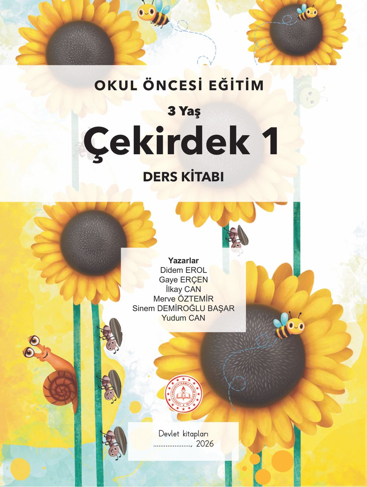
<!-- yer tutucu bulunamadı: sayfa sonuna eklendi -->

<!-- sayfa 1 -->

MİLLÎ EĞİTİM BAKANLIĞI YAYINLARI ....................................................................: 10734
DERS KİTAPLARI DİZİSİ...........................................................................................: 2484

Her hakkı saklıdır ve Millî Eğitim Bakanlığına aittir. Kitabın metin, soru ve şekilleri kısmen de olsa hiçbir surette alınıp yayımlanamaz.

**EDİTÖR**
Burcu ÖZKANLI ERTUĞRUL

**DİL UZMANI**
Muhammet ŞEN

**GÖRSEL TASARIMCI**
Esra ÜNLÜ
Eylem YILDIRIM
Hüseyin Ozan ÖCAL
Serdar TUNCAL

**ÇOKLU ORTAM TASARIMCISI**
Abidin AYDIN
Ezgi KERVAN SARINÇ
Onur TÜLÜ

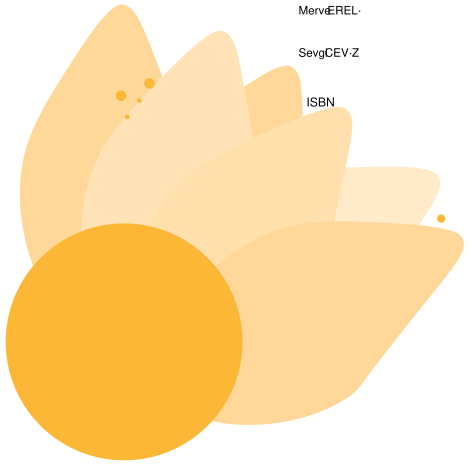
**PROGRAM GELİŞTİRME UZMANI**
Uğur ÇENET

**ÖLÇME VE DEĞERLENDİRME UZMANI**
Merve ERELİ

**REHBERLİK UZMANI**
Sevgi CEVİZ

ISBN 978-975-11-8097-1

Millî Eğitim Bakanlığı, Talim ve Terbiye Kurulu Başkanlığının 30.07.2024 tarih ve E-96732399-116.01-111152749 sayılı yazısı ile eğitim aracı olarak kabul edilmiştir. Kurulca bu kitabın kabul edilmiş olması ders kitabından yayınevi ve yazarın/yazarların sorumluluğunu kaldırmaz.

<!-- sayfa 2 -->

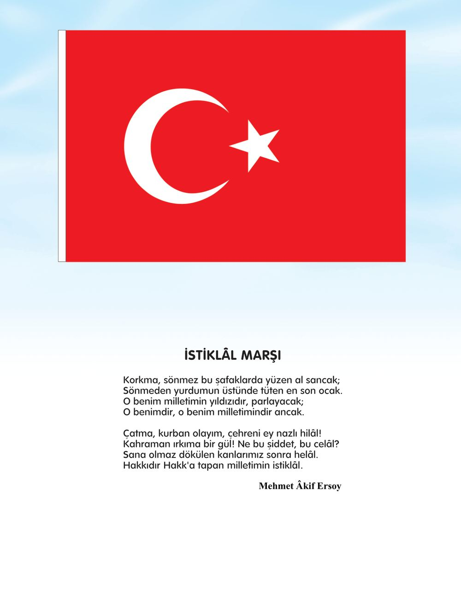

# İSTİKLÂL MARŞI

Korkma, sönmez bu şafaklarda yüzen al sancak;
Sönmeden yurdumun üstünde tüten en son ocak.
O benim milletimin yıldızıdır, parlayacak;
O benimdir, o benim milletimindir ancak.

Çatma, kurban olayım, çehreni ey nazlı hilâl!
Kahraman ırkıma bir gül! Ne bu şiddet, bu celâl?
Sana olmaz dökülen kanlarımız sonra helâl.
Hakkıdır Hakk'a tapan milletimin istiklâl.

Mehmet Âkif Ersoy

<!-- sayfa 3 -->

ANDIMIZ

Türküm, doğruyum, çalışkanım.

İlkem küçüklerimi korumak, büyüklerimi saymak; yurdumu, milletimi özümden çok sevmektir.
Ülküm yükselmek, ileri gitmektir.

Ey Büyük Atatürk!

Açtığın yolda, gösterdiğin hedefe durmadan yürüyeceğime ant içerim.

Varlığım Türk varlığına armağan olsun.

Ne mutlu Türküm diyene!

<!-- sayfa 4 -->

# MUSTAFA KEMAL ATATÜRK

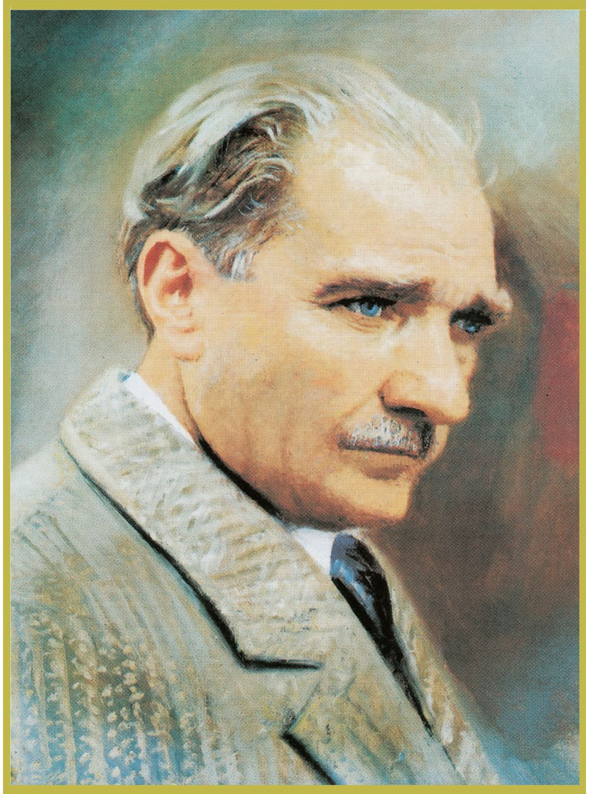
<!-- yer tutucu bulunamadı: sayfa sonuna eklendi -->

<!-- sayfa 5 -->

Verdiğiniz metin katmanı boş olduğu için (`<<< >>>` arası boş) dönüştürülecek bir içerik bulunmamaktadır. Lütfen metin katmanını içeren içeriği paylaşın, böylece talimatlarınıza uygun şekilde Markdown formatına çevirebilirim.

<!-- sayfa 6 -->

# İÇİNDEKİLER

| | |
| :--- | :---: |
| Sınıfımı Tanıyorum | 9 |
| Ben Kimim? | 10 |
| Duygular | 11 |
| Nasıl Oturmalıyım? | 12 |
| Sınıfımı Düzenli Tutuyorum | 13 |
| Hemşin Çorapları | 14 |
| Dans Ediyorum | 15 |
| Aynı Kilimler Buluyorum | 16 |
| Yuvalardan Gelen Sesler | 17 |
| Farklı Olanı Buluyorum | 18 |
| Temiz Olalım | 19 |
| Büyük-Küçük Yunuslar | 20 |
| Çini Sanatı | 21 |
| Gölgeleri Eşleştiriyorum | 22 |
| Sakinleşmek İçin Ne Yaparız? | 23 |
| Bayrağımızın Renkleri | 24 |
| Cumhuriyet Bayramı | 25 |
| Selim ile Dedesi | 26 |
| Sonbaharda Neler Görürüz? | 27 |
| Dişlerimi Fırçalıyorum | 28 |
| Yağmurlu Gün Giysilerim | 29 |
| Hareket Zamanı | 30 |
| Az-Çok | 31 |
| 1 Rakamını Öğreniyorum | 32 |
| Bir Tane | 33 |
| Tehlikelere Dikkat Ediyorum | 34 |
| Çömlek Sanatı | 35 |
| Deniz Altında Bir Gün | 36-37 |
| Atatürk | 38 |
| Duygularımız | 39 |
| Daireyi Öğreniyorum | 40 |
| Desenleri Eşleştiriyorum | 41 |
| Kitaplığım | 42 |

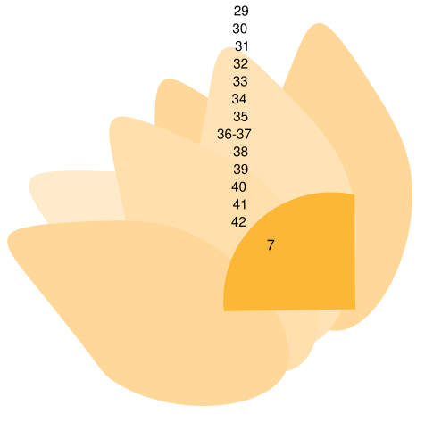
<!-- yer tutucu bulunamadı: sayfa sonuna eklendi -->

<!-- sayfa 7 -->

# İÇİNDEKİLER

| | |
| :--- | :---: |
| Renkler | 43 |
| Ağaçtaki Top | 44 |
| Çizgi Çiziyorum | 45 |
| Oyun Hakkı | 46 |
| Ön-Arka | 47 |
| Labirent Sayfası | 48 |
| Yeterli ve Dengeli Besleniyorum | 49 |
| Uzun mu, Kısa mı? | 50 |
| Renkli Yumaklar | 51 |
| Neye İhtiyacımız Var? | 52 |
| Ritim Tutuyorum | 53 |
| Hastalıklardan Korunuyorum | 54 |
| Tasarım Yapıyorum | 55 |
| Kümesin İçinde Ne Var? | 56 |
| Islak-Kuru | 57 |
| Afet ve Acil Durum Çantam | 58 |
| 2 Rakamını Öğreniyorum | 59 |
| İki Tane | 60 |
| Gece ve Gündüz Neler Yapıyorum? | 61 |
| Uyku Zamanı | 62 |
| Çalgıların Sesleri | 63 |
| Dengemi Sağlıyorum | 64 |
| Kışın Neler Görürüz? | 65 |
| Meslekler | 66 |
| Karlı Gün Giysilerim | 67 |
| Bilmeceler | 68 |
| Mevsimler Albümü | 69 |
| Yağmur Damlaları Yapıyorum | 70 |
| Daire Baskıları | 71 |
| Görsel ve Genel Ağ Kaynakçası | 71 |
| Türkiye’nin Mülki İdare Bölümleri ile Kara ve Deniz Komşuları Haritası | 72 |

Etkinliklerin ilişkili olduğu beceriler ve süreç bileşenlerini

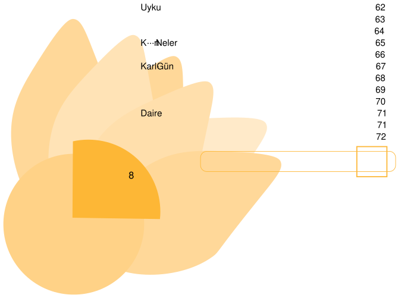
<!-- yer tutucu bulunamadı: sayfa sonuna eklendi -->

<!-- sayfa 8 -->

# SINIFIMI TANIYORUM

Görselleri inceleyelim. Görsellerden sınıfımızda olan eşyaları bulup işaretleyelim. Sınıfımızda başka hangi eşyalar var? Söyleyelim.

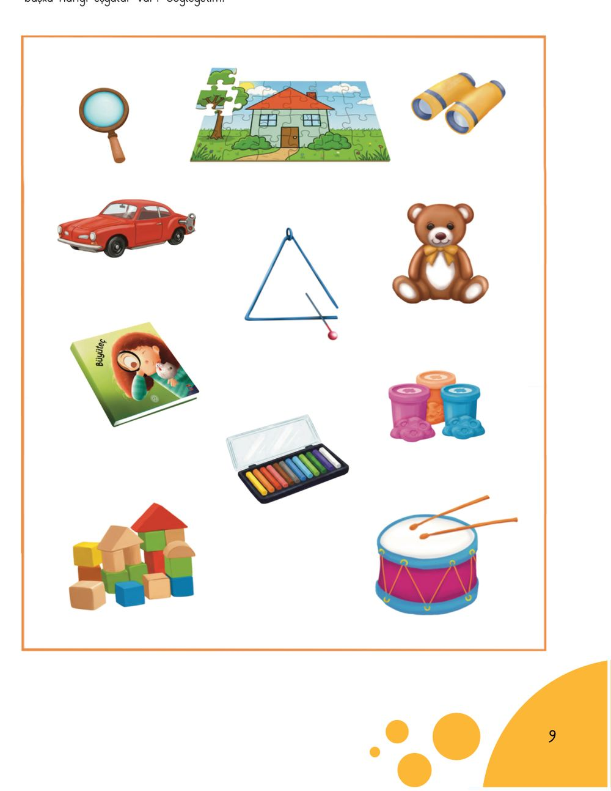

<!-- sayfa 9 -->

# BEN KİMİM?

## FOTOĞRAF
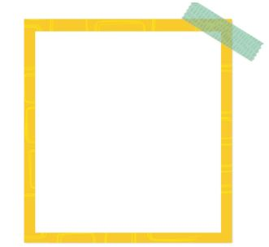
Adımızı, soyadımızı ve yaşımızı söyleyelim. Buraya bir fotoğrafımızı yapıştıralım.

## PARMAK İZİM
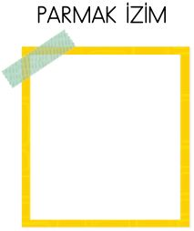
Herkesin parmak izi farklıdır. Çerçevenin içine parmak izi baskımızı yapalım.

# SEVDİĞİM RENKLER
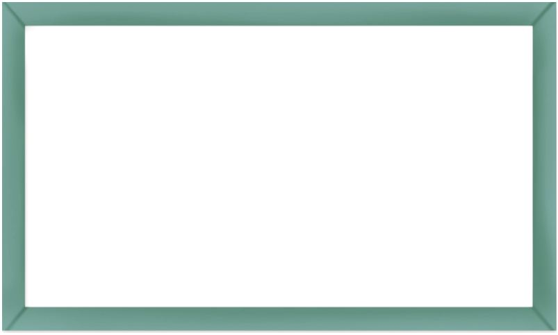

Tabloyu sevdiğimiz renkleri kullanarak boyayalım.

⭐ **Öğretmene not:** Etkinlik yapılmadan önce çocuklardan kendilerine ait bir fotoğrafını getirmeleri istenebilir. Sayfayı kullanarak çocukların kendilerini tanıtmalarına rehberlik edilebilir.

<!-- sayfa 10 -->

# DUYGULAR

Görselleri inceleyelim.

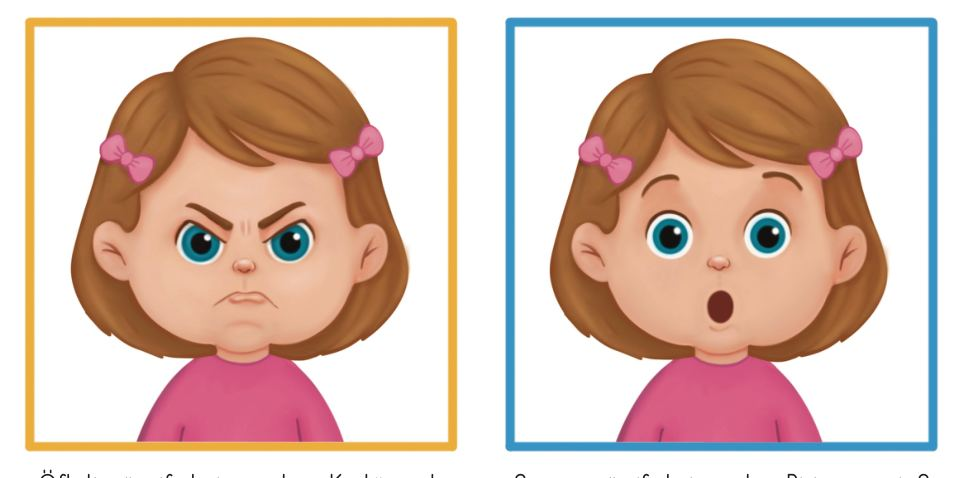
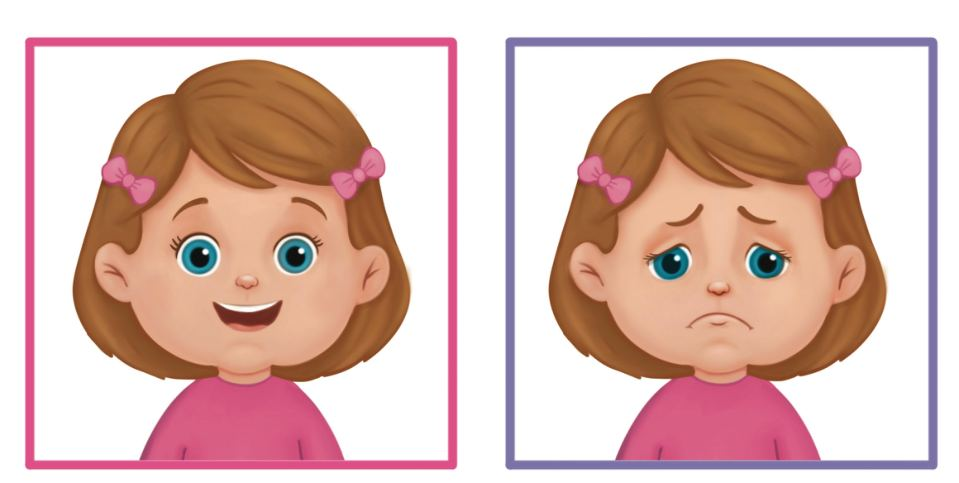

<!-- sayfa 11 -->

# NASIL OTURMALIYIM?

Doğru ve sağlıklı oturuşu bulalım, altındaki kutucuğu işaretleyelim. Şimdi kendi oturuşumuza dikkat edelim. Doğru ve sağlıklı oturmuyorsak duruşumuzu düzeltelim.

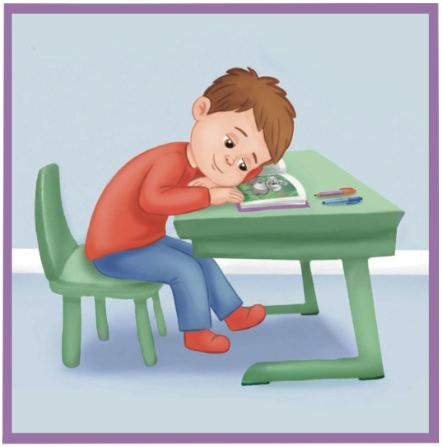
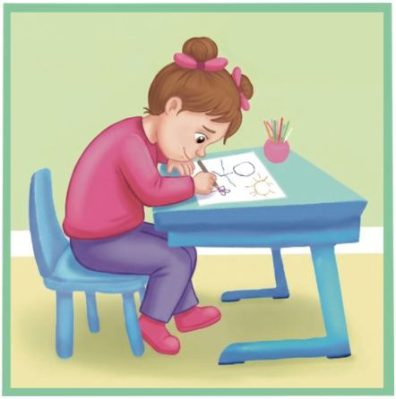

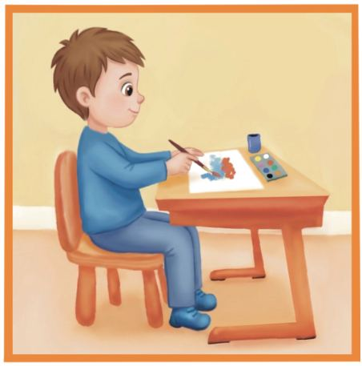

<!-- yer tutucu bulunamadı: sayfa sonuna eklendi -->

<!-- sayfa 12 -->

# SINIFIMI DÜZENLİ TUTUYORUM

Öğrenme merkezlerinde oyun zamanı sona erdiğinde ne yapmalıyız? Söyleyelim. Görseldeki sanat, dramatik oyun ve müzik merkezlerine ait eşyaları inceleyelim. Eşyaları uygun merkezlere çizgi çizerek götürelim. Toplanma zamanı geldiğinde biz de sınıfımızdaki eşyaları doğru öğrenme merkezlerine yerleştirelim.

SANAT MERKEZİ | DRAMATİK OYUN MERKEZİ | MÜZİK MERKEZİ
--- | --- | ---
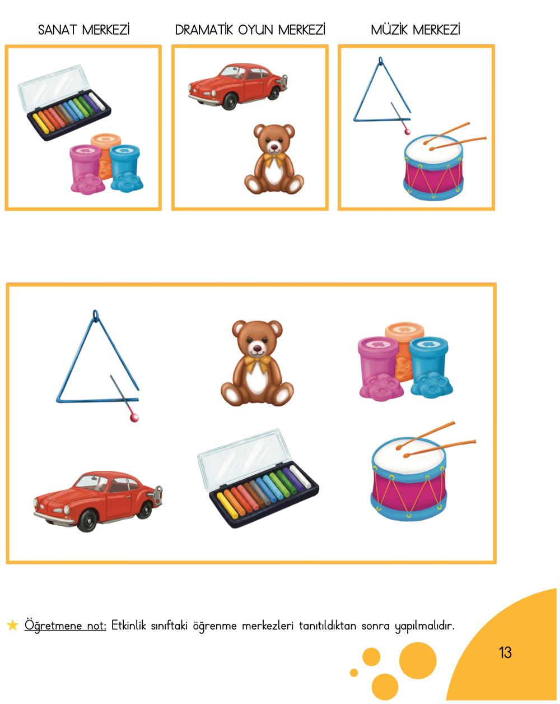 |  | 

⭐Öğretmene not: Etkinlik sınıftaki öğrenme merkezleri tanıtıldıktan sonra yapılmalıdır

<!-- sayfa 13 -->

# HEMŞİN ÇORAPLARI

Hemşin çorapları, ülkemizin coğrafi işaret almış el sanatları ürünlerindendir. Görsellerdeki Hemşin çoraplarını inceleyelim. Her birinin eşini bulalım, çizgi çizerek eşleştirelim.

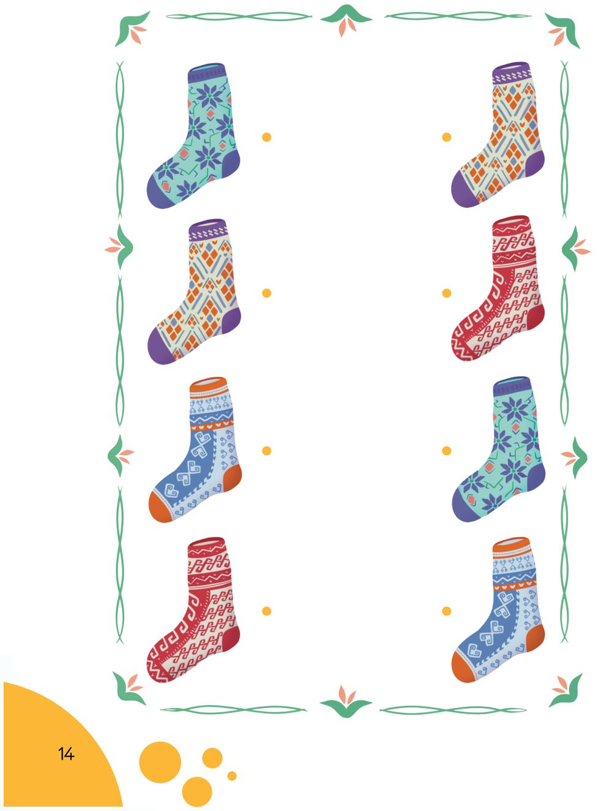

<!-- sayfa 14 -->

# DANS EDİYORUM

Ali ve İnci dans etmeyi çok seviyor. Görselleri inceleyelim. Ali ve İnci’nin hareketlerini yapmayı deneyelim.

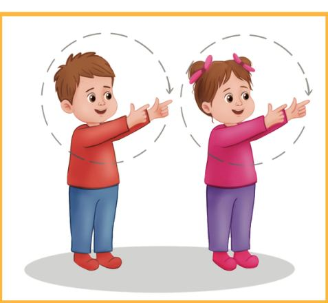
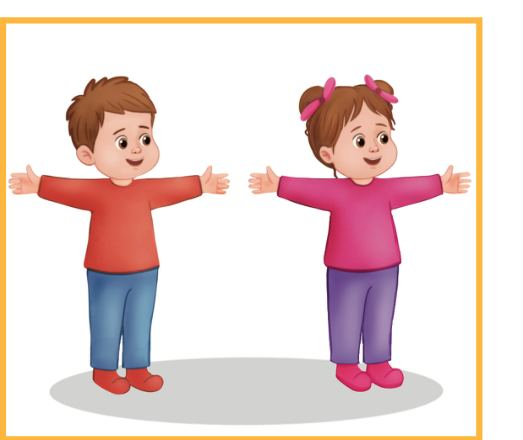
Kollarımızla daire çizelim.

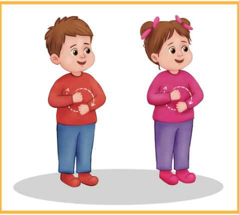
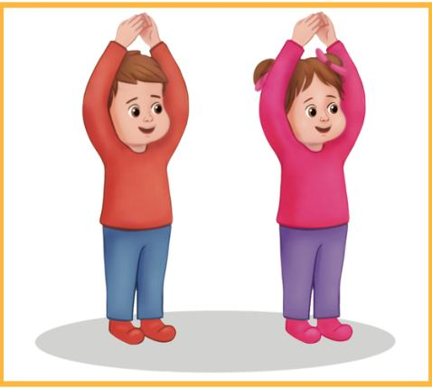
Kollarımızı iki yana açıp kapatalım.

Kollarımızla makara sarma hareketi yapalım.

Kollarımızı kaldırarak el çırpalım.

⭐ **Öğretmene not:** Çocuklara hareketler hızlı ve yavaş tempolu müzikler eşliğinde yaptırılabilir.

<!-- sayfa 15 -->

# AYNI KİLİMLERİ BULUYORUM

Kilim dokumacılığı ülkemizin en önemli el sanatlarından biridir. Çok eski yıllardan beri ülkemizin birçok yerinde çeşitli desenlere sahip kilimler üretilmiştir. Kilimlerin desenlerini inceleyelim. Aynı olanları çizgi çizerek eşleştirelim.

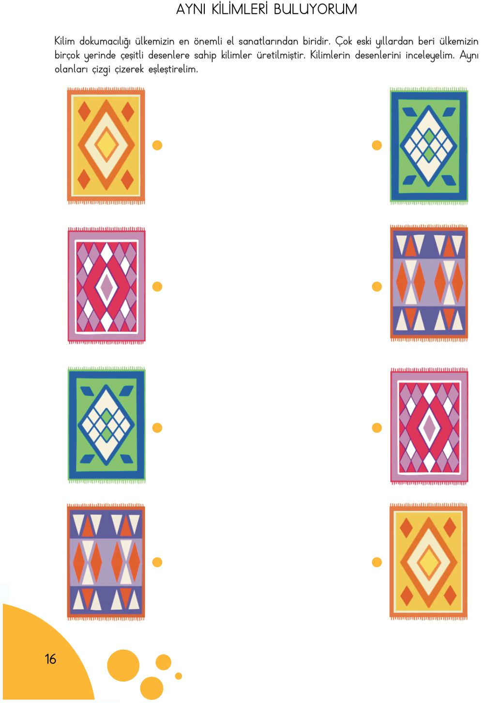

<!-- sayfa 16 -->

# YUVALARDAN GELEN SESLER

Görseldeki hayvanları ve yuvalarını inceleyelim. Karekodları kullanarak sesleri dinleyelim. Seslerini dinlediğimiz hayvanların isimlerini söyleyelim.

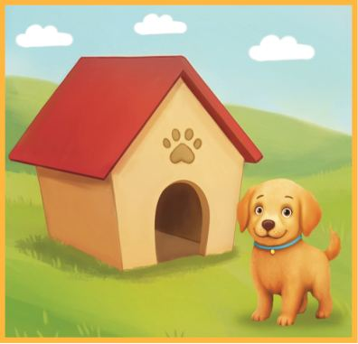
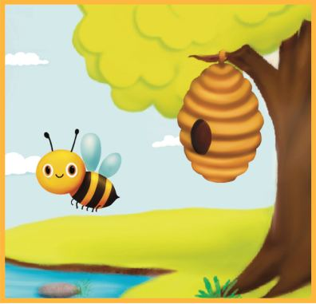

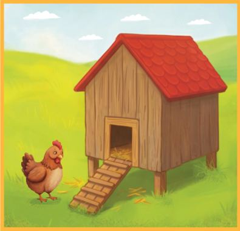
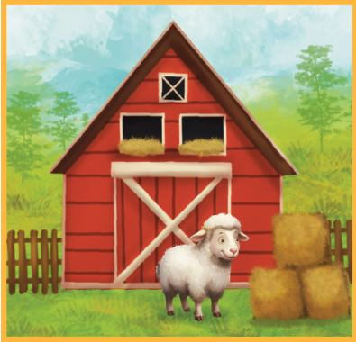

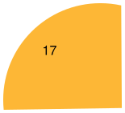

<!-- sayfa 17 -->

# FARKLI OLANI BULUYORUM

Farklı olan elmanın altındaki kutucuğu işaretleyelim.
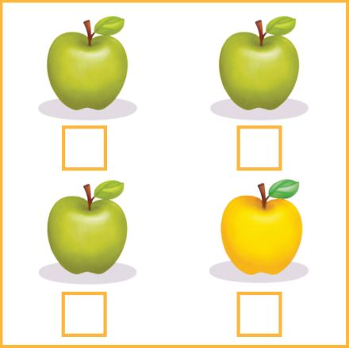

Farklı olan ayakkabının altındaki kutucuğu işaretleyelim.
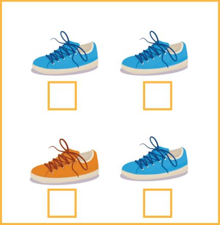
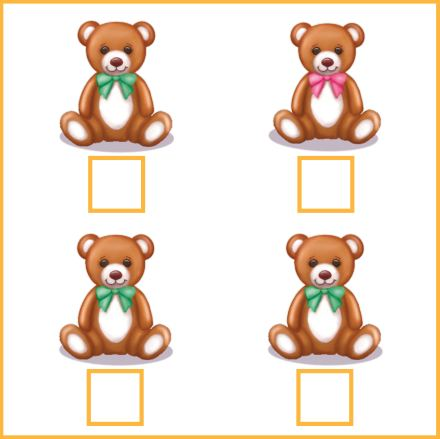

Farklı olan oyuncak ayının altındaki kutucuğu işaretleyelim.
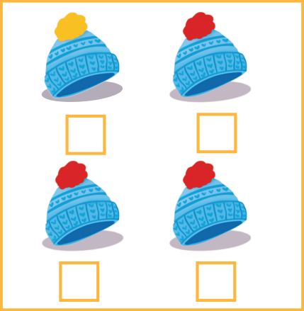

Farklı olan berenin altındaki kutucuğu işaretleyelim.

<!-- sayfa 18 -->

# TEMİZ OLALIM

Görselleri inceleyelim. Vücudumuzun temizliğinde kullandığımız malzemelerin altındaki kutucuğu işaretleyelim.

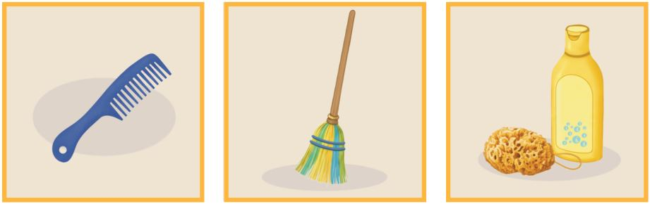
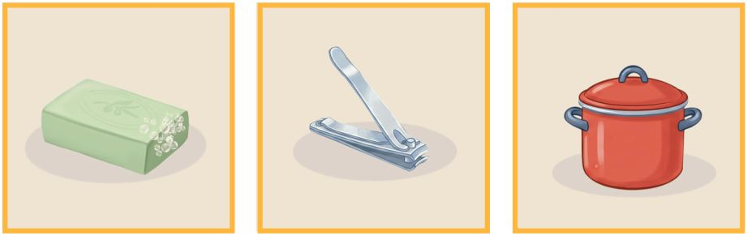
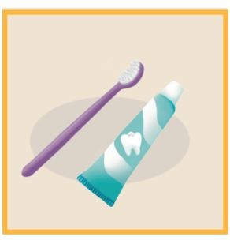

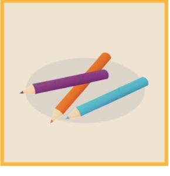
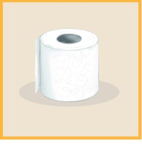
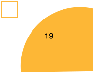

<!-- sayfa 19 -->

# BÜYÜK-KÜÇÜK YUNUSLAR

Yunuslar sürüler hâlinde hareket eder ve birbirleriyle oyun oynamaktan hoşlanır. Okyanustaki yunusları inceleyelim. Büyük yunusları kırmızı ile işaretleyelim. Küçük yunusları parmağımızla gösterelim.

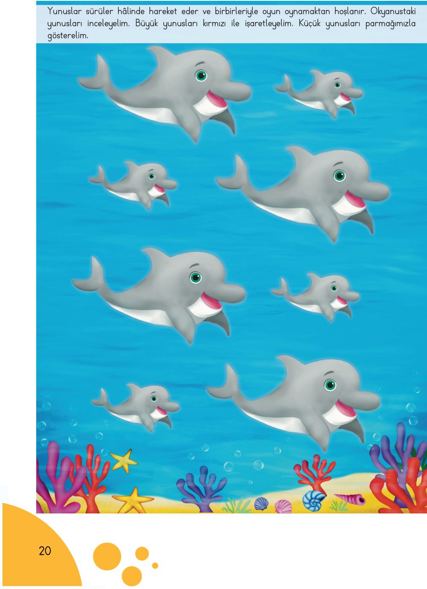

<!-- sayfa 20 -->

# ÇİNİ SANATI

Çini sanatı ülkemizin geleneksel bir sanat dalıdır. Yapılan eserler canlı renklerdeki desen ve motiflerle süslenir. Aşağıdaki görsellerde bazı çini motif ve desenleri var. Bu motif ve desenlerin kullanıldığı eserleri çizgi çizerek eşleştirelim.

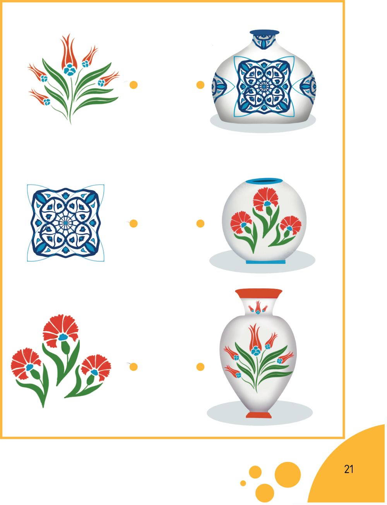

<!-- sayfa 21 -->

# GÖLGELERİ EŞLEŞTİRİYORUM

Görselleri inceleyelim. Hayvanları gölgeleri ile çizgi çizerek eşleştirelim.

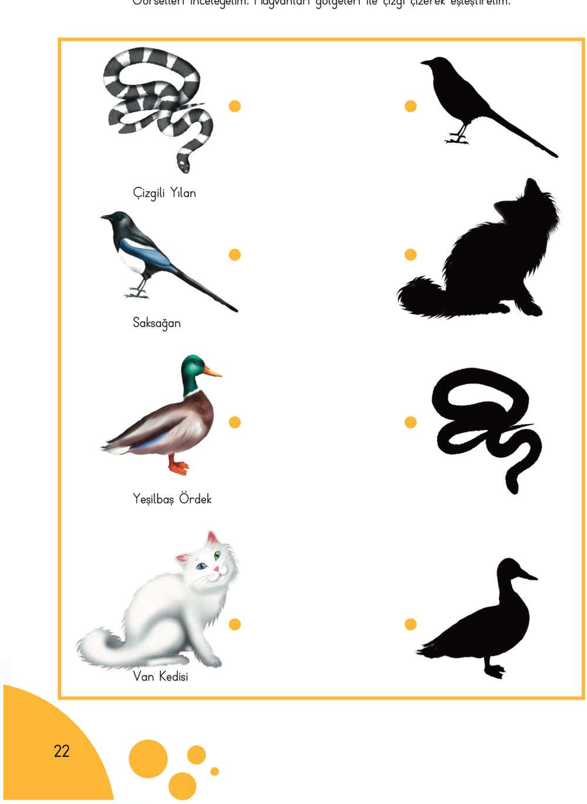

Çizgili Yılan

Saksağan

Yeşilbaş Ördek

Van Kedisi

<!-- sayfa 22 -->

# SAKİNLEŞMEK İÇİN NE YAPARIZ?

Bazen kendimizi üzgün ya da öfkeli hissedebiliriz. Böyle durumlarda sakinleşmek için bazı yöntemler deneriz. Görselleri inceleyelim. Bu yöntemlerden hangilerini kullanıyoruz? Gösterelim.

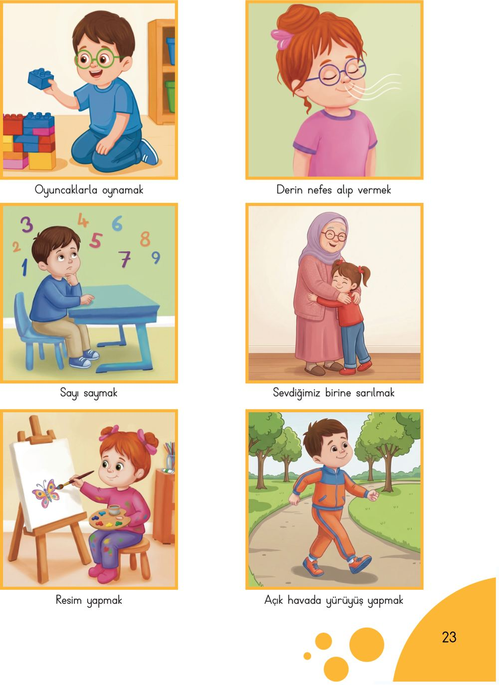

Oyuncaklarla oynamak
Derin nefes alıp vermek
Sayı saymak
Sevdiğimiz birine sarılmak
Resim yapmak
Açık havada yürüyüş yapmak

<!-- sayfa 23 -->

# BAYRAĞIMIZIN RENKLERİ

Görseldeki Türk bayrağını inceleyelim. Türk bayrağında bulunan renkleri işaretleyelim. 
Sınıfımızdaki Türk bayrağını bulup gösterelim.

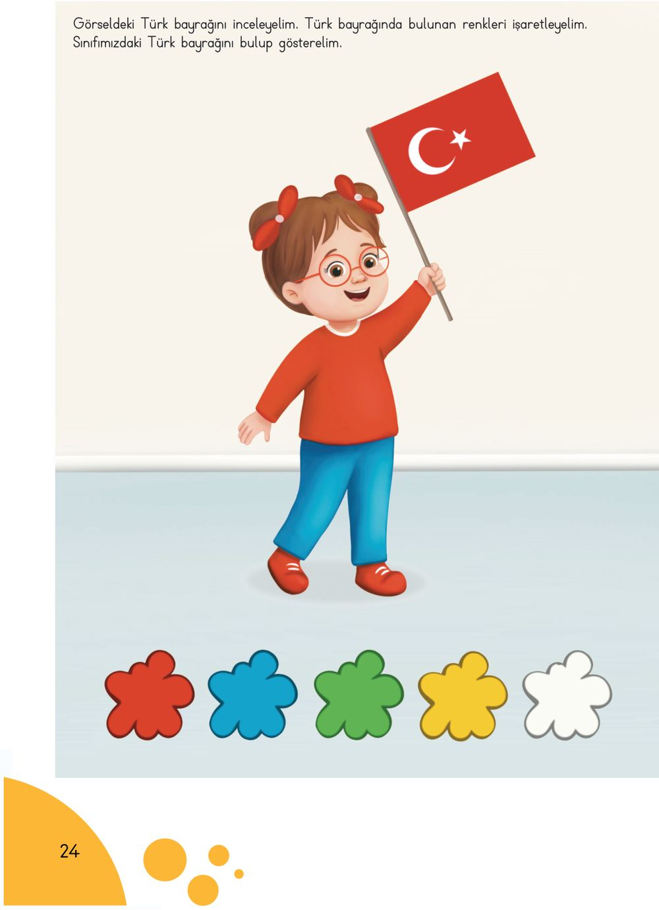

<!-- sayfa 24 -->

# CUMHURİYET BAYRAMI

Mustafa Kemal Atatürk, 29 Ekim 1923’te Cumhuriyet’i ilan etmiştir. Bu gün, Türkiye Cumhuriyeti’nin doğum günüdür. Türk Yıldızları, bu anlamlı günü kutlamak için özel bir gösteri düzenliyor. Görseli inceleyelim ve Türk bayrağı taşıyan uçakları işaretleyelim. Evimizi ve okulumuzu bayraklarla süsleyelim. Bu güzel bayramı hep birlikte coşkuyla kutlayalım.

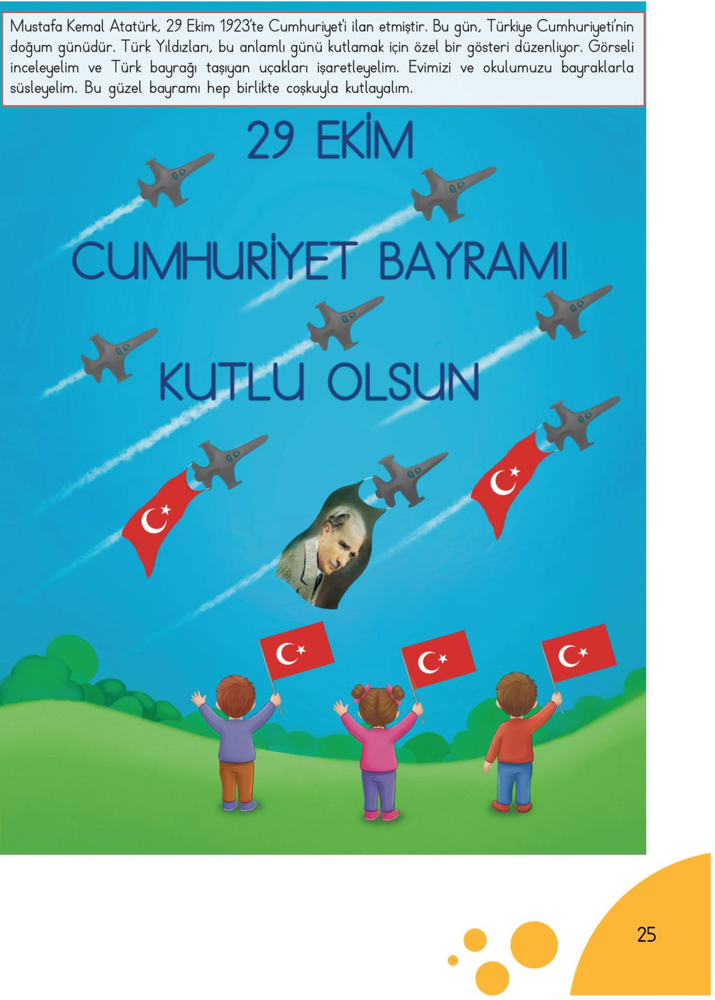

<!-- sayfa 25 -->

# SELİM İLE DEDESİ

Görseli inceleyelim. Görselde neler görüyoruz? Anlatalım. Dedesi, Selim’i en sevdiği parka götürmüş ve ona parkta bir kitap okumuş. Selim çok mutlu olmuş.

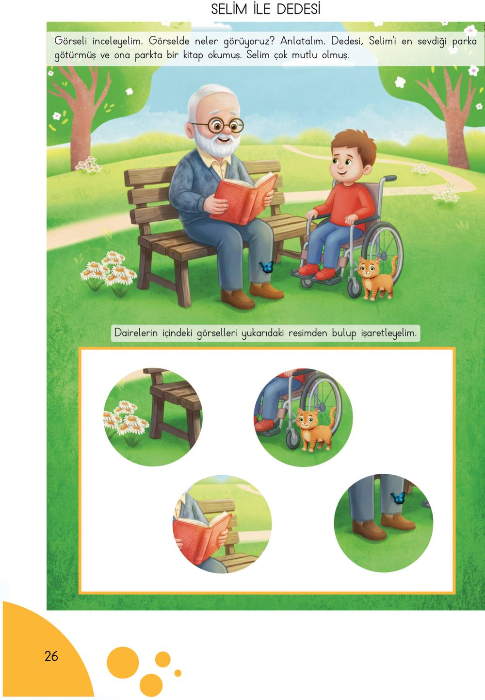

Dairelerin içindeki görselleri yukarıdaki resimden bulup işaretleyelim.

<!-- sayfa 26 -->

# SONBAHARDA NELER GÖRÜRÜZ?

Kitabımızı yanımıza alarak bahçeye çıkalım. Sonbaharda bahçe nasıl görünüyor? Anlatalım. Bahçede görsellerden hangileriyle karşılaştık? Gördüklerimizi işaretleyelim.

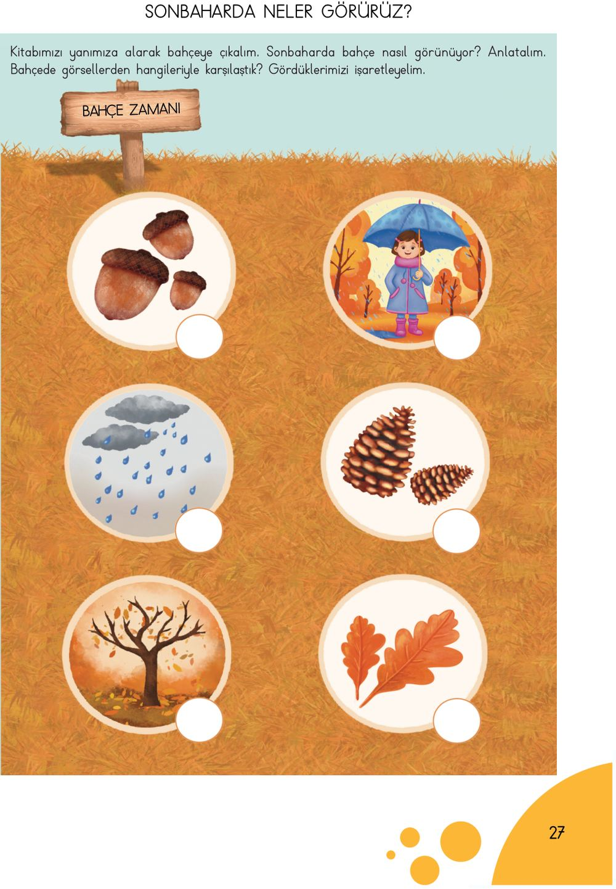
BAHÇE ZAMANI

<!-- sayfa 27 -->

# DİŞLERİMİ FIRÇALIYORUM

Canlılar diş temizliği için farklı yöntemler kullanabilir. Örneğin, timsahlar dişlerini temizlemek için ardıç kuşlarından yardım alır.

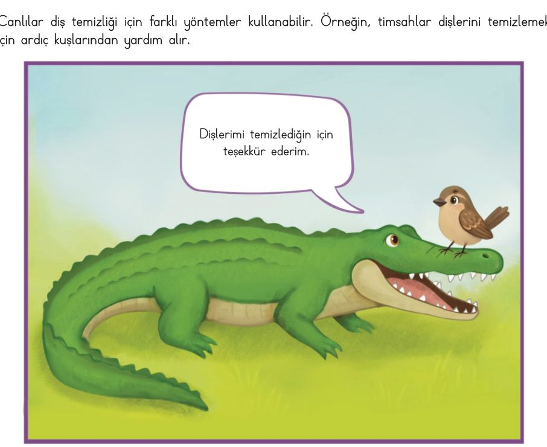

Görselleri inceleyelim. Hangilerini diş temizliğinde kullanırız? Söyleyelim.

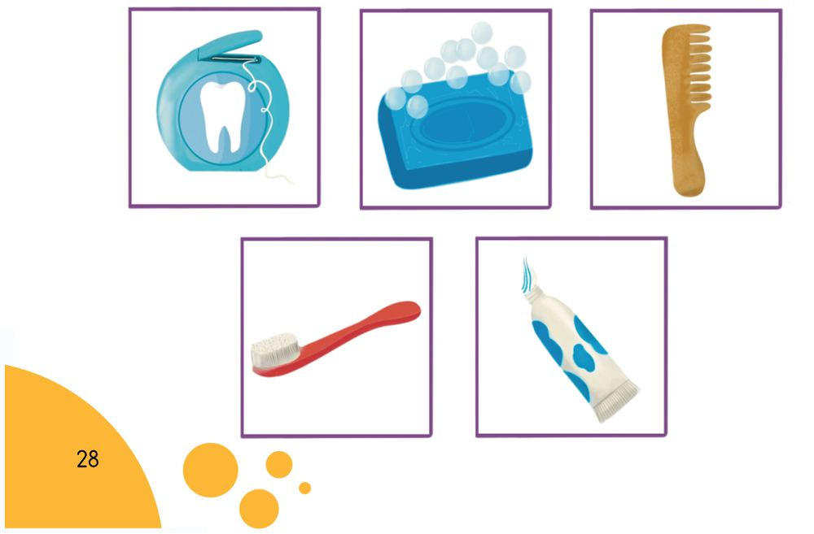

<!-- sayfa 28 -->

# YAĞMURLU GÜN GİYSİLERİM

Mehmet pencereden dışarı baktığında havanın yağmurlu olduğunu gördü. Mehmet böyle bir havada dışarı çıkarken aşağıdaki kıyafetlerden hangilerini giyebilir? İşaretleyelim.

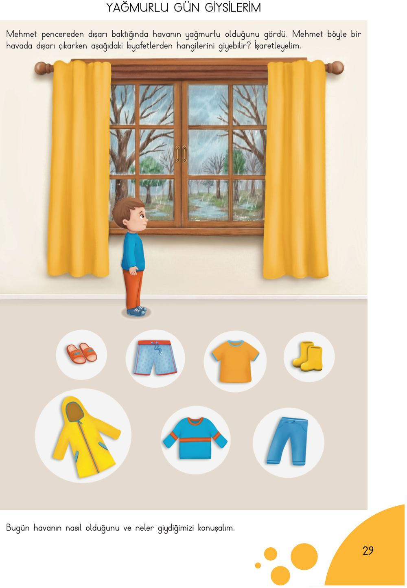

Bugün havanın nasıl olduğunu ve neler giydiğimizi konuşalım.

<!-- sayfa 29 -->

# HAREKET ZAMANI

Gözlerimizi kapatalım ve parmağımızı görsellerin üzerinde gezdirelim. Şimdi parmağımızı durduralım ve gözlerimizi açalım. Parmağımız hangi görselin üzerindeyse o hareketi yapmayı deneyelim. Ardından müzik eşliğinde görsellerdeki hareketleri uygulayarak dans edelim.

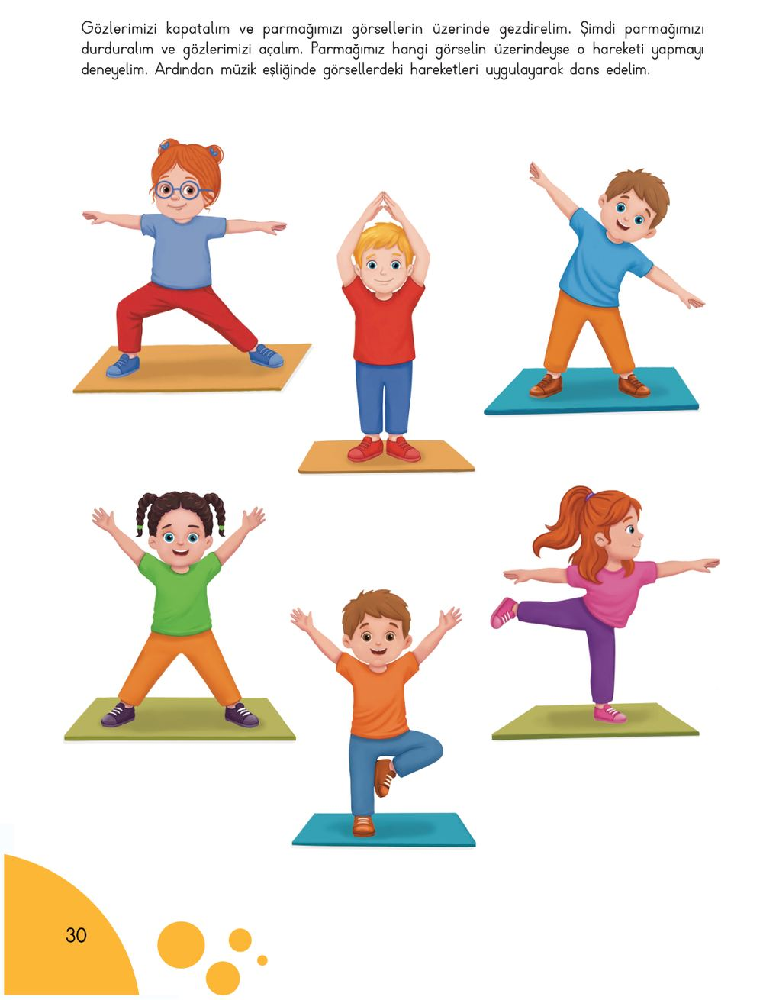

<!-- sayfa 30 -->

# AZ-ÇOK

Hangi akvaryumda daha az balık var? İşaretleyelim.

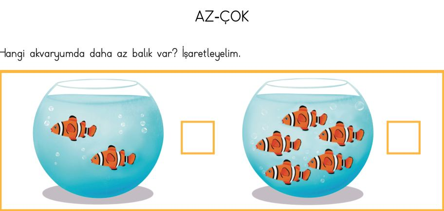

Hangi vazoda daha çok çiçek var? İşaretleyelim.

Hangi kalemlikte daha çok kalem var? İşaretleyelim.

<!-- sayfa 31 -->

# 1 RAKAMINI ÖĞRENİYORUM

Ok yönünde ilerleyerek parmağımızla 1 rakamının üzerinden geçelim. 1 parmağımızı gösterelim.

 

 1 rakamlarını bulalım ve işaretleyelim.

 Tavşanlar zıplamayı çok seviyor. Biz de ayağa kalkıp tavşan gibi 1 kere zıplayalım. Tavşanlardan 1 tanesini işaretleyelim.

<!-- sayfa 32 -->

# BİR TANE

İçinde 1 tane kurabiye olan tabağın altındaki kutucuğu işaretleyelim.

1 tane uçan balon olan gökyüzünün altındaki kutucuğu işaretleyelim.

Üzerinde 1 tane araba olan yolun altındaki kutucuğu işaretleyelim.

<!-- yer tutucu bulunamadı: sayfa sonuna eklendi -->

<!-- sayfa 33 -->

# TEHLİKELERE DİKKAT EDİYORUM

Görsellerdeki çocuklar neler yapıyor? Anlatalım. Görsellerde tehlikeli olan davranışları bulalım ve işaretleyelim. Çocuğun davranışının neden tehlikeli olduğunu açıklayalım.

<!-- sayfa 34 -->

# ÇÖMLEK SANATI

Ülkemizde çömlek çok eski zamanlardan beri yapılmaktadır. Çömlekler, kile el ile şekil verilerek oluşturulur. Her sırada baştaki ile aynı çömleği bulalım ve işaretleyelim.

<!-- sayfa 35 -->

# DENİZ ALTINDA BİR GÜN

Resimdeki balık sürülerini bulalım. Hangi sürüde daha çok balık var? Hangi sürüde daha az balık var? Balık sayısı çok olan sürüyü bulup kırmızı ile işaretleyelim.

Resimdeki en büyük balığı bulalım. Bulduğumuz balığı işaretleyelim.

Resimdeki denizatını bulalım. Denizatının önünde ne var? Söyleyelim.

<!-- sayfa 36 -->

Resimdeki deniz yıldızlarını bulalım. Bir tane deniz yıldızını işaretleyelim.

Balinanın altındaki deniz canlılarını işaretleyelim.

Deniz kabuklularını bulalım. En küçük deniz kabuklusunu işaretleyelim.

<!-- sayfa 37 -->

# ATATÜRK

Ülkemizin kurucusu Mustafa Kemal Atatürk’ün fotoğrafını inceleyelim. Önce sınıfımızdaki sonra kitabımızdaki diğer Atatürk fotoğraflarını bulalım ve gösterelim. Atatürk’ün fotoğraf çerçevesini süsleyelim.

<!-- sayfa 38 -->

# DUYGULARIMIZ

Görselleri inceleyelim. Çocukların yaşadığı durumları yaşasaydık ne hissederdik? Söyleyelim.

<!-- sayfa 39 -->

# DAİREYİ ÖĞRENİYORUM

Benim adım daire. Kenarım ve köşem yok.

Görselleri inceleyelim. Görsellerden yüzeyi daire şekline benzeyenleri bulalım ve işaretleyelim.

<!-- sayfa 40 -->

# DESENLERİ EŞLEŞTİRİYORUM

Görselleri inceleyelim. Her parçayı ait olduğu nesne ile çizgi çizerek eşleştirelim.

<!-- sayfa 41 -->

# KİTAPLIĞIM

Kitaplığı inceleyelim. Kitaplıkta neler var? Söyleyelim.

 İçinde az çiçek olan vazoyu işaretleyelim.

 En çok kitap olan rafı işaretleyelim.

 Boş olan rafı parmağımızla gösterelim.

<!-- sayfa 42 -->

# RENKLER

Görselleri inceleyelim. Gördüğümüz rengin adını söyleyelim. Sınıfımızdan bulduğumuz kırmızı bir nesneyi kırmızı kutunun üzerine koyalım. Kırmızı nesnelerin altındaki kutucuğu işaretleyelim.

Görselleri inceleyelim. Gördüğümüz rengin adını söyleyelim. Sınıfımızdan bulduğumuz sarı bir nesneyi sarı kutunun üzerine koyalım. Sarı nesnelerin altındaki kutucuğu işaretleyelim.

Görselleri inceleyelim. Gördüğümüz rengin adını söyleyelim. Sınıfımızdan bulduğumuz mavi bir nesneyi mavi kutunun üzerine koyalım. Mavi nesnelerin altındaki kutucuğu işaretleyelim.

<!-- sayfa 43 -->

# AĞAÇTAKİ TOP

Görseli inceleyelim. Tuna’nın topu nerede kalmış? Söyleyelim. Tuna nasıl hissediyor olabilir? Anlatalım. Tuna’nın sorunu nasıl çözülebilir? Uygun bulduğumuz çözüm yollarını söyleyelim.

<!-- sayfa 44 -->

# ÇİZGİ ÇİZİYORUM

Görselleri inceleyelim. Çizgileri parmağımızla takip edelim. Kesik çizgileri kalemimizle birleştirelim.

<!-- sayfa 45 -->

# OYUN HAKKI

Görseli inceleyelim. Görselde gördüklerimizi anlatalım. Her çocuk oyun oynama hakkına sahiptir. Çocukların başka hangi hakları vardır? Düşünelim ve konuşalım.

Öğretmenimiz ve arkadaşlarımızla açık havaya çıkıp “Yağ Satarım, Bal Satarım” oyunu oynayalım.

⭐ Öğretmene not: Çocuk Hakları Evrensel Bildirgesi’nde yer alan diğer haklar da çocuklarla paylaşılabilir ve bu haklar üzerine sohbet edilebilir. Karekodda bulunan “Çocuk ve Oyun” adlı şarkı çocuklara dinletilebilir. 

<!-- yer tutucu bulunamadı: sayfa sonuna eklendi -->

<!-- sayfa 46 -->

# ÖN-ARKA

Çocuk görsellerinin önden görünüşünü inceleyelim. Bu çocukların arkadan görünüşlerini bulup işaretleyelim.

 

 

<!-- sayfa 47 -->

# LABİRENT SAYFASI

Penguenler çoğunlukla denize yakın yerlerde yaşayan kuşlardır. Penguenler kanatlarını yüzmek ve buz üstünde kaymak için kullanır. Yavru penguen, anne ve babasının yanına gidebilmek için hangi yolu kullanmalı, çizerek gösterelim.

<!-- sayfa 48 -->

# YETERLİ VE DENGELİ BESLENİYORUM

Yeterli ve dengeli beslenmek sağlığımız için çok önemlidir. Vücudumuzun gelişimini destekleyen besinleri çizgi çizerek tabağa götürelim.

<!-- sayfa 49 -->

# UZUN MU, KISA MI?

Uzun merdivenin altındaki kutucuğu işaretleyelim.

Kısa kalemin altındaki kutucuğu işaretleyelim.

Uzun trenin altındaki kutucuğu işaretleyelim.

Kısa atkının altındaki kutucuğu işaretleyelim.

<!-- sayfa 50 -->

# RENKLİ YUMAKLAR

Ayşe'nin babaannesi örgü örmeyi çok seviyor. Battaniyede hangi renkler var? İşaretleyelim.

Ayşe'nin babaannesinin ördüğü bazı giysiler var. Görselleri inceleyelim. Ayşe'nin babaannesi giysileri örerken hangi renkte ipler kullanmış söyleyelim. Giysilerle uygun renkteki ipleri çizgi çizerek eşleştirelim.

<!-- sayfa 51 -->

# NEYE İHTİYACIMIZ VAR?

Ayşegül'ün çok uykusu gelmiş. Ayşegül'ün neye ihtiyacı var? İşaretleyelim.

Kapı kilitli kalmış. Kapıyı açmak için neye ihtiyacımız var? İşaretleyelim.

<!-- sayfa 52 -->

# RİTİM TUTUYORUM

Aşağıdaki görselleri sayalım. Sayarken alkışla ritim tutalım. Önce hafif sonra kuvvetli şekilde alkışla ritim tutalım.

Aşağıdaki görselleri sayalım. Sayarken elimizle dizimize önce yavaş sonra hızlı tempoyla vurarak ritim tutalım.

Aşağıdaki görselleri sayalım. Sayarken önce alkışla sonra elimizle dizimize vurarak ritim tutalım.

Başka nasıl ritim tutabiliriz? Düşünelim ve deneyelim.

<!-- sayfa 53 -->

# HASTALIKLARDAN KORUNUYORUM

Görselleri inceleyelim. Hapşırırken veya öksürürken ne yapmalıyız, konuşalım. Doğru olan davranışın altındaki kutucuğu yeşile boyayalım.

Görselleri inceleyelim. Hastalandığımızda ne yapmamız gerekir, konuşalım. Doğru olan davranışın altındaki kutucuğu yeşile boyayalım.

<!-- sayfa 54 -->

# TASARIM YAPIYORUM

Elif, evdeki atık malzemelerle yeni eşyalar tasarlamayı çok seviyor. Görsellerde Elif'in tasarladığı bazı eşyalar var. Elif'in tasarımlarını ve bu tasarımları hazırlarken kullandığı malzemeleri çizgi çizerek eşleştirelim.

Sınıfımızda hangi atık malzemeler var? Söyleyelim. Sınıfımızdaki atık malzemeleri kullanarak tasarımlar yapmayı deneyelim.

<!-- sayfa 55 -->

# KÜMESİN İÇİNDE NE VAR?

Sayfadaki kitabın kapağını inceleyelim. Kitabın kapağında neler gördüğümüzü anlatalım. Kapaktaki yazıyı bulalım ve işaretleyelim. Bu kitap ne anlatıyor olabilir? Tahminlerimizi söyleyelim.

Aşağıdaki hayvanları inceleyelim. Hayvanların isimlerini söyleyelim, seslerini taklit edelim. Öyküye göre kümesin içindeki hayvanın hangisi olduğunu bulalım ve işaretleyelim.

“Kümesin İçinde Ne Var” öyküsü

“Kümesin İçinde Ne Var” şarkısı

⭐ **Öğretmene not:** Karekodlarda bulunan “Kümesin İçinde Ne Var?” adlı öykü çocuklara...

<!-- sayfa 56 -->

# ISLAK-KURU

Görselleri inceleyelim. Islak olanların altındaki kutucuğu işaretleyelim, neden ıslanmış olabileceklerini söyleyelim.

<!-- sayfa 57 -->

# AFET VE ACİL DURUM ÇANTAM

Zeynep ve ailesi afet ve acil durum çantası hazırlamak istiyor. Görselleri inceleyelim. Afet ve acil durum çantasında bulunması gerekenleri çizgi çizerek çantaya götürelim. Çantamızı boyayalım.

⭐ Öğretmene not: Karekodda bulunan “Afet” adlı şarkı çocuklara dinletilebilir.

<!-- sayfa 58 -->

# 2 RAKAMINI ÖĞRENİYORUM

Ok yönünde ilerleyerek parmağımızla 2 rakamının üzerinden geçelim. 2 parmağımızı gösterelim.

| | |
| :--- | :--- |
| 2 $\triangle$ <!-- KONTROL: Marker'da karşılığı yok, uydurma olabilir --> 2  $\bullet$ <!-- KONTROL: Marker'da karşılığı yok, uydurma olabilir --> 2 $\triangle$ <!-- KONTROL: Marker'da karşılığı yok, uydurma olabilir -->  2 $\bullet$ <!-- KONTROL: Marker'da karşılığı yok, uydurma olabilir --> 2 |  |

| | |
| :--- | :--- |
| 2 rakamlarını bulalım ve işaretleyelim. | Görselde ülkemizde yetişen beyaz kum zambakları var. Beyaz kum zambaklarından 2 tanesini işaretleyelim. Sizce beyaz kum zambaklarının kokusu nasıldır? Söyleyelim. Elimizde beyaz kum zambağı olduğunu hayal edelim ve 2 kere koklayalım. |

<!-- sayfa 59 -->

# İKİ TANE

2 top dondurma olan külahın altındaki kutucuğu işaretleyelim.

İçinde 2 tane küp olan kutunun altındaki kutucuğu işaretleyelim.

İçinde 2 tane çiçek olan saksının altındaki kutucuğu işaretleyelim.

<!-- sayfa 60 -->

# GECE VE GÜNDÜZ NELER YAPIYORUM?

 Görsellerde neler gördüğümüzü anlatalım. İncelediğimiz durum gece gerçekleşiyorsa ayı, gündüz gerçekleşiyorsa güneşi boyayalım. Gece ve gündüz başka neler yaparız? Konuşalım. 

| | | |
| :---: | :---: | :---: |
|  |  \|  | |
|  |  \|  | |
|  |  \|  | |
|  |  \|  | |

*(Not: Tablo yapısı görseldeki satır düzenini temsil etmektedir. Görsellerin yerleşimi şu şekildedir:)*

  | 
  | 
  | 
  | 

⭐  Öğretmene not: Etkinlik sonrasında bahçeye çıkıp çocuklarla gökyüzü gözlemi yapılabilir.   

<!-- sayfa 61 -->

# UYKU ZAMANI

Zürafa kıvrılmış, koala ağaca sarılmış, yavru su samuru da annesinin üzerinde uyuyor. Görsellerdeki hayvanlar gibi insanların da uykuya ihtiyacı vardır. Uykuya hazırlanırken neler yaptığımızı anlatalım.

Görselleri inceleyelim, uykuya hazırlanırken yapmamız gerekenleri işaretleyelim.

<!-- sayfa 62 -->

# ÇALGILARIN SESLERİ

Görselleri inceleyelim. Çalgıların isimlerini söyleyelim. Çizgileri parmağımızla takip edelim. Kesik çizgileri birleştirelim. Karekodlardaki çalgı seslerini dinleyelim.

<!-- sayfa 63 -->

# DENGEMİ SAĞLIYORUM

Ali ve İnci yere çizdikleri yolların üzerinde dengeli bir şekilde yürüme oyunu oynuyor. Ali ve İnci’nin çizdikleri yolları istediğimiz renge boyayalım. Sınıfımızda ya da bahçemizde yollar oluşturarak bu yolların üzerinde dengeli şekilde yürüme denemeleri yapalım. Kollarımızı açarak dengemizi sağlayalım.

<!-- sayfa 64 -->

# KIŞIN NELER GÖRÜRÜZ?

Kitabımızı yanımıza alarak bahçeye çıkalım. Kış mevsiminde bahçe nasıl görünüyor? Anlatalım. Bahçede görsellerden hangileriyle karşılaştık? Gördüklerimizi işaretleyelim.

BAHÇE ZAMANI

<!-- sayfa 65 -->

# MESLEKLER

Görselleri inceleyelim. Mesleklerin adlarını söyleyelim. Ailemizde bu meslekleri yapan kişiler var mı? Konuşalım. Büyüyünce hangi mesleği seçmek istediğimizi anlatalım.

| ÖĞRETMEN | DOKTOR | POLİS |
| :---: | :---: | :---: |

| AŞÇI | PİLOT | VETERİNER |
| :---: | :---: | :---: |

| ASTRONOT | ÇİFTÇİ | İTFAİYECİ |
| :---: | :---: | :---: |

<!-- sayfa 66 -->

# KARLI GÜN GİYSİLERİM

Mehmet pencereden dışarı baktığında havanın soğuk ve kar yağışlı olduğunu gördü. Mehmet böyle bir havada dışarı çıkarken aşağıdaki kıyafetlerden hangilerini giyebilir? İşaretleyelim.

Bugün havanın nasıl olduğunu ve neler giydiğimizi konuşalım.

<!-- sayfa 67 -->

# BİLMECELER

Bilmeceleri dinleyelim. Cevapları mor çerçevenin içindeki görseller arasından bulup işaretleyelim.

| | |
| :--- | :--- |
| Siyah beyaz tüyleri var. Suda hızlı yüzer. Uçamayan bir kuştur, Buz üstünde gezer. (PENGUEN) | Beyaz tüyleri var. Biri mavi, biri yeşil gözleri var. Suyu sever, yüzmeyi bilir. Van denince akla gelir. (VAN KEDİSİ) |

| | |
| :--- | :--- |
| “Ai, ai!” diyerek dolaşır. Kulakları var iki yanda. Gözleri büyük, uzun kirpikli Nedir bu hayvan, Bilen var mı acaba? (EŞEK) | Evini taşır sırtında. Yavaş yavaş yürür ormanda. Marul görünce dayanamaz, Onu yer anında. (KAPLUMBAĞA) |

<!-- yer tutucu bulunamadı: sayfa sonuna eklendi -->

<!-- yer tutucu bulunamadı: sayfa sonuna eklendi -->

<!-- yer tutucu bulunamadı: sayfa sonuna eklendi -->

<!-- sayfa 68 -->

# MEVSİMLER ALBÜMÜ

Görsellerde İnci’nin albümünden fotoğraflar var. Fotoğraflarda neler görüyoruz? Anlatalım. Biz hangi mevsimdeyiz? Söyleyelim.

<!-- sayfa 69 -->

# YAĞMUR DAMLALARI YAPIYORUM

Oyun hamuru kullanarak yağmur damlaları yapalım. Yaptığımız yağmur damlalarını görsellerin üzerine yerleştirelim.

<!-- sayfa 70 -->

# DAİRE BASKILARI

Bahadır, bardak ve kapak gibi nesnelerle daire şeklinde baskılar yaparak odası için tablolar hazırladı. Çerçeveye, sınıfta bulunan daire şeklindeki nesnelerle baskı yaparak bir tablo hazırlayalım.

<!-- sayfa 71 -->

45°D  40°D  35°D  30°D  25°D

**TÜRKİYE'NİN MÜLKİ İDARE BÖLÜMLERİ İLE KARA VE DENİZ KOMŞULARI HARİTASI**

**BAŞKENT**
● Ankara

**İL MERKEZİ**
●

**GÖL**
![Göl simgesi]

**AKARSU**
![Akarsu simgesi]

**ÜLKE SINIRI**
![Ülke sınırı simgesi]

**ÖZERK BÖLGE SINIRI**
![Özerk bölge sınırı simgesi]

0 50 100 200 300 400 km

Harita Genel Müdürlüğü tarafından üretilmiştir.

---

**Harita Üzerindeki Metinler ve Yer İsimleri:**

**Denizler ve Göller:**
KARADENİZ
EGE DENİZİ
AKDENİZ
MARMARA DENİZİ
HAZAR DENİZİ

Van Gölü
Tuz Gölü
Urumiye Gölü
Amasya
Çanakkale
İzmir
Muğla
Antalya
Mersin
Adana
Hatay
Gaziantep
Şanlıurfa
Diyarbakır
Mardin
Batman
Siirt
Bitlis
Van
Ağrı
Iğdır
Kars
Ardahan
Artvin
Rize
Trabzon
Giresun
Ordu
Samsun
Sinop
Zonguldak
Bartın
Karabük
Bolu
Sakarya
Kocaeli
İstanbul
Tekirdağ
Edirne
Kırklareli
Çanakkale
Balıkesir
Manisa
İzmir
Aydın
Muğla
Denizli
Antalya
Burdur
Isparta
Konya
Karaman
Mersin
Adana
Osmaniye
Hatay

**Komşu Ülkeler ve Bölgeler:**
BULGARİSTAN
ROMANYA
UKRAYNA
RUSYA FEDERASYONU
GÜRCİSTAN
ERMENİSTAN
AZERBAYCAN
NAHÇIVAN Ö.C. (AZERBAYCAN)
İRAN
IRAK
SURİYE
LÜBNAN
GÜNEY KIBRIS RUM YÖNETİMİ
KUZEY KIBRIS TÜRK CUMHURİYETİ
MISIR
FİLİSTİN
İSRAİL

**Şehirler ve Diğer Yer İsimleri:**
Sofya, Bükreş, Tiflis, Erivan, Bağdat, Şam, Beyrut, Lefkoşa, Tel Aviv, Kudüs, Gazze Şeridi, Batı Şeria, Nil N., Süveyş K., Akdeniz, Ege Denizi, Karadeniz, Marmara Denizi, Hazar Denizi, Meriç N., Tuna N., Fırat N., Dicle N., Kızılırmak N., Sakarya N., Yeşilırmak N., Çoruh N., Aras N., Kura N., Asi N., Seyhan N., Ceyhan N., Göksu N., Büyük Menderes N., Küçük Menderes N., Bakırçay N., Gediz N.

**Koordinatlar:**
25°D, 30°D, 35°D, 40°D, 45°D
