# Okul Öncesi Eğitim 3 Yaş Çekirdek 2 Ders Kitabı

<!-- sayfa 0 -->

# OKUL ÖNCESİ EĞİTİM

## 3 Yaş

# Çekirdek 2

## DERS KİTABI

### Yazarlar
Didem EROL
Gaye ERÇEN
İlkay CAN
Merve ÖZTEMİR
Sinem DEMİROĞLU BAŞAR
Yudum CAN

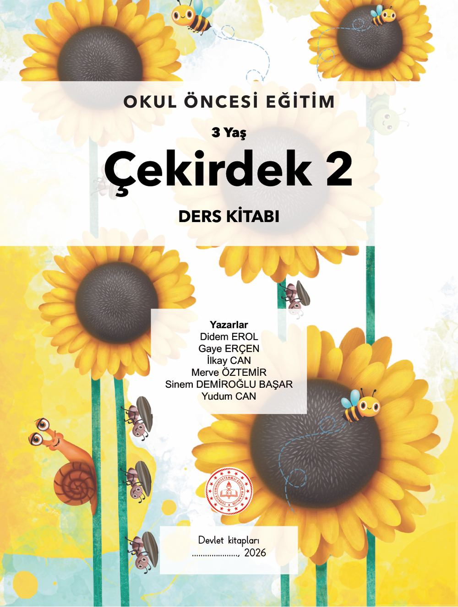

Devlet kitapları

<!-- sayfa 1 -->

MİLLÎ EĞİTİM BAKANLIĞI YAYINLARI ....................................................................: 10735
DERS KİTAPLARI DİZİSİ...........................................................................................: 2485

Her hakkı saklıdır ve Millî Eğitim Bakanlığına aittir. Kitabın metin, soru ve şekilleri kıs-
men de olsa hiçbir surette alınıp yayımlanamaz.

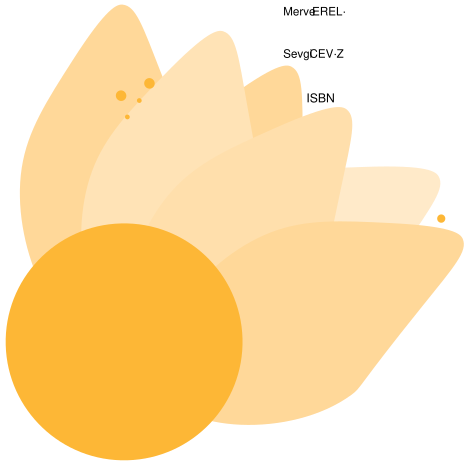

**EDİTÖR**
Burcu ÖZKANLI ERTUĞRUL

**DİL UZMANI**
Muhammet ŞEN

**GÖRSEL TASARIMCI**
Esra ÜNLÜ
Eylem YILDIRIM
Hüseyin Ozan ÖCAL
Serdar TUNCAL

**ÇOKLU ORTAM TASARIMCISI**
Abidin AYDIN
Ezgi KERVAN SARINÇ
Onur TÜLÜ

**PROGRAM GELİŞTİRME UZMANI**
Uğur ÇENET

**ÖLÇME VE DEĞERLENDİRME UZMANI**
Merve ERELİ

**REHBERLİK UZMANI**
Sevgi CEVİZ

ISBN 978-975-11-8097-1

Millî Eğitim Bakanlığı, Talim ve Terbiye Kurulu Başkanlığının 30.07.2024 tarih ve E-96732399-
116.01-111152749 sayılı yazısı ile eğitim aracı olarak kabul edilmiştir. Kurulca bu kitabın kabul 
edilmiş olması ders kitabından yayınevi ve yazarın/yazarların sorumluluğunu kaldırmaz.

<!-- sayfa 2 -->

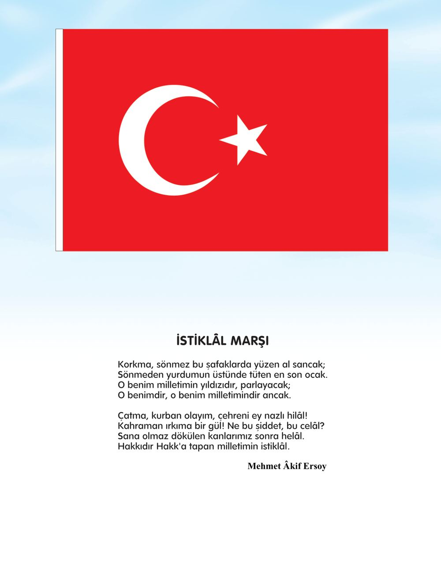

# İSTİKLÂL MARŞI

Korkma, sönmez bu şafaklarda yüzen al sancak;
Sönmeden yurdumun üstünde tüten en son ocak.
O benim milletimin yıldızıdır, parlayacak;
O benimdir, o benim milletimindir ancak.

Çatma, kurban olayım, çehreni ey nazlı hilâl!
Kahraman ırkıma bir gül! Ne bu şiddet, bu celâl?
Sana olmaz dökülen kanlarımız sonra helâl.
Hakkıdır Hakk'a tapan milletimin istiklâl.

Mehmet Âkif Ersoy

<!-- sayfa 3 -->

ANDIMIZ

Türküm, doğruyum, çalışkanım.

İlkem küçüklerimi korumak, büyüklerimi saymak; yurdumu, milletimi özümden çok sevmektir.
Ülküm yükselmek, ileri gitmektir.

Ey Büyük Atatürk!

Açtığın yolda, gösterdiğin hedefe durmadan yürüyeceğime ant içerim.

Varlığım Türk varlığına armağan olsun.

Ne mutlu Türküm diyene!

<!-- sayfa 4 -->

# MUSTAFA KEMAL ATATÜRK

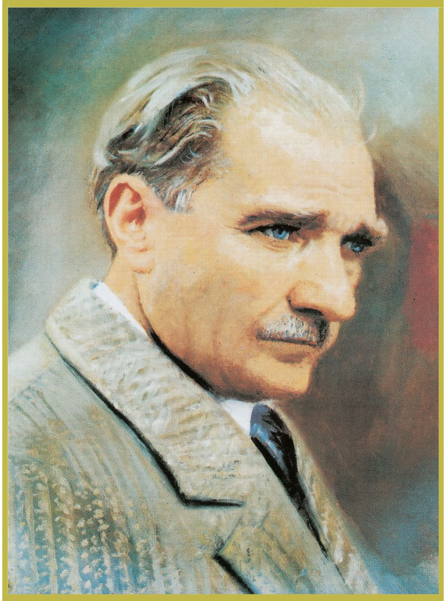
<!-- yer tutucu bulunamadı: sayfa sonuna eklendi -->

<!-- sayfa 5 -->

Verdiğiniz metin katmanı boş olduğu için (`<<< >>>` arası boş) dönüştürülecek bir içerik bulunmamaktadır. Lütfen metin katmanını içeren içeriği paylaşın, böylece talimatlarınıza uygun şekilde Markdown formatına çevirebilirim.

<!-- sayfa 6 -->

# İÇİNDEKİLER

| | |
| :--- | :---: |
| Ürgüp ve Göreme’yi Tanıyorum | 9 |
| Denge Hareketleri Yapıyorum | 10 |
| Bugün Nasıl Hissediyorum? | 11 |
| Bedenimizin Bölümleri | 12 |
| Hayvan Sesleri | 13 |
| İzin İstiyorum | 14 |
| Büyüteç | 15 |
| 3 Rakamını Öğreniyorum | 16 |
| Üç Tane | 17 |
| Sanat Türleri | 18 |
| Örümcekler | 19 |
| Teşekkür Ederim, Özür Dilerim | 20 |
| Alakargalar | 21 |
| Çizgi Çiziyorum | 22 |
| İpten Şekiller | 23 |
| Üçgeni Öğreniyorum | 24 |
| Üçgen Yolda Gezinti | 25 |
| Köstebekler ve Büyüteç | 26 |
| Millî Teknolojilerimiz | 27 |
| 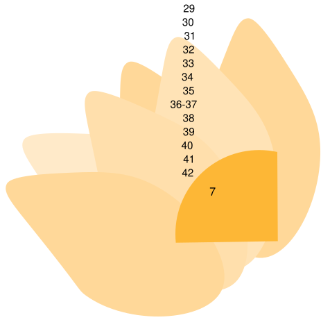 | |
| Kapaklar | 28 |
| Yeşil Vatan | 29 |
| Hangisi Eksik? | 30 |
| İlkbaharda Neler Görürüz? | 31 |
| Bilmeceler | 32 |
| Çizgi Çocukla Hareket | 33 |
| 4 Rakamını Öğreniyorum | 34 |
| Dört Tane | 35 |
| Kültür Turizmi | 36-37 |
| Bayramlar | 38 |
| Toprakta Neler Var? | 39 |
| Tablomu Tamamlıyorum | 40 |
| Atatürk ve Kitap | 41 |
| Kare Şeklini Öğreniyorum | 42 |

<!-- sayfa 7 -->

# İÇİNDEKİLER

| | |
| :--- | :---: |
| Kare Yolda Gezinti | 43 |
| Neye İhtiyacımız Var? | 44 |
| Renkli Balıklar | 45 |
| Kek Tarifi | 46 |
| Köstebek Toprağı Kazıyor | 47 |
| Kültürümüze Özgü Yemekler | 48 |
| 23 Nisan Ulusal Egemenlik ve Çocuk Bayramı | 49 |
| Topla Hareket Ediyorum | 50 |
| Trafik Kuralları | 51 |
| 5 Rakamını Öğreniyorum | 52 |
| Beş Tane | 53 |
| Nefes Egzersizi | 54 |
| Canlı-Cansız | 55 |
| Kunduzların Yaptığı Şekiller | 56 |
| Katı ve Sıvı Maddeleri Keşfediyorum | 57 |
| Bir-Bir-İki | 58 |
| Bütün-Yarım | 59 |
| Hayvanların Hareketlerini Taklit Ediyorum | 60 |
| Yüzer mi, Batar mı? | 61 |
| Renklerle Örüntü | 62 |
| İlişkili-İlişkisiz | 63 |
| Yazın Neler Görürüz? | 64 |
| Salyangoz Semi | 65 |
| Güneşli Gün Giysilerim | 66 |
| Bana Özel | 67 |
| Farkları Bulalım | 68 |
| Ahmet Tatile Gidiyor | 69 |
| Altında-Üstünde-Yanında | 70 |
| Tatil Zamanı | 71 |
| Görsel ve Genel Ağ Kaynakçası | 71 |
| Türkiye’nin Mülki İdare Bölümleri ile Kara ve Deniz Komşuları Haritası | 72 |

Etkinliklerin ilişkili olduğu beceriler ve süreç bileşenlerini

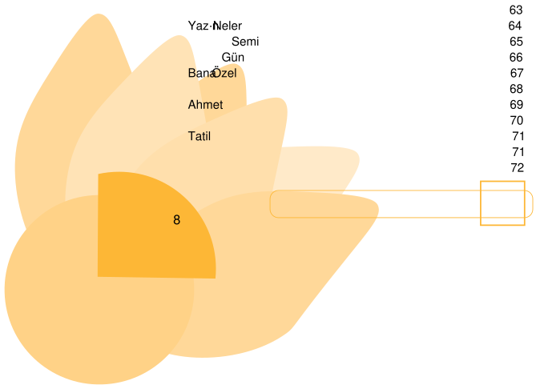
<!-- yer tutucu bulunamadı: sayfa sonuna eklendi -->

<!-- sayfa 8 -->

# ÜRGÜP VE GÖREME’Yİ TANIYORUM

Nevşehir'in Ürgüp ilçesi ve Göreme beldesinde, kayaların aşınmasıyla oluşmuş peri bacaları bulunmaktadır. Bu bölge, güzel atları, çömlek sanatı ve sıcak hava balonu turlarıyla ünlüdür. Görseli inceleyelim. Neler görüyoruz? Anlatalım.

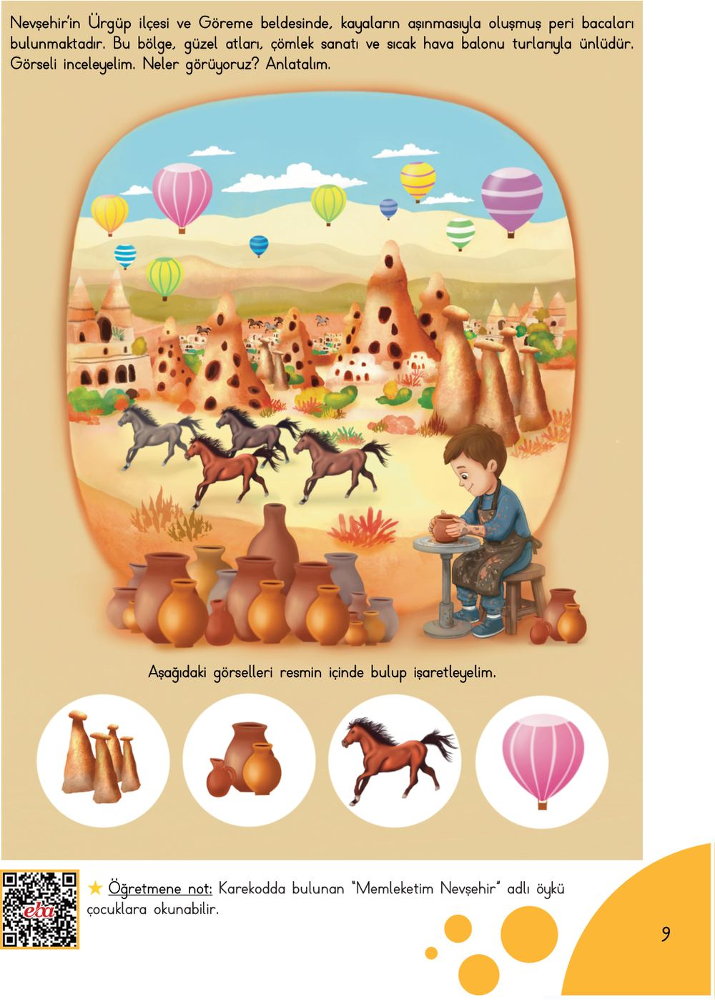

Aşağıdaki görselleri resmin içinde bulup işaretleyelim.

[Görsel grubu: Peri bacaları, çömlekler, at ve sıcak hava balonu ikonları]

⭐ Öğretmene not: Karekodda bulunan “Memleketim Nevşehir” adlı öykü

<!-- sayfa 9 -->

# DENGE HAREKETLERİ YAPIYORUM

Çocukların yaptığı denge hareketlerini inceleyelim. Denge hareketlerini sırayla yapmayı deneyelim.

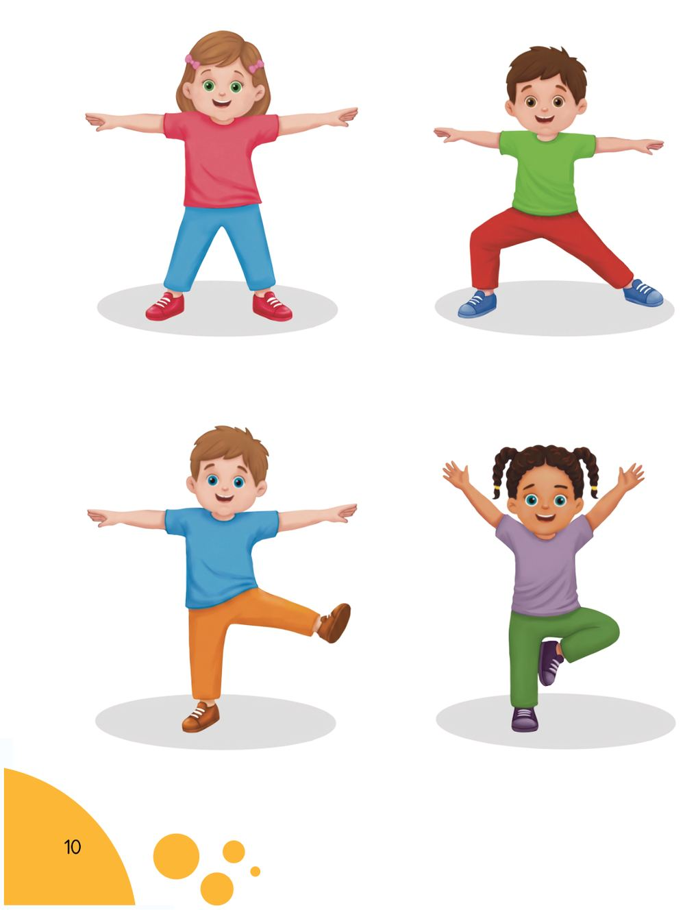

<!-- sayfa 10 -->

# BUGÜN NASIL HİSSEDİYORUM?

Bugün kendimizi nasıl hissediyoruz? Üzgün mü, mutlu mu, şaşkın mı, kızgın mı? Düşünelim. Hissettiğimiz duyguyu gösteren görselin altındaki kutucuğu işaretleyelim. Neden böyle hissettiğimizi söyleyelim.

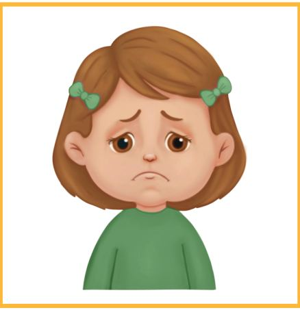
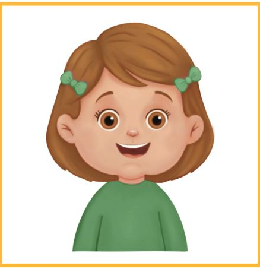

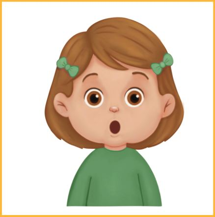
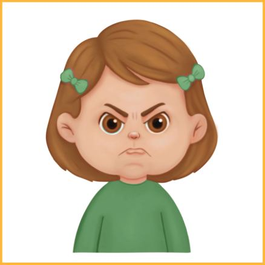


<!-- yer tutucu bulunamadı: sayfa sonuna eklendi -->

<!-- sayfa 11 -->

# BEDENİMİZİN BÖLÜMLERİ

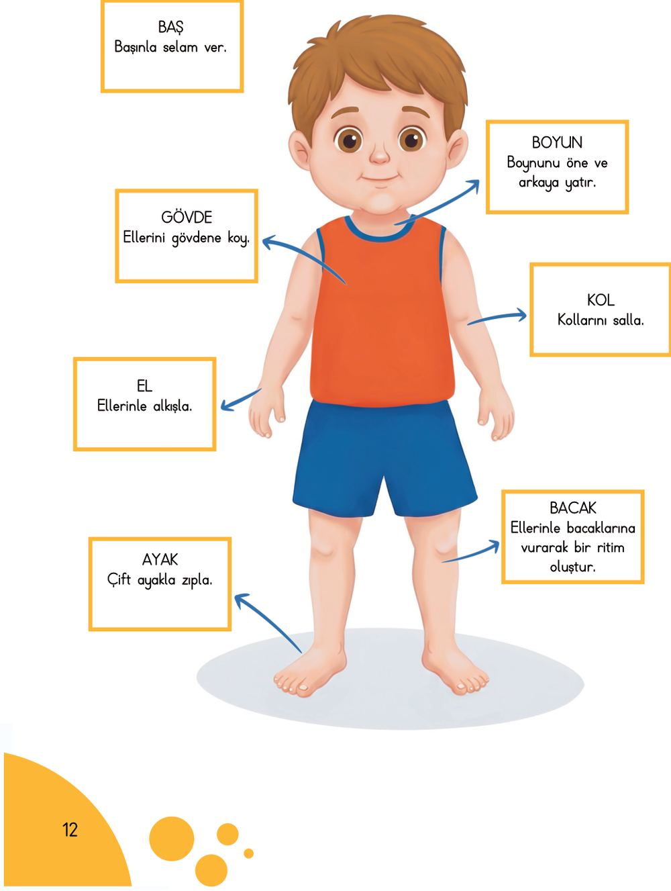

BAŞ
Başınla selam ver.

BOYUN
Boynunu öne ve arkaya yatır.

GÖVDE
Ellerini gövdene koy.

KOL
Kollarını salla.

EL
Ellerinle alkışla.

BACAK
Ellerinle bacaklarına vurarak bir ritim oluştur.

AYAK
Çift ayakla zıpla.

<!-- sayfa 12 -->

# HAYVAN SESLERİ

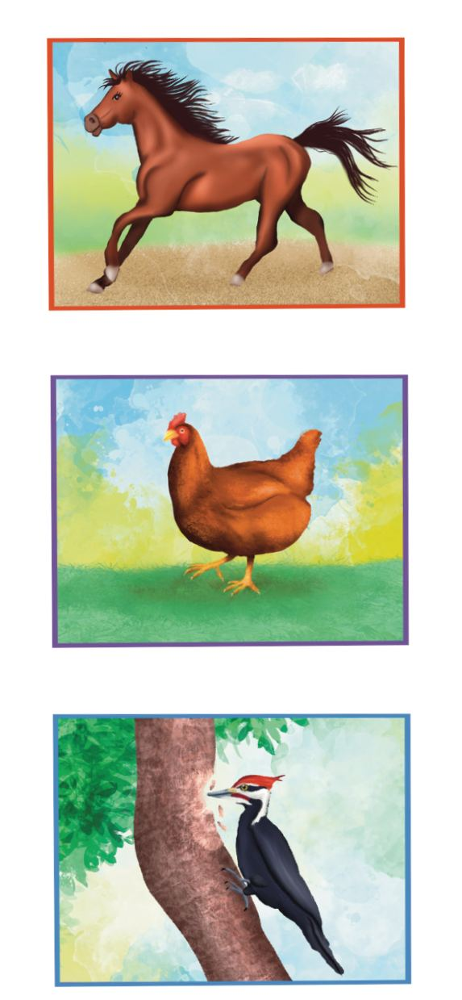

Atın koşarken çıkardığı ayak sesleri nasıl olabilir, düşünelim. Atın çıkardığı ayak seslerini dinleyelim ve bu sesi taklit edelim.


Tavuk öterken nasıl bir ses çıkarıyor olabilir, düşünelim. Tavuğun çıkardığı sesi dinleyelim ve bu sesi taklit edelim.


Ağaçkakan ağacı oyarak yuva yaparken nasıl bir ses çıkarıyor olabilir, düşünelim. Ağaçkakanın yuva yaparken çıkardığı sesi dinleyelim ve bu sesi taklit edelim.


⭐ Öğretmene not: Karekodlardaki sesler çocuklara dinletilir.

<!-- sayfa 13 -->

# İZİN İSTİYORUM

Emre Zehra’dan boya kalemini istiyor. “Kırmızı boya kalemini alabilir miyim?” diye soruyor. Zehra ne cevap vermiş olabilir? Konuşalım.

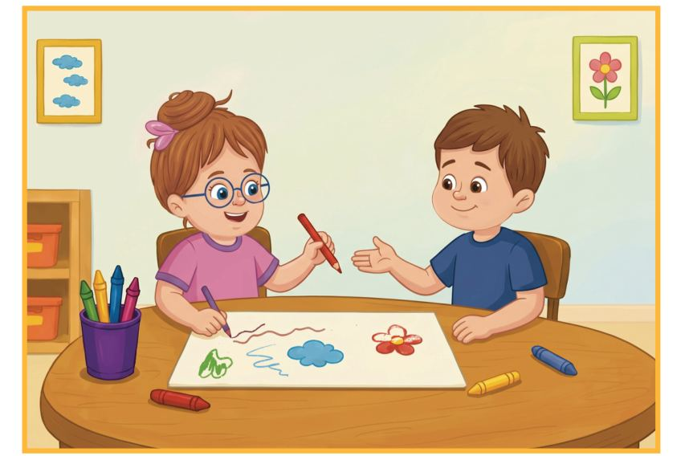

Görseli inceleyelim. Ahmet mavi renkli bloku isterken bunu nasıl söylemeli? Düşünelim ve söyleyelim.

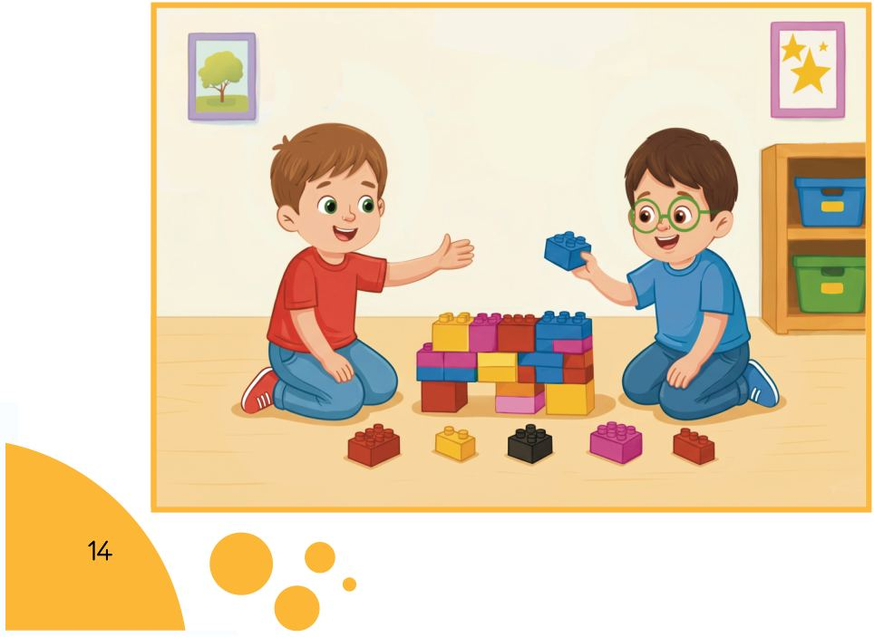

<!-- sayfa 14 -->

# BÜYÜTEÇ

Kitabın kapağını inceleyelim. Kitabın kapağında neler gördüğümüzü anlatalım. Kapaktaki yazıyı bulalım ve işaretleyelim.
Bu kitap ne anlatıyor olabilir? Tahminlerimizi söyleyelim. Hikâyeyi dinleyelim.

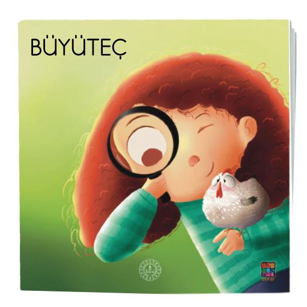

Görselleri inceleyelim. “Büyüteç” öyküsünde Nehir’in büyüteçle incelediklerini bulalım ve işaretleyelim.


⭐ Öğretmene not: Karekodda bulunan “Büyüteç” adlı öykü çocuklara okunur.

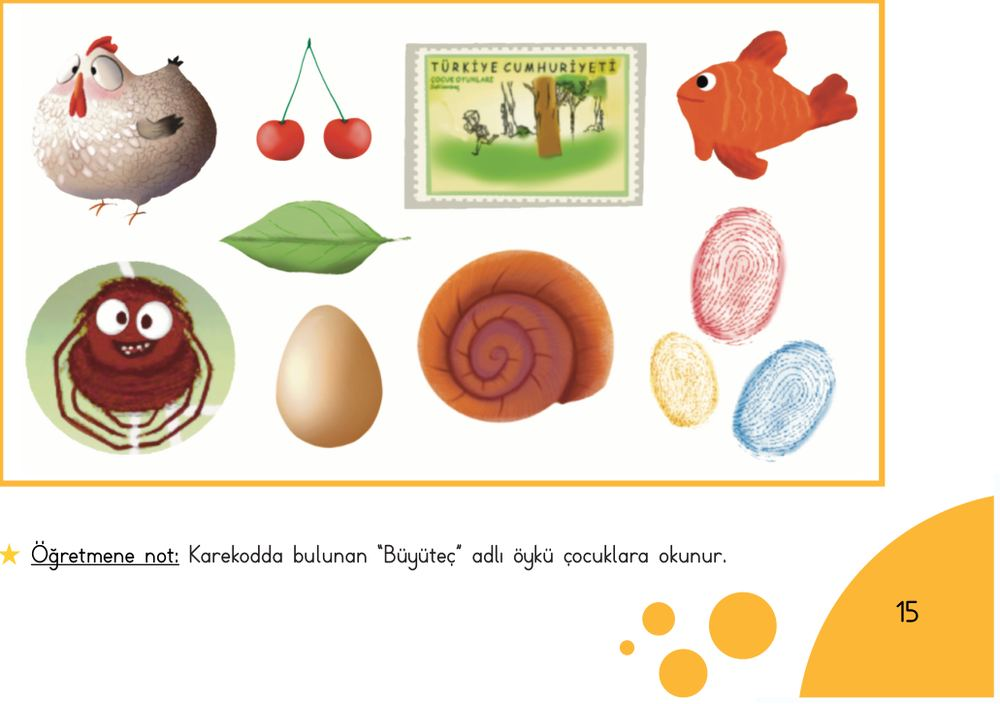
<!-- yer tutucu bulunamadı: sayfa sonuna eklendi -->

<!-- sayfa 15 -->

# 3 RAKAMINI ÖĞRENİYORUM

Ok yönünde ilerleyerek parmağımızla 3 rakamının üzerinden geçelim. 3 parmağımızı gösterelim.

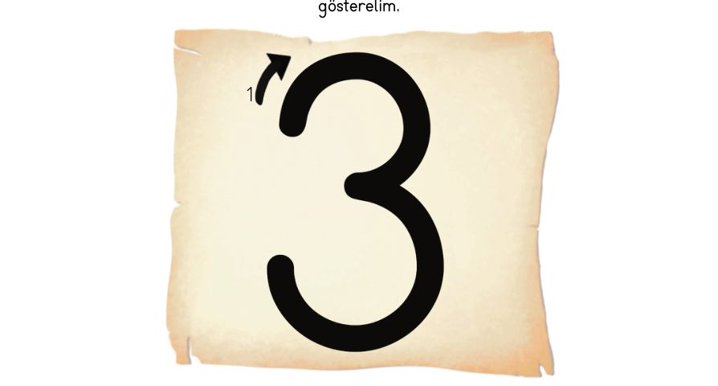

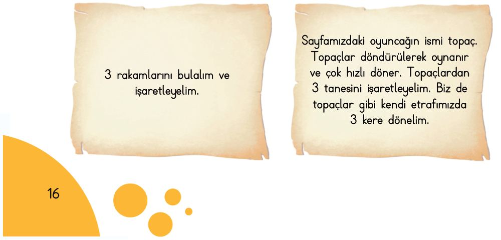 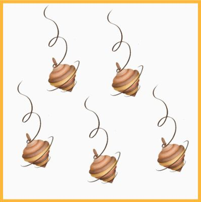

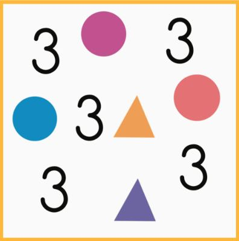

3 rakamlarını bulalım ve işaretleyelim.

Sayfamızdaki oyuncağın ismi topaç. Topaçlar döndürülerek oynanır ve çok hızlı döner. Topaçlardan 3 tanesini işaretleyelim. Biz de topaçlar gibi kendi etrafımızda 3 kere dönelim.

<!-- sayfa 16 -->

# ÜÇ TANE

İçinde 3 tane karınca olan yuvanın altındaki kutucuğu işaretleyelim.

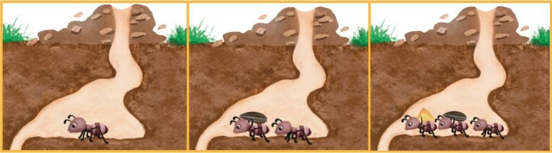

Üzerinde 3 tane beneği olan mantarın altındaki kutucuğu işaretleyelim.

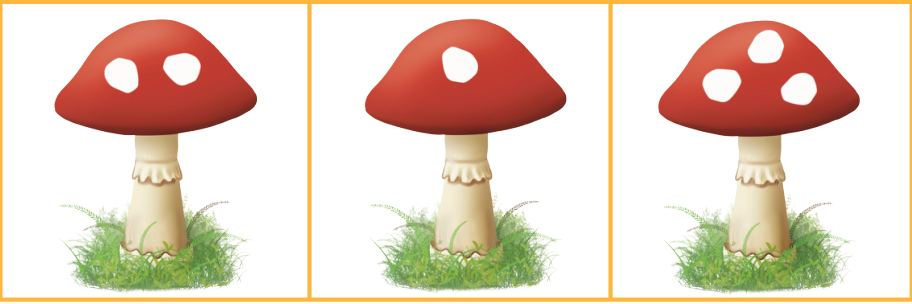

Üzerinde 3 tane uğur böceği olan yaprağın altındaki kutucuğu işaretleyelim.

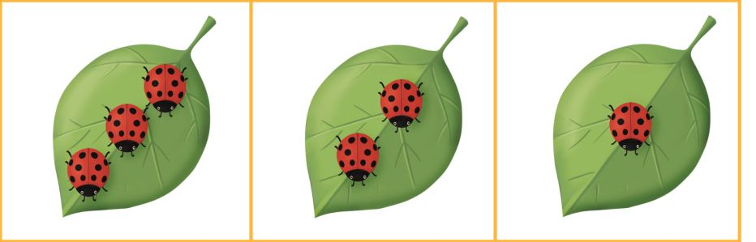


<!-- sayfa 17 -->

# SANAT TÜRLERİ

Görsellerin hangi sanat türüne ait olduğunu söyleyelim. Görsellerin yanındaki malzemeleri uygun sanat türleriyle çizgi çizerek eşleştirelim.

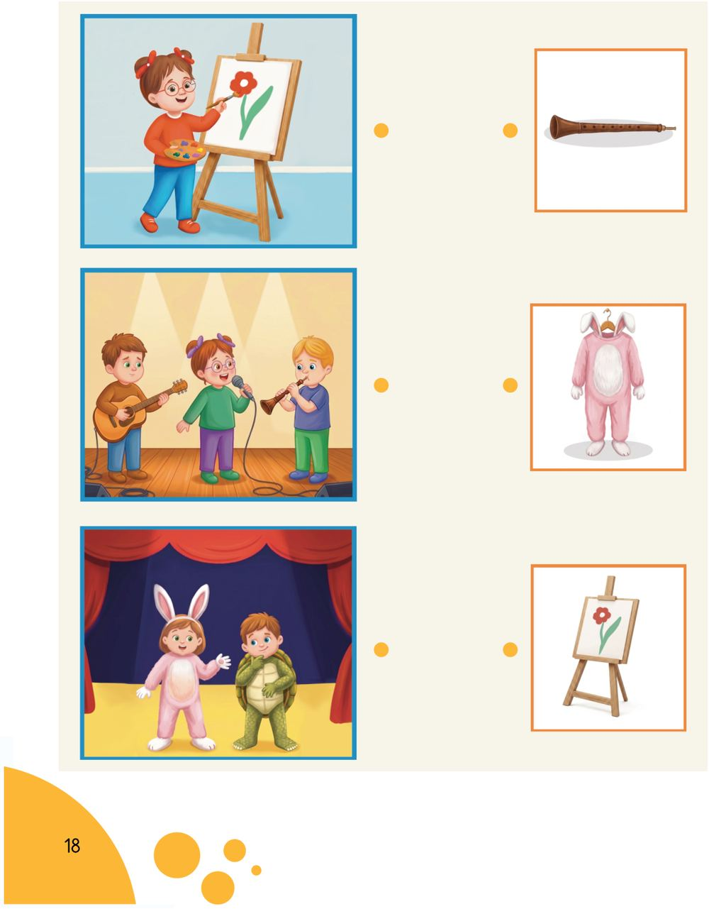

<!-- sayfa 18 -->

# ÖRÜMCEKLER

Örümcekler ağlarını genellikle bitkiler, ağaçlar, çalılar gibi böceklerin çok olduğu yerlere örer. Bahçeye çıkıp etrafı gözlemleyelim ve örümceklerin ağ örmek isteyebileceği yerleri bulalım. Arkadaşlarımızla büyük bir çember olalım ve bir yumağı birbirimize atarak örümcek ağı oluşturalım.

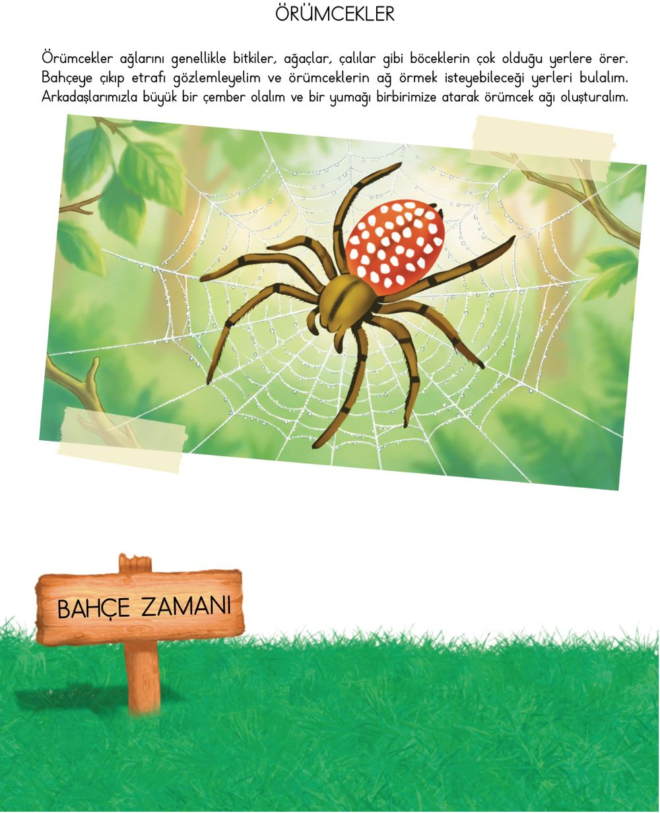

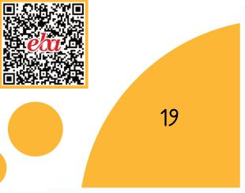

# BAHÇE ZAMANI

⭐ Öğretmene not: Karekodda bulunan “Sar Yumağı” adlı şarkı çocuklara dinletilir.  

<!-- sayfa 19 -->

# TEŞEKKÜR EDERİM, ÖZÜR DİLERİM

Samet boyalarını evde unutmuş. Aylin de boyalarını onunla paylaşmış. Samet, Aylin’e ne söylemeli? Konuşalım.

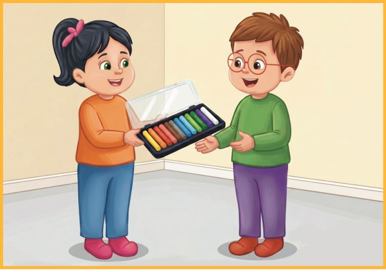

Can, Nevra ile oyuncak uçağını paylaşmış ama Nevra oyuncak uçakla oynarken istemeden oyuncağı kırmış. Nevra, Can’a ne söylemeli? Konuşalım.

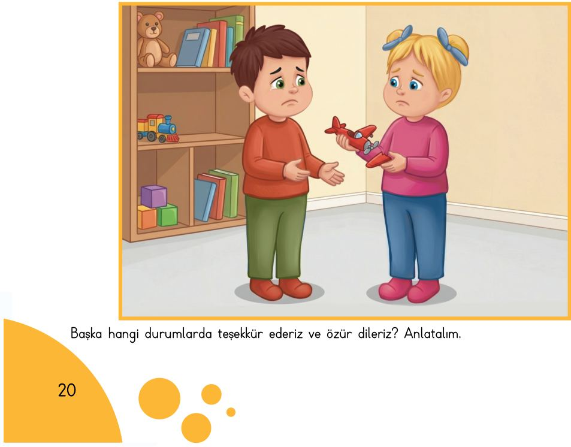

Başka hangi durumlarda teşekkür ederiz ve özür dileriz? Anlatalım.

<!-- sayfa 20 -->

# ALAKARGALAR

Alakargalar, mavi kanat tüyleriyle dikkat çeker. Meşe palamutlarını çok sevdikleri için meşe ağaçlarının bulunduğu alanlarda sıklıkla görülür. Meşe ağacının dallarındaki alakargaları inceleyelim. Yüksekteki dalda kaç alakarga var? Sayalım. Alçaktaki dalda kaç alakarga var? Sayalım.

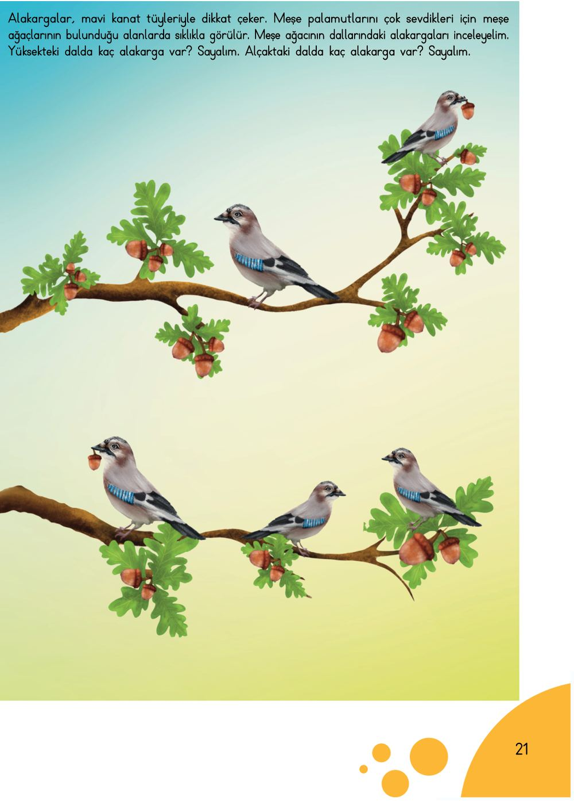

<!-- sayfa 21 -->

# ÇİZGİ ÇİZİYORUM

Çizgileri parmağımızla takip edelim. Kesik çizgileri çizgi çizerek birleştirelim.

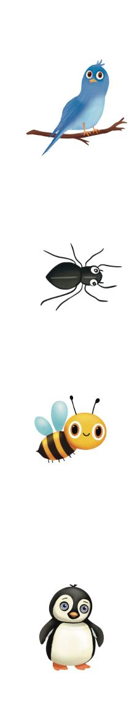 $\rightarrow$ <!-- KONTROL: Marker'da karşılığı yok, uydurma olabilir --> 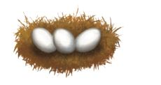 $\rightarrow$ <!-- KONTROL: Marker'da karşılığı yok, uydurma olabilir --> 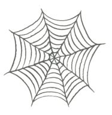

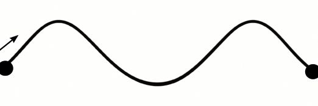 $\rightarrow$ <!-- KONTROL: Marker'da karşılığı yok, uydurma olabilir --> 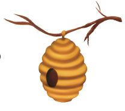 $\rightarrow$ <!-- KONTROL: Marker'da karşılığı yok, uydurma olabilir --> 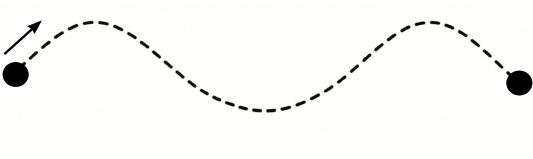

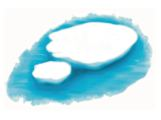 $\rightarrow$ <!-- KONTROL: Marker'da karşılığı yok, uydurma olabilir -->  $\rightarrow$ <!-- KONTROL: Marker'da karşılığı yok, uydurma olabilir --> 

 $\rightarrow$ <!-- KONTROL: Marker'da karşılığı yok, uydurma olabilir -->  $\rightarrow$ <!-- KONTROL: Marker'da karşılığı yok, uydurma olabilir --> 
```

*(Not: Talimatınızdaki şekil sayısı ve numaralandırma mantığına göre, görseldeki her bir nesne ve çizgi grubu için ayrı şekil etiketleri kullanılmıştır. Görselde 4 satır ve her satırda 3 ana bileşen (sol figür, çizgi, sağ figür) bulunmaktadır.)*

<!-- sayfa 22 -->

# İPTEN ŞEKİLLER

İnci, ipleri kullanarak şekil yapma oyunu oynuyor. İnci’nin yaptığı şekilleri inceleyelim. İplerin neye benzediklerini söyleyelim. Parmağımızı şekillerin üzerinde gezdirelim. Biz de ip kullanarak hayal ettiğimiz şekilleri çerçeve içine yapalım.

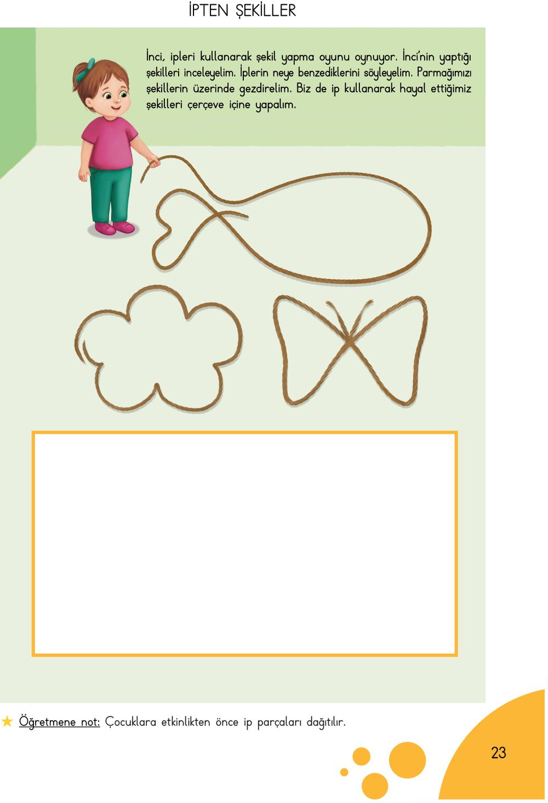


⭐ Öğretmene not: Çocuklara etkinlikten önce ip parçaları dağıtılır.

<!-- sayfa 23 -->

# ÜÇGENİ ÖĞRENİYORUM

Benim adım üçgen. 3 kenarım ve 3 köşem var.

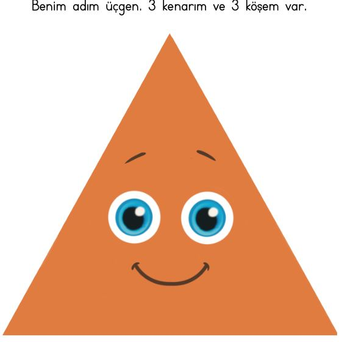

Görselleri inceleyelim. Görsellerden yüzeyi üçgen şekline benzeyenleri bulalım ve işaretleyelim.

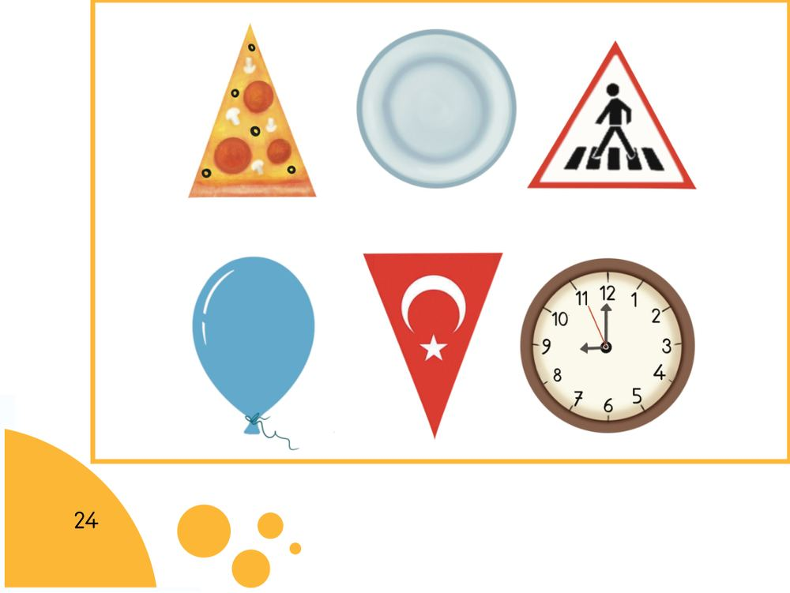

<!-- sayfa 24 -->

# ÜÇGEN YOLDA GEZİNTİ

Görseldeki şeklin ismini söyleyelim. Üçgen şeklindeki yolda okları takip ederek parmağımızı gezdirelim. Sınıfımızdan küçük bir oyuncak seçelim, okları takip ederek oyuncağımızı üçgen şeklindeki yol üzerinde hareket ettirelim.

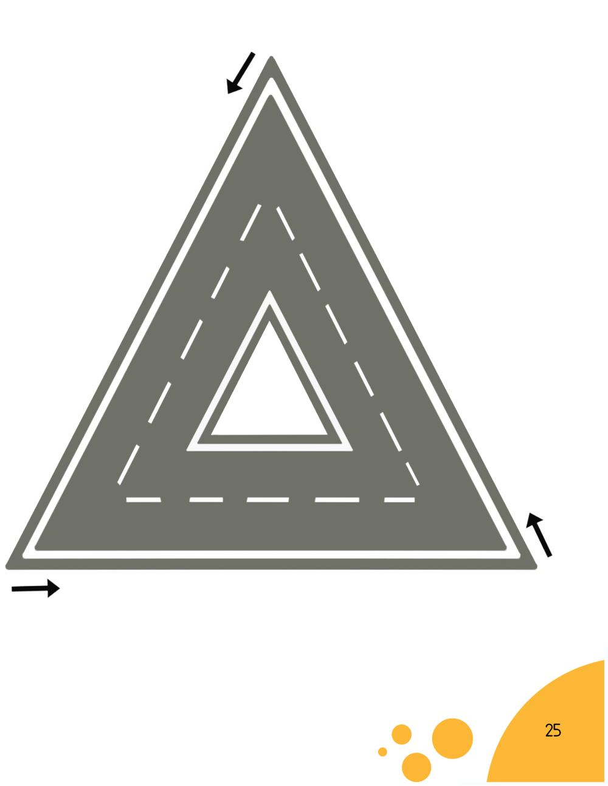

<!-- sayfa 25 -->

# KÖSTEBEKLER VE BÜYÜTEÇ

Gelincik toprağın altında kazdığı tünel evinde dinleniyordu. Kitabını okumaya çalışırken bazı sesler duydu. Gürültüden biraz rahatsız olmuş gibiydi. Ne olup bittiğini anlamak için sesin geldiği yönü takip etti. İki köstebeğin tartıştığını gördü. Köstebekler tünelde inceleme yapmak için büyüteci kimin kullanacağına bir türlü karar veremiyordu. Gelincik bu duruma şaşırıp kaldı.

Köstebeklerin sorunu ne olabilir? Söyleyelim.
Köstebeklerin sorunu nasıl çözülebilir? Düşünelim, anlatalım.

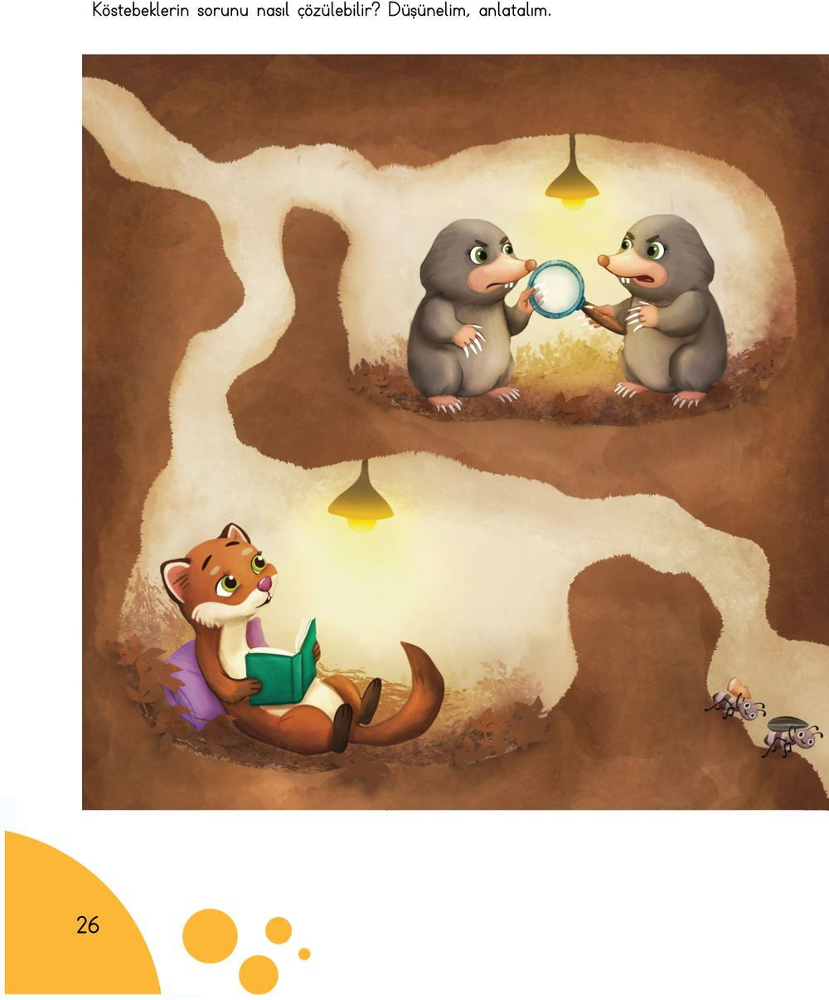

<!-- sayfa 26 -->

# MİLLÎ TEKNOLOJİLERİMİZ

Görselleri inceleyelim. Bu araçlar karada mı, denizde mi, havada mı hareket ediyor? Düşünelim. Araçların hareket ettikleri yeri bulalım ve altındaki kutucuğu işaretleyelim.

Ülkemizde üretilen elektrikli otomobil
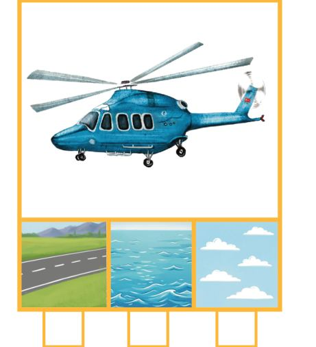

Ülkemizde üretilen helikopter Gökbey
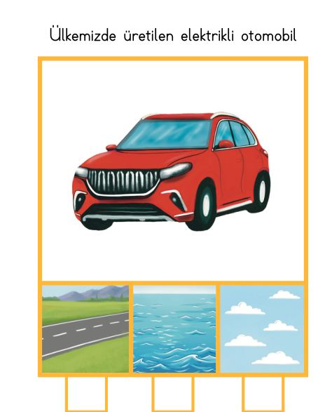

Ülkemizde üretilen uçak Hürkuş
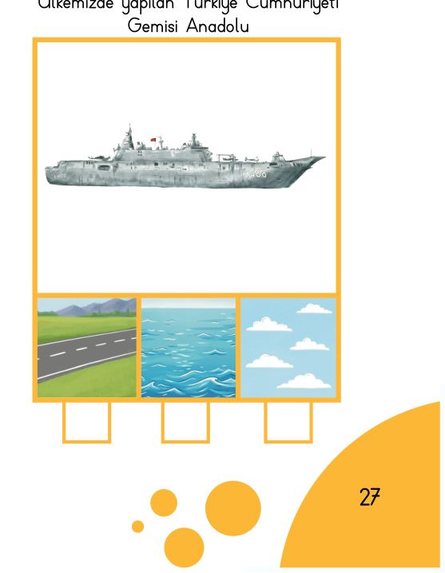

Ülkemizde yapılan Türkiye Cumhuriyeti Gemisi Anadolu
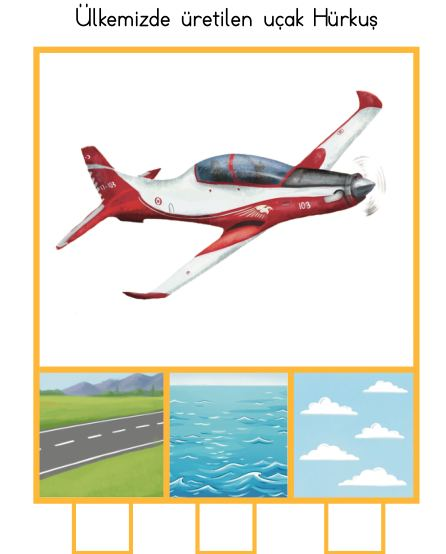

<!-- sayfa 27 -->

# KAPAKLAR

Görselleri inceleyelim, kapağı kapalı olanları işaretleyelim. Kapağı açık olanların kapaklarını bulup çizgi çizerek eşleştirelim. Sınıfımızdaki kapağı olan eşyaları bulalım ve bu eşyaların kapaklarını açıp kapatalım.

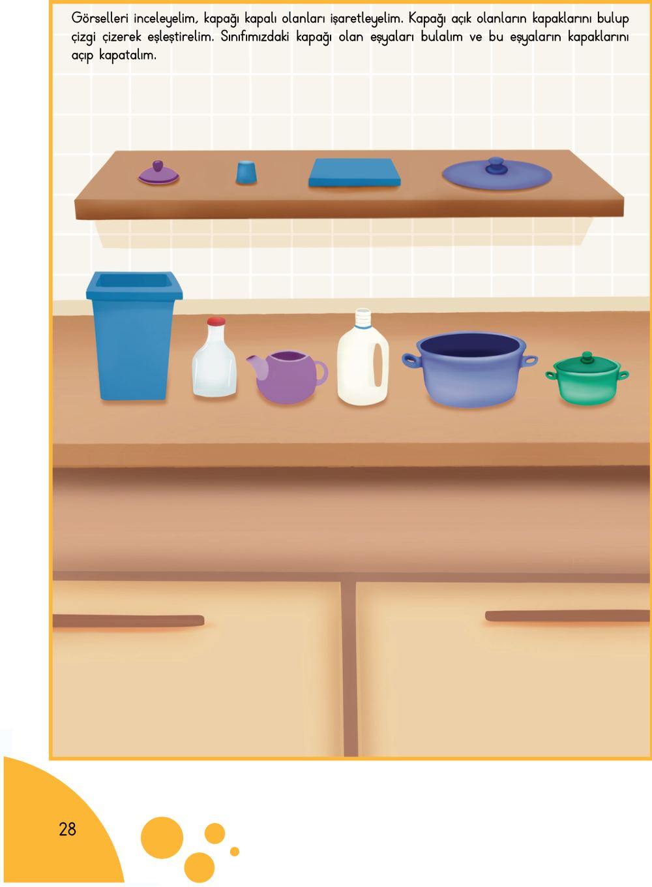

<!-- sayfa 28 -->

# YEŞİL VATAN

Kitabımızı yanımıza alalım ve bahçeye çıkalım. Yaprak görsellerini inceleyelim. Bahçemizdeki ağaçların yaprakları kitabımızdakilere benziyor mu? Araştıralım. Doğamızı korumak için neler yapabiliriz? Söyleyelim.

ÇINAR
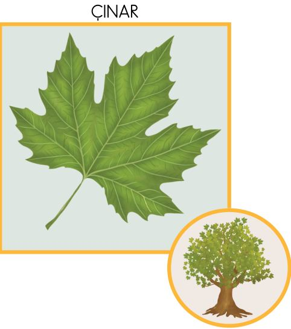

AKASYA
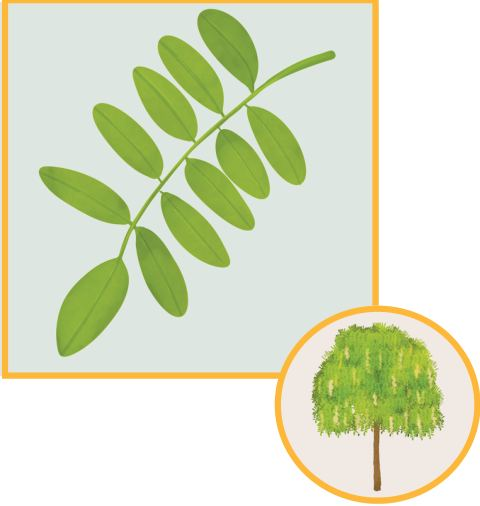

ÇAM


SÖĞÜT


<!-- sayfa 29 -->

# HANGİSİ EKSİK?

Sarı ve mor çerçevelerin içindeki görselleri inceleyelim. İki çerçeveyi karşılaştıralım. Sarı çerçevede olup mor çerçevede olmayanları bulup işaretleyelim.


<!-- sayfa 30 -->

# İLKBAHARDA NELER GÖRÜRÜZ?

Kitabımızı yanımıza alalım ve bahçeye çıkalım. İlkbaharda bahçe nasıl görünüyor? Anlatalım. Bahçede görsellerden hangileriyle karşılaştık? Gördüklerimizi işaretleyelim.


<!-- sayfa 31 -->

# BİLMECELER

Bilmeceleri dinleyelim. Cevapları, mor çerçevenin içindeki görseller arasından bulup işaretleyelim.

| | |
| :--- | :--- |
| Mutfakta durur,<br>Elektrikle çalışır,<br>Kapısını açınca,<br>Lezzetli yiyecekler görünür.<br>(BUZDOLABI) | Mis kokan çarşafları sereriz,<br>Üzerine uzanır dinleniriz,<br>Bazen yorgan bazen battaniye ile<br>Uykuya dalıp gideriz.<br>(YATAK) |


| | |
| :--- | :--- |
| Kirli çamaşırlar içine,<br>Basarız düğmesine,<br>Döner durur su içinde,<br>Yıkayıp temizler bize.<br>(ÇAMAŞIR MAKINESI) | Evin duvarında durur,<br>İçinde rafları olur,<br>Kitapları sıralarız,<br>Burada düzeni bulur.<br>(KITAPLIK) |

<!-- sayfa 32 -->

# ÇİZGİ ÇOCUKLA HAREKET

Görselleri inceleyelim. Çocukların yaptığı hareketleri hangi çizgi çocuk resmine bakarak yaptığını bulalım ve çizgi çizerek eşleştirelim. Çocukların yaptığı denge hareketlerini yapmayı deneyelim.

 ● ● 
 ● ● 
 ● ● 

<!-- sayfa 33 -->

# 4 RAKAMINI ÖĞRENİYORUM

Ok yönünde ilerleyerek parmağımızla 4 rakamının üzerinden geçelim. 4 parmağımızı gösterelim.


4 rakamlarını bulalım ve işaretleyelim.


Yukarıdaki araçların isimlerini söyleyelim ve 4 tekerleği olan aracı işaretleyelim. Yukarıdaki bisikleti sürdüğümüzü hayal edelim. Ayaklarımızı kaldırıp 4 kere pedal çevirme hareketi yapalım.

<!-- sayfa 34 -->

# DÖRT TANE

Üzerinde 4 tane yelkenli olan denizin altındaki kutucuğu işaretleyelim.


İçinde 4 tane kalem olan kalemliğin altındaki kutucuğu işaretleyelim.


İçinde 4 tane balık olan akvaryumun altındaki kutucuğu işaretleyelim.


<!-- sayfa 35 -->

# KÜLTÜR TURİZMİ

Ahmet bu yaz kültür turizmi için bir geziye çıkmış. Ülkemizdeki önemli yerleri gezerek fotoğraflar çekmiş. Çektiği fotoğrafları inceleyelim ve görevleri tamamlayalım. Merak ettiğimiz yerleri araştıralım.


### İZMİR
### Saat Kulesi


Saat kulesine hoş geldin. Burası İzmir’de bulunan bir kuledir. Sınıfımızda bloklarla kule yapmayı deneyelim.


### ANKARA
### Anıtkabir


Anıtkabir'e hoş geldin. Burası...


Selimiye Camii'ne hoş geldin. Burası Edirne'de bulunan Mimar Sinan'ın yaptığı bir külliyedir. Selimiye Camii minarelerini sayalım. Kaç tane olduğunu söyleyelim.


Edirne
Ankara
İzmir

<!-- sayfa 36 -->

# TRABZON
## Uzungöl


Uzungöl'e hoş geldin. Burası Trabzon'da bulunan birçok balığın yaşadığı bir göldür. Balıklar gibi yüzme taklidi yapalım.


# AĞRI
## Ağrı Dağı


Ağrı Dağı'na hoş geldin. Burası Ağrı'da bulunan Türkiye'nin en yüksek dağıdır. Ellerimizi başımızın üzerinde birleştirerek dağ gibi yapalım.


# GAZİANTEP
## Zeugma Müzesi


Zeugma Müzesi'ne hoş geldin. Burası Gaziantep'te bulunan bir mozaik müzesidir. Daha önce müzeye gittik mi? Anlatalım.


# ADANA
## Taş Köprü


Taş Köprü'ye hoş geldin. Burası Adana'nın...

<!-- sayfa 37 -->

# BAYRAMLAR

Görselleri inceleyelim. Görsellerde neler gördüğümüzü söyleyelim. Bayramlarda neler yaparız, arkadaşlarımıza anlatalım.

 


Çerçevenin içine sevdiklerimiz için bir bayram kartı tasarlayalım.


<!-- sayfa 38 -->

# TOPRAKTA NELER VAR?

Kitabımızı yanımıza alalım ve bahçeye çıkalım. Uygun araç gereçlerle toprağı kazıp inceleyelim. Toprağı kazdığımızda görsellerden hangileriyle karşılaştık? Gördüklerimizi işaretleyelim.


BAHÇE ZAMANI


<!-- sayfa 39 -->

# TABLOMU TAMAMLIYORUM

Görseli inceleyelim. Tablonun hangi malzemelerden yapılmış olabileceğini düşünelim, arkadaşlarımızla paylaşalım. Bu bir yırtma yapıştırma çalışması. Tabloda boş kalan yerleri sınıfımızdaki atık kâğıtları yırtıp yapıştırarak tamamlayalım.


<!-- sayfa 40 -->

# ATATÜRK VE KİTAP

Mustafa Kemal Atatürk, kitap okumayı çok severdi. Atatürk'ün kitaplarla olan fotoğraflarını inceleyelim.


Aşağıdaki kitaplardan birini seçelim ve biz de Mustafa Kemal Atatürk gibi kitap okuyalım. Neden bu kitabı seçtiğimizi söyleyelim.


⭐ Öğretmene not: Karekodlarda bulunan öyküler çocuklara okunur.


<!-- sayfa 41 -->

# KARE ŞEKLİNİ ÖĞRENİYORUM

Benim adım kare. Birbirine eşit uzunlukta 4 kenarım ve 4 köşem var.


Görselleri inceleyelim. Yüzeyi kare şekline benzeyenleri bulalım ve işaretleyelim.


<!-- sayfa 42 -->

# KARE YOLDA GEZİNTİ

Görseldeki şeklin ismini söyleyelim. Kare şeklindeki yolda okları takip ederek parmağımızı gezdirelim. Sınıfımızdan küçük bir oyuncak seçelim, okları takip ederek oyuncağımızı kare şeklindeki yol üzerinde hareket ettirelim.


<!-- sayfa 43 -->

# NEYE İHTİYACIMIZ VAR?

Saçımızı taramak için neye ihtiyacımız var? İşaretleyelim.


Çorba içmek için neye ihtiyacımız var? İşaretleyelim.


<!-- sayfa 44 -->

# RENKLİ BALIKLAR

Görselleri inceleyelim. Balıkların renklerini söyleyelim. Rengi söylenen balığın üzerine aynı renkte boya kalemimizi koyalım. Balıkların eksik kısımlarını boyayarak tamamlayalım.

 
 
 

<!-- sayfa 45 -->

# KEK TARİFİ

Alper, annesinin doğum gününü kutlamak için babasıyla kek yapmaya karar verdi. Kek malzemelerinin olduğu listeyi inceleyelim. Kek yapmak için gerekli olan malzemeleri bulalım ve işaretleyelim.

| MALZEMELER | |
| :--- | :--- |
| 2 kase un |  |
| 1 bardak süt |  |
| 3 yumurta |  |
| 1 fincan şeker |  |
| 4 adet çilek |  |

<!-- sayfa 46 -->

# KÖSTEBEK TOPRAĞI KAZIYOR

Köstebekler bazen yiyecek aramak, bazen de yuvalarını yapmak için toprağı kazar. Köstebeğin toprağın üzerine çıkmak için kullanması gereken yolu çizerek gösterelim. Toprağın altına yuva yapan başka hangi hayvanlar var? Söyleyelim.


BAHÇE ZAMANI

<!-- sayfa 47 -->

# KÜLTÜRÜMÜZE ÖZGÜ YEMEKLER

Görselleri inceleyelim. Bildiğimiz yemekleri işaretleyelim. Bu yemeklerin isimlerini söyleyelim. Kültürümüze özgü bildiğimiz başka yemekler varsa anlatalım.


<!-- sayfa 48 -->

23 NİSAN ULUSAL EGEMENLİK VE ÇOCUK BAYRAMI


23 Nisan Ulusal Egemenlik ve Çocuk Bayramı, Mustafa Kemal Atatürk’ün tüm dünya çocuklarına hediye ettiği en neşeli bayramdır. Bu özel günde kutlamalar yapılır, çocuklar oyunlar oynar ve eğlenir. Görseldeki çocukları inceleyelim. Çocuklar neler yapıyor? Çocuklar ne hissediyor olabilir? Konuşalım. Biz de 23 Nisan Ulusal Egemenlik ve Çocuk Bayramı’nı coşkuyla kutlayalım.

⭐Öğretmene not: Karekoddaki bulunan “23 Nisan” adlı şarkı çocuklara

<!-- sayfa 49 -->

# TOPLA HAREKET EDİYORUM

Defne topu farklı şekillerde tutarak bir denge oyunu oynamaktadır. Defne'nin topu nasıl tuttuğunu resimlere bakarak inceleyelim ve topun nerede olduğunu söyleyelim. Biz de yumuşak ve hafif bir oyuncakla Defne'nin yaptığı hareketleri yapmayı deneyelim.


<!-- sayfa 50 -->

# TRAFİK KURALLARI

Ali ve annesinin okula gitmek için trafik lambasının olduğu bir yolda karşıdan karşıya geçmesi gerekiyor. Yeşil ışık yandığında Ali ve annesi yaya geçidinden geçiyor.


Kırmızı ışıkta ne yapılır? Konuşalım. Kırmızı ışık yandığında yapılması gereken davranışın altında yer alan kutucuğu işaretleyelim.

 


<!-- sayfa 51 -->

# 5 RAKAMINI ÖĞRENİYORUM

Ok yönünde ilerleyerek parmağımızla 5 rakamının üzerinden geçelim. 5 parmağımızı gösterelim.


| | |
| :---: | :---: |
| 5  5 |  |
|  5   |  |
| 5  5 |  |

| | |
| :---: | :---: |
| 5 rakamlarını bulalım ve işaretleyelim. | Yukarıdaki müzik aletinin ismi davul. Davullardan 5 tanesini işaretleyelim. Ellerimizle 5 kere ritim tutalım. |
|  |  |

<!-- sayfa 52 -->

# BEŞ TANE

Üzerinde 5 tane bardak olan masanın altındaki kutucuğu işaretleyelim.


Çevresinde 5 tane arı olan yuvanın altındaki kutucuğu işaretleyelim.


Üzerinde 5 tane yengeç olan kumsalın altındaki kutucuğu işaretleyelim.


<!-- sayfa 53 -->

# NEFES EGZERSİZİ

Doğru nefes alıp vermek sağlığımız için çok önemlidir. Görsellerdeki hareketleri önce yavaş sonra hızlı yapalım. Nefes alıp vermemiz nasıl değişti? Konuşalım.


Çizgileri sırayla parmağımızla takip edelim. Mavi çizgileri takip ederken çiçek koklar gibi nefes alalım. Pembe çizgileri takip ederken karahindiba üfler gibi nefes verelim.


<!-- sayfa 54 -->

# CANLI-CANSIZ

Canlı varlıkların yaşamak için suya, havaya ve beslenmeye ihtiyacı vardır. Sayfamızdaki canlı ve cansız görselleri inceleyelim. Her sırada yer alan canlı varlığın altındaki kutucuğu işaretleyelim.


<!-- sayfa 55 -->

# KUNDUZLARIN YAPTIĞI ŞEKİLLER

Kunduzlar, yuvalarını yapmak için dal, çamur ve taş kullanır. Kunduzlar yuvalarını akarsuların içine inşa eder. Görseli inceleyelim ve kunduz yuvasını gösterelim.


Kunduzun dal parçaları ve taşlar kullanarak yaptığı şekillere bakalım. Daire, kare ve üçgen şekillerine benzeyenleri bulalım ve gösterelim. Biz de sınıfımızda seçtiğimiz malzemeleri kullanarak istediğimiz şekilleri yapalım.


<!-- sayfa 56 -->

# KATI VE SIVI MADDELERİ KEŞFEDİYORUM

Görselleri inceleyelim. Sıvı maddeleri mavi kutuya, katı maddeleri kırmızı kutuya çizgi çizerek götürelim. Katı ve sıvı maddelere örnekler verelim.


⭐ **Öğretmene not:** Katı ve sıvı maddeler hakkında çocuklarla konuşurken görseldeki

<!-- sayfa 57 -->

# BİR-BİR-İKİ

Görselleri inceleyelim. Bu mesleklerin ne iş yaptıklarını konuşalım. Meslekleri uygun araçlarla çizgi çizerek eşleştirelim.


⭐ Öğretmene not: Karekodda bulunan “Bir Bir İki ” adlı şarkı çocuklara

<!-- sayfa 58 -->

# BÜTÜN-YARIM

Görselleri inceleyelim. Bütün olan meyvelerin isimlerini söyleyelim. Her sıradaki bütün olan meyvenin yarısını bulalım. Bulduğumuz yarım meyvenin altındaki kutucuğu işaretleyelim.


<!-- sayfa 59 -->

# HAYVANLARIN HAREKETLERİNİ TAKLİT EDİYORUM


Görseldeki hayvanların adlarını söyleyelim.
Kurbağa gibi 3 kere zıplayalım.
Bir kuş gibi kanadımızı çırpalım.
Bir kaplumbağa gibi sınıfımızda yavaşça dolaşalım.
Bir salyangoz gibi sürünme hareketi yapalım.

<!-- sayfa 60 -->

# YÜZER Mİ, BATAR MI?

İçi su dolu şeffaf bir kabı masaya koyalım. Tablodaki nesneleri inceleyelim. Bu nesneleri çevremizden bulalım. Nesneleri tek tek suyun içine bırakalım. Yüzen nesnelerin yanındaki kutucuğu maviye, batan nesnelerin yanındakini kırmızıya boyayalım.


| | |
| :---: | :---: |
|  | ☐ |
|  | ☐ |
|  | ☐ |
|  | ☐ |

<!-- sayfa 61 -->

# RENKLERLE ÖRÜNTÜ

Şeritlerin içindeki örüntüleri inceleyelim.


Yukarıdaki örüntüye göre daireleri boyayarak kelebeği çiçeğe ulaştıralım.


Yukarıdaki örüntüye göre kareleri boyayarak kuşu yuvasına ulaştıralım.


<!-- sayfa 62 -->

# İLİŞKİLİ-İLİŞKİSİZ

Görselleri inceleyelim. Üstteki görselle ilişkili olanı alttaki görseller arasından bulup işaretleyelim.


<!-- sayfa 63 -->

# YAZIN NELER GÖRÜRÜZ?

Kitabımızı yanımıza alalım ve bahçeye çıkalım. Yaz mevsiminde bahçe nasıl görünüyor? Anlatalım. Bahçede görsellerden hangileriyle karşılaştık? Gördüklerimizi işaretleyelim.

 BAHÇE ZAMANI

<!-- sayfa 64 -->

# SALYANGOZ SEMİ

Sıcak bir günde Salyangoz Semi gezintiye çıkmaya karar vermiş. Hava gittikçe ısınmış bu yüzden Salyangoz Semi daha fazla ilerleyememiş. Semi sıcaktan korunmak için ne yapabilir? Söyleyelim.

Salyangozlar sıcaktan korunmak için kabuklarının içine saklanır. Ayrıca gölgeli, nemli ve serin bir yer bulmaya çalışır.


Sıcaktan ve güneş ışığından korunmak için nelere ihtiyaç duyarız? Konuşalım ve doğru kutucukları işaretleyelim.


<!-- sayfa 65 -->

# GÜNEŞLİ GÜN GİYSİLERİM

Mehmet pencereden dışarı baktığında havanın güneşli ve sıcak olduğunu fark etmiş. Mehmet böyle bir havada dışarı çıkarken aşağıdaki kıyafetlerden hangilerini giyebilir? İşaretleyelim.


Bugün havanın nasıl olduğunu ve neler giydiğimizi konuşalım.

<!-- sayfa 66 -->

# BANA ÖZEL

Ayşe, annesiyle misafirliğe gitti. Gittiği yerde yetişkinler Ayşe’yle sohbet ettiler. Bir yetişkin Ayşe’ye sarılmak istedi. Ayşe ona sarılmak istemedi. Ayşe istemediği hâlde sarılmak zorunda mı? Ayşe’nin yerinde olsaydık ne yapardık? Düşünelim. Bir insanın bize sarılmasını istemediğimizde bunu ona nasıl belirtiriz? Söyleyelim.


 Ayşe sarılmak yerine elini uzatmayı tercih etti.

Yapmayı tercih ettiğimiz hareketleri işaretleyelim.

  

<!-- sayfa 67 -->

# FARKLARI BULALIM

Ülkemizde nesli tükenmekte olan hayvan türleri bulunmaktadır. Deniz kaplumbağası bunlardan biridir. Görselleri inceleyelim. İki resim arasındaki 5 farkı bulalım ve işaretleyelim.


<!-- sayfa 68 -->

# AHMET TATİLE GİDİYOR

Ahmet ailesiyle tatile gitmek için eşyalarını hazırlıyor. Bavullardan bir tanesi dolmuş. Dolu olan bavulu işaretleyelim. Ahmet'in ihtiyacı olan diğer eşyalarını çizgi ile boş bavula götürelim.


<!-- sayfa 69 -->

# ALTINDA-ÜSTÜNDE-YANINDA

Görselleri inceleyelim. Masanın altında ne var? Masanın üstünde ne var? Masanın yanında ne var? Söyleyelim.


Oyun hamurundan bir top yapalım. Topu masa görselinin altına koyalım. Topu masa görselinin üstüne koyalım. Topu masa görselinin yanına koyalım.


<!-- sayfa 70 -->

# TATİL ZAMANI

Okulda yapmayı en çok sevdiğimiz etkinliğin/etkinliklerin altındaki kutucuğu işaretleyelim.


Okul bittiği için nasıl hissediyoruz? Bizimle aynı duyguyu hisseden çocuk görselinin altındaki kutucuğu işaretleyelim.


<!-- yer tutucu bulunamadı: sayfa sonuna eklendi -->

<!-- sayfa 71 -->

50°
45°D
40°D
35°D
30°D
25°D

ROMANYA
Bükreş
Sofya
UKRAYNA
RUSYA FEDERASYONU
HAZAR DENİZİ
KARADENİZ
BULGARİSTAN
ANİSTAN
Tiflis
GÜRCİSTAN
ERMENİSTAN
AZERBAYCAN
NAHÇIVAN Ö.C. (AZERBAYCAN)
Erivan
İRAN
IRAK
Bağdat
SÜRİYE
LÜBNAN
Beyrut
Şam
KUZEY KIBRIS TÜRK CUMHURİYETİ
GÜNEY KIBRIS RUM YÖNETİMİ
Lefkoşa
AKDENİZ
MİSİR
BYA
FİLİSTİN
Tel Aviv
İSRAİL
Doğu Kudüs
Gazze Şeridi
Batı Şeria
FİLİSTİN

: Türkiye haritası üzerinde iller, komşu ülkeler, denizler ve akarsular gösterilmiştir.

**İller Listesi:**
Adana, Adıyaman, Afyonkarahisar, Ağrı, Amasya, Ankara, Antalya, Artvin, Aydın, Balıkesir, Bilecik, Bingöl, Bitlis, Bolu, Burdur, Bursa, Çanakkale, Çankırı, Çorum, Denizli, Diyarbakır, Edirne, Elâzığ, Erzincan, Erzurum, Eskişehir, Gaziantep, Giresun, Gümüşhane, Hakkâri, Hatay, Isparta, Mersin, İstanbul, İzmir, Kars, Kastamonu, Kayseri, Kırklareli, Kırşehir, Kocaeli, Konya, Kütahya, Malatya, Manisa, Kahramanmaraş, Mardin, Muğla, Muş, Nevşehir, Niğde, Ordu, Rize, Sakarya, Samsun, Siirt, Sinop, Sivas, Tekirdağ, Tokat, Trabzon, Tunceli, Şanlıurfa, Uşak, Van, Yozgat, Zonguldak, Aksaray, Bayburt, Karaman, Kırıkkale, Batman, Şırnak, Bartın, Ardahan, Iğdır, Yalova, Karabük, Kilis, Osmaniye, Düzce.

**Coğrafi Unsurlar:**
EGE DENİZİ
MARMARA DENİZİ
Kızılırmak N.
Sakarya N.
Gediz N.
Büyük Menderes N.
Bakırçay N.
Küçük Menderes N.
Yeşilırmak N.
Çoruh N.
Aras N.
Kura N.
Fırat N.
Dicle N.
Asi N.
Seyhan N.
Ceyhan N.
Göksu N.
Meriç N.
Tuna N.
Nil N.
Süveyş K.
Van Gölü
Tuz Gölü
Urumiye Gölü

**Lejant:**
TÜRKİYE'NİN MÜLKİ İDARE BÖLÜMLERİ İLE KARA VE DENİZ KOMŞULARI HARİTASI
* BAŞKENT (Ankara)
* İL MERKEZİ
* GÖL
* AKARSU
* ÜLKE SINIRI
* ÖZERK BÖLGE SINIRI

0 100 200 300 400 km

Harita Genel Müdürlüğü tarafından üretilmiştir.
