# Okul Öncesi Eğitim 4 Yaş Çekirdek 1 Ders Kitabı

<!-- sayfa 0 -->

# OKUL ÖNCESİ EĞİTİM
## 4 Yaş
# Çekirdek 1
## DERS KİTABI

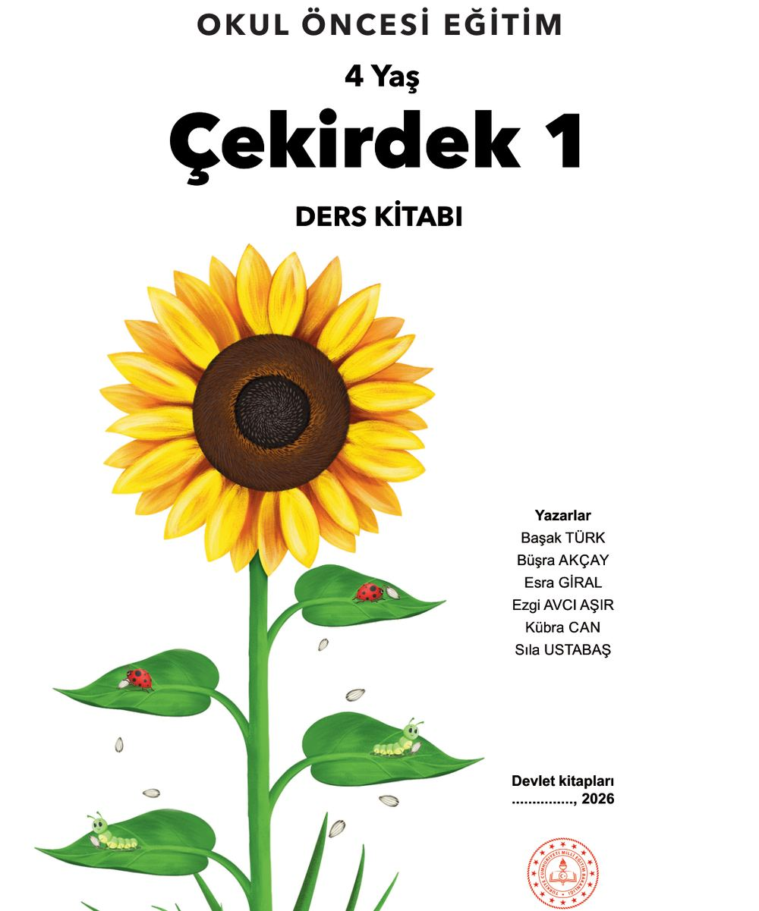

**Yazarlar**
Başak TÜRK
Büşra AKÇAY
Esra GİRAL
Ezgi AVCI AŞIR
Kübra CAN
Sıla USTABAŞ

**Devlet kitapları**
..............., 2026

<!-- sayfa 1 -->

**MİLLÎ EĞİTİM BAKANLIĞI YAYINLARI** ....................................................................: **10736**
**DERS KİTAPLARI DİZİSİ** ..........................................................................................: **2486**

**Her hakkı saklıdır ve Millî Eğitim Bakanlığına aittir. Kitabın metin, soru ve şekilleri kısmen de olsa hiçbir surette alınıp yayımlanamaz.**

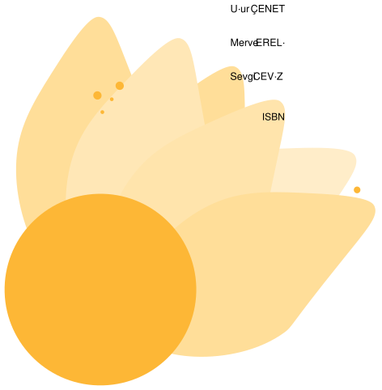

**EDİTÖR**
Burcu ÖZKANLI ERTUĞRUL

**DİL UZMANI**
Muhammet ŞEN

**GÖRSEL TASARIMCI**
Eylem YILDIRIM
Mehmet Ali KARAASLAN
Melike TURALİ
Serdar TUNCAL
Serdar TURALİ

**ÇOKLU ORTAM TASARIMCISI**
Abidin AYDIN
Ezgi KERVAN SARINÇ
Onur TÜLÜ

**PROGRAM GELİŞTİRME UZMANI**
Uğur ÇENET

**ÖLÇME VE DEĞERLENDİRME UZMANI**
Merve ERELİ

**REHBERLİK UZMANI**
Sevgi CEVİZ

**ISBN 978-975-11-8090-**

**Millî Eğitim Bakanlığı, Talim ve Terbiye Kurulu Başkanlığının 30.07.2024 tarih ve E-96732399-116.01-111152749 sayılı yazısı ile eğitim aracı olarak kabul edilmiştir. Kurulca bu kitabın kabul edilmiş olması ders kitabından yayınevi ve yazarın/yazarların sorumluluğunu kaldırmaz.**

<!-- sayfa 2 -->

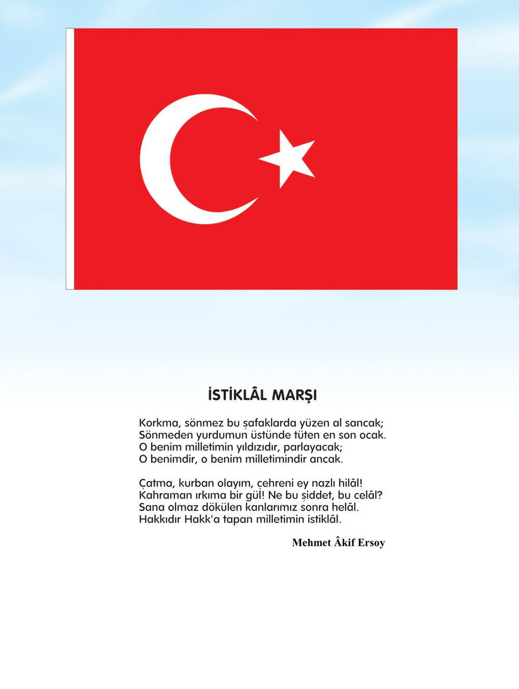

# İSTİKLÂL MARŞI

Korkma, sönmez bu şafaklarda yüzen al sancak;
Sönmeden yurdumun üstünde tüten en son ocak.
O benim milletimin yıldızıdır, parlayacak;
O benimdir, o benim milletimindir ancak.

Catma, kurban olayım, cehreni ey nazlı hilâl!
Kahraman ırkıma bir gül! Ne bu şiddet, bu celâl?
Sana olmaz dökülen kanlarımız sonra helâl.
Hakkıdır Hakk'a tapan milletimin istiklâl.

**Mehmet Âkif Ersoy**

<!-- sayfa 3 -->

ANDIMIZ

Türküm, doğruyum, çalışkanım.

İlkem küçüklerimi korumak, büyüklerimi saymak; yurdumu, milletimi özümden çok sevmektir.
Ülküm yükselmek, ileri gitmektir.

Ey Büyük Atatürk!

Açtığın yolda, gösterdiğin hedefe durmadan yürüyeceğime ant içerim.

Varlığım Türk varlığına armağan olsun.

Ne mutlu Türküm diyene!

<!-- sayfa 4 -->

# MUSTAFA KEMAL ATATÜRK

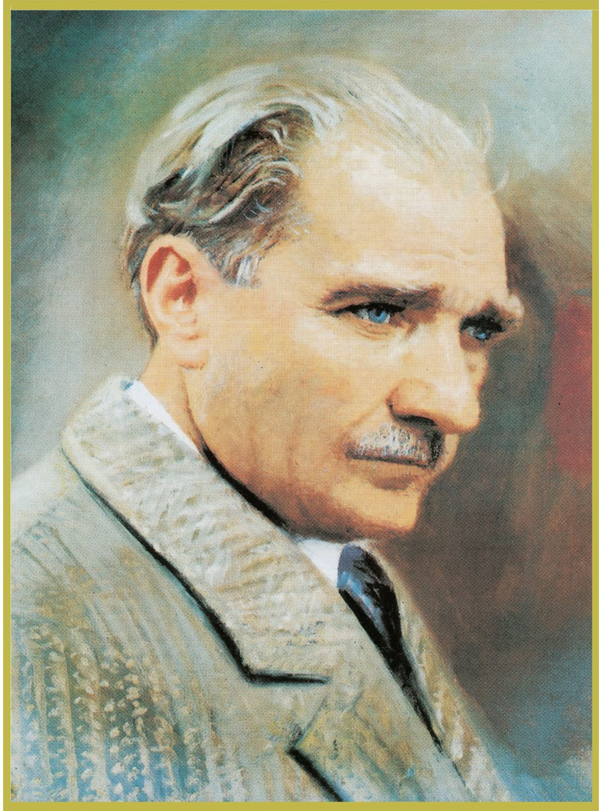
<!-- yer tutucu bulunamadı: sayfa sonuna eklendi -->

<!-- sayfa 5 -->

Verdiğiniz metin katmanı boş olduğu için (`<<< >>>` arası boş) dönüştürülecek bir içerik bulunmamaktadır. Lütfen metin katmanını içeren içeriği paylaşın, böylece talimatlarınıza uygun şekilde Markdown formatına çevirebilirim.

<!-- sayfa 6 -->

# İÇİNDEKİLER

| | |
| :--- | :---: |
| Okulumda İlk Günüm | 9 |
| Kendimi Tanıyorum | 10 |
| Hayvanların Çizgileri | 11 |
| Ailem ve Ben | 12 |
| Hayvanların Hareketlerini Taklit Ediyorum | 13 |
| Bedenle Ritim | 14 |
| Desenler | 15 |
| Doğru Tutuş | 16 |
| Hangisi Büyük, Hangisi Küçük? | 17 |
| Evin Parçaları | 18 |
| Az mı, Çok mu? | 19 |
| Dengede Duruyorum | 20 |
| 1 Rakamı | 21 |
| Aynısını Bulalım | 22 |
| Sanatçılar ve Eserleri | 23 |
| Arıların Çizgileri | 24 |
| Merhaba, Daire | 25 |
| Aylin Ne Hissediyor Olabilir? | 26 |
| Resim Günü | 27 |
| Renk Kutuları | 28 |
| Duygu Çalışması | 29 |
| Türk Bayrağı | 30 |
| Atatürk | 31 |
| Geleneksel Çocuk Oyunları Günü | 32-33 |
| Bakalım, Seçelim | 34 |
| 2 Rakamı | 35 |
| Bir Günüm | 36 |
| Yarışma Günü | 37 |
| Doğayı Koruyorum | 38 |

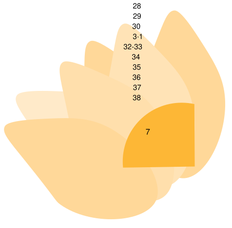
<!-- yer tutucu bulunamadı: sayfa sonuna eklendi -->

<!-- sayfa 7 -->

# İÇİNDEKİLER

| | |
| :--- | :---: |
| Dinle ve Bul | 39 |
| Gölgeleri Bulalım | 40 |
| Oyuncak Müzesi | 41 |
| Davranışları Değerlendirelim | 42 |
| Zıp Zıp Kanguru | 43 |
| 3 Rakamı | 44 |
| Müzik Aletleri | 45 |
| Sosyal İpuçlarını Bulalım | 46 |
| Çocuk Hakları | 47 |
| Hareket Edelim | 48 |
| Canlı mı, Cansız mı? | 49 |
| Sembolleri Öğreniyorum | 50 |
| Deniz Canlıları | 51 |
| Su Kampanyası Afişi | 52 |
| Düşün, Hayal Et ve Çiz | 53 |
| Yeterli ve Dengeli Besleniyorum | 54 |
| Merhaba, Kare | 55 |
| Kumdaki Ayak İzleri | 56 |
| İletişim Yollarımız | 57 |
| Renkler ile Kodlama | 58 |
| Sözcük Sayısı | 59 |
| Atık Kutuları | 60 |
| Yaprakları Sayalım | 61 |
| Parça-Bütün | 62 |
| Kozalağın Değişimi | 63 |
| Görsel ve Genel Ağ Kaynakçası | 63 |
| Türkiye’nin Mülki İdare Bölümleri ile Kara ve Deniz Komşuları Haritası | 64 |

Etkinliklerin ilişkili olduğu beceriler ve süreç bileşenini görmek için karekodu okutunuz veya tıklayınız.

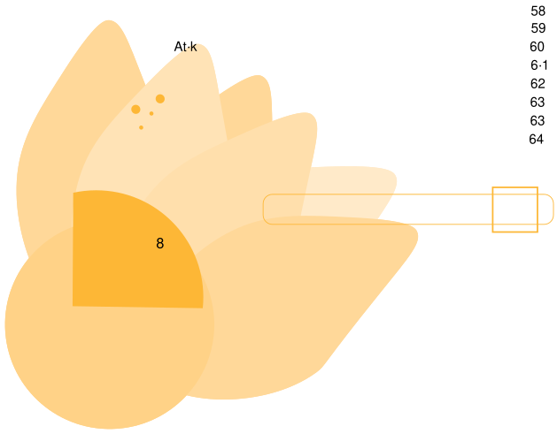
<!-- yer tutucu bulunamadı: sayfa sonuna eklendi -->

<!-- sayfa 8 -->

# OKULUMDA İLK GÜNÜM

Ece bugün okula başlıyor. Ece çok mutlu. Okula başladığımız ilk gün ne hissettiğimizi hatırlayalım. Hissettiğimiz duyguyu gösteren görseli bulup işaretleyelim.

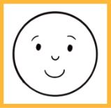 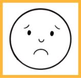 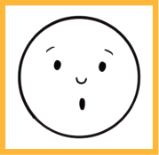 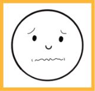 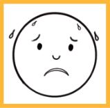

Ece’nin öğretmeninin ismi Aybüke. Öğretmenimizin ismini söyleyelim.

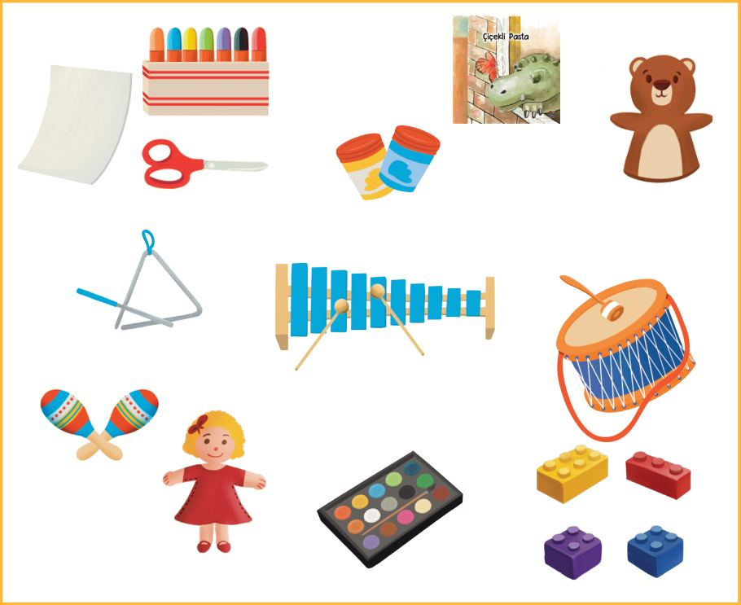
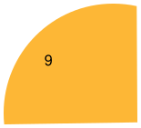

Çerçevenin içindeki nesnelerden hangilerinin sınıfımızda olduğunu bulalım ve onları işaretleyelim.

<!-- sayfa 9 -->

# KENDİMİ TANIYORUM

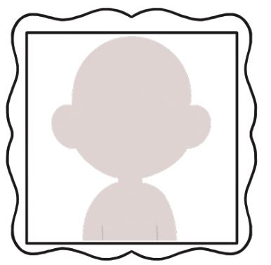
Çerçevenin içine kendimizi çizelim.

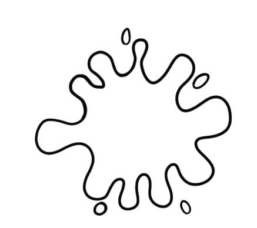
En sevdiğimiz renge boyayalım.

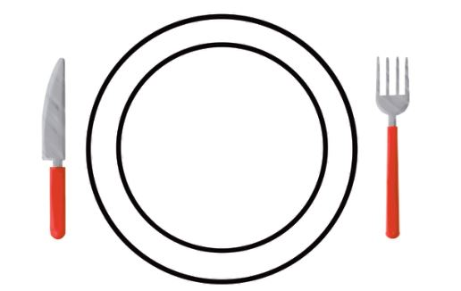
Yaşımız kadar çileği boyayalım.

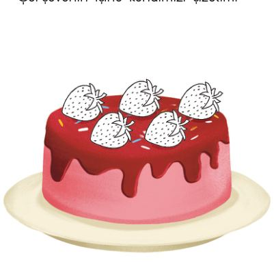
En sevdiğimiz yemeği çizelim.

Bu kitabın kendimize ait olduğunu göstermek için kutuya bir çizim yapalım.

<!-- sayfa 10 -->

# HAYVANLARIN ÇİZGİLERİ

Bazı hayvanların vücudunda çizgiler bulunur. Çizgileri olan hayvan görsellerini inceleyelim. Hayvanların isimlerini söyleyelim. Çizgileri olan başka hangi hayvanlar var? Düşünelim, söyleyelim.

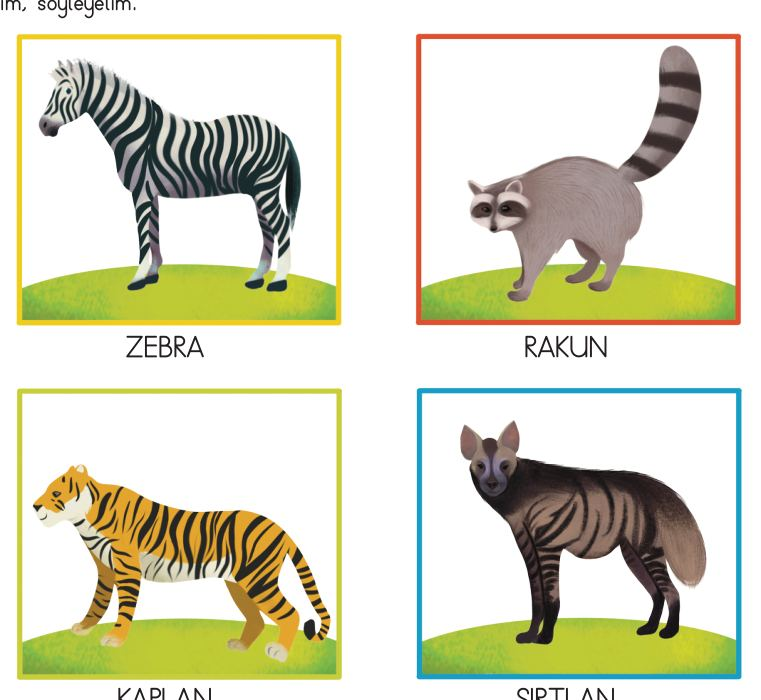
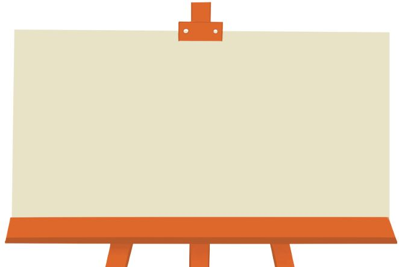
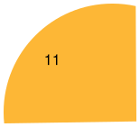

ZEBRA | RAKUN
--- | ---
 | 

KAPLAN | SIRTLAN
--- | ---
 | 

Farklı çizgiler kullanarak tuvale bir resim yapalım.

<!-- sayfa 11 -->

# AİLEM VE BEN

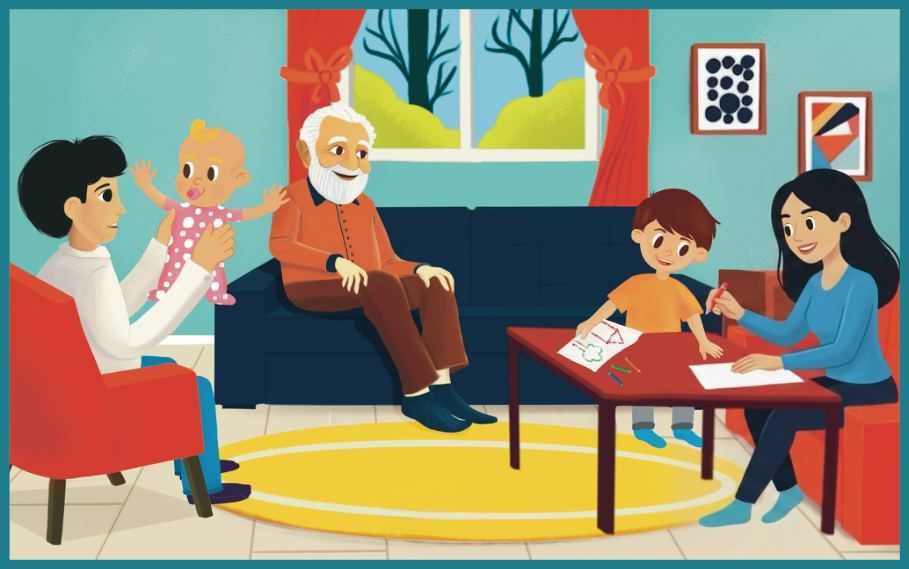

Görseli inceleyelim. Aile bireyleri ne yapıyor? Söyleyelim. Ailemiz bizim için önemlidir. Ailemizi sever ve onlarla vakit geçirmekten hoşlanırız. Ailemizle neler yapmayı sevdiğimizi anlatalım.

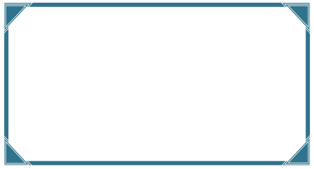

Çerçeveye ailemizle yapmayı sevdiğimiz etkinliklerin resmini çizelim. Yaptığımız çizimleri arkadaşlarımıza anlatalım.

<!-- sayfa 12 -->

# HAYVANLARIN HAREKETLERİNİ TAKLİT EDİYORUM

Hayvan görsellerini inceleyelim. Hayvanların isimlerini söyleyelim ve hareketlerini taklit edelim. Karada yaşayan hayvan görsellerinin çerçevesini kırmızıya, suda yaşayan hayvan görsellerinin çerçevesini maviye boyayalım.

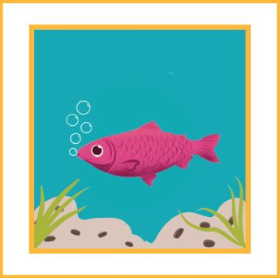 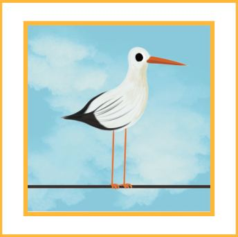
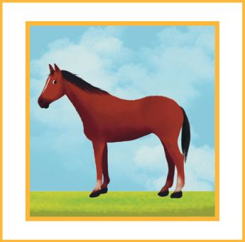 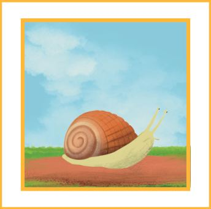
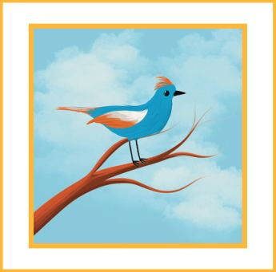 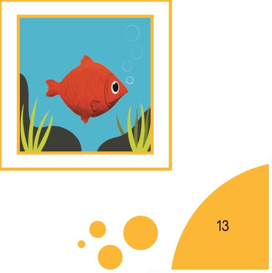

<!-- sayfa 13 -->

# BEDENLE RİTİM

Müzikte sesleri göstermek için notalar kullanılır. Notalar bizim şarkı söylememizi, müzik aleti çalmamızı ve şarkı bestelememizi sağlar. Dizeklerde notalar yerine farklı sesler üretmemizi sağlayacak görseller var. Görsellerdeki hareketleri taklit ederek sesleri çıkarmayı deneyelim.

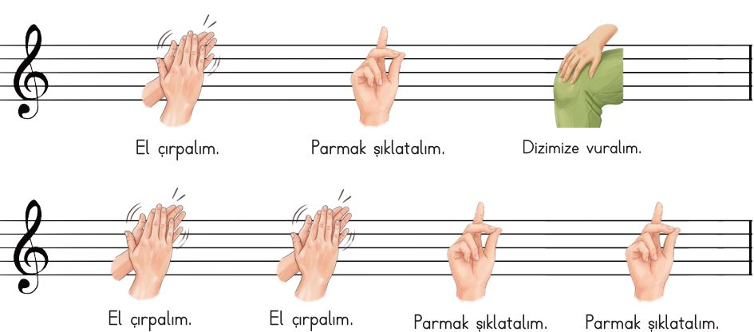
El çırpalım. | Parmak şıklatalım. | Dizimize vuralım.

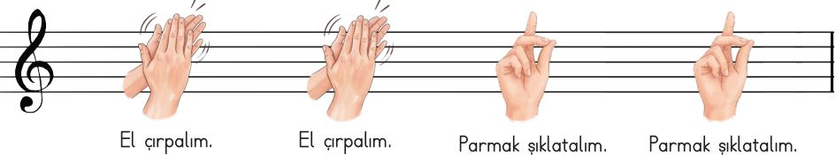
El çırpalım. | El çırpalım. | Parmak şıklatalım. | Parmak şıklatalım.

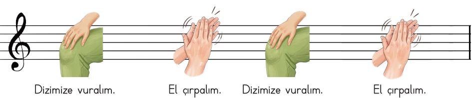
Dizimize vuralım. | El çırpalım. | Dizimize vuralım. | El çırpalım.

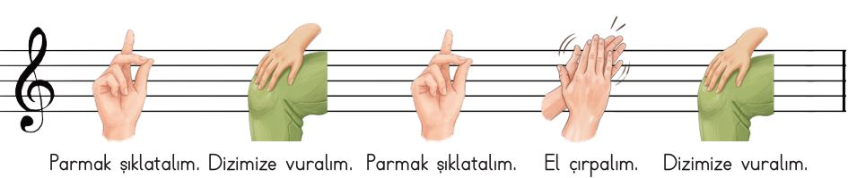
Parmak şıklatalım. | Dizimize vuralım. | Parmak şıklatalım. | El çırpalım. | Dizimize vuralım.

<!-- sayfa 14 -->

# DESENLER

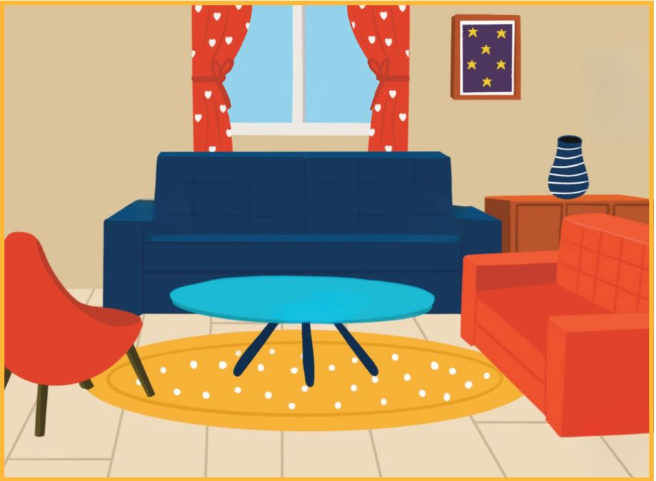

Sınıfımızda, kıyafetlerimizde, eşyalarımızda desenler var mı? İnceleyelim. Bulduğumuz desenleri arkadaşlarımızla paylaşalım.

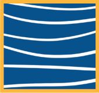

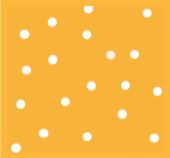

Görseli inceleyelim. Kutulardaki desenlerin görseldeki eşyalardan hangisine ait olduğunu bulalım. Bulduğumuz desenin kutusunu işaretleyelim.

 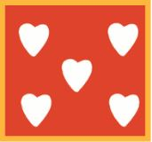 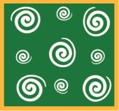 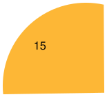 
    

<!-- sayfa 15 -->

# DOĞRU TUTUŞ

Her kitabın iki kapağı vardır. Ön ve arka kapak. Görsellerden hangisi kitabın ön kapağı, hangisi arka kapağı olabilir? Ön kapağa ait olan görselin altındaki kutucuğu işaretleyelim.

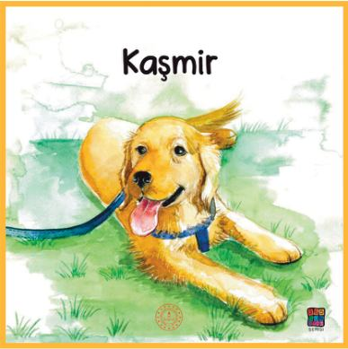
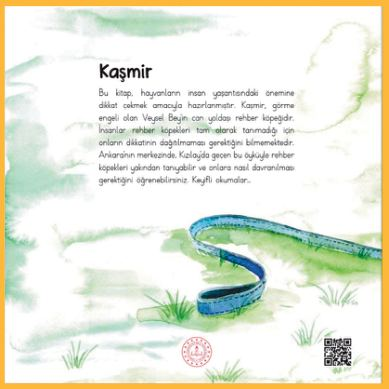

Görseli inceleyelim. Bu görseli daha önce nerede gördüğümüzü söyleyelim. Ders kitabımızı elimize alalım. Kitap nasıl tutulur? Doğru tutuş şeklini gösterelim.

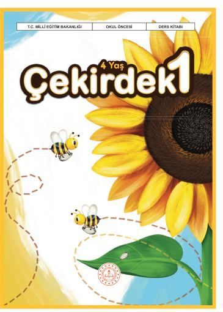

⭐ Öğretmene Not: Karekodu okutarak veya tıklayarak “Kaşmir” isimli öyküye erişebilirsiniz 

<!-- sayfa 16 -->

# HANGİSİ BÜYÜK, HANGİSİ KÜÇÜK?

Görseldeki hayvanları inceleyelim. Hangilerinin adını biliyoruz? Söyleyelim. Her çerçevede küçük olan hayvanı işaretleyelim.

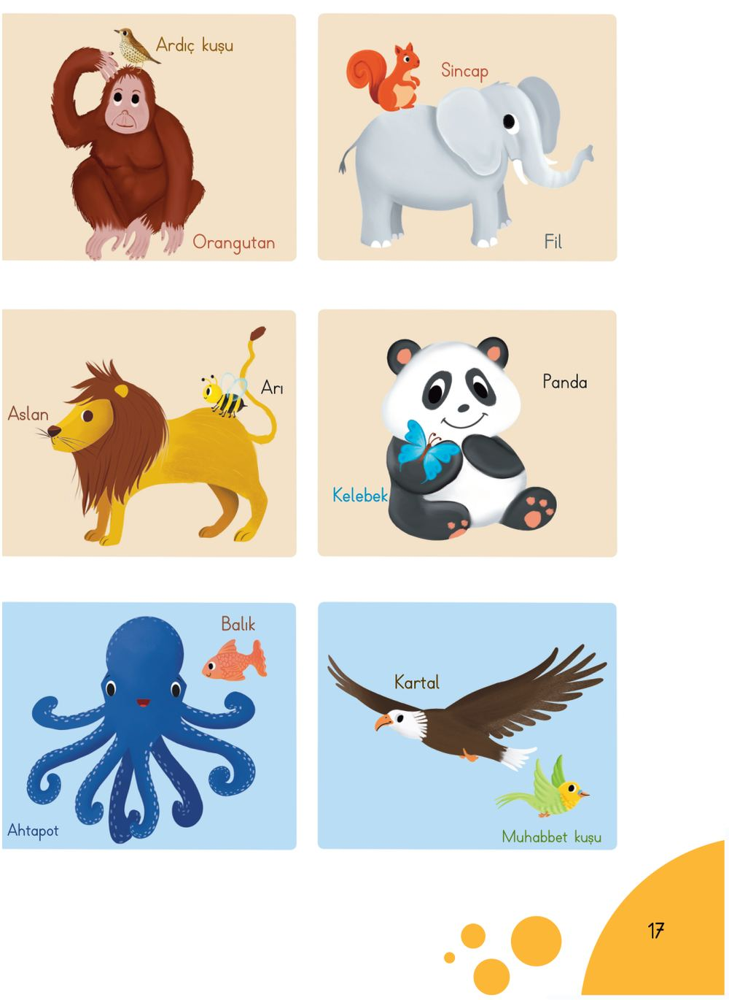

<!-- sayfa 17 -->

# EVİN PARÇALARI

Ev modellerini inceleyelim. Her sırada ev modelini oluşturan parçaların kutusunu bulalım ve çizgi çizerek eşleştirelim.

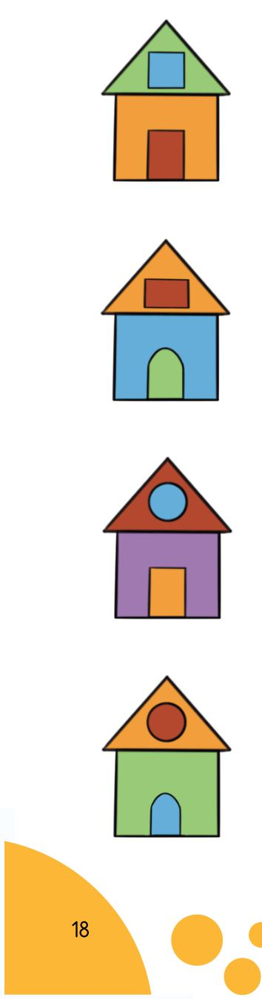 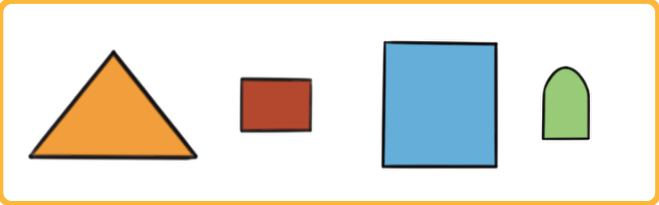
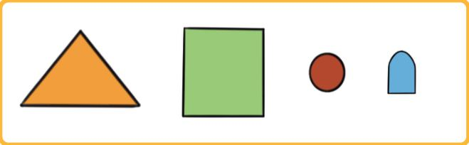 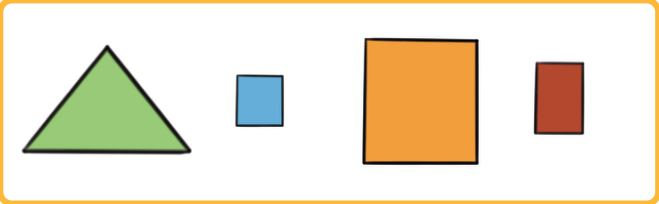
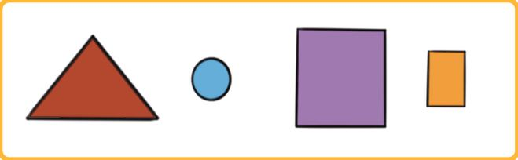

<!-- sayfa 18 -->

# AZ MI, ÇOK MU?

Buz parçalarından hangisinin üstünde daha çok penguen var? Altındaki kutucuğu işaretleyelim.

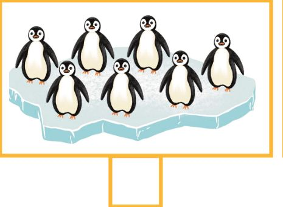 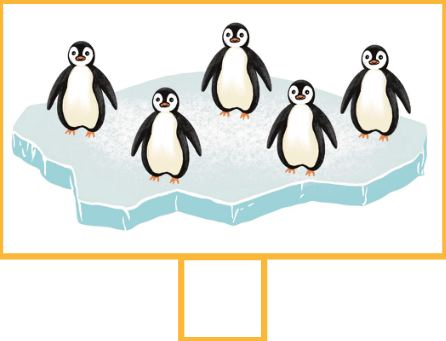

Arı yuvalarından hangisinde daha az arı var? Altındaki kutucuğu işaretleyelim.

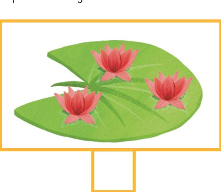 

Yaprakların hangisinin üstünde daha az nilüfer çiçeği var? Altındaki kutucuğu işaretleyelim.

 

<!-- yer tutucu bulunamadı: sayfa sonuna eklendi -->

<!-- sayfa 19 -->

# DENGEDE DURUYORUM

Müzik eşliğinde dans edelim. Müzik durduğunda görsellerdeki hareketlerden birini seçelim. Müzik tekrar başlayana kadar bu hareketi yaparak dengede durmaya çalışalım.

<!-- sayfa 20 -->

# 1 RAKAMI

1

Önce parmağımızla daha sonra kalemimizle 1 rakamının üzerinden geçelim.

| 1 3 2 |
|---|
| 2 1 3 |
| 3 2 1 |

1 rakamlarını işaretleyelim.

Nesli tükenmekte olan kızıl panda hakkında bilgi edinelim. Kızıl pandalardan bir tanesini boyayalım.

Kızıl pandalar bambu ile beslenir. 1 tane bambuyu işaretleyelim.

| 1 |
|---|

1 rakamını kullanarak resim yapalım.

<!-- sayfa 21 -->

# AYNISINI BULALIM

Görseli inceleyelim. Birbiriyle aynı olan kuşları çizgi çizerek eşleştirelim. Eşi olmayan kuşu işaretleyelim.

<!-- sayfa 22 -->

# SANATÇILAR VE ESERLERİ

Görselleri inceleyelim. Sanatçıların hangi eseri yapmış olabileceğini bulalım. Bu eserlere ve sanatçılarına ne isim verildiğini söyleyelim. İpuçlarından yararlanarak sanatçı ve eserlerinin yanındaki kutucukları aynı renge boyayalım.

 
 
 
 

<!-- sayfa 23 -->

# ARILARIN ÇİZGİLERİ

Görseldeki hayvanın adını söyleyelim. Arı sesi çıkararak çizgileri parmağımızla takip edelim, kesik çizgileri birleştirerek çizelim.

<!-- sayfa 24 -->

# MERHABA, DAİRE

Benim adım daire. Köşem ve kenarım yok.

Görsellerden yüzeyi daire şekline benzeyenleri bulalım ve işaretleyelim.

Daireleri işaretleyerek kediyi mamasına ulaştıralım.

Daire şeklini kullanarak bir resim yapalım.

⭐ Öğretmene Not: Karekodu okutarak veya tıklayarak “Daire” isimli şarkıya erişebilirsiniz.

<!-- sayfa 25 -->

# AYLİN NE HİSSEDİYOR OLABİLİR?

Aylin, gün içinde birçok şey yaşıyor. Hissettiği duygular da buna göre değişiyor. Cümleleri dinleyelim. Aylin'in ne hissediyor olabileceğini bulalım. Bulduğumuz duyguyu ifade eden sembolü işaretleyelim.

| | | | |
| :--- | :---: | :---: | :---: |
| Aylin, ailesi ile kahvaltı yapıyor. |  Mutlu |  Üzgün |  Korkmuş |
| Aylin'in öğretmeni toplanma zamanının geldiğini söylüyor. |  Mutlu |  Kızgın |  Üzgün |
| Aylin, kendi kalemini arkadaşının izinsiz aldığını görüyor. |  Kızgın |  Üzgün |  Şaşırmış |
| Aylin'in babaannesi ona bir hediye alıyor. |  Mutlu |  Şaşırmış |  Korkmuş |
| Aylin, uyumak istemiyor ama annesi uyku zamanının geldiğini söylüyor. |  Üzgün |  Kızgın |  Şaşırmış |

<!-- sayfa 26 -->

# RESİM GÜNÜ

Bugün sınıfta resim günü. Çocukların yaptığı resimleri inceleyelim. Resimlerde kullanılan boya kalemlerini bulalım. Kalemlerin altındaki kutucukları raptiyelerin renginde boyayalım.

<!-- sayfa 27 -->

# RENK KUTULARI

Görselleri inceleyelim. Hangi renkleri görüyoruz? Söyleyelim. Görsellerle renkleri örnekteki gibi çizgi çizerek eşleştirelim.

<!-- sayfa 28 -->

# DUYGU ÇALIŞMASI

Görselleri inceleyelim ve cümleleri dinleyelim. Görseller bize gün içinde yaşadığımız farklı duyguları anlatıyor. Görseldeki durumları yaşadığımızda ne hissederiz, söyleyelim.

Ali’nin her gün suladığı çiçek tomurcuk verdi.

Cemal’in harçlıklarını biriktirip aldığı dondurma yere düştü.

Emre’nin arkadaşı oyuncağını onunla paylaşmak istemedi.

Gamze’nin hiç beklemediği bir anda karşısına bir sürpriz çıktı.

<!-- sayfa 29 -->

# TÜRK BAYRAĞI

İşte bir bayram günü. Berra’nın sınıfında 29 Ekim Cumhuriyet Bayramı kutlanıyor. Çocuklar, sevinçle bayraklarını sallıyor. Görseldeki Türk bayraklarını bularak işaretleyelim. Sınıfımızdaki Türk bayrağını gösterelim.

Türk bayrağındaki renkleri bulup altındaki kutucukları işaretleyelim.

  

Türk bayrağındaki sembolleri bulup altındaki kutucukları işaretleyelim.

   

<!-- sayfa 30 -->

# ATATÜRK

Kitabımızın içinde bu resmin aynısından bir tane daha var. Sayfaları karıştırarak bulalım. Mustafa Kemal Atatürk hakkında neler biliyoruz? Arkadaşlarımızla paylaşalım.

| | |
| :--- | :--- |
|  | Atatürk, çocukları çok severdi. |
|  | Atatürk, hayvanları çok severdi ve Foks adında bir köpeği vardı. |
|  | Atatürk, kitap okumayı çok severdi ve kitap yazardı. |

Atatürk ile ilgili cümleleri dinleyelim. Her cümleye uygun fotoğrafı bulalım. Fotoğrafın altındaki kutucuğu cümlenin yanındaki renge boyayalım.

<!-- sayfa 31 -->

# GELENEKSEL ÇOCUK OYUNLARI GÜNÜ

Görselleri inceleyelim. Hangi çocuk oyunları var? Adını bildiğimiz oyunları söyleyelim. Kutucuklardaki soruları sırayla dinleyerek cevaplayalım.

> “Yağ satarım, bal satarım” oyununu oynayan çocukları bulalım. Bu çocuklar hangi duyguyu hissediyor olabilir? Söyleyelim. Oyunun ebesi olan çocuğu işaretleyelim.

> “Yumurta taşıma” oyununu oynayan çocukları bulalım. Yumurtasını yere düşüren çocuk hangi duyguyu hissediyor olabilir? Söyleyelim.

> “Seksek” oyununu oynayan çocukları bulalım. Daha önce hiç seksek oyunu oynadın mı? Söyleyelim. Arkadaşını bekleyen çocuğun hangi duyguyu hissediyor olabileceğini düşünelim.

<!-- sayfa 32 -->

“Saklambaç” oynayan çocukları bulalım. Ebe olan çocuğu işaretleyelim. Telaşlı hisseden çocuğu gösterelim ve neden telaşlı olduğunu tahmin edelim.

“Yerden yüksek” oyunu oynayan çocukları bulalım. Bankın üstüne çıkmış olan çocukları işaretleyelim. Yer bulamayan çocuk ne hissediyor olabilir? Söyleyelim.

“Halat çekme” oyununu oynayan çocukları bulalım. Oyunu kazanmaya en yakın çocukları gösterelim. Oyunu kaybedecek olan çocuklar hangi duyguları hissedebilir? Söyleyelim.

⭐ Öğretmene Not: Görseldeki geleneksel çocuk oyunlarından biri seçilerek sınıfta ya da bahçede hep birlikte oynanabilir.

<!-- sayfa 33 -->

# BAKALIM, SEÇELİM

Görselleri inceleyelim. Üstteki görselle ilişkili olanı alttaki görseller arasından seçip işaretleyelim.

<!-- sayfa 34 -->

2 RAKAMI

Önce parmağımızla daha sonra kalemimizle 2 rakamının üzerinden geçelim.

| 2 | 3 | 2 |
|---|---|---|
| 4 | 2 | 3 |
| 2 | 3 | 4 |

2 rakamlarını işaretleyelim.

Nesli tükenmekte olan su kaplumbağaları hakkında bilgi edinelim.
Su kaplumbağalarından 2 tanesini boyayalım.

Görselde bulunan su kaplumbağası yumurtalarından 2 tane olanı işaretleyelim.

2 rakamını kullanarak resim yapalım.

<!-- sayfa 35 -->

# BİR GÜNÜM

Cümleleri dinleyelim. Bu olayların günün hangi zaman diliminde gerçekleştiğini söyleyelim. Görselleri günün uygun zaman dilimiyle çizgi çizerek eşleştirelim.

 

Güneş ışınlarından korunmam gerektiğini öğrendim. Dışarıda oyun oynarken kendimi korumaya dikkat ettim.

 

"İyi geceler" diyerek yatağıma yattım.

 

Elimi, yüzümü yıkadım ve herkese "günaydın" dedim.

<!-- sayfa 36 -->

# YARIŞMA GÜNÜ

Ormandaki yarışma gününe hoş geldin. Görselleri inceleyelim. Hangi hayvanların yarışması adil olmaz? Nedenini söyleyelim ve işaretleyelim.

Zürafa ve fare, ağacın en üst dalındaki yaprağı almak için yarışa hazırlanıyor.

Karga ve papağan, kimin daha hızlı uçtuğunu belirlemek için yarışa hazırlanıyor.

Zebra ve at, kimin daha hızlı koştuğunu belirlemek için yarışa hazırlanıyor.

Panda ve köstebek, toprağı kimin daha hızlı kazdığını belirlemek için yarışa hazırlanıyor.

<!-- sayfa 37 -->

# DOĞAYI KORUYORUM

Görseldeki çocukların doğayı korumak için neler yaptıklarını dinleyelim. Kesik çizgileri birleştirerek çocukları görsellere ulaştıralım. Doğayı korumak için sen neler yapıyorsun? Anlatalım.

 $\longrightarrow$ <!-- KONTROL: Marker'da karşılığı yok, uydurma olabilir --> Okula bisikletimle giderim. $\longrightarrow$ <!-- KONTROL: Marker'da karşılığı yok, uydurma olabilir --> 

 $\longrightarrow$ <!-- KONTROL: Marker'da karşılığı yok, uydurma olabilir --> Dişlerimi fırçalarken suyu boşa akıtmamak için bardak kullanırım. $\longrightarrow$ <!-- KONTROL: Marker'da karşılığı yok, uydurma olabilir --> 

 $\longrightarrow$ <!-- KONTROL: Marker'da karşılığı yok, uydurma olabilir --> Çevremizin ağaçlanması için fidan dikerim. $\longrightarrow$ <!-- KONTROL: Marker'da karşılığı yok, uydurma olabilir --> 

 $\longrightarrow$ <!-- KONTROL: Marker'da karşılığı yok, uydurma olabilir --> Çöplerimi ayırarak geri dönüşüm kutusuna atarım. $\longrightarrow$ <!-- KONTROL: Marker'da karşılığı yok, uydurma olabilir --> 

<!-- sayfa 38 -->

# DİNLE VE BUL

 Görseldeki bilmeceleri dinleyelim ve cevapları çerçevenin içinden bulup işaretleyelim.

| Gökyüzünde uçar,   Durmadan kanat çırpar.   Güzel bir ağaç bulunca,   Dallarına yuva kurar.   (Kuş) | Üfleyince şişer,   Bırakınca söner.   Rengârenktir her biri,   Çocuklar onu çok sever.   (Balon) | Tüyleri yumuşacıktır,   Miyavlamaya bayılır.   Acıkınca karnı,   Bacaklara dolanır.   (Kedi) |
| :--- | :--- | :--- |

![Görseldeki nesneler: basketbol topu, yeşil elma, kuş, mor balon, panda, karınca, kırmızı araba, turuncu portakal, kedi, bisiklet]

| Tekerleri döner, durur.   Pedalları süslü olur.   Çevre dostudur.   Doğamızı korur.   (Bisiklet) |  Turuncudur rengi,   Dilim dilimdir içi.   Sulu suludur,   C vitamini deposudur.   (Portakal) | Zıp zıp zıplar,   Çocuklar onunla oynar.   Yuvarlaktır şekli,   Hemen aklına gelir ismi.   (Top) |
| :--- | :--- | :--- |

<!-- yer tutucu bulunamadı: sayfa sonuna eklendi -->

<!-- sayfa 39 -->

# GÖLGELERİNİ BULALIM

Ayşe, bir eşleştirme oyunu oynuyor. Her gölgenin hangi nesneye ait olduğunu bulalım. Nesneleri gölgeleriyle eşleştirelim ve altlarındaki kutucukları örnekteki gibi aynı renge boyayalım.

<!-- sayfa 40 -->

# OYUNCAK MÜZESİ

Ela ve Emir Oyuncak Müzesi geziyor. Müzede eskiden oynanan oyuncakların arasına yeni oyuncaklar karıştığını fark ediyorlar. Yeni oyuncakları bulalım ve işaretleyelim.

<!-- sayfa 41 -->

# DAVRANIŞLARI DEĞERLENDİRELİM

Görselleri inceleyelim. Neler gördüğümüzü söyleyelim. Doğru davranışların altındaki kutucuğu kırmızıya, yanlış davranışların altındaki kutucuğu maviye boyayalım.

Görseldeki durumları daha önce yaşadık mı, düşünelim. Aynı durumda ne hissettiğimizi söyleyelim.

<!-- sayfa 42 -->

# ZIP ZIP KANGURU

Kangurular arka ayakları üzerinde ileriye doğru sıçrayarak hareket eder. İnsanlar ise hem ileriye hem de geriye doğru hareket edebilir.

Sınıfımızda başlangıç ve bitiş noktası belirleyelim. İkili eş olalım. Başlangıç noktasından bitiş noktasına kadar kanguru gibi zıplayalım. Bitiş noktasından başlangıç noktasına doğru geri geri yürüyelim.

Zıplayarak git.
Geri geri yürü.

Yavru kangurunun zıplama yolunu önce parmağımızla sonra kalemimizle kesik çizgilerin üzerinden giderek tamamlayalım.

<!-- sayfa 43 -->

# 3 RAKAMI

Önce parmağımızla daha sonra kalemimizle 3 rakamının üzerinden geçelim.

3 rakamlarını işaretleyelim.

Marakaslardan 3 tanesini boyayalım. Boyadığımız marakasları kimlere hediye edebileceğimizi söyleyelim.

Üzerinde 3 tane nota bulunan dizeği işaretleyelim. Ellerimizi 3 kere çırpalım.

3 rakamını kullanarak resim yapalım.

<!-- sayfa 44 -->

# MÜZİK ALETLERİ

Müzik aletleri görsellerini inceleyelim. Müzik aletlerinin hangi çalgı türüne ait olduğunu söyleyelim. Çerçevelerdeki farklı çalgı türene ait olan müzik aletini işaretleyelim.

## VURMALI ÇALGILAR

### ÜFLEMELİ ÇALGILAR

### TELLİ ÇALGILAR

<!-- sayfa 45 -->

# SOSYAL İPUÇLARINI BULALIM

Başkalarının duygularını konuşmadan da anlayabilir miyiz? Söyleyelim. Duygularımızı ifade etmenin ve başkalarının duygularını anlamanın yollarından biri beden dilidir. Yüz ifademiz ve bedenimizin duruşu, neler hissettiğimiz hakkında ipuçları verir.

Kim mutlu hissediyor? ☐
Kim üzgün hissediyor? ☐
Kim öfkeli hissediyor? ☐

Kim korkmuş hissediyor? ☐
Kim utanmış hissediyor? ☐

Görselleri inceleyelim. Soruları görsellere göre cevaplayalım. Soruların yanındaki kutucukları çocukların üzerinde bulunduğu renge göre boyayalım.

<!-- sayfa 46 -->

# ÇOCUK HAKLARI

Dünyanın farklı yerlerinde yaşayan çocuklar var. Çocuklar birbirinden farklı olsa da sahip olduğu haklar aynıdır. Bu haklara çocuk hakları denir. Balonların üzerinde yazan çocuk haklarını dinleyelim. Çocukların başka hangi hakları olabileceği konusunda düşüncelerimizi söyleyelim. Balonları istediğimiz renklerle boyayalım.

⭐ Öğretmene Not: Çocuk Hakları Evrensel Bildirgesi’nde yer alan diğer haklar da çocukların

<!-- sayfa 47 -->

# HAREKET EDELİM

Eren ve Özge’nin yaptığı hareketleri inceleyelim. Önce Eren’in sonra Özge’nin hareketlerini yapmayı deneyelim. Her hareketin ardından vücudumuzun hangi bölümünü kullandığımız üzerine konuşalım. Etkinliği yeni hareketler ekleyerek sürdürelim.

 Başınla selam ver.
 Ellerini beline koy.
 Tek ayak üstünde zıpla.

Eren

 Boynunu öne arkaya, sağa sola yatır.
 Kollarınla kendine sarıl.
 Ellerinle bacaklarına vurarak ses çıkar.

Özge

<!-- sayfa 48 -->

# CANLI MI, CANSIZ MI?

Atlas, doğa gözlem gününde canlı ve cansız varlıkları gözlemlemek için bahçede bir geziye çıkmış. Gözlem defterine yapıştırmak için bir çiçeğin ve bir taşın fotoğrafını çekmiş. Canlı olan çiçek mi, taş mı? Söyleyelim. Atlas’ın fotoğrafını çektiği diğer varlıkları inceleyelim. Canlı varlıkların yanındaki kutucuğu maviye, cansız varlıkların yanındaki kutucuğu kırmızıya boyayalım.

  

  

 (Not: Sayfada 9 şekil belirtilmiş ancak görselde 9 adet nesne kutusu bulunmaktadır. Talimat gereği sadece metin ve şekil yerleşimleri verilmiştir.)

<!-- sayfa 49 -->

# SEMBOLLERİ ÖĞRENIYORUM

Görsellerdeki sembolleri inceleyelim. Bu sembollerden daha önce gördüklerimizi işaretleyelim ve nerelerde gördüğümüzü söyleyelim. Anlamını bilmediğimiz sembolleri öğrenelim.

<!-- sayfa 50 -->

# DENİZ CANLILARI

Deniz canlılarını inceleyelim. Deniz canlılarının sıralamasında dikkatini çeken bir şey var mı?

Örüntü kuralına göre sıralanan deniz canlılarını bulalım ve yanındaki kutucuğu işaretleyelim.

Bloklarla yapılan örüntüyü inceleyelim. Aynı örüntüyü sınıfımızdaki blokları veya mavi, sarı renkte başka nesneleri kullanarak yapalım.

<!-- sayfa 51 -->

# SU KAMPANYASI AFİŞİ

Afişler yazı, resim ve rakamlardan oluşmaktadır. Burçin Öğretmen'in sınıfa getirdiği malzemeleri inceleyelim. Afişimizde kullanmak için sınıflandıralım. Üzerinde yazı olan görsellerin kutucuklarını $\color{yellow}{\bullet}$ <!-- KONTROL: Marker'da karşılığı yok, uydurma olabilir -->, rakam olanların $\color{orange}{\bullet}$ <!-- KONTROL: Marker'da karşılığı yok, uydurma olabilir -->, diğer görsellerin kutucuklarını da $\color{blue}{\bullet}$ <!-- KONTROL: Marker'da karşılığı yok, uydurma olabilir --> renge boyayalım.

Çerçevenin içine suyu bilinçli kullanmayı ve israfı önlemeyi anlatan bir su kampanyası afişi hazırlayalım. Hazırladığımız afiş hakkında konuşalım.

<!-- sayfa 52 -->

# DÜŞÜN, HAYAL ET VE ÇİZ

Daha önce aslanağzı çiçeği gördük mü? Düşünelim. Aslanağzı çiçeğinin nasıl göründüğünü tahmin edelim ve çizelim.

Daha önce mirket gördük mü, mirket nasıl bir hayvan olabilir? Düşünelim. Çerçevenin içine bir mirket çizelim. Çizimlerimizi gerçek hâlleriyle karşılaştıralım.

⭐ Öğretmene Not: Çizimler tamamlandıktan sonra karekodlardan yararlanarak çocukların, bitki ve hayvanların gerçek hâlleri ile kendi çizimlerini karşılaştırmalarına ve yorumlamalarına

<!-- sayfa 53 -->

# YETERLİ VE DENGELİ BESLENİYORUM

Görseldeki besinlerin sağlığımız için neden önemli olduğunu söyleyelim.

Görseldeki yiyeceklerden satın almak istediklerimizi belirleyelim. Alışveriş listemizdeki kutucukları, seçtiğimiz yiyeceklerin altındaki renge uygun boyayarak listemizi oluşturalım. Seçimlerimizi neye göre yaptığımız hakkında sohbet edelim.

⭐ Öğretmene Not: Etkinlik sayfasına başlamadan önce çocukların porsiyon miktarlarını kendi

<!-- yer tutucu bulunamadı: sayfa sonuna eklendi -->

<!-- sayfa 54 -->

# MERHABA, KARE

Benim adım kare. 4 köşem ve birbiriyle eşit uzunlukta 4 kenarım var.

 

Görsellerden yüzeyi kare şekline benzeyenleri bulalım ve işaretleyelim.

Kareleri boyayarak tavşanı havuca ulaştıralım.

Kare şeklini kullanarak bir resim yapalım.

---

⭐ Öğretmene Not: Karekodu okutarak veya tıklayarak “Kare” isimli şarkıya erişebilirsiniz. 

<!-- sayfa 55 -->

# KUMDAKİ AYAK İZLERİ

Ayak izlerini inceleyelim ve bu ayak izlerinin hangi hayvana ait olduğunu söyleyelim. Kumda en fazla ve en az hangi hayvanlar yürümüş? Bulalım. Kumda en fazla yürümüş olan hayvanı işaretleyelim. İstediğimiz hayvanın yürüyüşünü taklit edelim.

⭐ Öğretmene Not: Karekodu okutarak veya tıklayarak “Çık Ortaya” öyküsüne ulaşabilirsiniz.

<!-- sayfa 56 -->

# İLETİŞİM YOLLARIMIZ

İnsanlar, birbirleriyle farklı şekillerde iletişim kurarlar. Bazen konuşarak bazen de konuşmadan, beden ve yüz ifadeleriyle anlaşırlar. Görselleri inceleyelim. Konuşarak iletişim kuranların görselini kırmızı kutuyla, konuşmadan iletişim kuranların görselini mavi kutuyla çizgi çizerek eşleştirelim. Duygu ve düşüncelerimizi konuşmadan mimiklerimizle anlatabiliriz. Haydi, deneyelim.

<!-- sayfa 57 -->

# RENKLER İLE KODLAMA

Görseldeki böceklerin isimlerini ve altlarındaki renkleri söyleyelim. Tablodaki böceklerin altındaki kutucukları, aynı renklerde boyayalım.

<!-- sayfa 58 -->

# SÖZCÜK SAYISI

Cümleleri dikkatle dinleyelim. Cümlelerin kaç sözcükten oluştuğunu bulalım. Sözcükleri sayalım ve sözcük sayısı kadar alkışlayalım. Görsellerin yanındaki kutuları örnekteki gibi sözcük sayısı kadar boyayalım.

Zürafaların boyu uzundur.
[■] [■] [■] [□]

Balıklar yüzer.
[□] [□] [□] [□]

Pırasa toprakta yetişir.
[□] [□] [□] [□]

Kediler miyavlar.
[□] [□] [□] [□]

<!-- sayfa 59 -->

# ATIK KUTULARI

Görselleri inceleyelim. Her grupta geri dönüşüm türüne uygun olmayan atığı bulalım ve işaretleyelim.

Evimiz ve okulumuzda metal, plastik, cam ve kâğıt atıkları biriktirelim. Atık kutularının renklerine dikkat ederek atıklarımızı doğru kutulara atalım.

<!-- sayfa 60 -->

# YAPRAKLARI SAYALIM

Görseli inceleyelim. Her yapraktan kaç tane olduğunu sayalım ve uygun kutucukları bularak işaretleyelim.

| 3 | 1 |
|---|---|
| 3 | 2 |
| 2 | 1 |
| 2 | 3 |

<!-- yer tutucu bulunamadı: sayfa sonuna eklendi -->

<!-- yer tutucu bulunamadı: sayfa sonuna eklendi -->

<!-- sayfa 61 -->

# PARÇA-BÜTÜN

Çerçevelerin içindeki şekilden taranmış bölümleri çıkarınca hangi şekil oluşur? Alttaki seçeneklerden doğru olanı işaretleyelim.

<!-- sayfa 62 -->

# KOZALAĞIN DEĞİŞİMİ

Esin sınıf arkadaşlarıyla yaptığı doğa gezisinde birçok kozalak topladı. Kozalaklardan bazıları açık, bazıları kapalıydı. Kozalakları inceleyelim, hangilerinin açık, hangilerinin kapalı olduğunu söyleyelim.

Doğadan topladığımız kozalakları sınıfa getirelim. Açık olan kozalaklardan birer tanesini sıcak, ılık ve soğuk su ile dolu kavanozlara koyalım. 15 dakika bekleyelim. Hangi kavanozdaki kozalağın kapandığını işaretleyelim.

  

---

Görsel ve Genel Ağ Kaynakçası için karekodu okutunuz

<!-- sayfa 63 -->

45°D 40°D 35°D 30°D 25°D
45°D 40°D 35°D 30°D 25°D

: Türkiye'nin mülki idare bölümleri, kara ve deniz komşularını gösteren harita.

# TÜRKİYE'NİN MÜLKİ İDARE BÖLÜMLERİ İLE KARA VE DENİZ KOMŞULARI HARİTASI

**Komşu Ülkeler ve Bölgeler:**
* RUSYA FEDERASYONU
* UKRAYNA
* ROMANYA
* BULGARİSTAN
* GÜRCİSTAN
* ERMENİSTAN
* AZERBAYCAN
* NAHÇIVAN Ö.C. (AZERBAYCAN)
* İRAN
* IRAK
* SURİYE
* LÜBNAN
* İSRAİL
* FİLİSTİN (Batı Şeria, Gazze Şeridi)
* MISIR

**Denizler ve Göller:**
* KARADENİZ
* EGE DENİZİ
* AKDENİZ
* MARMARA DENİZİ
* HAZAR DENİZİ

**Nehirler ve Akarsular:**
* Tuna N.
* Kura N.
* Aras N.
* Çoruh N.
* Sakarya N.
* Kızılırmak N.
* Yeşilırmak N.
* Fırat N.
* Dicle N.
* Asi N.
* Seyhan N.
* Ceyhan N.
* Büyük Menderes N.
* Küçük Menderes N.
* Gediz N.
* Bakırçay N.
* Göksu N.
* Nil N.

**Diğer Coğrafi Unsurlar:**
* Van Gölü
* Tuz Gölü
* Urumiye Gölü
* Süveyş K.
* Gökçeada
* Bozcaada

**İller (Harita üzerinde belirtilenler):**
Adana, Adıyaman, Afyonkarahisar, Ağrı, Amasya, Ankara, Antalya, Artvin, Aydın, Balıkesir, Bilecik, Bingöl, Bitlis, Bolu, Burdur, Bursa, Çanakkale, Çankırı, Çorum, Denizli, Diyarbakır, Edirne, Elâzığ, Erzincan, Erzurum, Eskişehir, Gaziantep, Giresun, Gümüşhane, Hakkâri, Hatay, Isparta, Mersin, İstanbul, İzmir, Kars, Kastamonu, Kayseri, Kırklareli, Kırşehir, Kocaeli, Konya, Kütahya, Malatya, Manisa, Kahramanmaraş, Mardin, Muğla, Muş, Nevşehir, Niğde, Ordu, Rize, Sakarya, Samsun, Siirt, Sinop, Sivas, Tekirdağ, Tokat, Trabzon, Tunceli, Şanlıurfa, Uşak, Van, Yozgat, Zonguldak, Aksaray, Bayburt, Karaman, Kırıkkale, Batman, Şırnak, Bartın, Ardahan, Iğdır, Yalova, Karabük, Kilis, Osmaniye, Düzce.

**Lejant:**
* ● BAŞKENT (Ankara)
* ● İL MERKEZİ
* 🟦 GÖL
* 〰️ AKARSU
* ── ÜLKE SINIRI
* ┈ ÖZERK BÖLGE SINIRI

**Ölçek:**
0 --- 50 --- 100 --- 200 --- 300 --- 400 km

Harita Genel Müdürlüğü tarafından üretilmiştir.
