# Okul Öncesi Eğitim 4 Yaş Çekirdek 2 Ders Kitabı

<!-- sayfa 0 -->

# OKUL ÖNCESİ EĞİTİM

## 4 Yaş

# Çekirdek 2

### DERS KİTABI

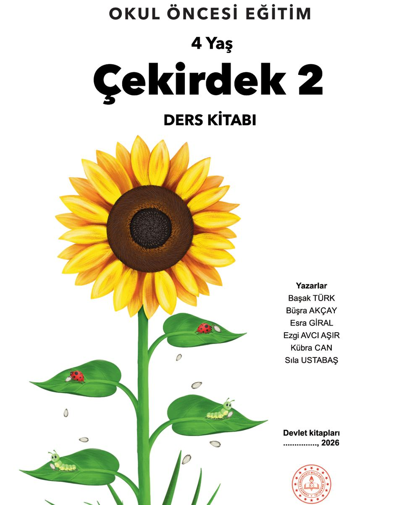

**Yazarlar**
Başak TÜRK
Büşra AKÇAY
Esra GİRAL
Ezgi AVCI AŞIR
Kübra CAN
Sıla USTABAŞ

**Devlet kitapları**
..............., 2026

<!-- sayfa 1 -->

MİLLÎ EĞİTİM BAKANLIĞI YAYINLARI ......................................................................: 10737
DERS KİTAPLARI DİZİSİ .......................................................................................... : 2487

Her hakkı saklıdır ve Millî Eğitim Bakanlığına aittir. Kitabın metin, soru ve şekilleri kısmen de olsa hiçbir surette alınıp yayımlanamaz.

EDİTÖR
Burcu ÖZKANLI ERTUĞRUL

DİL UZMANI
Muhammet ŞEN

GÖRSEL TASARIMCI
Eylem YILDIRIM
Mehmet Ali KARAASLAN
Melike TURALİ
Serdar TUNCAL
Serdar TURALİ

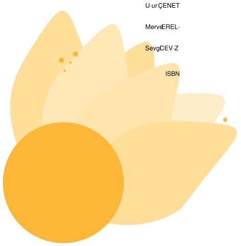

ÇOKLU ORTAM TASARIMCISI
Abidin AYDIN
Ezgi KERVAN SARINÇ
Onur TÜLÜ

PROGRAM GELİŞTİRME UZMANI
Uğur ÇENET

ÖLÇME VE DEĞERLENDİRME UZMANI
Merve ERELİ

REHBERLİK UZMANI
Sevgi CEVİZ

ISBN 978-975-11-8090-

Millî Eğitim Bakanlığı, Talim ve Terbiye Kurulu Başkanlığının 30.07.2024 tarih ve E-96732399-116.01-111152749 sayılı yazısı ile eğitim aracı olarak kabul edilmiştir. Kurulca bu kitabın kabul edilmiş olması ders kitabından yayınevi ve yazarın/yazarların sorumluluğunu kaldırmaz.

<!-- sayfa 2 -->

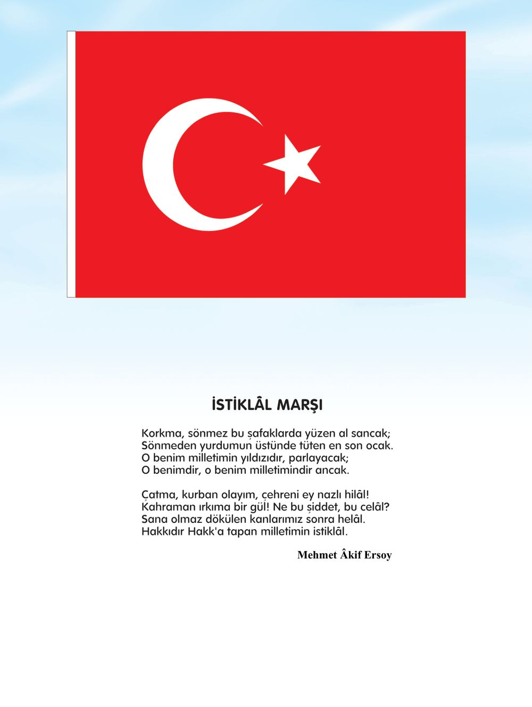

# İSTİKLÂL MARŞI

Korkma, sönmez bu şafaklarda yüzen al sancak;
Sönmeden yurdumun üstünde tüten en son ocak.
O benim milletimin yıldızıdır, parlayacak;
O benimdir, o benim milletimindir ancak.

Catma, kurban olayım, çehreni ey nazlı hilâl!
Kahraman ırkıma bir gül! Ne bu şiddet, bu celâl?
Sana olmaz dökülen kanlarımız sonra helâl.
Hakkıdır Hakk'a tapan milletimin istiklâl.

**Mehmet Âkif Ersoy**

<!-- sayfa 3 -->

ANDIMIZ

Türküm, doğruyum, çalışkanım.

İlkem küçüklerimi korumak, büyüklerimi saymak; yurdumu, milletimi özümden çok sevmektir.
Ülküm yükselmek, ileri gitmektir.

Ey Büyük Atatürk!

Açtığın yolda, gösterdiğin hedefe durmadan yürüyeceğime ant içerim.

Varlığım Türk varlığına armağan olsun.

Ne mutlu Türküm diyene!

<!-- sayfa 4 -->

MUSTAFA KEMAL ATATÜRK

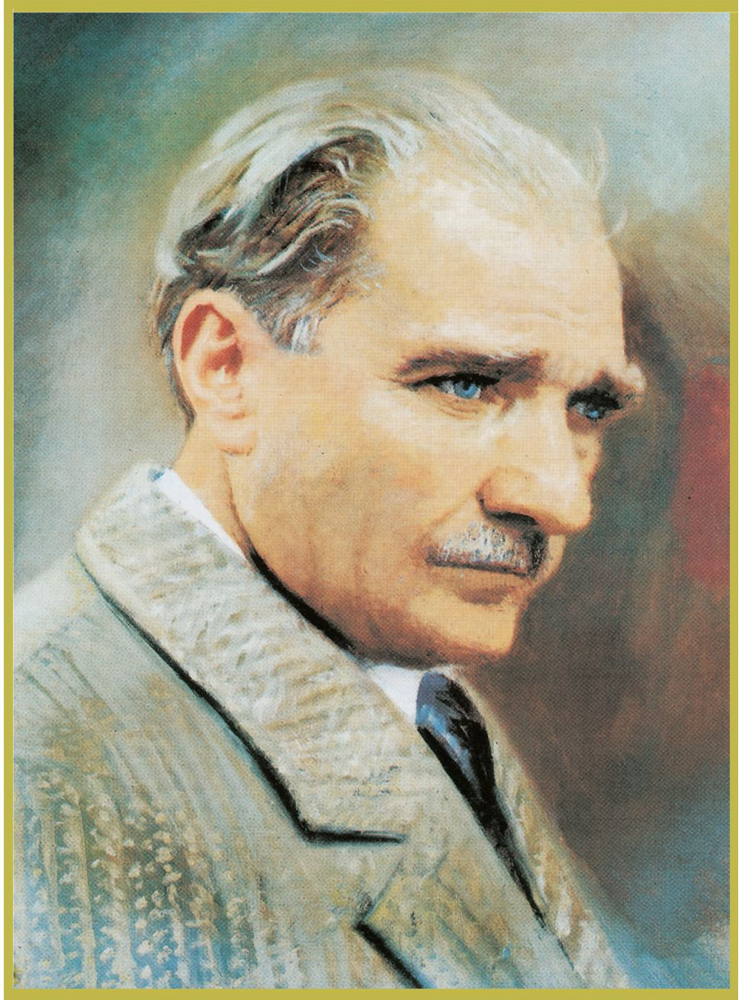
<!-- yer tutucu bulunamadı: sayfa sonuna eklendi -->

<!-- sayfa 5 -->

Verdiğiniz metin katmanı boş olduğu için (`<<< >>>` arası boş) dönüştürülecek bir içerik bulunmamaktadır. Lütfen metin katmanını içeren içeriği paylaşın, böylece talimatlarınıza uygun şekilde Markdown formatına çevirebilirim.

<!-- sayfa 6 -->

# İÇİNDEKİLER

| | |
| :--- | :---: |
| Çini Dükkânı | 9 |
| Farklı Tercihlerimiz | 10 |
| Neyin Sesi? | 11 |
| 4 Rakamı | 12 |
| Sohbeti Tamamla | 13 |
| Kurbağanın Yolu | 14 |
| Hangi Renkler Kullanılmış? | 15 |
| Renkli Balıklar | 16 |
| Bilmecelerle Hava Olayları | 17 |
| En Uzun Fidan | 18 |
| Nezaket Sözcükleri | 19 |
| İlişkili Varlıklar | 20 |
| Uyaklı Sözcükler | 21 |
| Merhaba, Üçgen | 22 |
| Endemik Bitkiler | 23 |
| Yaşamdan Kareler | 24 |
| Atıklarım Kutuya | 25 |
| Kilim Motifleri | 26 |
| İnci Kefali | 27 |
| 5 Rakamı | 28 |
| Nilüfer Çiçeklerini Sayalım | 29 |
| Tembel Hayvanın İzleri | 30 |
| Trafik İşaretleri | 31 |
| Kavramlar Ormanı | 32-33 |
| Benim Çiçek Tablom | 34 |
| Uyumak İçin Neler Yaparız? | 35 |
| Tam ve Yarım | 36 |
| Çanak Çömlek Dükkânı | 37 |
| Rüzgâr Esince | 38 |

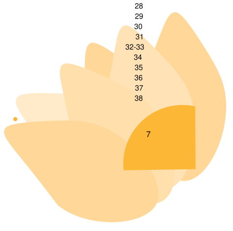
<!-- yer tutucu bulunamadı: sayfa sonuna eklendi -->

<!-- sayfa 7 -->

# İÇİNDEKİLER

| | |
| :--- | :---: |
| Geri Dönüşüm | 39 |
| Sincabın Yolu | 40 |
| 6 Rakamı | 41 |
| Bilmecelerle Mevsimler | 42 |
| Boyutuna Göre Eşleştirelim | 43 |
| Ülkemizde ve Dünyada Spor | 44 |
| Yürüyen Köşk | 45 |
| Aziz Sancar | 46 |
| Duyu Organlarım | 47 |
| Kütüphaneler Haftası | 48 |
| Gececil Hayvanlar | 49 |
| Merhaba, Dikdörtgen | 50 |
| Düşün, Hayal Et ve Çiz | 51 |
| Doğru mu, Yanlış mı? | 52 |
| Kimdir Bu? | 53 |
| Bedenle Ritim | 54 |
| Hangisi Söylenmedi? | 55 |
| Mutfakta Tam-Yarım | 56 |
| Kesyap Tekniği | 57 |
| Kitap Seçim Günü | 58 |
| Hangisi Daha Ağır? | 59 |
| Penguenler Kuş mu, Balık mı? | 60 |
| Millî Teknolojilerimiz | 61 |
| Neye İhtiyacı Var? | 62 |
| Doğadaki Malzemelerin İzi | 63 |
| Görsel ve Genel Ağ Kaynakçası | 63 |
| Türkiye’nin Mülki İdare Bölümleri ile Kara ve Deniz Komşuları Haritası | 64 |

Etkinliklerin ilişkili olduğu beceriler ve süreç bileşenini görmek için karekodu okutunuz veya tıklayınız.

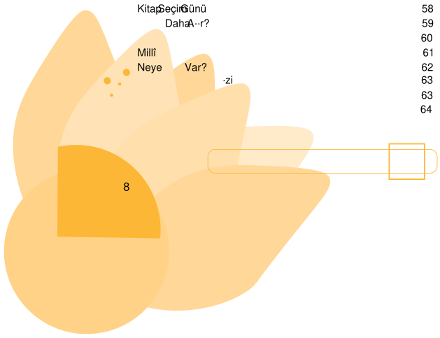
<!-- yer tutucu bulunamadı: sayfa sonuna eklendi -->

<!-- sayfa 8 -->

# ÇİNİ DÜKKÂNI

Çini sanatı geleneksel Türk el sanatlarından biridir. Hüseyin Usta’nın dükkânındaki raflarda dört çeşit çini eşya var. Raflardaki farklı çiniyi bulup işaretleyelim.

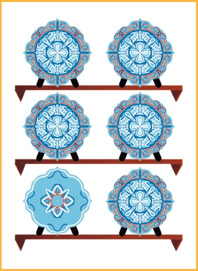
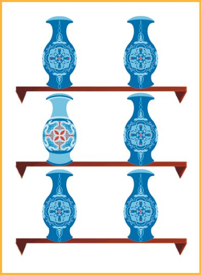
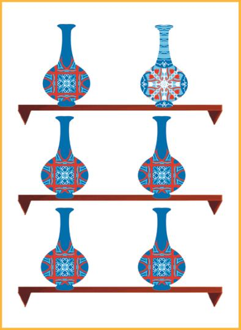
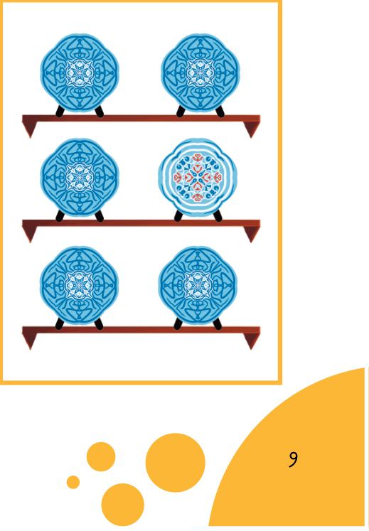

<!-- sayfa 9 -->

# FARKLI TERCİHLERİMİZ

Görselleri inceleyelim. Yemeyi sevdiğimiz yiyecekleri işaretleyelim.

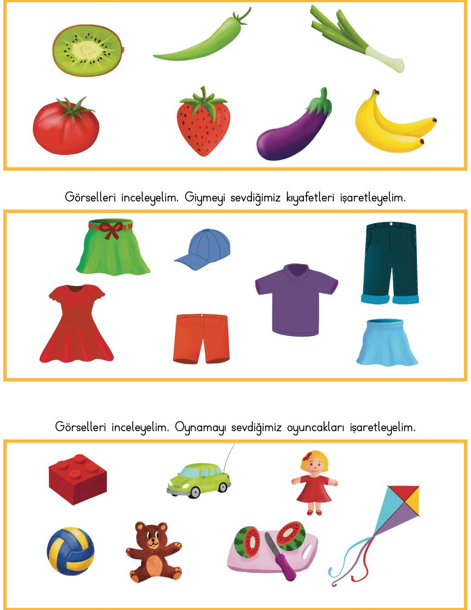

Görselleri inceleyelim. Giymeyi sevdiğimiz kıyafetleri işaretleyelim.


Görselleri inceleyelim. Oynamayı sevdiğimiz oyuncakları işaretleyelim.


İkişerli eşleşelim. Kendi seçimlerimizi arkadaşımıza gösterelim. Arkadaşımızın seçimlerini inceleyelim ve kendi seçimlerimizle karşılaştıralım. Seçimlerimizin neden farklı olduğu hakkında arkadaşımızla sohbet edelim.

<!-- sayfa 10 -->

# NEYİN SESİ?

Karekodlardaki sesleri dinleyelim. Dinlediğimiz sesleri taklit etmeye çalışalım. Sesin hangi görsele ait olduğunu bulup yanındaki kutuyu işaretleyelim.

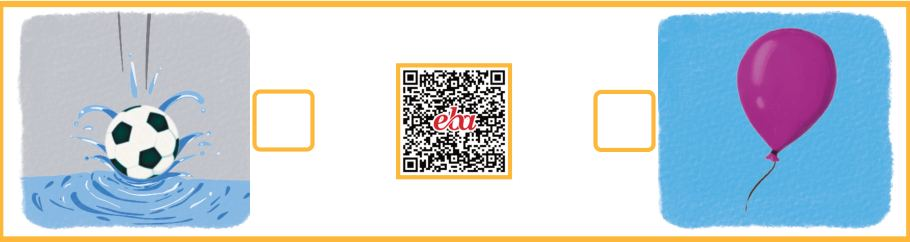
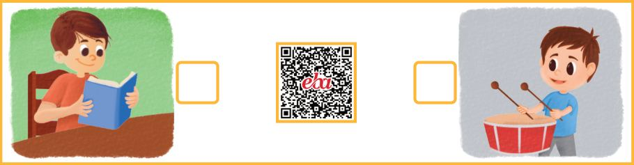


⭐ Öğretmene Not: Sayfadaki karekodlarda sırasıyla; suya düşen top, davul, arı, su içme sesi 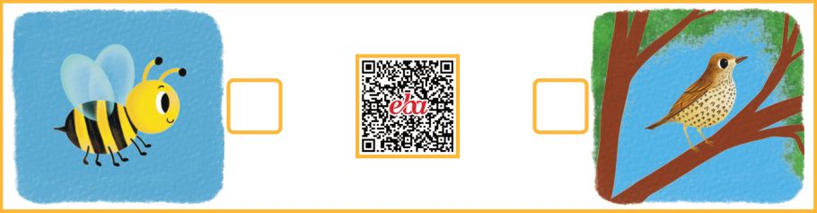 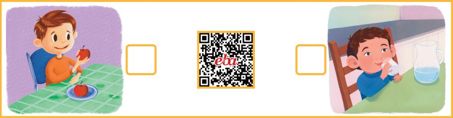 yer almaktadır....

<!-- sayfa 11 -->

24

# 4 RAKAMI

4

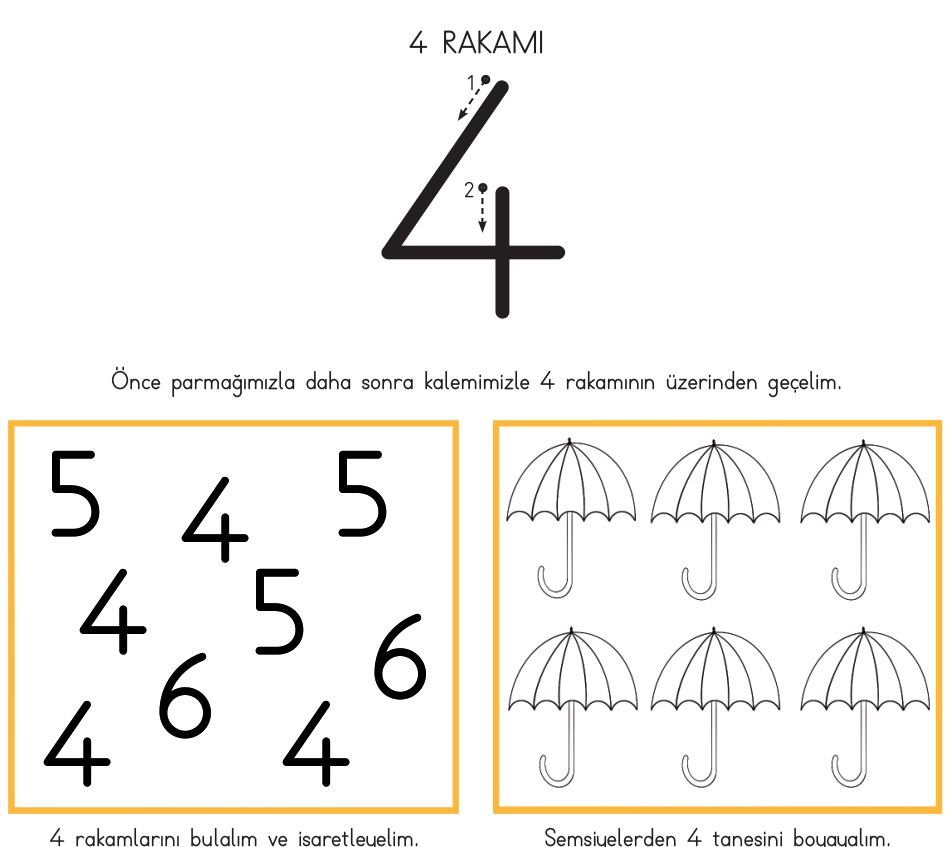

Önce parmağımızla daha sonra kalemimizle 4 rakamının üzerinden geçelim.

| 5 | 4 | 5 |
|---|---|---|
| 4 | 5 | |
| 4 | 6 | 6 |
| | 4 | |

4 rakamlarını bulalım ve işaretleyelim.

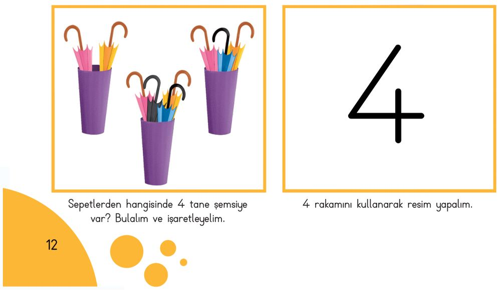

Şemsiyelerden 4 tanesini boyayalım.
Yağmurlu havalar dışında şemsiyeleri nerelerde kullanabiliriz? Söyleyelim.


Sepetlerden hangisinde 4 tane şemsiye var? Bulalım ve işaretleyelim.


4 rakamını kullanarak resim yapalım.

<!-- sayfa 12 -->

# SOHBETİ TAMAMLA

Çocukların konuşmalarını dinleyelim. Konuşmayı tamamlayabilecek cümleyi bulup işaretleyelim.

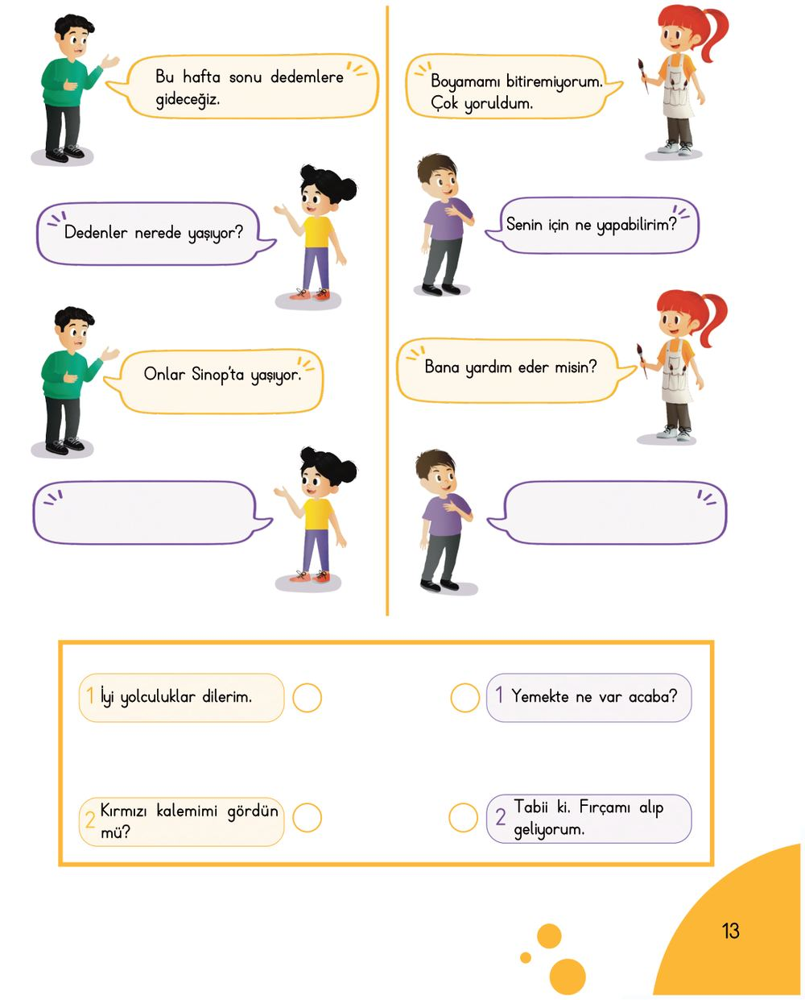

| | |
| :--- | :--- |
| Bu hafta sonu dedemlere gideceğiz. | Boyamamı bitiremiyorum. Çok yoruldum. |
| Dedenler nerede yaşıyor? | Senin için ne yapabilirim? |
| Onlar Sinop'ta yaşıyor. | Bana yardım eder misin? |
| (Boş konuşma balonu) | (Boş konuşma balonu) |

<br>

| | |
| :--- | :--- |
| 1 İyi yolculuklar dilerim. $\bigcirc$ <!-- KONTROL: Marker'da karşılığı yok, uydurma olabilir --> | $\bigcirc$ <!-- KONTROL: Marker'da karşılığı yok, uydurma olabilir --> 1 Yemekte ne var acaba? |
| 2 Kırmızı kalemimi gördün mü? $\bigcirc$ <!-- KONTROL: Marker'da karşılığı yok, uydurma olabilir --> | $\bigcirc$ <!-- KONTROL: Marker'da karşılığı yok, uydurma olabilir --> 2 Tabii ki. Fırçamı alıp geliyorum. |

<!-- sayfa 13 -->

# KURBAĞANIN YOLU

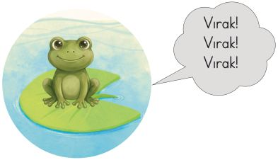
Vırak!
Vırak!
Vırak!

Kurbağalar farklı sesler çıkarabilir. Kurbağaların seslerini ve hareketlerini taklit edelim.

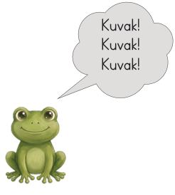
Börk!
Börk!
Börk!

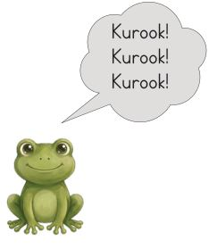
Kuvak!
Kuvak!
Kuvak!

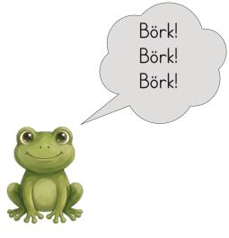
Kurook!
Kurook!
Kurook!

Kurbağaların nilüfere ulaşmasına yardım edelim. Önce parmağımızla yolları takip edelim, sonra kalemimizle tamamlayalım.

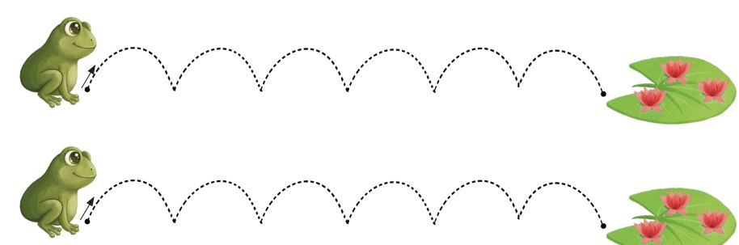
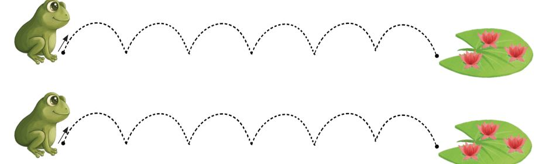
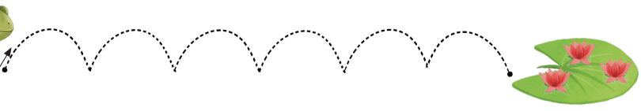
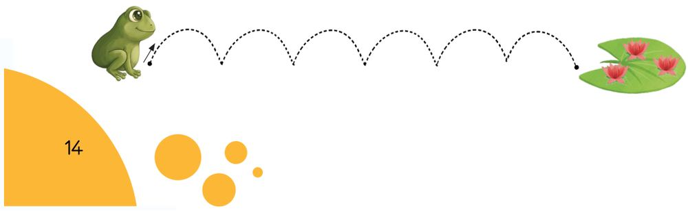

<!-- sayfa 14 -->

# HANGİ RENKLER KULLANILMIŞ?

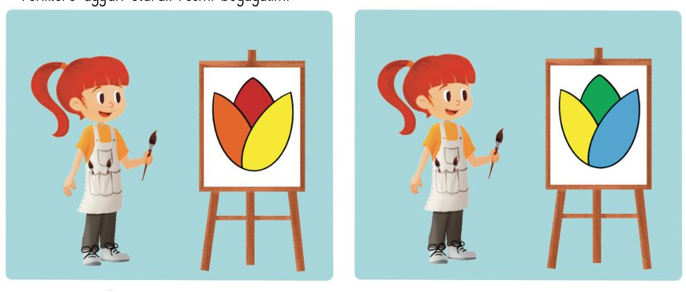

Görselleri inceleyelim. Melek, resimlerinde hangi renkleri kullanmış? Resimde kullanılan renklerin olduğu paleti bulup çizgi çizerek eşleştirelim. Boş palete istediğimiz renkleri seçelim. Paletimizdeki renklere uygun olarak resmi boyayalım.

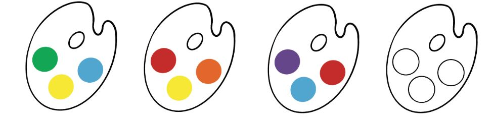

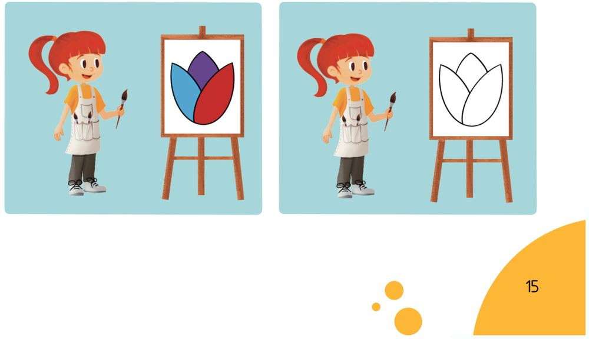

<!-- sayfa 15 -->

# RENKLİ BALIKLAR

Balık görsellerini inceleyelim. Balıkların özellikleri hakkında konuşalım. Görsellerde birbiriyle aynı olan balıkları bulalım ve çizgi çizerek eşleştirelim. Eşi olmayan balık görselini işaretleyelim. Boş çerçeveye kutucuklardaki renkleri kullanarak bir balık resmi çizelim.

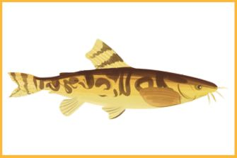 ● 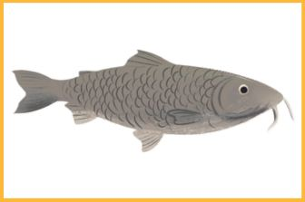
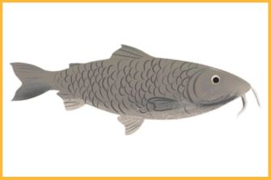 ● 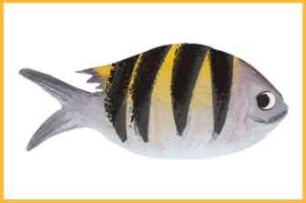
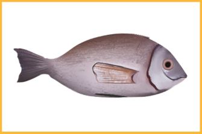 ● 
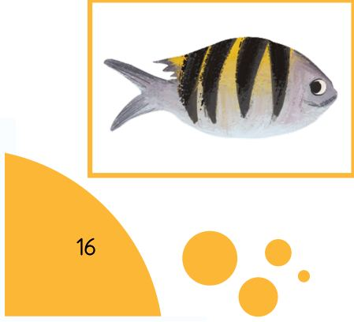 ● 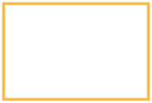

<!-- sayfa 16 -->

# BİLMECELERLE HAVA OLAYLARI

Bilmeceleri dinleyelim. Cevapları görseller arasından bulup işaretleyelim. Bulduğumuz hava olaylarını sınıfta canlandıralım. Çıkardıkları sesleri taklit edelim.

| | |
| :--- | :--- |
| 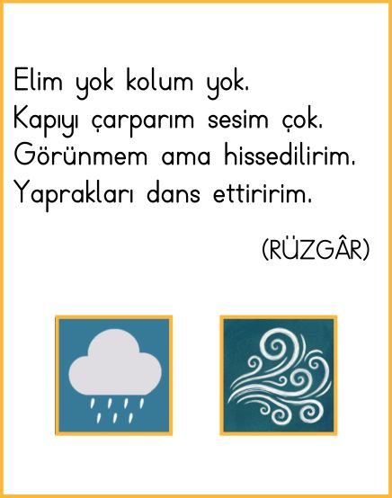<br>Beyazdır rengim.<br>Çocukları eğlendiririm.<br>Hava soğuyunca,<br>Gökyüzünden inerim.<br><br>(KAR) | 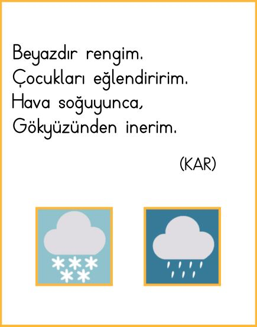<br>Elim yok kolum yok.<br>Kapıyı çarparım sesim çok.<br>Görünmem ama hissedilirim.<br>Yaprakları dans ettiririm.<br><br>(RÜZGÂR) |
| 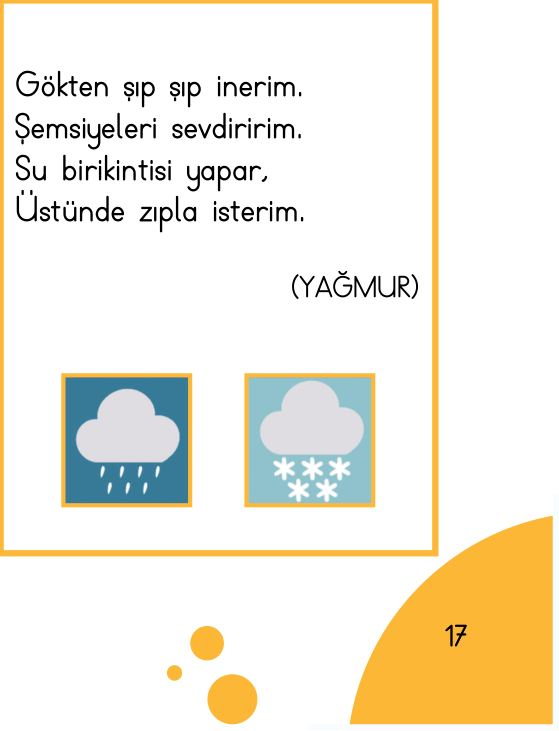<br>Gökyüzünden inerim.<br>Küçük buz tanesiyim.<br>Yağmur değilim, kar değilim. Bil<br>bakalım ben neyim?<br><br>(DOLU) | 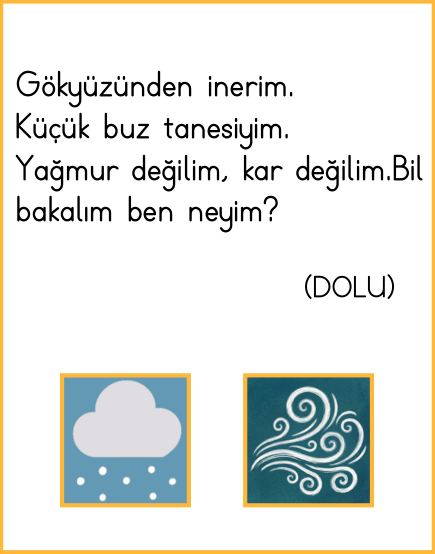<br>Gökten şıp şıp inerim.<br>Şemsiyeleri sevdiririm.<br>Su birikintisi yapar,<br>Üstünde zıpla isterim.<br><br>(YAĞMUR) |

<!-- sayfa 17 -->

# EN UZUN FİDAN

Fidan görsellerini inceleyelim. Her sırada en uzun olan fidanı bulalım. Fidanın altındaki kutucuğu boyayalım.

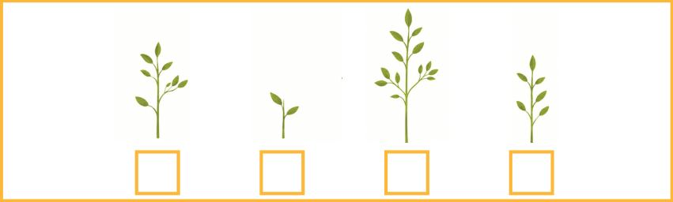

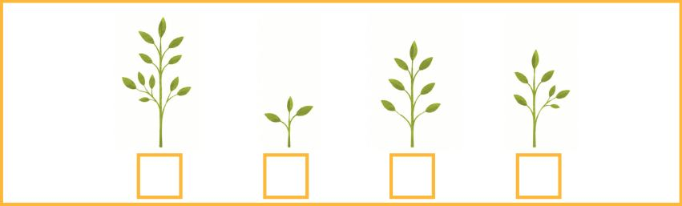

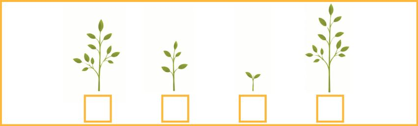

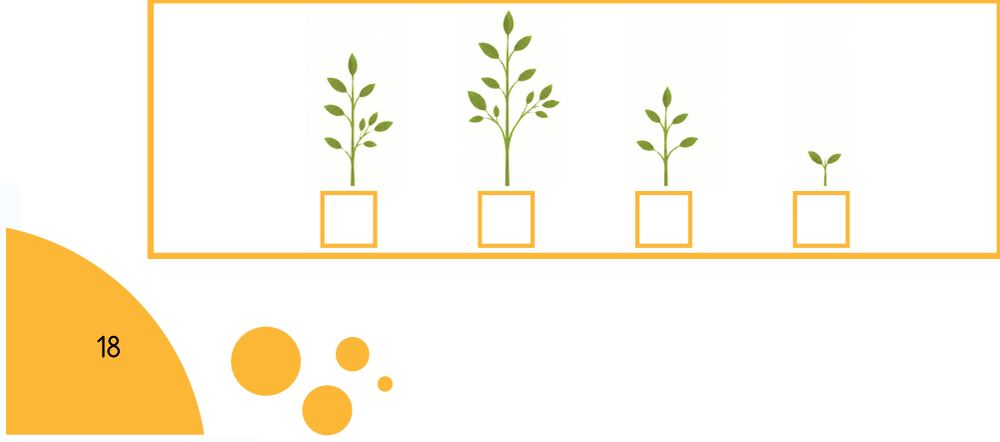

<!-- sayfa 18 -->

# NEZAKET SÖZCÜKLERİ

Nezaket sözcükleri insanlar arasındaki iletişimi daha nazik ve olumlu hâle getiren sözcüklerdir. Günaydın, lütfen, teşekkür ederim, özür dilerim, rica ederim nezaket sözcüklerinden bazılarıdır.

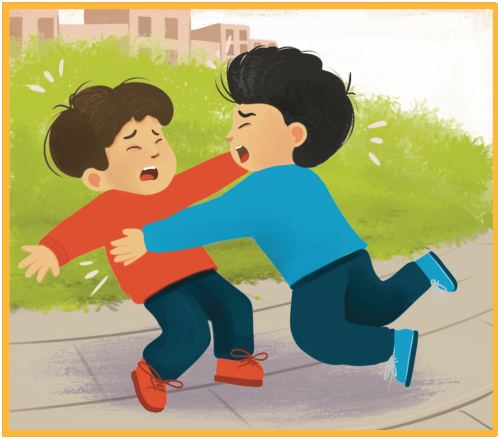
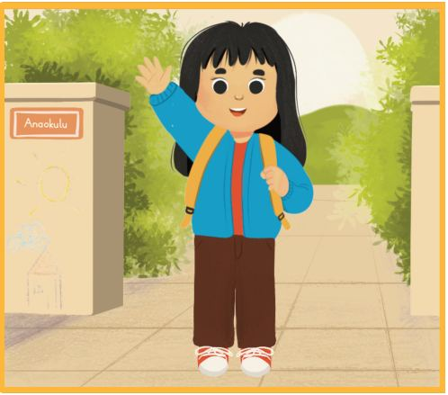

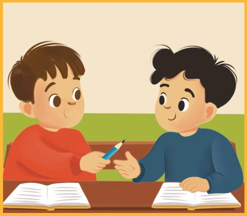
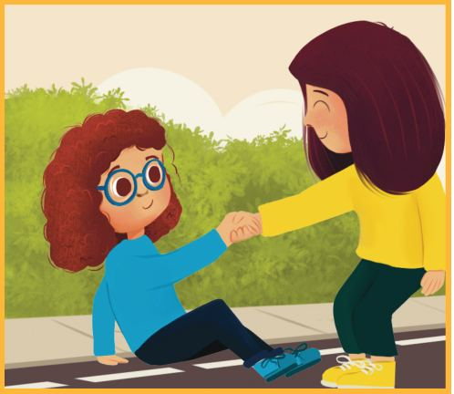


Görselleri inceleyelim. Çocuklar hangi nezaket sözcüğünü kullanmış olabilir? Düşünelim ve söyleyelim. Hangi durumlarda nezaket sözcüklerini kullandığımızı ifade edelim.

<!-- sayfa 19 -->

# İLİŞKİLİ VARLIKLAR

Görselleri inceleyelim. Her çerçevenin üst bölümünde yer alan görselle ilişkili olanları bulup işaretleyelim.

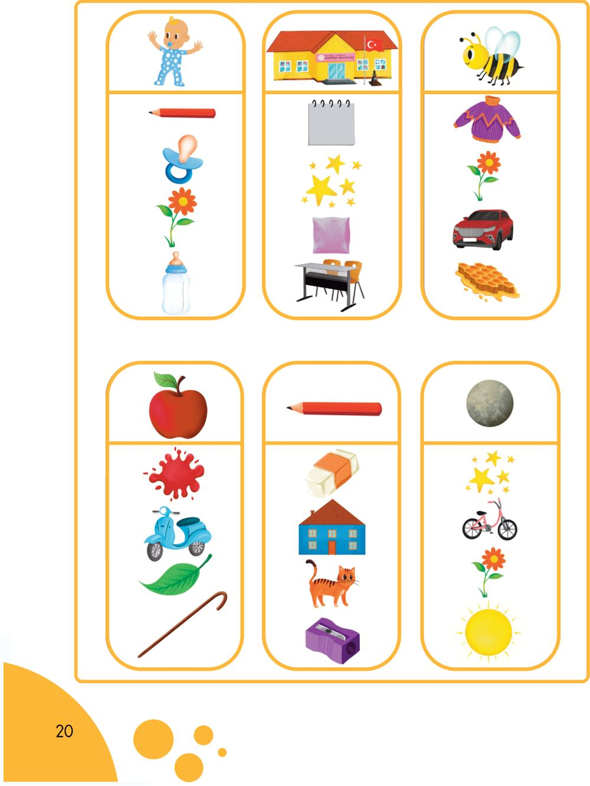

<!-- sayfa 20 -->

# UYAKLI SÖZCÜKLER

Sayfadaki görsellerin isimlerini söyleyelim. Söylenişi birbirine benzeyen sözcükleri bulalım. Söylenişi benzeyen sözcüklere uyaklı sözcükler denir. Uyaklı sözcükleri görsellerini çizgi çizerek eşleştirelim.

| | | |
| :---: | :---: | :---: |
| TENCERE | FINDIK | ÇAMUR |
| TUZ | TAVA | BAL |
| PENCERE | TAVA | DAL |
| BUZ | SANDIK | HAMUR |

⭐ 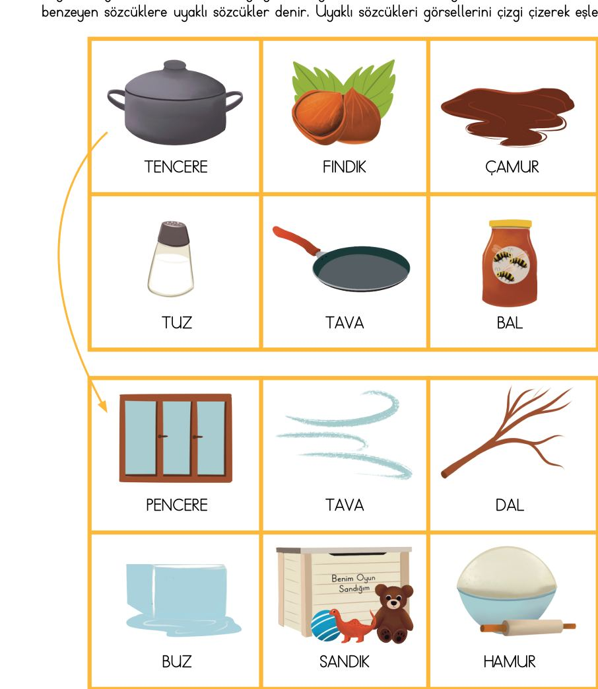 Öğretmene Not: Etkinliğe başlamadan önce çocukların düzeyine uygun uyaklı sözcük örnekleri verebilirsiniz. Çocukların da uyaklı sözcüklere örnek vermesi için rehberlik edebilirsiniz. Karekodu okutarak veya tıklayarak “Sıddık ile Fındık” isimli öyküye erişebilirsiniz. 

<!-- sayfa 21 -->

# MERHABA, ÜÇGEN

Benim adım üçgen. 3 köşem ve 3 kenarım var.


Görsellerden yüzeyi üçgen şekline benzeyenleri bulalım ve işaretleyelim.


Üçgenleri boyayarak köpeği kemiğe ulaştıralım.


Üçgen şeklini kullanarak bir resim yapalım.


<!-- sayfa 22 -->

# ENDEMİK BİTKİLER


**Kum Zambağı**
Ülkemizde sahil kenarındaki kumlarda yetişmektedir. Çiçekleri beyaz renktedir.


**Karagül**
Dünyada yalnızca Şanlıurfa ilinin Halfeti ilçesinde yetişir. Başka yerde yetiştiğinde kırmızı renk açar.


**Göl Soğanı**
Ülkemizde birkaç ilde bulunur. Çiçekleri beyaz renktedir ve bu beyaz çiçeklerin uçlarında yeşil benekler bulunur.


**Damalı Lale**
Ülkemizde özellikle Karaman ilinde bulunur. Çiçekleri sarı ve turuncu renklerde olur. Çiçeklerinin üzerinde koyu renkte benekler bulunur.


Mustafa’nın elindeki kartlarda yazılan bilgileri dikkatle dinleyelim. Anlatılan özelliklere uygun bitkiyi bulalım. Bitkilerin altındaki kutuları ilgili bilgi kartının rengine boyayalım.


| Damalı Lale | Göl Soğanı | Kum Zambağı | Karagül |
| :---: | :---: | :---: | :---: |
|  |  |  |  |

⭐ **Öğretmene Not:** Endemik bitkinin yalnızca belirli bir bölgede doğal olarak bulunan ve başka bölgelerde kendiliğinden yetişmeyen bitkiler olduğu etkinlikten önce çocuklara...

<!-- sayfa 23 -->

# YAŞAMDAN KARELER

Fotoğrafları inceleyelim. Fotoğraflarda neler olduğunu söyleyelim.


Cümleleri dinleyelim. Hangi fotoğrafa ait olduğunu bulalım. Fotoğraf mandallarının renklerine göre kutucukları boyayalım.

$\square$ <!-- KONTROL: Marker'da karşılığı yok, uydurma olabilir --> Tuğba, muhabbet kuşu Maviş omzuna konunca ağabeyinden bir fotoğraf çekmesini istedi.

$\square$ <!-- KONTROL: Marker'da karşılığı yok, uydurma olabilir --> İnci, doğum gününde ailesinin aldığı bisikleti görünce çok sevindi ve birlikte bir hatıra fotoğrafı çektirdiler.

$\square$ <!-- KONTROL: Marker'da karşılığı yok, uydurma olabilir --> Kaan, arkadaşı Fatmanur’u görmek için ziyarete gitti ve anı olarak kalması için koltukta arkadaşıyla bir fotoğraf çektirdi.

$\square$ <!-- KONTROL: Marker'da karşılığı yok, uydurma olabilir --> Mustafa, okulun son günü öğretmeniyle bir fotoğraf çektirdi.


<!-- sayfa 24 -->

# ATIKLARIM KUTUYA

Görseli inceleyelim. Onur’un elinde neler var? Söyleyelim. Atık ne demek? Sohbet edelim.


> Merhaba, benim adım Onur. Ailemle birlikte evimizdeki atıkları özelliklerine göre ayırıyoruz. Geri dönüştürülebilen atıkları uygun kutulara atarak doğamızı korumaya yardımcı oluyoruz.

Geri dönüşüm kutularını inceleyelim. Renklerinin ve sembollerinin ne anlama geldiği hakkında konuşalım. Atıkların altındaki kutucukları ait oldukları geri dönüşüm kutularının renklerine uygun boyayalım.


<!-- sayfa 25 -->

# KİLİM MOTİFLERİ

Kilim görsellerini ve üzerindeki motifleri inceleyelim. Aynı olan kilimleri çizgi çizerek eşleştirelim.


Görseldeki kilim dokuma tezgahını inceleyelim. İstediğimiz renk ve motifleri kullanarak kendi kilimimizi tasarlayalım.


<!-- sayfa 26 -->

# İNCİ KEFALİ

Van Gölü’nde yaşayan inci kefalleri akıntıya karşı yüzerek göç ederler. İnci kefalinin yolunu bulmasına yardım ederek onu yuvasına ulaştıralım.


Görseldeki balıklardan inci kefallerini bulalım ve işaretleyelim. Bir işi başarmak için çaba göstermenin ve sabırlı olmanın neden önemli olduğu hakkında sohbet edelim.


<!-- sayfa 27 -->

# 5 RAKAMI


Önce parmağımızla daha sonra kalemimizle 5 rakamının üzerinden geçelim.


5 rakamlarını bulalım ve işaretleyelim.


Kitaplardan 5 tanesini boyayalım.


5 tane kitap olan rafı işaretleyelim. En sevdiğimiz kitap hangisi, söyleyelim.

5 rakamını kullanarak resim yapalım.

<!-- sayfa 28 -->

# NİLÜFER ÇİÇEKLERİNİ SAYALIM

Nilüfer çiçeklerinin suyun üstünde nasıl durduğunu biliyor muyuz? Söyleyelim. Nilüfer çiçeği suyun altındaki kökleriyle göl tabanına tutunur. Görseli inceleyelim. Hasan’ın ne yaptığını anlatalım. Yaprakların üzerindeki nilüfer çiçeklerini sayarak doğru rakamın olduğu kutucuğu işaretleyelim.


<!-- sayfa 29 -->

# TEMBEL HAYVANIN İZLERİ

Tembel hayvanlar, çok yavaş hareket ettikleri için bu şekilde isimlendirilir. Tembel hayvanlar nasıl hareket ediyor olabilir? Taklit edelim. Bu hayvanların iki ve üç parmaklı olmak üzere iki farklı türü vardır. Görseli inceleyelim ve iki parmaklı olan tembel hayvanı işaretleyelim.


Tembel hayvanın izlerini önce parmağımızla takip edelim. Sonra kalemimizle çizerek tamamlayalım.


<!-- sayfa 30 -->

# TRAFİK İŞARETLERİ

Onur, yolda bazı işaretler görmüş ve bu işaretlerin anlamını merak etmiş. Ailesine sorarak anlamlarını öğrenmiş. Onur’un gördüğü işaretleri inceleyelim, açıklamalarını dinleyelim. Biz bu işaretleri daha önce gördük mü? Sohbet edelim.


Trafik işaretlerini inceleyelim ve anlamlarını tahmin edelim. Okulumuzun önünde bu işaretlerden hangisinin olması gerekir? İşaretleyelim.

 


<!-- sayfa 31 -->

# KAVRAMLAR ORMANI

Kavramlar ormanına hoş geldiniz. Görev kartlarını sırasıyla dinleyelim. Cevapları ormanda bulalım.


1 Numaralı Göreve Hoş Geldin!
Beyaz ağaçlardan uzun olanın yapraklarını yeşil renge kısa olanın yapraklarını sarı renge boya.


2 Numaralı Göreve Hoş Geldin!
Ağaçtaki sincapları bul. Yukarıda duran sincabı işaretle. Aşağıda duran sincabı bir çizgiyle ağacın altındaki meşe palamutlarına ulaştır.

<!-- sayfa 32 -->


# 3 Numaralı Göreve Hoş Geldin!
Ağaçlardaki arı yuvalarını say. Arı yuvası sayısı çok olan ağacı işaretle. Arı yuvası sayısı az olan ağaca 4 tane elma çiz.


# 4 Numaralı Göreve Hoş Geldin!
Gökyüzündeki kuşları say. En yüksekte uçan kuşu kaleminle işaretle. En alçakta uçan kuşun rengini söyle.


# 5 Numaralı Göreve Hoş Geldin!
Ormandaki papatyaları bul. Kaç tane olduklarını söyle. Üstünde kelebek olan papatyayı kaleminle işaretle. Papatyaların altında hangi hayvan var? Bul ve söyle.

<!-- sayfa 33 -->

# BENİM ÇİÇEK TABLOM

Görselleri inceleyelim. En beğendiğimiz tablonun altındaki kutucuğu işaretleyelim.
Arkadaşlarınızın hangi tabloyu seçtiğini inceleyelim. Farklı tabloları beğenmemizin nedenleri
hakkında sohbet edelim.


Boş çerçeveye sevdiğimiz çiçeklerden oluşan bir resim yapalım. Çizimlerimizi arkadaşlarımızla
paylaşalım.


<!-- sayfa 34 -->

# UYUMAK İÇİN NELER YAPARIZ?


Ahmet, ailesi ile kampa gittiğinde, uykusunun gelmesi için yıldızları saymaya karar verdi. Ahmet'in kaç yıldız saydığını bulalım ve her yıldız için aşağıdaki kutulardan birini işaretleyelim. Uykuya hazırlanırken neler yaptığımızı söyleyelim.


Görsellerden geceyle ilgili olanları işaretleyelim. Genellikle gündüz yaptığımız etkinliklere örnekler verelim.

<!-- sayfa 35 -->

# TAM VE YARIM

Bir nesneyi tam ortadan, eşit olacak şekilde böldüğümüzde iki yarım elde ederiz.

 

Görselleri inceleyelim ve görsellerin isimlerini söyleyelim. Siyah çizgilerle belirtilen yerlerden kesildiğinde iki eşit parçaya bölünecek olan nesneleri işaretleyelim.

 


 

<!-- sayfa 36 -->

# ÇANAK ÇÖMLEK DÜKKÂNI

Erdem Usta, en eski el sanatlarından biri olan çömlekçilik ustası. Toprağı şekillendirerek yaptığı çanak ve çömlekleri dükkânında sergiliyor. Erdem Usta’nın bazı ürünleri diğerlerinden farklı olmuş. Her sırada diğerlerinden farklı olan çanak veya çömleği bulup işaretleyelim.


<!-- sayfa 37 -->

# RÜZGÂR ESİNCE

Görselleri inceleyelim. Rüzgâr estiğinde neler olabileceğini konuşalım. Görsellerle ilgili cümleleri dinleyelim ve sözcük sayısı kadar kutuyu boyayalım.

Yapraklar savrulur.

| | | | | |

Şemsiyeleri tutmak zorlaşır.

| | | | |

Vapurdaki çocuğun şapkası uçar.

| | | | |

Baloncu amcanın balonu kaçar.

| | | | |

---

⭐ Öğretmene Not: Etkinlikten önce karekodu okutarak veya tıklayarak “Rüzgâr Esince” isimli öykü okunabilir. 

<!-- sayfa 38 -->

# GERİ DÖNÜŞÜM

Işılay, kullanılan ambalajların çöpe atıldığında doğaya zarar verdiğini bildiği için geri dönüştürülebilen ambalajlı ürünleri tercih etmek istiyormuş. İşte geri dönüşüm sembolü burada. 

Raftaki ürünleri inceleyelim. Her sırada üzerinde "♻️" sembolü olan ürünleri işaretleyerek Işılay'a yardım edelim.

⭐ Öğretmene Not: Karekodu okutarak veya tıklayarak 'Sıfır Atık' isimli şarkıyı çocuklara dinletebilirsiniz. 

<!-- sayfa 39 -->

# SİNCABIN YOLU

Sincaptan meşe palamuduna uzanan yolu önce parmağımızla takip edelim. Daha sonra oyun hamurumuza aynı şekli vererek kitaptaki yolun üzerine yerleştirelim.

   
   
    

Sincabı meşe palamuduna ulaştırma sırası sende. Oyun hamurumuzu kutulara değdirmeden yerleştirerek sincaba yeni bir yol oluşturalım. Daha sonra oluşturduğumuz yolu kalemle çizelim.

   
   
   
```

*(Not: Talimatınızdaki şekil numaralandırmasıyla görseldeki nesne sayısı/yerleşimi arasında fark olduğu için, görseldeki mantıksal akışa göre tüm kareler ve figürler temsil edilmiştir. Talimatınızda verilen 17 şekil listesi metin bloklarına göre dağıtılmıştır.)*

<!-- sayfa 40 -->

# 6 RAKAMI


Önce parmağımızla daha sonra kalemimizle 6 rakamının üzerinden geçelim.


6 rakamlarını bulalım ve işaretleyelim.


Bal peteklerinden 6 tanesini boyayalım. Arılar bu petekleri doldurmak için hangi çiçeklere konmuş olabilir? Söyleyelim.


Üzerinde 6 tane arı olan yuvayı işaretleyelim.

6 rakamını kullanarak resim yapalım.

<!-- sayfa 41 -->

# BİLMECELERLE MEVSİMLER

Bilmeceleri dinleyelim. Cevapları bilmecelerin altındaki kutucuklardan bularak işaretleyelim. Her mevsimle ilgili aklımıza gelen üç şeyi söyleyerek “Üç Şey Bulma Oyunu” oyununu oynayalım.

---


Ağaçlar 🌸 açtı.
☃️ lar dolaba kalktı.
Bil bakalım ben neyim?
Mevsimlerden biriyim.

(İLKBAHAR)

![Kutucuk 1: Kardan adam]
![Kutucuk 2: Çiçekli bahar manzarası]

---


Çok sıcak oldu hava.
Ne güzel yenir 🍦
Bil bakalım ben neyim?
Mevsimlerden biriyim.

(YAZ)

![Kutucuk 1: Plaj ve içecek]
![Kutucuk 2: Sonbahar ağacı]

---


Yerlere dökülüyor 🍂 lar.
Başladı yağmaya 🌧️ lar.
Bil bakalım ben neyim?
Mevsimlerden biriyim.

(SONBAHAR)

![Kutucuk 1: Çiçekli bahar manzarası]
![Kutucuk 2: Sonbahar ağacı]

---


❄️ lar yağar lapa lapa.
😴 lar dalar uykuya.
Bil bakalım ben neyim?
Mevsimlerden biriyim.

(KIŞ)

![Kutucuk 1: Çiçekli bahar manzarası]
![Kutucuk 2: Kardan adam]


<!-- yer tutucu bulunamadı: sayfa sonuna eklendi -->

<!-- sayfa 42 -->

# BOYUTUNA GÖRE EŞLEŞTİRELİM

Bölmelerde bulunan hayvanları ve yiyecekleri inceleyelim. Hayvanları büyüklüklerine uygun olan yiyeceklerle çizgi çizerek eşleştirelim.


Çekirdeklerin boyutlarını inceleyelim. Her çerçeveye çekirdeğin boyutuna uygun büyüklükte bir ayçiçeği çizelim.


<!-- sayfa 43 -->

# ÜLKEMİZDE VE DÜNYADA SPOR

Ülkemizi başarıyla temsil eden birçok millî sporcu vardır. Bu sporcular özverili ve disiplinli çalışarak çeşitli spor dallarında ülkemize madalyalar kazandırıyor. Hangi dalda ülkemize madalya kazandırmak isterdik, düşünelim. Madalya kazanmış bir sporcu ne hissedebilir? Söyleyelim.


Görselleri inceleyelim. Görsellerdeki spor dallarının isimlerini söyleyelim.

  
  

⭐ Öğretmene Not: “Vatanseverlik” değeri ile ilişkilendirilerek güreş, okçuluk gibi ata sporlarından bahsedilebilir ve ülkemize madalya kazandıran millî sporcular hakkında bilgi verilebilir.


<!-- sayfa 44 -->

# YÜRÜYEN KÖŞK


Bir zamanlar, bir köşkün bahçesinde yer alan çınar ağacı o kadar büyümüş ki dalları köşkün duvarlarına zarar vermeye başlamış. Bu durumu gören bahçıvan çözüm olarak bu ağacın dallarını kesmek istemiş. Doğayı ve ormanları çok seven köşk sahibi buna izin vermemiş. Çınar ağacını kesmek yerine köşkün yerini değiştirmiş. O günden sonra bu köşk “Yürüyen Köşk” olarak anılmaya başlamış. Bu çınar ağacı ve Yürüyen Köşk, Yalova ilimizde bulunmaktadır.

Bu hikâyede çınar ağacının korunmasını isteyen kişi Mustafa Kemal Atatürk’tür. Atatürk “Ormansız ve ağaçsız toprak vatan değildir.” sözüyle ağaçların önemini vurgulamıştır.

Ağaçların büyüme aşamalarını düşünelim ve rakamlarla görselleri örnekteki gibi çizerek eşleştirelim.

1 ——— ● ——— 

2

3

4

5

<!-- sayfa 45 -->

# AZİZ SANCAR


> "Merhaba, çocuklar. Ben Aziz Sancar. Türk bilim insanıyım. Yaptığım çalışmalarla Nobel ödülünü aldım. Ülkemi bilim alanında temsil ettiğim için çok mutlu ve gururluyum."

Bilimsel çalışmalarıyla ülkemizi gururlandıran Aziz Sancar'ın fotoğraf çerçevesini istediğimiz renk ve desenlerle süsleyelim.


<!-- sayfa 46 -->

# DUYU ORGANLARIM

Her sıradaki görselleri inceleyelim. Yönergelere uygun olanları bulup işaretleyelim.

| | | |
| :--- | :--- | :--- |
|  | Sesini duyabileceğimiz varlıkları işaretleyelim. |    |
|  | Büyüteç ya da özel bir araç kullanmadan görebileceğimiz varlıkları işaretleyelim. |    |
|  | Tadı olan varlıkları işaretleyelim. |    |
|  | Dokunabileceğimiz varlıkları işaretleyelim. |    |
|  | Kokusu olan varlıkları işaretleyelim. |    |

<!-- sayfa 47 -->

# KÜTÜPHANELER HAFTASI

 Ülkemizdeki en büyük kütüphane Ankara’daki “Millet Kütüphanesi”dir. Karekodu kullanarak kütüphaneyi gezelim. Kütüphaneler neden önemlidir? Sohbet edelim.


Sizce görseller neyi anlatıyor olabilir? Tahmin edelim.

 Cep telefonuyla konuşmak yasaktır.
 Yüksek sesle konuşmak yasaktır.
 Kitaplara ve eşyalara zarar vermek yasaktır.
 Su hariç, yiyecek ve içecek getirilmesi yasaktır.

Kitap raflarını inceleyelim. Raflarda kitapların yanında bulunmaması gereken nesneleri bulup işaretleyelim. Boş rafa istediğimiz sayıda kitap çizelim.


<!-- sayfa 48 -->

# GECECİL HAYVANLAR

Gündüz dinlenip geceleri aktif olan hayvanlara gececil hayvanlar denir. Kirpi, yarasa, baykuş bunlara örnektir. Bildiğimiz başka gececil hayvanlara örnek verelim.


Görselleri inceleyelim. Her gececil hayvandan kaç tane olduğunu sayalım ve uygun kutucuğu bularak işaretleyelim.


| 4 | 3 |


| 5 | 4 |


| 5 | 6 |

<!-- sayfa 49 -->

# MERHABA, DİKDÖRTGEN

Benim adım dikdörtgen. 4 köşem ve 4 kenarım var. Kenarlarımın ikisi uzun, ikisi kısa.


Görsellerden yüzeyi dikdörtgen şekline benzeyenleri bulalım ve işaretleyelim.


Dikdörtgenleri işaretleyerek karıncayı çekirdeğe ulaştıralım.


Dikdörtgen şeklini kullanarak bir resim yapalım.

<!-- sayfa 50 -->

# DÜŞÜN, HAYAL ET VE ÇİZ

Hediye paketinde hangi renkler var? Söyleyelim. Paketin içinde ne olabilir? Hayal edelim ve yanına çizelim.


Saksının rengini ve üzerindeki geometrik şeklin adını söyleyelim. Bu saksıda nasıl bir çiçek yetişiyor olabilir? Hayal edelim ve çizelim.


<!-- sayfa 51 -->

# DOĞRU MU, YANLIŞ MI?

Görselleri inceleyelim. Doğru olduğunu düşündüğümüz davranışlar için yeşil kutucuğu, yanlış olduğunu düşündüğümüz davranışlar için kırmızı kutucuğu işaretleyelim. Ardından doğayı nasıl koruyabileceğimiz hakkında sohbet edelim.


● Musluğu açık bırakarak suyun boşa akmasına neden oluruz.


● Yakın yerlere yürüyerek ya da bisikletle gideriz.


● Ağaçları keserek doğaya zarar veririz.


● Gereksiz yere yanan ışıkları kapatırız.

⭐ Öğretmene Not: Etkinliğe başlamadan önce “Dünya’nın Ateşi Var” isimli öykü kitabı okunabilir.

<!-- sayfa 52 -->

# KİMDİR BU?


Gizem’in arkadaşlarıyla ilgili verdiği ipuçlarını dikkatle dinleyelim. Verilen ipuçlarına göre arkadaşlarını tahmin edelim ve uygun görselin altındaki kutucuğu belirlenen renkte boyayalım.


Merhaba, ben Gizem. Arkadaşlarımı bulmak için bir oyun oynayalım.

🔴 Okul arkadaşımın saçları sarı. Mavi rengi çok seviyor. Resim yapmaktan hoşlanıyor.
🔵 Park arkadaşım paten kaymayı çok seviyor.
🟣 Mahalle arkadaşım siyah saçlı ve kırmızı rengi çok seviyor.
🟡 Spor kursu arkadaşım mor rengi çok seviyor.
🟤 Kuzenim tenis oynamayı çok seviyor.

<!-- sayfa 53 -->

# BEDENLE RİTİM


Yumruğunu masaya vur.  Ayağını yere vur.  El çırp.

Ritim örüntülerini takip ederek arkadaşlarımızla birlikte uygulayalım.


<!-- sayfa 54 -->

# HANGİSİ SÖYLENMEDİ?

Çerçevelerin içindeki görselleri inceleyelim. Okunacak sözcükleri dikkatle dinleyelim. İsmi söylenmeyen sözcüğün görselini işaretleyelim.

TOPRAK - YAPRAK - UÇAK - TARAK


ÖRDEK - İNEK - ÇİÇEK - ÖRÜMCEK


BARDAK - YATAK - OYUNCAK - BAYRAK


<!-- sayfa 55 -->

# MUTFAKTA TAM-YARIM

Aslan, ailesi için bir meyve salatası hazırlamak istiyor. İşe, bu meyve salatası için kullanacağı malzemeleri ve miktarlarını listeleyerek başlıyor.


LİSTE
Bir tam portakal
Yarım elma
Bir tam şeftali
Yarım kayısı
Yarım kivi


Listeyi dinleyelim. Listede yazan malzemeleri miktarlarına dikkat ederek masanın üzerinden bulup işaretleyelim.


<!-- sayfa 56 -->

# KESYAP TEKNİĞİ

Fotoğraf, gazete ve atık kağıt parçalarının kesilip bir araya getirilmesiyle yapılan kesyap örneklerini inceleyelim. Kullanılan renkler ve şekiller hakkında sohbet edelim.


Sınıfımızdaki atık kağıtlar ile farklı parçalar oluşturalım. Parçaları çerçevenin içine yerleştirerek kendi kesyap çalışmamızı hazırlayalım. Çerçevemizi renklendirelim ve çalışmamızı arkadaşlarımızla paylaşalım.


<!-- sayfa 57 -->

# KİTAP SEÇİM GÜNÜ

Çınar ve arkadaşları, sınıfta “365 Gün Öykü” serisindeki kitaplardan hangisinin okunacağını belirlemek için bir oylama yapıyor. Oylama sonuçlarına göre hazırlanan grafiği inceleyelim. Hangi kitabın okunması gerektiğini söyleyelim.


“365 Gün Öykü” serisinde bulunan öykü kitaplarının kapaklarını inceleyelim. Okunmasını istediğimiz kitabı seçelim ve işaretleyelim.

  

⭐ Öğretmene Not: Sınıfta en çok seçilen kitap öğretmen tarafından okunabilir.


<!-- sayfa 58 -->

# HANGİSİ DAHA AĞIR?

Kirpi ormanda yürürken farklı hayvanlarla karşılaşıyor. Karşılaştığı hayvan kirpiden daha ağırsa kutucuğu maviye boyayalım. Karşılaştığı hayvan kirpiden daha hafifse el çırpalım.


<!-- sayfa 59 -->

# PENGUENLER KUŞ MU, BALIK MI?

Görsellerdeki penguenleri inceleyelim. Bazı penguenler suda yüzüyor, bazıları ise karada yürüyor. Penguenler kuş mu, balık mı? Düşünelim, araştıralım.


Görseldeki oyuncak penguenin boyu kaç karış? Penguen görselinin boyunu başka hangi nesneler ile ölçebiliriz? İşaretleyelim.


<!-- sayfa 60 -->

# MİLLÎ TEKNOLOJİLERİMİZ

Görsellerdeki araçları inceleyelim. Araçların hareket ettikleri yeri bulalım ve işaretleyelim.

Ülkemizde üretilen elektrikli otomobil.


Ülkemizde üretilen helikopter.


Ülkemizde üretilen uçak Hürkuş.


Ülkemizde üretilen Türkiye Cumhuriyeti Anadolu Gemisi.


<!-- sayfa 61 -->

# NEYE İHTİYACI VAR?

Görsellerdeki çocukları inceleyelim. Çocukların neye ihtiyacı olabilir? Düşünelim. Çocukların ihtiyaç duyabileceği eşyaları çizgi çizerek eşleştirelim.


Beslenme sırasında nelere ihtiyaç duyarız? Beslenme sırasında ihtiyaç duyduğumuz bir eşyayı çerçevenin içine çizelim.


<!-- sayfa 62 -->

# DOĞADAKİ MALZEMELERİN İZİ

Kitabımızı alalım ve bahçeye çıkalım. Görsellerdeki malzemelerden bahçede bulduklarımızın kutucuklarını boyayalım. Malzemelerden birini seçip çerçevenin içine baskı çalışması yapalım.


---


Görsel ve Genel Ağ Kaynakçası için karekodu okutunuz.

<!-- sayfa 63 -->

45°D 40°D 35°D 30°D 25°D
25°D 30°D 35°D 40°D 45°D


**TÜRKİYE'NİN MÜLKİ İDARE BÖLÜMLERİ İLE KARA VE DENİZ KOMŞULARI HARİTASI**

**Lejant:**
* BAŞKENT (Ankara)
* İL MERKEZİ
* GÖL
* AKARSU
* ÜLKE SINIRI
* ÖZERK BÖLGE SINIRI

**Ölçek:**
0 50 100 200 300 400 km

Harita Genel Müdürlüğü tarafından üretilmiştir.

---

**Harita Üzerindeki Yer İsimleri ve Coğrafi Bilgiler:**

**Denizler ve Göller:**
* KARADENİZ
* EGE DENİZİ
* AKDENİZ
* MARMARA DENİZİ
* HAZAR DENİZİ
* Van Gölü
* Tuz Gölü
* Urumiye Gölü

**Komşu Ülkeler ve Bölgeler:**
* RUSYA FEDERASYONU
* UKRAYNA
* ROMANYA
* BULGARİSTAN
* GÜRCİSTAN
* ERMENİSTAN
* AZERBAYCAN
* NAHÇIVAN Ö.C. (AZERBAYCAN)
* İRAN
* IRAK
* SURİYE
* LÜBNAN
* KUZEY KIBRIS TÜRK CUMHURİYETİ
* GÜNEY KIBRIS RUM YÖNETİMİ
* İSRAİL
* FİLİSTİN (Gazze Şeridi, Batı Şeria)
* MISIR

**Şehirler (İller):**
Adana, Adıyaman, Afyonkarahisar, Ağrı, Amasya, Ankara, Antalya, Artvin, Aydın, Balıkesir, Bilecik, Bingöl, Bitlis, Bolu, Burdur, Bursa, Çanakkale, Çankırı, Çorum, Denizli, Diyarbakır, Edirne, Elâzığ, Erzincan, Erzurum, Eskişehir, Gaziantep, Giresun, Gümüşhane, Hakkâri, Hatay, Isparta, Mersin, İstanbul, İzmir, Kars, Kastamonu, Kayseri, Kırklareli, Kırşehir, Kocaeli, Konya, Kütahya, Malatya, Manisa, Kahramanmaraş, Mardin, Muğla, Muş, Nevşehir, Niğde, Ordu, Rize, Sakarya, Samsun, Siirt, Sinop, Sivas, Tekirdağ, Tokat, Trabzon, Tunceli, Şanlıurfa, Uşak, Van, Yozgat, Zonguldak, Aksaray, Bayburt, Karaman, Kırıkkale, Batman, Şırnak, Bartın, Ardahan, Iğdır, Yalova, Karabük, Kilis, Osmaniye, Düzce.

**Akarsular ve Diğer Coğrafi Unsurlar:**
* Meriç N.
* Sakarya N.
* Kızılırmak N.
* Yeşilırmak N.
* Çoruh N.
* Fırat N.
* Dicle N.
* Aras N.
* Kura N.
* Asi N.
* Seyhan N.
* Ceyhan N.
* Göksu N.
* Büyük Menderes N.
* Küçük Menderes N.
* Bakırçay N.
* Gediz N.
* Nil N.
* Süveyş K.

**Diğer Yer İsimleri:**
Sofya, Bükreş, Tiflis, Erivan, Beyrut, Şam, Tel Aviv, Kudüs, Lefkoşa, Atina, Bağdat.
